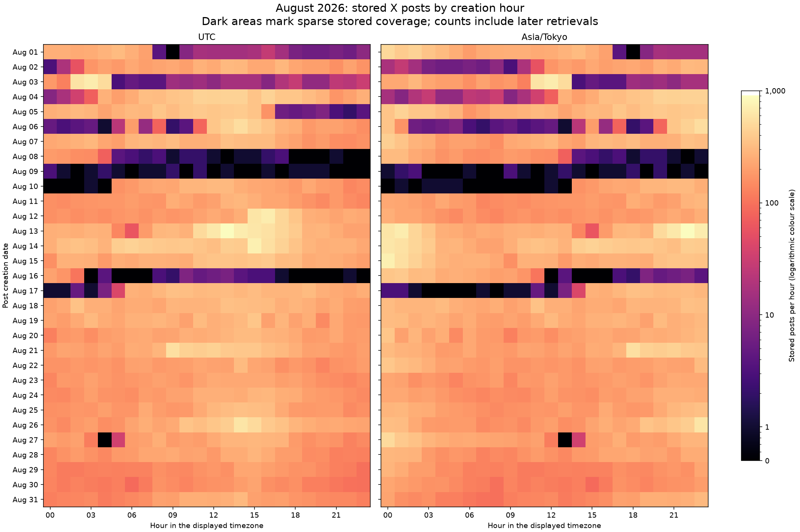

# August 2026 X coverage audit and backfiller readiness

## Plain-English Summary

August 9 is severely under-collected: production has 19 posts for that UTC day,
or 22 for the Japan-time day. It sits inside a nearly 49-hour period spanning
August 8–10 with no recorded new post inserts. Four other substantial recovery
windows occur around August 1–2, August 3–4, August 5–6 and August 16–17.
There are smaller interruptions on August 13 and 27.

The older backfill command remains useful because it shares the live harvest
pipeline, but it needs stronger time, progress and resource controls before a
recovery run. This pass records the evidence and cleanup requirements. Running
the paid recovery, changing production, and scheduling month-sized collection
are subsequent phases.

## Evidence and meaning

The production database is `pushinweight-db-shadow` / `pushinweight_shadow`
(PostgreSQL 18.4). The main aggregate snapshot is
`2026-10-12T10:58:21.055190Z`. The gap-detail export has its own snapshot timestamp.
Both exports explicitly used read-only, repeatable-read transactions, statement
and lock timeouts, and `ON_ERROR_STOP`. No post bodies or credentials are saved.

- `created_at` answers which posting hour is represented in storage.
- `fetched_at` answers when that stored row was first recorded. A long gap in
  these timestamps means no new stored rows; it does not alone prove no API
  requests, no duplicate-only cycles, or a particular cron failure.
- Later retrieval can leave a few posts spread across an otherwise missed day.
  All counts below include those later-retrieved rows.
- Whole-month UTC coverage contains 148,298 distinct posts; Japan-time August
  contains 149,787 because the boundary hours differ. The UTC median day is
  4,766 posts. This is descriptive, not a prediction of the missing population.
- All 148,298 UTC-August posts have at least one brand link. Their
  `source_query_id` values are all null, so persisted data cannot identify which
  original A/B/C search lane missed a window. Creation time is populated.
- August has 25 represented brand identifiers, including historical aliases;
  current-main config enables 21. A future run must pin its collection scope
  and policy; current list membership and current queries do not reconstruct
  the original August population automatically.
- No current `harvest_backlog_windows` row overlaps August. The existing
  quarantine-replay shortcut therefore cannot recover these historical gaps.

This audit identifies strong coverage-gap candidates from stored evidence.
The exact number of recoverable missing X posts remains unknown. No TwitterAPI,
Grok, or model requests were made; the production harvest was unchanged.

## Significant gaps

Times are UTC; boundaries are the last and next recorded first-insert timestamp,
rounded to the minute for display. Exact timestamps are in the gap CSV/JSON.
“Stored inside gap” counts post creation times inside the unpadded interval;
it does not count posts inserted during that interval.

| UTC interval | Time without new inserts | Stored inside gap | Assessment |
| --- | ---: | ---: | --- |
| Aug 8 04:31 → Aug 10 05:15 | 48.74 h | 104 | Highest priority; includes virtually all Aug 9 |
| Aug 16 02:31 → Aug 17 06:02 | 27.51 h | 120 | Major gap; Aug 16 has only 537 UTC-day posts |
| Aug 1 07:46 → Aug 2 03:46 | 20.00 h | 375 | Major gap hidden by normal early-Aug-1 volume |
| Aug 3 04:54 → Aug 4 04:30 | 23.60 h | 546 | Major gap hidden by normal early-Aug-3 volume |
| Aug 5 16:24 → Aug 6 07:01 | 14.62 h | 279 | First of three adjacent interruptions |
| Aug 6 07:03 → Aug 6 08:46 | 1.71 h | 86 | Combine with Aug 5/6 recovery |
| Aug 6 08:46 → Aug 6 12:01 | 3.26 h | 101 | Combine with Aug 5/6 recovery |
| Aug 27 03:31 → Aug 27 06:01 | 2.50 h | 40 | Smaller secondary gap |
| Aug 13 05:46 → Aug 13 07:01 | 1.25 h | 62 | Smaller secondary gap |

The five major grouped windows contain 139.45 hours without recorded new
inserts, excluding the brief insertion bursts between the Aug 5/6 interruptions.
Five padded windows cover 143.5 hours. These are durations, not missing-post
estimates. The remaining August hours do not show another month-wide collapse
in this aggregate view; brand-specific omissions can still exist.

The historical pause runbook independently records an owner-authorized pause
on Aug 6 and a cutover/resume on Aug 10. Those records support operational
context, but they do not establish the cause of every observed gap.

## Proposed recovery windows

Padding includes one 15-minute cycle before the last insert and at least one
after the next insert, rounded outward to quarter-hour boundaries. It protects
boundary coverage; duplicate returns still consume provider credits. Start with
the Aug 8–10 window, then Aug 16–17; execute short slices within each window.
The machine manifest is a proposal and supplies no execution authorization.

| Priority | Since UTC | Until UTC | Since JST | Until JST |
| --- | --- | --- | --- | --- |
| major | 08-08 04:15 | 08-10 05:45 | 08-08 13:15 | 08-10 14:45 |
| major | 08-16 02:15 | 08-17 06:30 | 08-16 11:15 | 08-17 15:30 |
| major | 08-01 07:30 | 08-02 04:15 | 08-01 16:30 | 08-02 13:15 |
| major | 08-03 04:30 | 08-04 05:00 | 08-03 13:30 | 08-04 14:00 |
| major | 08-05 16:00 | 08-06 12:30 | 08-06 01:00 | 08-06 21:30 |
| smaller | 08-27 03:15 | 08-27 06:30 | 08-27 12:15 | 08-27 15:30 |
| smaller | 08-13 05:30 | 08-13 07:30 | 08-13 14:30 | 08-13 16:30 |

## Complete daily counts

Counts use post creation date, including later retrievals. A day with posts
in many hours can still be mostly missing: Aug 9 has 19 posts spread over 14
UTC hours.

| August day | Stored posts UTC | Hours with posts UTC | Stored posts JST |
| --- | ---: | ---: | ---: |
| 01 | 2,236 | 23 / 24 | 5,107 |
| 02 | 4,766 | 24 / 24 | 2,933 |
| 03 | 2,405 | 24 / 24 | 4,166 |
| 04 | 6,834 | 24 / 24 | 4,219 |
| 05 | 5,372 | 24 / 24 | 7,593 |
| 06 | 4,027 | 24 / 24 | 2,334 |
| 07 | 6,001 | 24 / 24 | 6,358 |
| 08 | 768 | 18 / 24 | 2,664 |
| 09 | 19 | 14 / 24 | 22 |
| 10 | 4,207 | 20 / 24 | 2,476 |
| 11 | 4,690 | 24 / 24 | 4,734 |
| 12 | 6,125 | 24 / 24 | 4,468 |
| 13 | 8,650 | 24 / 24 | 8,676 |
| 14 | 8,957 | 24 / 24 | 8,856 |
| 15 | 6,669 | 24 / 24 | 7,517 |
| 16 | 537 | 15 / 24 | 3,104 |
| 17 | 5,209 | 24 / 24 | 2,759 |
| 18 | 6,319 | 24 / 24 | 6,491 |
| 19 | 5,939 | 24 / 24 | 6,139 |
| 20 | 5,409 | 24 / 24 | 5,404 |
| 21 | 6,863 | 24 / 24 | 6,697 |
| 22 | 4,603 | 24 / 24 | 5,247 |
| 23 | 4,563 | 24 / 24 | 4,518 |
| 24 | 4,904 | 24 / 24 | 4,613 |
| 25 | 5,143 | 24 / 24 | 5,152 |
| 26 | 6,746 | 24 / 24 | 5,978 |
| 27 | 4,625 | 23 / 24 | 5,510 |
| 28 | 4,554 | 24 / 24 | 4,779 |
| 29 | 3,605 | 24 / 24 | 3,770 |
| 30 | 3,273 | 24 / 24 | 3,483 |
| 31 | 4,280 | 24 / 24 | 4,020 |

## Existing posts also have enrichment gaps

Of the 148,298 UTC-August posts, 62,102 have nonempty `text_en` and 63,166
have nonempty `text_zh_cn`. That leaves 86,196 without English text and 85,132
without Simplified Chinese text. Aug 1 has neither populated column; Aug 13–18
has very little translated text despite mostly strong collection volume.
These are field-availability counts, not versioned classification-stage counts
or a claim that every untranslated post should receive every output language.

Missing stored posts need historical search. Missing enrichment on existing
posts needs bounded processing of those existing records, with separate
completion evidence. Re-fetching every already-stored August post merely to
repair translations would add retrieval cost without solving that distinction.

## Backfiller readiness at current main

Reviewed source is `f43b2904393013107598af3904b78d3be36c76b4`, in the independent
`docs/august-harvest-audit-20261012` worktree. Findings below are source-level
observations; no live backfill was invoked.

| Surface | Present behavior | Cleanup needed |
| --- | --- | --- |
| Shared pipeline | `backfill` uses `CycleRunner` and shared planning | Preserve reuse; do not add another fetch/persist implementation |
| Credential purpose | `cycle_kind=backfill` resolves ON_DEMAND | Preserve explicit purpose and no scheduled/legacy fallback |
| Live cursor protection | Explicit operator window returns `cursor_owned=False` | Pin through command → real runner → fake provider → PostgreSQL |
| Basic selection | Brand/call filtering, setting restoration and incomplete receipt checks exist | Preserve these improvements |
| Inputs | Parser accepts dates or second-precision UTC timestamps; doc examples use unsupported minute precision | Validate ordered bounds and positive limits; handle timestamp formats consistently |
| Resumption | Missing `--until` means a new “now” and new state filename each invocation | Freeze an explicit campaign upper bound |
| Resource estimate | 2,350 posts/day, six calls and 1,000-result ceiling | Replace obsolete volume assumptions with explicit bounded slices and physical-call budgets |
| Search continuation | Truncated calls remain pending; retry starts at original bounds | Checkpoint remaining time/page progress and detect non-progress; do not repeatedly buy the newest segment |
| LLM cap | Fresh runner receives full `--max-llm-calls` for each logical call | Enforce aggregate invocation/campaign allowance; distinguish translation/classification and other model calls |
| Lock duration | One writer lock covers the entire invocation, including `--pause` | Release between bounded units; sleep outside lock and yield to scheduled harvest |
| Fetch deadline | Ordinary run omits `deadline` in `_fetch_tweets` call | Ensure historical fetching checks remaining time before every request/walk |
| State durability | Local JSON, direct write, identity omits policy/query fingerprints | Atomic checkpoints, frozen scope and mismatch detection; choose durable storage before ephemeral Render execution |
| Additional work | Shared planner adds discovery calls; runner also drains global enrichment/rare-type work, verification and synthesis demand | Make recovery scope explicit and prevent unrelated work consuming its allowance; preserve scheduled defaults |
| Exit/reporting | Exceptions are recorded but loop continues and batch can exit normally | Distinguish completed collection, partial collection, pending enrichment, lock contention and failed execution |

The default batch is three calls. With a configured 13-minute runner deadline,
separate runners can exceed a 15-minute cron slot while holding one shared lock;
fetch work also needs a real deadline check. The lock prevents overlapping
writers, but does not itself give live collection priority.

## Provider documentation checked October 12

Advanced Search documents `Latest`/`Top`, query-embedded `since_time` and
`until_time`, up-to-20-result pages, and cursor continuation. Completion should
record drained, capped, failed or non-progressing work rather than treating a
small page as a census of X. See [official Advanced Search documentation](https://docs.twitterapi.io/api-reference/endpoint/tweet_advanced_search).

Pricing currently lists $0.15 per 1,000 returned tweets, 15 credits per returned
tweet, 100,000 credits per dollar, and a 15-credit minimum for search requests.
These are raw provider returns: overlaps/retries/duplicate IDs consume credits
even if the database inserts nothing. LLM costs need their own allowance.
See [official pricing](https://twitterapi.io/pricing). No recovery cost forecast
is asserted from inserted-post counts. The pricing page also lists a separate
list-function price effective October 1; optional list operations need current
endpoint pricing rather than an old generic floor.

## Next phases

1. Clean up the existing command and shared historical runner controls offline,
   including production-call-chain regression checks and durable progress.
2. Prepare and separately authorize a finite August recovery: explicit scope,
   frozen query/list evidence, allowance, slice sizes and stopping rules.
3. Later, reuse the same bounded units for July/month-sized campaigns, with
   checkpoints, pauses outside the writer lock, live-collection priority and
   shared resource watermarks. No background process was started by this pass.

See the [same-task cleanup plan](../../plans/2026-10-12-105615-docs-august-harvest-audit-20261012-plan.md).

## Artifact inventory and verification

- [Main read-only SQL](2026-10-12-195900-august-coverage-audit.sql) and
  [JSON export](2026-10-12-195900-august-coverage-audit.json): daily, hourly,
  brand, source and insertion-gap aggregates, plus seven days of edge context.
- [Gap-detail SQL](2026-10-12-195900-august-coverage-audit-gap-detail.sql) and
  [JSON](2026-10-12-195900-august-coverage-audit-gap-detail.json): exact gap
  boundaries, stored counts, later insertion and brand presence.
- [Daily CSV](2026-10-12-195900-august-coverage-audit-daily.csv),
  [hourly CSV](2026-10-12-195900-august-coverage-audit-hourly.csv), and
  [insertion-gap CSV](2026-10-12-195900-august-coverage-audit-insert-gaps.csv).
- [Proposed recovery manifest](2026-10-12-195900-august-coverage-audit-recovery-windows.json).
- [Plot/summary script](2026-10-12-195900-august-coverage-audit-summarize.py)
  and [hourly plot](2026-10-12-195900-august-coverage-audit.png).

The summarizer asserted all 62 daily totals against all 1,488 hourly cells,
checked populated-hour counts and the 24-hour insertion split, and required
both exports to attest read-only transactions. The plotted artifact was viewed.
No application behavior changed, so application tests were not run in this audit.
The report, plan and exports are local and uncommitted. Shared G1–G5 plans,
code, runtime resources and coordination claims were preserved.
