# Global shared schema and ChartEngine foundation - Plan

## Plain-English Summary

This plan brings shared meanings and names into one database-wide design, including existing tables and the pending G2 EventDossier and G3 collection work. This session leads schema and migration integration; domain sessions can contribute bounded caller changes. The owner has combined the remaining work into three sequential groups: RG4, then RG5, then RG6. Each combined group has focused item checks and one shared full delivery/review/learning cycle.

As of2026-10-22, RG1–RG3 are complete in production:21 of the62 identified work items. RG3's separate physical deletion is live on all seven production services at `851abb1f`, through migration0134. All nine old columns, nine temporary triggers and five bridge functions are absent; all814 current job listings and814 source-evidence records remain, with160 companies and no schema drift or assignment violations. General and its jobs feeds render in all three languages, alongside home/admin/stories and the affected full-model/document readers. The backfill owner stopped the exact old July job at17:07JST; cancellation and controller-lock clearance are verified,2,277saved campaign Posts remain and no restart occurred. RG3's final compound/amendment checkpoint is recorded below. The remaining groups are RG4, RG5 and RG6, totaling41 items.

The owner has also added G3's remaining collection-storage migration to this plan. RG6 now includes four connected owner-level work items for sealed job instructions, run records, scope records and observations. Together they migrate historical data, update every reader/writer and remove all13 replaced collection JSON columns. Only the narrowly validated, sealed job-definition JSON remains among those14 in-scope columns. RG6 has10 items. With the latest paired grouping, the target is six full release cycles overall: after RG3, three groups and41 items remain. This amendment proposes no additional tables and reuses the nine collection tables already integrated.

Each authorized release batch is tested on isolated PostgreSQL and staging before the same reviewed migrations run against production's own data. Staging data never replaces production. Existing text remains where it is actual wording, source identity, a hash or a justified snapshot; shared meanings become references and fixed-language values move into owned locale rows.

Each release group finishes the full change for its selected work items: preserve/map data, update all references and processes, switch readers/writers, drain old code and delete superseded columns. Items within the group can be implemented together; they do not each trigger staging, production, a full review or `ce-compound`. A rolling database replacement can still require a cutover deployment followed by a deletion deployment because old code must stop before its columns disappear. Reuse unchanged group-wide evidence between those deployments and run focused migration/data/runtime checks for the changed candidate. Run the full learning/amendment checkpoint once after the group finishes. Unknown source values retain exact evidence in their proper owner; a NULL reference alone does not preserve them.

The first three timezone text columns are deleted in production through0122 at `dfaef38c54dd4efc46868195f94040d3aa7310fc`. RG1–RG3 have subsequently closed. Continue immediately with the new combined RG4 through the existing staged→production endpoint, then RG5 and RG6. Paused backfill execution is not resumed by this instruction.

The plan includes notifying G1–G5 and BackfillDB, and a concurrent post-backfill contribution to record scheduled X collection in shared tables without changing historical enrichment ownership. Preservation and regression checks cover the actual callers, retained history, visible content selections and data mapping. The initial planning request granted no execution authority; the owner's current production instruction and boundaries are recorded below.

The completed field ledger covers 959 existing/pending positions and keeps the 54 chart-proposal positions deferred. It proposes 64 new tables across distinct shared definitions, catalogues, relationships and localized owners, with zero mandatory table retirements. This is a sequence of small releases, not one migration. Unknown legacy evidence stays preserved beside unresolved references.

<!-- global-schema-execution-contract:start -->
## Delivery Exceptions

**Latest owner instruction,2026-10-22 — combine each remaining group by two:** "let's combine each remaining group by 2; do that logically" supersedes the prior5–10-item size ceiling and separate cycles for the formerly numbered domain groups. After RG3 closes, execute RG4 together(15items), then RG5 together(16items), then RG6(10items, including all13 collection JSON retirements). Use sequential release labels RG4–RG6 for the three remaining combined groups; the original-to-current mapping is recorded below. Run focused item checks plus one full review/regression/staging→production/final-compound cycle for each combined group. Required cutover/drain/deletion candidates remain separately ordered within that cycle; no component-level compound or automatic split back into the old groups. The total stays62 items; three release groups and41 items remain after RG3.

**Owner addition,2026-10-22 — complete G3's collection JSON retirement:** "add g3's 13 json to the plan" explicitly includes the unfinished collection-storage migration in this canonical global plan. This session owns U32 implementation/integration and the same staged→production endpoint, including the original G3 U6 historical migration, remaining U5 readers/writers, U7 physical deletion and U8 recovery/reference completion. Allocate four owner-level items to RG6, bringing it to10 and the total to62; the paired-group instruction above reduces the remaining full cycles without removing these items. The original G3 plan supplies the detailed product/data contract, while this plan's current delivery, local test-database and process-control rules govern execution. Preserve the sole sealed-definition exception; this addition is not permission to add a new JSON column, move operational data into archives or unrelated JSON, run providers, or start/restart campaigns.

**Owner instruction,2026-10-22 — ask the backfill owner to stop the exact RG3 consumer:** "tell backfill session to stop" authorizes direct stop coordination for July job `job-dbcql9ivcj2c73fhus90` on67d97278. Ask its owning session to stop at the supported checkpoint or cancel this exact job while preserving saved data, accounting and restart state; leave the scheduled harvester and unrelated jobs alone. This supersedes the communication pause only for the stop request, acknowledgement and final compatible-release notice. A sent/posted request is not evidence that the process stopped. Do not deploy0134 until terminal or verified replacement-compatible evidence exists; campaign restart remains with its owner and is not launched by this session.

**Owner clarification, 2026-10-22 — preserve job listings and their sources:** “job listing is not replaceable; however as long as the source is preserved we can deal with currency and location inconsistencies later.” Preserve every listing's identity, relationships and existing source evidence, including captured payloads/text and source locators. Do not delete/recreate listings or rely on a future rescrape for recovery. Currency and location normalization may remain unresolved when the original source is retained; do not block the release on cleaning those inconsistencies or invent a normalized value. This supersedes the earlier interpretation that job listings were replaceable. It does not waive preservation for other owners, authorize scraping, or remove reader/writer, page, constraint and deletion checks.

**Historical owner instruction,2026-10-21 — initial grouping, superseded for remaining group sizes:** “we don't need to do the full cycle after every one”, “run the full cycle after every5th–10th one (meaning compound, etc)”, followed by “continue”. This supersedes one-owner-per-release and per-deployment learning rules and resumes the existing staged→production work. An owner conversion is a work item;5–10 related/dependency-compatible items form a release group. Use focused item checks, then one combined review/regression/delivery cycle and one final `ce-compound`/remaining-plan amendment checkpoint per group. Separate cutover/deletion candidates retain exact-image/migration/data/old-process gates and reuse valid evidence, without repeating the full workflow or compound checkpoint between them. Data preservation, all-caller cutover, physical deletion, no-new-JSON and separate process-control boundaries remain.

**Retained owner requirement,2026-10-21 — complete replacements:** “cutover, plus deletion of old cols” and “make sure that all references and processes are updated” govern every remaining replacement, including expanded first-cohort fields. U30 is performed inside each release group, not at the end of the global refactor. The earlier stop-after-deployment was honored; the latest “continue” resumes grouped implementation. Stopping the exact timezone-blocking backfill granted no authority to stop other jobs or restart that campaign.

**Standing delivery selection,2026-10-21 — resumed under grouped cadence:** Production through staging remains selected. Implement the selected related items, perform combined group checks and promote each unchanged staging-tested candidate. Complete cutover/drain/deletion, production proof and one final learning checkpoint before the next group. Items share the release cycle. Implementation/review, scoped commits/pushes, non-forced main promotion and observed delivery retain existing authorization. Preserve peer work; paid provider calls, unrelated campaign control, cron/Blueprint/service-setting changes and backfill resumption remain excluded.

**Standing local test-database preparation and exclusive-use rule,2026-10-22 — corrected after read-only reassessment:** The designated database is local `test_pw_g3_timing_20261019` on fuchitalee (`127.0.0.1:55436`), separate from Render staging and production. Preserve its PostgreSQL instance and database; automated test rows are disposable fixtures, not a persistent production-like dataset. Before candidate tests, use the canonical wrapper to hold the exclusive-use lock, verify the target identity and absence of other clients, and explicitly prepare the reviewed candidate migration state. Do not rely on pytest startup to migrate. Check both migration history and the candidate's actual columns, constraints, triggers and functions before and after tests that can change schema. Record candidate SHA, migration-file identity, target and physical-check result. After a production schema release, reconcile this receipt with the released candidate before the next batch; do not wait until production to prepare a candidate test schema or roll another session's newer schema backward. A canonical migration history must remain safe for already-deployed environments: do not add `replaces` to applied migrations merely to silence a local guard. Reconcile proven local historical aliases separately, preserving evidence and verifying their actual operations. Under exclusive ownership of this test-only database, normal Django transaction/browser test cleanup is expected; fixtures must recreate required catalogue rows for both pytest and Django test classes. An empty business table after a test is not itself evidence of data loss or grounds for a restore. Preserve any independently owned data if discovered and resolve its ownership before resetting it. Do not drop/recreate the database, restore a production copy, create another full test database, or run incompatible migration reversals as an implicit repair. A physical-schema mismatch blocks dependent validation until corrected; a clean migration graph alone is insufficient. This supersedes the previous blanket prohibition on test cleanup and the inferred requirement for a restore approval.

**Owner override,2026-10-21 — RG1 removal process gate:** The owner states the backfill no longer uses the old code and directly orders continuation, overriding the prior requirement to wait for the old-image job to become terminal before migration0127. Proceed through the selected staging→production route. Do not contact the backfill session or stop/restart/change its job. This override applies to the RG1 removal candidate and does not grant unrelated campaign or runtime control.

**Owner override,2026-10-21 — remove replaced columns:** Treat every column explicitly superseded by a FK, relationship, locale-owned value or other replacement as temporary migration scaffolding. Preserve source/history in its correctly-owned evidence record or an explicitly approved typed design. The prioritized timezone cutover/removal is now deployed through0122. Apply its full lifecycle to every remaining replacement and complete deletion within each batch. This is a priority and ordering change, not authority to skip verification, discard unknown values or invent a JSON field.

**Historical staging-only grant, superseded above:** The owner invoked `compound-engineering:lfg` on2026-10-21, then explicitly overrode the G3 bounded-handover gate and selected continuation through staging. Implementation, verification, review, commits, pushes and staging deployment/verification are authorized. The G3 acknowledgement/handover prerequisite is waived: central integration may snapshot and port accepted source into this clean checkout while preserving peer worktrees. This waiver is not evidence that another session read a notice. Production deployment, production-branch merge, provider calls and campaign control remain outside this grant. Earlier planning-only and PR-only boundaries describe superseded invocations. The one canonical plan has transferred from the retained ec5a checkout into the clean integration worktree; its change identity and agreed contract are preserved. Deliver small compatible batches to staging: F0 catalogues, the seven-table G2 dossier foundation and the nine-table G3 relational foundation are verified there through0114. The first F1a actor/correction expansion is verified through0115, metric timezone/unit plus event/opportunity timezone expansions through0118, and geography label locale references through0119, on staging. Remaining global field conversions stay incomplete.

**Communication,2026-10-21:** the owner requests fewer backfiller updates. Send direct notices only for an actionable contract/ownership change or the final production-release result; routine progress belongs in the existing shared launch index. G5's owner separately ended direct G2 messages; read its terminal lane status from that index rather than requesting another message or approval.

**Required after each completed release group,2026-10-21:** once the selected work items have passed combined production verification, including required deletion, run `ce-compound` and the remaining-plan amendment loop below before cleanup or starting the next group. No per-item or intermediate-deployment compound checkpoint remains. Amend affected remaining steps immediately when lessons change execution; otherwise link the applicable durable reference and record why existing steps suffice. Avoid duplicate documents. Keep the ordinary learning review within five minutes; material unresolved findings hold the affected next step.

## Goal Capsule

**Objective:** Operators and feature sessions can add and use shared classifications consistently across the application, while existing posts, measurements, published content and saved evidence retain their meaning.

**Means:** One integrated schema contract; remaining paired groups RG4(15items), RG5(16items), then RG6(10items); focused item checks and one shared full delivery/learning cycle per combined group (KTD6–KTD9).

**Authority:** Owner-selected shared vocabulary, naming, evidence preservation and no-new-JSON rules govern this work. This global implementation contract governs U23–U32, including the owner's explicit addition of G3 collection JSON migration/retirement. Earlier ChartEngine/HF/comparison units are retained context, not executable scope for this refactor. Existing atomic EventDossier chart ownership and CE-R requirements remain unchanged.

**Execution boundary:** Owner's “continue” resumes grouped implementation and production via staging. Implement the selected items per combined group and finish group cutover/drain/deletion and shared final verification/learning before the next group. Preserve released peer changes and promote unchanged staging-tested candidates non-forcibly. No paid provider call, unrelated production pause, cron/Blueprint/service-setting change or backfill resumption. Any necessary stop of another process needs current authority; otherwise hold the destructive step and continue independent work. The prior note that BackfillDB's bounded exact-commit staging rehearsal at `7d4fec90` owned the shared slot is superseded by observed Render state: that deployment is deactivated, the staging web service is live on `511b797c`, and its latest listed one-off jobs completed by `2026-10-21T11:50Z`; no staging one-off was running at the `2026-10-21T12:15Z` check. The exact candidate and database must still be rechecked before each staging deployment.

**Completion owner:** This session owns the integrated schema and migration graph. G2/G3 and post-backfill may contribute bounded caller changes after acknowledging the shared contract. Their existing worktrees and unpublished changes remain preserved.

**Stop conditions:** A selected field lacks a meaning/cardinality/target, a migration conflicts with applied history, evidence mapping loses identity, concurrent owners disagree on a shared writer, staging differs materially from the candidate, or required checks fail. Stop the affected batch and retain completed unrelated work.

---

## Product Contract

### Problem Frame

Unconstrained strings currently mix shared vocabularies, source evidence, internal workflow states and encoded relationships. Independent G2/G3 migrations can perpetuate conflicting meanings or incompatible changes. The strict 428-field review also found legitimate text and existing relationships that must not be blindly converted. Users need consistent locale-aware names and trustworthy historical results, rather than an arbitrary reduction in text-field count.

### Requirements

**Shared meaning and preservation**

- R34. Business vocabularies with the same meaning reference one shared definition; reuse existing entities before adding a catalogue. General names have one definition, and different meanings have descriptive names.
- R35. Internal choices are centrally defined and enforced at the database/write boundary. Execution, coverage, transport, review and business availability remain separate contracts.
- R36. Source wording, unknown/unmatched values, opaque external identities, exact hashes and necessary historical snapshots survive normalization. A current mutable label never silently replaces a historical fact.
- R37. Multilingual values use owned locale rows, with explicit source language/locale and historical version where needed. New languages add rows. Source `zh-CN`, script-specific `zh-Hans` and legacy aliases are not silently equated.
- R38. No new JSON/JSONB column is proposed or introduced without express owner approval. Existing G3-approved sealed-definition handling remains bounded by its strict operation/version schema. Packed membership inside text is reviewed as a relationship problem.

**Integration and ownership**

- R39. Existing application tables, pending G2 EventDossier tables and pending G3 collection tables follow one integrated contract and migration graph. Accepted dossier claim scope and atomic chart ownership remain intact.
- R40. G1–G5 and BackfillDB/post-backfill receive a targeted shared-index notice. A posted notice is distinct from an acknowledged/read notice. Overlapping implementation proceeds only after bounded file/contract ownership is recorded.
- R41. Scheduled X collection records its actual execution, requests, outcomes and committed-post lineage in the shared collection model, while Post remains the content record. Scheduled bookkeeping must not mark posts as historical enrichment work or change the effective query/policy/model/credential/budget behavior.
- R42. Failed, empty, duplicate, truncated and interrupted collection remains distinguishable from complete coverage. Source/scope/publication-interval coverage assessments remain discoverable for legacy or absent records without per-Post observation links; retain their reason, evidence and assessment version separately from execution success. Missing historical execution receipts are not fabricated during backfill or migration.

**Migration and delivery**

- R43. Use the owner-selected remaining groups RG4(15items), RG5(16items), then RG6(10items). Complete their mapping, all-reader/writer/process cutover, old-process drain and physical deletion before closing the group or starting the next group. Items inside the group share one full workflow and one final `ce-compound`/plan-amendment checkpoint; temporary compatibility may bridge ordered cutover/deletion deployments within it. A group remains incomplete while a selected old column or dependency remains. Preserve exact required source/unknown evidence in its proper owner, and settle each item's target/preservation/removal path before database writes.
- R44. Each batch is rehearsed on isolated PostgreSQL and staging before the identical reviewed candidate is promoted to production under release authority. Production receives migrations against its own data; staging contents are never copied over production.
- R45. Historical replay, visible selection pointers, source/correction lineage, reservation totals, cardinality and reader behavior reconcile across cutover. A successful migration command or deployment health check alone is insufficient.
- R46. Finish G3's collection-storage contract: preserve and reconcile existing historical facts, replace every operational use of the13 named legacy JSON columns with typed owners, and physically delete those columns and obsolete SQL/compatibility dependencies in RG6. Retain only the strictly versioned, sealed `collection_jobs.definition` among the14 original in-scope JSON columns; do not move mutable progress, campaign/target membership, budgets, schedules or operational facts into that document or an evidence archive. Preserve the original G3 contract's identity, numeric/time, reservation, coverage, selection and correction semantics.

### Key Decisions

Shared business references and checked internal states are owner-approved alternatives to repeated unconstrained strings; governs R34–R35. Exact source wording beside references is owner-approved; governs R36. Shared general names and distinct semantic names are owner-directed; governs R34. The owner-approved one-availability-fact-per-channel/region claim is preserved by R39. The no-new-JSON exception policy remains owner-directed; governs R38.

### Acceptance Examples

- AE12. Covers R34/R36. An unknown timezone remains unresolved with its exact reported spelling; a known alias resolves consistently across measurements and dossier claims without changing an old evidence hash.
- AE13. Covers R37. Adding a French country or brand label adds owner/locale rows and requires no new language-specific column. Existing Japanese/Chinese display and fallback behavior remains correct.
- AE14. Covers R39/R45. One announcement supports separate API-access and weights-access claims; both retain their own scope/time/disposition while reusing source evidence and observation references.
- AE15. Covers R41/R42. A scheduled query receives the same post twice across two physical requests: Post remains deduplicated, request evidence remains distinct, and committed membership does not turn the post into historical enrichment work.
- AE16. Covers R43–R45. A locale backfill is interrupted and resumed while compatible old writers run: no duplicates or lost source text appear, and a feature-only rollback can still read newly created records without restoring an older production snapshot.
- AE17. Covers R43. The15 selected RG4 owner conversions share one release group. Their new writers use replacement storage, and an affected old-image backfill still blocks deletion even when its parent service is current. Once every old consumer is terminal or updated and preservation/recovery checks pass, the group's deletion candidate removes its old columns/bridges. Combined post-drop reader/writer/schema proof and one learning/amendment checkpoint close the group before the next group starts; no individual item triggers a full cycle.
- AE18. Covers R36/R38–R46. A historical collection with repeated replies, two execution attempts, incomplete accounting and an unavailable metric migrates without inventing requests or zero measurements. An interrupted copy resumes without duplicates and reconciles a concurrent update below its earlier high-water key. After RG6 deletes all13 columns, the same source-collection, backfill, status, projection and webpage callers preserve identities, numbers, time meaning, pointers and unknown coverage using typed storage; replay retains original evidence and hashes.

### Scope Boundaries

The refactor includes affected models, migrations, writers/readers, refresh policy, tests and schema references. It does not implement ChartEngine rendering, predictions, unrelated editorial or UI redesign, new acquisition campaigns, changed harvester policy, or automatic resumption of any owner-halted job.

### Source Baseline and Counting

The source baseline is main `64b95c26` / core migration 0092, G2 dossier `2daeb735` / 0093–0094, and G3's uncommitted collection 0093–0107. These are overlapping branches, not a deployed integrated schema. The audit contains 959 existing-or-pending unique literal CharField/TextField positions plus 54 proposed chart positions; 24 URLField positions are reviewed separately.

The frozen strict 428-field slice records an intermediate review. Its 25 uncertain referents and the other 201 main triage positions now have source-level physical dispositions in the final ledger below. Original baseline counts remain historical audit evidence. The final physical columns supersede provisional family-level recommendations; no unresolved legacy value is guessed into a canonical identity.

---

## Planning Contract

### Key Technical Decisions

- KTD6. **One integration owner, bounded contributors.** This session owns shared model/migration integration across G2/G3; domain sessions contribute caller changes against that contract. It avoids fixing main first and handing back divergent schemas. The owner's2026-10-21 override permits central snapshot/port integration without another G3 handover or ACK; preserve its dirty worktree and record exact imported file hashes and boundaries. Implements R39–R40.
- KTD7. **One full release cycle per owner-selected combined group** (session-settled: user-directed — chosen over a full cycle for every owner conversion to reduce repeated delivery overhead). A work item has its own field/preservation/caller checks; a release group combinesthe owner-selected dependency-compatible items and runs one full review/regression/delivery cycle plus one final `ce-compound`/plan amendment. Perform U30 for the whole selected group before closure. Rolling safety may require separate cutover/deletion candidates because builds migrate while old code serves: verify/drain cutover before introducing the drop migration, and use focused changed-candidate checks without restarting the full workflow between them. Implements R43–R45.
- KTD8. **Staging rehearsal, then production migration.** Use separate staging/production databases and the same reviewed candidate per batch. Reuse `docs/deploy/render.md` and `docs/operations/staging-data-refresh.md`; refresh is a staging-only snapshot operation, not production promotion. Implements R44. The owner now authorizes production for the completed staging cohort and each subsequent bounded batch, with no new refactor batch until the current production verification succeeds.
- KTD9. **Recovery must match the cutover stage.** Before deletion, recover with compatible code while preserving newly written replacement rows. Before the physical drop, record a recovery revision that uses only replacement storage; after deletion, pre-cutover binaries and scripts are no longer valid rollback targets. Prefer a forward repair or compatible-code recovery. A database restore is a separate incident operation that reconciles post-deploy writes, not an automatic response. A Render application rollback does not undo database state. Implements R36/R43/R45. [Render rollback behavior](https://render.com/docs/rollbacks).
- KTD10. **Shared foundational catalogues are explicit.** Initial proposed lookup tables are `time_zones`, `languages`, `locales` and `measurement_units`: four additions, zero table retirements in the foundation batch. Own canonical codes on those tables; existing label tables reference locale/language contracts as their meanings require. Use reviewed, version-pinned seed/mapping data and preserve reported values under R36. The final manifest below accounts separately for all additional actor/method/provider/business tables; four is the initial foundation count, not the global count.
- KTD11. **Owned translations rather than generic strings.** Reuse CountryLabel/RegionLabel, PersonName, post translation/synthesis text, OriginalContentText and narrative-subject relationships. Six locale/selection/snapshot tables are proposed for Brand, Company, PersonName selection, account profile translations and the two distinct frozen subject-label owners; the final manifest specifies their columns and constraints. Implements R34/R36–R37.
- KTD12. **Scheduled collection shares lineage, not historical ownership.** Reuse CollectionJob/Run/Scope/Attempt/Request/Observation/Input where their record meaning matches. `core/provider_batches.py:record_post_membership` also sets historical `source_collection_job` ownership, so it must not be attached unchanged to scheduled harvesting. Separate membership/evidence capture from the historical eligibility policy. No new post-membership table is proposed when CollectionObservation already links Post. Implements R41–R42.
- KTD13. **One writer per shared surface and measured PostgreSQL changes.** Finalize migration dependencies centrally; never rewrite applied migrations or assign guessed numbers across peer leaves. Reuse the existing `build.sh` → `scripts/render_migrate.py` path and its cluster/application migration locks rather than adding a parallel migration runner. Builds migrate while the prior application can still be serving, so additive migrations must support that prior reader/writer version; the lock serializes migration runners, not every application write. Use bounded, resumable data mapping and historical migration models. For large constraints, evaluate PostgreSQL's deferred validation under actual lock/time budgets; match database state and Django state. Implements R39/R43/R45. [Django migration guidance](https://docs.djangoproject.com/en/5.2/howto/writing-migrations/), [PostgreSQL constraint validation](https://www.postgresql.org/docs/18/sql-altertable.html).
- KTD14. **Complete collection JSON retirement within RG6** (session-settled: user-directed — owner adds G3's13 JSON retirements to this plan). Four coupled owner items reuse existing typed job instructions and the nine collection foundation tables, preserve historical data, finish all consumers and delete all13 replaced columns. RG6 shares one review/delivery/final-compound cycle with its six existing items; mapping and compatibility may still need ordered candidates. Central integration owns migrations and delivery; bounded G3 contributions do not create a second migration graph or automatic campaign authority. Implements R36/R38–R46.

### High-Level Technical Design

These sketches explain ownership, state and sequencing; exact application interfaces and SQL follow the selected batch manifest and existing project patterns.

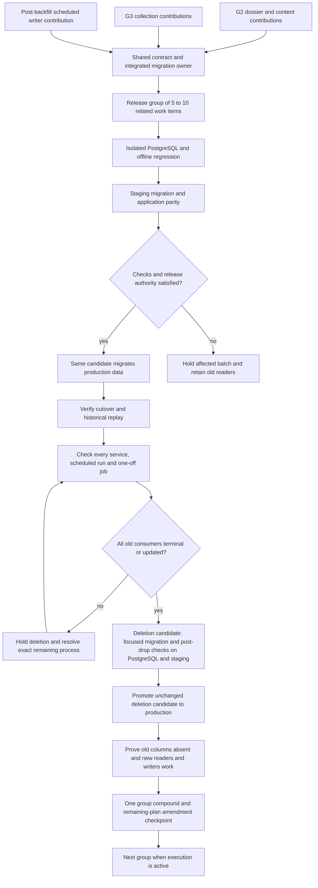

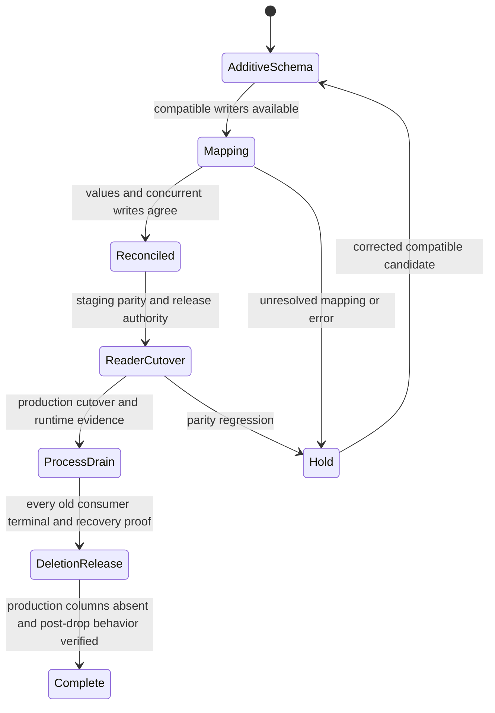

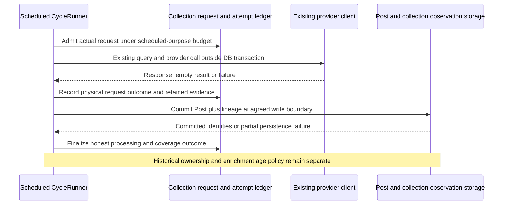

### Release Group, Work Item Manifest and Table Accounting

Before implementing a batch, its manifest in this plan must name exact fields, owners, new/retired/reused tables, every old column superseded and the planned physical-removal operation/dependencies, aliases/unknown policy, migration leaves, the bounded old/new writer compatibility window, evidence hashes, validation, recovery and affected sessions. Allocate the exact drop-migration name against current leaves after cutover/drain proof, when constructing its candidate; do not preassign numbers or ship that file in the cutover candidate. A replacement cannot be marked complete while its old column remains in current Django state or physical schema. Amend this plan for the selected batch; unresolved fields stay outside it.

The group manifest records selected work items and, for each, exact fields, readers/writers/processes, entry points, replacement revision, preserved evidence and focused checks. Group-wide review, migration graph, regression, staging, production and learning evidence is shared; do not run a full workflow for each item. A source search starts the runtime census but does not prove old jobs changed code. Keep these mappings in this plan; legitimate prose, retained checked choices and justified native identities keep their existing dispositions.

RG1–RG3 are closed. Continue RG4, RG5, then RG6 in that dependency order. Each group contains its selected work items and finishes physical removal before the next group. A cutover/deletion pair is one group's delivery, with one final full learning checkpoint; intermediate deployments use focused evidence and do not restart the full workflow. Do not ship a physical drop while old code still depends on it.

### Required cutover and deletion contract for every release group

Run this contract once for a group of selected work items. Each item supplies only its field/caller/preservation implementation and focused checks. Freeze the combined acceptance set before delivery, run the group regression/review once, and reuse unaffected evidence across its cutover/deletion candidates. Between those candidates, check the changed migration and any changed callers plus database/runtime identity, preserved data, locks and old-process drain. A failure requires repairing its cause and repeating affected checks, not restarting every item/full suite. No intermediate `ce-compound`, fresh full review, per-item PR or full delivery cycle is required.

1. **Select and inventory.** Select exact `(table,column)` rows from the final field ledger and record the replacement columns/rows, all readers and writers, preserved evidence, aliases/unknowns, constraints and indexes, raw SQL and dependent database objects. Search models, callers, commands, fixtures, seeds, exports/imports, staging refresh, repair/replay code, templates, API/MCP serializers and maintained references. Classify every remaining match as changed, historical migration, frozen serialization or a justified independent meaning. Historical applied migrations and immutable payload keys are not rewritten merely to eliminate a search match.
2. **Prove preservation and recovery before changing data.** Record counts/fingerprints, immutable definition/hash/selection inputs and each unresolved value's exact durable destination. A NULL FK does not preserve a spelling. Reuse existing evidence where sufficient; if it is not sufficient, settle a correctly-owned typed preservation design before mapping or dropping. No new JSON, fabricated identity, silent UTC/English default or opaque text archive. Record recovery commands and the oldest replacement-compatible code revision allowed after deletion.
3. **Expand, map and switch all code paths.** Add only the selected storage, map with bounded restartable writes, and handle concurrent old writes during the finite transition. Update application and database readers/writers together: ORM, bulk paths, raw SQL, triggers, views/materialized views, composite keys, commands, collection/extraction, seeds, restore, recovery and replay. Rebuild affected derived data and preserve external response contracts through canonical reads or owned evidence. New code must read/write successfully with the old physical columns absent; remove them from current ORM state in the cutover release when required for rolling safety.
4. **Verify the group's cutover candidate.** Combine selected item checks, group integration/regression and review, isolated PostgreSQL upgrade/mapping evidence, staging and unchanged-candidate production proof. Use existing migration locks and exact image/database guards. Prove the physical database contract separately from ORM and migration state: for every changed/tightened invariant, query PostgreSQL catalogs for nullability, types, defaults, keys, foreign keys, uniqueness, checks, indexes and triggers that the candidate owns. For `SeparateDatabaseAndState` and custom SQL, assert both the Django state and resulting physical DDL; `makemigrations --check` alone is not schema proof. Add PostgreSQL regressions for the physical state and invalid-write/preflight boundary where applicable. Prove mixed-image compatibility and real caller chains with fake providers offline. Observe relevant natural production readers/writers when available; for dormant paths require PostgreSQL caller tests and exact deployed source/entry-point evidence. Reuse valid evidence and distinguish source/test proof from observed field writes. Do not run a separate full workflow per item or `ce-compound` at this intermediate deployment.
5. **Drain every old consumer.** Immediately before constructing and again before applying the deletion candidate, complete the process census below. A newly deployed service does not update an already-running cron execution, worker task, shell or immutable one-off image. Every affected old consumer must be terminal or proven unable to touch the selected columns. Drain naturally where possible; coordinate any specifically authorized stop with its owner, preserving leases, reserved/paid requests and checkpoints. Inspect queued/retry/checkpoint payloads and replay commands so a delayed or resumed task cannot restore the dependency. A currently suspended service must stay suspended and must have a documented replacement-compatible resume revision. Do not stop the harvester merely because a separate backfill blocks a drop. A missing inventory result blocks deletion.
6. **Delete in an adjacent release of the same batch.** Only after production cutover and drain proof, add the exact physical-drop migration in a later candidate; do not ship it earlier behind an assumption that it will wait. Remove superseded columns from the physical schema/current model state and remove transitional synchronization triggers/functions, checks, views, dual writes and fallbacks that query superseded storage. Preserve final FK/unique/ownership protections, normal locale fallback behavior and historical replay adapters that no longer query old columns. Rehearse the full upgrade on production-shaped disposable PostgreSQL, then staging, promote the unchanged candidate, and use bounded DDL locks with a defined fail/forward-repair path. Never use broad `CASCADE` or `--fake` to hide an unresolved dependency.
7. **Prove absence and close the group.** Verify all selected old columns absent, expected physical nullability and retained relationships/constraints, no orphaned compatibility objects and post-drop callers in staging/production. Compare the catalog evidence with both current model fields and migration state; a clean state check does not replace this proof. Exercise representative insert/update/clear/bulk/raw and replay/restore paths; current seeds/fixtures/commands/references/refresh must not query or recreate old columns. Record candidate SHAs, process/data evidence and valid recovery revision. Run the group's single `ce-compound` and quick remaining-plan amendment/reference review, then close the group and start the next when execution is active.

**Process census required for every deletion candidate**

| Runtime or stored dependency | Entry points to trace and update | Required proof before deletion |
| --- | --- | --- |
| Web, API and MCP readers/writers | `project.wsgi`, `monitor/views.py`, affected core services, serializers and raw queries | Exact serving revisions; previous instances drained; actual response/selection parity and caller tests with old columns absent |
| Scheduled harvester and its in-flight runs | `run_cycle --scheduled`, `monitor/cycle.py`, classification/targeted extraction and metric persistence | Service image plus every active run's image/command; no affected old run; replacement writes through the real call chain; preserve query, budget and credential behavior |
| Other scheduled collection/jobs/counts | Live service inventory plus `render.yaml`: benchmark collection, `sync_job_sources`, `refresh_home_counts` | Inventory both deployed revision and active executions; update metric/job/locale/raw-SQL dependencies and any derived rebuild contract |
| Queue and synthesis workers | Headline Celery entry point, `run_synthesis_worker`, enqueue/retry/replay interfaces | Worker revisions, in-flight tasks and queued payload versions; no restart or retry can dispatch code requiring old columns |
| One-off backfills, extraction, repair and operator shells | Render jobs independently of service deployments; `scripts/backfill_campaign.py`, `scripts/backfill_targeted.py`, `core/targeted_extraction.py`, management commands and host processes | Exact job/PID identity, source SHA, command and column access; terminal/drained status or verified safe code; owner/checkpoint/lease evidence for a stop. No inference from service SHA alone |
| Database and recovery tooling | Triggers/functions, checks/FKs, views/materialized views, staging refresh, imports/exports, seed/mapping/repair/replay commands | No live SQL dependency on old columns; final keys/guards verified; fresh migration and supported restore/recovery paths succeed without them |

**Already-expanded replacement backlog and subsequent order**

These are source-confirmed pairs at the0122 boundary, not a fresh production row census. Complete the exact field/process manifest and required learning checkpoint before execution. New catalogue creation alone has no superseded column; it does not create deletion work by itself.

| Owner group | Existing → replacement | Work required to finish the group |
| --- | --- | --- |
| Timezone first group — production complete | `metrics/events/opportunities.source_timezone` → respective `source_timezone_id` |0121 cutover and0122 physical deletion verified at `dfaef38c`; retain frozen definition v1 and exact Event/Opportunity evidence. Do not repeat the drop |
| Metric units — first unfinished group | `metrics.unit`, `metrics.window_unit` → `unit_id`, `window_unit_id` | Cut over definition registration/identity/timing/collectors, SQL shape guards, seeds, `core/metric_units.py`, and refresh paths. Preserve frozen snapshots and exact unit identities; after cutover the retained `map_metric_units` command audits FK health only. Preserve both physical columns through old-image drain, then delete them with their bridge in this group's removal deployment; no scale conversion |
| Country/region label locale keys | `country_labels.lang`, `region_labels.lang` → respective `locale_id` | Two work items in RG1; update every ORM reference/seed/reader to `(owner,locale)` and current model primary keys. Migration0126 keeps the old physical key/columns and bidirectional trigger for older images; remove both columns, old checks/trigger and replace both physical primary keys in the group's removal deployment after process drain. Preserve label wording and established app-edition aliases |
| Correction actor | `collection_corrections.actor_identifier` → `actor_id` | Current correction writers require a registered Actor; migration0125 exact-matches existing `kind:key` labels and keeps the old text synchronized for older images. An unmatched label stops migration/deletion. After old-image drain, require every correction to have a registered actor and delete the old column/bridge in this group's removal deployment. Never infer human/agent identity from spelling |
| Brand labels — retained local candidate after expanded groups | `brands.display_name`, `display_name_en`, `display_name_zh_cn` → owned `brand_labels` | Restore/review the stash, rebase/renumber after current migrations, settle native/unspecified-language/fallback semantics from existing evidence, update every consumer/seed/refresh path, then delete all three replaced columns in the same batch's adjacent deletion release |
| Remaining timezone roles | `metric_values.source_timezone`, `event_dossier_claims.event_timezone`, correction before/after source timezone → shared role-qualified timezone FKs | Separate bounded owners as dependencies permit; these have no completed replacement at0122. Apply the full lifecycle, including before/after evidence/hash semantics; do not assume the first timezone drop covered them |
| Remaining F1/F2/F3/F4 conversions and FX | Exact final-ledger selectors and release-family allocations below | Apply the same cutover/process/deletion contract to every superseded column. In-place checked choices and retained independent text keep their justified storage; FX needs deletion only if its selected manifest actually supersedes columns |

**Grouped delivery target,updated2026-10-22 — owner combines remaining groups by two:** The original58 owner work items plus four G3 completion items remain62. RG1(7), RG2(6) and RG3(8) retain their existing boundaries. The remaining release cycles are **RG4(15items)**, **RG5(16items)** and **RG6(10items)**: **six full cycles overall, three after RG3**. Use the sequential combined-group labels throughout the active contract; do not run separate full reviews/deployments/compound checkpoints for their former components. People/employer/opportunity and dossier/event work share the first combined group; remaining domain references and source-qualified catalogues share the second; collection completion uses both in RG6. Focused mapping/migration checks and separate cutover/deletion candidates remain. The prior ten-item ceiling is superseded. Further discovered work must be assigned explicitly within this dependency structure, with actual counts updated; do not silently omit scope or restore per-item cycles.

| Release group | Identified work items | Count |
| --- | --- | ---: |
| RG1 — shared references and identity | Metric units; Country locale key; Region locale key; correction actor; definition versions; service-provider/model identity; workflow stages | 7 |
| RG2 — owned locale values | Company; PersonName source-language reference; PersonName selection; account-profile translations; original-content primary snapshots; narrative-subject snapshots. Assign other existing locale-owner transitions to free slots after exact inventory | 6 |
| RG3 — job classifications and compensation | Currency/salary periods; six job-dimension catalogue/assignment pairs; single Company HQ-country reference | 8 |
| RG4 — people, employers, opportunities and dossier/event semantics | People/employer items: citizenship/evidence; organization units; job locations; career sources/hosts; person-name kind; affiliation kind; opportunity type. Dossier/event items: event kind; claim kind; maturity; access channel; availability; disclosure; personnel change; dossier-claim timezone and scoped-claim readers | 15 |
| RG5 — typed domain references and source-qualified vocabularies | Typed-reference items: product kind; product-relationship kind; model gating; opportunity action; opportunity benefit; MetricValue timezone; correction before/after timezone pair. Source-vocabulary items: `software_libraries`; `model_tasks`; `provider_account_types`; `account_verification_types`; `provider_label_types`; `provider_label_display_types`; `provider_link_types`; `source_identifier_namespaces`; `geographic_region_levels`. Also resolve [backfill issue #70](https://github.com/allenwlee/pushin-weight-v2/issues/70) and its historical multi-database test fixture/workflow-order cases as an RG5 defect item outside the field-conversion count. | 16 field items + issue #70 |
| RG6 — collection configuration, memberships and JSON retirement | `source_configurations`; `source_categories`; account-query membership; legacy post-flag assignment; official-scan membership; FX scheduled collection lineage/coverage; sealed job-instruction completion; run storage replacement (5 JSON columns); scope storage replacement (3); observation storage replacement (5). U32 owns the four added items and complete historical migration/caller cutover/deletion | 10 |
| **Identified work / target full cycles** | **62 work items / 6 release cycles** | **62** |

**Renumbering for the owner:** current RG4 = former RG4+RG5; current RG5 = former RG6+RG7; current RG6 = former RG8. All active references below use the current labels; historical release receipts and source plans retain their original wording.

These are executable grouping boundaries, not new schema entities or migrations. Within each group, order actual items by dependencies and implement together before delivery. Confirm exact selectors, preserved evidence and group recovery before writes. Do not silently create a full release cycle for each of the62 items or each of the13 JSON columns. Unresolved items stay explicit; substitute another ready dependency-compatible item or rebalance within the selected combined groups rather than inventing its data meaning.

The final manifest specifies 64 global additions and zero mandatory retirements. The G2 seven-table foundation and G3 nine-table collection design are already included in the 167-table source union; they are not counted again among the 64. The reopened nine-table ChartEngine draft remains deferred. See the exact release families and accounting below.

**G3 completion ownership,2026-10-22:** The owner has closed the allocation gap identified in the earlier coverage answer. Production `851abb1f` includes the nine-table foundation and integrated typed instruction, attempt, capture, resource, correction and reporting support through0098–0114, plus subsequent shared references. It still retains all13 retirement targets, and current callers including `core/collection_state.py` and `core/source_metric_projection.py` use them. U32/RG6 now explicitly own the remaining U5 consumers, U6 historical migration, U7 complete cutover/deletion and U8 documentation/recovery proof from the original G3 plan. Its location relative to the authoritative repository root is `.worktrees/refactor/g3-collection-relational-json/docs/plans/2026-10-20-013014-refactor-g3-collection-relational-json-plan.md`; it is not a file in this integration checkout. The reviewed source SHA-256 is `fc5889b081d6ce3282981ed817acd28a1746f7867725afa7700ec37f8f26622f`. Central G2 integration owns completion and the migration/release graph under the existing staged→production authority. This is assigned work, not a claim that it is implemented or deployed.

G3's bounded nonoverlapping contribution remains the13-column completion manifest in its existing plan: current readers/writers, existing typed destinations, retained evidence, representative fixtures and missing migration/reconciliation checks. Record exact files/interfaces before accepting implementation patches; preserve the peer's unpublished work. No independent shared-model/migration/live-writer changes, provider calls or campaign controls follow from this coordination. An acknowledgement is not a new prerequisite for owner-authorized central implementation. The RG3 deletion candidate was delivered unchanged.

### Planning-Time Decisions and Deferred Discovery

**RG3 final production completion,2026-10-22:** Cutover `e71328ce`/0132–0133 and deletion `851abb1f`/0134 are verified in staging and production. Production web deployment `dep-dbcsdkc9v7es73bt33jg` and all six other active consumers report the deletion SHA. The post-drop audit matches211 managed tables/196core tables/2396core columns, with14 permanent RG3 triggers, seven validated special constraints, zero pending migrations, scratch schemas, schema drift or assignment violations. Read-only PostgreSQL checks independently find zero of the nine retired columns and zero of the five retired functions. All814 listings/814 evidence records/160companies survive; the migration checks retained-row fingerprints inside its bounded transaction. General and job feeds in en/zh-cn/ja, home/admin/stories, full affected models, person intelligence, company labels,105staff dossiers and sample job documents pass. These are deployed-server rendering/read checks with enqueue disabled; OAuth was not retested. Application/browser/performance evidence from the unchanged cutover code is reused with focused post-drop migration/caller proof. The designated local test database also matches0134 and its physical schema after release. Evidence: `.local/rg3-20261022/production-deletion-*`, `deletion-production-deploy-status.json`, `local-postproduction-audit.json` and `deletion-production-release-receipt.json`. Backfill stopped only its exact July job; no campaign restart, provider call or scheduler/settings change by this session.

**RG3 exact implementation boundary, 2026-10-22:** Eight work items add the fourteen already-approved tables (Currency, SalaryPeriod, six typed classification catalogues and six listing-assignment owners); zero table retirements. Replace nine columns: `job_listings.salary_currency`, `salary_period`, `job_function`, `seniority`, `employment_type`, `workplace_type`, `organization_ai_relationship`, `role_ai_relationship`, and `companies.hq_country`. Salary and HQ targets are role-qualified FKs; HQ reuses Country and remains at most one per company. PersonBrandAffiliation's four independent classification columns and BrandDiscoveryCandidate's organization relationship remain explicit later-owner conversions, not silently completed by catalogue creation. Physical job locations remain RG4 scope. No JSON columns or new human-review fields are added.

| RG3 owner | Active writers/readers and required proof |
| --- | --- |
| Six job dimensions | `core/job_sources/sync.py` official snapshot persistence; `core/targeted_extraction.py:_persist_jobs`; `core/intelligence_readers.py:job_listing_document`; `monitor/general_readers.py:jobs_people_facts`; `monitor/views.py` direct-job query/serializer. Preserve source wire keys and hashes. Prefetch assignment owners on feeds. Exercise official sync, changed/reopened listings, extraction replay, plural values, unknown wording and all affected job pages/API projections. |
| Salary currency/period | Targeted extraction, job-document projection and existing evidence. Use pinned ISO 4217 currency codes and explicit period aliases; no FX or amount conversion. Unknown references remain NULL with original source retained. |
| Company HQ | `load_seed`, `onboard_brand`, and the Django destination in `scripts/port_sqlite_to_django.py`. Keep source CSV/retired SQLite field names. Existing Country codes are authoritative; reject an unsupported new HQ rather than infer one. |

The production census at RG2 revision `67d97278` found 813 listings and 813 source-evidence records, no listing without evidence, 34 currency values and 23 salary-period values already represented in captured source data, and no nonempty company HQ outside Country. Preserve listing/evidence IDs, listing identities, hashes, payloads and all unselected fields through migration. Unknown job classification wording is retained in the assignment's approved `reported_value`; map only explicit aliases and source-supported plural values. AI-relationship explanations remain unresolved source facts unless an exact reviewed category matches. Current official-source assignments follow the existing current-snapshot update semantics; no chart or historical assignment consumer exists yet. Do not introduce an extra archive or current-version flag to preserve unused derived assignments. Currency/location inconsistencies do not block conversion when the listing and original source remain intact, per the owner clarification above.

Use an additive cutover migration with temporary old-image bridges, followed by a separately built physical-drop migration only after runtime drain. Include database views/functions/triggers in the nine-column dependency census. Before deleting legacy salary text, verify source coverage again on the target; do not substitute a future rescrape for missing source. Catalogue identities are protected; assignment constraints enforce the correct dimension, same-listing evidence, resolved/category consistency, source hashes and normalizer domain. Use the prepared shared local test database and temporary-schema migration rehearsal; never let pytest implicitly advance it. The first regression pin, added to the real official-sync test, fails on the old implementation's missing assignment owner. Subsequent verification must prove preserved listing/source identity as well as typed storage and page behavior.

**Historical RG3 local implementation and verification, 2026-10-22:** Migrations0132/0133 implement the fourteen approved tables, nine application-field replacements and finite compatibility bridges. Migration0133 removes Django fields only; no physical deletion candidate has been released. The normalizer is pinned to frozen source commit `20de98dbec531d6f34c791bad170a2349fa24818` and file hash `066612181d9027b903ea1f3edc85e87b27c3bd517a1baa977bd7793a3e89a914`. The migration fingerprints every listing, source-evidence and company value outside the selected fields before/after mapping. The real official-sync path retains listing/source identity and keeps assignment-row IDs on unchanged scrapes. Provider-free targeted extraction now verifies plural assignments, evidence ownership, source locators/payloads and unresolved currency without losing the reported source. The populated migration rehearsal and direct-SQL constraint checks pass. The shared test database is explicitly prepared through0133, with211 managed tables, no missing columns/pending migrations/rehearsal schemas, and all RG2 deletions still intact.

The combined local route/caller suite passed309 tests; its one initially stale General source-fingerprint check passed after refreshing the declaration and including the two new job-vocabulary modules in that fingerprint. Additional UI assurance checks passed195 tests; the HTTP-only homepage/golden checks were rerun with the gate's required `DEBUG=1` setting and passed41 tests/41 subtests. Counts are separate runs and overlap; do not sum them as unique tests. General's populated jobs page passes on desktop/mobile in English, Simplified Chinese and Japanese, including actual rendered text and source links. Source/physical parity, same-listing evidence, category resolution, normalizer domain, catalogue immutability, seed and caller tests have no required skips. One import-format lint warning in the deliberately frozen v1 normalizer is retained to preserve its recorded source hash; unrelated existing lint findings are not claimed clean. Evidence lives in `.local/rg3-20261022/`; completed review and cutover verification are recorded below. Physical deletion remains a separate candidate.

**Historical RG3 runtime census update, 2026-10-22:** The restarted July backfill is a new process, `job-dbcql9ivcj2c73fhus90`, observed running on the harvest service and reported pinned to RG2 revision `67d97278` in the shared launch index. Its campaign path calls `advance_targeted` → `run_targeted_extractions` → the old JobListing writer. Therefore it can access the nine-column old schema even after web/cron services deploy newer images. The additive0132/0133 bridges support that process during cutover; physical0134 deletion requires a compatible rollover or terminal status. Do not treat the canceled earlier job as proof that this replacement has drained. This session has no new authority to stop/restart it and does not contact the backfiller. Continue independent checks and compatible cutover work while preserving this exact deletion dependency.

**RG3 cutover review completed, 2026-10-22:** Simplification retained stable assignment IDs on unchanged syncs and uses the listing's actual database transaction. The subsequent full-scope code review found no remaining actionable defects in the0132/0133 cutover candidate. Receipt: `/tmp/compound-engineering-501/ce-code-review/20261022-153909-d8a86fd9/review.json`. Review roles ran serially in this session under the project tool mapping; no independent model review is claimed (the selected external route previously returned HTTP402). Final physical audit confirms all211 managed tables, exact allowed bridge columns,23 enabled RG3 triggers, six same-listing evidence constraints plus the currency-registry check, and zero assignment violations/pending migrations. Migration drift check reports no changes; Django reports only the previously recorded W002/W004/W009 environment warnings. This review covers the cutover; the later drop receives focused changed-candidate review.

**RG3 cutover production verification, 2026-10-22 16:10JST:** Exact candidate `e71328ce5380099c486e0071094d73be5923632f` is live on all three staging services, including web `dep-dbcr40bm8hqs73akcbog`, and all seven production services, including web `dep-dbcr9r5g1s2s738c6qi0` and harvest `dep-dbcr9rdg1s2s738c6s0g`, after unchanged non-forced main promotion. Both databases record0133 and match all211 managed tables/2396 core ORM columns plus exactly nine allowed compatibility columns, with23 enabled RG3 triggers, seven inspected validated special constraints and zero assignment violations/pending migrations. Production retains813 listings,813 evidence records and160 companies; current assignment counts are341 functions,55 seniority,388 employment,38 workplace,17 organization-AI and42 role-AI records. Unrecognized wording remains explicit unresolved evidence. Production/staging General pages and jobs APIs render200 in English, Simplified Chinese and Japanese, alongside home/admin/stories and affected full-model/intelligence/dossier readers. OAuth was not retested. The first service-level SSH audit ended without a result while instances changed; the successful production audit explicitly selected ready instance `srv-d9go2breo5us73cg6vqg-5z4pt` and verified its SHA. Render recovery reports AVAILABLE from2026-10-18T19:59:49Z; recovery remains compatible application code or reviewed forward repair, never an automatic database reversal/restore.

The candidate's Bridgewright structural assessment passes5028/5028 obligations with zero failed/skipped/errored/missing/unknown; real browser tests supply behavioral evidence separately. Sealed candidate lab performance attempt `2b14cfd252bdec1de4bcae03` reports clean with no findings on the same SHA, using four desktop/mobile home/General scenarios and20 populated job records with all six assignment families. The actual jobs feed uses11 queries for those20 facts. The environment and pinned asset identities are retained in `.local/rg3-20261022/performance-populated-run.json`; CDN latency is excluded, and synthetic measurements are not production-user timing. No intermediate `ce-compound` is due. Run the group's one learning/amendment checkpoint after0134 production verification.

**RG3 physical deletion candidate, local verification complete:** Migration0134 verifies preserved HQ, compensation and classification values under bounded locks, fingerprints all listing/evidence/company/assignment data outside the nine retired fields, removes only the nine columns and nine temporary triggers/five bridge functions, and retains fourteen catalogue/assignment guards. Its rehearsal explicitly tests refusal of an unknown currency without captured source and of a plural phrase with a missing assignment; source/evidence identity and new writes survive the successful drop. The local test database was explicitly advanced before testing, then the historical upgrade uses the isolated-schema fixture. The first rehearsal exposed an overly strict check for the frozen normalizer's explicit plural splits; the corrected guard requires every defined part to survive. Test preparation also corrected a fixture value exceeding the old three-character column and scoped trigger inspection to the rehearsal schema. Preview fixtures were cleared by normal transaction-test cleanup before rerunning caller tests; no database reset, restore or additional database was used. Sixteen unchanged caller/constraint/reference cases pass, followed by the final updated historical rehearsal passing independently, with zero required skips/errors. The final physical audit matches all211 managed tables, exactly2396 core columns, fourteen enabled RG3 guards, zero assignment violations/pending migrations/rehearsal schemas; the migration drift check reports no changes. Focused inline review found no remaining code defect and records its exact file hashes in `.local/rg3-20261022/deletion-focused-review.json`; full cutover behavioral/performance evidence is reused for unchanged application source. Staging and exact old-process drain evidence remain required before production deletion. The newer staging one-off `job-dbcralrncjis73dd6u1g` was inspected directly: it rewrites DATABASE_URL to its own `test_backfill_collectfirst_` database before pytest and verifies its own marker during cleanup; it does not own the public staging application schema. Preserve that independently running fixture job.

**RG2 additional post-deletion proof:** Natural harvester run `20261022T053115_0000-9f5c13a2` ran on final deletion revision `67d97278`, reported94 inserts and0 persistence failures; all94 distinct receipt IDs were independently confirmed saved during that run. The list-membership reconciliation warning remains separate. This supplements the earlier106-post cutover proof and does not start another compound checkpoint.

**Historical RG3 deletion staging proof and remaining process decision, 2026-10-22:** Candidate `851abb1f222d038f086ff564c84ae106026c6886` is committed on the feature branch and staging, with all three staging services live (web `dep-dbcrhmrm8hqs73akqjhg`). Ready instance `srv-d9vb8t49v7es738lf2ng-t9lp4` verifies that exact SHA. Staging records0134: all nine replaced columns, nine temporary triggers and five bridge functions are absent; all211 managed tables match, all2396 core columns and fourteen permanent RG3 guards remain, inspected constraints validate, and there are zero pending migrations/assignment violations. All691 staging listings and691 source records remain. General and jobs APIs in three languages, home/admin/stories and affected model/document readers pass read-only200 checks after deletion. This is a staging result, not production deletion. Production remains on verified cutover `e71328ce`/0133. Fresh running/pending-job inventory still identifies `job-dbcql9ivcj2c73fhus90`, launched on67d97278, as the remaining definite old-code consumer. The owner has been asked whether to authorize cancellation of that exact July job, arrange its checkpoint stop, or wait for natural completion. No cancellation/restart/direct backfiller message occurred. If it becomes terminal naturally, the existing production delivery authorization suffices to promote exactly851abb1f; a separate cancellation approval is then unnecessary. Otherwise do not promote the drop while it can still write old columns. Retain this worktree, reviewed candidate and evidence while that process decision is pending. Do not run RG3's final compound checkpoint or begin RG4 prematurely.

**RG3 natural scheduled-writer proof:** Run `20261022T071607_0000-4975cdf2` completed at07:22:56UTC on cutover `e71328ce`, reporting89 inserts,5 updates and0 persistence failures. Its94 latency entries contain89 distinct Post IDs; all89 are independently confirmed in production with first-save timestamps inside that run. Two event extractions succeeded. Overall run status is degraded: five classifier-batch failures, one list-membership warning and one opportunity-extraction ValueError. That opportunity path is unchanged by RG3, and sixteen opportunity ValueErrors are recorded earlier the same day before the cutover; this establishes pre-existing occurrence of that error class, not the exact cause of this occurrence or clean end-to-end enrichment. No paid replay/probe was launched. Logs, database proofs and the separate staging release receipt are retained under `.local/rg3-20261022/`.

The shared meanings, preservation policies, staged-batch mechanism and notification requirement are settled. Actual row distributions, unmatched legacy values, deployed migration drift, lock duration and production volume are execution-time facts to measure before each database-writing batch. U23 verifies each selected final physical target against current source/deployed ownership; an unresolved target blocks that batch, not all independent foundation work. Owner-only product questions must be asked with concrete examples rather than filled with a new string.

**Current readiness — RG1 resumed,2026-10-21:** Timezone0121/0122 is complete at `dfaef38c`. Owner resumed work after choosing grouped cadence: settle RG1's exact field/caller/preservation manifest, implement its ready items together, then use the shared release cycle. RG2–RG6 follow dependencies and group closure, each with one final learning checkpoint. Pending value/dossier/correction timezone roles were not part of0122. Preserve the G3 waiver, peer worktrees, Brand stash, service controls and canceled backfill state.

**RG1 concrete scope and preservation contract:** Four additions from the already-approved64-table manifest: `definition_versions`, `service_providers`, `inference_models`, `workflow_stages`; zero table retirements. These own immutable definition provenance, actual request-service identity, provider-qualified native request-model identity and version-owned stage identity respectively. Existing SourceMetric/measurement taxonomy, Product/checkpoint identity, source DataSource and execution/call rows do not own these records. Their constrained codes, version tokens, hashes, exact native keys and repository/source locator are owned identities/evidence, not general prose or packed operational configuration. No JSON/JSONB column is added. Domain/provenance choices are centrally defined and database-checked; definition identities are append-only, model identities are provider-scoped and workflow-stage references enforce workflow/contract domain through bulk/direct writes. This batch stores provider-qualified requested model identity only; Product association remains deferred until separate identity evidence has an explicit owner and relation. No alias proves a served checkpoint. The current candidate moves metric writers/readers, geography feed/seeding/reconciliation and correction writers to FK identities. Migration0124 maps only exact installed units and retains the old columns/bridge;0125 preserves exactly registered actor labels while making new correction writes Actor-backed;0126 switches geography-label model identity to `(owner,locale)` while retaining physical `(owner,lang)` and a transition bridge. The separate group removal deployment must physically drop the five superseded columns, geography checks/triggers, and switch both geography primary keys after every old process drains. Every cutover and deletion also requires a full browser-facing read audit: trace affected fields through all Django page/feed routes, views, API projections, serializers and templates; run the complete route/render test suite plus browser coverage for changed pages. The current `/general` timezone regression is assigned to its parallel owner session; no schema candidate may ship until that fix is integrated and `/general` route/browser checks pass.

**RG1 implementation status — 2026-10-21:** Local cutover migrations0123–0126 and the separate deletion migration0127 are implemented. Candidate `9d319492a62a4b6587c01ada8bf9f1d218365ee3` initially passed staging but production hit PostgreSQL's pending deferred-trigger event block in0124; production committed only additive0123, and0124 rolled back its writes. Fix `ba48099d85ca2d8f862ff6fc5869b8c1127af10f` explicitly forces deferred constraints after the metric-reference backfill. A disposable PostgreSQL regression recreating a legacy text-only metric passed. The repaired candidate passed staging after staging was safely reversed from0126 to0123; all four migrations then applied, four registry tables exist, and metric/geography/actor mismatch counts were zero. The exact same SHA is live in production on all seven active services; two legacy services remain suspended. Production confirms migrations0123–0126, four shared tables,38 metrics with zero unit/window mismatches, zero unmapped country/region labels and zero registered-but-unmapped actors; all four old columns remain present for process drain. Production `/general/`, valid calendar feed JSON, `/feed/` and `/dashboard/each` rendered in a browser with no page errors; `/general/` and `/feed/` returned HTTP200 on candidate revision. The test-only `/general/feed/` request without a required section returned its designed400 response; the valid `section=calendar&lang=en` browser request returned data. The full integrated local page/feed/General/dashboard browser regression is green. Inline review fixed the exact-label actor bridge and removed the unsupported optional InferenceModel-to-Product FK until an evidence-owning relation exists; no further local findings. Independent adversarial review output was unavailable due provider HTTP402 insufficient balance. The October backfill one-off `job-dbc76s3rjlhs73b2nqcg` was reported active on pinned image `7d4fec9088da45e6ed1fc6ea11103bb771d3cddc`; a read-only check at11:37:35UTC reported it RUNNING with no finishedAt and latest activity11:37:24UTC, and found no later replacement among the queried service one-offs or local launch receipts. Its scoped audit found no reads/writes of the four retiring columns on the inspected campaign path, though unrelated commands in that image still use legacy columns. At that checkpoint,0127 remained withheld by the then-current drain gate. The owner subsequently stated the backfill no longer uses the old code and directly overrode that gate; the controlling instruction and no-contact/no-runtime-change boundary are recorded above. Both isolated PostgreSQL retirement tests pass (successful mapped drop and mismatch preflight refusal), rerun on the disposable local PostgreSQL database. Removal candidate `45cdafcb526893367ebe4ae7ba299609d7780deb` is pushed only to the feature branch; at the time of this note it had not been applied to staging or production. Source inspection of the pinned7d4fec90 backfill entry point and its direct cycle caller found no references to SourceMetric, correction, country/region label or their four legacy-column attributes; the separate reconciliation command reads legacy geography `lang`. No columns have been dropped and no process has been stopped by this session.

**RG1 production removal verified — 2026-10-21:** Candidate `511b797c8ded859228008a5db18d384fd4cfa47d` reached `live` on all seven active production services. Production PostgreSQL reports migration0127 applied, zero of the five retired columns present,38 metrics,0 corrections,747 country labels and93 region labels; all selected mappings passed migration0127's exact replacement preflight. The owner stated the backfill now uses the new code and directly overrode the former RG1 drain gate; this session did not contact or control that process. The change did not edit page code. Existing authenticated production browser coverage for `/general/`, its valid calendar feed, `/feed/` and `/dashboard/each` applies to this unchanged application code; the current staging routes remain login-gated. **Post-deployment schema review found `collection_corrections.actor_id` nullable in the physical production catalog while the Django model and current correction writers require it.** Migration0125 changed Django migration state but did not set PostgreSQL `NOT NULL`; migration0127 checked existing actor mappings and removed the legacy text column but did not close this physical constraint gap. RG1 therefore includes follow-up migration0128, which rechecks for NULL actors and enforces `NOT NULL` with five-second lock and thirty-second statement timeouts. The disposable-PostgreSQL regression now covers successful enforcement and refusal when any correction lacks an actor;3 PostgreSQL tests pass, `makemigrations --check --dry-run` reports no changes, and `manage.py check` is clean. Stage, verify and promote0128 before closing RG1. The owner's no-contact/no-runtime-control exception remains in force.

**RG1 production closure verification — 2026-10-21:** Candidate `f3876ede88ecb3ab129af2cd4aa5d5d6d915ea3a` passed staging and is live on all seven active production services. Staging migration audit confirmed `0128_require_correction_actor`, `actor_id` `NOT NULL`, zero NULL actor rows and no retired RG1 columns. Production read-only job `job-dbcau1hsrm7s738728q0` against database `dpg-d9koekqjobas73fvjqng-a` confirmed the same, with38 metrics,0 corrections,747 country labels and93 region labels; prior production row-count evidence remains consistent. Production browser checks returned HTTP200 and loaded `/general/`, its valid calendar feed, `/feed/` and `/dashboard/each` in the existing authenticated browser session without page errors. The application page source is unchanged in this candidate; the earlier staging page routes were login-gated, so authenticated staging rendering is not claimed. No backfill session contact or runtime control occurred. This closes RG1's correction-actor nullability follow-up and its selected physical removals; keep the override and no-contact boundary in force.

The initial registry items establish these reusable tables and their protected registration boundaries. The final ledger contains111 eventual incoming definition/provider/model/stage positions spanning many domains; those are not silently included or declared converted by registry creation. Assign their exact caller-owner conversions to the remaining grouped manifests before global closure. RG1's selected physical removals are `metrics.unit`, `metrics.window_unit`, `country_labels.lang`, `region_labels.lang` and `collection_corrections.actor_identifier`: five columns, after all their callers are cut over and old processes drain. Other unpaired fields are not shadow copies of deployed replacements and retain their explicit later work-item status.

Read-only production preflight at0122 establishes38metric definitions,45contracts, all840Country/Region locale FKs mapped (en/ja/zh-cn→en/ja/zh-Hans), no inbound label FKs, one registered system actor and zero correction rows. The only four unresolved metric unit references are three `arena_ips_score` and one `signal_observations`, both exact owned unit identities already defined by `core/benchmark_metric_identity.py:definition_rows` for Agent Arena scores and observation counts. Add those two codes to the pinned measurement seed, with an updated manifest hash; no scale conversion or guessed alias. Any other unregistered unit blocks the destructive step. Preserve frozen definition-v1 packets and hashes through FK-derived current snapshots. Label mapping preserves original wording and the established public locale aliases; key DDL must match current model state. For correction-actor removal, every existing legacy label must be exactly reconstructible from its evidenced registered Actor, or remain preserved under an explicitly settled evidence design; a new ambiguous/unregistered label blocks the drop. Zero rows is the current production observation, not permission to discard a later correction. New internal correction writers must supply registered identities. No unknown human/agent identity is inferred from spelling. These preconditions are rechecked on each actual environment/candidate before deletion.

The integration checkout and Ollija association are established on `refactor/global-shared-vocabulary-20261021`; preserve the retained earlier dirty ChartEngine/peer worktrees. Reuse this canonical plan and checkout, reconciling current leaves and peer releases on execution resumption. Do not repeat the initial bootstrap or create a competing plan.

### Foundation Physical Mapping - Owner Decision Pass

This is U23 design work requested by the owner after the integration plan. It changes no application model or database. The following is the concrete minimum foundation target; the owner has now selected Simplified Chinese (`zh-Hans`) for the app edition and translated labels. The global field inventory and later definition/locale/coverage manifests are not declared complete by this narrower target.

| Proposed physical table | One record / exact columns | Constraints and ownership |
| --- | --- | --- |
| `time_zones` | One accepted IANA zone identifier; `code` varchar(64) primary key | The code is the catalogue's own standard identifier, not duplicated business prose. Referencing rows use a protected FK. Seed identifiers from a pinned IANA release; accept official link identifiers without guessing equivalence from a current UTC offset. No `unknown` or empty row and no hard-coded current-offset column. |
| `languages` | One registered primary language subtag, including justified special values; `code` varchar(8) primary key | Canonical lower-case registered code; reviewed pinned seed input. `und` means explicitly undetermined language and is not an English fallback. Unknown unrecognized reported strings do not automatically become catalogue entries. |
| `locales` | One canonical BCP47 tag; `code` varchar(255) primary key, `language_id` varchar(8) NOT NULL FK to `languages.code` | One language has many locales; `zh`, `zh-Hans` and `zh-CN` are distinct tags. Preserve script/region qualification in the standard tag rather than inventing a country from it. Validate canonical registered tags at the controlled catalogue write boundary. Add the row-level database check `split_part(lower(code), chr(45), 1) = language_id`, so even a bulk/direct insert cannot pair `zh-Hans` with language `ja`; use canonical preferred tags for registered grandfathered aliases. Reject contradictory parent/tag combinations. No new script/country-label entity is required for the demonstrated readers. |
| `measurement_units` | One immutable unit identity used by metric definitions; `code` varchar(64) primary key | Unit codes are the authoritative shared vocabulary, with protected references. Seed distinct current meanings such as `tokens`, `downloads`, `arena_points`, `hf_trending_points`, `bytes`, `kilobytes`, `second` and `day`. Do not merge units by display spelling or add a conversion multiplier from an assumed interpretation. |

**Table accounting:** four foundation additions, zero retirements, no generic string/translation table and no new JSON/JSONB column. The deliberately minimal catalogue rows do not add speculative descriptions, free-text metadata, universal status rows or provider configuration. Any future metadata field receives the same ownership/CharField/TextField review. These identifiers remain legitimate strings on their owning catalogue records; referencing a catalogue changes ownership and integrity, not the fact that PostgreSQL may physically store its FK as varchar.

**Seed and alias contract:** reviewed seed/mapping files are deterministic inputs to the existing proposed seed command and migrations, never a second runtime database. Exact IANA/BCP47 registry revisions and hashes must be recorded before implementation. A recognized IANA link is an accepted shared zone identifier; normalization never guesses a geographical zone from `CST`, an offset or a date. Case/underscore legacy language aliases are source-context mappings; `zh-cn` cannot become `zh-Hans` globally merely because existing UI copy uses simplified characters. There is no universal alias table in this batch. A new business-managed alias requirement would need its own record meaning and table accounting.

**Timezone references:** seven baseline positions map to `time_zones.code`: metric definitions, metric values, events, opportunities, G2 dossier claims and G3 correction before/after timezones. The metric-definition/Event/Opportunity replacements are complete through0122; four positions remain as explicit work items in the grouped schedule. Preserve role names `source_timezone_id`, `event_timezone_id`, `before_source_timezone_id` and `after_source_timezone_id`; roles share one dictionary. Two deferred chart roles reuse it when their reopened schema is settled. Unknown/empty/ambiguous source values keep a NULL canonical reference and exact evidence in its proper owner; never substitute UTC. For the remaining roles, apply the full cutover/process/deletion contract, including immutable before/after replay. Date-only facts keep their date precision; a timezone FK cannot manufacture an instant.

**Unit references:** `metrics.unit` becomes `unit_id` to `measurement_units.code`. `metrics.window_unit` becomes `window_unit_id` to the same table while retaining the existing allowed-window choices and cross-field rules; initially only `day`/`second` are valid in that role. `window_duration_basis` continues to distinguish calendar windows from elapsed durations. A shared `day` identifier does not make every day exactly 86,400 seconds. SourceMetric's source/key/version identity remains authoritative for measurement meaning; a unit FK alone never establishes averaging/comparison eligibility. Chart inputs pin an immutable metric definition rather than duplicating independently editable unit/quantity/window metadata. No measurement value or scale changes in this mapping.

**Language/locale field classification:** existing `*_labels.lang`, publication/translation `locale` and full-tag name/text language values resolve to locale references, because script/region variants are meaningful. A bare primary-language fact resolves to `languages`; a source field that actually carries a qualified tag must preserve that tag through a locale reference and its exact reported value, rather than truncating it to the base language. Do not point every column containing `lang` at the same table by spelling alone. CountryLabel and RegionLabel already own their label text; change their language dimension to `locale_id`, preserve one owner/locale uniqueness and the existing label wording. Reuse all other existing label/name/text owners before adding the six proposed locale/selection owners.

**Chinese edition - owner selected:** use `zh-Hans` for the app’s Simplified Chinese edition, translated labels and generated translations (session-settled: user-approved — owner selected option1, Simplified Chinese independent of country). This resolves the prior edition-meaning question. Preserve genuine source regional/language tags separately; `zh-CN` remains a distinct valid locale and `zh` remains unspecified-script Chinese. This decision changes the planned reference contract, not the running application or supported-language set.

| Field / boundary | Exact migration target and compatibility rule |
| --- | --- |
| Existing taxonomy, Country and Region `*_labels.lang` rows used for the app Chinese label set | Reference `locales.code = zh-Hans` via `locale_id`. Map the app’s legacy `zh-cn`/`zh_CN` edition aliases in this owner context only. Preserve owner/locale uniqueness and label wording. |
| `post_translation_texts.locale`, `post_synthesis_texts.locale`, `original_content_texts.locale`, `editorial_editions.locale` | Chinese edition reference is `zh-Hans`; preserve exact historical wording, revision/selected-edition pointers and the locale spelling in original request/response/hash serialization. Japanese and English continue to reference `ja` and `en`. |
| `post_translation_chunks.target_language` | Target locale reference `zh-Hans`, agreeing with its existing constrained value. Keep the original chunk content/fingerprint and retry identity; this is not a new translation request. |
| Source language fields, names and source texts | Resolve actual reported canonical tags to the matching language/locale record. Do not reinterpret provider `zh-CN`, an observed regional name variant or bare `zh` as `zh-Hans` merely because the app edition changed. Keep the reported spelling used by historical hashes. |
| Django middleware, existing locale URLs/cookies/settings and provider adapters | Translate between their required wire spelling and canonical `zh-Hans` at an explicit boundary. Existing app `zh-cn` links remain accepted aliases during compatibility; do not reclassify unrelated source tags or bulk-rewrite frozen packets. |
| Both legacy and canonical locale rows already exist for one owner/version | Identical payloads may map idempotently; differing payloads are a reported conflict. Preserve the selected historical edition and both pieces of evidence until the owner/version-specific resolution is explicit. No last-write-wins merge. |

**Locale verification additions:** an app `zh-cn` alias and canonical `zh-Hans` select the same intended edition; a genuine source `zh-CN` still resolves to `zh-CN`; bare `zh` does not gain a guessed script. Conflicting duplicate label/text rows prevent automatic cutover. Old request hashes, PersonName language fingerprints, publication revisions and selection pointers must replay using their original serialization.

**Grouped sequence:** catalogue creation/seed is complete. Implement reference owners as work items within the selected combined release groups. Carry mapping, all-caller cutover, drain and deletion through U29/U30 for the selected group. Compatibility lasts only through that group's rolling transition. Composite label keys still require explicit Django/PostgreSQL transitions; adding `locale_id` alone does not replace `(owner,lang)`. Settle aliases/evidence/keys/process/recovery checks before writes, without repeating the full release flow per owner.

**Source basis:** inspected G3 `core/models.py` (SourceMetric, MetricValue, Event, Opportunity, CollectionCorrection, CountryLabel, RegionLabel, PersonName/PersonText and translation models), `core/benchmark_metric_identity.py:definition_rows`, `core/person_names.py:record_name`, the label seeder, G2 EventDossierClaim and the exact field inventory. SourceMetric currently preserves different provider score/count units; PersonName fingerprints include the exact language tag. Official [IANA timezone guidance](https://www.iana.org/time-zones) and [W3C language-tag guidance](https://www.w3.org/International/articles/language-tags/Overview.en) support the identifier distinctions. These references do not choose the owner's Chinese edition meaning.

### Shared Actor Physical Mapping

The existing shared-human/agent/system direction is implemented in the proposal through one actor registry, rather than by interpreting arbitrary reviewer strings as authenticated users. Source inspection found no existing actor registry in the G2/G3 model files. `AUTH_USER_MODEL = auth.User` supplies login identities; Person/Account describe researched people and external platform accounts. Neither owns the identities of internal automated repair jobs or review agents. G3 timing corrections already use a named system performer, while the G2 review API accepts actor text. These distinct current consumers justify a shared actor identity, but not every column named `reviewed_by` is a review record. A review actor belongs on a record only when a person or process actually performed a review/adjudication, and the field must be populated at that action boundary. Agent-authored setup/proposal notes are authorship or context, not review; they should not be stored in `reviewed_by` fields. Do not add a generic `created_by` field without a separate audit requirement.

**Proposed table `actors`:** `id` UUID primary key; `actor_kind` varchar(16) NOT NULL with checked values `human`, `agent`, `system`; `actor_key` varchar(128) NOT NULL. Unique `(actor_kind, actor_key)` and reject blank/surrounding-whitespace keys. Protect referenced actors against deletion and freeze their identity fields at the database boundary. The actor key is the registry’s own opaque identifier, not concatenated source membership or an inference-model version. Its string storage is justified by stable owned identity; the kind is a centrally defined database-checked state. Login linkage is deliberately absent from this first shared batch: staging refresh excludes/truncates `auth_user`, so a copied actor FK to that table would make refresh cascade into retained evidence. Design environment-local verified human/login linkage separately when connecting an authenticated workflow; no login relationship or inferred authenticated approval is claimed by the initial registry.

A human may have a verified login link, but an old label such as an operator’s name does not establish that link. Agent and system identities are registered independently of whichever language model or worker process they used. Existing execution/call records identify that run and its provider/model; do not equate a model name, a shared account or an arbitrary session label with the performer. No new actor-session table is proposed. Add an execution relationship only where a real existing run is available, such as EventDossierReview.run; do not manufacture run rows to satisfy a new FK.

| Existing/pending audit field | Proposed canonical identity reference |
| --- | --- |
| `brand_discovery_candidates.reviewer` | `reviewed_by_actor_id` → `actors.id` |
| `collection_corrections.actor_identifier` | `actor_id` → `actors.id` |
| `event_dossier_reviews.actor` | `actor_id` → `actors.id` |
| `people_brand_affiliation_evidence.reviewer` | `reviewed_by_actor_id` → `actors.id` |
| `people_brand_affiliations.superseded_by_reviewer` | `superseded_by_actor_id` → `actors.id` |
| `people_identity_corrections.reviewer` | `actor_id` → `actors.id` |
| `product_verification_proposals.reviewer` | `reviewed_by_actor_id` → `actors.id` |
| `metric_collection_contracts.reviewed_by` | Future genuine configuration-review actor; existing setup notes remain unresolved |
| `source_subject_mappings.reviewed_by` | Future explicit identity-review actor; existing setup notes remain unresolved |
| `taxonomy_versions.reviewed_by` | Future genuine taxonomy-review actor; existing setup notes remain unresolved |

**Separate genuine review actions from setup attribution:** staging values on metric collection contracts, taxonomy versions, product relationships and source-subject mappings were agent-written setup/import prose, not reliable evidence that a human reviewed those records. Do not map those values to actors or expose them as proof of approval. Caller tracing then established that `prepare_collection`/`configure_collection` require and persist a reviewer for a configured collection, `prepare_taxonomy`/`configure_taxonomy` require and persist a reviewer for a pinned taxonomy, and `review_catalog_mapping` plus `review_collection_mapping` implement an actual source-identity review with evidence and ownership checks. Preserve those review requirements, but change their writers to supply a registered actor only at a genuine review action; legacy notes remain unmapped. The separate `product_relationships.reviewed_by` value is copied from the taxonomy setup input, so remove this redundant column and rely on the reviewed parent taxonomy rather than duplicate its attribution on each derived edge. Do not replace removed proposal prose with a persistent context column.

`collection_scope_runs.reviewed_by` is empty and has no identified writer; defer it from this actor batch until an actual review workflow is established. It is not evidence for adding an actor link now. The originally listed fields therefore do not represent twelve independent actor consumers; revise the F1a consumer list to the traced review/correction actions before implementation.

**Mapping and historical integrity:** preserve exact labels on genuine review/correction records as legacy audit wording, and map only with evidence or reviewed explicit registration. Ambiguous labels remain unresolved; do not create a shared “unknown actor” or merge every `codex`/`system` string into one actor. After caller cutover, normal internal review/correction writers supply registered actor identities. Original signed/hashed serialization continues to use its retained historical representation; a stable FK does not rewrite who an old record claimed performed the action. Preserve reviewer wording where required by frozen history, and retire an obsolete duplicate only after replay/data proof. A performer FK records identity; it does not establish human approval, authorize an action or change the existing review-state policy.

**Table accounting:** one additional shared identity table in its own actor-integration batch; zero retirements selected. This is separate from the four initial foundational additions and six proposed owned locale/selection tables; all are included once in the final 64-table manifest. New columns, references and protections remain planned schema, not implemented or deployed.

**Verification:** reject duplicate canonical actors, invalid kinds/keys and identity rewrites through database constraints/guards. Test explicit registered human/agent/repair-job writes at the selected correction entry point. Confirm ambiguous legacy labels stay unresolved, direct/bulk paths preserve required constraints, and correction hashes replay. Login linkage, authenticated-review caller coverage and dossier/taxonomy cutover are later F1a slices, not verification claimed for this registry expansion. A change in display label or serving model must not change an actor’s identity or overwrite historical attribution.

**Sources:** G2 `core/event_dossiers.py:complete_review` argument/record construction and EventDossierReview; G3 `core/collection_corrections.py:record_timing_correction`/`correct_attribution`, `core/person_affiliations.py:replace_claim`, `core/measurement_taxonomy.py`, `core/person_names.py`, and the twelve-field inventory above. Exact function names and row-level invariants are rechecked at implementation preflight; current source pins are those in this plan.

#### F1a first compatible batch — actor identity and collection corrections

This is the first expansion/caller slice of U25, U28 and U29 under KTD7/KTD13 and R34–R36/R43–R45. Add the single approved `actors` registry and one nullable `collection_corrections.actor_id` reference. Authentication users cannot represent named automated repairs, and researched Person/Account records do not represent internal performers, so existing tables are unsuitable for this shared identity. One table is added, zero tables or columns retired, zero JSON/JSONB columns added. Remaining F1a owners and reviewer-column retirements remain later slices of the same global plan; this batch does not declare them complete.

Use the actor columns and constraints specified above. Enforce immutable actor primary key/kind/key in PostgreSQL so a saved correction cannot silently change performer through a mutable registry. Register exactly the existing built-in system identity `benchmark_metric_timing_repair` with a stable UUID; do not create people, agents or generic unknown actors from existing labels.

Preserve the existing correction label, IDs, immutable trigger and before/after fields. New timing-repair writes use the registered system identity when running under the existing built-in performer; explicit named review/correction callers may supply an existing Actor separately from the legacy label. Arbitrary legacy labels remain unresolved with a NULL FK. Old application versions can still insert corrections without the new reference. Do not update historical correction rows: their existing trigger forbids updates, and identifying a label does not prove the performer. Actor registration is explicit; normal correction writers never fabricate registry rows from input text.

Owned implementation surfaces: `core/models.py`, the next unapplied core migration after0114, `core/collection_corrections.py`, the collection-correction tests, focused actor-constraint/migration tests, staging-refresh configuration and authoritative schema-reference sections for the two affected tables. Keep the registry in staging-refresh policy wherever copied corrections can reference it; preserve ordering and actual FK closure. No harvester behavior or provider calls change.

Verification: PostgreSQL accepts distinct human/agent/system identities and rejects duplicate kind/key, invalid kinds/blank keys and identity updates through raw SQL. A real existing timing-repair caller records the known system FK; explicit registered human/agent attribution writes retain the supplied legacy label and correction chain; an unknown legacy label creates no Actor. Existing attribution reports and cutoff replay remain unchanged. Rehearse0114→new migration with populated legacy corrections, verify original rows byte-for-byte and old-writer NULL-FK inserts, and reverse to0114 without deleting corrections. Run affected correction/timing, collection-storage and staging-refresh regressions, migration drift and deployment checks. Verify staging migration record, registry seed, FK/constraints and exact service revision before continuing the next batch.

### Owner Decisions - Consolidated Reply

The owner answered all three questions together and directs continuation without further routine question rounds:

- **BQ1 - Historical X contribution:** include observed values from known-incomplete source/metric/intervals by default, with visible coverage qualification and the actual contributing-release count for each metric/bucket. Missing values never count as zero and no assumed recovery multiplier is applied (session-settled: user-approved — accepts recommendation1).
- **BQ2 - Country ownership:** one company has at most one headquarters country reference. People may have multiple explicitly supported citizenships; the ordinary entry/display case is one, with additional citizenship rows only when supported. Do not fabricate a default country, force every person to have citizenship evidence, or equate citizenship with ethnicity/residence/self-described national identity (session-settled: user-approved with correction — one company HQ; people may have dual citizenship, normal case one). The earlier multi-headquarters recommendation is withdrawn.
- **BQ3 - Job classifications:** permit multiple explicitly supported categories per listing within their separate domains. Job function, seniority, employment type and work arrangement remain different concepts; source support and exact wording survive normalization (session-settled: user-approved — accepts recommendation3).

The `zh-Hans` app edition decision and all earlier constraints remain settled. The owner’s request to finish by waking continues schema/plan completion; it does not authorize application implementation, database migrations, provider calls, release or backfill control.

**X averaging contract:** apply the qualifier at source/metric/publication interval, not by discarding a release’s unrelated HF/GitHub metrics. Retain observed values, assessment versions and actual denominators. Saved chart versions pin the selected evidence/policy; later recovered data or assessments can create a new chart version without silently rewriting an old result. Availability, provider-drained pagination, successful ingestion and enrichment completion are distinct facts.

**Backfill context supplied by owner:** [backfill handoff, October20 findings](/Users/fuchitalee/development/pushin-weight-v2/docs/brainstorms/2026-10-17-084351-backfill-handoff.md:27). Its July control found34of75 known matching posts through historical keyword search; the45.33% sample is not a population recall estimate. A historical August five-minute-window sample recovered629known controls versus502at fifteen minutes, while a recent fully paginated sample returned the same111IDs at both sizes. These support a historical coverage limitation; they do not establish lower true activity, justify rescaling counts, prove complete post-September coverage or authorize changing the live harvester window. Keep acquisition omissions, attribution rejection, persistence failure and incomplete enrichment separate. The handoff also reports a newer August corrected campaign in progress under its own session; this session neither pauses nor resumes it and must reconcile active writer ownership before any later authorized migration.

### Final Physical Design and Counts

This section and the `physical_*` columns in the [complete field ledger](../analysis/2026-10-20-160626-entire-database-field-decisions.csv) supersede the earlier family-level triage and strict-review proposals. The frozen 428-field baseline remains audit history. Every existing/pending position now has a design disposition; this is not a claim that real database values have all been mapped. Unmatched evidence stays unresolved beside the selected typed target, rather than becoming an invented canonical value.

| Disposition of original positions | Main 64b95c26 | Existing + pending G2/G3 |
| --- | ---: | ---: |
| Shared/existing FK target | 199 | 226 |
| New owned relationships | 11 | 11 |
| Owned locale rows | 27 | 27 |
| Reuse existing relationships | 10 | 10 |
| Derived projection | 1 | 2 |
| Typed components | 13 | 14 |
| Precision-aware temporal shape | 11 | 11 |
| Typed diagnostic + exact reported identifier/wording | 22 | 24 |
| Checked internal choices | 171 | 240 |
| Existing native identity compatibility beside existing FK | 12 | 12 |
| Conditional retirement, requiring later proof | 5 | 5 |
| Justified prose/source scalars/identifiers/hashes/snapshots | 325 | 377 |
| **Total** | **807** | **959** |

Thus 325 of the 959 positions are remodeled into references, relationships, typed shapes or derivation; 240 retain checked internal choices; 377 retain justified text/scalars; 12 retain native compatibility beside existing FKs; five are conditional retirement candidates. Where a source string is required as evidence, preserve it in its correctly-owned evidence record; do not keep a superseded source column as a shadow copy. These are original-position dispositions, **not a claimed net SQL text-column reduction**. The 54 chart-proposal positions are explicitly deferred and counted separately. URLField's 24 unique positions remain a separate locator review.

**Exact table inventory:** the [64-table manifest](../analysis/2026-10-20-212622-global-schema-table-manifest.csv) supplies each proposed physical table, every proposed column, key/constraint, referenced table, purpose and concrete gap in existing storage. It is part of this plan's contract. Its `design_phase` groups are dependency groupings, never single release batches.

| Proposed additions | Count |
| --- | ---: |
| Foundational catalogues: timezone, language, locale, measurement unit, currency | 5 |
| Actor identity | 1 |
| Service provider and inference model identity | 2 |
| Immutable definition versions and workflow stages | 2 |
| Business catalogues | 22 |
| Source-qualified catalogues | 11 |
| Owned relationship tables | 13 |
| Career-source definition and allowed-host relationship | 2 |
| Owned locale/selection/snapshot tables | 6 |
| **Global additions / mandatory table retirements** | **64 / 0** |

The union of inspected core schemas has 167 table names: 151 main, seven G2 additions and nine G3 additions. The global proposal adds 64 distinct names, yielding 231 if every proposed batch is implemented. G2/G3's sixteen additions are already in 167, not added a second time. The nine reopened chart tables are excluded. `_applied_config_snapshot` retirement remains conditional and is not subtracted. These are source/design counts, not a live schema census.

**Important field corrections:** Source validation of G3's `begin_request()` confirms `CollectionRequest.method` is an HTTP verb: target `http_method`, shared checked protocol choices, with no definition-version FK. This corrects the former generic method-family classification; table additions remain64.

 `companies.hq_country_id` is one nullable Country FK (BQ2), with no headquarters join. Person citizenship uses `person_citizenships` plus source evidence; at most one primary, no required citizenship row or invented default country. Six separate job-dimension assignment tables permit supported plural categories (BQ3), retaining unresolved reported values and existing JobListingEvidence. Employer-scoped organization units do not merge equal department/team names across companies. Person sex/ethnicity remain explicitly reported prose. Source `zh-CN` remains distinct from the selected app `zh-Hans` edition.

`people_brand_affiliations.source_system` actually contains extraction/profile-rule versions, so its canonical reference is a definition version, not DataSource. CollectionObservation's legacy `status` becomes `source_result_state`; it does not substitute for processing/coverage outcomes. Raw exception names and provider error codes remain exact reported identifiers beside an application error kind; they cannot all become a closed enum. Backlog quarantine/waiver wording remains text. X `about_profile.source` is exact reported text (`reported_profile_source`), not an internal enum. Other source roles become `membership_observation_origin` and `mention_attribution_method`; PersonText uses `person_text_kind`. SourceMetric's seven typed definition fields remain on their owning immutable metric rather than being derived from themselves. A workflow key/version pair resolves to one workflow-version identity. General names identify shared contracts; diagnostic, planner, publication and source roles have qualified names in the field ledger.

**New text review:** catalogue code columns own their constrained identities; source-qualified catalogues enforce their DataSource/definition namespace. DefinitionVersion owns immutable identity/provenance, not arbitrary configuration in text or archived bytes. Its incoming references enforce their domain by database guards, including bulk/direct writes. InferenceModel is service-qualified and only links Product with evidence; a requested alias never proves the served checkpoint. Human actor linkage never follows merely from an old reviewer label. New label/translation/snapshot text is actual owner-specific wording; relationship rows retain source wording where resolution is unknown. There are no proposed JSON/JSONB columns.

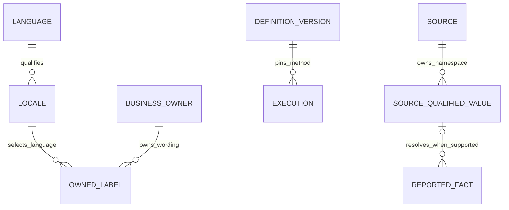

### Work Families, Table Accounting and Group Compatibility

These families define work items and table additions, not separate full release cycles. The paired-group schedule above controls delivery: combine all selected dependency-compatible items into each group, including their caller changes and dependency closure. One combined U28/U29 review/regression/delivery cycle and final learning checkpoint covers the group; U30 removes all its superseded columns before closure. Integrate unapplied peer migrations in reviewed dependency order and never rewrite applied history. U23 verifies deployed leaves/source pins; another G3 handover/ACK remains waived. Nothing requires implementing all64 additions in one release.

| Release family, in dependency order | Exact scope / additions |
| --- | --- |
| F0a | `time_zones`; initial canonical seed only: one new table |
| F0b | `languages` + `locales`; canonical seed only: two |
| F0c | `measurement_units`; existing metric meaning preserved: one |
| F1a | `actors`: one. First compatible slice is the registry plus nullable collection-correction identity and its callers. Later slices handle genuine review/correction owners; redundant product-relationship reviewer text is retired only after parent attribution/caller cutover. `collection_scope_runs.reviewed_by` is deferred pending a real workflow. |
| F1b | `definition_versions`: one; preserve each domain's mapping/caller ownership within the selected release group |
| F1c | `service_providers` + `inference_models`: two |
| F1d | `workflow_stages` after definition versions: one |
| F2 | Six locale-owner work items in RG2: Company labels, PersonName source-language Locale reference, PersonName display selection, account-profile translations, OriginalContent subject snapshots and TrendNarrativeSubject snapshots. Five new owner tables; the source-language field reuses `locales`. Brand labels remain a separate retained U26 item until the existing stash is reviewed after the expanded groups; then allocate it to a compatible combined group. Existing label locale-key transitions add zero tables and enter RG1/RG2 or another compatible group with capacity |
| F3a | Currency catalogue + salary periods: two; compensation callers included in the RG3 work item |
| F3b | Six job-dimension work items in RG3, each owning a catalogue + assignment table: twelve additions total |
| F3c | Citizenship + evidence: two; single Company HQ-reference conversion: zero. Two work items in RG4/RG3 respectively |
| F3d | Organization units and job locations: one each; two RG4 work items |
| F3e | Career sources + allowed hosts: two |
| F3f | Opportunity type/action/benefit: three catalogue work items assigned RG4/RG5 |
| F3g | Person name kind / affiliation kind: two RG4 work items |
| F3h | Event kind / claim kind / maturity / access channel / availability / disclosure / personnel change: seven RG4 catalogue work items, with their scoped-claim reader cutover in the same group |
| F3i | Product kind / product relationship kind / model gating: three RG5 work items |
| F3j | Eleven source-qualified catalogue work items in RG5/RG6; retain source/owner mappings within each item |
| F4 | Account-query membership / legacy post-flag assignment / official-scan membership: three RG6 work items |
| FX | Scheduled-X capture and range coverage assessment extensions to existing G3 storage: zero new tables; offline contributor work concurrent only after ownership ACK |

These allocations sum to64 additions with zero mandatory **table** retirements; required deletion of superseded **columns** still applies. Every batch records exact field-ledger selectors, its cutover and subsequent physical-drop migration names when generated, source/value counts, unresolved evidence destinations, process census, current/previous images, recovery commands and affected ownership. A shared field is cut over and removed once, then its replacement is reused across families.

**Locale primary-key transition:** Django5.2 does not support ordinary migration operations to/from a composite primary key, and ForeignKey cannot target a composite PK. For each existing `(owner,lang)` label table, first add nullable locale references and bridge writes, retain old owner/lang uniqueness, census inbound SQL dependencies, and report alias collisions before tightening new uniqueness. After compatible readers/writers are deployed, use explicitly reviewed PostgreSQL key DDL paired with Django `SeparateDatabaseAndState`; prove both states match. Never use routine AlterField or `--fake` as evidence that the physical key changed. The account-query optional appearance link similarly needs an explicit SQL composite FK to `(account_key,post_id)` on AccountPostAppearance; two ORM fields alone do not enforce it. Preserve the current deletion/ownership behavior in that constraint. [Django composite-key limitations](https://docs.djangoproject.com/en/5.2/topics/composite-primary-key/).

**Registry inputs:** [archived registry evidence](../analysis/2026-10-20-212622-global-schema-registry-evidence/receipt.json) pins IANA tzdata2026e and the language registry File-Date2026-09-17. The archive hashes are `b26882805f26aac59d5b222978e6580484b834ccdc98be89df2f05a6dc53a652` and `755fad43283be7b41ebe3c89ad054b6eaf928f404f9c0edb74799e0eab74beb1`. Materialize the selected canonical seed files from these reviewed bytes during implementation and retain the derivation/hash. Preserve accepted timezone Link identifiers; ambiguous abbreviations never become UTC. Grandfathered/private-use tags lacking a registered canonical primary language stay exact reported/unresolved evidence rather than invented Language rows. Currency/source-qualified seed sets are built from the existing typed definitions and the batch's pinned authoritative registry snapshot; no spelling-only merge or live external lookup occurs during migration.

### Staging batch record: G2 EventDossier foundation — verified

This candidate adds the seven G2 dossier tables: `event_dossiers`, `event_dossier_sources`, `event_dossier_claims`, `event_dossier_reviews`, `event_dossier_review_claims`, `model_release_details` and `personnel_change_details` (seven additions, zero retirements). Migrations `0096_event_dossier_foundation` and `0097_event_dossier_integrity` follow the already staged F0 migrations through0095. Existing event/claim/review evidence serialization and source identity remain unchanged. The G3 nine-table collection expansion and the other proposed additions remain separate future candidates.

No seed operation is required. The dossier tables are initially empty on staging; source data is not copied from production. The application can create dossiers only through its explicit editorial paths. No provider or collector is called or activated.

Preflight requires staging at the verified F0 candidate, a free staging migration lane, staging database identity `pushinweight_staging` and no migration-name collision. The existing staging-service SSH path supports database checks when external PostgreSQL network access is denied; do not alter its allowlist. Rehearsal on owned PostgreSQL18 covers both dossier migrations, immutability/deferred-integrity guards, duplicate/replay behavior and source attachment semantics. Delivery additionally runs the focused dossier/PostgreSQL regressions, `pytest tests/ollija`, Django checks and migration-drift checks.

Verify the exact deployed SHA, both G2 migration records, seven table definitions/constraints, an empty initial dossier inventory and the staging health route. Retain additive tables for application rollback; do not reverse migrations or remove peer migration files. Production/main remains unchanged. This batch does not establish completion of U23–U31 or of ChartEngine.

Verified 2026-10-21: staging deployed SHA `aa5faf3fefcd0cbb3114a357fd3302dd0218cf48`, deployment `dep-dbc0alp5efls73b88ik0` live. Staging PostgreSQL18.4/database `pushinweight_staging` records both migrations; all seven tables exist with110 validated constraints and zero initial rows. `/accounts/login/` returnsHTTP200. Local integrated regression suite:216 passed,185 required PostgreSQL checks,0 skips; staging-policy/lineage suite:34 passed; `tests/ollija`:36 passed; `makemigrations --check --dry-run` reports no changes. `check --deploy` reports existing W002/W004/W009 warnings. The G3 collection foundation remains a separate unshipped candidate.

### Next staging batch: G3 relational collection foundation

This candidate adds nine records with distinct ownership: `collection_campaigns` owns bounded multi-run campaign identity; `collection_job_targets` freezes intended subjects; `collection_attempts` records each separately admitted execution; `collection_requests` records each transport call; `collection_evidence_archives` stores immutable opaque response bytes; `collection_observation_inputs` links observations to their actual request or preceding observation; `collection_resource_snapshots` owns nonnumeric historical resource facts; `collection_metric_gaps` records selected-but-missing counters without turning them into zero; and `collection_corrections` stores immutable, readable before/after attribution or timing decisions. These grains and constraints do not belong on a CollectionJob, numeric MetricValue or mutable DataSource row. Nine additions, zero retirements, and zero new JSON/JSONB columns; existing definition JSON remains sealed and validated, and other pre-existing JSON payloads remain during this expansion.

Exact migration sequence: `0098_collection_relational_storage`, `0099_collection_typed_owners`, `0100_collection_capture_guards`, `0101_collection_instruction_guards`, `0102_collection_unknown_reservation`, `0103_collection_frozen_query_targets`, `0104_collection_selection_guards`, `0105_collection_schedule_ownership`, `0106_collection_schedule_data`, `0107_collection_logical_lifecycle`, `0108_collection_resource_clock_precision`, `0109_collection_match_targets`, `0110_collection_schedule_slots`, `0111_collection_reply_coordinates`, `0112_collection_publication_options`, `0113_collection_previous_dispatch_bridge`, and `0114_collection_latest_attempt_pointer`. They follow deployed G2 `0097`; no applied migration history is rewritten. `CollectionRequest.http_method` is a checked protocol value. The new `CollectionJob.last_attempt_attempt` points to the actual `CollectionAttempt`; the existing run pointer remains during compatibility and a database bridge keeps old writers usable.

The same release candidate includes the accepted eight-file backfill runtime repair snapshot: `core/provider_batches.py`, `monitor/backfill_collection.py`, `monitor/backfill_enrichment.py`, `scripts/backfill_campaign.py`, `scripts/backfill_targeted.py`, `tests/test_backfill_collection.py`, `tests/test_backfill_targeted.py` and `tests/test_backfill_independent_progress.py`. This repair prevents completed foreign campaign members or an already saved reply from blocking newly admitted work. The bridge and fixed-source PostgreSQL tests exercise the old 64b95c26 reader during deployment; no provider is called, no campaign is launched, and no cron or source authority is activated.

Source pins are frozen in `.local/global-vocabulary-20261021/source-snapshots/`: G3's86-file snapshot is based on peer `64b95c26` and records the exact `core/models.py` hash `14f8200b16f52963536c3da4e2c6046a6c130917c66775c3099ef0d3e70257bd`; the eight-file backfill snapshot is based on peer `0e0fa643be36daede932baf1194c06324625f922`. The canonical integration remaps only the new, unapplied G3 migrations to0098–0114; no migration already recorded on a database is edited.

Preflight observed staging at `aa5faf3fefcd0cbb3114a357fd3302dd0218cf48`, the exact staging service/database, a free migration lane and no migration-name collision. The staging build applied migrations `0098`–`0114` under the existing migration advisory lock. Deployment `dep-dbc0q5ou01pc73codnhg` is live on service `srv-d9vb8t49v7es738lf2ng` at `369fb8451f5fd0e0ef176ad53517b41de889be66`. Post-deploy verification confirmed PostgreSQL 18.4/database `pushinweight_staging`, all 17 migration names from `0098` through `0114`, all nine new tables, 140 validated constraints with zero unvalidated constraints, zero rows in the nine new tables, and both `CollectionJob` attempt-pointer columns plus the synchronization trigger. The staging login health endpoint returned HTTP 200. No provider calls, campaign launches or cron/source activation occurred; production was not changed. Staging refresh grants include the optional G2/G3 tables and sequences, with conditional SQL for older production snapshots; no production grant or refresh is part of this batch. The local rehearsal covers old-image dispatch reads/writes, trigger races, actual attempt-pointer parity, dossier-to-observation lineage through staging purge, backfill regressions and evidence immutability.

The reference pass now records all 171 core tables and 2,301 physical columns, with seven G2 dossier tables and nine G3 collection tables added, plus the eight existing collection/measurement tables whose columns changed. New table column/type/null contracts were compared to isolated PostgreSQL; inventory and detailed sections reconcile exactly. `docs/reference/collection-jobs.md` also records the new actual-attempt pointer and its legacy run-pointer bridge. The guide distinguishes the repository candidate from deployment state and was refreshed again after staging advanced through 0114.

Local candidate verification: the integrated dossier/collection/backfill/staging-policy set passes219 tests (188 PostgreSQL-required,0 skipped); the separately expanded model-inventory/HF/GitHub/history/metric/schema-refresh caller set passes215 tests (all PostgreSQL-required,0 skipped); the focused schema/compatibility set passes49 tests. `makemigrations --check --dry-run` reports no changes. `manage.py check --deploy` reports existing W002/W004/W009 warnings. Inline review found and fixed the legacy-current-model mismatch in the historical HF migration test; observation/scope identity assertions now use stable primary-key ordering. Review was performed in the owning session, with no independent reviewer claimed. G3 staging delivery is complete at `369fb8451f5fd0e0ef176ad53517b41de889be66`; remaining owner-field conversions and later plan batches are still pending.

### Staging batch record: F1a actor/correction expansion — verified

Candidate `1269cc6888485e23a9900b3e6a22426c2c78bdda` is live as deployment `dep-dbc1e0gu01pc73cp1sv0` on staging service `srv-d9vb8t49v7es738lf2ng`. Migration `0115_shared_actors_and_correction_identity` adds one `actors` table and nullable `collection_corrections.actor_id`: four new physical columns, zero table/column retirements and zero JSON/JSONB additions. The correction label and existing immutable history remain intact; unknown legacy labels do not create actors.

The shared actor has no authentication-user FK: refresh clears login accounts, so a copied actor/login FK would make truncation cascade into retained corrections. The full scrub regression verifies that login deletion preserves actor and correction records. Environment-local authenticated-user linkage and remaining review owners are separate future slices; registry identity does not establish human approval.

The final disjoint affected suites pass160tests, including61required PostgreSQL checks and0skips;36Ollija checks also pass. A real timing-repair command test failed for the missing actor relation before implementation and passes with the system FK afterwards. Populated0114→0115→0114 rehearsal preserves every legacy correction field and old-writer NULL-FK inserts; database tests reject invalid/duplicate actor identity, identity updates and deletion of referenced actors. Scoped Ruff/whitespace and migration drift pass. Existing model lint diagnostics are unchanged; project-wide Ruff remains unclean, and `check --deploy` retains W002/W004/W009. Sequential inline simplification/review found0actionable issues; no independent or external review is claimed. No application UI route changed; no browser UI pass is claimed.

Read-only staging proof confirms PostgreSQL18.4/database `pushinweight_staging`, exact service/source SHA and four reviewed source hashes, applied0115, the single system actor `80707c0a-4346-56f8-8c18-2243f3937541`, seven validated actor constraints, validated nullable correction FK, both identity/correction immutability triggers and unchanged0correction rows. The login health route returnsHTTP200. Staging/feature branches both point to the reviewed candidate. The prior temporary harvester verification was restored before this session claimed the deployment lane. Production/provider/campaign/cron state was not changed by this session. Remaining F1a owners, reviewer-column retirements and global field conversions are incomplete.

### Metric source-timezone expansion — verified on staging

This U24/U28/U29 slice uses the already deployed `time_zones` catalogue and adds no table or JSON column. Add nullable `metrics.source_timezone_id` FK to `time_zones.code`, with temporary ORM role `source_timezone_reference`; preserve the existing `source_timezone` text and its exact definition/hash serialization throughout expansion. The canonical SQL role name belongs to the shared reference; renaming/removing the compatibility text is a later cutover. Dossier-review actor linkage is deferred because the integrated `complete_review` entry point currently has only test callers; an unused field alone does not justify another performer link.

Resolve only exact registered IANA identifiers/Link aliases; keep `unknown`, unregistered abbreviations and absent registry values unresolved with the exact original text. The migration maps existing exact matches without changing any other metric field. A PostgreSQL guard keeps old-writer inserts/updates consistent with the registry and rejects a supplied FK that disagrees with the recorded timezone. NULL remains supported when the catalogue lacks the reported code; no default UTC or fabricated catalogue membership. A bounded, idempotent mapper can resume exact-match mapping after catalogue seeding, and reports remaining unmatched counts. Fresh/older-source databases need not have seeds before migration; they retain unresolved references until explicit seeding/mapping.

Freeze the current metric-definition snapshot field set before adding the relationship. The current helper enumerates concrete ORM fields; leaving that behavior unchanged would silently add the FK to collection snapshots and change existing contract hashes. The version1 snapshot must continue to serialize exactly its original nineteen fields, with identical Decimal handling and source wording. A new versioned packet is required to change that contract later. Existing registration, collection preparation and measurement-time semantics remain unchanged; readers can adopt the canonical relationship in their later cutover.

Owned surfaces: SourceMetric in `core/models.py`; the next unapplied core migration after0115; `core/benchmark_metric_identity.py` snapshot boundary; a small exact-match mapping command/helper; relevant metric identity/persistence/time and shared-vocabulary migration tests; staging-refresh required-column and reference documentation. Historical migration tests use the models/writer shape from their actual schema boundary rather than running a new ORM model against an older schema.

Verification: characterize the exact nineteen-key snapshots and real collection-contract replay before adding the FK; assert the same snapshots/hashes after mapping. Prove known `UTC`, named zones and accepted Link aliases resolve exactly, while `unknown`/`CST` remain NULL and preserve their text. Old-style raw inserts and raw timezone changes maintain the new reference; invalid/dangling/contradictory FKs fail. Mapping can be repeated and resumed after late seeding without overwriting a concurrent raw correction. Rehearse a populated0115→new migration and old-image writes, then reverse in an isolated database while preserving all original metric values/fields. Run affected real collection/time/history callers and refresh regressions; verify staging source/value/contract hashes, mapped/unmapped counts, deployed SQL guards and exact candidate SHA. This expansion does not complete U24 or the global refactor.

Migration0116 is applied on staging at `d48f591b37fdc0ba3cca22643d069d06e4d8cb97`, deployment `dep-dbc26f6q1p3s73bh8ik0`; service/database and PostgreSQL18.4 verified read-only. All18definition snapshots retain SHA256 `d5c2f7c7235feed07241dcd9f0b0f92ccb8d6154c0ff8dcd89e0b23f4ff21af3`; both full contract rows retain fingerprint `6e5b362941c8e3a4d365c77f7064a6f1`. FourUTC references resolve and14unknown values remain NULL. Exact source hashes, nullable FK, both validated constraints, synchronization trigger, actor/correction preservation and preview0writes/0resolvable/14unmatched pass; loginHTTP200. One column added, zero tables/JSON/retirements.

Final evidence covers200distinct passing cases,169requiring PostgreSQL,0skips, plus unchanged36Ollija checks. Focused review additionally reproduced Django `call_command(apply=True,dry_run=True)` bypassing argparse and writing4isolated-test references; the command now rejects that conflict before mapping. Its10PostgreSQL regressions pass. Historical actor/F0 fixtures use the appropriate schema model set. Scoped lint, unchanged legacy lint baselines, migration drift and172table/2306column reconciliation pass. Sequential inline review has no remaining actionable findings; no independent reviewer or UI-browser pass is claimed. Private source/test/staging receipts live in `.local/global-vocabulary-20261021/`. Remote main's independent `eddb01f0` harvester-priority repair is not in this metadata candidate; reconcile it before any separately authorized production promotion or backfill resumption. Neither occurs in this staging-only task.

### Metric unit-reference expansion — verified on staging

This next U24/U28/U29 slice reuses `measurement_units` for nullable `metrics.unit_id` and `metrics.window_unit_id`, with temporary ORM roles `unit_reference` and `window_unit_reference`. Two added columns, zero new/retired tables, zero dropped columns and zero new JSON/JSONB. Keep `unit` and `window_unit` exactly for existing writers and frozen nineteen-key definition snapshots; no numeric scaling, unit equivalence, comparison eligibility or calendar/elapsed-duration rule changes. The existing `ck_metric_kind_window` still restricts nonempty window units to `day`/`second` and enforces window shape. General unit identity and the duration role share one catalogue, with distinct reverse relations.

Resolve only exact existing catalogue codes. Unknown/unregistered general units retain their original string and NULL reference; NULL window units remain NULL. A single database trigger maintains both references for raw SQL, ORM and older-image writers, recomputing a reference when its reported unit changes and rejecting contradictory supplied references. Named checks enforce each reference's equality to its own reported unit, including explicit non-NULL wording for a non-NULL window reference. Protected FKs prevent deletion of used codes. Seed timing does not block migration: existing exact matches map, others remain unresolved until explicit catalogue seeding and bounded mapping.

Owned surfaces: SourceMetric model; next unapplied migration after0116; a bounded `map_metric_units` helper/command following the timezone mapper's preview/apply/database/cursor controls and explicit conflicting-mode guard; focused unit/migration/concurrency tests; historical SourceMetric test setup where new model fields would otherwise be queried against old schemas; staging-refresh required columns; metric/schema references. Preserve0116 and every previously applied migration. Mapping selects eligible definition rows by primary key, updates at most one bounded batch per transaction, rechecks eligibility/current raw values after concurrent updates and reports unresolved unit/window counts separately. Do not add conversion factors, alias strings or another mapping table.

Regression net: characterize real `configure_collection` replay before expansion; then prove all original fields, nineteen-key snapshots and stored contract hashes survive seeding/mapping and populated0116→new migration→0116 rehearsal. Test both roles independently, valid `day`/`second`, absent seeds, unknown units, old raw inserts/changes, contradictory/dangling references, attempted non-time window units, protected deletion, command preview/limits/conflicting Python modes, keyset resume/idempotence and a real PostgreSQL row-lock race. Retain the existing timezone and actor guards. Run affected definition/measurement-time/history, historical migration and staging-refresh suites; check migration drift, scoped lint and source-schema column/type/null parity. Staging proof pins the reviewed SHA, source hashes, migration/check/FK/trigger state, exact pre/post definition and contract fingerprints and the census-derived mapped counts. This is additive expansion; later caller cutover/retirement and the global plan remain incomplete.

Migration0117 is verified on staging at `c7bf7aaa56728b736cbe0d3990ef2974dedfe73d`, deployment `dep-dbc2e7g473hc739uv5m0`, PostgreSQL18.4/database `pushinweight_staging`. All18general-unit references and5day-window references resolve, with0contradictions and0remaining resolvable definitions. All18nineteen-key definition packets and the two full contract rows retain the frozen0115/0116 fingerprints. Four new constraints are validated, both fields remain nullable, unit/timezone synchronization triggers and actor/correction state are preserved, exact source hashes match and preview writes0rows. LoginHTTP200. This adds2columns and0tables/JSON/retirements, bringing the source reference to172tables/2308columns.

Local evidence:218passing tests,187required PostgreSQL/0skips. Includes existing packet characterization before expansion, expected missing-reference failure before implementation, populated0116→0117→0116 preservation/old-image writes, real row-lock concurrency and broader history/collection/refresh caller tests. Current first-party `arena_ips_score`/`signal_observations` codes are absent from the older pinned catalogue and correctly remain unresolved in local tests; no seed identity or unit equivalence was invented. Scoped lint and migration drift pass, model lint remains185unchanged diagnostics, W002/W004/W009 remain existing and36unchangedOllija checks are reused. Complete model/SQL/reference column/type/null reconciliation passes. Sequential inline simplification and eight review lenses leave0actionable findings; independent/cross-model separation and UI browser coverage are not claimed. Private receipts use the `units-` prefix under `.local/global-vocabulary-20261021/`. Global units and later retirement remain incomplete.

### Event and opportunity timezone expansion — verified on staging

This U24/U28/U29 slice adds nullable `events.source_timezone_id` and `opportunities.source_timezone_id`, both protected FKs to existing `time_zones.code`, with temporary ORM role `source_timezone_reference`. Two added columns,0new/retired tables,0dropped columns,0new JSON. Retain both existing nullable source-timezone strings, including NULL/empty strings/unmatched values; the reference must be NULL or equal non-NULL reported wording. Exact registered zones and Link aliases resolve without offset/geography guessing. A shared PostgreSQL function with a per-table trigger maintains these two same-meaning roles for old/raw/bulk writers, updates/clears references after raw changes and rejects contradictory references. Leave the already applied metric timezone/unit migrations unchanged.

Source trace: `core/targeted_extraction.py:_persist_events/_persist_opportunities` preserve normalized reported timezone beside raw payload/content hashes; `core/intelligence_readers.py:event_document/opportunity_document` return explicit stable documents and lifecycle/date precision. Do not modify extraction identity, raw evidence/hash inputs, date values/precision, source schedules, first/last seen times, `updated_at`, event-occurrence resolution or reader output. Mapping uses SQL/QuerySet updates that affect only the reference. Date/month/year facts gain no manufactured instant. Dossier-claim and immutable measurement/correction owners are separate later slices; they are not included just because they mention timezones.

Owned surfaces: Event/Opportunity in `core/models.py`, next unapplied migration after0117, bounded `map_intelligence_time_zones` helper/command with an explicit events/opportunities owner selector, preview/apply/database/batch/cursor controls and conflicting-Python-mode guard; focused reference/migration/concurrency tests and provider-free extraction/reader regression tests; staging-refresh required columns and schema reference. No new catalogue, alias table, parser, provider route or UI flow. Mapping counts NULL/empty timezone rows separately from nonempty unmatched source values; eligibility and raw wording recheck after concurrent writes. Only exact registered codes map after late seed; bounded keyset resume/idempotence is required.

Frozen staging117census:29events, with2America/New_York,1Asia/Tokyo and26NULL;35opportunities, with1Asia/Tokyo,1UTC,3literalUTC+8and30NULL. Expected mappings3events/2opportunities; preserve threeUTC+8values unresolved. Full original-row MD5s are `d8c2c960bf49e1ba32ee4e5ec86383ba` and `ae9e738f8c196051d9778c47e468b019`, computed as ordered newline-delimited `to_jsonb(row)::text`; after expansion exclude only new `source_timezone_id` before recomputing. Recheck immediately before shipping; a changed legitimate source row requires a refreshed baseline, not a guessed equality pass.

Regression net: characterize complete actual reader documents and source hashes before adding references; prove provider-free extraction still creates the same canonical event/opportunity and evidence on repeat input, with exact known references and NULL for ambiguous/absent strings. Cover exact aliases, NULL/empty/CST/UTC+8, old raw inserts/changes, contradictory/dangling references, protection, no invented date precision, preview/bounds/conflicting `call_command` flags, resume/idempotence/late seed and a PostgreSQL row-lock race. Rehearse populated0117→new migration→0117 while comparing every original field; use historical models at old schema boundaries. Run affected extraction/intelligence/schema/refresh tests, scoped lint/drift and complete schema parity. Verify staging exact SHA/hashes, applied migration, both nullable FKs/checks/guards, expected mapped/unmatched counts, exact full-row fingerprints and login health. Global completion and production remain outside this batch.

Migration0118 is verified on staging at `4bd6d7049876b3a28fd370c0a38af5dddfd84984`, deployment `dep-dbc2lojm8hqs73bcpvp0`, PostgreSQL18.4/database `pushinweight_staging`. All29event and35opportunity original rows retain the exact frozen MD5s above after excluding only the new reference column. Threeevents/twoopportunities resolve;26/30absent values remain NULL, and three literalUTC+8opportunities remain unmatched. Both FKs/checks are validated, both columns remain nullable, both synchronization triggers and exact source hashes pass. Preview writes0rows/0remaining exact matches; metric unit/timezone references,18definition packets/two contract rows and actor/correction state remain unchanged. LoginHTTP200. Added2columns/0tables/0JSON/0retirements; full model/SQL/reference parity is172tables/2310columns.

Local evidence covers116distinct passing checks,82required PostgreSQL/0skips. Reader/source characterization and the strengthened real provider-free extraction test ran before implementation, with the expected missing-reference failure. Populated forward/reverse and old-writer tests preserve every original field; both owner row-lock races, alias/absent/ambiguous cases, contradictory FKs, protected deletion and command write controls pass. Scoped lint, unchanged185model diagnostics, migration drift and existing W002/W004/W009 are recorded. Sequential inline simplification/eight review lenses leave0actionable findings; no independent/cross-model review or UI-browser pass is claimed. Private receipts use `intelligence-zones-` under `.local/global-vocabulary-20261021/`. Global field conversions, caller cutovers/retirements and production remain incomplete/outside this staging batch.

### Country and region label locale expansion — verified on staging

This U24/U26/U28/U29 slice reuses `locales` for nullable `country_labels.locale_id` and `region_labels.locale_id`, temporary ORM role `locale_reference`. Zero new/retired tables,2added columns,0dropped columns/JSON. Existing CountryLabel and RegionLabel already store separate owner/language rows and genuine translated wording; add no translation/string table and do not move or duplicate that wording. Keep the existing `(country_code,lang)` and `(region_key,lang)` primary keys and raw `lang` values for old writers/readers. Each owner/locale pair gains uniqueness for resolved references; repeated NULL references preserve unresolved source rows during compatibility.

Reuse the existing F0 `resolve_locale(context="app_edition")` contract in these app-label tables: replace underscores with hyphens, resolve catalogue case-insensitively to its actual stored code, and map legacy Chinese-edition `zh-cn` in any case/underscore spelling to `zh-Hans`. This contextual mapping does not apply to source-language facts: source-context `zh-CN` remains distinct, and unspecified `zh` remains distinct in both contexts. No global Chinese mapping, region/script inference or Chinese fallback. Verify the SQL expression/guard against the existing resolver rather than introducing a second interpretation of tag casing. NULL canonical reference preserves an unregistered raw tag. A per-owner check matches the reference to that contextual canonical expression; protected locale FKs plus a shared trigger maintain exact registered matches for older/raw/bulk inserts and raw-language changes. A contradictory explicit reference or duplicate resolved owner/locale fails; a nonconflicting alias retains its exact old spelling and label. Recheck mapping collisions before migrating; do not delete/merge conflicting label rows automatically.

Source trace: `core/models.py:CountryLabel/RegionLabel`; geography migrations0026/0027; `seed_i18n_labels` and `reconcile_account_geography`; actual feed `_feed_geography_sources`/wire rendering and its locale fallback contract. Preserve all label wording, original owner/language identities, country/region hierarchy/mappings, account country/region data, reader keys and visible EN/JA/Chinese selections. This expansion changes no UI locale route/key or supported-language set; later caller/primary-key cutover retires raw language only after its own compatibility proof.

Staging118census:747country labels (249each en/ja/zh-cn),93region labels (31each). All required `en`,`ja`,`zh-Hans` codes and distinct `zh-CN` exist in the shared catalogue. Mapping is injective over these three observed raw tags, so primary-key uniqueness already proves no current owner/canonical-locale collisions. Expected resolved references747/93, preserving all raw values and text. Ordered full-row MD5s are `eef6d5666897312d27178afa9cf03be4` and `1c5206d4071fbab24c7e417e50b362cd`, ordered by owner key then rawlang with newline delimiters; exclude only new `locale_id` when verifying afterwards.

Owned surfaces: two label models, next unapplied migration after0118, a bounded `map_geography_label_locales` helper/command selecting the explicit country/region owner and a tuple `(owner_key,lang)` keyset cursor; reference tests and existing geography/seed/reconciliation/feed regressions; staging-refresh required columns and schema reference. Require both cursor parts together and reject invalid owner, nonpositive/oversized bounds and simultaneous apply/preview before writes. Mapping defaults to preview, updates only references in bounded transactions and re-evaluates current raw tags/eligibility. New languages add existing-owner locale rows; arbitrary label prose never becomes a catalogue value. Preview reports contextual owner/locale collisions; apply refuses a nonzero collision count before mapping. Reconciliation tests explicitly restore the pinned geography taxonomy if prior transactional test resets removed migration seed rows; keep the manifest integrity assertions unchanged.

Regression net: characterize actual geography/feed selections and all owner/lang/label triples before expansion. Prove en/ja canonical-case mapping, contextual Chinese alias mapping, distinct source-context regional/script tags and unspecified zh, unknown preservation, late-seed resume/idempotence, composite-cursor bounds, command controls, protected deletion, contradiction/collision rejection and raw PK/language update behavior. Rehearse populated0118→new migration→0118 using historical models and compare all original label triples, complete old row identities and real reader outputs. Cover a PostgreSQL row-lock race against old raw language/label writers. Run existing geography taxonomy/migration/reconciliation/seed/feed and refresh callers; no provider calls or UI rendering change. Verify full SQL/model/reference parity and staging source SHA/hashes, target migration, nullable FK/check/unique/trigger state,747/93references, exact original row hashes and health. Global completion/production and destructive primary-key/text retirement remain outside this slice.

Migration0119 is verified on staging at `4a5a3a78bb83f09181bc86a0309501175f110dbb`, deployment `dep-dbc35srm8hqs73bd9i4g`, PostgreSQL18.4/database `pushinweight_staging`. All747country and93region labels resolve to en/ja/zh-Hans while their exact original owner/lang/wording MD5s remain unchanged. Both original composite primary keys remain intact. All6newFK/check/unique constraints are validated; both optional varchar255FKs, both enabled triggers and the exact stored guard-function body/source-file hashes match. Preview reports0writes/0resolvable/0unmatched/0collisions for both owners. Metric/unit/event/opportunity references, original18definition packets/two full contract rows and actor/correction state remain unchanged. LoginHTTP200. Added2columns/0tables/JSON/retirements; all172table/2312column SQL/model/reference contracts reconcile.

The final evidence set has166distinct passing checks,61requiring PostgreSQL/0skips, including the strengthened real country and region feed outputs across EN/JA/Chinese, case/underscore/Chinese-context comparison against the existing resolver, alias-collision refusal, composite-cursor resume, forward/reverse old-writer rehearsal and both actual row-lock races. A pre-existing reconciliation fixture assumed that earlier data-migration seed rows survived transactional test resets; restoring the same pinned taxonomy before its Japanese labels fixes all8reconciliation checks and the full122caller sweep, retaining strict manifest checks. New/scoped lint and migration drift pass;185existing model diagnostics and W002/W004/W009 remain unchanged;36unchangedOllija checks reused. Sequential inline simplification/review has0remaining actionable findings, with no independent/cross-model or UI-browser pass claimed. Private receipts use `label-locales-` under `.local/global-vocabulary-20261021/`. Remaining global owners and later cutovers/retirements are incomplete.

After proof, G2 explicitly released a short exact-commit staging slot to the classifier session for `b5b15d6d81355abb3ef5b81f3388cf896821c92f`, whose production candidate changes only the reviewed classifier source/test paths atop homepage457b346d. It may apply disjoint homepage0093/0094 forwards, preserving the119schema/data; no refresh, reversal or G2 code in its production candidate. The peer must report its terminal/restoration state, and may restore4a5a only if no newer claimant. G2 continues local integration without deploying over that slot. The peer's production/provider authority remains its own.

### Parallel homepage dependency — preserve both migration histories

G5 requested coordination before its separately owner-authorized direct production release of candidate457b346d/PR62. Source inspection confirms one new `materialization_state` table and native `home_brand_time_counts` materialized view, with no object-name conflict with the global shared catalogues. Its dataset key owns a versioned rebuildable publication identity; the native view projects existing Brand identifiers and cannot claim a database FK. This session owns no production lane and has not deployed or configured the peer release. Staging remains reserved for the current global batches.

Keep G5's0093_homepage_count_materialization/0094_shared_materialization_state and this branch's differently named, applied0093–0119 migrations intact. Central integration retains eddb01f0 and exact deployed homepage457b346d, combines model/refresh policy changes, then adds `0120_merge_homepage_shared_vocabulary` with dependencies `0119_geography_label_locale_references` and `0094_shared_materialization_state`, and no operations. Do not renumber/rewrite either applied history, refresh staging from the newer production schema before integration, or treat the peer's direct-production authorization as authority for this staging-only session. Its one table/native view are an independent baseline addition, not another64-table-manifest proposal.

The peer reports all6existing production consumers and its separately authorized new count cron at457b346d, with natural publication generation70/cutoff2026-10-21UTC. Its source/browser/production evidence remains attributed to that owner. A later owner-reported dashboard timeout has reopened that peer's availability investigation; G2 does not inherit the diagnosis, production lane or repair scope. Preserve any subsequent released fix during central integration.

**Bounded integration slice (U23/U31):** merge the exact released main ancestry into this clean feature checkout, preserving upstream source bytes, our172existing models/nullable references, both migration histories and staging-only authority. Own conflict resolution in `core/models.py`, `config/staging_refresh.yaml`, `docs/reference/db-schema.md` and shared model/topology/policy tests; import other upstream paths unchanged. No Blueprint apply, cron activation, provider call, live harvest, refresh or production merge. Materialization publication state is environment-local and must be excluded/scrubbed by refresh alongside our preserved G2/G3 policies. Inspect source/migration/read/write contracts and relevant existing tests before edits.

The upstream `materialization_state` owns the current generation/publication of a rebuildable dataset:6physical columns, one row per code-defined versioned dataset. Collection runs describe executions and saved measurement/evidence rows describe retained facts, so neither replaces this current publication state. Its `dataset_key` is an owned versioned identity with C collation, length160 and a checked format, not a shared display label. `home_brand_time_counts` is a native materialized view with5derived columns; its `brand_id` projects existing Brand identity and has no physical FK. This slice adds no independent business vocabulary, JSON or catalogue. Reconciled baseline becomes173physical application tables/2318table columns,9compatibility views and1native materialized view/5columns;174concrete ORM mappings. Count the view separately, including its SQL-derived nullability, rather than fabricating a table/FK contract.

**Regression net:** prove single migration leaf and model-state parity; rehearse both real deployed orders (global0119→home0094→merge, and home0094→global0119→merge) on isolated populated PostgreSQL. Assert exact old source rows/label identities/definition packets and both histories survive, existing guards still enforce mappings, homepage publication state/derived counts work, and rollback of only the operation-free merge removes no data. Run existing homepage migration/materialization/reader, global catalogue/geography/metric/refresh-policy and relevant upstream harvest-lock/topology tests with fake providers. Reuse byte-identical upstream UI evidence with attribution; do not claim fresh browser coverage. Schema reference and private parity verification distinguish tables/views. Stage only after the classifier slot's terminal/restoration receipt and observed free service; verify exact candidate SHA, both branch migration sets, all119preservation fingerprints, new relation types/constraints/triggers, zero unexpected schema/data delta and HTTP health. Global normalization and production stay incomplete.

Integration review found that the upstream staging manifest declares a nonexistent staging count cron. G5 confirms its owner explicitly excluded staging provisioning; our staging-only schema grant also excludes topology changes. Omit that block and retain the existing staging service inventory, preserving production `render.yaml` and the released count implementation. Update the topology/credential tests to assert absence on staging and unchanged production isolation; the new absence assertion and existing-inventory assertion both failed before the block was removed. This is an explicit integration exception to byte-identical upstream configuration. No service-setting mutation is needed. At the only backfill conflict retain `job.scope`, whose typed-instruction/current and legacy readers already share that property; direct `definition["scope"]` would fail on the new relational jobs.

Local integration `e8622da8` passes389distinct checks,303requiring PostgreSQL,0skips, and the complete173table/2318column plus native5column view reconciliation. All pre-existing global model classes have identical parsed definitions; the two imported mappings match457b346d exactly. Scoped lint/drift pass and185existing model lint findings are unchanged. Five catalogue sections lacked the standard navigation boundary used by the existing reference completeness check; adding it repairs that check without weakening assertions, and the timezone catalogue now describes its actual owner references. The389distinct checks include the final39-case topology/reference net, replacing superseded topology cases; private `homepage-merge-*` receipts record exact case deduplication. Simplification/review ran inline with no remaining actionable findings and no independent/cross-model coverage. Unchanged homepage browser evidence is reused with G5 attribution; no fresh browser pass claimed.

The classifier owner reports staging restored exactly4a5a3a78 under `dep-dbc3g79srm7s739heq8g`, with all119history/old columns/constraints/triggers and747/93label hashes preserved; only the permitted homepage state table/native view were added. Its temporary test database was dropped and its slot released. It separately reports production and all7consumers live at `b5b15d6d81355abb3ef5b81f3388cf896821c92f`. Preserve that new released baseline in this feature branch: only `x_monitor/attribution.py`, `x_monitor/deepinfra.py` and five named classifier regression files differ from457b346d; no schema or service configuration. Read those changes, merge their source bytes unchanged and run the five offline/fake-provider caller suites against the integrated global schema. Keep duplicate-key, selected-model/profile, malformed/truncated reply, accounting and evidence guards intact; no provider call or production mutation by G2. Stage the combined candidate only after review and a fresh free-lane check.

The completed cohort is verified live on staging at `48537a28384b9ecb7ae95f2318b09fa1348756ea`, deployment `dep-dbc3mc6q1p3s73biko90`, PostgreSQL18.4. Exactly the0120migration ledger row was added (165→166records); all existing column, constraint, trigger, stored-function-body and native-view-definition fingerprints match the pre-deploy snapshot. All119label/metric/event/actor invariants remain intact,17source/config hashes match and loginHTTP200. Existing staging resource IDs/types/branches/autodeploy/suspension settings are unchanged; no count cron was created. Local evidence totals500distinct checks/350PostgreSQL/0skips across the valid integration nets and111offline classifier cases; no independent/cross-model review or fresh browser pass claimed. The first production cohort adds21application tables relative to production's existing homepage baseline (4catalogues,7dossier,9collection,1actor), adds the staged compatible references and retires0tables/columns/JSON. Actual production mapping/data baselines and recovery/consumer proofs must pass before promotion; staging contents never replace production.

Further label normalization is held with all other new refactor work. Read-only staging review found29alias-collision groups across five vocabulary owners,18with different wording; exact current/legacy Chinese lookup order is an existing owner requirement in project memory. Preserve both raw tags/wording and visible precedence; do not silently collapse them. The242inspected rows across ten label owners and private `vocabulary-label-alias-review.json` remain evidence for the later batch, not production-cohort scope.

### Scheduled X and Historical Coverage Physical Contract

Reuse G3's existing strict `x_cycle`, purpose `content`, interval schedule and **`external_render_cron`** driver. The existing fifteen-minute Render cron remains the sole scheduler; generic collection dispatch must exclude this driver. Stable scheduled jobs identify a non-secret configuration/cohort-definition epoch; actual query windows belong to run scopes. Do not create a new immutable job for every request window, mutate old frozen targets, activate other source collectors or invent historic runs. The actual cycle identity supplies an idempotent run correlation key.

Prepare/admit each actual request before sending, perform network work outside database transactions, and preserve unknown-send outcomes conservatively after crashes. Post persistence plus its Observation/Input membership must share the selected atomic commit boundary; partial failures retain honest receipts and hold cursor advancement. A duplicate Post returned by two requests yields two input appearances, one scope-level membership and one Post. Keep per-request parsed/selected/committed item counters separately from distinct Post counts; unknown counts stay NULL. Version the counter contract and preserve `success_count <= selected_count`. Existing historical operations retain their original count units until their own migration is proved.

Split membership capture from `record_post_membership`'s historical `source_collection_job` assignment. Scheduled lineage never changes enrichment age/attempt eligibility or appropriates existing historical ownership. Cover A/B/C, backlog replay, rare/discovery and any metrics-refresh path actually in the selected scope at its real entry point; name exclusions rather than claiming helper-level coverage of all paths. X transport receipts do not duplicate model-call charges: existing provider batch/content-call records retain their actual model and budget evidence.

**Range assessment:** extend existing CollectionJob/Run/Scope/Observation/Input records with a strict, manual `coverage_assessment` operation and explicit `assessment` purpose. It runs analysis with zero provider requests and no scheduler. This changes an already accepted strictly validated definition schema by operation/version; it introduces no new JSON column. Scope has typed publication bounds and a checked interval kind (`before_date`, `bounded`, `source_wide`); NULL bounds have meaning only under that kind. The initial pre-September qualifier uses the explicit UTC bound2026-09-01 and never asserts that later data is exhaustive.

An aggregate assessment Observation has no fabricated Post/native subject ID. It records actual assessment time, reason kind, optional SourceMetric, method-version FK and typed scope; existing supersession links preserve prior assessments. Extend CollectionObservationInput's ownership shape to admit an actual existing evidence archive as a third exclusive input branch beside request/observation, with database XOR/owner guards. A local report does not become a fake provider request. Unsearched routes, measured provider omissions, transport faults, persistence failures and enrichment gaps are separate assessments. An assessment execution can finish successfully while the assessed interval remains limited; this must not trigger an endless harvest retry or rewrite the original run's success.

Charts find assessments by source/metric/publication interval even when no Post or observation membership exists. BQ1 includes observed values by default, displays qualifications and actual contributor counts, never treats missing as zero, and applies no recall multiplier. Future chart versions pin assessment IDs, method/policy versions and selected data; old charts keep their frozen meaning. The supplied backfill handoff is a dated context source, not an instruction to control its active campaign.

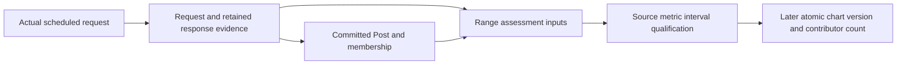

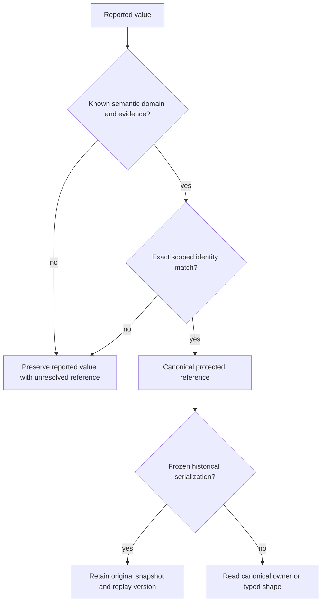

### Planning Completion and Execution Preconditions

The source-level design, table inventory, owner decisions and staged small-batch sequence are complete. No product question from the consolidated reply remains open. Confidence is high in the selected ownership/preservation rules; actual deployed drift, value distributions, collision rates, lock duration and mixed-image behavior require the specified execution preflights. These are measured checks with stop/recovery paths, not permission to invent a different schema. Cross-session acknowledgement states remain separately tracked and do not gate the owner-authorized G2/G3/backfill integration.

Document verification covers all1,013 unique positions,959 current/pending versus54 deferred,64 unique additions, FK target closure, source hashes and release-allocation totals. The delivered F0 and G2 batches have their own recorded PostgreSQL/staging evidence; remaining conversions and U25–U31 still require their scoped implementation and verification.


### Notification and Concurrent Ownership

The authoritative General Launch Index is the notification surface and records acknowledgement separately. No automatic background messenger exists. The notice must carry this plan, source pins, affected contracts, central migration ownership, the small-batch route, preservation rules and the requested action for each recipient. Existing sessions can continue unrelated work and private experiments; the notice does not pause services or acquire their files.

| Recipient | Required contribution / coordination |
| --- | --- |
| G1 identity/assets | PersonName, people/evidence/media and source-identity caller inventory; shared actor/language/geography touchpoints |
| G2 editorial and Pulse | OriginalContent locale/replay/selection behavior plus EventDossier claim/review/reference changes |
| G3 collections and prediction parent | Freeze accepted collection schema/strict-definition boundaries and preserve external dossier observation references |
| G4 API/MCP | Inventory serialized field names, allowed values, locale and reference compatibility; update schema-facing consumers |
| G5 presentation | Inventory localized labels, fallbacks, saved chart/dossier consumers; preserve visible behavior |
| BackfillDB / post-backfill | Own proposed scheduled-X caller adaptation after contract acknowledgement; preserve current/historical enrichment separation and report importer/migration pins |

This is a proposed central integration responsibility, not a claim that contributor sessions have handed over files or read a notice. Before overlapping work, record each acknowledgement and bounded owner in the shared index. U23 can complete independent design work while acknowledgements are pending.

---

## Implementation Units

### U23. Freeze shared ownership and resolve the selected batch's schema target

**Goal:** Produce a concrete, source-grounded contract that G2/G3/post-backfill can implement without competing schema decisions.

**Requirements:** R34–R40, R43; KTD6/KTD10/KTD13.

**Dependencies:** Existing inventories and strict review; the owner’s 2026-10-21 override allows central snapshot and integration of accepted G2/G3/backfill source without another handover or ACK gate. Preserve peer worktrees and record notices/acknowledgements accurately.

**Files:** This plan; `docs/brainstorms/2026-09-30-104924-general-launch-index.md`; `docs/brainstorms/2026-09-30-104924-general-launch-charter.md`; existing audit CSVs in `docs/analysis/`; source `core/models.py`, relevant `core/migrations/`, G2/G3 plans and actual callers as read inputs.

**Approach:** Establish the clean integration workspace and accepted peer source pins. Reconcile G2 0093/0094 and G3 0093–0107 without rewriting applied history. For each chosen batch, complete exact ownership/cardinality, target columns/tables, aliases, constraints and retained snapshot/wording decisions. Reconcile the post-backfill report's typed, range-discoverable coverage assessment contract with G3; do not invent successful historical requests or interpret September 1 as proof of completeness afterward. Record the complete added/retired/reused table list and strict preconditions. Use the final physical targets for the previously uncertain 25 strict-review and 201 main triage positions. Measure unmatched values without reopening settled ownership or inventing evidence. Keep targeted notices and truthful acknowledgement states in the shared index; no acknowledgement gates this owner-authorized central integration.

For every remaining selected replacement, produce the exact field→caller→runtime manifest required above, including stored SQL dependencies and seed/refresh/repair/replay references. Record the cutover release, subsequent physical-drop migration slot, preservation destinations, process owners and valid recovery revision. Treat the already-integrated graph through0122 as deployed history; resolve new numbering against actual current leaves. No runtime compatibility assumption or unspecified evidence destination may be hidden behind a family-level target.

**Test expectation:** No application behavior changes in this unit; document/source and migration-graph review only.

**Verification:** Every selected field maps to a justified physical target or is excluded; migration order and peer compatibility are unambiguous; targeted notices and acknowledgement states are recorded truthfully; no pending owner choice is silently represented as approved storage.

### U24. Add and map the foundational shared catalogues

**Goal:** Establish consistent timezone, language, locale and measurement-unit references without losing original facts.

**Requirements:** R34–R38, R43–R45; KTD7/KTD10/KTD13.

**Dependencies:** U23's foundation manifest and integration migration graph.

**Files:** Existing `core/shared_vocabulary.py`, `core/management/commands/seed_shared_vocabulary.py`, shared CSV/registry inputs under `data/`, `core/models.py` and new migrations; selected owner callers and mapping commands including `core/metric_units.py`, `core/geography_label_locales.py`; existing `tests/test_shared_vocabulary.py`, `tests/test_shared_vocabulary_migrations.py`, `tests/test_metric_units.py`, `tests/test_geography_label_locales.py` and `tests/test_timezone_writer_cutover.py`; add scoped post-drop caller/migration cases where needed.

**Approach:** Reuse the four deployed KTD10 catalogues. Implement each reference owner as a work item within its combined release group: settle evidence, map, update all callers/database dependencies and add focused checks. Keep language/locale and calendar/elapsed roles distinct. Use deterministic bounded restartable mapping and an unmatched report; tighten constraints after reconciliation. RG1 combines the expanded metric-unit/geography references with shared identity/definition work. Group-level U29/U30 handles shared review/staging/production, drain and deletion; do not repeat it per reference owner.

**Execution note:** Characterize existing reads and unknown behavior before changing references.

**Test scenarios:**

1. Covers AE12. Recognized timezone aliases resolve consistently; an unknown timezone remains unresolved and preserves the original value/hash.
2. Covers AE13. `ja`, `zh-CN` and `zh-Hans` retain their intended tag roles; a new locale adds rows without new schema columns.
3. Interrupted mapping resumes without duplicating catalogue records or overwriting a concurrent source correction.
4. Invalid references/duplicate canonical identities fail through ORM bulk paths and direct SQL constraints.
5. Calendar-day measurement semantics and immutable source-metric versions survive a unit-reference conversion.

6. After deletion, the actual registration/collector/seed/reader call chains operate on FK-only storage; old columns and bridge objects are physically absent. Pending value/dossier/correction timezone owners preserve exact unknowns and old serialization independently of deleted columns.

**Verification:** Exact mapping totals, unknown evidence, source/hash checksums and negative constraints reconcile in isolated PostgreSQL and the batch's U29 staging/production releases. U30 physical removal and post-drop caller proof are required to finish each replacement group.

### U25. Integrate G2/G3 references, definitions and checked states

**Goal:** Align pending and existing dossier/collection schemas with shared meanings and one migration graph.

**Requirements:** R34–R36, R38–R39, R42–R45; KTD6/KTD10/KTD13.

**Dependencies:** U23's domain manifest; U24 references needed by that manifest; accepted bounded G2/G3 contributions.

**Files:** `core/models.py`; new integrated migrations; `core/event_dossiers.py`; `core/collection_state.py`; `core/collection_capture.py`; `core/collection_corrections.py`; `core/collection_matching.py`; `core/collection_reports.py`; `core/benchmark_metric_identity.py`; `monitor/classification_persistence.py`; `tests/test_event_dossiers.py`; `tests/test_collection_state.py`; `tests/test_collection_corrections.py`; planned `tests/test_shared_definition_versions.py`.

**Approach:** Reuse current entity relationships and qualify namespaces for actors, methods, inference providers/models, business classifications and definition versions. Derive definition-owned metadata only from an immutable retained definition. Apply distinct checked execution/coverage/transport/review states and preserve legacy result meaning until consumers switch. Integrate per-channel/region claims and release maturity/access separation. Add only the exact new definition tables justified in this batch's manifest.

For each superseded actor/provider/method/version/state field, inventory collection/dossier/classification/correction/import/repair/replay callers and running/queued work. Each item supplies its implementation and focused checks; apply U29/U30 once for the combinedcombined release group. Retained checked choices need their final constraints/callers updated, not artificial duplicate columns. Preserve frozen serialization in its rightful owner before deleting any replaced field; do not guess historical identity from a current label.

**Test scenarios:**

1. Covers AE14. A single announcement yields separately scoped availability facts with shared evidence and distinct accepted dates/dispositions.
2. Legacy success/partial results preserve their distinct execution and coverage meaning through conversion.
3. Source correction before/after values and claim/classification hashes remain reproducible from their original serialization version.
4. A human/agent/system actor or an unknown reported actor cannot be silently coerced to an authenticated user.
5. A dossier's external observation FK remains valid after collection migration and refresh cleanup; invalid cross-owner/cross-run references fail.
6. A classification taxonomy token is never resolved into the unrelated measurement taxonomy simply because both say version.
7. A known source/interval coverage limitation remains queryable when the interval has no Posts or legacy Posts lack observation links. Unsearched routes, provider recall limitations, transport errors and missing enrichment retain distinct reasons; retrieval, publication and assessment clocks remain distinct. Existing success receipts and frozen evidence are unchanged.

8. A delayed old worker/backfill or queued legacy payload blocks deletion until its exact caller is updated or terminal. Correction replay still produces the original attribution/hash after `actor_identifier` removal, and new corrections persist only the registered actor reference.

**Verification:** G2/G3 migration state converges; constraints hold through real callers before/after removal; saved reviews/corrections/lineage match original evidence. Focused checks belong to each item; the combined release group finishes U29/U30 and its single final learning checkpoint before the next group.

### U26. Move localized values and proven duplicate projections to owned rows

**Goal:** Add languages without adding columns while preserving published wording, source versions and selected editions.

**Requirements:** R34/R36–R37/R43–R45; KTD7/KTD11.

**Dependencies:** U23 locale manifest; U24 locale contract; relevant U25 identity/version guarantees.

**Files:** `core/models.py`; migrations; `core/person_names.py`; `core/management/commands/seed_i18n_labels.py`; `monitor/post_artifacts.py`; `monitor/original_content.py`; `monitor/original_content_backfill.py`; `monitor/original_content_cutover.py`; `monitor/trend_narrative_lifecycle.py`; `monitor/views.py`; `tests/test_person_names.py`; `tests/test_translation_invariants.py`; `tests/test_original_content_cutover.py`; planned `tests/test_shared_localized_labels.py`.

**Approach:** Assign the27 locale moves and ten relationship-reuse positions to exact owner work items, primarily RG2, with existing Country/Region keys in RG1. Combine items according to the selected release-group table instead of releasing each owner separately. Reuse person/post/content text storage first; add only justified KTD11 owners. Preserve frozen name/locale snapshots and hash replay. Update views/serializers/templates, selection/fallbacks, editorial workers, import/translation/seed commands, fixtures and refresh SQL. Per-item tests cover its wording/pointers; the shared group rehearsal, cutover, drain and U30 deletion finish before the next group. Rehearse composite-key changes explicitly.

**Test scenarios:**

1. Covers AE13. New Japanese/Chinese/French labels are selected through one owner/locale contract and missing translations follow the established fallback.
2. Repeated mapping is idempotent; conflicting duplicate locale rows are reported rather than overwritten.
3. Source/native names with unknown language are not guessed into English or Chinese; preserve unknown language with the existing `und` locale/language value.
4. An old publication reopens with the same subject names, wording, sources and selected edition after current labels change.
5. A missing or wrong OriginalContentSelection pointer fails cutover readiness even when every text row was copied.
6. Covers AE16. Concurrent old writers and interrupted locale mapping preserve both the latest valid update and frozen historical editions.

7. Brand and later owner commands, refresh SQL and saved edition readers succeed after the exact replaced columns are physically absent. Original fallback order and native/unknown-language evidence remain correct; no old column is recreated or queried on a seed/repair rerun.

**Verification:** Per-owner/language/version totals, text fingerprints, actual UI/API selection and publication pointers agree after deletion. No selected stale storage dependency remains. These item checks feed the shared release-group verification; U30 and one final learning checkpoint close the group.

### U27. Connect scheduled X collection to shared bookkeeping without historical ownership

**Goal:** Make current-post collection inspectable through the same execution/evidence model as backfill while preserving scheduled behavior.

**Requirements:** R39–R45; KTD6/KTD12.

**Dependencies:** U23 scheduled-X contract and explicit post-backfill file ownership; integrated G3 capture/state interfaces from U25. Offline caller characterization may proceed concurrently against the frozen contract.

**Files:** `monitor/cycle.py`; `monitor/management/commands/run_cycle.py`; `monitor/backfill_collection.py`; `core/provider_batches.py`; `core/collection_capture.py`; `core/collection_state.py`; `core/models.py` only under central schema ownership; planned `tests/test_scheduled_collection_lineage.py`; `tests/test_backfill_collection.py`; `tests/test_cycle_regression_net.py`; `tests/test_cycle_backlog_replay.py`; `tests/test_cycle_cost_emit.py`.

**Approach:** Post-backfill owns the proposed bounded adapter contribution; central integration owns any required shared interface/schema changes. Reuse the existing Post-linked CollectionObservation and request-input relationships. Separate recording membership from assigning historical enrichment ownership. Capture actual physical requests and honest request/processing/coverage outcomes, with network calls outside database transactions. Match the real Post commit boundary, attach lineage for committed identities, and hold existing cursor rules on persistence/ledger failures. Do not create fake history for older posts or change search traffic, models, budgets, schedules or credential purpose.

Trace scheduled and historical entry points independently, including active runs and resumable campaign checkpoints. Update shared-interface references in both paths together. This lineage adapter proposes no old-column deletion by itself; any column replacement needed by its manifest follows the same cutover/drain/deletion lifecycle before this batch closes. A canceled old campaign stays canceled until separately resumed on replacement-compatible code.

**Execution note:** Pin the missing scheduled lineage at the actual CycleRunner call chain before altering helpers; helper-only proof cannot establish this unit.

**Test scenarios:**

1. Covers AE15. Scheduled A/B/C calls use the same effective queries/limits and scheduled-purpose client while producing real committed-post lineage; two physical requests returning one post preserve distinct requests and one Post.
2. A new scheduled observation leaves historical `source_collection_job` ownership unset and preserves the existing scheduled enrichment age/attempt policy.
3. Existing historical backfill still assigns its intended owner and has unchanged allowed enrichment behavior.
4. Empty success, provider failure, parse error, page cap/truncation, cancellation and partial Post persistence retain distinct outcomes and truthful cursor/coverage behavior.
5. A crash after request admission and before response leaves unknown execution, not successful coverage; replay does not duplicate post membership or erase the first request.
6. Invalid lineage insertion cannot advance the cursor or report a fully persisted page. A failed attempt preserves any already committed valid Post/evidence according to the agreed transaction boundary.
7. Post-fetch classification/translation and cost summaries still reconcile with actual stored rows; no fallbacks between scheduled and on-demand credentials occur.

**Verification:** PostgreSQL-backed real-caller tests with captured fake-provider arguments prove before/after behavior without paid calls. U29 adds deployed-image/actual scheduled-cycle observation when release is authorized.

### U31. Normalize business classifications and packed relationships by owner

**Goal:** Implement the F3/F4 field-ledger contracts while preserving real source evidence and current domain behavior.

**Requirements:** R34–R39/R43–R45; BQ2/BQ3; KTD7/KTD10/KTD13.

**Dependencies:** U23 selected work-item/group manifest and relevant U24/U25 definitions. Repeat U28/U29 once per combined release group, not per owner. RG3, RG4, RG5 and RG6 allocate this unit's domain work; exact dependency order is resolved inside each group.

**Files:** `core/models.py`; separate migrations; `core/job_sources/{registry,types,adapters,sync,runner}.py`; `core/person_affiliations.py`; `core/person_names.py`; `core/targeted_extraction.py`; `core/profile_snapshots.py`; `core/official_company_{accounts,discovery,lists}.py`; `monitor/unsanctioned_flags.py`; `monitor/classification_persistence.py`; affected `monitor/views.py` and raw SQL; `tests/test_general_jobs_people.py`, `tests/test_direct_job_sync.py`, `tests/test_person_affiliations.py`, `tests/test_official_company_scan.py`, `tests/test_django_unsanctioned_flags.py`; planned `tests/test_shared_business_relationships.py` and `tests/test_shared_business_migrations.py`.

**Approach:** Select exact owner/field sets from F3/F4 and the final manifests. Reuse Country/Region/Brand/Account/Product/JobListingEvidence before introducing a new owner. Keep source-scoped unknown categories as evidence with nullable resolved references. Preserve memberships, counts, ordering, selected names, credential/budget partitions and current assessment semantics. Any new control symbol requires application and database validation. Do not rewrite original hash inputs or activation/scheduling policy.

Inventory job-source sync, profile/extraction, scan/import/backfill/repair and in-flight processes, plus joins/counts/exports. Each item supplies complete caller/preservation changes and focused checks; its release group combines cutover/process drain and U30 deletion forits selected items. Keep unknowns/source membership in proper evidence storage before the drop. Update resume cursors and stored payload consumers so retries cannot query deleted columns. No full delivery/compound cycle is triggered by an individual owner item.

**Test scenarios:**

1. BQ2: one Company accepts one HQ country; conflicting historical wording remains unresolved. A Person with one evidenced citizenship and a Person with two retain all support, with at most one primary; a Person without citizenship evidence gets no fabricated row/country.
2. BQ3: a listing with research and engineering functions retains both, and remote/hybrid values remain workplace classifications rather than seniority. Duplicate evidence ingestion is idempotent; unknown wording remains queryable without a fake category. Listing totals use distinct listings rather than join-row counts.
3. Identical department names under different employers stay distinct; a cross-employer assignment and wrong-source category fail through bulk/direct SQL guards. Salary amounts, currency and period remain separate without conversion.
4. Existing career-source adapters keep their exact allowlisted hosts, native board identifiers and disabled/active state. Registry migration does not launch network requests or widen source trust.
5. Account-only versus Post-scoped query membership, scan ordering/progress and official budget/credential identity survive restartable mapping. Orphan/wrong-account appearance membership is rejected.
6. Legacy flag positive, assessed-empty, malformed and missing inputs preserve their current different effects, including deletion of an empty parent and retaining prior state on malformed input. UI/raw SQL totals reconcile without reinterpreting flags as taxonomy-v3.
7. Interruption and a concurrent old writer preserve the newest supported evidence and original serialization. Previously published content/name snapshots do not change when current catalogue labels change.

8. After physical deletion, actual sync/extraction/scan/import/read callers preserve their result and count semantics; no old-image run or replay command can write/read the packed or category column. Invalid relationships still fail with final database constraints intact.

**Verification:** PostgreSQL reconciliation, direct/bulk negative constraints, distinct-owner counts and actual caller tests pass on the post-deletion schema. U29/U30 provide each owner's staging→production cutover and deletion proof under the recorded authority.

### U28. Protect staging refresh, recovery and the cross-domain regression net

**Goal:** Ensure production-shaped staging data preserves every dependency needed to verify the new schema.

**Requirements:** R36/R39/R43–R45; KTD8/KTD9/KTD13.

**Dependencies:** Selected batch's U24–U27/U31/U32 changes and exact source/target schema inventory.

**Files:** `config/staging_refresh.yaml`; `scripts/staging_refresh/policy.py`; `scripts/staging_refresh/database.py`; `scripts/staging_refresh/collection_storage.py`; `docs/operations/staging-data-refresh.md`; `tests/staging_refresh/test_policy.py`; `tests/staging_refresh/test_database.py`; `tests/test_collection_refresh_lineage.py`; planned `tests/test_global_schema_regression_net.py`.

**Approach:** Classify added tables/sequences and removed columns/dependencies in the refresh policy for each expansion/cutover/deletion stage. Update repair/import/export SQL and seed/mapping tools so current refresh never queries or recreates deleted columns. Preserve vocabularies, correction/measurement lineage and dossier FKs; restored jobs lose scheduling authority without losing evidence. Rehearse supported older-schema upgrades and post-deletion restores on disposable databases. Before deletion pin a replacement-only recovery revision, then test compatible recovery without resurrecting legacy writers or losing new writes. Record data quantities/anomalies rather than inventing a size threshold.

**Test scenarios:**

1. A source predating the new schema passes only the explicitly supported migration path; unknown/unclassified relations fail closed.
2. Staging refresh preserves pinned definitions, locale snapshots, numeric provenance, dossier observation references and required sequences.
3. Restored active jobs/leases cannot dispatch providers; production remains untouched and refresh-inert.
4. Interrupted shadow migration/validation leaves the previous staging database recoverable and does not report a successful refresh.
5. Rollback restores selected content/readability while preserving rows written after candidate deployment.
6. The integrated regression net covers account identity, geography, names, post attribution, collection, dossier and content-selection behavior with required PostgreSQL cases executed, not skipped.
7. Fresh install, supported older-schema upgrade, current staging refresh and recovery/repair commands succeed after the old columns disappear; a replay queued before cutover either uses a supported version adapter or is held explicitly before mutation.

**Verification:** Disposable restore and lineage/replay checks pass for the exact batch; source grants and runtime database identities remain explicit preflight requirements.

### U29. Deliver one group of selected work items through the shared release cycle

**Goal:** Apply the same reviewed candidate to staging and then production without treating code rollback as database restoration.

**Requirements:** R40–R45; KTD7–KTD9/KTD13.

**Dependencies:** U23 manifest, affected implementation units and U28; explicit delivery authority before any environment mutation.

**Files:** This plan's batch manifests/evidence; `docs/deploy/render.md`; `docs/operations/staging-data-refresh.md`; `.ollija/project.yaml` as the existing contract; `build.sh`; `scripts/render_migrate.py`; `scripts/database_lock.py`; `tests/test_database_lock.py`; `tests/test_source_statistics_migration.py`; existing release/preservation helpers and the tests named in the affected units.

**Approach:** Run one shared implementation review, combined regression and staging→production delivery cycle for each combined release group. Establish shared graph/source/data/recovery baselines and use the existing locked migration runner. Item-specific tests run during implementation without separate full workflows. A group's cutover/deletion may need two ordered candidates: verify cutover and drain all affected old processes before introducing the drop migration, then check the changed migration/callers and production-shaped post-drop behavior. Reuse unchanged full-suite/review evidence between candidates; exact deployed SHA/database identity, migration/data/lock/process gates still apply to each. Promote each candidate unchanged from staging and reconcile production's own data. For any schema invariant, verify the physical PostgreSQL catalog as well as Django model/migration state, especially when using `SeparateDatabaseAndState`; keep fail-closed preflights and catalog assertions in PostgreSQL tests. The correction actor nullability follow-up is documented in [the physical constraint learning](../solutions/data-migration/enforce-physical-correction-actor-nullability.md). Run `ce-compound` plus remaining-plan amendment once at group completion. Failures repeat only affected checks after repairing their cause. No data copy from staging, unrelated takeover or new full workflow per item/intermediate deployment.

**Current ordering, updated2026-10-22 — RG1–RG3 closed:** RG1 completed its seven items through production migration0128; RG2 completed its six through0131 on `67d97278f9761cf7a1d99a584f812f5ff542df00`; RG3 completed its eight through0134 on `851abb1f222d038f086ff564c84ae106026c6886`, including physical deletion and the group learning checkpoint below. Start combined RG4 immediately, followed by RG5 and RG6 after each group's verification and learning checkpoint. Keep the paired cadence, G3 ACK waiver, no-new-JSON, peer ownership and separate campaign/process-control boundaries. A missing exact evidence destination holds only the affected item; keep it explicit and rebalance ready items within the selected combined groups rather than discarding or fabricating facts.

**RG1 learning checkpoint — 2026-10-21:** Full-mode `ce-compound` produced [the physical correction-actor constraint learning](../solutions/data-migration/enforce-physical-correction-actor-nullability.md). The key gap was between Django's migration state and PostgreSQL's physical catalog: `SeparateDatabaseAndState` had made the model state required without installing `NOT NULL`, and migration-state checks could not detect that drift. Migration0128 now checks existing data, applies bounded-lock DDL, and has PostgreSQL regression coverage for both successful enforcement and refusal when a NULL exists. The remaining-group plan is amended: every intended physical invariant must be verified in PostgreSQL's catalog alongside Django state, with fail-closed preflights and catalog assertions in PostgreSQL tests. The database schema reference and its update guide are reconciled at177 tables/2327 columns through0128, correcting the stale111-table baseline. Related-doc overlap was moderate; no existing solution covered this exact failure, no `CONCEPTS.md` term was warranted, and a targeted refresh of `posts-raw-denormalization` is a later discoverability recommendation rather than a blocker. RG2 starts with its exact owner/field manifest; preserve the separate U26 Brand stash and do not consume it while resolving that manifest.

**RG2 active manifest — five new tables, five additions, zero table retirements, fourteen replaced columns, six work items:** `company_labels` replaces the three `companies.display_name*` columns; `people_names.locale_id` references the existing shared `locales` catalogue and replaces `people_names.language`; `person_name_selections` replaces the four `people.display_name*` columns while reusing `PersonName`; `account_profile_text_translations` replaces `accounts.bio_en`/`bio_zh_cn` while retaining source text roles, profile/version provenance and exact source hashes; `original_content_subject_labels` replaces `original_content.brand_name_en_snapshot`/`brand_name_zh_cn_snapshot`; and `trend_narrative_subject_labels` replaces `trend_narrative_subjects.name_en_snapshot`/`name_zh_cn_snapshot`. Preserve exact source language tags and name fingerprints; do not infer a source language; keep the selected display locale separate from a PersonName's source language; keep the two immutable subject snapshot owners separate. Owner decision, 2026-10-22: when a base company/person display name has unknown source language, retain it as `und`; requested person display locales may fall back to the `und` selection. The exact table contracts are pinned in [the global table manifest](../analysis/2026-10-20-212622-global-schema-table-manifest.csv) and field-level contracts in [the strict retention review](../analysis/2026-10-20-172810-strict-retention-review.csv); both are design evidence, so implementation must still trace all writers/readers, reconcile current data and verify the physical PostgreSQL constraints before cutover/deletion. Brand's separate three-column `brand_labels` replacement remains the later retained U26 item. No JSON column is proposed for RG2. Read-only production census on 2026-10-22 (Render `pushinweight-db-shadow`, migration0128): Companies160 rows (160 base,16 en,16 zh-Hans); People1820 (1820 base,22 en,21 zh-Hans,0 ja); Accounts107821 (0 in either retired bio field); OriginalContent27221 (27155 nonblank in each snapshot locale, the remaining66 blank in both); TrendNarrativeSubject278 (all278 in each locale). The current person base string has an exact same-person `und` PersonName for853 rows and lacks one for967; create only those missing pending `legacy` representations with their actual text and point the default selection to them, without claiming review or overwriting older names. All22 English and21 zh-Hans values already have exact same-person names in their respective languages; no current Japanese value exists. Current production `people_names.language` contains only `und`854, `en`24 and `zh-Hans`22; staging contains only `und`584, `en`24 and `zh-Hans`22. All existing tags map exactly to seeded Locale rows, with no unknown value; the migration must reject any unmatched tag rather than erase it. Staging is structurally current but not a production clone:31 companies,629 people,89032 accounts,5 OriginalContent records with blank snapshots,264 TrendNarrativeSubject rows. The migration must handle zero, sparse and full copies by owner and locale. These are preflight observations, not migration results. Company labels are current per company/locale without revision history; PersonName selections are current per person/display locale; account translations preserve legacy unknown provenance without inventing revisions; each narrative snapshot owner row supplies its own immutable version boundary, so no second revision or role dimension is added.

**Retained U26 Brand labels manifest — deferred from RG2:** preserve the stash and its revision-bound evidence; no Brand mapping or staging/production change before that stash is reviewed. Complete the five RG2 owners and subsequent already-expanded groups first. Then restore/review the stash, rebase and renumber against current migrations, and allocate Brand to a compatible combined group. Its manifest must name all three replaced Brand columns, exact source/native-language preservation, view/serializer/template/seed/import/refresh/repair dependencies, affected processes and both cutover/deletion releases. Stash expansion tests alone do not establish readiness for reader/writer cutover or physical deletion.

**Completed timezone batch — worked example:** Removed `metrics.source_timezone`, `events.source_timezone` and `opportunities.source_timezone`, each superseded by its `source_timezone_id` FK: zero tables added, three physical columns deleted. Pre-cutover baseline was38metrics (4mapped/34literal unknown),228events and153opportunities; all Event/Opportunity source payloads contained their exact original timezone. Frozen definition snapshot v1 retained its historical serialization; new canonical definition reads use the FK. Pending MetricValue, dossier-claim and correction before/after timezone roles were excluded because they had no completed replacement. Their future work items require the same preservation/cutover/deletion contract within a shared release group;0122 does not remove them.

**RG2 execution checkpoint — 2026-10-22, local repair complete; release validation underway:** The owner authorized proceeding after the reassessment. The local database is `test_pw_g3_timing_20261019` at `127.0.0.1:55436`; Render staging is `pushinweight_staging`, and production is `pushinweight_shadow`. A full catalog audit found20 missing tables and an obsolete `g1_check_person_name` body despite an applied0131 ledger. The earlier saved dump already contained zero business rows; no durable-data loss or cleanup-file causation was established. Under the canonical wrapper's exclusive lock and zero other clients, saved a fresh dump plus inventory and rebuilt the existing local database's disposable application schema from canonical migrations, preserving the instance/database. Removed the unsafe local `replaces` edits from already-shipped0096/0097. Fresh migration execution exposed and fixed the dependent `brand_trend_narratives` view: deletion now preserves its column contract using the new localized snapshot rows instead of silently dropping it. The first actual0128→0130→0131 rehearsal passed; it proves old-image compatibility, new writers leaving old columns NULL, retained names/evidence/snapshots, all14 physical deletions and the corrected locale-based trigger. The subsequent broad suite passed428 tests, including General/admin browser coverage, with one obsolete staging-IP expectation; update that exact expectation to the owner's already-selected policy and rerun it. Additional homepage/editorial/official-company callers and the strengthened migration remain under test. Latest main `a0d02d3c` is integrated, preserving peer homepage/backfill fixes and shared-test guidance. Evidence is retained under ignored `.local/rg2-test-repair-20261022/`; neither staging nor production has received RG2. Read-only checks still show0128 on both, no active staging query or listed running staging web job. Production census:160 companies,1857 people,913 names,108357 accounts,27221 content records and278 narrative subjects; both account translation fields are empty, while each content-label locale has27155 values. Snapshot migration now uses set-based PostgreSQL copies to avoid54310 round trips while schema locks are held.

**RG2 cutover validation and review — 2026-10-22:** The repaired final schema passed the physical audit across197 managed tables (182 core plus15 framework tables), with zero missing model columns, no leftover rehearsal schemas, correctly restored extensions, all14 old columns absent, and the locale-based name guard physically installed. The wider runs passed428 and209 tests; the obsolete staging-IP assertion was corrected to the owner's policy and passed in the latter run. Review then found two caller regressions: reviewing an unrelated name could clear a legacy selection, and unconditional snapshot DELETE protection could prevent established retention cleanup. Preserve untouched selections; keep snapshot UPDATE forbidden and defer DELETE validation until commit, permitting removal only with its owning content/subject. Added real retained-label cleanup and negative standalone-edit/delete tests. Explicitly rebuilt the same local test schema for Candidate A through0130; catalog verification confirms exactly14 known nullable legacy columns and six compatibility triggers remain, while current model fields are gone. The final cutover run passed225 tests, with its sole failure corrected from an invalid test enum; the corrected retention/immutability tests both pass. General browser controls/races/locales, homepage bilingual cards, refresh SQL, mapping and schema-reference checks all passed on this cutover schema. Model drift and system checks pass. Full-repository Ruff reports pre-existing debt; introduced unused imports/import ordering were corrected, and framework class-metadata warnings follow existing Django conventions. No separate type-check command is configured.

**RG2 live-process evidence — 2026-10-22:** Querying running/pending jobs across every active Render consumer finds one active one-off on `pushinweight-harvest`: `job-dbcm1bgm7kps73c6c98g`, started01:02:38Z. Its decoded launch source pins `scripts.backfill_campaign.run_month` to runtime revision `24d811696c6c10a27747c8ff687b76e371730af5`. The normal service deployment does not update this already-running process. Continue Candidate A with legacy columns available; trace its Account observation path before Candidate B. Do not infer that the earlier RG1 drain override applies to this later conversion, contact the backfill session, or stop/restart its job without authority. Staging has no running/pending one-offs. Read-only runtime evidence is under `.local/rg2-test-repair-20261022/runtime-jobs-preflight.json`.

**RG2 cutover production verified — 2026-10-22:** Exact candidate `16aeb1a06209fba0920dcb06791f16d5f0d7c5c0` passed staging (`dep-dbcpg33bc2fs738n5v0g`) and is live on all seven active production consumers, including web `dep-dbcpirjncjis73b49kig`. Staging and production both record0130; all six mapping audits report zero mismatches. Production replacement counts:192 company labels,1907 person display selections,0 legacy account translations (both source columns were empty),54310 OriginalContent subject labels and556 narrative-subject labels. PersonName.locale_id is physically NOT NULL; exactly14 old columns remain for the rolling overlap. Read-only in-process rendering on the deployed revision returns200 for General en/zh-cn/ja, home, admin and story archive; full ORM reads across all affected owners, person intelligence and staff dossier readers also pass (105 production dossier rows). Enqueue was disabled only in the probe process; OAuth was not retested. Local real-browser coverage supplies interaction checks. Evidence: `.local/rg2-test-repair-20261022/{staging,production}-cutover-audit.txt` and corresponding page-probe receipts.

**RG2 deletion candidate prepared — 2026-10-22:** Restored0131 as the separate candidate; explicit local0130→0131 preparation and final catalog audit pass, and15 focused PostgreSQL tests pass with no skips/errors, including full historical upgrade, view preservation, physical deletion, name selections, immutable snapshots and retention. Remove the exact transitional-column test allowance and reference appendix in this candidate. The July old-image dependency is now definite: pinned24d81169 `core/models.py:1416–1417` declares `Account.bio_en/bio_zh_cn`; `Account.apply_observation` at1542 performs `cls.x.select_for_update().get_or_create`, selecting the complete old model. Its `monitor/cycle.py` Post writer invokes this path through `_upsert_account`, and the running backfill uses that writer from `monitor/backfill_collection.py`. A normal service deployment cannot replace this process's already loaded model. Stage0131 on the available staging public database; hold only production deletion until this exact job becomes terminal or the owner authorizes its interruption. Do not stop scheduled harvesting, resume/relaunch a paid campaign or contact its session under an inferred override. No intermediate `ce-compound`: the one group checkpoint remains after production deletion.

**RG2 final production verification — 2026-10-22 14:28JST:** Candidate `67d97278f9761cf7a1d99a584f812f5ff542df00` passed staging web deployment `dep-dbcpl9vavr4c73ct278g`, then unchanged non-forced promotion to main. All seven production services are live on that revision, including web `dep-dbcps83bc2fs738ni0t0` and harvest `dep-dbcps83bc2fs738ni2cg`. Both deployed databases record0131; all197 managed tables load, all14 retired columns and all six compatibility triggers are absent, PersonName.locale is physically required, all inspected FK/unique/check constraints are validated, and the locale-only name guard and snapshot immutability/owner guards remain enabled. The preserved historical view reads new label rows. Production retains192 company labels,1909 person selections,0 account translation rows (both old source columns were empty),54310 content labels and556 subject labels; same-person selection mismatches are zero. Staging and production General en/zh-cn/ja, home, admin and story pages render200 in read-only probes, with affected ORM/intelligence/dossier readers passing. OAuth was not retested; prior local browser interaction evidence remains applicable. The local shared database independently matches0131 with no missing columns/pending migrations/scratch schemas; its wrapper observed zero other clients. Evidence is under `.local/rg2-test-repair-20261022/`: final service, schema and page receipts plus `local-release-schema-receipt.json`.

**RG2 process and harvest evidence:** The owner notified the backfill session; read-only Render verification confirms the exact July job `job-dbcm1bgm7kps73c6c98g` canceled at2026-10-22T05:12:13Z. This session did not stop/restart the job or contact its session. The pre-deletion production one-off census is empty; a separate staging job does not hold production delivery. The scheduled cutover run `20261022T051546_0000-049e6d65` completed on16aeb1a0 at05:23:06Z:106 inserts,0 persistence failures,106 metrics refreshes/0 refresh errors. All109 distinct latency-receipt Posts exist and106 were first saved inside that run. It also reports2 classifier-batch failures, list reconciliation degradation and a canonical-cohort reporting error; this is verified collection/cutover behavior, not a clean end-to-end enrichment acceptance. The literal latest20 health-check rows were fresh pending historical imports (0 complete/20 pending/0 unhealthy; enrichment regression inconclusive and completeness acceptance failed), so they do not establish live scheduled enrichment health. Final deletion is verified on67d97278; a naturally scheduled post-deletion run may supply additional observation without a manual paid probe. The backfill may start a new job from its saved checkpoint using67d97278 or later compatible code; resumption stays with its owner. Recovery uses replacement-only application code:16aeb1a0 has identical runtime readers/writers to67d97278, whose diff adds deletion/test/reference changes; a forward repair based on67d97278 is preferred. Pre-cutover binaries remain invalid recovery targets.

**RG2 learning checkpoint and remaining-plan amendment — complete:** Non-interactive full `ce-compound`, executed serially under the project tool mapping, captured [explicit preparation and physical verification of the shared test schema](../solutions/data-migration/2026-10-22-142740-prepare-shared-test-schema-before-migration-tests.md). Source/claim/frontmatter checks pass; no qualifying domain term or instruction-file change was needed. The existing test-preparation amendment below already implements the lesson and remains mandatory for RG3–RG6. Strengthen each remaining runtime inventory to query running/pending one-offs explicitly rather than rely on the latest20 jobs, and inspect their pinned launch code separately from the current service image. Resolve the actual database target of unrelated staging fixture jobs before treating them as shared-environment blockers. During each replacement's dependency review, include stored SQL views/functions/triggers and populated-owner retention paths; verify the intended owner-deletion behavior without weakening snapshot immutability. These are amendments to the existing group checks, not extra approval or full-cycle gates. No additional compound checkpoint is due until RG3 finishes production deletion.


**RG2 release sequence:** Candidate A contains0129/0130, all new model/read/write/seed/import/refresh paths and their regression coverage.0130 removes14 fields from Django state but deliberately retains the nullable physical columns and compatibility triggers during the rolling application replacement. Candidate A must not include0131. Verify complete mapping and consumer/page behavior on staging, promote the unchanged candidate to production and verify all actual active consumers. Candidate B then adds0131: bounded-lock physical deletion, immutable-label/name evidence preflight, preservation of the historical content view, removal of compatibility objects and a locale-only name guard. Rehearse and stage Candidate B, promote unchanged, verify all14 columns absent and final callers healthy, then run the group's one `ce-compound`/remaining-plan amendment. Current company labels and translations may legitimately change after cutover; compare their source-to-target mapping at cutover rather than demand stale old text remain authoritative at deletion. Immutable wording and name evidence are checked again inside0131.

**Remaining-group test preparation amendment:** Prepare the designated local test schema explicitly before tests, holding the wrapper lock; record target, candidate/migration identity and actual catalog checks. Verify every expected table/column and intended constraint/function body, not only migration rows. Never add `replaces` to published migrations to repair a local historical alias. Transactional/browser test flushes are expected; one shared fixture recreates required locale rows for both pytest database tests and Django test classes. Historical migration rehearsals use a temporary schema within this same database, with a separate extension namespace and no `public` fallback in `search_path`. Assert an initially empty recorder, preserve normal migration transaction behavior (including concurrent indexes), restore extensions/search path, drop only rehearsal schemas and prove the public migration history unchanged. Restore the candidate physical schema check after each schema-changing suite. After production, reconcile this receipt before the next group. Do not create another full test database, restore a production dump, edit applied production history or contact the backfiller as an inferred repair step.

**Timezone removal release sequence:** (1) Update `core/models.py`, `core/benchmark_metric_identity.py`, `core/benchmark_metric_timing.py`, `core/intelligence_readers.py`, `core/targeted_extraction.py`, `core/metric_time_zones.py`, `core/intelligence_time_zones.py` and their caller tests to use `source_timezone_reference_id` for canonical identity; extraction retains its original field inside the existing `raw_payload` record and resolves the FK without assigning the old model field. Preserve event/opportunity API output shape by reading the already-owned raw payload value, and preserve metric snapshot v1 replay. (2) **Release A, writer cutover only:** add `core/migrations/0121_timezone_source_writer_cutover.py`. Loosen the old-string/FK equality checks to permit FK-only writes and change the trigger to accept either old-version string-only writes or new-version FK-only writes without mirroring FK writes back into the old string column. Use `SeparateDatabaseAndState` to remove the three fields from current ORM model state while leaving the physical columns for the rolling deploy. The Render build applies all pending migrations before replacing the old app, so do not include the physical-drop migration in this candidate. Stage, deploy and verify the new app at its exact production SHA; prove all old instances are drained and current readers/writers are healthy, including one-off jobs. (3) **Release B, physical removal:** only after Release A is healthy and every old writer is terminal, add `core/migrations/0122_remove_timezone_source_columns.py` in a subsequent commit. Drop the three physical string columns, their compatibility triggers/functions and temporary equality checks. Confirm production's 34 literal-unknown metric values and unmatched event/opportunity spellings remain represented through existing FK/raw-payload semantics, never guessed to UTC. No later schema batch begins before this production removal is verified. Rollback after step3 may use only code that does not reference those columns; use the documented database recovery/forward-fix path rather than rolling back to a pre-cutover application. Staging rehearsal, lock/constraint checks, source-payload/snapshot fingerprints and live consumer verification are required for both releases.

**Timezone removal Release A production proof,2026-10-21:** Commit `4c8fa13a714cd49363fdfa8a7f250f099a2da4ad` is live on all seven active production consumers. Release A removed the legacy fields from current ORM state and installed migration0121's rolling-compatible writer triggers; new code writes only timezone FKs, while a previous-image writer can still write strings during transition. The targeted production backfill one-off `job-dbc4i94s728c73dvv0e0` was verified to call `Event.objects.get_or_create(... source_timezone=...)` and `Opportunity.objects.get_or_create(... source_timezone=...)`; its member-linked rows include one event and four opportunities created after job start. The same job has no identified SourceMetric write path. Owner directed stopping it; Render reports it `canceled` at `2026-10-21T06:59:00.894673Z`; paid ledger/checkpoints were preserved and no further windows will launch. A source-collection operation was active at cancellation, so do not claim the X read was idle or complete. The scheduled harvester is a separate recurring service; stopping this exact one-off does not suspend that service. Its production service is on `4c8fa13a...`, whose code no longer writes the removed fields. Release B must still verify the scheduled service has no old-image run in flight before applying the physical drop.

**Timezone removal Release B verification,2026-10-21 — production complete:** Irreversible migration `0122_remove_timezone_source_columns.py`, dependent on0121, drops the three old physical columns, transitional checks and triggers/functions under a5-second lock timeout. Two isolated PostgreSQL migration tests pass with zero skips: old/new writer coexistence through0121, and0122 physical removal with retained FK values. Django checks, migration-drift and scoped lint checks pass. Exact candidate `dfaef38c54dd4efc46868195f94040d3aa7310fc` passed staging; audit job `job-dbc69tmq1p3s73ceoh30` confirmed0122 applied, zero old columns, three timezone FKs and zero compatibility triggers/functions. Staging login returnedHTTP200. The unchanged candidate was promoted; all seven active production consumers, including the scheduled harvester, were observed live at that SHA. Production confirms0122 applied, zero old timezone columns, three FK columns and zero compatibility functions; login returnedHTTP200. Post-release census was38metrics/4FKs,229events/17FKs and157opportunities/11FKs, with original timezone keys retained in every Event/Opportunity raw payload (229/229 and157/157). Counts include separately attributed natural growth; they are not an unchanged-row assertion. The exact old-image backfill was terminal before removal; checkpoint/paid state remained preserved. No later schema batch was started. These are recorded deployment observations, not a new live census performed during this rewrite.

**U26 retained local implementation,2026-10-21 — prior expansion evidence only:** The BrandLabel stash uses the `(brand,locale)` composite-key convention, a database trigger and guarded `map_brand_labels` preview/apply tooling. Its prior PostgreSQL18.6 tests passed6/6 and its then-current fresh/populated migration rehearsals passed, preserving all old Brand columns. Those results cover that expansion revision only, not this new full-deletion contract or the migration numbers after0122. The retained mapper used a5-second lock timeout and bulk upsert against183Brands at that observation. On resumption, restore/review/rebase the stash after the expanded backlog, allocate migrations from actual current leaves, update all Brand callers and SQL/restore tools, and add cutover/drain/deletion verification. Retest changed code/dependencies; reuse only evidence whose assumptions still hold. Preserve peer databases and worktrees.

**RG3 final learning checkpoint — 2026-10-22:** Ran the requested `ce-compound` judgment after final production deletion and local-schema reconciliation, non-interactively in the owning session. Documentation skipped: the shared-test preparation reasoning is already captured in [the RG2 learning](../solutions/data-migration/2026-10-22-142740-prepare-shared-test-schema-before-migration-tests.md); independent old-process/lock checks are already explained in this plan's timezone learning and runtime matrix; frozen plural mapping, refusal on missing parts/source and retained-row fingerprints are explicit in0134 and its regression tests. No new durable reasoning qualified for another solution document, and no instruction file or CONCEPTS entry changed. The review outcome is `.local/rg3-20261022/compound-result.json`; independent/cross-model review is not claimed. Parent amendment: RG4–RG6 must record old-process ownership at the initial field manifest, freeze any normalizer imported by a published migration, test both full plural retention and a missing-part refusal for relationship expansions, and preserve exact source evidence when a normalized value stays unresolved. Continue the existing explicit local preparation/physical checks and all-page coverage. The latest owner additions are reconciled: U32 owns all13 G3 JSON retirements inside RG6; paired groups are renumbered RG4(15), RG5(16), RG6(10), with one final compound per group. No new review/deployment cycle is inserted between a group's cutover and deletion.

**Mandatory group-completion learning loop — updated paired cadence2026-10-22:** invoke `ce-compound` once after the selectedselected work items finish production verification and required physical deletion. Within the ordinary five-minute learning-review budget, record group/candidate SHAs and skill outcome; assess remaining affected items and immediately amend concrete prerequisites, implementation, tests, recovery or ordering when the lesson changes execution. Preserve stable IDs, settled decisions and authority. Otherwise record why existing steps suffice and link qualifying durable reasoning as a reference. A no-new-document result still needs this applicability check. Record amended units/manifests or reference-only/no-change disposition here and read the reference before affected future work. Reuse existing coverage and one-learning-per-run rules. Material unresolved findings hold the affected next group. No per-item or intermediate-deployment compound checkpoint remains; do not recreate it in another checklist. This loop precedes group closure/next-group work and grants no new provider, process-control or deployment authority.

**Timezone deployment learning checkpoint —0121/0122,2026-10-21:** `ce-compound` research reviewed the verified `4c8fa13a`/`dfaef38c` sequence and the exact old-image backfill writer. The owner's subsequent rewrite now preserves its non-obvious reasoning in this canonical plan: a service deployment does not update an already-running one-off or scheduled execution; census runtime images/commands separately, trace exact column usage, preserve checkpoint/paid state and prove the affected old consumer terminal before a drop. Reassessment at the skill's durable-learning gate therefore skips an additional solution document: the current plan plus `tests/test_timezone_writer_cutover.py` already retain the reasoning and mechanics, so another file would duplicate them. Carry-forward is implemented in the required process census, steps4–7, all replacement units and the expanded-backlog ordering. This is the recorded combined checkpoint; no separate pre-0122 checkpoint is claimed. The owner later replaced the per-deployment learning cadence with one final checkpoint per combined release group; that current cadence governs future work. No instruction-file or glossary change is needed.

**First cohort learning checkpoint:** `ce-compound` evaluated the verified3b7 release after production proof. Documentation skipped because U29 already records both solved operational findings and their verified corrections; another solution file would duplicate that reasoning. Carry the following existing lessons into the next batch: (1) inspect every affected table's triggers for cross-field writes, compare each mapper with an immediate preview, and verify final coverage plus original-field fingerprints rather than assuming mapper counts are independent; (2) require database/service/SHA/source-hash guards on every remote apply/verification and select a current instance explicitly when the service-level SSH connection reaches an old image. The failed mapping transaction rolled back fully, and both corrected checks passed on production. The following batch must name these checks in its manifest before implementation. No new domain vocabulary or unresolved problem is presented as a solved learning.

**First production cohort preflight/recovery:** production `pushinweight_shadow` is PostgreSQL18.4 with138migration records/168base tables before the cohort,750legacy jobs/1965runs/300476observations and38metric definitions rather than staging's18. Read-only checks find26catalog authority targets,0invalid targets/metadata shapes and0metric authority targets; preserve the exact existing maps, dispatch budgets, frozen definitions and old attempt pointers. The approved seed files must be populated explicitly with `seed_shared_vocabulary` after schema deployment, then run the existing bounded reference mappers against production's own rows, preview first. Never assume the staging seed/mapping writes were migrations. Preflight the actual38metric units/timezones,228events/153opportunities and747/93geography labels against pinned seed sets; retain unmatched exact wording and NULL references. Pin original full definition packets/contracts, original field/row fingerprints and authority identities, allowing separately attributed natural new rows. Production has26unit spellings; unseeded `arena_ips_score` and `signal_observations` remain unresolved, never invented. Record the exact expectation counts from the preflight before apply.

Render's recovery endpoint reports `AVAILABLE` with `startsAt=2026-10-17T19:59:47Z`; record a fresh pre-promotion UTC recovery point. Preferred application recovery keeps all additive schema and new writes, with a prepared feature-only forward revert preserving the current G5/classifier baseline. No automatic database reversal or restore: restore is a separate incident action against a new instance with post-deploy writes reconciled. The already-applied0114reverse bridge contains an obsolete table identifier, so do not advertise or invoke its down migration; code-only recovery is the selected contract. A source revert is not a database restore. No destructive operation is in this cohort.

G5's separately authorized PR66 publishes `aaa9d5c7709149689819e427fa5a089737e3969e`, preserving b5bclassifier, and is rolling out before this cohort. Required release preparation imports its five source/test/fixture/plan files unchanged (two runtime files, no model/migration/topology changes), exercises the Each/native-home/classification callers on the integrated schema, and reuses its exact-source browser/performance evidence with attribution. Do not mutate main/production until its terminal lane release; then verify our final candidate on staging and promote that same SHA. Check all7existing active consumers, unchanged cron/service controls,28pending global migration records,21newtables and seed/reference invariants. Observe natural writers using logs/read-only queries without a manual provider call or campaign restart. This was the first-cohort ordering; its production receipt passed. Later ordering and the current execution stop are governed by the latest owner instruction above.

**First production cohort result,2026-10-21:** G5's 13:42:11 JST terminal index release was observed. Exact candidate `3b7e729d47083605865eb869850006e05265e615` passed staging `dep-dbc40iek1f9s73bo0m80`, retaining all 18 source/config hashes and the prior schema/data fingerprints. Its Each integration net passes 140 checks (107 PostgreSQL) plus 32 subtests, alongside the preserved 500-case/350-PostgreSQL integration evidence; no independent review or new UI-browser pass is claimed. Non-forced main promotion followed at 04:43:29 UTC. All 7 production consumers are observed live at that same SHA; web deployment `dep-dbc45t95efls73bbustg`. PostgreSQL 18.4 `pushinweight_shadow` has all 28 pending migrations through 0120, 166 ledger records and 189 base tables. Model/physical/reference reconciliation passes 173 application tables/2318 columns, 174 ORM mappings, 9 compatibility views and the native 5-column materialized view. All existing 14 PushinWeight service IDs/types/branches/autodeploy/suspension settings are unchanged, including the suspended legacy services.

Explicit catalogue seed counts are 597 time zones, 8163 languages, 8172 locales and 24 units. The guarded preview and bounded mapping complete 4 metric timezone references, 34 metric unit references and 6 window-unit references, 16 event and 11 opportunity timezone references, 747 country and 93 region locale references. All resolvable previews are now empty. Preserve 34 literal unknown metric timezones, 4 unregistered metric units (`arena_ips_score`: 3; `signal_observations`: 1), 6 unmatched event and 13 unmatched opportunity timezone spellings, 206/129 absent source values and all raw geo language tags/wording. Five reference/actor function bodies match the migration SQL, all associated triggers plus 16 homepage triggers are enabled, and there are 0 unvalidated constraints/invalid indexes/attempt-pointer mismatches. The 26 existing authority targets and their job scopes, source budgets and 38 nineteen-field metric packets read correctly without providers or writes; packet digest `128059324f64e1337f60af952af560230db244910aec843e1e009de48d5a98eb` is unchanged before/after mapping.

Before and after mapping, all saved original fields match for 38 metric definitions, 45 contracts, 8 sources, 750 jobs, 228 events, 153 opportunities, 183 brands, 100 sampled Posts and all 840 country/region labels. The initial mapping verification incorrectly assumed disjoint updates: mapping 4 metric timezones also filled their unit references through the existing all-update guard. That transaction rolled back completely; read-back confirmed 0 zone/unit/window references. The corrected wrapper compares each mapper with its immediate preview and verifies final coverage; its committed result and repeated original-row checks pass. No application or applied-migration source changed for this verification correction. A first SSH connection reached a draining aaa9 instance; its SHA guard aborted before queries/writes, and the verified new gfj2v instance was selected explicitly.

Natural scheduled run `20261021T044544_0000-47def8a5` reports exact 3b7 SHA, 93 inserts/0 persistence failures and 74 metrics refreshes/0 refresh errors. Its summary hash/schema validates; all 99 distinct latency-receipt Post IDs exist, exactly 93 were first fetched during that run. The count cron naturally published generation 520 at 04:52:46 UTC with a populated view and clean publication state. This is actual database-writer evidence, not exit-code-only acceptance. The already reported pre-release `cohort inserted identity mismatch` remains: no valid HARVEST_COHORT was emitted, and list-membership/tip-sweep degradation is retained. Do not call this a clean end-to-end harvester acceptance; backfiller owns its separately authorized reporting repair. No G2 provider probe, manual cycle, campaign restart, pause, Blueprint or service-setting mutation ran. Login HTTP 200. Recovery remains additive/code-only: the prepared forward source patch preserves aaa9/classifier and applies cleanly, but no recovery deployment/DB reversal/PITR restore was executed. The 0114 reverse identifier limitation remains documented above. Private exact-source/data/guard/deploy/writer receipts live in `.local/global-vocabulary-20261021/production-*` on fuchitalee. This completes this database cohort, not the remaining global refactor or ChartEngine; subsequent units retain the per-batch staging→production sequence.

Release-document verification adds 37 passing checks (one required PostgreSQL check, zero skips); the previously valid implementation evidence remains bound to the unchanged runtime candidate. The execution worktree is retained for the unfinished global plan and its post-deployment documentation commit; its HEAD will differ from the verified runtime SHA, so the generated cleanup guard does not permit removal.

**Test scenarios:**

1. A staging candidate/migration leaf mismatch or busy peer staging owner prevents claiming a valid rehearsal.
2. Source/target mapping counts, unmatched values, historical hashes and pointer checks remain within the declared manifest contract.
3. Mixed old/new application images read and write safely during the additive compatibility phase.
4. A failed schema operation or mapping batch has a bounded, documented recovery that preserves post-deploy writes.
5. The scheduled-X batch proves actual committed collection lineage and unchanged scheduled/historical enrichment behavior on the deployed candidate; exit-zero logs alone do not pass.

**Verification:** Stage and production receipts identify exact commit, migrations, database identity, affected service revisions, executed/waived/unperformed checks, row reconciliation and rollback posture. Production completion requires observation of the new behavior, not just a branch push.

**RG4 initial field/runtime census and catalogue preparation — 2026-10-22:** The combined15-item group adds16 already-approved tables: ten business catalogues, two citizenship/evidence tables, one organization-unit table, one listing-location table and two career-source/host tables. Zero tables retired and zero JSON columns added. The ten catalogue tables are `person_name_types`, `affiliation_types`, `opportunity_types`, `event_kinds`, `event_claim_kinds`, `release_maturities`, `release_access_channels`, `release_availability_states`, `release_disclosure_states` and `personnel_change_types`; all reuse the existing constrained business-code shape with their own protected semantic identity. Existing job catalogue tables retain their exact physical schema. Typed relationships reuse Country, Region, Brand, Company, Locale, DefinitionVersion, PersonText and JobListingEvidence. RG4's listing-location JSON replacement is separate from U32's13 collection JSON columns.

Read-only production census:1882people have no populated nationality value;1937names all use `professional`;3088affiliations use the11 existing checked kinds;175opportunities use the10 existing checked kinds;365ModelRelease rows use stable154/preview124/other73/beta14. All814listings retain arrays in `locations`;107 have no career source and707 match the five existing board definitions. Five source-state rows and625sync runs also match those five sources. No EventDossier, claim, review-detail or personnel-detail data is present on either production or staging. These are preflight observations, not mapping completion. Preserve source-defined nulls and all identities/hashes; do not infer citizenship or expand unspecified availability into global access. Some department wording describes occupational categories; preserve it as evidence unless employer-unit identity is actually supported. The current source census and exact native source definitions are retained under `.local/rg4-20261022/`.

Initial runtime inventory has no production running/pending one-off jobs. Staging job `job-dbcsii29lscs73evt330` belongs to the backfill owner's independently reported fixture database and remains untouched; this is not clearance for a future shared-staging mutation. Recheck actual services, images, database clients and job ownership before each candidate's cutover/deletion. No old July job was restarted and no provider calls were launched.

Local-only catalogue foundation:0135 creates/seeds the ten catalogues, with frozen historical seed inputs and database guards against code or primary-key changes. The designated test database was explicitly advanced0134→0135 under the canonical exclusive wrapper;221managed tables match models with zero column drift and ten enabled identity guards. Eleven new catalogue tests first failed because the models did not exist; the25 focused catalogue/seed/existing-job tests now pass. Catalogue creation alone does not complete any RG4 caller conversion or authorize an intermediate group deployment.

RG4 preflight also found two supporting-work gaps: the staging-refresh policy omitted RG3's14tables, and rebuilding the original registry seeds discarded later catalogue manifest entries and missed two newer measurement units. Focused failing tests reproduced these gaps. The candidate adds explicit copy/optional-source/sequence dispositions and matching conditional grant instructions for RG3 and the ten RG4catalogues, verifies policy coverage against actual model tables and physical sequence names, and preserves independently owned seeds when rebuilding the original registries. The35 focused refresh-policy/seed-builder checks pass. No live refresh, grants, database copy or service setting changed. Carry these checks into the remaining-plan amendment; RG3's completed data/column-removal proof remains valid, while its refresh-policy coverage was incomplete.

**RG4 person-name kind caller cutover — local only:**0136 maps `people_names.name_type` to required `name_type_id`, preserves every other row value/fingerprint and refuses an unregistered legacy kind. `record_name` and identity-correction copies now write the FK while retaining the original string-based fingerprint input; correction selection loads the catalogue in the same query. The old physical column remains only as temporary compatibility storage, with a bidirectional trigger for preceding images and a permanent guard against rewriting an existing representation's kind. Include this column and its temporary bridge in RG4's final physical deletion; this item is not closed yet. The designated local database is explicitly prepared and physically reconciled through0136:221managed tables, zero drift beyond that one declared compatibility column,12enabled RG4guards and no pending/rehearsal schemas. Thirty focused name/correction/catalogue checks,48broader person/staff checks (overlapping), and one isolated-schema historical rehearsal pass. The rehearsal verifies refusal without data loss for an unsupported kind, old/new writer compatibility, exact fingerprint/retry identity and immutable kind updates. Initial failing caller assertion preceded implementation. Inline simplification reviewed reuse, quality and efficiency; one extra per-name lookup was removed. Ruff is clean on changed supporting files; `core/models.py` retains the same190pre-existing RUF012 findings as its base. No type-check command is configured. None of these results is staging/production or complete-group browser proof.

**RG4 shared-reader and historical-fixture follow-up — 2026-10-22:** Backfill PR69 reported Company-name reader and older-schema fixture failures after the earlier locale-column retirement. Independently reproduced `monitor/editorial/context.py` querying removed Company display-name fields and `core/measurement_taxonomy.py` reading the removed attribute. Editorial recall now reads company identities plus the owned `und`/`en` labels, preserving its former name-exclusion scope without per-company queries. Taxonomy uses the existing default-label resolver and retains frozen snapshot labels after later label changes. New call-chain regressions first failed on the retired fields; the final current-schema run passes34 cases across editorial context, taxonomy, benchmark configuration and canonical table/view names, with25 required PostgreSQL cases and no skips/errors.

The historical Company class-mismatch is independently reproduced through the shared company factory: its old-schema Company instance was incorrectly passed to today's CompanyLabel model. The fixture now selects the label owner from its actual model fields; production gains no legacy-field fallback. A real0089-schema rehearsal verifies both that factory and the original benchmark-configuration chain. The0079 old/new-name writer test now runs at its actual historical bridge boundary with both historical model generations, retaining all assertions for insert/upsert/locking/protection/source preservation; it no longer assumes retired0131 writers remain supported today. Both isolated-schema tests pass without creating another database. The existing fixture helper/context and the peer branch's files remain otherwise unchanged. Ruff and whitespace checks pass. Post-test physical audit verifies the designated database through0136,221managed tables,12RG4guards, no pending migrations or rehearsal schemas and no drift beyond the declared temporary `people_names.name_type`. Receipts are `.local/rg4-20261022/company-{reader-red,history-red,history-green,followup-current-green}.log` and `company-followup-local-audit.json`. PR69's full hosted suites have not been rerun from this repair; do not claim that PR green. Preserve its separate repairs at integration. This is a local repair checkpoint within RG4/U28, with no new migration or deployment and no change to21/62 completed items. The combined RG4 full review, webpage/endpoint coverage, staging/production cutover, physical deletion and final compound remain outstanding.

**RG4 affiliation/opportunity reference checkpoint — local only:** Migration0137 maps `people_brand_affiliations.affiliation_type` and `opportunities.opportunity_type` to required protected references `affiliation_type_id` and `opportunity_type_id`, using the two approved0135 catalogues. It adds zero tables and zero JSON columns. The old scalar columns remain physical for the preceding application image until RG4's final deletion candidate; both directions of the transition are bridged. Existing affiliation/opportunity identities, source payloads and hashes retain their original string inputs. Updated extraction, profile, staff-intake, staff-arrival, intelligence, General and editorial callers read/write the references while exposing the same source codes in their existing external shapes. A historical PostgreSQL rehearsal with populated rows exposed deferred foreign-key trigger events before `ALTER TABLE`;0137 now flushes those checks before altering the tables. The rehearsal proves refusal on intentionally injected unknown values without row loss, successful mapping, and old/new writer compatibility. New extraction/retry tests first failed on the absent references and now pass. A broad caller run passed115/117 cases; its two fixture/retired-timezone-test failures were corrected and the exact two cases then passed. A second focused run passed74/75; its remaining profile fixture was corrected and the full10-case profile file then passed. This is overlapping focused evidence, not a complete RG4 suite. Scoped Ruff, Django system checks, migration-state check and whitespace check pass; `core/models.py` and `core/targeted_extraction.py` retain whole-file lint findings that predate this item. The designated local database was explicitly advanced through0137 and its post-test physical audit found221managed tables,14RG4 triggers, three declared temporary scalar columns (`people_names.name_type` plus these two), zero unexpected drift, zero pending migrations and zero rehearsal schemas. Audit and test receipts are under `.local/rg4-20261022/business-*`. The physical deletion, remaining RG4 conversions and shared full review/staging→production/compound cycle are still pending; keep21/62 owner items closed until RG4 fully finishes.

**RG4 dossier event-kind checkpoint — local only:** Migration0138 maps `event_dossiers.event_kind` to required protected `event_kind_id` using the already-created `event_kinds` catalogue. It adds zero tables and zero JSON columns. The previous scalar remains physical and bridged for a preceding image until the final RG4 deletion candidate. The dossier writer and completed-review branch now use the catalogue while accepting the same external kind codes; an immutable-kind database guard protects the atomic dossier identity. A populated temporary-schema rehearsal proves that an unsupported kind aborts without changing the original dossier, both writer generations agree, and attempts to rewrite an existing kind fail. The dossier and collection-lineage focused suite passed28 cases with no PostgreSQL skip/error; Ruff, migration-state and whitespace checks pass. The designated local database was explicitly advanced through0138; post-test physical audit found221managed tables,16RG4 triggers, four declared temporary scalars (`people_names.name_type`, the affiliation/opportunity kinds and `event_dossiers.event_kind`), zero unexpected drift/pending migrations/rehearsal schemas. Receipts are `.local/rg4-20261022/event-kind-*`. This does not close RG4 or change21/62 completed items; no RG4 staging/production deployment occurred. Before converting dossier `claim_kind`, reconcile the source contract: current `add_claim` and its tests persist `repository_created`, while the initial `event_claim_kinds` seed includes only `announcement` and `availability`. Preserve that existing claim and its immutable hash; do not force an incomplete required lookup or invent a category. Determine its exact supported kind/scope vocabulary and source-evidence destination within RG4 before cutover and final deletion.

**RG4 dossier reader follow-up:** The generic column serializer emits physical database column names. The initial event-kind FK conversion would have changed the dossier read result from the string event_kind key to numeric event_kind_id despite preserving the writer input. A new read-shape assertion reproduced the missing key; the dossier reader now explicitly projects the original kind code and omits the internal FK ID. All23 dossier tests pass after the fix. Apply this lesson to the remaining dossier/detail FK conversions and their webpage/API readers before calling RG4 complete.

**RG4 release-maturity/availability/disclosure checkpoint — local only:** Migration0139 maps the extracted `model_releases.release_channel` and reviewed `model_release_details.release_channel` to the one `release_maturities` catalogue, and the reviewed availability/disclosure strings to their separate approved catalogues. Four new protected FK columns replace four scalars; zero tables and zero JSON columns are added. The original four scalar columns remain physical and bridged for the preceding image until the final RG4 deletion candidate. The extracted release writer keeps source channel strings in its identity/hash input, and dossier review input hashes remain based on their original string dataclass. Existing model-release intelligence and dossier read results continue to expose the old string keys, with internal FK IDs omitted from the dossier detail projection. The initial two new reference assertions failed against the old model; the three focused current caller files then passed38 cases. A populated historical-schema rehearsal initially exposed the completed-review `ed_frozen` trigger blocking the FK backfill. The corrected migration suspends only that trigger while holding the table lock, maps and fingerprints all original columns, flushes deferred constraints, then enables the trigger in the same transaction; a failed migration rolls the toggle back. The final rehearsal passes source preservation, unknown-value refusal, both writer generations and a direct post-upgrade immutability rejection. One provider-free rare-type telemetry caller also passes. Ruff, Django/migration-state and whitespace checks pass within the scoped baseline. The explicitly advanced shared local database is through0139:221managed tables,20RG4 triggers, eight declared temporary scalar columns, zero unexpected drift/pending migrations/rehearsal schemas, and its completed-review guard enabled. Receipts are `.local/rg4-20261022/release-vocab-*`. This is a feature-branch checkpoint; RG4's other selected conversions, final physical deletion, all-page/full regression review, staging→production verification and compound remain pending. Keep21/62 items closed until the group completes.

**RG4 personnel-change kind checkpoint — local only:** Migration0140 maps `personnel_change_details.change_kind` to required protected `change_kind_id` referencing the approved `personnel_change_types` catalogue; it adds zero tables and zero JSON columns. The old scalar remains physical and bridged for preceding images until the RG4 deletion candidate. `complete_review` resolves the FK while retaining the original string in its review input hash, and `read_dossier` still returns the public `change_kind` string rather than an internal ID. A populated historical-schema rehearsal verifies a completed review's original data, both writer generations, and the immutable completed-review guard after migration. The migration temporarily suspends only that guard inside its locked atomic backfill and reenables it before commit. The focused current dossier/lineage suite passed27 tests; the historical rehearsal passed one. Ruff, Django checks, migration-state check and whitespace check pass within the scoped baseline. The designated local database was explicitly advanced through0140 and physically audited:221managed tables,21RG4 triggers, nine declared temporary scalars, both completed-review guards enabled, zero unexpected drift/pending migrations/rehearsal schemas. Receipt: `.local/rg4-20261022/personnel-kind-posttest-audit.json`. This is not staging or production. Remaining conversions, physical deletion, all-page/process review, staged→production verification and one group compound checkpoint are still required; keep21/62 items closed until then.

**RG4 dossier claim-kind checkpoint — local only,2026-10-23:** Migration0141 adds the existing `repository_created` writer/test value to the guarded `event_claim_kinds` catalogue, then maps `event_dossier_claims.claim_kind` to required `claim_kind_id`. It adds zero tables, zero JSON columns and no new text/char columns. The old scalar remains temporarily bridged for preceding images; the new writer keeps its original string-based immutable hash input, while the reader still returns the public `claim_kind` string. A populated temporary-schema historical rehearsal verifies an unknown kind aborts without changing evidence, both writer generations agree, original hashes/excerpts survive, and the claim immutability trigger is reenabled after mapping. The first rehearsal cleanup attempted to delete its deliberate invalid claim and correctly hit the immutable-evidence guard; the test now removes only that synthetic row with the guard temporarily suspended in the isolated schema. Current dossier/lineage27 tests plus the historical rehearsal pass. Scoped Ruff, Django check, migration-state and whitespace checks pass. The designated local database was explicitly advanced through0141:221managed tables,22RG4 triggers, ten declared temporary scalars, three completed-review/evidence guards enabled, zero drift/pending migrations/rehearsal schemas. Receipt: `.local/rg4-20261022/claim-kind-posttest-audit.json`. Scope/access-channel/timezone semantics, the other RG4 relationship conversions, final physical deletion, full webpages/process verification and staged→production delivery remain open; keep21/62 closed items until the group is complete.

**RG4 scoped-claim checkpoint — local only,2026-10-23:** Migration0142 maps `event_dossier_claims.event_timezone` to protected `event_timezone_id` using the existing TimeZone catalogue and adds optional `access_channel_id` using the approved ReleaseAccessChannel catalogue. It adds zero tables, JSON or text/char columns. The old timezone scalar remains physically bridged for a preceding image. The dossier writer retains original timezone wording in its immutable hash input; adding an explicit access channel distinguishes API and weights claims without changing old hashes when the channel is absent. `scope_key` remains the claim's independent source scope, not a shared generic vocabulary; no global availability or region is inferred from a missing channel. The reader exposes the public timezone, claim-kind and optional access-channel codes, omitting internal FK IDs. A current-schema test first failed on the absent access-channel input;28 current dossier/lineage cases now pass, plus a focused read-shape assertion. A populated historical rehearsal proves unsupported timezone refusal without evidence loss, preservation of old hashes/excerpts, both writer generations and an active immutable-claim guard. Scoped Ruff, Django check, migration-state and whitespace checks pass. The designated local database was explicitly advanced through0142 and reconciles221 managed tables,23 RG4 triggers,11 declared temporary scalars,three frozen guards enabled,zero drift/pending migrations/rehearsal schemas. Receipt: `.local/rg4-20261022/scoped-claim-posttest-audit.json`. Remaining people/job/career relationship work, final physical deletion, all-page/process review and staged→production delivery remain open; keep21/62 items closed until the group completes.

**RG4 citizenship/evidence checkpoint — local only,2026-10-23:** Migrations0143–0145 add two of RG4's six remaining approved relationship tables: `person_citizenships` (Person→Country, at most one primary) and `person_citizenship_evidence` (relationship→same-person existing PersonText). They add zero JSON and zero new text/char columns, retire no tables, and leave `people.nationality` as a temporary old-image column for the final physical deletion. Legacy nationality wording is copied exactly to PersonText with unknown origin and no fabricated Country link. A guarded normal writer requires original same-person source text; first explicitly supported citizenship defaults primary and a second remains nonprimary. Database guards require at least one evidence link, same-person ownership, source origin and immutable relationship identities. An old-image bridge retains new nonempty nationality writes in PersonText during drain and rejects silent clears. The historical populated-schema rehearsal proves original wording survives and old-image inserts/updates are retained;17 focused current reader/schema/citizenship cases pass, including dual citizenship, missing/cross-person evidence rejection and source-origin protection. `person_intelligence` preserves its historical nationality string from retained text and exposes a separate typed citizenship list. Scoped Ruff, Django/migration-state and whitespace checks pass. The designated local database explicitly advanced through0145:223managed tables,31RG4 triggers,12declared temporary scalars,three frozen dossier guards enabled,zero drift/pending/rehearsal schemas. Receipt: `.local/rg4-20261022/citizenship-source-posttest-audit.json`. No RG4 staging/production deployment or group closure; organization units, listing locations, career definitions/hosts, physical deletion and full process/page checks remain. Before creating role-specific text/char columns in those remaining four approved tables, the owner clarification requested asynchronously on2026-10-23 must be resolved.

**RG4 remaining-table source preflight,2026-10-23:** Read-only production remains on0134 and has zero nonempty `people.nationality`, zero dossier claims,816 listings and708 official-career listings (qwen299,zhipu153,kimi111,minimax107,deepseek38). All816 `locations` values are arrays; among972 elements,971 are strings and one is an object on listing797: `{"city":null,"country":"India","admin_area":null}`. That row has `locations_raw="India"`, one listing evidence item and its original object in existing `raw_payload.locations`. Do not blindly cast the object to text or discard its original representation when creating owned location rows; preserve the source payload and map its known reported wording without inferring a verified Country. Current `data_sources` has only eight benchmark/model-adoption/social definitions, and its database check allows only those three `source_type` codes. The approved `career_sources.data_source_id` design therefore requires an explicit inert `career_site` DataSource type/definition extension; do not label career boards as social or enable a collector by accident. These are current-source observations and a dependency amendment, not RG4 staging/production mapping proof. Remaining role-specific text/char physical design awaits the owner clarification above.

**RG4 location/unit mapping refinement,2026-10-23:** Of816 current listings,667 have at least one `locations` element,259 have plural elements, and all populated listings retain nonempty `locations_raw`;406 populated listings lack a `raw_payload.locations` key, so the existing JSON list remains the only saved per-item boundary for those rows until the new owned-location rows are mapped and verified. The one object entry retains its original object in `raw_payload`; the other971 elements are strings. Preserve each array ordinal and reported string; do not split the joined raw text or infer a Country/Region from ambiguous wording. Production has114 nonempty job departments (25distinct),17 job teams (11),63 affiliation departments (52) and43 affiliation teams (37). Common job departments include occupational categories such as `后端开发`, `算法` and `互联网 / 电子 / 网游`; these are not automatically employer-owned organization units. Retain the raw department/team wording and add an optional organization-unit reference only after actual employer-scoped identity is supported, with no global name deduplication. This narrows the proposed table's population; it does not authorize an unreviewed name inference or a new text/char column before the owner response.

**Owner location-resolution direction and pending design,2026-10-23:** Clearly established spelling/language variants of the same geographic entity should point to one shared FK, while each listing retains the exact reported value and array ordinal. The current Country catalogue supports countries and Region contains30 UN-M49 broad regions plus one provider region; neither models subnational administrative divisions or populated places. Candidate extension: add a canonical `GeographicPlace` for verified prefectures/provinces, districts and cities, and a `GeographicAlias` mapping a vetted spelling to exactly one existing Country, Region or Place, two distinct tables beyond the previously approved16 RG4 tables (candidate total18; zero retirements). A place is a geographic identity with country/parent context and a typed administrative/populated-place level; an alias records wording, locale and its particular verified target. The same wording may have multiple targets in different contexts, so alias text cannot be globally unique. Country/Region continue to be reused rather than copied into Place. `JobListingLocation` would point to exactly one supported Country, Region or Place, or retain no geography FK with an explicit small-integer resolution state such as unreviewed/ambiguous/not-geographic; remote arrangement may separately point to WorkplaceType. Resolve automatically only when the candidate is unique in supported source context; never infer a city from employer HQ, listing frequency or a model guess. Review an ambiguous value against source evidence before selecting a target, retaining its raw wording either way. `北京` versus `北京市 海淀区` is different geographic granularity, not a spelling alias; `Remote` is an arrangement, not a country. This is a design candidate only: no Place/Alias tables, new text/char columns or JSON fields are authorized by this clarification alone. Reconcile the RG4 table manifest and release checks after the owner selects the design.

**Cross-domain location evidence and gazetteer preflight,2026-10-23:** Production has109,686 X accounts,57,860 nonempty free-form `accounts.location` values and23,056 distinct spellings. Examples include `San Francisco, CA`, `San Francisco`, `Paris, France`, `London`, `Earth` and country names. Existing `accounts.country_id`/`based_in_region_id` are derived from a separate exact-reviewed provider `account_based_in` value, not from the free-form profile location; do not treat them as city resolutions. `Post.author_location` is also historical source wording. **Owner clarification:** the existing `Country` identity must serve X-account profile locations when the profile text unambiguously names a country. Design a separate profile-location resolution that references that same `Country` row; keep its source, review state and observation time distinct from the provider's `account_based_in` claim, which can disagree. Do not overwrite `accounts.country_id` with a profile interpretation. The place/alias owner should also be reusable by account-profile and job-listing interpretations. Adding the account profile-resolution writer and reference is now in design scope; bulk-resolving23,056 historical spellings, altering post snapshots and selecting new text/char columns remain separate reviewed decisions. Preserve source strings and temporal/provenance boundaries. [GeoNames' official extract schema](https://download.geonames.org/export/dump/readme.txt) offers numeric place IDs, administrative feature codes, country/admin hierarchy and alternate names with language, preferred/historic and validity metadata; [UN M49](https://unstats.un.org/unsd/methodology/m49/) already supplies the broad region identities in this project. Use provider IDs as crosswalk evidence rather than replacing existing Country/Region identities, and import only reviewed places/aliases needed by the bounded callers. Provider selection, attribution, text/char fields and the two extra tables remain design decisions requiring owner approval; no external batch/import or new JSON is authorized here.

**Owner correction for X location identity,2026-10-23:** A country-only FK cannot represent every location. Rework the RG4 geography proposal around a shared GeoNames-backed location target that can identify country, broad region, prefecture or city at the source's actual precision. Assess the scope of replacing existing `Country` references separately for location claims versus legal country semantics (company HQ and person citizenship); the owner has been asked to select this boundary. X's provider `account_based_in`, current `accounts.location`, post-time `posts.author_location`, and compressed historical `account_profile_snapshots.location` must each have a distinct resolution to the shared target. Preserve the original text, source and observation time; do not derive historical post/snapshot location from the mutable account row. `East Asia` may resolve to a broad-region location but has no single country or time zone; ambiguous text remains unresolved. GeoNames identifies Eastern Asia as 7729894, but its country membership differs from the current UN-M49 `eastern-asia` row, so document which definition a resolved FK denotes instead of silently merging them. Update all writers, backfill, filters and affected webpages before dropping any replaced columns. This supersedes the preceding country-FK-only proposal. No new JSON or TextField/CharField is approved here, and no GeoNames import or database migration occurs until the target's identity/coverage policy and the replacement scope are settled.

**RG4 inert career-source type prerequisite — local only,2026-10-23:** Migration0146 extends the existing `data_sources.source_type` database check by one `career_site` code, without adding a table, column or JSON value. This is the approved CareerSource→DataSource relationship's prerequisite: the eight existing definitions keep their benchmark/model-adoption/social meanings, and career definitions will be created disabled until their specific bounded collector is authorized separately. A PostgreSQL test creates a disabled career DataSource and proves the existing enabled-without-adapter guard still rejects activation; Django/migration-state, scoped Ruff and physical audit pass. The explicitly advanced local database is through0146, retaining223managed tables,31RG4 triggers,12 declared temporary scalars,zero drift/pending/rehearsal schemas. Receipt: `.local/rg4-20261022/career-source-type-posttest-audit.json`. No career-source definition, host permission, fetch, schedule, staging or production deployment was created by this prerequisite. The owner response to the role-specific text/char question remains necessary before creating the four remaining RG4 tables.

**RG4 integration follow-up from [G2 issue #70](https://github.com/allenwlee/pushin-weight-v2/issues/70),2026-10-23:** PR69's older revision exposed retired Company-name readers and historical-test incompatibilities. The current RG4 branch already reads Company labels in editorial recall and measurement taxonomy; their three named regression cases pass on the designated PostgreSQL database. The old/new original-content writer case also passes at its explicitly supported0078→0079 temporary-schema migration boundary. The other named historical migration cases have not passed in this worktree: the exclusive shared-database wrapper correctly rejects their `isolated_migration_database` fixture because it creates an extra database. Resolve or safely adapt that fixture and run the affected workflow-order cases before claiming issue closure or RG4 release. Preserve historical assertions, do not restore retired columns, and reconcile PR69's existing0132 staging-refresh inventory with RG4's additions. RG4 now classifies both citizenship tables and their evidence sequence in the copy/optional-source/exact-count policy and source grant runbook; policy verification is required again after this edit. No staging refresh or source grant has been executed.

**Latest owner boundary and RG4 release direction,2026-10-23 — supersedes the location and issue-gate candidates above:** Keep the shared GeoNames-backed location design and job-location conversion in RG4, alongside its other selected people, career and dossier work; deliver the full RG4 cutover/deletion through the already authorized staging→production route as soon as its required work and checks pass. Move [backfill issue #70](https://github.com/allenwlee/pushin-weight-v2/issues/70) and its remaining historical multi-database fixture/workflow-order remediation to RG5. Its existing source repairs stay in RG4, but issue closure is not an RG4 release gate; do not report its unrun cases as passed. RG4 remains local-only through0146 as of this decision: four approved relationship tables, old-column deletion, complete caller/page checks and staged/production deployment are still open. Do not mark RG4 basically done or deploy a catalogue-only fragment as the full group.

**RG4 shared geography contract selected by owner,2026-10-23:** All geographic-location claims use one shared GeoNames-backed `GeographicLocation` target, with an internal stable PK and a unique nullable external `geonames_id`. Its internal key permits an exact UN-M49 or provider-defined region that has no semantically identical GeoNames feature, while genuine GeoNames places retain their source ID. Retain existing `Country`/`Region` codes and labels as code/definition crosswalks during migration; geographic claim columns point to `GeographicLocation`, not to separate Country/Region/Place targets. Country/legal citizenship and flag rendering require their own exact meaning and cannot be silently inferred from a broad or disputed region. A separate `GeographicName` owner records locale-aware preferred names and vetted aliases; identical wording may map to several locations and needs context. This replaces the earlier `GeographicPlace`/three-optional-FK candidate, not both tables in addition to it: two geography tables beyond the already approved16 RG4 tables, candidate RG4 total18, zero table retirements selected pending a full inbound-reference audit. The `JobListingLocation` association remains one of those16:259 production listings contain multiple source locations, so one listing row or one scalar FK cannot retain each ordered location and FK integrity. Each link holds ordinal, original wording and nullable shared-location FK; no extra job-specific country/region/city catalogue is added. `Remote` remains workplace arrangement, not geography.

**RG4 X and display cutover:** Resolve X provider `account_based_in`, current `accounts.location`, post-time `posts.author_location`, and historical `account_profile_snapshots.location` as four separate claims against the shared table, preserving their original strings and observation times. Seed only reviewed shared geography/alias rows; harvester writes FK to a known row or leaves it null for review, never creates guessed gazetteer identities from arbitrary profile text. `east europe` is not an existing exact X mapping; only after a reviewed alias to GeoNames Eastern Europe7729884 may that wording acquire the shared FK. Multi-country regions have no single country flag or valid time-zone reference, even if the GeoNames point metadata happens to include one. Preserve account-feed flag behavior through an exact ISO-code crosswalk for country-level locations, including parent-country/territory display and its Taiwan branch. Audit other `Country` readers, event/affiliation locations and career listing reads before any retirement; physical deletion requires source preservation, old-process drain, writer/read/page cutover and verified staging then production. No JSON column is added. New `GeographicName.name` and `JobListingLocation.reported_value` string fields, plus the still-pending role-specific strings in the other four RG4 tables, require the owner's express field-level approval before they are created; this paragraph selects design direction, not that permission.

**RG4 owner replacement directive,2026-10-23 — supersedes the above zero-retirement/crosswalk-retention target:** Replace domain references to ISO-2 country codes **and** region keys with foreign keys to the one shared `geographic_locations` table. The existing `countries` and `regions` identity tables are to be retired after complete migration, along with their dependent `country_labels`, `region_labels`, and `country_codes_region` tables, subject to an exact inbound-reference and data-preservation audit. Candidate net RG4 table change is +18 selected tables and -5 retired tables; `account_based_in_mappings` remains only if its distinct reviewed source-to-place mapping semantics survive with one shared-location FK. The previous 0-retirement statement described an earlier design and no longer governs RG4. Country and region labels move to `GeographicName` with existing `Locale` references; country-to-region and region-parent relationships move to explicit shared-location relationships, preserving the source definition rather than equating GeoNames and UN-M49 regions. Company headquarters, PersonCitizenship, account provider geography, account profile geography, post author geography, snapshot geography, job-listing locations, flag reads/filters and all other geographic claims must use shared-location FKs before old columns/tables are physically deleted. Citizenship keeps its legal/evidence semantics and must constrain its target to a country-level geographic row; one primary citizenship remains the default, with separately evidenced dual citizenship allowed. Preserve the exact ISO-2/M49 external identifiers and special flag parent/Taiwan behavior as attributes or code crosswalks *inside the shared location design*, not as parallel domain target tables. ISO/M49 metadata columns are newly proposed string fields and require express owner approval before creation. Complete a full database and caller audit, including raw SQL, admin/management commands, harvest/backfill, seeders, webpages and deployed old-image drain. Perform guarded backfill and equal-count/value checks on staging before the grouped production cutover/deletion. The full GeoNames dataset is not imported: add reviewed places as needed, reuse one place row across claims, retain unresolved source text and null FKs, and never synchronously guess or auto-create place identities in harvest. For the concrete city example, `geographic_locations.geonames_id=5391959`, `accounts.location='San Francisco, CA'`, and proposed `accounts.profile_location_id=geographic_locations.id`; preserve provider-based geography as a separate `accounts.based_in_location_id` claim. Exact new-column names and constraints are finalized in the RG4 schema audit before migrations. No new JSON is authorized.

**Production FK preflight for the replacement directive:** Live PostgreSQL shows `countries` inbound keys from `accounts`, `companies`, `country_labels`, `country_codes_region`, `account_based_in_mappings`, and its own display-parent relation. `regions` has inbound keys from `accounts`, `region_labels`, `country_codes_region`, `account_based_in_mappings`, and its own parent relation. RG4 local `person_citizenships.country_code` adds a new inbound key before this cutover. This is only the FK catalogue; also inspect view, raw-SQL and application dependencies before a table-drop migration. The owner has been asked explicitly for two new narrowly scoped code metadata fields (`geographic_locations.iso2_country_code` and `.m49_code`); approval remains pending. The earlier five new role-specific string fields also remain pending express approval.

**GeoNames disputed-territory/coverage review,2026-10-23:** Treat a GeoNames ID as a source-attributed place identifier, not authoritative sovereignty, border, legal-country or citizenship evidence. [GeoNames identifies Golan Heights 173708 with country IL and changed its country code from SY to IL in 2019](https://www.geonames.org/173708/golan-heights.html); [UN Security Council Resolution 497](https://www.un.org/unispal/document/auto-insert-180751/) holds Israel's extension of law there without international legal effect. [GeoNames places Azad Jammu and Kashmir under Pakistan while recording alternate countries IN,PK](https://www.geonames.org/1184196/azad-jammu-and-kashmir.html); an unqualified `Kashmir` must not be auto-resolved to that or the Indian-administered division. [UN M49](https://unstats.un.org/unsd/methodology/m49/) expressly disclaims political meaning for its statistical groupings too. GeoNames has substantial China and North Korea gazetteer coverage, but counts and multilingual aliases do not prove uniform accuracy; review imported features and names against their use case. Preserve literal source text, exact feature ID and provenance separately from any country-level relationship. Do not derive country flags, geopolitical filters, Company HQ country, or citizenship from GeoNames `countryCode`/parent hierarchy in disputed cases. Before the `countries`/`regions` retirement migration, determine whether existing typed location/relationship storage can express distinct **administered by**, **claimed by**, and **source-classified as** relations with attribution and effective time; add a justified typed relation only if existing storage cannot. Keep ambiguous values unresolved until a reviewed policy selects a relation; do not add JSON or new string fields without owner permission. Add Kashmir, Golan, Palestine/West Bank, Taiwan, China and North Korea fixtures to the exact-match/ambiguity and page/flag regression review. This finding does not reverse the owner's shared-location FK target or authorize a wholesale GeoNames import.

**Production value audit,2026-10-23:** The complete value-by-value [X based-in and job-location GeoNames assessment](../analysis/2026-10-23-161234-geonames-x-based-in-job-location-audit.md) is the RG4 conversion input, not a completed import. Of194 distinct nonblank X based-in values,179 currently map to ISO-2 codes present in GeoNames countryInfo (52,488 account rows),13 map to region definitions requiring exact membership review (5,925 rows), and `Congo`/`Korea` remain ambiguous (653 rows). `Bonaire`→BQ is a semantic scope warning: BQ's country feature includes Sint Eustatius and Saba. Job listings have57 distinct string location values across971 elements, plus one structured India object; `Remote`/`Global (Remote)`/`Overseas` are not precise places, and district-only values require parent/source context. Guard exact Chinese script: `黄浦区` is not GeoNames' Guangzhou `黄埔区`. The job conversion must keep ordinals, source wording and the structured object; unresolved claims retain null shared-location FKs. Do not treat the179 ID crosswalks or the57 value classifications as completed per-feature matching. Verify individual city/district IDs and region definitions before backfill, and include the semantic exceptions in staging/production parity checks.

### U30. Delete superseded columns inside each batch and publish its schema delta

**Goal:** Remove every column explicitly superseded by a replacement, plus separately approved obsolete tables, after all active consumers and retained history are accounted for.

**Requirements:** R34–R45; KTD7/KTD9/KTD11.

**Dependencies:** Perform for all selected replacements together inside each combined release group after U29 cutover and caller/process/data/recovery proof. Deletion must finish before closing the group or starting the next group; it does not trigger an extra full workflow. Conditional obsolete-field/table retirements retain their own evidence requirements.

**Files:** `core/models.py`; separate retirement migrations; affected readers/writers/tests; `docs/reference/db-schema.md`; `CONCEPTS.md` only for changed domain meaning; audit CSVs and this plan; `tests/test_original_content_retirement.py`; `tests/test_shared_identity_column_retirement.py`.

**Approach:** Follow steps5–7 of the required cutover/deletion contract. Recheck exact field and runtime censuses, including scheduled executions, old-image one-offs, worker/queued/retry/checkpoint paths, raw SQL and restore/replay tools. Prove each required source spelling/hash/selection survives outside the deleted column; unknowns without that proof block the drop. After production cutover and drain, construct the separate deletion candidate, remove old columns plus transitional sync/check/dependent objects with bounded DDL, and retain final integrity constraints. Rehearse upgrade and post-drop callers on PostgreSQL and staging, then promote unchanged and verify production. Pin replacement-compatible recovery code; do not roll back to a binary/command requiring a deleted column. Update seeds/fixtures/current docs/refresh policies and the field ledger from the actual schema. Communicate the released contract and truthful acknowledgements; the waived handover gate remains waived and campaign resumption remains separately authorized.

**Test scenarios:**

1. Any remaining active reader/writer, unmapped value without an approved evidence destination, required replay/hash dependency or missing recovery evidence blocks the destructive drop; no exception permits indefinite retention of a replacement column.
2. Saved content, dossier reviews, chart input evidence and numeric lineage replay after compatibility removal.
3. Required insert/update/delete constraints still hold through bulk and raw writers after old columns disappear.
4. Documentation table/column totals match the implemented migration graph rather than earlier overlapping proposals.
5. Fresh install, supported old-schema upgrade, current seed/mapping/repair/export/restore/replay commands and representative deployed readers/writers work with the exact old columns absent. A code search may retain applied migrations/frozen keys but no current storage dependency.
6. An old-image one-off or in-flight scheduled run prevents the physical-drop step even when its parent service is current; no unrelated job is stopped, and retained state cannot resume old queries after deletion.

**Verification:** Stage and production confirm every selected old column absent, replacement values/constraints intact, zero transitional objects and working post-drop callers. Record schema/evidence/process/recovery proof and the group's single final `ce-compound`/plan-amendment result. These close the group before the next group starts; no activation is inferred from a notice.

### U32. Complete G3 historical collection migration and retire13 JSON columns in RG6

**Goal:** Finish the original collection-storage refactor using the integrated typed owners, including existing data and every live consumer. This session owns implementation, shared migrations and staged→production completion; G3 may supply bounded, source-pinned contributions.

**Requirements:** R36/R38–R46; KTD6–KTD9/KTD12–KTD14; AE18. Preserve the detailed original G3 plan's R1–R15 and U5–U8 contracts where they describe data meaning and behavior. Current owner exceptions here govern delivery, test-database use, process control and the grouped cadence.

**Dependencies:** Integrated collection foundation0098–0114; shared references and identity through RG1; RG5's immutable measurement/correction timezone work; RG5's source-qualified definitions; RG6 source configuration/category and U27 scheduled-lineage integration. Inspect the actual current migration leaves and peer changes before numbering new migrations. Do not reopen applied migrations or duplicate foundation tables.

**Four owner-level work items:** (a) complete typed/sealed job instructions and authority; (b) replace five run columns; (c) replace three scope columns; (d) replace five observation columns. Each item includes its own mapping, caller/constraint changes and preservation tests. All four join RG6's six existing items for one10-item full release cycle. Column counts are explicit below; grouping does not waive any column's exit criteria.

**Table accounting:** This amendment proposes zero additional tables and zero table retirements. Reuse the nine already-integrated collection tables, existing job/run/scope/observation owners, measurement values, shared identities and definition records. Any implementation discovery requiring another entity must explain its distinct record meaning and update this manifest before schema changes; it is not permission to introduce a JSON column, generic key/value table or operational archive substitute.

| RG6 owner | Existing JSON column | Typed destination and required preserved meaning |
| --- | --- | --- |
| Job instructions — retain/narrow, not one of the13 drops | `collection_jobs.definition` | Strict operation/version-specific options only. Campaign, targets, account/source authority, limits, schedules and mutable state use the existing typed owners. Preserve original instruction/hash/version evidence and job/run identity; use supported version/successor semantics when needed rather than silently rewriting frozen identity. Enforce strict validation at every current write boundary, including direct, bulk/background and import paths. |
| Run — delete | `collection_runs.request_params` | Run/scope/request bounds and consumed typed request options at their actual granularity; preserve nonoperational historical originals without changing measurement bounds. |
| Run — delete | `collection_runs.source_metadata` | Typed ingestion versions, provenance clocks/hashes, input lineage and diagnostics; retain distinct historical evidence, remove redundant self/batch copies. |
| Run — delete | `collection_runs.raw_payload` | Immutable evidence archive plus parsed resource observations/MetricValues. Preserve exact original bytes when available; label legacy serialization honestly. |
| Run — delete | `collection_runs.invocations` | Ordered execution-attempt records, reservations, usage and actual known clocks. Array order is not proof of finish time or a distinct HTTP request. |
| Run — delete | `collection_runs.report` | Typed outcomes, coverage, usage, gaps, corrections and membership/input links; rebuild current summaries and preserve selected finalized historical reports as evidence. |
| Scope — delete | `collection_scope_runs.ownership` | Frozen job targets and account/subject/mapping references, identity/evidence pins and requested bounds. Preserve unresolved aliases; do not infer current ownership as historical fact. |
| Scope — delete | `collection_scope_runs.cursor_history` | Ordered request/page cursors and existing current cursor. Preserve cursor-only legacy receipts without claiming a known network request. |
| Scope — delete | `collection_scope_runs.envelopes` | Requests, outcomes, runtime bounds, admission and typed input/membership records; preserve unique bodies and legacy progress before deduplication. |
| Observation — delete | `collection_observations.dimensions` | Typed config/category/coordinate/period/revision/kind facts and value-owned date semantics; preserve series separation, observation identities and projection uniqueness. |
| Observation — delete | `collection_observations.source_metadata` | Typed provenance hashes/clocks, input links, per-value time bases/unknown reasons and immutable correction records; exact before/after correction facts survive. |
| Observation — delete | `collection_observations.listing` | Existing resource snapshot, shared entities and MetricValues; unconsumed provider file/link lists stay in immutable captured evidence without becoming operational storage. |
| Observation — delete | `collection_observations.envelopes` | Requests and observation-input links, reconciling repeated scope evidence while preserving unmatched expanded/detail replies. |
| Observation — delete | `collection_observations.groups` | Per-activity resource scopes and separate validation/execution/coverage state; an old `ok` result does not establish complete expansion. |

**Files and caller ownership:** Extend `core/collection_instructions.py`, `core/collection_jobs.py`, `core/collection_state.py`, `core/collection_capture.py`, `core/collection_resources.py`, `core/collection_corrections.py`, `core/collection_reports.py`, `core/collection_matching.py`, `core/source_metric_projection.py` and their actual consumers. Census includes `core/model_inventory.py`, `core/hf_catalog.py`, `core/github_catalog.py`, `core/model_history_collection.py`, `core/model_history_publications.py`, `core/model_history_archives.py`, `core/data_source_backfill.py`, `core/provider_batches.py`, `monitor/backfill_collection.py`, `monitor/cycle.py`, current backfill scripts, management commands, raw SQL, seeds/refresh/import/replay tools and all affected page/feed/API projections. Add `core/collection_storage_migration.py`, `core/management/commands/migrate_collection_storage.py` and ordered data/validation/cutover/retirement migrations only after tracing reuse. Record bounded contributor files/interfaces in the shared index before accepting patches; the central owner alone integrates shared models/migrations. Read the current harvester and HF skills when changing their respective collector paths; preserve provider queries, purpose-specific credentials, budgets and schedule/activation behavior.

**Implementation and migration sequence:**

1. Reconcile G3's13-column manifest against current models, applied migrations, representative saved fixtures and actual read/write call chains. Include database views, trigger functions, partial indexes, constraints, queued/retry payloads and old-image scheduled/one-off processes. The owner previously waived a full-population historical JSON-key census as a prerequisite; retain that waiver. Representative shape review does not replace full affected-row identity/numeric/time/evidence reconciliation.
2. Complete typed job instructions and source authority without activating dispatch. Keep current IDs, instruction versions/hashes, frozen targets and active/last-attempt/last-success pointer meaning. Use existing typed dispatch ceilings instead of collection authority dictionaries in `DataSource.metadata`; unrelated source metadata stays outside scope. Do not silently mutate sealed identity to force conversion.
3. Build restartable, bounded historical mapping in dependency order. Reuse existing non-dispatchable jobs/runs for migration checkpoints; use deterministic child identities and archive content hashes. Preserve unknown/incomplete accounting and genuine continuation chains. Every surviving operational fact has a typed destination; archive retained originals once as evidence, not as a replacement query interface. Re-running any completed range must leave identities, evidence hashes and totals unchanged.
4. Reconcile a frozen cohort plus the final live delta, including updates below an earlier high-water key, interrupted copies and concurrent compatible writes. Compare original identities, numeric values, windows/time bases, source clocks, correction history, reservation totals, pointer selections and distinct input/membership counts. Ambiguous evidence stays explicitly unresolved; never manufacture requests, completion times, attribution or zero measurements.
5. Cut over all source-specific and generic consumers together on the integrated candidate. Preserve stable external report/API meanings with serializers over typed data where necessary; source wire-format dictionaries are allowed, persisted operational reads from the13 columns are not. Rehearse old/new application compatibility for the additive phase, including historical/backfill resume and scheduled harvesting, with fixture-backed provider responses.
6. Apply U28/U29 for the whole RG6 candidate: prepare and physically audit the designated local test database explicitly under the canonical wrapper; use isolated temporary-schema historical rehearsals; test on staging, then promote the unchanged reviewed candidate. Preserve current backup/recovery and retention proof. Do not create/reset another full test database, restore over a shared schema or call a paid provider as an implicit test. Any required separately controlled restore retains its existing ownership boundary.
7. After the actual old consumers are terminal or compatible, reconcile the final delta and perform U30's separate bounded physical-drop candidate for all13 columns and obsolete bridge/SQL dependencies. Keep final identity, immutability, lineage and uniqueness constraints. Verify the same candidate on staging and production, with every affected webpage/feed and operator/source/resume path working against the absent columns. Pin compatible recovery code; no rollback to an old JSON-dependent binary.
8. Complete `docs/reference/db-schema.md`, `docs/reference/collection-jobs.md`, relevant recovery guidance/CONCEPTS and the exact schema delta. Finish one RG6 `ce-compound`/remaining-plan amendment after the group's final production deletion, with no additional per-column or per-owner full cycle.

**Regression net and focused tests:** Extend the existing collection state/instruction/capture/resource/report/correction, source projection, source-collection routine and backfill suites. Add the original G3 planned `tests/test_collection_storage_migration.py`, `tests/test_collection_storage_retirement.py` and actual-call-chain cases where existing tests do not cover the behavior. Maintain `tests/test_collection_schema_regression_net.py` against real physical columns, functions, constraints and indexes. Required cases: repeated/unmatched evidence; legacy cursor-only receipts; interrupted/resumed mapping; a concurrent update below the cursor; missing aliases/unknown accounting; immutable temporal corrections; unchanged numeric/time/identity/selection digests; projected snapshot uniqueness; current authority and budget invariants; direct/bulk negative writes; and post-drop HF/GitHub/benchmark/history/X scheduled/backfill/operator/page paths using recorded fixtures. Required skips or unrun callers remain unverified.

**Exit criteria:** Full historical cohort and final-delta reconciliation pass; all13 named columns are physically absent in staging and production; only the narrowed sealed job-definition JSON remains among these14; no current reader/writer, queued/resume path, stored SQL or restore/seed tool depends on the retired storage; all nine integrated tables retain their final required constraints. The complete source evidence, numeric/time/identity/selection/accounting contracts and affected pages work on the post-drop candidate. No unit is complete merely because the nine tables exist or new rows use some typed helpers.

---

## Verification Contract

Verification follows the selected batch. Execution uses PostgreSQL matching the target server capabilities, not SQLite substitution. Django is pinned to the 5.2 series in the source manifest; runtime PostgreSQL major/extensions and deployed migration leaves are checked at execution preflight.

| Proof | Concrete scope | Passing outcome |
| --- | --- | --- |
| Schema and migration graph | Django system/migration drift checks; historical-model forward migrations on fresh and production-shaped disposable databases | One coherent graph; ORM/database state agree; applied history unchanged |
| Foundation references | Planned shared vocabulary and migration suites from U24 | Known/unknown/alias cases and DB-negative writes match R34–R38 |
| G2/G3 integration | Dossier, collection state/capture/corrections and definition-version suites from U25 | Preserved review/hash/lineage identity; distinct state meanings |
| G3 complete collection-storage retirement | U32 historical cohort/delta reconciliation, current collector/projection/backfill/operator/page call chains, stored-SQL dependency census and physical schema audit | All13 JSON columns absent in staging/production; sealed job definition is the sole remaining in-scope JSON column; identities, numeric/time facts, original evidence, accounting and selection survive |
| Locale and content cutover | Person names, translation invariants, locale-label and OriginalContent cutover suites from U26 | Exact saved wording, correct locale fallback and visible selected edition |
| Business and relationships | U31 domain and migration suites, real job/person/flag/scan callers | One company HQ, supported plural citizenship/job categories, preserved membership/evidence and distinct-owner totals |
| Scheduled X collection | Real CycleRunner lineage, backfill, cursor/backlog, cost and regression suites from U27 | Actual Post/request membership and unchanged historical/scheduled behavior |
| Staging refresh and recovery | `tests/staging_refresh/`, collection refresh lineage and U28 global regression net | Complete dependency preservation, inert restored jobs and recoverable failed shadow |
| Release behavior | Exact candidate stage/prod and database receipts under U29 | Same reviewed batch, correct migrations, observed writers, no false complete result |
| Learning once per completed combined release group | U29 final `ce-compound` result and remaining-plan amendment/reference disposition | One group result recorded after required deletion; actionable lessons update remaining steps before next group; no per-item/intermediate checkpoint |
| Complete caller/process cutover | Exact field matches, source call-chain tests, deployed images plus active scheduled/worker/one-off/queued/resume census | Every current reader/writer uses replacement storage; affected old consumers terminal or updated; process status alone does not prove a field write |
| All webpages and browser-facing endpoints, every group | Enumerate Django routes from the active URL configuration; trace changed fields through views, feed/API projections, serializers and templates; exercise all page/feed routes with representative data and supported locale/auth states | No page or endpoint raises or returns a server error; rendered cards and JSON reflect replacement values; complete existing route/render suite passes; browser checks cover each changed page, with remaining exceptions recorded as blocked or unperformed |
| Physical deletion for the selected release group | U30 focused PostgreSQL upgrade/post-drop checks and stage/prod schema queries, reusing unchanged group evidence | Selected old columns/bridges absent; final values/constraints and callers/replay/refresh/recovery work; no next group before closure |

For each candidate, follow the current local test-database exception above: verify the designated existing PostgreSQL database without printing credentials, hold the canonical wrapper's exclusive lock and explicitly prepare the reviewed migration state before tests. Use `pushinweight-test-db run .venv/bin/python manage.py check`, `pushinweight-test-db run .venv/bin/python manage.py makemigrations core --check --dry-run`, `pushinweight-test-db run .venv/bin/python manage.py migrate --plan`, and `pushinweight-test-db pytest <selected test paths>` from the integration checkout. Historical migration/compatibility cases use the approved isolated temporary-schema rehearsal and verify that the public schema/history remain unchanged. Do not let bare pytest implicitly migrate, create another full test database or restore over shared data as an automatic test repair. Existing restore/refresh operations keep their separate ownership and authority. Receipts identify the exact revision, commands, schema preparation and physical verification; required skips and missing prerequisites remain unperformed. Live provider calls, production pause/resume and staging refresh are never implicit probes.

For the scheduled-X change, follow `.claude/skills/change-harvester/SKILL.md` and the exact latest-N health procedure it requires, including its retained cohort/grace-period behavior when applicable. Reuse valid existing evidence; do not retry failed acceptance or substitute a newer cohort to produce a pass.

## Definition of Done

Each release group contains the selected related work items whose data/callers/processes use the new storage, selected old columns are absent in staging/production, temporary bridges are removed, and final constraints plus post-drop caller/replay/refresh/recovery proof pass for exact candidates. Focused item checks and one combined review/regression/delivery cycle cover the group; reuse valid evidence through ordered cutover/deletion candidates. U30 is part of group delivery, with no per-item full-cycle gate. Preserve unknown/source wording, reservations, selections and hashes. Record one final `ce-compound`/remaining-plan amendment checkpoint after group production/deletion proof before the next group. Keep notices, acknowledgements and observation claims exact. Catalogue-only creation and retained checked choices have no invented drop. Whole-database closure still requires every ledger position accounted for, including items added when remaining families are split.

Whole-database implementation completion requires reconciling every final-ledger position against actual rows and deployed callers, including the formerly uncertain strict-review/main triage positions. Source-level design completion does not establish that execution reconciliation. Finishing the four-table foundation alone does not complete the global refactor. Abandoned experiments and temporary alternative code must be removed from the delivery diff; unrelated dirty worktrees and private experiments remain preserved.

RG6 and global completion also require U32's explicit13-column retirement and original G3 U5–U8 completion proof. The nine-table collection foundation is already deployed and is not counted again as a new addition. Only the narrowed sealed `collection_jobs.definition` remains among the14 original collection JSON columns; unrelated JSON is outside this added scope. Record62 identified items across six target release cycles, with four explicit collection owner items included in RG6's10 rather than a hidden follow-up after global completion.

## Sources and Research

The [strict 428-field evidence](../analysis/2026-10-20-172810-strict-retention-review.csv), [entire-database map](../analysis/2026-10-20-160626-entire-database-field-decisions.csv) and [findings](../reviews/2026-10-20-160626-global-string-field-findings.md) ground field decisions. `core/models.py` and migrations remain authoritative over prose counts. Prior content-cutover learning in `docs/solutions/data-migration/2026-10-08-143200-original-content-cutover-checks.md` requires comparing selection pointers as well as copied rows and avoiding snapshot-heavy history joins.

Source inspection of `monitor/cycle.py:CycleRunner.run` found direct scheduled fetch/persist/cursor handling without generic CollectionRun/Request registration in that path; `monitor/backfill_collection.py:PageCheckpoint` and `core/provider_batches.py:record_post_membership` supply collection bookkeeping for historical work. This is a single-pass source trace of the pinned candidate, not a fresh production DB census. Runtime divergence and the post-backfill session's exact source pin must be reconciled in U23/U27.

The later peer [August inventory and collection-coverage report](/Users/fuchitalee/development/pushin-weight-v2/docs/analysis/harvester/2026-10-20-175239-august-inventory-and-collection-coverage.md) independently reports deployed web/harvest at `64b95c26`, zero ordinary scheduled-X jobs/runs, and zero shared observation memberships for 756 Posts published in its six-hour inventory window. Those are the peer's read-only observations, not a new query by this session. It also records the requested pre-September-2026 X range qualifier: successful August runs omitted A/RARE_EXTRA routes and provider recall remains limited. The final physical contract specifies typed source/scope/interval assessments discoverable without Post membership, preserving assessment versions and honest unknowns; U23/U25 implement and verify that design. Reuse shared collection semantics where justified; this report selects no additional table. BQ1 settles observed-value contribution with warning and actual denominators; later ChartEngine implementation supplies the presentation. No recall multiplier or missing-as-zero inference is authorized. August acquisition execution stays with the backfill session and is separate from the proposed scheduled-X adapter contribution.

The project runbooks govern staging isolation and refresh. Current official migration, constraint-validation and deployment/rollback documentation informed KTD8/KTD9/KTD13; no new framework or third-party migration service is selected.

<!-- global-schema-execution-contract:end -->

---

## Appendix - Prior ChartEngine contracts and audit evidence

Earlier sections below preserve source evidence and settled ChartEngine product decisions. U23–U32 above are the active units for this global schema request, with U30 performed inside every replacement group; earlier units do not independently authorize refactors or delivery.

## Plain-English Summary

**Current scope — October20 global field review:** the owner appoints this session to lead a database-wide CharField/TextField review, including current main, sister G2 EventDossier, G3 collection/backfill and this ChartEngine proposal. The [global field audit](../analysis/2026-10-20-160626-global-string-field-audit.html) and [source findings / G3 return map](../reviews/2026-10-20-160626-global-string-field-findings.md) are the current review artifacts. The previous nine-table column layout is reopened; no replacement global table count or implementation-ready schema is selected. Atomic dossier-chart ownership remains settled. The owner's latest global scope supersedes the earlier deferral of dossier vocabulary comments for this audit. G3 retains implementation/migration ownership; the owner reports its data backfill halted for this review.

**Current architecture — October20 owner correction:** the [dossier-chart composition contract](#dossier-chart-composition-contract--october20-owner-correction) is authoritative. A reusable chart belongs to one Event Dossier; a comparison references N such charts, and historical metric blends derive from those chart units. The prior comparison-owned five-table proposal and its implementation units are withdrawn as execution authority and require redesign before implementation. The plan is reopened for this new requirement, not complete under the changed scope.
The approved six metrics, announcement/access controls, existing display controls,100ms/2s targets and no-JSON-proposal restriction remain settled. The subsequent dossier-chart schema recommendation proposes nine tables for review; that count is not an approved migration. Dossier comments remain saved follow-up; peer schema completion remains an explicit planning assumption. Delivery remains on-request.

**Current ChartEngine discussion — October 19:** the
[ChartEngine foundation subplan](#chartengine-foundation-subplan--october-19-draft)
captures the agreed basics and the next product questions in this same plan.
It is a draft for discussion, not an implementation-ready design. Reader
playability is now an explicit requirement alongside RA/editor use: users must
be able to change chart settings responsively. Nineteen retained prototype views
are evidence of explored capabilities, not a selection to ship every version.
First define a model release and its time/date or interval policy, then plan
historical `release-backfill`; these now precede the chart-selection questions.
Finish the core chart contract before implementing chart-dependent Pulse work;
independent Pulse research-policy discussion can continue. Current Pulse roles
and prediction ownership follow the parallel Pulse plan rather than the older
newspaper/prediction-engine wording below. Existing completed work and later
collection amendments remain preserved.

**October 12 HF collection amendment:** collect public model metadata for the
21 tracked brands through their confirmed Hugging Face company accounts. Keep
the owner’s Google and NVIDIA exception: the 100 most recently modified model
repositories for each publisher. Google is an additional publisher, not an
addition to the tracked-brand list. Existing Google rows outside that window
remain retained.

Check those accounts every day for newly observed repositories, and collect
metadata and counters for the selected models. When a repository changes,
inspect its revision and file list so we can distinguish setup files from the
arrival of weights. Preserve the company announcement, repository history and
our observation times separately. The poll will report its actual coverage,
failures and backlog; it must not describe the two capped publishers as complete.
U8–U13 below specify the implementation and verification. This request creates
the plan; collection activation and deployment remain on-request.

Use19:00JST, the time selected after the benchmark session's HF counter experiment.
Share scheduling, request limits and execution controls with the existing
collectors. Share run/observation storage while retaining source-specific
parsing and typed numeric interpretation, so future polls can reuse the
controls without losing their evidence meanings.

**October 12 schema correction:** fold HF collection bookkeeping into the
existing metrics infrastructure and generalize its run/observation names. The
shared records identify their source and collection purpose. Keep numeric
values in MetricValue and per-publisher pagination in a generic scope-progress
child. Existing IDs, history, timestamps and references must survive the change.
The schema refactor is a prerequisite to the new watcher; its implementation
and any database migration remain distinct from this saved design.
The owner selects U14 for separate assessment: zero new permanent tables,
two HF tables merged/retired and three existing tables generalized. New polling
jobs, schedules and a CollectionJob table are outside this standalone refactor.

**Current direction, October 9 evening:** the owner changes Pulse into a
prediction engine, while Chatter reports actual events. The chart engine needs
two functions: tracking observed variables and forecasting them. A later auditor
must publish actual outcome versus the original prediction. Prediction/speculation
ownership is being brainstormed; no forecast implementation is selected yet.
**October 10 amendment:** the owner also selects recursive learning from these
audited predictions and suggests classified buckets with abstracted/normalized
lessons for future predictions. Firecrawl open-source research is complete;
the recommended design combines evidence-linked lesson memory with separately
evaluated numerical learning. Neither layer is implemented or accuracy-qualified.
The completed local historical-chart implementation below is retained as a
foundation, not described as a working forecast engine. The preceding request
to apply G5's accepted prototype styling remains the visual target; its browser
baseline/reference were inspected, but no presentation code was changed before
the owner steered into this brainstorm.

**October 11 ordering amendment:** establish relevant model-release capture,
correct categorization and historical post coverage before learning experiments.
The owner asks where testing-era data becomes incomplete and suggests historical
recovery. The bounded read-only audit below identifies gaps and review work;
it does not select a historical retrieval horizon or execute a backfill.

The chart engine lets the Pulse editor choose the scope, measurement,
calculation and time frame that accompany an article's specific claim. It
must support a release spike, growth across predecessor models, comparisons
between brands and changes in the share of posts carrying a selected tag.
The owner explicitly says this flexibility serves the editor. It preserves
the selected settings, data and language for presentation and sharing.

The calculations and reviewed source records already exist. Build on them;
keep the meanings of posts, usage, rolling download counters and Arena scores
visible. This first scope covers reusable charts and their saved state. The
numerical forecast engine and learning loop are unimplemented B2-G3-03 work that
now informs the prediction-led Pulse direction. Reader probability questions
and the Kalshi workflow remain separately carried forward.

Completion must exercise the four owner-supplied chart scenarios and preserve
existing benchmark comparisons, with proof that saved settings reopen in the
selected language. Pulse OriginalContent is the primary editorial use; retain
the shared Post/OriginalContent reference boundary. G4-R08 now selects fixed
content/settings/data snapshots for shared views; separate live-view policy
remains undecided. The owner selects a working local version for review, without production delivery.

## U14 standalone local implementation result — October 12

U14 is locally implemented in the independently selected
[collection-schema plan](/Users/fuchitalee/development/pushin-weight-v2/.worktrees/feat/collection-schema-consolidation/docs/plans/2026-10-12-105837-feat-collection-schema-consolidation-plan.md),
branch `feat/collection-schema-consolidation` based on `f43b2904`.
[Verification receipt](/Users/fuchitalee/development/pushin-weight-v2/.worktrees/feat/collection-schema-consolidation/docs/analysis/2026-10-12-205234-collection-schema-local-verification.md):
342 affected tests pass, including150 required PostgreSQL checks without skips/errors.
Populated migration forward/restore/replay, numeric IDs/values, original timestamps,
Product pointers, saved catalog UUIDs, active-catalog lock refusal and real staging
snapshot/restore/scrub paths from0079 and0080 pass on localPostgreSQL18.6.
Zero permanent tables created; two HF tables retired and three existing generalized.
The owner-selected original-content seven-day waiting period is removed; actual
legacy-writer/restore dependencies remain. Code and proof remain uncommitted in the
isolated worktree; production migration/deployment and the remaining release/HF/chart/
forecast/learning units remain outside this completed local implementation.

<!-- BEGIN OLLIJA DELIVERY GUIDE -->
## Ollija Delivery Guide

This block is generated guidance. Do not edit it directly. Correct durable facts in `.ollija/project.yaml` or this template, then rerun `ollija annotate-plan`. Current explicit owner instructions govern this task. Record exceptions below and reflect route changes in metadata; removed requirements must not return through another checklist.

### Resolved locations

- Authoritative host: `fuchitalee`
- Authoritative repository: `/Users/fuchitalee/development/pushin-weight-v2`
- Ollija release worktree area: `/Users/fuchitalee/development/pushin-weight-v2/.worktrees`
- Active worktree: `/Users/fuchitalee/development/pushin-weight-v2/.worktrees/refactor/global-shared-vocabulary-20261021`
- Plan: `/Users/fuchitalee/development/pushin-weight-v2/.worktrees/refactor/global-shared-vocabulary-20261021/docs/plans/2026-10-09-063417-feat-g3-round2-chart-engine-plan.md`
- Change: `feat-g3-round2-chart-engine-2026-10-09-063417`
- Branch: `refactor/global-shared-vocabulary-20261021`
- Staging branch and blueprint: `staging`, `/Users/fuchitalee/development/pushin-weight-v2/.worktrees/refactor/global-shared-vocabulary-20261021/render-staging.yaml`
- Production branch and blueprint: `main`, `/Users/fuchitalee/development/pushin-weight-v2/.worktrees/refactor/global-shared-vocabulary-20261021/render.yaml`
- Staging URL: `https://pushinweight-staging-web.onrender.com`
- Production URL: `https://pushinweight-web.onrender.com`

### Placement

This worktree is inside the Ollija release worktree area. Reuse it for the whole change. Do not create a second worktree or plan for this branch.

### Delivery scope

- Workflow: `lfg`
- Delivery target: `production`
- Owner selection recorded: `true`

1. Complete implementation and the plan's verification contract.
2. Run the configured focused checks:
   - `pytest tests/ollija`
3. The parent workflow commits only this plan's changes, pushes the feature branch, and records the candidate SHA.
4. Fetch the remote staging lane: `git fetch origin refs/heads/staging`.
5. Require the unchanged candidate SHA to be a fast-forward of that fetched remote ref, then push the exact candidate SHA to `refs/heads/staging` with the server-enforced fast-forward command `git push origin <candidate-sha>:refs/heads/staging`.
6. Verify the remote staging ref resolves to the candidate SHA and the deployment for `pushinweight-staging-web` reports that same SHA.
7. Run staging checks. Stop here if they fail.
8. Only after staging passes, fetch the remote production lane: `git fetch origin refs/heads/main`.
9. Require the same unchanged candidate SHA to be a fast-forward of that fetched remote ref, then push the exact candidate SHA to `refs/heads/main` with the server-enforced fast-forward command `git push origin <candidate-sha>:refs/heads/main`.
10. Verify the remote production ref resolves to the candidate SHA and the deployment for `pushinweight-web` reports that same SHA before reporting completion.
11. After step 10 succeeds, perform worktree cleanup as the final filesystem action:
    - From `/Users/fuchitalee/development/pushin-weight-v2`, require `/Users/fuchitalee/development/pushin-weight-v2/.worktrees/refactor/global-shared-vocabulary-20261021` to remain registered, clean, unlocked, and at the verified candidate SHA. If any guard fails, retain it and report the reason.
    - Run `git -C /Users/fuchitalee/development/pushin-weight-v2 worktree remove /Users/fuchitalee/development/pushin-weight-v2/.worktrees/refactor/global-shared-vocabulary-20261021` without `--force`.
    - Preserve the local and remote feature branches. Continue final reporting from the authoritative repository root.

### Failure handling

- Complete applicable, unwaived checks for the selected route. A waived check is waived, never passed. Owner-selected direct production does not require staging.
- Product defects return to the parent implementation workflow; repeat only checks invalidated by the fix. Environment failures require repairing the environment, not a new source commit. Retry only after a relevant fact changes.
- SSH, shell, environment, or multi-machine failures use the repository infra/multi-machine skill first.
- The change ledger is advisory; do not validate or enforce it.
- Never force-remove a worktree. Retain staging-only, failed, dirty, locked,
  noncanonical, or candidate-mismatched worktrees for diagnosis or later
  delivery.
- Do not run an endless retry loop or start a persistent Ollija process.
<!-- END OLLIJA DELIVERY GUIDE -->

## Historical October 9 delivery context — superseded

The October 9 owner request is: dedicate this session to G3 round two, read
index/charter/handoff, create a new G3 worktree, and get started. Historical
handoff-publication and benchmark release authority does not transfer to this
task. Delivery remains `on-request`.

The harness's native worktree tool created the workspace on fuchitalee at
`/Users/fuchitalee/.codex/worktrees/ec5a/pushin-weight-v2`; use that registered
path for this session. The generated placement instruction concerns later
delivery, not an additional startup gate. No move or duplicate worktree was
performed.

## Goal and bounded ownership

Select one implementation contract for B2-G3-01/02: reusable calculation and
rendering, plus validated saved state shared with other consumers. This plan
is the only G3 round-two execution record for this branch. Round-one G3 design
remains closed and available as source material.

Current claim: additive G3 engine/data/workflow/view modules and tests; minimal opt-in
hooks in `monitor/editorial/service.py`, `monitor/urls.py`, `project/settings.py`.
G2 current scope is additive voice-evaluation artifacts; its voices and prompts
stay preserved except the owner-selected short role when the new opt-in mode
is enabled. Existing benchmark modules and G5 homepage stay unchanged.

G2 owns the editorial choice and chart request; G3 owns valid settings,
calculation and the reusable renderer; G4 owns distribution/share flows;
G5 owns embedding in General. A content reference preserves its kind,
stable identifier and selected publication/revision, without creating a
Content parent table.

## Product Contract

Owner requirements come from the authoritative root charter/index and the
G3 handoff in `docs/brainstorms/2026-10-09-110145-general-round-two.md`.
Read those files under `/Users/fuchitalee/development/pushin-weight-v2`, even
when their worktree copies exist.

- Let the Pulse editor set subjects/releases, sources, filters, grouping,
  measurement, count/share calculation, time range, resolution, baseline,
  smoothing, presentation and annotations, subject to valid evidence.
  Reuse benchmark and homepage capabilities rather than limiting all charts
  to the current release-response type.
- Model release announcements have their own event overlay: prominent
  vertical line plus release/source/time annotation, covering official
  accounts and genuine first-breaking other accounts. Their visibility must
  not depend on the number of surrounding discussion posts.
- Validate product/release identity, reviewed contract, preset/series, source
  metrics, units, window, baseline/transform, smoothing, annotations and locale.
  Include enough data identity to distinguish frozen and live behavior.
- Preserve the existing release-response type's three lines and separate
  Arena panel when that chart type is chosen. Other editorial chart types
  can use counts or tagged-post shares with explicit units and denominators.
  Share of posts, change from a baseline and outcome probability differ.
- Keep source scopes, absent top-50 usage rows, signed HF adjacent-snapshot
  changes, partial days, proxy labels and missing baselines honest.
- Supply one validated state to editorial, browser and share/export consumers.
  Do not silently grant numeric-export or exchange use when public-chart
  permission is available.
- Frozen state must preserve raw/computed data, source/run/contract identity
  and annotations against subsequent data corrections. A timestamp alone
  does not freeze native post counts or mutable revisions.
- G4-R08/R09 require shared views to preserve the sender's content edition,
  settings, language and data, with no recipient sign-in. G4-R10's movable,
  custom-duration and rolling-window controls remain exploration requirements;
  this correction does not cancel sharing or settle recipient interactions.
- Live state must identify its configured policy and actual data-as-of time.
  Reopening or refreshing cannot silently convert a frozen chart into live.
- Saved locale controls labels and shared presentation independently of the
  recipient's browser preference. Use the existing `en`, `ja`, `zh_cn` contract.
- Keep historical analysis windows (15 minutes, 1/7/30/360 days), chart viewport
  and forecast horizon distinct. Sparse daily sources do not gain subdaily
  measurements by selecting a shorter viewport. Saved/asynchronous narrative
  generation belongs to the inherited analysis scope, not this chart slice.

### Owner's article-to-chart examples — October 9

| Illustrative Pulse claim | Required chart capability | Open definition |
| --- | --- | --- |
| Mistral releases Le Chonk and breaks Twitter. | Show a Mistral post spike in the appropriate time frame. | Editor's evidence-based range/bucket choice and comparison context; counts concern collected posts, not all of Twitter. |
| GLM 5.3 Flash creates more buzz than GLM 5.2 before it. | Show 90 days of GLM buzz growth with relevant release/predecessor comparison. | Brand versus exact-model attribution; continuous calendar versus aligned release comparison. |
| Mistral causes more buzz than MiniMax. | Show Mistral and MiniMax post series across seven days. | Post identity/deduplication, counting buckets and equal collection coverage. |
| With release of a complaint by Anthropic, nationalism runs high. | Show the percentage of posts tagged geopolitics across all models in the past seven days. | Percentage denominator, classification version and whether geopolitics evidence supports the article's narrower nationalism claim. |

These are hypothetical editorial examples, not collected findings or claims
that the named events happened. Do not validate such claims by selecting a
convenient time range. The owner now rejects an iterative chart/article
rewrite loop and proposes the reconciliation sequence below.

### Pulse truth-reconciler — October 9 owner proposal

1. Editor selects the most newsworthy subject each 15-minute editorial cycle,
   also reviewing the preceding hour. A subject can persist across cycles
   while it leads; content may be updated without choosing a new subject.
2. Chart-setter assembles relevant evidence and chart settings/calculations.
3. Pulse reports the relationship: supported, contradicted or inconclusive
   within the collected evidence. Disagreement and uncertainty are reportable.

The owner's rejection of iterative rewrite/agreement loops is explicit:
refusals, timeouts and queue growth make that approach undesirable. Retire
the earlier feedback-loop recommendation; do not add it as an evidence gate
or repeated resubmission step elsewhere.

The truth-reconciler framing is a current owner proposal. Its matched/refuted
outcomes need comparable claim, metric, scope, period and source coverage.
Missing, mixed or irrelevant evidence does not alone establish refutation.
The owner selects publishing insufficient/inconclusive findings, explaining
what was checked, what the evidence shows and what remains unresolved.
This is a finished editorial outcome rather than work waiting for agreement.
For a planned comparison failure/timeout, the owner selects finishing with
available evidence and explaining the gap, without adding a retry. This
does not call a technical failure evidence against the claim. Time budgets
and writer-failure handling remain to be selected.

G2 retains claim selection, editorial interpretation and writing. G3 supplies
validated settings, calculations and evidence provenance/coverage, without
turning unsupported evidence into numerical certainty. A comparison of
collected post volume concerns the collected scope, not all X activity.

### Analysis plan — owner-selected maximum of two comparisons

The owner selects one upfront evidence plan per claim with at most two
predefined comparisons. All its results inform the finding; no result-driven
recuts are added to find support. This policy is selected but not implemented;
failed planned comparisons finish with available evidence rather than retrying.

- One evidence plan per claim; zero result-driven recuts to make it fit.
- Fix claim scope, periods, measures, grouping, filters, denominators and
  any comparison views before reading their results. Preserve that plan.
- At most two predefined comparisons belong to the plan. Do not select favorable
  views or add new filters/windows/baselines after seeing contrary results.
- Assess support/contradiction/inconclusive from the planned evidence, with
  all its relevant limitations supplied to the writer. An unclear result
  does not automatically authorize another chart-setting pass.
- Schema/query errors and operational timeouts are separate from a scientific
  finding. On planned-comparison failure/timeout, proceed with available
  evidence and disclose the gap; do not enqueue a retry for that comparison.

A comparison can include
multiple model series; Mistral versus MiniMax within one period is one
comparison, not two. Distinct periods or evidence tests use additional slots.
The maximum is two; fewer comparisons may suffice. Resource/time budgets and
writer-failure policy remain open.

### Five-question batch — owner answers

| Topic | Owner answer and remaining scope |
| --- | --- |
| Article/subject selection | Editor selects the most newsworthy item every 15-minute cycle and reviews the preceding hour. A subject can remain over many cycles, with content updates; 48 hours of sustained release discussion is an example. This reframes the question around selection/continuity and does not select a number of claims per article. |
| "Buzz" and official posts | Assistant's question meant collected post volume. Owner now specifies distinct event markers for official model-release announcements and genuine first-breaking other accounts; remaining non-announcement source counting is not decided. |
| Tagged-post share | All collected relevant posts, including unclassified posts, form the denominator. The numerator counts known tagged posts; record classification coverage and unknown state. |
| Failed comparison | Finish with available evidence and explain the gap; no additional technical retry for the failed planned comparison. |
| Article chart presentation | Show the primary chart; make the second comparison available to open. Both planned results still reach the writer. |

Subject reevaluation each scheduled cycle is different from the rejected
within-item rewrite loop. Retaining a subject does not require rewriting it
every 15 minutes. Subject/content versioning and when a new evidence plan
replaces a prior one require coordination with G2; shared snapshots must
continue preserving the saved edition and data under G4-R08.

For a classification share, calculate known tagged posts divided by all
unique collected posts in the selected scope/time bucket. Unclassified rows
are in the denominator without becoming known tag-negative evidence.
Changes in classification coverage must remain available to the reconciler.
Same-post multiple model assignments must not duplicate an all-model total.

### Editorial selection — owner-selected model role prompt

The owner selects model editorial judgment from evidence for initial subject
selection and subsequent 15-minute retain/replace decisions. Preserve the
supplied prompt:

> Based on this evidence, you are the editor of a major news organization. run the story

The owner is defining the editorial prompt, not supplying a concrete news
packet for a model experiment in this turn. No model call, provider choice
or runtime activation has been selected. Do not replace editorial judgment
with a highest-volume winner or an invented weighting formula. Counts and
new developments are evidence available to the model.

Keep the role wording short. Chart comparison caps, saved-state identity and
terminal execution behavior belong to the chart workflow's contract; do not
silently expand this role prompt into a long list of scoring requirements.
G2 owns implementing the editorial selection/writing interface; this G3 plan
records the selected contract and supplies chart/evidence requirements.

Next drill-down: the actual evidence packet presented to the model, including
news sources/announcements, recent discussion and current Pulse subject;
first-breaking report confirmation/display policy also remains open.

### Release-announcement event layer — October 9 owner amendment

Model-release announcements receive separate graph treatment. Official
accounts are central, and another account is eligible when it genuinely
breaks the news first. Render a prominent vertical line and annotation for
the announcement so it remains visible despite large discussion volume.

The event needs a supported release/model identity, source-post reference,
account identity/official status, announcement/report publication time,
time precision and the evidence for its first-breaking/confirmation status.
Keep source publication time distinct from local collection time and actual
release availability. An earlier imported row is not proof it broke news
first. Preserve the limit of known source coverage when identifying the first
report; do not assert exhaustive worldwide/X-first discovery from our sample.

Use and inspect existing release/announcement records before selecting storage.
No new collection provider or post-fetch classifier is selected by this
requirements amendment. Detection and grouping need G2/identity coordination;
G3 renders/resolves the event against the same saved chart state.

First-report versus later official-confirmation display, duplicate posts for
one event, withdrawn/incorrect reports, multiple release events and exact
annotation interaction remain to be defined. A date-only source must not
gain a fabricated precise time. Retain announcement visibility in mobile,
raw/percentage views and saved snapshots. Event annotations are not an extra
numerical comparison; the two-comparison limit remains in place.

The owner has selected separate event display; whether the announcement post
also contributes to underlying raw post totals remains unselected. Do not
silently exclude all official-account posts from discussion counts.

## Verified local starting point

Base revision: `7c426c3a4d76630b17243ac5b8a3451d77efab74` (`origin/main` at
creation). The native tool registered this worktree; branch is
`feat/g3-round2-chart-engine`.

| Existing surface | Verified role | Round-two consequence |
| --- | --- | --- |
| `core/benchmark_metric_identity.py` | Validates immutable collection methodology under `comparisons`, including bounded series, mappings and release-response rules. | Wrap/reuse this contract. `comparison_presets` is older plan wording, not the delivered storage key. |
| `core/benchmark_metric_series.py` | `build_comparison` resolves configured series and delegates release responses. | Preserve one calculation path; do not recalculate differently for sharing. |
| `core/benchmark_release_response.py` | `build_release_response` selects a common complete reference week, signed HF changes, smoothing and an Arena panel. It reads current stored evidence. | Reuse its semantics; frozen state needs pinned/materialized output. |
| `core/benchmark_forecast_inputs.py` | Cutoff-aware numeric reader filters evidence availability before revision selection. Native posts are excluded. | Do not describe current chart calculations as an operational forecast reader; B2-G3-03 needs its own post adapter. |
| `monitor/benchmark_views.py` | Read-only HTML and JSON views enforce feature and source-use permissions; browser requests do not collect providers. | Retain feature, HTTP method and use enforcement through any new consumer. |
| `monitor/static/benchmark-pulse.js` and `monitor/templates/monitor/benchmark_pulse.html` | Page-specific SVG chart supports readouts, visible lines, raw/linear/compressed views, date axis, smoothing and provider/range selection. Uses a global `#pulse` root and fixed element IDs. | Embedding multiple charts requires independent instances and explicit state serialization. |
| `monitor/static/pw-chart.js` | Homepage canvas chart has frozen hover, timezone axes and protection against stale asynchronous responses, alongside page-specific projections. | Reuse applicable interaction behavior without copying unrelated page orchestration. |
| `tests/test_benchmark_release_response.py`, `tests/test_benchmark_pulse_views.py`, `tests/test_home_chart.py`, `tests/test_home_chart_pulse.py` | Existing calculation, request, permission and homepage behavior coverage. | Use these as the regression starting set; tests have not been run in this orientation pass. |

Existing routes are `/benchmarks/<contract UUID>/<preset>/` and its `series/`
child. Keep them compatible. Select any new saved-state or API route shape
in this plan before coding; APIs follow `/api/v2/...`.

The benchmark window migration in PR #56 remains independently owned. This
base has the earlier schema; do not assume `MetricValue.window_range` is
available or reuse its reserved 0080/0081 migration numbers.

## Final owner decisions and execution contract

Final1A/2A/3A/4A: run credible unconfirmed breaking reports with a visible label;
reassess15min but publish only meaningful changes; dated update/correction and
accessible earlier wording; working local implementation for review. No commit,
push, production activation, provider collection or scheduler change is requested.
Existing editorial budget/lease/call-once rules remain authoritative for generation.
No paid provider trials are required for this local implementation proof.

### Technical choices delegated by owner

- Versioned closed chart/evidence schemas, max two immutable planned comparisons.
  Count/share charts support exact brands/products or all tracked models, UTC
  half-open windows up to360days, 15min/hour/day buckets, optional retweet/reply
  filters, explicit classification identity, display/smoothing and event overlays.
- Unique collected-post counts include announcement posts; events are separately
  prominent. No invented collection-completeness claim. Empty data and classification
  gaps are inconclusive; geopolitical topic is a proxy, not proof of nationalism.
- Release markers use stored ModelRelease/Evidence plus verified official account
  links. Show earliest known source report and first official confirmation independently;
  pending reports remain unconfirmed. Use publication time, never first_seen as launch.
  Rejected/withdrawn records are visible corrections if saved; no delete of prior edition.
- Benchmark presets delegate unchanged to existing reviewed reader/use permissions.
  Save the full raw output, three release-response lines and separate Arena panel.
  Public chart permission never grants numeric export. Render rechecks permission.
- Store complete immutable plan/results/annotation/data identity in existing edition
  evidence, mirrored to OriginalContent provenance. No schema migration. Pin existing
  Post/OriginalContent references with publication identity; fixed snapshots are default.
  Live is an explicit reader policy, separate from immutable article evidence.
- Local feature is disabled by default (`PULSE_CHARTS_ENABLED`). Existing quarter-hour
  editorial dispatcher remains the entry point, not a second scheduler. Model chooses
  subject; chart setter is one bounded call before queries; writer sees all results and
  gaps. No redrafting, comparison retry, or replanning after seeing evidence. Writer
  failure leaves the last good edition and ends the cycle; a later cycle is independent.
- Preserve leading subject unless editor selects a meaningful change; new source IDs,
  time passage and mere changing count alone do not force new publication. Model's
  meaningful-change decision governs publication. Dated update/correction history is
  append-only, with immutable saved chart values per edition.
- New routes: `/pulse/` (local saved-story review index), `/pulse/<story UUID>/` and
  `/api/v2/editorial-stories/<story UUID>/charts/` (GET-only, numeric-export permission).
  Existing `/stories/` and benchmark routes stay compatible. Locale aliases resolve to
  existing editorial en/ja/zh-cn; saved chart locale does not depend on browser language.
- Shared reusable SVG chart mounts independent instances, series legend toggles,
  readout/frozen hover, viewport range, raw/relative scale and smoothing controls,
  reset to saved view, responsive markers and second comparison disclosure. Controls
  explore only saved data; they cannot silently re-query/reassess article evidence.

## Implementation Units

### U1. Preserve startup and coordination

Completed orientation, registered worktree/base, authoritative reads and selected plan.
Record final owner decisions and bounded file ownership in shared index/charter/register.

### U2. Resolve bounded chart evidence

Files: `core/pulse_charts.py`, `core/pulse_chart_data.py`, focused tests.
Implement closed schemas, serial fixed-plan resolution with bounded PostgreSQL statements,
post/product/tag attribution, missing/unknown coverage, release event overlays and saved
benchmark adapter. Pure result evaluation produces scoped supported/contradicted/inconclusive
findings; technical failures remain gaps. Record immutable identities without timestamps
causing phantom changes. Capture failing four-scenario/denominator tests before implementation.

### U3. Connect the editorial caller and saved editions

Files: `monitor/pulse_reconciliation.py`, minimal `monitor/editorial/service.py` hooks,
`project/settings.py`, integration tests. Save the plan before reading comparisons; save
started/completed states so replay does not repeat failed/uncertain work. Editor sees
quarter-hour + preceding-hour evidence and current subject; short owner role replaces
only enabled-mode role. Both comparisons reach existing native-locale writer. Store chart
result in edition evidence; mirror path preserves it. Meaningful update/correction is an
editor decision, not an equality-of-source-set heuristic. Test call count, timeout/partial
results, no recuts, retained subject, changed-only edition and both storage projections.

### U4. Render the saved Pulse and reusable chart

Files: `monitor/pulse_views.py`, `monitor/templates/monitor/pulse.html`,
`monitor/static/monitor/pulse-chart.js`, `monitor/static/monitor/pulse-chart.css`,
`monitor/urls.py`, en/ja/zh_Hans catalogs and browser tests.
Use existing saved edition/readers and permissions; show dated history and report status.
Read-only render never calls providers. Record real browser baseline before changes.
Mount independent charts with primary/expandable secondary, marker source links and
locale-safe labels. Validate both desktop/mobile and all locales through actual Django.
Keep homepage controls unchanged; Bridgewright homepage profile is outside affected scope.

### U5. Verify and leave the local review version running

Files: local deterministic seed command/fixtures, `tests/test_pulse_charts*.py`, plan.
Use new task-owned PostgreSQL DB `pw_g3_round2_20261009` and port8767, unique browser session.
Seed explicitly labelled hypothetical review examples through real Post/release/classification
models and pipeline; no fixture HTML substitution. Preserve other sessions' DBs/servers.
Run focused new tests plus existing benchmark calculation/views and editorial regressions.
Capture desktop/mobile screenshots. Review/simplify own code sequentially; no delegation.
Frozen acceptance set is the four owner scenarios, event markers, saved identity/locale,
partial terminal failure, changed-only history and existing behavior regression. At most
three browser refinement passes; no open-ended model/content trials. Fix real test failures
without broadening scope. Report observed local URL, fixture limits and checks honestly.
Rerun Ollija annotation after final plan write, and release active coordination claim.

## Verification Contract and Definition of Done

- Real PostgreSQL regression net: unique all-post denominator, unclassified coverage,
  exact model attribution, UTC buckets and predeclared max2 comparison cap.
- Failure/timeout/empty/conflicting data terminally inconclusive, no retries/recuts;
  all results and gaps delivered to writer; queued replay respects saved state.
- Saved materialized chart unchanged after later posts/classification/release corrections;
  benchmark delegation preserves raw values/identity/Arena and use permissions.
- Caller→edition→real Pulse HTML→JS browser works anonymous when explicitly public,
  hides disabled routes and rejects malformed/cross-story pins. Numeric API enforces
  numeric-export clearance separately; no upstream request on GET.
- Meaningful updates/corrections have dates and pinned prior wording/chart history.
- Browser: two independent chart instances, secondary opens, markers visible amid volume,
  frozen hover/legend/window/reset, en/ja/zh-cn persisted labels, mobile geometry/no overflow.
- Required tests execute with zero skips/errors. Django checks and whitespace pass.
- Local preview remains running with clearly hypothetical test records; no production claim.

## Session log

- 2026-10-09T15:33:25+09:00 ON — `g3-round2-20261009`: owner requested dedicated
  G3 round-two startup; claim orientation, worktree setup and plan selection.
- 2026-10-09T15:34:17+09:00 — Native worktree based on `7c426c3a`; named branch
  `feat/g3-round2-chart-engine`. Checkout hook created this plan; explicit
  `ollija annotate-plan` returned the same unchanged path.
- 2026-10-09T15:38:33+09:00 OFF — Startup complete: registered workspace,
  branch/base, authoritative workspace/plan links, shared virtual environment,
  whitespace and Ollija check verified. Calculations/configurations already
  exist; reusable instances and durable state are the next gaps. Next is U2.
  Only this plan is untracked in the new worktree; no application tests,
  provider calls, shared implementation edits or delivery performed.
- 2026-10-09T16:12:57+09:00 ON — Resume requirements drill-down. Owner specifies
  flexible parameters for the Pulse editor and supplies four article/chart
  examples; supersede the reader-centered framing and benchmark-only slice.
  Read concurrent G4-R08/R09/R10 decisions and preserve their sharing scope.
- 2026-10-09T16:15:17+09:00 OFF — Owner examples and changed scope captured in this plan and authoritative coordination. Next question: chart selection before or after article writing. No code or provider/runtime action.
- 2026-10-09T16:33:58+09:00 ON — Owner rejects repeated draft/chart rewrites
  and proposes Pulse as truth-reconciler: select item, assemble chart evidence,
  report matched/refuted claims. Preserve the distinction between contradictory
  data and missing/inconclusive data; incomplete-evidence policy is next.
- 2026-10-09T16:35:21+09:00 OFF — Reconciliation proposal and rejected-loop decision saved. Next: missing/mixed evidence publication policy. Document updates only.
- 2026-10-09T16:38:44+09:00 — Owner selects publishing inconclusive findings and asks analysis-cut count. Record one-plan/zero-result-driven-recut recommendation as pending, separate from technical retry policy. Documentation pass finished; no implementation.
- 2026-10-09T16:43:09+09:00 — Owner selects option2: small predefined comparison set within one upfront plan; no result-driven recuts. Numerical ceiling is next. Documentation pass complete.
- 2026-10-09T16:58:54+09:00 — Owner selects maximum two comparisons per claim and asks five questions at once. Cap recorded; pending topics listed above. Documentation pass complete.
- 2026-10-09T17:16:39+09:00 — Five-question owner answers captured above. First answer reframes selection/continuity rather than selecting claim count; official-source treatment awaits buzz clarification. Choices3B/4A/5A selected. Next: source counting and ranking. Documentation pass complete.
- 2026-10-09T17:26:00+09:00 — Owner adds separate release-announcement event overlay: prominent vertical line/annotation for official and genuine first-breaking sources. Selection question clarified as initial subject and scheduled retain/replace decisions; no answer inferred. Requirements capture complete.
- 2026-10-09T17:36:28+09:00 — Owner selects model editorial judgment through the quoted short role prompt. Recorded verbatim; chart bounds remain workflow contracts. Next: evidence input packet. Documentation pass complete.

## Final owner-question round and delegated judgment — 2026-10-09T17:52:50+09:00

The owner delegates detailed technical questions, including evidence packaging, to the agent and requests one final fundamental question round. Do not ask the earlier grouped-versus-flat evidence question again. Agent-selected direction: bounded grouped story candidates with original source references, announcement events, activity/coverage counts and the current Pulse subject/history, preserving traceable source evidence. Inspect the delivered G2 pipeline and reuse its input paths before implementing. This is an implementation choice under delegated judgment, not a new owner editorial policy.

Final owner questions: credible unconfirmed reports versus confirmed-only publication; publish every scheduled cycle versus only meaningful changes; reader-visible correction/history policy; and the requested local-review versus production endpoint. Await these answers before selecting dependent policies. Keep already selected cadence, two-comparison cap, terminal comparison failure, denominator and snapshot rules. No release endpoint or paid batch is inferred from delegation.

- Final owner answers captured; U2–U5 local implementation started. Native inline execution; current user tool mapping requires sequential main-thread work.

## Local implementation receipt — 2026-10-09T19:03:47+09:00

U1–U5 are implemented for the owner's local-review endpoint. Owner acceptance,
General embedding, G4 distribution and forecast/market B2-G3-03 remain separate.
No commit, push, provider request, harvest change, scheduler change or deployment
occurred. The worktree remains dirty on its original base `7c426c3a4d76630b17243ac5b8a3451d77efab74`.

**Review:** [all four examples](http://100.102.74.50:8767/pulse/) on fuchitalee.
The task-owned development server binds port8767 with a process-local host
allowlist; the repository's production host settings are unchanged. Use
`lsof -nP -iTCP:8767 -sTCP:LISTEN` to identify its current PID before stopping.
Database is `pw_g3_round2_20261009`, with1251 hypothetical posts, four stories
and15 saved locale editions including a correction in each language.
No other session's database or preview was attached or reset.

The shared virtual-environment link lacked Pillow. Only the G3 link was
replaced by an isolated environment installed from the existing lockfile.
The authoritative root environment and dependency files are unchanged.

### What reaches each consumer

- Editor: exact owner role, recent hour/quarter-hour sources and counts, current
  subject/finding, and meaningful-change publication policy. Existing provider
  call-once/budget/lease machinery remains the entry point.
- Chart setter: one persisted fixed plan with at most two comparisons, exact
  product IDs, validated scopes/UTC buckets, optional source filters and
  original-report/official-announcement source references. No result-driven recut.
- Writer: both comparisons and every gap, fixed all-point statistics plus a
  bounded24-point projection per series. Original full data stay saved.
- Edition/browser: complete immutable results and marker provenance, locale,
  content/edition reference, identities, dated correction history and independent
  chart instances. Display controls never change the article's assessment.
- Export/share consumer: `/api/v2/editorial-stories/<UUID>/charts/` exposes
  the pinned snapshot; benchmark numeric-export permission is separately checked.
  JS `serialize`/`restore` preserves display, locale and data identity.
  Explicit live refresh returns a new result under `latest_stored_evidence`,
  without changing the saved edition. G4's sharing implementation is not included.

The90-day GLM example uses two equal predeclared30-day windows with distinct
exact-model attribution: hypothetical means10 versus4 collected posts/day.
The full90-day series remain visible. Mistral spike is supported within the
sample; Mistral versus MiniMax's full week is contradicted; geopolitics share
remains inconclusive as evidence for nationalism. No claim establishes causation
or complete X coverage. Announcement posts remain counted and are also marked
independently. Earliest mentions/quotes/retweets do not establish first breaking.
The event resolver considers the latest100 stored releases and at most24 source
events; its saved limitations disclose these bounds.

### Verification evidence by unit

| Unit | Behavior / evidence |
| --- | --- |
| U1 | No application behavior. Authoritative index/charter/register and handoff inspected; native registered worktree and Ollija-selected existing plan preserved. Documentation/link/whitespace checks replace application tests for this unit. |
| U2 | Added `tests/test_pulse_charts.py`; initial failing missing-module result observed before implementation. Real PostgreSQL tests verify deduplication/all-post denominator, classification coverage, exact-model scopes, bounded plan, aligned complete test periods and reviewed benchmark delegation/permissions. Existing benchmark release-response/view tests used unchanged. |
| U3 | Added `tests/test_pulse_reconciliation.py`; real editor→chart setter→writer→publication path uses actual provider request/response validation with deterministic transport. Both legacy and shared storage exercised. Same-source correction, retained prior snapshot, unchanged-subject reassessment, failed comparison replay/call count and terminal writer timeout pass. Existing orchestration/end-to-end/edition tests used unchanged. |
| U4 | Real saved-story route baseline captured before UI changes. Added real Django/Playwright tests for independent charts, expandable secondary, release/source markers, original-report eligibility, saved state, locales, mobile, dates/history and invalid/cross-story pins. Existing benchmark/home Pulse views remain unchanged and covered. |
| U5 | Guarded fixture seed uses the real ORM and publication pipeline, deterministic model replies and no providers. Final browser proof reads twelve real pages over the fuchitalee review URL, four examples × three locales; zero JS errors. Desktop1440 and mobile390 screenshots inspected; no horizontal overflow. The fixture article body/chart titles are English with translated controls and explicitly hypothetical locale headings/bylines; this is not a native writing-quality evaluation. |

Final regression command:

```sh
DATABASE_URL=postgresql://fuchitalee@localhost:5432/pw_g3_round2_20261009 scripts/pytest-local \
  tests/test_pulse_charts.py tests/test_pulse_reconciliation.py \
  tests/test_pulse_charts_browser.py tests/test_editorial_orchestration.py \
  tests/test_editorial_end_to_end.py tests/test_editorial_views.py \
  tests/test_benchmark_release_response.py tests/test_benchmark_pulse_views.py \
  tests/test_home_chart.py tests/test_home_chart_pulse.py --reuse-db -q
```

Observed **110 passed,8 subtests passed,1 failed**. All67 required PostgreSQL
tests executed with zero skips/errors. The single failure is the existing
`tests/test_home_chart.py::test_home_chart_filters_narrow_counts`: expected1,
received2 because the existing dashboard includes unclassified posts in a
nonempty discourse filter. It also fails in isolation. `git diff <base>
--exit-code -- x_monitor/dashboard.py tests/test_home_chart.py` confirms both
files are identical to the starting revision. No assertion was relaxed and
no G5-owned behavior was changed. The broad command is not reported as passing.

Scoped Ruff across every changed Python module/test passes. Repository-wide
Ruff reports1865 errors in other files (`.pytest-tmp/ruff-repository.txt`);
this lint backlog is not repaired by G3. No project typechecker is configured.
Django `manage.py check`, JS `node --check` and `git diff --check` pass.
Tests emit the existing staticfiles-directory warning; the real browser loaded
and exercised the actual CSS/JS assets successfully.

Browser evidence retained in this worktree:

- `.pytest-tmp/pulse-review-proof.json`
- `.pytest-tmp/pulse-review-index.png`
- `.pytest-tmp/pulse-review-desktop.png`
- `.pytest-tmp/pulse-review-mobile.png`

The inline reuse/quality/efficiency review used all three ce-simplify-code
rubrics under the repository's sequential-main-thread tool mapping. Reuse
needed no further consolidation; benchmark readers, saved edition adapters and
source-use enforcement already remain canonical. One quality improvement
centralized stable data identity; two efficiency improvements bounded writer
inputs and batched official-account checks across releases. Two low-value
changes were left out: redraw caching for the bounded SVG and concurrency
between deliberately serial comparisons. No safety/accessibility guard removed.

### Return-to-caller record

Native inline execution; no external implementation binding/run/model request,
fallback or checkpoint commit. U1–U5 attempted/completed, no settled-decision
conflicts. Behavior-bearing work has the unit evidence above; standalone
shipping skipped. No implementation blocker. Retain this workspace, its
isolated environment, local database, running preview and all uncommitted
files for owner review or a later explicit delivery request.

- 2026-10-09T19:03:47+09:00 OFF — `g3-round2-20261009`: local chart/reconciliation
  implementation and four-example review complete; owner review pending.
  Record110 passing tests/8 subtests, one unchanged isolated homepage failure,
  and67 required PostgreSQL tests with zero skips/errors. Release active file
  claim; retain all local review resources. Forecast and delivery unselected.

## Prediction-led Pulse brainstorm — October 9 evening

This supersedes the earlier news-claim-reconciliation purpose for future Pulse
work. It is a requirements discussion, not a forecast implementation plan.
Retain all existing local application changes and receipts. G5 styling remains
requested; the inspected accepted reference is its DeepSeek/context prototype
at `:58417`, with white/blue panels, DM Sans and Newsreader. No presentation
code was changed before the owner switched the discussion to prediction roles.

### Owner decisions

- Chatter reports actual events; Pulse becomes a prediction engine.
- The chart engine tracks existing variables and predicts variables forward.
- After a prediction, an auditor releases a report of actual outcome versus
  that prediction. A publication-only pipeline is no longer the full outcome.
- The owner asks whether Pulse editor or chart editor should posit the
  prediction/speculation. That responsibility is not yet owner-selected.

### Recommended division of responsibilities — proposal

1. Pulse editor selects the newsworthy development and proposes the forward
   hypothesis/question from available evidence. It owns editorial importance
   and the eventual article, not fabricated numerical certainty.
2. Chart editor turns the hypothesis into a measurable question and fixes
   subject, variable, scope, cutoff, future window and outcome rule. It chooses
   the historical evidence checks and challenges the hypothesis using the
   same bounded upfront-plan rule. Changing the meaning needs a visible
   change of question, not a convenient data cut.
3. The underlying engine resolves observed histories and computes forward
   estimates using a documented method and historical evaluation. It owns
   numerical estimates/ranges/probabilities. An LLM's confidence alone does
   not qualify a probability or a forward curve.
4. Pulse editor publishes the resulting forecast and explanation, including
   when evidence points away from its starting hypothesis or is insufficient.
   Preserve the current one-pass planner/writer budget; responsibilities do
   not require additional conversational retries or a new bot for each box.
5. Outcome auditor resolves the promised variable/window with the predeclared
   outcome rule, compares actual values to the frozen published forecast,
   and releases a linked report for both successes and misses. Numerical
   evaluation is deterministic; any explanatory prose consumes that result.

Alternative worth considering: the engine forecasts a fixed catalog first,
then Pulse editor chooses its most newsworthy forecast. This can surface data
changes that have no single breaking-news trigger, but needs a defined catalog
and enough supported forecast methods. Recommend news-led hypotheses as the
primary workflow, with those routine estimates supplying independent context.
Neither direction is selected as implementation by this brainstorm.

### Observations, forecasts and verdicts

Historical evidence can support/weaken a future hypothesis; it cannot prove
or falsify an outcome that has not happened. Before resolution use a forecast
with explicit assumptions, uncertainty and evidence gaps. After the window
ends, the auditor reports matched/missed/partially matched or unresolved under
the original rule. A delayed/missing/incomparable source remains unresolved,
not a wrong prediction. A prediction and its initial exploratory hypothesis
are separate records; score what was actually published.

A scoreable main claim needs subject, measurable variable, native unit/source,
future interval/deadline, fixed outcome rule, issuance/cutoff, forecast method
version and saved evidence. State the predicted value/range or defined outcome;
probabilities require qualification. Preserve brand versus exact model scope,
all-collected-post denominator/coverage, rolling HF counter semantics and
provider-specific usage/rank definitions from the inherited G3 design.

Two chart functions share identities/settings: observed history is solid;
forward estimates are visibly distinguished with future dates and uncertainty.
Announcement lines remain source-timed anchors. Today's evidence cannot borrow
later observations, classifications, reviewed mappings or post-release baselines.
The completed retrospective chart reader is not automatically cutoff-safe for
forecast training; reuse the inherited eligibility/qualification contracts.

Each audit links the original immutable forecast/edition and its dates, fixed
target/rule, actual measurement with source/coverage, signed forecast error or
event verdict as appropriate, and a brief account of the difference. Range
forecasts report actual error and whether the interval covered the outcome;
probability forecasts retain a proper scoring rule and a history for evaluating
calibration, rather than treating one likely-but-not-certain miss as proof of
bad probabilities. New predictions/actual-source corrections create dated
versions; the original forecast is never overwritten. Partial progress can be
reported while the original deadline and outcome remain intact.

Hypothetical example: a Mistral release triggers “Will Mistral exceed MiniMax
in unique collected posts over the next seven complete days?” The chart editor
declares equal scope/windows and an outcome rule; the engine estimates future
trajectories. A high launch-day peak may coexist with a lower projected weekly
total. Publish the supported forecast; after seven days the auditor compares
that frozen forecast with the collected totals and reports its accuracy.
This example supplies no actual model output, probability or real release claim.

### Remaining fundamental choice

Recommendation: every Pulse's main prediction should have a measurable outcome
and deadline so the required auditor can resolve it. Broader qualitative
speculation can appear as explanation/assumptions with its status visible.
Whether unscoreable speculation can be a standalone Pulse remains open.
No new questions about model providers, methods, paid trials or scheduler
implementation are required to explain the role recommendation.

- 2026-10-09T19:54:08+09:00 ON — owner introduces prediction-led Pulse and
  an actual-versus-prediction auditor; resume scoped requirements work.
  Preserve completed local charts and requested G5 visual baseline.
- 2026-10-09T19:54:08+09:00 OFF — prediction/auditor requirements and proposed
  role split recorded; owner selection of prediction ownership remains open.
  No forecast/UI/data/runtime implementation, provider call or delivery.

## Audited prediction learning — October 10 research amendment

The owner says to add recursive self-learning, suggests classifying Pulses into
buckets and normalizing/abstracting their learnings for the next prediction,
and explicitly requests Firecrawl research into reusable open-source implementations.
The learning purpose is selected; bucket taxonomy, library adoption and the
specific implementation below are proposals. This turn researches/designs the
amendment without extending the application code or selecting deployment.

### Research result and reusable parts

See the [primary-source research and proposed learning cycle](../analysis/2026-10-10-084801-g3-pulse-learning-open-source-research.md).
Six searches with scraped results and 27 direct scrape attempts consumed 55
observed Firecrawl credits (695→640). Concurrency stayed at two. One incorrect
ACE license URL returned a 404; the corrected `LICENSE.txt` was checked. Raw
pages, URLs, source fingerprints and request outcomes are in ignored
`.firecrawl/2026-10-10-084307-pulse-learning/`. No candidate was installed/run and
no provider model experiment was made.

- ACE (Apache-2.0) supplies the closest reflector/curator/playbook pattern. The
  inspected original updater only implements additions; merge/update/delete/meta
  abstraction are unfinished. Do not claim this is a ready-made complete learner.
- LangMem (MIT) supplies structured extraction, namespaces, search and consolidation
  phases. Its LangGraph/LangChain dependencies and mutable store operations do not
  replace our immutable forecasts, cutoff filters and lesson-version records.
- GEPA (MIT) supplies evaluable reflective prompt optimization through a custom
  scoring/trace adapter. Consider bounded offline experiments after a usable audit
  cohort exists; it is not the numerical trajectory forecasting engine.
- Metaculus forecasting-tools (MIT) supplies resolved-history calibration and
  train/adjust/test interfaces. The inspected logistic adjuster fits bias and
  confidence to actual outcomes. Its 10-observation guard is not a sufficiency
  finding for Pulse. The separate bot evaluator's community-probability expected
  score must not be mistaken for actual-outcome scoring.

### Recommended design, not yet implementation

Keep three separate records: immutable forecast/edition, outcome audit with
deterministic measurements/scores, and versioned evidence-linked lesson. The
numerical learner maintains separately versioned forecast/calibration parameters.
The next editor sees relevant reasoning lessons; the next engine uses qualified
numeric parameters. Retrieval saves its exact lesson/case IDs with the forecast.

Classify with a small hierarchical event/question family (launch attention,
controversy, competitor comparison, sustained adoption), then target/unit, horizon
and source-eligibility tags. These are proposed learning categories, not existing
post-classifier labels. Model/brand is context, not the only bucket key. Preserve
classification version/confidence and prevent hindsight-informed input labels.

Normalize compatible measurements within their definition: eligible discussion
rates/lift versus declared positive baselines; topic shares and percentage-point
changes with all-collected-post denominator and coverage; probability losses
against actual outcomes. Keep raw values. Do not pool tokens, rolling downloads,
rank/score and collected-post counts into a universal numerical target. Sparse
buckets fall back to compatible parent groups. Group related editions/release
families so one 48-hour subject is not hundreds of independent learning examples.

After a newly resolved audit, one bounded pass can propose a qualified case lesson.
Consolidation updates a structured lesson with supporting cases, counterexamples,
independent sample count, conditions, version and supersession links. An explanation
of an error remains a hypothesis unless supported. Unresolved outcomes are excluded
from numerical fitting; operational failures can inform separate reliability lessons.
Suggested retrieval limit: three lessons and two supporting/counterexample cases.
Existing forecasts remain unchanged when later lessons or source corrections arrive.

Learning repeats across future predictions and their audits, not as a recursive
writer/chart conversation in one cycle. Publication reads available memory; a
delayed learner does not block the next 15-minute edition decision. Preserve the
one upfront plan, maximum two comparisons, zero result-driven recuts and finish
with gaps/no retry on comparison failure. No new scheduler is selected here.

### Verification required before claiming improvement

For a future experiment, freeze the cohort, eligibility, release groups and
chronological splits before fitting. At each simulated issuance, training outcomes,
classifications and lesson versions must already be known. Initially compare the
unchanged baseline, baseline with retrieved lessons, and that system with a numeric
adjustment; this is a proposed three-variant ceiling, not executed provider work.
Report eligible/excluded cases, independent release counts, errors/interval coverage
or proper probability scores, calibration and differences from the baseline.
Insufficient samples mean retain qualified case lessons and unchanged parameters.

The later implementation regression net must prove:

- original forecasts/rules/data/settings and retrieved memory packets remain frozen;
- future/late-resolved audits, later classifications and later lesson versions cannot
  enter an earlier prediction or its training data;
- unresolved/incomparable data does not become a false outcome; corrections create
  versions and learner idempotency prevents duplicate inclusion;
- bucket eligibility, incompatible-unit exclusion, zero baselines and parent-group
  fallback work; release groups and repeated editions cannot leak across splits;
- scores/calibration use actual defined outcomes, independent of explanatory prose;
- contradiction/supersession preserves old lesson/case history, and bounded retrieval
  plus learner failure preserve publication and existing chart/edition behavior.

None of these new-learning checks ran; no learner exists yet. Historical chart
verification remains valid only for the implementation recorded above. Prediction
origin ownership, standalone unscoreable speculation and framework choice remain
open; owner-delegated technical judgment does not turn research into a passed trial.

- 2026-10-10T08:43:07+09:00 ON — resume scoped owner-requested Firecrawl research
  into audited forecast learning, classification and abstracted lessons.
- 2026-10-10T08:52:56+09:00 OFF — completed Firecrawl primary-source research, four-library/code/license comparison and proposed audited-case learning contract. Saved research report/source ledger and updated scoped authoritative coordination. Source fingerprints/new report link/whitespace checks pass; no learner accuracy or candidate runtime check ran. Retain prior application code, G5 target and local resources; release research claim.

## Recent user experiences — October 11 research follow-up

Owner invokes `last30days` for users' experience with ACE, LangMem, GEPA and
Metaculus forecasting-tools. [Findings and source qualification](../analysis/2026-10-11-055850-g3-learning-library-user-experiences.md)
supplement the implementation research without selecting a dependency or
forecast implementation. One skill run completed in84seconds with a300-second
ceiling; its UTC window is September10–October10,2026 (execution October11 JST).
Two Reddit,10X,zeroYouTube and10web candidates were returned. Targeted web and
capped official GitHub checks expand the screened set to20web sources, with
irrelevant/promotional/undated sources excluded from direct experience claims.

GEPA has the strongest positive small task evaluation in this sample, including
Sutro's lead-scoring case and a query-budget demo; those do not establish forecast
accuracy. Its October1retry-dependency issue was reported and fixed, not a current
universal failure. LangMem has an adopter integration and concrete reports of
silent synchronous store failures, delayed-reflection store loss and retrieval
limit/duplicate-search differences. Some reports share an author; they are not
independent confirmations and were not reproduced locally. Recent ACE specialist/
integrator discussion is exploratory and does not prove use of the original library.

Duke's October8 `forecasting_tools` account is the closest to Pulse: silent
research-source failures, overconfident calibration, saturated quality signals
and future-outcome leakage. It describes earlier work and190resolved questions;
the author explicitly lacks a clean before/after improvement result. Successful
Metaculus bot runs in X reports do not establish use of the package or correct
forecasts. Preserve those distinctions when evaluating candidates.

Research strengthens the proposal to verify extraction→persistence→retrieval→next
forecast input, preserve qualified bucket-specific lessons and counterexamples,
and evaluate only actual outcomes with historical cutoffs. Retain asynchronous,
bounded learning and an explicit memory packet. No new owner product decision or
change to implementation/delivery authority is inferred.

Evidence: ignored `.context/g3-community-20261011-055850/`, including complete
compact output, native/raw responses, primary issue-list metadata, merged-fix
receipt, primary article/date metadata and saved supplemental web responses.
Reddit expansion403s, missing engagement/exact dates, inaccessible direct X pages,
zero usable videos and issue-list caps limit confidence. No candidate code,
provider trial, runtime benchmark, application/database/scheduler change or Git
publication/deployment occurred. Existing chart proof applies only to that code.

- 2026-10-11T05:59:50+09:00 ON — scoped owner-invoked last30days user-experience research; retain existing code and other stream ownership.
- 2026-10-11T06:08:09+09:00 OFF — research and source qualification complete; saved additive analysis and ignored evidence/source ledger, updated G3 coordination. New links, source fingerprints, screened-set counts and whitespace pass; final annotation/check follows. No candidate runtime test or accuracy qualification.

## Release and historical-data readiness — October 11 priority

Owner asks to save the research and put model-release capture/categorization and
historical recovery ahead of experiments. Both previous research reports already
exist as durable files. [Read-only production audit](../analysis/2026-10-11-062415-g3-x-post-coverage-and-release-readiness.md)
and ignored `.context/g3-x-coverage-20261011-062415/` retain the new evidence.

At 06:24–06:29 JST, bounded read-only Render queries observed 313,164 Posts.
Authored-date UTC counts show zero July 29–30, only 19 on August 9 and 537 on
August 16. August 17 starts the first sustained higher-count stretch, but is only
a collection triage boundary. Historical GLM/Kimi attribution and intraday
pauses plus 54 pending/six quarantined current recall windows prevent a universal
completeness claim. The initial multi-scan aggregate hit its30-second statement
limit; narrower indexed queries supplied the reported counts. Full first-fetch
health/missing-post quantities were not measured.

No July/August Posts have a versioned classification state. This does not mean
all older labels are missing or wrong. Retained latest-state coverage begins
with a September 20-authored Post and September 21 classification observations,
using taxonomy v4/two-role merge v5/v6. Presence is not semantic accuracy or every-
brand completeness. Preserve legacy/exact population distinctions and the real
observation cutoff; no retrospective reclassification can masquerade as an
earlier operational input.

Structured release evidence begins September 25. 155 extracted records are all
pending review, 124 have unknown release dates, and 211 evidence rows refer to 176
Posts. Only eight linked Posts across two records match the owner's currently
stored official brand/company role relationships. Missing roles, candidate
owners and absent links qualify that finding. 250 release-extraction states
succeeded and 105 failed; processing identities are not independent launches or
an error-rate estimate. No semantic audit or known-release recall test ran.

Next recommended bounded work: verify a finite relevant release inventory,
owner/model/variant/channel grouping, official and first-known-report evidence,
release/availability time precision and source-category meaning. Build a brand/
query/interval repair map, reuse read-only legacy/backups if suitable, and recover
full comparable pre/post windows as well as markers. Validate/reclassify stored
cohorts separately from fetching absent Posts. Earlier horizon, paid-call bounds,
actual repair/extraction implementation and eligible forecast cohort remain to
be made concrete; no backfill, model call, data/collector mutation or delivery
was performed by this audit. Preserve the existing charts and requested G5 style.

- 2026-10-11T06:23:45+09:00 ON — bounded owner-requested release/data readiness audit before learning experiments; confirm saved research, preserve application/resources and other owners.
- 2026-10-11T06:32:45+09:00 OFF — read-only audit complete; saved qualified coverage/release report and ignored SQL/receipts/ledger. Numerical reconciliation, new links and whitespace pass; final annotation/check follows. Next: verified release inventory and scoped brand/interval repair map. No collection/backfill/repair or learning experiment performed; release documentation claim.

## Internal product handoff for market research — October 12

Owner invokes `ce-handoff` to give a fresh agent the basics of PushinWeight's
subject matter, database, collection methods and sources. Another agent supplies
external prediction-market research. This pass creates one internal briefing;
it does not research exchanges, change product requirements or resume collection.

Machine-local immutable handoff: [product briefing](/tmp/compound-engineering-501/ce-handoff/pushin-weight-v2-aff2eb3769a9/2026-10-12-074454-pushinweight-internals-for-market-research.md).
Created 2026-10-11T22:44:54Z; 24036 bytes; private mode 0600; SHA-256
`bb7586e1566afa79c2a27e9ee8aba6ddde86c2c84b8168f21b85f11ec7b8e74e`. Storage is OS-managed temporary storage on fuchitalee;
the receiver needs the contents if it cannot access this host. No duplicate
repository or managed-store handoff was created.

The briefing covers the curated AI/model/lab audience, PostgreSQL/Django entities,
X seven-call collection/cursor/backlog/enrichment, manual HF catalog versus
recurring HF/OpenRouter/OpenCode/Arena measurements, source units and cutoff
semantics, Posts versus OriginalContent and surface maturity. It preserves
owner-selected Pulse prediction/auditor/learning/market-support intent as future
work, the release/data-readiness priority, and dated October 8/11 evidence.
It does not substitute post/usage counts for market trading demand or claim
verified forecast accuracy. Machine-local dirty/untracked references are labelled.

Read code at this G3 base plus authoritative coordination and retained receipts.
Some root overview/reference prose is stale; actual callers/models and dated
evidence were used. Local path/existence/whitespace, exact readback and private
permissions passed. No fresh production check, provider/collection call,
application test, runtime mutation, Git publication or deployment occurred.

- 2026-10-12T07:38:04+09:00 ON — owner-requested internal product-context handoff; preserve external research separation and all application/data/resources.
- 2026-10-12T07:45:58+09:00 OFF — internal handoff complete at the linked private temporary path; exact content/hash, metadata, source references and permissions verified. External research remains with the other agent; no new product/runtime evidence or implementation. Final annotation/check follows; release document claim.

## Family-first release verification — October 12 owner selection

The owner selects the practical approach: begin with the 21 tracked brands and
their current product families, using MiniMax M, Z's GLM and DeepSeek V4 as
examples. This replaces any proposed universal all-data/perfect-detector starting
scope. Existing release candidates and the preceding bounded three-case read
are supporting material; they are not the complete expected release list.

First create a reviewable brand/family/source register from existing Products,
reviewed product groups, confirmed publisher/official-account identities and
primary announcement evidence. Keep family identity, generation, exact variants,
aliases and API/preview/weight availability milestones distinct. A candidate
name/prefix or repository edit alone cannot verify a release. Start with the
three owner-named families, then cover the other tracked brands explicitly,
leaving missing/conflicting family evidence visible.

The proposed next unit uses these bounded families to build an expected launch
list and compare actual collection/linking/classification, including duplicates,
recaps, provider/reseller availability, rumours and unknown dates. Reuse existing
Product/ProductGroup/ModelRelease/evidence ownership; an analysis register does
not create a competing production catalog. Later historical repair follows
family-specific intervals and comparable pre/post windows. Broad historical
horizon, paid retrieval, production repair and deployment remain unselected.

- 2026-10-12T09:12:04+09:00 ON — owner asks to begin release verification; inspect saved inventory/extraction and a bounded read-only three-case packet.
- 2026-10-12T09:14:16+09:00 DECISION — owner chooses 21-brand family-first verification, with M/GLM/DeepSeek V4 seeds; adapt the current task immediately and preserve prior evidence.

### Starting register delivered; release verification remains open

[Draft family/source register](../analysis/2026-10-12-091100-g3-tracked-brand-family-register.md)
and [machine-readable scope](../analysis/2026-10-12-091100-g3-tracked-brand-family-register.json)
cover exactly the 21 configured brands. The production read observed 1,578
directly linked Products with no populated ProductGroup rows. Publisher
namespaces and official roles are existing lookup seeds; the follow-up read
qualifies each Account by source so HF names cannot become invented X handles.
Candidate lines include non-text models where the catalog supports them; this
does not silently restrict the user's 21-brand scope to LLMs only.

Primary identity support is checked for M, GLM and DeepSeek V4. DeepSeek's
official changelog supplies five day-precision API milestones from April 24
through September 10, plus historical-alias changes. MiniMax's current official
access page and GLM's publisher model card do not fix announcement dates; the
linked GLM blog returned no text through this reader. The other family lines
remain catalog candidates awaiting primary/current-lineup review. A missing
catalog does not exclude Doubao or SenseChat. No active-lineup certification or
production catalog/role repair is claimed.

The preceding read-only release packet is retained: 159 total extracted rows
at its observation, 14 selected rows/15 evidence records. MiniMax repeated
preview candidates need source-backed grouping; the GLM64 source announces a
third-party product using GLM5.3, not a new GLM launch by itself; Mistral entries
need preview-versus-weight/date review. These scoped findings are not a full
error-rate or recall estimate. Source URL, version and channel in the current
identity hash can split one candidate across Posts; repair awaits launch evidence.

### U6. Curate the first three family release histories — next bounded unit

- **Scope:** owner-selected M/GLM/DeepSeek V4 seeds, newest identifiable launch
  and supported predecessors, initially at most three launch groups per seed.
  Keep sibling variants and distinct API/preview/weight milestones within their
  proper groups. Missing predecessor/date evidence remains explicit. Then
  expand the same contract to the remaining tracked brands.
- **Sources:** the draft register, existing Product/ProductGroup relationships,
  ModelRelease/Evidence, source-qualified official roles, original stored Posts,
  and primary publisher announcements/model documentation. Do not infer a
  release from any hosted repo, quote, reseller listing or latest API alias.
- **Deliverable:** source-linked expected-launch sheet with reviewed owner/line/
  generation/variant, milestone kind, announcement/availability dates and
  precision, local knowledge times, unresolved fields and grouping reasons.
- **Verification:** reconcile expected events against actual collected official
  and credible first-known sources, exact product linkage/category, deduplicated
  launch groups and known collection gaps. Report captured, missed, incorrect,
  duplicate and unresolved separately. The current DeepSeek dates are publisher
  milestones, not an invented exact-instant chronology or five generations.

### U7. Family-scoped integration and regression net — after U6 evidence

Make any needed runtime reader/storage/classification correction through existing
owners and shared modules, with a concrete local implementation scope. Preserve
the seven-call harvest shape, budgets, provenance and fixed Pulse comparison
bounds. Reuse the existing product/release catalog; the analysis JSON is not a
second production authority. New families/names are review candidates instead
of automatic relabels, while unsupported old family names do not suppress news.

Before changes to existing behavior, pin actual caller-path failures for repeated
recaps, missing versions/source URLs, provider-owned derivatives/quantizations,
third-party GLM-wrapper launches, identical names on distinct owners, preview/API/
weight milestones, date precision and mutable API aliases. Prove immutable old
forecasts/evidence and no future classifications/reviews leak into replay. No
runtime tests for U7 have run because its implementation has not started.

No paid provider batch, historical backfill, production write, new scheduler,
Git publication or deployment occurred. Ignored bounded SQL/source receipts
are in `.context/g3-release-pilot-20261012-091100/`; links, exact 21-brand scope,
numeric reconciliation, source qualification and final plan annotation/check
are the completion proof for this starting pass.

- 2026-10-12T09:25:17+09:00 OFF — family-first starting register complete; exactly 21 brands, source-qualified accounts, numeric reconciliation and scoped candidate findings verified. U6 launch curation remains open; final same-plan annotation/check follows. Release documentation claim; no runtime/data/provider/delivery mutation.

## U6 amendment: twelve-company, sixty-day release inventory

### Plain-English Summary

Build the source-backed release list the owner requests for DeepSeek, MiniMax,
Qwen/Alibaba, Z.ai, Mistral, Kimi/Moonshot, StepFun, inclusionAI/Ant, MiMo/Xiaomi,
Hunyuan/Tencent, NeMo/Nemotron/NVIDIA and Llama/Meta. Include models, agents,
harnesses and other AI products; assign proposed kinds without changing the
current database taxonomy. Dates cover the rolling sixty days from
2026-08-13T00:35:16+00:00 through 2026-10-12T00:35:16+00:00; publisher dates without timezones
keep their precision, and boundary cases remain explicit.

This replaces the aborted all-release-tagged-post scan and the prior three-family
pilot cap. Scope remains twelve companies, not all twenty-one tracked brands.
Use primary publisher announcement/changelog/official repository evidence for
confirmed events, separate announcement/preview/API/weights/code milestones,
and distinguish origin from provider mirrors, recap mentions and quantizations.
Retain undated or conflicting candidates separately instead of inventing dates.
A product kind may be mixed or unresolved; canonical production categorization
requires subsequent evidence-bound implementation.

Output: a dated research Markdown plus machine-readable JSON/CSV launch/event
records with exact source URLs, date precision, reviewed owner/name/kind/milestone,
evidence status, and a coverage/gap entry for every requested company. The list
becomes the working canonical research artifact; unsupported candidate dates
cannot silently become chart markers or production data.

Research bounds: Firecrawl concurrency two, at most twenty-four searches and
forty-eight primary scrapes (including setup), ninety-six credits planned ceiling,
and forty-five minutes before reassessing gaps. Web tool fallback is allowed for
unavailable/unhelpful pages. No inference calls, paid X batches, Hub collector
runs, model weights, production writes, Git publication or deployment. Preserve
prior dirty application work, other sessions and saved evidence.

Completion proof: exact twelve-company scope, every confirmed date linked to
primary evidence, no future dates or unqualified boundary instants, stable
launch grouping with sibling/milestone distinctions, JSON/CSV agreement and
unique IDs, source receipt fingerprints, report links/whitespace and final
same-plan Ollija annotation/check. Product-type integration and stored-post
recall checks remain later work; no runtime tests are implied by this research.

- 2026-10-12T09:35:16+09:00 ON — owner-selected twelve-company sixty-day release inventory;
  source research and review artifacts, no runtime/data/provider batch change.


### U6 bounded research result — October 12

[Working canonical research list](../research/2026-10-12-093516-g3-sixty-day-product-releases.md),
[JSON](../research/2026-10-12-093516-g3-sixty-day-product-releases.json) and
[CSV](../research/2026-10-12-093516-g3-sixty-day-product-releases.csv) cover the exact twelve-company owner scope.
There are159 dated events:53 proposed model milestones and106 agent/harness/
other entries, including public software versions. Eight artifact dates retain
unproved historical visibility; two date-only lower-boundary events are flagged.
Six original official-post milestones retain Post IDs, authored times and
first local fetched_at. The list has16 pending evidence/ownership decisions
and44 excluded records. U6 whole release recall and category validation remain
open; completion here means the bounded saved inventory and verified artifacts.

**Owner shadow-release amendment:** public anonymous community testing on
OpenRouter/OpenCode or similar platforms is a release stage. Keep the initial
test date, identity reveal/knowledge time and named launch distinct. Z.ai's
GLM5.3Flash post explicitly links Ox Alpha; OpenRouter dates testing August20
and the named launch is August26. Space Bunny's September23 test date is known,
but a MiniMax identity is not confirmed. Do not overwrite past anonymous
observations or grant a historical forecast today's identity knowledge.

Research receipts are in .firecrawl/2026-10-12-093516-g3-sixty-day-product-releases/.22 Firecrawl searches were attempted
(two throttled),48 scrapes included setup; launches were paced at seven seconds
with concurrency two. Observed credit delta86 (639→553), within96 planned.
Public metadata used23 GitHub REST reads and12 HF commit/tree reads, plus two
SDK-source reads; the Qwen Code pagination claim was checked across all six
pages rather than inferred from an old published_at. A read-only quote join hit
15-second cap; a corrected indexed account read inspected500 capped official
Posts and returned47 matches. It does not represent all release-tagged posts or
complete account recall. No new X calls, inference, collector runs or weights.

Verified exact company set, unique IDs, date bounds/precision, source receipt
existence, proposed kind vocabulary, totals/grouping, JSON/CSV agreement, local
links/anchors and scoped whitespace. Raw receipt hashes and final same-plan
annotation/check complete the record. Preserve prior app/chart/locale changes
and other sessions.

Next U6 unit: match expected releases to retained source Posts and extraction
records; resolve missing milestone dates/ownership and identify exact gaps before
any retrieval or catalog repair. U7 runtime work remains separate, with caller-
path regressions for aliases, previews/weights, source precision, company origin
versus host, quiet publication, recaps and historical knowledge cutoffs.

### Proposed five-kind product categorization — later implementation scope

The owner says existing products are not properly separated into model-llm,
model-other, agent, harness and other, and explicitly puts this work on the plate.
This research records proposed types only. Current Product.TYPES has llm-model,
other-ai-model and agent-harness at the G3 revision. Separate a model trained for
agents, a task-running product and its reusable runtime; review mixed VLM/audio/
driving/medical products and keep meaningful subtypes. Reuse existing product/
owner/proposal/classification paths. Before implementation, pin actual callers
and a regression net for existing three-kind history, null/unreviewed kinds,
bundled products and source/developer/host identities. No migration, global
reclassification, writer, category model call or deployment occurred.

- 2026-10-12T10:12:38+09:00 OFF — bounded inventory saved and checked; claim released.159 dated
  events with8 artifact/2 boundary qualifications;16 pending/44 excluded. Source
  matching, complete recall, production type integration and repair remain open.
  Final same-plan annotation/check follows; delivery stays on-request.


### 2026-10-12T10:23:25+09:00 — Sixty-day inventory database reconciliation (active)

Owner requests how many saved releases appear in our database, distinct stored posts per product/version and whether any/all carry release/announcement classification. Use the frozen 159-event/148-group inventory; query retained production posts read-only, including unclassified posts, and preserve exact Stage 1 versus legacy approximate labels. Match specific product/version or verified source anchors; general family mentions alone do not establish a specific version. Report structured release candidates separately from captured discussion and source milestones. Save per-group counts and event mapping, matching rules and observation limits; no production repair, provider collection, classifier calls or delivery.


### 2026-10-12T11:13:14+09:00 — Release/database reconciliation complete

- Read-only production census at fixed fetch cutoff 2026-10-12T01:24:21.98213+00:00: 316,428 posts, 22 disjoint ID blocks and uncapped COPY TO STDOUT; 300,746 gated candidates, final 64,359 matching posts / 81,461 distinct post–group memberships. Earlier sparse/large exports were superseded after a connection loss, statement caps and Unicode parsing issue; no partial export enters final counts.
- Frozen inventory 159 milestones / 148 product-version groups: 67 have posts, 81 have no explicit match; proposed model types 41/43 captured, with Qwen Flash Character and Alibaba Decision Model Preview the two zero-match models. Generic family discussion does not establish a specific launch/access milestone.
- Owner-company release labels: 61 groups (7 all / 54 some / 6 none among captured groups). Any-brand labels: 62 groups (7 all / 55 some / 5 none); the extra NV Reason CT recap carries a Qwen release label. All six exact official source posts are captured and owner release-labeled.
- Eight product/version groups have name-matching structured candidates, all pending review; GLM candidate 64 describes a different product built on GLM. This is not a verified canonical release count. Forty-five groups have exact versioned release labels, 44 legacy labels, with overlap retained and taxonomy v1–v4 read from current code rather than the stale v3 guide. Observed MiMo→Meituan ownership drift is documented without repair.
- Saved [full audit](../analysis/2026-10-12-102325-g3-release-database-reconciliation.md), per-group CSV/JSON, all-159-event CSV and hashed evidence manifest. Reviewed Muse/Vibe/Ming and dated-snapshot false matches; independent direct matching agrees on 819 deterministic posts, all 81,461 memberships have explicit final-rule evidence, exact inventory/CSV sets and arithmetic/source anchors pass (23 checks).
- No application, classifier/catalog/collector, production data, paid X/model, backfill, scheduler, commit/push or deployment action. Existing historical chart implementation, G5 style target, research and other owners retained. Current endpoint remains on-request. Complete only this bounded audit; verified release integration and forecast/auditor/learning work remain open. Final same-plan annotation/check follows.

### 2026-10-12T13:29:32+09:00 — Announcement versus public weights comparison (active)

Owner asks to compare official X model-announcement dates with downloadable-weight availability, retaining the twelve-company/sixty-day inventory. Reuse saved matching-post evidence; export official-author posts read-only if needed. Announcement lookup may extend to July15 to catch an earlier announcement for weights released inside the inventory window. Freeze the existing model-group set; report completed pairs, promises and missing evidence separately. Bound the production read to one indexed author/account export with a25-second statement cap, then inspect public primary pages only for unresolved pairs. Do not infer public availability from a repository's creation or commit date. Preserve exact timestamps and calendar-date precision; compute UTC calendar-day gaps, and distinguish same-day availability claims from proof of first public visibility. No paid X collection, model requests, weights download, application/DB mutation or delivery.

Completion evidence: each completed pair has publisher X announcement and explicit available-now weights evidence; all arithmetic recomputed from source timestamps; linked source posts with availability/announcement evidence kept distinct; unresolved records and promises are excluded from completed-gap counts. Save dated Markdown/CSV/JSON in research and retain private raw receipts. Same plan remains on-request.

### 2026-10-12T13:43:52+09:00 — Owner changes requested date columns

The owner replaces the comparison table columns with official X release announcement, first HF upload recording and GitHub repository creation date. Implement those exact three date meanings, with a model identification column. Interpret first HF recording as the earliest commit in the official repository history; retain whether it contains only metadata or weights. Retrieve GitHub created_at for the publisher-linked repository, flag shared repos, and distinguish it from GitHub release published_at. The earlier public-weight pairing work remains evidence; its table is retired as the primary output and is no longer an acceptance gate. Reuse recorded X posts and HF histories; bounded metadata-only primary requests, no weights downloads or production writes. A missing repo, unresolved mapping or truncated history gets an explicit unknown, never a guessed date.

### 2026-10-12T13:56:19+09:00 — Three-date comparison and recurring HF audit complete

[Saved comparison](../research/2026-10-12-132932-g3-x-hf-github-release-dates.md) plus exact CSV/JSON presents 19 HF repositories / 17 frozen model groups; the remaining 26 of 43 groups are explicit gaps. All 19 accessible histories reached their earliest record; file manifests distinguish 16 metadata-only initial revisions from three containing weights. Twelve publisher-linked GitHub created_at records include shared families, variants and supporting runtime/recipe code. No guessed repository/old logo is treated as release evidence; no first-public claim is made from commit history. Qwen 27B August3 is an explicit preannouncement; DeepSeek Pro April HF history belongs to the family, not a verified August13 checkpoint.

Read-only production collection inspection at 2026-10-12T04:50:41.66726+00:00 confirms enabled daily HF at 10:00 UTC / 19:00 JST, exact two-repository/two-publisher scope, and downloads/downloads_all_time/likes/followers. October9–11 daily runs each succeeded4/4. Modern manual rich catalog remains separate, with last retained runs September24. The hourly due-checker does not make HF hourly. Current deployed-main benchmark code at fd467363 differs from retained older G3/root code; current code and production contract support this finding. One failed schema-column query was corrected before a successful read-only result; no incomplete query is evidence.

Owner direction: closely monitor confirmed HF company accounts and their repositories to provide an informational edge. Observe new repositories, revision/file changes and access/weight milestones, preserving first observation versus provider-recorded times. The subsequent October12 amendment below selects daily discovery and all-tracked model metadata, with Google/NVIDIA exceptions. Implementation remains unstarted; no scheduler/collector, application, database, paid provider, Git or delivery mutation follows from this research. Existing forecast/auditor/learning work and dirty local chart implementation remain retained. Checks reconcile source identities/timestamps, complete-history and file flags, coverage43, CSV/JSON and frozen inventory hash. Final same-plan annotation/check follows.

## October 12 amendment: HF model data and daily publisher discovery

### Plain-English Summary

The current daily HF measurements cover two models and two publisher accounts.
Expand the data collection to the model repositories owned by the confirmed
publishers of all 21 tracked brands. Google and NVIDIA keep their previously
selected limit of 100 repositories, ordered by most recent modification.

A daily account check compares the returned repository IDs with the retained
inventory. It discovers new repositories and older repositories that have only
just become visible. Detailed collection preserves model cards, configuration,
file metadata, revisions, downloads, likes and account followers. A repository
with only a README is a setup observation; a later weight-file observation is a
different event. We collect metadata, not the weight binaries.

Reuse the current Django catalog, Product storage and HF client. Keep their
observations resumable so a slow account or provider limit cannot silently
remove another account’s coverage. The daily counter job and its existing chart
cohort remain valid while this broader catalog is introduced. Completion means
the selected publisher inventories and metadata are accounted for, daily
discovery works, and incomplete/capped coverage is visible.

### Goal Capsule and authorization

- **Objective:** give editorial and analysis work a current, source-backed
  inventory of the selected publishers’ models and newly observed HF activity.
- **Means:** a daily publisher inventory comparison, retained metadata/counter
  observations, and revision/file inspection for new or changed repositories.
- **Requested endpoint:** save an executable plan in this existing artifact.
  No implementation, production import, scheduler change or deployment is
  authorized by “set a plan” or the interrupted turn’s “continue”.
- **Execution boundary:** U8–U13 cover the HF collection amendment only. U1–U7,
  dirty historical-chart work, forecasting/auditor/learning and other sessions’
  application work remain preserved. No new parallel plan is created.

### Settled scope and current evidence

**HF-K1 — publisher scope (session-settled: user-directed).** Use the 21
`config.yaml:enabled_models` entries and their confirmed company/HF namespace
edges. Do not silently inherit `resolve_scope`’s four extra frontier companies.
Include Google as the explicitly named additional publisher. NVIDIA already
owns the tracked `nemo_megatron` brand. No tracked-brand membership change.

**HF-K2 — large-publisher limits (session-settled: user-directed).** Retain the
September 24 owner instruction: first 100 Google model repositories and first 100
NVIDIA model repositories, sorted by `lastModified` descending. Other confirmed
publishers have complete public-model enumeration. Preserve Google’s previously
retained 400 extras and any model falling out of a selected window; stop refreshing
them automatically without deleting their rows/history. Do not resume the old
uncapped Google run. See `docs/plans/2026-09-24-162207-feat-hf-model-product-catalog-plan.md`,
“Owner-directed” scope amendment, lines 86–101 at the inspected revision.
The 100 limit applies to each exception company’s combined selected inventory,
not 100 per brand or per alias. If it has several confirmed HF namespaces, read
at most the first 100 candidates from each, merge/deduplicate their identities,
then select the globally most recently modified 100 with a stable repo-ID tie
break. Unselected candidates remain page evidence; they do not create Products
or enrichment work. This cannot turn into an uncapped Google/NVIDIA traversal.

**HF-K3 — daily discovery (session-settled: user-directed).** Run one logical
publisher inventory check per UTC day. The selected due time is 10:00 UTC /
19:00 JST, retaining the benchmark session's observed-refresh choice as the owner
requests on October 12. The existing hourly benchmark runner
can execute bounded work and resume incomplete runs; an hourly due check does
not imply hourly publisher discovery. No faster cadence or webhook receiver is
selected in this unit.

**Timing evidence:** the completed October 7–9 experiment sampled three public
model repositories for 48 hourly rounds:144 requests,141 successful and one
failed sample per repository. Its retained
[summary](/Users/fuchitalee/development/pushin-weight-v2/.worktrees/feat/benchmark-download-collector/.local/hf-refresh-poll-20261007/summary.json)
and [completion report](/Users/fuchitalee/development/pushin-weight-v2/.worktrees/feat/benchmark-download-collector/.local/hf-refresh-poll-20261007/RESULTS.md)
record these observed counter-change intervals, rounded to minutes:

| Repository | October 7 UTC (JST) | October 8 UTC (JST) |
| --- | --- | --- |
| `deepseek-ai/DeepSeek-V4.1-Flash` |09:18–10:18 (18:18–19:18) |09:00–10:00 (18:00–19:00) |
| `zai-org/GLM-5.3-Flash` |09:18–10:18 (18:18–19:18) |09:00–10:00 (18:00–19:00) |
| `Qwen/Qwen3-8B` |08:18–09:18 (17:18–18:18) |08:18–09:00 (17:18–18:00) |

The [benchmark plan's scheduling decision](/Users/fuchitalee/development/pushin-weight-v2/.worktrees/feat/benchmark-download-collector/docs/plans/2026-10-05-070106-feat-benchmark-download-collector-plan.md:103)
selected10:00UTC to sample near that refresh period. The bounds do not prove an
exact universal update time, that every refresh precedes10:00, or the underlying
30-day counting cutoff/timezone. Unchanged counters remain valid observations.
This evidence informs counter sampling; it does not establish when publishers
create repositories, upload weights or change public access. Daily discovery
shares the selected slot for operational reuse, with its own first-seen clock
and coverage limits. Preserve the completed experiment without restart/extension.

**Current baseline:** the October 12 read-only inspection in
`docs/research/2026-10-12-132932-g3-x-hf-github-release-dates.md` verifies the four
current HF identities, daily schedule and metadata/history distinctions.
Planning reads use `origin/main` at `f43b2904`; the retained G3/root checkouts
pre-date parts of the deployed benchmark collector. Check the current source and
deployed schema again before implementation; do not execute the retired
`scripts/run_hf_products.sh` / `x_monitor hf-products` SQLite route.

The starting namespace register below is the October 12 observed register, not
permission to auto-confirm accounts. U8 refreshes it from current DB ownership.
No downloads/likes/popularity threshold or 60-day model-age cutoff applies to
the initial model inventory. Include publisher-owned base models, non-text
models, fine-tunes, adapters and quantizations; keep their distinctions as source
metadata instead of turning every repository into a new model release.

| Tracked brand | Starting HF namespaces | Collection scope |
| --- | --- | --- |
| minimax | MiniMaxAI | All public model repos |
| qwen | Qwen | All public model repos |
| deepseek | deepseek-ai | All public model repos |
| glm | THUDM; zai-org | All public model repos |
| mimo | XiaomiMiMo | All public model repos |
| moonshot_kimi | moonshotai | All public model repos |
| inclusionai | inclusionAI | All public model repos |
| mistral | mistralai | All public model repos |
| stepfun | stepfun-ai | All public model repos |
| ernie | baidu | All public model repos |
| hunyuan | tencent | All public model repos |
| llama | meta-llama | All public model repos |
| nemo_megatron | nvidia | First 100, lastModified descending |
| doubao | ByteDance; bytedance-research; ByteDance-Seed | All public model repos; reviewed brand attribution |
| yi | 01-ai | All public model repos |
| sensechat | sensenova | All public model repos; SenseTime remains unconfirmed |
| exaone | LGAI-EXAONE | All public model repos |
| kuaishou | Kwaipilot | All public model repos |
| sakana_ai | SakanaAI | All public model repos |
| upstage | upstage | All public model repos |
| dots | dots-studio | All public model repos |
| Additional company: Google | Resolve confirmed Google mapping | First 100, lastModified descending |

Shared company namespaces are collected once. Their exact product-to-brand
attribution follows reviewed rules; ownership alone must not assign all
ByteDance models to Doubao or all Tencent/NVIDIA models to one tracked family.
Unconfirmed, missing or inaccessible namespaces remain named coverage gaps.

### Product Contract: HF requirements

**Coverage and discovery**

- **HF-R1:** collect public model metadata for the HF-K1 scope, applying HF-K2
  caps before importing/enriching out-of-window repositories.
- **HF-R2:** perform HF-K3 daily discovery by comparing stable repo identities
  with previous retained inventories. Newly observed is distinct from newly
  created; no created-at watermark is the sole stopping condition.
- **HF-R3:** preserve existing Products, UUIDs, curated names, ownership decisions
  and source history. Bootstrap is a baseline, not a burst of fabricated
  “new release” events. Missing rows in a partial/capped listing are not deletions.

**Data and interpretation**

- **HF-R4:** retain rich publisher/model metadata, per-repository rolling 30-day
  downloads, optional all-time downloads, likes and publisher followers. Keep
  source fields, null/omitted/error distinctions, parameters, SHA and observed time.
- **HF-R5:** inspect commit/file metadata for new or changed repositories and
  preserve meaningful transitions: first repository observation, setup-only
  content, weight manifest observed, changed weights and gate/access status.
  A README edit does not become a model release.
- **HF-R6:** keep HF creation, recorded commit, first successful observation,
  company X announcement and public-download evidence separate. A visible file
  manifest may still be gated; do not claim unrestricted download availability.
- **HF-R7:** retain source data for later editorial/release reconciliation without
  auto-publishing an article or writing an HF-only row to `ModelReleaseEvidence`,
  whose current `source_post` relation is required.

**Operation and verification**

- **HF-R8:** persist pages/observations before advancing cursors; resume bounded
  work automatically with explicit gaps and backlog. No physical request/time
  cap becomes a false complete result.
- **HF-R9:** share generalized collection persistence, the existing HF client and a single watch runner;
  prevent duplicate daily work and honor provider backoff. Protect scheduled X
  harvesting and the existing benchmark contract/readers.
- **HF-R10:** report complete selected coverage separately from complete publisher
  enumeration, metadata completeness and freshness. Google/NVIDIA remain capped
  even when their selected 100 are fully collected.
- **HF-R11:** share source-neutral collection run, scope-progress and observation
  persistence across catalog and numeric collection. Consolidate existing HF
  records into generalized metrics infrastructure, preserving history/IDs and
  typed numeric contracts. New collectors must not create another source-named
  run/observation table family.

### High-Level Technical Design

These sketches describe responsibilities and states; they do not prescribe a
new framework or a separate competing Product catalog.

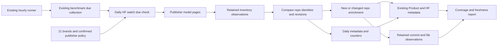

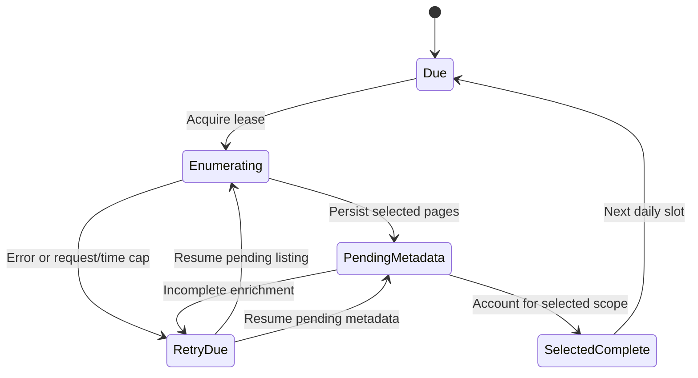

The first cycle records a baseline. Subsequent cycles compare newly returned IDs
with persisted identities. Standard publishers require walking all model pages,
including old-created repos newly made public. Google/NVIDIA stop at their
selected 100 window; report `selected_complete=true` separately from
`publisher_enumeration_complete=false` when a continuation remains. A repo that
enters that window is “new to monitored scope”, not necessarily newly created.

Use the source-neutral consolidation specified below: generalize existing
MetricCollectionRun/MetricObservation, fold HF run/repository observations into
them, and generalize the existing namespace progress model to CollectionScopeRun.
The standalone consolidation adds no CollectionJob or HFNamespaceWatchState.
Retain current schedule configuration and generic run/scope progress; additional
watcher scheduling-state requirements are a later bounded design decision.
Keep repository identity/current projections in Product and
preserve watch first/last observation pointers under row lock. Catalog-only
resources do not need fabricated metric contracts or values.

Every selected repository gets fresh daily expanded metadata/counters. New or
changed SHAs also get detailed file metadata and pinned history/tree evidence.
An unchanged SHA may reuse the detailed file manifest with its original
observation pointer; refresh the security/detail group weekly regardless of SHA.
Today’s metadata and a reused file manifest retain different observation times.
Reuse must be explicit; the current strict `groups_complete` helper must not be
made to treat an unperformed request as a fresh success.

Start with 300 requests /300 seconds using the existing budgeted client for each
automatic invocation, one watch process and no implicit authentication. All
retries/pagination count. Preserve the 16 MiB response ceiling. These are bounded
chunks, not a permanent overall collection quota. On exhaustion, retain pending
work for the next hourly runner invocation; prioritize new repos and resume
publishers fairly so Qwen cannot indefinitely starve smaller accounts. A429
retains Retry-After/RateLimit-derived retry time and yields instead of hammering
every remaining namespace. Completion/freshness stays partial until actually
achieved. First implementation measures workload and can lower chunk size to
fit the live runner; a larger population must not silently widen publisher caps.

### Shared polling organization — October 12 owner question

**Current code, inspected at `origin/main` f43b2904:** the completed timing
experiment is a standalone public-metadata script at
`<benchmark-worktree>/.local/hf-refresh-poll-20261007/worker.py`, with JSONL/file
results and a fixed expired deadline. It is not the production collector.
Production uses the hourly `pushinweight-benchmark` Render cron,
`monitor/management/commands/collect_benchmark_due.py` for due selection, then
`collect_benchmark_metrics.py` for the selected collection. Its source readers
and request Budget currently live in `scripts/benchmark_download_collector/sources.py`.
The HF reader delegates to `core/hf_metadata_client.py`, which the manual
`core/hf_catalog.py` importer also uses. `core/benchmark_metric_store.py` provides
locked, replay-safe numeric persistence; `core/benchmark_metric_operations.py`
validates operational settings and reports health. The production path already
shares some controls, but HTTP budgeting/retry mechanics overlap and due-time
logic remains inside the benchmark management command.

**Selected organization for U12:** keep Django management commands as callable
entry points. Extract only the controls with two concrete consumers, existing
benchmark collection and the new HF catalog watcher, into a small
`core/collection/` package. The proposed files are:

| Proposed module | Shared responsibility | Existing code to reuse/refactor |
| --- | --- | --- |
| `scheduling.py` | UTC daily slots, interval due checks and stable run buckets | `collect_benchmark_due.py` and `daily_collection_hour_utc` |
| `budget.py` | Physical request/retry accounting, deadlines, byte ceilings and bounded cooldown decisions | Existing benchmark Budget and HFMetadataClient request controls |
| `runner.py` | Finite dispatch, activation checks and result/health interface using shared persistence and purpose-aware continuation | Existing benchmark lock/lease behavior and generalized catalog run/scope progress |

This is an incremental extraction with shared source-neutral persistence under
the owner-selected schema consolidation below. Existing source clients/parsers remain in their current modules
until a move has a concrete second consumer. Production dependencies currently
under `scripts/` are visible technical debt; do not add new runtime collector
logic there or combine a wholesale file move with this bounded HF change.

Identify each job by source, purpose and frozen scope/policy: HF catalog
discovery and HF numeric snapshots are different jobs using the same HF client.
Schedule, limits and activation are explicit per job. Commands parse arguments
and call these services; they do not own independent sleep/retry loops. The
existing hourly scheduler runs due benchmark work first, then a bounded watch
chunk. Adding shared code does not change the live clock or activate a job.
Future cadences finer than hourly require a separately selected scheduler change.

Share one physical-request budget across nested HF calls within an invocation;
count retries exactly once and retain provider API/resolver bucket distinctions.
Do not give each wrapper a fresh allowance or assume separate processes share
limits automatically. Keep HF metrics/watch serialized on the owned runner and
explicitly guard overlap with manual catalog runs. If provider cooldown exceeds
the chunk deadline, persist the retry time and yield. Each compatible job must
produce an inspectable outcome; one failed source must not silently skip all
later sources or erase pending work.

Keep data meaning in the source/domain layer: shared CollectionObservation
retains source evidence; MetricValue retains admitted numeric measurements and
the HF adapter interprets repo/file/revision evidence. X remains on its own
authorized15-minute harvester with its credential
purpose and locks. Do not move X collection, invent GitHub collection, or route
release announcements into numeric tables under this task. Reuse a fresh HF
response between catalog and numeric ingestion only when exact identity, fields,
observed time and collection contract permit it; otherwise account for both
requests without pretending cached evidence is fresh.

**Refactor verification before watch integration:** use the actual existing
management-command → source client → writer path with mocked provider transport
and isolated PostgreSQL. Pin the existing19:00JST selection, stable batch IDs,
same-day failed-attempt behavior, OpenCode hourly and OpenRouter/Arena intervals.
Then exercise new watch commands through the same helpers: retry/request/byte/
time exhaustion, lease/cursor resumption, a failed job followed by a runnable job,
no duplicate writes and no provider calls when inactive. Preserve immutable
contracts and metric meanings; function-only helper tests are insufficient.

The management-command placement follows
[Django's documented scheduled-command mechanism](https://docs.djangoproject.com/en/5.2/howto/custom-management-commands/).
The proposed service/module boundaries are project design judgments. The
[Render cron documentation](https://render.com/docs/cronjobs) describes the
execution host; sharing helpers does not imply sharing every existing schedule.

### Source-neutral schema consolidation — October 12 owner decision

The owner identifies overlap between MetricCollectionRun and the three HF
catalog tables and directs a clean, reusable schema. Fold their shared parts
into the existing metrics infrastructure, then generalize the run/observation
names. This supersedes the earlier design that retained a separate HF ledger
and proposed HFNamespaceWatchState. Source-specific clients and interpretation
remain appropriate; shared bookkeeping and stored evidence use source-neutral
tables. This section is a proposed refactor, not a claim about deployed schema.

#### Exact current columns and their overlap

Inspected `core/models.py` at f43b2904 and migrations0045/0067. Foreign-key names
below are physical database columns, including automatically added integer IDs.

| Current table | One row means | Exact columns |
| --- | --- | --- |
| `metric_collection_runs` | One source collection batch under a reviewed metric contract | `id`, `batch_id`, `contract_id`, `source_id`, `ingestion_key`, `status`, `started_at`, `lease_expires_at`, `observed_at`, `completed_at`, `source_as_of`, `source_url`, `request_params`, `source_metadata`, `request_count`, `selected_count`, `success_count`, `payload_sha256`, `raw_payload`, `error_code` |
| `hf_model_catalog_runs` | One logical HF catalog collection, possibly resumed across several invocations | `id`, `scope`, `outcome`, `invocations`, `report`, `started_at`, `updated_at`, `finished_at` |
| `hf_model_catalog_namespace_runs` | One publisher namespace's progress inside that catalog run | `id`, `run_id`, `namespace`, `ownership`, `cursor`, `cursor_history`, `enumeration_complete`, `outcome`, `envelopes`, `raw_count` |
| `hf_model_catalog_observations` | One repository's listing, enrichment and Product-projection result inside a namespace run | `id`, `namespace_run_id`, `repo_key`, `repo_id`, `product_id`, `created_product`, `listing`, `envelopes`, `groups`, `outcome`, `observed_at`, `updated_at` |

MetricCollectionRun is created before fetching, with a ten-minute lease and a
unique ingestion key. After fetching, its assembled source payload, request
count, parameters and adapter metadata are saved; MetricObservation/MetricValue
rows and terminal run status are committed together. Existing runs with the
same key are reused; an expired running metric batch is marked aborted.
Schedule configuration lives in MetricCollectionContract.source_configuration
and DataSource.metadata, not in a run's own next_due/cursor fields. Run-level
observed_at currently receives a timestamp captured before the fetch; preserve
actual per-observation clocks and do not relabel that as HTTP response arrival.

| Common responsibility | Metrics location | HF catalog location | Consolidation |
| --- | --- | --- | --- |
| Whole-run identity/status/timing | Run id/status/started_at/completed_at | Run id/outcome/started_at/finished_at | Shared CollectionRun |
| Frozen scope/configuration | contract_id/request_params/source_metadata | scope and ownership | Explicit purpose, policy snapshot and optional metric-contract reference |
| Invocation/request evidence | request_count and assembled raw_payload | invocations/envelopes | Shared accounting with original request envelopes and count units preserved |
| Coverage/result summary | selected_count/success_count/error_code | report, raw_count, outcomes/groups | Shared run summary; provider-native detail retained |
| Publisher pagination/resumption | No corresponding run cursor | namespace row's cursor/history/completeness | Generic CollectionScopeRun |
| Per-resource evidence | MetricObservation, linked optional mapping and MetricValue | repo listing/envelopes/groups/product | Generalized CollectionObservation, with MetricValue for numeric results |

An HF partial run can resume and has no finished_at until complete; a partial
metric batch has completed_at and is terminal. Preserve this distinction using
purpose, completion and continuation state. Renaming outcome/status alone would
change behavior. Retain provider/domain outcomes such as owner_conflict and
projection_error separately from normalized execution/HTTP status.

#### Target records

| Target model/table | Starting point and responsibility |
| --- | --- |
| `CollectionRun` / `collection_runs` | Generalize MetricCollectionRun and import HFModelCatalogRun history. Shared source, purpose, batch/idempotency, timing, lease, request counts and evidence; add frozen scope, invocation history, report and updated time. The metric-contract FK remains required for numeric-purpose runs and optional for catalog-purpose runs. |
| `CollectionScopeRun` / `collection_scope_runs` | Generalize HFModelCatalogNamespaceRun. Link to shared run; source-qualified scope kind/key, ownership snapshot, cursor/history, outcomes, page/request evidence, raw count and selected/full completeness. Flat metric runs may have no scope child. |
| `CollectionObservation` / `collection_observations` | Generalize MetricObservation and merge HFModelCatalogObservation evidence. Preserve existing metric observation IDs/fields/pins; allow optional scope child and Product link, retain native payload/group outcomes/projection result and exact resource identity/revision clocks. A catalog observation requires no MetricValue or invented taxonomy mapping. |
| `MetricValue` / existing `metric_values` | Retain typed numeric measurements, definitions and windows linked to the generalized observation. Metric contracts, mappings and source-use decisions continue to constrain numeric ingestion/readers. |

**Owner-narrowed standalone count:** create zero new permanent tables; merge and
retire HFModelCatalogRun/HFModelCatalogObservation; rename/generalize existing
MetricCollectionRun, MetricObservation and HFModelCatalogNamespaceRun. The five
run/progress/observation tables become three. MetricValue, metric definitions,
contracts, mappings and provider/account identities remain. CollectionJob and
any new scheduling registry are excluded; earlier mentions are superseded.

Use existing DataSource and source-aware Account identities. Provider-specific
repo SHA, card, weight paths and gates remain source payload fields. Resource
identity includes source and resource kind; normalization follows that source's
rules. Two providers with an identical textual ID must not collide. Schema
constraints, indexes and the writer enforce the declared purpose and scope;
JSON is for source evidence/configuration, not a substitute for relational
run links, ownership, cursor/completion or queryable timing/status fields.

The existing schedule configuration remains authoritative throughout U14.
Preserve frozen contract snapshots and current operational overrides. U14
changes storage/purpose filtering without changing schedules, selection,
activation or request budgets. Due checks/locks/idempotency include purpose and frozen scope so a
catalog run cannot suppress a numeric snapshot from the same provider.

#### Migration and compatibility contract

1. Recheck current main and migration leaf before implementation. Inventory all
   ORM and literal SQL/table references, staging-refresh table sets, report/
   forecast/export readers, commands and JSON provenance pointers with:
   `git grep -n -E 'HFModelCatalog|hf_model_catalog_|MetricCollectionRun|metric_collection_runs|MetricObservation|metric_observations'`.
   Historical evidence reports retain their original meanings; active consumers
   must be adapted. Read-only counts/distinct outcomes/foreign keys and payload
   sizes establish the real production mapping when implementation begins.
2. Use explicit Django RenameModel/AlterModelTable and additive field/constraint
   operations with reviewed historical models for data transfer. Preserve
   existing metric run/observation/value IDs and relationships. Keep physical
   legacy names temporarily where needed for a compatible rolling transition;
   the target names above apply after verified cutover. Do not let a rename be
   interpreted as deleting and recreating populated tables.
3. Import catalog run/observation data in resumable batches using a durable
   `(legacy_table, legacy_id)` mapping. UUID collisions are explicit, and HF
   observation integers can overlap existing metric observation IDs. Preserve
   numeric IDs; allocate/match imported catalog identities separately. Retain
   all scope, invocation, page/listing/group evidence, original timestamps and
   outcomes. Reconcile sequences after inserting explicit IDs.
4. Remap scope parents and Product.hf_metadata.field_sources provenance. Current
   HF pointers contain `{id: observation.pk, run_id: catalog_run_uuid}`; preserve
   these via explicit legacy aliases or a verified pointer conversion. Existing
   MetricValue FKs, forecast/report pins and Product UUIDs remain intact. Do not
   invent a historical source clock, counting cutoff, lease or numeric contract.
5. Switch catalog/numeric callers to shared models/persistence, compare old/new
   results on the same isolated dataset and exercise both real command paths.
   Retain compatibility/rollback during the transition. Retirement follows
   reconciled row/evidence counts, no unresolved live/JSON references and a
   tested restoration path. Legacy HF history must be recoverable; logical
   retirement and final table removal are explicit phases, not an unreviewed
   side effect. Any eventual production operation needs its selected delivery
   scope; this planning pass performs none.

Verification must compare per-source/purpose run and observation totals,
foreign-key/pointer resolution, original timestamps, source payloads/hashes,
metric values/definitions/contract hashes and selected/full coverage. Freeze
the actual outcome mapping rather than treating every partial state as a
terminal failure. Test repeated backfill, interruption, ID collision, missing
scope, same resource ID on two sources, status/lease constraints, no dummy
numeric records and rollback on isolated PostgreSQL. A second provider fixture
and its existing numeric command path must use the same shared tables without
source-specific schema additions; no new provider batch or scheduler is implied.

Primary migration guidance:
[Django migration operations](https://docs.djangoproject.com/en/5.2/ref/migration-operations/)
and [transaction boundaries](https://docs.djangoproject.com/en/5.2/topics/db/transactions/).
The column inventory and behavior distinctions above come from this project's
source code, not those external documents.

#### ce-pov assessment — standalone zero-new-table consolidation

**Position:** proceed with the narrowed consolidation as an independent refactor.
The target shares useful run/evidence machinery already present in the metrics
stack; retaining both families leaves overlapping lifecycle and storage code.
The existing namespace progress record serves a distinct purpose and should be
generalized. Counting table names alone does not establish compatible row
semantics or a performance improvement. This is a source-grounded design
judgment; no migration or runtime test was executed for this assessment.

Fresh evidence at `origin/main` f43b2904: catalog migration0045 was added on
September24; metrics migration0067 on October6. The benchmark plan deliberately
separated catalog refresh from numeric history, including its line1614 rationale.
That distinction explains the incumbent shape and must survive shared storage.
Current `persist_source` requires pinned definitions/mappings, metric-contract
checks and terminal batch completion; `execute_catalog` resumes a logical run
across invocations and mutates per-repository group/projection progress. OpenCode
stores integer observation references in run JSON and reads literal SQL table
names. Product metadata stores catalog observation/run pointers.21 current
code/config/test/migration files reference the affected models/table names;
that footprint includes historical migrations, which remain historical evidence.
The23-document solutions scan found no matching prior consolidation learning.

**Required corrections before writer cutover:**

1. Freeze purpose-specific lifecycle and field mapping. Numeric-purpose runs
   retain required contracts, finished partial batches and immutable definition/
   source-use checks. Catalog partial/interrupted runs retain continuation.
   Preserve count units and original timestamps; shared nullable fields must
   not weaken numeric-purpose constraints.
2. Define the exact observation grain and mutation rules. Existing metric
   observation/value IDs and captured revisions remain immutable. Catalog
   enrichment progress must not overwrite admitted numeric evidence or turn
   pending/projection conflict into a false successful measurement. Preserve
   request-group revisions/envelopes and put workflow continuation in generic
   scope progress. Freeze legacy integer-ID aliases and Product/OpenCode/
   report references before transferring catalog rows.
3. Preserve staging-refresh behavior at row level. Current policy copies metric
   tables and excludes catalog ledgers. A merged table requires explicit
   purpose-aware selection/scrubbing rather than simply changing table names;
   production catalog checkpoints must not become active staging work. Update
   refresh implementation/policy/tests and verify fixture parity along with
   renamed SQL readers and sequences.

**Sequence within U14:** first generalize shared run/scope records and validate
both current callers; then merge observations after those contracts are fixed.
Both phases belong to the same standalone consolidation and retain zero-new-
table/two-retired-table scope. Run-only consolidation is a useful intermediate
step, not the completed target. Keeping the incumbent is cheaper immediately
but does not meet the selected shared-schema goal. Renaming alone would leave
duplicate writers and lifecycle/evidence storage.

U14 depends on current-main schema/consumer inspection, not U6 release research,
whole-brand enumeration, new watchers, scheduler activation or chart/forecast
work. Exit requires exact old/new data/reference parity and existing catalog/
numeric command regressions on isolated PostgreSQL. Production cardinalities,
mapping distribution, lock durations and rollback rehearsal remain unmeasured
here and must be established during implementation preparation; this assessment
does not claim production migration readiness or improved throughput.

### Implementation Units: HF amendment only

**Execution order:** U14 establishes consolidated persistence, then U8–U13
build and verify the watcher on that shared foundation. Existing U IDs remain
stable; dependencies determine order.
For the owner-selected standalone U14 run, use U14's exit and consolidation
contract. Whole-brand inventory/discovery/activation criteria below apply to
the later U8–U13 work and are not completion gates for the schema refactor.

#### U8. Freeze tracked-publisher scope and encode the exceptions

- **Dependencies:** U14 and existing U6 source work; no forecast-engine dependency.
- **Covers:** HF-R1, HF-R3, HF-R10, HF-R11; HF-K1 and HF-K2.
- **Files:** `config/hf_watch.yaml` (new), `core/hf_catalog.py`,
  `core/collection/`, `core/models.py`,
  `tests/test_hf_watch_scope.py` (new).
- **Approach:** resolve brands through current `BrandCompany` and confirmed
  `HFOrg`; deduplicate namespaces, pin the policy and preserve source gaps.
  Encode Google/NVIDIA selected limits explicitly; `--all-tracked` and an
  overall `--max-models` are not substitutes for per-publisher policy. Configure
  the publisher policy and reviewed preview on U14's existing shared records.
  U12 assesses watcher due/retry operation separately from U14. Preserve
  the current manual importer/default scope unless its caller opts into watch
  policy. Existing400 Google extras remain untouched.
- **Test scenarios:** exact 21-brand set plus explicit Google; shared namespaces
  requested once; missing/unconfirmed ownership stays a gap; a Google listing
  with 101 rows selects100 and creates/enriches no101st Product; an existing
  out-of-window row and its curated identity/history survive unchanged.
  Two confirmed Google namespaces with overlapping candidate lists still
  produce only 100 selected company-wide repositories, not200.
- **Exit:** deterministic policy/scope preview with selected versus full-namespace
  coverage distinctions using the shared schema, preserving current rows.

#### U9. Discover newly observed repos through daily inventory comparison

- **Dependencies:** U8.
- **Covers:** HF-R2, HF-R3, HF-R8, HF-R10, HF-R11; HF-K3.
- **Files:** `core/hf_watch.py` (new), `core/hf_catalog.py`,
  `core/hf_metadata_client.py`, `core/models.py`,
  `tests/test_hf_watch_discovery.py` (new).
- **Approach:** reuse the current `author`, `full=true`, `limit<=100`,
  `sort=lastModified`, `direction=-1` listing and provider Link cursor. Persist
  each page and its repo observations before cursor advancement. Baseline
  prior catalog rows without generating release events. Compare IDs across
  completed selected inventories and preserved Product identities; record
  HF createdAt and our first_seen_at separately. Continue standard publishers
  through old records rather than stopping at yesterday’s creation timestamp.
  For exceptions, stop after 100, preserve continuation as evidence and mark
  the window as intentionally capped. Retain known identities when a row drops
  out of a cap or a request fails; rename/transfer suspects remain reviewable.
  Separate listing from heavy enrichment in watch mode: account for each
  selected publisher’s inventory before draining daily per-model metadata.
  A failed namespace keeps its gap while other namespaces continue; do not
  reuse the current manual runner’s interleaved alphabetical walk unchanged.
- **Test scenarios:** baseline 500 existing repos produces no 500 fake launches;
  next day adds a new repo and detects it once; a repo created months ago but
  newly public is detected; partial page/crash resumes without lost/duplicate
  IDs; repeated cursor/empty page with continuation fails visibly ; 101 new or
  modified exception rows leave declared capped coverage rather than “all”.
- **Exit:** durable per-namespace inventory diff with correct first-observation
  semantics, restart safety and no silent scope expansion.

#### U10. Collect model metadata and distinguish setup from weight observations

- **Dependencies:** U9.
- **Covers:** HF-R4–HF-R7.
- **Files:** `core/hf_watch.py`, `core/hf_catalog.py`,
  `core/hf_metadata_client.py`, `core/product_metadata.py`,
  `tests/test_hf_watch_observations.py` (new),
  `tests/fixtures/hf_watch/` (new fixtures within existing tests tree).
- **Approach:** reuse detail (`blobs=true`, `securityStatus=true`) and expanded
  metadata groups and preserve returned/unknown fields. Add bounded commit
  history and pinned file-tree metadata helpers; never fetch weight content.
  A new/changed repo gets its current manifest and recorded-history evidence,
  with complete-history/cursor status. Compare weight file paths/content IDs
  and hashes at the same revision to distinguish changed weights from a
  README-only update. Size/config/source task information remains evidence,
  not a forced model-LLM/agent/harness classification. A gated manifest records
  that condition and does not become public-download proof. Initial/superseded
  dates and paired X announcements remain independently sourced. Leave
  canonical release review and `ModelReleaseEvidence` schema integration to U7.
  Keep activity/history completeness separate from the current detail/expanded
  metadata-group contract. A history/tree error leaves a named activity gap;
  it does not erase successful daily counters or pretend the repo is empty.
- **Test scenarios:** `.gitattributes`/README/config only yields setup; a later
  safetensors manifest yields first observed weight evidence; README-only
  edit produces no changed-weight event; initial revision already containing
  weights preserves that distinction; gated/401/403/404/429/malformed results
  differ from empty success; imported history predating first observation is
  not labeled historical public availability; same observation rerun is
  idempotent; company disagreement cannot overwrite curated attribution.
  A failed history page with successful expanded counters preserves those
  numeric observations and exposes incomplete history independently.
- **Exit:** replayable metadata, revision and manifest evidence with explicit
  change kind, gate status and time precision; no weights downloaded.

#### U11. Refresh daily model counters and publisher account data

- **Dependencies:** U8–U10.
- **Covers:** HF-R4, HF-R8, HF-R9.
- **Files:** `core/hf_watch.py`, `core/hf_metadata_client.py`,
  `core/product_metadata.py`, `core/hf_catalog.py`,
  `tests/test_hf_watch_refresh.py` (new).
- **Approach:** refresh every selected model’s expanded metadata once per
  logical day and retain raw observations, including rolling downloads,
  optional all-time downloads, likes, createdAt, lastModified, SHA, tags,
  model-card/configuration data, sizes, file references and provider mappings.
  Refresh each deduplicated publisher’s follower/profile observation daily.
  Use original source-group timestamps for reused detail observations; a
  once-created Product is not enough to skip later daily refreshes. Preserve
  omission versus explicit null/empty/error and current precedence rules.
  The shared source-observation ledger supplies fleet-wide counter history without
  automatically enrolling unreviewed Products into measurement taxonomy or
  altering the existing four-identity benchmark contract. Later chart admission
  uses separately reviewed mappings; current benchmark history remains intact.
- **Test scenarios:** unchanged SHA still updates today’s downloads/likes;
  explicit null replaces old data but omission/error preserves it with stale
  provenance; two brands sharing one publisher produce one follower fetch;
  new day keeps previous raw numeric observations; reused manifest retains its
  old timestamp; overlapping catalog update preserves curated fields/watch
  pointers; missing all-time count is unknown, not zero or a failed required
  rolling-download value.
- **Exit:** fresh daily source observations for selected models/accounts, with
  numeric definitions and raw history; no fabricated daily download velocity.

#### U12. Add bounded due/resume operation and collection health

- **Dependencies:** U8–U11.
- **Covers:** HF-R8–HF-R11; HF-K3.
- **Files:** `monitor/management/commands/collect_hf_catalog_due.py` (new),
  `monitor/management/commands/hf_catalog_watch_health.py` (new),
  `core/collection/` (new shared scheduling/budget/runner/persistence helpers),
  `monitor/management/commands/collect_benchmark_due.py`,
  `monitor/management/commands/collect_benchmark_metrics.py`,
  `core/benchmark_metric_operations.py`, `core/hf_metadata_client.py`,
  `scripts/benchmark_download_collector/sources.py`,
  `core/hf_watch.py`, `project/settings.py`,
  `scripts/benchmark_download_collector/README.md`,
  `docs/operations/2026-09-24-230000-import-known-hf-product-catalog.md`,
  `tests/test_hf_watch_due.py` (new).
- **Approach:** read-only due/health commands by default; application requires
  explicit `--apply` and an independent HF-watch activation setting, default
  false. First extract and verify the shared polling controls described above
  using the existing benchmark callers, then attach the watcher to those same
  controls and U14's shared records. Preserve existing commands/configuration and per-source behavior.
  One UTC daily bucket per frozen scope, short workflow leases and the
  existing catalog lock prevent duplicate writers. A partial run resumes on
  later hourly ticks without a second overlapping daily scan. Run current
  benchmark due work before new watch chunks, then yield at request/time/
  provider limits. Add the watch command to the existing owned hourly benchmark
  scheduler only in a later authorized activation; inspect its real current
  command/service first because it is not declared in the retained render.yaml.
  Do not add a second X harvester, Celery beat or an always-running retry loop.
  Health reports each namespace’s requested cap, rows/pages, selected/full
  coverage, new/changed/setup/weight observations, last successful completion,
  per-repo metadata age, pending jobs, request/retry totals and next retry time.
  Overdue work remains visibly partial; changed ownership/policy cannot resume
  under an old scope without review.
- **Test scenarios:**19:00 JST due bucket, before-slot no-op and next-day refresh;
  two simultaneous ticks create one active watch run; crash/lease expiry resumes
  exactly once;300-request/300-second exhaustion preserves work;429 pauses and
  resumes without scanning every account during cooldown; full standard
  enumeration and selected 100 exception completion have different coverage;
  outdated ownership is detected; existing benchmark/X scheduling remains
  unaffected while the watch flag is false; both real command call chains use
  the shared due/budget controls without double-counting retries, and a failed
  job does not prevent an independent later job from reporting its outcome.
- **Exit:** bounded commands, automatic resumability and honest health output;
  proposed activation is concrete but not applied under this planning request.

#### U13. Verify the HF regression net and selected-scope completeness

- **Dependencies:** U8–U12.
- **Covers:** all HF-R requirements.
- **Files:** `tests/test_hf_watch_regression_net.py` (new), existing
  `tests/test_hf_metadata_client.py`, `tests/test_hf_catalog_scope.py`,
  `tests/test_hf_catalog_runner.py`, `tests/test_hf_catalog_persistence.py`,
  `tests/test_hf_catalog_regression_net.py`, `tests/test_product_verification.py`,
  `tests/test_benchmark_download_operations.py`,
  `tests/test_benchmark_download_sources.py`,
  `tests/test_benchmark_download_persistence.py`,
  `tests/test_collection_schema_consolidation.py` (new),
  and `docs/reference/hf-model-catalog.md`.
- **Approach:** start with fixtures/isolated PostgreSQL, then one bounded public
  metadata sample and isolated staging persistence when implementation/testing
  is authorized. The differentiation test must reproduce a new repository,
  an old-created newly visible repository and a setup-to-weights transition.
  Verify migrations, stable Product identifiers and unchanged curated fields,
  and current manual catalog/rare-type/HF measurement behavior. Reconcile the
  selection before declaring completion: all standard namespace pages exhausted;
  Google/NVIDIA selected 100 or provider-proven fewer; all selected daily metadata
  successes or named failures; no unconfirmed namespace promoted. No full
  production import, scheduler change or deployment is a test substitute.
- **Test scenarios:** current manual importer preview remains no-network/no-write;
  existing four-identity benchmark observations/definitions survive a catalog
  refresh; interrupted selected-scope enrichment reports partial and resumes;
  an isolated sample detects an old-created newly visible repo and a later
  weight manifest without manufacturing historical public-release dates;
  fixture coverage for all 21 brands enforces the two company caps and leaves
  unconfirmed ownership unresolved; shared polling extraction preserves the
  real existing command/client/writer behavior and isolates per-job failures.
- **Verification commands during implementation:** focused `pytest` over the
  new HF-watch tests plus the existing HF client/catalog/Product verification
  suites; relevant benchmark collector regression tests; Django migration checks
  against current main schema; read-only health/identity/count comparisons.
  Use the repository’s isolated PostgreSQL settings and stable basetemp practice.
- **Live proof after separately authorized activation:** observe the exact
  deployed revision and enabled scope, one natural due run with retained new/
  changed observations, later tick/day behavior, provider budgets and preserved
  benchmark/X health. Report actual scope and backlog rather than asserting
  whole-fleet completeness from a three-model smoke sample.
- **Exit:** affected regression checks pass; selected-scope coverage reconciles;
  reference explains manual catalog versus daily watcher/counters accurately.

#### U14. Consolidate HF and metrics persistence into source-neutral collection records

- **Dependencies:** current-main schema/consumer inventory only;
  no U6 release-research, watcher or forecast implementation dependency.
- **Covers:** HF-R3, HF-R8, HF-R9, HF-R11; owner-selected shared schema above.
- **Files:** `core/models.py`, `core/migrations/` (new explicit rename/alter/data
  operations), `core/collection/store.py` (new shared persistence),
  `core/hf_catalog.py`, `core/product_metadata.py`,
  `core/benchmark_metric_store.py`, `core/benchmark_metric_operations.py`,
  `core/benchmark_metric_series.py`, `core/benchmark_opencode.py`, affected
  benchmark/HF management commands, `config/staging_refresh.yaml`,
  `scripts/staging_refresh/database.py`, `scripts/staging_refresh/policy.py`,
  `tests/test_collection_schema_consolidation.py` (new), affected existing
  catalog/benchmark/forecast/staging-refresh tests and focused schema references.
- **Approach:** extend/rename the existing metrics run and observation models,
  import HF run/observation evidence into them with durable legacy-ID mappings,
  and rename/generalize the namespace progress model. Create zero new permanent
  tables; CollectionJob/HFNamespaceWatchState and new scheduler work are excluded.
  First verify common run/scope handling, then merge observations after freezing
  their grain/mutation and legacy reference contracts. Preserve metric
  contract/definition/mapping pins and MetricValue identities/relations. Make
  catalog-purpose rows independent of numeric admission and route both writers
  through shared persistence. Inventory every ORM/raw-SQL/table-policy/JSON
  provenance consumer before selecting migration sequencing. Implement the
  migration/read-compatibility/retirement sequence described below against
  isolated PostgreSQL. Preserve purpose-aware staging copy/exclusion rules;
  a whole-table rename is insufficient for formerly separate policy categories.
  This unit changes neither provider selection nor current schedules/activation;
  it does not execute a production migration under this planning request.
- **Test scenarios:** overlapping legacy observation integer IDs map correctly
  without changing existing MetricValue or forecast pins; an HF run UUID
  collision is explicit; pending/partial/interrupted/resumed HF runs retain
  all invocation/cursor/group evidence; completed partial metric batches stay
  terminal; Product.hf_metadata field-source pointers resolve; repeated import
  is a no-op; catalog rows require no dummy taxonomy/metric definition; two
  sources with the same resource ID stay distinct; a catalog run cannot make
  the numeric due check skip its own job; isolated rename/forward/reverse
  migrations preserve counts, timestamps, payloads, hashes, constraints and
  sequence positions; staging retains copied numeric evidence while excluding/
  scrubbing catalog work, no production cursor/lease resumes there; current
  HF/manual and all four numeric source callers
  retain their behavior and source-use checks.
- **Exit:** one authoritative shared run/observation path serves existing HF
  catalog and numeric collectors through tested compatibility. The exact
  backfill, reader switch and legacy-table retirement artifacts are concrete
  and verified in isolation; current history/IDs/pins and rollback evidence
  reconcile, including staging-refresh purpose parity. Two legacy HF tables
  merge/retire, three existing tables generalize, zero new permanent tables.
  Provider calls, production writes and deployment are separate.

### Verification Contract and Definition of Done

1. Exact21 tracked brands resolved through reviewed company ownership, with
   Google explicitly extra and Google/NVIDIA100 caps encoded before writes.
2. Daily publisher comparison detects new IDs and old-created newly visible
   repos in uncapped scope; capped publishers retain their declared limitation.
3. Baseline, partial/resumed and repeated runs preserve IDs/evidence without
   fake releases, lost cursors, destructive absence handling or duplicate work.
4. Every selected model/account has successful current metadata/counter
   observations or a named gap/backlog, and prior observations remain available.
5. Setup-only, weight-file, weight-change, README-only and gated outcomes differ;
   commit/upload/announcement/observation clocks are never collapsed.
6. Physical request/time/provider limits are honored with persisted progress;
   catalog/manual review and existing benchmark/X paths retain their behavior.
7. Commands and scope are ready for a separately authorized activation. A live
   coverage claim requires actual deployed/scheduled-run evidence, not this plan.
8. U14 reconciles all legacy/shared rows and references, proves shared persistence
   with catalog and numeric callers, and preserves per-purpose scheduling,
   partial/resume behavior, source-use checks and rollback/retirement sequencing.

### Assumptions, limits and deferred work

- “All model data” means available public model/account metadata, counters and
  revision/file evidence. Private contents, weight binaries, inference, datasets
  and Spaces are outside this selected model-collection scope.
- The Google/NVIDIA exception means complete detection is promised only within
  the selected 100 window. A busy publisher can push a repo outside that window;
  the health report must state that limit. No popularity threshold applies.
- Daily discovery has up to a daily interval of observation lag. Faster release
  watching/webhooks can be scoped later; daily data does not certify an earliest
  public-release instant or guarantee a forecasting advantage.
- New confirmed namespaces enter the next reviewed policy snapshot; a missing
  account mapping is a review task, not permission to discover/confirm arbitrary
  publishers or expand the 21-brand membership.
- Direct HF/GitHub release evidence in canonical `ModelReleaseEvidence`, the
  five-kind product taxonomy, broad benchmark mapping, chart annotations,
  historical X repair and forecasts/auditor/recursive learning remain separate
  units. The observer keeps evidence those units can consume later.

### Primary sources and plan review boundary

- `docs/plans/2026-09-24-162207-feat-hf-model-product-catalog-plan.md`: exact owner
  Google/NVIDIA100-lastModified exception and preservation of Google extras.
- `docs/reference/hf-model-catalog.md`, `core/hf_catalog.py`,
  `core/hf_metadata_client.py`, `core/product_metadata.py`,
  `monitor/management/commands/import_hf_product_catalog.py`: existing catalog,
  metadata precedence, pagination, budgets and resumable observations.
- `core/benchmark_metric_operations.py`,
  `monitor/management/commands/collect_benchmark_due.py`,
  `scripts/benchmark_download_collector/sources.py`: existing daily HF counts,
  account metrics and hourly due checking; preserve the reviewed current cohort.
- `docs/research/2026-10-12-132932-g3-x-hf-github-release-dates.md` and
  `docs/analysis/2026-10-12-091100-g3-tracked-brand-family-register.json`:
  observed clocks, current fleet gap and source-qualified namespace register.
- Official HF docs rechecked October 12:
  [model search/author listing](https://huggingface.co/docs/huggingface_hub/en/guides/search),
  [model/history/file metadata APIs](https://huggingface.co/docs/huggingface_hub/en/package_reference/hf_api),
  [provider rate limits](https://huggingface.co/docs/hub/en/rate-limits),
  [visibility changes](https://huggingface.co/docs/hub/en/repositories-settings).
  Keep tested direct REST mechanics; no SDK/client rewrite is required.

Planning verification is document/source review only. No application tests,
catalog batch, migration, production write or scheduler activation ran while
preparing this amendment. Whole-plan forecast readiness remains draft; this
bounded HF implementation contract does not resolve unrelated forecast design.

### 2026-10-12T16:21:52+09:00 — HF collection planning result

U8–U13 are the bounded HF execution contract: exact21tracked-brand publisher scope plus explicitly requested Google; all standard public model repositories and company-wide100latestlastModifiedGoogle/NVIDIA exceptions; daily19:00JST identity comparison with inventory before heavy metadata; full metadata/counter observations, changed-revision/file evidence and resumable bounded operation. The21-brand register, exception source, typed observation clocks, unknown/partial/capped states, deployment boundary and regression-net unit are present. Google400extras and current benchmark contract remain preserved.

Main-thread coherence, feasibility, scope and adverse-case review followed the AGENTS sequential-agent mapping; it is not an independent or cross-model review. Corrections made before completion: cap applies once per exception company, not per namespace alias; discovery precedes enrichment rather than retaining the manual importer’s alphabetical interleaving; history failures are separate from daily counter completeness; prospective300-request/300-second chunk budgets are described as selected defaults, not already deployed settings. Source/identity/unit/requirement/link/whitespace checks and same-plan annotation/check follow. No application tests, provider/model collection batch, production write, migration, scheduler change, Git publication or deployment performed. Current endpoint remains a saved plan, on-request.

### 2026-10-12T16:44:56+09:00 — Benchmark timing and shared polling organization

Owner requests the completed HF poll result, use of that time and a reusable code organization for future polls. HF-K3 now retains10:00UTC/19:00JST with the exact three-repository intervals and48-round/144-request/141-success receipt. Completed local experiment code is distinguished from current production Django polling. U12 first extracts shared scheduling/budget/finite-run controls with the existing benchmark callers, then attaches HF discovery; U13 pins both command/client/writer paths. Source parsing, catalog/metric storage, immutable contracts and the current X runner remain separate. Main-thread source/evidence/link/whitespace and same-plan annotation checks follow; no implementation, test execution, experiment restart, providerbatch, data/schema/scheduler/Git or delivery action.

### 2026-10-12T18:58:11+09:00 — Source-neutral schema consolidation selected

Owner asks for exact run/catalog columns, identifies overlap and directs folding HF bookkeeping into the existing metrics infrastructure. Current schema inventory records20/8/10/12columns for metric run/catalog run/namespace/repository rows. The target generalizes MetricCollectionRun to CollectionRun and MetricObservation to CollectionObservation, merges catalog history and generalizes namespace progress to CollectionScopeRun. CollectionJob replaces the earlier HFNamespaceWatchState proposal; MetricValue/metric contracts remain numeric-specific. U14 is the new prerequisite to U8–U13 and covers HF-R11. Main-thread migration/integrity review identifies UUID/integer collisions, Product JSON provenance, source/purpose-aware due checks, differing partial/resume semantics and frozen metric/report pins; the plan specifies exact mapping/compatibility/rollback/retirement verification. All source-specific persistence instructions in the active amendment are reconciled with this decision. This is a saved design; no code/test execution, providerbatch, data/schema/migration/scheduler/Git/deployment action.

### 2026-10-12T19:48:53+09:00 — Standalone U14 ce-pov and zero-new-table scope

Owner narrows the schema refactor and resumes ce-pov. Read-only source/consumer/precedent/primary-guidance assessment at f43b2904 supports the independent consolidation, with purpose-specific run completion, immutable numeric observations versus catalog progress, legacy ID/JSON pointer mapping and purpose-aware staging-refresh behavior fixed before writer cutover. Current schema history confirms catalog September24 and metrics October6;21 affected code/config/test/migration files and existing command/continuation tests were inspected, not executed. U14 now depends only on current-main schema/consumer inspection and is separate from U6/U8–U13/forecast/scheduler work. Target:0new permanent tables,2HF tables merged/retired,3existing tables generalized; CollectionJob and new scheduling registry excluded. The same plan and authoritative coordination record this decision after the judgment was formed. Source/doc/ownership/link/whitespace and final annotation/check follow. No implementation/test execution, providerbatch, live DB/migration/scheduler/Git publication/deployment action; production migration sizing/rehearsal remains unperformed.

### 2026-10-12T20:06:09+09:00 — Standalone execution authorized

Owner authorizes executing the schema refactor separately from the rest of G3. Implementation owns feat/collection-schema-consolidation from current main in the authoritative .worktrees area; its Ollija-selected plan is docs/plans/2026-10-12-105837-feat-collection-schema-consolidation-plan.md. Zero new permanent tables, two merged/retired and three generalized remains settled. Existing G3 code/worktree and future units remain preserved. Owner clarifies removal of original-content storage seven-day waiting period; retain actual legacy-writer/reference integrity checks and do not retire that storage under this timer change. Endpoint is implementation/local verification; no production migration/collection/scheduler/Git publication/deployment authorization.

### 2026-10-13T08:11:09+09:00 — Standalone U14 production delivery completed

Owner explicitly authorized deploying both standalone schema consolidation and original-content seven-day waiting-period removal, then resumed that release after the run/observation walkthrough. The same candidate `b9f03bc17838d827700679e6e1984cfcd38e3bb3` passed staging and is live on production web, both active workers and all three production crons. Migration `0080_collection_schema` is applied. [Committed standalone execution plan](https://github.com/allenwlee/pushin-weight-v2/blob/b9f03bc17838d827700679e6e1984cfcd38e3bb3/docs/plans/2026-10-12-105837-feat-collection-schema-consolidation-plan.md) and [durable production receipt](/Users/fuchitalee/development/pushin-weight-v2/.ollija/state/collection-schema-release-20261013/README.md) carry the details. This completes U14 independently of U8–U13, release repair, forecasts and learning; no remaining G3 scheduler or engine activation is implied.

Zero permanent tables created, two HF tables merged/retired, three generalized. Baseline196numeric runs/122870observations/366185values and20catalog runs/47scopes/2407observations are retained; full counts/totals/catalog fingerprints, all run fields, bounded numeric row fields, Product identities/pointers and physical table identities reconcile. Original-content storage remains intact; its production retirement report has no calendar wait, with actual legacy-writer and encrypted-restore requirements retained. Numeric/catalog ORM readers, old import aliases and validated constraints pass. Captured live benchmark launcher regression exposed its external old-name import and was corrected before deployment.

342local tests including150required PostgreSQL checks pass with zero required skips/errors; release/restore/launcher checks also pass. Review remained sequential in this thread; no independent reviewer claimed. Missing earlier source-reader grants were reconciled with the checked-in refresh policy: SELECT on copied tables/sequences and MAINTAIN on excluded tables, revoking scope MAINTAIN after its rename. A real TLS staging-service connection passes the deployed read-only source-policy guard with no writes. No actual refresh, credential/allowlist or schedule change performed. Natural benchmark completes with2newOpenCode observations/6values; HF correctly remains not due at the hourly tick. Natural harvest on the exact candidate reads69posts/inserts44 with zero persistence failures. It remains degraded on two classification failures and the canonical-summary cohort warning; the classification validation error also appears in three pre-release log records. No schema/import/database exception observed; this is not an overall clean harvest-health claim. Public route HTTP200 checks pass; no authenticated UI acceptance or exhaustive numeric raw-payload rehash claimed.

After exact-candidate staging verification and production deployment, independent authorized G2 candidate b1a47b45 advanced staging and incorporates this revision; preserve it and the earlier staging proof. Release only this bounded deployment claim. Preserve dirty original G3/chart work, other owners and local/remote feature branches. Remove only the clean, registered, unlocked canonical release worktree at the verified candidate as the final filesystem action, after receipt and coordination updates.


## ChartEngine foundation subplan — October 19 draft

**Current scope:** this subsection retains foundation requirements and the earlier discussion. The completed [October20 build plan](#chartengine-first-comparison-build-plan--october20) owns current metric/control/performance/storage choices and U15–U22; older statements here that those choices remain open are superseded by CE-R28–R31 and KTD4 there.

**October20 parallel-session continuity — `g2-chartengine-01a15790`:** owner
requests a G2 fork to work on ChartEngine in parallel and selects the13:26
ChartEngine handoff. This session resumes requirements discussion in this same
plan/worktree; it does not take over Pulse's Event Dossier implementation or
G3's collection refactor. Worktree HEAD remains7c426c3a with existing dirty
prototype/locale/editorial/settings files preserved. The selected seven-table
dossier foundation and nine-table collection refactor remain separately owned,
unmerged inputs; no implementation or release is selected here. CE-Q1–6 remain
open. Next: select the first comparison and required metrics, then settle its
controls, freshness, measured performance and saved/MCP behavior. Recommendation
remains one release across metrics, then two releases aligned by explicit age.
Orientation complete; editing OFF while awaiting the next owner direction.

**October20 first-case selection:** owner says “let's use the existing:
dsv4.1flash and glm5.3.” CE-Q1 subjects are now selected: DeepSeek V4.1 Flash
(`deepseek-ai/DeepSeek-V4.1-Flash`) and GLM 5.3 Flash
(`zai-org/GLM-5.3-Flash`), matching the retained gallery/export. Use these
existing examples to establish the first ChartEngine comparison contract.
The earlier one-release-first recommendation is no longer a selection question.
Existing six-metric views include brand posts, HF rolling downloads, daily
OpenRouter tokens, Arena score/rank and repository likes; release-response
views cover posts, tokens and HF snapshot net change with raw/normalized modes.
These are source capabilities, not a claim that every metric/layout/control
is selected. Brand posts remain brand-grain context, separate from exact-model
measurements. Existing saved exports are dated evidence, not a current live feed.
Keep explicit release-age anchors under the already-selected priority; exact
default milestone, metric/layout/control scope, freshness, performance and save/
MCP behavior remain CE-Q2–6 work. No fresh collection or implementation selected.

**Draft boundary:** owner requested the known basics first, followed by questions.
This subsection is the canonical ChartEngine foundation draft within the existing
G3 plan. CE requirements and questions do not renumber the existing R/U records.
This checkpoint is not ready for implementation; initial scope and performance
criteria remain open. No application work, migration, collection, model call,
commit, push or delivery is authorized by this draft. Parent delivery remains
`on-request`.

### Plain-English Summary

ChartEngine should turn collected observations and an explicit comparison
request into a playable chart and the numerical evidence behind it. The same
calculation must support RA research, the reader's chart and a saved shared view.
Users should be able to explore the data through toggles, time ranges and other
selected controls without making ordinary interactions wait for expensive
historical queries.

We have useful parts: raw measurement storage, historical readers, saved G3
chart examples, several interactive prototypes and a homepage count-materialization
candidate. They are not yet one integrated engine. This draft records the common
requirements while leaving the initial chart/metric selection, cache design,
precise control behavior and measurable speed targets open. Completion will need
both numerical correctness and actual browser interaction proof.

The owner selected starting this core draft before chart-dependent Pulse
implementation. Independent PM/RA policies can continue in parallel. Chatter,
source collection, prediction estimation and the homepage release retain their
existing owners and authority.

### Goal Capsule

- Objective: establish one reusable definition and calculation path for the
  selected chart families, with responsive exploration and reproducible evidence.
- Authority: October 17–19 owner discussion, existing G3 decisions and the linked
  Pulse plan. The owner explicitly requires charts to be playable/reconfigurable.
- Scope now: record confirmed requirements, source facts, proposals and open
  questions. The gallery does not select all nineteen views for implementation.
- Open blockers to an implementation plan: CE-Q0 now retains only unresolved display/evidence/revision and shadow-clock
  details after the October20 decisions; CE-Q1–CE-Q6 remain scoped chart questions. Broad any-source inclusion and
  immediate announced-release coverage are settled, not pending questions.
  Historical release-backfill is required; acquisition scope/budget, storage
  extension and execution remain unselected. Release route/cache backend are open.

### Confirmed requirements

**Use and ownership**

- CE-R1. One ChartEngine should support the selected chart families through
  reusable definitions and calculations. Selecting which families to ship is
  still open; retain the other prototypes as reference.
- CE-R2. Support both RA/editor comparisons and reader exploration. G2 chooses
  research questions; G3 owns chart calculations/rendering; G4 shares saved
  views/MCP inputs; G5 embeds the result. Shared consumers use the same meanings.
- CE-R3. The plotted values and numerical evidence supplied to RA must agree on
  subjects, filters, calculation and data cutoff. Research interpretation and
  probability estimation remain separate responsibilities.

**Measurements and calculations**

- CE-R4. Preserve brand versus exact-model/release scope, source identity, units,
  measurement windows and timestamps. Rank, score, daily tokens, likes and rolling
  download counters keep their different meanings.
- CE-R5. Separate observation window, reference/baseline window, visible range
  and forecast horizon. Pulse supports long-period analysis; user TrendNarrative
  requests extend up to a year. The exact first-version controls/resolutions are
  open. Existing 360-day/1,000-bucket G3 limits are code to reassess, not a silent
  reduction of the owner's year-scale requirement.
- CE-R6. Make each normalization's formula and selected baseline explicit.
  Existing examples include `100 * (value / baseline - 1)` using a fixed launch
  value or a reference-period average. Smoothing order must be explicit. A
  compressed display scale does not change the underlying percentage/readout.
  Baseline changes require an explicit calculation rule; cropping the viewport
  must not silently invent a new denominator.
- CE-R7. Preserve missing/partial coverage and invalid denominators. An observed
  zero, zero collected posts and an unavailable provider observation are distinct.
  A difference between rolling HF counters remains a net snapshot change, not
  an inferred count of new daily downloads. Seasonality/peer adjustment is a
  distinct calculation from simple percentage normalization; its method is open.
- CE-R8. Retain evidence origin and the time it became available. The existing
  accepted preference for reconstructed versus observed history belongs to source
  selection; preserve both evidence records and prevent later reconstruction
  from entering a historical forecast's earlier information cutoff.

**Playability and saved views**

- CE-R9. Chart manipulation must be responsive on desktop and iPhone. Select
  appropriate detail for long ranges and allow useful reconfiguration through
  toggles. Saving values in RAM alone does not establish acceptable performance.
- CE-R10. A saved/published view must remain reproducible as new observations
  arrive. Reader exploration must not overwrite the original research evidence.
  Capture the selected settings, calculation/input identity, cutoff and the
  values required to reproduce that view; exact payload/storage design is open.
- CE-R11. Counts, transformations, caching and rendering should run in code.
  Ordinary chart controls must not require an additional model call. Supplied
  forecast/scenario series must identify their method and assumptions; the
  MiniMax toy does not establish a qualified forecast model.
- CE-R12. Reuse existing measurement, collection and publication infrastructure
  where meanings fit. The October 18 owner requirement makes materialization
  lifecycle state reusable across datasets. The proposed name/columns/cache
  backend are not selected. No new table, column or migration is selected by
  this subplan; any later persistence change needs the schema/writer audit.

- CE-R13. Settle the qualifying model-release event, identity/milestone rules
  and explicit date/range policy before downstream release-relative chart choices.
  A complete-data normalization week cannot stand in for a release window.
- CE-R14. After that contract, plan historical `release-backfill` to populate
  as many qualifying releases as available evidence supports, with attributable
  milestones, idempotent reconciliation and explicit scope/coverage gaps.
- CE-R15. Include releases discovered from any source, including official named
  announcements before availability; small scale, low attention, missing metrics
  or absence from another platform must not disqualify a release from coverage.
- CE-R16. Detect and provisionally follow suspected shadow releases, retaining
  evidence so later information can confirm, reconcile or retire the candidate.
- CE-R17. Keep release inclusion separate from analytical readiness and research
  significance; detailed treatment of sparse/uninteresting outcomes is deferred.
- CE-R18. Design special-event tracking for reuse beyond model releases, including
  personnel changes and links to the pending prediction design; use structured
  domain extensions where special treatment warrants them.

### October20 owner decisions and deferred prediction compatibility

- CE-R19. Track releases at atomic identifiable model/checkpoint/size grain;
  repositories/datasets can differ. Grouping is future work, not an initial
  grouping-table requirement.
- CE-R20. No universal internal release date. Preserve typed first announcement,
  repo creation/upload, download/like and other supported milestone claims with
  precise source/knowledge clocks and basis. A prediction selects or derives its
  own explicit anchor; display labels do not become universal truth.
- CE-R21. For shadow identity confirmation, official X posts are decisive;
  ambiguous wording requires interpretation. Tracked-brand LLM shadows warrant
  a dossier and can support an identity question. After30days without confirmation,
  remain unresolved, not automatically false/retired. Preserve access versus identity.
- CE-R22. Attach sources continuously. Research-type posts and official-account
  changes trigger RA reassessment; cheap projection refresh is a separate action.
- CE-R23. Future local prediction creation is automatic under defined templates;
  draft/validity states do not impose a manual/significance admission gate.
  Release-age alignment is the default comparison priority.
- CE-R24. Future ChartEngine projections cover next n days and respond each cycle
  to relevant changed posts/data. Separate issued_at, cutoff and target times,
  output spacing and refresh frequency; preserve historically used revisions.
- CE-R25. Full prediction functionality is deferred beyond the next release.
  Foundation identity, milestone, provenance and saved-input APIs must accommodate
  later projection/contract extensions. Do not prebuild the21-table alternative,
  add a prediction flag to MetricValue or execute forecasting from this planning.
- CE-R26. Do not propose any new JSON or JSONB database column without express owner permission. The October20 instruction applies before proposing a column, as well as before implementation. Existing JSON columns are not automatic authority for a new entity or storage design.
- CE-R27. Use the existing DeepSeek V4.1 Flash and GLM 5.3 Flash examples for the first ChartEngine build case; retain exact atomic-model identity and separately labelled brand context.
- CE-R28. First-version metrics are collected brand posts, HF downloads, OpenRouter tokens, Arena score, Arena rank and repository likes, individually toggleable. This is the owner's approval of the four recommendations on October20.
- CE-R29. Offer announcement and first usable availability as release-age anchors, default to announcement, and visibly identify each selected milestone/date. Preserve the actual supported precision and show unavailable rather than silently fall back.
- CE-R30. Keep the existing raw/normalized, daily/three-day trailing smoothing, range and line-toggle controls. Custom normalization-reference periods are deferred; existing fixed reference definitions remain explicit.
- CE-R31. Target approximately100ms for loaded controls and at most2s to open a previously loaded comparison on desktop and iPhone. Capture named device/network/runtime profiles and report cold loads separately; these are approved targets, not passed measurements.
- CE-R32. The future prediction experience lets users see blended metric averages across the historical release population. ChartEngine must accommodate that consumer through reproducible composition of dossier charts, not a hard-coded two-release schema. Exact blending/eligibility/weighting policy remains to define; full prediction execution remains deferred.
- CE-R33. The atomic chart unit belongs to one Event Dossier. Reuse that unit to compare its dossier against N other dossiers; comparison membership and aggregate calculations must not own or duplicate the atomic chart's underlying measurements and evidence.

### Verified starting point and limits

The following describes inspected source and retained review artifacts, not a
fresh production audit.

| Area | What exists | Important limit |
| --- | --- | --- |
| Raw measurements | `metric_values` retains typed numbers linked to collection observations and metric definitions; X post counts are derived from collected posts. | A provider metric and a post-count aggregate have different input/storage paths. |
| G3 post-count examples | Local saved editions retain bucket `total`/`value`, settings, event markers, cutoff and chart identity. Examples cover a release spike, week-long brand comparison and 90-day GLM comparison. | Relative display and smoothing are calculated by `monitor/static/monitor/pulse-chart.js`; these examples are hypothetical fixtures. |
| G3 classification example | The saved geopolitics chart includes counts and calculated tagged-share/coverage percentages. | This is evidence for that specific counting definition, not every possible classification filter. |
| Six-metric comparison | `core/benchmark_metric_series.py` returns baseline metadata, raw points and `percent_change`; retained exports include calculated numbers. | Gallery JSON/embedded HTML is not a normalized-series database table. Returning a calculation does not itself persist it. |
| Reference-week and scenario prototypes | The normalized prototype keeps `raw`, `means`, `percent` and `reference` in browser memory; scenario controls update illustrative projected arrays. | They are separate prototype scripts; some changes destroy/recreate charts. No common production cache or statistically validated scenario response is demonstrated. |
| Publication evidence | G3 uses `editorial_editions.evidence["pulse"]["charts"]`; the shared OriginalContent adapter reads the equivalent evidence under `original_content.provenance`. | Code supports carrying chart results, but the inspected saved G3 fixtures are post-count/tag-share charts, not proof that the six-metric outputs were published to the DB. |
| Homepage performance | Candidate ef1788f5 persists 15-minute brand counts in `home_brand_time_counts`, combines exact fresh counts and uses a bounded 60-second per-process response cache. | The October 18 handoff records a candidate awaiting delivery and about 7.1s throttled mobile paint; it does not prove responsive ChartEngine interaction. The newer reusable-state requirement remains unmet by that singleton candidate. |

The current homepage filter path in `monitor/static/pw-chart.js` can fetch chart
HTML and replace the chart instance. Some local controls already update an
existing chart. These are implementation facts to build on, not a measured
attribution of every observed delay.

### Release definition and release-backfill — prerequisite

**Owner direction, October 19:** cover official named announcements immediately,
then update availability as evidence arrives. Capture releases of any model from
any source with deliberately broad discovery. Incomplete metrics or low interest
do not decide whether it is a release. Suspected shadow releases need provisional
follow-up and later confirmation or retirement. Timing rules remain to be
settled before historical `release-backfill`; detailed sparse-data analysis is
a future problem, not an inclusion gate (CE-R13–CE-R17).

**Key decisions**

- CE-KD1. Immediate announced-release coverage, with an explicit announcement
  stage (CE-R15). (session-settled: user-approved — chosen over waiting for usable
  access: PM should cover the development as soon as it is announced.)
- CE-KD2. Broad any-source release capture independent of metric completeness or
  significance (CE-R15/17). (session-settled: user-directed — chosen over an
  attention/completeness gate: retain as many releases as possible and decide
  analytical usefulness downstream.)
- CE-KD3. Shadow-release follow-up is required by CE-R16. Carry the existing U6
  owner amendment: actual anonymous public community testing is a release stage,
  with test date, identity-reveal knowledge time and named launch kept distinct.
  Availability can be confirmed while publisher identity remains unknown. The October20 amendment selects official X identity confirmation and unresolved
  after30days; remaining deadline-origin/review details stay open.
- CE-KD4. Set the prototype model-release tables aside and start from ideal event
  behavior. (session-settled: user-directed — chosen over adapting those tables:
  their prototype shape must not constrain the reusable design.) This does not
  authorize dropping tables or replacing other owners' domain records.

**Prototype correction:** the retained normalized DeepSeek example takes
`launch_anchor.announced_date = 2026-09-10`. Its code searches for the earliest
seven consecutive dates *after* that anchor with complete posts/tokens/HF-net
inputs; the selected reference dates are **September11–17**. That window is a
normalization denominator, not proof that actual public rollout spanned those
dates. The source anchor itself is a date-precision, owner-supplied review input,
not newly verified first-public timing. Do not rewrite the prototype's retained
source evidence during this definition discussion.

Keep four distinct concepts:

1. **Release identity and qualification:** which publisher/model/version/variant
   and channel the event concerns, and what change qualifies as a release.
2. **Milestones:** announcement, actual access/weights/code availability, provider
   listing and benchmark observation; retain source event time, precision,
   timezone, evidence and when we learned it. One release may have many milestones.
3. **Chart anchor or rollout range:** an explicit policy selects the milestone(s)
   relevant to the question. Common-axis alignment must retain real platform
   lags; silently resetting each line's clock would conceal them.
4. **Normalization reference period:** selected calculation inputs, independent
   of the event boundary. Waiting for complete metric data does not redefine
   the release date or make those later observations available to earlier forecasts.

**Release scope carried forward (CE-R15/17):** an identifiable model release
or announcement enters the release inventory regardless of which source exposes
it. Do not impose popularity, platform participation, LLM-only, major-publisher
or complete-metric requirements. Capture derivative/variant kinds for later
classification instead of excluding them because they are minor. Atomic sizes/checkpoints are separate releases (CE-R19); later grouping is deferred.
What constitutes a distinct substantive revision beyond that grain remains to be defined; an alias or
mirror of the same artifact is not proof of an additional underlying release.
A generic teaser, repository creation or README/configuration edit may supply a
discovery clue without proving a new model. Working model access or attributable
weights can establish availability without an X announcement; supporting code
alone cannot prove that the model was usable.

**Source-timing policy — October20 owner amendment (CE-R20):**

Release date is display terminology. Retain separate milestone clocks and choose
a prediction-specific anchor only when that question requires one. First observed
positive counters cannot establish true first download/like event timestamps.


- Preserve separately when an event happened, when a source published/reported
  it and when we collected it, together with source precision/timezone and
  evidence. These are semantic requirements for the design, not selected columns.
  A date-only source stays date-precision; UTC conversion must not invent an hour.
- Keep GitHub creation/commit/release, HF creation/initial commit/weight
  availability, publisher API access, provider access and Arena publication as
  typed milestones of the relevant model. Old/shared repositories, imported
  histories and private-to-public changes prevent treating oldest commit time
  as first public availability. Provider listing is not necessarily usable access.
- A prediction selects a milestone or derives an explicit question-specific anchor.
  Announcement-for-attention/access-for-adoption remains an optional template,
  not a selected global default. For a shadow release, retain the first
  evidenced access/observation and its stated basis without claiming it was the
  true first launch. A later formal announcement adds a milestone; it does not
  silently move the earlier saved comparison or manufacture another release.
- Plot sources on the chosen shared clock and retain each source's real coverage
  start and measurement window. Do not shift OpenRouter/Arena to the announcement
  date or independently restart each line to conceal platform delays. A deliberate
  comparison by source-availability age is a separately labelled view.
- A **rollout span** covers explicitly selected actual launch milestones; its end
  is not whichever unrelated platform reports last. An **uncertainty interval**
  bounds one event with genuine last-known-absent/first-known-present evidence.
  A first observation alone is not a complete lower-and-upper bound. Neither is
  the normalization week. Required milestones and default anchor/fallback policy
  remain open; inadequate timing should remain explicit rather than be invented.
- Preserve unavailable inputs and per-source coverage. Do not require complete
  common coverage to register or follow the release. Calculation eligibility,
  fallback comparisons and significance thresholds are deferred under CE-R17.

**Shadow-release lifecycle — October20 owner amendment (CE-R21):**

Official X-account confirmation is the identity arbiter. Plausibly tracked-brand
LLM shadows warrant dossiers and identity predictions; no confirmation after30days
leaves them unresolved. Deadline origin and post30day active-review cadence remain
to specify. Preserve actual access evidence independently of identity confirmation.


- Open a provisional candidate from attributable clues such as a new provider
  model identifier, usable endpoint/revision, new weight artifact, anonymous
  benchmark entry or specific sourced report. Retain unknown model/publisher
  identity rather than inventing an attribution. Anonymous benchmark entries
  alone do not prove public availability or the publisher behind the entry.
- Distinguish evidence status (`provisional`, `confirmed`, `retired`), availability
  stage (`announced`, `available`, later withdrawn) and public disclosure
  (`unannounced`/shadow versus publicly announced). These are conceptual states,
  not proposed database enums. A confirmed usable model can remain unannounced.
- Repeatedly attach source facts to the candidate and re-evaluate on new evidence.
  Resolve exact aliases/revisions in code when possible; route ambiguous matches
  for review. Reposts of one claim are not independent confirmations. Behavior,
  score or traffic changes alone are investigation signals, not proof of a new
  underlying model. Simple detection/reconciliation should not need model calls.
- Preserve verified release existence/access claims independently; confirm shadow
  publisher/model identity against official X-account posts. Ambiguous wording
  requires review and unsupported attribution stays provisional.
- If later identified/announced, reconcile with that same release and retain its
  provisional observations, aliases and timeline. Distinguish release existence,
  availability and publisher attribution instead of treating one as proof of all.
- Retire a disproved/duplicate candidate or stop active follow-up when it remains
  unresolved under an explicit policy. Preserve the evidence, reason, dates and
  reconciliation target. Staleness alone does not prove no release occurred; a
  genuine model later withdrawn remains a real historical release. New evidence
  may reopen a retired candidate. Review frequency and expiry remain unselected.
- Keep provisional candidates visible in RA monitoring with their uncertainty;
  do not present them as confirmed releases. Define separate provisional/confirmed
  counts so repeated follow-up and later promotion do not create new model releases
  or inflate PM's new-release count. Exact cycle accounting remains open.

**Historical release-backfill contract to develop after CE-Q0:**

- Define the ideal event/release contract first; prototype release tables do
  not constrain it (CE-KD4). Use attributable existing subject identities, source
  observations/mappings and dated inventories as evidence candidates, not a
  complete historical universe or a fixed sixty-day scope.
- Agree the publisher/model-kind universe and oldest desired horizon; aim for
  broad available history with per-publisher/source/period coverage and explicit
  gaps. An incomplete search does not prove that no release occurred.
- Match repeated posts, artifacts, access milestones and provider aliases to
  the same underlying release where justified. Preserve uncertain matches for
  review; repeated runs/resumption must not manufacture duplicate releases.
- Retain exact/date-only/uncertain timing and evidence origin. Historical event
  dates remain separate from today's retrieval/recording date. Never backdate
  our knowledge or convert a reconstruction into contemporaneous observation.
- Keep source facts and a versioned anchor-selection decision distinct so later
  evidence can revise timing without rewriting an earlier saved chart/forecast.
- Cover conflicts, announcement-only models, cancelled/postponed launches,
  API-first/weights-later releases, shared repositories, missing Arena/OR records
  and variants as explicit policy cases. Do not require every platform to carry
  every release in order for it to qualify.
- Establish bounded acquisition, repeat/resume, candidate review, deduplication,
  source reconciliation and coverage proof before executing. Release discovery
  and event-history recovery do not automatically authorize numeric-metric
  backfill, paid X calls, new harvest schedules or model/weight downloads.

**Earlier source audit:** prototype release tables and writers were inspected
before the owner reset. Their single-date, required-owner and Post-only choices
are historical findings, not constraints or a reuse mandate for this design.
Existing shared subject/source storage, personnel history and the pending
prediction contract are the relevant comparison points below.

A useful future regression case is an announcement followed by weights, API,
provider listing and a later Arena publication. It should retain the model's
identity and each milestone, choose the declared anchor/range, and keep a
separately selected normalization window. No later milestone should silently
create another new model release or move the earlier saved prediction's cutoff.

### Owner workflow decisions — October20

**Delivery boundary:** full prediction functionality is a future to-do, not the
next-release implementation scope. Foundation code must accommodate these future
requirements without prebuilding prediction workflows/tables, adding placeholder
JSON, or treating the prior21-table alternative as selected. Exact next-release
scope still follows the existing plan; this discussion grants no implementation,
collection, scheduler or release authority. Whether an initial projection-only
slice ships sooner remains a scope question, not an implied full forecasting build.

| Decision | Owner-selected behavior | Design consequence |
| --- | --- | --- |
| W1 Atomic releases | Every independently identifiable model/checkpoint/size is its own release; preserve separately before grouping. | Different source repositories/datasets map to atomic releases. Shared announcements can attach to several dossiers. Grouping is later work, not a mandatory parent/child release schema now. A mirror/alias alone is not a second underlying model. |
| W2 Milestones | “Release date” is a display moniker, not a true universal internal date. Track first social announcement, repository creation/upload, first download, first like and other supported milestones separately. | Typed source-backed claims/milestones retain event/publication/knowledge time and precision. A prediction selects a milestone or derives its own explicit anchor under fixed terms. Do not create a universal canonical release timestamp. |
| W3 Shadow identity | Official X account confirmation is the arbiter. Its meaning may need interpretation. A tracked-brand LLM shadow release warrants a dossier and may support an identity prediction. With no confirmation after30days, leave unresolved. | Preserve provisional attribution as a hypothesis until official confirmation; ambiguous official text requires review. Observed access/existence and confirmed publisher identity remain distinct. No automatic false result, retirement or identity assignment at day30. Automatic unresolved labeling is not the same as stopping all source attachment. Deadline origin/ongoing review policy remains to specify. This requirement does not require an agent/harness release. |
| W4 Reassessment | Attach sources continuously; use posttype=research and official accounts posting changes as reassessment triggers. | Keep source attachment independent of completed assessment. Deduplicate replayed triggers; an ordinary reaction does not itself require a new RA judgment. Classification/provenance eligibility must be traced before implementation. |
| W5 RA handoff | RA supplies the research handoff. | Preserve thesis, significance, evidence and proposed observable outcomes. The short answer does not settle final ownership of threshold/window/rule parameters; keep that receiving-function detail open rather than silently assigning all terms to RA or the desk. |
| W6 Automatic prediction creation | Creation is automatic. | Future predefined-question/contract creation is not gated by manual PM/RA approval or significance selection. Deterministic completeness/validity checks still apply: incomplete terms stay pending/draft rather than fabricated issued contracts. Local automatic creation does not mean exchange listing, orders or a mandatory model call. This supersedes the prior recommendation for a significance-admission gate. |
| W7 Comparisons | Release-age alignment has priority. | Each side uses its selected milestone and matched elapsed-age window. Preserve real source lags and coverage; chosen anchors are explicit per question rather than silently resetting native source history. |
| W8 Dynamic projections | ChartEngine will include projections for the next n days. Recompute as relevant posts/inputs change, evaluated each harvester cycle. | Separate refresh frequency, horizon and point spacing. Future projection revisions must retain issue time, evidence cutoff, target times and method/input versions. A cheap deterministic refresh is distinct from RA reassessment or an LLM call. |
| W9 Resolution fallback | Fix policy and ordered fallbacks beforehand; final fallback is inconclusive. Not all local predictions connect to a venue. | A venue contract must honor its actual venue source/rules; local predictions can use their own explicit hierarchy. A fallback cannot become an unannounced source/period change after seeing outcomes. |

**Still open:** finality, our error correction versus provider correction versus
financial restatement (#10 was not answered); detailed RA/receiving-function
parameter ownership; shadow deadline start and post30day active-review behavior;
projection method, refresh-completion policy, output grid, horizon limits,
retention/replay requirement and exact physical schema. These are future design
tasks, not next-release blockers when the next release does not implement them.

#### What “first download/like” can truthfully mean

Preserve a source-provided first event timestamp when actually available.
Otherwise record first observed positive counter/event and its observation time,
with that basis explicit. A positive aggregate captured today cannot establish
when the first underlying download or like actually happened. Do not invent
historical timing or turn observation time into event time.

#### Projection persistence — conceptual recommendation, deferred

Recommend keeping collected measurements and our projected outputs as distinct
stored record meanings, while ChartEngine presents both through the same series
interface. Do not extend MetricValue with future dates and a lone is_prediction
flag. At main64b95c266d4a through0092, MetricValue is tied to
CollectionObservation and SourceMetric, unique per observation/metric; writers
validate source-native payloads, and measurement/forecast-input readers follow
collection/mapping/contract provenance. Current code has no general projection
revision/point store. As target dates pass, a future-dated row could be mistaken
for an observed fact by date-filtered readers. Reusing this storage would require
a deliberate common-value redesign and a complete caller audit, not just a flag.

Future logical record needs, **not selected new SQL tables/columns**:

- **Projection revision:** identifies the exact subject/series definition,
  issued_at, evidence_cutoff_at, method version, input versions, target grid,
  complete/failed status and prior/current selection. Execution attempts retain
  their existing/future chosen run lifecycle. A point estimate is not an actual
  observation, and a projected metric curve is not automatically a fixed
  PredictionContract or a binary event probability.
- **Projected points:** belong to one completed revision and retain target
  instant/date/window at genuine precision, point statistic/value and any
  declared uncertainty bands. Target identity, units and native measurement
  meaning match the observed series; no implicit counter-to-flow conversion.
- **Contract forecast:** can later reference exactly the curve revision/inputs
  it used. It remains separate from the latest dynamic chart and a venue listing.

Fictional logical example (not proposed physical table columns):

| Issued | Evidence cutoff | Target | Projected count |
| --- | --- | --- | --- |
| Oct20 10:00 | Oct20 09:59 | Oct27 | 120000 |
| Oct20 10:15 | Oct20 10:14 | Oct27 | 128000 |

Both versions describe the same target date. Retain revision identity so a later
chart update cannot rewrite what was forecast earlier. Current charts select
one fully completed revision atomically; on failure keep the last completed
curve with its true age/status. A slower older computation must not replace a
newer eligible revision. Issuance, input cutoff, target time and source measurement
time are separate clocks. Operational forecasting must exclude information
learned after its cutoff, including late classifications and reconstructed data.
Nixtla's official [cross-validation example](https://nixtla.github.io/statsforecast/docs/tutorials/crossvalidation.html)
separates series identity, target ds, cutoff, actual y and model prediction. This
supports the time distinction, not adoption of a library or a prescribed SQL schema.

**Frequent updates need not imply a15minute forecast grid.** A15minute cadence is
96refresh opportunities/day. For30daily targets, a full changed curve each cycle
would produce96×30=2880point rows per series/day; for30days of15minute targets,
it is96×2880=276480. These are arithmetic scenarios, not measured workload or a
selected retention policy. Multiply by series/statistics/scenarios as applicable.

Future implementation should evaluate dependencies each cycle in code, recompute
when input versions/method/clock-dependent horizon change, and preserve the exact
completed result used for publication/evaluation. The graph's line toggle or
viewport change is not a new issued forecast. Options such as content reuse,
compact representation, hot current state plus historical archives, checkpoint
retention or complete per-cycle history require a deliberate tradeoff: deleting
intraday curves loses exact intraday replay. Do not choose silent downsampling,
retention deletion or fresh model calls to reduce row count. Pinning input IDs
and code alone is not exact replay if those inputs are mutable or stochastic
outputs were never retained.

**Next-release compatibility requirements:** stable atomic IDs and existing
source/metric/mapping references; source event/publication/knowledge clocks with
precision and basis; appendable source-backed milestones; current/read APIs that
can later return observed/projected series with separate provenance; saved views
pin cutoff/input versions rather than silently reading latest; later projection
and contract extensions must not require changing one universal release date.
No empty prediction subsystem or generic property bag is required now.

### Earlier event dossier alternative — prediction scope deferred

**October20 workflow answers and delivery boundary:** releases are atomic
model/checkpoint/size units; grouping is later work. Release date is a display
label; retain separate source-backed announcement/repository/download/like and
other milestone clocks. Predictions choose/derive their own anchor. Official X
confirmation is the shadow identity arbiter; tracked-brand LLM shadows warrant
dossiers/identity questions, and no confirmation after30days leaves unresolved.
Research-type posts and official-account changes trigger RA reassessment while
sources attach continuously. RA supplies handoff; final parameter ownership
remains to clarify. Future contract creation is automatic; release-age comparison
has priority; future projections respond each harvest cycle to changed relevant
inputs. Fix resolution policy/ordered fallbacks beforehand, ending inconclusive.

**Full prediction functionality is deferred beyond the next release.** Preserve
compatibility in atomic IDs, milestone/provenance clocks, saved inputs and future
observed/projected series interfaces; the21-table alternative is not selected.
Recommend distinct forecast output storage with issue/cutoff/target/revision
identity, reusing shared measurement definitions/read interfaces where appropriate.
A future date plus a MetricValue flag is insufficient for revision/reader safety.
Forecast grid/retention/method and exact tables remain future design;0newtables
selected or applied here. Prior29SQL fixture checks do not cover this amendment.
P021 shares these decisions; acknowledgement pending. Preserve the independently
owned collection relational-refactor plan and all runtime resources.

Accepted boundaries remain: broad any-source release capture including provisional
shadow releases and minor models; independent milestone/knowledge clocks; stable
EventDossier identity; one Post-or-observation membership; separate source-backed
claims; optional many-to-many contract links; independent pending contract evidence;
one local resolution history; existing execution/publication/domain reuse. No
universal EventContract, entity/property registry, collector, queue or scheduler
is added. Prototype release tables remain excluded as design constraints.

The [same proposal](../../../../../../development/pushin-weight-v2/docs/research/2026-10-13-173725-g3-exchange-ready-prediction-schema.md)
contains the11-column replacement map, source/writer/reader grounding, distinct
new-table rationales, reviewed constraints and bounded ce-pov. The [walkthrough](../../../../../../development/pushin-weight-v2/docs/analysis/2026-10-19-154900-model-release-db-walkthrough.html)
pictures the relational alternative, not a selected migration. Physical subject,
output, calculation, rule and audit scope will follow the owner's answers rather
than an assumed21-table or zeroJSON target.

| Alternative SQL table | Slice | One record means |
| --- | --- | --- |
| `event_dossiers` | Dossier/shared | One structured research dossier for a selected event, including provisional developments. |
| `event_dossier_sources` | Dossier/shared | One source attached to a dossier: either an existing Post or a collected observation. |
| `event_dossier_claims` | Dossier/shared | One extracted, source-backed assertion, with timing and precision, attached to a dossier source. |
| `assessments` | Dossier/shared | One completed, dated judgment, with exact inputs and supersession history. |
| `assessment_inputs` | Dossier/shared | One selected source version or prior completed judgment considered by one assessment. |
| `assessment_metric_inputs` | Dossier/shared | One exact numeric datum selected from an existing MetricValue for an assessment source input. |
| `event_dossier_reviews` | Dossier/shared | One immutable accepted event interpretation at a completed dossier-review assessment. |
| `event_dossier_review_claims` | Dossier/shared | One accepted/rejected/uncertain claim decision within one dossier review. |
| `model_release_details` | Dossier/shared | The release interpretation at one completed dossier review. |
| `personnel_change_details` | Dossier/shared | The personnel-transition interpretation at one completed dossier review. |
| `prediction_contracts` | Prediction | One fixed question and exact rules version, independent of any one event. |
| `prediction_contract_subjects` | Prediction | One fixed participant/issuer/target in a contract, including a prospective selector. |
| `prediction_contract_outcomes` | Prediction | One allowed discrete result option for a fixed binary/categorical contract. |
| `prediction_contract_measures` | Prediction | One designated measurement leg/source policy for a fixed contract. |
| `prediction_contract_evidence` | Prediction | One existing Post or observation enrolled as evidence for a fixed contract/outcome, independently of a dossier. |
| `prediction_evidence_reviews` | Prediction | One outcome-specific stance within a completed evidence review; numeric contracts have one unkeyed stance. |
| `predictions` | Prediction | The typed forecast output of one completed forecast assessment. |
| `prediction_probabilities` | Prediction | One probability for one fixed contract outcome at one completed discrete forecast. |
| `prediction_resolutions` | Prediction | One local determination against exact contract rules, including inconclusive/corrected determinations. |
| `prediction_contract_dossiers` | Prediction | One role-aware relationship between a contract and a event dossier. |
| `prediction_contract_content` | Prediction | A typed link to an exact existing publication and optional exact forecast/resolution. |

The first10tables support dossier_review assessments. Add contract/evidence FKs
and other kinds with the11prediction targets; introduce circular pointers after
their referenced tables exist. Conditional unique indexes handle nullable event/
contract subjects separately. PK/one-to-one keys alone do not require the right
child or enforce cross-row probability totals, immutable terms or knowledge clocks.

Verified existing paths: MeasurementSubject handles company/brand/product/group/
account; Post has text tweet_id; CollectionObservation can capture a Post;
MetricValue has exact metric/window/source lineage and legitimate in-place timing
repairs; affiliation replacement corrects the same person and organization, not
a between-employer move. People/affiliation evidence retains career history.
Shared Post/platform one-to-one extensions remain separately scoped.

**Future implementation/regression net:** actual staged migration/rollback,
source-input copy and correction replay, anonymous-to-named identity history,
partial personnel dates, pending and complete multi-option evidence reviews,
reaffirmed forecasts, inconclusive/void/corrected adjudication, matching output/
subject/series, cutoff including recorded_at, frozen-child mutation rejection,
current-pointer races/fences/retries and existing collector/reader/publication
regressions. These remain unperformed application obligations. A SQL fixture is
not a replacement for those tests. Delivery remains on-request.

### Working approach — proposals awaiting detailed planning

These are agent recommendations, not additional owner-selected architecture.

1. Prepare a bounded dataset at appropriate resolution, using eligible stored
   summaries/indexed observations and retaining exact source/missingness semantics.
   A multi-brand deduplicated total cannot automatically sum overlapping per-brand
   counts. Unsupported summary filters need an exact path or an explicit gap.
2. Keep the loaded dataset and derived arrays in browser memory. Line visibility,
   scale changes and transforms using already-loaded inputs should update the
   existing chart. Avoid network work for those actions.
3. Fetch when an interaction genuinely needs unloaded observations or a different
   source scope. Reuse prepared responses, bound memory, cancel superseded
   requests and prevent late responses from replacing a newer selection.
4. Keep historical summaries, temporary response caches and immutable saved views
   distinct. Cache keys/freshness must include the actual data revision and
   calculation scope; a cache timeout alone cannot identify corrected history.
5. Choose display detail for the viewport. A 365-day series at 15-minute grain has
   35,040 points per line. Display reduction must preserve relevant gaps/events;
   calculation inputs and evidence precision remain explicit.
6. Finish a numerical and interaction contract, then prove one representative
   observation-to-chart-to-saved-view path before chart-dependent Pulse wiring.
   This is proposed sequencing; CE-Q1 selects the first example.

No materialized view is proposed for every toggle combination. No Redis service,
worker, new scheduler or chart library has been selected. The concrete research
schema above is a recommendation; no persistence change is implemented.
A shared materialization lifecycle is not itself a saved publication or a cache
of every possible comparison.

### Acceptance examples to turn into a regression net

- CE-AE1 (CE-R3/6): a hypothetical baseline of 1,000 and value of 1,500 display
  +50%; the RA evidence packet and plotted/readout value agree. If smoothing is
  selected, its input dates/order and denominator are reproducible.
- CE-AE2 (CE-R5/6/10): changing the visible range preserves a fixed baseline and
  saved original. Explicitly selecting another reference produces a separate
  exploration result with the newly selected definition.
- CE-AE3 (CE-R4/7/8): unavailable source days, nonpositive reference values,
  source switches, revised/reconstructed history and incomplete periods keep
  their limits and provenance; no automatic fill invents observations.
- CE-AE4 (CE-R9/11): an ordinary toggle on loaded inputs performs no provider/model
  call and meets the chosen input-to-paint target; repeated/combined changes
  remain correct. Request-free controls and new-data controls are tested separately.
- CE-AE5 (CE-R5/9): available real observations and a labelled year-scale fixture
  exercise long-range overview, zoom and detail. Unsupported or missing history
  stays explicit. Desktop and iPhone latency/dragging must be measured.
- CE-AE6 (CE-R10): a saved view reopens with the same definition and evidence after
  ingestion/corrections; live refresh creates a distinct result.
- CE-AE7 (CE-R2/12): preserve existing homepage/benchmark callers, scopes, locale,
  timezone buckets, announcement markers, lower-is-better rank and attribution.
  Verify actual read-to-render/save call chains; helper-only checks are insufficient.
- CE-AE8 (CE-R9/12): separate cold query, response size/transfer, calculation,
  first paint and interaction timings. SQL improvement or the 19-view gallery's
  render checks alone cannot satisfy interaction acceptance.

- CE-AE9 (CE-R13/15): a model appears first as usable provider access and later
  receives an official announcement, weights and Arena publication. Keep one
  reconciled release, original source timing/precision, declared anchors and
  genuine metric gaps. A later announcement does not rewrite a saved earlier view.
- CE-AE10 (CE-R16): an anonymous entry is followed provisionally; later evidence
  confirms identity or disproves/merges it. Preserve evidence/status history and
  count once after reconciliation. Unresolved expiry is not proof of falsity;
  later reopening and a real model's withdrawal remain distinct cases.
- CE-AE11 (CE-R15/17): a minor model has only one attributable source and no
  accompanying metrics. It remains in the release inventory/RA coverage with
  explicit missingness; analytical treatment is left for later product policy.

These are future verification obligations. No application test or performance
check was run for this planning checkpoint, and no speed target is reported passed.

### Next questions — release definition first

- CE-Q0. Mostly settled by CE-R19–25: atomic releases, no universal release date,
  official-X shadow identity confirmation, unresolved after30days, research/official
  reassessment, automatic future contracts and release-age priority. Remaining:
  display-label policy, ambiguous official wording, exact substantive revision
  identity, shadow clock start/review after30days, and milestone evidence rules.
  Full prediction storage/finality is deferred. Do not re-ask settled choices.
- CE-Q1. **Subjects settled October20:** use the existing DeepSeek V4.1 Flash
  and GLM 5.3 Flash examples for the first shared comparison contract. Preserve
  the selected release-age comparison priority with explicit anchors. Metric,
  arrangement and control choices continue under CE-Q2/3; do not re-ask the pair
  or impose the earlier one-release-first recommendation.
- CE-Q2. Settled by CE-R27–R28 and the active build scope: the two selected releases and six toggleable metrics; compare the same metric across releases or inspect metrics within one release. Arbitrary user-added subjects/cohorts remain follow-up scope.
- CE-Q3. Settled by CE-R29–R30: explicit announcement/access anchors, existing fixed baseline methods, raw/normalized mode, daily/three-day display, range and toggles. Custom references and additional scope filters are deferred. Saved evidence remains protected by CE-R10.
- CE-Q4. The first build uses daily source data, all available selected history with a365-day acceptance fixture, saved/frozen defaults and explicit refresh from stored evidence. It makes no new automatic live-edge freshness promise or scheduler change.
- CE-Q5. Settled by CE-R31 and the active acceptance workload:100ms loaded controls,2s previously loaded comparison, desktop and iPhone, measured separately from cold load. Exact runtime/device versions are recorded during verification, not guessed in planning.
- CE-Q6. KTD4 selects immutable typed saved comparisons with optional existing-publication ownership; full MCP/share wiring remains G4-coordinated follow-up. The shared request/result is the integration boundary, not a separate agent-only behavior.

Implementation-time questions such as the renderer, worker use and cache backend
should be resolved from the chosen contract and measurements. Do not ask the
owner to choose a backend where source evidence can answer it.

### Sources and dependencies

- Owner conversation, October 17–19: prototype inventory; normalization/storage
  clarification; homepage lag/playability; ChartEngine-first planning order;
  model-release definition/date-range prerequisite, historical release-backfill,
  accepted broad any-source announced-release coverage and shadow follow-up.
- Existing U6 owner shadow-release amendment in this plan: anonymous public
  community testing is a release stage; retain test, identity-reveal knowledge
  and named-launch times separately. This is existing owner policy, not a new
  verification of the dated model examples.
- [Three-date release research](../research/2026-10-12-132932-g3-x-hf-github-release-dates.md)
  distinguishes publisher announcements, first recorded HF commits and GH repo
  creation. Sixteen of nineteen initial HF revisions were metadata-only; its
  bounded inventory does not establish first public availability or a census.
- The retained normalized-response prototype and its saved DeepSeek input were
  read to independently reproduce the September10 anchor / September11–17
  reference-week distinction; no new provider call or DB query was required.
- [Existing Pulse plan](../../../../../../development/pushin-weight-v2/.worktrees/feat/g2-pulse/docs/plans/2026-10-16-055356-feat-g2-pulse-plan.md) — PM/RA workflow and independent prediction/instrument boundary.
- [Chart gallery](../../../../../../development/pushin-weight-v2/.context/compound-engineering/ce-prototype/2026-10-17-162427-chartengine-gallery/01-all-chart-versions/screens/2026-10-17-162427-chartengine-gallery.html) and [source inventory](../../../../../../development/pushin-weight-v2/.context/compound-engineering/ce-prototype/2026-10-17-162427-chartengine-gallery/01-all-chart-versions/state/source-inventory.json) — 19 retained views, exact files and versions;
  capability inventory only. The gallery's browser checks concern that artifact.
- [Homepage materialization handoff](../../../../../../development/pushin-weight-v2/docs/brainstorms/2026-10-18-060609-homepage-materialization-handoff.md) — exact-candidate and dated performance/delivery evidence.
- [Homepage performance plan](../../../../../../development/pushin-weight-v2/.worktrees/fix/homepage-query-performance/docs/plans/2026-10-16-075859-fix-homepage-query-performance-plan.md) — October 18 reusable-materialization-state requirement. Proposed
  physical names/fields remain recommendations; do not copy the older singleton
  decision forward as current selection.
- `core/pulse_charts.py`, `core/pulse_chart_data.py`,
  `core/benchmark_metric_series.py`, `core/benchmark_release_response.py`,
  `monitor/static/monitor/pulse-chart.js`, `monitor/editorial/service.py`,
  `monitor/original_content_backfill.py`, `monitor/original_content_readers.py`
  in this retained G3 worktree — existing definitions, readers and evidence flow.
- `core/models.py`, relevant `core/migrations/0067_shared_metrics.py`,
  `0076_original_content_expand.py`, `0079_original_content_physical_names.py`
  and later collection migrations in the completed collection worktree — existing
  identity/evidence/metric meanings. Reinspect current models/migrations/writers
  before selecting a new persistence change; this old branch is not current main.
- Official guidance checked October 18: [Chart.js updates](https://www.chartjs.org/docs/latest/developers/updates.html),
  [Chart.js performance](https://www.chartjs.org/docs/latest/general/performance.html),
  [PostgreSQL materialized views](https://www.postgresql.org/docs/18/rules-materializedviews.html).
  Guidance supports the proposals; it is not a local performance measurement.

---

## ChartEngine first-comparison build plan — October20

**Superseded ownership:** the owner subsequently selects CE-R32–R33 and the [dossier-chart composition contract](#dossier-chart-composition-contract--october20-owner-correction). The comparison-owned five-table schema and U15–U22 instructions below are retained as the previous draft, not executable implementation authority. Preserve valid numerical/evidence/permission requirements, but rederive table owners, counts and unit changes under the corrected contract before implementation. No code or migrations were created from this draft.

This was the build plan for U15–U22 before the atomic-unit correction.
**Current owner direction:** “agree with your recs, proceed” settles CE-R28–R31; the subsequent direction saves Event Dossier comments for follow-up after this ChartEngine plan is complete. Finish ChartEngine planning in this artifact. No permission for JSON columns was granted.
The contracts immediately below govern this slice; earlier implementation contracts and U1–U14 retain their dated scopes.
The confirmed foundation requirements CE-R1–R31 and acceptance cases CE-AE1–AE11 above remain authoritative.
This draft does not authorize implementation, collection, database writes, commits, deployment or activation.

## Goal Capsule

- **Objective:** readers and RA can inspect the same evidence-backed DeepSeek V4.1 Flash / GLM 5.3 Flash comparison, explore it responsively, and reopen an unchanged saved result.
- **Means:** extend the existing stored-measurement readers and chart renderer behind a shared calculation definition (KTD1–KTD3).
- **Authority:** the owner's selected model pair and approved CE-R28–R31 choices, CE-R1–R27, current repository instructions and this slice's explicit scope. Engineering choices below are planner decisions, not additional owner instructions.
- **Endpoint:** a locally verified comparison and saved-result proof after implementation is separately selected. Delivery remains `on-request`.
- **Stop conditions:** unresolved product choices that affect calculations; unavailable merged reader contracts; or no suitable immutable numeric/result storage. Do not invent anchors, repurpose unrelated fields or expand the peer schema silently.
- **Ownership:** this ChartEngine session owns U15–U22 and its chart adapters; Pulse owns dossier intake/review, G3 owns collection storage/writers, G4 owns external MCP/share integration, and G5 owns homepage integration.

## Product Contract

### Summary and problem frame

The selected models already have saved six-metric and release-response examples, but those examples are not one verified path from the completed shared schema to current reader exploration and immutable results.
This slice establishes that path while keeping the plotted numbers and RA evidence consistent.

### Key decisions

- **Existing pair first.** Governs CE-R27. (session-settled: user-directed — chosen over the earlier one-release-first recommendation: the owner selected the existing two examples.)
- **JSON columns require express permission before proposal.** Governs CE-R26. (session-settled: user-directed — chosen over agent-selected JSON column proposals: the owner reserves that decision.)

### Requirements and scope

The active requirements are CE-R1–R12, CE-R19–R20, the release-age priority in CE-R23 and CE-R26–R31.
CE-R13–R18 and CE-R21–R22 are upstream identity/evidence boundaries consumed through the dossier reader, not additional collection/review work for these units.
CE-R14 historical backfill and CE-R23–R25 prediction functionality remain deferred here; only their identity/time compatibility constrains this slice.

Support a shared calculation request/result for RA, a chart page and later G4 callers.
Support exact model/repository/provider identity, explicit anchor choice, fixed normalization reference and independent visible range.
Preserve raw values, missing/partial coverage, source windows, evidence and knowledge cutoff; no ordinary control invokes a model or source provider.
Preserve public-display and numeric-export permissions separately, plus current access and locale behavior.

### Approved choices and remaining implementation assumptions

CE-R28–R31 settle the six metrics, anchor options/default, existing controls/custom-reference deferral and speed targets. Other table entries remain engineering scope assumptions; the approval does not select new persistence or the full MCP/share feature set.

| Area | Proposed first version | Limit |
| --- | --- | --- |
| Subjects | The two selected releases; compare the same metric across them and inspect multiple metrics within either release | Arbitrary user-added subjects and unrelated chart families are follow-up scope |
| Metrics | Collected brand posts, HF rolling downloads, OpenRouter daily tokens, Arena score, Arena rank and repository likes | Brand posts remain brand context; unavailable metrics remain unavailable |
| Axes | Release age; announcement or first usable availability selectable per release, announcement by default, with actual milestone/date in readout | No universal release date or silent fallback; a separate calendar-axis mode is deferred |
| Baselines | Preserve existing reviewed launch/first-observed rules for six-metric examples and the existing reference-week method for three-series response examples | Keep methods named and separate; do not apply the three-series reference rule to all six metrics silently |
| Display | Per-series toggles, raw/normalized mode, daily/three-day trailing display, range/inspection/reset controls | Raw metrics with different units use separate panels; normalized rank retains lower-is-better warning |
| History | The retained release window and all available history; architecture and acceptance include a 365-day fixture | A fixture does not establish a year of real history; missing days stay gaps |
| Freshness | Default saved/frozen result, explicit refresh from latest stored evidence | No auto-refresh or new 15-minute chart job selected; show the actual data cutoff |
| Saving/sharing | Reopen an exact comparison result; preserve a distinct exploration revision | Personal accounts, new sharing flows and MCP tools remain G4-coordinated follow-up work |

Changing display smoothing must not recompute a fixed baseline from the visible points.
The calculation definition names the transform order and requires complete source inputs for any trailing window.
HF snapshot differences are a separately labelled transform, never a replacement definition of daily downloads.
Historical cutoff enforcement includes when evidence and review interpretations became available; an `as_of` label alone is insufficient.

### Resolved build decisions

- **B1 — settled:** CE-R28–R30 record the approved metric, anchor and display choices. For three-day display, use current plus two preceding consecutive raw inputs, preserving gaps, then normalize against the unchanged unsmoothed reference; this follows the retained normalized-response method.
- **B2 — resolved by KTD4:** immutable chart settings, output points and exact numeric/post inputs use the five typed ChartEngine tables specified below. Existing source, metric, subject, dossier and OriginalContent identities remain reused. The original zero-table estimate was provisional and is superseded by this audited design.
- **B3 — settled targets, measurement pending:** CE-R31 approves100ms loaded-control and2s previously-loaded-comparison targets for desktop/iPhone. Record p95 over a repeatable interaction set and name the real device/network/environment profiles; report cold timing separately. Browser emulation does not prove physical-iPhone latency.

### Deferred Event Dossier comments — revisit after ChartEngine plan completion

The selected seven-table proposal and the current local dossier implementation provide separate source-backed claims, typed time/precision, per-review accepted/rejected/uncertain dispositions, pinned review IDs and Product links. ChartEngine does not require new dossier columns or a new dossier table for the approved comparison.

Saved recommendation for later dossier work: give existing `claim_kind` and `scope_key` a controlled, documented vocabulary with enforced write validation. The inspected model/service accept any nonempty strings; tests use `announcement`/`x` and `repository_created`/`repository`. Standardize announcement versus usable access, official versus provisional evidence, repository/weights milestones, true first-event time versus first-observed-positive counters, and access channel. Reuse these fields; the recommendation adds0tables/0columns/0JSON. Ordinary non-milestone claims may retain an explicit non-anchor category. The owner defers this comment; do not turn it into a condition for finishing ChartEngine planning or edit the peer dossier files.

The reader/calculation contract must pin exact review and claim IDs, reject rejected/uncertain claims as automatic anchors, retain unresolved ambiguity rather than silently choose among competing claims, and require an actual Product binding for this model-metric comparison without making that a universal dossier admission rule. These are reader/validation obligations, not extra dossier storage.

The initial ChartEngine adapter uses explicit accepted review/claim IDs and an explicit milestone role in the validated calculation request; it does not infer roles from arbitrary prose. Missing or ambiguous default selections remain unavailable until resolved through the existing research workflow. Exact frozen numeric inputs and saved chart results belong to KTD4 below, not to Event Dossier. Dossier comments remain follow-up; planning is no longer paused.

### Deferred to Follow-Up Work

Full predictions/projections, new providers or acquisition/backfills, all19gallery views, personal-account features, full MCP/share wiring, automatic refresh scheduling and homepage replacement remain outside U15–U22.
No cache service, worker, materialized-view family or generic persistence subsystem is selected.

## Planning Contract

### Storage audit and ownership

The inspected retained ChartEngine worktree is older than the collection/dossier branches.
Its `ChartSpec` limits windows to360days/1000buckets; `release_events` still reads prototype ModelRelease; `_benchmark` delegates to reviewed comparison readers without forwarding `as_of` through that call.
These are integration gaps to fix or bound, not completed behavior to claim.

The separately owned dossier code exposes `read_dossier(dossier_id, review_id=...)`, returning a selected review, claim dispositions, source memberships and typed release details without inferring an anchor.
`MetricValue` retains numeric values and time/window fields linked to CollectionObservation and SourceMetric; those rows support timing corrections and do not by themselves freeze what a saved calculation used.
The existing legacy save/read chain stores chart packets in edition evidence and OriginalContent provenance. Its existence is evidence of the old path, not a selected extension of that design.

**Withdrawn prior schema estimate: 5 ChartEngine tables added / 0 existing tables retired / 0 JSON columns added.**
New ordinary columns belong only to the five new tables. Existing Event Dossier and collection columns are unchanged. The former zero-table estimate is superseded because none of the inspected existing entities owns an immutable calculated comparison and its exact used inputs.
No new database JSON column may be proposed without express permission (CE-R26).
Do not conceal a new entity inside an existing JSON or text field to avoid the schema review.
HTTP serialization, loaded browser objects and transient test fixtures are not database-column proposals.

Before execution, inspect the final merged `core/models.py`, the dossier/collection migrations, shared OriginalContent migrations and the actual numeric/save writers/readers.
The inspected peer branches have sibling0093/0094migrations; ChartEngine does not own renaming, merging or applying their work.
Use their integrated revision as a prerequisite and do not edit active peer worktrees.

### Key Technical Decisions

- KTD1. **Reuse the existing calculation/read paths.** Extend `core/benchmark_metric_series.py`, `core/benchmark_release_response.py`, `core/pulse_charts.py` and `core/pulse_chart_data.py`; avoid a second provider-specific engine. The shared definition identifies subjects, metric meanings, anchor/reference/input selection, cutoff and calculation version (CE-R1–R8, CE-R27).
- KTD2. **One resolved numerical result for all consumers.** The chart adapter and RA evidence adapter consume the same calculated series, with raw/calculated values, precision, coverage and evidence references. Display-only reduction cannot alter the evidence result (CE-R2–R3, CE-R7–R10).
- KTD3. **Reuse the current chart renderer and access boundary first.** Extend the retained `pulse-chart.js` renderer and current view module with a draft-comparison page/request adapter that does not require a saved editorial edition. The existing Pulse loader requires a saved story, so it cannot be the only entry before U19. Use `/chart-comparisons/` and a read-only, bounded `/api/v2/chart-comparisons/` calculation request under existing access/use rules. Loaded controls remain browser actions; additional stored-data requests cancel obsolete work and ignore late responses (CE-R9, CE-R11).
- KTD4. **Separate temporary calculation from typed immutable saving.** Use the five new tables below for saved comparison settings, series, output points and exact metric/post inputs. Live source rows and old editorial JSON packets are not the saved calculation authority. Optional publication ownership reuses OriginalContent; no new publication subsystem or JSON column is proposed (CE-R10, CE-R12, CE-R26).
- KTD5. **Measure before adding cache infrastructure.** Start with bounded reads and loaded arrays, distinguish query/transfer/calculation/paint, and add temporary response reuse only with correction-aware data identity. A timeout, latest timestamp or row count alone is not sufficient revision identity (CE-R8–R12).

### KTD4 storage design: saved comparisons and exact inputs

These are ChartEngine calculation artifacts, not source observations or event assertions.
MeasurementSubject, SourceMetric, SourceSubjectMapping, MetricValue, CollectionRun/Observation, Post, dossier reviews/claims and OriginalContent continue to own their existing identities.
OriginalContent owns authored publications; a standalone saved comparison must not require fabricating an editorial story or run.
MetricValue remains source measurement storage, including correctable timing; storing calculated percentages there would blur source and derived meanings.
The earlier generic assessment input proposal was removed from the seven-table dossier foundation, so it cannot be assumed to exist.

| New table | One row means | Why existing storage is unsuitable |
| --- | --- | --- |
| `chart_comparison_results` | One sealed comparison definition/result, its calculation/input hashes, cutoff, saved display settings and optional existing publication owner | Dossier reviews interpret events; publications are authored text; collection runs acquire sources. None owns this calculated artifact. |
| `chart_comparison_series` | One ordered metric/subject line in a saved result, with pinned release review/anchor and normalization meaning | MeasurementSubject and SourceMetric identify subjects/metrics, not their use together in one saved calculation. |
| `chart_comparison_points` | One output bucket, raw value, precomputed display variants and coverage for a saved series | Source measurements are inputs; derived/smoothed/normalized output and gaps need separate immutable ownership. |
| `chart_comparison_metric_inputs` | One exact provider measurement or publication/absence-evidence input used by a saved series | A live MetricValue FK alone loses the value/time representation used before a later correction; inputs may also include preceding/reference/auxiliary observations. |
| `chart_comparison_post_inputs` | One counted Post membership and its used publication/fetch clocks for a native post-count point | Live Post attribution and timestamps can change; a saved count needs its actual membership as well as its numerical total. |

#### Typed fields and relationships

- **Result:** UUID primary key; calculation version; input/result hashes; common evidence cutoff; analysis mode (`retrospective`/`known_by_cutoff`); created/sealed clocks; idempotency UUID; comparison mode (`metrics` or retained `release_response`); requested and visible elapsed-day bounds; display mode (`raw`/`normalized`); smoothing (`1`/`3`); locale; optional `based_on` result FK; optional OriginalContent FK. A publication may own multiple results; a standalone result has no publication owner. No generic settings/document field.
- **Series:** result FK; stable key/order/visibility/label; MeasurementSubject FK; pinned EventDossierReview and accepted anchor-claim FKs; anchor role (`announcement`/`usable_access`); SourceMetric and SourceSubjectMapping FKs for provider lines, null for native post counts; metric kind; copied source key, native identifier and metric version; typed unit, quantity/measurement kind, window mode/amount/unit/basis; Arena category/config and provider traffic scope where applicable; direction; transform (`identity`/`adjacent_snapshot_difference`); baseline policy and fixed baseline dates; existing measurement-contract FK/hash when applicable. Native post lines reference a brand subject; provider lines reference the selected exact model. One reviewed provider mapping per model/metric is supported initially; arbitrary cohorts and predecessor-as-current-model substitutions are deferred. Unsupported source-definition dimensions fail explicitly rather than falling back to a generic metadata field.
- **Point:** series FK; calendar bucket date and elapsed day; observed/coverage/missing-reason fields; reference-window/display-window membership; raw integer or raw float; daily-normalized float; three-day raw mean and three-day-normalized float; optional selected metric-input FK. Adjacent/reference inputs remain separately retained even outside the displayed range. Carried-forward Arena points are labelled and retain their actual prior input; they are not newly observed measurements.
- **Metric input:** series FK; source MetricValue FK when a number exists; its CollectionObservation FK when present and CollectionRun FK; input role and source date; typed integer or float copy; exact source precision/timezone, as-of timestamp/date, window endpoints and period label; observed/published/known clocks; source-definition FK/version and typed unit/window facts needed to interpret auxiliary values; selected native identifier; evidence hash. Publication/absence evidence may have no numeric value or observation but must identify the source run, publication date, completeness/outcome and explicit role as typed fields. Numeric input copies and source timing copies are intentional historical evidence, not new live measurement authorities.
- **Post input:** point FK and Post FK; the source-created and fetched timestamps actually used for selection/bucketing. The point's series owns the counted subject/scope; membership records the attribution selection that was used. No copy of the whole Post, counter history or content packet is introduced for a simple collected-post count.

Use ordinary UUID/FK, integer, finite floating, decimal, boolean, bounded text, date and timezone-aware timestamp columns.
Raw provider integer copies keep the source's30-digit integer representation; derived integer points use38-digit integer decimals to allow signed differences without forcing float conversion.
Float copies preserve the value returned by the source database; do not convert them to fixed-decimal storage or claim recovery of the provider's original decimal text.
Round-trip checks compare the exact float representation, including signed zero, and reject non-finite values.
Integer readouts remain exact strings when browser-number conversion would lose precision; any display approximation must be identified and must not alter RA evidence.

Raw and normalized daily/three-day arrays are computed by the same calculation service before rendering.
The browser switches among those prepared arrays, so ordinary controls do not reimplement baseline mathematics or trigger additional queries.
Saving retains those values plus the exact source inputs and calculation version; future replay never depends on today's implementation or live rows.
Baseline selection is fixed per definition: changing visible bounds preserves it; explicitly changing a milestone makes a different definition and recomputes its fixed baseline under the named policy.
The input hash includes the numerical definition, analysis mode/cutoff, pinned review/claim/metric identities and every used source number/time/coverage fact. The numerical result hash includes that identity, calculation version and all prepared output variants. Exclude only generated creation/seal clocks, idempotency/publication ownership and display-only locale/visibility/viewport preferences; never exclude source clocks or the analytical cutoff. Saving after a loaded toggle may keep the same numerical hashes while storing different validated view settings. The saved-view UUID identifies the entire sealed assembly, not just its numerical hash.

#### Constraints, writers and reads

`core/chart_comparison_store.py` is the new transactional save/read boundary.
Add the five models to `core/models.py` and create descriptive migrations after the final integrated dossier/collection migration leaves; choose their numeric prefix at implementation time.
Use existing Django migration patterns for typed tables and SQL integrity guards, with forward/reverse migration tests.
The raw SQL guard names/table ownership must be ChartEngine-specific and must not modify dossier or collection guards.

Enforce result/key, result/position, series/date and point/Post uniqueness, valid enums, ordered observation/visible/reference ranges and finite numeric shapes.
Observed numeric inputs use exactly one integer/float column; absence inputs use neither and require a documented evidence role.
Zero is a real numeric value; unavailable outputs use null plus an explicit status.
Provider input identity includes its source value/run/role so auxiliary values and absence evidence cannot collide.
Use protected FKs; verify review/claim/product/series ownership and selected-input ownership in the application writer and deferred database checks, including raw/bulk-writer negative cases.
The actual source review must accept the anchor; month/year/unknown precision cannot be silently converted into a daily anchor.

Assemble a result, series, numeric/post inputs and points, then seal it in one transaction.
Deferred checks reject an incomplete result at commit; child inserts lock/check their result owner, and no child may be added after sealing.
Sealed results and descendants reject update/delete, including bulk/raw SQL; foreign keys alone do not establish immutability.
For native count points, the committed integer count must equal the number of unique saved Post memberships; an observed zero legitimately has no membership rows.
Readers return sealed results only and use saved typed values, labels and input facts, not mutable current source fields.
Existing publication permission rules are rechecked on access; an optional publication link does not confer additional access or numeric-export rights.

Calculation input selection uses one short Repeatable Read transaction, established before its source queries, for a stable view across review/metric/post reads.
The save transaction independently reselects and calculates the requested definition/cutoff, compares its canonical input/result hashes to the preview's expected hashes, and copies those exact inputs before sealing.
It does not trust client-supplied numerical arrays.
If evidence changed, return a conflict and keep the loaded preview untouched; explicit refresh obtains a new preview before saving.
Use the same idempotency key to recover an uncertain local save; a mismatched key/definition is rejected and must not create a second result silently.
Use bounded transaction retry for serialization/deadlock failures only, preserving the expected hashes/idempotency key; after two attempts return a retryable error without changing the displayed result. A changed source hash is a conflict, not a retry instruction.
This requires no long-lived database snapshot, explicit source-row locking, harvester pause or browser-held signing packet of internal evidence.

Current calculations with no requested historical cutoff use the source values visible in that transaction and identify the actual capture time.
They must not mislabel corrected present knowledge as an operational result at an earlier cutoff; unsupported historical reconstruction remains unavailable.
PostgreSQL's transaction and numeric behavior is grounded in the [PostgreSQL18 isolation documentation](https://www.postgresql.org/docs/18/transaction-iso.html) and [numeric type documentation](https://www.postgresql.org/docs/18/datatype-numeric.html), checked October20.

#### Representative reads and retention boundaries

- Reopen by result UUID: fetch its sealed series/points and format the saved settings/readouts without rereading live metric values.
- Audit one series: find its metric input rows, selected/auxiliary/absence roles, exact used values/times and pinned review/claim.
- Audit one native bucket: enumerate the unique saved Post memberships and verify the stored count, including sources attributed to both brands without accidental cross-line deduplication.
- Identify affected saved results after a source correction: reverse-index the original MetricValue/Post IDs for inspection, while keeping the saved numbers unchanged.
- Reopen from a publication: reuse existing OriginalContent identity and require a matching, authorized result relationship; standalone UUIDs are not treated as private access credentials.

Only explicit saving or publication saves create these persistent rows; ordinary GETs and control manipulation remain read-only.
Use indexed parent/order/date and reverse source-input lookups.
No retention deletion, automatic snapshot-per-cycle job or cross-request cache backend is selected.
The acceptance workload is two releases, up to six visible metrics each,365daily output dates and100,000retained Post memberships in a labelled fixture; reject an over-budget save explicitly rather than silently truncate evidence.
Count inputs before writing; keep the saved-point/input budgets configurable under a bounded server policy, with limits displayed when a real request exceeds the tested workload.
Initial engineering guardrails are6,000display/dependency points,100,000metric-input rows and100,000Post-membership rows per saved comparison; no query may fetch an unbounded source history to build those inputs. Display responses are capped at5MiB and omit internal full membership/auxiliary evidence unless numeric export is separately permitted.
Measure the browser heap increase across20repeat changes; its retained-state increase should stay within32MiB on the acceptance dataset. Exceeding a guardrail produces an explicit limit/error or a narrower supported request, never dropped evidence hidden behind a successful response.

### High-Level Technical Design

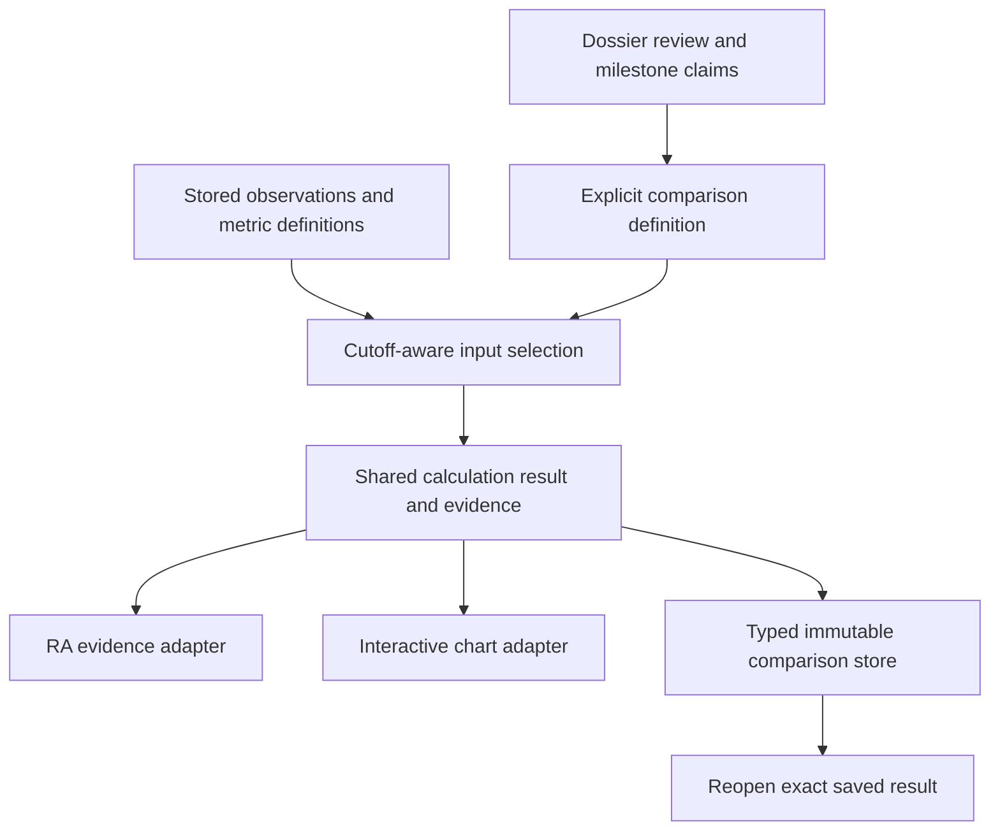

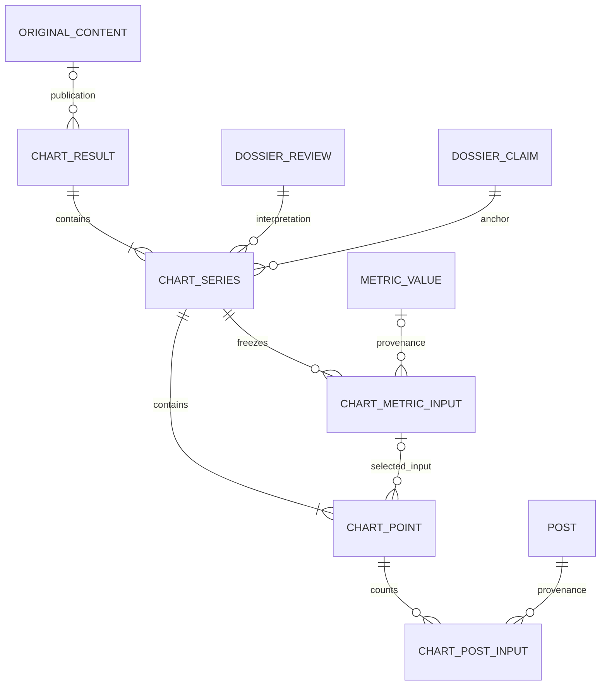

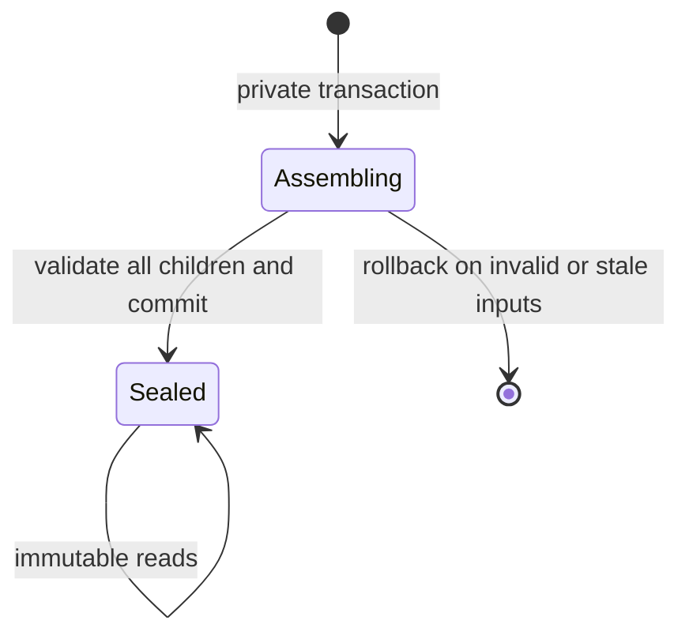

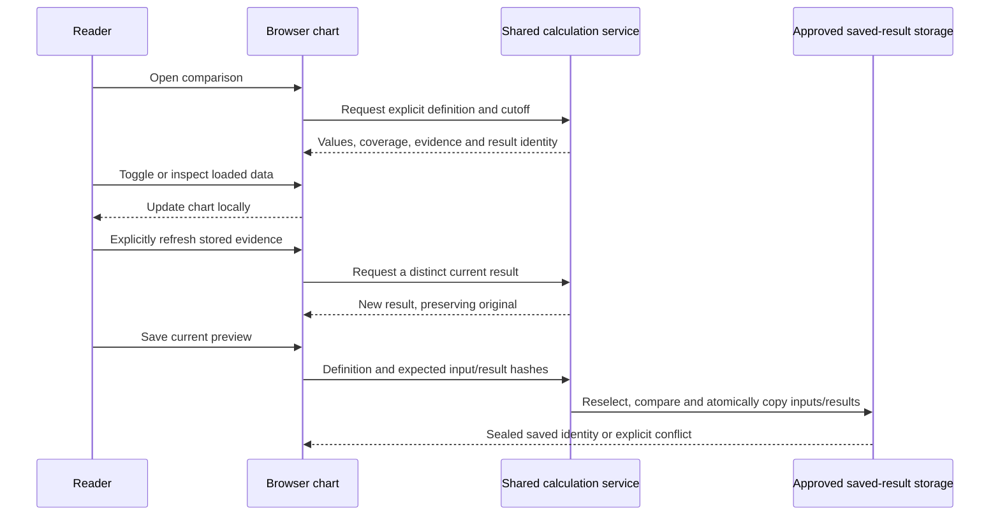

### Implementation prerequisites and execution notes

B1/B3 are owner-approved and B2 is resolved by KTD4; do not reopen them as generic approval questions.
The assumed-complete peer schemas must be present in the actual implementation checkout; verify their integrated revision and migration graph at U15 without changing active peer worktrees.
The plan is complete under that explicit upstream assumption; observing their final integrated revision remains an execution prerequisite, not permission to merge or rewrite another session's working files.
Use a clean task-owned checkout based on the integrated revision when implementation is selected; preserve every dirty file in the retained ChartEngine worktree and port only the necessary changes.
Use a task-owned local PostgreSQL database and browser session; discover available ports instead of reusing the historical8767or peer51458ports.
Before changing any visible surface, follow the repository `fix-ui` skill and capture the real browser baseline.
Execution runs in the main session under the repository's sequential tool map; no provider/model calls or production operations are needed for this proof.

## Implementation Units

### U15. Integrate the completed storage readers and selected identities

**Goal:** establish an exact, tested mapping from the two selected atomic releases to final dossier reviews, products, metrics and observations.
**Requirements:** CE-R4, CE-R8, CE-R12, CE-R19–R20, CE-R26–R29; KTD1/KTD4.
**Dependencies:** integrated dossier/collection revision; the owner-approved anchor policy is CE-R29.
**Files:** `core/pulse_chart_data.py`, `core/benchmark_metric_series.py`, `core/benchmark_release_response.py`, `tests/test_pulse_charts.py`, `tests/test_benchmark_download_series_db.py`, `tests/test_benchmark_release_response.py`.
**Approach:** adapt reader boundaries to CollectionObservation and the reviewed dossier reader; replace current-case prototype-release lookup with explicit review/milestone references and role selection. Recheck the KTD4 storage audit against the integrated revision; preserve the five-table boundary and report any real conflicting entity before changing it.
Use retained DeepSeek/GLM staging exports as recorded-data fixtures in a disposable local database when needed, preserving their original source clocks and actual import/knowledge time. They are not a live production feed, and importing them now must not manufacture knowledge available at an earlier operational cutoff.
**Test scenarios:**

- Resolve both selected products without merging their brands or variants.
- Reject an anchor claim from another dossier/review; preserve a date-only anchor without inventing an exact launch instant.
- A later dossier review does not silently replace a pinned earlier review.
- Trace the actual comparison caller into the new readers and assert it forwards the knowledge cutoff and selected review.

**Verification:** mapping/cutoff rules run through real PostgreSQL readers and agree with the typed KTD4 owners. Deferred dossier vocabulary work is not silently pulled into this unit.

### U16. Define the shared comparison request and result

**Goal:** give chart and RA callers one explicit, validated calculation meaning.
**Requirements:** CE-R1–R8, CE-R19–R20, CE-R27–R30; KTD1/KTD2.
**Dependencies:** U15; CE-R28–R30 supply the selected product behavior.
**Files:** `core/pulse_charts.py`, `core/pulse_chart_data.py`, `tests/test_pulse_charts.py`.
**Approach:** separate observation/reference/visible windows and anchor choice in the code-level definition. Preserve source/unit/grain/window/precision metadata on each result. Validate one-year requests using suitable resolution instead of copying the old360-day limit or accepting unbounded bucket counts. Keep request/result serialization separate from persistence.
**Test scenarios:**

- Accept a365-day daily request; reject an unsupported unbounded detail request with an explicit limit.
- Reject unknown subjects, incompatible units and invalid reference intervals.
- Distinguish measured zero, absent observations, partial coverage and invalid denominators.
- The same definition and exact inputs produce the same numerical result identity; changed inputs or a calculation revision produce a distinct identity.

**Verification:** RA and chart adapters receive the same resolved calculation result, with no implicit baseline or anchor substitution.

### U17. Calculate matched release-age series with complete evidence

**Goal:** produce the selected models' raw and normalized series under explicit time and source-selection rules.
**Requirements:** CE-R3–R8, CE-R20, CE-R23, CE-R27–R30; KTD1/KTD2.
**Dependencies:** U16; CE-R28–R30.
**Files:** `core/benchmark_metric_series.py`, `core/benchmark_release_response.py`, `core/pulse_chart_data.py`, `tests/test_benchmark_download_series.py`, `tests/test_benchmark_release_response.py`, `tests/test_pulse_charts.py`.
**Approach:** retain reviewed metric readers; explicitly choose historical revisions available at the cutoff, align by the selected release anchor and calculate the selected baseline/smoothing order once. If a corrected source lacks sufficient retained history to reconstruct an earlier cutoff, return an explicit unavailable result for that request rather than substitute current values. Keep complete calculation inputs distinct from reduced display points. Expose numerical evidence directly to RA without an LLM call.
**Test scenarios:**

- Covers CE-AE1: baseline1000/value1500 yields+50% identically in chart readout and RA evidence.
- Covers CE-AE2: cropping the visible range does not change the reference mean or result evidence.
- Covers CE-AE3: missing adjacent HF snapshots create a gap; rolling-net change is never labelled daily downloads.
- Covers CE-AE9: date-precision anchors, later platform starts and a later identity review preserve their actual clocks and pinned interpretation.
- Later reconstructed/imported values are excluded from an earlier knowledge cutoff; source corrections change current input identity.

**Verification:** database-backed examples for both selected models agree with independently calculated expected values and named evidence inputs.

### U18. Connect the real chart page and browser controls

**Goal:** make the shared result playable on desktop and narrow mobile layouts through the existing application boundary.
**Requirements:** CE-R2–R3, CE-R5–R7, CE-R9, CE-R11, CE-R27–R31; KTD2/KTD3.
**Dependencies:** U17; CE-R28–R31.
**Files:** `monitor/pulse_views.py`, new `monitor/templates/monitor/chart_comparison.html`, `monitor/templates/monitor/pulse.html` only for shared-renderer compatibility, `monitor/static/monitor/pulse-chart.js`, `monitor/static/monitor/pulse-chart.css`, `monitor/urls.py`, `locale/en/LC_MESSAGES/django.po`, `locale/ja/LC_MESSAGES/django.po`, `locale/zh_Hans/LC_MESSAGES/django.po`, `tests/test_pulse_charts_browser.py`, `tests/test_benchmark_pulse_views.py`.
**Approach:** add the draft-comparison adapter from KTD3 before saving exists; extend the shared renderer and labels with units, selected anchors/reference/cutoff, coverage and brand-context scope. Validate bounded comparison parameters before querying and enforce source-use permissions on the server rather than trust a requested use flag. Keep numeric export separately authorized. Keep loaded controls local and guard additional-data requests against stale responses. Do not invoke editorial generation or persist a publication to open the page.
**Test scenarios:**

- Covers CE-AE4: visibility/inspection/range actions update the displayed values with zero provider/model calls and no unnecessary data request.
- Covers CE-AE5: long-range overview and detail preserve gaps and selected values at desktop and390pxwidth.
- An older delayed response cannot overwrite a newer selection; failed refresh leaves the last usable result with an explicit error.
- Actual Django routes enforce public-display/export permissions separately and preserve en/ja/zh-cn labels, keyboard access and independent chart instances.

**Verification:** real rendered browser interactions agree with the service result; record desktop/mobile screenshots and measured control timing against B3.

### U22. Add typed saved-comparison models and integrity guards

**Goal:** give KTD4's five record meanings complete typed storage without changing collection or dossier ownership.
**Requirements:** CE-R4, CE-R8, CE-R10, CE-R12, CE-R26; KTD4.
**Dependencies:** U15/U17; final integrated migration graph.
**Files:** `core/models.py`, new descriptive ChartEngine migrations in `core/migrations/`, new `tests/test_chart_comparison_models.py`, new `tests/test_chart_comparison_migrations.py`.
**Approach:** add only the five KTD4 tables, their typed constraints, reverse-source indexes, protected relationships, assembly/sealing guards and deferred cross-row ownership/completeness checks. Source value/time copies retain history rather than introduce a second live source store. Keep guard ownership and reversible functions/triggers scoped to these tables. No source backfill or data rewrite accompanies these additive migrations.
**Test scenarios:**

- All five table meanings and allowed numeric/absence shapes persist through real PostgreSQL; unknown fields, invalid numeric forms and wrong cross-result/review/claim ownership fail on service and raw/bulk paths as applicable.
- A transaction cannot commit an unsealed/partial assembly; sealing freezes header/children and late inserts, including membership changes.
- A native point's integer equals its unique Post memberships, including legitimate zero and a Post counted in both separate brand series.
- Forward/reverse migration fixtures preserve pre-existing dossier/collection/metric/publication rows, respect protected dependencies and leave no ChartEngine SQL objects after a valid reversal.

**Verification:** migration and raw-constraint tests run on isolated PostgreSQL using the final integrated graph; no migration is applied to production or a peer database.

### U19. Save and reopen an immutable comparison through the typed store

**Goal:** preserve one exact calculation and its used inputs/results across later ingestion and correction.
**Requirements:** CE-R3, CE-R8, CE-R10, CE-R12, CE-R26; KTD2/KTD4.
**Dependencies:** U17/U18/U22.
**Files:** new `core/chart_comparison_store.py`, `monitor/pulse_views.py`, `monitor/urls.py`, `monitor/original_content_readers.py` only for the existing publication adapter, new `tests/test_chart_comparison_store.py`, `tests/test_pulse_charts.py`, `tests/test_pulse_charts_browser.py`, `tests/test_original_content_workflows.py`.
**Approach:** implement the KTD4 save/read boundary over U22's tables; expose CSRF-protected saving at `/api/v2/chart-comparisons/` and read-only reopening at `/chart-comparisons/<result UUID>/` and `/api/v2/chart-comparisons/<result UUID>/`. The existing access policy applies to every route; display and numeric-export uses are decided server-side. Use the common request plus expected hashes/idempotency key, validate scope/optional publication ownership, and capture exact input/result copies in a consistent database transaction. The response includes display-permitted values only; full numeric/evidence export retains its separate permission check. Explicit refresh creates a distinct result and never mutates the original. GETs and controls do not create rows.
**Test scenarios:**

- Covers CE-AE6: save, add observations, correct a source value/time, then reopen; the original result/settings/evidence remain identical.
- A new refresh can show corrected evidence without mutating the saved result.
- A mid-save failure cannot expose a partial saved view; cross-publication or unauthorized result lookup is rejected.
- Exact used floating representation and date/time precision survive round-trip without claims of extra precision from decimal conversion.
- Source correction between preview and save returns a conflict with zero partial rows; it does not silently save the corrected values as the original preview.
- Changing only a loaded toggle, smoothing choice or visible range can save that view against unchanged numerical hashes; changing an analytical cutoff, anchor or source-time input cannot pass the same hash check.
- Raw/bulk updates/deletes and late child insertion on sealed results fail; wrong-series inputs, rejected/uncertain anchor claims, missing required children and native-count/membership mismatches cannot commit.
- The same idempotency key replays one completed save; a mismatched request is rejected, and two concurrent saves cannot create duplicate assemblies for that key.
- Both an unbound standalone save and an authorized existing-publication save reopen correctly; tampered publication/result IDs do not bypass access or change publication ownership.

**Verification:** one real save-to-read-to-browser call chain passes with correction replay; a hash-only or mutable-row-reference proof is insufficient.

### U20. Measure first load and interaction, then remove demonstrated bottlenecks

**Goal:** meet the agreed speed budgets on named dataset/device profiles without changing numerical meanings.
**Requirements:** CE-R5, CE-R8–R12, CE-R31; KTD3/KTD5.
**Dependencies:** U18/U19; CE-R31.
**Files:** `core/pulse_chart_data.py`, `monitor/pulse_views.py`, `monitor/static/monitor/pulse-chart.js`, `tests/test_pulse_charts_browser.py`, `tests/test_benchmark_download_series_db.py`.
**Approach:** measure cold/warm queries, response bytes, calculation, first useful paint and loaded-control latency separately. If measurements justify temporary response reuse, key it by the full selected scope and reliable correction-aware input revision; prefer no cross-request cache to an unverifiable stale identity. Preserve exact calculations while choosing display detail. At most three measured refinement passes before reporting any remaining budget miss.
**Test scenarios:**

- Covers CE-AE8: cold and warm paths report separate timings for the selected pair and labelled365-dayfixture.
- A source correction with unchanged row count invalidates reused current data; an immutable saved result remains unchanged.
- Display reduction preserves gaps, event markers and exact inspection values.
- Browser heap and response size remain bounded during repeated selection changes; ordinary controls meet B3 on the recorded profiles.

**Verification:** retain measured before/after evidence and any remaining misses; never label phone emulation as physical-iPhone performance.

### U21. Run the integration regression net and document the local result

**Goal:** prove the complete selected path and preserve existing benchmark/homepage/editorial behavior.
**Requirements:** CE-R1–R12, CE-R19–R20, CE-R26–R31; CE-AE1–AE11 as scoped below; KTD1–KTD5.
**Dependencies:** U15–U20 and U22; B1–B3 are resolved as recorded above.
**Files:** `tests/test_pulse_charts.py`, `tests/test_pulse_charts_browser.py`, `tests/test_benchmark_download_series_db.py`, `tests/test_benchmark_release_response.py`, `tests/test_benchmark_pulse_views.py`, `tests/test_home_chart_pulse.py`, `tests/test_original_content_regression.py`, this plan. Reference documentation changes, if needed, follow the updating-reference-docs skill and describe only verified behavior.
**Approach:** run the test matrix below on isolated PostgreSQL and the actual Django/browser route, with source/model calls replaced by failing sentinels. Keep deterministic recorded observations separate from labelled missingness/year-scale fixtures. Review and simplify only owned changes; preserve pre-existing prototype/settings/locale files not incorporated into this implementation.
**Test scenarios:**

- Covers CE-AE7: existing homepage/benchmark callers, timezone buckets, attribution, locale and lower-is-better rank remain correct.
- Covers CE-AE10: a later dossier interpretation cannot rewrite the earlier saved comparison; shadow detection itself remains upstream.
- Covers CE-AE11: an eligible release with sparse metrics remains identifiable while the chart shows explicit missingness.
- Exercise request→shared reader/calculation→RA/chart adapters and save→reopen→browser, not only helper functions.

**Verification:** numerical, integration, browser and agreed performance evidence covers the same implementation revision; no application check is represented as passed from this planning run.

## Verification Contract

Use an isolated task-owned PostgreSQL database on the integrated schema, never production, the retired SQLite database or a peer's running database.
Resolve the repository interpreter/test configuration before executing; use a durable task-owned pytest base directory on this host.

| Proof | Command family after implementation | Required result |
| --- | --- | --- |
| Calculation/readers | `pytest tests/test_pulse_charts.py tests/test_benchmark_download_series.py tests/test_benchmark_download_series_db.py tests/test_benchmark_release_response.py` | Matched identities, windows, cutoff and raw/normalized values agree; missingness/precision preserved |
| Saved data and migrations | `pytest tests/test_chart_comparison_models.py tests/test_chart_comparison_store.py tests/test_chart_comparison_migrations.py` | Exact numeric/input copies, raw/bulk immutability, conflict/idempotency/concurrency, native membership and isolated migration reversal |
| Actual views/browser | `pytest tests/test_pulse_charts_browser.py tests/test_benchmark_pulse_views.py` | Real application route, controls, locale, permissions, race and save/reopen behavior |
| Existing consumers | `pytest tests/test_home_chart_pulse.py tests/test_original_content_regression.py tests/test_original_content_workflows.py` | Existing caller/storage paths preserve their contracts |
| Integrated dossier/collection boundary | Peer-owned dossier/collection regression suites plus the adapter tests on their integrated revision | No shared-schema/reader drift; do not copy prior peer test counts as combined proof |
| Runtime/format | `python manage.py check` and `git diff --check` using the resolved repository environment | No system-check or whitespace defects introduced by the change |
| Performance | Named desktop and physical-iPhone profiles, separately labelled emulation and a365-dayfixture | Actual agreed B3 budgets and memory limits, with cold/warm/interaction timings retained |

Tests must include at least the two real multi-layer call chains named in U21, with all required cases passing and zero unexpected skips.
No paid retrieval, model call, harvester run or production feature activation is required or authorized by this verification contract.
The actual integrated schema may require focused test-name updates; preserve the proof meanings rather than dropping a case because the old path moved.
Desktop acceptance uses Chrome on the owner's desktop over the existing private source-host connection at1440x900; record actual hardware/browser/network and source revision. Also record the automated Chromium profile separately. Phone acceptance uses a physical iPhone browser over the private connection, recording model/iOS/browser/network and viewport;390px emulation is useful geometry evidence only. Use at least100loaded-control samples and20previously-loaded opens after a warm-up, report p95 separately per profile, and require at most100ms/2s respectively. Record response size, cold timing and20-change heap growth alongside those results. An unavailable physical device leaves that acceptance proof explicitly incomplete rather than changing the requirement.

## Definition of Done

- B1–B3 remain resolved in this plan; five typed ChartEngine tables implement the audited saved-result ownership, with no new JSON columns or changes to the deferred dossier proposal.
- U15–U22 are implemented and verified; both selected releases have an evidence-backed real read/calculation/chart path.
- RA evidence and plotted/readout values agree on definition, cutoff and input/result identity.
- Ordinary controls are responsive, missingness remains explicit, viewport changes do not change a fixed baseline, and year-scale behavior is exercised without claiming unavailable real history.
- A saved comparison reopens with identical settings, exact used values/times and evidence after later data/review corrections; explicit refresh is distinct.
- The scoped regression net, real browser checks and agreed performance targets pass on the candidate revision, with any physical-device gap reported as unperformed rather than passed.
- Abandoned-attempt code and task-owned temporary runtime resources are cleaned up without removing retained prototypes, other owners' files or shared services.
- This plan and the authoritative coordination index record the concrete local outcome and remaining limitations; production delivery is not inferred.

### Planning evidence and limits

Grounding used the retained chart definitions/readers/renderers/tests, `CONCEPTS.md` provider-measurement definitions, inspected peer dossier/collection models and migration leaves, and existing OriginalContent save/read paths.
The retained gallery identifies the selected pair and distinguishes six-metric from three-series release-response methods.
The existing editorial evidence-delivery learning requires showing the actual result and source limits rather than treating artifact construction as product acceptance.
No new chart library/cache backend is selected. Official PostgreSQL18 transaction/numeric documentation informed KTD4's snapshot and value-preservation rules; it is not runtime proof.
Planning performed source/document checks only; no application, browser, migration or performance checks have run for U15–U22.

---

## Dossier-chart composition contract — October20 owner correction

### Plain-English Summary

Build the chart for one Event Dossier first, with its own metric lines, time coverage and preserved source inputs. DeepSeek V4.1 Flash and GLM 5.3 Flash are two instances of that same unit. A comparison references those units instead of rebuilding or copying their measurements into a comparison-owned result.

The same composition boundary supports comparison against N other dossiers and the future historical blended-average view. A saved comparison pins the chart versions and calculation recipe it used; later data or newly discovered releases do not silently alter it. The previous five-table comparison-owned design does not satisfy this ownership contract and must not be implemented unchanged.

### Settled ownership

- **Atomic dossier chart:** one dossier's reusable numerical chart, including selected review/milestones, metric meanings, raw/normalized values, source/knowledge clocks, coverage and exact frozen numerical/post inputs. It can stand alone without a comparison or publication.
- **Chart versions:** immutable editions preserve changing inputs or calculation choices. “One chart for a dossier” establishes the unit of ownership, not a restriction to one database row forever. The existing EventDossier is the stable event identity; do not invent a second event record.
- **Comparison composition:** references one focus chart and N other dossier-chart versions, or a historical reference set. It owns membership, alignment and display/aggregation choices, not another copy of each member's raw evidence. N is not hard-coded to the first pair.
- **Historical average:** a derived calculation over a declared set of dossier-chart metric series. Preserve metric identity: averaging the same metric across releases and combining different metrics into one score are different operations. The owner's phrase “blended average of metrics” does not yet select the latter. Membership, selected metrics, release-age alignment, weighting, missingness and method version must be explicit and reproducible. If a combined score is selected, normalization/direction across metrics must also be specified; raw tokens/downloads/ranks cannot be averaged as interchangeable units.
- **Saved evidence:** freeze source input copies once per atomic chart version and reuse those versions across comparisons. Freeze the exact member-version set and blending recipe for a saved historical view. New releases and corrected measurements generate new versions/compositions rather than mutate an original.

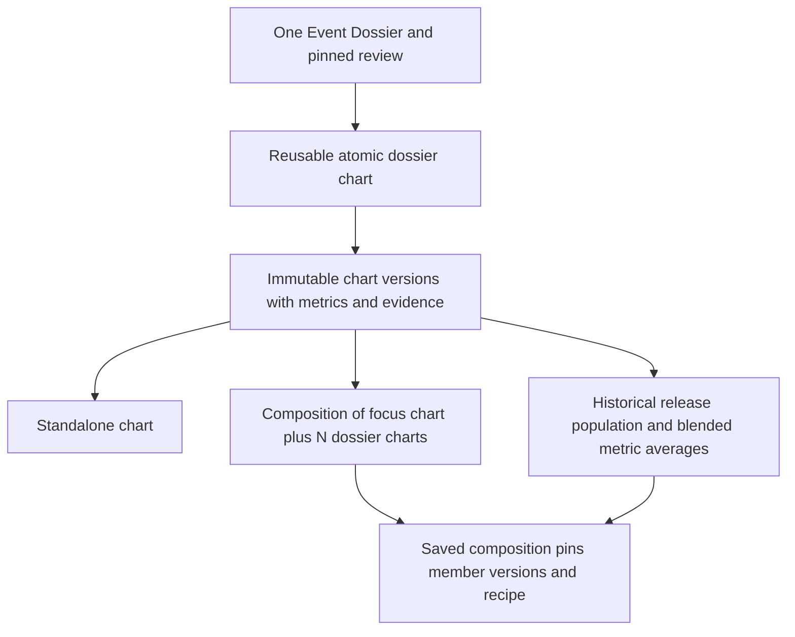

### Consequences for the next schema revision

Move source series, points and frozen-input ownership to the single dossier chart. Model comparison membership through references to complete chart versions; do not give one chart multiple dossier owners or move those owners back onto a comparison header. Keep chart-level choices separate from composition-level alignment, visibility and aggregation choices.

Inspect the existing MeasurementSubject/ProductGroup/ProductGroupMembership and dossier identities before adding cohort persistence. Live product-group membership alone does not freeze a saved historical population, and it must not become a duplicate dossier inventory. At this correction checkpoint the new inventory/count was unselected; the subsequent schema recommendation proposes nine tables for review; the old five-table total is not a constraint or an approved design.

The first verification remains the selected DeepSeek/GLM examples, now as two independently usable dossier charts plus a referencing comparison. Include a third-dossier fixture to prove the composition is not pair-specific. Reuse one atomic version in multiple comparisons and verify no duplicate source snapshot ownership. A later correction/new release must leave earlier pinned compositions unchanged.

Historical blending also needs coverage counts at each release age: eligible releases, contributing releases and present/missing metrics. “All historical releases” must not become “only complete/popular releases” through an undocumented filter. Show the actual recorded population and its limits; do not claim a complete global release census.

Pending owner clarification: does the historical view show a separate average line for each metric across releases, one combined score across different metrics, or both? Do not infer a combined score from the word “blended.” Then settle release weighting and treatment of unavailable readings; metric weighting and cross-metric normalization/direction are required only if a combined score is selected. These product-method decisions must be resolved before declaring the revised historical-average schema complete. They do not authorize JSON columns or speculative generic expression/property tables. No Event Dossier schema mutation is required by this ownership correction; its saved vocabulary comments remain deferred.


## Dossier-chart schema recommendation — October20

**Status:** proposed ownership/table design for owner review, not an approved migration or complete implementation plan. This section supersedes the earlier “count unselected” checkpoint but does not reactivate the withdrawn comparison-owned design or U15–U22 unchanged.

### Plain-English Summary

One EventDossier owns its reusable chart history. Each immutable chart version stores the daily metric lines and exact used evidence once. Standalone charts work without a comparison. Saved views reference one or many atomic versions; the same version can participate in any number of comparisons and historical-average views without copying its measurements.

**Proposed storage delta: 9 added tables, 0 retired tables, 0 new JSON/JSONB columns; no changes to peer Event Dossier or collection tables.** Six tables preserve atomic results/evidence and three preserve views/members/line settings. Existing dossier IDs provide stable chart identity, so no separate chart registry is needed. No separate historical-average/cohort table is proposed. Optional OriginalContent ownership reuses the shared publication identity and is not required to construct or save a chart.

| Proposed table | One row means |
| --- | --- |
| `chart_versions` | One immutable numerical chart edition for exactly one EventDossier. |
| `chart_series` | One metric line, scope and calculation meaning within a chart version. |
| `chart_points` | One canonical daily value or explicit gap on an atomic series. |
| `chart_metric_inputs` | One exact captured numeric reading, or one complete-publication absence used by an atomic chart. |
| `chart_point_metric_inputs` | One dependency linking a plotted point to a frozen metric input. |
| `chart_post_inputs` | One counted post and frozen counting facts for a daily post point. |
| `chart_views` | One sealed standalone, N-chart comparison or historical-average presentation. |
| `chart_view_members` | One dossier in a saved view, with its pinned atomic version or explicit unavailability. |
| `chart_view_series` | One atomic metric line selected/configured within one saved member. |

The [compact schema walkthrough](../analysis/2026-10-20-143934-chartengine-dossier-schema.html) contains the full proposed physical-column inventory, ORM types, nullability, keys, per-table rationale, cross-table guards, complete fictional records and write chronology. These are proposed definitions without generated migrations. Existing tables referenced there are not included in the nine-table addition count.

### Numerical and presentation boundary

`chart_versions.event_dossier_id` is the sole event owner. The version pins the completed review and available accepted announcement/access claims. A missing anchor remains unavailable. Chart dates are absolute daily buckets; the view chooses calendar or release-age alignment and selected anchor. A version number is scoped to one dossier, not a new event identity.

`chart_series` identifies a metric's actual scope/unit/transformation; brand-post scope remains explicit. `chart_points` preserves canonical daily values and gaps. `chart_metric_inputs` copies only consumed typed numerical/time/definition facts with links to existing metric/source records; `chart_point_metric_inputs` handles many-to-many dependencies without copying a reading again. A complete-publication absence is a constrained nonnumeric metric-input case with retained proof, never a fabricated zero. `chart_post_inputs` separately freezes each distinct counted post and attribution/bucketing facts, not post bodies.

This proposal refines the earlier statement that an atomic chart owns “raw/normalized values”: it owns the canonical numerical bundle. Normalized and three-day display values are derived by one retained versioned method over frozen daily points and view-specific resolved baseline facts. Save pins and validates the displayed-result hash; reopen must prove exact replay through the actual render path. Preserve integer and float source representations separately, including signed-zero float round trips; finite values only. Do not silently substitute the latest method or definitions. This supersedes the withdrawn requirement to persist duplicate full variant arrays per comparison; a retained replay method is a required implementation dependency.

`chart_views` freezes presentation and historical population selection; members pin exact dossier/chart versions and inclusion status. One dossier may occur at most once in a view. Historical membership can include an eligible dossier without a chart, with an explicit unavailable reason, so the eligible population does not silently shrink to releases with complete metrics. `chart_view_series` stores per-member line visibility and resolved normalization baseline facts; these do not mutate the shared atomic series.

### Method choices and integration still open

Historical averaging of each metric across releases versus a single score combining different metrics remains an owner question. Recommend beginning with separate metric averages; this is a recommendation, not inferred approval. Release weighting and missing-value denominator rules still need selection. Cross-metric score weights/normalization are relevant only if that score is selected; no generic expression/property tables or score implementation are proposed. Store a historical recipe only once its method is settled, and never relabel a metric's rolling-window change as daily flow.

The collection worktree has advanced locally through uncommitted migrations0093–0103 since the earlier checkpoint. Its exact clock-basis/unknown-reason fields, capture hashes, correction lineage and complete-publication absence evidence must be mapped before calling these proposed columns implementation-ready. Dossier migrations0093/0094 at2daeb735 and this independent collection branch still require integration; their presence is not production proof. Existing MetricValue/mapping readers cannot be assumed to implement a past knowledge cutoff; unsupported reconstruction remains unavailable.

### Representative reads, writes and required proof

- Build: pinned dossier review → existing subjects/mappings/measurements/posts at cutoff → one chart version and typed frozen inputs → canonical points/dependency links → atomic seal. DB guards must enforce owner consistency and immutability even for raw SQL/bulk writers; no post-seal child insertion.
- Compare: create one sealed view, reference N existing chart versions and add line settings. Reuse one atomic version in two comparisons; assert no new atomic points or input copies are created by the second comparison.
- Average: freeze the full eligible recorded dossier membership at its cutoff; aggregate compatible metric series at each release age. Return eligible/available/contributing counts and the selected denominator/weighting rule. Do not truncate global membership to pair-specific UI budgets or silently discard missing releases.
- Save/reopen: compare preview input/result hashes in a consistent transaction; stale preview produces a conflict. Reopen reads only pinned versions/baselines/method; correction, changed review or new release leaves the saved result unchanged. Refresh creates a new version/view as needed.
- Regression: two selected real dossier charts plus their comparison, third-dossier fixture, version reuse, missing anchors/metrics/coverage, duplicate memberships, HF prior/current evidence, Arena publication-absence evidence, integer/float precision, immutable bulk/raw paths, same-version guards and saved raw/normalized/daily/three-day replay through actual request/browser callers. Performance proof must cover large historical populations separately from the first pair. Existing approved desktop/iPhone targets remain; no runtime proof is claimed by this proposal.

Reconcile U15–U22 and the complete Verification/Done contracts to these owners after the product-method choices and integrated field mapping are settled; the old five-table verification contract remains historical, not execution authority. Event Dossier vocabulary comments stay deferred as requested.

## Global CharField/TextField review — October20 owner expansion

### Plain-English Summary

This session now leads shared-reference and string-field review across the entire application schema. The owner expressly includes both CharField and TextField, the sister G2 EventDossier schema and G3 collection/backfill, and reports G3 backfill halted for this purpose. Atomic dossier-chart ownership remains selected; the prior chart column inventory is reopened for this broader review. This is schema investigation and design, not authorization to implement migrations or resume backfill.

### Scope, ownership and method

- Existing plan remains canonical. Current review artifacts are [global field audit](../analysis/2026-10-20-160626-global-string-field-audit.html), [complete variant inventory](../analysis/2026-10-20-160224-global-string-field-inventory.csv), [findings/G3 return map](../reviews/2026-10-20-160626-global-string-field-findings.md) and [G3 exact-field inventory](../analysis/2026-10-20-160626-g3-string-field-recommendations.csv).
- Read owner-selected handoff `/tmp/compound-engineering-501/ce-handoff/pushin-weight-v2-aff2eb3769a9/g2-chartengine-shared-vocabulary-review.md`. It transfers cross-schema audit/recommendation, not ownership of G3 code/migrations. G3 applies accepted collection changes in its own worktree. No peer implementation files were edited.
- Latest scope supersedes the earlier deferral of dossier vocabulary comments for this field audit; unrelated dossier product work remains separately owned. No universal status/value registry, one-lookup-table-per-column expansion or JSON substitution is selected.
- Bound this initial pass to one complete inventory plus two consistency/browser reviews. Inventory coverage is not a semantic pass. Classify prose, identifiers, snapshots, business vocabularies, relationships, controlled states and temporal/scalar storage; trace actual high-priority writers/readers and ask the owner about unresolved meanings. Preserve unknowns, exact source wording and historical hashes.
- Main source revision64b95c26 has151concrete model classes and807expanded string columns (502Char/305Text). G2 dossier2daeb735 has158models and841strings (516/325). G3 dirty collection0093–0107 has160models and925strings (598/327). The chart proposal has54text-backed columns (50Char/4Text), including an already-referencing post key. These are overlapping local variants, not one deployed schema.
- Combined scope is1,013unique(table,column)positions and2,627variant entries. G3 handoff's593declaredCharFields/135declaringclasses matches direct AST counting; abstract inheritance explains the598expandedChar columns. The handoff's15-model collection area has124CharFields and23TextFields; the nine added collection tables remain G3's accepted scope, not approval of a new global catalogue count.

### Owner decisions — approved October20

The owner agrees to both recommendations: shared business vocabularies use catalogue records and foreign keys; internal workflow states use centrally defined, database-checked choices. Preserve exact source wording alongside resolved references rather than replacing matched wording. These decisions are settled and must not be asked again.

The owner additionally requires a global naming contract: general, obvious business names such as language/timezone belong to shared definitions; independent fields with different definitions must have distinct descriptive column names. Role-specific source_timezone_id and bucket_timezone_id may reference the same timezone catalogue. Request transport, collection execution, collection coverage and dossier review state have different meanings and must not be hidden behind interchangeable status/state names. Raw source wording and immutable snapshots need explicit reported/snapshot roles when a canonical reference coexists. This is a semantic review, not a cosmetic bulk rename.

The owner also approves separate scoped EventDossier claims for each channel/region availability fact in one announcement. Claims can reuse the same source evidence; API access, downloadable weights and regional access retain their own dates/evidence/acceptance. An announcement source does not force all of its scoped claims to become one claim or one access date. Use existing product/source/region entities where their meanings match; exact new shared-table inventory remains to be derived.

Actor identity and method versioning must be grounded in existing human/agent/system and retained calculation facts; no unresolved concrete field may be silently filled with a new string. The database skill requires targeted questions when a meaning is still genuinely unresolved, and now includes this global column-name contract.

### First source-grounded findings and next pass

Timezones repeat as strings with no shared TimeZone model. Language/locale fields also lack a shared entity. Existing Country/Region, metric_types, metrics, MeasurementSubject, mappings, Product/Person/Company/affiliation and SearchQuery records must be considered before adding parallel references. Unit metadata must remain tied to exact measurement-definition versions; FK-only replay requires enforced immutability rather than joining mutable current definitions. A person's exact job title must not be forced into roles, which classifies accounts.

G2's claim writer accepts claim_kind and scope_key and includes them in its immutable hash; tests using announcement/x or repository_created/repository do not establish a complete machine-readable vocabulary. Preserve actual assertions, excerpts and reasons as prose when justified; examine variant/version/native identity separately. G3 admission, transport, execution, processing, coverage and stop outcomes have distinct contracts; repeated words alone do not justify one status catalogue. Provider revisions, ETags, cursors and row locators can be opaque source evidence; membership_run_reference needs its actual referent identified. Temporal strings with precision, plural source_query_ids and polymorphic content IDs need separate type/cardinality review.

Next: apply the approved catalogue/choice, source-preservation, global naming and scoped-claim decisions; trace remaining high-priority families, specify shared records/checked choices and each field's keep/derive/reference/snapshot decision, then derive a coordinated additive migration and writer/reader cutover plan. Preserve alias/unmatched reports, source/correction history and all existing permissions. No implementation-ready global table count, production shape, completed schema review, backfill resumption or runtime proof is claimed at this checkpoint.

### Skill prevention change

Updated canonical `/Users/fuchitalee/.codex/skills/db-schema-walkthrough/SKILL.md` and its existing UI metadata. The .agents/.claude aliases resolve to that file. Mandatory review covers every proposed CharField/TextField, existing fields during global audit, actual shared storage, targeted user questions, preservation of prose/evidence and versioned meanings, and recorded field/table decisions. Skill validation passed; no new scripts or application checks were added for this skill-text edit.

### Applied field/name maps after owner answers

The G3 [147-field return map](../analysis/2026-10-20-160626-g3-string-field-recommendations.csv) now includes proposed semantic names, shared reference/choice definitions, preserved-source handling and remaining integration work. The sister G2 [34-field dossier map](../analysis/2026-10-20-160626-g2-dossier-field-recommendations.csv) applies the same rules. The [141-position general-column-name review](../analysis/2026-10-20-160626-global-column-name-review.csv) extends the naming contract to main beyond those two workstreams. These maps are recommendations, not evidence of implemented columns or of each allowed-value set having been exhaustively reviewed. Exact actor/method tables, catalogue inventories and legacy-value mapping still require design.

A confirmed definition collision: model_release_details.release_channel currently contains stable/preview/beta and therefore describes release maturity. Recommend release_maturity_id for that business vocabulary; access_channel_id describes API/downloadable-weights access on each scoped claim. One announcement may supply several claims without creating multiple dossier identities. The exact employment title remains reported wording alongside affiliation links; it is not an account roles value.

G3 collection_state.complete_attempt proves that legacy run status mixes success/partial with execution and coverage: success becomes execution completed and coverage complete/partial; partial becomes yielded/partial. Retain an explicitly named legacy_run_result compatibility meaning until readers/writers use separately named run_execution_state and run_coverage_state. Do not pretend a universal shared status catalogue normalizes that mixed result.

Names alone are not a safe migration. Renaming a serialized key can change an otherwise identical evidence hash. Preserve existing hashes and hashing-version input shapes, source text, correction before/after values, missing/unmatched identities, foreign keys and allowed-value semantics through additive cutover; a new calculation/review revision may use a new serialization version. The changed canonical database skill now includes the global shared-name/distinct-meaning naming contract and validates.

## Entire application database expansion — October 20

### Plain-English Summary

The shared-definition and column-naming rules apply to every application table, including tables outside ChartEngine, EventDossier and collections. Business vocabularies reference shared definitions; internal states have centrally defined allowed values enforced at the database/write boundary. Different meanings get different descriptive names. Exact source wording, opaque source identifiers, genuine prose and necessary immutable snapshots remain preserved with explicit roles.

The expanded audit gives a recommendation for every inventoried string position and includes every concrete application table, including those without literal string columns. It does not settle every physical target or complete the migration design. No application model, migration or database has been changed. The pending owner question distinguishes completing the database-wide design from also implementing model, migration and caller changes; the four approved design decisions are not being reopened.

### Coverage and artifacts

- [Entire-database field map](../analysis/2026-10-20-160626-entire-database-field-decisions.csv): 1,013 unique literal CharField/TextField positions across the three schema variants and the reopened chart proposal. Each has a proposed semantic name, representation recommendation, definition/preservation requirements and explicit design status. Family-level recommendations still need exact allowed values, cardinality and caller verification; a populated row is not a passed semantic review.
- [Every concrete application table](../analysis/2026-10-20-160626-entire-database-table-coverage.csv): 151 main + 158 G2 + 160 G3 entries, 469 overlapping model-variant rows representing 167 existing table names. Nine proposed chart tables remain separately identified in the field map. Nineteen variant entries have no declared/inherited literal CharField/TextField.
- [String subclass review](../analysis/2026-10-20-160626-global-string-subclass-review.csv): 24 unique URLField positions, 72 overlapping variant entries. These retain validated source/resource-locator meaning; a shared URL vocabulary is not proposed.
- [Browser walkthrough](../analysis/2026-10-20-160626-global-string-field-audit.html#entire-db) and [source-grounded findings](../reviews/2026-10-20-160626-global-string-field-findings.md) remain the human-readable entry points. The original inventory retains source lines and hashes.
- Existing FK columns with text target keys are already relationships. JSON/arrays are separately owned storage boundaries, not silently converted by this field audit. Framework/auth tables retain framework-owned contracts; application actors may reference authenticated users while also representing agents/systems. No new JSON/JSONB column is proposed or approved.
- Source hashes match the recorded main snapshot and the inspected G2/G3 working files at this checkpoint. These counts describe source variants; deployed migration drift, unmanaged tables and external writers must be reconciled before any migration execution.

### Additional concrete findings beyond the focused maps

1. `accounts.source_query_ids` and `account_post_appearances.source_query_ids` encode plural relationships. Reuse SearchQuery and the actual account/appearance owner; replacing either field with a single FK would lose cardinality. Prove whether each writer is active or legacy before choosing normalization versus retirement. `posts.source_query_id` has a current SearchQuery reader in targeted extraction and needs its own source-ID/unmatched contract.
2. `posts_unsanctioned_flags.flags` is documented as a serialized JSON array inside TextField, with generated `flag_set`. Trace active readers and writers; reuse UnsanctionedFlagKey relationships if still active, or retire only after proving legacy-only use. Its evidence text is a separate fact. No replacement JSON column is proposed.
3. `original_content_calls.budget_scope` is used for accounting by scope/day and can contain `backfill:<job.pk>` as well as workflow labels. Identify budget owner and optional job relationship, preserve original reservation grouping, and prevent double counting across cutover. It is not safely normalized by adding one workflow FK.
4. `call_state.bucket` and `harvest_backlog_windows.bucket` are legacy query-identity components. Current v2 calls use None normalized to an empty-string sentinel. Census nonempty stored values and uniqueness before retiring the component; never change cursor identity by a cosmetic rename.
5. `original_content.brand_key_snapshot` and `trend_narrative_subjects.canonical_key_snapshot` intentionally preserve historical identity. The latter can contain a Brand nickname or Product repository/product key according to identity type. Retain the explicit namespace and existing resolved relationships rather than introducing an editable generic key catalogue.
6. `posts_brands_classification_judgments.selector_version` is included in the stable revision hash. `trend_narrative_demands.target_contract_version` selects the requested narrative contract independently of prompt/model versions. Resolve immutable version records while retaining old serialized tokens and hash-version rules.
7. `people_brand_affiliations.superseded_by_reviewer` identifies the actor who replaced a reviewed claim. Use the shared actor contract plus preserved reviewer wording, respecting the existing replacement-history trigger. Unknown reviewer labels must not become fabricated authenticated users.
8. `rare_type_search_runs.error_detail` is diagnostic prose, distinct from machine-readable `error_code`; current dispatch/failure paths clear it. Retain it if a genuine diagnostic consumer exists, or retire after the full caller census. A catalogue of arbitrary exception prose is not justified.
9. Date strings with precision need a typed partial-date contract that preserves year/month/day precision and exact source wording. Converting a year to January 1 is prohibited. Country/Region M49 codes retain leading zeroes as validated standard codes on their existing owning catalogues.

### Coordinated implementation sequence, after physical design is settled

These units belong to this same plan. They do not create another plan, select deployment, or grant writes to peer worktrees.

| Unit | Concrete work and dependency | Required completion evidence |
| --- | --- | --- |
| DB1 — reconcile source and deployment | Compare current main, committed G2 dossier leaves, G3 working collection leaves and read-only deployed migration state; inventory unmanaged SQL/generated columns and callers outside Django. Reconcile conflicting migration numbers after peer integration; do not renumber or rewrite another session's pending history. | Pinned source hashes/commits, migration graph and exact inclusion/exclusion list; no omitted active writer. |
| DB2 — settle shared definitions | Specify timezone, language versus locale, units, actors and immutable method/contract versions. Reuse Country/Region, metric definitions, subjects/mappings, Product/Person/Company/affiliation and SearchQuery. Decide each catalogue's identity, version/alias policy, uniqueness and unknown handling. | Exact physical columns, relationships, permitted values where fixed, representative reads/writes and explained table additions/retirements. Global new-table count remains unselected until this unit is complete. |
| DB3 — name and constrain internal choices | Trace actual execution, coverage, admission, transport, processing, review and stop transitions. Keep meanings distinct; replace overloaded generic names through compatible readers/writers. | One domain-qualified definition per meaning; DB check constraints and negative writes for invalid values; verified legacy run-result decomposition. |
| DB4 — resolve relationships and partial dates | Design query memberships, polymorphic content ownership, budget scope/job ownership, legacy cursor keys and precision-aware temporal facts. | Cardinality, uniqueness, source/unmatched handling and active-versus-retired caller evidence. No single FK for plural membership, no fabricated dates. |
| DB5 — additive storage and reference mapping | On an integrated candidate, add approved references/typed fields without dropping evidence. Build deterministic alias/value mappings and explicit unresolved reports; preserve original hashes and protected history. | Isolated PostgreSQL migration forward/reverse evidence where reversal is supported; row/identity counts and unmatched report. No default UTC, silent actor merge or erased raw value. |
| DB6 — writer and reader cutover | Update ORM, bulk writers, raw SQL, correction/review paths, services, imports, reports and API readers. Pin immutable definition versions for saved calculations/reviews; retain compatibility where required. G3 applies its owned collection changes. | Each field's writer/reader checklist completed; constraints hold at all write boundaries; no remaining active caller of retired meaning. |
| DB7 — regression net | Cover existing collection state/cursor behavior, dossier hash/review history, post attribution/query membership, classification revision hashes, OriginalContent accounting/replay, geography and partial dates. Exercise allowed/invalid values, unmatched references, duplicate memberships and historical replay. | Focused existing tests plus behavior-specific new cases pass on the integrated candidate; schema drift and database invariants checked. Document checks are not application proof. |
| DB8 — retire compatibility and document | Drop old columns only after mapping reconciliation and caller cutover, with a stated rollback/retention approach. Refresh authoritative schema references from implemented code. Follow the selected delivery endpoint separately. | Exact final table/column delta, documented retained source/snapshot fields and proven replay. Backfill stays paused until the owner authorizes its resumption. |

The global design is not implementation-ready until DB1–DB4 specify the actual target and DB2 records the justified table count. The prior nine-table ChartEngine proposal remains reopened; its atomic EventDossier chart ownership is still selected. This expansion changes neither delivery authorization nor the selected no-new-JSON policy.

## Strict review of the 428 tentative text survivors — October 20

### Plain-English Summary

The first-pass retention total is superseded. This pass reviewed the meanings, declarations and representative callers for all 428 fields in that bucket. It distinguishes source prose/identities and scalar hashes from canonical definitions, fixed-language duplicates, packed relationships and unresolved referents. It also distinguishes native source IDs already paired with a foreign key from genuinely missing relationships.

Of those 428 positions, 290 have a reason to retain text/scalar storage, and five more belong to centrally defined checked choices. Twelve native-ID compatibility fields already have companion Account relationships. The remaining 121 need references, locale-row moves, removal of redundant projections, typed relationship/key redesign, conditional retirement, or further owner/referent design. This is a stricter recommendation set, not migration execution or proof that all old columns can safely disappear.

### Exact disposition and coverage

| Disposition | Fields |
| --- | ---: |
| Retain justified source/prose/keys/hashes/snapshots/locators/tokens/scalars | 290 |
| Remain text as centrally defined, database-checked choices | 5 |
| Native evidence/compatibility already paired with Account FKs | 12 |
| Reference shared definitions, versions or canonical values | 44 |
| Move fixed-language values to locale rows, including four immutable snapshots | 27 |
| Reuse existing relationships / retire redundant projections | 7 |
| Redesign planner cursor identity or packed/mixed data | 13 |
| Conditional retirement candidates requiring caller/data proof | 5 |
| Explicit owner/referent design still unresolved | 25 |
| **Total reviewed** | **428** |

The [428-field strict review](../analysis/2026-10-20-172810-strict-retention-review.csv) records the field meaning, target, cardinality, declaration/source hash, caller evidence and preservation requirements. The [frozen original bucket](../analysis/2026-10-20-172810-strict-retention-baseline.csv) makes the before/after denominator reproducible. The [walkthrough](../analysis/2026-10-20-160626-global-string-field-audit.html#strict-retention) and existing entire-database/G3/general-name CSVs incorporate these corrections. Unreviewed fields outside this 428-field bucket retain their earlier provisional status; this pass does not convert the other 201 unresolved main fields into approved decisions.

A reference may coexist with reported source text; a translation move preserves wording in another row. Therefore 44 + 27 is not a claim that 71 textual values disappear. Twelve compatibility fields are not twelve newly missing Account relationships. In the 290 retained fields, 74 are digest/fingerprint/idempotency scalars, 23 own canonical keys, 109 preserve source wording/identity, 44 are genuine owned/localized prose, 11 are justified frozen snapshots, 15 are coordination/observation tokens, 12 are locators, and two are validated colors. Owning catalogue keys/names remain legitimate text on their authoritative record.

### Corrections that change the design

1. **Planner identity is not Brand/SearchQuery identity.** `monitor/cycle.py:_cursor_key` explicitly says `brand_id` may be `*` and `query_id` carries planner `call_id`. Both cursor/backlog tables need honest planner-specific naming and a preserved identity contract. A direct Brand or SearchQuery FK inferred from spelling would be incorrect. Eight legacy key components require migration design, not a generic lookup table.
2. **Existing account relationships must be reused.** Migrations 0066 and 0074 introduce generic Account relationships and native compatibility columns/triggers. Preserve existing nullability and source evidence; determine retirement only after native SQL/provider writers are cut over. Some native columns are themselves constrained SQL FKs despite their TextField declaration.
3. **Versions and classifications escaped the first pass.** Forty-four fields now point toward shared definitions/values, including classification contracts/taxonomies, prompt/query-pack/workflow definitions, provider verification/account/affiliate kinds, person-name kind, inference provider/model and career-site definitions. Classification taxonomy is not automatically the existing measurement TaxonomyVersion entity. Career `source_name` may be unresolved reported wording, so a canonical FK must not erase it.
4. **Fixed-language prose and names move to rows.** Reuse PersonName, PostTranslationText, PostSynthesisText, OriginalContentText and TrendNarrativeSubject where semantics match. Four frozen name-snapshot columns also move toward versioned locale rows: historical names and hashes survive; current mutable catalogue labels cannot replace them. Existing canonical/source names retain explicit source/unspecified-language meaning when the language is not known.
5. **Packed data remains a modeling issue inside TextField.** OfficialCompanyScan.cursor alternates scalar cursors, timestamp/PK positions and JSON-encoded frozen cohort members/queued/excluded state. Job adapters join plural locations into a middle-dot string. Budget keys pack initial/day/cycle ownership; EditorialHero.key mixes track:locale selection with a provider-lock sentinel; owner credential keys encode account/list context. These five fields need explicit typed components/relationships without adding JSON columns.
6. **Outcome and prompt wording are different.** PostSynthesisDemand.reason, person-name order, translation error code, headline acquisition outcome and source hash basis are checked values. ContentPicture.treatment is actual generated-image instructions assembled with a per-picture visual brief, so the full prompt remains prose beside a reusable method/prompt-version reference when justified.
7. **Native and execution namespaces differ.** Twitter-list membership source_run_id can be an official-owner claim token; list snapshot_id is a locally composed observation token. Neither is automatically a CollectionRun or AccountProfileSnapshot PK. ProviderBatch.import_cursor contains an existing call request identity, so reuse the actual call/import relationship rather than treating it as a remote cursor.
8. **Conditional retirement requires data proof.** The five field candidates include two fields on `_applied_config_snapshot` (one possible legacy-table retirement), collection legacy result projections, and a search diagnostic slot whose current writer clears it. Source inspection alone does not prove safe deletion or absence of nonempty historical values.

### New-table candidates from this slice

Five distinct owned locale-table candidates arise here. They are translation/snapshot tables, separate from the new shared language/locale/timezone/unit lookup candidates already identified. They are proposals, not five approved or implemented additions; integration may establish further reuse. Each needs a concrete key, uniqueness, versioning and writer/read contract before implementation.

| Candidate | Distinct row meaning | Why current storage is insufficient |
| --- | --- | --- |
| Brand labels | One brand's selected display wording in one locale | Brand currently uses fixed en/zh-cn columns; no existing BrandLabel model was found. Country/Region labels have different owners. |
| Company labels | One company's selected display wording in one locale | Company identity differs from Brand identity; its fixed-language columns cannot grow by rows. Existing person/country labels cannot own company labels. |
| Account profile-text translations | One captured profile-text role/version translated into one locale | PersonText translations belong to professional person prose; PostTranslationText belongs to posts. Neither can safely own account biography translations without changing meaning. Top-level description and nested profile_bio are distinct source roles. |
| OriginalContent frozen subject labels | One immutable content-owned subject-name snapshot in one locale | Current content stores fixed English/Chinese brand-name snapshots; current mutable Brand labels cannot preserve used historical wording. Existing OriginalContentText stores publication headline/body, not a subject-name role. |
| TrendNarrativeSubject frozen labels | One immutable narrative-subject name snapshot in one locale | Existing subject identity/linkage should be reused, but its fixed-language snapshot columns cannot accommodate additional locales. Its owner is distinct from an OriginalContent brand outcome. |

**Slice-level table delta:** five proposed addition candidates; one conditional legacy-table retirement candidate; zero selected/applied table changes. This is not the final global lookup-table count. Actor, method/version and provider-vocabulary physical layouts, plus global lookup additions, still belong to DB2. Existing table reuse is required before claiming any final addition total.

### Remaining 25 cases and verification contract

The 25 open cases are now explicit rather than hidden inside keep-text: eleven compound/owner-scoped keys, ten execution/cycle provenance fields, two evidence-source references and two credential/control revision identities. Their CSV rows state the actual observed meaning and the referent that still needs design. Do not synthesize executions, guess a CollectionRun FK, collapse namespaces or silently retain an arbitrary string to close these rows. These are outstanding physical ownership decisions, not a request to repeat settled catalogue/naming/source-preservation policies.

Verification for this document correction checks exact 428-field membership and uniqueness; current-main declaration/source hashes; all-field-map correspondence; 12 existing-account compatibility cases; 27 locale moves; classified outcome/hash-basis fields; cursor wildcard semantics; packed scan/locations evidence; local links and HTML desktop/narrow rendering. Evidence is model/source and document validation. It does not establish all active writer coverage, production data mapping, application tests, migration safety, runtime parity or a completed whole-database physical schema. DB1–DB8 and the backfill hold remain in force.
