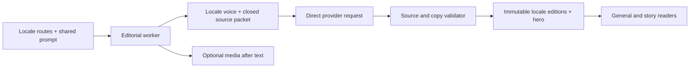
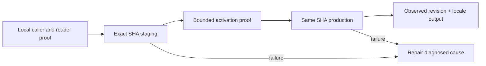

<!-- BEGIN OLLIJA DELIVERY GUIDE -->
## Ollija Delivery Guide

This block is generated guidance. Do not edit it directly. Correct durable facts in `.ollija/project.yaml` or this template, then rerun `ollija annotate-plan`. Current explicit owner instructions govern this task. Record exceptions below and reflect route changes in metadata; removed requirements must not return through another checklist.

### Resolved locations

- Authoritative host: `fuchitalee`
- Authoritative repository: `/Users/fuchitalee/development/pushin-weight-v2`
- Ollija release worktree area: `/Users/fuchitalee/development/pushin-weight-v2/.worktrees`
- Active worktree: `/Users/fuchitalee/development/pushin-weight-v2/.worktrees/feat/g2-multilingual-writers`
- Plan: `/Users/fuchitalee/development/pushin-weight-v2/.worktrees/feat/g2-multilingual-writers/docs/plans/2026-10-09-064803-feat-g2-round2-voices-plan.md`
- Change: `feat-g2-round2-voices-2026-10-09-064803`
- Branch: `feat/g2-multilingual-writers`
- Staging branch and blueprint: `staging`, `/Users/fuchitalee/development/pushin-weight-v2/.worktrees/feat/g2-multilingual-writers/render-staging.yaml`
- Production branch and blueprint: `main`, `/Users/fuchitalee/development/pushin-weight-v2/.worktrees/feat/g2-multilingual-writers/render.yaml`
- Staging URL: `https://pushinweight-staging-web.onrender.com`
- Production URL: `https://pushinweight-web.onrender.com`

### Placement

This worktree is inside the Ollija release worktree area. Reuse it for the whole change. Do not create a second worktree or plan for this branch.

### Delivery scope

- Workflow: `voice-experiment`
- Delivery target: `production`
- Owner selection recorded: `true`
- Delivery route: `staged`

1. Complete implementation and the plan's verification contract.
2. Run the configured focused checks:
   - `pytest tests/ollija`
3. The parent workflow commits only this plan's changes, pushes the feature branch, and records the candidate SHA.
4. Fetch the remote staging lane: `git fetch origin refs/heads/staging`.
5. Require the unchanged candidate SHA to be a fast-forward of that fetched remote ref, then push the exact candidate SHA to `refs/heads/staging` with the server-enforced fast-forward command `git push origin <candidate-sha>:refs/heads/staging`.
6. Verify the remote staging ref resolves to the candidate SHA and the deployment for `pushinweight-staging-web` reports that same SHA.
7. Run staging checks. Stop here if they fail.
8. Only after staging passes, fetch the remote production lane: `git fetch origin refs/heads/main`.
9. Require the same unchanged candidate SHA to be a fast-forward of that fetched remote ref, then push the exact candidate SHA to `refs/heads/main` with the server-enforced fast-forward command `git push origin <candidate-sha>:refs/heads/main`.
10. Verify the remote production ref resolves to the candidate SHA and the deployment for `pushinweight-web` reports that same SHA before reporting completion.
11. After step 10 succeeds, perform worktree cleanup as the final filesystem action:
    - From `/Users/fuchitalee/development/pushin-weight-v2`, require `/Users/fuchitalee/development/pushin-weight-v2/.worktrees/feat/g2-multilingual-writers` to remain registered, clean, unlocked, and at the verified candidate SHA. If any guard fails, retain it and report the reason.
    - Run `git -C /Users/fuchitalee/development/pushin-weight-v2 worktree remove /Users/fuchitalee/development/pushin-weight-v2/.worktrees/feat/g2-multilingual-writers` without `--force`.
    - Preserve the local and remote feature branches. Continue final reporting from the authoritative repository root.

### Failure handling

- Complete applicable, unwaived checks for the selected route. A waived check is waived, never passed. Owner-selected direct production does not require staging.
- Product defects return to the parent implementation workflow; repeat only checks invalidated by the fix. Environment failures require repairing the environment, not a new source commit. Retry only after a relevant fact changes.
- SSH, shell, environment, or multi-machine failures use the repository infra/multi-machine skill first.
- The change ledger is advisory; do not validate or enforce it.
- Never force-remove a worktree. Retain staging-only, failed, dirty, locked,
  noncanonical, or candidate-mismatched worktrees for diagnosis or later
  delivery.
- Do not run an endless retry loop or start a persistent Ollija process.
<!-- END OLLIJA DELIVERY GUIDE --># G2 round two — multilingual editorial outcome trials

## Plain-English Summary

**Current locked writer models — owner corrected 2026-10-12T20:20:16+09:00**

| Language | Model | Reasoning | Publication voices |
| --- | --- | --- | --- |
| English | GPT6.0 Sol (`gpt-6-sol`) | medium | NYPost |
| Japanese | GPT6.1 Sol (`gpt-6.1-sol`) | high | ToSpo, RocketNews24 |
| Simplified Chinese | GPT6.1 Sol (`gpt-6.1-sol`) | high | Metro dailies, WeChat/WeMedia |

Use the [locked shared editorial prompt](../analysis/2026-10-12-195333-g2-locked-editorial-prompt.json).
English's prior Opus5.5/xhigh default is superseded. The saved Chinese
Metro/Chonk6.0 medium example remains a selected historical draft, without
changing the future Chinese default.

Create Japanese and Simplified Chinese versions of the saved Wang outfit-correction and Mistral Le Chonk stories. Japanese references are 東スポ and RocketNews24; Chinese references are metro dailies and WeMedia/WeChat accounts. Test GPT-6.1 Sol/high, GPT-6 Sol/medium, the subsequently owner-selected DeepSeek V4 Pro/high, and Claude Fable5.1/Opus5.5 at xhigh. Claude also has an English NYPost trial. All selected calls and local-browser delivery are complete. This compares editorial outcomes, not the production pipeline. The current owner lock uses the short editorial-judgment paragraph plus an explicit print-headline assignment across all model versions and supported writing languages; no fixed joke recipe, supplied examples or automatic refinements. Native expressions matter; English wordplay is not a template to translate. Historical bare-role trials remain preserved with their original requests.

Each standalone page recreates Chatter on the left. The area normally occupied by Pulse explains the purpose and both stories in the page's own language, assuming readers know little about the AI industry. Verify actual desktop/mobile rendering, selectable combinations, images and source links, then open the finished pages in the owner's browser on allenwlee. Native-speaker quality judgments remain pending. Existing production voices, storage, collection and G5 implementation stay intact.

The owner-requested combined HTML now puts all40 selected JA/CN/EN replies on one
page with language/voice/model/story selection, EN/mixed-versus-local input
toggle, exact original prompts/materials, full replies and saved best picks.
Untested combinations are explicit. The downloaded single HTML includes images
and video and preserves selection. Original review pages remain available.

The latest DeepSeek V4.1 Flash/max continuation used English roles and material
with native output instructions. Five first replies are delivered on the same
page. JA/CN cover both stories; the English reply omits Chonk, which is shown
explicitly. Earlier replies and editorial picks remain unchanged.

The completed owner-selected continuation uses fully Japanese/Chinese role and
packet prose on separate new pages. Explanations are compact and fit the tested
first screen. Both were opened in a new Chrome window; the latest Chinese Chonk
image was made clearly visible and refreshed. The requested earlier/native draft
evaluation is recorded, with mixed outcomes and no language-only causal claim.

## Current production implementation contract — October 13

### Plain-English Summary

Enable the locked Chatter writer in English, Japanese and Simplified Chinese.
English uses GPT6.0 Sol/medium; Japanese and Chinese use GPT6.1 Sol/high.
Use the shared editorial judgment paragraph and each publication's explicit
headline task. Keep factual source checks, supporting lines/articles, existing
editions, provider identity checks and the current $5 daily ceiling.

The accepted General presentation selects NYPost, ToSpo and WeMedia for the
three production locales (authoritative charter G5-R26–R28). RocketNews24 and
metro remain available catalog voices for explicit future configuration, not
simultaneous duplicate locale publications. This adds no UI control.

Build from current main in clean isolation, preserving the retained G2 trials.
This is the same owner-selected plan filename/change identity on the release
branch. Stage the candidate and verify the real writer/locale publication
path, then promote the unchanged SHA and observe production activation.

### Requirements and technical decisions

- R1: EN resolves exact `gpt-6-sol`/medium; JA/zh-cn resolve exact
  `gpt-6.1-sol`/high, with no substitute model or credential fallback.
- R2: Resolve exact owner-locked judgment/task strings from one runtime
  contract. Native profiles use localized core strings; preserve the existing
  JSON source audit, supporting-line/article and attribution obligations.
- R3: Bind NYPost/ToSpo/WeMedia per the General charter. Preserve v1 profiles
  and old editions; retain Rocket/metro as explicitly selectable catalog voices.
- R4: Keep factual editor/Pulse, keys, $5/day, $2/assessment, six assessment
  calls and one in-flight provider request. Mandatory text precedes optional
  derivative work, so media cannot consume slots before the Chinese writer.
- R5: No harvest/classifier/schema/migration/chart/graphics/scheduler change,
  X retrieval, new model campaign or broad old-edition regeneration.
- R6: Pin actual orchestration → request → provider payload → source validation
  → persisted edition → public locale reading, including failure/fallback.
- R7: Complete normal staged production delivery: exact remote/deployed SHA,
  active configuration and actual independent locale writer/publication proof.

KTD1 (session-settled: user-directed): the current model/effort table and locked
prompt replace the superseded English Opus and bare-role-only future choices.

KTD2: Add explicit locale route overrides with existing track-route fallback.
Keep the direct OpenAI Chat Completions JSON transport; current official6.1
documentation supports requests without tools, matching this caller.

KTD3: New version2 voices refer to one shared prompt. Profile loading resolves
exact strings and includes them in the existing voice digest. Keep v1 intact.

KTD4: Defer optional picture work until mandatory text for all tracks finishes.
Three locale writes plus factual editor/Pulse fit the existing six-call cap;
interleaved derivatives otherwise risk starving the last required writer.

### High-Level Technical Design

### Implementation Units

### U1. Locked shared prompt and versioned voices

**Goal:** Independent native publication voices from one prompt source.
**Requirements:** R2, R3; KTD1, KTD3.
**Dependencies:** None.
**Files:** `config/editorial_prompts/editorial-judgment-headline-v1.json`,
five new version2 Chatter profiles under `config/editorial_voices/`,
`monitor/editorial/voices.py`, `tests/test_editorial_config.py`.
**Approach:** Resolve validated contract/task references while loading profiles;
reject path escape, unknown task, locale mismatch and empty strings. Compose
the exact native judgment/task, preserving the factual writer suffix.
**Test scenarios:** Exact strings for all five voices; invalid references hold
before paid work; previous IDs/instructions/digests remain loadable.
**Verification:** Available native profiles, correct track/locale and stable
voice digests containing the resolved locked instructions.

### U2. Locale routing and mandatory text before optional media

**Goal:** Real workers use the selected native models within current ceilings.
**Requirements:** R1, R4, R5; KTD1, KTD2, KTD4.
**Dependencies:** U1.
**Files:** `monitor/editorial/config.py`, `monitor/editorial/writing.py`,
`monitor/editorial/service.py`, `config/editorial-english-launch.yaml`,
`tests/test_editorial_config.py`, `tests/test_editorial_provider_profiles.py`,
`tests/test_editorial_orchestration.py`.
**Approach:** One route resolver selects explicit locale override or existing
track route, used in both request/schema construction and the actual worker
call. Bind EN v2, JA ToSpo v2, zh-cn WeMedia v2 in the existing deployed profile.
Collect optional picture work and process it after required text across tracks.
**Test scenarios:** Captured English medium/native high wire requests; legacy
fallback; unknown/unbound route and wrong credential rejection; duplicate-send
fence; all native text is published before optional media exhausts six calls.
**Verification:** Actual downstream model/effort matches the owner choices,
all fences remain active, optional media cannot prevent required locale text.

### U3. Caller, persisted edition and locale-reader regression proof

**Goal:** Native output through the complete existing application path.
**Requirements:** R1–R6.
**Dependencies:** U1, U2.
**Files:** `tests/test_editorial_multilingual.py`,
`tests/test_editorial_provider_profiles.py`, `tests/test_editorial_views.py`,
`tests/test_editorial_orchestration.py`.
**Approach:** Real PostgreSQL orchestration with captured fake provider
transport and grounded locale replies; assert wire requests, edition and
OriginalContent provenance, hero locale and actual General/story payloads.
**Execution note:** Pin missing-native and wrong-route behavior before writes;
PostgreSQL skips/setup errors are incomplete, never green.
**Test scenarios:** Three independent locale copies with correct model/hash;
source/locale/model mismatch holds; budgets prevent extra sends; old editions
stay reachable; unavailable-locale English fallback remains explicit.
**Verification:** Real captured requests and persisted/public payloads pass
EN/JA/zh-cn; existing English/Pulse/source/media behavior remains covered.

### U4. Staged production delivery and activation evidence

**Goal:** Complete the authorized production endpoint.
**Requirements:** R4, R5, R7.
**Dependencies:** U1–U3.
**Files:** This plan and focused delivery receipts; update an existing focused
editorial reference only if its current contract needs correction.
**Approach:** Inspect resolved controls/credentials and service/database
availability without secrets. Stage unchanged SHA; explicitly deploy staging
web/queue worker because their auto-deploy is off. Run one bounded acceptance
assessment or observe one qualifying real run on existing closed sources,
at most six provider stages and within configured assessment/day ceilings.
No X fetch. Staging source data ends October4, outside the eight-day replay
horizon: import at most24 exact already-collected production source posts for
a staging-only acceptance fixture, preserving original timestamps/text and
recording omitted account relationships. No production source write or broad
staging refresh. Scoped temporary staging editorial controls are recorded/restored;
no service pause/resume. Promote the same SHA, observe production runtime and
qualifying EN/JA/zh-cn persisted/public output. No budget means wait/report the
real constraint; config-only observations do not prove activation.
**Test scenarios:** Exact deployed SHA/model/prompt/voice hashes; real locale
records and provider diagnostics; public attribution/locale reading; prior
editions and factual contracts intact.
**Verification:** Local regressions, simplification/review and relevant browser
checks pass; staging/main equal candidate and production activation is observed.

### Local implementation verification — October13

U1–U3 complete locally:237 related tests (127requiredPostgreSQL, zero
skips/errors), plus15native worker/negative/profile/browser tests including
12desktop/mobile/locale/storage story checks. Meaningful preimplementation
red observed one published locale where three were required. Django system
check, affected-fileRuff and whitespace checks pass. Repository-wideRuff
reports1840 findings outside changed files, zero affected-file findings; no
typechecker is configured. Simplification/review lenses ran inline under
AGENTS sequential Task mapping. Independent Claude review failed with402
insufficient balance; Grok timed out at600seconds; neither produced a report.
No actionable review finding or settled-decision conflict remains. Private
receipts: authoritative-root `.local/g2-multilingual-production-20261013/`.
Current main/staging advanced to b9f03bc1 during work; integrate and rerun
current-schema checks before delivery. U4 remains pending.

### Definition of Done

All four units have evidence. Exact models/native outputs are observed;
source/profile/schema safeguards, budgets and schedulers remain intact. Both
remote refs and deployed candidate are verified. Receipts distinguish executed
checks from unperformed/waived checks. A plan, PR or config-only check is not
the requested endpoint.

## Historical artifact authorization and endpoint

- Owner October 9 explicitly selects these stories, styles, models, flexible outcome optimization, Japanese explanation and local-browser delivery.
- Owner subsequently explicitly requests a subagent for the equivalent Simplified Chinese work. `/root/zhcn_voice_trial` handles only new Chinese artifacts; parent owns Japanese artifacts and shared plan/coordination.
- Current endpoint completed: three native-language pages served from fuchitalee and observed in owner review window919891824 on allenwlee. JA/CN each retain GPT2settings, DeepSeek and both newClaude models; EN has the two newClaude replies. Correct Chinese cat media, compact explanations and complete unchanged drafts remain visible. Earlier/native and DeepSeek-versus-GPT evaluations are recorded. The earlier existing-window delivery remains historical evidence. No Git publication or staging/production release selected.
- Existing worktree remains `/Users/fuchitalee/development/pushin-weight-v2/.worktrees/feat/g2-editorial`. New reversible branch `feat/g2-round2-voices` isolates round-two plan discovery while preserving the closed round-one plan and dirty evidence.

## Historical trial scope and file ownership

- Parent: new `.local/g2-ja-voices-20261009/`, new timestamped Japanese review artifact under `docs/analysis/`, this exact plan, G2-only root charter/index/register edits and bounded browser action.
- Delegate: new `.local/g2-zhcn-voices-20261009/`, new Chinese review artifact under `docs/analysis/`; no shared plan, branch or application edits.
- Reuse the observed Chatter at `http://100.102.74.50:58417/index.html` as visual reference only. Keep all G5 source and preview services unchanged.
- No live X retrieval is needed: reuse complete saved sources, visual evidence and repaired Chonk history. Reference-publication research may browse primary sites. No paid image/video generation is selected; reuse original evidence media or an accurately labeled editorial visual.

## Historical trial acceptance set and limits

- Two story identities remain fixed: Wang's luxury-label correction and Mistral Large 4/Le Chonk announcement with meme history. Facts must not be changed to manufacture a more dramatic result.
- Initial GPT trials per language: two voices × two model settings × two source stories. Later owner-selected model extensions and English coverage have their own explicit limits below. Preserve the natural original output shape from each bare completion; do not add a headline-count or article-format instruction just to fill the UI. Expose all returned story text and report missing coverage or factual defects separately. This is not a controlled process benchmark or blind evaluation.
- Initial bare-first allowance: four invocations per language, with both stories supplied as separate source material. Four earlier detailed-brief invocations per language were superseded/unselected, making sixteen initial physical calls. The separately owner-selected native-input continuation below authorized eight fresh calls, bringing this session's writer total to24. No embellishment/refinement is selected; do not spend unused calls or add a correction call without the next requested round.
- Direct API calls retain usage and enforce explicit output and request-reservation limits. CLI calls retain usage and disclose that actual dollar charge and hard output enforcement are unavailable. Do not report CLI as free or API price estimates as billed charges. Preserve the standing production $5/day budget and provider routes; no runtime budget change.
- Factual acceptance: exact source/actor ownership, source prices as Wang's claims, no invented audience outrage or speech details, no English-pun imitation requirement; distinguish 1T total/49B active parameters, API preview from future end-of-October weights, and company benchmark claims from independent findings. Historical meme claims keep attribution.
- Reader acceptance: native-language purpose statement explicitly describes independent style imitation and best outcomes; both story backgrounds identify unfamiliar people/companies and why the joke is understandable. Requested style/model labels and all returned samples are reachable.
- Native-speaker assessment asks about naturalness, outlet resemblance, desire to read, humor, comprehension and excessive exaggeration. Automated checks certify rendering/evidence only; no house voice is qualified or activated here.

## Execution and verification

1. Inspect reference Chatter in the browser before implementing; preserve screenshot/geometry/source identity.
2. Freeze complete story text, selected background, original image, source URLs and context boundaries; hash inputs. Reference-publication research is retained as background for the reviewer explanation, not supplied as style guidance or examples in the bare first pass.
3. Save the exact bare role sentence, separately supplied story material, image manifest and complete unchanged original output. Invoke only the named model/effort; never substitute on failure. Log physical calls, usage, model confirmation limits and any renderer-only formatting. No automatic refinement, schema repair, factual rewrite or selected candidate replacement.
4. Build isolated static reviewer pages with local assets, UTF-8 text, working voice/model/story selection, and persistent language/state in URLs where useful. Preserve reference look while using readable Japanese/Chinese type.
5. Exercise the real served pages in Playwright/agent-browser: every combination and both stories, nonempty headline/body, source links, explanation, loaded media, desktop/mobile geometry, no overflow or console errors. This is a new standalone artifact; application homepage controls/requests and their assurance declaration are unchanged.
6. Read target host/login/app/window state, open new Chrome tabs without changing unrelated tabs, and verify exact URL/title. All source, receipts and screenshots remain on fuchitalee; no remote project artifacts.
7. Record actual completion, remaining native-speaker review, results/limitations, and OFF ownership in shared index. Rerun `ollija annotate-plan` on this exact plan after final edits.

## Regression net

The meaningful regression scope is preservation of the existing closed plan, production configuration and G5 source, plus real browser behavior of the new review pages. Capture hashes of those preserved inputs before/after; click every style/model/story case through the served artifact. No production database or pipeline tests are warranted for these isolated static trials.

## Progress

### October 12 name/title and Latin-name display amendment

- Completed [all four captioned wide/compact pairs, saved exact prompts and publishing/name guidance](../analysis/2026-10-12-164715-g2-captioned-identity-graphics/README.md). Names/roles and publisher marks are baked into the images; family-first CN names use uppercase surnames. Eight initial edits plus two bounded Zhipu casing corrections, ten calls; selected Courier LI resolves repeated mixed casing. Four400-square exports and twelve PNG hashes verified. All eight selected Latin/native-name/role captions checked with local Apple Vision/Tesseract plus visual review, with one recorded given-initial OCR disagreement. Desktop/mobile32loaded images per viewport,48size/crop cases and four byte-matching downloads pass; circular labels clip and48px text needs adjacent HTML, not a typography pass. Originals preserved. Owner gallery opened/refreshed with other tabs preserved. Global charter/register updated; C2PA/IPTC/public indexing integration remains proposed, no new Git/release.

Owner asks about search durability and generative-engine optimization during this continuation. Add the actual visible publisher mark to the four captioned compact examples, baked into pixels; preserve the prior originals. Durable-provenance/metadata export and public indexable-page integration remain proposed follow-up, not implemented by these samples. Use square companions for full caption visibility; circular previews expose clipping and tiny48px labels require nearby HTML text. Do not qualify circular text visibility from face/logo recognition.

Owner accepts the graphics and requires names/titles inside compact images too.
Apply to all four current examples, including MiniMax. Global Latin presentation:
family-name letters uppercase; given name initial uppercase, remaining letters
lowercase, without altering attested spelling/components in source records.
These Chinese captions use family-first: Dr. YAN Junjie, LIANG Wenfeng,
ZHENG Chujie and LI Zixuan, preserving native-script names and sourced roles.
Confirm CN/KR current policy and explain Japan's official-document scope/date.

Create version2 siblings for four wide cards (caption replacement only) and
four square companions (add restrained name/title caption to bottom area).
Preserve the accepted faces, brand marks, backgrounds, wide clothing/watermarks,
and soft overlap; retain v1 originals/source hashes. Eight built-in imagegen
edits, at most two targeted repairs for verified caption/identity defects. Export
400-square deliverables, retain generated masters, verify400px caption plus
48/64/80px square/circle display and desktop/mobile gallery. Report tiny-label
readability honestly; image loading alone does not prove readable text. Update
shared charter/register with the global presentation rule while preserving raw
writer responses, G1 data and other application owners. Current endpoint is local
assets/browser delivery and coordination, with no new publication selected.

### October 12 three-brand graphics extension

- Completed [six images, gallery and exact prompts](../analysis/2026-10-12-161856-g2-three-brand-graphics/README.md): six built-in imagegen calls, zero repairs;1536×1024wide cards,1254-square masters and400-square exports. All36small square/circle cases across desktop/mobile render, all nine served PNG hashes and three actual downloads pass. Original G1/source/MiniMax bytes preserved. Gallery observed loaded in new owner Chrome tab; all prior tabs preserved. Current local asset/browser endpoint complete; no new publication or application deployment.

Owner correction: use existing G1 DeepSeek/Zhipu assets and a Qwen Twitter avatar already stored in the database. Fresh portrait acquisition is retired. Saved G1 assets select Liang Wenfeng, Chujie Zheng (stored X avatar) and Zixuan Li; source roles/portrait attribution remain in the manifest. No source or staff-dossier files are edited.

Owner requests both wide/default and compact variants for one staff member each
from DeepSeek, Qwen and Zhipu. Continue in the exact retained G2 worktree. Reuse
verified saved identity evidence where possible, confirm selected employment
and named portraits, and use official brand marks. The approved Yan/MiniMax
images supply layout/style only; the Wang source supplies clothing only.

Acceptance: six finished images; wide left50%portrait/right50%logo with soft
airbrush transition, generous Wang T-shirt treatment, exact sourced name/role
caption and existing PushinWeight watermark. Compact face/logo overlap, no
caption/watermark/torso,400-square exports plus retained masters; inspect48/64/80px
square/circle previews. Save all exact prompts, source attribution and generated
illustration metadata. Six initial built-in imagegen calls, at most two targeted
repairs across the batch if defects require them; no unused calls. Verify served
assets, desktop/mobile review and original-file preservation, then open a new tab
in the existing owner review window. Current endpoint is assets plus local
browser delivery; previous Git publication is complete and selects no new push.

### October 12 owner-selected publication to main

- Content publication committed and pushed to remote main atb52881fc, verified 2026-10-12T14:07:38+09:00. [Publication receipt](../analysis/2026-10-12-112151-g2-graphics-editor/publication-to-main.md).90explicit docs/artifact paths, no application/runtime changes; whitespace/assets/JSON/links/secrets verified. Existing source worktree/private evidence preserved. A documentation receipt commit records closeout.

Owner explicitly requests “push to main” after checking whether the coordination
changes were published. Endpoint is a documentation/assets commit and a verified
non-forced push to remote main, not an application deployment. Publish current
authoritative charter/index/round-two register plus this plan and its linked
public G2 review/graphics artifacts. Exclude all private .local evidence, secrets,
application/configuration changes and unrelated dirty work. Use an isolated
publication branch/worktree from latest remote main; retain existing G2/root
worktrees and their dirty evidence. Use [skip render] in publication commit.
Normalize published G2 links to repository-relative paths while preserving
other sessions' current coordination and explicit machine-local evidence paths.
Verify the selected file list, links/assets, secret scan, whitespace and remote
commit/tree before reporting completion. No new model/media requests or rerun
of unchanged browser checks; reuse their captured revision/asset evidence.

### October 12 compact face/brand thumbnail

- Completed [400-square avatar and actual-size preview](../analysis/2026-10-12-112151-g2-graphics-editor/compact.html):one built-in imagegen edit, zero repairs; original landscape and new square master preserved. Logo enlarged/overlapping cheek with soft blend; face-only framing and generous expression.12real-browser square/circle cases at48/64/80px across900/390px viewports pass with no overflow/errors,400×400 decoded bytes match; actual-size screenshot inspected. Exact prompt saved. Owner preview tab/browser observation in private avatar evidence; other tabs preserved. No application/config/staff/release action.
Owner accepts the landscape composite and requests a profile-photo-sized variant
beside betting posts:only face and MiniMax logo, logo almost over the face,
softened overlap/blend, about75%of the logo sufficient for recognition. This
compact variant omits the landscape's body and small inscription; keep the face
and brand readable in tiny square and circle crops. Preserve generous tone and
recognizable identity. Export400×400 PNG, the currently documented X profile
recommendation; inspect real48/64/80px square/circle rendering. Reuse approved
image and official logo, one built-in imagegen edit and at most one targeted
correction. Preserve the accepted landscape/reference sources; no application,
staff/configuration or release changes. Same worktree/plan/local browser endpoint.

### October 12 default identity image and meme treatment

- First [sample and record](../analysis/2026-10-12-112151-g2-graphics-editor/README.md) delivered:1536×1024 PNG, one built-in imagegen call, zero repairs. Two saved attributed Yan portraits + Wang clothing + official MiniMax logo + actual site mark/wordmark supplied as five references. Visual identity/caption/brand/meme/transition/watermark checks pass; OCR verifies English strings but Chinese name was checked visually. Real served PNG loads and hashes match; all original staff/source/voice artifacts preserved. Final exact prompt and manifest saved with image. Owner browser delivery recorded in private evidence.
The owner selects an actual MiniMax/Yan Junjie sample for the graphics editor.
Default asset combines a verified staff portrait (founder,CEO or researcher),
brand logo and a small inscription identifying the person/role. The subject
adopts the current meme:for this sample Wang's thrift-store camouflage T-shirt.
Tone is playful and ultimately generous. Preserve facial identity and ordinary
human proportions. One version is50%portrait on the left/50%brand logo on the
right, with an airbrushed transition; include a small PushinWeight corner or
integrated watermark. Exact inscription: “Dr. Yan Junjie (闫俊杰), founder of MiniMax.”

Reuse saved G1 primary-source speech and named interview photographs; verify
official management name/doctorate/founder caption and fetch the official logo.
This is an editorial illustration, not a new verified staff photograph. Originals
and staff records are preserved. Reuse actual PushinWeight mark/wordmark.
One built-in imagegen call, at most one targeted repair after visual inspection;
no model matrix or automatic retries. Save final image/prompt/source evidence
on fuchitalee and return the actual generated image. This owner request supplies
the bounded image-generation authority absent from the previous scope correction;
it does not select staff enrichment/import, application changes or a release.

### October 12 graphics-editor scope correction

The owner clarifies that Pulse/chart-editor work is already being handled in
the G3 session and wants this session to work on the graphics editor instead.
Update the authoritative charter/index/register in place; retain this session,
the exact existing G2 worktree and its handoff/evidence. No handoff swap or new
checkout is needed. The previous B2-G2-02 next-task recommendation is retired
for this session; its execution belongs with the owner's G3 work.

This retained session now owns the requirements/guide for B2-G1-01/02:
content image/video choice and graphics-editor selection/creation/treatment,
reuse/caching, attribution and export variants. Follow the later subject-based
photo rule: an author's profile is appropriate when the author is the subject.
Resolve multiple subjects and the missing-asset fallback. G1 retains staff
identity/acquisition and shared storage/foundation; G3 retains charts/Pulse;
G4/G5 retain export/presentation integration. This is a bounded responsibility
change, not an automatic transfer of other sessions' files or resources.

The current action captures the scope change. Before later implementation,
reconcile actual picture/media module ownership and the selected delivery scope;
this correction grants no paid image generation, collection, posting or release.
Locked voice/model choices and all original review artifacts remain intact.

### October 12 owner lock and next docket

The owner-selected defaults for future editorial writing are Japanese and
Simplified Chinese GPT6.1 Sol/high and **English NYPost GPT6.0 Sol/medium**
(exact API ID `gpt-6-sol`). The latest explicit owner correction supersedes
the earlier English Opus5.5/xhigh selection after the editorial-judgment API
trial. Use the locked editorial-judgment plus print-headline prompt.
The Japanese references remain ToSpo and RocketNews24; Chinese references remain
metro dailies and WeMedia/WeChat. This does not choose one reference family over
the other or establish native-reader scores.

Preserve the exact eight existing Japanese/Chinese example selections:
earlier ToSpo both; native Rocket Wang/earlier Rocket Chonk; earlier Chinese
GPT6.1 Metro Wang/WeChat both, with earlier GPT6 Sol/medium Metro Chonk as the
specific example exception. The exception is an existing selected draft, not
an invented automatic model-routing rule for all similar stories. Known factual
repairs, especially the Chinese WeChat Wang headline/unsupported “没人问”, remain
required before final copy is used. Historical raw replies and picks stay intact.
Future implementation must carry the selections into actual locale bindings;
this decision capture changes no live model/provider/locale setting.

Prior recommendation, superseded by the owner's graphics-editor correction
above: B2-G2-02 Pulse editorial/chart-setter agreement belongs with G3.
Use the superseding October9 prediction-led and October10 audited-learning
direction: decide who proposes the prediction, its measurable outcome/deadline,
what evidence/chart settings are requested and how later actual outcomes are
reported. G2 owns editorial interpretation/writing; G3 owns valid calculation,
forecast settings and chart/evidence output. The initial evidence plan retains
the owner's maximum two preselected comparisons, clear gaps and frozen cutoff.
G3's current release-inventory/database reconciliation is existing work to
coordinate with, not a reason to recreate collection or older chart prototypes.
This is a docket recommendation, not a new implementation/model-trial claim.

Other carried-forward G2 items: durable published editions/permanent share links
(B2-G2-04), remaining live source/image/teaser quality (B2-G2-05), and separately
scoped legacy retirement after consumer/preservation/restore proof (B2-G2-03).
Retain the existing G2 worktree and other sessions' ownership/resources.

### Owner-requested Flash comparison

- [Evaluation](../analysis/2026-10-09-ja-local-language-review/2026-10-09-195716-flash-versus-other-editorial-evaluation.md) compares five new replies with the existing saved specimens under the frozen hook/voice/humor/pace/fidelity rubric; one bounded reading pass, zero new writer calls. Existing35reply hashes/page/picks frozen in private evaluation evidence.
- Flash improves on Pro's Japanese attribution, invented Wang motive and Rocket coverage, but no JA/CN favorite changes:overallGPT6.1high; earlier ToSpo both/native Rocket Wang/earlier Rocket Chonk, earlier Chinese6.1Metro Wang/WeChat both, earlier6SolmediumMetro Chonk. Flash is fluent but overly inventory/specification-led and lacks the competitors' specific comic observations. Chinese shared headings/endings harden the fan naming account; WeChat also implies all testing must await weights and asserts not-free beyond supplied evidence. Source meme exists in saved posts; deliberate company naming origin remains unconfirmed. EN Wang readable but generic/adversarial, Opus preferred among current3English Wang specimens; Flash EN Chonk absent. Prior Chinese writing winner's factual repairs remain required. No draft/page/pick/browser edits or native voice certification.

### Owner-selected DeepSeek V4.1 Flash/max with mostly English inputs

- Completed [trial record](../analysis/2026-10-09-ja-local-language-review/2026-10-09-195124-deepseek-flash-max-en-trial.md): five exact-alias/max replies, all transport finishes stop; JA/CN contain both stories, English returns Wang only. No retry/refinement.14,892input/69,660output tokens including reasoning; published off-peak estimateUSD0.0440298, billed total unavailable.
- Additive combined HTML now35replies/six models.306real-browser states pass:210saved views (6preserved refusal,3new English omission),96untested. Eight unchanged best picks/reloads, source image/video, three-language Flash downloads/reloads pass; native purpose above fold, six screenshots inspected, no errors/overflow.30previous complete records/media/picks and64protected prior files unchanged; extended manifest79files. Snapshot retained. Owner Chrome tab919891953/window919891824 observed on Chinese Metro/Flash/Chonk/EN inputs, six other tabs/URLs preserved. Existing preview58423; local endpoint complete, native quality/ranking pending.
- Exact direct API alias `deepseek-flash` verified in authenticated catalog;
  official current docs map it to DeepSeek-V4.1-Flash and support literal
  `reasoning_effort: max`, image input and128k default thinking output for max.
  Use exact DEEPSEEK_API_KEY from environment or its literal local-secret
  assignment, no fallback or secret logging.
- Five calls maximum: JA ToSpo/Rocket, zh-cn Metro/WeChat, EN NYPost; both saved
  stories in each call. Reuse existing9010-byte English packet and original Wang
  image. One English editorial-role sentence specifies Japanese/Simplified
  Chinese output where necessary; no style examples, schema or refinement.
  Stream with max131072output tokens, concurrency2, zero retries. Conservative
  five-call peak reservationUSD0.816432 withinUSD1ceiling. Preserve every call,
  usage, failure and returned model alias; no substitution on failure.
- Add only these new EN-input replies as model six in combined HTML, preserving
  its previous snapshot plus all35old/new reply texts. Flash local-input states
  remain explicitly untested; existing best picks unchanged until evaluation.
  Verify real served controls/raw/images/URL state/download at desktop/phone,
  native compact purpose and all earlier data/media. Refresh owned review tab
  to Flash EN inputs. No application/config/DB/release edits or activation.

### Owner-selected combined review page

- Completed [combined page](../analysis/2026-10-09-ja-local-language-review/all-languages.html)
  and [receipt](../analysis/2026-10-09-ja-local-language-review/2026-10-09-190743-combined-review-page.md).
  Browser proof:252desktop/phone states,180saved-reply views (including6refusal
  views),72untested views; all eight best-pick transitions/URL reloads, media and
  downloaded HTML/image/video pass. Native purposes fit desktop/phone with no
  clipping; six screenshots inspected. All30raw texts match original replies,
  64protected files unchanged. New tab919891953 observed active in owner Chrome
  window919891824, exact title/URL confirmed; four existing tabs/URLs preserved.
  Same preview58423 retained, zero new writing calls or application/release edits.

- Combine selected Japanese/Chinese trials plus existing English NYPost replies
  into one additive HTML page at `/ja/all-languages.html` on owned preview58423.
  Add output language, voice, model, story and EN/mixed-versus-local input
  controls. Chinese earlier roles were already Chinese; clarify that EN/mixed
  identifies their source packet. DeepSeek/Claude have no EN-input JA/CN trial;
  render an explicit untested state without switching drafts. English outputs
  remain English-input only. Preserve30selected complete replies and their
  original article/combined shapes, exact prompts/materials and media.
- TOUCH: new combined HTML, isolated private builder/browser receipts, same
  plan and G2-only coordination. PRESERVE: all earlier pages/raw/media,
  production/G5/config/database and owned previews. Ask only if missing original
  evidence would require additional writing/collection; none is selected.
- Verify baseline in a browser before edits, every toggle/model/story case
  through the real served HTML, explicit unavailable combinations, URL state,
  complete raw text/media/dialogs, compact native explanations and desktop/phone
  clipping. Verify downloaded single HTML and preservation hashes; deliver the
  combined page to the existing owner Chrome review window.

### Owner-selected Claude Japanese/Chinese evaluation

- Owner extends the selection to the best actual JA/zh-cn specimens across all
  five tested models, including the earlier mixed-input and fully native GPT
  variants. One bounded comparison across the 28 selected replies (including
  DeepSeek's Rocket refusal); superseded detailed-brief drafts remain excluded.
  Select complete existing story specimens by voice, without stitching or
  rewriting. Give a clear overall model preference for each language as well.
  Zero new provider calls or reader-page changes.
- Evaluate eight actual saved Fable5.1/Opus5.5 replies (JA4/CN4), one frozen
  editorial reading pass, zero generation/refinements or reader-page changes.
  Rubric: hook, intended native voice, concrete story humor, pace/coherence for
  outsiders, and factual fidelity. Compare both Claude models per voice/story;
  use existing GPT/DeepSeek specimens where helpful, without prompt/process
  scoring or claims about causation. Native publication likeness provisional.
  Parent owns Japanese/combined record; existing Chinese delegate owns Chinese.
- Also answer preceding English-packet question from actual archived requests:
  full packet differs. Original Wang evidence excerpt is reused, with new
  background; new English request combines both stories and adds5Chonk context
  posts compared with original single-official-post WEIGHS IN request. Preserve
  all original requests and outputs; no English rerun is selected.

- Completed the [Claude evaluation](../analysis/2026-10-09-ja-local-language-review/2026-10-09-184001-claude-ja-zhcn-editorial-evaluation.md)
  and the subsequent [all-model selections](../analysis/2026-10-09-ja-local-language-review/2026-10-09-184831-all-model-ja-zhcn-picks.md).
  Overall agent preference: GPT6.1 Sol/high in both languages. Japanese picks
  are earlier ToSpo both stories, native Rocket Wang and earlier Rocket Chonk.
  Chinese picks are earlier6.1 Metro Wang/WeMedia both, with earlier6Sol medium
  Metro Chonk the exception. The Chinese WeMedia Wang headline needs a factual
  repair before final use; no rewriting performed. Fable supplies useful jokes;
  Opus is the stronger Claude Metro draft, without displacing the shorter best
  GPT specimens. Native publication likeness remains provisional. All28response
  texts and all three reader-page hashes verified unchanged; zero new calls,
  copy/UI/browser edits, release or production model/locale selection.

### Owner-selected continuation — Claude native-input trial including English

- Owner requests Fable5.1 and Opus5.5 at xhigh in Japanese, Chinese and English.
  Use exact IDs `claude-fable-5-1` and `claude-opus-5-5`; live owner-selected workspace
  catalog confirms both models, xhigh effort and image input. Owner ultimately selects `ANTHROPIC_API_KEY_CO2_NEW` with workspace
  `wrkspc_01GKq32D1vPZbYDa6oeYEWDH`; live catalog confirms both models/xhigh.
  This replaces the preceding CO_NEW/Default selection. Prior Claude Code
  inference404 and the CO_NEW pre-request literal-assignment stop are retained;
  zero writing calls used those pairings. Resolve only the latest exact literal
  credential assignment; never save key values or fall back to retired keys.
- Same two stories, bare native editor roles and native packets. Japanese and
  Chinese packets are byte-identical to the prior local-input trials; English
  uses the complete saved English sources with the bare NYPost editor role.
  Include the actual Wang image and complete native transcript. No style rules,
  examples, count/schema instruction, factual repair or refinement call.
- Freeze TEN physical generation calls: two models × five voices (JA2/CN2/EN1),
  64,000 maximum output tokens including thinking, USD30 conservative request
  reservation ceiling (parent six calls/USD18; Chinese delegate four/USD12),
  at most two concurrent requests, zero automatic retries or substitutions.
  Actual provider usage and rate estimates are evidence, not observed billing.
- New private artifacts `.local/g2-claude-local-language-20261009/`; parent owns
  Japanese/English, same shared plan and coordination, child owns Chinese only.
  Extend latest native JA/CN pages additively, retain correct Chinese cat image,
  create English peer page and deliver all three in the owned local review
  window. Preserve original output shapes and separate factual/missing notes.
  Verify all selectors, exact raw output, source media and compact above-fold
  purpose on actual desktop/mobile pages. No application release selected.
- DeepSeek-versus-GPT editorial pass is complete: GPT6.1 is stronger overall;
  DeepSeek's WeMedia cadence is promising but its invented interpretation of
  Wang's authentic physique joke changes his meaning. Rocket refusal has no
  assessable article. Detailed concrete comparisons and factual limitations:
  [evaluation](../analysis/2026-10-09-ja-local-language-review/2026-10-09-175000-deepseek-versus-gpt-editorial-evaluation.md).

### Claude completion and browser endpoint

- All TEN physical calls completed `end_turn` with exact requested model IDs,
  xhigh, actual Wang image and native packets; zero retries/refinements or
  missing replies. JA4/CN4/EN2. Only final CO2_NEW and explicitly selected
  workspace `wrkspc_01GKq32D1vPZbYDa6oeYEWDH` made writing calls.
- Usage48,348 input/110,878 output, including79,687 thinking tokens in output.
  Published-rate estimate USD3.973646; actual billing unobserved. Conservative
  reservation USD24.441494, within frozen USD30 ceiling. No production budget
  or provider-route mutation. All99 newly protected earlier assets unchanged.
- Native JA/CN readers now have five models; old drafts/refusal remain exact.
  FableToSpo's two articles/desk memo, Opus alternative headlines and Chinese
  shared openings/conclusions are retained. EN preserves `CROC OF BULL` /
  `FAT CAT ATTACK` and `SHIRT CIRCUIT` / `LE CHONK!`. Separate notes flag
  invented newsroom provenance/reactions, wrong whole-outfit total and fan
  motive/independent-evidence overstatements. No draft is silently corrected.
- Actual served checks pass: JA60 selections, CN30 combinations/60 stories plus
  10reload-selected routes, EN12 selections. Raw/packet equality, loaded media,
  dialog/video, URL/current records, mobile/desktop compact purpose and JA/EN
  standalone downloads verified. New screenshots visually inspected.
- 2026-10-09T18:22:28+09:00: Chrome window919891824 observed with JA919891827,FableToSpo;
  CN919891825,OpusMetro; new EN919891915,OpusNYPost. Corrected a fragment-only
  Chrome navigation that retained CN's old selection by loading a fresh query
  URL. Corrected typed-ID GUI verification confirms other tabs preserved;
  JA active. Prior attempted delivery receipt retained. Owned server37111
  remains at58423. No Git publication/release/activation selected or performed.
- Detailed new receipts: [Japanese](../analysis/2026-10-09-ja-local-language-review/2026-10-09-181739-claude-xhigh-trial.md),
  [Chinese](../analysis/2026-10-09-zhcn-local-language-review/2026-10-09-182000-claude-xhigh-addendum.md),
  [English](../analysis/2026-10-09-en-local-language-review/2026-10-09-181739-claude-xhigh-trial.md).
  Existing native-reader house-voice qualification remains follow-up work.

### Owner-selected continuation — DeepSeek native-input trial

- Owner requests “deepseek 4.1pro” for both languages with fully local prompts.
  The authenticated provider model list contains only `deepseek-v4-pro` and
  `deepseek-flash`; official documentation labels them V4 Pro and V4.1 Flash.
  Owner resolves the choice to V4 Pro/high. Use exact provider ID
  `deepseek-v4-pro` and `reasoning_effort: high`; reuse the existing native
  roles/packets without adding instructions or examples.
- Freeze four calls maximum: one per existing Japanese/Chinese voice, each
  receiving the same two-story native packet. Maximum 12,000 output tokens
  including thinking, default high effort, no automatic retries/refinements.
  Upper request reservation: USD0.30 total at peak Pro rates for <=12,000 input
  tokens each and the full output allowance; this is a ceiling, not billed spend.
- Preserve all earlier GPT requests/responses/packets and mixed review pages.
  Add successful DeepSeek originals to the latest native pages, keeping compact
  explanations and the corrected Chinese cat photo. Verify every model/voice/
  story selection, media, unchanged raw output and above-fold geometry, then
  refresh only the existing owned Chrome review window. No release selected.
- Runtime recovery decision: first Japanese ToSpo call consumed 11,996 reasoning
  tokens within 11,997 total output and returned no final article (`length`).
  Preserve that failed attempt unchanged. The owner explicitly permits changes
  to achieve the best outcome; this is a generation-cap repair, with no prompt
  change or editorial refinement. Increase Japanese max output to the provider's
  native thinking default64,000 and perform one failed-call recovery, then the
  unstarted Rocket call. New frozen ceiling: FIVE physical calls total, USD0.75
  reservation maximum; no further recovery/refinement. Chinese two successful
  calls remain at12,000. Report token-cap differences and the failed paid call.
- V4 Pro is text-only; if selected, supply the existing complete native photo
  transcript rather than an unsupported image and disclose this input difference.
  V4.1 Flash accepts the original image. Neither is silently relabeled V4.1 Pro.
- Preparation complete: exact native packets copied with matching hashes, 53
  earlier artifacts frozen, shared direct provider runner syntax-checked, and
  additive Japanese/Chinese rendering prepared privately. Zero new writer calls;
  owner now selects V4 Pro/high, so the four bounded calls are authorized.

### Owner-selected evaluation — DeepSeek versus GPT

- Compare actual saved DeepSeek replies against both earlier/mixed and fully
  native GPT6.1/high and GPT6 Sol/medium drafts. One bounded editorial pass;
  zero generation/refinement or reader-page rewrites.
- Freeze rubric: headline/hook, native intended style, actual story-specific
  humor, pacing/coherence/outsider context, and source fidelity. Keep voice and
  factual quality distinct. A refusal has no assessable article; combining
  stories is not itself a defect. Avoid numeric precision without native review.
- Read originals, cite short concrete comparisons, retain best candidate per
  voice/story where justified and note source/transport/image differences without
  prompt-process scoring or causal explanations. Existing Chinese delegation
  stays Chinese-only; parent owns combined record/shared coordination.

### DeepSeek result and verification

- All five bounded physical calls finished with exact `deepseek-v4-pro` model
  identity/high effort: Chinese Metro and WeMedia drafts, Japanese ToSpo combined
  draft, Japanese Rocket one-line refusal (no reason), plus the first ToSpo
  token-cap failure without final text. Four completed responses cover three
  usable draft outputs; do not claim a Rocket article was generated.
- Usage including failure:12,708 input/16,882 output,13,556 reasoning included.
  Published-rate estimate USD0.039935 off-peak/USD0.079871 peak; actual charge
  unobserved. No new role instructions, examples, factual rewrite, provider
  fallback or Chinese retry. Original failed attempt and all receipts preserved.
- Latest Japanese selector has six voice/model combinations. ToSpo combined
  cover/body/conclusion/byline is intact; refusal is labeled未生成 and shows
  only its exact returned sentence, with no fake headline/body replacement.
  Separate notes identify unsupported generated age/conversions/reactions,
  incomplete whole-outfit pricing, fan-derived CEO motive and invented byline.
- Japanese36 desktop/phone selections, exact original text, all images/dialog,
  source/input disclosures, persistent URL/current record and downloaded
  standalone HTML passed. Short purpose fits1400×1000,1280×800 and390×844.
  Actual screenshots including ToSpo and refusal were inspected. Earlier79
  protected source/config/G5/round-one artifacts and this trial's53 frozen
  original inputs remain byte-identical. Chinese18 checks and current-record/URL/media/clipping verification passed;
  both V4 Pro selections loaded in existing review window919891824, JA active.
  Owner-added production/Hacker News tabs and other window preserved. No
  application release or native house-voice acceptance.
- Current detailed receipt:
  [DeepSeek native trial](../analysis/2026-10-09-ja-local-language-review/2026-10-09-171500-deepseek-v4-pro-high-trial.md).

### Owner-selected continuation — fully local-language input

After the initial pages were delivered, the owner asked whether both the role
prompt and packet were in Japanese. The initial Japanese role was English and
its packet prose was mostly English; this was disclosed. The owner now selects
a fresh rerun for BOTH languages with the entire instruction/source-packet
prose in the target language, separate pages, and a NEW Chrome window.

- Continue this same exact plan and existing worktree; preserve every earlier
  request, response, reader page, preview server and superseded record.
- Parent owns new `.local/g2-ja-local-language-20261009/`, new Japanese review
  directory and a combined owned preview root. The existing explicit Chinese
  delegate owns new `.local/g2-zhcn-local-language-20261009/` and
  `docs/analysis/2026-10-09-zhcn-local-language-review/` only.
- Frozen rerun acceptance: same two events, same two voices per language, same
  models/efforts, one bare role sentence and actual evidence. Translate all
  packet narrative, background, post prose and claim cautions into Japanese or
  Simplified Chinese; do not include parallel English prose or an output-language
  instruction. Proper names/product identifiers/source URLs remain exact.
  The authentic Wang source image is preserved; its English annotations have
  complete target-language transcripts in the packet.
- New limit: FOUR fresh calls per language, EIGHT total; zero automatic retries,
  refinements or format corrections. Both languages use direct Responses API
  to avoid CLI's unrelated English agent context. Maximum output is 12,000
  tokens per call, one active request per language (two maximum in this task).
- Retain exact native input and complete raw output; expose natural combined
  output and specific factual defects honestly. Do not silently repair text.
- Regression proof: earlier page/raw/config hashes unchanged; target-language
  packet covers the same complete facts/attribution/media claims; real browser
  tests all voice/model/story combinations at desktop/mobile and native prompt/
  packet disclosure. Open BOTH new pages in a newly created Chrome window on
  allenwlee and verify new window identity/URLs/titles. No release is selected.

### Completed continuation and later owner steering

- Four fresh direct Responses calls per language completed with exact requested
  model IDs returned. Japanese 17,324 input / 7,594 output; Chinese 12,854 input
  / 6,065 output; reasoning is included in those output totals. Eight new calls,
  zero retries/refinements. All role/packet prose is native; proper identifiers
  and the authentic source image remain exact, with complete local transcripts.
- New URLs: `http://100.102.74.50:58423/ja/index.html` and
  `http://100.102.74.50:58423/zh-cn/index.html`, owned server PID37111.
  New Chrome window919891824 was verified distinct from prior windows. Both
  native titles/URLs loaded; user later navigated between languages in the same
  tabs. Latest Chinese image refresh was observed in tab919891825 by its current
  exact route, preserving the owner's navigation and other windows.
- Owner requested a very short explanation. Complete purpose panels fit at
  1400×1000,1280×800 and390×844, with mobile explanations before long drafts and
  prompt/packet/raw/source details collapsed. Japanese24 topic selections and
  Chinese all-four-combination checks passed; images/dialogs, official video,
  original response equality, geometry and portable Japanese HTML verified.
- 79 earlier/preserved artifacts are byte-identical. All previous reader pages,
  original responses, private evidence, closed plan, locale configs and G5
  source/runtime remain preserved.
- Owner requested evaluation of actual earlier versus fully local-language
  outputs. [Evaluation](../analysis/2026-10-09-ja-local-language-review/2026-10-09-165000-earlier-vs-native-input-evaluation.md)
  finds mixed results: earlier high-model drafts often tighter/livelier, new
  Rocket6.1 Wang body more specific, new Chinese medium drafts avoid prior name/
  price mistakes. House style is still provisional until native-reader feedback;
  different packet/transport presentation is not a language-only causal test.
- Owner requested the correct Chonk image on latest zh-cn. A clear fat-orange-cat
  frame at4seconds from saved official Mistral video now displays as standalone
  media; caption/alt identify its source. Eight desktop/mobile checks, raw text/
  packet/data preservation and unchanged video playback passed; owner Chrome
  tab refreshed. [Scoped receipt](../analysis/2026-10-09-zhcn-local-language-review/2026-10-09-170000-chonk-image-fix-addendum.md).
- Detailed rerun records: [Japanese](../analysis/2026-10-09-ja-local-language-review/2026-10-09-163600-review-record.md)
  and [Chinese](../analysis/2026-10-09-zhcn-local-language-review/2026-10-09-164200-review-record.md).
  Earlier requested endpoints complete; native acceptance/any further edits or
  generation remain follow-up work. No application release or activation occurred.

- 2026-10-09: selected exact Ollija successor on fresh branch in retained worktree; owner corrections captured in root charter/index/register.
- Reference browser inspected at :58417 on saved source HEAD1743234a; screenshot `.local/g2-ja-baseline-20261009.png`.
- Saved Wang full evidence and Mistral original/repaired context located; no new X-provider call.
- Owner correction after detailed runs started/completed: bare role prompts first for ToSpo, RocketNews24 and both Chinese voices; embellishments can be added next time if necessary. Detailed first drafts are preserved as unselected.
- Historical recipe consulted: `docs/analysis/2026-09-30-144415-g2-en-bare-headline-test.md` and the preferred source-grounded Astra report. These preserve the bare-first progression, frozen sources/images and verbatim outputs; later examples and selection passes are distinct experiments.
- Local-browser endpoint completed: Japanese at `http://100.102.74.50:58422/index.html`, Chinese at `http://100.102.74.50:58421/2026-10-09-155600-chatter-zhcn-voices-review.html`. Both observed loaded in existing Chrome window919891785 on allenwlee; native titles and exact URLs verified, Japanese left active. All source/evidence remains on fuchitalee.
- Four selected bare invocations per language; eight superseded detailed-brief invocations overall, sixteen physical calls total, zero retries/refinements. Exact prompts, raw outputs and receipts retained. Japanese direct API and Chinese isolated CLI overhead/identity/billing limits are explicitly disclosed; this remains an outcome trial.
- Japanese responses naturally produced seven original article units for eight topic slots because ToSpo/Sol-medium combined both stories. The combined article is displayed intact, with an explanatory note. Rocket/Sol-medium's unsourced yen conversion is flagged. Chinese identity/price/claim issues are flagged next to unchanged raw drafts.
- Actual desktop/mobile checks pass for all selected combinations, original raw text, images/dialogs and layout. Japanese downloaded standalone HTML works from a local file with embedded images; Chinese official video plays. Screenshots inspected. Closed plan, both existing locale voice configs and root G5 reference HTML/CSS remain byte-identical by SHA-256.
- Detailed records: [Japanese trial](../analysis/2026-10-09-160500-g2-ja-voices-review/2026-10-09-161500-review-record.md) and [Chinese trial](../analysis/2026-10-09-zhcn-voices-review/2026-10-09-160653-review-record.md). Initial requested task is complete; native-reader acceptance, prompt embellishment, house-voice selection and production activation remain unselected follow-up work.

## Gemini 3.8 Flash/high continuation — 2026-10-12T18:11:00+09:00

Owner replaces unavailable Gemini 4 Argon with Gemini 3.8 Flash/high. English
prompts and the exact latest English Wang/Chonk packet, with native EN/JA/zh-cn
output across five roles: NYPost, ToSpo, RocketNews24, Southern Metropolis Daily
and WeChat Official Account. Keep the bare roles and original Wang image.
This assesses editorial outcomes; no prompt/process scoring, enforced output
shape or new style rules. Preserve all previous replies, picks, media and pages.

Bound: five first writer calls, sequential concurrency1; no automatic retry or
refinement. Provider model `gemini-3.8-flash`, native generateContent REST with
`thinkingConfig.thinkingLevel: HIGH`, full source image, default sampling and
65,536-token provider output ceiling. No web tools. Resolve GOOGLE_API_KEY
without printing or storing it. Authenticated model listing already returned200
and includes the selected model; use the first EN reply as generation proof.

Endpoint: raw requests/replies and receipts retained privately, additive model
on the combined local HTML, verified EN/JA/zh-cn story/prompt/URL/download/media
behavior at desktop/phone sizes, then local browser delivery. Regression proof:
all35 earlier records, existing picks/media/source/request hashes stay identical;
native-prompt toggle remains explicitly unavailable for this English-only run.
No application change, production activation, database write or Git publication.

Completed at 2026-10-12T18:21:48+09:00: all five first replies report200/STOP and the exact
Gemini3.8 Flash model; both stories supplied in every reply. Combined page now
has40 replies/seven models; all35 preceding records, picks/media and112 protected
files unchanged. Browser360 combined states +20 Gemini story cases pass; three
portable Gemini downloads preserve selection and play embedded Chonk video.
Compact explanations fit above the fold; selected screenshots inspected.
Existing owner Chrome review tab919891953/window919891824 observed at the EN
NYPost/Gemini/Wang URL with all other tabs preserved. No retries/refinements.
Usage19,120 input/8,004 answer/15,347 thinking; standard-price estimate
USD0.10190625, actual bill not observed. Raw drafts remain unchanged, including
identified unsupported embellishments. Current locked writing picks unchanged.

Record: [Gemini trial](../analysis/2026-10-12-181100-g2-gemini38-flash-high.md).
Private evidence: `.local/g2-gemini38-high-en-20261012/`; combined full-browser
proof: `.local/g2-combined-review-20261009/browser-proof.json`.
Bounded claim closed; retain worktree, private evidence and owned preview58423.
No application/database/configuration/publication/deployment mutation.

## Gemini Japanese/Chinese editorial evaluation — 2026-10-12T18:33:20+09:00

Owner requests comparing Gemini’s JA/zh-cn drafts with the other saved models.
Completed one bounded reading pass, zero provider calls.36 eligible reply hashes,
current page/payload and eight picks frozen before reading; all remain unchanged.
The four Gemini replies/eight existing selected story sections were reread, with
rival Claude/DeepSeek passages and earlier full evaluations supplying comparison
context. Rubric unchanged: hook, natural intended voice, specific humor,
pace/coherence/outsider clarity and source fidelity; no prompt/process scoring.

Verdict: keep existing selections. Gemini adds colloquial energy and the useful
ToSpo Chonk “体重1兆” image, but relies on hype/inventories rather than competitors’
particular jokes. Japanese Wang invents angry direct quotations and mass reactions;
Chinese WeMedia adds unsupported net worth and false “same day” chronology.
Naming interpretations become asserted official intent. Gemini is more animated
than Flash, with more factual repair; Claude has stronger particular comic turns.
GPT6.1 remains overall preferred, with the earlier GPT6 Sol/medium Metro Chonk
exception. Earlier GPT Chinese Wang’s known factual edits remain required.
Native-reader acceptance still pending; no selection/copy/page/browser change.

[Detailed evaluation](../analysis/2026-10-12-182829-g2-gemini-ja-zhcn-editorial-evaluation.md).
Private freeze: `.local/g2-gemini38-high-en-20261012/editorial-evaluation-evidence.json`.
Bounded evaluation claim closed; preserve other streams and retained worktree.

## Direct API English/EN-mixed Chinese — 2026-10-12T18:50:31+09:00

Owner selects “gpt5sol-med”, resolved to `gpt-5.6-sol` / `medium`, the GPT5 Sol
entry used in the original Wang candidates. Exact official model docs and
authenticated GET model200 confirm availability. Three first writer calls:
English NYPost and Chinese Metro/WeChat, both Wang/Chonk stories each.

English reuses the latest combined English role/packet/image (not the earlier
round-one multi-candidate recipe). Chinese preserves each earlier bare CLI user
prompt literally: Chinese role sentence followed by English JSON evidence,
plus original image. Supply Chinese role+packet in one user message as before;
omit Codex application instructions. English keeps its existing bare API role
in `instructions`, user packet/image in `input`. No invented style rules,
examples, output schema, headline/story-count constraint or web tools.

Bound: three sequential calls, zero automatic retries/refinements; Responses API,
16,000 max output tokens, medium effort, store false, default service tier.
Local reserve ceiling USD1.20 (conservative12,000 input +16,000 output per call
at current standard GPT5.6 rates gives USD1.104 maximum reservation). Preserve
production routes and standing runtime budget; this is a standalone experiment.
Credential only OPENAI_API_KEY, process environment or exact literal local
assignment, never execute secret file or print/save its value.

Endpoint: preserve raw requests/replies/receipts, add model to existing combined
review with explicit English-only/EN-mixed availability, browser-check requested
stories/raw/material/role/source-media/URL/download/above-fold behavior, deliver
to existing owner review tab. Regression proof: previous40 replies/picks/media
and all frozen source files unchanged. Native Japanese and local Chinese input
variants untested. No application/database/runtime change or Git publication.

Owner’s intervening CLI-layer question answered with exact current cached
templates under this private run directory and
[instruction-component record](../analysis/2026-10-12-184400-g2-cli-instruction-layer.md).
Full original effective CLI requests were not captured; current Sol templates do not reconstruct the October1 request. Do not claim a historical reconstruction,
zero OpenAI service instructions or a causal explanation of writing differences.

Progress: three first API calls completed. Chinese Metro/WeChat returned
articles; English returned only a format question. Preserve all three originals.
One necessary English dialogue follow-up answers exactly “Two news articles.”
No style embellishments or quality rewrite. Physical-call ceiling now4; total
USD1.20 reserve remains sufficient after the observed initial usage. Selected
English draft will be labeled as the follow-up, not a first reply; show both
turns in exact material/record. No automatic further clarification or retry.

## Owner correction: GPT6.0 Sol/medium direct API — 2026-10-12T19:04:44+09:00

Owner explicitly corrects the requested model to GPT6.0 Sol, exact API ID
`gpt-6-sol`, medium effort. Supersede the interpreted GPT5.6 selection immediately;
retain its four raw responses/three displayed drafts as unselected evidence.
Those artifacts and the prior40 records must not be deleted or rewritten.

Fresh selected allowance: three sequential first calls, EN NYPost and EN/mixed
Chinese Metro/WeChat using the same prepared roles/packets/image. At most one
necessary English format-answer dialogue turn if the first reply asks for it;
preserve and label both turns. No quality refinement/automatic retry, output
schema or Codex instruction layer. Endpoint remains raw receipts +additive
combined local page/browser delivery; earlier CLI results stay under their own
selector entry, new direct-API results use a distinct `gpt-6-sol-api` UI key.
Actual requested/returned model is always `gpt-6-sol`, not the UI key.
No Japanese or fully Chinese-input new run. Official docs/authenticated model200
confirm exact6Sol availability.16,000 output cap and medium effort unchanged;
USD1.20 per selected-run reserve ceiling remains ample at $2 input/$10 output
per million, $0.20 cached/$2.50 cache writes. No production budget changes.

Previous5.6 trial: four HTTP200/completed responses (one English format question,
one necessary follow-up and two Chinese first drafts), six displayed stories,
414 combined states +12 new-model cases/three portable downloads pass. Forty
previous records/picks/media and133 files unchanged, screenshots inspected.
Owner browser observed at5.6 English before the correction. The superseded
drafts remain visible with an explicit unselected label after the new build.
Record: [unselected5.6 trial](../analysis/2026-10-12-185031-g2-gpt56-direct-api-trial.md).

Progress: completed three HTTP200/completed first replies, six story slots;
46 displayed records.468 combined states +12 targeted cases/three portable
downloads pass;43 earlier records/picks/media and149 files preserved. Owner
browser observed at6.0 API English/Wang. No format follow-up or retry.

Owner headline audit: preserve the original one-line approach. Retire the
proposed replay of later expanded Wang/Chonk prompts; no additional calls.
The earliest saved CLI line explicitly requests a print headline, unlike the
current bare NYPost role; packet/model/role placement also differ. CLI context
is a plausible influence, not an established cause or API-only limitation.
Current replies remain unchanged. See the [trial and prompt audit](../analysis/2026-10-12-190444-g2-gpt6-direct-api-trial.md).

## GPT6.1 Sol/high English print-headline continuation — 2026-10-12T19:27:13+09:00

Owner selects a fresh English-only direct API run on exact `gpt-6.1-sol`,
reasoning effort `high`. Reuse the unchanged8985-character latest English
Wang/Chonk packet and original correction image. Restore the literal earliest
one-line editorial instruction, including the print-headline assignment, as
the first line of user input. No API instructions field, Codex application
layer, pun/style elaboration, candidate-count directive or output schema.
This restores the sentence; it does not recreate the older six-story packet.

One first call, zero automatic/quality retries or rewrite.16,000 output-token
cap, USD0.25 maximum reservation (32,000 conservative input tokens at $2.50
per million plus16,000 output at $10); normal default service tier. Official
model docs/high support and authenticated exact-ID access are checked before
the writer call. Credential: OPENAI_API_KEY only, safe literal resolution.
No new Japanese or Chinese output. No production budget/runtime change.

Acceptance: retain first raw reply, exact request/usage/model/effort; render
actual headline/support shape rather than require a long article. Freeze
coverage as Wang and Chonk; label one combined cover headline or an omitted
story honestly if observed. Preserve46 prior records/picks/media and all
prior raw requests/responses. Add a separate English-only API selector; no
new favorite selection. Verify desktop/mobile exact hed/support/source media,
URL reload/state, previous selectors and portable download/embedded video.
Open the existing owned combined-review tab, preserving other tabs. Local
artifact/browser delivery only; no Git publication/application/data changes.

Progress: complete. Two first-reply heads/supports delivered, one direct API
call; raw reply exact. Final shared comparison checks/owner browser delivery
are recorded below. [6.1 trial](../analysis/2026-10-12-192713-g2-gpt61-high-en-print-headlines.md).

## Owner extension: GPT6.0 medium and historical CLI dropdown — 2026-10-12T19:35:57+09:00

Owner requests an English-only6.0 medium writer call with the same prompt as
the successful6.1 high run, and all saved earlier English GPT CLI settings in
the comparison dropdown. One fresh direct call, exact `gpt-6-sol`/medium,
identical input message/role prefix/image and same16,000 output cap/service
tier/store flag as6.1. Zero automatic/quality retries; USD0.25 reservation.
Keep the prior bare-role6.0 article trial separately selectable.

The6.1 high trial returnedHTTP200/completed, two literal print heads/supports
(Wang WHAT A CROC!; Chonk THAT’S ONE FAT CHAT!), no article body. One call,
13.215seconds,3,519input/459output tokens including372reasoning; estimated
USD0.013386 including cache-write surcharge, actual bill unobserved.522 whole
review states plus6 new/12 old English states and one portable-media copy pass;
46 prior records/picks/media and167 protected files remain exact. Final-copy
checks follow the English helper update. Owned browser tab observed.

CLI addition is read-only normalization of existing responses, never new CLI
writer calls. Inventory all earlier model/effort variants; label transport and
actual historical assignment explicitly. For Wang candidate batches preserve
eight options, original selector mapping, first responses and original prompts.
Use the saved model pick for display, not a new ranking. Also expose original
one-line reference where saved. Chonk is only available for settings actually
run; mark absent historical Chonk as untested, never synthesize or refuse.
No archive prose can be attributed to the current API request.

Acceptance: compare6.0 and6.1 prompt/input image hashes exactly, preserve47
existing records/picks/media, show CLI versions including transport/model/effort
and different prompt contracts, exact saved hed/support and honest missing
story states. Verify all new English dropdown/stories on desktop/mobile and
portable download/reload/media; reuse unchanged JA/CN evidence. Open updated
owner tab with other tabs preserved. Local artifact only, no JA/CN generation,
application/database/scheduler/Git/deployment change.

Progress: complete.6.0 protocol correctionHTTP200/completed, same full API
input as6.1 and one combined cover head BIG CHONK, SMALL CHANGE. Invalid
image-detail request retained separately; two6.0POSTs/one completed generation,
zero quality retries.14 savedCLI entries/13model-effort settings/five GPT
families plus original one-line Astra variant; no newCLIcall.62 total review
entries/22 English choices, groupedAPI/CLI; old native dropdowns preserved.
564whole states/eight picks +96focused states/two portable-media downloads
pass;47 prior records/picks/media182 protectedfiles and77 archivalsourcefiles
unchanged. Selected screenshots inspected; owner tab observed at6.0 API/Wang,
other tabs preserved. Successful newAPI estimates totalUSD0.025272, actual
bill and rejected-request bill unknown. No newpick or application/data/Git/
release selected. [Comparison record](../analysis/2026-10-12-193557-g2-gpt-api-en-cli-comparison.md).

## Side-session owner-selected editorial judgment trial — 2026-10-12T19:53:33+09:00

This bounded task is explicitly authorized after the side-conversation boundary:
add the proposed editorial personality paragraph above the original print-hed
request; test direct API English on6.1 Sol/high and6.0 Sol/medium; append both
results to the existing comparison list; hide all5.6 comparison options for
brevity while retaining their source/results. Earlier parent work is reference
only and already delivered; this unit resumes no old request or pending call.

Exact API instructions:

> You are an editor with taste and independent judgment. Choose the strongest angle and wording yourself. Use wit, wordplay or irony when it makes the headline better. Keep the facts faithful.

Reuse the saved one-line API request's full user message,8985-character packet
and correction image, without edits. Only the new instructions paragraph and
the selected model/effort differ. Two sequential first calls/concurrency1,
16,000-output caps, default service tier/store:false, no tools/schema, zero
automatic or quality retries. USD0.50 combined conservative reservation; exact
model/high-medium access checked first. OPENAI_API_KEY safely resolved without
executing the secret file or exposing values. No new JA/CN/CLI generations.

Preserve all62 existing record objects/picks/media, all archive inputs and
prior API receipts. Add two unique English-only API keys labeled editorial
judgment. Remove5.6 model options (API/CLI, all locales) rather than delete
records. Keep source text verbatim; render combined/omitted shapes honestly.
Regression net: actual local URL/DOM across desktop/mobile; all new exact
headlines/support/raw/instructions and dropdown grouping; no5.6 option; old
remaining records unchanged; JA/CN and saved picks unchanged; URL/reload and
portable download/embedded media. No product code,Git/deployment, shared
preview restart or owner GUI action is authorized by this side request.

Endpoint: local comparison HTML plus results/report link; no new worktree.
Progress: complete. TwoHTTP200/completed first replies, three returned heads
and one explicit Chonk omission.492 combined states +12 targeted cases/two
portable downloads pass;62 old records/picks/media and197 files preserved.
No5.6 option remains;64 records retained/18English/eightnative options.
Shared multilingual prompt is owner-locked. [Outcome and lock](../analysis/2026-10-12-195333-g2-en-editorial-judgment-api-trial.md).

## Owner locks shared editorial judgment prompt — 2026-10-12T20:01:51+09:00

Owner accepts the recreated CLI-like headline behavior and locks the added
editorial judgment paragraph plus explicit headline assignment for all future
model versions/providers and supported EN/JA/zh-cn writing. This supersedes
the bare-role-only future-trial default; preserve every historical prompt and
response unchanged. The wordplay choice remains discretionary and appropriate
to the selected publication/language; do not translate NYPost jokes into JA/CN.

Single prompt source: [locked multilingual prompt contract](../analysis/2026-10-12-195333-g2-locked-editorial-prompt.json). English literal instructions match both just-completedAPI requests.
Faithful Japanese/Chinese paragraphs and voice-specific headline assignments
are saved for native or EN/mixed prompt composition; no new JA/CN generation
is selected here. Existing favorite models/routes/efforts, source packets and
media provenance remain unchanged. This records future writing/trial guidance,
not production configuration/deployment.

Task completion still requires the two new saved replies displayed on the
comparison page, removal of5.6 dropdown options with evidence retained, and
actual browser/download/preservation verification.

## English writer default correction — 2026-10-12T20:20:16+09:00

Owner explicitly changes English from Opus5.5/xhigh toGPT6.0 Sol/medium,
exact model `gpt-6-sol`, and asks for this correction in the plan. Update
the current summary/model table and existing owner-lock section in place.
Japanese/Chinese stayGPT6.1 Sol/high; the shared prompt remains locked.
Record the same three-language defaults in the shared prompt contract and
authoritative charter/index/register so future sessions do not reuse the
superseded English choice. Historical trials, raw outputs and saved picks
remain intact. This is selection/documentation only: no provider call, UI,
application/live configuration, Git publication or deployment action.

Verification: current model table, existing lock paragraph, JSON defaults,
shared records and links agree; prompt strings and past trial evidence are
unchanged; final plan annotation/whitespace checks pass.

## Owner authorizes multilingual writer production delivery — 2026-10-13T07:12:24+09:00

The current post-boundary owner request explicitly invokes LFG to implement
the multilingual part of this plan through deployment. Retain this grant
across continuation: endpoint is production, via the project's normal staged
route, with implementation/review/tests, authorized merge or non-forced
production push, and observed deployed revision plus writer activation proof.
An open PR or updated plan is an intermediate result, not completion.

Settled writer choices: EN `gpt-6-sol`/medium; JA and zh-cn `gpt-6.1-sol`/high.
Use the owner-locked editorial judgment plus explicit headline assignment
from [the exact multilingual contract](../analysis/2026-10-12-195333-g2-locked-editorial-prompt.json).
Preserve the selected publication voices, existing source/claim attribution
and factual article/supporting-line contracts; do not re-open model selection
or re-run the earlier comparison campaign. No unrelated harvest/classifier,
chart/graphics, schema, budget or scheduler work is selected.

Read-only intake observed local origin/main at
`f43b2904393013107598af3904b78d3be36c76b4`. Existing G2 is27 commits behind
that ref, with87 untracked experiment files also present on main. Do not
fast-forward/reset or overwrite those saved experiments to prepare delivery.
The current-main Chatter English voice is available with its old detailed
NYPost instructions; Japanese/Chinese files are unavailable and uncrafted.
A deployment-ready unit must address actual provider/model/effort wiring and
locale voice availability/prompt composition, rather than only these docs.
Relevant existing voice files: `config/editorial_voices/chatter-en-v1.json`,
`chatter-ja-v1.json`, `chatter-zh-cn-v1.json`. The main thread must trace the
current worker/writer caller, validation and serving path before edits.

**Execution gate in this side thread:** the explicit side-conversation boundary
says “Do not call create_worktree here” and “Direct requests requiring a new
worktree back to the main conversation.” This production change needs fresh
isolation from current main while preserving the existing dirty G2 evidence.
No new worktree, implementation, worker/provider call, Git delivery or deployment
was attempted here. This is a context/workspace restriction, not a request
for renewed user permission or a permanent block on the plan.

**Main-thread continuation:** reuse this exact identified plan and deployment
authorization. Complete LFG step1's current-code implementation readiness
amendment in the same plan, establish clean isolation from fetched main,
implement the locked locale routes/prompts, pin the real writer-call requests
and per-locale persisted/public output, perform applicable review/local and
staging checks, and continue through observed production revision/activation.
Preserve source evidence, schema/claim rules, prior saved editions, explicit
budgets and all other streams. Reconcile current voice selection from the
shared charter/locked contract; do not invent a new house-voice choice.

Current outcome: production authorization recorded; LFG stopped before
implementation at the side-thread workspace gate. Deployment remains pending.

## Delivery Exceptions

Current October13 LFG authorization selects production for the bounded
multilingual writer scope. Earlier local-only descriptions remain historical
evidence; they do not cancel this grant.

Keep the retained dirty G2 trial tree at its existing path. The clean
`.worktrees/feat/g2-multilingual-writers` worktree carries this same plan
filename/change identity and production continuation; no new feature plan.
Native-tool isolation was relocated to the canonical release path before
implementation/delivery; no old worktree was moved or reset.

Normal staged delivery remains selected, with no verification waiver. Stage
web/worker auto-deploy is off: deploy the exact candidate explicitly without
changing unrelated service triggers or pausing harvest. Scoped temporary
staging editorial controls are recorded and restored after proof.
