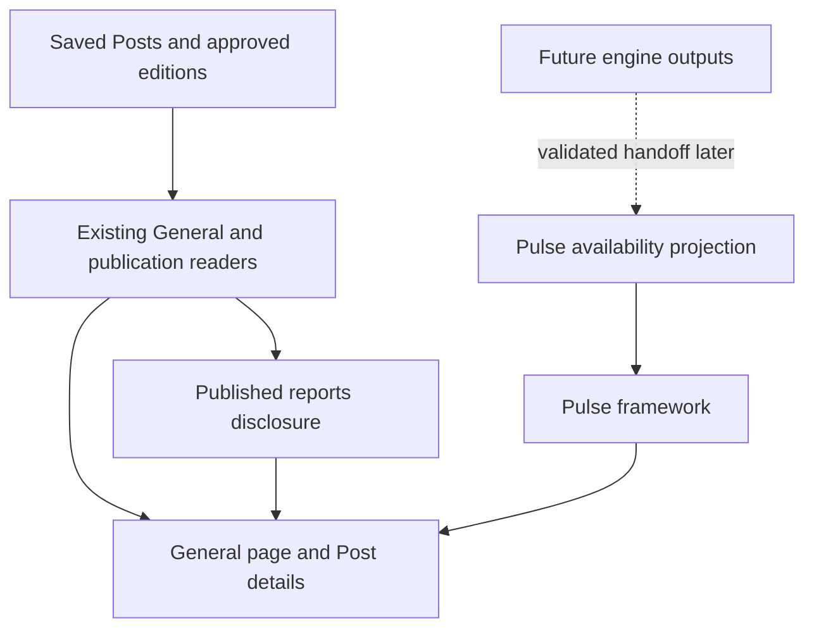
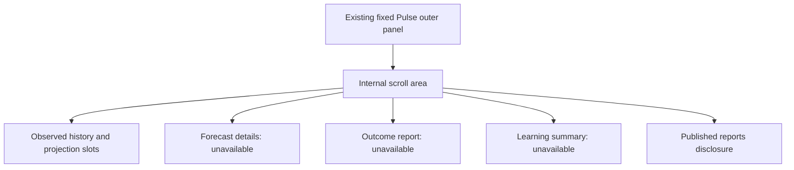

# General and Pulse Framework - Plan

## Plain-English Summary

Publish the existing General experience and add the current prediction-led Pulse framework.
Readers get real Calendar, Free stuff, Jobs, personnel announcements and published Chatter, plus a Pulse area organized around observed history, forecasts, later outcome reports and learning.
Pulse's unfinished engines show clear unavailable states; earlier published Pulse reports remain accessible with their complete text and sources.

Keep the accepted white/blue design, shared Human/Agent panel geometry, preferences and mobile navigation.
The public General route is `/general/`; the existing `/` remains Pro, with a discoverable General link.
No fabricated prediction, chart series, probability, audit result or learning record is displayed, and visiting the page runs no collection or generation.

The owner selected LFG through production deployment on October 12.
Completion requires reviewed code, real PostgreSQL and browser checks, candidate-specific performance evidence, staging verification and observation of the exact production revision.
Future engine delivery, domain routing and a new default landing page remain separate decisions.

## Goal Capsule

- Objective: Readers can use General in production and understand Pulse's prediction and outcome framework without being shown invented results.
- Means: Deploy the retained General implementation and an additive Pulse presentation adapter using existing publication readers (KTD1–KTD3).
- Authority: Current owner production request, authoritative charter/index and this existing plan; the closed round-one plan is historical.
- Execution: Native sequential work in the existing G5 checkout; LFG owns review and delivery after implementation.
- Endpoint: Reviewed staging, then observed exact-SHA production deployment and real-route feature verification.
- Stop conditions: A concrete missing credential/service prerequisite, contradictory public-access requirement or unverifiable candidate result; preserve work and diagnose the cause without empty commits.

## Product Contract

### Summary

General becomes a deployed page with its existing six-section design and an honest prediction-led Pulse framework.
The framework exposes the reader-facing stages while their engines remain unavailable.

### Problem Frame

General currently exists only as uncommitted local implementation.
Its Pulse panel displays historical news reports, while the owner has changed Pulse's purpose to prediction, subsequent outcome auditing and learning.
Shipping only the old panel would misrepresent that direction; inventing engine output would misrepresent the feature's readiness.

### Requirements

- R1. Preserve the accepted General design, working four Post feeds, permanent Post/commentary links, complete Chatter bodies/citations, locale controls, navigation and identical Human/Agent outer geometry.
- R2. Pulse presents observed history and forward projections as distinct chart areas, alongside forecast details, outcome reporting and learning from resolved predictions.
- R3. Every unavailable engine output has an explicit localized unavailable state, without sample values, made-up conclusions, forecast probabilities, timelines or functioning-looking generation controls.
- R4. Existing published Pulse news remains available under a clearly identified Published reports disclosure, retaining exact headline/byline/body/citations and saved-edition links.
- R5. The framework establishes places for subject, measured variable/unit/source, issuance/cutoff, future window/deadline, method/uncertainty and later actual-versus-predicted reporting without inventing those fields when no forecast exists.
- R6. Existing public/staff publication access continues to govern saved publications; GET requests remain read-only and trigger no model, chart-generation, collection, publication or external-posting work.
- R7. Published story/edition links used by General retain their stored texts/citations through normal cleanup, or the release must identify and resolve the exact existing deletion path before asserting durability.
- R8. Keep `/general/` additive and discoverable from Pro; default landing/domain routing is unchanged by this release.
- R9. Deliver the current reviewed candidate through staging to production, preserving current-main tracked-brand repair, existing services/flags, owned previews and other sessions.

### Acceptance Examples

- AE1. Covers R2/R3/R5: an anonymous reader sees Pulse's history/projection areas and forecast/outcome/learning status, with no numeric curve, probability or claim of a published forecast.
- AE2. Covers R1/R4/R6: opening Published reports reveals the exact saved report, every citation and its saved-edition URL; unavailable/public-disabled editorial data does not expose a private publication.
- AE3. Covers R1/R2/R3: desktop/mobile EN/ZH-CN/JA show translated status copy and unchanged six Human/Agent outer rectangles.
- AE4. Covers R7: a saved approved edition older than cleanup limits and its sources remain readable after the actual pruning caller runs.
- AE5. Covers R8/R9: a fresh production visitor follows General from Pro, reaches the deployed framework, opens a real Post page and returns successfully; observed web commit matches the candidate.

### Scope Boundaries

Includes the retained General implementation offered by the owner in this session, two local test repairs, Pulse framework, necessary publication-link retention proof, discoverability, localized copy, maintained references and reviewed production delivery.
No schema migration or new source collection is planned.

### Deferred to Follow-Up Work

G2/G3/G4 retain generation, the reusable chart/forecast/auditor/learning engines, graphics policy and social publishing/share exports.
Actual engine output integration consumes their validated contracts later.
Forecast ownership, methods, bucket taxonomy and unscoreable-speculation policy remain unresolved upstream and are not settled by this shell.
Source-hiding policy, domain/DNS and changing the default landing page remain separate owner decisions.

## Planning Contract

### Key Technical Decisions

- KTD1. Keep the existing General reader/view/template path and add a small Pulse availability projection in `monitor/general_views.py`; no engine invocation or storage substitute. Governs R1–R6.
- KTD2. Render the framework inside the existing Pulse panel's scroll area, with observed/projection slots, forecast/audit/learning status and an accessible Published reports disclosure. Governs R2–R5; preserves fixed outer geometry.
- KTD3. Treat earlier published Pulse editions as reports rather than forecasts; use existing G2 publication readers and saved URLs. Governs R4/R6/R7.
- KTD4. Preserve and checkpoint the offered General files before integrating current `origin/main`, then resolve overlap against both states and rerun affected checks. Governs R1/R9; current main contains the October 12 tracked-brand repair.
- KTD5. Preserve the owner's existing worktree path despite branch-derived relocation guidance; deploy through the ordinary staged route and retain this noncanonical worktree after verification. Governs R9.
- KTD6. Any cleanup fix is the smallest demonstrated approved-publication exclusion with an actual pruning-to-reader regression; do not activate or redesign upstream engines. Governs R7.

### High-Level Technical Design

The following sketches describe reader boundaries and page composition, not a new workflow implementation.

### Sources and Material Risks

The authoritative round-two register and G3 plan's Prediction-led Pulse/Audited prediction learning sections supply the current framework; their role-allocation proposals are not selected here.
The initial source is G5 base `00d73117` plus its preserved local implementation, with current main observed at `fd467363`.
The main synchronization changes dependencies of prior source hashes, so old verification is characterization rather than candidate proof.
Public publication gating and cleanup must be checked against actual deployed/shared storage, not assumed from a story URL.

## Implementation Units

### U1. Preserve General and reconcile current main

Goal: retain the offered implementation and all prior evidence while consuming current production fixes.
Requirements: R1/R9, KTD4/KTD5.
Files: current G5 manifest, `monitor/urls.py`, locale catalogs, General tests, this existing plan and referenced current docs.
Approach: record pre-work files and hashes, create a path-limited local checkpoint after plan annotation/check, and integrate latest main without discarding either side.
Test scenarios: tracked-brand scope remains exactly current-main behavior; General routes/readers and saved source identity survive reconciliation; unrelated files are excluded.
Verification: inspect reconciled diff and run relevant route and current-main tracked-brand regressions.

### U2. Build Pulse framework and localize its unavailable states

Goal: readers can recognize Pulse's intended forecast-to-outcome structure without fake outputs.
Requirements: R2–R6, KTD1–KTD3.
Files: `monitor/general_views.py`, `monitor/templates/monitor/general/_editorial_panel.html`, new framework partial, `monitor/static/monitor/general.css`, EN/JA/ZH-CN catalogs, `tests/test_general_editorial.py`, `tests/test_general_browser.py`, `tests/fixtures/ui_assurance/general-declaration.json`, `tests/ui_assurance/general.py`.
Approach: characterize the current browser first, add a real-route regression, then use small server-rendered status/placeholder sections and an accessible report disclosure.
Test scenarios: all three locales; complete saved report/citation parity after disclosure; public disabled/unpublished exclusion; keyboard disclosure; desktop/mobile; Human/Agent equal geometry; no provider dispatch or invented numeric output.
Verification: focused PostgreSQL route tests and real Playwright browser checks, updated General declaration identity and obligation assessment.

### U3. Verify durable publications and General discoverability

Goal: readers can find General and reopen approved editions after cleanup.
Requirements: R6–R8, KTD3/KTD6.
Files: Pro header/navigation template, existing publication-cleanup module only if needed, related lifecycle/story tests, `tests/test_general_views.py` and affected homepage browser tests.
Approach: inspect cleanup and public-access callers; add only the smallest retention guard proven necessary, plus a restrained General link.
Test scenarios: approved versus unpublished cleanup eligibility, exact saved edition/citations remain, direct anonymous route/access gating, General/Pro link navigation and existing tracked-brand controls.
Verification: actual pruning caller → shared reader/detail URL regression plus real navigation browser test; no auth or policy widening.

### U4. Review and verify the release candidate

Goal: establish that the exact candidate preserves the integrated product.
Requirements: R1–R9.
Files: tests/assurance declarations and adapters, maintained General reference, scoped review receipts and execution tracker.
Approach: simplify/review only the offered change set, apply mechanical findings, remove abandoned attempts, seal candidate-specific assurance and performance evidence.
Test scenarios: all four feeds and details, saved reports, Pulse unavailable states, all locales, desktop/mobile, controls/inverses/races and current-main tracked-brand scope.
Verification: affected and candidate UI assurance, required PostgreSQL counts without skips/errors, all General obligations clean, candidate performance of General and existing Pro surfaces with immutable asset-cache semantics.

## Verification Contract

- Use dedicated disposable PostgreSQL for tests; preserve the populated G5 snapshot and other sessions' databases.
- Run focused `tests/test_general_*.py`, `tests/test_content_detail.py`, affected publication/lifecycle tests and current-main homepage tests; cover each behavior through its real caller path.
- Run Bridgewright assurance validation/prescription and `python -m tests.ui_assurance.gate --scope affected` during the implementation loop.
- Before staged delivery, run the candidate gate for the exact committed product SHA with same-SHA sealed candidate performance inputs; baseline/unsealed timings are not substituted.
- Inspect actual local browser output at desktop/mobile EN/JA/ZH-CN, shared-reader parity and private/public states; bound visual repairs to three passes.
- Check staging service/database availability, deploy the exact reviewed candidate, verify rendered General/Pulse and real Post/story navigation, then promote without force to production.
- Observe Render's actual production commit and verify the public `/general/` route, localized framework, real feeds and saved links on that revision.
- Run scoped static/lint/whitespace checks and the configured Ollija checks; waived/unperformed checks remain distinct from passed checks.

## Definition of Done

The retained General experience and honest prediction-led Pulse framework are observed deployed at the reviewed production commit.
Required code/browser/assurance/performance checks pass for that candidate, real saved content and publication permissions remain correct, and unrelated services/data are preserved.
Future engines remain explicitly unavailable; no invented forecasts, audits or learning records ship.
All units have observed evidence in the execution tracker and no abandoned implementation remains in the diff.

## Delivery Exceptions

The October 12 owner request explicitly replaces the earlier local-only endpoint with LFG through production deployment and offers the existing General implementation for inclusion.
Retain `.worktrees/feat/g5-general-page` and its existing branch despite Ollija's branch-derived relocation suggestion; do not move or delete this noncanonical worktree or its private preview/database.
The ordinary staged route remains selected; no provider/generation/collection/scheduler activation, paid trial, DNS change or unrelated upstream implementation is authorized.

<!-- BEGIN OLLIJA DELIVERY GUIDE -->
## Ollija Delivery Guide

This block is generated guidance. Do not edit it directly. Correct durable facts in `.ollija/project.yaml` or this template, then rerun `ollija annotate-plan`. Current explicit owner instructions govern this task. Record exceptions below and reflect route changes in metadata; removed requirements must not return through another checklist.

### Resolved locations

- Authoritative host: `fuchitalee`
- Authoritative repository: `/Users/fuchitalee/development/pushin-weight-v2`
- Ollija release worktree area: `/Users/fuchitalee/development/pushin-weight-v2/.worktrees`
- Active worktree: `/Users/fuchitalee/development/pushin-weight-v2/.worktrees/feat/g5-general-page`
- Plan: `/Users/fuchitalee/development/pushin-weight-v2/.worktrees/feat/g5-general-page/docs/plans/2026-10-09-081712-feat-g5-round2-readiness-plan.md`
- Change: `feat-g5-round2-readiness-2026-10-09-081712`
- Branch: `feat/g5-round2-readiness`
- Staging branch and blueprint: `staging`, `/Users/fuchitalee/development/pushin-weight-v2/.worktrees/feat/g5-general-page/render-staging.yaml`
- Production branch and blueprint: `main`, `/Users/fuchitalee/development/pushin-weight-v2/.worktrees/feat/g5-general-page/render.yaml`
- Staging URL: `https://pushinweight-staging-web.onrender.com`
- Production URL: `https://pushinweight-web.onrender.com`

### Placement

1. Move this worktree from `/Users/fuchitalee/development/pushin-weight-v2/.worktrees/feat/g5-general-page` to `/Users/fuchitalee/development/pushin-weight-v2/.worktrees/feat/g5-round2-readiness` before any other delivery action.
2. Rerun `ollija annotate-plan` after the move; this guide contains stale active-worktree paths until then.
Ollija does not move or reject the worktree.

### Delivery scope

- Workflow: `lfg`
- Delivery target: `production`
- Owner selection recorded: `true`
- Delivery route: `staged`

1. Complete implementation and the plan's verification contract.
2. Run the configured focused checks:
   - `pytest tests/ollija`
3. The parent workflow commits only this plan's changes, pushes the feature branch, and records the candidate SHA.
4. Fetch the remote staging lane: `git fetch origin refs/heads/staging`.
5. Require the unchanged candidate SHA to be a fast-forward of that fetched remote ref, then push the exact candidate SHA to `refs/heads/staging` with the server-enforced fast-forward command `git push origin <candidate-sha>:refs/heads/staging`.
6. Verify the remote staging ref resolves to the candidate SHA and the deployment for `pushinweight-staging-web` reports that same SHA.
7. Run staging checks. Stop here if they fail.
8. Only after staging passes, fetch the remote production lane: `git fetch origin refs/heads/main`.
9. Require the same unchanged candidate SHA to be a fast-forward of that fetched remote ref, then push the exact candidate SHA to `refs/heads/main` with the server-enforced fast-forward command `git push origin <candidate-sha>:refs/heads/main`.
10. Verify the remote production ref resolves to the candidate SHA and the deployment for `pushinweight-web` reports that same SHA before reporting completion.
11. Retain this noncanonical worktree. Ollija withholds the cleanup command until relocation and reannotation make the exact canonical target explicit.

### Failure handling

- Complete applicable, unwaived checks for the selected route. A waived check is waived, never passed. Owner-selected direct production does not require staging.
- Product defects return to the parent implementation workflow; repeat only checks invalidated by the fix. Environment failures require repairing the environment, not a new source commit. Retry only after a relevant fact changes.
- SSH, shell, environment, or multi-machine failures use the repository infra/multi-machine skill first.
- The change ledger is advisory; do not validate or enforce it.
- Never force-remove a worktree. Retain staging-only, failed, dirty, locked,
  noncanonical, or candidate-mismatched worktrees for diagnosis or later
  delivery.
- Do not run an endless retry loop or start a persistent Ollija process.
<!-- END OLLIJA DELIVERY GUIDE -->

## Appendix

### October 9 independent readiness records

The following earlier local receipts retain their original evidence scope; October 12 production authority and the active contract above govern this run.

## Authorized sequence

1. Reproduce the geography failure on a dedicated disposable PostgreSQL 17
   database. Determine whether taxonomy rows are absent because of test setup,
   migration execution or the runtime command. Fix only the confirmed cause.
2. Measure the current `general_feed` and actual HTTP General/feed routes with
   the existing `pw_g5_collected_20261009` snapshot on private PostgreSQL 18
   port 55436. Reads only, bounded calls and statement timeouts; do not refresh
   or alter the snapshot. Record elapsed time, query count, response size,
   section/locale/filter/cursor and frozen source identity.
3. Fix measured bottlenecks if present, preserving exact lifecycle ordering,
   uncertain dates, complete eligible inventory and signed continuation.
4. Map future chart/media/share insertion points and truthful unavailable
   states using current inputs; do not invent upstream contracts or build
   duplicate G1–G4 implementations. Current upstream selections stay owned there.

## Regression net and verification

- Existing failure: `tests/test_feed_geography.py::test_japanese_geography_seed_covers_every_existing_country_and_region`.
- Exercise the real `seed_i18n_labels` management-command call chain twice,
  checking all 249 country labels, every region label and repeatability.
  Restore deterministic taxonomy in test setup if Django flushes it; do not
  weaken coverage or silently skip missing PostgreSQL.
- Use a new dedicated local test database and task-specific `--basetemp` under
  this checkout's ignored `.context/`; never target populated snapshot data.
- Run the affected UI assurance gate after resolving its known failure. Reuse
  prior product/browser evidence only while its source, fixtures and runtime
  assumptions match. A test-only repair needs no fabricated product change.
- For performance changes, first freeze baseline section/filter/locale cases
  and compare identical real-data results/cursors. Add a real reader/route
  regression for any altered query path, then verify desktop/mobile rendering.
- Bound performance work to one baseline and at most three measured fix passes;
  record residuals rather than broadening the scope. No paid calls.

## Workspace and ownership

- HEAD at start: `00d7311754cf0837004c859e73c65c740aebab4d`.
- Pre-existing G5 dirty implementation, references, tests and closed plan are
  retained. The initial product hash is `9884c875aba3a4fedf78dfc5557cd304f2a45220aff8ae933f5e368281c01338`.
- First fix-owned candidates: `tests/test_feed_geography.py`, and
  `core/management/commands/seed_i18n_labels.py` only if runtime evidence
  establishes a production-command defect. Both were clean before this task.
- Coordination edits touch only G5's authoritative index row/log and register.
  Other streams' newer requirements and active claims remain preserved.

## Execution record

- Owner: “ok go” after the independent-readiness sequence; begin with the
  geography failure, continue useful independent work within this scope.
- Ollija selected this exact new plan after local round-two branch creation.
- Saved failing assertion has no Japanese CountryLabel rows, indicating the
  need to inspect actual base-taxonomy rows before proposing a product fix.
- Confirmed cause: isolated fresh database test passes (1 required PostgreSQL
  test); ordinary Django flush removes all 249 Countries and 31 Regions, and
  reuse of that database reproduces the saved failure. The command correctly
  skips missing base geography keys. Restore frozen taxonomy prerequisites
  within the coverage test; preserve complete catalog equality and two command
  calls. No production-command, locale catalog or application change is needed.
- Frozen performance cases: four Open-weight readers × EN/JA/ZH-CN, each reader
  with Qwen alone, EN continuation where available, actual General HTTP in
  three locales, four first-page JSON routes, available continuation JSON and
  one real Post page. One cold plus three warm samples each, fixed reader clock,
  read-only snapshot connection and 10-second SQL timeout. Local working limits
  are 1 second warm median per feed and 2 seconds for the General page; these
  are measurement criteria, not a published production service guarantee.
  Query counts and exact stable reader results are recorded. Collect after the
  affected gate finishes to avoid its browser workload affecting timings.
- Geography test fix: 54 tests pass against the flushed/reused dedicated test
  database, including 1 required PostgreSQL test, zero skips/errors. The first
  affected run confirms the seed fix and records 279 passes/1 different failure
  (115 required PostgreSQL tests, zero skips/errors; 59 subtests pass).
- That different failure is an aging fixture in
  `GeneralBrowserTests.test_countdowns_resume_after_page_restoration`: fixtures
  use October 8's fixed clock, but the live page used the real October 9 clock;
  1-hour advancement correctly leaves the displayed “1 days” unchanged. Pin
  server and browser clocks to fixture NOW and assert 1→2→3 hours, with unchanged
  text while hidden, immediate update on restoration and a resumed interval.
  Focused real-route browser check passes, 1 required PostgreSQL test, zero
  skips/errors. Copy of the pre-existing untracked browser test is retained;
  only imports and this existing method changed. Application source is unchanged.
- Real-data baseline completes 20 reader cases and 12 Django route cases, four
  samples each, with read-only database enforcement. The 306,938-Post snapshot
  and frozen reader ordering/cursors are retained in private JSON receipts.
  Open first-page route warm medians: Calendar 20.19 ms, Free stuff 19.76 ms,
  Jobs 14.36 ms, Who's moving 16.06 ms; 11–12 queries each. General EN/JA/ZH-CN
  warm medians are 101.06–102.24 ms with 52–54 queries. Real Post route: 8.87 ms,
  13 queries. No working-limit breach or demonstrated need for a query rewrite.
- Actual :58418 browser navigation plus populated Jobs readiness: warm medians
  178.41 ms at 1280 px and 175.63 ms at 390 px. All four feeds have 20 real cards,
  six Human/Agent rectangles match, no horizontal overflow or JavaScript errors;
  both saved screenshots visually inspected. This supplements the unchanged
  product evidence; timings are unsealed local evidence, not production latency
  or exact committed candidate/performance assurance.

## Future insertion points — preparation, no upstream implementation claim

| Incoming component | Existing G5 boundary | Retained behavior until ready |
| --- | --- | --- |
| G1 selected media | `monitor/content_readers.py::source_media`, detail `.source-media`, personnel `portrait`/initials in `general_readers.py` and `_cards.html`; OriginalContent through the shared reader | Existing saved source media and initials; asset selection/provenance/fallback policy remains G1's input |
| G2 localized editions | `general_views.py::editorial_panels` → shared `feed_payload` → `general/_editorial_story.html`, with existing saved-edition detail links | Complete saved content/citations and disclosed English fallback; no generation from page reads |
| G3 chart/configuration | Pulse's `general/_editorial_story.html` inside the existing scroll area, plus the exact shared story/edition detail boundary | Current published Pulse articles; attach only G3-validated state, units, cutoff and saved/live semantics, preserving six outer rectangles |
| G4 sharing | Post detail's existing permanent-link/copy-link control and saved-edition links from `present_feed`/shared reader | Current locale/revision-pinned links; no pretend X connection, export or publishing action |
| Agent access / assistant | Existing `agent-pane` unavailable responses and disabled page assistant | Truthful unavailable state until actual G4/assistant contracts are supplied |

Consume upstream outputs through these boundaries when ready. Check current
owner chart/sharing decisions before wiring; this map supplies no new schema or
posting permissions and claims no actual chart/media/share integration. Verify
one GLM-5.3 item plus a second configuration and both Post/OriginalContent paths
at that later integration. No new empty component scaffold or duplicated pipeline
was added during independent readiness.

## Fix-scope review

- Fix-owned application-test changes: `tests/test_feed_geography.py` and only
  the clock/restoration test plus necessary imports in the pre-existing
  `tests/test_general_browser.py`.
- Simplification skipped: small targeted fixture/clock repairs, no new runtime
  abstraction; preserve unrelated pre-existing G5 work.
- Review: targeted manual comparison to captured pre-fix files. Full catalog
  assertions and repeatability remain strict; browser assertions now prove
  suspension, restoration and ongoing ticking. No production source change.
- Private evidence: `.context/g5-round2-readiness-20261009/`, including isolated
  fresh/flush/red/green receipts, affected runs, before-file copies, frozen
  reader payloads and performance/desktop/mobile evidence.
- Full affected-gate re-verification passes after both repairs: 280 tests plus
  59 subtests, 115 required PostgreSQL tests executed, zero skips/errors.
  Bridgewright validates/prescribes both declarations; all 49 General browser
  obligations are clean, and the three JavaScript check programs pass.
  Scoped Ruff and whitespace checks pass. General's product hash remains
  `9884c875aba3a4fedf78dfc5557cd304f2a45220aff8ae933f5e368281c01338`.

## Completion and carry-forward

The selected independent readiness pass is complete locally: both test setup
defects repaired, real-data timings recorded with no demonstrated bottleneck,
and current upstream insertion boundaries mapped. Changes remain uncommitted;
no application runtime source, snapshot rows, production service or collection
was changed. The owned preview remains PID 12147 on :58418.

Broader B2-G5-02 remains open for G2's durable published-history/link behavior,
exact committed candidate/performance assurance and owner-selected page/source
policy decisions. B2-G5-01 actual chart/assets/voices/sharing integration waits
only for concrete upstream outputs. B2-G5-03 delivery and domain routing are
unselected. Reuse these completed local results while the relevant source,
fixtures, snapshot and runtime assumptions hold; do not call them production
or a sealed release-candidate performance pass.
