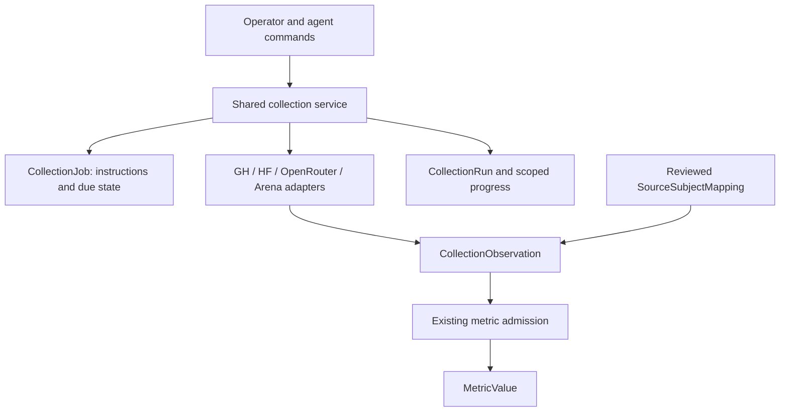
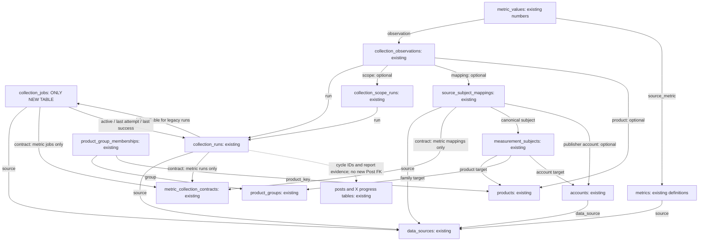
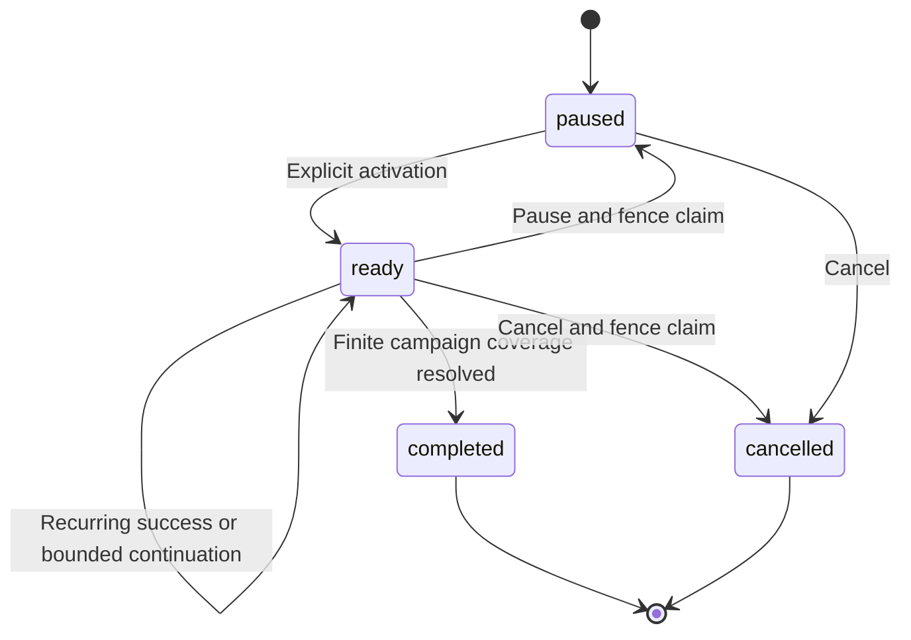
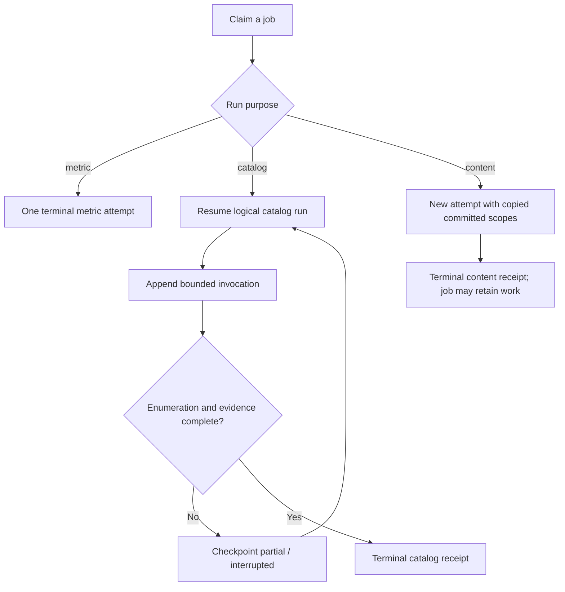
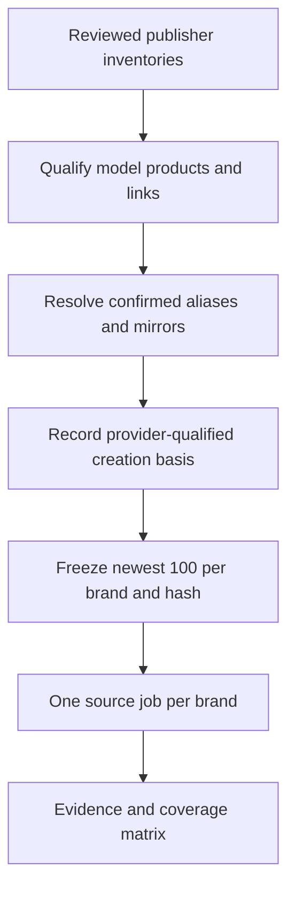
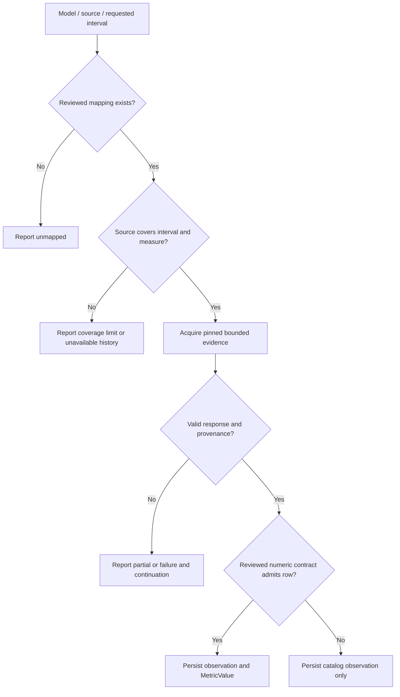
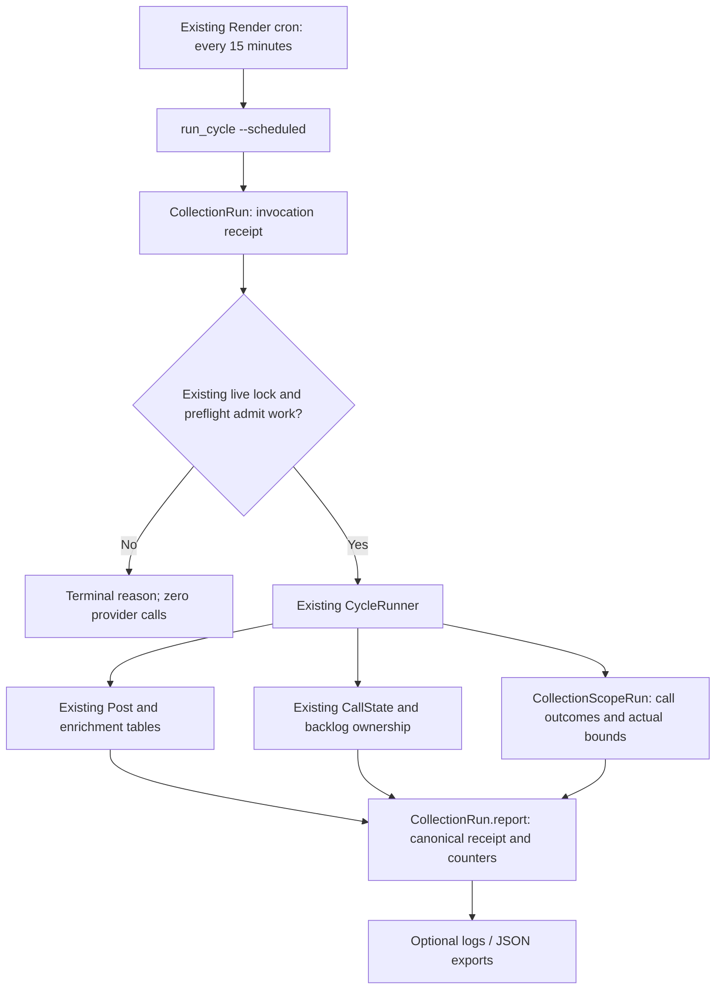

# Shared Collection Jobs and Model History - Plan

## Plain-English Summary

Keep collection instructions in one new table, use the existing collection tables for execution and evidence, and add GitHub as a source of repository and release activity.
Build one dated list of up to 100 newest models for each of the 21 tracked brands, then recover the available history for those same models from GitHub, Hugging Face, OpenRouter and Arena.
The database is the authoritative store for company/repository links, cohorts, schedules, checkpoints and source measurements.
Record ordinary 15-minute X harvest attempts in the shared run tables too, while preserving the existing Render cron and X pipeline.

Repository creation, an announcement, the first recorded weight files and a leaderboard appearance describe different events.
The resulting evidence will retain those distinctions and show where a source cannot provide historical data.
The collector will use reviewed links between each provider's identifiers and our products, including family repositories that support several model versions.

Completion will be checked with database migration and recovery tests, recorded provider responses, and the existing collection and staging-refresh regression tests.
This request produces the implementation plan; enabling schedules, running a historical provider batch and deploying require the corresponding later instruction.
The X backfill pilot can proceed independently with atomic JSON checkpoints on fuchitalee, followed by its own database adapter when the shared contract is implemented.

---

## Goal Capsule

**Objective:** Operators can inspect the available release and measurement history of the newest tracked models, see each source's coverage, and resume interrupted collection without losing committed progress.

**Means:** Shared job instructions, reviewed provider identities and bounded historical acquisition using the existing evidence store (KTD1–KTD10).

**Authority:** The owner's current instructions govern scope and delivery, followed by repository AGENTS.md and the authoritative General Launch index/charter, then this plan's Product Contract and Planning Contract.
Technical details delegated to G3 are recorded as assumptions rather than owner-approved product choices.

**Execution profile:** Django/PostgreSQL code change; nine implementation units, including a separately owned X adapter; one new permanent table.
The implementation parent completes local verification and reports the result; delivery remains `on-request`.
The earlier production authorization for schema consolidation and original-content waiting-period removal is fulfilled at `b9f03bc1` and does not authorize this new change's deployment.

**Stop conditions:** Stop before an additional permanent table, an irreversible identity merge, an unreviewed numeric mapping, a changed X checkpoint contract, or a provider batch beyond its separately approved budget.
Incomplete provider coverage is a reported outcome under R8, not a reason to fabricate values or to retry indefinitely.

---

## Product Contract

### Summary

Add durable collection instructions and GitHub activity collection, then support a reproducible historical campaign covering the newest models of the tracked brands.
All four sources operate on the same frozen cohort and return evidence with explicit coverage and clocks.

### Problem Frame

The deployed consolidation already separates collection attempts, scoped progress, evidence and numeric measurements.
Job instructions and due/retry decisions still reside in commands and source configuration.
Release research also found that publisher names differ between providers and that a GitHub repository often predates the particular model version it supports.
Historical evidence is useful only when those identities and dates remain attributable.

### Key Decisions

- **Exactly one new permanent table.** Preserve the deployed shared evidence tables rather than introducing provider-specific ledgers. Governs R1. (session-settled: user-directed — chosen over adding several bookkeeping tables: the existing collection tables already cover execution and evidence.)
- **Newest 100 per tracked brand, ordered by creation date.** The requested cohort follows creation chronology rather than downloads or popularity. Governs R4, R5. (session-settled: user-directed — chosen over a popularity-ranked cohort: the owner explicitly specified creation date descending.)
- **A separate G3 subplan.** Collection infrastructure and history are independent of chart, prediction and learning implementation. Governs R11. (session-settled: user-directed — chosen over executing the whole G3 plan: infrastructure can be completed separately.)

### Requirements

**Shared persistence and ownership**

- R1. Add exactly one permanent `collection_jobs` table and reuse `collection_runs`, `collection_scope_runs`, `collection_observations` and `metric_values` for their existing responsibilities.
- R2. A job holds its reviewed instructions and schedule; execution records capture attempts, usage, progress and outcome without duplicating retrieved content.
- R3. The X staging pilot uses atomic JSON checkpoints on fuchitalee now; G3 owns the shared database contract, and the backfill session owns the later X adapter and its runtime files.
- R13. All new collection business data is authoritative in PostgreSQL; YAML/Python files cannot serve as runtime stores for identities, mappings, cohorts, schedules, progress or measurements.

**Identity and selection**

- R4. Freeze up to 100 canonical model products per brand for the 21 brands in the Scope table, sorted by the supported creation timestamp descending with deterministic ties.
- R5. Apply that same frozen model cohort to GitHub, HF, OpenRouter and Arena; aliases and mirrors must not occupy duplicate model slots.
- R6. Each admitted provider identifier has reviewed publisher ownership, a canonical subject and source evidence; a shared family repository can support several products without equating those versions.

**Collection and history**

- R7. Collect GitHub public repository metadata and qualified release/tag/commit evidence, retaining native identifiers and clocks separately from interpreted model-release claims.
- R8. Recover available historical evidence from all four sources and distinguish observed zero, unavailable history, missing mappings, partial retrieval and provider coverage limits.
- R9. Collection is bounded, idempotent and resumable from committed progress; stale workers cannot publish progress after another worker acquires their lease.
- R10. Operators and agents can inspect the frozen cohort, mapping evidence, coverage, next due/retry time and run failures through the same command/service interface.

**Compatibility and scope**

- R11. Preserve existing benchmark admission, HF catalog behavior, X live cursors/backlog, OpenCode collection, compatibility imports and staging data-integrity rules while keeping chart/prediction implementation outside this subplan.
- R12. Retain source-event, snapshot, publication, retrieval and first-observed times with their precision; none substitutes silently for a release announcement or historical availability date.
- R14. Preserve the existing state/flow definitions and exact/date-only/unknown temporal precision, storing supplied numbers even when their effective times are unknown and never replacing missing numbers with zero.
- R15. Persist each scheduled 15-minute X harvest invocation as a shared content run, including rejected, failed and interrupted attempts, without changing its scheduling or live cursor/backlog ownership.

### Scope

The following 21 brand identifiers are the owner's requested scope, previously verified against `config.yaml.enabled_models`.
During registration validate them against database `Brand` and ownership records, then freeze them in `CollectionJob.definition`; ongoing cohort selection does not read a YAML list as business-data authority (R13).
The inventory below is the requested set, not a claim that every company has 100 public models or publishes on every provider.

| Brand ID | Brand ID | Brand ID |
| --- | --- | --- |
| minimax | qwen | deepseek |
| glm | mimo | moonshot_kimi |
| inclusionai | mistral | stepfun |
| ernie | hunyuan | llama |
| nemo_megatron | doubao | yi |
| sensechat | exaone | kuaishou |
| sakana_ai | upstage | dots |

Model slots include confirmed LLM and other AI model products.
Agent/harness repositories may be tracked by the GitHub collector but do not consume model slots.
The five-way offering taxonomy remains separate work; this plan uses the existing `Product.type` values and records unresolved type qualification explicitly.

### Actors and Flows

- A1. The operator reviews publisher/crosswalk evidence, freezes a cohort and approves activation/budgets.
- A2. The shared coordinator claims jobs and checkpoints committed work.
- A3. Provider adapters enumerate and retrieve evidence within their allocated budget.
- A4. The backfill session owns X pilot recovery and its later adapter.

- F1. A1 reviews inventory → freezes a cohort → creates paused source jobs → inspects coverage → activates an approved job. Covers R4–R6, R10.
- F2. A2 claims a due job → A3 retrieves a bounded chunk → A2 atomically persists evidence and its checkpoint → reports completion or continuation. Covers R2, R8, R9.
- F3. A4 runs its JSON pilot → G3 implements the shared contract → A4 integrates and verifies the X adapter. Covers R3, R11.
- F4. Render launches `run_cycle --scheduled` → the command records an invocation → the existing CycleRunner executes under its live lock → shared run/scopes store outcomes and progress. Covers R13, R15.

### Acceptance Examples

- AE1. MiniMax's HF namespace `MiniMaxAI` and GH owner `MiniMax-AI` resolve to reviewed provider accounts; a spelling match alone admits neither. Covers R6.
- AE2. One `zai-org/GLM-5` repository supports two qualified model versions; both can have distinct model subjects, while the repository creation date remains one repository fact. Covers R5–R7, R12.
- AE3. An OpenRouter model absent from a day's published top 50 has unknown individual usage for that day; the aggregate `other` row is not assigned to it. Covers R8.
- AE4. A crash after evidence commit but before acknowledgement resumes from the database checkpoint; replay does not duplicate evidence or advance unfinished scopes. Covers R9.
- AE5. A staging refresh retains numeric measurements and their job provenance, pauses copied jobs and clears pointers before removing excluded catalog/content execution records. Covers R1, R11.
- AE6. A JSON backfill checkpoint remains usable before this schema exists; importing it later records the import rather than inventing historical database attempt receipts. Covers R3, R12.
- AE7. HF reports a numeric rolling counter without its exact counting cutoff; the number is stored with unknown temporal precision and null unsupported bounds. A missing counter stores evidence of the gap and no numeric row. Covers R14.
- AE8. Two scheduled harvest invocations overlap: the active one retains its lease; the rejected invocation has its own terminal receipt and performs no provider calls. Covers R9, R15.
- AE9. A restarted collector resumes after its temporary files are removed, using database instructions, evidence and checkpoints alone. Covers R13.

### Deferred to Follow-Up Work

G3's daily rich HF watch amendment remains in the original chart-engine plan's U8–U13.
Its Google/NVIDIA company-wide cap uses latest modification order; this historical cohort uses R4 and does not silently change that watch or add Google to the 21-brand cohort.

The backfill session implements the shared X database adapter under U9 after U1's contract is available; its current JSON pilot stays independent.
Canonical release adjudication, X-versus-weight release reconciliation, chart annotations, forecasts, outcome auditing and self-learning remain separate work.
In particular, `ModelReleaseEvidence.source_post` currently requires a real X post; this collector must not fabricate one to represent GH/HF evidence.

---

## Planning Contract

### Current Source Baseline

At `db5510ccc94ea326dd5f81e833a9c791e5e84d99`, migration `0080_collection_schema` has generalized the collection tables.
`CollectionRun.purpose` admits only metric/catalog today, `SourceSubjectMapping.contract` is required, and `CollectionObservation.status` admits only `ok`/`error`.
`MetricCollectionRun` and `MetricObservation` compatibility aliases remain used by an external Render launcher.

`collect_benchmark_due.py` currently derives due time from immutable contract configuration, `DataSource.metadata.daily_collection_hour_utc` and the latest attempt's start.
The retained production inspection in the parent G3 plan verified HF daily at 10:00 UTC / 19:00 JST.
`backfill.py` currently keeps campaign progress in JSON; existing `CallState`, `HarvestBacklogWindow`, `Post` and cycle summaries persist other parts of X collection.
Scheduled harvest has no `CollectionRun` integration at this revision: `CycleRunner._finish_summary` calls `scripts/harvest_cost/emit.py.finalize_and_persist`, which emits redacted `HARVEST_SUMMARY`/optional `HARVEST_COHORT` log lines and writes `data/runs/<run_id>.json` plus a latest pointer.
These filesystem/log receipts do not provide an overall durable database harvest-attempt ledger.

### Key Technical Decisions

- KTD1. **A small shared instruction table.** Add `CollectionJob` and nullable `CollectionRun.job`; preserve legacy runs with `job=NULL` and the existing numeric contract/mapping hashes. A job supplies mutable coordination state around an immutable definition (R1, R2).
- KTD2. **Extend the existing crosswalk.** Add a metric/catalog purpose to `SourceSubjectMapping`, allowing a null contract only for reviewed catalog links. This keeps searchable, constrained identity relations without another table or artificial metric contracts (R1, R6).
- KTD3. **Provider-qualified model creation order.** Resolve cohort dates under the Assumptions below, record their basis and precision, and never date a specific version from a shared GH family repository (R4, R12).
- KTD4. **Native GH identity and pinned evidence.** Use GitHub numeric repository ID as identity and retain full-name aliases, ownership and commit/release coordinates as evidence. A rename changes a label; it does not create another model (R6, R7).
- KTD5. **Reuse bounded acquisition and numeric admission.** Extend the budget/HTTP/retry patterns in `scripts/benchmark_download_collector` and use the existing reviewed history importer for numeric snapshots. Catalog links never bypass a frozen metric contract (R8, R11).
- KTD6. **Claim, fetch, then commit with a lease fence.** Claim under a short database lock, perform network work outside the transaction, and commit only while the job's active run and lease token still match. Store the token on the existing run (R9).
- KTD7. **Separate the X pilot from database integration.** Implement the generic content-run contract in G3 and deliver a documented handover; the backfill session owns its adapter. The JSON pilot proceeds under its existing authorization (R3).
- KTD8. **Purpose-aware staging copies.** Retain job definitions needed by copied numeric runs, pause copied jobs, clear execution pointers, and then remove excluded nonnumeric history in dependency order (R11).
- KTD9. **Database authority for business state.** Use the storage map below for runtime data; source adapters remain code and test fixtures remain test inputs. A one-time reviewed import is persisted before runtime use (R13). (session-settled: user-directed — chosen over YAML/Python business-data stores: the owner requires collection business data to use the database.)
- KTD10. **Shared receipts for the existing X runner.** Attach content attempts/scoped outcomes through the common CycleRunner/command path, including the scheduled route; the existing cron remains its scheduling authority (R3, R15).

### Schema Delta and Business Data Storage

**Confirmed design delta: one new permanent table, zero retired tables and zero table renames.**
Create only `collection_jobs`.
Alter existing `collection_runs` for job/lease/content lifecycle and `source_subject_mappings` for reviewed catalog mappings.
Other existing tables receive ordinary rows; this plan adds no GH catalog, crosswalk, campaign, harvest-run, coverage or checkpoint table.
Implementation must verify this exact migration/model table delta under U8; this is a checked proposal, not a claim that the migration has already run.

| Business data | Authoritative database location | File boundary |
| --- | --- | --- |
| Source registration and provider owner identity | `data_sources`, `accounts`, `companies_accounts`, `brands_accounts` | Python adapter dispatch and environment secrets are code/configuration, not business rows |
| Canonical models/families | `products`, `product_groups`, `product_group_memberships`, `measurement_subjects` | Research reports or import inputs cannot override these rows |
| Reviewed GH/HF/OR/Arena identities | `source_subject_mappings` and its typed identity/identifier JSON | No live crosswalk dictionary or YAML lookup file |
| Frozen scope/cohort, schedule, limits and reviewed pins | New `collection_jobs.definition` plus job due/retry state; numeric pins remain in `metric_collection_contracts` | No runtime cohort/schedule manifest stored in Python/YAML |
| Invocation receipts, bounded selected payloads and batch summaries | `collection_runs` including `report`, `raw_payload` and provenance | Logs/JSON exports are derived outputs; new production recovery does not require them |
| Committed cursors, per-call progress and coverage | `collection_scope_runs`, `collection_observations` and typed run reports | No second authoritative checkpoint/coverage file |
| Metric definitions and numeric datapoints | Existing `metrics`, `metric_types`, `metric_values` | No numeric history in source-code constants or YAML |
| X content and existing live progress | Existing `posts`, enrichment/attribution tables, `call_state`, `harvest_backlog_windows` | Preserve their database ownership; do not duplicate tweets into a collector table |

Validated history chunks can be assembled in memory or temporary files during transport, then their selected rows, hash and retrieval coordinates are committed through the existing database envelope.
A resumed job reconstructs its authoritative inputs and progress from the database.
Tests may use captured fixtures, and operators may export/import reviewable artifacts; neither is the runtime source of truth.
The already agreed fuchitalee JSON backfill pilot is a temporary, separately owned exception under R3, ending when its database adapter is adopted.
Existing legacy application configuration is not broadly rewritten by this subplan; new or migrated collector business state follows R13.

### CollectionJob Field Contract

The following are proposed columns for the single new table; they are not deployed schema.
Names may follow repository conventions, but each responsibility below must have one owner.

| Fields | Meaning and constraint |
| --- | --- |
| `id`, `job_key` | UUID primary key and unique deterministic instruction identity; no provider secret in either |
| `source`, `purpose`, `operation`, `mode` | Protected source reference; metric/catalog/content purpose; validated operation; recurring/historical/manual mode |
| `contract` | Protected, required only for metric jobs and absent for catalog/content jobs |
| `definition`, `definition_sha256` | Versioned immutable JSON instructions and SHA-256; scope, ownership pins, schedule, credential-purpose name, budgets and cohort snapshot |
| `state` | `paused` by default, then ready/completed/cancelled; recurring jobs remain ready between attempts |
| `next_due_at`, `next_retry_at` | UTC scheduling/cooldown state; absent on paused or terminal jobs |
| `active_run`, `last_attempt`, `last_success` | Nullable references to existing runs, cleared on removal; service validates matching job/source/purpose |
| `created_at`, `updated_at` | Instruction/coordination record clocks, never source release dates |

Schedule definitions admit manual, interval or daily UTC slots and declare a driver: shared due-checker, manual invocation or external Render cron.
Externally scheduled X jobs are excluded from `collect_jobs_due` dispatch; their expected next slot is informational and the existing cron remains the only 15-minute launcher.
Reject incompatible mode/schedule/driver combinations before claiming.
An instruction change creates a new definition identity rather than mutating a running job's frozen scope.
Execution counters and cursors remain on runs/scopes, not on jobs.

Add nullable `job` and `lease_token` to `CollectionRun`, plus the content-purpose constraint branch and a lease requirement for running job-backed runs.
Terminal rejected-invocation receipts need no execution lease and must never replace or fence the active worker's claim.
Implement circular references by creating jobs first without run pointers, adding `Run.job`, then adding job pointers.
Avoid empty or guessed backfilled jobs: legacy runs stay unlinked until a reviewed registration supplies matching instructions.

### Lifecycle and Persistence API

The shared service exposes instruction inspection/registration, claim, fenced checkpoint, finish/yield, pause/cancel and coverage reporting.
Commands for humans and agents call that service; dry-run inspection must construct no provider client and perform no writes.
Use the existing benchmark activation gate for metric collection, explicit job/source activation for new catalog collection, and the caller's already authorized manual route for content.

| Run purpose | Contract | Progress and terminal meaning |
| --- | --- | --- |
| metric | Required | Existing running → success/partial/failed/aborted; terminal partial has `completed_at` |
| catalog | Absent | Preserve pending/running/partial/interrupted continuation on one logical run; terminal success/failed/aborted has `completed_at` |
| content, proposed | Absent | One run per invocation attempt; running → success/partial/failed/aborted with terminal `completed_at`; remaining campaign work stays on the job |

A job-backed catalog run can span bounded invocations; `invocations` records each pass and the claim refreshes its token/lease.
Resumed content attempts within the same frozen backfill campaign start new runs and copy committed scope checkpoints from its preceding attempt, including completed scopes, with explicit continuation IDs and definition hash.
Each new scheduled harvest cycle builds fresh scopes from the existing live cursor/backlog rules; it never copies a prior cycle's completed scopes and thereby skips new work.
Never move or rewrite the old attempt's scopes.
Content `selected_count`/`success_count` count logical calls or slices; post counts and physical request attempts have separate named counters.

Checkpoint persistence checks the current token and active-run reference in the same transaction that writes evidence/scoped progress.
Lease expiry permits a successor claim; an old token remains invalid even if a prior worker returns later.
Cancellation/pausing stops new claims and fences an in-flight writer; it does not delete evidence or silently advance a cursor.
Budget exhaustion yields resumable work and a retry/due time, rather than success.

For the X handover, no per-tweet `CollectionObservation` is required: `Post` stores content, while scopes store slice/call continuation and runs record attempts.
Collection completeness and existing enrichment degradation are distinct report fields.
The backfill adapter must retain its existing live lock, call completion rules, live cursors/backlog and on-demand credential purpose.
The pilot checkpoint binds frozen bounds, selected calls and effective query/policy hash; atomic replacement retains the previous valid file on failure.
Any later importer records checkpoint provenance and missing historical timestamps without synthesizing old run receipts from file modification time.

### Crosswalk Contract

Metric mappings default to their existing purpose, require a real immutable contract and retain current uniqueness/hash semantics.
Catalog mappings require null contract, reviewed ownership/evidence and a canonical `MeasurementSubject`; readers filter purpose explicitly.
Their conditional unique key includes source, kind, scope, normalized native identifier and subject, allowing one repo to support several products.

Keep relation roles, version selector, observed full-name aliases and evidence coordinates in the existing typed identity/identifier JSON.
Qualify `dedicated_model`, `family_repository`, `implementation`, `recipe`, `agent_harness` and `dependency` roles; dependency links do not establish release identity.
Candidate or unresolved links stay in catalog observations and coverage reports until reviewed.
A catalog link promoted for numeric collection becomes a separately frozen metric mapping under its reviewed contract.

Provider namespaces resolve through existing `Account`, `CompanyAccount`/`BrandAccount` ownership, not a guessed HF-to-GH string substitution.
Product identity remains `product_key`; HF-shaped `Product.repo_id` and HF metadata fields must not store GH names or OpenRouter listing clocks.
API-only products can have `repo_id=NULL`, a display name and provider-qualified mappings.

### Proposed GH-to-Existing-Source Crosswalk

The crosswalk joins providers through the same canonical `MeasurementSubject`, not by equating their repository/display-name strings.
The following seed candidates come from the preserved release-date research; their native GH IDs and current ownership must be reconciled before database review/admission.
OpenRouter/Arena identifiers below are deliberately unassigned where that research did not verify them.

| GH name used for discovery | Relationship | HF identity from retained evidence | OpenRouter/Arena treatment |
| --- | --- | --- | --- |
| `MiniMax-AI/MiniMax-Music3` | Dedicated product repository candidate | `MiniMaxAI/MiniMax-Music3` | Attach only independently reviewed native model IDs; absent/unverified stays unmapped |
| `QwenLM/Qwen3.8` | Family repository; model/version selector required | `Qwen/Qwen3.8-27B` is one qualified member | Review each version's catalog/rankings/leaderboard identity separately |
| `zai-org/GLM-5` | Shared family implementation across versions | `zai-org/GLM-5.3`, `zai-org/GLM-5.3-Flash` | Each product keeps its own native OR/Arena mapping and evidence |

For a reviewed GH relation, `source=github`, `source_subject_kind=repository` and `identifier_scope=repository_id` identify the native numeric repository ID.
Keep the discovery name, renamed/transferred aliases, role, product/version selector and evidence coordinates in the existing JSON fields.
`publisher_account` references the native GH owner account with confirmed company/brand ownership; `subject` references the existing product or qualified family subject.
Apply KTD2's conditional catalog uniqueness without changing HF/OR/Arena identifiers or frozen numeric mappings.

An HF repo ID, OR catalog ID and rankings `model_permaslug`, or Arena `model_name` resolve through their own reviewed source mappings to that subject.
Existing X post/product assertions can identify the same product through `posts_brands_products`/`post_subject_attributions`; an X handle or post is not a GH repository ID.
Unreviewed relationships remain evidence candidates with explicit unmapped coverage.
Linking one family repo to several products does not multiply its stars, releases or commits; product-level metric attribution needs its own reviewed measurement scope.

### Assumptions and Cohort Ordering

These defaults implement the owner's chronology request under the delegated technical judgment.
They describe observable provider creation records, not model training dates or first public availability.

1. Use HF repository `createdAt` for a qualified HF model; use OpenRouter's listing `created` for an API-only model; use GH repo `created_at` only for a reviewed repository dedicated to that one model.
2. With several HF mirrors for one product, choose the earliest supported creation record among reviewed first-party model repositories and record the selection evidence.
3. Arena's first published appearance and our first observation are not creation timestamps. Missing creation data stays unranked; it cannot displace a dated model or certify a complete newest-100 cohort.
4. Sort timestamp descending and then canonical `product_key` for ties. Collapse confirmed aliases/mirrors before applying the company-wide cap across all its namespaces.
5. A finite historical campaign requests all supported history from each selected model's cohort date through a frozen cutoff. Provider floors and archive gaps narrow the returned coverage, not the requested scope.

Store the frozen selected keys, date basis/precision, crosswalk and ownership pins, cutoff, qualification policy and cohort hash with the source jobs' definitions.
Use per-brand/source jobs so each carries at most 100 selected models; the resulting maximum is 2,100 selected products and 8,400 model/source coverage cells.
Persist unresolved inventory/date qualification alongside those cells.
Current public enumeration cannot certify deleted/private models that were never observed; label this selection limitation in the manifest.

### GitHub Acquisition Contract

Register GH as a disabled `DataSource` using the existing registry conventions; add native owner/repository normalization without changing HF/X normalization.
Inventory reviewed public owner namespaces, recording full pagination and terminal completeness before qualifying the cohort.
For recurring inventory, compare native repo IDs with the prior committed inventory and process new/changed repositories; daily due time defaults to the already selected 10:00 UTC slot.

Collect repository metadata, release publication/draft/prerelease information, version tags and bounded commit/file-tree/README evidence at pinned revisions.
Resource keys combine native repository ID, evidence kind and immutable event/revision coordinates; distinct releases or commits never overwrite a repository metadata checkpoint.
Record repo creation, commit author/committer time, release publication and observation time in separately named dimensions.
Repository creation is a discovery lead; a commit timestamp is a Git record and may be rewritten or backdated.
Neither proves a model's first public weight upload without additional evidence.

Use public read-only endpoints, explicit timeouts and host/path-checked pagination; never execute repository content or download weight blobs.
A project-scoped read-only GitHub credential may be resolved from `PUSHINWEIGHT_GITHUB_API_TOKEN` if configured during implementation; do not fall back to another application's credential.
Respect rate-limit/Retry-After headers and checkpoint cooldowns instead of filling a queue with retries.
Retain ETag/revision coordinates; a 304 preserves prior evidence and is not an empty inventory.
A 403/404 marks inaccessible/unresolved coverage rather than proving that a product never existed.

### Historical Coverage by Source

| Source | Reuse and requested evidence | Coverage limit and treatment |
| --- | --- | --- |
| GH | Reviewed repos; releases/tags/commits; current counters; dated present stargazer events when supported | Current stars/forks are snapshots. Present stargazers do not recover removed stars or a complete historical counter series. Native repo event history is not model release adjudication. |
| HF | `core/hf_metadata_client.py`, catalog evidence and existing database snapshots; pinned commit/tree metadata; reviewed archive acquisition | Public commit/tree history supports recorded metadata/file evidence. Historical counters come from observed snapshots or reviewed archives, with gaps and secondary-source provenance. Rolling download counts are not daily downloads or distinct users. |
| OpenRouter | New bounded models-catalog acquisition for cohort identities; existing rankings daily acquisition, shared across the cohort | Rankings publish daily top 50 plus `other`, with floor 2025-01-01. Use completed UTC days and preserve the provider's resolved window. Missing individual rows stay unknown. |
| Arena | Existing official `lmarena-ai/leaderboard-dataset` acquisition and history importer | Use pinned `full` history, published leaderboard dates and the contract's score/config/category. `latest` alone is not historical coverage; preserve text versus text_style_control distinctions. |

Existing reviewed HF archive IDs are `cfahlgren1/hub-stats` and `hfmlsoc/hub_weekly_snapshots`.
Verify their actual date/model/file coverage during acquisition; the allowlist alone is not proof of data availability.
Preserve archive publisher, revision, retrieval coordinates, selected-JSON hash and upstream binary hash separately.

`prepare_history` currently caps a manifest's date span below 366 days and its snapshots at 366.
Split longer campaigns into manifests within those bounds, reusing frozen identity pins across chunks.
Fetch global OpenRouter/Arena publication windows once per source/window, then project onto selected models rather than making one identical request per model.
Arena full artifacts need bounded filtering/partitioning; do not bypass existing byte/row limits by downloading an unchecked large file.

Persist successful evidence using `CollectionObservation.status=ok` and transport failures using `error` plus an error code.
Coverage labels belong in typed `processing_outcome`/dimensions and the run report: `observed`, `not_published`, `outside_provider_coverage`, `history_unavailable`, `unmapped`, `partial`, `inaccessible`, `unranked` or `failed`.
Use `not_published` only with supported enumeration evidence; an absent model in a limited listing uses the narrower coverage outcome.
Only admitted numeric rows become `MetricValue`; catalog facts and missing numbers do not.
A supplied number with unknown effective time remains a valid numeric row under R14.

### State, Flow and Unknown-Time Compliance

Source inspection confirms the existing schema and writer enforce the applicable baseline: `SourceMetric` in physical table `metrics`, `MetricValue`, `numeric_value`, `value_times`, source row adapters and the historical importer.
The governing measurement contract is the state/flow and historical-time sections of `docs/plans/2026-10-05-070106-feat-benchmark-download-collector-plan.md`.
This plan preserves those semantics rather than introducing another cumulative kind or substituting collection time for unknown effective time.

| Rule checked against current code | Required treatment in this change | Database owner |
| --- | --- | --- |
| State versus flow | State is a value at an effective instant/date; flow is activity over an interval. All-time downloads are flow with `window_mode=since_origin` | `metrics.measurement_kind`, `window_mode` and versioned definition |
| Rolling duration | HF downloads stay rolling 30-day flow with unknown true duration basis/timezone/bounds when unsupported; 10:00 UTC polling does not establish a window cutoff | Definition window fields; `metric_values` temporal fields |
| Unknown time versus unknown number | Store a supplied numeric value with `temporal_status=unknown`; omit a numeric row when the number itself is missing. Zero is admitted only when actually observed | `metric_values`; gap provenance in observations/reports |
| State precision | Exact state uses `as_of_at`; date-only uses `as_of_date`; unknown uses neither. State never gets flow boundaries | `value_times` plus existing value checks |
| Flow precision | Exact flow requires both ordered boundaries. Date-only keeps its native `period_label_date`. Unknown flow retains any genuinely supplied single boundary/date evidence and leaves unsupported bounds null | `window_start_at`, `window_end_at`, `period_label_date`, `temporal_status` |
| Counting origin | Since-origin start is a proved counting origin, never repo creation, model launch, Unix epoch or first fetch | Existing flow fields and reset/cohort provenance |
| Multiple clocks | Publication, source revision, archive snapshot and retrieval remain distinct; importing history today does not move its effective date to today | Run/observation time fields and source metadata |
| Aggregation and revisions | Sum only compatible nonoverlapping count-flow intervals. Never sum rolling windows, states, ranks or repeated revisions; ratio/share aggregation needs denominators | Frozen metric/methodology contract and admission/readers |
| Differencing | Rolling-counter changes are net changes, not new daily downloads. Since-origin differences require the same proved origin and compatible reset/cohort/revision evidence | Derived calculation policy; raw values remain unchanged |
| Calendar/source coverage | Verified source-zone bounds govern exact calendar flows. Do not rebin daily totals into minutes/another timezone or turn top-50 absence/aggregate other into individual zero | Existing calendar validation and source coverage dimensions |

Source examples: HF `downloads`/`downloads_all_time` retain numeric counts with unknown effective bounds; HF likes/followers and Arena ratings/ranks are state; Arena native publication dates retain date-only precision; OpenRouter completed-day tokens use their verified UTC calendar interval.
GH repo/release/commit dates are typed evidence facts; any future GH stars/forks numeric definition is reviewed as a state snapshot, not a fabricated cumulative flow.
Run request/post/credit counters are operational telemetry and do not automatically become a provider model-adoption metric.

This is confirmed schema/writer alignment, not execution proof of unimplemented adapters.
U5/U8 must exercise the real adapter-to-writer path for unknown bounds, missing versus explicit zero, one known boundary, repeated revisions, archive/import clocks and timezone mismatches.

### High-Level Technical Design

The diagrams represent the contracts above; their labels do not prescribe method signatures.

**Components and storage (KTD1, KTD2, KTD5):**



**Relevant database relationships (solid arrows are child-to-parent foreign keys; dotted arrows are logical associations):**



`MeasurementSubject` also supports company/brand targets, and contracts/groups retain their existing taxonomy-version relationships; these unchanged links are omitted from the focused diagram.
Only numeric observations admitted under a metric run/contract have `MetricValue` rows; catalog/content evidence cannot bypass that admission.
The diagram adds no implicit repository table or direct GH-to-HF foreign key.

**Commit and recovery protocol (KTD6):**

```mermaid
sequenceDiagram
  participant C as Coordinator
  participant D as Database
  participant P as Provider
  C->>D: Claim ready job, run and new lease token
  D-->>C: Frozen instructions and committed cursor
  C->>P: Retrieve bounded chunk outside transaction
  P-->>C: Response or bounded failure
  C->>D: Verify active run and token; commit evidence and cursor
  D-->>C: Committed checkpoint
  C->>D: Finish or yield with continuation time
```

**Job coordination state (KTD1, KTD6):**



**Attempt versus continuation lifecycle (KTD7):**



**Cohort data flow (KTD2, KTD3):**



**Historical branching and numeric admission (KTD5):**



**Command modes and activation (R10, R11):**

| Action | Default effect | Apply requirement |
| --- | --- | --- |
| Inspect jobs/cohort/coverage | Read-only structured output | None |
| Plan cohort or registration | Show proposed definitions and gaps | Explicit reviewed registration to persist paused jobs |
| Due/manual invocation | Report eligible work without provider construction | Existing source/purpose activation and approved budget |
| Resume | Show frozen scope and committed checkpoint | Same definition hash and a fresh fenced claim |
| Pause/cancel | Show target job | Explicit state mutation; preserves evidence |
| Historical acquisition/import | Show coverage/window/budget plan | Explicit bounded batch authority and reviewed mappings/contracts |

**Shared service action contract (KTD1, KTD6, KTD7):**

| Action | Input context | Result |
| --- | --- | --- |
| Register | Reviewed definition and its hash | Paused instruction identity, or existing identical job |
| Inspect | Job/cohort identifier | Frozen scope, coverage, due/retry and failure evidence |
| Claim | Eligible job, budget and claimant | Active run, lease token and committed continuation |
| Checkpoint | Active run/token and retrieved chunk | Atomic evidence/progress commit, or stale-claim rejection |
| Finish/yield | Active run/token and typed outcome | Purpose-specific receipt and next work time |
| Pause/cancel | Authorized job state change | Fenced claim and retained evidence |

### System-Wide Impact and Risks

**Staging refresh:** Copy job definitions needed by retained numeric runs, then pause all copied jobs and clear due/retry/active pointers.
Clear last-attempt/success pointers referencing excluded catalog/content runs before raw-SQL deletions.
Django's `on_delete` is not a substitute for the scrubber's explicit SQL ordering.
Remove excluded observations, scopes and runs in foreign-key order; preserve retained numeric IDs, hashes and foreign-key targets.
Catalog crosswalks are durable identity evidence and remain copied; JSON provenance can identify excluded source observations without adding another blocking foreign key.
Update `scripts/staging_refresh/policy.py`, its source-reader grant policy and schema census with the new table and altered constraints.
No staging refresh or grant change is performed by this planning request.

**Scheduler transition:** Preserve current benchmark due decisions with characterization coverage before registering jobs.
During compatibility transition, a source/contract uses exactly one scheduling authority; fallback runs only when no registered job exists.
Keep benchmark work ahead of new discovery chunks, retain HF's selected daily slot, and add no Celery beat or second harvester scheduler.
Failure cooldown and lease recovery become visible job state; they must not cause simultaneous legacy and new dispatch.

**Migration and rollback:** Add nullable/default-compatible fields before enabling new writers, preserve all existing rows and check the candidate's actual migration leaves before generating the next migration.
Validate changed conditional constraints against representative old data and measure lock/table-scan exposure during the later rehearsal.
Keep new jobs paused until the updated writers, readers and staging policy are deployed together.
Reversing after content runs or contractless catalog mappings exist requires an explicit data-preservation strategy; do not delete those rows or relabel them as metric/catalog to make an old constraint pass.
Prefer a forward correction after activation; a guarded reverse migration must refuse incompatible new data rather than silently dropping evidence or job provenance.

**Identity risk:** Owner renames/transfers, family repos and missing timestamps can produce false matches or misleading order.
U2/U4 validate native identity, ownership, typed link roles and deterministic qualification; unresolved entries remain visible.

**Coverage and cost:** Four-source coverage is not four complete historical time series.
U5/U6 bound attempts, elapsed time, bytes and chunks, retain provider limits and expose remaining work.
No weights, private repository content or secrets enter observation payloads.

### X Boundary and Handover

Peer plan: `docs/plans/2026-10-12-105615-docs-august-harvest-audit-20261012-plan.md` on branch `docs/august-harvest-audit-20261012`.
The pilot uses fuchitalee JSON checkpoints under R3 and proceeds independently of this plan.
The backfill session retains `monitor/management/commands/backfill.py`, `monitor/cycle.py`, `monitor/run_lock.py`, `x_monitor/apify.py` and its focused tests.
G3 does not edit those runtime files during shared-API implementation, launch that pilot or acquire its X lock.

U1 supplies the final fields, purpose/lifecycle, claim/checkpoint semantics, copied-scope continuation rule and import-provenance contract.
The backfill session then owns integration and tests against that implemented service.
This shared contract is an interface handover, not a second backfill implementation.
The portable boundary note is [G3 and X backfill persistence](../analysis/2026-10-13-160815-g3-backfill-collection-interface.md).

### Scheduled Harvest Persistence Contract

U9 applies KTD10 through the shared X command/runner integration under the backfill owner's file scope, after the current pilot and shared-API handover.
Its production target is every existing `run_cycle --scheduled` invocation; manual/backfill routes reuse that receipt service with their distinct credential purpose and frozen campaign identity.
No additional cron, beat service, harvest-run table or filesystem job ledger is introduced.

1. Resolve the database job and freeze this invocation's actual planned call/window context, cycle ID, entrypoint, deployment revision and credential-purpose name.
2. Persist a content `CollectionRun` before any paid request, using an invocation identity separate from the quarter-hour slot so rejected or retry attempts remain distinguishable.
3. Retain existing live lock admission. A busy/paused/preflight-rejected invocation records `aborted` with a specific reason and zero provider attempts; it does not alter the active run's lease or progress.
4. Execute the existing pipeline, recording actual request attempts and per-call windows/outcomes in shared scopes; posts/enrichment and live cursor/backlog updates remain in their current tables.
5. Persist the canonical redacted summary/version/hash, budget/credit facts, result counts and collection-versus-enrichment outcome in `CollectionRun.report`; normal completion updates job attempt/success pointers under its fence.
6. On a crash, retain the running receipt. A later reconciler records expired/interrupted execution as such, with the actual reconciliation time and an unknown process-finish time; it never invents a completed historical run.

The cron's 15-minute cadence is not evidence that every provider query covers exactly 15 minutes.
Persist the actual call bounds/cursor transfers rather than inferring them from the cron slot.
Unknown confirmed provider usage/credits remain null/unknown in the report; a request attempt is not proof of billing or successful insertion.
Completed source collection with pending/failed enrichment remains visibly degraded in the report rather than inventing a collection failure or hiding enrichment gaps.

A database receipt failure before provider dispatch stops that invocation's paid work and emits a redacted diagnostic; no fallback file becomes authoritative.
An invocation unable to reach PostgreSQL cannot have a database receipt, and an unexecuted cron slot is not fabricated as a run.
After adapter adoption, cost/health readers query the shared database receipts; existing JSON/log formats can be exported from them for compatibility, but recovery and accounting do not depend on a Render-local file.



---

## Implementation Units

### U1. Add job instructions and the shared persistence contract

- **Goal:** Persist reviewed instructions and expose fenced execution/recovery operations.
- **Requirements:** R1–R3, R9–R13, R15; F2/F3; AE4/AE6/AE8; KTD1/KTD6/KTD7/KTD9/KTD10.
- **Dependencies:** Current main includes `0080_collection_schema`; recheck parallel schema ownership before edits.
- **Files:** `core/models.py`, next generated migrations in `core/migrations/`, proposed `core/collection_jobs.py`, `core/collection_state.py`, `tests/test_collection_jobs.py`, `tests/test_collection_state.py`; shared X interface note under `docs/analysis/`.
- **Approach:** Create the job fields/constraints and cyclic references in the documented order. Extend run lifecycle with content and job-backed lease fencing while keeping legacy aliases/rows valid. Add typed service operations and publish the X contract before adapter ownership transfers.
- **Execution note:** Characterize existing metric/catalog lifecycle first, then prove recovery with PostgreSQL transactions.
- **Test scenarios:** Existing metric terminal-partial and catalog resumable-partial rows remain valid. Two coordinators claiming one job produce one active token. A reclaimed lease rejects the old writer. A transaction failure rolls back evidence and its cursor together. A content continuation copies completed and pending scopes without altering the old attempt. A JSON import records missing old times as unknown.
- **Verification:** Migration delta is exactly one table; legacy data/aliases remain readable; concurrent claims and rollback cases pass; backfill owner receives a precise implemented interface.

### U2. Add reviewed GH ownership and catalog crosswalks

- **Goal:** Connect provider-native repository/model identities to canonical products.
- **Requirements:** R5–R7, R11–R13; AE1/AE2; KTD2/KTD4/KTD9.
- **Dependencies:** U1.
- **Files:** `core/models.py`, next migrations, `core/account_identity.py`, `core/benchmark_metric_identity.py`, proposed `core/collection_identity.py` and a database-backed mapping-review/import command; `tests/test_collection_identity.py`, `tests/test_benchmark_download_identity.py`, captured test-only fixtures.
- **Approach:** Extend existing mapping purpose/constraints and `upsert_account`'s currently X/HF-only source admission to support native GH owner IDs. Import reviewed research-supported links into existing account/mapping rows; do not create a runtime YAML/Python crosswalk store. Keep candidates unresolved until review; numeric promotion creates a new contract-pinned mapping. Reconcile native GH IDs before admission.
- **Test scenarios:** Covers AE1/AE2/AE9. Renaming a repo preserves its identity and records an alias. Transferring ownership requires review. One family repo maps to two different subjects without colliding or multiplying its event/counter records. Repeating the same relation is idempotent. Deleting the reviewed import file after admission does not break mapping reads. A dependency README link and a guessed owner spelling stay candidates. A catalog mapping cannot be admitted by a numeric reader; existing metric hashes and lookup cardinality remain unchanged.
- **Verification:** Crosswalk export includes evidence/role/native identity for every admitted link; unresolved ownership is reported; no new crosswalk table exists.

### U3. Implement the GH repository/activity collector

- **Goal:** Enumerate reviewed publishers and retain bounded native release evidence.
- **Requirements:** R6–R9, R12; F2; KTD4/KTD5/KTD6.
- **Dependencies:** U1, U2.
- **Files:** Proposed `core/github_metadata_client.py`, `core/github_catalog.py`; reuse budget/transport utilities in `scripts/benchmark_download_collector/`; proposed `core/management/commands/collect_github_catalog.py`, `tests/test_github_metadata_client.py`, `tests/test_github_catalog.py`, recorded fixtures under `tests/fixtures/`.
- **Approach:** Add public repo pagination, repository/release/tag/commit metadata and pinned small-file evidence parsing. Persist through shared runs/scopes/observations, with repo IDs as resource identity and qualified clocks in dimensions. Register the source paused; compare committed inventories for future daily discovery.
- **Test scenarios:** A two-page owner listing checkpoints and resumes at the second page. Two releases and two commits in one repo remain four distinct evidence records on replay. A 304 retains inventory. A rename is not a new repo. Rate limiting produces a cooldown and a resumable scope. A 404 remains inaccessible. Budget exhaustion preserves earlier evidence. An external pagination URL is rejected. README text is treated as evidence, never instructions. A late fenced response cannot overwrite the successor.
- **Verification:** Recorded responses traverse command, client and database writer; no weights/private content are fetched and no schedule is activated by registration.

### U4. Freeze the newest-model cohort for all 21 brands

- **Goal:** Produce a reproducible shared selection with explicit qualification gaps.
- **Requirements:** R4–R6, R10, R12, R13; F1; AE2/AE9; KTD2/KTD3/KTD9.
- **Dependencies:** U2, U3; existing HF inventory and Arena publication readers.
- **Files:** Proposed `core/model_history_cohort.py`, `core/management/commands/plan_model_history.py`; `core/hf_metadata_client.py` only for creation-order support; `scripts/benchmark_download_collector/sources.py` for bounded OpenRouter model catalog acquisition; `tests/test_model_history_cohort.py`, `tests/test_hf_metadata_client.py`, recorded OpenRouter models fixtures under `tests/fixtures/`.
- **Approach:** Combine qualified provider inventories using existing products and reviewed mappings. Add the currently absent OpenRouter `/api/v1/models` reader with explicit endpoint/credential admission; retain `id`, `canonical_slug` and `created` without assuming their equivalence to ranking `model_permaslug`. Review their crosswalk under U2. Validate HF's current creation-sort request contract without changing the existing lastModified catalog path. Freeze manifest/hash and paused per-brand/source jobs with the documented date policy.
- **Test scenarios:** One brand has 130 models across two namespaces: the selected 100 are company-wide, creation-descending. A mirror does not consume a slot. A family repo's old date does not date a new version. Recorded OpenRouter catalog rows traverse its bounded reader and cohort writer; API-only models retain null HF identifiers. A catalog ID without a reviewed rankings identity stays unmapped for usage history. Missing dates remain unranked and make completeness qualified. Ties replay deterministically. Google remains outside this historical scope; NVIDIA follows the same creation cap here. A changed ownership pin cannot silently resume the old cohort.
- **Verification:** All 21 brand reports are present, cap is applied after alias resolution, and every selected product has supported date/mapping provenance or an explicit qualification gap.

### U5. Acquire and import available four-source history

- **Goal:** Recover native evidence and supported measurements without inventing series.
- **Requirements:** R5, R8, R12–R14; AE3/AE7/AE9; KTD5/KTD9.
- **Dependencies:** U3, U4; existing reviewed metric contracts where numeric admission is requested.
- **Files:** `core/benchmark_metric_history.py`, `core/benchmark_metric_store.py`, `scripts/benchmark_download_collector/history.py`, `scripts/benchmark_download_collector/sources.py`, existing historical management commands; proposed `core/model_history_collection.py`, `tests/test_model_history_collection.py`, `tests/test_benchmark_history_acquisition.py`, `tests/test_benchmark_download_history.py`.
- **Approach:** Reuse supported acquisition/import paths and add GH/native HF evidence chunks. Pin archive coordinates and score configurations in database envelopes. Project bulk publication windows onto frozen cohorts and emit per-cell coverage with requested versus supported intervals. Apply R14 through the existing numeric writer and persist selected transport payloads/checkpoints before optional export.
- **Test scenarios:** Covers AE3/AE7/AE9. A pre-2025 OpenRouter request records its uncovered interval and requests only the supported window. `other` remains aggregate. A known HF number with unknown bounds is persisted; an absent optional field differs from explicit zero. One proved flow boundary survives, while an invented second boundary/timezone is rejected. Import/retrieval dates do not replace old effective dates. A reviewed HF archive with a gap produces sparse dated snapshots, not daily interpolation. A 600-day campaign splits within existing manifest bounds. Arena `full` and `latest` produce different coverage; wrong text configuration is rejected. A partial archive/byte cap preserves completed chunks. Replaying a completed chunk inserts no duplicate values; removing temporary files does not break resume.
- **Verification:** Every selected model has four source coverage outcomes; admitted numeric values retain publication/archive/retrieval provenance; unavailable counters and unknown usage stay nonnumeric.

### U6. Route due/manual/history work through shared job controls

- **Goal:** Coordinate budgets, cooldowns and continuation without duplicate dispatch.
- **Requirements:** R2, R9–R11, R13, R15; F2; KTD1/KTD5/KTD6/KTD9/KTD10.
- **Dependencies:** U1–U5.
- **Files:** Proposed `core/collection_scheduling.py`, `core/collection_budgets.py`, `core/management/commands/collect_jobs_due.py`; `monitor/management/commands/collect_benchmark_due.py`, `core/benchmark_metric_operations.py`; `tests/test_collection_scheduling.py`, `tests/test_collection_budgets.py`, `tests/test_benchmark_backfill_commands.py`.
- **Approach:** Register reviewed paused jobs without altering current source/contract flags. Add explicit job-aware due dispatch and a fallback only for unregistered legacy jobs. Preserve stable slot identity and benchmark priority, while tracking failed-attempt cooldown separately from last success.
- **Test scenarios:** A legacy source without a job keeps its old due behavior. A registered source cannot dispatch through both paths. External Render-cron X jobs never dispatch from the shared due-checker. Dry-run constructs no provider client and changes no rows. HF's UTC daily slot survives timezone conversion. A failed slot retries only after its cooldown. Global and adapter-local budgets count retries and HTTP attempts. Paused/cancelled jobs fence work. A finite invocation exits with committed remaining work at its time limit.
- **Verification:** Default commands are inert, registered scheduling has one authority, and due/retry reports distinguish attempt history from successful coverage.

### U7. Expose cohort, evidence and coverage reports

- **Goal:** Make identity and recovery evidence inspectable by an operator or agent.
- **Requirements:** R8, R10, R12; F1; KTD2/KTD5.
- **Dependencies:** U4–U6.
- **Files:** Proposed `core/collection_reports.py`, `core/management/commands/collection_status.py`; existing health readers; `tests/test_collection_reports.py`; operational examples under existing `docs/reference/` subjects.
- **Approach:** Return stable structured reports for cohort membership, provider identity, typed coverage intervals, clocks, budget use, active claim and next action. Offer the same service through CLI entry points; include requested/covered windows and unresolved counts rather than a single misleading percentage.
- **Test scenarios:** Unknown OR usage renders unknown with its reason. A model unmapped on GH remains in the cohort. A stale heartbeat differs from an empty successful response. Separate job attempt/success pointers produce separate health clocks. Reports redact credentials and preserve date precision. Human/agent command paths return the same evidence and resume identity.
- **Verification:** Reports account for all selected cells, can locate failed scopes and cannot mistake a provider listing clock for a release date.

### U8. Complete staging compatibility, regression coverage and documentation

- **Goal:** Preserve current collection behavior and safely handle copied job state.
- **Requirements:** R1–R3, R11–R15; AE5–AE9; KTD7–KTD10.
- **Dependencies:** U1–U7.
- **Files:** `scripts/staging_refresh/policy.py`, `scripts/staging_refresh/database.py`, `docs/operations/staging-data-refresh.md` for its source-reader grant policy, `tests/staging_refresh/`; proposed `tests/test_collection_schema_regression_net.py`, existing `tests/test_collection_schema_migration.py`, HF and benchmark tests; relevant `docs/reference/`, `CONCEPTS.md`, `docs/deploy/render.md`.
- **Approach:** Classify the new table and updated run purposes in refresh/grant policies. Scrub runtime intent/pointers before excluded rows, retain numeric job references and evidence hashes, and document actual implemented fields/API. Keep the X adapter handover and later source activation separate from local implementation completion.
- **Execution note:** Rehearse the migration and scrubber on PostgreSQL with legacy, metric, catalog and content rows before any later deployment.
- **Test scenarios:** Covers AE5. A numeric run's job survives copying with valid references and paused state. A job pointing to excluded catalog/content attempts is scrubbed without a foreign-key error. Numeric IDs/value hashes are unchanged. Retained catalog mapping JSON provenance remains inspectable even when its transient observation is excluded. Reverse migration with incompatible new rows refuses without losing evidence. Compatibility aliases still import. Existing HF catalog resume, benchmark/OpenCode admission, source-reader privileges and migration census remain valid.
- **Verification:** The focused regression suite passes with required PostgreSQL cases executed; table delta remains one; references describe implemented behavior and the final X interface is handed over.

### U9. Persist scheduled and manual X invocation receipts through the shared adapter

- **Goal:** Give the existing harvest/backfill pipeline a durable database run ledger.
- **Requirements:** R2, R3, R9, R11–R15; F3/F4; AE6/AE8/AE9; KTD6/KTD7/KTD9/KTD10.
- **Dependencies:** U1, U6, U8; backfill pilot continues independently until shared-API integration begins.
- **Owner:** Backfill/X session owns runtime adapter edits after G3 handover; G3 supplies the common service and verifies the shared schema contract. Do not overwrite its current in-progress files.
- **Files:** Under that owner's scope: `monitor/management/commands/run_cycle.py`, `monitor/management/commands/backfill.py`, `monitor/cycle.py`, `monitor/run_lock.py` only if required, `monitor/harvest_summary.py`, `scripts/harvest_cost/emit.py` and cost/health readers; proposed `tests/test_collection_harvest_adapter.py` plus existing cycle/backfill/cost command tests.
- **Approach:** Attach the Scheduled Harvest Persistence Contract once to the common runner/entrypoint path. Preserve the canonical redacted envelope and existing lock/cursor/credit rules. Persist rejected-attempt receipts separately from active claims and make database receipts the normal cost/health input. Import the pilot checkpoint with provenance; compatibility exports derive from database state.
- **Execution note:** Characterize the actual scheduled command-to-CycleRunner-to-summary path before changing its writer; tests must exercise that path rather than only the new persistence helper.
- **Test scenarios:** A scheduled empty-success run has one receipt and no invented posts. Lock-busy overlap records a rejected receipt without changing the active token or calling the provider. A hard crash leaves recoverable running evidence; expiry reconciliation does not invent a finish time. New scheduled cycles have fresh scopes; a resumed backfill copies only its own campaign scopes. Collection-complete/enrichment-degraded outcomes remain distinct. Scheduled versus backfill credential purposes stay separate. Receipt-storage failure prevents paid dispatch. Cost/health reads and resume still work after temporary/legacy JSON files are removed. Existing live cursors, backlog transfers and post deduplication remain correct.
- **Verification:** Actual scheduled/manual/backfill call-chain tests produce shared database receipts with correct counters and clocks; cost/recovery reads use PostgreSQL; cron definitions and production activation are unchanged by local implementation.

---

## Verification Contract

These are execution checks for a later implementation run; no application tests, migration, live collector or database batch were executed during planning.
Resolve `.venv` on fuchitalee and use the repository's configured PostgreSQL test service for transaction, constraint, migration and scrubber proofs.
Missing PostgreSQL-dependent checks are unperformed, never passed by skipping.

| Proof | Command or method | Required outcome |
| --- | --- | --- |
| Model/migration alignment | `.venv/bin/python manage.py makemigrations --check --dry-run` after generated migrations | No unexplained model drift; exactly one new concrete application table |
| Job lifecycle and concurrency | `.venv/bin/pytest tests/test_collection_jobs.py tests/test_collection_state.py` using PostgreSQL | One active fenced writer; rollback and legacy lifecycle proved |
| Identity and provider paths | `.venv/bin/pytest tests/test_collection_identity.py tests/test_model_history_cohort.py tests/test_github_metadata_client.py tests/test_github_catalog.py tests/test_model_history_collection.py` | Recorded provider fixtures traverse real parser/writer; gaps remain unknown |
| Scheduling and reports | `.venv/bin/pytest tests/test_collection_scheduling.py tests/test_collection_budgets.py tests/test_collection_reports.py` | Default inert behavior, no duplicate scheduler and deterministic recovery |
| Existing collection regression | `tests/test_collection_schema_regression_net.py`, HF catalog tests, `tests/test_benchmark_backfill_commands.py`, benchmark history/identity/persistence tests | Existing catalog/numeric/OpenCode contracts and compatibility imports pass |
| Staging copy integrity | `.venv/bin/pytest tests/staging_refresh/ tests/test_collection_schema_refresh.py tests/test_collection_schema_migration.py` with representative old/new-schema fixtures | Safe job pointer scrubbing; retained numeric IDs/hashes/references equal |
| Runtime/configuration | `.venv/bin/python manage.py check` and the repo's configured release checks if delivery is later selected | No schema/system error or new scheduler/activation drift |
| Documentation | Local link/ID/whitespace audit; `ollija annotate-plan` after final write | Canonical plan and documented implementation agree; unrelated owner files preserved |
| Measurement rules | U5 adapter-to-writer scenarios plus existing benchmark temporal/history tests | Known values with unknown time survive; missing numbers remain absent; origins/windows/revisions retain their semantics |
| Database business state | U2/U4/U5/U9 restart tests with temporary/import files removed | Mapping, cohort, progress, history and run accounting use database rows alone |
| X shared receipts | `.venv/bin/pytest tests/test_collection_harvest_adapter.py` plus the owning session's scheduled/backfill/cost regression set | Every reachable invocation has its own receipt; rejected attempts preserve the active claim and invoke no provider |

Run targeted tests once their relevant changes settle, then the established release regression set only if delivery is authorized or a new concern warrants it.
Do not make paid provider requests from fixtures, model-download smoke tests or implementation test setup.
Any later real collector pilot names source, frozen scope, credentials purpose, request/time/byte ceiling and activation authority before running.

---

## Definition of Done

- All nine units satisfy their verification outcomes and trace the Product Contract; the separately owned X adapter has its own actual integration evidence.
- `collection_jobs` is the only new permanent table; legacy runs, metric hashes, aliases and catalog continuation remain valid.
- GH identity/activity collection works against recorded public responses; reviewed crosswalks support family repositories and expose unresolved ownership.
- The cohort manifest covers all 21 brands, freezes at most 100 qualified products per brand and explains date/order/selection limitations.
- Historical paths for all four sources account for every selected model/source cell and preserve native provenance without synthetic zeros or fabricated daily series.
- Recovery, concurrency, activation defaults and staging foreign-key/data-preservation cases have actual local execution evidence.
- Runtime business state follows the database storage map; restart/resume and cost reads require no authoritative YAML/Python/temporary manifest files.
- State/flow/unknown-time adapter-to-writer cases preserve supplied values, honest gaps, true source clocks and compatible aggregation.
- Scheduled 15-minute X attempts use shared run/scoped receipts through the existing pipeline, including rejected/interrupted outcomes; the existing cron and cursor/backlog rules remain intact.
- The X session has an implemented contract to integrate against; its existing JSON pilot remains independent and its runtime files remain under its ownership.
- Actual schema/API and operating instructions are documented; abandoned experiments and dead code are removed from the implementation diff.
- Completion reports distinguish locally verified capability from unrun real historical batches, disabled schedules and unauthorized delivery.

---

<!-- BEGIN OLLIJA DELIVERY GUIDE -->
## Ollija Delivery Guide

This block is generated guidance. Do not edit it directly. Correct durable facts in `.ollija/project.yaml` or this template, then rerun `ollija annotate-plan`. Current explicit owner instructions govern this task. Record exceptions below and reflect route changes in metadata; removed requirements must not return through another checklist.

### Resolved locations

- Authoritative host: `fuchitalee`
- Authoritative repository: `/Users/fuchitalee/development/pushin-weight-v2`
- Ollija release worktree area: `/Users/fuchitalee/development/pushin-weight-v2/.worktrees`
- Active worktree: `/Users/fuchitalee/development/pushin-weight-v2/.worktrees/feat/g3-collection-jobs-history`
- Plan: `/Users/fuchitalee/development/pushin-weight-v2/.worktrees/feat/g3-collection-jobs-history/docs/plans/2026-10-13-062212-feat-g3-collection-jobs-history-plan.md`
- Change: `feat-g3-collection-jobs-history-2026-10-13-062212`
- Branch: `feat/g3-collection-jobs-history`
- Staging branch and blueprint: `staging`, `/Users/fuchitalee/development/pushin-weight-v2/.worktrees/feat/g3-collection-jobs-history/render-staging.yaml`
- Production branch and blueprint: `main`, `/Users/fuchitalee/development/pushin-weight-v2/.worktrees/feat/g3-collection-jobs-history/render.yaml`
- Staging URL: `https://pushinweight-staging-web.onrender.com`
- Production URL: `https://pushinweight-web.onrender.com`

### Placement

This worktree is inside the Ollija release worktree area. Reuse it for the whole change. Do not create a second worktree or plan for this branch.

### Delivery scope

- Workflow: `plan`
- Delivery target: `on-request`
- Owner selection recorded: `false`
- Delivery route: `staged`

Target is not authorized until the owner selects it. Wait for a later explicit release request; do not commit, push, stage, or promote on this guide alone.

### Failure handling

- Complete applicable, unwaived checks for the selected route. A waived check is waived, never passed. Owner-selected direct production does not require staging.
- Product defects return to the parent implementation workflow; repeat only checks invalidated by the fix. Environment failures require repairing the environment, not a new source commit. Retry only after a relevant fact changes.
- SSH, shell, environment, or multi-machine failures use the repository infra/multi-machine skill first.
- The change ledger is advisory; do not validate or enforce it.
- Never force-remove a worktree. Retain staging-only, failed, dirty, locked,
  noncanonical, or candidate-mismatched worktrees for diagnosis or later
  delivery.
- Do not run an endless retry loop or start a persistent Ollija process.
<!-- END OLLIJA DELIVERY GUIDE -->

## Delivery Exceptions

The owner selected `lfg that plan` on October 13: implement and locally verify the G3-owned work, then open a pull request and observe its CI result. This grants no staging/production deployment, schedule activation or live historical provider batch. U9 retains the X/backfill session's runtime-file ownership and requires its separate integration evidence before the whole nine-unit plan is complete. Keep all existing physical table names; the discussed renames and nested-scope extension are not selected.

---

## Appendix

### Local Sources

- Deployed baseline: `core/models.py`, `core/migrations/0080_collection_schema.py` and `docs/plans/2026-10-12-105837-feat-collection-schema-consolidation-plan.md`.
- HF collection: `core/hf_catalog.py`, `core/hf_metadata_client.py`, HF catalog fixtures/tests.
- Numeric identity/history: `core/benchmark_metric_identity.py`, `core/benchmark_metric_store.py`, `core/benchmark_metric_history.py`, `scripts/benchmark_download_collector/sources.py` and `history.py`.
- Existing scheduling/health: `monitor/management/commands/collect_benchmark_due.py`, `core/benchmark_metric_operations.py`.
- X persistence boundary: `monitor/management/commands/backfill.py`, `monitor/cycle.py`, `monitor/run_lock.py`, `x_monitor/apify.py` and the peer plan named under X Boundary and Handover.
- Staging lifecycle: `scripts/staging_refresh/policy.py`, `scripts/staging_refresh/database.py`, `tests/staging_refresh/`.
- Preserved release/identity research: `docs/research/2026-10-12-132932-g3-x-hf-github-release-dates.md`, `docs/research/2026-10-12-093516-g3-sixty-day-product-releases.md`, `docs/analysis/2026-10-12-091100-g3-tracked-brand-family-register.md` and their structured siblings.

### Primary Provider Documentation

Checked October 13, 2026 for the contracts that affect KTD3–KTD5.

- [GitHub repository REST API](https://docs.github.com/en/rest/repos/repos), [release API](https://docs.github.com/en/rest/releases/releases), [commit API](https://docs.github.com/en/rest/commits/commits), [starring API](https://docs.github.com/en/rest/activity/starring).
- [HF Hub API reference](https://huggingface.co/docs/huggingface_hub/package_reference/hf_api), [HF download-statistics methodology](https://huggingface.co/docs/hub/en/models-download-stats).
- [OpenRouter models catalog](https://openrouter.ai/docs/api/api-reference/models/list-all-models-and-their-properties), [daily rankings dataset](https://openrouter.ai/docs/api/api-reference/datasets/daily-token-totals-for-top-50-models).
- [Arena's official historical leaderboard dataset](https://huggingface.co/datasets/lmarena-ai/leaderboard-dataset).
