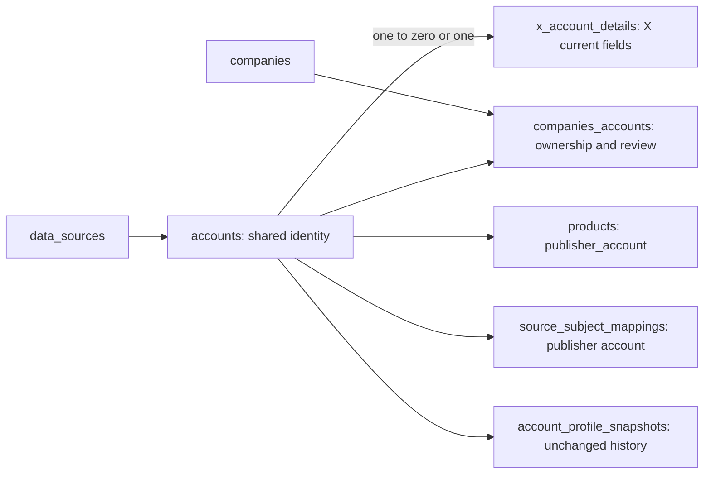

# Share account identity with justified source details

## Plain-English Summary

Keep one account identity for every platform. Move the 33 X-only current-profile fields into one linked X detail record. Store HF publishers and their company ownership in the existing shared account structures, preserving unconfirmed candidates and original discovery dates.

The result adds one table (`x_account_details`) and retires one (`hf_orgs`). Existing company-account links, account snapshots, crosswalks and collection evidence retain their identity and history. No HF, GitHub or YouTube detail table is justified by the present account requirements.

PR59 deploys first in a delegated stream. This account branch starts from its implementation revision and follows separately to an open PR with CI decided. Migration tests must prove field and relationship preservation on PostgreSQL; this request does not select account production deployment.

PR59 is now live at `948f05ad`; PR60 is open at `bed348d7` with four CI checks passed. The deployment and recovery section below prepares a future account rollout. Expect 10–20 minutes of interruption and reserve a 30-minute maintenance window, subject to a staging rehearsal. These are planning estimates. Production stays available during preparation; the production migration starts only after a fresh, restorable backup and an explicit rollout instruction.

## Goal Capsule

**Objective:** new data sources reuse account identity and ownership without duplicating platform account tables, while current collection and evidence behavior remains correct.
**Means:** explicit one-to-one X details, generic publisher references, and migration of HF ownership into existing links.
**Done:** account implementation, preservation/regression verification, code review, remote PR and CI decision are evidenced, and the requested future cutover/recovery procedure is saved. Executing that rollout is a separate, later-authorized endpoint.

## Product Contract

### Problem Frame

The existing shared Account contains 33 X-specific columns, while HFOrg duplicates shared identity and company ownership. Copying these patterns for GitHub or YouTube would multiply account storage and relationships.

### Requirements

- R1. Preserve shared UUID identity, provider-qualified native identifier/handle uniqueness and company-account relationships.
- R2. Put all 33 audited X-only current fields in one optional one-to-one detail record; permit details only for X accounts. Preserve valid unknown/null/false/zero distinctions and profile snapshot history.
- R3. Retire HFOrg storage after migrating every namespace, linked/unlinked identity, company, confirmation state, discovery provenance and original added date. Do not assume namespace means an organization or ownership confirmation means a provider verification badge.
- R4. Product publisher references use generic Account identity. Preserve exact HF namespace presentation and company admission in catalog, verification, metric mapping, cohort and native-history paths.
- R5. Preserve the harvester's atomic accepted-subset writes, complete-label groups, freshness, immutable source creation dates, absent-field behavior and handle conflict recovery.
- R6. PostgreSQL constraints protect one-to-one integrity and source membership; migrations fail atomically on contradictory existing identity/ownership rather than dropping evidence.
- R7. Exactly one table is added and one retired. Existing records persist business state; add no runtime YAML/Python business registries and no new profile-history table.
- R8. Keep PR59 delivery separate; preserve other sessions' runtime ownership and all existing scheduler/provider/activation boundaries.
- R9. Prepare a diagnosable account cutover: identify affected services, prove a production backup can be restored, retain step timings and preservation evidence, and distinguish recovery before and after each migration commits. This is rollout planning, not deployment authority.

### Key Decisions

- KD1 (session-settled: user-approved). Shared account identity plus explicit one-to-one extensions only where actual source fields justify them. Governs R1–R3/R7.
- KD2 (session-settled: user-directed). Delegate PR59 production deployment first; main agent LFG on accounts in a separate PR. Governs R8.

### Acceptance Examples

- AE1. An X account with false blue verification, zero username changes, location metadata and an affiliate label migrates with the same UUID and exact values; profile snapshots are unchanged.
- AE2. A mixed-case unlinked, unconfirmed HF namespace becomes a generic HF account and unconfirmed company link; its original discovery timestamp survives and it remains excluded from trusted collection.
- AE3. A confirmed HF namespace already linked to a shared account retains that UUID and every product/metric mapping; no duplicate account is created.
- AE4. A malformed partial X update preserves rejected fields while committing accepted parent/detail fields together; an exception rolls both back.
- AE5. Direct SQL cannot attach X details to an HF/GitHub account or change a parent with details to another source.

## Planning Contract

### Existing Evidence and Boundaries

Source audit: `core/models.py` Account66 columns/HFOrg6 columns; `core/account_identity.py`; `core/profile_snapshots.py`; `core/benchmark_metric_identity.py`; `core/hf_catalog.py`; existing field-freshness, source-identity, product-verification and catalog regression tests. The detailed dated inventory remains in the original collection worktree's analysis file and is not a second runtime store.

PR59's implementation base was `443d13f3`; its deployed merge is `948f05ad0c42837ecfe4082539bf34dcea9d7a88`. PR60 is published on that base at `bed348d74c7e6b4971fb42939f143dd992fd19ff`, with four successful CI checks. Recheck the actual base/head and live service revisions before rollout. Do not mutate collection migrations 0081/0082 or the shared collection lifecycle/API.

### Key Technical Decisions

- KTD1. Use explicit `XAccountDetail.account` as the primary-key one-to-one link to Account, physical `account_key`, table `x_account_details`. Move the audited typed fields without changing type/default/null semantics. Optional details do not manufacture values on other platforms. Follows KD1/R2/R6.
- KTD2. Maintain narrow Python compatibility access for existing flat X observation/profile consumers while storage and ORM queries use the detail relation. Split parent/detail writes inside one transaction and write only supplied detail fields. Keep `author_id` compatibility and normalized geography in Account. Follows R1/R2/R5.
- KTD3. Add nullable `ownership_confirmed` to existing CompanyAccount: NULL is unknown, false is explicitly unconfirmed, true is confirmed. New HF registrations are explicitly unconfirmed; existing unrelated links remain unknown. Reuse role and added_at. Preserve HF discovery fields in existing provider_metadata without overwriting independent evidence. Generic publisher helpers resolve source-qualified account/company links; no source-specific persistent model remains. Follows R3/R7.
- KTD4. Replace Product.hf_org with a generic nullable publisher_account foreign key; retain repo identifier/source timestamps and per-source crosswalk publisher keys. Historical migrations continue describing their original schema. Follows R4.
- KTD5. Migration0083 follows0082 and moves X details;0084 follows0083 and migrates HF ownership. This separates the two preservation proofs without adding tables beyond R7. Create storage, copy and validate data, rewire products, then remove obsolete columns/table. Reverse copy reconstructs retained legacy values before removing new storage, refusing ambiguous ownership, unknown confirmation or non-HF product publishers that the old schema cannot represent. PostgreSQL source guards use triggers because cross-table CHECKs are unsupported. Follows R6.

### Database Relationships



### Alternatives and Risks

Keeping all33 X fields in Account is workable but leaves source-specific storage in the shared core. Separate complete platform account tables split existing relationships. Creating HF/GH/YT detail tables now lacks distinct typed requirements. Existing snapshots are historical evidence, not a replacement for atomic current-profile projection.

Removing columns is a coordinated code/schema cutover: account production deployment must plan compatibility with processes still running old code. No account production migration occurs in this run. Avoid deletion or truncation of source evidence and keep unknown source dates unknown. Native HF identities remain namespace-qualified and case-normalized, GitHub native numeric identities remain unchanged.

## Implementation Units

### U1. Move X current detail fields with atomic compatibility

**Goal:** R1/R2/R5/R6; covers AE1/AE4/AE5.
**Files:** `core/models.py`, `core/account_identity.py`, `core/official_company_discovery.py`, relevant geography management commands, `tests/test_account_extensions.py`, existing X account/profile tests.
**Approach:** define typed detail model; expose narrow compatibility getters/setters/save splitting for payload/snapshot callers; update actual SQL queries to explicit detail joins. Preserve locks, accepted field grouping and savepoint conflict recovery. Leave harvest request/scheduling/adapter logic untouched.
**Verification:** parent/detail writes, rollback, absent versus zero/false, snapshot history and provider guards pass on PostgreSQL without skipped required tests; updated readers retain output contracts.

### U2. Replace HF ownership and publisher readers

**Dependencies:** U1.
**Goal:** R3/R4/R7; covers AE2/AE3.
**Files:** `core/publisher_accounts.py`, `core/models.py`, `core/hf_catalog.py`, `core/product_verification.py`, `core/benchmark_metric_identity.py`, `core/model_history_cohort.py`, `core/model_native_history.py`, `core/model_history_collection.py`, relevant onboarding/catalog/export commands, `scripts/port_sqlite_to_django.py`, matching tests.
**Approach:** resolve/register provider-qualified publishers with reviewed CompanyAccount links; make confirmation explicit and preserve unknown account_kind; replace HFOrg ORM queries and product relations. Update test factories rather than retain a fake HF ORM. Existing exports may retain HF-specific wire labels backed by generic records.
**Verification:** confirmed and unconfirmed scope, ownership conflicts, source-qualified namespaces, catalog/cohort/native history, product verification/onboarding and metric crosswalk behavior remain correct; no executable HFOrg model/reference remains outside historical migrations/legacy archive code.

### U3. Migrate and prove preservation

**Dependencies:** U1/U2.
**Goal:** R1–R7; covers AE1–AE5.
**Files:** `core/migrations/0083_account_extensions.py`, `core/migrations/0084_shared_publisher_accounts.py`, `tests/test_account_extensions_migration.py`, schema/model tests and CI configuration when required.
**Approach:** use historical migration models and the schema editor's alias; preserve existing UUIDs, ownership/provenance timestamps and product references. Fail on provider/namespace/company conflicts. Install forward and parent-source SQL guards. Exercise reverse with supported data and prove unsupported ambiguous data fails without deleting it.
**Verification:** migrate0082→new leaf in an isolated PostgreSQL database containing X/HF/GH accounts and evidence; compare exact fields/links/snapshots/measurements; confirm tables added/retired and complete model state; reverse/forward works for preserved cases.

### U4. Regression net, reference and delivery

**Dependencies:** U1/U2/U3.
**Goal:** R8 and completion.
**Files:** affected regression tests, `docs/reference/db-schema.md`, focused account reference where needed, this plan's delivery metadata/evidence reference.
**Approach:** run relevant X/profile/HF/catalog/product/onboarding/benchmark/cohort/collection regressions; review schema/migration integrity and simplify changes; reconcile PR59 deployed revision; open a separate PR to main and observe required CI. Update current schema detail without regenerating retired Graphviz artifacts.
**Verification:** migration drift check/system checks and meaningful regression tests pass; review findings are resolved or durably recorded; remote head equals reviewed revision and CI is decided. PR59 production evidence is reported separately.

### U5. Prepare and execute the account cutover when authorized

**Dependencies:** U4; explicit account deployment instruction before runtime actions.
**Goal:** R6/R8/R9.
**Files:** this plan, `build.sh`, `scripts/render_migrate.py`, `scripts/database_lock.py`, the two account migrations, existing Render/snapshot runbooks and a dated execution receipt under `docs/analysis/`.
**Approach:** follow the deployment and recovery section below. Planning changes no application code or live resources. Deployment serializes migration builds, restores a fresh backup in an isolated target, records checkpoints and verifies exact deployed revisions before resuming work.
**Verification:** the receipt proves backup restoration, field/identity/history preservation, service revision/schema agreement, restored service controls and a natural scheduled harvest on the new revision. Any failed or unperformed check stays labeled as such.

## Deployment and Recovery Plan

Prepared October 14 at the owner's request. No account deployment, service suspension, backup, migration or restore has been performed by this planning pass. `delivery_target` remains `on-request`. A later rollout instruction selects its endpoint and must be recorded before executing these steps.

### Known State and Sources

- PR59 is merged and verified in production at `948f05ad`; its migrations 0081/0082 and collection API are already deployed. It does not need redeployment for this task.
- PR60's reviewed application revision is `bed348d7`. Its implementation/migration evidence is [the account verification report](../analysis/2026-10-14-134600-g3-account-migration-verification.md). This document-only addition is not a new application verification result; refresh head/CI evidence if a new revision is published.
- [Collection record examples](../analysis/2026-10-14-173653-g3-collection-record-examples.html) show one complete illustrative row for 21 physical tables across the four-source collection, conditional admission/taxonomy and reused metric/role-definition paths. These schema-derived examples are not production records, execution evidence or authority to start collection; X enrichment's separate implementation scope is outside their scope.
- Migration 0083 copies all 33 current X fields into `x_account_details`, installs source guards and removes the old columns. Migration 0084 moves HF namespace/ownership evidence into shared accounts/links, rewires products, then removes `hf_orgs` and `products.hf_org_id`. Adds one table and retires one; profile snapshots, collection evidence and numeric history stay in existing tables.
- `build.sh` invokes `scripts/render_migrate.py` during the build, before replacement of the old runtime. Both this phase and its preceding build time fall inside the pause unless a separately reviewed release change removes that coupling.
- `scripts/render_migrate.py` currently takes blocking advisory locks, including lock 8675309; these are not an application maintenance gate and do not prove old readers/writers are stopped. This rollout must admit one migration build at a time, with no concurrent deploy, refresh, restore or manual migration. Do not create overlapping waiters or change the migration runner as part of this planning request.
- The current staging-refresh policy on this account branch requires source migration 0084. Do not use it to refresh staging from production still at 0082. Use the compatible deployed pre-account refresh procedure before upgrading staging, if a refresh is needed and the staging owner has released the resource. Never overwrite the independent X pilot to prepare this release.

### Service Pause Scope

At execution, resolve names to actual service IDs, running commands, database identity and deployed SHA. `render services --output json` and `render deploys list SERVICE_ID --output json` are available inspection routes; retain a redacted inventory. Include API-created resources, particularly `pushinweight-benchmark`, which is absent from the Blueprint. Repository configuration and old receipts do not establish current live settings.

| Production process | Schema dependency | Planned handling |
|---|---|---|
| `pushinweight-web` | Account/profile and product reads/writes use the changing schema | Stop admission of requests and finish existing requests before migration; verify old Gunicorn instances have exited. |
| `pushinweight-harvest` | Fifteen-minute cycles read/write accounts and products | Prevent new scheduled launches, let the active cycle finish, then verify no cycle or harvest write transaction remains. |
| `pushinweight-headlines` | Narrative subject publication loads product records | Prevent new queue claims, let the active task finish, then stop the worker. Preserve queued work. |
| `pushinweight-benchmark` | Pause metric ingestion and any collector/bootstrap work during cutover | Prevent new hourly/manual launches and drain an active attempt. Record its existing schedule and activation settings. |
| `pushinweight-synthesis` | No direct dependency on the removed fields in the inspected synthesis path | Pause for the clean backup/recovery boundary described below; drain its claim and record its controls. |
| `pushinweight-jobs` | Its inspected job-listing path uses unchanged tables | Pause for the same backup/recovery boundary; preserve the six-hour schedule and let an active run finish. |
| Manual account/HF catalog/model-history imports, staff collection or X backfills connected to this target DB | Can load accounts/products or write related records | Identify actual owners/processes and drain them before the backup. Do not stop another session's staging/local resources during a production cutover. |

Web, harvest and headlines are the demonstrated direct dependencies. The planning default also pauses the other production writers for a clean recovery point: a whole-database restore must not discard writes made after the dump. Leaving unrelated writers running is possible only with an accounted-for replay/preservation strategy; that alternative is not this plan's default. Before rollout, show the final pause list and actual measured rehearsal duration to the owner alongside the deployment instruction.

PostgreSQL and the queue broker remain running. Preserve queue contents, live cursors, backlog, collection leases and activation flags. Legacy worker/beat stay suspended. Record each service's original pause/auto-deploy state; restore precisely that state rather than enabling everything.

### Timing and Checkpoint Receipt

Use one dated Markdown execution receipt under `docs/analysis/`, on the authoritative host. It is a deployment audit, not a new business-data registry. For staging and production separately, record each checkpoint's start/end in UTC, elapsed seconds, outcome, command or deploy ID, exit status, log reference, DB/schema identity and last successful checkpoint. Do not include credentials, connection strings, raw posts or unredacted account payloads.

| Checkpoint | Work and required evidence | Expected timing |
|---|---|---|
| C0 — preparation | Rollout authority/route, frozen candidate/base/rollback SHAs, clean current-head checks, service inventory, staging ownership, backup/restore tooling and scratch target ready | Before production interruption |
| C1 — staging rehearsal | Target 0082 baseline, service drain, full backup/restore proof, serial candidate build, migrations, preservation and restart checks | Measure all stages; production remains running |
| C2 — production pause | In-flight work completes; new requests/jobs/builds prevented; all target writers absent | Production interruption begins at first service restriction |
| C3 — production recovery point | Fresh quiesced production dump, checksum, successful scratch restore and baseline comparisons | Measure; do not infer from a previous backup |
| C4 — first candidate build | One migration-owning service build; exact candidate and database binding | Measure build separately from migrations |
| C5 — migration 0083 | Commit verified; X copy/source guards/column retirement verified | Measure start/commit or rollback |
| C6 — migration 0084 | Commit verified; HF identity/ownership/provenance/product rewiring and retirement verified | Measure start/commit or rollback |
| C7 — validation and restart | Preservation checks pass; candidate processes/schema agree; restore original admission/queue/scheduler controls | Interruption ends only when the intended services are usable |
| C8 — post-cutover observation | One natural candidate-SHA scheduled harvest completes; benchmark/queue health and error logs checked without new provider batches | After services resume |

Planning estimate: 10–20 minutes interrupted, reserve 30 minutes. PR59's staging deploy took 2 minutes 15 seconds; that measures a different schema change and is not an account-migration benchmark. Backup/restore, drain time, build and migration duration are still unknown at production scale. Replace the estimate with C1 measurements before selecting the production window; enlarge the window if necessary.

If a phase shows no progress for 60 seconds, capture its current deploy/log/DB wait state. At 10 and 20 minutes of production interruption, record which checkpoint is active and remaining work. At 30 minutes, report the overrun and choose measured continuation or the applicable recovery path; do not automatically kill a working transaction, restore a database or reopen incompatible services because a clock expired.

### C0–C1: Prepare While Production Runs

1. Reconcile current `main`, PR60's current head, staging branch/service ownership and live migrations. Freeze the actual candidate and observed pre-cutover rollback revision. The historical `948f05ad` is not a substitute for checking current production; stop and reconcile unexpected intervening schema changes before scheduling a pause.
2. Verify the deployment instruction covers the selected environment, planned service pauses and recovery operations. This saved plan alone authorizes none of those mutations. Record the selected delivery endpoint/route in this plan's metadata and rerun `ollija annotate-plan` before release actions.
3. Prepare an isolated PostgreSQL restore target and compatible dump/restore client versions. It must support the actual production server version (last reported PostgreSQL 18.4); local migration tests on 17.9 do not prove that recovery path. Verify access, storage capacity, dump transfer and candidate/old-code execution before the window. Never use production or another session's staging database as the scratch restore target.
4. Inventory all runtime readers/writers and deploys. Record service ID/type, branch, SHA, command, DB name, schedule, suspension/auto-deploy state and non-secret activation controls. Prevent automatic and queued builds from crossing the migration boundary; merging before this protection is in place can start migrations against active old runtimes. Rehearse a supported way to build/install the candidate while old runtimes remain stopped: if a service must resume to deploy, prove that cannot reopen old request admission or scheduled work before migration. Missing controls stop preparation before the production pause; do not improvise by resuming old services on a changed schema. Do not apply a Blueprint just to perform this cutover.
5. Run read-only old-schema conflict checks covering every X field in migration 0083 and every HF namespace/link in migration 0084. Refuse non-X accounts with non-NULL X evidence, mismatched source-qualified HF identities, conflicting company ownership or reserved discovery-provenance collisions. Preserve unknown/null/false/zero; do not repair contradictory data silently.
6. Rehearse C2–C7 against representative staging data after its owner releases that environment. Preserve the X staging pilot and its evidence. Disable provider work for validation; a code/schema proof needs no new paid calls. Test the supported reverse path on the isolated restored copy before production. Capture timings, exact field/identity/history comparisons and recovery results. A small fixture or CI run is not this scale rehearsal.

### C2–C3: Drain and Prove the Production Backup

1. Announce and timestamp the maintenance boundary. Prevent new launches/requests without killing active calls mid-flight. Drain active harvest, collection and queue work, then stop the planned application processes. Record actual cursor/backlog/queue/lease states and any scheduled slot skipped; a skipped slot is not a successful cycle.
2. Confirm no old process or manual job remains on the target DB and no application transaction holds relevant locks. SQL lock inspection below supplements service-instance inspection; a quiet query sample alone does not prove a suspended service cannot launch again.
3. **Before executing migrations, create a fresh full production PostgreSQL backup.** Use the existing authenticated operator/runtime route and a custom-format database dump with data, schema and migration history. Record server/client versions, source DB, observed old SHA, start/end, exit status, dump size and SHA-256 checksum. Keep it access-restricted on fuchitalee or established private backup storage. Do not expose the credential in commands, receipt text or logs, and do not use a staging snapshot as a production backup.
4. Restore that exact dump into the prepared scratch database. Record successful exit status, restored DB identity and the dump's checksum. Compare critical table counts and deterministic fingerprints with the quiesced production baseline; verify old account/HF/product schema, migration history, required extensions and service-role access. A SQL dump does not capture Render service/broker configuration, so retain the non-secret control inventory separately and keep secrets in their managed store. `pg_restore --list`, existence of a Render backup and a successful dump exit are useful checks but are not an actual restore proof.
5. Capture the preservation baseline from the same quiesced recovery point: all X UUIDs and 33 typed values; existing shared account identity fields and independent metadata; every HF namespace/prior nullable account link/company/confirmation/discovery/date; product publisher links; account snapshots and their edges; metric/collection/mapping history; post counts, cursors and backlog. Record the expected number of newly admitted HF account rows separately from preserved old UUIDs.
6. If dump, restoration or baseline comparison fails, do not migrate. Diagnose while retaining the old schema; if the pause cannot remain within the agreed window, restore the original controls on the old revision and reschedule after repairing the cause.

### C4–C7: Serialize Migration, Validate, Restart

1. Admit one migration-owning candidate build only. Keep other builds and old application processes quiesced. Record its service ID, deploy ID, candidate SHA and database identity. The existing build invokes `scripts/render_migrate.py`; do not simultaneously run `manage.py migrate` manually. Subsequent services can build only after this runner completes and the schema is verified, so their migrate step is a no-op.
2. Record separate 0083 and 0084 start/commit/failure evidence from build logs and `django_migrations`. Each file is atomic on PostgreSQL; the pair is not one atomic migration. Never infer that both rolled back from a single failed deploy status. Inspect actual tables/columns/constraints as well as the migration ledger.
3. Compare against C3: all prior X UUIDs and 33 values preserved in the details table; source guards/FK cascade valid; original snapshots unchanged; HF identities, review states, discovery/date evidence and nullable old-link provenance preserved; products point to the expected generic publisher; frozen HF scopes keep original equivalent namespace presentation. Old unrelated company links retain unknown review state. Source creation dates remain unknown when unknown before.
4. Confirm numeric values, observations, runs, contracts, crosswalks, posts and live cursors/backlog are unchanged apart from documented account rewiring. Verify exactly one table added/one retired, zero invalid candidate constraints/indexes, and both migrations recorded. Use rollback-only transactions for write-path smoke checks; create no durable collector jobs, observations or provider calls for deployment proof.
5. Start and validate the candidate on web and affected workers before reopening admission. Check exact runtime SHA and DB binding, login HTTP response, authenticated account/profile/product/HF/benchmark reads, Django system checks and expected SQL paths. A redirect through the OAuth wall alone does not prove account pages work. Record any required authenticated browser check as executed or unperformed.
6. Restore the recorded original schedules, suspension states, auto-deploy controls and queue/provider settings in a controlled order. Resume new queue claims and scheduled launches after schema/code coherence is proved. Keep legacy services suspended and do not activate new data sources, jobs, historical batches or previously disabled provider flags. Record each resumed service and interruption end.

### C8: Observe the Resumed System

Observe the next natural 15-minute harvest on the candidate revision: correlate its Render execution with terminal counters, persistence/enrichment health and unchanged cursor/backlog rules. Do not manufacture a manual paid cycle to replace this evidence. Inspect benchmark due state and current collection errors, plus headline/synthesis/job queues and logs. A source that is not yet due requires no artificial provider call. A paused/missing scheduled slot and a failed health check remain visible in the receipt.

### Read-Only Diagnosis Queries

Run through the existing authenticated Render psql/operator route against the explicitly verified target. Save redacted output with the failing checkpoint; do not print DB credentials or private payloads. The query excerpts below are diagnostics, not automatic recovery commands.

```sql
SELECT current_database(), version();

SELECT name, applied
FROM django_migrations
WHERE app = 'core' AND name ~ '^008[1-4]_'
ORDER BY name;

SELECT to_regclass('public.accounts') AS accounts,
       to_regclass('public.x_account_details') AS x_details,
       to_regclass('public.hf_orgs') AS old_hf_orgs;

SELECT table_name, column_name, data_type, is_nullable
FROM information_schema.columns
WHERE table_schema = 'public'
  AND (table_name IN ('accounts', 'x_account_details')
       OR (table_name = 'products'
           AND column_name IN ('hf_org_id', 'publisher_account_key')))
ORDER BY table_name, ordinal_position;

SELECT pid, application_name, state, wait_event_type, wait_event,
       now() - xact_start AS transaction_age,
       pg_blocking_pids(pid) AS blockers
FROM pg_stat_activity
WHERE datname = current_database()
  AND pid <> pg_backend_pid()
ORDER BY xact_start NULLS LAST;

SELECT c.conname, c.convalidated, c.conrelid::regclass AS relation
FROM pg_constraint c
WHERE c.conrelid IN
      (to_regclass('public.accounts'), to_regclass('public.x_account_details'),
       to_regclass('public.products'), to_regclass('public.companies_accounts'))
ORDER BY c.conrelid::regclass::text, c.conname;

SELECT i.indexrelid::regclass AS index_name, i.indisvalid, i.indisready
FROM pg_index i
WHERE i.indrelid IN
      (to_regclass('public.accounts'), to_regclass('public.x_account_details'),
       to_regclass('public.products'), to_regclass('public.companies_accounts'))
ORDER BY i.indexrelid::regclass::text;

SELECT tgname, tgenabled
FROM pg_trigger
WHERE tgrelid IN
      (to_regclass('public.accounts'), to_regclass('public.x_account_details'))
  AND NOT tgisinternal
ORDER BY tgname;
```

For a wait, correlate blocker PIDs with the service/transaction owner. Do not cancel another session's backend, clear leases or launch another migration runner to bypass a wait. For build/startup failure, retain the first exception, exit status, deploy/runtime SHA, effective DB identity and migration state before retrying. For an account page failure, distinguish provider/authentication failures from `UndefinedColumn`, missing-table, identity/ownership or source-guard errors.

### Failure and Recovery Matrix

| Observed failure | Diagnose first | Recovery while admission remains closed |
|---|---|---|
| Preparation/backup/restore fails; schema remains 0082 | Access/tool/server version, dump exit/checksum, restore logs, table fingerprints | Keep the old revision/schema; restore original runtime controls if abandoning the window. Repair before a fresh attempt. |
| Candidate build fails before any migration | First build exception and migration ledger; confirm physical old schema | Resume old code only after proving no account schema change occurred. Retain the dump and logs. |
| 0083 fails inside its transaction | First SQL exception; non-X evidence conflict, lock/FK/DDL state; ledger and physical schema | Verify 0083 rolled back. Old code is safe only with the complete old schema confirmed. Do not assume a deploy failure proves rollback. |
| 0083 commits; 0084 fails | HF identity/ownership/provenance conflict or schema/lock error; confirm partial 0083 state | Neither the old whole application nor the new whole application is coherent with this partial state. Keep paused; diagnose a bounded forward correction or use the verified reverse route to 0082. |
| Both commit; preservation or startup check fails before admission | Compare C3 field/identity/history fingerprints; inspect first failing SQL/route and exact revision | Keep paused. Use the rehearsed reverse route if it remains representable, or the proved backup recovery path. Reverting code alone is incompatible with the new schema. |
| Failure after work resumes | New writes/identities/ownership/products/queues since C3 and current migration state | Pause affected admission again. Prefer a bounded forward fix; reverse only after representability checks. A whole-database restore needs preservation/replay of every post-backup write first. |
| Advisory/DDL wait or window overrun | Active runner, blocker owner, locks, transaction age and last checkpoint | Remove the owned cause or decide continuation/recovery. Do not start competing builds, kill an unrelated process or treat the 30-minute estimate as an automatic rollback timer. |

The supported reverse target is `core 0082_collection_catalog_mappings`. Inspect `python manage.py migrate core 0082_collection_catalog_mappings --plan` on the candidate/restored copy first; no reverse or restore command is executed merely by reading this document. Migration 0084 refuses ambiguous/unknown publisher ownership, changed namespace identity, non-HF product publishers or missing reconstructable ownership. A refusal is evidence to preserve, not a reason to force or fake migration state.

If reverse is selected under rollout authority, keep affected runtimes paused, execute it using the candidate's migration files, verify the old columns/HF/product relationships and baseline fingerprints, then restore the observed old code revision and its original controls. If a backup restore is necessary, use the proved dump and a guarded isolated restoration procedure; verify all writers are stopped and all post-backup changes are absent or preserved. Retain the failed database/evidence until recovery is validated. Never blindly overwrite a database, discard newer work, use `--fake`, delete business rows to make a guard pass or restart old code on the new schema.

### Rollout Exit Criteria

The dated receipt contains the frozen candidate/rollback revisions, actual service/database bindings, C0–C8 timings and outcomes, exact full production backup checksum and successful restore evidence, field/link/history preservation comparisons, applied migration/constraint/index checks, candidate service health, restored operational settings and the observed natural harvest. Record interruption and any skipped scheduled slots accurately. A published PR, completed build or successful migration alone is not production completion. Preserve the backup, logs and failed-state evidence; worktree cleanup follows the existing authorized exact-SHA/clean-tree guard only after a successful production endpoint.

## Verification Contract

Use the shared virtualenv and an independently named local PostgreSQL database; never reuse another session's database. Set a task-owned pytest basetemp under the authoritative host. Execute required PostgreSQL tests; skipping them is incomplete. Begin with existing account behavior characterization. Add tests for migration preservation and guards, cross-platform details rejection, atomic split writes, ownership admission and unknown timestamps. Run `makemigrations --check --dry-run`, `manage.py check`, scoped regressions and required CI. Provider mocks verify contracts; no live API requests or collector activation are required.

## Definition of Done

Every requirement and acceptance example has implementation and verification evidence. One X detail table exists; HFOrg table/model is retired with all data preserved. Existing collection/X runtime ownership remains intact. Review and CI are decided on a published account PR; no account production rollout is claimed. Delegated PR59 delivery reaches its separately authorized production endpoint.

For this follow-up, R9 is satisfied by the reviewed, saved deployment/recovery section, including the mandatory fresh production backup and actual isolated restore proof. Those future execution gates are not marked passed by writing them here. When account deployment is subsequently selected, its completion is governed by the Rollout Exit Criteria above and the selected delivery metadata.

## Delivery Exceptions

Owner continuation, 2026-10-14T12:01:32Z: “approved, deploy to production.”
This selects PR60 account deployment through verified production, including the
planned bounded six-service pause/resume, backup/isolated restore and recovery
operations. The default staged route remains selected; no checks are waived.
Session `g3-pr60-production-20261014` owns this plan and account rollout only.
Shared staging is currently claimed by the independent backfill/native pilot;
contact was sent to its owner thread before any staging mutation. Preserve its
0085 source, staged data and controls. Prepare C0 while production remains live;
do not fold that sibling migration into this account release.

Owner request: “subagent: ok deploy pr59; main agent lfg on accounts work.” Account LFG uses the default PR/CI endpoint, with delivery_target on-request; PR59 deployment has a separate owner and plan. No account production grant, provider batch or collector activation is inferred. No further scope approval/menu is needed for this already-authorized implementation. Execution is native in the main agent; project task mapping keeps account review/research sequential rather than dispatching independent agents.

Owner follow-up asks to save deployment pauses, timing and diagnosis/recovery into this same plan, then confirms the need for a live-production backup before executing. This authorizes the plan edit only. Account code/PR delivery remains complete at the recorded revision; runtime pause, backup/restore, staging/production rollout and Git publication of this documentation await their actual task instruction. Default future rollout is staged. The plan's proposed writer pauses are distinct from the historical same-cycle zero-disruption procedure, whose continuity contract does not authorize this incompatible schema cutover.

<!-- BEGIN OLLIJA DELIVERY GUIDE -->
## Ollija Delivery Guide

This block is generated guidance. Do not edit it directly. Correct durable facts in `.ollija/project.yaml` or this template, then rerun `ollija annotate-plan`. Current explicit owner instructions govern this task. Record exceptions below and reflect route changes in metadata; removed requirements must not return through another checklist.

### Resolved locations

- Authoritative host: `fuchitalee`
- Authoritative repository: `/Users/fuchitalee/development/pushin-weight-v2`
- Ollija release worktree area: `/Users/fuchitalee/development/pushin-weight-v2/.worktrees`
- Active worktree: `/Users/fuchitalee/development/pushin-weight-v2/.worktrees/feat/g3-account-extensions`
- Plan: `/Users/fuchitalee/development/pushin-weight-v2/.worktrees/feat/g3-account-extensions/docs/plans/2026-10-14-035106-feat-g3-account-extensions-plan.md`
- Change: `feat-g3-account-extensions-2026-10-14-035106`
- Branch: `feat/g3-account-extensions`
- Staging branch and blueprint: `staging`, `/Users/fuchitalee/development/pushin-weight-v2/.worktrees/feat/g3-account-extensions/render-staging.yaml`
- Production branch and blueprint: `main`, `/Users/fuchitalee/development/pushin-weight-v2/.worktrees/feat/g3-account-extensions/render.yaml`
- Staging URL: `https://pushinweight-staging-web.onrender.com`
- Production URL: `https://pushinweight-web.onrender.com`

### Placement

This worktree is inside the Ollija release worktree area. Reuse it for the whole change. Do not create a second worktree or plan for this branch.

### Delivery scope

- Workflow: `plan`
- Delivery target: `production`
- Owner selection recorded: `true`
- Delivery route: `staged`

1. Complete implementation and the plan's verification contract.
2. Run the configured focused checks:
   - `pytest tests/ollija`
3. The parent workflow commits only this plan's changes, pushes the feature branch, and records the candidate SHA.
4. Fetch the remote staging lane: `git fetch origin refs/heads/staging`.
5. Require the unchanged candidate SHA to be a fast-forward of that fetched remote ref, then push the exact candidate SHA to `refs/heads/staging` with the server-enforced fast-forward command `git push origin <candidate-sha>:refs/heads/staging`.
6. Verify the remote staging ref resolves to the candidate SHA and the deployment for `pushinweight-staging-web` reports that same SHA.
7. Run staging checks. Stop here if they fail.
8. Only after staging passes, fetch the remote production lane: `git fetch origin refs/heads/main`.
9. Require the same unchanged candidate SHA to be a fast-forward of that fetched remote ref, then push the exact candidate SHA to `refs/heads/main` with the server-enforced fast-forward command `git push origin <candidate-sha>:refs/heads/main`.
10. Verify the remote production ref resolves to the candidate SHA and the deployment for `pushinweight-web` reports that same SHA before reporting completion.
11. After step 10 succeeds, perform worktree cleanup as the final filesystem action:
    - From `/Users/fuchitalee/development/pushin-weight-v2`, require `/Users/fuchitalee/development/pushin-weight-v2/.worktrees/feat/g3-account-extensions` to remain registered, clean, unlocked, and at the verified candidate SHA. If any guard fails, retain it and report the reason.
    - Run `git -C /Users/fuchitalee/development/pushin-weight-v2 worktree remove /Users/fuchitalee/development/pushin-weight-v2/.worktrees/feat/g3-account-extensions` without `--force`.
    - Preserve the local and remote feature branches. Continue final reporting from the authoritative repository root.

### Failure handling

- Complete applicable, unwaived checks for the selected route. A waived check is waived, never passed. Owner-selected direct production does not require staging.
- Product defects return to the parent implementation workflow; repeat only checks invalidated by the fix. Environment failures require repairing the environment, not a new source commit. Retry only after a relevant fact changes.
- SSH, shell, environment, or multi-machine failures use the repository infra/multi-machine skill first.
- The change ledger is advisory; do not validate or enforce it.
- Never force-remove a worktree. Retain staging-only, failed, dirty, locked,
  noncanonical, or candidate-mismatched worktrees for diagnosis or later
  delivery.
- Do not run an endless retry loop or start a persistent Ollija process.
<!-- END OLLIJA DELIVERY GUIDE -->
