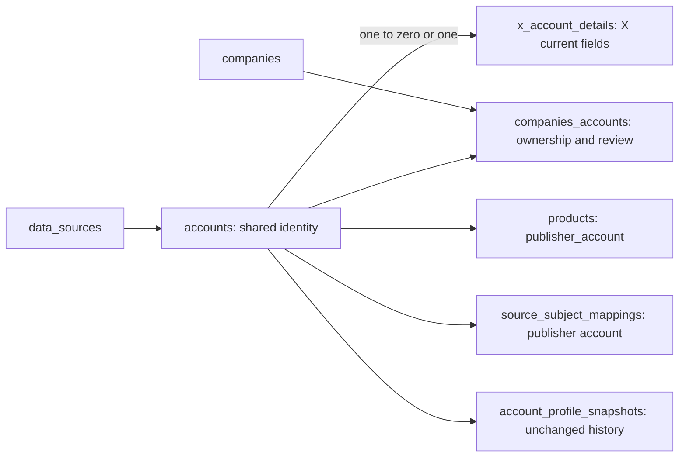

# Share account identity with justified source details

## Plain-English Summary

Keep one account identity for every platform. Move the 33 X-only current-profile fields into one linked X detail record. Store HF publishers and their company ownership in the existing shared account structures, preserving unconfirmed candidates and original discovery dates.

The result adds one table (`x_account_details`) and retires one (`hf_orgs`). Existing company-account links, account snapshots, crosswalks and collection evidence retain their identity and history. No HF, GitHub or YouTube detail table is justified by the present account requirements.

PR59 deploys first in a delegated stream. This account branch starts from its implementation revision and follows separately to an open PR with CI decided. Migration tests must prove field and relationship preservation on PostgreSQL; this request does not select account production deployment.

## Goal Capsule

**Objective:** new data sources reuse account identity and ownership without duplicating platform account tables, while current collection and evidence behavior remains correct.
**Means:** explicit one-to-one X details, generic publisher references, and migration of HF ownership into existing links.
**Done:** account implementation, preservation/regression verification, code review, remote PR and CI decision are evidenced.

## Product Contract

### Problem Frame

The existing shared Account contains 33 X-specific columns, while HFOrg duplicates shared identity and company ownership. Copying these patterns for GitHub or YouTube would multiply account storage and relationships.

### Requirements

- R1. Preserve shared UUID identity, provider-qualified native identifier/handle uniqueness and company-account relationships.
- R2. Put all 33 audited X-only current fields in one optional one-to-one detail record; permit details only for X accounts. Preserve valid unknown/null/false/zero distinctions and profile snapshot history.
- R3. Retire HFOrg storage after migrating every namespace, linked/unlinked identity, company, confirmation state, discovery provenance and original added date. Do not assume namespace means an organization or ownership confirmation means a provider verification badge.
- R4. Product publisher references use generic Account identity. Preserve exact HF namespace presentation and company admission in catalog, verification, metric mapping, cohort and native-history paths.
- R5. Preserve the harvester's atomic accepted-subset writes, complete-label groups, freshness, immutable source creation dates, absent-field behavior and handle conflict recovery.
- R6. PostgreSQL constraints protect one-to-one integrity and source membership; migrations fail atomically on contradictory existing identity/ownership rather than dropping evidence.
- R7. Exactly one table is added and one retired. Existing records persist business state; add no runtime YAML/Python business registries and no new profile-history table.
- R8. Keep PR59 delivery separate; preserve other sessions' runtime ownership and all existing scheduler/provider/activation boundaries.

### Key Decisions

- KD1 (session-settled: user-approved). Shared account identity plus explicit one-to-one extensions only where actual source fields justify them. Governs R1–R3/R7.
- KD2 (session-settled: user-directed). Delegate PR59 production deployment first; main agent LFG on accounts in a separate PR. Governs R8.

### Acceptance Examples

- AE1. An X account with false blue verification, zero username changes, location metadata and an affiliate label migrates with the same UUID and exact values; profile snapshots are unchanged.
- AE2. A mixed-case unlinked, unconfirmed HF namespace becomes a generic HF account and unconfirmed company link; its original discovery timestamp survives and it remains excluded from trusted collection.
- AE3. A confirmed HF namespace already linked to a shared account retains that UUID and every product/metric mapping; no duplicate account is created.
- AE4. A malformed partial X update preserves rejected fields while committing accepted parent/detail fields together; an exception rolls both back.
- AE5. Direct SQL cannot attach X details to an HF/GitHub account or change a parent with details to another source.

## Planning Contract

### Existing Evidence and Boundaries

Source audit: `core/models.py` Account66 columns/HFOrg6 columns; `core/account_identity.py`; `core/profile_snapshots.py`; `core/benchmark_metric_identity.py`; `core/hf_catalog.py`; existing field-freshness, source-identity, product-verification and catalog regression tests. The detailed dated inventory remains in the original collection worktree's analysis file and is not a second runtime store.

PR59 base is443d13f3; its deployment candidate now948f05ad merges current main. Reconcile this branch with the completed collection delivery before publishing the account PR. Do not mutate its migrations0081/0082 or the shared collection lifecycle/API.

### Key Technical Decisions

- KTD1. Use explicit `XAccountDetail.account` as the primary-key one-to-one link to Account, physical `account_key`, table `x_account_details`. Move the audited typed fields without changing type/default/null semantics. Optional details do not manufacture values on other platforms. Follows KD1/R2/R6.
- KTD2. Maintain narrow Python compatibility access for existing flat X observation/profile consumers while storage and ORM queries use the detail relation. Split parent/detail writes inside one transaction and write only supplied detail fields. Keep `author_id` compatibility and normalized geography in Account. Follows R1/R2/R5.
- KTD3. Add nullable `ownership_confirmed` to existing CompanyAccount: NULL is unknown, false is explicitly unconfirmed, true is confirmed. New HF registrations are explicitly unconfirmed; existing unrelated links remain unknown. Reuse role and added_at. Preserve HF discovery fields in existing provider_metadata without overwriting independent evidence. Generic publisher helpers resolve source-qualified account/company links; no source-specific persistent model remains. Follows R3/R7.
- KTD4. Replace Product.hf_org with a generic nullable publisher_account foreign key; retain repo identifier/source timestamps and per-source crosswalk publisher keys. Historical migrations continue describing their original schema. Follows R4.
- KTD5. Migration0083 follows0082 and moves X details;0084 follows0083 and migrates HF ownership. This separates the two preservation proofs without adding tables beyond R7. Create storage, copy and validate data, rewire products, then remove obsolete columns/table. Reverse copy reconstructs retained legacy values before removing new storage, refusing ambiguous ownership, unknown confirmation or non-HF product publishers that the old schema cannot represent. PostgreSQL source guards use triggers because cross-table CHECKs are unsupported. Follows R6.

### Database Relationships

### Alternatives and Risks

Keeping all33 X fields in Account is workable but leaves source-specific storage in the shared core. Separate complete platform account tables split existing relationships. Creating HF/GH/YT detail tables now lacks distinct typed requirements. Existing snapshots are historical evidence, not a replacement for atomic current-profile projection.

Removing columns is a coordinated code/schema cutover: account production deployment must plan compatibility with processes still running old code. No account production migration occurs in this run. Avoid deletion or truncation of source evidence and keep unknown source dates unknown. Native HF identities remain namespace-qualified and case-normalized, GitHub native numeric identities remain unchanged.

## Implementation Units

### U1. Move X current detail fields with atomic compatibility

**Goal:** R1/R2/R5/R6; covers AE1/AE4/AE5.
**Files:** `core/models.py`, `core/account_identity.py`, `core/official_company_discovery.py`, relevant geography management commands, `tests/test_account_extensions.py`, existing X account/profile tests.
**Approach:** define typed detail model; expose narrow compatibility getters/setters/save splitting for payload/snapshot callers; update actual SQL queries to explicit detail joins. Preserve locks, accepted field grouping and savepoint conflict recovery. Leave harvest request/scheduling/adapter logic untouched.
**Verification:** parent/detail writes, rollback, absent versus zero/false, snapshot history and provider guards pass on PostgreSQL without skipped required tests; updated readers retain output contracts.

### U2. Replace HF ownership and publisher readers

**Dependencies:** U1.
**Goal:** R3/R4/R7; covers AE2/AE3.
**Files:** `core/publisher_accounts.py`, `core/models.py`, `core/hf_catalog.py`, `core/product_verification.py`, `core/benchmark_metric_identity.py`, `core/model_history_cohort.py`, `core/model_native_history.py`, `core/model_history_collection.py`, relevant onboarding/catalog/export commands, `scripts/port_sqlite_to_django.py`, matching tests.
**Approach:** resolve/register provider-qualified publishers with reviewed CompanyAccount links; make confirmation explicit and preserve unknown account_kind; replace HFOrg ORM queries and product relations. Update test factories rather than retain a fake HF ORM. Existing exports may retain HF-specific wire labels backed by generic records.
**Verification:** confirmed and unconfirmed scope, ownership conflicts, source-qualified namespaces, catalog/cohort/native history, product verification/onboarding and metric crosswalk behavior remain correct; no executable HFOrg model/reference remains outside historical migrations/legacy archive code.

### U3. Migrate and prove preservation

**Dependencies:** U1/U2.
**Goal:** R1–R7; covers AE1–AE5.
**Files:** `core/migrations/0083_account_extensions.py`, `core/migrations/0084_shared_publisher_accounts.py`, `tests/test_account_extensions_migration.py`, schema/model tests and CI configuration when required.
**Approach:** use historical migration models and the schema editor's alias; preserve existing UUIDs, ownership/provenance timestamps and product references. Fail on provider/namespace/company conflicts. Install forward and parent-source SQL guards. Exercise reverse with supported data and prove unsupported ambiguous data fails without deleting it.
**Verification:** migrate0082→new leaf in an isolated PostgreSQL database containing X/HF/GH accounts and evidence; compare exact fields/links/snapshots/measurements; confirm tables added/retired and complete model state; reverse/forward works for preserved cases.

### U4. Regression net, reference and delivery

**Dependencies:** U1/U2/U3.
**Goal:** R8 and completion.
**Files:** affected regression tests, `docs/reference/db-schema.md`, focused account reference where needed, this plan's delivery metadata/evidence reference.
**Approach:** run relevant X/profile/HF/catalog/product/onboarding/benchmark/cohort/collection regressions; review schema/migration integrity and simplify changes; reconcile PR59 deployed revision; open a separate PR to main and observe required CI. Update current schema detail without regenerating retired Graphviz artifacts.
**Verification:** migration drift check/system checks and meaningful regression tests pass; review findings are resolved or durably recorded; remote head equals reviewed revision and CI is decided. PR59 production evidence is reported separately.

## Verification Contract

Use the shared virtualenv and an independently named local PostgreSQL database; never reuse another session's database. Set a task-owned pytest basetemp under the authoritative host. Execute required PostgreSQL tests; skipping them is incomplete. Begin with existing account behavior characterization. Add tests for migration preservation and guards, cross-platform details rejection, atomic split writes, ownership admission and unknown timestamps. Run `makemigrations --check --dry-run`, `manage.py check`, scoped regressions and required CI. Provider mocks verify contracts; no live API requests or collector activation are required.

## Definition of Done

Every requirement and acceptance example has implementation and verification evidence. One X detail table exists; HFOrg table/model is retired with all data preserved. Existing collection/X runtime ownership remains intact. Review and CI are decided on a published account PR; no account production rollout is claimed. Delegated PR59 delivery reaches its separately authorized production endpoint.

## Delivery Exceptions

Owner request: “subagent: ok deploy pr59; main agent lfg on accounts work.” Account LFG uses the default PR/CI endpoint, with delivery_target on-request; PR59 deployment has a separate owner and plan. No account production grant, provider batch or collector activation is inferred. No further scope approval/menu is needed for this already-authorized implementation. Execution is native in the main agent; project task mapping keeps account review/research sequential rather than dispatching independent agents.

<!-- BEGIN OLLIJA DELIVERY GUIDE -->
## Ollija Delivery Guide

This block is generated guidance. Do not edit it directly. Correct durable facts in `.ollija/project.yaml` or this template, then rerun `ollija annotate-plan`. Current explicit owner instructions govern this task. Record exceptions below and reflect route changes in metadata; removed requirements must not return through another checklist.

### Resolved locations

- Authoritative host: `fuchitalee`
- Authoritative repository: `/Users/fuchitalee/development/pushin-weight-v2`
- Ollija release worktree area: `/Users/fuchitalee/development/pushin-weight-v2/.worktrees`
- Active worktree: `/Users/fuchitalee/development/pushin-weight-v2/.worktrees/feat/g3-account-extensions`
- Plan: `/Users/fuchitalee/development/pushin-weight-v2/.worktrees/feat/g3-account-extensions/docs/plans/2026-10-14-035106-feat-g3-account-extensions-plan.md`
- Change: `feat-g3-account-extensions-2026-10-14-035106`
- Branch: `feat/g3-account-extensions`
- Staging branch and blueprint: `staging`, `/Users/fuchitalee/development/pushin-weight-v2/.worktrees/feat/g3-account-extensions/render-staging.yaml`
- Production branch and blueprint: `main`, `/Users/fuchitalee/development/pushin-weight-v2/.worktrees/feat/g3-account-extensions/render.yaml`
- Staging URL: `https://pushinweight-staging-web.onrender.com`
- Production URL: `https://pushinweight-web.onrender.com`

### Placement

This worktree is inside the Ollija release worktree area. Reuse it for the whole change. Do not create a second worktree or plan for this branch.

### Delivery scope

- Workflow: `plan`
- Delivery target: `on-request`
- Owner selection recorded: `false`
- Delivery route: `staged`

Target is not authorized until the owner selects it. Wait for a later explicit release request; do not commit, push, stage, or promote on this guide alone.

### Failure handling

- Complete applicable, unwaived checks for the selected route. A waived check is waived, never passed. Owner-selected direct production does not require staging.
- Product defects return to the parent implementation workflow; repeat only checks invalidated by the fix. Environment failures require repairing the environment, not a new source commit. Retry only after a relevant fact changes.
- SSH, shell, environment, or multi-machine failures use the repository infra/multi-machine skill first.
- The change ledger is advisory; do not validate or enforce it.
- Never force-remove a worktree. Retain staging-only, failed, dirty, locked,
  noncanonical, or candidate-mismatched worktrees for diagnosis or later
  delivery.
- Do not run an endless retry loop or start a persistent Ollija process.
<!-- END OLLIJA DELIVERY GUIDE -->

## Delivery Exceptions

None.

# Goal

<!-- Planner: replace this requirements-only placeholder with the change goal. -->

## Product Contract

<!-- Planner: define the user-visible contract, acceptance cases, and verification. -->
