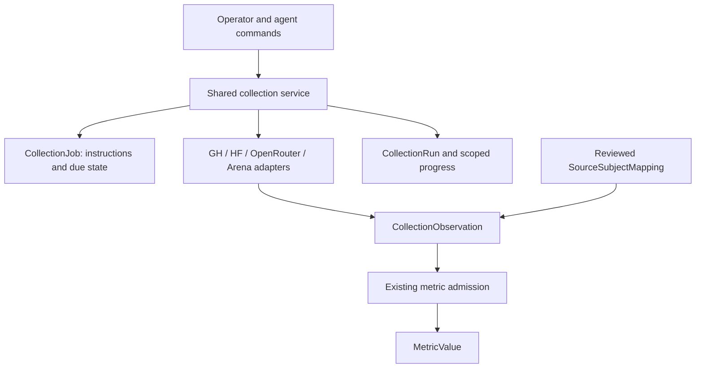
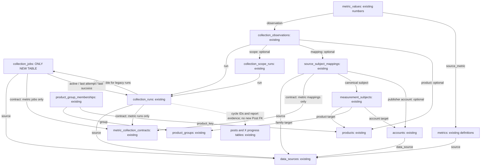
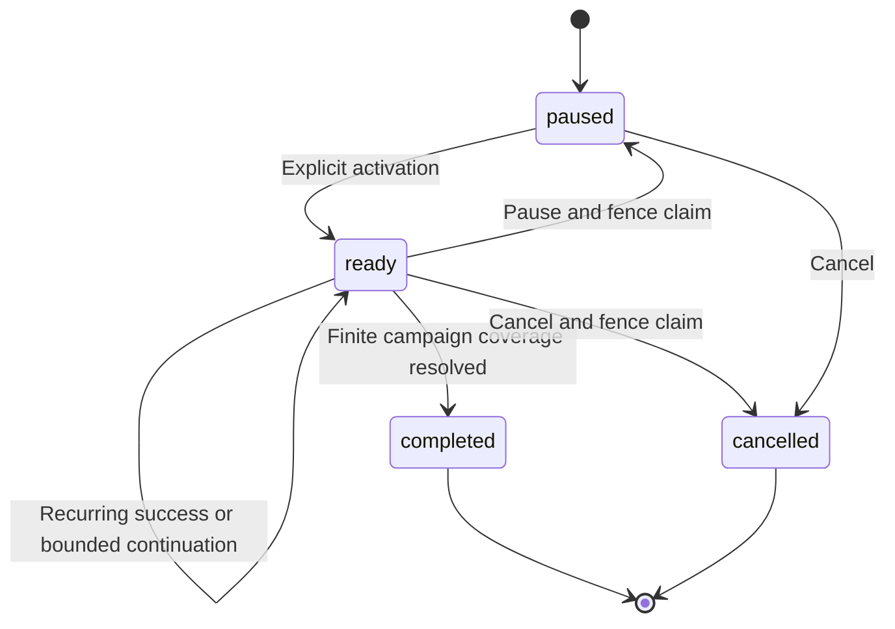
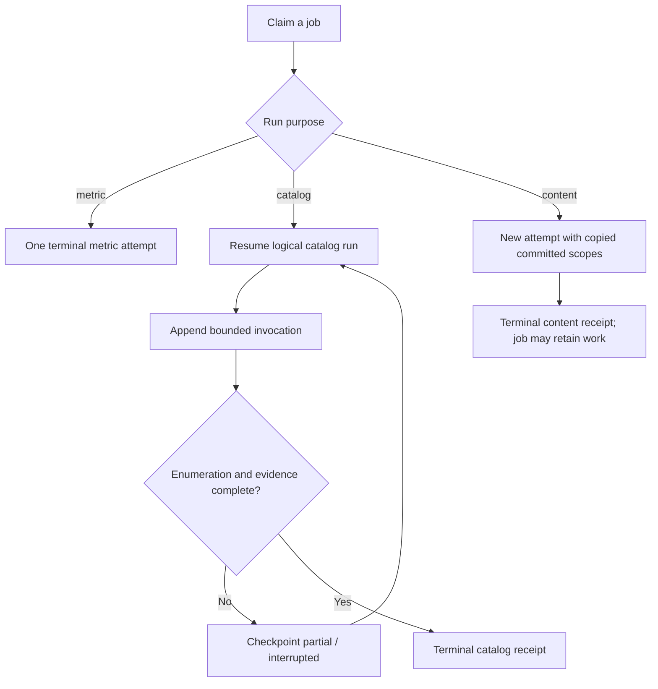
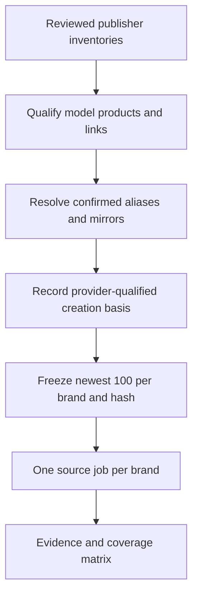
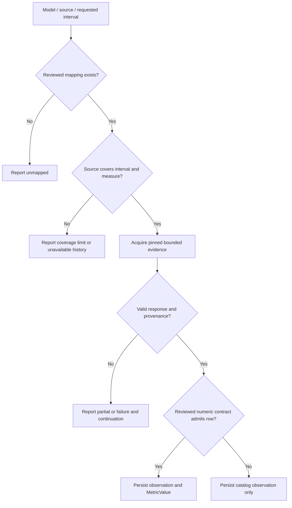
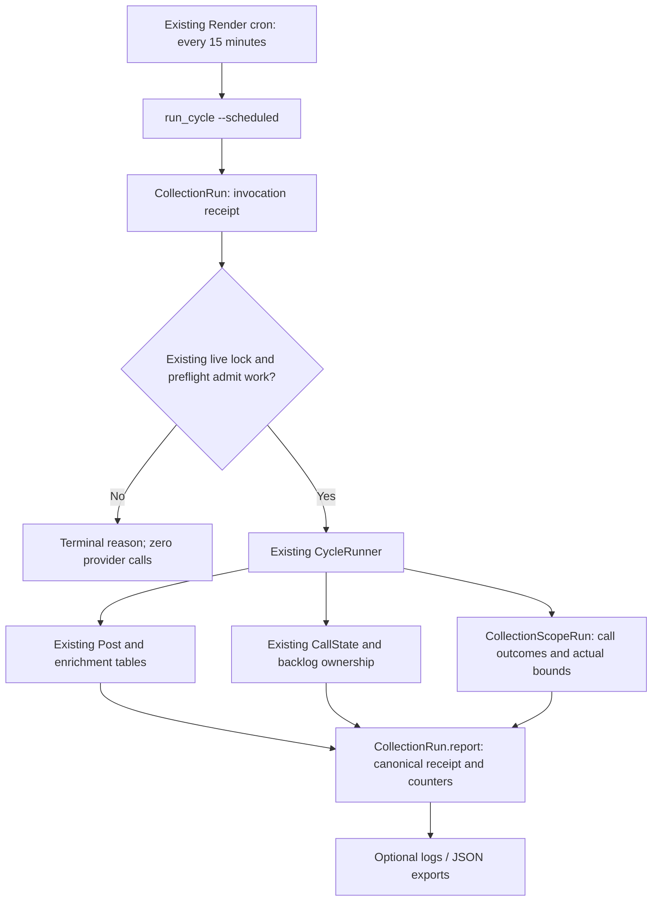
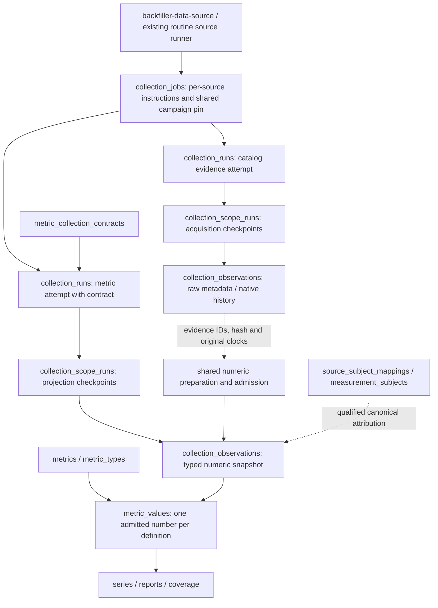

# Shared Collection Jobs, Model History and backfiller-data-source - Plan

## Plain-English Summary

Finish ingestion, so the information we collect reaches the updated database in a form the product can use. The three-brand pilot stored catalog and release evidence, but wrote **zero numeric metric values**. Its HF downloads/likes and GitHub stars/forks/issues remain inside raw responses. Saving those responses alone does not complete this work.

Build **backfiller-data-source** as a durable, repeatable way to collect the relevant public data from Hugging Face, GitHub, OpenRouter and Arena. Reuse the deployed collection jobs, runs, scopes, observations, mappings, contracts and metric values. Backfilling and normal scheduled collection will share provider clients, identity checks, metric definitions, writers and recovery controls. This amendment adds **zero tables and retires zero tables**; the previously approved `collection_jobs` table is already deployed.

Collect full relevant inventories for verified tracked publishers, then recover the available history for the same frozen cohort of up to 100 newest models per tracked brand. Keep repository metadata, release evidence and numeric measurements distinct. A shared repository's popularity belongs to that repository; it must not be copied onto every model it supports. Preserve actual source dates, unknown times, missing values and unavailable history.

Completion requires actual `MetricValue` writes, safe replay of saved evidence, restart using database state alone, and proof that the next normal collection uses the same path. The existing saved three-brand counters provide a concrete minimum of **1,610 metric values** to recover before new network acquisition. A broader campaign must account for all 21 brands and all four sources, with explicit coverage gaps. Preserve the 15-minute X harvester and its separately owned recovery campaign; bulk source backfills do not run inside that cycle.

The October 16 planning turn performed no implementation or runtime actions. The subsequent owner instruction “lfg this subplan” selects execution through the recorded production endpoint, full four-source backfill and verified ongoing collection; see Current LFG Authorization under Delivery Exceptions.

---

## Goal Capsule

**Objective:** Relevant source evidence and numeric measurements are ingested into the shared database by both backfiller-data-source and routine collection, with reproducible selection, honest coverage, safe replay and durable recovery.

**Means:** Reuse the deployed collection foundation (KTD1–KTD10); finish shared acquisition, numeric projection, source capability dispatch and normal scheduling (KTD11–KTD18). A successful catalog request with zero normalized counters cannot satisfy the numeric-ingestion requirements.

**Authority:** The owner's current instructions govern scope and delivery, followed by AGENTS.md and the authoritative General Launch index/charter, then this Product Contract and Planning Contract. The owner subsequently selected “lfg this subplan,” authorizing implementation, staged production delivery, bounded full-cohort collection and routine activation/verification required by its completion contract. Preserve the separately owned X recovery and historical evidence.

**Execution profile:** Django/PostgreSQL, stable U1–U9 delivered foundation and compatibility obligations, followed by U10–U16 for completion. U9 remains separately owned. This amendment adds zero tables, retires zero tables and proposes one conditional uniqueness constraint on an existing table; no separate campaign, checkpoint or coverage store.

**Execution starting point:** Inspect the current implementation before each unit. The retained worktree's code at `948f05ad` is older than the inspected baseline `2c43b4f0`; implementation must reconcile with current main in an isolated checkout, preserving this canonical plan, dirty owner files and concurrent X work. Do not apply old U1–U9 migrations again or copy stale models over current main.

**Stop conditions:** Stop for an unapproved additional permanent table, irreversible identity merge, unsupported numeric attribution, changed X ownership, or provider work beyond its explicitly selected budget. Missing historical coverage is a typed outcome, not permission to manufacture values, backdate counters or retry indefinitely.

---

## Product Contract

### Summary

Complete the source-ingestion path from provider response to canonical metadata, immutable evidence and normalized numeric measurements. Both durable backfills and recurring source collection use the same implementation and database recovery state.

### Problem Frame

The shared schema, account consolidation, collection jobs and GitHub activity collector are deployed. The verified three-brand checkpoint contains 1,959 catalog observations, including 595 HF model listings and 140 GH repository listings, but zero `MetricValue` rows from those six jobs. Catalog collection never invokes the numeric writer. Existing metric collection is a separate contract-pinned path and lacks GH support; its benchmark eligibility also excludes legitimate non-LLM products.

Other missing wiring includes complete metadata acquisition, source-specific numeric parsers and definitions, automatic history acquisition-to-import, cross-job replay identity, fair durable continuation and the actual normal scheduler bridge. A helper or manual import alone does not close these gaps. See the inspected baseline and U10–U16.

### Key Decisions

- **Exactly one new permanent table in the original foundation, already delivered.** This amendment adds zero and retires zero tables. Preserve the shared evidence tables rather than introducing provider-specific ledgers. Governs R1. (session-settled: user-directed — chosen over adding several bookkeeping tables: the existing collection tables already cover execution and evidence.)
- **Newest 100 per tracked brand, ordered by creation date.** The requested cohort follows creation chronology rather than downloads or popularity. Governs R4, R5. (session-settled: user-directed — chosen over a popularity-ranked cohort: the owner explicitly specified creation date descending.)
- **A separate G3 subplan.** Collection infrastructure and history are independent of chart, prediction and learning implementation. Governs R11. (session-settled: user-directed — chosen over executing the whole G3 plan: infrastructure can be completed separately.)

### Requirements

**Shared persistence and ownership**

- R1. Retain the deployed `collection_jobs` table, the sole table added by the original collection phase. This amendment adds zero tables and retires zero tables; reuse existing identity, execution, evidence and measurement storage.
- R2. A job holds its reviewed instructions and schedule; execution records capture attempts, usage, progress and outcome without duplicating retrieved content.
- R3. Preserve the separately owned X adapter, adopted database persistence and active recovery campaign. The earlier atomic-JSON pilot allowance is historical, not a new persistence route. G3 owns shared collection services; the X session owns its runtime integration and recovery files.
- R13. All new collection business data is authoritative in PostgreSQL; YAML/Python files cannot serve as runtime stores for identities, mappings, cohorts, schedules, progress or measurements.

**Identity and selection**

- R4. Freeze up to 100 canonical model products per brand for the 21 brands in the Scope table, sorted by the supported creation timestamp descending with deterministic ties.
- R5. Apply that same frozen model cohort to GitHub, HF, OpenRouter and Arena; aliases and mirrors must not occupy duplicate model slots.
- R6. Each admitted provider identifier has reviewed publisher ownership and source evidence; canonical model attribution additionally requires a qualified subject mapping. Verified native-resource measurements may remain explicitly unassigned to a canonical model under R19. Shared family repositories do not equate their supported model versions.

**Collection and history**

- R7. Collect GitHub public repository metadata and qualified release/tag/commit evidence, retaining native identifiers and clocks separately from interpreted model-release claims.
- R8. Recover available historical evidence from all four sources and distinguish observed zero, unavailable history, missing mappings, partial retrieval and provider coverage limits.
- R9. Collection is bounded, idempotent and resumable from committed progress; stale workers cannot publish progress after another worker acquires their lease.
- R10. Operators and agents can inspect the frozen cohort, mapping evidence, coverage, next due/retry time and run failures through the same command/service interface.

**Compatibility and scope**

- R11. Preserve existing benchmark admission, HF catalog behavior, X live cursors/backlog, OpenCode collection, compatibility imports and staging data-integrity rules while keeping chart/prediction implementation outside this subplan.
- R12. Retain source-event, snapshot, publication, retrieval and first-observed times with their precision; none substitutes silently for a release announcement or historical availability date.
- R14. Preserve the existing state/flow definitions and exact/date-only/unknown temporal precision, storing supplied numbers even when their effective times are unknown and never replacing missing numbers with zero.
- R15. Persist each scheduled 15-minute X harvest invocation as a shared content run, including rejected, failed and interrupted attempts, without changing its scheduling or live cursor/backlog ownership.


**Complete ingestion and shared operation — October 16 amendment**

- R16. Ingest relevant public source metadata and evidence into existing account/product/mapping/observation storage, and all admitted supported counters into `MetricValue` under versioned `SourceMetric` definitions and a pinned metric contract. Raw JSON alone is not numeric ingestion.
- R17. Provide backfiller-data-source through one database-backed operator/service interface for inspect, register, execute/resume, pause, replay and report. Stable source jobs, frozen selections, limits, retries and progress survive process/host restarts without authoritative local manifests.
- R18. Backfill, replay and normal recurring collection share acquisition clients, parsing, definition/identity admission, numeric writing, locks, budgets and checkpoints. Wire the actual normal invocation path and prove its next scheduled execution writes values; do not require a manual importer after each poll.
- R19. Store verified repository/account/asset counters at their native resource grain even when no canonical model mapping exists. Require explicit native-only reporting and exclude such values from canonical model comparisons. A family repo counter is recorded once, never fanned out to supported models. Keep existing text-benchmark eligibility separate from source statistics for other AI models and agent/harness products.
- R20. Replay the already saved three-brand evidence without re-fetching captured fields, preserving source observation clocks and lineage. The audited 595 HF listings × two counters and 140 GH listings × three counters yield a minimum 1,610 values. Exact replay, including across different jobs, adds zero duplicates; new real snapshots remain distinguishable.
- R21. Separate prompt, fresh publisher inventory/current-metadata collection from deep repository activity/history continuation. Historical work cannot keep normal discovery stuck on an old partial catalog run. Use one scheduling authority per role and finite, fair provider budgets.
- R22. Report coverage by source, selected model/native resource, data family/metric and requested period/configuration. Distinguish stored, reused, native-only, unavailable, missing, truncated, retryable failure and cooldown. Neither unsupported history nor a successful HTTP response counts as a fully ingested series.
- R23. Complete all selected four-source campaign scopes for the frozen 21-brand cohort to honest terminal outcomes, verify normalized data through product readers, and demonstrate routine continuity. A three-brand inventory pilot is an intermediate checkpoint, not completion of this plan.

### Scope

The following 21 brand identifiers are the owner's requested scope, previously verified against `config.yaml.enabled_models`.
During registration validate them against database `Brand` and ownership records, then freeze them in `CollectionJob.definition`; ongoing cohort selection does not read a YAML list as business-data authority (R13).
The inventory below is the requested set, not a claim that every company has 100 public models or publishes on every provider.

| Brand ID | Brand ID | Brand ID |
| --- | --- | --- |
| minimax | qwen | deepseek |
| glm | mimo | moonshot_kimi |
| inclusionai | mistral | stepfun |
| ernie | hunyuan | llama |
| nemo_megatron | doubao | yi |
| sensechat | exaone | kuaishou |
| sakana_ai | upstage | dots |

Model slots include confirmed LLM and other AI model products.
Agent/harness repositories may be tracked by the GitHub collector but do not consume model slots.
The five-way offering taxonomy remains separate work; this plan uses the existing `Product.type` values and records unresolved type qualification explicitly.

### Actors and Flows

- A1. The operator reviews publisher/crosswalk evidence, freezes a cohort and approves activation/budgets.
- A2. The shared coordinator claims jobs and checkpoints committed work.
- A3. Provider adapters enumerate and retrieve evidence within their allocated budget.
- A4. The X backfill session owns its adopted adapter and recovery campaign; new source work preserves that ownership.

- F1. A1 reviews inventory → freezes a cohort → creates paused source jobs → inspects coverage → activates an approved job. Covers R4–R6, R10.
- F2. A2 claims a due job → A3 retrieves a bounded chunk → A2 atomically persists evidence and its checkpoint → reports completion or continuation. Covers R2, R8, R9.
- F3. A4 continues its separately owned database-backed X recovery → G3 preserves the shared interface and verifies compatibility → A4 retains ownership of runtime changes. Covers R3, R11.
- F4. Render launches `run_cycle --scheduled` → the command records an invocation → the existing CycleRunner executes under its live lock → shared run/scopes store outcomes and progress. Covers R13, R15.

- F5. A1 registers a source campaign → A2 acquires bounded metadata/history → shared admission writes evidence and metric values with the checkpoint → restart resumes from PostgreSQL alone. Covers R16–R19, R21–R23.
- F6. A1 selects saved evidence → shared projection reuses its original observation time and source revision → writes contract-pinned values → repeated replay reports reuse without another provider request or duplicate. Covers R14, R19, R20.
- F7. The existing normal data-source runner wakes → due jobs use the same source services → fresh discovery and measurements commit independently of deep history → readers expose the new values and any gaps. Covers R18, R21–R23.

### Acceptance Examples

- AE1. MiniMax's HF namespace `MiniMaxAI` and GH owner `MiniMax-AI` resolve to reviewed provider accounts; a spelling match alone admits neither. Covers R6.
- AE2. One `zai-org/GLM-5` repository supports two qualified model versions; both can have distinct model subjects, while the repository creation date remains one repository fact. Covers R5–R7, R12.
- AE3. An OpenRouter model absent from a day's published top 50 has unknown individual usage for that day; the aggregate `other` row is not assigned to it. Covers R8.
- AE4. A crash after evidence commit but before acknowledgement resumes from the database checkpoint; replay does not duplicate evidence or advance unfinished scopes. Covers R9.
- AE5. A staging refresh retains numeric measurements and their job provenance, pauses copied jobs and clears pointers before removing excluded catalog/content execution records. Covers R1, R11.
- AE6. A legacy JSON pilot import records its actual import provenance without inventing old database attempts. Adopted X recovery continues from its database state; this source backfiller does not replace its controller. Covers R3, R12.
- AE7. HF reports a numeric rolling counter without its exact counting cutoff; the number is stored with unknown temporal precision and null unsupported bounds. A missing counter stores evidence of the gap and no numeric row. Covers R14.
- AE8. Two scheduled harvest invocations overlap: the active one retains its lease; the rejected invocation has its own terminal receipt and performs no provider calls. Covers R9, R15.
- AE9. A restarted collector resumes after its temporary files are removed, using database instructions, evidence and checkpoints alone. Covers R13.

- AE10. Replaying the audited 595 HF and 140 GH native listings produces at least 1,610 correctly typed values without HTTP; repeating through another job writes zero duplicates. Missing all-time downloads/subscribers do not suppress captured downloads/likes/stars/forks/issues. Covers R16, R19, R20.
- AE11. A GH family repo supports three models. One stars snapshot belongs to its native repo; no three-way copy or model-level success is reported. Covers R6, R19, R22.
- AE12. Qwen Image's valid download/like counters survive its `other-ai-model` type; it does not enter a text-only leaderboard through that source-statistics contract. Covers R11, R16, R19.
- AE13. A worker crashes after a numeric batch commits. Its successor reconstructs selection, cursor and deduplication state from the database, reports existing values as reused and continues without the local transport/export files. Covers R9, R17, R20.
- AE14. A deep GH commit scope is still partial; the next daily inventory nevertheless discovers a new repo and writes current counters through the shared writer. The existing 15-minute X job and careers scheduler remain unchanged. Covers R18, R21.
- AE15. An Arena agent snapshot supplies `observation_count` and `session_count`. They keep their native definitions/configuration and are not renamed text votes or compared to text Elo. An OR `other` aggregate remains unassigned. Covers R14, R16, R19, R22.
- AE16. The next natural routine execution writes fresh `MetricValue` rows with the actual observation clock; all 21-brand campaign cells have either persisted results or specific terminal coverage gaps. No claim of full ingestion rests on raw listings alone. Covers R18, R22, R23.

### Deferred to Follow-Up Work

The ingestion requirements from the original chart-engine plan's HF watch U8–U13 are carried into this amendment's U10–U16: current inventory comparison, complete relevant metadata, setup-versus-weight evidence, daily counters/account refresh and shared due/recovery controls. Do not build a second HF runner or separate `core/collection/` framework from that older sketch. Its Google/NVIDIA company-wide 100-repo exception uses latest modification order; historical selection here uses R4's creation order. Preserve those distinct policies, current rows and flags; Google is not added to the 21-brand historical cohort. Canonical release adjudication and independent future frequency experiments remain separate.

The X database adapter is adopted; preserve its separate runtime owner and active recovery.
Canonical release adjudication, X-versus-weight release reconciliation, chart annotations, forecasts, outcome auditing and self-learning remain separate work.
In particular, `ModelReleaseEvidence.source_post` currently requires a real X post; this collector must not fabricate one to represent GH/HF evidence.

---

## Planning Contract

### Current Source Baseline

Inspected against fetched main **`2c43b4f0bfce8ef0bf0f744fd25db86567904cab`**, migrations through `0086_merge_account_provider_batch`, rather than the stale code in this retained plan worktree. The prior baseline `db5510cc` and original U1–U9 describe foundation work now delivered by PR59/60/58/61; revalidate compatibility, do not recreate it.

| Area | Actual current behavior | Remaining wiring |
| --- | --- | --- |
| Shared schema | Jobs, metric/catalog/content runs, scopes, observations, numeric values and metric/catalog mappings exist; account consolidation is deployed | Reuse them; one conditional uniqueness constraint for new projections, no new table |
| HF inventory | `core/model_inventory.py` writes listings and `core/hf_catalog.py` product metadata; `HFMetadataClient` already supports detail groups and download counters | Current/full metadata and counters must reach a shared contract-pinned projection writer |
| GH catalog | `core/github_catalog.py` writes publisher/repo/release/tag/commit/tree/file evidence; verified numeric-ID pagination is fixed | Repo-access responses discard counters; add numeric admission and preserve complete relevant response data; split fresh inventory from deep history |
| Numeric path | `benchmark_metric_identity.py`, `benchmark_metric_store.py` and `benchmark_metric_history.py` pin definitions, validate rows and write `MetricValue` | GH missing from registry/native parser/CLI; hardcoded LLM/account admission needs versioned source-statistics eligibility; catalog callers never invoke it |
| Numeric lifecycle | Metric `partial` is terminal; catalog `partial` resumes the same run. `continue_from` currently copies scopes only for historical content | Design bounded numeric batches/checkpoints explicitly; do not misuse the content-only flag or call the whole-run finalizer once per catalog page |
| Due routing | `collect_benchmark_due` delegates a registered metric authority to `collect_jobs_due`; dispatcher supports catalog/history operations | It does not automatically dispatch arbitrary catalog jobs. Bridge reviewed due source roles into the real runner, retaining one authority per role |
| Production scheduling | Hourly `pushinweight-benchmark` exists in retained production receipts (`crn-db3lm2ui0phs73amjs30`), but not in `render.yaml`; HF daily slot is 10:00 UTC | Verify actual start command/configuration before changing it. `pushinweight-jobs` is careers sync, not this collector. Do not create a duplicate cron |
| X | PR58 adopted shared content persistence; separately owned August recovery continues | Preserve its controller, receipt semantics, scheduled/on-demand credentials and 15-minute `run_cycle --scheduled` ownership |

Verified pilot receipt: [three-brand checkpoint](/Users/fuchitalee/development/pushin-weight-v2/docs/analysis/2026-10-15-213147-g3-three-brand-checkpoint.md). Its 1,959 observations include 595 HF model listings and 140 GH repo listings. A subsequent read-only audit found downloads/likes present on all 595 and stars/forks/open-issues present on all 140; **zero `MetricValue` rows** belong to those six catalog jobs. All six owned pilot jobs are paused and GH disabled. Those flags and existing normal metric schedules stay unchanged during planning.

The following KTD1–KTD10 retain the original foundation decisions and stable IDs. Their historical “add/extend” wording does not instruct a second schema rollout. KTD11–KTD18 govern the October 16 completion work.

### Key Technical Decisions

- KTD1. **A small shared instruction table.** Add `CollectionJob` and nullable `CollectionRun.job`; preserve legacy runs with `job=NULL` and the existing numeric contract/mapping hashes. A job supplies mutable coordination state around an immutable definition (R1, R2).
- KTD2. **Extend the existing crosswalk.** Add a metric/catalog purpose to `SourceSubjectMapping`, allowing a null contract only for reviewed catalog links. This keeps searchable, constrained identity relations without another table or artificial metric contracts (R1, R6).
- KTD3. **Provider-qualified model creation order.** Resolve cohort dates under the Assumptions below, record their basis and precision, and never date a specific version from a shared GH family repository (R4, R12).
- KTD4. **Native GH identity and pinned evidence.** Use GitHub numeric repository ID as identity and retain full-name aliases, ownership and commit/release coordinates as evidence. A rename changes a label; it does not create another model (R6, R7).
- KTD5. **Reuse bounded acquisition and numeric admission.** Extend the budget/HTTP/retry patterns in `scripts/benchmark_download_collector` and use the existing reviewed history importer for numeric snapshots. Catalog links never bypass a frozen metric contract (R8, R11).
- KTD6. **Claim, fetch, then commit with a lease fence.** Claim under a short database lock, perform network work outside the transaction, and commit only while the job's active run and lease token still match. Store the token on the existing run (R9).
- KTD7. **Separate shared services from X runtime ownership.** The generic content-run contract and X adapter are now delivered; preserve the handover and the X owner’s active recovery. The earlier JSON pilot is historical (R3).
- KTD8. **Purpose-aware staging copies.** Retain job definitions needed by copied numeric runs, pause copied jobs, clear execution pointers, and then remove excluded nonnumeric history in dependency order (R11).
- KTD9. **Database authority for business state.** Use the storage map below for runtime data; source adapters remain code and test fixtures remain test inputs. A one-time reviewed import is persisted before runtime use (R13). (session-settled: user-directed — chosen over YAML/Python business-data stores: the owner requires collection business data to use the database.)
- KTD10. **Shared receipts for the existing X runner.** Attach content attempts/scoped outcomes through the common CycleRunner/command path, including the scheduled route; the existing cron remains its scheduling authority (R3, R15).

- KTD11. **One shared ingestion service, two acquisition modes.** Backfill/replay and routine collection feed the same prepared evidence/metric batches into the existing validators and transactional writer. Preserve legacy wrapper behavior rather than copy a second parser/writer (R16–R18).
- KTD12. **Contracted numeric projection after catalog capture.** Catalog runs retain immutable source evidence; a separate metric-purpose run with a valid pinned contract stores its numeric projection, linking source observation/run IDs, hashes and clocks in existing provenance fields. No metric values on contract-null catalog runs (R14, R16, R20).
- KTD13. **Verified native resource first; qualified canonical attribution second.** Use existing nullable observation mapping for owned native-resource statistics and explicit native-only coverage. A new source-statistics contract admits existing non-LLM product types without changing text-benchmark contracts; do not invent product or model subjects for shared repos (R6, R19).
- KTD14. **Cross-job snapshot identity enforced by PostgreSQL.** Add a conditional unique constraint on existing `CollectionObservation.observation_key` for new `source_metadata.projection_kind = source-statistics-v1` rows. Keys hash pinned contract/source, native resource, snapshot origin/revision and semantic dimensions. Replays share a key; distinct genuine observations do not. Preserve all legacy keys and constraints (R9, R20).
- KTD15. **Database campaign state without a campaign table.** Per-source `CollectionJob.definition` pins a shared campaign key/cohort hash, phases, limits and contract; existing scopes and run reports hold progress and coverage. The operator facade aggregates those records, never creates an artificial “all sources” DataSource (R1, R13, R17).
- KTD16. **Separate fresh discovery from deep history.** Use distinct reviewed job roles/due state and shared clients/budgets, so a resumable commit walk cannot monopolize the current inventory. Normal collection uses the existing data-source runner, outside the 15-minute X invocation (R18, R21).
- KTD17. **Capability-based source coverage.** Public current snapshots, native activity history and published numeric history have separate outcomes. Pin Arena configuration/revision and retain OR aggregate omissions; neither current downloads nor stars yield an invented historical series (R8, R12, R14, R22).
- KTD18. **Completion includes the reader and normal trigger.** Verify actual numeric rows and source semantics through existing read paths, a natural routine invocation and the full frozen 21-brand campaign, rather than a catalog-only/manual-only milestone (R16, R18, R23).

### Schema Delta and Business Data Storage

**Original foundation, delivered:** one new `collection_jobs` table, zero retirements and zero renames. Its run/lease/content and catalog-mapping alterations are already in current main.

**October 16 amendment:** **zero new tables, zero retired tables, zero renamed tables**. Reuse the existing columns. Propose one conditional unique constraint/index on `collection_observations.observation_key` for the new numeric projection marker (KTD14), generated from `core/models.py`; no separate deduplication ledger or checkpoint table. Verify existing data and staging copies before adding it. Do not apply this marker to legacy observations or rewrite their identities.

| Business data | Authoritative database location | File boundary |
| --- | --- | --- |
| Source registration and provider owner identity | `data_sources`, `accounts`, `companies_accounts`, `brands_accounts` | Python adapter dispatch and environment secrets are code/configuration, not business rows |
| Canonical models/families | `products`, `product_groups`, `product_group_memberships`, `measurement_subjects` | Research reports or import inputs cannot override these rows |
| Reviewed GH/HF/OR/Arena identities | `source_subject_mappings` and its typed identity/identifier JSON | No live crosswalk dictionary or YAML lookup file |
| Frozen scope/cohort, schedule, limits and reviewed pins | Existing `collection_jobs.definition` plus job due/retry state; numeric pins remain in `metric_collection_contracts` | No runtime cohort/schedule manifest stored in Python/YAML |
| Invocation receipts, bounded selected payloads and batch summaries | `collection_runs` including `report`, `raw_payload` and provenance | Logs/JSON exports are derived outputs; new production recovery does not require them |
| Committed cursors, per-call progress and coverage | `collection_scope_runs`, `collection_observations` and typed run reports | No second authoritative checkpoint/coverage file |
| Metric definitions and numeric datapoints | Existing `metrics`, `metric_types`, `metric_values` | No numeric history in source-code constants or YAML |
| X content and existing live progress | Existing `posts`, enrichment/attribution tables, `call_state`, `harvest_backlog_windows` | Preserve their database ownership; do not duplicate tweets into a collector table |

Validated history chunks can be assembled in memory or temporary files during transport, then their selected rows, hash and retrieval coordinates are committed through the existing database envelope.
A resumed job reconstructs its authoritative inputs and progress from the database.
Tests may use captured fixtures, and operators may export/import reviewable artifacts; neither is the runtime source of truth.
The earlier fuchitalee JSON pilot allowance is historical: its database adapter has been adopted. Preserve separately owned X caches/evidence, but do not introduce that exception into new source runtime persistence.
Existing legacy application configuration is not broadly rewritten by this subplan; new or migrated collector business state follows R13.

### CollectionJob Field Contract

The following is the original field contract for the now-deployed `collection_jobs` table. Verify against current `core/models.py` and migrations; this amendment does not add it again.
Names may follow repository conventions, but each responsibility below must have one owner.

| Fields | Meaning and constraint |
| --- | --- |
| `id`, `job_key` | UUID primary key and unique deterministic instruction identity; no provider secret in either |
| `source`, `purpose`, `operation`, `mode` | Protected source reference; metric/catalog/content purpose; validated operation; recurring/historical/manual mode |
| `contract` | Protected, required only for metric jobs and absent for catalog/content jobs |
| `definition`, `definition_sha256` | Versioned immutable JSON instructions and SHA-256; scope, ownership pins, schedule, credential-purpose name, budgets and cohort snapshot |
| `state` | `paused` by default, then ready/completed/cancelled; recurring jobs remain ready between attempts |
| `next_due_at`, `next_retry_at` | UTC scheduling/cooldown state; absent on paused or terminal jobs |
| `active_run`, `last_attempt`, `last_success` | Nullable references to existing runs, cleared on removal; service validates matching job/source/purpose |
| `created_at`, `updated_at` | Instruction/coordination record clocks, never source release dates |

Schedule definitions admit manual, interval or daily UTC slots and declare a driver: shared due-checker, manual invocation or external Render cron.
Externally scheduled X jobs are excluded from `collect_jobs_due` dispatch; their expected next slot is informational and the existing cron remains the only 15-minute launcher.
Reject incompatible mode/schedule/driver combinations before claiming.
An instruction change creates a new definition identity rather than mutating a running job's frozen scope.
Execution counters and cursors remain on runs/scopes, not on jobs.

Add nullable `job` and `lease_token` to `CollectionRun`, plus the content-purpose constraint branch and a lease requirement for running job-backed runs.
Terminal rejected-invocation receipts need no execution lease and must never replace or fence the active worker's claim.
Implement circular references by creating jobs first without run pointers, adding `Run.job`, then adding job pointers.
Avoid empty or guessed backfilled jobs: legacy runs stay unlinked until a reviewed registration supplies matching instructions.

### Lifecycle and Persistence API

The shared service exposes instruction inspection/registration, claim, fenced checkpoint, finish/yield, pause/cancel and coverage reporting.
Commands for humans and agents call that service; dry-run inspection must construct no provider client and perform no writes.
Use the existing benchmark activation gate for metric collection, explicit job/source activation for new catalog collection, and the caller's already authorized manual route for content.

| Run purpose | Contract | Progress and terminal meaning |
| --- | --- | --- |
| metric | Required | Existing running → success/partial/failed/aborted; terminal partial has `completed_at` |
| catalog | Absent | Preserve pending/running/partial/interrupted continuation on one logical run; terminal success/failed/aborted has `completed_at` |
| content, proposed | Absent | One run per invocation attempt; running → success/partial/failed/aborted with terminal `completed_at`; remaining campaign work stays on the job |

A job-backed catalog run can span bounded invocations; `invocations` records each pass and the claim refreshes its token/lease.
Resumed content attempts within the same frozen backfill campaign start new runs and copy committed scope checkpoints from its preceding attempt, including completed scopes, with explicit continuation IDs and definition hash.
Each new scheduled harvest cycle builds fresh scopes from the existing live cursor/backlog rules; it never copies a prior cycle's completed scopes and thereby skips new work.
Never move or rewrite the old attempt's scopes.
Content `selected_count`/`success_count` count logical calls or slices; post counts and physical request attempts have separate named counters.

Checkpoint persistence checks the current token and active-run reference in the same transaction that writes evidence/scoped progress.
Lease expiry permits a successor claim; an old token remains invalid even if a prior worker returns later.
Cancellation/pausing stops new claims and fences an in-flight writer; it does not delete evidence or silently advance a cursor.
Budget exhaustion yields resumable work and a retry/due time, rather than success.

For the X handover, no per-tweet `CollectionObservation` is required: `Post` stores content, while scopes store slice/call continuation and runs record attempts.
Collection completeness and existing enrichment degradation are distinct report fields.
The backfill adapter must retain its existing live lock, call completion rules, live cursors/backlog and on-demand credential purpose.
The pilot checkpoint binds frozen bounds, selected calls and effective query/policy hash; atomic replacement retains the previous valid file on failure.
Any later importer records checkpoint provenance and missing historical timestamps without synthesizing old run receipts from file modification time.

### Crosswalk Contract

Metric mappings default to their existing purpose, require a real immutable contract and retain current uniqueness/hash semantics.
Catalog mappings require null contract, reviewed ownership/evidence and a canonical `MeasurementSubject`; readers filter purpose explicitly.
Their conditional unique key includes source, kind, scope, normalized native identifier and subject, allowing one repo to support several products.

Keep relation roles, version selector, observed full-name aliases and evidence coordinates in the existing typed identity/identifier JSON.
Qualify `dedicated_model`, `family_repository`, `implementation`, `recipe`, `agent_harness` and `dependency` roles; dependency links do not establish release identity.
Candidate or unresolved links stay in catalog observations and coverage reports until reviewed.
A catalog link promoted for numeric collection becomes a separately frozen metric mapping under its reviewed contract.

Provider namespaces resolve through existing `Account`, `CompanyAccount`/`BrandAccount` ownership, not a guessed HF-to-GH string substitution.
Product identity remains `product_key`; HF-shaped `Product.repo_id` and HF metadata fields must not store GH names or OpenRouter listing clocks.
API-only products can have `repo_id=NULL`, a display name and provider-qualified mappings.

### Proposed GH-to-Existing-Source Crosswalk

The crosswalk joins providers through the same canonical `MeasurementSubject`, not by equating their repository/display-name strings.
The following seed candidates come from the preserved release-date research; their native GH IDs and current ownership must be reconciled before database review/admission.
OpenRouter/Arena identifiers below are deliberately unassigned where that research did not verify them.

| GH name used for discovery | Relationship | HF identity from retained evidence | OpenRouter/Arena treatment |
| --- | --- | --- | --- |
| `MiniMax-AI/MiniMax-Music3` | Dedicated product repository candidate | `MiniMaxAI/MiniMax-Music3` | Attach only independently reviewed native model IDs; absent/unverified stays unmapped |
| `QwenLM/Qwen3.8` | Family repository; model/version selector required | `Qwen/Qwen3.8-27B` is one qualified member | Review each version's catalog/rankings/leaderboard identity separately |
| `zai-org/GLM-5` | Shared family implementation across versions | `zai-org/GLM-5.3`, `zai-org/GLM-5.3-Flash` | Each product keeps its own native OR/Arena mapping and evidence |

For a reviewed GH relation, `source=github`, `source_subject_kind=repository` and `identifier_scope=repository_id` identify the native numeric repository ID.
Keep the discovery name, renamed/transferred aliases, role, product/version selector and evidence coordinates in the existing JSON fields.
`publisher_account` references the native GH owner account with confirmed company/brand ownership; `subject` references the existing product or qualified family subject.
Apply KTD2's conditional catalog uniqueness without changing HF/OR/Arena identifiers or frozen numeric mappings.

An HF repo ID, OR catalog ID and rankings `model_permaslug`, or Arena `model_name` resolve through their own reviewed source mappings to that subject.
Existing X post/product assertions can identify the same product through `posts_brands_products`/`post_subject_attributions`; an X handle or post is not a GH repository ID.
Unreviewed relationships remain evidence candidates with explicit unmapped coverage.
Linking one family repo to several products does not multiply its stars, releases or commits; product-level metric attribution needs its own reviewed measurement scope.

### Assumptions and Cohort Ordering

These defaults implement the owner's chronology request under the delegated technical judgment.
They describe observable provider creation records, not model training dates or first public availability.

1. Use HF repository `createdAt` for a qualified HF model; use OpenRouter's listing `created` for an API-only model; use GH repo `created_at` only for a reviewed repository dedicated to that one model.
2. With several HF mirrors for one product, choose the earliest supported creation record among reviewed first-party model repositories and record the selection evidence.
3. Arena's first published appearance and our first observation are not creation timestamps. Missing creation data stays unranked; it cannot displace a dated model or certify a complete newest-100 cohort.
4. Sort timestamp descending and then canonical `product_key` for ties. Collapse confirmed aliases/mirrors before applying the company-wide cap across all its namespaces.
5. A finite historical campaign requests all supported history from each selected model's cohort date through a frozen cutoff. Provider floors and archive gaps narrow the returned coverage, not the requested scope.

Store the frozen selected keys, date basis/precision, crosswalk and ownership pins, cutoff, qualification policy and cohort hash with the source jobs' definitions.
Use per-brand/source jobs so each carries at most 100 selected models; the resulting maximum is 2,100 selected products and 8,400 model/source coverage cells.
Persist unresolved inventory/date qualification alongside those cells.
Current public enumeration cannot certify deleted/private models that were never observed; label this selection limitation in the manifest.

### GitHub Acquisition Contract

Register GH as a disabled `DataSource` using the existing registry conventions; add native owner/repository normalization without changing HF/X normalization.
Inventory reviewed public owner namespaces, recording full pagination and terminal completeness before qualifying the cohort.
For recurring inventory, compare native repo IDs with the prior committed inventory and process new/changed repositories; daily due time defaults to the already selected 10:00 UTC slot.

Collect repository metadata, release publication/draft/prerelease information, version tags and bounded commit/file-tree/README evidence at pinned revisions.
Resource keys combine native repository ID, evidence kind and immutable event/revision coordinates; distinct releases or commits never overwrite a repository metadata checkpoint.
Record repo creation, commit author/committer time, release publication and observation time in separately named dimensions.
Repository creation is a discovery lead; a commit timestamp is a Git record and may be rewritten or backdated.
Neither proves a model's first public weight upload without additional evidence.

Use public read-only endpoints, explicit timeouts and host/path-checked pagination; never execute repository content or download weight blobs.
A project-scoped read-only GitHub credential may be resolved from `PUSHINWEIGHT_GITHUB_API_TOKEN` if configured during implementation; do not fall back to another application's credential.
Respect rate-limit/Retry-After headers and checkpoint cooldowns instead of filling a queue with retries.
Retain ETag/revision coordinates; a 304 preserves prior evidence and is not an empty inventory.
A 403/404 marks inaccessible/unresolved coverage rather than proving that a product never existed.

### Historical Coverage by Source

| Source | Reuse and requested evidence | Coverage limit and treatment |
| --- | --- | --- |
| GH | Reviewed repos; releases/tags/commits; current counters; dated present stargazer events when supported | Current stars/forks are snapshots. Present stargazers do not recover removed stars or a complete historical counter series. Native repo event history is not model release adjudication. |
| HF | `core/hf_metadata_client.py`, catalog evidence and existing database snapshots; pinned commit/tree metadata; reviewed archive acquisition | Public commit/tree history supports recorded metadata/file evidence. Historical counters come from observed snapshots or reviewed archives, with gaps and secondary-source provenance. Rolling download counts are not daily downloads or distinct users. |
| OpenRouter | New bounded models-catalog acquisition for cohort identities; existing rankings daily acquisition, shared across the cohort | Rankings publish daily top 50 plus `other`, with floor 2025-01-01. Use completed UTC days and preserve the provider's resolved window. Missing individual rows stay unknown. |
| Arena | Existing official `lmarena-ai/leaderboard-dataset` acquisition and history importer | Use pinned `full` history, published leaderboard dates and the contract's score/config/category. `latest` alone is not historical coverage; preserve text versus text_style_control distinctions. |

Existing reviewed HF archive IDs are `cfahlgren1/hub-stats` and `hfmlsoc/hub_weekly_snapshots`.
Verify their actual date/model/file coverage during acquisition; the allowlist alone is not proof of data availability.
Preserve archive publisher, revision, retrieval coordinates, selected-JSON hash and upstream binary hash separately.

`prepare_history` currently caps a manifest's date span below 366 days and its snapshots at 366.
Split longer campaigns into manifests within those bounds, reusing frozen identity pins across chunks.
Fetch global OpenRouter/Arena publication windows once per source/window, then project onto selected models rather than making one identical request per model.
Arena full artifacts need bounded filtering/partitioning; do not bypass existing byte/row limits by downloading an unchecked large file.

Persist successful evidence using `CollectionObservation.status=ok` and transport failures using `error` plus an error code.
Coverage labels belong in typed `processing_outcome`/dimensions and the run report: `observed`, `not_published`, `outside_provider_coverage`, `history_unavailable`, `unmapped`, `partial`, `inaccessible`, `unranked` or `failed`.
Use `not_published` only with supported enumeration evidence; an absent model in a limited listing uses the narrower coverage outcome.
Only admitted numeric rows become `MetricValue`; catalog facts and missing numbers do not.
A supplied number with unknown effective time remains a valid numeric row under R14.

### State, Flow and Unknown-Time Compliance

Source inspection confirms the existing schema and writer enforce the applicable baseline: `SourceMetric` in physical table `metrics`, `MetricValue`, `numeric_value`, `value_times`, source row adapters and the historical importer.
The governing measurement contract is the state/flow and historical-time sections of `docs/plans/2026-10-05-070106-feat-benchmark-download-collector-plan.md`.
This plan preserves those semantics rather than introducing another cumulative kind or substituting collection time for unknown effective time.

| Rule checked against current code | Required treatment in this change | Database owner |
| --- | --- | --- |
| State versus flow | State is a value at an effective instant/date; flow is activity over an interval. All-time downloads are flow with `window_mode=since_origin` | `metrics.measurement_kind`, `window_mode` and versioned definition |
| Rolling duration | HF downloads stay rolling 30-day flow with unknown true duration basis/timezone/bounds when unsupported; 10:00 UTC polling does not establish a window cutoff | Definition window fields; `metric_values` temporal fields |
| Unknown time versus unknown number | Store a supplied numeric value with `temporal_status=unknown`; omit a numeric row when the number itself is missing. Zero is admitted only when actually observed | `metric_values`; gap provenance in observations/reports |
| State precision | Exact state uses `as_of_at`; date-only uses `as_of_date`; unknown uses neither. State never gets flow boundaries | `value_times` plus existing value checks |
| Flow precision | Exact flow requires both ordered boundaries. Date-only keeps its native `period_label_date`. Unknown flow retains any genuinely supplied single boundary/date evidence and leaves unsupported bounds null | `window_start_at`, `window_end_at`, `period_label_date`, `temporal_status` |
| Counting origin | Since-origin start is a proved counting origin, never repo creation, model launch, Unix epoch or first fetch | Existing flow fields and reset/cohort provenance |
| Multiple clocks | Publication, source revision, archive snapshot and retrieval remain distinct; importing history today does not move its effective date to today | Run/observation time fields and source metadata |
| Aggregation and revisions | Sum only compatible nonoverlapping count-flow intervals. Never sum rolling windows, states, ranks or repeated revisions; ratio/share aggregation needs denominators | Frozen metric/methodology contract and admission/readers |
| Differencing | Rolling-counter changes are net changes, not new daily downloads. Since-origin differences require the same proved origin and compatible reset/cohort/revision evidence | Derived calculation policy; raw values remain unchanged |
| Calendar/source coverage | Verified source-zone bounds govern exact calendar flows. Do not rebin daily totals into minutes/another timezone or turn top-50 absence/aggregate other into individual zero | Existing calendar validation and source coverage dimensions |

Source examples: HF `downloads`/`downloads_all_time` retain numeric counts with unknown effective bounds; HF likes/followers and Arena ratings/ranks are state; Arena native publication dates retain date-only precision; OpenRouter completed-day tokens use their verified UTC calendar interval.
GH repo/release/commit dates are typed evidence facts; any future GH stars/forks numeric definition is reviewed as a state snapshot, not a fabricated cumulative flow.
Run request/post/credit counters are operational telemetry and do not automatically become a provider model-adoption metric.

This is confirmed schema/writer alignment, not execution proof of unimplemented adapters.
U5/U8 must exercise the real adapter-to-writer path for unknown bounds, missing versus explicit zero, one known boundary, repeated revisions, archive/import clocks and timezone mismatches.

### High-Level Technical Design

The diagrams represent the contracts above; their labels do not prescribe method signatures.

**Components and storage (KTD1, KTD2, KTD5):**



**Relevant database relationships (solid arrows are child-to-parent foreign keys; dotted arrows are logical associations):**



`MeasurementSubject` also supports company/brand targets, and contracts/groups retain their existing taxonomy-version relationships; these unchanged links are omitted from the focused diagram.
Only numeric observations admitted under a metric run/contract have `MetricValue` rows; catalog/content evidence cannot bypass that admission.
The diagram adds no implicit repository table or direct GH-to-HF foreign key.

**Commit and recovery protocol (KTD6):**

```mermaid
sequenceDiagram
  participant C as Coordinator
  participant D as Database
  participant P as Provider
  C->>D: Claim ready job, run and new lease token
  D-->>C: Frozen instructions and committed cursor
  C->>P: Retrieve bounded chunk outside transaction
  P-->>C: Response or bounded failure
  C->>D: Verify active run and token; commit evidence and cursor
  D-->>C: Committed checkpoint
  C->>D: Finish or yield with continuation time
```

**Job coordination state (KTD1, KTD6):**



**Attempt versus continuation lifecycle (KTD7):**



**Cohort data flow (KTD2, KTD3):**



**Historical branching and numeric admission (KTD5):**



**Command modes and activation (R10, R11):**

| Action | Default effect | Apply requirement |
| --- | --- | --- |
| Inspect jobs/cohort/coverage | Read-only structured output | None |
| Plan cohort or registration | Show proposed definitions and gaps | Explicit reviewed registration to persist paused jobs |
| Due/manual invocation | Report eligible work without provider construction | Existing source/purpose activation and approved budget |
| Resume | Show frozen scope and committed checkpoint | Same definition hash and a fresh fenced claim |
| Pause/cancel | Show target job | Explicit state mutation; preserves evidence |
| Historical acquisition/import | Show coverage/window/budget plan | Explicit bounded batch authority and reviewed mappings/contracts |

**Shared service action contract (KTD1, KTD6, KTD7):**

| Action | Input context | Result |
| --- | --- | --- |
| Register | Reviewed definition and its hash | Paused instruction identity, or existing identical job |
| Inspect | Job/cohort identifier | Frozen scope, coverage, due/retry and failure evidence |
| Claim | Eligible job, budget and claimant | Active run, lease token and committed continuation |
| Checkpoint | Active run/token and retrieved chunk | Atomic evidence/progress commit, or stale-claim rejection |
| Finish/yield | Active run/token and typed outcome | Purpose-specific receipt and next work time |
| Pause/cancel | Authorized job state change | Fenced claim and retained evidence |

### System-Wide Impact and Risks

**Staging refresh:** Copy job definitions needed by retained numeric runs, then pause all copied jobs and clear due/retry/active pointers.
Clear last-attempt/success pointers referencing excluded catalog/content runs before raw-SQL deletions.
Django's `on_delete` is not a substitute for the scrubber's explicit SQL ordering.
Remove excluded observations, scopes and runs in foreign-key order; preserve retained numeric IDs, hashes and foreign-key targets.
Catalog crosswalks are durable identity evidence and remain copied; JSON provenance can identify excluded source observations without adding another blocking foreign key.
The foundation already classified `collection_jobs` in `scripts/staging_refresh/policy.py` and its source-reader grants. Revalidate the new observation uniqueness constraint, numeric-projection lineage and retained source-statistics definitions against those existing policies; no extra table or new catalog dependency is introduced.
No staging refresh or grant change is performed by this planning request.

**Scheduler transition:** Preserve current benchmark due decisions with characterization coverage before registering jobs.
During compatibility transition, a source/contract uses exactly one scheduling authority; fallback runs only when no registered job exists.
Keep benchmark work ahead of new discovery chunks, retain HF's selected daily slot, and add no Celery beat or second harvester scheduler.
Failure cooldown and lease recovery become visible job state; they must not cause simultaneous legacy and new dispatch.

**Migration and rollback:** The original nullable-field foundation is already delivered. For this amendment, inspect current migration leaves and existing observation keys before generating the conditional uniqueness constraint; preserve all rows and old keys.
Validate changed conditional constraints against representative old data and measure lock/table-scan exposure during the later rehearsal.
Keep new jobs paused until the updated writers, readers and staging policy are deployed together.
Reversing after content runs or contractless catalog mappings exist requires an explicit data-preservation strategy; do not delete those rows or relabel them as metric/catalog to make an old constraint pass.
Prefer a forward correction after activation; a guarded reverse migration must refuse incompatible new data rather than silently dropping evidence or job provenance.

**Identity risk:** Owner renames/transfers, family repos and missing timestamps can produce false matches or misleading order.
U2/U4 validate native identity, ownership, typed link roles and deterministic qualification; unresolved entries remain visible.

**Coverage and cost:** Four-source coverage is not four complete historical time series.
U5/U6 bound attempts, elapsed time, bytes and chunks, retain provider limits and expose remaining work.
No weights, private repository content or secrets enter observation payloads.

### X Boundary and Handover

The X adapter is already integrated by PR58. The currently separately owned August production recovery continues in `.worktrees/ops/august-production-backfill-20261015`; inspect authoritative coordination before implementation and do not infer inactivity from a local editing pause. The earlier audit branch/JSON pilot instructions are historical.

The X session retains runtime/controller ownership, including `monitor/management/commands/backfill.py`, `monitor/cycle.py`, live locks/cursors, credential purposes, caches and focused tests. G3 source-ingestion work reuses the shared services without editing or restarting that campaign. Shared-service changes require regression evidence against the adopted command/runner call chain; coordinate any actual interface incompatibility with its owner rather than silently changing it.

The portable boundary note is [G3 and X backfill persistence](../analysis/2026-10-13-160815-g3-backfill-collection-interface.md). Preserve its stable API promises; its original pilot sequencing does not reopen filesystem persistence for this component.

### Scheduled Harvest Persistence Contract

U9’s shared X command/runner integration is adopted. The following is its retained compatibility contract under the X owner’s file scope, not a direction to replace its active controller.
Its production target is every existing `run_cycle --scheduled` invocation; manual/backfill routes reuse that receipt service with their distinct credential purpose and frozen campaign identity.
No additional cron, beat service, harvest-run table or filesystem job ledger is introduced.

1. Resolve the database job and freeze this invocation's actual planned call/window context, cycle ID, entrypoint, deployment revision and credential-purpose name.
2. Persist a content `CollectionRun` before any paid request, using an invocation identity separate from the quarter-hour slot so rejected or retry attempts remain distinguishable.
3. Retain existing live lock admission. A busy/paused/preflight-rejected invocation records `aborted` with a specific reason and zero provider attempts; it does not alter the active run's lease or progress.
4. Execute the existing pipeline, recording actual request attempts and per-call windows/outcomes in shared scopes; posts/enrichment and live cursor/backlog updates remain in their current tables.
5. Persist the canonical redacted summary/version/hash, budget/credit facts, result counts and collection-versus-enrichment outcome in `CollectionRun.report`; normal completion updates job attempt/success pointers under its fence.
6. On a crash, retain the running receipt. A later reconciler records expired/interrupted execution as such, with the actual reconciliation time and an unknown process-finish time; it never invents a completed historical run.

The cron's 15-minute cadence is not evidence that every provider query covers exactly 15 minutes.
Persist the actual call bounds/cursor transfers rather than inferring them from the cron slot.
Unknown confirmed provider usage/credits remain null/unknown in the report; a request attempt is not proof of billing or successful insertion.
Completed source collection with pending/failed enrichment remains visibly degraded in the report rather than inventing a collection failure or hiding enrichment gaps.

A database receipt failure before provider dispatch stops that invocation's paid work and emits a redacted diagnostic; no fallback file becomes authoritative.
An invocation unable to reach PostgreSQL cannot have a database receipt, and an unexecuted cron slot is not fabricated as a run.
After adapter adoption, cost/health readers query the shared database receipts; existing JSON/log formats can be exported from them for compatibility, but recovery and accounting do not depend on a Render-local file.



---

### October 16 — Complete ingestion architecture

This section is the current implementation design for R16–R23. Earlier schema diagrams and acquisition contracts explain the delivered foundation; they do not supersede this amendment. [October 14 GH audit](../analysis/2026-10-14-070947-g3-github-metric-collection-audit.md) remains source research; its then-unselected public numeric candidates are now selected below. Chart/prediction/learning engines and new product taxonomy remain outside this work.

#### Source capability and destination matrix

“Relevant” means public identity/ownership, model/repository catalog metadata, supported release/activity evidence and supplied numeric measurements for the reviewed publisher scopes/cohort. It does not mean downloading model weights, executing model/repository code, mirroring arbitrary files or collecting private administrative analytics. A documented endpoint is a capability to verify, not proof we already collect its fields.

| Source | Acquisition and relevant data | Canonical/evidence destination | Numeric integration and limits |
| --- | --- | --- | --- |
| HF | Enumerate all models of verified publisher accounts; reuse existing core/expanded/file metadata groups and native revision/history clients. Preserve model ID, creation/modification clocks, task/library/license/tags/card/config/safetensors/file metadata when available. Public file paths/sizes/LFS metadata are evidence, not weight downloads | Existing `accounts`/ownership links and `products` typed fields plus existing metadata JSON; immutable response groups/listings and envelopes in observations | Current downloads (provider rolling 30-day flow), optional downloadsAllTime (since-origin flow), likes and supplied trendingScore (state); returned account followers/model/dataset/space counts as account state. Preserve supplied size/parameter/configuration facts as typed metadata; normalize further dynamic counters only with a documented definition. Unknown time remains unknown; never infer daily increments or historical counters from Git commits |
| GitHub | Verified owner profile and all relevant public repositories; retain full repo metadata, release/tag/commit metadata and pinned bounded small-file/tree evidence. Paginate public release asset metadata by asset ID, keeping release/asset/commit coordinates and clocks | Existing account/product/mapping records where qualified; repo/release/tag/commit/asset evidence in observations. Preserve repo numeric ID and aliases across renames; no repository-product fabrication | Repo stars, forks, subscribers, open_issues_count and size in documented provider units; supplied owner followers/following/public_repos; asset download_count as since-origin flow and size as state, distinguished by asset ID. `watchers_count` is a stars alias, not subscribers. No invented star history, private clone/view traffic or model-download counts |
| OpenRouter | Public model catalog and existing bounded published ranking/history acquisition: preserve IDs, canonical_slug, created, architecture, context, pricing, provider/limit metadata and native usage identities | Existing products/metadata and reviewed mappings; selected response/publication envelopes and native rows in observations | Ingest documented returned usage/token/ranking metrics through existing definitions. Catalog context/pricing are metadata here, not an unreviewed numerical expansion. Catalog ID, canonical_slug and ranking permaslug need a reviewed crosswalk; omitted top-N members and `other` aggregate never become individual zeros |
| Arena | Enumerate the applicable public dataset configurations and available publication revisions; acquire available `full` history and `latest` snapshots for the frozen cohort, preserving category, config, revision and publication identity | Existing source/mappings and observation envelopes/dimensions; canonical subjects only when qualified | Normalize each configuration's actual score/uncertainty/count fields under distinct definitions. Agent observation_count/session_count are not text vote counts; agent scores are not text Elo. Unverified or unsupported configurations retain evidence and a specific gap rather than entering a comparable series |

HF download semantics come from [official download statistics](https://huggingface.co/docs/hub/en/models-download-stats); verify model expansion fields against the [official Hub client API](https://huggingface.co/docs/huggingface_hub/package_reference/hf_api#huggingface_hub.HfApi.list_models), using the [official OpenAPI specification](https://huggingface.co/.well-known/openapi.json) for the endpoints it includes. The inspected specification omits the main model listing/detail routes; its existence alone does not verify those fields. Preserve the difference between client sort names and REST sort parameters; do not infer them from a legacy dry-run command. Account/profile fields are optional by source; absence is not zero. Retain Google/NVIDIA company-wide discovery exceptions from the existing HF watch policy where those accounts are selected; Google is not silently added to the 21-brand historical cohort. The historical cap does not truncate current publisher inventory.

GitHub's [starring documentation](https://docs.github.com/en/rest/activity/starring) distinguishes stars aliases from subscribers and limits some stargazer-list access; do not make public lifetime star-event reconstruction a prerequisite. Its [release asset metadata API](https://docs.github.com/en/rest/releases/assets) supplies counters without downloading asset binaries. A release endpoint's embedded asset array is not assumed exhaustive; paginate the dedicated metadata endpoint where required.

The [OpenRouter catalog endpoint](https://openrouter.ai/docs/api/api-reference/models/list-all-models-and-their-properties) does not itself establish per-model historical usage. The [Arena public dataset](https://huggingface.co/datasets/lmarena-ai/leaderboard-dataset) currently exposes multiple configurations with different schemas. Pin the configuration and publication/revision rather than applying text-score/vote parsing to every board. Broader board discovery may yield evidence/gaps without a numeric definition; this does not justify dropping supported applicable counters.

#### Write chronology and shared boundaries

1. `backfiller_data_source` inspects or registers per-source jobs with the same campaign/cohort hash, reviewed publishers, operation, contract, time range and bounded limits. Registration creates paused instructions. Default inspection/dry-run constructs no provider client and changes no rows. Existing source rows remain real provider identities, not a synthetic campaign source.
2. The shared dispatcher checks enabled/paused/due state and budget, claims a fenced run, then acquires a bounded chunk outside database transactions. The same client/operation serves routine collection; replay reads saved evidence instead of acquiring it again.
3. Commit immutable selected source payloads, response hashes, observation clocks, identity evidence, acquisition progress **and a pending numeric-projection scope/reference in the same transaction** through the existing evidence/state path. A crash immediately after capture must leave discoverable pending projection work, even if no metric worker has started. Update only qualified current account/product metadata using existing writers; absent optional fields do not erase prior known facts. File/code content is untrusted evidence, never executable instructions.
4. A durable numeric-projection scope references the committed evidence IDs and contract pin. Resolve/create its separate **metric-purpose run**; normalize using shared source adapters and existing definition/time validation. Catalog run purpose/contract constraints remain intact. If projection fails, the committed source evidence and pending projection scope remain recoverable from the database.
5. Within one fenced database transaction, create/reuse typed numeric observations, insert admitted `MetricValue` rows, update their projection checkpoint and counters, and retain original evidence lineage. A known number with unknown effective time is stored with that status. A malformed optional field gets a field-level rejection; it does not discard unrelated valid optional counters.
6. Report written/reused/rejected/native-only/missing counts and remaining scopes. Commit first, acknowledge second. Continue or exit within the finite budget; the next process reconstructs inputs from jobs/scopes/reports alone. Compatibility logs/exports derive from these rows.

Refactor the reusable preparation/admission/transactional batch-write portion of `core/benchmark_metric_store.py`; keep its existing `persist_source` whole-run wrapper working for legacy callers. Do not call that finalizer on every page under one mutable ingestion key: metric partial attempts are terminal, while catalog partial attempts currently resume. Checkpoint new numeric batches explicitly; associate new attempts with the last committed source/projection scopes through the shared job service. Do not reuse content-only `continue_from` behavior without a deliberate tested extension.



Solid table relationships in the diagram follow existing ownership/FKs; the evidence-to-projection dotted line is provenance in existing JSON fields, not a newly claimed FK. `SourceMetric` uses physical table `metrics`. Metadata stays in existing account/product/evidence fields, not in numeric values. No new graph or campaign table is implied.

#### Identity, eligibility, clocks and deduplication

- **Source and operation:** GH’s existing `DataSource.metadata.adapter_key` identifies catalog behavior. Add an operation/capability dispatch compatible with it; do not repurpose the source row or silently replace frozen contract pins. Extend registry/native parser and CLI source choices for GH metrics, including the actual `collect_benchmark_metrics` path. Existing HF/OR/Arena/OpenCode contracts remain valid.
- **Eligibility:** Add a versioned source-statistics policy for reviewed native repos/accounts and existing `Product.type` values. Preserve the benchmark-specific LLM policy and old metric/mapping hashes. `MeasurementSubject` has no repository type: do not invent one or create a product to satisfy it. Existing `CollectionObservation.mapping` may be null for a verified native resource; pin publisher/resource ownership in the source-statistics contract/definition and record `native_only` explicitly. Model-series readers require a qualified mapping; resource reports can show native statistics separately.
- **Contract partitioning:** The current contract builder requires 1–1,000 mappings and product admission is benchmark-specific. Extend the source-statistics contract path deliberately: pin a reviewed publisher account mapping even for native-only repos, plus eligible source operations/ownership evidence; partition model mappings by brand/source within the existing bound. A 2,100-model campaign must not be passed as one oversized contract. Reuse the same compatible immutable partition across backfill and routine jobs, not a new contract per invocation. One numeric grain/definition has one selected destination partition; shared publishers/resources are not multiplied across brand jobs. Newly discovered native repos require verified membership of the pinned publisher; canonical model promotion remains separately reviewed.
- **Completion accounting:** The legacy metric writer counts success only for mapped subjects, so native-only rows otherwise remain perpetually partial. Give the new source-statistics operation explicit selected/admitted native-resource accounting and separate mapped-subject/coverage counts; keep old benchmark run-count semantics unchanged. Native-only is a completed native-ingestion outcome when supported values were committed, with canonical attribution still visibly unresolved. Do not equate the number of scalar values with the number of successful resources.
- **Asset grain:** Keep the existing observation kind `repository`, repo native ID and dimensions containing release ID/asset ID; resource identity and numeric key include the asset ID. Asset counters are not repo totals. Do not add a table or invent a model mapping for each asset.
- **Clock rules:** Source event/publication/effective/retrieval/first-observed times remain separate. Replay uses the source observation's original `observed_at` and original effective-time precision; the new run clock only records ingestion. A current fetch adds a current snapshot, never a fabricated value at the repo/model creation date. Counters returned without proven period bounds retain unknown bounds under the existing flow contract.
- **Stable key:** The 64-character numeric projection key hashes source, pinned contract/definition lineage, native resource grain and semantic dimensions plus immutable snapshot identity. For published history, identity is native period/publication/revision, not local job ID. For a live snapshot, identity is its original captured evidence identity/observation time and payload hash, reused unchanged on replay. Distinct actual captures can coexist; a repeated daily/publication response with the same native period/revision is reused. Two different contracts may intentionally retain distinct pinned projections.
- **Database enforcement:** Add one conditional unique constraint over `observation_key` only for rows marked `source_metadata.projection_kind = source-statistics-v1`. Hash keys remain valid under the existing 64-hex check. Existing per-run/per-scope uniqueness remains; no legacy keys or markers are rewritten. Reuse the source/contract PostgreSQL advisory lock plus run/job lease fence; constraint conflicts resolve to the existing immutable numeric observation. A conflicting number/clock for the same identity is a reported integrity error, not an overwrite. Additional nonconflicting optional metric fields may attach to that same snapshot subject to the existing `(observation, source_metric)` uniqueness and fenced validation.
- **Provenance:** Reusing an observation does not reparent it to the new attempt. The new run/report records reused observation IDs and counts. Preserve the source evidence hash/IDs and contract/definition hashes. Saved-pilot replay is checked independently of model-cohort ranking: a valid captured native snapshot is not discarded because its model falls outside the later history cap.

#### Durable phases, scheduling and coverage

`backfiller-data-source` is the component/operator name; proposed Django entry point is `python manage.py backfiller_data_source`. A shared `core/data_source_backfill.py` facade calls existing services for inspect/register/execute/resume/pause/replay/report. Record campaign/version, source roles, frozen cohort, ownership pins, contract and selected limits in existing job definitions. Put cursors, completion and typed coverage in scopes/observations/run reports, not YAML/Python or mandatory JSON checkpoints. An optional exported report is not authoritative.

For HF watch behavior, baseline existing inventory without manufacturing release events; compare completed inventories to identify newly observed IDs, including old-created newly public repos. Compare pinned file paths/content hashes to distinguish setup/README-only updates from weight evidence without claiming historical public availability. Refresh current counters daily even when SHA is unchanged; deduplicate shared publisher profile fetches. Preserve omission, explicit null/empty and errors separately under existing field precedence, and retain original timestamps for reused detail/manifest groups. Failure of deep history cannot erase successful current counters. These are ingested evidence classifications; canonical release adjudication stays separate.

Use separate source-job roles for inventory/current metadata, current numeric projection, historical acquisition and replay. A partial deep commit walk must not hold the only fresh-inventory job open. Across backfill and normal work, account for physical HTTP requests, retries, bytes and elapsed time against the existing shared budget service; honor provider reset/cooldown and reserve routine-collection capacity. Pin finite limits at registration and refuse execution without them. Start integration pilots with at most 100 physical requests, 10 minutes and 32 MiB metadata per attempt, or lower existing/client caps; these are planning ceilings requiring batch activation authority, not an instruction to spend. Maximum two retries per eligible transient request count toward the same cap. Registration also pins finite campaign totals and per-resource retry allowances, derived from the selected scope and separately authorized budget. Persist physical-attempt reservations/counters in existing run/scope state before network dispatch; ambiguous interrupted attempts remain counted with unknown outcome. Reconcile committed usage across attempts instead of resetting limits on restart. Reuse existing accounting services and locking, extending their database checkpoint boundary where needed; no new quota ledger table. A campaign may span bounded attempts but cannot retry a terminal unsupported cell forever.

The normal wake-up stays outside the X 15-minute cycle. Inspect the existing hourly benchmark service's actual start command and source/contract authority configuration; extend the existing due bridge so the reviewed inventory/current-metric roles actually dispatch. Preserve HF's existing 10:00 UTC daily slot unless separately changed. Do not repurpose the careers cron, create a second source scheduler or automatically activate a paused historical campaign. Fresh inventory and numeric projection have independently inspectable due/failure state; all use shared services. Source-statistics registration must not implicitly enable or disable unrelated benchmark contracts.

Coverage cells include source, brand/cohort member or native resource, data family/metric, requested interval and board/configuration where relevant. Record `written`, `reused`, `native_only`, `unavailable`, `not_returned`, `unmapped`, `truncated`, `cooldown` and `error` with a reason and attempted/supported bounds. Native-only values count as native ingestion, not canonical-model evidence. Retryable errors/cooldowns are unfinished; a specific verified unsupported interval is terminal with a gap. End-of-budget truncation is not enumeration-complete. Unknown effective time can accompany a stored number and does not turn that value into missing coverage.

#### Checkpoints and acceptance queries

1. **Capability ready:** shared code and PostgreSQL regression checks pass; no claim of a completed real campaign.
2. **Saved-data replay:** frozen source receipt is audited before execution; the 1,959 original observations remain unchanged, and 735 eligible captured native snapshots produce at least **1,610 `MetricValue` rows** (1,190 HF + 420 GH) under the selected contract. Report every rejection; do not silently lower the floor to obtain a pass. Replaying through a second job inserts zero duplicates and makes no HTTP requests. Missing all-time downloads/subscribers are honest absent fields, not a reason to reject captured counters.
3. **Fresh acquisition:** bounded admitted HF/GH snapshots and supported OR/Arena cohort data traverse their real acquisition → admission → numeric writer paths. Each applicable source needs positive numeric-write proof; genuine unsupported model/history cells remain explicit. Newly fetched optional fields get their actual new observation time.
4. **Routine continuity:** observe the next naturally due normal invocation, with source role, job/run/contract IDs, numeric row deltas and evidence lineage. A manually called backfill command or a raw catalog observation is insufficient. Do not wait for this proof by occupying the X runner; plan the observation around the normal source slot.
5. **Full campaign:** all 21 brand selections and four-source scopes have terminal, inspectable outcomes and no unexplained unfinished error/truncation. Report provider limitations and canonical-mapping gaps without asserting nonexistent history. This checkpoint, not the three-brand pilot, closes the ingestion campaign.

Verification reports join `metric_values → collection_observations → collection_runs → collection_jobs`, plus `metrics` and the pinned contract/source. Include source observation IDs/hash, native resource, model mapping/native-only status, numeric definition/version, value, effective-time precision and original observation time. Separately count evidence-only rows, numeric observations and values; never present the first as the last. Existing series/history/report readers must return the newly admitted compatible data without a local-file/manual-import dependency.

---

## Implementation Units

U1–U9 retain the original delivered foundation and regression obligations; their original proposed paths may now exist. Current work starts with the U10 baseline audit and continues U11–U16. Verify current schema/writers before edits and preserve existing migration history. U9 remains separately owned; this amendment does not claim its files or active campaign.

| Unit | Outcome | Dependency |
| --- | --- | --- |
| U1 | Shared persisted jobs and lease contract, delivered | Existing foundation |
| U2 | Reviewed native identities/crosswalks, delivered | U1 |
| U3 | GH catalog/activity acquisition, delivered | U1–U2 |
| U4 | Frozen 21-brand creation-ordered cohort capability | U2–U3 |
| U5 | Four-source historical acquisition/import capability | U3–U4 |
| U6 | Shared due dispatcher/budgets, delivered | U1–U5 |
| U7 | Evidence/coverage inspection, delivered | U4–U6 |
| U8 | Foundation migration/staging/regression preservation | U1–U7 |
| U9 | Shared X receipts, separately delivered/owned | U1, U6, U8 |
| U10 | Backfiller-data-source facade and durable source phases | Revalidated U1–U8 |
| U11 | Shared numeric projection, definitions, admission and uniqueness | U10 |
| U12 | HF complete relevant metadata/current metrics and saved replay | U11 |
| U13 | GH metadata/metrics/assets and independent discovery | U11 |
| U14 | OR/Arena automatic acquisition-to-metric ingestion | U11 |
| U15 | Actual normal scheduler and reader integration | U12–U14 |
| U16 | Regression, staged delivery and end-to-end ingestion proof | U10–U15; U9 compatibility |


### U1. Add job instructions and the shared persistence contract

- **Goal:** Persist reviewed instructions and expose fenced execution/recovery operations.
- **Requirements:** R1–R3, R9–R13, R15; F2/F3; AE4/AE6/AE8; KTD1/KTD6/KTD7/KTD9/KTD10.
- **Dependencies:** Current main includes `0080_collection_schema`; recheck parallel schema ownership before edits.
- **Files:** `core/models.py`, next generated migrations in `core/migrations/`, proposed `core/collection_jobs.py`, `core/collection_state.py`, `tests/test_collection_jobs.py`, `tests/test_collection_state.py`; shared X interface note under `docs/analysis/`.
- **Approach:** Create the job fields/constraints and cyclic references in the documented order. Extend run lifecycle with content and job-backed lease fencing while keeping legacy aliases/rows valid. Add typed service operations and publish the X contract before adapter ownership transfers.
- **Execution note:** Characterize existing metric/catalog lifecycle first, then prove recovery with PostgreSQL transactions.
- **Test scenarios:** Existing metric terminal-partial and catalog resumable-partial rows remain valid. Two coordinators claiming one job produce one active token. A reclaimed lease rejects the old writer. A transaction failure rolls back evidence and its cursor together. A content continuation copies completed and pending scopes without altering the old attempt. A JSON import records missing old times as unknown.
- **Verification:** Migration delta is exactly one table; legacy data/aliases remain readable; concurrent claims and rollback cases pass; backfill owner receives a precise implemented interface.

### U2. Add reviewed GH ownership and catalog crosswalks

- **Goal:** Connect provider-native repository/model identities to canonical products.
- **Requirements:** R5–R7, R11–R13; AE1/AE2; KTD2/KTD4/KTD9.
- **Dependencies:** U1.
- **Files:** `core/models.py`, next migrations, `core/account_identity.py`, `core/benchmark_metric_identity.py`, proposed `core/collection_identity.py` and a database-backed mapping-review/import command; `tests/test_collection_identity.py`, `tests/test_benchmark_download_identity.py`, captured test-only fixtures.
- **Approach:** Extend existing mapping purpose/constraints and `upsert_account`'s currently X/HF-only source admission to support native GH owner IDs. Import reviewed research-supported links into existing account/mapping rows; do not create a runtime YAML/Python crosswalk store. Keep candidates unresolved until review; numeric promotion creates a new contract-pinned mapping. Reconcile native GH IDs before admission.
- **Test scenarios:** Covers AE1/AE2/AE9. Renaming a repo preserves its identity and records an alias. Transferring ownership requires review. One family repo maps to two different subjects without colliding or multiplying its event/counter records. Repeating the same relation is idempotent. Deleting the reviewed import file after admission does not break mapping reads. A dependency README link and a guessed owner spelling stay candidates. A catalog mapping cannot be admitted by a numeric reader; existing metric hashes and lookup cardinality remain unchanged.
- **Verification:** Crosswalk export includes evidence/role/native identity for every admitted link; unresolved ownership is reported; no new crosswalk table exists.

### U3. Implement the GH repository/activity collector

- **Goal:** Enumerate reviewed publishers and retain bounded native release evidence.
- **Requirements:** R6–R9, R12; F2; KTD4/KTD5/KTD6.
- **Dependencies:** U1, U2.
- **Files:** Proposed `core/github_metadata_client.py`, `core/github_catalog.py`; reuse budget/transport utilities in `scripts/benchmark_download_collector/`; proposed `core/management/commands/collect_github_catalog.py`, `tests/test_github_metadata_client.py`, `tests/test_github_catalog.py`, recorded fixtures under `tests/fixtures/`.
- **Approach:** Add public repo pagination, repository/release/tag/commit metadata and pinned small-file evidence parsing. Persist through shared runs/scopes/observations, with repo IDs as resource identity and qualified clocks in dimensions. Register the source paused; compare committed inventories for future daily discovery.
- **Test scenarios:** A two-page owner listing checkpoints and resumes at the second page. Two releases and two commits in one repo remain four distinct evidence records on replay. A 304 retains inventory. A rename is not a new repo. Rate limiting produces a cooldown and a resumable scope. A 404 remains inaccessible. Budget exhaustion preserves earlier evidence. An external pagination URL is rejected. README text is treated as evidence, never instructions. A late fenced response cannot overwrite the successor.
- **Verification:** Recorded responses traverse command, client and database writer; no weights/private content are fetched and no schedule is activated by registration.

### U4. Freeze the newest-model cohort for all 21 brands

- **Goal:** Produce a reproducible shared selection with explicit qualification gaps.
- **Requirements:** R4–R6, R10, R12, R13; F1; AE2/AE9; KTD2/KTD3/KTD9.
- **Dependencies:** U2, U3; existing HF inventory and Arena publication readers.
- **Files:** Proposed `core/model_history_cohort.py`, `core/management/commands/plan_model_history.py`; `core/hf_metadata_client.py` only for creation-order support; `scripts/benchmark_download_collector/sources.py` for bounded OpenRouter model catalog acquisition; `tests/test_model_history_cohort.py`, `tests/test_hf_metadata_client.py`, recorded OpenRouter models fixtures under `tests/fixtures/`.
- **Approach:** Combine qualified provider inventories using existing products and reviewed mappings. Add the currently absent OpenRouter `/api/v1/models` reader with explicit endpoint/credential admission; retain `id`, `canonical_slug` and `created` without assuming their equivalence to ranking `model_permaslug`. Review their crosswalk under U2. Validate HF's current creation-sort request contract without changing the existing lastModified catalog path. Freeze manifest/hash and paused per-brand/source jobs with the documented date policy.
- **Test scenarios:** One brand has 130 models across two namespaces: the selected 100 are company-wide, creation-descending. A mirror does not consume a slot. A family repo's old date does not date a new version. Recorded OpenRouter catalog rows traverse its bounded reader and cohort writer; API-only models retain null HF identifiers. A catalog ID without a reviewed rankings identity stays unmapped for usage history. Missing dates remain unranked and make completeness qualified. Ties replay deterministically. Google remains outside this historical scope; NVIDIA follows the same creation cap here. A changed ownership pin cannot silently resume the old cohort.
- **Verification:** All 21 brand reports are present, cap is applied after alias resolution, and every selected product has supported date/mapping provenance or an explicit qualification gap.

### U5. Acquire and import available four-source history

- **Goal:** Recover native evidence and supported measurements without inventing series.
- **Requirements:** R5, R8, R12–R14; AE3/AE7/AE9; KTD5/KTD9.
- **Dependencies:** U3, U4; existing reviewed metric contracts where numeric admission is requested.
- **Files:** `core/benchmark_metric_history.py`, `core/benchmark_metric_store.py`, `scripts/benchmark_download_collector/history.py`, `scripts/benchmark_download_collector/sources.py`, existing historical management commands; proposed `core/model_history_collection.py`, `tests/test_model_history_collection.py`, `tests/test_benchmark_history_acquisition.py`, `tests/test_benchmark_download_history.py`.
- **Approach:** Reuse supported acquisition/import paths and add GH/native HF evidence chunks. Pin archive coordinates and score configurations in database envelopes. Project bulk publication windows onto frozen cohorts and emit per-cell coverage with requested versus supported intervals. Apply R14 through the existing numeric writer and persist selected transport payloads/checkpoints before optional export.
- **Test scenarios:** Covers AE3/AE7/AE9. A pre-2025 OpenRouter request records its uncovered interval and requests only the supported window. `other` remains aggregate. A known HF number with unknown bounds is persisted; an absent optional field differs from explicit zero. One proved flow boundary survives, while an invented second boundary/timezone is rejected. Import/retrieval dates do not replace old effective dates. A reviewed HF archive with a gap produces sparse dated snapshots, not daily interpolation. A 600-day campaign splits within existing manifest bounds. Arena `full` and `latest` produce different coverage; wrong text configuration is rejected. A partial archive/byte cap preserves completed chunks. Replaying a completed chunk inserts no duplicate values; removing temporary files does not break resume.
- **Verification:** Every selected model has four source coverage outcomes; admitted numeric values retain publication/archive/retrieval provenance; unavailable counters and unknown usage stay nonnumeric.

### U6. Route due/manual/history work through shared job controls

- **Goal:** Coordinate budgets, cooldowns and continuation without duplicate dispatch.
- **Requirements:** R2, R9–R11, R13, R15; F2; KTD1/KTD5/KTD6/KTD9/KTD10.
- **Dependencies:** U1–U5.
- **Files:** Proposed `core/collection_scheduling.py`, `core/collection_budgets.py`, `core/management/commands/collect_jobs_due.py`; `monitor/management/commands/collect_benchmark_due.py`, `core/benchmark_metric_operations.py`; `tests/test_collection_scheduling.py`, `tests/test_collection_budgets.py`, `tests/test_benchmark_backfill_commands.py`.
- **Approach:** Register reviewed paused jobs without altering current source/contract flags. Add explicit job-aware due dispatch and a fallback only for unregistered legacy jobs. Preserve stable slot identity and benchmark priority, while tracking failed-attempt cooldown separately from last success.
- **Test scenarios:** A legacy source without a job keeps its old due behavior. A registered source cannot dispatch through both paths. External Render-cron X jobs never dispatch from the shared due-checker. Dry-run constructs no provider client and changes no rows. HF's UTC daily slot survives timezone conversion. A failed slot retries only after its cooldown. Global and adapter-local budgets count retries and HTTP attempts. Paused/cancelled jobs fence work. A finite invocation exits with committed remaining work at its time limit.
- **Verification:** Default commands are inert, registered scheduling has one authority, and due/retry reports distinguish attempt history from successful coverage.

### U7. Expose cohort, evidence and coverage reports

- **Goal:** Make identity and recovery evidence inspectable by an operator or agent.
- **Requirements:** R8, R10, R12; F1; KTD2/KTD5.
- **Dependencies:** U4–U6.
- **Files:** Proposed `core/collection_reports.py`, `core/management/commands/collection_status.py`; existing health readers; `tests/test_collection_reports.py`; operational examples under existing `docs/reference/` subjects.
- **Approach:** Return stable structured reports for cohort membership, provider identity, typed coverage intervals, clocks, budget use, active claim and next action. Offer the same service through CLI entry points; include requested/covered windows and unresolved counts rather than a single misleading percentage.
- **Test scenarios:** Unknown OR usage renders unknown with its reason. A model unmapped on GH remains in the cohort. A stale heartbeat differs from an empty successful response. Separate job attempt/success pointers produce separate health clocks. Reports redact credentials and preserve date precision. Human/agent command paths return the same evidence and resume identity.
- **Verification:** Reports account for all selected cells, can locate failed scopes and cannot mistake a provider listing clock for a release date.

### U8. Complete staging compatibility, regression coverage and documentation

- **Goal:** Preserve current collection behavior and safely handle copied job state.
- **Requirements:** R1–R3, R11–R15; AE5–AE9; KTD7–KTD10.
- **Dependencies:** U1–U7.
- **Files:** `scripts/staging_refresh/policy.py`, `scripts/staging_refresh/database.py`, `docs/operations/staging-data-refresh.md` for its source-reader grant policy, `tests/staging_refresh/`; proposed `tests/test_collection_schema_regression_net.py`, existing `tests/test_collection_schema_migration.py`, HF and benchmark tests; relevant `docs/reference/`, `CONCEPTS.md`, `docs/deploy/render.md`.
- **Approach:** Classify the new table and updated run purposes in refresh/grant policies. Scrub runtime intent/pointers before excluded rows, retain numeric job references and evidence hashes, and document actual implemented fields/API. Keep the X adapter handover and later source activation separate from local implementation completion.
- **Execution note:** Rehearse the migration and scrubber on PostgreSQL with legacy, metric, catalog and content rows before any later deployment.
- **Test scenarios:** Covers AE5. A numeric run's job survives copying with valid references and paused state. A job pointing to excluded catalog/content attempts is scrubbed without a foreign-key error. Numeric IDs/value hashes are unchanged. Retained catalog mapping JSON provenance remains inspectable even when its transient observation is excluded. Reverse migration with incompatible new rows refuses without losing evidence. Compatibility aliases still import. Existing HF catalog resume, benchmark/OpenCode admission, source-reader privileges and migration census remain valid.
- **Verification:** The focused regression suite passes with required PostgreSQL cases executed; table delta remains one; references describe implemented behavior and the final X interface is handed over.

### U9. Persist scheduled and manual X invocation receipts through the shared adapter

- **Goal:** Give the existing harvest/backfill pipeline a durable database run ledger.
- **Requirements:** R2, R3, R9, R11–R15; F3/F4; AE6/AE8/AE9; KTD6/KTD7/KTD9/KTD10.
- **Dependencies:** U1, U6, U8; preserve the adopted X adapter and its separately owned production recovery.
- **Owner:** Backfill/X session owns runtime adapter edits after G3 handover; G3 supplies the common service and verifies the shared schema contract. Do not overwrite its current in-progress files.
- **Files:** Under that owner's scope: `monitor/management/commands/run_cycle.py`, `monitor/management/commands/backfill.py`, `monitor/cycle.py`, `monitor/run_lock.py` only if required, `monitor/harvest_summary.py`, `scripts/harvest_cost/emit.py` and cost/health readers; proposed `tests/test_collection_harvest_adapter.py` plus existing cycle/backfill/cost command tests.
- **Approach:** Attach the Scheduled Harvest Persistence Contract once to the common runner/entrypoint path. Preserve the canonical redacted envelope and existing lock/cursor/credit rules. Persist rejected-attempt receipts separately from active claims and make database receipts the normal cost/health input. Import the pilot checkpoint with provenance; compatibility exports derive from database state.
- **Execution note:** Characterize the actual scheduled command-to-CycleRunner-to-summary path before changing its writer; tests must exercise that path rather than only the new persistence helper.
- **Test scenarios:** A scheduled empty-success run has one receipt and no invented posts. Lock-busy overlap records a rejected receipt without changing the active token or calling the provider. A hard crash leaves recoverable running evidence; expiry reconciliation does not invent a finish time. New scheduled cycles have fresh scopes; a resumed backfill copies only its own campaign scopes. Collection-complete/enrichment-degraded outcomes remain distinct. Scheduled versus backfill credential purposes stay separate. Receipt-storage failure prevents paid dispatch. Cost/health reads and resume still work after temporary/legacy JSON files are removed. Existing live cursors, backlog transfers and post deduplication remain correct.
- **Verification:** Actual scheduled/manual/backfill call-chain tests produce shared database receipts with correct counters and clocks; cost/recovery reads use PostgreSQL; cron definitions and production activation are unchanged by local implementation.

---

### U10. Expose backfiller-data-source with database-only recovery

- **Goal:** One repeatable operator/service workflow owns per-source campaign phases and reuses the deployed job/state APIs.
- **Requirements:** R1–R3, R9, R10, R13, R17, R21–R23; F5/F6; AE13/AE14; KTD15/KTD16.
- **Dependencies:** Revalidate U1–U8 against current main; preserve U9 ownership.
- **Files:** Proposed `core/data_source_backfill.py`, `core/management/commands/backfiller_data_source.py`; reuse `core/collection_jobs.py`, `core/collection_state.py`, `core/collection_scheduling.py`, `core/collection_budgets.py`, `core/collection_reports.py`, `core/model_history_cohort.py`; proposed `tests/test_data_source_backfill.py`.
- **Approach:** Inspect existing jobs/contracts/mappings and reconcile old operation definitions before registration. Add dry inspection plus explicit register/execute/resume/pause/replay/report operations. Store campaign key/cohort hash, source roles, phases, finite limits and immutable compatible contract partitions in existing definitions; checkpoints/outcomes stay in existing scope/run records. Reuse service dispatch, no command recursion or separate orchestrator state files. Reject incompatible definition changes on resume.
- **Test scenarios:** Default command has zero HTTP/DB mutations; removing every exported/temporary artifact does not affect resume; two workers cannot own one phase; terminal metric partial resumes through committed batches without rewriting prior runs; changed cohort/contract cannot silently continue; a crash after request reservation cannot reset campaign usage or retry allowances; pause fences a late response; unsupported cells terminate while transient failures retain finite retry state.
- **Verification:** Real command-to-service PostgreSQL tests prove durable reconstruction and per-source reports; zero new tables/business-data files.

### U11. Connect shared numeric projection and source-statistics admission

- **Goal:** Captured counters reliably become contract-pinned `MetricValue` rows through one reusable writer.
- **Requirements:** R6, R9, R11–R14, R16, R18–R20, R22; F5/F6; AE10–AE13; KTD11–KTD14.
- **Dependencies:** U10.
- **Files:** `core/benchmark_metric_identity.py`, `core/benchmark_metric_store.py`, `core/benchmark_metric_history.py`, `core/benchmark_metric_operations.py`, `core/collection_state.py`, `core/models.py`, next generated migration for the conditional uniqueness constraint; proposed `core/source_metric_projection.py`, `tests/test_source_metric_projection.py`; existing benchmark identity/persistence/series tests.
- **Approach:** Extract/reuse typed preparation, temporal/number validation and fenced batch commit without changing legacy `persist_source` completion behavior. Define GH and optional supplied source-statistics fields with units/grain/state-flow/window semantics; preserve old required/optional metric versions and hashes. Add a new source-statistics eligibility policy including verified native-only resources and existing other-model/agent-harness types while retaining text-benchmark admission. Implement KTD14 keys/constraint, provenance and immutable conflict handling; atomically enqueue projection with evidence commit, use explicit native-resource completion counts, and apply the existing 1,000-mapping bound through compatible contract partitions. Preserve a valid metric run/contract for numeric writes.
- **Test scenarios:** Actual parser-to-writer fixtures insert values; absent versus zero and unknown time remain distinct; malformed optional fields preserve unrelated admitted numbers; family repo values are not multiplied; Qwen Image is admitted only to appropriate statistics; two jobs sharing a contract replay one snapshot concurrently and create one numeric observation/value set; native-only completion is terminal with separate canonical counts, and over-1,000 model campaigns partition without losing scope; conflicting same-identity values fail visibly; fresh captures remain separate; crash at each evidence/projection/checkpoint boundary resumes without loss/duplicates; old wrappers and hashes remain exact.
- **Verification:** PostgreSQL uniqueness/fencing/rollback tests run without skips; model/migration delta is zero tables and the selected existing-table constraint; fixture assertions query `MetricValue`, not only raw payload fields.

### U12. Finish HF metadata, numeric acquisition and saved-evidence replay

- **Goal:** HF catalog/backfill/routine paths collect the relevant supported metadata and actually ingest counters.
- **Requirements:** R4–R6, R8, R12, R14, R16–R22; AE7/AE10/AE12/AE13; KTD11–KTD17.
- **Dependencies:** U11; reuse U4 cohort capability.
- **Files:** `core/hf_metadata_client.py`, `core/hf_catalog.py`, `core/model_inventory.py`, `core/model_native_history.py`, `core/model_history_collection.py`, shared projection service; existing HF and history tests; proposed `tests/test_hf_source_ingestion.py`.
- **Approach:** Verify current HF expansion schema and reuse existing list/detail/group/history/download client methods. Preserve complete relevant raw groups, availability outcomes and qualified current Product metadata. Route downloads/likes/optional all-time and supplied supported account counters to U11, without a second fetch of existing fields. Replay all 595 saved native listings under the source-statistics contract independent of history-cohort membership; store original clocks and source lineage. Keep full publisher inventory distinct from top-100 history selection and preserve existing watch exceptions. Carry over baseline/newly-public discovery, setup-versus-weights evidence, daily unchanged-SHA counter refresh, deduplicated publisher profiles and omission/null/empty/error precedence from the existing HF watch contract.
- **Test scenarios:** Default/client dry-run is network-free; pagination/detail-group partials resume; HTTP400 unsupported expansion has typed fallback without losing core metadata; explicit zero survives; optional absent all-time downloads preserve downloads/likes; 595 captured snapshots yield at least 1,190 values and repeat with zero additional values/HTTP; no model weights/assets are downloaded (bounded permitted text metadata remains evidence); old-created newly public repos are detected and unchanged SHA still refreshes counters; non-LLM statistics do not enter text comparisons; normal and backfill fixtures traverse identical writer code.
- **Verification:** Database reads prove metadata plus numeric rows and original effective/observation clocks; existing HF catalog/download contracts and discovery behavior remain valid.

### U13. Finish GH public metadata/metrics and keep discovery fresh

- **Goal:** GH evidence and supported native counters reach the database without deep history blocking routine freshness.
- **Requirements:** R6–R9, R12, R14, R16–R22; AE1/AE2/AE10/AE11/AE14; KTD4/KTD11–KTD17.
- **Dependencies:** U11; reuse U2/U3 crosswalk/client.
- **Files:** `core/github_metadata_client.py`, `core/github_catalog.py`, `core/model_native_history.py`, source registry/native parser and CLI choices in `monitor/management/commands/collect_benchmark_metrics.py`, shared projection service; GH client/catalog tests and proposed `tests/test_github_source_ingestion.py`.
- **Approach:** Preserve full repository-access/profile responses currently discarded, normalize supported repo/account counters, and add bounded paginated release-asset metadata with native IDs. Reuse a single acquired snapshot for evidence and projection. Split fresh inventory/current-metadata jobs from deep commits/releases/tags and finish compatibility dispatch for GH catalog versus metric operations. Replay the 140 original repo listings without HTTP; retain reviewed owner/native-ID mappings, including PR61 pagination and aliases.
- **Test scenarios:** 140 saved repos yield at least 420 values; watchers_count cannot duplicate stars or masquerade as subscribers; missing subscribers is absent, never zero; explicit family native-only counters stay out of canonical model series; paginated assets remain distinct by asset ID and do not download binaries; a renamed repo resumes by numeric ID; partial lifetime commits do not delay new inventory; HTTP429 checkpoints/cools down; untrusted redirects/pagination URLs are rejected; replay/normal share admission/writer paths.
- **Verification:** GH command/dispatcher fixtures write actual `MetricValue` rows under a valid contract; evidence is immutable, repo/asset clocks remain qualified and numeric-ID pagination regressions pass.

### U14. Automate OR/Arena acquisition through numeric import

- **Goal:** A registered four-source campaign requires no hand-assembled history files or manual final importer.
- **Requirements:** R4–R6, R8, R12, R14, R16–R19, R22, R23; AE3/AE7/AE9/AE15; KTD11–KTD13/KTD15/KTD17.
- **Dependencies:** U11; reuse U4/U5.
- **Files:** `core/model_history_collection.py`, `core/model_history_archives.py`, `core/model_history_publications.py`, `core/model_history_cohort.py`, `core/benchmark_metric_history.py`, `core/benchmark_metric_identity.py`, `core/benchmark_metric_store.py`, `scripts/benchmark_download_collector/history.py`, `scripts/benchmark_download_collector/sources.py`; existing source/history/recorded fixture tests and proposed `tests/test_data_source_history_ingestion.py`.
- **Approach:** Persist bounded acquisition envelopes then automatically invoke shared admission/projection with the frozen cohort and publication/configuration pins. Reuse existing reviewed archive allowlists. Add only the applicable typed public Arena configuration parsers/definitions, preserving score/count semantics and old text contracts. Retain unsupported raw evidence and coverage; catalog and native-ranking identifier reviews remain separate. Revisions get deterministic semantic snapshot identity.
- **Test scenarios:** Supported OR/Arena fixtures each write positive numeric rows through the campaign path; catalog ID alone does not admit ranking usage; `other` and unlisted top-N models remain nonindividual; full/latest/partial revisions have correct distinct coverage and replay identity; agent session/observation counts cannot become text votes; revised publications do not overwrite old immutable evidence; byte cap/crash recovers from the database with transport files deleted; unsupported history records a terminal reason without inventing zeros.
- **Verification:** All four source adapters have acquisition-to-`MetricValue` proof; reader queries retain configuration/revision/window semantics and show coverage limitations.

### U15. Wire normal collection and product readers to the shared services

- **Goal:** The scheduled data-source collector continues using the same ingestion path after the backfill.
- **Requirements:** R2, R9–R11, R14–R19, R21–R23; F7; AE12/AE14–AE16; KTD11/KTD13/KTD16/KTD18.
- **Dependencies:** U12–U14.
- **Files:** `monitor/management/commands/collect_benchmark_due.py`, `core/management/commands/collect_jobs_due.py`, `core/collection_scheduling.py`, `core/collection_budgets.py`, `core/benchmark_metric_operations.py`, `core/benchmark_metric_series.py`, `core/collection_reports.py`, existing database/series reports; `render.yaml` only if the verified existing service declaration needs correction; scheduling/budget/series tests and proposed `tests/test_source_collection_routine.py`.
- **Approach:** Trace the actual deployed hourly runner and its source authorities before editing. Make due inventory/current-metric roles reachable from that existing route while preserving registered legacy metric fallback and one authority per role. Keep budgets/cooldowns fair between routine/backfill; no historical job becomes enabled merely by registration. Readers support compatible new metric definitions and explicit native-resource reports, with no silent canonical fan-out or board/configuration mixing. Keep X cron and careers scheduler untouched.
- **Test scenarios:** The actual top-level due command reaches clients, admission and `MetricValue` without a manual import; one acquired payload serves capture/projection; a deep partial scope cannot starve fresh inventory; legacy metric-only authority is not dispatched twice; HF 10:00 UTC slot is preserved; OpenCode and old text-only readers remain unchanged; native-only/other-model/agent data cannot leak into text-model comparisons; X scheduled/manual/backfill regression paths retain their receipt/cursor/credential semantics.
- **Verification:** Recorded fixture invocation of the real normal due command writes numeric rows, no duplicate scheduler/config activation, and product-series/resource reports expose correct values/coverage.

### U16. Verify preservation, deliver and prove complete ingestion

- **Goal:** Close the full ingestion outcome rather than declare a catalog-only or manually imported pilot complete.
- **Requirements:** R1–R23 as applicable; all acceptance examples; KTD11–KTD18.
- **Dependencies:** U10–U15; U9 regression evidence from its owner/current tests, not a new X campaign.
- **Files:** Existing collection/benchmark/HF/GH/staging regression tests plus new U10–U15 tests; operational/source reference docs and `CONCEPTS.md` as appropriate; existing plan's execution receipts and a timestamped verification report.
- **Approach:** Reconcile with current main without disturbing the active X recovery; run the regression net and representative staging-copy preservation/constraint proofs. Follow the user-selected delivery endpoint and existing managed guide only when this increment is authorized for execution/release. Record exact revision/runtime/migration/controls before and after. Under separately selected source budgets, replay saved pilot data, acquire bounded fresh snapshots, observe a natural routine execution, then drive the frozen 21-brand/four-source campaign to explicit terminal coverage.
- **Test scenarios:** Conditional uniqueness survives staging copying; legacy metric IDs/hashes/contracts and old 1,959 catalog observations remain unchanged; restart uses only database state; cross-job replay and stale fencing work on PostgreSQL; reader values match raw supported counters/time semantics; normal routine proof names actual job/run IDs and deltas; all 21 brand selections/four-source cells account for unavailable history and missing mappings without an unexplained retry queue.
- **Verification:** Milestones 1–5 above have independent readback evidence at the authorized endpoint. Report disabled schedules, unrun batches, unsupported intervals and unfinished cells explicitly. Do not claim this unit or whole-plan completion while routine continuity/full campaign remains unobserved.

---

## Verification Contract

These are execution checks for a later implementation run; no application tests, migration, live collector or database batch were executed during planning.
Resolve `.venv` on fuchitalee and use the repository's configured PostgreSQL test service for transaction, constraint, migration and scrubber proofs.
Missing PostgreSQL-dependent checks are unperformed, never passed by skipping.

| Proof | Command or method | Required outcome |
| --- | --- | --- |
| Model/migration alignment | `.venv/bin/python manage.py makemigrations --check --dry-run` after generated migrations | No unexplained model drift; amendment adds zero tables, with only the selected existing-table constraint |
| Job lifecycle and concurrency | `.venv/bin/pytest tests/test_collection_jobs.py tests/test_collection_state.py` using PostgreSQL | One active fenced writer; rollback and legacy lifecycle proved |
| Identity and provider paths | `.venv/bin/pytest tests/test_collection_identity.py tests/test_model_history_cohort.py tests/test_github_metadata_client.py tests/test_github_catalog.py tests/test_model_history_collection.py` | Recorded provider fixtures traverse real parser/writer; gaps remain unknown |
| Scheduling and reports | `.venv/bin/pytest tests/test_collection_scheduling.py tests/test_collection_budgets.py tests/test_collection_reports.py` | Default inert behavior, no duplicate scheduler and deterministic recovery |
| Existing collection regression | `tests/test_collection_schema_regression_net.py`, HF catalog tests, `tests/test_benchmark_backfill_commands.py`, benchmark history/identity/persistence tests | Existing catalog/numeric/OpenCode contracts and compatibility imports pass |
| Staging copy integrity | `.venv/bin/pytest tests/staging_refresh/ tests/test_collection_schema_refresh.py tests/test_collection_schema_migration.py` with representative old/new-schema fixtures | Safe job pointer scrubbing; retained numeric IDs/hashes/references equal |
| Runtime/configuration | `.venv/bin/python manage.py check` and the repo's configured release checks if delivery is later selected | No schema/system error or new scheduler/activation drift |
| Documentation | Local link/ID/whitespace audit; `ollija annotate-plan` after final write | Canonical plan and documented implementation agree; unrelated owner files preserved |
| Measurement rules | U5 adapter-to-writer scenarios plus existing benchmark temporal/history tests | Known values with unknown time survive; missing numbers remain absent; origins/windows/revisions retain their semantics |
| Database business state | U2/U4/U5/U9 restart tests with temporary/import files removed | Mapping, cohort, progress, history and run accounting use database rows alone |
| X shared receipts | Existing `tests/test_backfill_collection.py`, `tests/test_run_cycle_call_ids.py`, `tests/test_cycle_cost_emit.py` and the owner’s current scheduled/backfill/cost regression set; extend only where shared changes need coverage | Every reachable invocation has its own receipt; rejected attempts preserve the active claim and invoke no provider |
| Shared end-to-end numeric writer | Proposed `tests/test_source_metric_projection.py` plus source ingestion tests in U12–U14 | Positive `MetricValue` queries for each applicable source, valid contracts, native grain, stable definitions and clocks |
| Cross-job replay and crash recovery | PostgreSQL U10/U11 command-to-writer concurrency/rollback tests | One immutable numeric snapshot per semantic identity; no lost/duplicated values; restart with all exports/transport files deleted |
| Real normal entry point | Proposed `tests/test_source_collection_routine.py` invoking `collect_benchmark_due` and the shared dispatcher | Current inventory/current metrics reach the same writer without manual import or deep-history starvation |
| Saved production evidence replay | Separately authorized bounded replay followed by read-only joins/count/hash comparison | Original 1,959 observations unchanged; at least 1,610 values from audited captured counters; second replay zero additional values/HTTP |
| Natural routine and full campaign | Read-only revision/job/run/value-delta proof after authorized activation, plus all21/four-source coverage report | Observed routine numeric ingestion and no unexplained unfinished selected scopes; explicit unsupported coverage |


Run targeted tests once their relevant changes settle, then the established release regression set only if delivery is authorized or a new concern warrants it.
Do not make paid provider requests from fixtures, model-download smoke tests or implementation test setup.
Any later real collector pilot names source, frozen scope, credentials purpose, request/time/byte ceiling and activation authority before running.

---

## Definition of Done

- U1–U9 foundation remains valid; U10–U16 meet their outcomes at the requested execution endpoint. The separately owned X integration/recovery remains preserved.
- This amendment adds zero tables, retires zero tables and renames zero tables. The only selected schema addition is the conditional numeric-projection uniqueness constraint on the existing observation table. The original job table is already deployed.
- Relevant source metadata/evidence and supported numeric counters reach their intended existing tables. Every applicable source has actual acquisition-to-`MetricValue` proof; counters only inside raw JSON fail this condition.
- The saved 735 native-counter snapshots yield at least 1,610 values without re-fetching captured fields; a second cross-job replay adds zero duplicates and preserves all original evidence and clocks.
- Reviewed native identities, family repos and source-statistics eligibility preserve grain and canonical attribution; no repo counter fan-out or non-LLM/agent leakage into text-only benchmarks.
- Both backfiller-data-source and the actual normal collector use the same acquisition/admission/writer services. The next naturally due routine invocation has observed numeric-write and reader proof, not only a manual execution test.
- The frozen creation-ordered cohort accounts for all 21 brands, up to 100 qualified models each; all four-source campaign scopes have terminal coverage with supported history, unavailable intervals and mapping gaps stated. A three-brand pilot alone cannot close this requirement.
- State/flow, since-origin/rolling windows, exact/date-only/unknown time, revisions/configurations and missing-versus-zero semantics survive ingestion and reads. No historical series is fabricated from present-day counters.
- Restart, pause/reclaim, cross-job uniqueness, budgets and staging preservation have PostgreSQL execution evidence. Runtime selection, progress, coverage and numeric ingestion depend on database rows, not authoritative files.
- The existing 15-minute X scheduler, live cursors/backlog, credential purposes, active recovery and careers cron remain preserved; no duplicate source scheduling authority exists.
- Current schema/services/operator instructions are documented. The final report separates code verification, saved replay, fresh capture, routine continuity and full campaign, with exact revision, run IDs and any limitations. No unperformed check or unauthorized action is called complete.

---

<!-- BEGIN OLLIJA DELIVERY GUIDE -->
## Ollija Delivery Guide

This block is generated guidance. Do not edit it directly. Correct durable facts in `.ollija/project.yaml` or this template, then rerun `ollija annotate-plan`. Current explicit owner instructions govern this task. Record exceptions below and reflect route changes in metadata; removed requirements must not return through another checklist.

### Resolved locations

- Authoritative host: `fuchitalee`
- Authoritative repository: `/Users/fuchitalee/development/pushin-weight-v2`
- Ollija release worktree area: `/Users/fuchitalee/development/pushin-weight-v2/.worktrees`
- Active worktree: `/Users/fuchitalee/development/pushin-weight-v2/.worktrees/feat/g3-backfiller-data-source`
- Plan: `/Users/fuchitalee/development/pushin-weight-v2/.worktrees/feat/g3-backfiller-data-source/docs/plans/2026-10-16-003629-feat-g3-backfiller-data-source-plan.md`
- Change: `feat-g3-collection-jobs-history-2026-10-13-062212`
- Branch: `feat/g3-backfiller-data-source`
- Staging branch and blueprint: `staging`, `/Users/fuchitalee/development/pushin-weight-v2/.worktrees/feat/g3-backfiller-data-source/render-staging.yaml`
- Production branch and blueprint: `main`, `/Users/fuchitalee/development/pushin-weight-v2/.worktrees/feat/g3-backfiller-data-source/render.yaml`
- Staging URL: `https://pushinweight-staging-web.onrender.com`
- Production URL: `https://pushinweight-web.onrender.com`

### Placement

This worktree is inside the Ollija release worktree area. Reuse it for the whole change. Do not create a second worktree or plan for this branch.

### Delivery scope

- Workflow: `delivery`
- Delivery target: `production`
- Owner selection recorded: `true`
- Delivery route: `staged`

1. Complete implementation and the plan's verification contract.
2. Run the configured focused checks:
   - `pytest tests/ollija`
3. The parent workflow commits only this plan's changes, pushes the feature branch, and records the candidate SHA.
4. Fetch the remote staging lane: `git fetch origin refs/heads/staging`.
5. Require the unchanged candidate SHA to be a fast-forward of that fetched remote ref, then push the exact candidate SHA to `refs/heads/staging` with the server-enforced fast-forward command `git push origin <candidate-sha>:refs/heads/staging`.
6. Verify the remote staging ref resolves to the candidate SHA and the deployment for `pushinweight-staging-web` reports that same SHA.
7. Run staging checks. Stop here if they fail.
8. Only after staging passes, fetch the remote production lane: `git fetch origin refs/heads/main`.
9. Require the same unchanged candidate SHA to be a fast-forward of that fetched remote ref, then push the exact candidate SHA to `refs/heads/main` with the server-enforced fast-forward command `git push origin <candidate-sha>:refs/heads/main`.
10. Verify the remote production ref resolves to the candidate SHA and the deployment for `pushinweight-web` reports that same SHA before reporting completion.
11. After step 10 succeeds, perform worktree cleanup as the final filesystem action:
    - From `/Users/fuchitalee/development/pushin-weight-v2`, require `/Users/fuchitalee/development/pushin-weight-v2/.worktrees/feat/g3-backfiller-data-source` to remain registered, clean, unlocked, and at the verified candidate SHA. If any guard fails, retain it and report the reason.
    - Run `git -C /Users/fuchitalee/development/pushin-weight-v2 worktree remove /Users/fuchitalee/development/pushin-weight-v2/.worktrees/feat/g3-backfiller-data-source` without `--force`.
    - Preserve the local and remote feature branches. Continue final reporting from the authoritative repository root.

### Failure handling

- Complete applicable, unwaived checks for the selected route. A waived check is waived, never passed. Owner-selected direct production does not require staging.
- Product defects return to the parent implementation workflow; repeat only checks invalidated by the fix. Environment failures require repairing the environment, not a new source commit. Retry only after a relevant fact changes.
- SSH, shell, environment, or multi-machine failures use the repository infra/multi-machine skill first.
- The change ledger is advisory; do not validate or enforce it.
- Never force-remove a worktree. Retain staging-only, failed, dirty, locked,
  noncanonical, or candidate-mismatched worktrees for diagnosis or later
  delivery.
- Do not run an endless retry loop or start a persistent Ollija process.
<!-- END OLLIJA DELIVERY GUIDE -->

## Delivery Exceptions

### Current LFG Authorization — October 16

After confirming completion includes a working reusable backfiller, ongoing scheduled ingestion and the full 21-brand/four-source campaign, the owner explicitly requests **“lfg this subplan.”** Execute implementation, review/checks and the already selected staged production endpoint, then bounded source-statistics replay, collection and routine activation/proof. This grant excludes X paid collection, a pause/restart of the X harvester or active August recovery, and changes to unrelated source/model settings. Preserve current normal cadences, including HF 10:00 UTC; inspect and record the actual per-source configuration before activation. Use finite per-attempt and campaign budgets from the scope/adapter ceilings; no weights/binary assets or model inference calls.

The owner then asks for a faster execution model. Use a native GPT-6.1 Sol implementation worker in bounded units; the parent owns authoritative verification, integration, commits, deployment and runtime acceptance. This latest implementation routing request authorizes that bounded delegation despite the earlier main-thread workflow default; do not add unrelated agent work. No external CLI/controller route or new model provider is selected.

The same plan is relocated to this current-main worktree because the retained collection worktree has unrelated dirty instruction files. Stable requirements/units/change identity and historical receipts are preserved; previous plan paths point here. The earlier planning-only and fulfilled-release entries below retain their dated meaning.


**Historical delivery authorization — October 14, fulfilled:** the owner explicitly directed
“subagent: ok deploy pr59; main agent lfg on accounts work.” This resumes the
previously paused deployment of PR59 through the existing staged/branch route
to production. The deployment delegate owns the collection branch, staging/main
promotion and deployed API proof; the parent owns the separate account migration.
Reconcile the candidate with the current production revision before staging,
preserve all pre-existing uncommitted instruction/audit edits, and do not
activate new collectors, schedules or historical provider batches. U9 runtime
integration remains the backfill owner's separate change. The historical pause
and design-only account statements below describe their earlier checkpoints;
they do not override this instruction or fold account migration into PR59.

### October 14 deployment verification

Before promotion, record the live staging/production revisions and read-only
database identity, migration state, existing numeric-value count/hash, collection
run/observation counts and source activation/dispatch metadata. Migrations
0081–0082 add one table and nullable execution fields, and widen the mapping
contract without removing evidence. Compare the same pre-existing metric-value
IDs after deployment so concurrent collection cannot mask data changes. Verify
both migrations, valid constraints/indexes, and zero unrequested jobs/content
runs/catalog mappings. From the deployed web runtime run Django checks, imports
of the supported collection API and the read-only due inspector (no --execute).
Observe the exact unchanged candidate SHA live in staging before promoting it
to main and verifying production. Preserve suspended legacy workers/beat and
the existing scheduler configuration. A code rollback can retain this additive
schema; reverse migration must respect its evidence-preserving refusal guards.

**Execution checkpoint, 2026-10-14T13:07:13+09:00:** candidate
`948f05ad0c42837ecfe4082539bf34dcea9d7a88` contains PR59's reviewed
`443d13f3` plus the already-live production base `b53c2e8b`, merged without
conflicts. All four current-head CI checks pass with no review backlog. The
additional current-base/Ollija set passes 71 tests, including 31 required
PostgreSQL cases; two browser cases required installing the missing local
Playwright dependency and then passed. Model alignment and Django checks pass.
No application code was changed during this deployment preparation. The PR
watcher's historical `unrequested_base_merge` flag identifies this intentional
base reconciliation; it is recorded rather than called a clean babysitter
result. Project staged delivery requires the fast-forward candidate and the
owner has explicitly authorized this delivery continuation.

Both deployed web runtimes started at `b53c2e8b`, PostgreSQL 18.4 and migration
0080. Production had 369,169 numeric values through ID 369169 with complete
row digest `3a9e4e1b37506a127f3c56f600d9e67d`, 228 metric/20 catalog runs,
126,097 observations and 11 mappings. Staging had 2,057,227 numeric values
through ID 2057227, 3,891 metric runs and 1,371,217 observations. Its complete
row baseline uses 21 bounded ID chunks; the first long read exceeded its
bounded execution and was replaced with shorter batches. Only the completed
chunks count as baseline evidence. Neither database had a collection_jobs
table or shared dispatch authority; source activation remains unchanged.
The ignored local deployment-state receipt holds the comparison hashes, not
runtime collection business state. Staging direct psql was IP-denied; all
staging reads use the existing authenticated Render runtime without changing
allowlists, tunnels or credentials.

The exact candidate was fast-forwarded to staging and its remote ref verified.
Manual web deployment `dep-db7fvrqvcj2c73dgt8l0` began at
2026-10-14T04:07:11Z; deployed schema/API and preservation verification are
now complete. It became live at 2026-10-14T04:09:26Z on the exact candidate;
the runtime SHA independently matches. Migrations 0081/0082, job/token columns
and valid constraints/indexes are confirmed. Django checks, the empty read-only
due inspector and login HTTP 200 pass. A rollback-only content API transaction
exercised registration/claim/checkpoint/finish with X disabled; no job/content
run survives and no provider call ran. Every one of the 2,057,227 existing
numeric rows matches its original chunk digest, completed at
2026-10-14T04:14:58Z; run/observation counts and source flags remain unchanged.
Production promotion of this same candidate can now proceed.

**Production complete — 2026-10-14T13:20:26+09:00:** the exact candidate
`948f05ad0c42837ecfe4082539bf34dcea9d7a88` is verified on remote main and PR59
is observed merged at 2026-10-14T04:15:58Z with that merge commit. Production web
deployment `dep-db7g3vh42hec7395rm2g` became live at
2026-10-14T04:17:54Z; its runtime SHA independently matches and binds to
`pushinweight_shadow`, PostgreSQL 18.4. Both migrations, zero invalid new
constraints/indexes, shared API imports, Django checks, empty read-only due
inspection and login HTTP 200 pass. Every pre-deployment numeric row through
ID 369169 survives unchanged with the same complete row digest. An existing
OpenCode metric run completed at 2026-10-14T04:01:49Z during preparation and
accounts for six later-ID values, two observations and one additional metric
run; it has no shared job. The 11 existing mappings remain metric mappings.
No collection jobs, content runs or catalog mappings were created in production;
source flags and shared-dispatch authority remain unchanged.

All six active production web/worker/cron deployments report the exact candidate:
web `dep-db7g3vh42hec7395rm2g`, headlines `dep-db7g3vh42hec7395rmp0`, synthesis
`dep-db7g3vp42hec7395rn9g`, harvest `dep-db7g3vp42hec7395rnf0`, benchmark
`dep-db7g40142hec7395rnig` and jobs `dep-db7g3vp42hec7395rnh0`. Legacy worker and
beat remain suspended; no scheduler, Blueprint, provider batch, collector
activation or production backfill was invoked. The staging lane is released
after its completed proof/main promotion for the separately authorized PR58
adapter. U9 remains external integration rather than whole-plan completion.
Retain this canonical worktree because the pre-existing uncommitted instruction,
audit and documentation edits fail the clean-worktree removal guard; no force
removal or blanket stash is permitted. This delivery receipt is local in the
existing task documents, while the reviewed code is merged and observed live.

The owner selected `lfg that plan` on October 13: implement and locally verify the G3-owned work, then open a pull request and observe its CI result. This grants no staging/production deployment, schedule activation or live historical provider batch. U9 retains the X/backfill session's runtime-file ownership and requires its separate integration evidence before the whole nine-unit plan is complete. Keep all existing physical table names; the discussed renames and nested-scope extension are not selected.

On October 14 the owner extended LFG to deployment, then explicitly paused LFG
to inspect GitHub collection and metrics more deeply. Deployment is paused:
no merge, staging/production deployment, migration or collector activation has
started. The deployment authorization is retained for a later explicit resume;
the current work is a read-only GitHub metrics and endpoint audit. U9 ownership and the
one-new-table/name-preservation decisions remain in force.

### October 14 GitHub endpoint inspection

The owner requested endpoint/data availability comparable to the HF catalog
discussion. The existing [GitHub audit](../analysis/2026-10-14-070947-g3-github-metric-collection-audit.md)
now includes publisher inventories, repository fields, releases/assets, tags and
refs, commit/file/tree history, repository activity, community/development data
and restricted traffic/star listings, each distinguished from implemented paths.
Thirteen additional official-document pages and one credential-free DeepSeek-V3
repository GET support the inventory. The sample returned 85 fields and confirms
the distinct star/subscriber counts and repository clocks.

Candidates such as `/activity`, generic small paths, dedicated assets and numeric
GitHub metrics remain unselected. No implementation, live collector batch,
database, schedule or delivery action occurred. Deployment LFG remains paused;
U9 and all other owners' boundaries are unchanged. This is an informational
checkpoint, not proof of runtime endpoint support or production collection.

### October 14 schema-first instruction correction

The owner adopted the rule to inspect existing entities, relationships and
storage before deciding where a new field belongs. It is now prominent in the
existing user-level Codex/Claude and home instruction entrypoints, project
AGENTS.md, and M19 plus the opening/quick reference of the existing
avoiding-recurring-mistakes skill. Project guidance is mirrored in this active
worktree; existing Claude includes and skill aliases resolve to those files.
Skill validation, matching rule blocks, alias/hard-link and whitespace checks
pass. This is a local instruction edit, with no commit, push or deployment.

Account profile extension tables remain a design discussion, not a selected
schema change. This correction preserves the collection plan's one-new-table
scope, U9 ownership and explicitly paused delivery. PR59 provides implemented
and tested shared APIs; its deployment and the X runtime adapter remain pending.

### October 14 account field inventory

The owner requested an actual column allocation before any account extension
decision. The [source audit](../analysis/2026-10-14-120400-g3-account-column-audit.md)
counts 66 Account columns: 33 X-specific detail candidates, 32 other fields and
one legacy native-ID compatibility alias. An X current-detail extension would
have 34 columns including its linking key; remaining profile/verification and
provenance normalization is explicit. Existing snapshots preserve history and
must be assessed before adding another current-state store.

All six HFOrg columns describe shared identity, ownership/admission or discovery;
zero requires HF-specific detail storage. Unconfirmed ownership, original dates,
case-insensitive identity and remaining product/catalog/verification/history
callers must survive a future retirement. No account migration or new account
table is selected. Source field/partition/link/whitespace checks pass; no live
database/provider query or application test was performed. The collection plan's
one-new-table scope, U9 ownership and deployment pause remain unchanged.

---

## Appendix

### Local Sources

- Deployed baseline: `core/models.py`, `core/migrations/0080_collection_schema.py` and `docs/plans/2026-10-12-105837-feat-collection-schema-consolidation-plan.md`.
- HF collection: `core/hf_catalog.py`, `core/hf_metadata_client.py`, HF catalog fixtures/tests.
- Numeric identity/history: `core/benchmark_metric_identity.py`, `core/benchmark_metric_store.py`, `core/benchmark_metric_history.py`, `scripts/benchmark_download_collector/sources.py` and `history.py`.
- Existing scheduling/health: `monitor/management/commands/collect_benchmark_due.py`, `core/benchmark_metric_operations.py`.
- X persistence boundary: `monitor/management/commands/backfill.py`, `monitor/cycle.py`, `monitor/run_lock.py`, `x_monitor/apify.py` and the peer plan named under X Boundary and Handover.
- Staging lifecycle: `scripts/staging_refresh/policy.py`, `scripts/staging_refresh/database.py`, `tests/staging_refresh/`.
- Preserved release/identity research: `docs/research/2026-10-12-132932-g3-x-hf-github-release-dates.md`, `docs/research/2026-10-12-093516-g3-sixty-day-product-releases.md`, `docs/analysis/2026-10-12-091100-g3-tracked-brand-family-register.md` and their structured siblings.

### Primary Provider Documentation

Checked October 13, 2026 for the contracts that affect KTD3–KTD5.

- [GitHub repository REST API](https://docs.github.com/en/rest/repos/repos), [release API](https://docs.github.com/en/rest/releases/releases), [commit API](https://docs.github.com/en/rest/commits/commits), [starring API](https://docs.github.com/en/rest/activity/starring).
- [HF Hub API reference](https://huggingface.co/docs/huggingface_hub/package_reference/hf_api), [HF download-statistics methodology](https://huggingface.co/docs/hub/en/models-download-stats).
- [OpenRouter models catalog](https://openrouter.ai/docs/api/api-reference/models/list-all-models-and-their-properties), [daily rankings dataset](https://openrouter.ai/docs/api/api-reference/datasets/daily-token-totals-for-top-50-models).
- [Arena's official historical leaderboard dataset](https://huggingface.co/datasets/lmarena-ai/leaderboard-dataset).


## October 15 bounded production collection checkpoint

**Current request:** “let’s start collecting; we should lfg to what next checkpoint?”
The parent selects a conservative first operating checkpoint under the owner's
collection authorization: DeepSeek, MiniMax and Qwen public HF/GitHub evidence
persisted through the deployed collection APIs, then a read-only coverage and
resume report. This is an operating continuation of deployed U2/U3/U4/U7, not
a new code release. Prior delivery-only prohibitions on starting collectors
are historical; this request authorizes this bounded manual sample.

**Scope and limits:** at most six manual jobs (one brand/source pair each),
existing verified HF publisher links, evidence-reviewed native GitHub publisher
IDs and company ownership. HF per invocation: 5 physical requests,120seconds,
8MiB,300items. GitHub per invocation:12physical requests,120seconds,8MiB,
1000items. One invocation per job plus at most one additional invocation of
one partial job solely to prove checkpoint resume; at most63collector requests
plus at most8public ownership-verification requests. No paid inference,
TwitterAPI search, weights, new schedule, historical campaign or staging writes.
Provider errors/caps remain explicit outcomes; do not loop to fill a report.

**Chronology:** verify deployed SHA/database/schema and existing writers;
freeze before-counts, numeric contract/source scheduling metadata and scoped
identity evidence; register immutable manual job instructions in PostgreSQL;
execute serially outside database transactions using existing adapters; inspect
committed source envelopes/cursors/products/mappings and job outcomes. GitHub
source admission enables only its manual metadata adapter; no recurring
GitHub jobs or numeric contracts are created. Keep the existing HF adapter
and metric scheduling metadata unchanged. Pause unfinished manual jobs after
resume proof, retaining their cursors and evidence.

**Verification / next checkpoint:** each qualified brand/source has persisted
native evidence or an explicit access/ownership gap; observed and source dates
remain distinct; unknown numeric history remains unknown; no numeric mapping
is inferred from repository ownership; completed checkpoints survive one
bounded resume without duplicate observations. Verify original relevant
product identity/ownership, metric source/contract settings and no staging
mutation. Report run IDs, requests/bytes, inventory completeness, evidence kinds,
resume result and missing product crosswalk/release-adjudication work.
New/retired tables:0/0. The PostgreSQL rows own all runtime business state;
local JSON/Markdown are audit exports and launch receipts only.

**Parallel boundary:** PR58's owner owns combined0084/0085 migration0086,
provider-batch stop/resume and staging/production readiness. This work makes
no code, migration, staging branch/service, backfill cohort or control edits.


### First operating checkpoint result — 2026-10-15T15:07:08+09:00

Bounded three-brand capture completed on production9cad8f6b using separate
Render one-off `job-db86nhivcj2c738e638g`:605observations,426HF listings,
140GH repositories,11releases/11tags/11commits,3publisher profiles,2trees/1file;
37collector +6ownership +2diagnostic requests,0LLM/X/weights/scheduler changes.
Six catalog-only crosswalks admitted for3existing Products. All594existing
selected-publisher identities and pre-existing source/metric configuration
preserved;1newQwen Product intentionally unassigned. Independent production
read confirms all6manual jobs paused,GH disabled,0pilot numeric values.

Capture is verified with gaps, not a complete source/history success: MiniMax HF
completed; DeepSeek HF enumerated105but retains duplicate company-label gap;
Qwen HF stopped at300items. GH org inventories44/37/59complete; activity stops
on valid native-ID pagination rejected by current named-path guard (DeepSeek,
MiniMax) or the request cap (Qwen). One DeepSeek resume retained45old records,
no duplicates, same run; forward progress past pagination not proved.

Next operational checkpoint requires the native-ID pagination repair, preserving
repository-ID/event-kind/host/query/public-access guards, then continuation of
these jobs. New schema/scheduler/full-history work remains outside this sample.
Detailed report: [2026-10-15-150708-g3-first-production-collection.md](../analysis/2026-10-15-150708-g3-first-production-collection.md).


## October 16 — Owner amendment and execution boundary

The owner requests durable **backfiller-data-source**, ingestion of all relevant supported source data into the updated schema, metric integration and shared normal-collector wiring. This supersedes catalog-only completion and the October 14 numeric-selection pause for planning scope; it does not execute a new release or batch. The October 15 three-brand checkpoint remains a valid inventory/pagination receipt, with zero numeric values at that checkpoint. U10–U16 and R16–R23 now define the missing integration and complete-ingestion acceptance.

The earlier PR59 deployment authorization and production receipts below the managed guide describe completed work. Existing production-target metadata is preserved for continuity; execution of this increment follows the owner's next selected action, source budgets and activation endpoint. No new collector, scheduler, provider batch, backup, migration or deployment was run by this amendment.

## October 16 — Current LFG implementation receipts

The owner subsequently selected LFG and faster native implementation workers. This section records the current execution; preceding planning-only statements retain their dated meaning. Delivery remains staged production plus saved replay, fresh four-source ingestion, naturally scheduled continuity and full21-brand coverage. No runtime milestone is inferred from these local tests.

- **U10, f75f12db:** database-backed campaign facade/command and bounded claim reservations. Parent49checks/39requiredPostgreSQL/0skips. Registration and default inspection make no provider calls; replay/acquisition phases remain explicit.
- **U11, 671461b6:** shared native numeric projection, reviewed statistics contracts/partitions, optional definitions and cross-job snapshot uniqueness. Native GPT-6.1 Sol authoring135checks/131requiredPostgreSQL/0skips; parent58PostgreSQL checks pass. The parent changed0087to a concurrent partial unique index with equivalent Django state; the actual deployment migration runner applied it on the owned local PostgreSQL database and verified valid/ready state. Zero tables added/retired.
- **U12, 0d71346d:** HF full metadata/current counters, durable pending-reference drain, saved replay and head-evidence enqueue. Worker78checks/45requiredPostgreSQL plus focused29/6PostgreSQL and33client checks pass. Fixtures595saved snapshots→1190values, second-job replay0additional/noHTTP. Parent added verified-profile discovery for confirmed HF publishers whose account kind remains unknown, preserving the pinned account identity/type; optional fields do not disappear merely because that classification is missing.
- **U13, 0df28b63:** GH fresh inventory/release-watch/deep-history roles, full access/profile evidence, native counters and paginated asset metadata. Parent17client checks and14PostgreSQL integration checks cover new/legacy paths; the later combined selected checks include this increment. Fixtures140saved repositories→420values and second-job replay0additional/noHTTP; actual binary URLs are never requested. New following/public_repos counters retain account grain.
- **U15 recovery slice, c2426cf8:** a red PostgreSQL case proved a successful reclaimed catalog attempt incorrectly released an earlier crashed invocation's request reservation. Claims now distinguish previous reservation from current physical usage; only the current explicitly accounted invocation can release its unused allowance. Parent56PostgreSQL integration/state/scheduling checks passed before the final profile refinement; subsequent23PostgreSQL HF/GH/facade checks pass after it. No old unresolved usage is reset.

- **U14, 64004745:** automatic OpenRouter/Arena publication and sparse HF archive projection, typed Arena agent definitions, saved compatible daily reuse, bounded exact windows and a per-run rolling publication window. The opt-in `hf-public-model-registry-v1` cohort qualification pins immutable public first-party evidence while leaving unknown subtype and default cohort/text-benchmark admission unchanged. Native GPT-6.1 Sol worker reported74checks/67requiredPostgreSQL before final refinements and55checks/21requiredPostgreSQL after them, all zero skips/errors. Parent integrated facade/history/scheduling/reports/projection verification:61requiredPostgreSQL checks passed, zero skips/errors. Unsupported Arena configurations retain explicit gaps; incomplete windows remain partial.
- **U15, b6fa3091:** the actual hourly `collect_benchmark_due` entry point dispatches explicitly claimed source roles using shared bounded adapters. Registration does not activate a role. Default recurring dispatch excludes manual projection jobs, preserves provider cooldowns and resumes partial catalog slots. Native-resource CLI reports retain definitions, units, unknown time and provenance. Parent33requiredPostgreSQL checks passed, including hourly-entry acquisition-to-values and same-slot no-HTTP reuse. Natural production execution remains unobserved.
- **U16 local migration slice, 23c862c8:** the actual deployment runner polls `pg_try_advisory_lock` with a finite deadline. A blocking application-database lock waiter can obstruct concurrent index DDL. The new two-session PostgreSQL proof and nine focused deployment checks pass; the existing two-runner rename compatibility proof also passes. The physical schema/doc inventory remains exactly151tables/1971columns, and the new snapshot index is valid/ready on isolated PostgreSQL. No tables or columns were added.

- **R9 integration fix, 8e62818e:** the faster worker reproduced lost queue acknowledgement after pause/reclaim through all three acquisition entry points (three red failures before the fix). All six live drain calls now pass their original acquisition claim. Short fences protect continuation/acknowledgement without holding origin locks during metric registration, claiming or projection. The independent committed metric snapshot remains valid; a successor reuses it without duplicates. Worker90checks plus final12fencing checks pass, zero skips/errors; the final extra test uses a separate PostgreSQL connection to prove lock release.
- **U16 integrated verification at8e62818e:** the broad collection/benchmark/HF/GH/history/readers/X-adapter/staging/Ollija run passed641checks, including all299requiredPostgreSQL checks, zero skips/errors in that required set. Thirteen supplemental `tests/test_hf_products.py` checks fail against retired SQLite seed expectations. A clean source archive of unchanged main2c43b4f0 reproduces the identical13failures/12passes in that file. They are pre-existing and outside the active Django collector; no retired adapter or assertion was changed. The full broad command therefore exits1; it is not described as a wholly green suite. Exact configured collector lint passes, Django system checks pass, and migration drift check reports no changes. The required workflow includes every new ingestion/fencing/concurrent-DDL test.
- **Review fixes, dcde5ff8:** native review run `20261016-020301-0d3dd4e1` and a fresh independent validator confirmed four defects. Completed immutable archive/publication selection checkpoints now prevent re-enqueue loops. Rolling publication polls pin a per-run acquisition generation, rechecking revisions on a new poll while resuming its saved work. Snapshots with no usable selected counters finish with explicit invalid/not-returned coverage and no invented values; retryable admission failures retain their pending evidence. Saved replay streams selection before applying one byte/item/time envelope. The faster worker reproduced the archive loop, empty-counter blockage and eager replay hydration before the fixes. Final verification passed83PostgreSQL checks, followed by27affected checks after strengthening the two-product archive fixture; zero skips/errors. The new real-caller regressions run in configured CI. Parent system/migration-drift checks pass. All four actionable findings are applied; no review residual remains. Separate compounding is skipped because this reasoning is carried in code/tests/this plan. Browser testing is skipped with zero affected rendered routes; no browser pass is claimed.

### Runtime preservation baseline and release sequence

**Fresh backup verified, 2026-10-16T02:29:42Z:** production export
`dpg-d9koekqjobas73fvjqng-a/2026-10-16T01:52Z` completed and was downloaded
to the authoritative host at
`/Users/fuchitalee/.local/state/pushinweight-backups/g3-backfiller-data-source-20261016T0152Z/production.dir.tar.gz`.
The verified download is1,992,793,274bytes, SHA256
`1227a52065f422c11a0b63f5a16d5cbe8269a3142cdd388979ff37918fd7a6ae`.
Archive traversal finds183members; PostgreSQL18 `pg_restore --list` reads its
directory-format table of contents with1,677entries. This is download/integrity
and archive-readability proof, not a full restore proof. The backup remains on
fuchitalee; no production database contents or credentials were copied to the
desktop. Release and campaign execution are still pending.

**Review coverage limitation:** the optional external Claude review inherited a
shared MiniMax endpoint and returned HTTP402 without a review artifact. That
route was stopped because the repository requires its project-specific MiniMax
credential. One Grok replacement timed out at the original shared deadline and
was reaped. No external finding or cross-model corroboration is claimed; native
review and fresh independent validation remain the evidence for this release.

**Pre-release staging inspection:** the live staging web reports
`2c43b4f0bfce8ef0bf0f744fd25db86567904cab`; its isolated
`pushinweight_staging` database runs PostgreSQL18.4, records core migrations
through0086, and contains292,330Posts. At inspection there were zero other
active queries and zero active refresh queries. The authoritative launch index
has no competing staging release claim. This increment uses the managed
exact-candidate staged route. Dispatch the configured collector GitHub Actions
workflow on the feature revision for PostgreSQL18 verification before production
promotion; a new pull request is not required by the selected production endpoint.

Read-only production audit before this increment's release still observes the
six paused pilot jobs and their1,959original observations. Ordered original-row
hashes are pinned below; later replay must preserve both IDs and full rows.

| Source | Original observations | Ordered ID MD5 | Ordered full-row MD5 |
| --- | ---: | --- | --- |
| github |1364|`ab149eefa771c041b524c430d540d9fd`|`6ce9d91945cb468fd40c8e1a08f848bb`|
| hf |595|`a34dc0ec9b6eb4e874a3edbcba37122e`|`e0646892a5c4d6c1900dcf74dcf276a2`|

Both staging and production web remain live at2c43b4f0before delivery. Before
promoting0087, verify staging service/database occupancy, then complete and
verify a fresh production backup/export on fuchitalee or a provider-managed
recovery point. Record its actual identifier, time and restore/readability
evidence here before migration; an old backup or an uncompleted export is not
this proof. Do not copy database contents to the desktop review directory.
The concurrent index and nonblocking migration gate require no X pause.
After migration, verify the migration ledger and index valid/ready flags before
source activation. A failed concurrent index build needs inspected recovery,
not a blind deploy retry. Preserve all source flags until explicitly activating
the selected new roles; leave the active X controller and careers cron alone.

At2026-10-16T01:52:21Z, the parent requested a fresh provider-managed logical
export of production database `dpg-d9koekqjobas73fvjqng-a`; Render returned202.
The prior newest export is October15at05:38UTC. The fresh export is not yet
listed as downloadable at that request checkpoint; its completed download and
readability verification are recorded above.
The operation changes no source, job, scheduler or controller state. API procedure
verified against [Render's export endpoint](https://api-docs.render.com/reference/create-postgres-export)
and [backup guidance](https://render.com/docs/postgresql-backups).

Read-only production audit found existing dated Arena/OpenRouter/HF measurements suitable for inspection/reuse before further acquisition. Unknown-time HF counters retain unknown effective time. The original1959catalog observations and live sources remain unmodified by this local implementation checkpoint; no source-provider batch, production migration, push or deployment has run yet.
