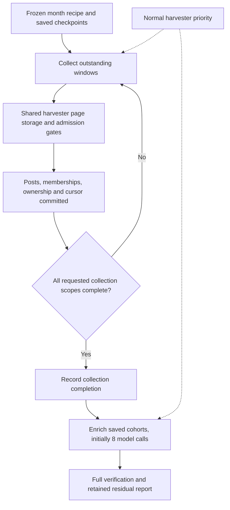

# Collect historical X posts before measured enrichment - Plan

## Plain-English Summary

Collect the remaining July posts as soon as possible, then translate, classify and extract their structured details at a measured pace. Today the runner stops after each six-hour window to enrich it before searching the next window. Separating those phases removes enrichment from the time-sensitive retrieval path. Saved posts remain in the production database, with their existing historical ownership and honest pending-enrichment status.

The first July window took 70m47s: 38m16s collecting, including waiting for normal harvesting; 30m21s base enrichment; about 2m10s targeted extraction and transition. Repeating that one sample across 124 windows gives about 146 hours for the current sequence versus 79 hours to finish collection first. These are rough full-month comparisons, not a fresh remaining-time forecast or a promised speedup. Collection attempts themselves occupied 18m44s; the rest of collection wall time included live-priority waits and orchestration. We will measure those separately.

The staging tests proved 20 simultaneous HTTP requests, identical saved data and live-harvester priority. With controlled eight-second responses, the same workload took 434 seconds serially and 141 seconds in parallel. An earlier low-latency fixture was slower in parallel (490 versus 477 seconds), so neither result establishes production throughput. Collection concurrency stays opt-in, defaulting to one; HTTP pooling and setup caches remain unapplied. Keep five-minute searches, all eight routes and complete pagination: widening windows could lose posts. Collection-first ordering works independently of those optimizations. Normal harvesting always has priority.

The owner selected LFG implementation and isolated testing, then deliberately stopped July again for G2 schema deletion. July must remain stopped under that latest instruction. This change adds an opt-in collection mode with up to 20 simultaneous HTTP fetches, followed by the existing serial ingestion path. It uses a temporary fixture database on the existing Render staging PostgreSQL server. The current delivery endpoint is reviewed code, hosted regression evidence and an open pull request; production promotion and replacement of July (U6) remain a later activation step. No new tables, services, schedules or persistent disks are needed.

## Goal Capsule

**CI repair — October 22:** PR69 at02788417 exposed the existing migration0132 table-inventory omission in both homepage and staff suites. The exact `test_migration_graph_tables_are_exhaustively_classified` failed locally without any DB connection; the feature commit changes none of its model, migration or policy inputs. Extend the clean `config/staging_refresh.yaml` policy to copy the fourteen existing job-vocabulary/assignment tables, include their thirteen numeric-ID sequences, and validate retained row counts. Keep pre-0132 sources optional using the existing compatibility policy. Update the matching grant runbook and pinned optional-table test; no assertion weakened. These three clean files are added to the bounded CI-repair scope. No new/retired tables, migrations, source grants, refresh operation, deployment or July restart. G2 ownership and five peer files remain preserved.

**Review complete — October 22, 18:08 JST:** Final simplify and eleven sequential parent review lenses found no remaining actionable findings. The project tool map requires those lenses in the parent; they are not independent reviews. External corroboration is unavailable: the first provider returned insufficient balance, and the replacement Grok review timed out without usable output. Both review jobs are terminal and their private job directories were removed. The full report is under `/tmp/compound-engineering-501/ce-code-review/2026-10-22-174905-99d461aa/review.json`. Browser coverage is not applicable: the twenty owned paths change no browser route or rendered UI. Durable reasoning is already in the plan, regression tests and operating guide, so no duplicate solution document is added. No review-fix commit is needed. Commit, PR and CI are the remaining delivery steps; July remains stopped and U6 excluded. The earlier unexplained provider-worker priority-test intermittence remains disclosed despite its subsequent standalone and twenty repeated passes.

**All 20 concurrent requests verified — October 22, 17:45 JST:** `collectfirst-twenty-v1` finished successfully at 17:44:16 JST: all four required PostgreSQL tests passed, zero skips/errors. The parallel sample reached exactly 20 active HTTP requests, sustained for 10.336 seconds cumulatively. Both samples stored the same 800 Posts from 40 requests, with identical Post, brand, checkpoint and request hashes. Serial took 433.727 seconds; parallel took 140.952 seconds (3.077× faster / 67.5% less elapsed time in this eight-second-response fixture). Process CPU was 27.277 versus 31.050 seconds; sampled process memory peaks were 196,612 versus 206,232 KiB, container peaks 277,991,424 versus 287,752,192 bytes. Resource totals include the controlled HTTP server; DB connections were sampled at attempt boundaries, not continuously. The separate live-writer test acquired its lock in 0.016 seconds with 20 HTTP calls outstanding, prevented historical Post writes during live ownership, then replayed all 20 archives without refetching and completed 40 Posts/40 requests. All 18 source hashes verified on staging 851abb1f/0134; owned DB removed, public schema unchanged, no provider calls or production writes. Receipt: `collectfirst-twenty-result.json`. Keep the earlier low-latency negative result; this profile proves 20-way operation and potential latency savings, not production throughput or provider capacity. Final simplify, review and PR/CI follow. July remains stopped; U6 excluded.

**Final-assessment receipt regression — October 22, 17:41 JST:** The final month assessment discarded the nested attempt's phase usage. A two-case public-orchestration regression exposed `KeyError: phase_usage` only with `evaluate_at_end=True`. Merge the compact attempt receipt before the final assessment so usage survives and the final assessment status still wins. All 25 pure month tests pass, with Ruff clean. This reporting-only change postdates the current hosted timing snapshot; it changes no fetch, ingestion, locking or timed-workload call path. The hosted test remains pending and is not repeated for this summary-only change.

**Owner expands the concurrency acceptance test — October22,17:21JST:** “u need to test all20concurrently!” The earlier200ms fixture only reached2active HTTP requests and is not20-way load evidence. Add one bounded same-workload serial/parallel pair:40scopes,20records/page,8second controlled response latency in both modes, with parallel acceptance requiring exactly20observed active HTTP calls. Retain full Post/brand/checkpoint/request parity, capture process/container memory and CPU plus clearly labeled DB connection samples, and run an additional real PostgreSQL live-writer arrival case while20HTTP requests are outstanding. No real TwitterAPI/LLM calls, production writes, schedule changes or July restart. Stop after this pair and overlap check; fix actual failures before claiming acceptance, never silently increase delays or discard a failed result. This explicitly adds a different load profile to the completed four-sample measurement; it does not retroactively change those results. Final review/PR follows this owner-required proof. Hosted job `collectfirst-twenty-v1` (`job-dbcsii29lscs73evt330`) launched17:28:56JST on851abb1f with18hash-verified sources. It selects four tests: the existing20-way exact-count test, the new20-outstanding live-priority/replay test, and one serial/parallel8second-latency pair. The parallel sample requires at least0.5seconds with20HTTP requests active, not only a momentary peak. Test results remain pending.

**July stopped for G2 — October 22, 17:09 JST:** Owner explicitly requested “stop july backfill, as requested by g2.” Exact native job `job-dbcql9ivcj2c73fhus90` was canceled at17:07:28JST; subsequent production read confirms its controller advisory lock is absent. Seven collection windows and2,277distinct saved Posts remain, with no active CollectionRun pointers. Two model replies completed during shutdown;1sent/1prior ambiguous outcome remain preserved for reconciliation before any restart. No leases, request history, budgets, instructions or cursors were cleared. Scheduled harvest remains `not_suspended`. G2 has a written runtime-clearance acknowledgment in the shared index. Do not restart old67d97278; the prior restart grant is superseded by this stop. The separately authorized refactor build/review continues, with U6 production activation excluded.


- **Latest owner exception — October 22, 14:52 JST:** owner asks “can u ping g2 and see if u can restart july backfill using new db schema.” Communication with G2 is authorized for restart coordination. Direct messaging failed because its local transport is unavailable; a question is posted in the shared index, not acknowledged. G2's14:30 written clearance and independent production checks establish67d97278/0131 compatibility. Resume the existing saved July campaign on that deployed compatible image after a narrow launcher lease-recovery regression and read-only production preflight pass. This operational restart preserves the original recipe, budgets, deadline, keys, serial collection and saved enrichment settings. It does not deploy or activate the unreviewed collection-first/20-fetch feature, change schema, pause scheduled harvest or authorize any G2 action. Existing expired leases must be reclaimed by `claim_job`, never manually cleared; unknown paid outcomes remain retained. The feature's PR endpoint and U6 exclusion remain in force. This exception supersedes stale communication/no-replacement wording below only for this bounded restart.
- **Latest execution boundary (October 22):** build and test the collection-first acceleration in the existing isolated worktree independently of the schema-compatible July restart and scheduled harvester. The owner also asks to evaluate 20 simultaneous HTTP fetches; four was an initial suggestion, not a provider limit. Concurrent fetches must use a separate bounded request-start rate and preserve a single protected storage path; never run concurrent CycleRunner instances with mutable global settings. This request does not activate U6 or authorize replacing the running July process during development.
- **Test database selection (October 22, 13:30 JST):** the owner confirms G2 is replacing local `127.0.0.1:55436/test_pw_g3_timing_20261019`. Keep that instance excluded, but do not wait for it. Read-only Render inspection confirms staging service `srv-d9vb8t49v7es738lf2ng` uses PostgreSQL host `dpg-d9vb8ds9v7es738lepsg-a`, database `pushinweight_staging`; production harvest uses distinct host `dpg-d9koekqjobas73fvjqng-a`. Use an owned temporary database named `test_backfill_collectfirst_<unique suffix>` on the existing staging PostgreSQL server, following the previously proven hosted test harness. Create schema from migrations and seed test fixtures, not a production data clone. Recheck server/database/role identity and staging activity immediately before launch; make test writes only in the owned database and remove only that database with its ownership marker verified. The shared-local-database reuse rule does not prohibit this hosted pattern. No shared staging service redeployment, local database operation or production job change is required. The later restart request permits G2 coordination; no test-database clarification remains pending.
- **Current request:** October22 LFG implementation of collection first, bounded parallel fetching and measured later enrichment, tested independently of G2's local database replacement and production harvesting.
- **Goal:** retrieve every remaining frozen July scope before waiting for ordinary post enrichment, without weakening harvester priority, collection scope, durable progress or spending controls.
- **Output:** implemented opt-in path, PostgreSQL regression and performance evidence from hosted fixture testing, reviewed pull request and updated authoritative handoff. No paid provider probe or production activation in this build/test run; the separately owner-authorized July stop is recorded below.
- **Execution endpoint:** U1–U5 and U7 through hosted verification and reviewed pull request. U6 documents the later activation procedure and is excluded from this isolated build/test endpoint. Full-month completion and later enrichment remain operational follow-through.
- **Navigation:** the Product Contract, Planning Contract, U1–U7, Verification Contract and Definition of Done below govern this change. Older per-window ordering remains the legacy default; collection-first and parallel fetching are explicit execution options.
- **Runtime boundary:** old24d81169 native job `job-dbcm1bgm7kps73c6c98g` is canceled and must not restart after0131. The bounded serial restart targets deployed `67d97278f9761cf7a1d99a584f812f5ff542df00`, original recipe and checkpoints. Never launch a duplicate controller. G2 communication is permitted only for restart/schema coordination. Protect unrelated dirty files and other sessions.

### Implementation checkpoint — October 22, 14:44 JST

U1–U3/U7 implementation is present but not yet committed or accepted. The canonical worktree is now based on `16aeb1a06209fba0920dcb06791f16d5f0d7c5c0`; all 22 preexisting dirty/untracked file contents were preserved during that fast-forward. Candidate fixture jobs use staging image `67d97278f9761cf7a1d99a584f812f5ff542df00`, including G2's locale-column deletion migration, plus hash-verified overlays of owned files. No G2 schema code was added to this feature branch. Dedicated hosted scratch databases are removed after each run.

- Local parser/transport/month checks: 122 passed. Strict slow-header/body total-deadline tests failed before the opt-in HTTP transport repair and pass afterward. HTTP workers use the existing client's parser/status mapping and explicit on-demand key; ordinary serial transport remains unchanged.
- Hosted v1/v2 exposed and drove fixes for the text `request_config` contract and `success_count <= selected_count` when replaying an archived response into a legacy continuation. Immutable captures remain on their original requests/runs. Additional failpoints protect exactly-once capture accounting, unknown outcomes and failures observed during the rate wait.
- Hosted v3 on the deletion schema: 25 passed, one new zero-result fixture failed because it omitted the required completion timestamp. The fixture has been corrected without changing the database guard. Actual 20-way HTTP, cross-run replay with and without the new flag, live-writer priority during HTTP, byte/request caps, 401/429/503 behavior and normal/backfill stored-data parity passed. The public staging schema stayed unchanged; the owned database was removed. This is partial verification, not suite acceptance.
- Hosted v4 ended with 14 passes and one new rare-page test assertion failure: the final scope envelope was the separate rare publication receipt, not a fetched page. The assertion now selects the captured page by its request reference and also checks the scope total. V5 (`job-dbcq1i8m7kps73cibneg`) is running all 461 selected checks without fail-fast; the corrected rare case and both normal/backfill data-parity cases have passed. Shared public schema remained unchanged and the v4 scratch database was removed.
- A focused current-source job (`job-dbcq4pss728c73fsms0g`, `collectfirst-focus-v1`) covers the newly added real PostgreSQL controller exclusion, interrupted expired-run recovery, public collection-command summary recovery, and legacy rare/wait behavior. It uses another owned scratch database, not the v5 database. Neither job measures throughput. The fixed 576-scope workload (two serial/two parallel samples) remains prepared and unlaunched until correctness jobs finish, so concurrent verification cannot distort its timings.
- Mid-implementation `ce-simplify-code` reviews used three gpt-6.1-sol medium agents. Applied one efficiency finding: exclude consumed request IDs before loading archives. Deferred two minor hash/cleanup reuse suggestions and one validation-consolidation suggestion to avoid changing legacy hash serialization, cleanup ordering or command error contracts during this correctness pass. No safety checks were removed. Final code review is still pending.
- Phase receipts now separate cumulative `phase_usage.collection_gate` from `phase_usage.post_enrichment`, retain unknown outcomes/missing usage explicitly, and preserve existing `usage` output. The added local regression was observed red before each correction and green afterward. This latest receipt adjustment postdates the v4 snapshot and needs the focused final verification.
- The month result now retains `phase_usage` and its cumulative scope; its two-day public-orchestration regression was observed red then green (24 pure month tests passed). Local `tests/ollija` passed all 36 tests. A combined local campaign/month run had 62 passes but two deliberately deselected required PostgreSQL tests and therefore remains incomplete as a suite; the hosted jobs own those checks.
- Existing pending-rare legacy coverage exposed a compatibility conflict in code inspection: composing the old command through new strict collection verification would remove its established enrichment deferral. The shared private collection/enrichment helpers now retain that legacy behavior only for `execute_window`; explicit phases keep strict collection acceptance. The existing test is parameterized for both paths. This correction postdates v5 and needs focused hosted proof; no deployed behavior changed.
- Repository-wide Ruff found 1,901 findings across 403 files; scoped new collector/tests and campaign lint is clean. Do not claim a clean project-wide lint result or sweep unrelated files into this change. No standalone typecheck is configured in `pyproject.toml`.

Private receipts include each source-hash map, launch/status/log files, the stop record, and local lint evidence. U4 pooling/cache changes were left unapplied after the bounded comparison described below. Final receipt verification, review, commit/PR and CI remain outstanding. Production activation/replacement remains excluded.

### Latest separate feature test checkpoint

**Current verification — October 22, 17:15 JST:** Tail v1 passed236 tests; combined scoped evidence covers468 candidate cases, excluding peer accounting edits. This is not a single green full-suite run. The original worker-priority failure remains unexplained despite a standalone pass and20 diagnostic repetitions. Its diagnostic wrapper encountered independent G2 migration drift; pytest passed and its owned DB was removed.

The bounded fixed workload (`collectfirst-workload-v1`, `job-dbcrkoivcj2c73fl29hg`) finished successfully at17:02:41JST on staging851abb1f/0134:7tests passed,0required skips/errors,18source hashes verified, owned DB removed and public schema unchanged. Each of four samples produced624Posts,576scopes and672requests with identical full Post/checkpoint/request hashes. Serial durations476.045/478.116s; parallel497.947/482.172s, means477.0805/490.0595s (parallel2.72percent slower). SQL statements increased74,817→about100,204; SQL execution sum about220.6→300.2s; observed HTTP overlap1→2. The separate concurrency test demonstrated20outstanding requests, but this representative200ms-response fixture did not. Do not claim a parallel speedup or production ETA. Source receipt: `collectfirst-workload-result.json`; connection samples are not peaks and RSS is lifetime highwater.

**U4 disposition:** leave HTTP pooling and planning caches unapplied. The measured SQL overhead and low HTTP overlap do not support adding speculative connection/setup changes; the bounded four-sample measurement is complete. Keep collection concurrency opt-in/default1; collection-first ordering works without it. No additional timing repetitions are required. A pure comparison against the actual saved July recipe reproduced all31daily manifests/124windows/71,424scopes with identical manifest digests and unchanged recipe SHA2f6ae1484176d8ba6ea5c0f8726bb571c984aef0454eba05509f68dca397aa5d (`collectfirst-production-recipe-parity.json`).

A final receipt audit found that post-enrichment totals lacked an explicit count of sent calls whose reported cost is missing. The underlying paid ledger already preserves them. The real-PostgreSQL regression failed with the expected missing `requests_ambiguous` key in `collectfirst-cost-receipt-red-v1` (`job-dbcsac2fngtc73as11q0`). The summary now includes ambiguous-call and missing-reported-cost counts without changing stored call rows. `collectfirst-cost-receipt-green-v1` (`job-dbcscrivcj2c73fncn40`) passed all66campaign/month tests,0required skips/errors;18source hashes verified, ownedDBremoved, publicschemaunchanged. This is a reporting-only delta after the earlier workload. Final simplify/review, commit/PR and CI remain pending. July is stopped by the newer owner instruction above; no feature deployment, provider test calls or production test writes.

**Verification update — October 22, 16:15 JST:** Full v5 reached its 90-minute harness limit and finished non-green; the owned fixture database was removed. Complete bounded log retrieval recovered 246 individual passes and four failures, not a completed suite. Three failures have subsequent focused proof: legacy versus explicit rare-phase behavior, the minimal wait fixture's missing concurrency, and the rare verifier fixture's unselected route receipts. The remaining existing `test_provider_worker_thread_honors_owner_live_priority` failure has no traceback because the process ended before pytest's final summary. Focused job `collectfirst-priority-v1` (`job-dbcrdgvavr4c738ilku0`) is reproducing it without weakening the assertion. Tail job `collectfirst-tail-v1` (`job-dbcralrncjis73dd6u1g`) runs the remaining 236 selected cases, including current-schema targeted extraction and latest legacy receipt preservation.

Both new jobs use staging image `e71328ce5380099c486e0071094d73be5923632f` plus 17 hash-verified owned overlays. G2 deployed that image with migrations0132/0133 during v5; v5's shared-schema fingerprint therefore changed177→179 migrations. This was a separate G2 deployment, and the old run cannot be called unchanged-schema acceptance. No owned overlay base file changed between67d97278 ande71328ce. The feature branch stays on67d97278; no unrelated G2 staging candidate is merged. G2's shared index explicitly preserves isolated fixture databases and confirms compatibility bridges for the active July67d97278 reader; later physical deletion requires a coordinated rollover or terminal job.

The four-sample fixed workload remains unlaunched until these correctness jobs finish. Its instrumentation now records HTTP time, SQL execution time/count, active-attempt time, connection samples and memory alongside identical request/checkpoint/Post hashes; these are planned measurements, not results. U4 pooling/setup optimization remains unadopted. Final review, commit/PR and CI remain outstanding. Native July job is running independently; at16:13JST its latest receipt reports a drained576-scope/847-request window with230 saved memberships, followed by enrichment. No feature deployment, scheduler change, paid test calls or production test writes occurred.

**Progress verified — October22,15:53JST:** The deployed serial July controller has made new writes. Read-only production inspection shows July2 window1 complete and window2 (06:00–12:00JST) running,1,795distinct saved campaign Posts,0sent/1retained ambiguous model outcome. The old interrupted run is now correctly aborted as expired_lease, retaining its43requests; recovery used the existing fenced path. Evidence: `july-schema-restart-latest.json/.stdout`. The refactor remains separate: terminal rare verification passed focusv3 (1required PostgreSQL case), its owned database was dropped and shared schema unchanged. Full v5 continues; workload timing is still unlaunched. Local feature base was fast-forwarded to67d97278 with all24dirty-file hashes preserved, matching the staging image already used for tests. No deployment or production settings changed.

**Separate feature testing — 2026-10-22 15:41 JST:** Focus v2 finished with3passes/1failure. The failure was a test fixture marking unselected routes complete without terminal receipts; the rare verifier case now selects only RARE_EXTRA, leaving strict production verification intact. Focus v3 (`job-dbcqu81srm7s73bnq31g`) is running that corrected case. The real wait/deadline and zero-byte admission checks passed v2. Full v5 (`job-dbcq1i8m7kps73cibneg`) remains running, last observed about40percent; do not call it passed. A further compatibility regression exposed removal of the legacy per-window aggregate receipt; the wrapper now preserves it, with the existing parameterized test observed red then2passed locally (no DB). That source change postdates hosted v5/v3 and will also run in the workload job. The fixed576-scope/672-request serial-versus-parallel comparison is prepared, not launched; wait for correctness jobs to finish before timing. U5 acceptance, final review/PR and CI are outstanding. July native job remains running on67d97278/0131; this feature is not deployed.

### Earlier feature test checkpoint — October22,15:21JST

**Separate feature testing —15:21JST:** `collectfirst-focus-v2` (job-dbcqmf8473hc739u5vpg) is now launched with17owned source overlays and4targeted cases: corrected wait fixture, zero response-byte admission, and terminal-rare verifier diagnosis. Full v5 (`job-dbcq1i8m7kps73cibneg`) remains in progress. Both use owned staging fixture databases and no external provider calls. July native job remains running and yielding to live priority; harvest service rechecked `not_suspended`. No full feature acceptance/PR or parallel activation is claimed.

### July restart observed — October22,15:19JST

Owner followed up “so why dont we restart july” and asked whether it writes the new schema. Staging v3 finished successfully:11passed,24source hashes verified, temporary database dropped and shared schema unchanged. Production preflight passed. Native replacement `job-dbcql9ivcj2c73fhus90` launched once at15:18:14JST on67d97278, verified by `MONTH_START`. July1's1375saved memberships/final assessment were reused; July2 window1 reached `BACKFILL_WAITING_FOR_LIVE_WRITER`. First read-only observation retained1,754distinct Posts,0sent/1ambiguous outcomes and the untouched expired old run pending admission. Scheduled harvest remained enabled. Original recipe/deadline/budgets and serial collection/saved32-model preference remain intact. No feature deployment or new collection-first activation occurred. Native launch receipt and `observe_schema_restart.py` are in the existing private operations directory. This supersedes the no-replacement-yet statements in older checkpoints below.

### Schema-compatible restart checkpoint — October 22, 15:12 JST

The private `month_operator.py` now allows only this campaign's expired running leases through to the deployed `claim_job` recovery; foreign runs, unexpired leases and invalid active pointers remain blocking. No cursor/run/paid history is manually cleared. Original operator source is retained as `month_operator_before_schema_resume.py`; all source and launch receipts live in the existing July operations directory. Operator SHA256 is `7662be5627404df3ff367fac9618fb050f41a55894a3aab4180fc88ad167a37f`.

Production read-only preflight `job-dbcqb8om7kps73cj9ifg` passed on67d97278, with24runtime hashes verified,5existing jobs,124windows/71,424scopes, original recipe and deadline, zero writes/provider calls. Rechecked before restart: no month-controller lock,1,754saved Posts, old lease expired,0sent/1ambiguous model outcomes,0131present and oldAccountbio columns absent. No acquisition replacement launched yet.

Staging v1 failed because the new fixture replaced required checkpoint provenance; corrected fixture retains it and asserts a page committed before interruption. V2 proved active-lease rejection, old-launcher failure, current read-only preflight, exact-cursor recovery and two preserved Posts, then failed its final assertion against the wrong table: this legacy serial path accounts on `CollectionRun`, not `CollectionRequest`. The assertion now sums the real run request counters. V3 `job-dbcqhojrjlhs73eccktg` is running the corrected case plus10pure contracts. V1/v2 each removed their owned database and left the public schema unchanged. Do not label them passed.

Separately, collection-first v5 is still running and has exposed a further terminal-rare verification failure that awaits its detailed traceback. Focus-v1 passed7cases and failed the minimal wait fixture's omitted `direct_concurrency`; that fixture now declares the production32value. A newly found zero-byte-per-response admission edge is guarded before reserving a physical start; its PostgreSQL regression is pending. `collectfirst-focus-v2` is prepared with those4cases and17source overlays, unlaunched while restart validation uses the second hosted test slot. These feature changes are excluded from the serial production restart.

### Owner exception — July stopped, October 22 at 14:12 JST

The owner relayed G2's confirmation that the running 24d July process reads `accounts.bio_en` and `bio_zh_cn`, then explicitly instructed “let's stop it deliberately.” This overrides the earlier preserve-running-process boundary only for native job `job-dbcm1bgm7kps73c6c98g`. Cancellation was accepted at 14:12:13 JST; its shutdown grace period ended after the last observed activity at 14:12:43 JST. Render reports `canceled`, and the month controller's PostgreSQL advisory lock is absent. The scheduled harvest service remains enabled. No database records or leases were deleted, no replacement was launched, and no G2 message was sent.

The four July 1 collection windows are complete; July 2 window 1 is partial. Post-stop evidence records 1,754 distinct Posts, zero outstanding `sent` enrichment calls, and one preexisting ambiguous call. The interrupted run `eac3d78c-8c26-48d3-a50f-369dbbf10577` retains its lease until 14:18:00 JST and must recover through the existing fenced path. Do not restart the old image after schema deletion. Retain final-request uncertainty and paid history. Private receipts are `july-owner-stop-20261022.json`, `july-owner-stop-before.stdout`, and `july-owner-stop-verification.{sql,stdout}` in the existing July operations directory. This stop removes this specific old-runtime dependency; it does not authorize schema deletion, a replacement launch, or production deployment of this change. Continue the isolated build/test/review endpoint.

## Product Contract

### Requirements

| ID | Required behavior |
|---|---|
| R1 | Collection-first mode processes all outstanding windows in the requested range before ordinary translation, classification and targeted extraction. Collection relevance/rare admission checks stay inline where needed to preserve ingestion semantics. |
| R2 | Resume the original July recipe, window identities, stored cursors and paid history. Preserve 21 brands, routes A/B1/B2/B3/C1/C2/C3/RARE_EXTRA, five-minute scope boundaries and every provider continuation. Do not infer exhaustion from an underfilled page. |
| R3 | Live harvesting keeps its existing writer priority and queue isolation. Historical pending work must be owned at ingestion so scheduled enrichment cannot claim the accumulated month. No cron pause or live cursor update. Parallelism is confined to bounded HTTP fetching; shared CycleRunner and Post writes remain serial. |
| R4 | Collection and enrichment have separate durable progress and acceptance results. Collection completion is not enrichment completion or evidence of exhaustive historical X coverage. Collection integrity failures stop acquisition; known enrichment-only residuals retain the owner's existing deferral policy. |
| R5 | Enrichment can resume from saved database memberships without an X request or recollection. Use ordinary DeepInfra/JEV paths and the existing retry/paid-response ledger. Start the new measured mode with eight simultaneous direct model calls, adjustable downward or up to the original saved ceiling of 32. No artificial sleep while useful, admitted work can proceed. |
| R6 | Preserve the dedicated on-demand credentials, original financial/request caps and fixed deadline. Execution preferences stay within their validated collection/enrichment ceilings and cannot rewrite frozen collection instructions, enlarge spend or renew deadlines. Unknown paid model outcomes are never silently re-sent. |
| R7 | Reduce avoidable acquisition overhead only with identical query/page/checkpoint behavior and measured evidence. Report provider time, live wait, setup, storage and collection-gate work separately. Do not promise unmeasured gains. |
| R8 | Retain the existing harvester storage/enrichment implementations and shared collection records. Stage before production; prove priority, restart, ownership, timezone persistence and data equivalence. No schema, chart-reader or scheduler changes. |
| R9 | Opt-in collection concurrency1–20 preserves every scope/cursor and bounds simultaneous requests, request-start rate and retained response bytes independently. Persist received pages before yielding; restart can replay them without another paid search. Existing commands default to serial collection. |

### Settled decisions and exclusions

- **D1 — collect first:** session-settled: user-approved. Governs R1, R4, R5. The owner explicitly agreed to collecting first and enriching afterward. Do not reopen interleaved per-window enrichment as the default for this month.
- **D2 — protect harvester:** session-settled: user-directed. Governs R3, R8. No relaxation of the live-writer lock, pause of scheduled work, or speculative overlap with normal enrichment. Stage the change before production.
- **D3 — preserve recall and accounting:** session-settled: user-directed. Governs R2, R6, R8. Keep A and rare routes, five-minute searches, shared harvester code, on-demand keys and CollectionRun records. Historical X keyword filtering remains a documented completeness limitation.
- **Excluded:** wider windows, unsupported page-size parameters, replacing providers, direct-X API experiments, batch inference, new worker infrastructure, a new generic scheduling framework, June collection and rewriting historical schemas. Concurrent CycleRunner instances and production activation are excluded. The later owner-authorized July stop and verified schema-compatible serial restart are the bounded operational exceptions. HTTP prefetch is included under R9.

### Acceptance examples

- **AE1:** a month has two incomplete windows and one fully collected window with 30 deferred enrichments. Collection-first skips the collected window and completes both outstanding query sets before starting any ordinary enrichment. Its 30 deferred posts do not trigger X searches.
- **AE2:** a normal harvest queues between two historical pages. The collector yields before the next physical request, checkpoints the completed page, and resumes the next cursor after live work. Repeated live waits create no empty attempts or scope clones.
- **AE3:** a process dies after a page commit but before the phase summary. A restart derives completion from durable scope/membership state, repairs its summary and does not request the committed page again. An uncommitted interrupted search remains accounted and can replay only under the existing bounded cursor recovery rules.
- **AE4:** enrichment is restarted at concurrency eight after a previous 32-call configuration. Completed responses are reused, sent/unknown outcomes are retained for reconciliation, reservations and spending totals survive, and the next newly admitted wave contains at most eight calls.
- **AE5:** a collection page is valid and empty with `has_next_page=false`. The scope can finish with zero results; the report explicitly records zero and retains volume anomalies for aggregate review. A transport error, incomplete cursor chain or missing stored observation cannot masquerade as an empty completed scope.

## Planning Contract

### Evidence and current behavior

| Evidence | Consequence for implementation |
|---|---|
| `scripts/backfill_campaign.py::execute_window` calls collection, `prepare_current_contract`, base enrichment and targeted extraction in sequence; `run` then advances to the next window. | Split orchestration at existing boundaries; do not build another ingestion or classifier pipeline. |
| The private July `month_operator.py::advance_days` runs complete daily campaigns before advancing and reuses only saved whole-campaign assessments. | A month-wide two-pass driver is required. Changing ordering within one day would still delay later days. |
| `monitor/backfill_collection.py::execute_job` already sets `BackfillContext.enrichment_limit=0`; it still drains the historical rare gate. | Most phase separation belongs in the campaign/month driver. Collection does not mean zero model calls. |
| `CycleRunner.run` rebuilds call planning, brand index, search terms and a TwitterAPI client for each single-page invocation; `TwitterApiClient._get` uses standalone `requests.get`. | Reuse connection transport and immutable, scoped setup within a bounded attempt; profile before adding other caches. |
| PageCheckpoint commits Post storage, CollectionObservation membership and cursor state together. Historical ownership is assigned through `core/provider_batches.py`; scheduled enrichment filters out `source_collection_job` records. | Keep that transaction and ownership boundary intact even when enrichment is delayed by days. |
| The running old controller automatically readies a paused collection job. `backfill --enrichment-control pause` has explicit cancellation safety reporting. | Merely setting a collection job to paused is not a safe old-controller stop. Use the verified native-job replacement procedure in U6. |
| The direct inference wave records reservations/sent markers before HTTP and marks interrupted sent work ambiguous. | Reuse its controls and receipts. Lower concurrency without discarding or duplicating paid work. |

Timing evidence lives in the private July operations directory referenced by the [authoritative handoff](../../../../../docs/brainstorms/2026-10-17-084351-backfill-handoff.md): `july-rate-window-timing.json`, `collection-first-window-timing.stdout`, `july-rate-estimate.json`. Window 1: 576 complete scopes, 907 physical X requests, 463 distinct memberships; the first 446 were independently audited as new valid inserts. Do not relabel all memberships as newly inserted without checking. This sample includes bootstrap and live waits and cannot establish the distribution of later-day workload.

The frozen month has 124 six-hour windows and **71,424 first-page query scopes**. At the same queries and cadence, these starts cannot simply be removed; extra pagination depends on actual results. Its original recipe SHA256 is `2f6ae1484176d8ba6ea5c0f8726bb571c984aef0454eba05509f68dca397aa5d`. Each six-hour window retains 1,250 physical X starts, 12,500 collection-gate model starts, 12,500 post-enrichment model starts and USD6.25 model reservation ceilings. Attempts retain 200 requests / 300 seconds / 32 MiB / 100,000 items. Deadline remains **November 5, 2026, 05:59:34 JST**. Ceilings are not estimates of actual spending.

Official evidence checked October 22: [Requests sessions](https://requests.readthedocs.io/en/latest/user/advanced/#session-objects) pool connections and close via a context manager; this supports a mechanism, not a promised speedup. [Render one-off jobs](https://render.com/docs/one-off-jobs) keep their original build/environment snapshot, are separate processes, have a 30-day lifetime and cannot access a base service's persistent disk. Deploying the new code alone does not update the running July job.

### Key technical decisions

- **KTD1 — two passes over the same frozen range.** Governs R1, R2, R4. Extract `collect_window` and `enrich_window` from `execute_window`; retain the old function as their compatibility composition. Add a small repository-owned month driver by moving the already tested compact-recipe/day expansion logic into `scripts/backfill_month.py`, without another scheduler. `--phase collect|enrich|all` is an execution option; month `all` means collect the entire range, then enrich it. Existing invocations without a phase retain their current behavior. Explicit campaign `all` means two passes over that campaign. A single existing month-controller advisory lock covers each command; collectors and enrichers do not overlap in this first version.
- **KTD2 — separate receipts, same persistence.** Governs R2, R4, R8. Reuse CollectionJob, CollectionRun, CollectionScopeRun, CollectionObservation, PostEnrichmentState and existing provider-call records. Zero new/retired tables; zero migrations. `CollectionJob.state=completed` keeps its collection meaning. Extend the existing `CollectionRun.report.backfill_campaign` namespace with versioned `collection` and `enrichment` phase summaries, preserving legacy `latest/history` compatibility. Merge under the existing row lock. Receipts include phase, original recipe/manifest hashes, runtime, effective concurrency, scope/ID counts, start/end, requests/tokens/costs and deferrals. Scope rows and memberships, not a JSON success flag, determine resumability. Do not invent a month parent job or put state only in local JSON.
- **KTD3 — immutable instructions, explicit execution preferences.** Governs R2, R5, R6, R9. Add validated phase, enrichment concurrency1–32 (at most the saved ceiling), collection concurrency1–20 and physical request-start rate options outside frozen manifest/definition hashes. Keep source/runtime attestation separate. Old manifests, job keys and definition hashes must remain byte-for-byte compatible; new orchestration modules need explicit runtime attestation without mutating the saved recipe's original source-hash list. Reject unknown option fields and unsafe combinations before writes or paid work.
- **KTD4 — staged performance changes.** Governs R3, R7, R8. First ship phase separation. Then measure and adopt attempt-scoped HTTP connection reuse and frozen setup reuse, independently switchable. Do not share a Session across purposes or threads. Retain per-page runner/context, request accounting hooks, cursor fences and live-lock acquisition. Never cache mutable ownership, paid balances, leases, author metadata or database presence. Global Django settings currently carry page bounds, so adding threads around CycleRunner would be unsafe and is excluded.
- **KTD5 — measured enrichment is bounded work, not sleeping.** Governs R3–R6. New mode begins with eight HTTP calls per wave, one enrichment controller and bounded Post pages. Keep existing normal-harvest admission/ownership protections. No blanket delay or assumed DeepInfra capacity shortage. Measure memory, database time and live priority; tune within the saved ceiling only after those observations. Forecast remaining work against the original deadline and report pressure early; expiry retains the backlog and stops paid starts rather than silently extending authority.
- **KTD6 — truthful completion and failures.** Governs R4, R6, R8. Factor the ingestion checks out of `backfill_verify` for collection acceptance; retain the full verifier after enrichment. Every frozen query must be exhausted, and retained results/exclusions, memberships, text/source/time fields and admission gates must reconcile. Enrichment-only residuals do not fail collection. A zero-result scope/window is explicit and valid only with complete query receipts; volume confidence stays separate. Unknown errors, invalid scope/runtime/DB identity, request caps, auth failures and deadline exhaustion stop collection under existing safety rules. Enrichment admission failures stop that phase, preserving collection success.
- **KTD7 — bounded parallel transport with durable replay.** Governs R2, R3, R6–R9. A controller admits one page for each of up to20 independent query scopes; never parallelize dependent cursors or CycleRunner. Acquire the existing live-priority lock for each request admission, reserve its physical start durably and release the lock immediately after dispatch. Never hold the Post writer lock while waiting for a parallel HTTP response. Bound workers, transport timeouts, response bytes and remaining allowance independently; use a separately configurable start rate, initially10starts/second. Stop admitting on queued live work or provider failure, then archive already-started responses without Post writes. Replay captured pages serially through existing normalization/admission/Post/cursor transactions, acquiring the normal priority lock per page. Use existing CollectionRequest/CollectionEvidenceArchive storage and scope-envelope references; zero schema changes. A restart recognizes committed pages, retains unknown outcomes, and consumes archived uncommitted responses without a second search. Associate raw counts and provenance with the exact page, never the budget's last response. Legacy continuation creates a new run: keep each physical request on its original run and validate same-job/scope/cursor ancestry before replay. Migration0100 prohibits cross-run request-input edges: retain the original request reference in the carried scope receipt and replay metadata; direct CollectionObservationInput request links remain same-run only. Do not weaken that database guard, fabricate a second physical receipt, or add a schema migration. Tests must show live can acquire its writer while prefetched HTTP requests are still outstanding, and no new admission occurs while live owns priority.

### High-level technical design



## Implementation Units

### U1. Separate phase entry points and collection verification

**Goal:** make acquisition independently executable and verifiable. **Requirements:** R1, R2, R4, R8; AE1, AE3, AE5. **Dependencies:** none. **Decisions:** KTD1, KTD2, KTD6.

**Files:** modify `scripts/backfill_campaign.py`, `scripts/backfill_verify.py`, `tests/test_backfill_campaign.py`, `tests/test_backfill_verify.py`.

**Approach:**
1. Extract common identity/job registration and collection loop into `collect_window`; extract contract preparation, enrichment and targeted loops into `enrich_window`. Keep legacy `execute_window` as composition with equivalent defaults.
2. Factor shared ingestion checks out of the full verifier. Collection acceptance runs on durable membership/scope facts with bounded ID pages; it does not invoke inference or require current classification/translation status. Rare admission/inbox completion stays mandatory.
3. Persist independent phase summaries with locked merges; reconstruct missing summaries after a commit/crash. Preserve historical attempts, deferred evidence and final full-verifier behavior. Scope exception cleanup to the phase; a delayed enrichment failure cannot revoke successful collection.

**Test scenarios:**
- Covers AE1: mocked enrichment raises if invoked; collecting a multi-window campaign completes later windows without calling it.
- Covers AE3: page committed, phase receipt absent; resume verifies the same scopes and emits the missing receipt with zero new provider starts.
- Covers AE5: complete empty query set succeeds explicitly; nonempty envelope with missing membership, pending rare gate or broken cursor chain fails.
- A frozen-manifest mismatch or unknown collection exception stops the collection pass even with `evaluate_at_end=True`; known enrichment residuals remain deferred only in enrichment.
- Legacy `execute_window` and saved reports continue to work; phase-summary merge preserves receipts written before the other phase.

**Verification:** legacy behavior and new collection acceptance share ingestion assertions; independent collection has zero ordinary post-enrichment calls.

### U2. Implement month-wide ordering and restartable commands

**Goal:** collect the whole requested month before enrichment, including an in-progress July resume. **Requirements:** R1–R4, R6, R8; AE1–AE3. **Dependencies:** U1. **Decisions:** KTD1–KTD3, KTD6.

**Files:** create `scripts/backfill_month.py` and `tests/test_backfill_month.py`; modify `monitor/management/commands/run_backfill.py`, `scripts/backfill_campaign.py`, `tests/test_run_backfill_command.py`, `tests/test_backfill_campaign.py`. The private month launcher becomes a thin caller of repository code during delivery.

**Approach:**
1. Move the private compact recipe expansion/validation/controller logic into a bounded module; preserve exact existing daily manifests, job keys and hashes. Iterate one day at a time; do not eagerly materialize 71,424 scope objects or duplicate current checkpoint storage.
2. Add `--month-recipe` as an input alternative to `--manifest` or range/window inputs; add explicit `--phase` and `--enrichment-concurrency` execution options. Keep `--model-concurrency` as a manifest-construction option with its existing restrictions. Dry-run validates locally and never writes or calls providers.
3. Collect pass skips jobs with complete durable collection proof, even if old whole-campaign assessments failed only enrichment. Enrich pass requires collection proof for the complete requested range and never calls collection. `all` runs both passes in order using the same month exclusion lock.
4. Save per-window phase results and derive monthly progress from them. Keep fixed deadline and per-window budgets. Resume commands use the same original recipe and independently verified runtime revision. Include new runtime modules in the attested execution envelope, not by editing original saved instructions.
5. Replace the private driver's unconditional `active_run_id` rejection with lease-aware admission. A live lease still rejects duplicate execution. After the prior owned native process is confirmed terminal and its lease expires, allow `core.collection_state.claim_job(..., continue_from=...)` to reconcile the interrupted attempt and resume its saved checkpoints. Do not clear active-run fields manually or treat a stale pointer as permanent blockage. Apply this distinction before the driver's existing-state/preflight checks can reject a recoverable window.

**Test scenarios:**
- Covers AE1: across two days, all eight six-hour collections occur before the first enrichment; a four-window-only reorder must fail this test.
- Existing first-window posts/enrichment and partly collected second window resume in place; completed query chains are never re-fetched.
- Two controller processes contend for the existing PostgreSQL lock: only one admits work; waiting does not clone attempts.
- An active unexpired run rejects restart; an expired owned run left by a terminal native process reaches the existing fenced reclaim path, preserves request totals and resumes its committed cursor without manual state deletion.
- Dry-run, invalid phase, unknown preference, hash mismatch and expired deadline all produce zero provider calls and zero DB writes.
- Month `enrich` rejects an incomplete requested range; legacy CLI invocations retain their previous ordering and output.
- Re-expand all 124 July windows and compare to original daily hashes and 71,424 scope boundaries; no range gaps, overlaps or route omissions.

**Verification:** original recipe digest and jobs survive; phase ordering and restart behavior hold across days, not merely within a window.

### U3. Bound enrichment after collection

**Goal:** use saved cohorts with predictable internal resource use. **Requirements:** R3–R6, R8; AE4. **Dependencies:** U1, U2. **Decisions:** KTD3, KTD5.

**Files:** modify `scripts/backfill_campaign.py`, `monitor/management/commands/run_backfill.py`, `tests/test_backfill_campaign.py`, `tests/test_run_backfill_command.py`; extend existing direct/cached-replay/enrichment-control tests where necessary. Change `monitor/backfill_enrichment.py` or `monitor/backfill_direct.py` only if passing the already-supported concurrency argument is insufficient.

**Approach:** pass the validated effective concurrency to existing base and targeted drivers. Preserve `prepare_current_contract`, historical ownership, saved responses, reservation/import fences and original policy. Report pending, completed, deferred and unknown outcomes separately. Measure per-wave HTTP, import time and memory. Do not introduce a new queue, model API or per-request ORM worker.

**Test scenarios:**
- Covers AE4: already imported responses are replayed locally, sent/unknown calls are not re-sent, and new waves obey the lower bound without changing saved policy hashes.
- Enrichment-only execution with the X transport rigged to fail on any call completes from saved memberships without touching it.
- Historical pending Posts remain excluded from normal enrichment, including preexisting Posts reopened for the current contract and foreign in-flight claims.
- Deadline, pause, budget exhaustion, stale claim and provider failures retain bounded outstanding work and phase-local receipts.
- Existing event/opportunity extraction still resolves known timezone values through TimeZone and preserves NULL for unknown values.

**Verification:** no X starts, no duplicate paid model starts, no changed scheduled claims; effective concurrency and actual calls are visible in receipts.

### U4. Measure and reduce collection overhead

**Goal:** reduce time spent acquiring the unchanged query set. **Requirements:** R2, R3, R6–R8. **Dependencies:** U1, U2; does not block the initial U6 deployment of U1–U3. **Decisions:** KTD4.

**Files:** modify `x_monitor/apify.py`, `monitor/cycle.py`, `monitor/backfill_collection.py`; extend `tests/test_apify.py`, `tests/test_twitterapi_caller_shape.py`, `tests/test_backfill_collection.py`, `tests/test_backfill_credentials.py`. Prefer existing timing/report helpers; no new permanent benchmark service.

**Approach:**
1. Add bounded phase timings for live-lock wait, setup, provider HTTP, Post persistence and collection relevance/rare gates. Distinguish cumulative active attempt duration from wall time; avoid double-counting nested timings. Record counters per attempt/window rather than one DB write per timing event.
2. Inject an attempt-owned `requests.Session` transport through the existing client constructor. Close it on success/error/yield. Keep request-specific headers, exact params/timeouts, raw-response callbacks and physical-start accounting. Do not enable hidden adapter retries, share credentials across purposes, or retain an unbounded request log.
3. Cache only proven immutable planning inputs for that bounded attempt. Keep per-page query/cursor/author evidence, storage probes, budget reservation and live admission fresh. Invalidate setup on runtime/config identity mismatch. Avoid broad scheduled-path rewrites.
4. Compare a fixed recorded 576-scope workload, using an isolated staging database and controlled HTTP server capable of measuring connection reuse. Two repetitions before/after suffice for this bounded decision; use identical delays, responses and query sequences. Adopt only changes with identical data/checkpoints/request counts, fewer connection/setup operations and no material storage/memory regression. Report active-time medians and raw observations; a local timing result is not a production speedup guarantee. Use the next authorized production window for observation, not a duplicate paid benchmark.

**Test scenarios:**
- Identical payload/params and returned IDs across original and optimized paths, including 20/underfilled/empty pages with continuation, terminal false, duplicate IDs and bad cursors.
- Physical attempts, timeout and failure callbacks remain exact; reconnect after a server closes the connection cannot trigger an uncounted retry.
- Scheduled and on-demand instances keep their correct keys; missing on-demand key fails without fallback; logs never contain keys.
- Session cleanup on exceptions/live yield; bounded memory across hundreds of scopes; a query-bound change does not reuse another page's cursor/settings.

**Verification:** keep the phase-separation rollout independent if performance work is not proven. Record which optimization was adopted and measured; leave unsupported speed claims out of completion reports.

### U5. Prove isolation, restart safety and data parity in staging

**Goal:** enforce the strict regression net before replacement. **Requirements:** R1–R9; AE1–AE5. **Dependencies:** U1–U3 and U7; include U4 only for a candidate containing it. **Decisions:** KTD1–KTD6.

**Files:** extend `tests/test_backfill_campaign.py`, `tests/test_backfill_month.py`, `tests/test_backfill_independent_progress.py`, `tests/test_cycle_run_lock.py`, `tests/test_backfill_native_enrichment.py`, `tests/test_backfill_cached_replay.py` and applicable tests above. Add the new runtime paths and focused regressions to `.github/workflows/backfill.yml` so future changes trigger and run them; keep the long timing workload separately bounded. Preserve the existing untracked `tests/test_backfill_live_enrichment_concurrency.py` and accounting WIP; reuse only after checking ownership and diff.

**Test scenarios:**
- Covers AE2: separate PostgreSQL sessions, actual live queue arrival and collector page commits; live receives the next turn, collector issues no next paid request while live holds priority, no attempt explosion during repeated waits.
- Large historical pending cohort plus normal newly harvested Posts: real scheduled claim path sees only its eligible live work; historical enrichment and live work cannot own the same Post concurrently.
- Covers AE3/AE4: crash before/after provider response, page commit, phase-summary write, reservation/sent/import and next-window transition. Replay persisted responses; preserve unknown paid outcomes; never advance an unpersisted cursor.
- Frozen recorded X pages through normal and historical storage produce equal normalized Post/type/brand/timezone and enrichment outputs for the same eligible input cohort, except expected collection provenance. Compare sets and fields, not merely totals; do not equate keyword recall with ingestion parity.
- Expected database lock contention, stale claim, provider 401/429/5xx and allowance expiry retain clear bounded stop/wait outcomes; no broad stop/cancel of scheduled services.

**Verification:** required PostgreSQL cases run without skips; use the existing isolated hosted staging verification pattern and exact candidate SHA. No live paid staging probe or writes to public staging records are needed for this regression proof.

### U7. Fetch independent query pages concurrently and replay through shared ingestion

**Goal:** reduce provider waiting while retaining exact scope and harvester priority. **Requirements:** R2, R3, R6–R9. **Dependencies:** U1; U2 wires execution options. **Decisions:** KTD2–KTD4, KTD7.

**Files:** `monitor/backfill_collection.py`, `monitor/backfill_resources.py`, new `monitor/backfill_prefetch.py`, `monitor/cycle.py`, `x_monitor/apify.py`, relevant CLI option wiring, new `tests/test_backfill_prefetch.py` and existing collection/pipeline/request-capture tests. Reuse shared capture helpers and preserve their same-run input constraint unchanged.

**Approach:** keep the serial default intact; factor shared page normalization and inject captured pages through BackfillContext. The controller owns database accounting and durable capture; HTTP workers own bounded transport only. Capture each received body and per-request metadata before normalizing/ingesting it. Check pending captures before requesting a scope again. Store consumption with the same cursor/Post commit, not a separate success flag. Reject changed scope/cursor ancestry; on failure retain request history and archive for diagnosis. Bound bodies per page and total wave memory; use no hidden transport retry. Close every worker transport. Report physical requests, replayed pages, maximum concurrency, response bytes and timing separately.

**Test scenarios:**
- A controlled HTTP server witnesses20 simultaneous requests and identical final Post fields/brands/cursors to serial processing over the same recorded pages; compare sets, not totals.
- Underfilled/empty pages with continuation advance; terminal false stops even with a cursor; duplicate IDs and malformed/cyclic cursors retain existing rules.
- Crash after capture but before ingest, after ingest but before summary, and continuation into a new legacy run all resume without refetching a saved response or duplicating physical-request accounting.
- Twenty returned responses have distinct raw counts; each checkpoint uses its own response and links the correct evidence, including rare routes.
- A separate PostgreSQL live writer queues during fetch: no additional requests are admitted after it is observed, live acquires its writer while HTTP is outstanding, and historical Post replay waits for live to release priority.
- Request cap, attempt deadline, byte cap,429/auth/transport failure, stale claim and duplicate controller leave truthful partial progress and bounded outstanding work. No real provider traffic or scheduled credentials in tests.

**Verification:** PostgreSQL cases without required skips; fixed recorded workload, two serial and two parallel measurements, observed concurrency and equal storage/checkpoints/accounting. Fixture timing is not a production ETA. If a correctness gate fails, fix it before claiming the20-worker path complete.

### U6. Later activation: replace only the owned July process

**Goal:** put phase separation into actual use without duplicate collectors or harvester disruption. **Current scope:** deferred activation; do not execute during this isolated build/test LFG. **Requirements:** R1–R9. **Dependencies:** U1–U3 and U5; U7 and its U5 cases for a parallel candidate. U4 is optional and cannot delay phase-separation activation. **Decisions:** KTD1–KTD7.

**Files:** current plan, existing authoritative handoff/index, documented operator launch/observation receipts; source changes limited to earlier units. Preserve current native process until replacement candidate is staged and production-ready.

**Approach:**
1. Follow the existing staged exact-commit route and preserve dirty peer work. Verify staging occupancy, candidate image/source/runtime hashes and the production DB schema before promotion. Record natural live-harvest health before intervention.
2. Re-read current native-job identity and active phase. Prefer an enrichment cancellation-safe boundary: pause only its owned enrichment control, wait for `safe_to_cancel`, then cancel the exact July native job. A collection-state pause alone is insufficient because the old controller readies it. If stopping during collection is necessary, preserve pre/post request counts, last committed page and any interruption uncertainty; never assume cancellation is instantaneous or lossless.
3. Require native terminal status and release/expiry of its existing controller/run/provider leases before resuming. Use existing fenced recovery, never delete attempts or force-release another owner's lock. Reconcile any sent/unknown model outcomes before another model start. An interrupted uncommitted X page may resume from its saved cursor within the original cumulative cap; do not erase the earlier charged start. Validate this procedure in U5 before production.
4. Launch exactly one tested replacement with the original recipe, explicit `--phase all`, effective enrichment concurrency eight and new runtime attestation. This produces a month-wide collection pass before enrichment. Capture the native-job receipt and update the handoff immediately; never recreate a job because a client-side API response was merely delayed.
5. Observe the first newly completed collection window and progress into the next without ordinary enrichment, plus a natural normal-harvest cycle and persisted recent Posts. Report current acquisition/enrichment phases separately. Reforecast collection using at least two new windows with wait/active breakdowns; do not wait for the entire month to ship the improvement.

**Test scenarios:** staging rehearsal of cancellation/restart with an interrupted page and an outstanding model wave; exact-image assertion; duplicate launcher rejection; changed schema/runtime/manifest rejection; production observation queries themselves remain read-only.

**Rollback:** stop only the replacement via its supported controls; retain every committed Post/cursor/receipt. A previous image may resume only after schema/runtime compatibility and original-instruction validation; do not restart the old interleaved controller while the new controller or its leases remain active. Scheduled harvester configuration stays unchanged.

## Verification Contract

Implementation runs these checks in an owned temporary database on the existing hosted staging PostgreSQL server identified in the Goal Capsule. This target is separate from G2's local replacement and production; no wait for G2 is required. Reuse the hosted one-off verification pattern without redeploying the shared staging web service, verify source hashes for any candidate overlay, pin the test database explicitly, and assert staging identity before creation and ownership before cleanup. Only migrations and fixture data belong in the temporary database. Preserve the shared public staging schema. Do not use or clone the local database being replaced; if local testing is later selected, its shared operating note and exclusive wrapper still apply. An unrun database check remains pending, not passed.

```bash
pytest tests/test_backfill_campaign.py tests/test_backfill_month.py tests/test_run_backfill_command.py tests/test_backfill_verify.py
pytest tests/test_backfill_collection.py tests/test_backfill_resources.py tests/test_backfill_independent_progress.py tests/test_cycle_run_lock.py
pytest tests/test_backfill_direct_enrichment.py tests/test_backfill_native_enrichment.py tests/test_backfill_cached_replay.py tests/test_backfill_enrichment_control.py tests/test_backfill_targeted.py tests/test_provider_batches.py
pytest tests/test_backfill_credentials.py tests/test_apify.py tests/test_twitterapi_caller_shape.py
pytest tests/ollija
```

- Freeze the current acceptance set to AE1–AE5 and U1–U5/U7 scenarios before implementation. U6 activation is deferred. Tests must demonstrate new ordering, actual PostgreSQL contention,20-worker transport and resumed paid-call behavior. Mock-only passes do not prove those boundaries. Reuse still-valid receipts; repeat only affected gates after a change.
- Record candidate SHA, test DB identity, pass/failure/skip counts and the protected production invariants. Existing dirty accounting changes are not silently included in the candidate or claimed as verified; source/test dependencies must be explicitly reconciled before the hosted candidate runs.
- Use no real provider calls for local/staging verification. `benchmark_page` is **not** read-only: it invokes persistence. Exercise such helpers only with the owned isolated staging fixture database; never use them as a production read-only probe.
- Performance measurement is bounded to one fixed representative fixture with two before/after repetitions; stop after those results and decide whether the scoped optimization is supported. No recurring benchmark, unbounded retry or independent paid performance campaign.
- Staging acceptance requires exact-SHA proof and no required PostgreSQL skips. Production acceptance requires the same intended runtime, unchanged recipe/budgets/deadline, one native controller, positive committed progress and live-priority evidence. A deploy receipt alone is insufficient.

## Definition of Done

- U1–U3 work through the public command and month driver, with legacy defaults preserved and all 124 saved July windows reproducible without identity changes.
- Collection-first ordering, saved-cohort enrichment, phase receipts, unknown-outcome handling and harvester protection pass U5 using the exact candidate source on the hosted fixture database.
- U7 demonstrates bounded parallel fetching and durable replay through shared storage. Reviewed changes and hosted proof reach a pull request with CI decided. U6 is not performed; July and scheduled harvesting continue unchanged.
- U4 is explicitly resolved: adopted with measured evidence and its gates, or left unapplied with the bounded measurement result and reason. It cannot delay activation of proven phase separation.
- No new tables, changed scheduler, key fallback, weakened live priority, larger budget, extended deadline, lost paid history or hidden recollection. Historical incompleteness caveats remain intact.
- Full-month acquisition is declared complete only after all 124 windows/71,424 frozen scopes and their admitted posts reconcile. Enrichment completion requires the full verifier and the owner's retained residual policy; pending enrichment is never mislabeled complete. These operational milestones remain separate from deployment completion.

### Risks and remaining execution checks

The new eight-call enrichment pace may run longer; estimate it from actual waves and retain the fixed deadline. The month may finish collecting earlier without finishing all enrichment earlier. Active collection has unavoidable live-writer waits and vendor latency. HTTP pooling/setup reuse may offer only a modest gain. Do not weaken scope or harvester protection to satisfy an ETA.

No owner decision blocks implementation planning. Staging availability, current live phase, runtime/source pins and remaining budgets must be rechecked at execution time. The old process cannot be hot-upgraded. Its controlled replacement must preserve interruption uncertainty instead of calling an unobserved shutdown graceful. The current planning scope leaves that process running.

### Planning review record

October22 parallel-fetch addendum reviewed for coherence, feasibility, scope and failure behavior. A bounded faster-model coherence pass identified an ambiguous U4/U6 dependency; corrected to make U4 optional. Schema inspection identified the migration0100 same-run request-input constraint; KTD7 now preserves original request ownership and uses validated carried receipts for legacy continuation. These corrections preserve the agreed design; hosted verification remains required and has not run.

`ce-doc-review` completed in non-interactive mode on the active collection-first section: sequential parent passes for coherence, feasibility, scope and adversarial failure analysis, following the repository's main-thread mapping. Two corrections applied: repaired the authoritative handoff link and made expired-run recovery explicit before the new controller's preflight could reject it. No unresolved decision, proposed fix or FYI remains. No independent or external-model review is claimed; no runtime test was run. Original evidence and resolved dispositions are `collection-first-plan.review.original.json` and `collection-first-plan.review.resolved.json` in the private July evidence directory; the resolved receipt records the final document digest after annotation. The existing user contract and D1–D3 are unchanged.

<!-- BEGIN OLLIJA DELIVERY GUIDE -->
## Ollija Delivery Guide

This block is generated guidance. Do not edit it directly. Correct durable facts in `.ollija/project.yaml` or this template, then rerun `ollija annotate-plan`. Current explicit owner instructions govern this task. Record exceptions below and reflect route changes in metadata; removed requirements must not return through another checklist.

### Resolved locations

- Authoritative host: `fuchitalee`
- Authoritative repository: `/Users/fuchitalee/development/pushin-weight-v2`
- Ollija release worktree area: `/Users/fuchitalee/development/pushin-weight-v2/.worktrees`
- Active worktree: `/Users/fuchitalee/development/pushin-weight-v2/.worktrees/ops/aug09-staging-promotion-20261016`
- Plan: `/Users/fuchitalee/development/pushin-weight-v2/.worktrees/ops/aug09-staging-promotion-20261016/docs/plans/2026-10-16-075314-ops-aug09-staging-promotion-20261016-plan.md`
- Change: `ops-aug09-staging-promotion-20261016-2026-10-16-075314`
- Branch: `ops/aug09-staging-promotion-20261016`
- Staging branch and blueprint: `staging`, `/Users/fuchitalee/development/pushin-weight-v2/.worktrees/ops/aug09-staging-promotion-20261016/render-staging.yaml`
- Production branch and blueprint: `main`, `/Users/fuchitalee/development/pushin-weight-v2/.worktrees/ops/aug09-staging-promotion-20261016/render.yaml`
- Staging URL: `https://pushinweight-staging-web.onrender.com`
- Production URL: `https://pushinweight-web.onrender.com`

### Placement

This worktree is inside the Ollija release worktree area. Reuse it for the whole change. Do not create a second worktree or plan for this branch.

### Delivery scope

- Workflow: `plan`
- Delivery target: `on-request`
- Owner selection recorded: `false`

Target is not authorized until the owner selects it. Wait for a later explicit release request; do not commit, push, stage, or promote on this guide alone.

### Failure handling

- Complete applicable, unwaived checks for the selected route. A waived check is waived, never passed. Owner-selected direct production does not require staging.
- Product defects return to the parent implementation workflow; repeat only checks invalidated by the fix. Environment failures require repairing the environment, not a new source commit. Retry only after a relevant fact changes.
- SSH, shell, environment, or multi-machine failures use the repository infra/multi-machine skill first.
- The change ledger is advisory; do not validate or enforce it.
- Never force-remove a worktree. Retain staging-only, failed, dirty, locked,
  noncanonical, or candidate-mismatched worktrees for diagnosis or later
  delivery.
- Do not run an endless retry loop or start a persistent Ollija process.
<!-- END OLLIJA DELIVERY GUIDE -->

## July writer admission repair — 2026-10-22T06:30:00+09:00

### Plain-English Summary

October is closed by the owner. July launched after the hosted stage and production preflights, but its wait loop created a new attempt and copied all 576 query checkpoints every few seconds while live harvesting held the writer lock. The owned July one-off was canceled at 06:21:15 JST; a subsequent read confirms zero paid searches and zero July observations. The scheduled harvester was untouched. Fix this before resuming July with identical saved search instructions, deadlines and budgets.

Touch only backfill admission, its campaign wait handling, and the corresponding tests. Preserve current live-writer priority, per-page locking, shared harvesting/enrichment implementation, paid-call accounting, all query routes, schema and unrelated dirty files. No tables or fields added. The minimal guard probes the existing writer lock before `claim_job`, returns an explicit waiting state without attempts/checkpoint clones, and leaves per-page checks in place for a live arrival after admission. Campaign waits 15 seconds and exempts intentional live yielding from its no-progress timer while retaining the hard campaign deadline. The management command exposes the waiting result honestly.

Regression net: real PostgreSQL lock held by a separate live session; repeated fresh/resumed command calls produce zero new runs/scopes/attempts or HTTP starts; release resumes the saved cursor. Exercise the real campaign caller on a never-started job, repeated live waits beyond 15 minutes, and deadline expiry with no paid work. Retain existing per-page live priority and durable checkpoint tests. Prove new tests fail before source changes, then run focused full PostgreSQL suites without required-test skips. Preserve unshipped provider-budget WIP; local tests load the committed provider_batches module through an isolated import override and hosted tests use committed source.

Delivery retains the owner's staging-first route: exact candidate stage deployment and isolated hosted PostgreSQL tests, then fast-forward production and verify web/harvest revision. Reuse the original compact recipe and immutable daily manifest hashes; a separately validated runtime selection must not rewrite them. Resume July only after verifying the prior native job is terminal, with one controller and the original fixed deadline. Verify positive paid-search progress and a natural scheduled harvest plus persisted recent Posts. No G2 communication and no scheduled cron pause.

Evidence: `/Users/fuchitalee/.local/share/render-operations/2026-10-22-july-month-run`. Initial July native job `job-dbcimrnavr4c73d0ngng`; first CollectionJob `aa3b42db-760a-4c16-95b4-0ce683858e41`. Sample during wait: 53 runs / 30,528 scopes / 0 requests. Historical attempts are retained, not deleted. The existing 9 pure month-operator tests and real read-only full-month validation passed on staging after matching the production rare-feature flags only within that test process. Production bound preflight passed on b72e636b. Original recipe SHA256 `2f6ae1484176d8ba6ea5c0f8726bb571c984aef0454eba05509f68dca397aa5d`.

**Repair candidate 4cf6098f — October 22, 06:44 JST.** Three source/test files only; peer budget/accounting work and the accumulated uncommitted plan are preserved. Four required PostgreSQL regressions failed before the fix (0 skipped/errors). After repair,42 local checks pass including6required PostgreSQL and36delivery checks,0skips/errors; 10private month-operator tests also pass. Parent performed sequential source/caller/lock/deadline review; no independent peer review claimed. A live arrival after the brief admission probe may still create an occasional empty attempt, while repeated calls during a held writer are write-free and per-page protection remains unchanged. Exact-commit staging deploy `dep-dbcj4aei0phs73f0a870` is underway; hosted broader regression and immutable-recipe validation follow. Original production recipe hash remains unchanged.

**Hosted verification correction — October 22, 07:11 JST.** Initial hosted job `job-dbcj5r0m7kps73bt1kc0` did not pass: one unnamed failure appeared after58passes, then the private20minute wrapper deadline ended the incomplete132case suite; its8second scratch-DB drop timeout also proved too short. No production promotion or July restart. Local reproduction of the corresponding scheduled-wait test failed with `KeyError: _collection_window_end`: its150ms sleep released the writer before the live thread actually queued. Live ran exactly once; metadata is correctly conditional on actual waiting. Replacing the sleep with existing `wait_for_live_queue()` preserves all assertions and enforces real PostgreSQL contention. Named reproduction and four adjacent contention/race/timeout cases now pass (5requiredPG,0skips/errors). Production code remains identical to4cf6098f. Do not claim the unnamed hosted failure's traceback was obtained; the local named failure is independently observed and the complete hosted retry must resolve remaining uncertainty.

Extend only the private hosted verification wrapper to40minutes, with verbose per-test names, fail-fast and graceful interrupt to retain tracebacks; use60second guarded owned-DB cleanup. Production deadline and all July caps remain unchanged. Guarded cleanup targets only `test_julywait_20261022_eb43f8559ca8` recorded by the failed job, requires staging role/ownership/comment/disabled-connections and zero sessions, and never changes public tables. Retain every failed receipt. Stage the revised test commit before a complete hosted rerun. No required test is waived. CE-debug parent review confirms this test synchronization correction converges to the original live-priority contract; peer work remains preserved.

**Final hosted verification passed — October22,07:40:34JST; delivery resumed09:58JST after owner continuation.** Candidate24d811696c6c10a27747c8ff687b76e371730af5 is unchanged. Native job`job-dbcjjibncjis73cloa20` succeeded:132tests/110requiredPostgreSQL,0requiredskips/errors;10private month-operator tests; all124windows/71,424query scopes validated read-only. All24runtime hashes matched, public staging schema unchanged, owned temporary DB removed,0provider calls/production writes. Retain initial failed attempt as history; the complete rerun now resolves its uncertainty. Final parent review includes deterministic wait-queue test correction, no open findings; no independent-model review claimed. Remote main remainsb72e636b, peer WIP preserved, production promotion and original-recipe resume remain outstanding. Original stopped first job has105runs/60,480scope rows/0search requests; prior53/30,528 was an intermediate sample. No G2 communication.

**Repair delivered and July resumed — October 22, 10:14 JST.** Exact candidate `24d81169` is published on main and observed live on all seven production services and staging; login returned HTTP 200. Hosted verification passed 132 tests / 110 required PostgreSQL cases plus 10 operator tests, with no required skips or errors. The production read-only preflight retained recipe hash `2f6ae148…`, all 124 windows / 71,424 scopes and the existing first job.

Native job `job-dbcm1bgm7kps73c6c98g` started at 10:02:38 JST with the original budgets and deadline. Three production live-wait snapshots remained at 105 attempts / 60,480 scope rows / zero requests. Natural scheduled cycle `20261022T010054_0000-25fd2ee0` finished at 10:07:51 JST: all seven ordinary queries completed, 59 new inserts, zero storage failures and all 59 receipt IDs independently found. July then progressed to 181 search starts / 56 memberships at 10:11:20 JST. An independent audit of the first 49 members found 49 new stored Posts and no text, source or time-window defects.

The month and its enrichment are not complete. Owner acceptance of enrichment-only residuals remains in effect. Native execution continues; source and staging claims are released. Retain the dirty worktree for the preexisting accounting work and accumulated plan. No G2 communication or schema, scheduler, credential or budget changes. Evidence: `delivery-and-resume.acceptance.json` and linked receipts in the private July directory. The handoff records the active image and exact read-only observation commands.

## July execution selected — 2026-10-22T05:55:00+09:00

### Plain-English Summary

Owner closes October including its30flagged Posts and says move to July. This supersedes preparation-only scope: proceed with the prepared July1–31JST campaign in production, sequentially and without inter-window approvals. Retain deferred enrichment and protect scheduled harvesting. October finished21:25:37JST October21: all912query scopes/9.5hours complete;5874observed Posts,5454owned,5444owned base-complete. Residuals:10base,20targeted; all30brand-mention flags are RARE_EXTRA `_unattributed` sentinel edges, not missing real-brand evidence. Strict assessments remain preserved; October is owner-accepted closed.

### Execution and evidence contract

Use the existing deployed shared collection/enrichment/verifier functions. Current production b72e636b and stage f3876ede have identical backfill runtime modules; scope packing and orchestration live in the private operator directory, with dates and limits supplied as input. No app source, schema, scheduler, service setting or credential change is planned. Preserve all dirty accounting WIP. Stage the new orchestration with fake execution and real read-only instruction validation before production registration; independently verify current production schema/database/source hashes. No paid staging calls.

Plan31daily manifests, each4six-hour checkpoints, every route A/B1–3/C1–3/RARE_EXTRA tiled at300seconds:124windows/71424base scopes. Freeze current queries and author-role evidence once, with historical-membership limitations retained. Generate one day at a time from a compact frozen recipe, validate using existing collection validators, and record through existing CollectionJob/Run/Scope/Observation plus paid-call tables. Zero tables/columns added. One month controller uses a dedicated nonblocking session lock, preserving per-page live-writer priority. Runtime source, DB identity and policy stay pinned.

Retain the existing default finite six-hour ceilings:1250physical search starts,12500collection-gate model starts,12500post-enrichment model starts andUSD6.25model reservation per window (USD25/day,USD775month reservation ceiling, not expected actual spending). First-page base scope count576/window fits the search cap. Use14days elapsed allowance from the fixed launch preparation timestamp, below Render's documented30-day one-off lifetime; no existing October policy or paid history is amended. Actual requests/tokens/provider spending remain in existing receipts. Only active historical tasks consume these budgets; no automatic unlimited top-up.

Month advancement accepts a strict verified report or recognized enrichment-only failures, preserving both reports. `_unattributed` sentinel mention flags are accepted only after confirming no missing real-brand evidence. Unknown errors, incomplete collection, wrong ID/time/source/DB/schema, active conflicting historical controller, account/auth failure, exhausted scope/spending and deadline remain hard failures for the affected execution. Do not repeat a day whose persisted final assessments already satisfy this policy. Restart keeps immutable inputs and paid outcome protection.

Regressions before launch: full date/cadence/route coverage, no configuration-template mutation, bounded daily manifest bytes, exact reproducibility, sequential advancement through quality failures, rejection of missing scopes/unknown errors/real-brand evidence gaps, and completed-day skip. Test orchestration using fake run callbacks; use real shared validators in a staging read-only transaction and a production preflight. Prior unchanged shared-writer/paid-call tests and observed October concurrency remain reusable evidence, not newly rerun tests. Launch completion evidence requires a named native Render job on the pinned production build, persisted July CollectionRun and positive search progress, plus a natural live-harvest observation; full-month completion remains a later measured result.

Private operator/evidence directory: `/Users/fuchitalee/.local/share/render-operations/2026-10-22-july-month-run`. No G2 communication. No new source deployment is required if current shared code/preflight remains valid. Existing stage-first route continues to apply if an actual runtime fix becomes necessary.

## Overnight continuation — 2026-10-21T21:04:36+09:00

### Plain-English Summary

The owner requests continuation without interaction while asleep and relaxes enrichment completion because it can be repaired later. Translation, classification and applicable targeted-extraction failures become recorded repair work and do not by themselves block the next authorized task. Distinguish collection complete, enrichment pending, and fully verified. This supersedes any requirement for perfect October enrichment before July preparation; it does not expand preparation into a paid month launch or reset spending limits.

### Operating contract

- The active October controller already uses `evaluate_at_end=True`: recoverable enrichment failures are deferred and subsequent windows are attempted. No restart is needed for this acceptance amendment.
- Retain exhausted attempts, invalid replies and missing enrichment projections for later repair. Preserve successful work and paid replies; use existing finite retry allowances (normally three) and quarantine ambiguous paid outcomes. Never reset attempts, fabricate successful/unknown classifications, or weaken canonical validators.
- After assessment, known enrichment-only failures do not block subsequent authorized work. Preserve strict assessment results in CollectionRun.report and full affected membership in existing enrichment/call records. The running operator wrapper still raises `october_recovery_assessment_incomplete` on a partial assessment: inspect its cause rather than treating a failed Render status alone as a stop. No runtime code or validator is changed by this acceptance exception.
- Collection must exhaust every planned query and reconcile scope/checkpoint/observation/stored-Post identities, original text, publication bounds, X author and brand membership. Missing windows, raw evidence, cursor progress, storage/schema compatibility or unexpected verifier errors remain genuine collection problems. Historical X filtering stays disclosed; expected daily counts are not completion gates.
- Preserve one historical controller, scheduled-harvester priority, short transactions, dedicated on-demand keys, bounded concurrency and finite spending. Authentication/account errors, unsafe database behavior, identity drift, exhausted allowances and the current deadline remain stops for the affected execution. Continue safe diagnosis/preparation where possible. Do not pause the live cron or blindly repeat a failed job.
- Current October limits remain USD50/62.50/50 and existing request caps/deadline `2026-10-21T13:05:09Z` (22:05:09 JST). No deadline extension, scheduler or automatic month launch is installed. Saved history must survive any later authorized continuation.

### Evidence

Inspected campaign/targeted/verifier source matches running revision `7d4fec9088da45e6ed1fc6ea11103bb771d3cddc`. At21:03:50JST, two windows are collected, ten owned Posts lack base completion, window2 targeted extraction is advancing, and the final45-minute window is waiting. Verify the existing aggregate-continuation and hard-stop tests; do not relabel failed or unperformed checks. Focused checks:22passed; the module invocation intentionally excluded2PostgreSQL cases and the repository hook returned exit1/non-green. No full-module or newPostgreSQL pass is claimed. No runtime change invalidates the earlier deployed source verification. Exact acceptance receipt: `/Users/fuchitalee/.local/share/render-operations/2026-10-21-backfill-timezone-cutover/overnight-acceptance-policy.json`.

## July full-month preparation — 2026-10-21T20:55:19+09:00

### Plain-English Summary

The owner selects July 2026 as the next full-month backfill to prepare after the October 21 gap recovery finishes. This phase prepares dates, existing-coverage evidence, and the work needed for a reliable month campaign. It does not launch July, extend October's deadline, authorize a new monthly spend ceiling, or alter the active harvester. The owner's communication pause with G2 remains in effect. August's unfinished enrichment remains recorded separately; the older August-before-July ordering does not prevent the newly requested July preparation.

Plan July as 31 calendar days in Asia/Tokyo, from `2026-07-01T00:00:00+09:00` inclusive to `2026-08-01T00:00:00+09:00` exclusive. This is an explicit planning assumption matching the user's chart, not the date-only UTC convention of older July 30 probes. Inputs contain 124 adjacent six-hour windows (744 publication hours), grouped into 31 daily controller units. Use all currently enabled brands and all eight shared routes, with five-minute query slices for A, B1–B3, C1–C3 and RARE_EXTRA; that is 71,424 base query scopes before pagination, retries, or added author searches. Only one historical controller may run; the live harvester keeps priority.

### Evidence and prepared artifacts

- Production read-only coverage at `2026-10-21T11:52:58Z`: 28,513 July X Posts. Empty JST days: July 4–7, 9–10, and 29. Only 1–8 Posts on July 1, 3, 8, 11 and 12. Other days have partial stored coverage; no daily count proves completeness.
- `/Users/fuchitalee/.local/share/render-operations/2026-10-21-july-month-preparation/coverage.sql`, `.stdout`, and `coverage.json` preserve the exact snapshot. The `base_complete` field counts modern PostEnrichmentState receipts only; absent historical state does not prove absent translations/classifications.
- `july-month-spec.json` in that directory is a non-executable prepared scope, with all 124 bounds, eight route cadences, credential names, current coverage, and remaining readiness work. Its SHA256 is `4e9491ae254bfc4bd12641d2dbc068c36b1742164eba684eba57f39d02756970`. No provider call, production write, July job creation, runtime pin, deadline, or monthly budget was performed/set.
- Reuse existing July 30 CollectionJobs, observations and paid history as evidence. Never erase or bypass their policy/unknown-outcome protections.

### Work after October recovery, before July launch

1. Verify October's final 45-minute gap and all three campaign assessments. Apply the owner's overnight continuation policy above: enrichment-only failures become repair work and do not require 100% completion before preparation proceeds. Distinguish collected, base-enriched, targeted/rare outcomes, and controller terminal status; do not equate CollectionJob completed with finished enrichment. Inspect saved residuals instead of blindly replaying searches. Collection-integrity failures still require diagnosis.
2. Select the current deployed schema-compatible code and recheck old/replacement controller state. Continue using this worktree and plan, preserving unrelated provider-accounting WIP and current production changes. No new table or shared-schema change is proposed; reuse CollectionJob, CollectionRun, CollectionScopeRun, CollectionObservation and existing provider/enrichment state.
3. Reuse the existing verified scope-tiling implementation from `2026-10-21-october-gap-recovery/build-preflight.py` through a shared bounded planner. The current `scripts.backfill_campaign.manifest` plus `run_backfill --windows` creates one full-window unit per route; its `seconds=300` is an attempt runtime budget, not five-minute search tiling. Passing 124 six-hour windows alone would regress historical recall. Pin equal five-minute cadence for all eight routes, exact adjacency, and provider-exhaustion cursor handling.
4. Use bounded daily manifests (four sequential six-hour checkpoint windows), retaining a month instruction index and durable job/run state. Do not transport or retain all 71,424 expanded scopes in a single Render start command. Reuse the current runner, shared page persistence, and canonical enrichment publication; do not build a second harvester.
5. Derive deadlines, physical-request limits and model reservation ceilings from the completed October measurements. Current generic manifests default to a single 72-hour wall-clock deadline. Daily manifests must have explicit usable lifetimes, saved runtime/source pins and tested restart behavior; never edit expired paid policies to force continuation. The October 10x budget change was campaign-specific. Month budget and elapsed-time estimate are still unset, not implicitly approved by the old USD162.50 October cap or generic USD775 monthly reservation arithmetic.
6. Preserve the dedicated `TWITTERAPI_IO_ON_DEMAND_API_KEY` and `DEEPINFRA_ON_DEMAND`, 32 direct model calls in flight, request accounting, single controller, short DB transactions, and live-harvester priority. Freeze brand/query/role/database/schema identities at launch, not against the old image or dirty checkout.
7. Keep historical X incompleteness in collection evidence available to ChartEngine: provider-exhausted historical search is not complete X coverage. Do not label July parity from a fixed 4,000-post expectation. Compare daily/brand/time/author/type distribution and stored identity separately from that limitation.

### Regression and completion contract

Before implementing or launching, prove: exact 31-day/124-window/71,424-scope coverage with no omitted A/rare route; restart without duplicate requests/publications or erased unknown paid outcomes; reuse of complete stored posts and valid saved replies; fresh-schema compatibility for collection/base/targeted/final assessment; bounded manifest/working memory; live scheduled writer and enrichment progress while background work is held; hard safety/provider/budget failures stop safely while recoverable quality residuals remain visible for end evaluation. Reuse prior unchanged evidence, and add only tests exercising new month behavior. Follow the retained staging-first route for any authorized runtime fix; preparation alone is not a production release or July launch.

Current preparation endpoint: scope and coverage evidence prepared, month runtime readiness items explicit, October continues unchanged. July execution remains conditional on the requested next phase; no scheduler or automatic launch watcher was installed.

## Current implementation status — October 21

**2026-10-21T19:38:46+09:00: scheduled pagination LFG complete in production.** Exact41f89500web/harvest deployment is verified. Natural scheduledrun `20261021T103044_0000-032358fd` completed10:30:44–10:36:08UTC (324seconds): all7ordinaryA/B/C queries completed; B1fetched121posts with7nonempty-page receipts, B2fetched26with2. Empty terminal requests are not represented by these receipt counts. Totals186results/108inserts/11updateoperations/0persistfailures across8plannedcalls includingunchangedrare. Independent READONLY confirms110/110distinct latencyreceipt IDs in production;108+11areoperations, not119distinctPosts. This directly exercises the repaired production caller. Existing background controller stillrunning at2026-10-21T10:37:49.550229+00:00, unchanged7d4image; no manual harvest/probe or restart. Backfill source/key/runtime/budgets and schema preserved.

Pagination completion does not mean full enrichment health:60/100claims succeeded (48/50current,12/50carryover),40pending,2classifierbatchfailures and existinglistreconciliationdegradation. Exactsame20PostIDs after30minutes have0complete/1pending/19unhealthy, identical reasons/statuses and0missing IDs versuspredeployment; non-zh-Hans Chinese17/17, language17/20, eachcommentary0/20. Health gates remainfailed and were not relabeledpassed. Evidence includesorderedIDs/perbrandreasons in `health-exact-cohort.json`, `health-acceptance.json`, production receipts in `natural-harvest.acceptance.json`/`natural-receipts.stdout`, and final `delivery.acceptance.json`. Sourcefixscope iscomplete; olderhistoricalbacklog/recalllimits and separatelyauthorizedenrichment remainopen. Staging and productionverificationclaimsreleased;G3notifiedwithactualproof. Dirtycanonicalworktree retained; all5preexistingWIP hashes stillmatchpre-fixsnapshot.

**2026-10-21T19:20:10+09:00: pagination deployed; natural-cycle proof pending.** Nonforced production FF51aba23d→41f89500 includes G1's released General/Each fix and the unchanged six-file0462860fpagination patch. All11reviewed runtime/test/config hashes survive the integration; merged554tests/221requiredPG/0skips/errors pass in89.85seconds. Hosted182tests/60requiredPG/0skips/errors pass on0462860fin373.19seconds. Its wrapper failed only at8-second DROP DATABASE after tests; separate guarded cleanup job-dbc91et9fdbs73c8u2d0 raised its own statement allowance to60seconds, verified exact temporary name/owner/marker and disabled connections, dropped it without force/terminating others, and verified shared168-migration/column fingerprint unchanged. Final41f89500staging job-dbc8use1egvs739t3vr0 proves exactSHA/all11unchanged files and database identity READONLY; valid hosted tests reused on matching source rather than rerun. Original failure receipt retained. Source/stage/cleanup/merge receipts are in `staging-acceptance.json`; no empty source commit. Webdep-dbc92795efls73bh35qg andharvestdep-dbc927h5efls73bh37k0observedlive41f89500at10:19:40UTC; scheduler remainsunsuspended/15minutes. No pause, manual paid probe, provider/schema/config change. G1 finished its own verification before promotion; staging slot released to G3 and shared index. Next natural scheduled tick10:30UTC will establish actual multipagefetch plus DBreceiptIDs. Fresh pre-change10:00cycle had five A/B/C capacity_refused results after single-page fetches, an observed current backlog problem, not proof aboutOctober18/19. October backfill remainsrunning on7d4at10:18:32UTC; window1base2071/2076, window2base1123/3151.

**2026-10-21T19:04:49+09:00: pagination candidate committed; staging verification active.** Candidate `0462860f36f47f790e40bc97f18f907447113ebd` changes only six files (cycle, shared transport, four existing test homes), parent7d4fec90. Meaningful pre-fix red tests retain initial one-page cap, pessimistic deadline cap and partial-page-loss evidence. Final554tests/221requiredPostgreSQL/0skips/errors pass in92.71seconds; no new Ruff diagnostics, whitespace clean. PostgreSQL tests use owned local database and import the committed provider-accounting module to exclude unrelated WIP. Correctness and adversarial review ran sequentially inline under project mapping; no independent review claimed, no findings. Sharediterator reuse/quality/efficiency passes needed no simplification. Browser check skipped because no routes changed; reasoning already carried in code/tests/plan. New configured50-result/5-page C1 assertion explicitly supersedes the former20/1 contract. No-time test proves the entire15-minute interval is retained. Existing ceilings, deadline, credentials, rare/discovery contracts and shared schema stay unchanged. Private review/diagnosis/lint/cost-scenario artifacts are in `2026-10-21-harvest-pagination`. Costs are repository-model illustrative cases, not measured new spend. Stage is free of running one-offs; exact candidate deploy `dep-dbc8rm6i0phs73aouen0` has begun, no staging branch move. Provider-blocked hosted tests will use a uniquely marked temporary database and verify public schema unchanged. Production is still7d4; G1PR67 is independently pending production, so refetch and preserve it before promotion. At10:00:41UTC existing October runner remains running; window1owned2076/base2071, window2owned3151/base645; no duplicate launch.

**2026-10-21T18:48:34+09:00: owner directs LFG for scheduled pagination.** Pinpointed scope: normal scheduled A/B/C queries must follow the same TwitterApiClient cursor-page iterator used by backfill until provider end, within existing search ceilings and the cycle's remaining deadline. Owner explicitly replaces the deliberate initial-one-page/deferred-drain contract; this is not proof that October18/19 backlog failed or that the observed volume difference is entirely collection loss. Keep existing15-minute publication bounds/schedule, query terms, attribution/persistence, scheduled/on-demand credential purposes, live-writer priority, background runner and shared schema. No new tables/migrations. Repair the scheduled caller plus shared transport aggregation, retaining fetched pages if a later request fails and checking admission between pages instead of predividing the full cycle by worst-case request duration. Deferred coverage remains an exceptional cap/deadline/error fallback. Existing rare-type and independent discovery routes retain their explicit bounded contracts; no broad scope/cadence change. Tests in existing tip-sweep/API/search-cap/backlog/command homes must run real shared transport with fake HTTP across20/underfilled/20/end, preserve partial pages on failure/deadline, and show cursor/backlog and shared writers remain safe. Existing deliberate tip-only assertion is superseded by the owner's current instruction. Follow the existing staged production route for this ongoing harvester-recovery repair, with exact-candidate provider-free staged regression and natural live-cycle receipts; never interrupt the active hosted backfill or live cron. Preserve all preexisting accounting WIP and all paid evidence. Work source is ce-debug mode:return-to-caller; root-cause/test proof required before commit. Independent models/agents not used under repo mapping. Evidence: `/Users/fuchitalee/.local/share/render-operations/2026-10-21-harvest-pagination`.

**2026-10-21T17:24:07+09:00: timezone delivery and owner-authorized restart verified; hosted run remains active.** Exact7d4live all7production consumers, loginHTTP200;177local/155requiredPG,20exact-stage/17requiredPG and36Ollija tests pass,0requiredskips/errors. Read-only production compatibility passed. Natural scheduled candidate run `20261021T081540_0000-bd2804a4` finished08:18:39UTC while backfill ran:8/8calls,67results,22inserts/5updates/0persist failures; all27latencyreceipt IDs read back from liveDB. Live enrichment39/73claimed succeeded,34pending; classifier and targeted failures plus existing author/list degradation retained. This is successful collection coexistence, not fullhealth acceptance. No latest-Ncohort substitution.

Actual hosted continuation `job-dbc76s3rjlhs73b2nqcg` stillrunning at08:21:48UTC on7d4. Original3066paidrows retained; pending cachedimports310→3 (307applied). Window1base-enriched1166→1395of2076ownedPosts;552newphysical modelstarts, not a finalcost or recovery-success claim. Windows2/3await their sequential turn. Originalmanifest/request/attempt/deadline,10xcaps and32direct workers unchanged. Handoff/launch/currentread/compatibility/naturalcycle receipts link from canonical root doc and private `delivery-and-restart.acceptance.json`. Delivered5files remain the exact candidate; unrelated accountingWIP hashes unchanged. Worktree retained because dirty, no forcedcleanup. G2 has exactactive one-off and13:05:09UTCboundary and is coordinating laterphysicaldrops independently; source/staging lane released. No new August run, scheduler control, schema mutation or unsolicited repair. Restart endpoint achieved; actualhostedcampaign is stillincomplete and continues under its existing guards.

**2026-10-21T17:18:03+09:00: actual continuation running on production; saved work advances.** Owner-authorized job `job-dbc76s3rjlhs73b2nqcg` created08:10:24UTC/started08:10:26UTC on exact7d4; old3b7controller independently confirmed canceled before the single receipt-guarded launch. Preflight08:11:05 verified25tested source hashes, original manifest SHA86e773d2833c822a7619d117388def35a7b218ce57d4f062ab207a022c36376e, all3saved jobs/control/budget boundaries and3066completed prior paid calls;0outstanding/ambiguous. Shared evaluate-at-end execution selects tested runtime explicitly and keeps the original13:05:09UTC deadline,32workers and50/62.50/50caps. At08:16:40UTC, all3066originalcallrows remain; pending saved imports dropped310→55,255replayed without resending those requests. Window1base-complete1166→1318of2076owned Posts; new334physical modelstarts/302returned are additional enrichment work, not completed recovery or final costs. Job2owned1140Posts is still waiting for its turn; job3notstarted. Hosted startup/resource evidence and bounded read-only SQL saved; no duplicatecontroller, resetbudget, extension or directoldlauncher. Regular17:15JSTscheduledcommand started while this controller was active; finalcandidate summary/DBreceipt proof pending. Earlier accounting WIP hashes are unchanged/excluded; worktree remains dirty and must be retained. Root handoff is current and links the active one-off and immutable instructions.

**2026-10-21T17:09:05+09:00: owner authorizes actual October recovery restart.** Latest owner instruction: “let's restart backfill”. This revokes the execution hold for the saved October20–21 campaign only; August remains stopped. Resume the existing three CollectionJobs, frozen manifest and saved paid results on deployed/tested7d4fec9088da45e6ed1fc6ea11103bb771d3cddc, with explicit runtime selection, evaluate-at-end policy, on-demand credentials,32direct workers and audited USD50/62.50/50 caps. Preserve original deadline/request and attempt limits, source/config/database identity, live cursor/backlog and paid request/reply history. No new schema or provider policy change. Production compatibility job job-dbc735t9fdbs73c3egng passed read-only:25source hashes,0old/3FK columns,3066paid rows unchanged, all3processing controls paused; exact7d4live on all7consumers and loginHTTP200. Restart acceptance: one nonduplicated hosted controller starts from the saved jobs; cached imports/progress advance; inspect any stop before retry; natural scheduled candidate harvest still gets priority and persists its receipt IDs. Continue same authority through launch/progress proof, then leave the authorized hosted run active with a discoverable handoff. Do not call fake/staging evidence actual completion. Evidence lives in the existing timezone-cutover directory.

**2026-10-21T16:58:26+09:00: timezone-compatible candidate published; exact staging rehearsal in progress.** Candidate7d4fec9088da45e6ed1fc6ea11103bb771d3cddc is pushed on the existing feature branch, based exactly on released dfaef38c. Commit owns only5files: run_backfill command, campaign preflight, and3existing test files. G2 confirms0121/0122 live on all7consumers, no active release lane. Added --runtime-revision only for an existing manifest and a full40character SHA; run() still checks actual runtime, original configuration/database/digest and original job identity. The manifest is never rewritten. Required Event/Opportunity FK columns are checked in one bounded metadata query before any controller or paid work; schema failure remains global even in aggregate mode. Shared G2 writer resolves reference IDs and preserves unrecognized raw timezone wording. No models/migrations/tables added.15new acceptance cases:9red-before,4shared-writer cases alreadygreen afterG2, plus2existing pin-preservation cases; final177regressions/155requiredPG/0skips-errors,36Ollija,42finalfocused/20PG andRuff pass. Local import hook uses exact committed provider_batches bytes to exclude preserved unrelated accountingWIP without editing/stashing it; those3WIP hashes remainidentical. Sequential reuse/quality/efficiency and targeted manual review found no remaining scope issues; no independent review claimed.

Exact hostedstage dep-dbc6r23rjlhs73b1l7hg is live7d4; job-dbc6srks728c73e78ipg runs20cases/17requiredPG with fake providers in an owned temporary DB, old timezonecols physicallyabsent,25critical source hashes pinned.17of18original campaign runtime files match originalbytes; only the reviewed campaign preflight differs, plus the new CLI adapter and G2 shared schema/writer changes captured in source-manifest.json. Original immutable manifest/old private launcher are retained unchanged; never use its old image/hash assertions as a new launch. Hosted outcome/cleanup/public-schema fingerprint still pending. Real production jobs and all3enrichment controls stay paused; no actual paid resume or datarepair by this unit. Production code delivery follows existing authority after stage succeeds, with a read-only original-manifest/new-runtime planning probe and pause/budget/paid-ledger verification; actual --execute is not part of this request. Immediate latest20baseline checked once:0complete/1freshpending/19unhealthy, missing universal commentary plus4language gaps; retained as pre-existing/inconclusive for fullhealth, not a passed health gate. Backfill-only changes do not claim to repair it.

**2026-10-21T16:28:51+09:00: owner requests timezone-cutover compatibility.** Reconcile with completed G2 ReleaseB dfaef38c/0122, which physically removes events/opportunities/metrics.source_timezone. Fast-forwarded this existing worktree to dfaef38c without touching the three earlier unshipped accounting files; hashes saved separately. Shared core.targeted_extraction already writes source_timezone_reference_id and retains exact original wording in raw_payload; reuse that implementation, no second timezone writer. Fix-owned scope: monitor/management/commands/run_backfill.py, scripts/backfill_campaign.py and existing command/campaign/targeted tests, plus same plan/handoff. Add explicit full-SHA runtime selection for a saved manifest, preserving original manifest/revision/deadline and all source/config/paid history; default stays pinned. Read-only storage preflight must reject missing required reference columns before paid collection/model work. Real PostgreSQL tests exercise fresh and exact cached legacy-format Event/Opportunity replies with source_timezone columns physically absent, canonical reference resolution including unknown wording, unchanged stored paid bytes/charges, no duplicate requests on continuation, unrelated-post/normal-harvester protection and all existing global guards. Freeze this set; at most2fix iterations before reporting unresolved causes. Run focused local regressions and exact hosted-stage rehearsal using owned temporary DB/fake transports,0provider/prod writes. Any code delivery follows the existing production/staging-first authority; actual paid campaign execution remains paused and is not resumed by this request. No schema/model/credential/scheduler changes and no August restart. Preserve all peer files, G2 holds, old provider outcomes and audited50/62.50/50 caps.

**2026-10-21T16:02:13+09:00: budget amendment verified; owner stops old-image run for G3 cutover.** Exact4c8 hosted test job `job-dbc5uolg1s2s739602gg` passed15/15required PostgreSQL cases,0skips/errors, zero provider/production calls; shared staging167-migration/column fingerprints unchanged and owned DB removed. Operator `job-dbc62ldg1s2s7396cq60` succeeded06:53:37UTC: caps50/62.50/50 (162.50total), all3066paid-call rows checksum unchanged, original manifest/instructions/pins preserved. Full previous policy and literal owner authorization are retained in `ProviderBatch.policy.budget_amendment`; future windows have completed zero-send anchors. Independent production read verifies one consistent new limit per job. No runtime source release/global-default change.

G3 thread01a15790 then explicitly relayed owner stop/cutover instruction, corrected its shortened job ID and requested no further windows/resume. Stop only exact `job-dbc4i94s728c73dvv0e0`; 45s did not find an inactive source boundary, then authorized Render cancellation succeeded, terminal06:59:00.894673UTC. Source collection was active, so no no-inflight-X claim. Existing4c8 helpers in terminal operator `job-dbc65sks728c73e55si0` then persisted truthful interrupted/paused collection state and all3enrichment pauses at07:00:33UTC; job1collectioncompleted, jobs2/3paused, allactive_run IDs null. Independent READONLY: oldwriterPID3817090 absent,0background advisory owners,0reserved/sent/ambiguous model calls and3paused first anchors. G3 received both terminal and DB evidence and owns Release B; no schema/deploy/normal-cron mutation by this task. No follow-up controller, watcher, August restart or new paid call is authorized during this hold. Retire automatic-continuation steps until owner resumes; retain new budget caps and all saved outcomes/cursors.

Acquisition retained3419distinctmembers/1228Xstarts/48collectionmodelstarts; first264/264scopes, second333/576, third0/72. Ownedstates3216:1166complete/2050incomplete. Ledger3066physicalmodelreturns includes310translationpending imports; failed import counts are not failed Post counts. All17previouslyemptyquarters now containPosts, but full source/base/targeted verification has not passed. Final selected-windowaudit3703Posts vs335baseline,0baselineIDs lost,3212campaign-member IDs new sincebaseline; net3368selected newIDs also includes ongoingnormalpipeline and must not all be attributed to this campaign. No cohort-completeness or equivalence claim. Last natural summary064600:54inserts/0persistfail;0writer skips throughout, preexistingdegraded/reporting issues retained. Evidence in private October dir and canonical iOShandoff. Original3b7 Event/Opportunity writer has proven old-column access and cannot be resumed after removal. Local settled-cost admission patch and3changed source/test files remain uncommitted/unshipped,4regression casesgreen only, broader verification unfinished; explicit10xoperator did not use that patch. Dirty worktree/unrelated helper/overlap test preserved; no cleanup eligible.

**2026-10-21T15:44:38+09:00: owner authorizes tenfold October dollar guard.** Latest instruction: “increase budget guard by 10x”. This supersedes the earlier no-cap-increase boundary for this finite October campaign only: per-window USD5/6.25/5 becomes USD50/62.5/50, aggregate USD162.50. X/API request counts, model-request counts, attempt limits, prices, model/output budgets, source/configuration pins, original manifest/deadline and normal-harvester protections remain unchanged. Apply as an audited operator adjustment of existing ProviderBatch execution policies; retain the full previous policy definition and explicit owner instruction, without changing any OriginalContentCall rows or collection instructions. Future planned windows may receive completed zero-send policy anchors, preserving the original manifest identity and adding no physical call. New anchors use existing shared ProviderBatch storage; zero schema changes. Current controller may continue collecting; it must not race active model work during amendment. Three required-PostgreSQL operator cases pass locally (existing history, new anchor/real continuation, active-work refusal); exact live4c8 staging rehearsal is running in an owned temporary DB, with original18critical runtime hashes unchanged. No production amendment claimed yet. The settled-cost accounting source fix remains local/unshipped and is not required to activate this explicit budget increase. G2 Release A4c8 is live; Release B column removal remains withheld for the old3b7 backfill image. Preserve peer schema/source work and the dirty worktree.

**October recovery continuation: reproduce settled-cost admission before any new runtime change.** Current3b7 code sums every original maximum-output reservation in `reserve_requests`, even after successful provider replies contain known token usage. At06:19UTC,811ownedPosts were basecomplete; the first job hadUSD3.951308of itsUSD5reservation ceiling committed historically, againstUSD0.510541provider-estimated usage. Root source is `core/provider_batches.py` admission totals; callers are exclusively `monitor/backfill_enrichment.py`. Reproduce on local requiredPostgreSQL before changing it. Proposed fix keeps the existing dollar ceilings and all original call rows, reservations, bodies/hashes, attempts, request limits, deadlines and model/configuration pins: account completed known usage conservatively at frozen prices, taking any higher provider-reported cost, while in-flight/ambiguous/failed/missing-usage calls retain their full reservation. Preserve the lifetime reservation metric separately and report actual budget commitment. No source tables/fields/migrations or normalharvester/model changes. Scope: core/provider_batches.py, monitor/backfill_enrichment.py and campaign reporting only if required; tests/test_provider_batches.py and existing direct-enrichment tests. Pre-fix HEAD3b7; those files clean, dirtyplan/untrackedcopyhelper/verification-onlyoverlaptest preserved. G2notified of exactscope/0schema changes. Acceptance: red real admission and second-cohort direct-caller tests; known-usage/frozen-price rounding, unknown/failed/missing usage fullholds, overspend denial beforeHTTP, unchanged historical rows, maxattempt/request/source guards, internal live overlap. At most2fix iterations for this unit before reporting any unresolved cause. Existing production run remains frozen3b7 andunchanged while local work proceeds. New code requires scoped review, relevant local regression and hosted-stage verification before any production use. Reconcile exact compatible runtime hashes/model request bytes and controller terminal state before any later resume; never blindly relaunch or remove original source checks. No dollar-cap increase, oldpolicy reset, August restart or cron pause authorized/performed by this unit.

**2026-10-21T14:55:22+09:00: first chunk provider-drained; real enrichment overlap observed.** At05:37:02UTC, all264queryscopes drained,598Xstarts/2173distinctmembers/36collection-model starts/0rare pending; job1 collectioncompleted. Real direct32worker enrichment is active (notproviderBatchAPI). At05:55:22UTC,2076ownedstates:304bothsucceeded,1767bothpending,5classificationpending; other97members were already basecomplete. Third natural cycle `20261021T054550_0000-ca663d24` completed05:50:37UTC while background model HTTP was active:24inserts/0persistfail; all3natural summaries now observed,0writer skips. Independent READONLY found25recentPosts allbasecomplete. MainHARVEST_SUMMARY exists; failedcompanioncohort report has `inconsistent cohort identities`, confirmed beforecampaign at03:07UTC andearlier. No needto stophealthyharvest or restartours for thispreexistingreporting defect. Peak sampledcontainer about233MiB/512. A localRenderlogread timedout; nextcompleteobservationhas0readerrors, jobneverrestarted. Meterconfirms1Post/translationrequest,20members/classifierrequest and65536outputbound. OriginalfirstUSD5conservative reservation ceiling unchanged; watch it because maximum-output reservations accumulate faster than provider-estimated charges. No actualbudgetfailure yet; do not reset oldpolicies/paidrecords or infer approvalforunboundedspend. Directtransport uses upto8wavesof32; futuremonththroughput planning should measure thisbarrierandmultilanguagecalls rather than assume a rollingpool. No appsourcechange/extra providerprobe. iOShandoff updated; remaining2chunks have notstarted andfullverification remains pending.

**2026-10-21T14:24:20+09:00: production binding and first natural overlap verified.** User asked whether this is production: yes, direct live Posts, staging checks completed before launch. Three execution chunks contain114five-minute publication slices/912route scopes. Natural run `20261021T051527_0000-e14d57a8` completed05:19:31UTC on3b7 with53inserts/9updates/0persist failures; all61distinct IDs across62latencyreceipt events read back from production. Backfill yielded then resumed;0writer-lock skips observed. Live summary retains3classifier-batch failures and1list-membership reconciliation degradation, so no full-health claim. Backfill collection/base/targeted model starts remained0 at this overlap; actual32-way enrichment phase still pending. At05:23:46UTC,309physicalXstarts/1184distinct campaign members, firstchunk still collecting. Read-only14:21JST bucket audit shows all4formerlyempty quarters in firstchunk now populated; all335baseline IDs preserved. Net selected-window count also includes normal backlog inserts and must not be wholly attributed to backfill. Private audit helper uses existing indexed ranges and READ ONLY/20sstatement/3slock guards; no runtime change. Evidence `natural-cycle-stored-proof.json`, `recovery-summary.json`, timestamped observations. Authoritative iOShandoff updated; campaign continues through full assessment.

**2026-10-21T14:13:25+09:00: October production campaign launched, monitoring active.** Job `job-dbc4i94s728c73dvv0e0` created05:09:56UTC on exact3b7; runtime began05:10:32UTC. ManifestSHA `86e773d2833c822a7619d117388def35a7b218ce57d4f062ab207a022c36376e` and on-demand scopes unchanged. Baseline335Posts/304basecomplete; first snapshot05:11:37UTC40Xstarts/38memberPosts/31ownedpendingstates,0base/targetedmodelcalls,151MiBof512,0scheduledwriter skips. Collection/enrichment/verification are in progress; success not yet claimed. User asks chunk lengths:2h45m,6h,45m sequential (9h30m total), everyroute300s. Canonical iOShandoff updated with exactjob, scripts, guards and progress.

**2026-10-21T14:09:47+09:00: October prelaunch checks pass; production run authorized and ready.** Exact3b7 source:135local/116requiredPG pass;17unique hostedPGcases pass (firstjob14passed+3missing-fixture errors; corrected placement undertests/conftest reranonlythose3, allpass). Both ownedDBs removed; sharedstage166migration/column hashes unchanged;18sourcehashes verified. G2releasedstage/prod at13:59:41JST afterall7consumers/migrations/catalogues/originalrows/naturalwriter proofs. Read-only preflight `job-dbc4fpuq1p3s73c964l0` passed,0provider/writes. Failed originalpreflight preserved: myoldguard expected authenticatedshadowlogin, but independently verifiedRenderbinding ispushinweight_ollija_20260814. Existingsharedcode correctly distinguishes sessionlogin from assumed applicationroleshadow: topcampaign.database usescurrent_user shadow, eachjob.scope.database pins settings/sessionlogin_ollija. Operatorguard now verifiesboth, no env/service/oldpolicychange. FrozenmanifestSHA `86e773d2833c822a7619d117388def35a7b218ce57d4f062ab207a022c36376e` is848414bytes,3executionchunks/9.5h/912five-minute scopes/all8routes/21brands/32directworkers; maxima3250Xrequests andUSD16.25modelreservation, deadline13:05:09UTC. Private launcher59894bytes calls unchangedsharedrun(), preservesglobal admission/unknown-outcome/cursor guards and emitsresources every45s. New baseline IDs captured immediatelybeforelaunch; newrun mustnotbe reportedcompletefromlaunch. No sourcecommit/redundantdeployment is needed. Review scoped to existingreviewedsourcehashes and newoperatorguards/frozentiling; no independentreview claimed.

**2026-10-21T13:55:00+09:00: current production-line code passes bounded local regression.** Fast-forwarded the existing feature worktree to exact promotedmain3b7e729d after guidecheck; dirtyplan/untrackedfiles preserved. No task-owned appsource change. **135passed/116required PostgreSQL/0skips/errors/91.14s**, covering actualscheduled lock priority/native checkpoints, directenrichment and32heldfakeHTTPoverlap, on-demandcredentialselection, immutablepaid cache replay, caller65536 and aggregatecampaign controls.18runtime/config hashes and verification-onlyoverlaptesthash captured. Hostedstagingjob `job-dbc49e61egvs739f592g` runs targeted realPostgreSQL overlap tests on exact3b7 using an owned temporaryDB; zero providercalls/publicdatawrites and fingerprint+cleanup assertions. Recovery selection unions both the nominal preceding and following quarters of29confirmedskipped ticks, preserving actual query-time edges: Oct20 20:15–23:00JST andOct20 23:15–Oct21 06:00JST,total9.5h; all17emptyquarters included,335existingPosts. Split into three at-most6h executionchunks; all8routes tile each with300squeries. Production read-only preflight/immutablemanifest prepared but unlaunched pendingG2release. No freshcampaignjob/payment/provider call or productionmutation yet.

**2026-10-21T13:47:44+09:00: owner authorizes October gap recovery test through deployment and production execution.** Latest request: “test updated backfiller on the holes from yesterday and this morning, find those gaps and run it in one go to deployment.” This is a new bounded October recovery unit, not August resumption, commentary-cap changes or a month campaign. Audit Oct20allJST and Oct21through12:00JST (36h) against raw Post publication, canonical brand links and enrichment plus skipped cron ticks; recover confirmed affected windows with explicit boundary overlap. Initial read-only inventory5187Posts/144quarter-hours identifies17emptyquarters across4blocks (4.25h);29confirmedwriter-lock-skippedticks betweenOct20 20:30 andOct21 05:45JST imply additional partial coverage gaps. Freeze exact window union/routes/budgets before paid work. Fresh current-source CollectionJobs/CollectionRuns/scopes/observations reuse existing storage,0tables/fields/migrations, and avoid altering20oldAugustpolicyanchors. On-demand X+DEEPINFRA_ON_DEMAND only, current21brands, all8routes at5minute query slices, exactproviderpagination,32direct model workers. Keep permanent live-writer priority; run staging provider-free real-PostgreSQL overlap/control/caller regressions, source/DBidentity preflight then production recovery with continuous natural-harvest evidence. No cron pause/schedule/key/Blueprint changes. No paid staging provider probe or broad source recrawl. Do not claim provider-endedsearch exhaustiveXcoverage or commentary absent-by-design a base failure. Save all raw paid replies/cursors, preserve unknown-outcome and immutable-budgetguards, stop on safety failure; defer bounded content validation problems honestly and assess all plannedwindows once. G2 promoted main3b7e729d with sharedschema0120 and holds production through seed/mapping/identity proofs; no backfill or productionmutation until its releasedlane, independent audit/preparation proceeds. Stage3b7 provider-free slot available after coordination. Integrate exactmain into this existing worktree after guidecheck; any sourcechange only for reproduced blockers. Existing dirtyplan/untrackedcopyhelper and verification-onlyoverlaptest preserved. Evidence `/Users/fuchitalee/.local/share/render-operations/2026-10-21-october-gap-recovery`. Success requires affectedsearchscopes provider-drained, newPosts durablystored/counted throughsharedcollection records, accurate fullbase-enrichment/typedrare/targeted assessments with genuine residuals named, and normalharvester continues duringbackfill. A launchedjob or greenRenderexit alone is incomplete.

**2026-10-21T13:13:41+09:00: classifier deployment verified; broader enrichment and August resumption remain incomplete.** All seven active production consumers live b5b15d6d, five deployed runtime hashes verified, fake-response smoke passed, loginHTTP200; natural cycle `20261021T040047_0000-21303437` completed04:07:58UTC. Hash-verified summary74results/37inserts/4updates/0persistencefailures; read-only DB reconciles all40distinct API-to-DB receipt IDs and exactly37newPosts (41receipt events). This receipt set is not the complete83claimed enrichment cohort. Summary80/83basecomplete,3pending,0terminalfailed; residual2classifier-batch failures plus existing CallAauthor-role/list-reconciliation degradation. DB receipt subset32bothcomplete/2classificationpending/1translationtimeout/5fresh-unclaimedpending. Ten real two-role classifier transports succeeded under new65536default; do not claim every semantic failure fixed. Fixed original20IDs followed once at04:10:20UTC after grace:20/20bothbase-stages succeeded,20/20canonicallanguage,13/13required Chinese translations; raw helper still unhealthy/regression_failed/acceptance_failed exclusively for missing commentary20/20eachlocale. Retain failed helper threshold; commentary is demand-driven, and later readonlyquery confirms these20have0synthesis demands/artifacts, so their blank commentary is not an attempted-generation failure. No cohort substitution or third helper run. Final receipts: production-acceptance.json, natural-summary.json, natural-db-proof.json, fixed-cohort-outcome.json. Stage4a5restoration schema verified/released; G2now owns next48537a28slot; do not restore over it. Dirty canonical worktree retained, cleanup ineligible. August remains stopped with1539incomplete; immutable policy mismatch needs separate compatible resumption work, no bypass or paid replay.

**2026-10-21T13:05:02+09:00: production activated; August readiness checked.** All seven active production services observed live at b5b15d6d, main verified remotely; production fake-provider smoke `job-dbc3h9mq1p3s73c5t5g0` passed (five runtime hashes, both roles65536,20Posts, narrow brace repair and strict invalid/truncated rejection,0provider/DBwrites); loginHTTP200. Staging restore4a5a3a78 completed and terminal readonlyjob `job-dbc3hc61egvs739ci38g` confirms all baseline schema/history/747+93label hashes unchanged; allowedHome0093/0094 retained. Slot released toG2, homepage session notified liveSHA. Natural04:00harvest and exact fixed20follow-up remain pending; do not call full health passed. User asks whether August can start: bounded readonlyproduction job `job-dbc3jafavr4c73eo04kg` confirms29jobs/16516memberPosts/0running collection runs,13411ownedstates with11872bothsucceeded and1539incomplete.20jobs have immutable policy anchors; **0/20 configuration pins match the new classifier source**. Nine have no anchor. Old launcher also freezes prior sources/deadline. Do not bypass/update old policy pins or resend paid work. Ledger retains259completed translation replies+2classifier replies pending import,222completed classifier/19translation replies rejected,1translation ambiguous. These are call counts, not distinct affectedPosts. Need separately authorized, tested policy/resume compatibility preserving paid history and the unknown outcome before restarting August; readiness question did not launch it. Source deployment remains the active authorized endpoint.

**2026-10-21T12:58:00+09:00: exact candidate passed staging.** b5b15d6d live at03:49:09UTC. Isolated hosted acceptance job `job-dbc3cpon74is73f7q5c0` succeeded: **69 passed / 5 required PostgreSQL / zero skips/errors**,235.56s pytest; all five runtime hashes match, owned temporary database dropped, public schema unchanged by tests, zero provider calls or production writes. Before/after baseline hashes preserve all existing columns, constraints, non-home triggers, all119 history and747 country/93 region labels. The permitted existing-production Home0093/0094 additions are one materialized view and one base state table; a private diagnostic initially expected two base tables, then inspected frozen migration SQL and verified actual relation kinds in job `job-dbc3e061egvs739c6b2g`. Failed assumption retained, corrected acceptance saved. Homepage owner explicitly released production lane after read-only attribution of separate `/each` streaming-cursor issue. G2 notified terminal proofs and guarded restore to4a5a3a78, pending no newer claim. Promote same candidate nonforcibly after fresh main/guide check; preserve count cron and all staging history. Backfill remains stopped.

**2026-10-21T12:48:01+09:00: integrated candidate published; exact staging deployment started.** Candidate `b5b15d6d81355abb3ef5b81f3388cf896821c92f` merges current production457b346d into the reviewed classifier branch. Final diff versus production is exactly the seven owned source/test files; all match b5330f96 byte-for-byte, with no schema delta. Integrated acceptance **306 passed / 150 required PostgreSQL / zero skips/errors / 131.14 seconds**, including Ollija checks. Feature branch is verified remotely; main is unchanged457b346d. G2 explicitly released a bounded slot after completing119 verification and approved only the disjoint existing-production Home0093/0094 forward additions; preserve both histories, 747/93 label rows and all existing schema. Stage baseline job `job-dbc3a8on74is73f7h3b0` passed read-only: 188 public tables, 163 non-home migration records, zero migration locks, frozen existing column/constraint/trigger and label hashes. Exact staging deployment `dep-dbc3bfcs728c73drn5bg` builds b5b15d6d without moving the staging branch. Plan provider-free tests use a uniquely owned temporary database on the stage cluster, then guarded cleanup and schema comparison. Restore4a5a3a78 only without a newer peer claim. Homepage owner released its original production lane, then reopened a new502 diagnosis and requested a promotion hold; continue independent staging checks while it attributes the incident. User status question and “ok it's fine, continue” retain the deployment objective. No production promotion, manual harvest, provider probe or backfill restart. Latest-20 fixed cohort selected03:40:04UTC; exact follow-up due04:10:04UTC. Raw helper reports20fresh-pending and its obsolete all-commentary threshold failed; report that result honestly alongside current base-stage facts.

**2026-10-21T12:39:17+09:00: owner requests deployment of the combined classifier fix.** Production endpoint is selected. Retain this session's staging-first exact-commit route, preserving the active shared staging branch/schema and live harvester. Initial read-only snapshot: production main/web/harvest 457b346d (new separate homepage release); stage web/branch 4a5a3a78, G2/G3's geography-label0119 verification. Merge the fetched production baseline into this existing canonical feature branch, keeping b5330f96 runtime fixes byte-identical and excluding dirty docs/helper/overlap test. Re-run affected PostgreSQL/caller and delivery checks on the integrated candidate, then publish only this feature branch. Coordinate a bounded staging slot and migration compatibility before service mutation; do not overwrite active G3 work. Exact staged candidate must pass provider-free source/parser/wire/publisher tests and schema checks before nonforced main promotion. Reuse previous 270-test/source/replay evidence where hashes/dependencies remain valid. No extra paid probe, manual harvest, campaign restart, credential change, pause, migration rewrite, or Blueprint application. Production must retain homepage0093/0094, its activation controls and original schema history. Verify actual deployed sources, healthy HTTP and a natural candidate harvest with persisted posts; retain exact latest-20 cohort and 30-minute follow-up without substituting newer IDs. Demand-driven commentary absence is reported separately, not equated with failed base enrichment. New evidence directory `/Users/fuchitalee/.local/share/render-operations/2026-10-21-classifier-release`.

**2026-10-21T11:56:25+09:00: extra-brace fix verified; f50088f7 amended to `b5330f96626dd695bac5e198caeaa181f2f1a215`.** The same local commit now contains the 65,536 default plus a selected-model/profile-only JSON fallback. It removes exactly one final closing brace and reparses the entire document with duplicate-key rejection, retaining HTTP-envelope/model/finish-reason/usage checks and every canonical classification/evidence validator. Real live/native wire tests complete 20 Posts/37 brand decisions with either normal or extra-brace responses. Saved-reply replay preserves bodies/hashes/paid history and sends no replacement calls. Offline actual retained evidence: five malformed replies pass both the real parser and role validator for 49 distinct role members; the sixth, genuinely truncated reply stays rejected. These are role outputs, not a production repair or 49 newly completed Posts. **270 tests passed, 150 required PostgreSQL tests, zero skips/errors, 124.14 seconds.** Focused 50/5PG passed; ten red assertions previously reproduced the defect. Scoped sequential review found no remaining issue; zero new lint diagnostics, whitespace checks clean, source hashes unchanged through acceptance and amendment. Old parent a58fe1fb is unchanged; no unrelated artifacts entered the seven-file amended commit. No push/deployment/provider call/production write or backfill restart. Earlier parser-pending statements below are superseded; genuine semantic failures and old policy/request reconciliation remain separate. Evidence `brace-*` under the existing classification diagnosis directory.

**2026-10-21T11:48:13+09:00: owner authorizes the extra-brace fix and amendment of f50088f7.** Current HEAD f50088f79c316f048247497e817cb5764e4d0559 is local, with no remote-tracking ref containing it. Reuse this worktree and plan; amend that commit only after verification, preserving its 65,536 shared default. Scope: DeepInfra selected classifier JSON parser plus existing parser, live/native wire, selected-runtime semantic and saved-replay test homes. All are clean before editing; existing dirty plan, copy helper and overlap-verification test remain excluded. Accept exactly one excess trailing closing brace only for DeepSeek/deepseek_0731 after a complete object. Reparse with duplicate-key rejection; retain model/finish-reason/usage checks, all canonical field/evidence validators, other profiles' strict JSON policy and raw-text responses. Raw stored request/reply bodies, hashes and paid history must stay identical. First reproduce with unit and real live/native callers, then check malformed/truncated/duplicate/multiple-object/profile boundaries and invalid semantic evidence. Replay retained real malformed replies offline; no provider calls or production repair. Regression net includes the existing 185-test acceptance plus the saved-replay/control/contract suites. Zero schema changes/tables added or retired. Delivery remains local amendment only; no push, deployment, cron action, key changes or campaign restart.

**2026-10-21T11:44:35+09:00: requested 65,536 default implemented and locally verified.** Commit `f50088f79c316f048247497e817cb5764e4d0559` supersedes a58fe1fb's 16,384 default. Both roles now get a 65,536 output-token allowance through the shared live/backfill classifier. Explicit probe overrides and translator budgets stay unchanged; this allowance does not force generation of 65,536 tokens. Three real-caller tests failed at 16,384 != 65,536 before the change. Final acceptance: **185 passed, 109 required PostgreSQL tests, zero skips/errors, 88.53 seconds**. Scoped manual review found no further issue, reviewed file hashes stayed fixed through acceptance, zero new lint diagnostics and whitespace checks pass. Three clean fix-owned files committed; preexisting dirty plan/helper/overlap test preserved and excluded. No push, deployment, real provider call or production/backfill retry. Production remains previously verified eddb01f0. The extra trailing-brace parser defect was explained only: five saved replies become strictly valid after removal of exactly one extraneous closing brace, with all canonical validators preserved. No JSON parser change was authorized or made. Evidence: `token-65k-red.log`, `token-65k-acceptance.log`, `token-65k-review.json` under the existing classification diagnosis directory. The prior 16,384 result and broader unchanged legacy baseline remain historical evidence, not current budget settings.

**2026-10-21T11:41:22+09:00: owner raises the requested classifier default to 65,536.** Continue the same local-only token-budget unit from a58fe1fb. Change only the shared classifier default/docstring and the two existing real-caller assertions from 16,384 to 65,536. Preserve explicit probe overrides, translator budgets, immutable paid request bodies, source-policy guards, model/prompt/validators and production state. The owner's question about the other fix authorizes an explanation of the extra trailing-brace defect, not its implementation. First show the caller assertions fail at 16,384 != 65,536, then rerun the existing 185-test acceptance net without repeating unchanged legacy/baseline failures. No new plan, delegate, provider call or release. Pre-fix source/test files are clean at a58fe1fb; existing dirty plan and untracked files remain excluded from the code commit.

**2026-10-21T11:34:11+09:00: targeted max-token fix verified and committed locally, not deployed.** Commit `a58fe1fb1a3365c25a6587b6db87fa3037b56976` changes only the shared two-role classifier default from 4,096 to 16,384and its three existing test files. Both live and native direct backfill serialize 16,384 for both roles on a 20-post/37-brand-decision packet; all 20 Posts finish both base stages with fake responses. Explicit 6,000 overrides remain exact. Three real caller assertions failed only at 4096 != 16384 before the fix; focused 47 tests pass. Final current-pipeline acceptance: **185 passed, 109 required PostgreSQL tests, 0 skips/errors, 86.31 seconds**. Reviewed source hashes remained unchanged through acceptance; no new lint diagnostics, diff whitespace clean. The broader exploratory run is **not green**:496 passed / 10 failed / 6 teardown errors. Loading original eddb01f0 classifier source/default 4096 reproduces exactly the same 16 failing/error nodes in two unchanged modules: missing US country fixture, absent retired SQLite database and obsolete four-label script expectations. Saved baseline comparison distinguishes these from this fix; no unrelated repairs or waived-pass claims. Prior untracked overlap verification and copy helper, and preexisting plan edits, remain excluded from the four-file code commit. No push/deployment/provider call/production retry or backfill restart. Production is still the previously verified eddb01f0 release.

**2026-10-21T11:23:47+09:00: owner authorizes targeted classifier output-budget repair.** The prior eddb01f0 staging/production release is complete. This new unit implements and locally verifies the requested max-token fix; delivery is on-request, with no new push/deployment/provider call or production retry. Historical release receipts below remain valid. Existing translator lesson `docs/solutions/runtime-errors/translator-max-tokens-8192-cap-truncation.md` establishes a 16,384floor / 65,536 ceiling; current translator uses `min(65536,max(16384,1500*n))`. Current two-role classifier introduced September 14 defaults4096, inherited by both live and native backfill callers. A retained 20-post/37-decision response hit exactly 4096 with finish_reason=length. Change only this shared classifier default to 16,384; preserve explicit overrides and immutable saved request bodies, prompts/models/sampling, batch sizes, scheduling, schema, credentials and all unrelated classification findings. Regression net: real live and native-direct caller wire bodies for both roles,20posts/37brand decisions, expected 16,384 without caller override; explicit 6000 override remains exact; translator/other transport budgets unchanged. Show red-before/green-after and run adjacent classifier/native/live-priority PostgreSQL tests with zero required skips/errors. Pre-fixHEAD eddb01f048f07c0c91e3e8eab8c22fc2977c2010; existing dirty plan, untracked copy helper and verification-only overlap test are preserved. Source/test files for this unit were clean before editing. Sequential review only, no new delegate or staging slot.

**2026-10-21T11:06:10+09:00: owner requests classification failure diagnosis.** Reuse saved post-top-up cycles/fixed cohorts and exact deployededdb01f0source. Trace batch failure exceptions and persisted state to the first invalid boundary, then reproduce offline if captured inputs permit. Distinguish provider/validator/attempt/deadline issues from the separate commentary completeness contract. Investigate at most three grounded hypotheses; no speculative repair. Current scope authorizes logs and bounded read-only production queries, code/history/tests and local fake/replay diagnosis. It does not launch paid inference, change models/config/schema, retry production data, pause cron, restart backfill or extend the completed release. Preexisting dirty files are plan, verification-only overlap regression and unrelated import helper; none can produce deployed failures, so a stash experiment is irrelevant and skipped. Record full causal evidence, proposed minimal fix/test home and actual limits before any new mutation scope is selected.

**2026-10-21T11:02:17+09:00: internal enrichment overlap verified locally and on staging; production release complete.** Hosted `job-dbc1nu0n74is73f2e0sg` succeeded02:01:41UTC: **3passed,3required PostgreSQL tests,0skips/errors,211.51seconds**, including152.96seconds of fresh private-schema setup. The32-worker case took15.18seconds total, including backfill completion after live work; this is not a measurement of real-provider throughput or live latency alone. Tests exercised the actual native direct controller and shared live `CycleRunner._run_post_fetch`: independent live completion while32background HTTP responses are held; zero HTTP-worker DB connections and no controller transaction/row/advisory lock across HTTP; historical membership excluded from live claims; active overlapping live claim preserved, strict invocation safely refused, campaign defer policy progressed independent members; no duplicate model request or overwrite; both paths completed. Four full staging runtime file hashes and the exact reviewed test payload were pinned. Stage1269cc68has the same six relevant enrichment function bodies as productioneddb01f0; its controller's seventh body differs only in the already-integrated `job.scope` database identity accessor. This is an honest staging integration comparison, separate from the exacteddb01f0deployment/lock smoke that already passed. Temporary test database was removed with the validated nonforcing cleanup; public stage column/migration hashes are identical before/after (159records). Provider/model network calls0; DeepInfra capacity remains owner-excluded. Local3-test proof, Ruff and sequential review passed; production runtime source stayed unchanged. Evidence `staging-enrichment-overlap-acceptance.json`, `enrichment-overlap-review.json` and `production-acceptance.json` under the existing private evidence directory. **No additional internal enrichment fix was required in the tested cases.** Backfill stays stopped; separate production classifier/commentary failures and historical gap recovery remain unresolved. Retain the dirty canonical worktree (owned plan, verification-only uncommitted test and preexisting helper); no further release or cleanup is authorized by these results.

**2026-10-21T10:58:00+09:00: local enrichment-overlap tests pass; hosted diagnostic in progress.** Verification-only `tests/test_backfill_live_enrichment_concurrency.py` has three passing scenarios/three required PostgreSQL tests/zero skips or errors in7.13seconds; Ruff and sequential source/test review pass. The deployed eight-file urgent-fix manifest remains byte-identical. The first hosted bootstrap stopped before database creation because syntax-tree hashes differ between local Python3.13 and Render3.12; four exact file-byte hashes now pin the actual stage1269cc68source instead. Six enrichment function bodies equal production; `execute_enrichment` differs only in the integrated G3 database-pin accessor. Hosted `job-dbc1k53ncjis7381j640` then exceeded its180-second child limit without test results. Its cleanup could not force-terminate a transient Render-managed superuser connection. Separate guarded cleanup `job-dbc1mpjrjlhs73agq7jg` inspected the uniquely marked private database, found159migration records and no remaining sessions, disabled new connections and dropped only that database; shared staging remains intact. Do not claim hosted overlap success from those runs. Final bounded diagnostic `job-dbc1nu0n74is73f2e0sg` adds explicit test progress/owned-database wait snapshots and a600-second ceiling, with the validated connection-disable/nonforcing cleanup. Provider/account capacity remains excluded. No runtime source, shared schema, production cron or campaign state changed.

**2026-10-21T10:44:00+09:00: same-SHA production release verified; internal enrichment-overlap verification added.** All six active production services are live at `eddb01f048f07c0c91e3e8eab8c22fc2977c2010`. Production smoke `job-dbc1fhbbc2fs73auljgg` passed all nine runtime hashes and isolated PostgreSQL live-priority, single-writer and background-admission checks; HTTP200. The earlier smoke failed because its private assertion assumed the harvest database role on the web service. Render's managed web binding independently identified `pushinweight_ollija_20260814` on the same `pushinweight_shadow` database; only that private diagnostic expectation changed, with the failed receipt retained. No source commit/redeployment/config change was needed. First natural candidate cycle `20261021T013120_0000-cc5137af` completed01:38:07UTC:61results/25inserted/4updates/zero persistence failures,14of77enrichment claims succeeded and63pending, two classifier failures and one quarantine. Read-only DB verification found all26distinct Post IDs in the canonical latency receipts, including one existing backlog Post; this set is not the complete enrichment claim cohort. Production harvesting works but full enrichment health remains incomplete. Staging restoration `dep-dbc1angn74is73f10760` is live at369fb845; verification slot released to the later G2/F1a claimant. Do not overwrite its newer deployment. Backfill remains stopped; no October recovery batch or paid probe.

**Owner refinement: test internal enrichment interference only.** DeepInfra capacity/quotas/load testing is excluded. Verify actual shared enrichment callers and PostgreSQL with controlled fake provider replies: background HTTP in flight while independent live Posts complete; live claims preserved when a backfill cohort overlaps; historical ownership excludes live duplicate processing even after lease expiry; controller transactions and DB connections remain bounded while32HTTP workers run; cached publication cannot overwrite a live claim. Freeze this bounded acceptance set before running; at most two diagnostic/fix iterations per failure before reporting the unresolved cause. Existing497-test evidence remains valid for the deployed candidate. New concurrency tests are verification-only; they do not authorize backfill restart or a further release. Prepare on the existing owned local PostgreSQL cluster, then execute on a fully isolated staging test database only if the staging role and availability permit it. Do not insert synthetic data into shared staging tables, migrate its public schema, change provider keys or reactivate its suspended cron. Record what actually ran; a lock-only smoke is not a full enrichment-overlap test.

**2026-10-21T10:28:07+09:00: exact staging acceptance passed; same-SHA production promotion authorized.** Staging `dep-dbc18lon74is73f0prig` is exacteddb01f0. Native verification `job-dbc19v1srm7s739a23pg` succeeded: all9runtime hashes, live priority/single-writer exclusion/background admission refusal proved on PostgreSQL18.4 in a unique verification namespace,0provider/model calls/domain writes. LoginHTTP200. All158migration records and physical columns, constraints and triggers match the predeployment fingerprint exactly. Stage branch remains369fb845. Restore that prior image only if the lane is still owned by this release, then nonforcibly promoteeddb01f0to main; no new commit or source change. Production cron remains running and the August runner remains stopped. Natural candidate-run log/DB proof and exact runtime verification remain outstanding.

**2026-10-21T10:24:39+09:00: owner selected staging first; exact candidate building.** Managed metadata now records staged/commit transport with explicit owner selection. Staging deployment `dep-dbc18lon74is73f0prig` builds unchanged `eddb01f0`; the staging branch remains G3's `369fb845`. Prior deploy/job occupancy was clear, and the staging baseline job succeeded with PostgreSQL18.4,158migration records, no active migration lock and captured column/constraint/trigger/migration fingerprints. No production promotion, provider/model call, domain write, cron pause or backfill restart. After exact-stage source/lock/schema proof, promote the same SHA nonforcibly to main and verify actual production runtime/natural collection. Restore the prior staging image only if no newer peer deployment owns the lane. Earlier pending-route snapshots below are historical and superseded by the owner's answer.

**2026-10-21T10:19:00+09:00: urgent live-priority fix reviewed, committed and pushed; deployment route answer pending.** Candidate `eddb01f048f07c0c91e3e8eab8c22fc2977c2010` is on the existing remote backfill branch, atop `51044fa2` and production base `64b95c26`. Final reviewed-source net **497 passed, including 317 required PostgreSQL tests, zero skips/errors, in 223.91 seconds**. All eight modified source/test hashes were frozen before that run and rechecked afterward unchanged. Two real red-before/green-after reproductions cover scheduled starvation and the release/inspection race. Sequential source/test review found and repaired both that race and run-start timing consistency; no unresolved source findings, and no independent/external peer review is claimed. Changed-line lint diagnostics zero; baseline diagnostics remain. The exact nine-runtime-file manifest and provider-free isolated-lock deployment smoke are prepared. Owner has been asked to choose direct production preserving G3 staging, or temporary exact-commit staging then production. **Main/production have not been promoted, no live deployment smoke has run, and backfill remains stopped.** Preserve the highest-priority live harvester: no cron pause, query/provider/model/schema change or paid recovery follows from this fix.

**2026-10-21T10:00:05+09:00: urgent writer coordination repair authorized.** Owner requests immediate repair with the strictest regression net. Reuse this worktree and existing production delivery endpoint; preserve the pending route choice and independent G3 staging. Scope: shared writer-lock coordination, cooperative backfill request admission, scheduled command window/deadline anchoring, and focused PostgreSQL/caller regressions. No schema/table, query scope, credential, model, schedule or pause changes; no paid recovery launch. Existing eight-file51044fa2patch remains intact. First reproduce a scheduled command skipping a real backfill-owned PostgreSQL lock. Then queue the scheduled writer for a bounded120seconds, prevent background reacquisition ahead of the queued writer, and stop new background paid requests while a live writer waits. Keep the in-flight response/checkpoint, single-writer protection and native job fences. Waiting must not slide the scheduled query window or extend the cycle deadline, and timeout must fail visibly. Verify real independent database sessions, uninterrupted live exclusion, crash/exception cleanup, resume/cursor/accounting and original backfill/enrichment regressions. Required PostgreSQL tests must execute with zero skips/errors. Owner-requested strict net includes red-before/green-after evidence and broader adjacent caller tests; optional paid probes remain excluded. No new plan or delegated source ownership.

**2026-10-21T09:08:39+09:00: deployment requested; exact candidate committed and pushed, awaiting required route selection.** Candidate `51044fa23db255015e79d73cab4006a31995d622` has parent current production `64b95c26` and exactly eight owned source/test files. All 187 backfill tests (168 required PostgreSQL) and 36 repository deployment checks passed against this production baseline, with no skips/errors. Main and live production remain `64b95c26`; shared staging remains G3's `fa5a6cfa`. The owner has been asked to choose direct production or temporary exact-commit staging because Ollija requires explicit selection for either departure from shared staging-branch transport. Await that answer; do not treat elapsed time as approval. Native August recovery remains stopped. The earlier local-only source status below is retained as a dated snapshot.

**2026-10-21T06:26:34+09:00: the requested underlying-code fixes are implemented and locally verified.** All 187 relevant tests passed, including 168 required PostgreSQL tests and 19 new regression cases; no skips or errors. The source remains uncommitted in this worktree. No deployment or production repair has run, and the August native job remains stopped. Its last measured 1,539 incomplete base-enrichment states and genuine invalid/unknown replies are not claimed repaired. Detailed source scope, receipts and verification command are recorded in the final October 21 entry below. The October 20 inventory below is historical context; follow this status and the owner's latest instruction.

## Current evidence to retain — October 20

**Execution ownership:** the owner says “we will be executing this backfill here.” This conversation owns the further August backfill through its existing runner and plan; G3 retains shared-schema ownership and G2 retains ChartEngine ownership. This identifies the executing session, not a change from the established Render execution location. Keep production Post storage, explicit on-demand provider credentials, shared collection records and enrichment verification in this session’s run scope. No new campaign was launched by the audit.

**Latest owner direction: resume August recovery and attach source-coverage
qualifications near the database for ChartEngine.** The original seven August
jobs are already completed with 13,491 cohort Posts, saved verified assessments
and zero pending base enrichment. A further pass would add missing A/RARE_EXTRA
scope and improve historical retrieval, rather than restart unfinished windows.
Ordinary scheduled X still lacks shared collection recording; all20sharedXjobs
are historical. Numeric MetricValue lineage is enforced through the shared
observation/run/job/source chain. Read the [current inventory and G3 handoff](../../../../../docs/analysis/harvester/2026-10-20-175239-august-inventory-and-collection-coverage.md)
before selecting further work. The previous July30acquisition goal remains
cleared; this August continuation is a new ordinary owner request, not a goal restart.

**Official X full-archive search may behave differently from TwitterAPI/Twex;
better recovery remains untested.** Its documented developer endpoint supports
explicit historical dates and up to 500 posts per page. Do not infer an
independent index or exemption from visibility filtering. The appropriate next
comparison is the frozen 75-post July control, including the five known
keyword omissions. No official API call has been made. Read the authoritative
root [official-API assessment](../../../../../docs/analysis/harvester/2026-10-20-164640-recent-fifteen-vs-five-minute-search-comparison.md#could-the-official-x-developer-api-behave-differently)
before proposing another provider or declaring all X routes equivalent.

**The recent matched test found no full-pagination benefit from five-minute
windows.** For October 20, 07:25–07:40 UTC, both resolutions returned exactly
111 IDs in both passes: 7 requests per fifteen-minute pass versus 10 per
three-five-minute union. Initial pages exposed 20 versus 60 IDs; paging the
fifteen-minute query recovered the difference. This is one recent DeepSeek
sample, not a measured all-brand guarantee or proof of backlog completion.

**Keep historical results separate.** On August 13, 12:00–15:00 UTC, five-minute
queries recovered 629 known controls versus 502 at fifteen minutes, about 25%
more. That is not the measured live result. Twex matched the archived TwitterAPI
ID sets in the sampled July/August cases, with the same targeted keyword
omissions; its empty-page continuation inconsistency left its searches marked
no-progress/incomplete. Provider-ended pagination never proves all-X recall.

The [root handoff's dated findings](../../../../../docs/brainstorms/2026-10-17-084351-backfill-handoff.md#read-first-october-20-findings)
link the verified reports. No cron, application policy, production import or
official-API run is selected by these notes. The owner's latest request governs;
historical execution paragraphs below do not restart the cleared acquisition goal.

## Delivery Exceptions

### October 22 isolated build/test and G2 database replacement

The current request is to build and test without interrupting the existing July job or harvester. Keep their processes, deployment images, scheduler settings, credentials and database configuration unchanged. Earlier production delivery authority is not an instruction to perform the U6 replacement during this isolated development step. The owner confirms G2 is replacing the shared local test database and asks why another test database cannot be used. The previous blanket database-test hold is superseded: use an owned temporary database on the existing, separately identified Render staging PostgreSQL server as described above. This follows the established hosted test pattern and does not create another local clone or bypass the local exclusive-use wrapper. No application tests or database mutations have yet been performed for this new build/test request; identification of the hosted target resolves the environment-selection blocker, not the implementation or test result.

### October21 overnight enrichment acceptance

The owner authorizes continuing without interaction and deferring enrichment repairs. Apply the Overnight continuation section: preserve strict verifier results, accept collection-complete/enrichment-pending for onward authorized work, and retain hard collection/resource/identity/spending protections. No runtime deployment, deadline extension or paid July launch is implied by this exception.

### October21 recent-gap recovery continuation

Owner explicitly selects identifying and filling Oct20/21JSTholes in one continuous execution through deployment and run. Retain staging-first route; exact currentmain3b7e729d is already live on staging and G2 is promoting that same revision to production. No new source commit or redundant redeployment is needed if the integrated tests/preflight pass unchanged; never create an empty commit. Existing reporting-cohort mismatch is recorded separately and is not a lost-Post claim. Verify this recovery independently through shared CollectionJob/Run/Observation/scopes, paid-call ledger, before/after rawDBcounts and normal scheduledharvest evidence. No Augustoldpolicyreset or commentarycap fix in this unit. G2 productionlane release remains an operational dependency because its schema/data proofs must finish before a new backfill writer starts; no renewed ownerapproval.

### October 21 owner-selected staging-first release

Owner answers “staging first” to the concrete497-test reviewed eddb01f0candidate. Production endpoint remains selected; route is staged with exact-commit transport. Temporarily deploy eddb01f0to the available staging web without moving its369fb845branch, prove exact sources and isolated PostgreSQL writer priority with0provider/model calls/domain writes, then promote the same unchanged SHA to main. Shared G3 schema0114remains intact; record schema/migration fingerprints before/after. Restore staging web to its prior369fb845image after the bounded verification slot only if no newer peer deployment owns the service. Do not overwrite a concurrent peer deployment or force-move staging. Current01:22UTC staging snapshot has no active deploy/job; G2/F1a local integration remains preserved. No staging refresh, schema rollback, live-provider acceptance run, cron pause or backfill restart is selected. Exact runtime activation/natural production evidence remains required after promotion; unchanged-production commentary health is explicitly outside this lock-only repair, not a passed gate.

### October 17 owner-selected window-recall experiment

Current owner authorizes a bounded on-demand TwitterAPI comparison only:
fixed prior `(DeepSeek OR 深度求索) min_faves:0 -from:xxyweb3`, Latest, Unix
bounds;12–13UTC July31/Aug31/Sept30,12x5m/6x10m/1x60m over each identical
full-hour union, two balanced interleaved passes. Budget400physical starts,
USD1.20estimated,20minutes live runtime, zero automatic retries; first limit
stops. Reserve20calls/USD0.15 for by-ID availability of all known misses if
feasible, report unknowns when not checked. No production/domain DB writes,
models, import retry, deployment or cron changes. The acquisition goal stays cleared.

Private artifact root:
`/Users/fuchitalee/.local/share/render-operations/2026-10-17-window-recall-probe`.
Manifest SHA256`4dcba76d68b95042d13093a8778f7000b7a49cda103fa293b2926a44676530ee`
frozen before paid requests. Read-only inventory via Render psql/BEGIN READ ONLY
has287/97/60stored own-text positives, all first fetched on their publication day;
original75July31controls retained/verified as a subset. Current null likes
remain explicit. No current payload availability is inferred from storage.

Interpretation frozen in manifest: compare distinct full-hour unions and fixed
known-positive recovery per date/pass, not raw totals; report paired gains/losses,
repeat symmetric differences/Jaccard and both-pass union. Retain returned slots
before application filtering; flag timestamp uncertainty/out-of-window results.
Page through documented cursors; repeated cursor/no-progress/error/caps remain
incomplete. Query-size effects are paired observations, monthly cohort age is
observational and not causal proof or an all-X completeness claim. Preserve
request-start/final ledgers, raw bytes, hit slots, hashes and all error/unknown
attempts before the next request. No paid call until manifest/code capture guards
are ready. Result/report.md goes to phone review only, no desktop automation.

#### Window experiment completed — October 17, 03:50:16 UTC

All114logical queries reached provider exhaustion in both passes;261physical
calls =254search +7lookup, USD0.280500estimated,281.08seconds. Zero errors,
retries, unknown charges, models or production/domain writes. No acquisition,
import, deployment or scheduler action. New experiment allowance stops here;
unused calls are not a quota to spend.

Each paired pass returned the same exact ID sets (all9Jaccard=1.0):

| Date (12–13UTC) | 5m distinct / stored controls recovered | 10m distinct / stored controls recovered | 1h distinct / stored controls recovered | Stored control denominator |
| --- | --- | --- | --- | --- |
| July31 |183 /119 |182 /118 |80 /55 |287 |
| August31 |45 /35 |45 /35 |45 /35 |97 |
| September30 |55 /17 |55 /17 |21 /9 |60 |

Per pass across all3dates:5m73calls/171controls,10m42calls/170controls,
1h12calls/99controls. All346stored IDs missed by any method/pass were checked
in7lookup batches. Currently available+matching denominators are273/95/59;
5m still misses154/60/42of those.17known IDs were not returned/unavailable
through lookup, without asserting why. Zero availability-unknown. Five blank
ID/unknown-time lookup slots are retained; search had zero ID/time/window
issues. Original75July31subset:5m34,10m33,1h33;71currently available+matching.

5m outperformed1h in July/September and tied in August;10m retained all but
one control recovered by5m. July10m lost one control returned by1h, so
narrowing is not always a strict superset. Monthly cohorts do not establish a
causal aging effect. Even narrow/provider-drained queries miss demonstrably
available matching controls; none proves complete historical/all-X recovery.
No application policy change is selected from these results.

Evidence root above contains final `report.md`, `results.json`,
`analysis-summary.json`, `known-positive-availability.json`, `query-states.json`,
`starts.jsonl`, `requests.jsonl`, `hits.jsonl`, `raw/`, `raw-manifest.json` and
`artifact-manifest.json`.1422search slots collapse to283distinct search IDs;
1139duplicate appearances across methods/passes remain billed. Lookup334slots
include5blank IDs and329matched IDs; lookup is not added to search recall.
All raw SHA256, request-start/final rows, slot indices, ID/text associations,
raw counts, cost arithmetic and declared ceilings reconcile. Zero identity
conflicts; frozen manifest/runner hashes remain unchanged. Read JSONL on LF;
Python splitlines() also splits literal Unicode line separators in post text.
Parent selection thread owns phone delivery of final report.md; no desktop
apps launched. The local18-post importer remains separate and unexecuted.

### October 17 fork — local cached-import repair candidate

Owner resumes the selected backfill handoff in a fork, preserving the parent
selection conversation. Current endpoint is a concrete locally verified repair
candidate; no commit/push, provider/model call, production write/import retry,
deployment, schema or scheduler change is selected. The cleared 3,800–4,200
acquisition goal remains cleared. Historical execution-state.json is stale
context, not current authority or a live-process signal.

TOUCH: a new private candidate and regression script beneath
`~/.local/share/render-operations/2026-10-16-july30-production-backfill/cached-import-repair-20261017/`,
this existing plan and bounded launch-index session entries. PRESERVE: original
operator/reproduction/receipts, dirty copy_staged_posts.py, all shared application
files/constraints, the failed import attempt and separate acquisition evidence.
ASK FIRST: any new external execution authority or changed data scope.

Regression net: execute the candidate's actual callback through
CycleRunner._persist_call_page → shared ORM writer → record_post_membership →
checkpoint_scope on owned local PostgreSQL55493/test_july30_parent, with all18
frozen cached inputs, zero HTTP/model calls and outer transaction rollback.
Pin selected/success counters and18Post/membership writes, failed-page rollback,
latest-attempt continuation separate from acquisition provenance, safe constraint
reporting, and nonzero failure for incomplete imports. Keep earlier attempts and
ensure no local rows remain. No fresh production state is inferred from local tests.

Drift checked: retained W HEAD0e0fa643 and dirty-file set match the handoff;
origin/main67fae386 adds independent metrics changes including config and Apify.
No shared application overlap is edited. Old revision/config/source hashes must
be revalidated under a future authorized retry; this candidate is not a live command.

#### Local repair result — October 17

A separate corrected private operator is prepared in the directory above;
original helper SHA256 remains
`122d859a0a5a9f9a0354214620092b606a2a834a5e9463ef37876261a51e7917`.
Candidate SHA256 is
`1a4ce7c6f92f8ede5bba561585fcd58dc24431b3c173eb45d6a440bff80b7de9`.

- Count selected cached inputs and successful writes in the same atomic save.
  Keep ck_run_success_count unchanged.
- Pin latest failed import391f49de for continuation; separately load original
  acquisitiond5ce9a29 from the same job for its nine raw lookup responses.
- Retain safe constraint/SQLSTATE details without recording exception text.
- Record incomplete imports as partial with a specific error, then raise so
  the command exits nonzero. A successful18-input import still leaves the
  overall job partial because389unproved and23unavailable inputs remain.
  The outer exception handler does not overwrite an already finalized result.

`verify_cached_import_repair.py` first failed against the original helper:
B1/C3/A/C1 each raised SQLSTATE23514/ck_run_success_count; all counts stayed0.
The same test passed against the candidate:18Posts,18memberships,
selected18/success18. Nine total scenarios pass, including failed-page rollback
(after actual Post/membership writes), latest-attempt continuation with prior
runs preserved, stale/foreign acquisition rejection, safe actual PostgreSQL
constraint reporting, and0/3/17/18-of18terminal outcomes. All local rows rolled
back. Files `red.json`, `green.json`, `instructions.candidate.json` and
`candidate-status.json` are in the private repair directory. Zero provider/model
calls and zero production writes; no fresh production count or health read.
The handoff's2,086production total is historical, not remeasured here.

Manual review covered only the candidate diff and regression script because
this retained worktree has unrelated dirty files. No shared application code,
model, migration, table or column changed. A separate simplify pass was omitted
for this narrow private candidate; no commit/push/release is selected.
This verifies the actual local callback and extracted helper functions, not the
full remote entrypoint, its live role/lease preflight or Render process exit.

Next bounded step is review of the local candidate. A future owner-selected
live retry must first reconcile current revision/source/config pins and immutable
job configuration, confirm current job/attempt/member state, then use the same
18-input scope with zero acquisition calls. Do not remove the config guard to
force it through. Enrichment is separate and remains unselected. No live retry
or deployment is required to complete the current local task.

### Current owner scope — July 30 shortfall diagnosis only

October17 owner-requested iOS handoff and continuity snapshot:
`/Users/fuchitalee/development/pushin-weight-v2/docs/brainstorms/2026-10-17-084351-backfill-handoff.md`.
The authoritative launch index and Round2 register link it near their opening
sections. It records current stopped recovery, corrected estimates and exact
evidence locations; it does not grant new execution authority.

The owner cleared the collection/deployment goal and selected a new diagnostic
goal: explain why July 30 produced 2,086 rather than 3,800 Posts, starting with
the native-reference import constraint. Further acquisition and enrichment are
stopped. Current work is read-only production inspection, saved-evidence
analysis and reproduction in the owned local PostgreSQL test database. No new
paid calls, production writes, deployment, schema changes or scheduler changes
are part of this diagnostic request. Preserve all prior evidence and attempts.
The historical release and collection authorizations below describe completed
work and are not the current delivery endpoint.

### Historical owner authorization — July 30 deployment and production run

The active goal now explicitly authorizes implementation through deployment
and the July 30 2026 UTC 24-hour production batch. This supersedes the prior
on-request/documents-only endpoint below. Use the normal staged delivery route
unless the owner subsequently changes it. Preserve unrelated services and the
normal harvester; deployment permission is not cron-pause permission.

Success requires 3,800–4,200 genuine distinct Posts for the full July 30 window,
with canonical enrichment at least the measured percentage for today's
scheduled production posts. Freeze the baseline timestamp, UTC publication
bounds, exact IDs, denominator and completion definition before execution;
report the mature (older than 30 minutes) cohort separately. Do not manufacture,
truncate or discard valid posts to fit the numerical goal. A count outside the
range remains an unmet goal requiring diagnosis and an honest result.

Complete acquisition across the entire day before classification repair.
Recoverable page/scope/post errors and missing classifications are recorded,
independent work continues, and deferred acquisition/enrichment is repaired
under durable budgets afterward. Preserve ownership/database safety and request
accounting: do not blindly restart unknown requests or ignore lost claims.
Continue autonomously through required tests/review, deployment observation,
24-hour collection, enrichment recovery and requirement-by-requirement audit.

Execution model request: faster model. The native thread model override to
`gpt-6.1-sol` was accepted by the task tool; no separate worker or new goal was
created. Record served identity only when the runtime supplies evidence.

Historical authorization for the completed August 9 phase: the owner authorized
a data-only staging-to-production transfer, conditional on
all 1,660 Posts passing current ingestion/enrichment verification. Code delivery
remains on-request: no commit, push, application deployment, schema/service or
scheduler change. Production completion means independently verified imported
data and CollectionRun provenance on the currently deployed schema.

The separate 502 task remains explicitly held and G3-owned.

# August backfill verification and July 30 collection parity

## Plain-English Summary

The August 9 transfer and July 30 deployment are recorded below. July 30 has
2,086 production Posts; the earlier3,800–4,200 collection criterion was unmet.
The owner stopped recovery and cleared that acquisition goal. Diagnosis is
complete. The October17 fork prepared a local repair candidate for the cached
18-post import; nine local regression scenarios pass with all test writes rolled
back. A separately owner-authorized window-recall experiment is also complete:
261provider calls/USD0.280500estimate,114queries exhausted,346known misses
checked by lookup. Narrow windows improved recovery in two of three dates but
still missed many currently available controls. Acquisition/enrichment/import,
production writes and delivery remain stopped.

The corrected candidate counts selected inputs atomically, preserves acquisition
and failed-import history separately, and raises on incomplete ingestion.
Production has not been retried; its current count was not remeasured here. Historical search omissions are demonstrated, but the true
July30 population is unknown. Preserve raw evidence, prior paid requests and
unknown/exhausted attempts. The current handoff beside the authoritative launch
index records the corrected pagination estimates, evidence and continuation
boundaries; older execution paragraphs below describe historical authority.

### Completed transfer scope

Verify that the saved staging test contains 1,660 correctly ingested August 9
posts, then bring the missing posts and their required translations,
classifications and extracted records into production. Preserve healthy live
records and their newer account metadata. Record where the copied data came
from; do not charge old model work as new provider requests.

Count overlap first, so staging and production totals are not simply added.
Compare hourly coverage and internal timestamp gaps with neighboring days to
see whether lower volume reflects missing stretches or broader search recall.
No new TwitterAPI or LLM request is authorized or necessary for this transfer.

## Owner requests and scope

- "are the 1660 posts correctly ingested? if so copy them to live db"
- Follow-up: inspect Aug9 (782+1660) versus other days; identify missing hours.
- Source staging job58111a25-7e6a-4f96-893f-142a6c4b58ca. Exact original window
  [2026-08-09T00:00:00Z,2026-08-10T00:00:00Z). Freeze its 1,660 unique IDs.
- Baseline product4e60a2f1/0089. G3 owns subsequent0090 and 502 investigation.
  Recheck actual schema before writes; query CollectionRun through job relations.
- Production baseline Aug9=782, including765 campaign members/763new/19old.
- TOUCH: a bounded operator export/import, required Post relation graph and
  existing collection bookkeeping, tests, private receipts and this plan.
- PRESERVE: existing healthy Post data, newer Account data, source publication
  and model provenance, G3/G5 work, full staging source, scheduled harvest/cursors,
  backlog, leases and other provider ledgers. Zero new/retired tables.
- Stop on identity/schema drift, failed semantic validation, inconsistent natural
  identities, active target claims, unexplained conflicts or unsafe references.
  Do not overwrite conflicts or copy raw numeric foreign keys between databases.

## Schema/writer/reader audit

Read core/models.py,0085/0088/0089 and shared backfill verification/publishers.
Post IDs and brand/taxonomy keys are stable. Account UUIDs need provider/native
identity reconciliation; classification judgments, literal artifacts and extracted
entities have database-local numeric keys that must be remapped. Do not copy
staging provider budgets, active jobs, auth/session or scheduler rows.
Export exact required graph after live verification and inspect actual populated
relations before finalizing table scope. Reuse shared completion_facts/verify_cohort
and application readers for before/after checks; provenance reuses existing
CollectionJob/CollectionRun/CollectionObservation.

## Execution and regression net

1. Re-read live source identity and exact membership under READ ONLY; require
   1,660 rows, all within Aug9UTC, nonempty text/authors/brands, canonical current
   translations and classification, plus required targeted extraction.
2. Freeze content/ID hashes and a scoped export on fuchitalee. Inspect dependency
   graph and natural keys. Compare IDs with production and hourly unions versus
   Aug7/8/10/11, with maximum gaps and per-brand/query evidence where available.
3. Implement the smallest repeatable copier against existing storage; dry-run
   without mutations. Test against disposable real PostgreSQL: numeric key/UUID
   collisions, quoted parents, empty optional edges, canonical lineage, existing
   healthy data preservation, active claims, transaction rollback and replay.
4. Obtain a scoped before-image of existing target rows and a recoverable export
   before production writes. Import bounded atomic batches with finite lock and
   statement timeouts. No normal global writer lock or pause while waiting.
5. Use current job-backed collection registration/fenced run operations for a
   separate transfer receipt; zero provider starts and accurate source metadata.
6. Verify every source ID now exists exactly once and is valid, compare required
   semantic graph, reconcile inserted/retained/conflict counts, independently
   recount Aug9 and preserve source/normal cursor/backlog state.
7. Stop owned tunnel/test resources and publish exact counts and coverage limits.

## Progress

Source job and1660 distinct observation IDs confirmed by compact staging SSH.
Direct staging psql is denied by IP allowlist; no allowlist changes. Large SSH
program and stdin were rejected without output; use existing SSH forwarding
transport and a private local operator environment. No production writes yet.


## Verified admission and rollback boundary (2026-10-16 08:34 UTC)

The source shared verifier returned `(1660,{})`. Frozen source export with
provider-account geography dependencies is
`~/.local/share/render-operations/2026-10-16-aug09-staging-promotion/cohort-export-with-geography.json`,
SHA256 `66bcaad500163949ab8fd28c38bf48f59df2b324e1af2a2724b5213602531769`.
The original source export remains intact. Source membership intersects 730 live
Posts; 930 are absent. Of the existing 730,727 are canonically complete and three
are untouched raw-only records with exactly matching text/native author/date and
brand sets:2086307348243767392,2086386865624756326,2086419983203205206.
Repair only their seven saved enrichment projection fields and attach their saved
canonical graph; preserve their native fields,metrics,author and fetched_at.
No overwrite of partial or current enrichment is admitted.

Production identity verified through an owned authenticated Render SSH tunnel:
database/current_user=pushinweight_shadow; session_user=pushinweight_ollija_20260814.
The role selection is existing service configuration. Staging uses a separate
owned tunnel; no IP allowlist or service environment changed. Production0089 is
observed; the copier uses job-owned execution relations and is compatible with
G3's planned0090 physical legacy-column removal. Stop on other schema drift.

`production-before-image.json` freezes all730 existing Post graphs and existing
provider-qualified Accounts,34,240,792 bytes, in the same private directory.
Healthy727 graph SHA256:
`fecc149605033b3e2a12c7cc456d19cbcde85395a7954674f8fc70ab98bfaf3f`.
Before-image includes relevant existing discovery candidate records. New candidate
anchors may refer to existing Posts; those additions do not authorize changing
existing candidates or canonical Post graphs. Preexisting Account rows and X
metadata are compared using a frozen set of Account IDs, excluding newly created
accounts. Every inserted scalar and mapped foreign key is read back and compared
against its intended source value inside the transaction.

A disposable PostgreSQL18 database at127.0.0.1:55482 rehearses the full1660 graph,
including the exact three raw repairs, numeric-ID collisions, conflicting Account
UUIDs, native-identity remapping, newer Account metadata preservation, canonical
translation/classification verification, forced mid-write rollback and safe replay.
An active target claim is separately rejected. Rehearsal caught missing geography
lookup mapping, shared-job ready-state admission and OneToOne/composite identity
handling before any production mutation; these were corrected and reverified.
Ruff passes. No application or harvest behavior is released by this operator copy.

Rollback: any failed identity, provenance, exact-row, canonical or preservation
check before commit rolls back all Post/child/job/run/observation changes. Sequence
gaps may remain and have no semantic meaning. After commit, retain source export,
before-images, exact930 inserted Post IDs and created Account/discovery IDs in the
transfer report. Do not run blind deletion. A corrective transaction must first
check no later writer has changed or referenced the affected records, remove only
owned evidence/dependency rows in reverse foreign-key order, restore the three raw
preimages, and remove copied Posts/global dependencies only when unreferenced.
Shared job/run history remains as an audited correction. Stop and use a forward
repair if concurrent users make reversal unsafe. No whole-database restore or
scheduler halt is implied.

## Search-coverage findings

All21 brands were included in frozen instructions. No staging results forStepFun
orEXAONE; comparison days have0–2 each, so those do not explain the volume deficit.
Most new staged brand links areDeepSeek430/MiniMax400; links overlap across Posts.
B1 continued beyond its initial80-page checkpoint to110 cursors/2184 raw results;
Qwen continued beyond30 to53/1043. All seven final scopes record drained/complete.
The20-result one-page step preserves/resumes a cursor and is not a20-post query
ceiling. Code explicitly requests Latest. Stage and production share the primary
six query texts, but stage used narrower windows and production a49.5h window.
A provider search-recall difference across window widths is plausible, not proved.
No new provider request was made to test it. The existing union has posts in every
hour (47–91); longest internal gap436s. Staging covers all96 quarter-hour bins.
This does not prove exhaustive X recall or equivalence to historical scheduled
harvest, which also has the A/list route. Expected post-copy Aug9 total1712.


### Additional search admission finding

An offline no-transport reproduction passes a simulated HTTP200 JSON
`status:error`/empty result through the current shared search iterator; it emits
an empty page with has_more=false and continuation_invalid=false. The generic
HTTP client validates HTTP status but does not reject provider-level search
errors. Therefore an error can masquerade as drained. Original raw search bodies
are not retained in these scope envelopes, so this is a demonstrated weakness,
not proof of the Aug9 cause. Do not change active provider behavior under this
data-copy operation; carry response validation and raw terminal-page evidence
into the next backfill work. The frozen queries all use min_faves:0/Latest;
there is no positive minimum-like filter explaining the deficit.

### Concurrent-profile guard correction — 2026-10-16T08:42Z

First production attempt finished full mapped-row/canonical checks at311.70s,
then the account preservation comparison rejected the commit. The outer atomic
transaction rolled back: independent read730source IDs present/0transferjobs,
so930new Posts and all receipts remain absent. No partial promotion occurred.
Read-only diff proves three preexisting Accounts refreshed followers_count,
followers_fetched_at,last_seen_at and their X favourites/media/statuses counters;
no BrandAccount/CompanyAccount differences. This was external live profile work,
not overwrite by the copier (which inserts only new Accounts).

Use PostgreSQL REPEATABLE READ for the one transfer transaction so preservation
checks read a consistent snapshot plus our own writes. Concurrent profile refreshes
remain committed and visible after the transaction; no locks on those existing
Accounts, overwrite, scheduler pause or error suppression. A second local database
connection updates a profile after the transfer snapshot starts: the snapshot stays
consistent and the newer profile survives after commit. This regression passes.
Keep all source/frozen-set/exact-row/canonical/native-field checks and abort on a
true write conflict. Remove a redundant complete preflight inside the final writer;
exact730existing IDs are checked cheaply before the unchanged internal admission.
Retain first rolled-back logs and both profile before-images in the private directory.


### Immediate latest-post diagnostic (separate live cohort)

The bundled read-only latest-N helper ran exactly once, no provider calls or
production changes. Result: status=unhealthy,regression_gate=failed,
acceptance_gate=failed; complete0/pending11/unhealthy9 of20. Commentary en and
zh_cn each0/20(0%); canonical lang_detected8/20(40%); non-zh-Hans text_zh_cn
6/6(100%). Nine flagged rows have missing commentary; one also lacks detected
language. Fresh pending is not counted as complete or failed. This helper checks
commentary, which is not a condition of the current literal-artifact/classification
completion_facts contract used for the staged cohort. Do not infer all current
translation outputs failed or change normal collection under this task.
JSON evidence, stage/reason details and exact immutable cohort are retained at
`~/.local/share/render-operations/2026-10-16-aug09-staging-promotion/latest-production-health.json`.
Ordered tweet IDs: 2110861141459271754, 2110861282588893541, 2110861288129896481, 2110861297780937074, 2110861313983521047, 2110861400667308211, 2110861421034828242, 2110861441616224322, 2110861589041885548, 2110861610814218300, 2111009562526392671, 2111008962841637212, 2111009127250227592, 2111010335352348901, 2111011664011386942, 2111010237285056639, 2111011760702452128, 2111008331892723725, 2111008843027116445, 2111008973365072080.
This observation precedes the Aug9 promotion commit; it is not a passed live-health
check or proof of an effect from this data-only operator. No retry or follow-up
provider/repair/normal-service action was launched from the diagnostic.


### Unequal brand-query coverage

The frozen query texts contain no dedicated EXAONE,Sakana,InclusionAI or
Nemo/Megatron name searches. Those selected brands rely on official-handle mention
terms in B2/B3. All21 being selected is therefore not proof that every brand has
equivalent keyword/author coverage. DeepSeek andMiniMax do have B1 name terms,
so this difference alone does not explain their much larger deficits. Keep
brand selection, actual query terms, normal A/list coverage and measured provider
recall as distinct facts. Offline comparison of all730 overlapping Posts finds
zero staged brand links absent in production; production has eight additional
links retained intact.


## Completed production data-only result

Committed at 2026-10-16T08:45:55.583016+00:00 in246.39seconds. Copied930new Posts and
repaired the exact three raw-only records with saved enrichment; all1660 source
IDs present. Preserved727healthy overlapping Post graphs, all staged brand links
and eight additional production links, and1125preexisting Accounts. New global
records:142Accounts/Xdetails and45discovery candidates; two new candidate anchors
point to existing healthy Posts without modifying existing candidates. No quote
parents were lost. Full copied scalar/mapped-FK read-back and canonical translation/
classification verification passed inside the atomic transaction.

Separate Render CLI READ ONLY SQL confirms1660/1660present,0missing, Aug9UTC1712
(up from782), completed CollectionJob67c854fa-2e8e-41a5-a461-468a3d058601 and
successful CollectionRun17b34968-3c7d-4c81-9a6d-08df9747e4c9, selected/success/
observations1660 each,request_count0. A separate fresh ORM READ ONLY transaction
independently revalidates all1660 canonical results with zero errors, zero native
author/provider identity mismatches and the same1712 daily total. Brand totals
now DeepSeek715/MiniMax579/Qwen406. Source staging verifier also reran1660/0errors.

Private receipts: production-copy-result.json,independent-post-copy.sql/.txt,
independent-semantic-verification.json and complete source/before-images/created
global-ID provenance in the private operator directory above. TwitterAPI0/LLM0
new requests; no copied/rewritten provider cost history. ExistingCollectionJob/
Run/ScopeRun/Observation reused;zero tables added or retired. No code commit,
push,app deployment,schema,service,cron,cursor/backlog or held-chart mutation.
Ruff and whitespace checks pass; full real-data PostgreSQL rehearsal, rollback,
collision, replay, raw-repair, active-claim and concurrent-refresh checks passed.
Separate latest-feed diagnostic remains failed(0complete/11pending/9flagged),
principally commentary fields; its observation is not claimed as a passed gate.

Full historical recall remains unproven: current name/mention/list differences,
broad versus narrow-window return differences and provider-error-as-exhaustion
weakness need bounded diagnosis before a month run. Acquisition coverage is not
established by canonical enrichment success or the copied1712 total.

Cleanup: own local test PostgreSQL55482 stopped; staging SSH forward already
closed by the remote service. Stop the remaining owned production SSH forward
after the independent reads; retain dirty operator worktree/source for review.

Owned test PostgreSQL and both SSH forwarding ports confirmed stopped at 2026-10-16T08:50:05.509141+00:00.
No linked worktree removed; local operator source and receipts retained.


## August9 undercount root-cause investigation — 2026-10-16T11:34:13.499086+00:00

Owner asks why Aug9 backfill rates differ from Oct15; diagnosis endpoint only.
Reuse this plan and isolated worktree. No issue of record, no code release/DBwrite/
schema/scheduler/normal-service mutation. Compare saved known positives, exact
query/scopes/provider page evidence and pipeline rejection counts. Volume
differences alone are not a root-cause proof. Initial hypotheses: incomplete
query/route coverage, provider pagination/search recall, post-fetch filtering or
persistence. Explicitly separate them; do not call all exhausted queries an
exhaustive census. Start with existing evidence and read-only production data.
If a provider probe is necessary to distinguish causes, prepare and announce a
small fixed on-demand-only budget and save raw responses before interpretation.
Prior no-provider constraint applied to the completed data transfer, not this
new owner-requested API/collection diagnosis. No LLM calls are needed.
Local untracked copier/plan cannot cause historical API retrieval differences;
shared code is unchanged in this worktree, so no dirty-tree stash experiment.

### Confirmed acquisition defects and limits — 2026-10-16T12:00Z

Diagnosis completed against frozen queries, read-only production presence and
raw on-demand provider responses. Relevant attribution/cycle/backfill/policy
modules are byte-identical between this worktree's4e60a2f1 and deployedaf7ed771.
Evidence directory: `/Users/fuchitalee/.local/share/render-operations/2026-10-16-aug09-staging-promotion/recall-probe-20261016T114209Z`.
`findings.json` states measured causes/limits, `evidence-sha256.json` seals the
raw pages, physical-request ledger, outcomes, DB presence and offline replay.

1. **Shared attribution loses Latin brand names adjacent to Chinese/Japanese.**
   `x_monitor/attribution.py:compile_keyword_index` wraps Latin literals in Unicode
   word boundaries. CJK letters are Unicode word characters, so `DeepSeekの`,
   `比deepseek` and `高速MiniMax` do not match. Real `_build_brand_index` with
   captured227production keywords validates active-policy coverage; real
   `CycleRunner._attribute_items` then sets `_unattributed`, and `run` drops those
   items before persistence. A dummy DB backend and forbidden network transport
   keep replay offline. The unchanged frozen B1 query returns82noon-hour posts;
   replay keeps69, drops13, and those exact13 are absent from production. Nine
   have clear body brand names (sixDeepSeek/threeMiniMax); four others have no
   explicit body name and are not counted as valid false negatives. This defect
   is shared with normal harvesting, not specific to the batch adapter.
2. **GLM queries require English context even for unambiguous model names.**
   Frozen C3 and policy require `llm OR model OR api OR agentic OR huggingface`
   beside the GLM-family group. Controlled fully drained Aug9day searches return
   64with context and225without;161bare-only,111of those absent from production.
   A conservative73bare-only bodies contain explicit GLM4/5/6 names, Zhipu,
   ChatGLM, Z.ai or 智谱;41are absent, manually reviewed as relevant and all41
   acquire a GLM brand through the real attribution replay. Do not count unrelated
   acronym matches as valid. Exact frozen fullC3 at14:00–15:00UTC returns4;
   bareGLM returns21 and includes clear missing AI posts. This gate also exists
   in normal policy; other normal routes can collect posts it excludes.
3. **Route completeness and provider recall remain separate.** Backfill excludes
   normal CallA/list and RARE_EXTRA; an actualOct15cycle has A18of44new inserts,
   proving it contributes, not its whole-day share. Two original known posts
   (2086263615745888487 DeepSeek and2086487494422335872 MiniMax) remain available
   by ID lookup but absent from bare keyword and narrow author search controls.
   Positive author controls succeed. This demonstrates a provider search limit;
   deletion, shadowban or a particular backend index cause is not observable.

Controlled negative findings: min_faves:0 versus no engagement filter yields
identical29DeepSeek/23MiniMax IDs in matched hours. All35separateDeepSeek noon
results appear in82mixedB1 results. Every tested narrow GLM result appears in
the corresponding day query: window-width loss was not reproduced. Tested
searches followed all continuation pages to provider exhaustion, so these misses
are not explained by a20-post total cap. The independently reproducedHTTP200
provider-error false-completion weakness remains unproved historically.

**Accounting:**59physical request reservations/58capturedresponses/1unknown SSH
outcome, no automatic resend of unknown request011. Known responses estimate
8790credits/USD0.0879, plus USD0.003held for the unknown at20results. All remain
inside original60-request/USD0.25/8MiB bounds; no cap or attempt reset. No LLM,
DB writes, ingestion, service/cron/schema change or application release. No
owned probe/controller remains active. Raw returned counts include duplicates
across controls and unrelated search matches, and are not recovered-post counts.

**Recommended next implementation / regression net (not performed):** repair
shared mixed-script word boundaries while preserving embedded-English-word
rejection in `x_monitor/attribution.py`; extend existing `tests/test_attribution.py`
and real backfill caller/ORM fixture in `tests/test_backfill_pipeline.py` with
the captured CJK false negatives, quotes and negative controls. Treat unambiguous
GLM version/organization names separately from ambiguous bare `glm` context in
policy/spec generation; pin final emitted queries in
`tests/test_specs_from_policy.py` and the real caller. Review normal A/list
coverage explicitly rather than asserting B/C parity. Strengthen existing
`tests/test_apify.py` to rejectHTTP200provider-error/schema failures without
advancing cursors. Acquisition acceptance needs fixed known positives and
per-stage received/attributed/rejected/persisted reconciliation; canonical
enrichment of saved posts plus drained scopes cannot establish recall.

Confidence high for the two reproduced software mechanisms and the observed
search/lookup mismatch; incomplete for the total amount missing onAug9. No
percentage of the Aug9/Oct15 difference is claimed explained. Source fix and a
recovery run remain separate from this completed diagnosis-only request.

### Owner correction: explain differential loss, not shared exclusions — 2026-10-16T12:13Z

Owner rejects shared matcher/context gates as an explanation of departures from
the harvester, and doubts CallA explains the scale. Current task resumes diagnosis:
compare the actual Oct15 deployed revision2c43b4f0 with backfill product4e60a2f1,
quantify route contribution, and reconcile the same known-original post population
through query eligibility, provider return, attribution, persistence and cohort
membership. Shared defects are findings, not differential root causes. Cross-date
traffic levels do not establish the expected Aug9 population. Initial scoped Git
diff of cycle, attribution, API client, config/policy/spec generation and backfill
command between those revisions is empty. Existing59/60physical provider probe
reservations remain59/60, including one unknown not resent; no budget reset or
new API probe yet. Reuse existing evidence and read-only queries first. No code
release, ingestion/production write, LLM, schema, service or cron mutation.

Same-population replay now keeps all930staging-only and730overlapping source
Posts with the real production keyword index/caller. It keeps2089of2094old
harvested campaign misses and all855refound references. These shared filters
therefore cannot explain the differential loss. Current-list membership covers
only19of2094misses, so CallA is unsupported as dominant (historical membership
unknown). Source raw counts/keep ratios and provider-returned ID membership need
matched wide/narrow testing.

### Daily harvester route reconciliation — 2026-10-16

Read-only Render logs filtered to `HARVEST_SUMMARY` contain91cycle summaries
across the full Oct15UTC day. Normal CallA returned731items, kept664, inserted
663, updated1, and recorded28LLM drops. This confirms material platform-wide
CallA activity, but the summaries do not split those results by brand or retain
the full raw result IDs. The Oct15 query's24 `author_account` mention rows in
the four-brand union are only the official-account attribution marker; CallA
also has staff-candidate paths that do not create that marker. Therefore24 is
not a valid upper bound on CallA's four-brand contribution, and the preceding
statement that it ruled CallA out as a dominant cause was too strong. Existing
current-list membership (19 of 2,094 old misses) is also not historical Aug9
membership evidence.

The code confirms a direct route difference: the backfill adapter allowlists
only B1/B2/B3/C1/C2/C3; normal scheduling also synthesizes CallA, and normal
cycles run RARE_EXTRA. RARE_EXTRA used 20-result/one-page calls by design. A
backfill physical request also sets20results/onepage, but persists its cursor
and loops for more requests; it is not a single-20-result cap for the whole
scope. Frozen-query probes were fully drained, so the per-request page size by
itself is not evidence of truncation. Production config permits much deeper
pagination in a normal cycle, while scheduled tip-first work may deliberately
take one page per route before backlog work.

Conclusion: omitting CallA and RARE_EXTRA is the clearest confirmed
backfill-versus-harvester acquisition difference. It can plausibly explain
some missing posts, but the available daily logs cannot assign their
brand-level unique contribution, and Aug9's historical CallA list membership
is unavailable. Aug9-versus-Oct15 traffic is not a controlled same-population
comparison. No evidence supports claiming that CallA alone explains the
shortfall, or that the 20-result page setting alone caused it. A complete
retrospective decomposition is unavailable because full per-call provider
result-ID receipts were not retained for the original normal harvests. No
additional provider calls or database changes were made for this reconciliation.

The owner's renewed explicit request to find the differential cause starts a
distinct bounded window-width measurement, announced before launch. It does not
reset the completed earlier probe: its59reservations/oneunknown/estimatedcost
remain immutable. New phase admits at most180additional physical calls,
USD0.60estimated credit ceiling (20posts/page usual maximum impliesUSD0.54),
64MiBresponses and600active seconds; retries0, unknown outcome stops, strictly
on-demand key, single sequential caller. Combined request ceiling239including
the original59. Compare exact frozen B1 over Aug9noon and original
Aug8T04:15–Aug10T05:45UTC, Latest, normal limit20, fully follow provider cursors.
Retain raw payloads before parse, raw IDs, duplicate/continuation/order/time
evidence and known-stage/production membership. No recovery/ingestion/model
calls, schema, scheduler or service mutations are authorized by this measurement.

### Compounding correction: the width probe was capped — 2026-10-16

The completed private receipt under the Aug9 promotion directory,
`width-probe-20261016T122231Z/summary.json`, records 174 new reservations and
174 captured responses, no new unknown outcomes, USD 0.51645 estimated known
cost, 16,039,421 response bytes and 289.97 seconds. Cumulative reservations are
233, preserving the original unknown outcome. The one-hour control drained
after 6 pages / 82 unique posts. The 49.5-hour query returned 168 pages / 3,360
unique posts and stopped at `page_cap`, not provider exhaustion. It does not
prove wide-window recall equivalence or exhaustion. Earlier wording about
drained frozen searches applies only to the specifically drained walks,
including the six archived Aug9 broad-window walks. No further paid probe was
run to compound these findings.

## July 30 continuation — lessons incorporated before implementation

### Plain-English Summary

Prepare one explicit 24-hour window, July 30 2026 00:00 UTC through July 31
00:00 UTC, for the intended production database. Include Call A and RARE_EXTRA
alongside the applicable B/C searches, using the normal harvester's collection
rules and shared processing code. Keep resumable batch execution rather than
recreating a day as 96 scheduled cycles. A broad date range still requires
following provider pages; one request is not a month's dataset.

Completion requires evidence that the selected routes actually ran, returned
IDs reconcile to distinct saved posts, and applicable enrichment published
correctly. The active goal requires 3,800–4,200 genuine distinct posts and
canonical completion at least 1,829/1,856; preserve every valid post even if the
result falls outside that range. Current
policy and account membership cannot reconstruct precisely what a historical
policy would have found; provider search may not return every eligible post.
Report those limitations without claiming full recall from a healthy cohort.

### Owner decisions and current endpoint

- Owner requested adding Call A and rare and double-checking scope against the
  normal harvester, then explicitly requested ce-compound first.
- Current endpoint: deployed code plus the actual July 30 production run and
  verified goal criteria. The completed ce-compound documentation phase preceded
  the owner's explicit implementation-through-production authorization.
- Intended data destination is production. Record exact database and candidate
  identities before launch. Completed Aug9 data-transfer authority is retained
  as history. The current goal explicitly authorizes code delivery through the
  staged route and the July 30 production batch.
- Select all 21 intended brands, deriving and recording their exact names from
  the current policy. Use the half-open UTC interval `[2026-07-30, 2026-07-31)`.
- Use `TWITTERAPI_IO_ON_DEMAND_API_KEY` and `DEEPINFRA_ON_DEMAND`, resolved by
  existing supported loaders/Render configuration without exposing values.
  No scheduled-key fallback, shared Anthropic credentials or Claude inference.
- Ordinary DeepInfra calls remain selected for timely results. Track physical
  requests, tokens, reported cost, reservations and unknown charges. Set
  concurrency from measured Render/database capacity; preserve cumulative
  budget, deadline and attempt limits across restarts. No provider Batch switch.
- Preserve scheduled credentials, live cursors/backlog, leases, cron and G3's
  shared schema. No new or retired tables are planned.

### Lessons and required evidence

Read the [coverage learning](../solutions/workflow-issues/2026-10-16-131500-backfill-coverage-and-completion.md)
and the existing
[August production month-run notes](/Users/fuchitalee/development/pushin-weight-v2/.worktrees/ops/august-production-backfill-20261015/docs/plans/2026-10-15-064852-ops-august-production-backfill-20261015-plan.md#month-long-next-run-lessons).
The latter contain prior-run tests and job receipts, not checks of the next
candidate. Several repairs were activated only inside specific jobs; establish
their presence in the exact candidate before relying on them.

| Prior lesson | Next-run requirement |
| --- | --- |
| Shared CycleRunner did not imply equal scope; the adapter allowed six B/C routes. | Compare actual scheduled planning/execution with frozen backfill instructions. Include A, applicable B/C and RARE_EXTRA; account for flags and every other enabled discovery route. A missing required route must fail preflight. |
| Official-account markers did not capture all staff results; current membership was not historical membership. | Reuse official/staff role resolution, attribution and staff relevancy gates. Freeze the role/membership evidence and its observation date. Do not use marker counts as route totals. |
| Scheduled author exclusions depend on `scheduled_exclusions`; backfill currently plans without that flag. | Compare final emitted queries and effective exclusions. Match selected current policy unless an explicit historical-policy difference is recorded. Do not silently widen queries to hit 4,000. |
| One-page steps resumed successfully; a later wide probe stopped at a cap. | Preserve exact page/cursor checkpoints and terminal reasons. Cap, deadline, error, invalid continuation and unknown outcome remain incomplete. Record per-route pages and effective bounds. |
| HTTP 200 provider errors could resemble empty pages; historical occurrence was unproved. | Test error-shaped/malformed successful-HTTP responses at the real client boundary. Error must not advance a cursor or mark a scope drained. Keep this defect separate from the unproved cause of August loss. |
| Drained searches and healthy enrichment did not prove recall. | Trace known positives through eligibility, provider return, matching, persistence and membership. Compare both callers on identical inputs; reconcile raw appearances, unique IDs, rejects and writes. |
| Regrouping pending members could strand an already-paid classifier packet. | Replay the original complete input packet/catalog, publish only pending members through shared publishers, then prove idempotent restart with a complete sibling unchanged. Reuse saved valid replies before another paid call. |
| Parser acceptance did not establish canonical publication. | Verify stored translations, classifications, applicable extraction and application projections, including semantic rejection and rollback. Keep negative controls for quantities, URL/CJK adjacency, exact machine-only text and incompatible taxonomy semantics. |
| Unknown sent calls, unsent reservations and invalid replies required different recovery. | Preserve physical history and costs; resume exact unsent requests; keep unknown outcomes explicit. Any authorized replacement retains prior unknowns and cumulative limits. No automatic identity or attempt resets. |
| Adding cohorts and counting later imports overstated baselines. | Deduplicate native IDs. Report existing overlap, inserts, updates and final union. Distinguish publication date from first ingestion date in baseline queries. |

### File scope and shared-storage design

Inspect the fresh candidate and schema first. This compounding tree is
4e60a2f1; G3 changed shared storage after this checkout. Read `core/models.py`,
relevant migrations and current writers/readers before selecting fields. Reuse
CollectionJob for instructions, CollectionRun for attempts, CollectionScopeRun
for committed scope progress and CollectionObservation for evidence/membership.
Post and canonical enrichment remain in existing storage. Coordinate with G3
before any shared-schema change; none is justified or planned here.

Expected bounded implementation files, subject to that inspection:

- `monitor/backfill_collection.py`, `monitor/backfill_resources.py` and
  `monitor/management/commands/backfill.py`: route admission, immutable
  instructions, accounting, resume and reporting.
- `monitor/cycle.py` and its existing planning/author/rare helpers: shared
  collection behavior and publication. Extract reusable hooks where needed;
  do not duplicate matching, author roles or rare gates in an operator script.
- `x_monitor/apify.py`: the confirmed response-boundary weakness if reproduced
  by regression; preserve scheduled credential-purpose enforcement.
- Existing enrichment/replay helpers and tests: first establish which prior
  job-local repairs are present, then include only required corrections for
  the next candidate's real publication and restart checks.

Adding call IDs alone is insufficient. The current collection adapter excludes
LLM/discovery settings from its digest and admits zero model calls. Call A
staff and rare decisions can require inference. Design their on-demand
accounting, input identity and resumability before enabling them; include all
active decision settings in frozen definitions. Reuse rare gating/persistence
while keeping historical ownership separate from scheduled slot reservations.
Do not consume/reset live deduplication state accidentally. Scheduler cadence
and per-cycle budgets are distinct from collection-policy equivalence.

The legacy quote-body collection route was removed from normal harvesting;
do not revive it for current-policy parity. Treat shared matcher/GLM policy
defects separately from explaining differential collection loss. Any shared
correction must reach both callers intentionally, not silently expand only
backfill queries.

### Regression net and execution order

1. Inspect the exact candidate, shared schema and enabled policy. Produce the
   route matrix and frozen query definitions before paid work. Verify intended
   production destination and credential purposes without printing secrets.
2. Extend existing tests for required route admission, brand/author scope,
   effective UTC bounds, role/rare gates and on-demand model accounting. Include
   an omitted-route failure and preserve normal scheduled behavior. Exercise
   deep pagination, interruption/resume, duplicates, capped/unknown/error
   outcomes and atomic page publication.
3. Compare actual scheduled and historical callers on identical captured
   fixtures. Reconcile raw appearances/unique IDs/rejects/writes/observations.
   Start with `tests/test_backfill_pipeline.py`, `tests/test_apify.py`,
   `tests/test_specs_from_policy.py` and related caller tests, adapting to the
   fresh tree instead of inventing a parallel implementation.
4. Test partial saved-response replay, unchanged complete siblings, retained
   costs/attempts, semantic publication failure, cache-only progress and restart
   through real database publishers. Use existing direct-enrichment/cached-replay
   and translation-invariant tests. Require PostgreSQL where correctness depends
   on transactions or database constraints; skipped checks are not passed.
5. Before a later launch, record exact image/source identity, current Render
   resources, bounded requests/cost/time and selected concurrency. Reuse valid
   prior checks only while their relevant code, fixtures and environment match.
6. An authorized 24-hour run persists progress through existing collection
   records. Continue independent work despite post-level failures, retaining
   deferrals for final review as previously requested. Stop unsafe execution on
   lost ownership, provider/auth failure, schema/database identity mismatch,
   exhausted budgets or nonprogressing pagination. Those stops are not success.
7. Close with separate verdicts for scope parity, enumeration, returned-to-stored
   reconciliation and canonical enrichment. Report distinct totals by route,
   hour and brand, overlap/rejections/unknowns, phase durations and provider
   usage. Under/over 4,000 requires explanation, not padding/truncation.
   Month-scale estimates follow measured acquisition and enrichment work rather
   than multiplying scheduled 15-minute cycles.

### Compounding verification

Full ce-compound research and semantic review ran inline under the repository's
Task/Subagent mapping. One relevant prior session and existing month-run notes
informed this continuation. The learning passed frontmatter/schema,
links/commit references, arithmetic and source/receipt checks. One X post
backfill vocabulary entry was added; AGENTS already makes solutions and
CONCEPTS discoverable. The old July pipeline-wiring learning needs a narrow
future refresh and is explicitly identified as historical in the new learning.
No application tests, paid calls, production writes, schema changes or deployment
were performed during this documentation phase.

### Production execution and recall reconciliation — 2026-10-16 15:23 UTC

Production web and harvest are observed live at `99461050b7d283503dde9cffec1b2de920666e35`.
The first full-day collection saved 1,552 distinct eligible Posts after all eight
raw routes exhausted; 192 physical TwitterAPI starts and 282 collection model
starts (7 staff, 275 Jev) are retained. Its enrichment stopped before inference
because an authenticated database login has a different effective default role.
The deployed fix checks `session_user`, preserving the frozen login/database
pins. Four real PostgreSQL role-switch regressions failed before the correction;
90 tests, including 71 required PostgreSQL tests, passed afterward.

Resume Render job `job-db93nic9v7es73ee1sm0` uses the same immutable manifest,
CollectionJob `4808e70c-7f1a-4ceb-a5e6-4090d6618513`, original budgets and
CollectionRun `6471ab7d-66fa-4079-a9e0-891c4e7302f7`. No Twitter searches were
repeated by this resume. At 15:16 UTC, 582 base/targeted model starts had 581
returned responses and 77 durable translation/classification successes. This is
progress, not the goal result. Direct concurrency remains 32 and the on-demand
DeepInfra key is used. Peak observed memory so far is 193.39 MiB on 512 MiB.

A controlled identical-query B1 search for July 30 12:00–13:00 UTC returned
84 distinct raw IDs, while the original full-day B1 enumeration contained only
3 for that hour. Of 57 eligible stored Posts, 35 were absent from the original
cohort. Its shared CollectionJob `d8d24ec9-fccf-4cfb-acfc-3cb0e65f1873` completed
with 6 physical API starts and no model calls. This proves a wide-window recall
omission; it does not establish an undocumented provider cap or full recall.

Reconcile all 24 hours for the six unchanged B/C queries through the existing
`x-backfill/v1` adapter and normal shared Post writer: 144 input scopes in one
additional shared CollectionJob, retaining the exact original query strings,
exclusions, brands and UTC day. A and RARE_EXTRA have already been enumerated.
The job has a fixed 17:30 UTC deadline, 200 requests/600 seconds per attempt,
32 MiB/100,000-item attempt bounds, at most 20 attempts, and 1,000 additional
physical API starts (estimated ceiling USD3.00), with zero model allowance.
The cumulative API baseline is 198, including the six control calls; no prior
history or budget is reset. Ordinary-writer contention waits before claiming a
new attempt. Authentication/payment/rate-limit failures retain checkpoints and
stop the unsafe attempt; independent recoverable scope work can continue.

Storage audit confirms reuse of CollectionJob instructions, CollectionRun
attempts, CollectionScopeRun cursors/receipts and CollectionObservation typed
Post membership. Existing Post and PostEnrichmentState writers remain shared.
No tables or migrations are added or retired. Additional members must be
audited as a distinct union and enriched under the retained aggregate budget
after checking existing paid ownership; do not send duplicate in-flight work.
The 3,800–4,200 genuine-Post and 1,829/1,856 canonical completion criteria remain
unchanged. Retain all valid Posts if enumeration exceeds the expected range.

Normal cron was not paused or reconfigured. Its 14:30 tick skipped because the
backfill held the shared writer lock. The 14:45 tick reported 31 inserts but
degraded coverage; exit zero is not a healthy-cycle claim. The existing lock
still covers a provider page and its write, so month-scale writer fairness
remains an explicit unresolved issue. Observe a new normal cycle and durable
inserts rather than assuming the parallel jobs leave harvesting unaffected.

At 15:33 UTC the hourly job completed all 144 scopes without scope errors,
using 415 new API starts and zero model starts. Its own distinct membership
is 1,839; the original/control/hourly union is 1,899, not the sum of overlapping
job memberships. The retained physical API total is 613. The expected 4,000
has not been demonstrated, and all genuine results remain retained.

Next compare the six literal B1 OR branches individually for the same control
hour, July 30 12:00–13:00 UTC. Derive the brands and query text with the existing
policy spec builder and query renderer; assert the full rendered B1 query
matches its frozen original and each isolated branch is a literal substring.
Retain the exact engagement and excluded-author suffix. This narrows queries
to existing branches, without introducing aliases or broadening collection
scope. Reuse the shared adapter/writer and collection records, with 100 new
API starts (estimated ceiling USD0.30), zero model allowance, 600-second attempt
and fixed 17:30 UTC deadline. Baseline all 613 prior calls and compare returned
IDs to the completed combined one-hour scope. Do not repeat the completed
hourly job. This control tests an additional recall mechanism; its completion
is not evidence that the numerical or enrichment goal has been met.

The branch control completed at 15:34:50 UTC (Render
`job-db947nqjnfac73agem8g`, CollectionJob
`62af53a0-60e6-48be-a576-6bfea0c7a3cd`): 14 physical API starts, zero model
calls, all six branches complete. Their distinct union is exactly the same
84 IDs as the combined one-hour B1 search; zero novel eligible Posts. This
control supplies no reason for a larger branch-isolation sweep. All four jobs
together have 627 physical API starts, counting requests once rather than
adding each job's imported cumulative baseline.

The 15:36:57 read-only raw-receipt census found 3,619 distinct received IDs
across all four jobs, including rejected and rare-inbox results, with no
native-ID timestamps outside July 30 and nonzero results in every UTC hour.
The six hourly routes have raw counts B1=1,716, B2=1,029, B3=123, C1=541,
C2=85, C3=161. Only B1 materially differs from the original full-day walk
(1,095); the other routes differ by at most five appearances. Original A=269
and RARE_EXTRA=275 remain retained. Raw search results are not automatically
eligible Posts, and these observations do not prove a complete X census.

The distinct stored union remains 1,899, all inside the UTC day. At 15:35 the
canonical verifier proved 516 translations, 500 classifications and 500 both;
the frozen 98.54525862068965% rate would require 1,872 of this cohort. Continue
the existing original enrichment job, then process additional incomplete
members from the completed hourly job after outstanding paid ownership has
drained. Deduct all prior reservations and starts from the original aggregate
USD25 base/50,000 model-start/deadline allowances before allocating a supplement;
never reset budgets, hide unknowns, steal active calls or resend healthy overlaps.
The 3,800–4,200 target remains unproven and unmet; keep the goal active while
enrichment and verification can still make concrete progress.

### Enrichment continuation — 2026-10-16 16:00 UTC

The original resume job remains authoritatively running. At 16:00 the durable
ledger has 948 translation/classification successes, 2,589 model starts,
2,587 returned responses and zero ambiguous requests. The 15:44 spend audit
counted 2,019 registered model rows, USD2.777242 reserved and USD0.600438 in
provider-reported cost estimates; 282 collection model starts remain separately
retained. These estimates are not a provider invoice. Mean database send-marker
to saved-reply durations were 10.228846 seconds for translation and 25.482359
seconds for classification, with maxima 89.717293 and 44.709833 seconds. The
duration includes transport and controller persistence. Wave barriers wait for
their slowest request, so measured average call time alone understates runtime.

One exhausted classification was inspected from actual saved packets:
`2082732492084428850`. Rejected replies put catalog-tracked Qwen/Wan into the
untracked promotion list; another hallucinated MiniMax absent from source.
Later paid pair `46897`/`46898` has the same exact user packet and a newer input
fingerprint, but the member was not processed after earlier-input deferral.
Both later envelopes pass the shared DeepInfra parser. A zero-inference replay
through `replay_rejected_classifier_packet` is prepared for after the original
controller terminates and shared drain/claim guards pass. Canonical publication
is still unproven. If rejected, diagnose that actual failure before using the
existing corrected-input recovery helper with an immutable feedback spec and
the same retained policy, history, deadline and spend limits.

A guarded supplemental executor and read-only allocation builder are prepared
for the completed hourly job; neither has been launched. They reuse
`execute_enrichment`, `advance_targeted`, shared publishers and the original
campaign's controller lock. Remaining USD25/model50,000 allowances must deduct
all earlier registered rows/reservations and collection starts. Freeze current
membership/configuration/source pins only after the original controller is
terminal. Healthy overlaps must be preserved, and unfinished original work
must receive cause-specific repair rather than fresh implicit retry counters.
Historical deferral evidence alone is not a current-health verdict: an obsolete
fingerprint may remain exhausted after a later corrected result succeeds. Use
canonical persisted facts and current targeted role health for that decision.
No new application source, schema, deployment, API or model request was made by
these preparations. All current paid work remains with the existing job handle.

At 16:09, a direct read-only production count confirms all 1,899 July30 Posts
are attributed and represented in CollectionObservation; there is no larger
unrecorded cohort hidden by the membership audit. The retired local SQLite
archive and run folders have no July30 data. A read-only staging Render job
`job-db94neajnfac73aihurg` succeeded and found zero July30 Posts. Staging's
external IP allowlist was preserved; no database access rules were changed.

One final bounded acquisition control compares the same B1 12:00–13:00 UTC
query with its four 15-minute subranges. The existing one-hour combined and
six-branch controls both found the same 84 distinct raw IDs. The new control
uses the shared v1 collection adapter, unchanged query/exclusions/brands,
50 physical starts at most (estimated USD0.15 ceiling), zero model allowance,
300-second attempt and unchanged 17:30 UTC control deadline. Its cumulative
API baseline is 627. Further full-day splitting requires actual novel-result
evidence; this control does not reinstate scheduled slot waits or inline LLMs.

The quarter-hour control completed successfully at 16:11:33 UTC: Render
`job-db94p1c9v7es739hg0b0`, CollectionJob
`524b9bbb-0d3a-44b4-b32b-6fa8c029feb0`. All four scopes drained with 10 physical
API starts, zero model calls, 84 raw distinct IDs and 57 eligible Posts. Both
novel raw and novel eligible counts are zero. Total physical API starts across
the five genuine collection jobs are 637; their distinct stored union remains
1,899. Do not launch a larger quarter-hour sweep on this evidence.

The 16:13 read-only canonical audit confirms 1,265 complete translations,
1,249 complete classifications and 1,249 complete for both (65.77145866%) from
all five jobs, with all 1,899 inside the UTC day. The same frozen rate requires
1,872 completions for this denominator; count still falls below 3,800–4,200.
The original Render enrichment handle remains running, with 3,261 model starts,
3,258 returned responses and no ambiguous requests at that snapshot. Full-day
collection, current database count, canonical enrichment and hypothetical X
completeness remain separate claims; none redefines the owner goal.


### Source quantity validation and saved-reply recovery — 2026-10-16 16:40 UTC

The original enrichment controller `job-db93nic9v7es73ee1sm0` is now
succeeded (16:31:15 UTC), with 3,803 saved model starts/replies and no ambiguous
requests. Durable original membership is 1,552: 1,544 translations plus
classifications succeeded, seven classification-pending and one translation-
and classification-pending. Job success does not prove the numerical goal.

One fixable failure is reproduced from six actual saved translations of Post
`2082845127593066980`. All preserve the source's 100-trillion-token study as
100万亿/100兆. The source-only quantity validator recognized the price's
million-token denominator but missed hyphenated and output-qualified counts,
therefore rejected all six valid replies. Fix only
`x_monitor/translation_invariants.py` source recognition, with regression nets
in `tests/test_translation_invariants.py` and `tests/test_backfill_cached_replay.py`.
Preserve the paid prompt's protected spans/instructions, configuration pin,
source fingerprint, URL/handle/identifier masking and magnitude/unit rejection.
Preserve existing whitespace shorthand recognition. Add no tables or migrations;
reuse OriginalContentCall evidence, shared revalidation and canonical publishers.
No query/credential/model/policy/schedule or existing frozen instructions change.

Red-before evidence: five quantity positives and the real PostgreSQL saved-
translation recovery failed against the old validator; six negative controls
passed. Green-after: 157 focused tests (51 required PostgreSQL, zero skips/errors)
and 66 literal tests; final whitespace-compatible rerun 154 passed (16 required
PostgreSQL, zero skips/errors). Django check, scoped Ruff and whitespace check
pass. Offline all six actual paid replies fail old/pass new, without requests.
Focused review is serial inline under the owner's AGENTS task mapping; zero
independent reviewers or external model reviews. No confirmed finding remains.
A tab/newline compatibility issue found in review was repaired and retested.
Review receipt: /tmp/compound-engineering-501/ce-code-review/20261016-163654-hyphen/review.json.

Release through the existing staged route; verify the exact candidate source
and six actual replies on staging read-only with zero provider calls, then the
same production web/harvest revision. Leave the now-terminal original job and
its complete paid history intact. After original claim/request drain, replay
selected valid saved classifier/translation replies; use existing bounded
corrected-input recovery only for actual remaining contract errors. Original
USD25, 50,000 model-start and deadline allowances remain aggregate ceilings.
Then enrich the additional 347 genuine members from hourly reconciliation,
without recollection or resending healthy overlaps. Keep all 77 rare decisions
in their actual review state. No forced decisions to obtain the desired count.

A fresh ordered latest20 cohort was frozen at 16:26:12.274418 UTC; follow up
those exact IDs once no earlier than 16:56:12.274418 UTC. Initial helper result
is unhealthy; do not present it as green or replace the cohort. Canonical
current-day checks remain separate from the helper's legacy commentary facts.
The stored July30 union remains 1,899, below the 3,800–4,200 count requirement.


At 16:43:06 UTC `14a0b27b91227414fae884d7230fb64858417758` is LIVE
on production web and harvest, with login HTTP200. Staging read-only job
`job-db956o6i0phs73cc0od0` proved all six actual saved replies valid, wrong
magnitude rejected, paid prompt unchanged and three matching source hashes,
with zero provider calls/database writes. No cron was paused.

The first private cache launcher `job-db9588dg1s2s73f2ltg0` failed before
its lock or writes because the clients are frozen dataclasses. Corrected
only the private launcher with dataclasses.replace, verified both real client
factories offline and unchanged request identities. After confirmed terminal
failure, uniquely receipted job `job-db9594qjnfac73akfmp0` succeeded
16:45:56 UTC: four saved classifications published and two translations
reopened. All 3,803 physical model rows/starts and USD5.402086 reserved are
unchanged; cached usage remains old paid usage, never a new start.

Bounded corrected-input job `job-db959pk9v7es739j7dp0` succeeded
16:48:09 UTC. It froze the remaining four posts, exact failed-call IDs,
source fingerprints, feedback and unchanged configuration/policy into the
existing CollectionRun before new starts. All eight formerly incomplete
original posts now pass both canonical translation and classification. The
100-trillion-token post reused its saved translations. Targeted follow-on
prepared two requests. No Twitter calls, new tables or budget/attempt reset.
The first local targeted audit saw extraction disabled and therefore could
not establish production role completeness. Render's later guard correctly
refused the supplement because current targeted outputs remain unfinished.
Inspect those failures under the actual Render configuration before recovery.
Preserve old failures and healthy outputs. Supplemental 347-member enrichment
and final complete-cohort audit remain.


### Bounded supplemental extraction scope — 2026-10-16 17:10 UTC

The zero-inference/current-key enrichment guards correctly stopped both
supplement launchers before their first model request. Two old classifier
packets remain unused pending imports although all20 members have healthy
current outputs; preserve that truthful cache history instead of marking them
applied. Actual Render configuration also exposed11 unfinished targeted roles;
the first local audit had extraction disabled and its zero count was invalid.
The production read-only diagnosis and subsequent bounded corrected-input run
`job-db95gkft5n8s73ec5qg0` repaired10. Post2082872979424510292 still lacks
a publishable event after its fixed corrected-input retries. Preserve that
failure and all attempts; do not reset it under a fresh source job.

Implement one optional post_ids selection on the existing shared
scripts.backfill_targeted.advance_targeted. Validate nonempty membership
before advancing paid groups, then restrict the ordinary observation query.
Default callers retain the full existing cohort. Reuse the same prompts,
_prepare, request registration, ordinary-API transport and domain publishers.
No new table/migration, helper pipeline, prompt/model/key, live cursor or
scheduler change. Regression net: real PostgreSQL production-caller publication
for one selected post, excluded failed sibling unchanged, duplicate IDs
normalized, empty/foreign members rejected before any provider call.

Use the same staged production route. Supplemental base enrichment keeps
healthy original overlaps; targeted extraction explicitly selects only the347
new members. Freeze the one original exhausted role in instructions/report
and assert it matches current Render facts; do not silently retry it or hide
it from final verification. Deduct all additional original recovery rows and
reservations before allocating the still-unstarted supplement. Its first two
launches created no provider batches or starts. This continues independent
work while retaining failures for the final full-cohort evaluation, consistent
with the owner instruction. The expected3800–4200 count remains unmet at1899.

The exact20 follow-up was observed once after16:56:12UTC: helper failed with
19unhealthy/1pending, legacycommentary0/20, validlanguage17/20, Chinese15/15;
no missingIDs. Separate canonical facts are19/20, not a helper pass. Normal
16:45 cycle completed16:50:57 with89inserts and degraded capacity refusals;
production read-only DB independently finds89fresh-day rows in that window,
50translation-success and40classification-success at the later snapshot.
No healthy-cycle claim or cron pause. Preserve these limitations.

Regression evidence for this helper:3new tests red before source change;95focused green including40required PostgreSQL and existing Ollija/default/corrected-recovery/consumer checks,0skips/errors. Final strengthened6targeted tests pass including6required PostgreSQL; invalid selection cannot even advance an existing registered paid group. Django check,2-file Ruff and whitespace pass. Serial inline review,0independent reviewers under owner mapping, no confirmed findings; receipt /tmp/compound-engineering-501/ce-code-review/20261016-171148-targeted-selection/review.json. Source changes only subset selection; normal core prompts and content identities stay unchanged.


At17:19:36UTC exact81ca4ae155b6b191a81da5ed00e0abd272811188 is
LIVE on production web and harvest with login200. Staging job
job-db95nhu7bikc73dqgsmg succeeded and proved four deployed source hashes,
selected-member API availability, six real saved replies and unchanged paid
prompt protection; zero provider calls or database writes. The shared subset
change is deployed; no further code release is planned for this continuation.

Actual supplemental controller job-db95pck9v7es739kqqig was created once
17:19:46UTC from immutable instructions171431. Source CollectionJob remains
81185716-fb17-4b23-a620-4a796372ebfc, with1,839observed members and347new.
Base uses execute_enrichment; targeted uses advance_targeted(post_ids=new_ids).
Exact source/new-member hashes and the one original exhausted event role are
pinned and checked before paid work. Original old cache packets remain honestly
unused/pending imports. First two failed launchers produced no provider batches
or model starts. All3,829 earlier base/targeted rows,282collection model starts
and USD5.541867 reserved were deducted, leaving USD19.458133/45,889 model rows
under the original aggregate ceilings and original deadline. No new Twitter
requests, cursor/backlog/schedule/secret/schema changes. Observe this handle;
never duplicate it. Final full1,899-member verification remains outstanding.

For the later month run, retain these unresolved lessons rather than claiming
implementation: runtime targeted flags must be part of preflight evidence;
local disabled extraction cannot prove production completeness. Current shared
targeted payloads omit Post.created_at, so relative historical dates cannot be
anchored reliably; role prompts should explicitly state the existing required
name/title, numeric confidence and timezone/precision constraints. The current
configuration pin does not cover the complete targeted configuration/source;
future pin changes need an explicit compatibility design for existing immutable
jobs. Preserve completed physical calls and earlier failure evidence, and
separate obsolete failed fingerprints from current canonical role health.
Keep one exhausted extraction visible while independent new members finish.
Writer-lock fairness and wide-window search recall controls remain required
before a month, without pausing the scheduled cron or inventing a post quota.


### Confirmed Call A role-scope departure — 2026-10-16 18:00 UTC

Read-only evidence finds a concrete collector difference: plan_job_definition
intersects every frozen official/staff role with the21 keyword-search brands.
Normal CycleRunner._prepare_call_a_roles preserves all canonical roles for the
list author, independently of the B/C keyword filter. Of203frozen authors,
158have no remaining role after filtering, despite only28original resolver
warnings. Current DB comparison finds140authors with omitted roles, including
chatglm, alibaba-cloud, runway and other existing tracked identities. Current
DB roles may differ from freeze time;140is not a historical coverage claim.
Call A actually received269IDs;201were rejected as unmatched attribution and4
by staff relevance. This proves an extra restriction; it does not prove that
all201are valid or explain the entire4000-post shortfall.

Change only monitor/backfill_collection.py, its tests and this plan. Preserve
all frozen author roles as the normal harvester does, while retaining the
21-brand B/C query selection. Keep old registered definitions/manifests and
contexts immutable. Add an optional explicit call_ids selector to the shared
planner, recorded as selected_call_ids in a newly frozen scope. Validate that
it is nonempty, unique and a subset of the actual current policy, and that the
planned units/required IDs match it. Without an explicit selector, retain the
existing full-route omission guard. This allows an A-only corrective job using
exactly the normal list query, shared writer and shared staff gate, without
repeating paid B/C searches or rare decisions. It narrows only this corrective
operation; the full24h/every-route overall goal is unchanged.

Regression net: real PostgreSQL normal-versus-historical official and staff
publication outside the keyword-brand set; explicit A-only job fetches onlyA;
empty/unknown selectors and tampered saved masks fail before claim/provider.
Reuse on-demand credential and durable request/accounting tests. No table,
migration, role/membership mutation, Post writer, classifier prompt, live
cursor/backlog or cron change. Current V4enrichment remains on its pinned81
image; collect corrective data only after it and the unknown repair drain so
active paid input snapshots are not invalidated. Recompute all remaining
original budgets before registration; no fresh allowance or quota padding.

V4succeeded17:53:03UTC with346/347newbase completions and one unknown
translation call48756. Bounded repair job-db96bnnf3r2c73a9ddc0 was launched
17:58:54UTC using the actual terminal receipt, shared unknown-import closure,
physical charge/history preservation and the same stored enrichment policy.
It will report actual remaining targeted roles under Render's configuration.

Verification: six new call-chain/selector tests fail before the source change;
157 combined tests pass afterward,78required PostgreSQL,0skips/errors.
Both changed Python files Ruff-clean and Django system checks pass. Default
planner call sites remain compatible; no role evidence is rewritten for old
registered jobs. Serial inline correctness and adversarial reasoning complete
under owner AGENTS mapping,0independent reviewers; receipt call-a-review-location.json
identifies the private review artifact. Deliver through exact-SHA staging
read-only proof then production; collect only after prior controllers terminal.
Unknown repair ended18:01:32UTC after a second transport-unknown translation;
1898/1899canonical complete (99.9473%), both physical attempts/reservations
retained. All347new members have no remaining targeted roles among those
with completed base; one original exhausted event remains visible.

Call A correction deployment: exact0e0fa643 staged read-only job
job-db96ia6k1f9s738khdm0 succeeded18:13:45UTC; all4source hashes match.
Staging has0author contexts, so its proof covers plans/validation/source, not
nonempty role parity. Real PostgreSQL tests cover both outside-keyword roles.
SameSHA main, production web+harvest LIVE and login200 observed18:17UTC.
Corrective controller job-db96katg1s2s73c6b0h0 created18:17:15UTC on harvest,
CollectionJob bfa665ed-7217-4127-961c-8da68cf0bbd6. Frozen definition
b2c64c60d1833522da0a74638c06b6ac33a174382b6ab138fc6d900591fd1b76
has203actualproductionauthors,140outside-keywordroleedges,onlyA and the
identical original24hquery. It waits for the normal harvester writer lease;
read-only pg_locks identifies management.run_cycle, no lock stealing/pause.
Allocation preserves prior637API/282collectionmodels/4624basetargetedstarts,
USD6.628056reserved. New correction capped50additionalAPI (~USD0.15 search
estimate) and200gatemodels within original5000API/50000model ceilings and
Oct19originaldeadline. Enrichment allocation will subtract actual updated
usage after collection drains. Original manifests/attempts remain intact.
Immediate health check for this collector-only diff:20freshpending,0unhealthy,
0complete; regression inconclusive and commentary-based acceptance failed.
Prior frozen30minute observations remain unchanged; no substitute pass.

Actual Call A correction succeeded18:24:02UTC:15Twitterstarts,7DeepInfra
relevance starts,269rawIDs,251eligiblePosts. Added187genuine distinctJuly30
Posts and corrected23existingbrandsets;union2086. Existingsharedconsumer
path applies all normal roles, no acceptance-rule or keyword expansion.
Direct32 enrichment job-db96o7ss728c73fckikg succeeded18:34:42 after9min7s;
all251have canonical translation+classification;428base calls plus26targeted
starts,all454returned,0newunknown. Processpeak177.78MiB; observedcontainer
samples below200MiBof512MiB. One opportunity extraction2082912307634471376
exhausted its3originalcalls due nullrequiredorganization and invalid datetime;
oldresponses preserved. Existing original1unknowntranslation/2physicalunknown
calls and1exhaustedevent remain outside thiscohort. Read-only6-job audit
18:36:09 finds2086nativeJuly30Posts,2085canonicalboth (99.952061%),above
frozen1829/1856baseline but count3800–4200 remains unmet.652totalTwitterstarts,
5078base/targetedstarts,289collectionmodelstarts; allgenuine counting units
kept separate (2646PostBrand associations across69brandIDs,not2646Posts).

Bounded next recall control: existing six literalB1branchqueries acrossfull24h
using their original parenthesized OR partition and unchangedglobalfilters.
Originalone-hourbranchcontrol found0new; that doesnotestablish full-dayrecall.
Beforewrite/provider, reconstruct the exactparentB1string fromall sixbranches
and assert equality. Existinglegacysharedadapter/runner/writer,0modelallowance,
200newAPI ceiling (~USD0.60estimate),originalOct19deadline andtotal5000cap.
Fresh pending scopes only; no fakecompletions or mutatedpriorinstructions.
Do this pass once;0novel is evidence againstbranching further,no quota-driven
reruns. Created Renderjob-db96sq8473hc73b007ng18:35:21 afterAenrichment
terminal; waitingnormalwriter. Freezeupdatedunionafterterminal,repairactual
newinput/targetedfailures underexistingpolicies,then actualRenderread-only
verify_posts consumer/type/provenance checks across the finalcohort.

Additionalmonthlearning: post_snapshot excludespublicationtime aswell as
targeted payloads omittingit. Futuredate-contextfix mustversion both relevant
identities/pins and prove compatibility withimmutableoldjobs. Currentopportunity
responses inferred2025froman actual2026Jul30futureoffer; do notfabricate dates
orforceemptyrecords. New bounded correction may addthe sourcepublication
metadata in itsonefixedfeedbackspec; previous3attemptsremaincharged/auditable.
The275Jevrare decisionsallsettledwithouttransporterrors;77review_needed are
completeduncertainty outcomes,notrecoverablefailedcalls. Preserve them.

### Final current-scope verification — 2026-10-16 18:50 UTC

Full-day six-branchB1 controller succeeded18:42:26,99physicalTwitterstarts,
0models,1340eligiblemembers,0newPosts and0newrawIDs; all6scopesdrained.
The7-job union is2086distinctgenuineJuly30UTCPosts;170/170queryscopes
complete,751actualTwitterstarts.9577rawappearancesdeduplicate to3619native
IDs acrossallqueries/reconciliations;thisisnotuniversalproofthatXcontains
noothermatchingPosts. Do notpad2086withduplicates,unmatchedrawIDs or77
uncertainJevdecisions toclaimthe3800–4200goal. No furthergeometryreruns
are justified by thisnegativecontrol withoutnewrelevant evidence.

Opportunityrepair job-db970ojodcbs739id0g0 succeeded18:44:35. Onefixed
source-datefeedbackspec adds actual2026Jul30publicationmetadata,retains
all3oldrejectedcalls andtheexistingpolicy,uses1newDeepInfrastart,then
sharedpublisherwrites3source-supportedoffers (IDs125–127). Contestclose
is2026-08-01T19:00:00-07:00;twofinitecouponoffersretainunknownclosingdates.
No empty-record shortcut or inventedfacts; readonly records receiptretained.

ActualRenderfullconsumerchecker job-db971gmk1f9s738m3lm0 succeeded asan
inspection18:46:36,0providercalls/0DBwrites. Itcheckedall2086nativePosts and
applicationliteral/classificationprojections againstsource0e0fa643. Both
canonicaltranslation+classification2085/2086=99.952061%, above1829/1856.
Literalfullchecker isnotclean:2064valid/22flagged.12brand_mention_missing
flags areallnormalkeptrarePosts withonly_unattributedplaceholderandno
literalbrandmention;donotfabricatementionrows tosilence thechecker.
9targetedflags comprise1genuineexhaustedevent and8previouslysucceeded
resultswithnewinputidentities. DedicatedreadonlyRenderdiagnostic
job-db973afbtjjs73batq4g succeeded18:49:45confirms7profileaffiliationroles
+1eventrole haveonlysource_urls differing fromthe actualsavedpaidrequest.
AllchangesareTwittervideoCDNhostaliases(video.twimg.com/video-s.twimg.com);
text,brands,profileobservations andotherpromptfieldsareunchanged.
Do notrepaytheseeightundernewfingerprints simplytorepairmetadatanoise.
Preservethecurrentstrictcheckerfailedflags until anexplicit,regression-tested
compatibility rule addresses theincidentalURLidentity;never overwrite old
request hashes orclaimthefullcheckerpassed. Remainingtrue failuresare
translation2082813294352445473(2physicalunknowns,chargeheld) andevent
2082872979424510292(6exhaustedoriginal/correctedstarts).

Finalreceipt:751Twitterstarts,5079base/targetedstarts,289collectionmodels
(total5368),5077base/targetedresponses,2unknownphysicalcalls,0reserved/sent.
Base/targetedUSD7.252548reserved andUSD1.700563provider-reportedestimate
(the latterdoesnotconfirmallcharges); originalremainingUSD17.747452,
44632modelrowsand4249Twitterstarts,originalOct19deadline. Allcontroller
jobsareterminal; no extraAPIbatchesrunning. Goal remains ACTIVE andUNMET
because2086isbelow3800. Code releasecomplete; no main/staging mutation
currentlypending. Worktree retained:dirtyprogressplan+olduntrackedcopy.

Postdeploynormalcron0e18:30:41–18:37:33 reports30inserts/8calls. Readonly
DBproof findsall31receiptIDs andexact30newcurrent-dayrows,all30canonical
bothcomplete. Summaryremainsdegradedwithrole/list/classifier/quarantine/
targetedflags;nohealthycycleclaim. Scheduledcron/serviceconfiguration intact.

Follow-upbeforemonth: exemptthenonbrand_unattributedmarker fromliteral
mentionrequirements while keepingrealbrandmentionlossred; stabilizeincidental
TwittermediaURLidentity insharedtargetedprompts with compatibility forold
paidrecords andfrozenjobs,notbydiscardingvalidation. Datesandtargeted
configuration/sourcepinsstillrequirethepreviouslyrecordedversioneddesign.

### Matched known-population recall control — 2026-10-16 19:10 UTC

Previous goal turn madeprogress:exact0eCallAfix+187Posts,newall251base
completion,fullB1negativecontrol andfinalconsumerdiagnosis. Counttarget
remains3800–4200. Newreadonlyaudit rulesoutmisdatedexistingPosts:2086native
July30IDsareallstoredonJuly30;0unlinkedpostobservations. NearbyJuly31
has5271Posts;itsDeepSeek3877versusJuly30506whileQwen375versus329. This
means dailyvariation matters;it doesnotprove July30complete orjustify
changingthegoal. Backlogreplayusescurrentplannedqueries,notahiddenscope.

Runonecontrolledhistoricalretrieval againstknownoriginalnormalPosts from
July3112:00–12:15UTC usingtheexistingliteralDeepSeekB1branch andsame
Unix bounds/excludedauthor. ReferenceIDsarefrozenbeforecall,firstfetchedon
July31andowntextmustcontainawholeDeepSeekorChinesebranchterm;quote-only
matchesexcluded. Testwhetheroldnormalpositivesareretrievabletoday.
Up to20searchpagesand1lookupofatmost5missingIDs,22physicalrequests
totalcap,0LLM,600seconds,32MiB,withinoriginal5000cap (751prior).
OrdinaryPost/Account/cursor/backlogdataremainuntouched. Retainexactraw
responsesandper-requestargument/sha/byte/continuationevidence onauthoritative
fuchitalee beforefetchingthenextpage. DonotusetheJul31referenceasgoalPosts.

Persistenceinspection:reuseCollectionJob/CollectionRun/CollectionScopeRun
fornon-ingestingdiagnosticinstructions,physicaladmissionandpagereceipts.
Usepurposecontent,operationx_backfill,modehistoricalwithanexplicit
x-readonly-recall-probe/v1adapter;ordinarybackfillCLIrejectsthatadapter
beforeclaim/provider,soitcannotaccidentallyingestthereferencewindow.
NoCollectionObservationPostmembersarecreated,success_count=0domainwrites;
result_kind=provider_recall_diagnostic. Genericclaim/fenced/checkpoint/finish
anddeployedTwitterApiClientremainshared.0tablesadded/retired,0schemachanges.
ProbeAPIusageispartoftheoriginalgoalbudgetbutitsreferencePostmembership
isexcludedfromtheJuly30cohort. AnyavailablebutunreturnedknownIDrequires
inspectionofcurrentlookuptext/creationboundsbeforeblamingsearchrecall.

The frozenown-textreferencecontains75knownoriginalPosts(refsha
aaf0edb1426352f76553a9f3dd5daba2b47eb02c920a79c7dde195cc55b13461).
The22totalcap includesatmost20searchrequests,1lookupof5missingIDs,and
atmost1conditionalcontinuationcheck countedwithin20searchrequests:only
ifproviderflagclaimsdrained,itsactualnext_cursorexists,andlookupconfirms
atleastoneunreturnedIDisstillpublicwiththesameliteralterm. No unlimited
flagoverride/retries. Runtimeislocalfuchitaleeusingexact0esharedclient;
bookkeepingusesexistingRunclaims,rawartifactsstayprivateanddurablehere.

LocalsetupstoppedbeforeDjango/job/provider because directserviceenvlisting
didnotexposeTWITTERAPI_IO_ON_DEMAND_API_KEY.0DBwrites/0providerstarts.
Resolveenvironmentcausebyrunningtheprobeontheverified0eRenderharvest
image,whereexistingonDemandkeyalreadyworks. Do notreadscheduledkeys or
changeenvironmentconfiguration. Exactrawresponsebytesarebase64storedin
existingCollectionRun.raw_payload beforethenextrequest, thenexportedto
fuchitaleeandSHAcheckedafterterminal. No attached/persistentdiskneeded.
Reference75 IDsand22requestcapunchanged;localfailureisnotapaidattempt
orbudgetreset. Runtimechangeisoperatortransport,notasourcecommit/deploy.

Referencecontroller job-db97h3qjnfac739lork0 succeeded19:19:09;
CollectionJob7c6af6f9-287a-419c-9fc6-dfd07b4adff0/Run89b56c1d-daa6-482b-94be-8d7442ac0d75.
4searchrequestsreturned46IDs,only34of75knownown-textpositives;finalpageempty.
1lookupretrievedall5sampledmisses,allstillmatchliteralDeepSeekandnative
timebounds;4originalposts+1reply,0retweets,likes0/1. Returnedsearchincludes
0-likeposts and replies,so neitherlike/replyfilteraloneisproven. All5raw
responsebytes223584exportedfromDBandSHAverified;0domainwrites/0models.
Counternow756. Thisisactualknown-populationsearchrecallloss,notproofthat
July30iscomplete;donotrevise4kgoalfromcross-datetraffic alone.

Useonlyremaining17oftheoriginal22reference-proberequestceiling for two
precisefollowups,sameJul3112:00–12:15bounds: removeonlymin_faves:0 from
theexistingbranch;separatelyrestrictoriginalbranchtoits5availablemissed
authors. Atmost8pagespervariant,0lookups/0models,0domainwrites,600seconds,
32MiB,globalgoal773APIceiling. ReusegenericCollectionJob/Run/scopedprobe
claimandrawcapture;newimmutableinstructionkey,nopriorjoborallowancereset.
Do notcountthereferenceIDsasJuly30Posts;resultsselectthenextdiagnosis.

Bothfirstvariantsscopedrained19:26:02(Renderjob-db97k7uq1p3s73asrj20,
CollectionJobd9f29614-461b-49ac-af7c-d784732bc8af),5API0models/domainwrites.
Removingonlymin_faves:0returnsexactlythesame46IDs/34known,soitisnot
thecause. Known5-authorORrestrictionreturns0ofthe5availablemisses.
Beforeconcludingauthorpartitioncannothelp,checkunsupported-ORambiguity:
singlemissingauthorviktorg475withoriginalterms;thatauthoralone;and
onecurrentlyretrievedauthoraloneaspositivecontrol. Samefrozen15minbounds,
atmost2pagesperquery/6searchstartsplanned,withinremaining12oftheoriginal
22probeceiling (761priorAPI,totalceiling773),0lookups/models/domainwrites.
Author-onlycontrolsarediagnostics;do notbroadengoaldatasetacceptance.
Rawbytecaptureandsharedbudget/lifecycleunchanged. Goalcountstill2086.

Beforelaunch,addoneorthogonalrankingcontrol to thesamefrozenlastphase:
TopisdocumentedbytheofficialTwitterAPIendpointalongsideLatest. Existing
sharedclienttransportisretained;operatorcaptureoverridesonlytheexplicit
queryTypeforthisdiagnosticandrecordstheactualargument. Threeauthor
controlsget2pageseach;Topgets6pages.12totalrequestsmaximum,still
withinoriginal22 (10alreadyused),0models/lookups/domainwrites. Topuses
exactoriginalbranch/UTCbounds/75referenceIDs;noquerytermbroadening.
Treatfullpageswithcontinuationascapped,neverexhaustive. No normal
harvesterorbackfilldefaultquery_typechangesarebeingdeployed.

### 2026-10-16T19:40:18.784212+00:00 — matched reference controls and last bounded alternative route

Reference variants and final controls are terminal; all 13 new raw responses (393,920 bytes) exported and SHA-256 verified. Total reference starts18 of original22; root starts769 of5000. Removing min_faves:0 reproduces identical46 raw/34 known. Missing single-author search returns0 even without terms; positive author control retrieves its known post. Top drains33 raw IDs,2new raw but0new known positives: union recall remains34/75. These establish historical search omission of directly lookup-accessible posts on this control, without proving July30 universal completeness or changing its4000 target. No domain or model writes/calls; CollectionRun and scoped probe records retain receipts.

Use only remaining4 of original22 probe starts for documented GET /twitter/user/last_tweets on known available missed author Wizarp_zz, native userId809230456340156416, includeReplies=true, cursor from actual previous response only. Current returned profile has167 statuses, making a four-page bounded timeline check informative. Original reference positive2083161164914327965 remains the target, not new goal data. This endpoint has no documented historical date bounds; preserve all raw results, do not invent since/cursor, and stop on positive found, provider drain, repeated cursor/page,600seconds,32MiB or4requests. Existing unknown-to-ordinary-backfill x-readonly-recall-probe/v1 adapter and CollectionJob/Run/Scope reused;0tables/schema/domain writes/models. Record actual arguments and exact response bytes before next request; original rootAPI ceiling5000 retained, local phase ceiling773. No normal source/query/default/key/scheduler/deployment changes. A successful retrieval would justify evaluating a separate bounded timeline reconciliation through the shared ingestion path; it is not ingestion or a completeness claim.

### 2026-10-16T19:50:37.983408+00:00 — historical recall diagnosis closed; numerical goal still active

The timeline response used data.tweets rather than the documentation example's top-level tweets. Operator run ad8231c0 failed after capturing its first response. Its exact bytes were exported, verified and replayed in the same immutable CollectionJob fb5b60d0; continuation run ab0e26ac made only one additional request from the saved actual cursor. The failed attempt and original four-call/global773 ceilings were retained. The timeline returned15 native posts spanning2016–2026 and then an empty page, but omitted the known July31 post that direct lookup returned. This is negative retrieval evidence, not a claim of universal X absence or a usable recovery route.

The reference investigation finished with20 physical X requests of22 allowed,0 models and0 domain writes. All20 exact responses (660,306bytes) were exported from durable DB captures and SHA-256 checked. Removing min_faves:0, five-author and single-author partitions, and documented Top ranking did not recover any additional known positives; known recall remains34/75. Top adds2raw IDs outside that known population. Positive author control succeeds; grouped-author syntax alone is not the explanation. Current docs state deleted/private/suspended IDs are omitted by lookup; all5sampled misses were returned by lookup. This supports route-specific historical retrieval loss, without establishing the precise provider-internal cause or the true July30 population. Do not invent a cache/retention/deletion explanation.

Final read-only production audit at 2026-10-16T19:49:24.626230+00:00:2086distinct July30Posts, all inside the original UTC day, member hash5f79a1aceddfb34da9785dcb018a920e6326de7cfedf1e8958c8ff02287cf25f unchanged.2085/2086canonical translation+classification complete (99.952061%), above frozen1829/1856baseline.170/170collection scopes drained. Root771X starts;5079base/targeted starts,5077returned and2unknown, plus289collection model starts gives5368models. Base/targeted reservedUSD7.252548 and reported estimateUSD1.700563 remain distinct from a complete invoice. No owned collection controller is running. Numeric3800–4200criterion remains false;1714additional genuine eligible Posts are required to reach its floor. The existing22consumer flags and deferred original histories remain recorded; no broad health-pass claim.

A read-only inventory found151later reply references to124July30native parent IDs,92currently absent. These are discovery candidates, not92eligible Posts; even every candidate being valid would yield only2178. Preserve the inventory for a possible shared-ingestion recovery design and inspect additional existing native-ID evidence before new paid calls. An asynchronous question asks whether the owner has a saved July30export or another historical data source. No new external provider or provider message has been authorized. Keep the current goal active; do not lower the count target or call the backfill complete. Current source remains0e0fa643 in staging/web/harvest; no code or deployment change was made in this diagnostic phase.

Private evidence: historical-recall-diagnosis.json, july30-after-reference-controls-audit.json, the four reference result JSONs, per-response manifests, and july30-known-reference-parent-inventory.json under the existing render-operations directory. Two unused diagnostic starts are not a reason to repeat already-drained probes.

### 2026-10-16T19:54:34.980207+00:00 — existing native-ID discovery audit

Previous goal turn is progress: matched controls changed the next action from repeated search to native-ID discovery. Current scope is read-only production Post references, existing scope exclusions and canonical totals; no source changes, provider calls, domain writes, schedulers or schema changes. All existing budget/history and frozen acceptance criteria remain. Inspect full later reply/conversation reference fields within a20-second statement timeout, and at most60,000 rows of first-week source URL/pinned-ID metadata in bounded date queries. Candidate IDs require native July30 timestamp, actual by-ID availability and unchanged current collection eligibility before any future import. A candidate count or reference is not a Post or ingestion proof.

First inventory inspected43,514source-metadata rows without reaching60,000cap and194later reply/conversation records. It found355native July30references:59already stored and296absent, of which9were already fetched and rejected by current attribution.287native IDs have not appeared in the completed searches. Before any paid lookup, use the remaining16,486metadata-row allowance for later pinned-ID snapshots filtered in SQL to2082-prefixed native IDs, August8–October17; actual candidate validation retains the exact July30Snowflake bounds. This reduces payload scanned/returned and may find additional IDs while preserving the original read-only cap.

### 2026-10-16T20:01:05.563115+00:00 — freeze native-reference lookup acquisition

Expanded inventory finished with45,919metadata rows of60,000cap and194later reply/conversation rows:504distinct July30referenced IDs,63already stored,441absent.11absent were already fetched/rejected and remain excluded. Freeze the430new native IDs with SHA-256af98fb53c9db828805bd81c0251ab8bc22c243487407c76e5d6fd798e37227d6 for direct lookup. This is a new discovery input from existing evidence, not a retry/reset of the closed20/22reference experiment. All are candidates; even every candidate being eligible would leave the3800floor unmet. Do not force attribution or count raw objects as Posts.

Acquisition runs on verified0eRender image, explicit on-demand X credential, concurrency1, <=9physical lookups of<=50IDs, timeout30seconds/no hidden retries,600seconds,32MiB,0models and0domain writes in this phase. Prior771root API starts are retained, phase ceiling780within original5000; original model50000/USD25/deadline constraints remain. Existing CollectionJob/Run/Scope bookkeeping reused under an explicit native-ID recovery adapter that ordinary backfill CLI cannot accidentally execute. Instructions preserve source-reference hash, current frozen original-policy/CallA-role provenance and limits. Raw exact bytes plus actual ID arguments persist before next call and are exported/SHA checked. Unavailable IDs are reported separately; recoverable per-chunk errors do not prevent other independent chunks, while authentication/account/rate failures stop.

Acquisition alone cannot complete the job or numerical goal. After observing actual receipts, run only read-only shared-normalizer/attribution/role analysis to determine whether a canonical shared-ingestion recovery is warranted. Any subsequent domain ingestion must obey the original A/B/C eligibility and staff-relevance gates, preserve actual lookup provenance in shared collection records, reuse normal Post/attribution writers and enrichment, and retain global consumption; do not fabricate search receipts or widen keep rules. No production source, schema, key, cron or deployment changes are required for the initial lookup/analysis.

### 2026-10-16T20:20:08.874623+00:00 — import positively qualified native references through shared writers

Acquisition job-db985off3r2c73aga8ug is terminal succeeded; CollectionJob40dc3c96/Run d5ce9a29 has9physical lookups,407identified source posts,23unavailable and0unknown. All9exact responses (2,063,340bytes) exported/SHA verified. Root API780; no models/domain writes yet. Local full-config guard correctly rejected local-only settings. A process-only profile from65explicit loader input names/32production nonsecret values now matches the entire frozen config digestdcde15cb; no service/global environment changes or model overrides. Shared normalizer, body attribution and frozen roles yield34possible branded/role candidates. Structured existing policy/specs plus shared literal compiler, unchanged min_faves/not_include, exact current-query equality and source text/quote evidence positively qualify18: A1/B1 11/C1 3/C3 3. Personal-name Kimi false positive is rejected; existing A-only cohort already includes128replies, supporting reply parity. No paid gate or schema change is needed;0staff candidates. Qualified IDs hash201923562e92fb43a7d0a349763e4fb0bb094da29ffd5c83d63f89331da846e8.389other retrieved records remain unproved for this A/B/C import and retained for possible rare/scope review; they are not labeled junk.

Resume the same immutable native-reference CollectionJob, copying its actual acquisition checkpoints/history. Reuse CycleRunner._prepare_call_a_roles/_attribute_items/_persist_call_page and canonical ORM writers. Supply a native-reference page callback using existing checkpoint_scope(write=...) plus record_post_membership; do not emulate a search or create synthetic HTTP receipts. Scope kind native_reference_post_import records actual lookup run/request/ID proof and original query as eligibility evidence. Persist Post/attribution/membership atomically under existing campaign advisory and harvest writer locks; stop before any mutation on source/config/definition/proof/member drift. Import18new IDs only, reject unexpected staff gate, no HTTP or inference allowed in import, preserve normal source_query_id behavior. Keep unproved IDs and their original receipts; do not mark full collection/goal complete from this import. No live cursor/backlog/settings/schema/deploy/cron changes. After verified import, enrich only new job members using existing direct32DeepInfra on-demand and targeted publishers under remaining original budget/deadline. Existing2unknown/exhausted histories are excluded, not reset.

### 2026-10-16T20:46:10Z — diagnosis after owner cleared the acquisition goal

The current goal is diagnosis only. Prior acquisition and enrichment execution
is stopped; the historical continuation instructions above do not authorize a
restart. No provider/model calls, production writes, application changes,
deployments or scheduler changes were made in this investigation. Root peer
edits and the pre-existing untracked copy_staged_posts.py were preserved.

**Import constraint confirmed.** Production READ ONLY inspection through Render
CLI verified ck_run_success_count is CHECK(success_count <= selected_count).
The private cached-import helper, import_native_references_render.py:133–140,
uses the shared Post writer and membership publisher but increments only
success_count. A newly claimed attempt starts selected_count=0. Unlike the
ordinary search path (monitor/backfill_collection.py:323–331), cached input
does not trigger record_api_response to count selected inputs first. Saving
success_count therefore violates the constraint inside checkpoint_scope's
atomic transaction, rolling back Posts, attribution, membership and scope.
Setting selected_count=18 at finish_run is too late to restore those writes.
The four errors were caught, recorded only as IntegrityError and deferred;
Render exit zero described controller completion, not successful ingestion.

The exact callback was extracted from the saved operator source and replayed
with all 18 actual cached inputs, the shared normalizer/attribution/Post writer,
membership publisher and checkpoint transaction in owned PostgreSQL 18.6 on
localhost:55493/test_july30_parent. All four groups failed with SQLSTATE23514,
constraint ck_run_success_count, leaving zero Posts/memberships/counters. A
control changing only selected_count accounting in the same atomic save
persisted all 18 Posts and memberships, selected=success=18. Both cases were
rolled back; zero HTTP/model calls. No production correction/retry was applied.
Production still records native import run391f49de as partial, selected18,
success0, no imported memberships. This defect explains 18 missing qualified
posts, only1.05% of the1714 shortfall to3800; fixing it alone yields2104.
The schema constraint is correct; the private import adapter is at fault.

**Acquisition and filtering reconciled.** Fresh membership queries establish
1552 original members +35 new one-hour-control members +312 further hourly
members +187 from corrected full CallA roles =2086 distinct production Posts.
Other branch/quarter-hour passes added zero; overlapping memberships are not
additional Posts. All170 current collection scopes are complete. Each B/C route
has24 distinct contiguous3600-second scopes covering1785369600–1785456000;
every UTC hour has stored Posts. Earlier request/deadline/page caps were
continued until provider drain; no current scope remains capped or blocked.
Provider drain proves the recorded enumeration ended, not full X recall.

The seven collection searches yielded3619 distinct raw IDs, of which1533 are
not stored:1282 have unmatched_attribution (one also relevance_drop),242 have
only rare decisions outside page exclusion fields,6 have not_include and3
have only relevance_drop. The242 previously unexplained IDs resolve to172junk
and70review_needed. Across all unkept raw IDs, rare states include180junk and
72review_needed;10 overlap the unmatched group. All275 rare decisions had
settled, rather than252 insert failures. Shared matching explains these
recorded exclusions; it does not prove every excluded payload was correct.
Ordinary scope receipts retain IDs/reasons, not raw bodies. Ten of the1282
unmatched inputs do have cached bodies in the rare inbox; the other1272 lack
that evidence here. The saved native-lookup responses contain no additional
recoverable bodies for the original excluded IDs. Do not call them all junk or
widen keep rules to reach an expected number. Full payload-level diagnosis
would require obtaining those actual inputs in a bounded diagnostic operation.

**Historical search omission verified independently of filtering.** Recomputed
the frozen July31 12:00–12:15 known-positive control from exact saved responses:
75 originally harvested own-text DeepSeek posts; search pages20/20/6/0 contain
46 unique raw IDs and only34/75 known positives (45.33%). All5 sampled missing
IDs return by direct lookup and still match the original own-text term.
This loss occurs before our matcher or DB writer. Prior controls removing
min_faves:0, author partitioning, Top ranking and bounded timeline enumeration
did not recover the omitted positives. July30 itself showed wide-window loss:
the same B1 query returned84 raw IDs for noon–13:00, versus3 in that hour from
the full-day enumeration; hourly reconciliation recovered347 new stored Posts
in total. The CallA scope bug separately recovered187. Historical search
incompleteness is demonstrated; its provider-internal mechanism and exact
remaining July30 loss are not established. Do not extrapolate45.33% to the day.

The4000 expectation/3800 floor was a planning estimate, not a verified July30
native-ID census. Fresh adjacent-day comparison: July315271total/3877DeepSeek;
July302086total/506DeepSeek. This shows volume/composition varies; it does not
prove July30 complete or justify resetting an acquisition target. Current
diagnosis explains the measured funnel and confirmed faults, and preserves
the unmeasured population as unknown rather than claiming a precise1714-ID
loss or an undocumented provider retention/cache cause.

Recommended regression: exercise the actual cached-import callback through
shared Post writes, collection membership and counters in PostgreSQL with no
API response hook; assert all18 inputs persist atomically and request_count0.
Existing ordinary backfill tests cover the API-response counter path, not this
private adapter. Also test failure reporting includes the safe constraint name
and cannot advertise successful ingestion after every group rolled back.
Retain the DB constraint; do not change schema or fabricate API receipts.

Private evidence under the existing July30 render-operations directory:
cached-import-constraint-reproduction.json and its reproducible script,
shortfall-live-production-verification.json, shortfall-current-scope-aggregate.json,
shortfall-current-hourly-coverage.json, shortfall-unkept-filter-reconciliation.json,
shortfall-known-positive-control-recomputed.json. Current source is0e0fa643;
production query at20:45:16UTC confirms2086Posts, zero owned running attempts
and zero native-recovery Post memberships. Confidence is high for the import
cause, measured counts and demonstrated search omissions; exact remaining
July30 population and per-ID exclusion correctness remain unverified.

Final no-provider comparison also exported the actual227production keyword
rows and72search terms through Render READ ONLY queries, then replayed inputs
inside a rolled-back local PostgreSQL transaction. Normal and backfill callers
produce identical attribution for all75original known positives (75accepted),
all5lookup-accessible search omissions (5accepted) and the10cached rare bodies
with prior unmatched_attribution (0accepted). This verifies the sampled search
omissions survive the real shared matcher and narrows the unanswered filter
audit to inputs whose actual bodies are unavailable. It is not proof that all
1282 exclusions were semantically correct. Evidence:
shortfall-keyword-and-rare-replay-inputs.json,
shortfall-shared-attribution-replay.json and replay_saved_attribution_inputs.py.

### 2026-10-16T21:08:19.472327+00:00 — owner follow-up: normal rejection rates and expected page volume

Read-only Render logs yielded185scheduled summary envelopes from2026-10-14T21:04Zthrough2026-10-16T20:52Z. All are markeddegraded, so these describe actual observed processing rather than certify healthy coverage. Initial comparison omitted normal deferred replay rows; corrected full-normal totals include3052replayed results/1970accepted in addition to13633liveABC/7074accepted and1711rare/304kept. Total18396raw result appearances/9348accepted gives50.815%acceptance, not the earlier48.084%. The1533/3619distinct backfill not-stored rate remains42.360%; units differ. Rare is included: backfill275candidates/17kept/181junk/77review; normal1711/304kept/890junk/517review. Review-needed is retained uncertainty.

Normal ordinary and replay counters show7972new inserts;304rare post persistences are reported separately without a new-versus-existing count. Thus a conservative observed distinct-new yield is43.34%to44.99% of all18396returned appearances, including rare and replays. At unchanged route mix/yield,3800distinct new Posts require422–438full20-result-page equivalents (roughly425–440); underfilled/empty responses add requests. Per-route central estimates: A36/B1 137/B2 70/B3 72/C1 39/C2 11/C3 26/RARE_EXTRA40. These are expectations, not stopping caps or a July30population census. For4000, scale by4000/3800. Evidence: page-expectation-with-replays.json. The earlier derived page-expectation-calculation.json and normal-vs-backfill-filter-comparison.json are explicitly marked superseded for overall normal rates.

Fresh production pagination audit at2026-10-16T21:03:53Z confirms170/170scopes have provider-drained receipts,0blocked/incomplete,2086Posts. Original full-day run made192search requests: A15/B1 56/B2 53/B3 8/C1 29/C2 6/C3 10/RARE15. Hourly B/C pass made415requests; correctedA15; other controls add129 to the751search total. The adapter intentionally requests one20-result page per checkpoint, then follows the saved cursor in subsequent steps/attempts. Temporary page_cap receipts were resumed; no final scope stopped at that cap. All job-level cumulative ceilings retain headroom.751requests do not represent751full pages of distinct candidates: they include overlapping passes, duplicates and partial/empty pages. Actual provider-internal recall loss remains unknown. No new TwitterAPI/model call, production write, source/deploy/cron change.

### 2026-10-19T09:17:23+09:00 — vendor support report prepared

Owner requests a detailed Markdown report to forward manually to TwitterAPI.io staff. Saved authoritative report at `docs/analysis/harvester/2026-10-19-091559-twitterapi-historical-search-support-report.md` under the root checkout and linked it beside the backfill handoff in the General Launch Index. It covers all seven July30 collection experiments, the October16 known-positive/lookup/query-variant/timeline controls and the later October17 interleaved July/August/September window comparison. Explicitly separates application-role/import defects, planning estimates, provider-ended pagination and actual known-positive omissions; no undocumented provider cause asserted.

Rechecked all281 controlled response bodies (8,950,612bytes) against saved SHA-256/byte receipts. Full decoded parameters/cursors/lookup-ID lists, response hashes/counts and captured times/status where available are embedded in the self-contained report. Reconstructed October16 arguments are labeled separately from directly logged October17 requests; missing historical response-header/request-time data is disclosed. All281 embedded request records parse and equal their source evidence; no credentials, database/service identifiers or local infrastructure paths included. Raw bodies and private generator/verification receipts remain only in the existing render-operations directory.

This documentation request grants no new collection/import/model/deployment authority and no permission to send a vendor message. Collection remains stopped. The cleared acquisition goal is not resumed. No application-code/schema/service/key/cron change, paid X/model call, production write, Git publication or vendor contact occurred. Mobile delivery follows the existing iOS preference; delivery verification will be recorded separately. Existing peer edits and the original immutable handoff are preserved.

Mobile report review copy is served at http://100.102.74.50:58308/review/iGRLXX_Pksm-2f_XFJukGXhRJAtoDkgjxUtIeiBtGDY/docs/analysis/harvester/2026-10-19-091559-twitterapi-historical-search-support-report.md. show-on-local verified exact330,052bytes/SHA25619a2e1f08a5a6d12367402ddb5961d2d6427795c4009aaa523a658cc5fc99f5e over HTTP; rendered reader returns200 with phone viewport, tables and original-file download. No physical phone opening claimed. Source report remains uncommitted in the authoritative root checkout.

### 2026-10-20T13:57:43+09:00 — vendor response reconciled; no collection restarted

Owner forwards TwitterAPI support findings. Full response and design implications saved at authoritative root `docs/analysis/harvester/2026-10-20-135635-twitterapi-support-findings-and-backfill-implications.md`; original October19 report remains unchanged. Vendor reproduces D1 exactly46IDs/34of75/pages20-20-6-0 and reports identical46IDs from one-minute subdivisions. It attributes remaining keyword omissions to X filtering, reports D4/D5/D6 now succeed after temporary backend behavior, confirms definitive query end on has_next_page=false, unsupported advanced_search limit parameter, and timeline stop on false even with leftover cursor. These are owner-forwarded vendor claims, not new independently captured requests or proof of a particular account restriction.

Next design should distinguish broad-window depth loss from keyword/account exclusion: retain whole campaign date range while collecting existing A/B/C/rare scope in <=1h provider windows as an initial baseline, using smaller windows where measured gains justify cost; add bounded relevant-known-author/native-ID recovery without restricting discovery to staff only. Reuse shared normalization/eligibility/Post/enrichment and collection records; preserve on-demand keys. Provider-ended scopes do not certify exhaustive X coverage or validate the4000planning estimate. Removal of unsupported limit from shared client requires its own scoped change/regression checks and cannot increase provider page size. Five known misses with now-working author queries are the appropriate future matched verification before expanding; another D1one-minute-only pass has no positive evidence. Separate role/import errors and original saved failures remain preserved.

Current task is evidence/documentation only. This reply does not restart the cleared goal or authorize paid calls, production writes, importer retry, code/schema/config/scheduler change, release or vendor messaging. No such action occurred. Deliver the new note under the conversation's current desktop preference and retain exact source evidence.

Desktop delivery verified: new10005-byte findings note SHA256d6803d7f5a7e8861affd9fc555c47579bf91662ca5be7b13c941295ba75d764b copied under conversation review directory on allenwlee and opened in its existing VSCode window, filename verified. Original support report hash19a2e1f0 remains unchanged. Relative evidence link resolves; scoped whitespace checks pass.

### 2026-10-20T14:22:38+09:00 — owner authorizes August window-size comparison

Owner accepts a matched1h/15m/10m comparison and asks for a long-past August day. This is a new bounded diagnostic, not resumption of the cleared acquisition goal. Freeze selection before provider calls: highest August same-publication-day-first-collected own-text DeepSeek control day, then its3busiest UTC hours, ties earliest. Read-only inventory selects2026-08-13 with6154daily controls; samples12–13UTC489,13–14UTC725,14–15UTC543,1757total. Compare the identical full-hour unions at60/15/10minutes, two balanced interleaved passes per sample,66logical queries. Exact base query remains(DeepSeek OR 深度求索) min_faves:0 -from:xxyweb3, Latest, inline Unix bounds. Omit unsupported limit; reuse real TwitterApiClient GET/capture/credential resolver and proven October17ledger/cursor controller, no parallel ingestion path.

Frozen files in /Users/fuchitalee/.local/share/render-operations/2026-10-20-august-window-recall-comparison: study-spec/selection/manifest/cohorts and read-onlySQL/input hashes. ManifestSHA256c95b25d1c91018e6972f1b2df6ec1e037e63965668282b81154430111ab1d631. Hard ceilings600physical starts,USD2.00undiscounted estimate,1200seconds,128MiB; reserve40calls/USD0.30 for by-ID availability checks of all known controls missed by any method/pass, <=50IDs per lookup. Search ceiling560calls/USD1.70; sequential requests,15second timeout,zero automatic retries. Stop at first limit, provider/capture error; cursor/no-progress anomalies mark incomplete. Source changes, domain/collectionDBwrites, model calls, import, scheduler/service config changes and release are excluded. Only the explicit on-demand key; never scheduled/legacy fallback.

Acceptance is a reconciled measured comparison, not a required volume improvement: exact raw bodies/starts/requests/hits/cursors/status/time/hashes, raw versus distinct/known and available-matching recovery, per-method incremental gains/losses per additional call, repeat symmetric differences, request cost estimates, empty/error/capped outcomes. Query exhaustion never certifies all-X completeness. Snapshot controls are frozen before search, eligibility/availability checked from fresh captured payloads. No account-constrained query changes in this window-size test. Leave app code and current collection/import task stopped.

Controlled timeout repair: first attempt stopped after14starts/13successful20-result pages at request0014ReadTimeout15seconds; USD0.039estimated plusUSD0.003unknown-charge allowance. Actual successful request0002took24.21seconds. Preserve all captures and attempt1final/state/availability snapshots. One explicit continuation changes request read timeout45seconds, transport retries remain0, retries only the failed page once with retry_of0014, and resumes existing successful cursors. Original600calls/USD2 and absolute1200seconds from first run-start remain cumulative; no new allowance or query scope. A further provider failure stops without another continuation. Recovery-plan and separate resume operator/hash retained; no runtime source/service change.

Execution-harness correction, disclosed to owner: controlled serial continuation stopped at request0027ConnectionError after52.46seconds;27starts,25successes,USD0.0735known plusUSD0.006unknown. A fail-fast controller cannot finish independent comparisons reliably under these slow responses. Supersede its self-imposed global-stop-on-each-transport-error rule with a bounded independent-page continuation:4workers,connect10/read75second timeouts,zero hidden transport retries,at most2total attempts per exact logical page including all prior attempts; no completed page replay, auth/account/rate failures stop, other twice-failed queries remain incomplete. Preserve all frozen selection/terms/scope/acceptance and original600calls/USD2/absolute20minutes from05:22:48.89UTC. Evidence/cost/unknown charges remain cumulative, no third attempt per page. Separate execution-amendment/operator hashes retained; no app/shared runtime changes.

Elapsed-time allowance corrected, explicitly disclosed to owner before continuation: dense August requests are materially slower than October17sample; initial20minute allowance is insufficient. Permit at most60minutes wall time from original05:22:48.89UTC start, preserving original600physical starts/USD2 spend ceilings,40lookup-call reserve,exact samples/terms/two passes/max2attempts per page and4workers. This is the same bounded authorized comparison, no new query scope or spend/iteration allowance; all prior costs/unknown charges/captures retained. First controller will checkpoint at original deadline; one prepared elapsed-time continuation consumes those exact states and skips all completed pages. Original manifest remains immutable; elapsed-time-amendment/operator SHA records the explicit deviation. Stop at first remaining call/spend/capture limit, final60min ceiling or unrecoverable auth/account/rate error; twice-failed query stays incomplete, no third attempt.

### 2026-10-20T15:04:04+09:00 — August comparison completed and reconciled

All66frozen query chains provider-exhausted, two passes produce exact identical native-ID sets in every hour/resolution. August13UTC12–15 controls1757;1538/1538missed-by-any-method controls checked by-ID,120omitted/unavailable at endpoint,1637available matching,0availability/eligibility unknown. Per-pass60m294rawIDs/232known;15m651/502;10m756/588. Physical search calls per pass21/20,51/51,65/65 respectively.15m improves known recovery116.38%overhourly;10m adds17.13%over15m. Ten-minute set gains99known and loses13fromfifteen,net86; union601known, all-three union604. Bestsingle10m stillmisses1049of1637available matching controls. Do not equate provider end or test success with complete X recall, all-brand improvement or new DB ingestion.

304physical starts =273search+31lookup;301HTTP200captured bodies,26,265,157bytes rehashed and top-level slots/text/IDs reconciled;3uncaptured transport failures (ReadTimeout,ConnectionError,ChunkedEncodingError), each retried once and recovered, no third attempts/hidden transport retries. EstimatedUSD0.73665 plusUSD0.009unknown-charge allowance;37.08minutes walltime includes322.86seconds stopped repair/transition gaps. Median successful request10.19s,p9571.07s,max131.09s; socket waits differ from full response duration. Read-only host check healthy/normal173TCPsockets. Inflight call/cost reservation, lookup reserve, third-attempt rejection and pass independence exercised through actual admission functions offline;5checks pass,0provider calls.25blank-ID/timestamplookup slots preserved,notmisjoined;0identity conflicts. No model/domain/collectionDBwrite/import/deploy/cron/appsource change.

Canonical analysis: `docs/analysis/harvester/2026-10-20-150253-august13-search-window-comparison.md` in authoritative root; evidence/operators/amendments/hash ledgers/final-summary/results under /Users/fuchitalee/.local/share/render-operations/2026-10-20-august-window-recall-comparison. Recommendation limited to tested busy DeepSeek sample:10mprimary improves recovery beyond15m; quiet routes remain unproven and author-based recovery untested here. Frozen original manifest and every stopped attempt retained. Use newline-only splitting for CLI JSON/JSONL containing verbatim tweet text: Python splitlines also splits legal embedded Unicode line separators inside JSON strings. Initial preparation hit this and was corrected before paid calls. Rootpeer edits/untrackedcopy_staged_posts.py preserved; original cleared acquisition goal not restarted.

Final verification receipt:304starts/results reconcile;301raw responses/26,265,157bytes verified,maximum2attempts per logical page,3explicit retry invocations,unsupported limit absent everywhere,shared transport source hashes unchanged. Across all methods/passes3402raw search appearances collapse to788distinct IDs (2614duplicate appearances). Report13,478bytes SHA2569361da9abbe7f36d424ab133f54e191b580a17ec90c83f382e789362b6841a57 copied to the owner's authorized Mac review directory and opened in existing VSCode; exact hash and filename verified. Existing index links the report. Documentation/plan remain local and uncommitted; no paid-call/job continuation remains running.

### 2026-10-20T16:24:18+09:00 — owner authorizes five-minute-window follow-up

Owner requests “do a 5 min test” after the completed60m/15m/10mcomparison. Interpret as five-minute provider windows over the identical August13UTC12–15 sample, not five minutes of wall runtime. Reuse frozen1757same-day-first-collected DeepSeek controls and unchanged query `(DeepSeek OR 深度求索) min_faves:0 -from:xxyweb3`, Latest, inline Unix bounds, no limit parameter.72logical queries =36adjacent5m windows ×2interleaved passes,4concurrent requests. Compare exact ID gains and losses against earlier same-day archived baseline; no contemporaneous rerun claim. Reuse earlier by-ID availability with observation timestamps; no new lookup/model/DBcalls planned.

Private evidence: `/Users/fuchitalee/.local/share/render-operations/2026-10-20-august-five-minute-window-comparison`. Frozen manifestSHA2566513e2b3f49c365d8df06b0e57c0f832d6057b0d8776ad3854965f2147639167. New bounded diagnostic allowance:400physical starts/USD1.25estimated/60minutes/128MiB,100pages per exact query,connect10/read75seconds,zero hidden transport retries,max2total attempts per logical page. Reserve inflight calls/cost before dispatch. Auth/account/rate errors stop; twice-failed queries remain explicitly incomplete while independent work continues. Use proven corrected capture/cursor controller and unchanged shared TwitterApiClient/explicitON_DEMANDcredential resolver. Acceptance is full72query completion and reconciled native-ID/raw/known/available counts, gains AND losses vs10m/15m, repeats, timing/cost/errors; no required improvement. Preserve original evidence, shared application source, cron, keys/configuration, domain/collectionDB and stopped/cleared acquisition goal. Delivery remains on-request; no Git/deploy authority.

### 2026-10-20T16:28:11+09:00 — owner authorizes quick TwexAPI trial alongside five-minute result analysis

Owner offers20000TwexAPI trial credits, requests checking the same historical-search omission and confirms key ready in literalTWEXAPI_API_KEYassignment at /Users/fuchitalee/.env.secrets. Official Twex docs checked: POST/twitter/advanced_search/page bodysearchTerms:[complete query],sortBy:Latest,next_cursor;Bearerkey,20results/page;lookup POST/twitter/tweets/lookup with IDarray;balance GET/balance. Pricing guide's /api/balance example conflicts with endpointreference/OpenAPI/balance; use endpointreference. Public rootOpenAPI download with defaulturllibUA403thenbrowserUA200; API credential never sent to docs host. Do not install third-party agents/CLI or change app integration.

Bounded manifest9c8e22c0e3d4b452da472b3a3b2a1ba37dc3c3fcb55adcc6d79e4abe277b36bf in /Users/fuchitalee/.local/share/render-operations/2026-10-20-twexapi-quick-recall-trial: two repeats of exact July31UTC12–12:15keyword query against75frozen controls; samequery with five missed-post authors; August13UTC13–13:15same basequery; lookup five previously missedIDs; balance before/after. Max30physical calls/3000credits conservatively reserved at100each/15min/32MiB,serial,max10pages/query,zero automaticretries,stop on request/account/capture error. Direct temporary Twex read adapter; no app/DB/models/TwitterAPIcalls, imports, secret/configservicechanges, Git/release or vendorcontact. NativeID/text/timestamps, cursorend/cap,known-positive and provider-only sets, rawhashes and balance delta will be reconciled. Archives differ in observationtime; no claim of identical backend or general monthwide recall. Existing five-minute test stays authorized and is now completed pending analysis.

### 2026-10-20T16:37:10+09:00 — five-minute and TwexAPI trials completed; live/month questions answered

Five-minute report: `docs/analysis/harvester/2026-10-20-163017-august13-five-minute-window-comparison.md` under authoritative root. All72exactqueries provider-exhausted,182HTTP200calls/noerrorsorretries,70.9s,USD0.2583estimate,9266877rawbytes. Each pass91calls/825distinctIDs/629knowncontrols; repeats identical. Compared10m588known/65calls:44gains/3losses/net41(+6.97%)for40%morecalls.629/1637archivedavailablematching=38.4%;1008stillmissing. Cachedavailability reused with observationtime labeled,zero previouslyunavailablecontrolsreturned.182rawhashes/starts/results/slotcounts/IDtext/window/endstates reconcile. Offlineadmission checks pass,sharedtransporthashesunchanged. ReportSHA25649765610bb33db7c6f75ba0fa0fd43707231580beaa30cf566485a2c35b2266b,12417bytes. No Post/collectionDBwrite/model/lookup/import/app/config/cron/deploychange.

TwexAPI report: `docs/analysis/harvester/2026-10-20-163320-twexapi-historical-recall-quick-trial.md` under authoritative root.18HTTP200calls/18.5s,noautomaticretry,177returnedappearances,781965rawbytes;balance20000to19290,observed710creditsused,conservative1800reserved below3000ceiling. Julyrepeat46IDs/34of75controls exactlysameasarchivedTwitterAPI;August15m74IDs alsoexactlysame. Allfivemissedcontrols absentplainkeywordbutpresentinauthorsearchanddirectlookup;ID/author/textmatchesverified. Fourterminalemptypages incorrectlyclaimhas_next_page=truewithnewcursor:boundednoguardprogressstop,explicitlyincomplete/notprovider-exhausted. Observed710debitdiffersfrom5credit/slot885estimate;causenotverified.18rawhashes/starts/results/slots/IDs/windows reconcile;zeroidentityconflicts. No newTwitterAPI/model/DB/appintegration/config/purchase/release/vendorcontact. ReportSHA256ae0f104c2f1c07bffa086f49af48ea1be08dbae0e0961b0eeff9b31875662e76,6621bytes.

Ownerasksone-minutemonthfeasibilityandlive5mvs15m. Noone-minutetestormonthrun/newliveprobeauthorizedorstarted. Savedone-minute-month-feasibility.jsonmodels43200minutequeries/30days/branch;lastcampaign8groupedroutes=>345600firstpagerequestsbeforesplits/pagination. Rebinning825existing5mIDsinto179occupiedminutes/180plusoneemptyendpage/minutegives359syntheticrequests/3hoursversusobserved91;notnewrecallmeasurementormonthforecast. Workload/concurrency-dependenttimingandpricingassumptionssavedinreport;noall-brandbillprediction. Vendor'spriorJuly1msplitgainedzero.

Read-onlyRendercheck07:35:03UTCobservesactiveharvest*/15schedule,live64b95c266d4af333ab7bfb2cc50744a98290e5f4. Root33f20b9differs;usedexactdeployedgitblobsforconfig/source. Ordinarycursorlookback15m/60soverlap,scheduledinitialonepage20results,thenboundedbacklog(twoattempts/windows/cycle). Three5mqueryslicescanexpose60initialresultsversus20,whileactualall-page/replaycompletionandnear-realtimekeywordgainremainunmeasured. Explainquerywidthseparatelyfromschedulerfrequency;recommendmatchedrecentwindowcomparisonwithoutchangingcron. Preserveclearedacquisitiongoal,peerownersandallpriorrawreceipts. Desktopdeliveryverificationpending;localdocsremainuncommitted.

Final delivery verified at 2026-10-20T16:39:04+09:00: five-minute report 12,417 bytes / SHA256 49765610bb33db7c6f75ba0fa0fd43707231580beaa30cf566485a2c35b2266b and Twex report 6,621 bytes / SHA256 ae0f104c2f1c07bffa086f49af48ea1be08dbae0e0961b0eeff9b31875662e76 copied to the authorized conversation review directory on allenwlee, opened sequentially in its existing VS Code window, and verified by filename/hash. Source artifacts and all execution state remain on fuchitalee. Report relative links, whitespace and original vendor-report hash pass; scoped plan/index diff checks pass. Both paid diagnostic processes have exited. No one-minute/month/live probe or scheduler change has been initiated. Existing acquisition goal remains stopped, local documentation remains uncommitted, and both bounded coordination claims are released.

### 2026-10-20T16:42:57+09:00 — owner authorizes matched recent fifteen-versus-five-minute diagnostic

Owner accepts the proposed live comparison and asks again whether Twex reproduced the issue. Continue with a bounded read-only provider experiment; do not alter the recurring harvester. Freeze the most recently closed five-minute UTC boundary, then the preceding fifteen-minute publication span: 2026-10-20T07:25:00+00:00 through 2026-10-20T07:40:00+00:00, Unix 1792481100–1792482000. Same DeepSeek branch `(DeepSeek OR 深度求索) min_faves:0 -from:xxyweb3`, Latest, explicit Unix bounds, no limit. Compare one fifteen-minute search with three adjacent five-minute searches, each twice in balanced interleaved lanes; reverse narrow slice order in pass two. Eight logical chains, max four concurrent, fully paginate. No production/collection DB query or write, model, lookup, import, app/schema/key/service/cron change or official X API call.

Use unchanged shared TwitterApiClient transport and explicit on-demand resolver from the proven diagnostic worktree, revision 0e0fa643; this is a direct endpoint query comparison, not a claim to execute production's whole ingestion path. Deployed harvester last observed at64b95c26. Private evidence `/Users/fuchitalee/.local/share/render-operations/2026-10-20-recent-fifteen-vs-five-minute-comparison`; frozen manifest 39b4369f517b405c51505c0becc264da629af5481b42a161987e9b6ead921fd7. New hard ceilings:160 physical starts including explicit retries, USD0.75 estimated,30 minutes,64MiB,100 pages per chain; connect10/read75 seconds, zero automatic retries, at most two attempts per exact page. Reserve inflight requests and charges; auth/account/rate failure stops, individual double failures remain incomplete. Acceptance: all eight query chains end normally with reconciled raw/ID/text/time/cursor/counts; report first-page versus fully paginated differences, repeat drift, both gains and losses, latency and cost. A stable combined observed union is not an independent completeness benchmark. Query timing/indexing drift must remain an interpretation limit.

Owner separately asks whether official X developer full-archive search may behave differently. Research current primary X documentation only; no official-API billable probe or credential/account/purchase change is authorized by that question. Existing Twex trial remains complete with exact archived-set match and no-progress termination caveat; do not rerun it.

### 2026-10-20T16:47:42+09:00 — recent comparison completed; official X documentation reviewed

All eight query chains provider-exhausted over October20 07:25–07:40UTC (16:25–16:40JST). Both fifteen-minute and three-five-minute methods return exactly111IDs in each of two passes; no method-only or repeat-only IDs. Seven requests per fifteen-minute pass versus ten for the five-minute union,42.9% more calls without a full-pagination volume gain. Initial pages expose20 versus60distinct IDs; the additional40are recovered by fifteen-minute pagination. This distinguishes first-page/backlog work from measured search recall. No independent all-X completeness denominator or production backlog completion was observed.

Total34HTTP200requests,12.44seconds,USD0.0678estimated,1843002rawbytes,444rawappearances/111distinctIDs; no errors,retries,unknowncharges,IDlookups,modelsorDBqueries/writes. All raw hashes/starts/results/IDs/text/time/cursor links/terminal states reconcile. No cap reached; shared transport source hashes unchanged; proven admission guard logic reused. Fifteen-minute per-pass cost USD0.0168 versus five-minute USD0.0171. No code/schema/config/key/service/scheduler/import/release change. Canonical root report `docs/analysis/harvester/2026-10-20-164640-recent-fifteen-vs-five-minute-search-comparison.md`,9381bytes/SHA2568ead223fb21f1b8d6d2608b797536aa10aa677947dab56bfe9f1b1e35f28a3eb; private results and exact ID sets at /Users/fuchitalee/.local/share/render-operations/2026-10-20-recent-fifteen-vs-five-minute-comparison. Current evidence supports a prospective broader sample or observing backlog completion, not changing the live cron based on this single period.

Owner's official-X question answered from current primary documentation: full-archive GET/2/tweets/search/all covers archive since2006, explicit start_time/end_time,10–500posts/page,next_token,sort_order=recency. These document a distinct retrieval interface, not an independently verified index or guarantee of inclusion for our specific omitted posts. X's Latest-web-search explanation bypasses popularity ranking but retains global visibility filtering; our probes use Latest, so a blanket popularity-ranking cause is not established. Current official pricing lists USD0.005/Post, same-UTC-day dedup as soft guarantee and3millionmonthlyPostreadcap. The known75July31controls/fiveID-accessiblemisses are an appropriate next matched official probe; no such APIcall, tokeninspection, account/purchasechange or new collection authority was inferred. Sources and inference boundaries are saved in the report, separate from measured results. Existing Twex outcome unchanged; no further Twex calls.

Delivery verified at 2026-10-20T16:48:25+09:00: the 9,381-byte recent-comparison report, SHA256 8ead223fb21f1b8d6d2608b797536aa10aa677947dab56bfe9f1b1e35f28a3eb, was copied to the authorized conversation review directory on allenwlee and opened in its existing VS Code window, with exact hash and filename verification. Source report, raw evidence and execution state remain on fuchitalee. Relative document links, report whitespace and scoped plan/index diff checks pass; original paid diagnostic process has exited. Official X research used primary public documentation only; zero official API/model/DB calls or writes. No application, key/configuration, scheduler or release action. Bounded coordination claim released; existing acquisition goal remains stopped and other owners preserved.

### 2026-10-20T17:03:19+09:00 — owner requests prominent durable findings

Added current-evidence section near the top of this plan, a dated read-first banner at line21 of the existing root backfill handoff, and prominent discovery notes in the launch index. Official X full-archive potential is explicitly untested; recent 111-ID equality is kept separate from historical 629-versus502 recovery and Twex's sampled omissions/no-progress caveat. Earlier handoff snapshot body and all measured reports/raw evidence are preserved. Nine new links/anchors, saved experiment values and scoped whitespace checks pass; original report hashes unchanged. Handoff SHA256 62ca99e3ef4095244052c0cd1db4cd90216f85554f8b34fdcd95bbfbb6487cf1; review copy opened in existing Mac VS Code with filename/hash verification, index companion copied. No provider/model/database calls or application/configuration/scheduler/Git/release action. Existing plan annotated; bounded documentation claim released.

### 2026-10-20T17:53:54+09:00 — August remaining-work and all-source collection audit

Owner requests resuming August gaps, then adds DB-level qualification for pre-September2026 X data used in ChartEngine, suggests CollectionRun/CollectionJob and asks whether every source already uses those tables. Read-only production schema/rows and exact deployed64b95c26 source confirm: numeric MetricValue→Observation→Run→Job→DataSource links are NOT NULL with validated FKs. Enabled HF/GitHub/OpenRouter/Arena/OpenCode have shared records. X has20historical x_backfill jobs/199runs, no recurring x_cycle jobs; all756recentlypublishedPosts in the bounded6hcohort lack shared observation membership. X's disabled generic-registry flag does not suspend its independent Render cron. G3's current relational plan explicitly defers normal scheduled X integration; do not claim it is already universal or edit peer-owned schema unilaterally.

All7originalAugust jobs are completed, each saved assessment verified,7scopesdrained,noactivejobrun,zero pendingbase. Sum of disjoint memberships13491. Actual August scope receipts record B1/B2/B3/C1/C2/C3, noAorRARE_EXTRA; the later correctedJulyv2run does not repair August scope. Additional recovery remains meaningful for those missing routes and measured historical query recall, but no unfinished original window/enrichment queue exists to resume. All744Augusthours containPosts; total161781,Aug9=1712, not2442. Empty-hour absence is not completeness. No new campaign or paid request started during this inventory; preserve user August-resumption authority while choosing the additional acquisition scope, separately from the cleared July goal.

Proposed persistence handoff, not implemented: reuse shared Job source/method/scope identity and G3's proposed typed Run/Scope execution-versus-coverage fields. Resolve explicit typed limitation reason/evidence, affected publication interval and assessment time; distinguish scientific recall limits, actual omissions, missing routes, transport and enrichment. ChartEngine must resolve source/interval qualifiers for empty intervals and unlinked legacyPosts as well as per-row lineage, and pin the qualifier used by saved charts. Do not overload runtime failure or invent complete historical runs, fake provider requests, a uniform recall percentage or corrected post counts. A source-wide assessment activity needs explicit shared-record semantics if required. Zero new backfill tables selected; no JSON workaround or schema mutation. G3/G2 must reconcile exact fields and scheduled-X integration with their active work. Own current scope: this plan, root report, handoff/index and private read-only receipts only.

Report `docs/analysis/harvester/2026-10-20-175239-august-inventory-and-collection-coverage.md` in authoritative root, 9845bytes/SHA2568a8be3d13fac8407036a42dec7f234607f9e808246a76bb421cdf32d6929ffd7. Private schema, deployed source, source inventory, Augustday/hour/job/scope and FK receipts at/Users/fuchitalee/.local/share/render-operations/2026-10-20-august-resumption-inventory. Local report links/anchors and whitespace pass; original experiment evidence preserved. This is verified production inventory and proposed design, not a completed coverage-policy implementation or full semantic re-verification of every savedPost.

### 2026-10-20T17:57:58+09:00 — backfill execution remains in this conversation

Owner explicitly assigns backfill execution here. Recorded ownership in the existing plan, launch index and handoff; no replacement plan or handoff to G3 for execution. The completed read-only inventory report was copied to the authorized Mac review directory and opened in existing VS Code at 2026-10-20T08:53:55Z, exact 9845 bytes/SHA256 8a8be3d13fac8407036a42dec7f234607f9e808246a76bb421cdf32d6929ffd7 verified. Audit complete; August recovery intent remains active. Next execution preparation must use the corrected shared runner, preserve original completed jobs, freeze new route/window scope and verify current deployed schema compatibility. Current note launches no provider/model call, CollectionJob or database write and grants no separate scheduled-harvester deployment.

### 2026-10-20T20:14:47+09:00 — owner authorizes adding missing searches and executing August recovery

Proceed through this conversation with the established production database and Render one-off execution. TOUCH: new immutable campaign definitions, owned collection/run/scope/observation records and normal Post/enrichment writes, private execution evidence, existing plan/handoff/index. PRESERVE: original seven completed jobs/paid history, scheduled harvester calls/cron/cursors/backlog, G3 shared schema and G2 chart implementation. Credentials: TWITTERAPI_IO_ON_DEMAND_API_KEY and DEEPINFRA_ON_DEMAND only; direct ordinary model transport with bounded concurrency and persisted request/usage receipts, no vendor batch route. No application deployment or schema change selected by this instruction. Scope clarification seven original gaps versus whole August requested asynchronously; preparation proceeds independently. Freeze actual scope, budget/deadline and validation before launching. Finish by verifying durable memberships, publication bounds, actual provider drain versus source completeness, persisted enrichment and model spending; preserve and report incomplete outcomes honestly.

### 2026-10-20T20:21:25+09:00 — corrected August campaign frozen; deployed preflight and local regression pass

Optional scope question seven gaps versus entire August received no answer during independent preparation; explicitly stated the bounded existing-seven-gap assumption before paid execution. Scope: all21configured keyword brands, full normal Call A frozen author roles and RARE_EXTRA, six B/C routes. Selected publication intervals total148.75h, split into29sequentialexecutionchunks(max6h); B/C query width300s, A/rare3600s. The historical five-minute improvement is measured for DeepSeek only, not proved for every grouped route. All eight routes tile every selected interval exactly with no overlaps/gaps,11014actualscopeunits; no pre-marked complete work. Original seven job definitions and cohorts are preserved.

Production READ ONLY one-off job-dbbkr1e1egvs738c8k0g succeeded36s on actual64b95c26 image/database pushinweight_shadow. Both exact on-demand credentials resolve; DeepInfra Render value independently matches local project secret. X key is inherited by Render runtime (service-only env listing did not include it), so absence in that listing was not missing-runtime proof. No other running shared X attempt. Source hashes for14deployedmodules reconcile to exactGitblobs. Configured translator google/gemma-4-31B-it-turbo and classifier/relevance deepseek-ai/DeepSeek-V4-Flash-0731; existing JEV gate active. Zero provider/model calls or DB writes in both preflight and instruction validation.

Regression evidence: isolatedlocalPostgreSQLdatabase pw_august_recovery_20261020_1120, tests/test_backfill_collection.py plus tests/test_backfill_campaign.py at0e0fa643:59passed,40requiredPostgreSQLtestsexecuted,0skipped,0errors,40.99s. Deployed backfill collection/campaign/enrichment/verify/targeted files are unchanged from tested worktree; shared collection_jobs/state later additions reviewed and actual deployed validators exercised separately. No live provider in tests.

Frozeninstructions/privateevidence: /Users/fuchitalee/.local/share/render-operations/2026-10-20-august-corrected-scope. Full manifest9467305bytes/SHA256 39c7aef67d21c3c8e1206f4bd9ffe479029a79c653d4b214c151ace152790c97; packed recipe reconstructs byte-identically and transports instructions only, not application implementations. Bounds:34500maximumphysicalsearchrequests acrossnewchunks; perinvocation200requests/300s/32MiB;72hdeadlineto2026-10-23T11:16:50.353022UTC; directmodelconcurrency32; perwindowexisting model reservation caps aggregateUSD172.50, actualusage billed/recordedseparately. Collectiongate models have separate persisted finite request limits. USD172.50 is a ceiling, not an expected bill or combined X+model ceiling. Existing transport retries remain accounted; never infer provider enumeration=end means complete source recall. Quality evaluation deferred until all attempted windows per standing owner selection; auth/account/identity/budget/deadline guards remain active. No schema/Git/deploy/cron mutation. G3 coverage qualification remains pending, not silently implemented with ad-hoc JSON.

### 2026-10-20T20:23:20+09:00 — corrected August production run launched

Exact frozen campaign passed the deployed shared validators in native READ ONLY job-dbbktde1egvs738cg3m0 (38s, succeeded). Native execution job job-dbbktse1egvs738chfmg created2026-10-20T11:22:25.914530429UTC and observed running, using unchanged64b95c26 image and explicit runtime/database/source/key/coverage assertions before paid work. Launch receipt run-campaign.launch.json is durable and guarded against repetition; do not recreate the job on a timeout. Status observer observe.py issues only bounded read-only Render and DB queries, saves timestamped observations and latest-observation.json in the private campaign directory. Initial observation at11:22:48UTC still precedes CollectionJob registration (0jobs/requests/members); do not claim ingestion from native running alone. Next verify actual shared job/run/scope memberships and resource headroom, then preserve progress independently of this session.

### 2026-10-20T20:26:23+09:00 — launch verified through durable collection writes; native job continues

Observed at 2026-10-20T11:25:22.994572+00:00: native job-dbbktse1egvs738chfmg running; first shared CollectionJob c199a3ea-1b78-458a-b176-d8d377540857 and active CollectionRun 8c219b86-e429-4574-ad7c-17dd57db3186 exist. 91persisted physical search starts, 3persisted collection-stage model starts, 328distinct Post memberships across normal shared writes. These are cohort members, not a count of newly inserted Posts; successful write counters include duplicate updates. Actual Call A completed all6hourlyslices of the first6hchunk,36rawappearances/12receiptpages; all8routes have real pending/complete typed scope rows. Remaining routes are progressing; RARE_EXTRA exists but has not yet executed in this snapshot. No claim wholecampaign/rare/baseenrichment is completed.

Resource sample at135s: container 152215552bytes of536870912, peak processRSS135.52MiB. This verifies current collection-stage headroom, not full32-wayenrichment resource proof. Every45s resource logging persists in the native job. Controlled execution uses the deployed campaign, with no local controller required after disconnect. It continues remaining windows automatically, retains cursors and usage in PostgreSQL, applies standing final aggregate quality evaluation and stops at safety/budget/deadline failures. Do not relaunch native job or rebuild frozen instructions to answer status. Use private observe.py for read-only observation, then diagnose any native terminal state before any explicit continuation. ChartEngine source-range qualification and ordinary scheduled-X shared-ledger integration remain pending separately. Original July cleared goal not recreated.

### 2026-10-20T21:22:48+09:00 — August versus July status question; existing run continues

Owner asks whether all August is present and whether to move to July. Bounded READ ONLY status at2026-10-20T12:21:45.010546+00:00: native job-dbbktse1egvs738chfmg running. Production has162531AugustPosts,31/31days,744/744occupiedUTChours; this is observed calendar coverage, not complete source recall. New seven-gap pass has2/29searchchunksdrained,chunk3active,1960cohortmembers at12:21:04UTC(notnewinserts),1982searchstarts/108collectiongate modelstarts. Firsttwo retained283pendingbase states(44+239),rare-gate reports8+11pending; job2 records model_request_already_outstanding_or_complete and targeted_extraction_canonical_publication_failed. Standing owner selection defers aggregate quality assessment until windows attempted, so do not hide those residuals or silently reset paid attempts. Current32-threadenrichment was observed within512MiB earlier; latestcollectionsample291.5MiB, peakprocess266.39MiB.

Recommendation: finish existing August scope and assess/resolve deferred failures before a July campaign. Earlier owner question about A/rare cadence was answered: hourly was an unverified empty-request optimization, not measured equivalent recall, and refers to query width, not a wait. Frozen campaign still uses hourlyA/rare; no five-minute amendment or new July month was launched. No new provider/model request, runtime configuration, schema, cron or deployment action for this status check. Private receipt august-move-to-july-status.json/sql and latest-observation.json. Handoff refreshed to keep current status separate from old snapshots.

### 2026-10-21T05:56:58+09:00 — all August search scopes drained; final assessment failed and native job ended

Owner asks whether August is done. Bounded native/DB READ ONLY observations confirm all29chunks/all11014scopes provider-drained, not proof complete X recall. Nativejob-dbbktse1egvs738chfmg ended2026-10-20T20:46:11UTC(October21 05:46:11JST), failed because bootstrap correctly rejected AUGUST_FINAL status=incomplete, windows_attempted29/windows_verified0/checked_posts0. All29saved assessment errors are collection_not_successful; each shared job remainsready ratherthancompleted, active_run null, and last collection report has rare pending. The verifier requires completed job/last_success before per-Post checks, so zero checked is an early gate, not data-loss or completed semantic verification. No process runs or automatic continuation remain.

Persisted evidence:164954AugustPosts across31days,16516distinct campaign memberships(existing+new);17080physicalXstarts,1438collection-gate model starts in583shared attempts(includes zero-work contention attempts, not583new fullqueries). Sourcepublicationcoverage148.75hours. Ownedbase-enrichment states:11872translation+classification succeeded,1508bothpending,7translationpending,24classificationpending=>1539residual. This is durable state accounting, not fresh semantic validation of all member artifacts. Latest per-job rare_pending saved sums295; deduplicated live gate-state assessment is still required. Retained issues include model_request_already_outstanding_or_complete, model_attempt_allowance_exhausted, enrichment_no_progress and targeted_extraction_canonical_publication_failed; do not attribute every residual to timeouts or blindly repeat paid calls. End sample container393068544of536870912bytes, processpeak348.11MiB, no OOM evidence. Finalcollection completed; remaining enrichment/rare/finalverification, not more full-rangeTwitter searches.

Private completion-summary-20261021.json, completion-status-20261021.json/sql, latest-observation.json and archived Render events preserve evidence. Updated handoff prominently labels native job stopped and old running snapshots historical. No runtime/schema/cron/deploy/key change, new provider/model call, repair/reset or July launch for this status query. Standing owner selection to defer quality review until all windows was honored; now those retained outcomes can be evaluated. Do not claim campaignsuccess or fullsemanticverification.

### 2026-10-21T06:03:49+09:00 — owner requests subagent implementation of underlying failure fixes

Owner explicitly says “subagent make those fixes to underlying code.” Assigned one native execution subagent backfill_code_fixes (gpt-6.1-sol/high per standing faster-execution preference) in the existing canonical worktree. Parent retains file/design coordination, diagnosis, review and final verification; no additional agents. Delivery endpoint for this instruction: implemented, locally tested source changes; no new Git/release/paid recovery authority inferred. Existing task-owned plan/index/handoff stay parent-owned. Preserve untracked scripts/copy_staged_posts.py. Target runtime/provider files in W match deployed64b95c26 byte-for-byte, despite worktreeHEAD0e0fa643. G3 independent dirty worktree touches the same source files; coordinate changes in shared index, never edit peer worktree or model/migration/schema.

Confirmed roots and acceptance: nine chunks hit historical_state_owned_elsewhere and deferred1292basePosts; one already-complete/foreign member must not starve unrelated pending members or trigger unsafe ownership transfer. Window2 paid-dedup conflict left239basePosts; dedup must remain, exact completed cache may replay safely, one duplicate/exhausted/ambiguous member must not abort unrelated work. All1313latesttypedrareinboxhits are920junk,288review_needed,105kept+ingested; no currentdecision_pending/provider_failed. Current code counts terminal unposted review as unfinished; all29jobsremainready and verifier rejects before checking anyPosts. Separate actionable pending from retained review uncertainty, without relabeling review as junk or claiming complete source recall. One direct translation outcome remains unknown; remaining modelrequestsreturned. Preserve validators/attempt limits/charge ledger and retain real incomplete outcomes. True output failures162classifier canonical_validation_failed,6classifier+19translationcachedvalidationfailures,54targetedcanonicalfailures should remain bounded/deferred, not silently accepted. The1539residual=1292ownershipchunks+239dedupchunk+8otherpendingPosts. Full per-member cause validation still matters; counts attribute to window exit paths, not to a proven per-Post provider error.

Regression net required before final result: real own_historical_posts/campaign/execute_enrichment caller paths with fake transport and isolated realPostgres, complete foreign member+pending cached history, correlated mixed pages, valid independent work alongside duplicates and unknown outcomes, immutable prior paid receipts, no duplicate send, terminalrare-review pluskept/junk,pending/providerfailed distinction, and finalsemanticverification reached on acceptedPosts while material unfinishedenrichment stillfails. Baseline59tests(40Postgresrequired)alreadygreen beforethese defects; new regressionpins must reproduce the actual missing cases. No schema or normal cron changes. Parent will review actual diff and run/reuse test evidence appropriately.

### 2026-10-21T06:07:42+09:00 — failure diagnosis narrowed using actual saved outcomes

Independent READ ONLY facts failure-diagnosis-20261021.json and failure-ownership-extra-20261021.json: nine windows explicitlydeferredwithhistorical_state_owned_elsewhere; thoseown1292pendingstates. Window2 has239pendingfollowingmodel_request_already_outstanding_or_complete; remainingfourwindows8pending. This accounts for1539as window exit attribution, not1539providerfailures. Ownership code tests ANY foreign state (even succeeded) plus ANY pending paid call on entire100Postpage; first25foreignmembersoffailedwindow1 are verified succeeded/succeeded and ownedby originalaugust-production-recovery-20261015/1. A current scan of foreign INCOMPLETE states foundnone. Unnecessarily adopting completeforeignmembers and overly broad guard scope are concrete missing regression cases. Earlier whole-campaign correlated pending-history query failed and was not treated as evidence; corrected bounded firstchunk sample verified oldcompletedownership without expensive cross-correlation.

Actual1313rareInboxIDs:920junk,288review_needed,105kept+ingested(including28JEV/classifier disagreements retained). No currentdecision_pending/provider_failed. Savedlatestpending295wasnotcurrentfailurecensus; true288terminalreviewmadeall29Jobstatusnonterminal under existingfilter, soverify_windowrejectedbeforeper-Postsemanticchecks. Review uncertainty must be preserved, not reclassified junk or re-bought. Returnincompleteforrealunknown/pending/providerfailure/unpublishedkept; allowexecutiondonewith explicitreviewcoveragequalification.

Paid model ledger: every owned call hasreturned except1direct translation unknown;0failedprovider-callrows. Completedbutnotpublished responses include162baseclassifiercanonical_validation_failed,6classifier+19literalcachedvalidationerrors,54targetedcanonicalvalidationerrors;255literalreplies+4languagedetection+2classifierrepliesremainimportpending. Targetedpersisted failures are12role/poststates, allValueError(3event,1modelrelease,4opportunity,1personnel,3profileaffiliation). Existingreturnedcachemustbeassessed/replayedunderexactinput/sourcesnapshots beforeanynewpaidrequest; unknowncallmustnotbeautomaticallyresent. Finalcheckerfailingisprotectiveandmuststayhonestforgenuineresiduals. Core/provider_batches.py defaultstrictguardsretained; agent mayaddboundedaggregate/memberdeferrals.

Subagent initialpatchscope4runtimefiles(own historicalstates/campaignprep/globalexact-cacheandaggregateadmission/rareterminalaccounting), testsinprogress. Parentwarnedaboutstate/Postlockorder, foreignpacket/evidencepreservation, pendinggateevenifPostindependentlyexists, andtruezeroacceptedcohortsemantics. G3 overlappingdiffs inspected: primarilynew job.scope/job.budgets properties in separateworktree; semanticpatchisindependentbutmustportbeforetheirrelease. Nopeeredit/schema/modelchange. Root didnotmodify applicationfiles; verificationwillassess actualdiffandmeaningfulcaller regressions.

### 2026-10-21T06:22:40+09:00 — one read-only production health baseline during local repair verification

Applied the repository harvester-latest-n-health-check immediate route once, after focused local tests and inspection of the backfill-only diff. No normal cycle/translator/classifier prompt/configuration/schedule change; no provider or model calls, live writes, retry or repeated health polling. Source fixes are not deployed, so this is unchanged-production baseline evidence, not candidate deployment proof. Literal latest cohort20: complete0, fresh-pending20, unhealthy0; status=healthy_with_pending, regression_gate=inconclusive, acceptance_gate=failed, checker exit1. Canonical detected-language0/20; English commentary0/20; Chinese commentary0/20; non-zh-Hans Chinese-translation denominator0 is neutral, not a proven translation completion rate. Fresh pending is neutral operationally and does not pass the explicit persisted-artifact acceptance thresholds. No automatic repair or unrelated harvester action was taken.

Exact ordered cohort: 2112651948881227955, 2112651040709603712, 2112651239821586814, 2112651293009535033, 2112651359950639485, 2112653105942892804, 2112651700679184405, 2112651917818220584, 2112652696503132580, 2112651212558578087, 2112651283152732325, 2112651647210143810, 2112653864377696516, 2112652975831216281, 2112653013232062477, 2112653080500003033, 2112653142332420202, 2112653312688320997, 2112653369223659598, 2112653460604867069.

Receipt: `/Users/fuchitalee/.local/share/render-operations/2026-10-20-august-corrected-scope/local-fix-production-baseline-health-20261021.json`. The baseline cannot verify August enrichment or claim source-fix success. Current final local suite still being corrected for strict pending-packet versus stale already-applied-cache behavior; retain all failing receipts rather than count them as passes.

### 2026-10-21T06:26:34+09:00 — subagent source repair complete; production recovery remains stopped

Owner-requested implementation endpoint is met locally. Subagent backfill_code_fixes completed the bounded code/test changes; parent reviewed the final diff, callers and negative cases. Source is frozen at HEAD0e0fa643 plus the local patch. All five runtime baseline files match deployed64b95c26 before these edits. Final eight source/test hashes were captured before the green run and independently rechecked afterward with no changes. Delivery target stays on-request: no commit, push, release, production repair, provider/model call, cron/configuration or shared-schema mutation in this implementation step.

Final source scope: core/provider_batches.py; monitor/backfill_collection.py; monitor/backfill_enrichment.py; scripts/backfill_campaign.py; scripts/backfill_targeted.py. Tests: tests/test_backfill_collection.py; tests/test_backfill_targeted.py; new tests/test_backfill_independent_progress.py. Zero model/migration/table additions or retirements; existing shared job/run/observation/scope and paid-call records remain the persistence design. Pre-existing untracked scripts/copy_staged_posts.py and all peer edits are preserved. G3 must reconcile these runtime semantics with its independent job.scope/job.budgets refactor before later shared-schema release; no peer acceptance or cutover is claimed.

Implemented behavior:

- Ownership conflicts are correlated to incomplete affected members. Completed inherited members retain their original owner; unrelated pending members can be safely adopted. Active claims and genuinely outstanding foreign paid work remain protected. Ownership, reservation and publication use the consistent state-before-Post lock order.
- Exact completed replies can replay across campaigns under request identity, original packet and selected-source snapshot checks. Prior job call/charge/import evidence is unchanged on both successful and rejected foreign-cache paths. Invalid foreign replies cannot authorize a duplicate purchase. Unapplied stale packets still raise in strict mode; aggregate mode can continue independent work, and stale already-applied cache does not block a new tracked-brand contract.
- Aggregate paid admission uses per-request savepoints and correlated member deferrals, preserving global deduplication, retry ceilings, budget/auth/source guards and unknown outcomes. Unrelated requests survive duplicate races; actual admitted manifests/cohorts are saved. All-skipped first groups retain truthful completed zero-send policy anchors, allowing policy=None continuation without HTTP.
- Rare review-needed/junk are terminal execution outcomes; review counts, IDs and state counts remain explicit. Kept-but-unpublished, missing, pending, provider-failed and expired work remains unfinished even if a Post independently exists. Mixed kept/review/junk reaches the real stored-data verifier; a deliberately unfinished accepted Post still fails.
- Targeted extraction can operate on unclaimed, base-complete inherited members without changing their base owner. Global exact targeted cache reuse preserves prior audit rows and avoids rebuying saved replies; canonical targeted failures stay incomplete while other members progress.

Regression evidence: final11-file suite187passed in161.53s; required PostgreSQL168executed/0skipped/0errors; overall skips/errors0. Includes19new cases (10independent-progress,7rare accounting/verifier,2inherited-targeted cases). Real isolated PostgreSQL at localhost5432, owned database pw_augfix_20261021_implementation and test database test_pw_augfix_20261021_implementation; fake transports, no paid calls. With DATABASE_URL configured to that owned local test database, exact test command:

```bash
.venv/bin/python -m pytest \
  tests/test_backfill_independent_progress.py \
  tests/test_provider_batches.py \
  tests/test_backfill_campaign.py \
  tests/test_backfill_collection.py \
  tests/test_backfill_native_enrichment.py \
  tests/test_backfill_direct_enrichment.py \
  tests/test_backfill_cached_replay.py \
  tests/test_backfill_contract_recovery.py \
  tests/test_backfill_enrichment_control.py \
  tests/test_backfill_verify.py \
  tests/test_backfill_targeted.py \
  -q --tb=short --show-capture=no \
  --basetemp=/Users/fuchitalee/.local/share/pytest-augfix-implementation \
  --reuse-db
```

Ruff check of all eight changed source/test files passed, as did scoped git diff --check and parent AST parsing. In-memory production-baseline modules reproduced7diagnosed failures/1pass in the initial8-case probe; no source was overwritten. Intermediate broader failures were retained and fixed: strict pending-source rejection and applied stale-cache/new-brand behavior both now pass. Do not report those intermediate runs as green.

Final log: /Users/fuchitalee/.local/share/pytest-augfix-final-green.log. Baseline red log: /Users/fuchitalee/.local/share/pytest-augfix-red-baseline.log. Source hashes: /Users/fuchitalee/.local/share/render-operations/2026-10-20-august-corrected-scope/local-fix-source-final-20261021.json. Parent read-only immediate production baseline above remains inconclusive/fresh-pending, not candidate deployment proof; no second health poll was run.

Production limitations remain real: no repaired1539-state census or successful29-window assessment is claimed. The stopped August job must later use the tested source, reevaluate retained rare outcomes, safely consume exact saved replies and verify stored artifacts. Genuine canonical failures, bounded exhausted work and one unknown translation outcome require truthful residual accounting; never reset charges/attempts or resend the unknown call to force green. Historical X filtering, hourly A/rare scope choice, DB-level coverage qualification and normal scheduled-X shared-ledger integration remain separate from this local repair. Do not launch July or repeat drained full-range X searches from this completion note.

### 2026-10-21T09:02:40+09:00 — owner authorizes deployment of the verified backfill fixes

Owner says “deploy fixes”: carry through observed production deployment of the eight-file runtime/test patch. Restarting paid August enrichment or collection is not selected by this instruction. Production target explicitly selected; default staged route retained. Reuse this canonical worktree/plan, fast-forward its unchanged baseline files to current main64b95c26, preserve the dirty owned plan and untracked copy_staged_posts.py, then commit only the eight source/test files. Re-run the relevant11-file PostgreSQL suite against that production baseline because shared callers/configuration changed since the prior test revision. Review the exact candidate diff, stage it, verify revision and provider-free source/runtime smoke, promote the same candidate non-forcibly to main, and observe harvest service deployment plus web health. No schema/migration/Blueprint/cron/key change or provider/model call in release smoke. Natural recurring harvest remains running.

G3/global-vocabulary integration owns a dirty independent source snapshot and staging branch fa5a6cfa(F0catalogues); main/production remain64b95c26. Do not import foundation/schema changes into this release or edit their worktree. Shared index notice coordinates a bounded staging verification slot and exact-candidate transport where available; no peer acceptance inferred. Any required route/occupancy decision must preserve their schema and source. Historical local-only delivery paragraphs are superseded for this deploy request, while the August job itself remains stopped.

### 2026-10-21T09:07:03+09:00 — exact production-base candidate ready; route decision required

Candidate51044fa23db255015e79d73cab4006a31995d622 has exact parent64b95c26 and only the eight owned source/test files. Owned plan and unrelated untracked helper remain outside the commit. Rebased production-base tests:187passed/168requiredPostgreSQL executed/0skips/errors in151.46s; repository deployment checks36passed in6.56s; Ruff and whitespace pass. No source changes beyond the reviewed patch. Private candidate/hash/provider-free read-only production smoke artifacts at /Users/fuchitalee/.local/share/render-operations/2026-10-21-backfill-fix-deploy. Smoke will check actual runtime commit and five source hashes, database identity/read-only transaction, on-demand key presence, real saved first-window rare bookkeeping and sampled ownership conflicts, without changing job state or making provider/model calls.

The shared staging branch/web contains G3/G2's fa5a6cfa foundation candidate; replacing or force-moving that branch is outside this patch. Attempting exact-commit transport without an owner-selected route was correctly refused by Ollija with delivery_route_requires_explicit_user_selection. The installed Ollija SKILL.md states “Production selection alone does not waive staging” and requires explicit selection for direct or exact-commit routes. Asked the owner asynchronously to choose direct production (preserving G3 staging) or temporary exact-commit staging then production. This is a required route choice; elapsed time is not approval. Default staged metadata remains until an answer arrives. No stage/main promotion or Render deployment has occurred yet; do not call this deployed.

### 2026-10-21T09:39:58+09:00 — live-harvester gap diagnosis and owner-reported DeepInfra top-up

Owner reports large gaps over the past24hours, then identifies DeepInfra account suspension for insufficient funds and reports topping up. Immediate task is read-only health verification, not source repair, paid probe, manual harvest, cron mutation or deployment-route approval. Preserve the prepared51044fa2production endpoint/route question; top-up is not a direct-route selection.

Bounded24h snapshot at2026-10-21T00:36:02.491972+00:00: 2544Posts by publication time, 1930both base stages succeeded, 607with at least one pending stage, 7with at least one failed stage (pending/failed stage counts can overlap). Latest20 health cohort is0complete/20freshpending/0unhealthy; regressioninconclusive/acceptancefailed. Latest natural09:30JST cycle on64b95c26inserted28butcompleted0enrichments, before top-up; successful Render exit does not mean successful enrichment. DeepInfraPermanentError telemetry retained. Wait for09:45JST natural run and verify its actual provider outcomes and durable artifacts without triggering another run.

Separate, confirmed collection regression:29scheduledruns logged “Cycle skipped: shared harvest writer lock is held”, every owner is harvest:backfill:management.backfill.job. First/last skipped slots areOctober20 11:30UTC through20:45UTC(20:30JST throughOctober21 05:45JST), inside the August native job. All13:00/15:00/19:00UTC scheduled ingestion hours have zero recent-publication inputs while historical August inputs continued. monitor/backfill_collection.py holds the global harvest writer lock around each page's network/cycle work; continuous page reacquisition starves scheduled attempts, whose command skips immediately on contention. Deployed cycle.max_lookback_hours=0.25 and surviving page-cap backlog mean restoring model credit alone does not prove those skipped intervals recovered. Existing51044fa2fixes do not change this lock/fairness path. **Do not restart a production collection backfill until this demonstrated normal-harvester interference has been addressed within an authorized implementation scope.** No claim all skipped posts are known or source recall is complete.

Private SQL, logs, per-hour counts, exact latest20cohort and source trace at /Users/fuchitalee/.local/share/render-operations/2026-10-21-harvest-24h-health. All queries BEGIN READ ONLY with bounded timeouts; no provider/model calls or live writes by this diagnostic. Deployment remains prepared, not promoted.

### 2026-10-21T09:51:00+09:00 — exact chart gaps confirmed; partial post-top-up recovery

The owner's corrected intervals are October20 23:30–October21 00:30JST (October20 14:30–15:30UTC) and October21 03:30–04:30JST (October20 18:30–19:30UTC). Production has zero raw Posts in all eight 15-minute publication buckets. During those wall-clock ingestion hours,202and108Posts were ingested respectively, all published in August; zero current-hour Posts. exact-gaps.json/exact-gap-windows.sql and exact-gap-skips.json record this independently of chart filters or enrichment. Scheduled skip logs cover the surrounding trailing-window calls as well as the flagged hours. This proves missing acquisition, not merely unclassified/hidden Posts.

Confirmed source path on deployed64b95c26/unchanged candidate path: monitor/backfill_collection.py execute_job acquires harvest_writer_lock around CycleRunner.run for each search page; monitor/run_lock.py uses one global harvest-writer advisory lock; run_cycle.py tries once and returnsNone/exit0 when occupied. Repeated backfill page acquisition therefore denies the normal recurring collector. It is not a PostgreSQL table lock and does not mean every database writer is blocked.29skipped cron attempts span20:30JST October20 through05:45JST October21. Current51044fa2does not repair this coordination defect. No repair or new paid collection is authorized by the health questions, and no October recovery/search rerun has occurred. Existing August runner remains stopped.

Natural post-top-up run20261021T004524_0000-86c6dcb0started09:45:24JST.32successful DeepInfra transport events were observed by09:46:24JST, confirming funded provider access. At09:50:09JST a bounded READ ONLY query found31new current Posts and0base-complete; original fixed latest20also0base-complete/0detected-language/0current literal artifacts. Raw nonblank commentary was present on5of31new Posts and2of20fixed Posts, not a semantic acceptance pass. Latest log observation09:50:23JST had no terminal HARVEST_SUMMARY/HARVEST_COHORT. Saved post_fetch telemetry sample is capped(hasMore=true); do not treat it as a full-run error/success census. Provider recovery is confirmed, full durable enrichment completion/backlog recovery remains unverified. Immediate helper was not rerun; exact original cohort was retained. No agent-triggered paid API/LLM request, normal harvest trigger, production write or scheduler mutation.

Receipts: post-topup-success-first.json, post-topup-persisted.sql/stdout/stderr, post-topup-terminal.json and post-topup-progress.json in the existing health evidence directory. Handoff updated for iOS continuity. Original deployment endpoint51044fa2and pending explicit route selection remain unchanged; this diagnostic is not deployment or collection-restart authority.

### 2026-10-21T10:17:00+09:00 — urgent coordination repair, regression net and review

Owner explicitly requests ce-debug and review once the fix is finished, then states live harvesting is always the highest priority. This supersedes any throughput preference when it would delay or degrade normal collection. Backfill remains stopped; deploying source never restarts the campaign. No cron pause/resume, model/credential/configuration change, recovery batch or schema mutation is included. Shared charter records this priority. Existing prepared production delivery and route question remain active.

Root and reproduction: native backfill held the common session writer lock around each page's network/cycle work and immediately reacquired it. Scheduled run_cycle tried once and returnedNone/exit0 on contention, dropping the live tick. Existing tests proved serialization only; they did not test liveness under repeated historical pages. A new real PostgreSQL scheduled-command pin failed before the fix with “scheduled live tick was discarded instead of waiting for backfill.” The named reproduction executed1required PostgreSQL test,0skips/errors; its red log is retained.

Repair scope: monitor/run_lock.py, monitor/backfill_resources.py, monitor/management/commands/run_cycle.py and monitor/cycle.py, plus four existing test files. Scheduled live work may queue behind a positively identified background owner for at most120seconds; PostgreSQL's actual queue prevents new pages barging ahead. Background request admission sees the queued live writer and refuses new paid requests, including worker-thread calls through the shared budget, without consuming request allowances. The in-flight page finishes and atomically retains its response, membership and exact cursor. Live/live and unrelated repair contention remain nonstealing/nonblocking. A waiting live run retains its original time-window upper bound, rare-search slot and total runtime deadline; real completion clocks remain current. A wait timeout raises CommandError/nonzero rather than silently reporting a skipped successful run. Callback/body failure and lost-owner connection cleanup preserve session settings and release ownership. No new persistent entities or table changes.

First broad net passed496tests, including316required PostgreSQL tests,0skips/errors,233.64seconds, covering all previous187backfill cases, native/legacy command pipelines, provider ledger/cache/ownership, live cursors/backlog/enrichment, official-account and repair writers, staging command policy, latency and36Ollija checks. Review then found and reproduced a release/inspection race: if the page released between pg_try_advisory_lock and owner inspection, the live tick still returned unacquired. The second red PostgreSQL pin failed for that exact reason; a second acquisition attempt when inspection finds no owner fixes it. Review also aligned run-start metadata with the pre-wait deadline. Focused post-review net23passed(22requiredPG,0skips/errors). The same broad suite is rerunning against the final reviewed source; do not treat its predecessor's496pass result as final-source proof. Current private evidence: /Users/fuchitalee/.local/share/render-operations/2026-10-21-live-harvest-priority. source-final.json freezes all8changed source/test files before that final run. Full changed-line Ruff diagnostics0;48preexisting diagnostics in the larger existing files are preserved, not called fixed.

Review boundaries: project AGENTS.md maps Task/Subagent/Parallel work to sequential main-thread execution; no new reviewer agent or external model review was launched. Prior owner exclusion of optional external reviews remains in force. Parent reviewed all runtime changes and relevant callers, tests, criteria and observed failures. This is a sequential source/test review, not independent cross-model corroboration. The original reported deployment-route choice still needs an answer; review/default tooling cannot waive it.

Production baseline after the original fixed20cohort's grace window:2complete/1pending/17unhealthy;19states are translation+succeeded/classification+succeeded and1translationpending/classificationsucceeded.17lack both required commentary languages; canonical detected language18/20; Chinese translation10/10for non-zh-Hans Posts. The cohort is identical to the00:36diagnostic, not a fresh favorable replacement. Full health/acceptance gates remain failed. This is unchanged64b95c26production evidence confirming provider processing resumed, not candidate deployment or complete pipeline health. No commentary/model repair is folded into the lock fix. Exact receipt: original-fixed20-after-grace.json.

Deployment preparation: provider-free smoke template checks exact runtime SHA/nine runtime hashes, production DB identity in READ ONLY, then uses two real sessions in a unique verification-only advisory-lock namespace to prove live priority, exclusion and background admission refusal. It never takes the real production writer identity and makes0provider/model calls or domain writes. It is prepared, not executed. Activation proof still requires observed candidate on the production harvester and natural-run log/DB evidence after any authorized release. Do not use Render exit0 alone as completion.

### 2026-10-21T10:19:00+09:00 — final reviewed source verified and saved

Final same26path suite497passed/317requiredPostgreSQL executed/0skips/errors in223.91seconds. The added review-race pin raises the prior496total by1. Actual runtime/source/test bytes match source-final.json and source-final-verified.json exactly; no edits during the final run. Focused review follow-up23passed/22requiredPG. The one failing clock-fixture test in earlier targeted runs used a nonmatching keyword/future cursor and was corrected in the test fixture; a separate DB-identity failure was resolved by explicitly configuring the owned local PostgreSQL user/host. Those runs remain red evidence, not hidden passes. Product regressions are separately proved by pytest-live-priority-red.log and review-race-red.log. Final review.json records sequential coverage, fixed findings, unchanged-production commentary baseline and delivery limitations. No independent peer review is claimed under the project Task/Subagent/Parallel mapping and prior external-review exclusion.

Committed only8owned source/test files aseddb01f0; remote feature branch push confirmed. Combined candidate includes the previous8-file51044fa2backfill repair with no unrelated G3/schema changes. Owned dirty plan and preexisting untracked scripts/copy_staged_posts.py are excluded and preserved; worktree cleanup is ineligible. Candidate manifest, exact smoke source/command and full tests at the existing private live-priority evidence location. Default staged metadata retained pending owner route choice. Asked after the concrete tested/reviewed candidate and all deployment-verification preparation were ready; no main/staging branch move or Render activation has happened. No backfill restart is authorized by selecting a deployment route.

## October 21 targeted classifier output-budget result

### Debug Summary

- Problem/root cause: `CycleRunner._run_post_fetch` omits `max_tokens` and inherits the two-role classifier's 4,096 default. Native direct preparation uses that same caller. Retained call 52740 had 20 Posts / 37 brand decisions and stopped at exactly 4,096 tokens with `finish_reason=length`. That default dates to September 14's two-role foundation, rather than a recent reinstatement. The higher historical budget was on the translator: [August 5 lesson](../solutions/runtime-errors/translator-max-tokens-8192-cap-truncation.md),16,384floor / 65,536 ceiling; current translator uses `min(65536,max(16384,1500*n))`.
- Fix: `x_monitor/attribution.py:4214` now defaults16,384per role, shared by live/backfill. No new configuration or storage; zero tables added or retired. Explicit caller budgets and existing saved request bodies/hashes stay unchanged.
- Prevention: two new real-caller wire tests in `tests/test_backfill_direct_enrichment.py`; update the existing configured-model caller assertion and pin the existing explicit6,000override in selected-runtime tests. No pure-helper substitute for caller verification. New tests exercise all 20 Posts/37decisions through real PostgreSQL publishers; only provider transport is fake.
- Confidence/limit: high confidence in outgoing request budgeting. Real-provider re-enrichment has not run. This does not fix malformed JSON or nonvisible evidence. The observed first candidate live cycle's two generic classifier failures had outputs below 4,096; do not claim this cap caused those exact failures. Commentary is demand-driven and absence on unrequested Posts is not itself a classification failure.

### Post-Fix Quality

- Scope: four fix-owned source/test files clean at pre-fix HEAD eddb01f0; unrelated dirty plan/helper/verification test excluded from commit. Existing branch retained.
- Simplification/review: sequential inline reuse/quality/efficiency checks found no useful further change; targeted manual code/caller review due to unrelated branch work. No independent review claimed. Shared default avoids separate live/backfill implementations.
- Re-verification: red: 3 caller tests; green: 47 focused; final: 185 / 109 PostgreSQL / zero skips or errors. Broader: 496 pass / 10 fail / 6 teardown errors and original-source baseline retained without relabeling them passed. Ruff: 50 baseline diagnostics / 50 current / zero added. `git diff --check` passes.
- Saved-request constraint: `configuration_pin` includes classifier source and will safely reject advancing an old policy after this source change. Do not bypass that guard or rewrite4,096-token paid request bodies to 16,384. A later authorized resumption must reconcile its saved policy and exact paid packets. No resume compatibility or production repair is claimed here.
- Handoff: local commit `a58fe1fb1a3365c25a6587b6db87fa3037b56976` only, no remote mutation. Prior production release remains complete and current new unit is `delivery_target:on-request`. Preserve dirty canonical worktree.
- Evidence: `/Users/fuchitalee/.local/share/render-operations/2026-10-21-classification-failure-diagnosis`: `token-red.log`, `token-green.log`, `token-acceptance.log`, `token-regression-corrected.log`, `token-baseline.log`, `token-baseline-comparison.json`, `token-lint-comparison.json`, `token-targeted-review.json`. Initial nonexistent-test-path collection failure remains `token-regression.log`; no tests ran in that attempt and the command was corrected.

## October 21 extra-brace fix and local amendment

### Debug Summary

- Root cause: `DeepInfraChatCompletionsClient.parse_response` at `x_monitor/deepinfra.py:653` strictly decoded the whole content. Five real completed classifier replies had a complete object followed by one excess closing brace. That caused terminal content errors in live classification and `_cached_reply_valid` (`monitor/backfill_enrichment.py:291`), preventing otherwise valid role results from reaching canonical validation. The saved truncated reply remains a separate incomplete-response error.
- Fix: only DeepSeek/deepseek_0731 may attempt one-brace removal after the normal JSON parser fails. The remaining document is parsed completely with the same duplicate-key hook and dict requirement. Only ASCII JSON whitespace is trimmed; other models/profiles, fences outside the supported wrapper and raw text stay strict/unchanged. No repair call, retry, label inference or evidence relaxation.
- Tests: existing parser boundary suite; existing live/native wire test extended to malformed responses; selected-runtime tests retain invalid-sentiment, invisible-evidence and missing-slot rejection; existing saved-replay fixture now covers historical malformed replies without changing stored paid facts. Initial red: 10 failed/3 passed/5 required PG executed; corrected focused: 50 passed/5PG; final acceptance: 270 passed/150PG, zero skips/errors. A first focused run used valid JSON accidentally in four negative-profile fixtures; it failed, was corrected to the actual extra-brace input, and is retained as `brace-focused.log`. Runtime implementation was unchanged by that harness correction.
- Actual retained replay: 5 accepted by both parser and canonical role validator; 1 length-truncated reply still rejected; 49 distinct valid role members, zero provider calls or DB writes. Raw response objects and usage remain identical. Source/request/policy-budget compatibility for old 4,096-token paid packets remains future resumption work; this unit performs no production replay.

### Post-Fix Quality

- Scope/review: five files clean before this parser unit, plus preservation of two existing token-budget files in the amendment. Sequential reuse/quality/efficiency and targeted manual diff review due to unrelated dirty artifacts; no independent delegate and no useful further simplification. Runtime fallback is 13 net added lines; canonical validators are untouched.
- Verification: reviewed hashes fixed through all 270 acceptance tests and rechecked after commit; Ruff has two preexisting diagnostics and zero added. `git diff --check` passes. The prior unrelated legacy/country-fixture baseline is retained and not relabeled passed or unnecessarily rerun.
- Delivery: owner-requested local amendment `b5330f96626dd695bac5e198caeaa181f2f1a215` replaces f50088f7, retaining the same a58fe1fb parent and 65,536 default. Only seven source/test files are in that commit. Existing dirty plan, copy helper and untracked internal-overlap verification remain excluded. No push, deployment, production or campaign action. Keep the dirty canonical worktree.
- Evidence: `/Users/fuchitalee/.local/share/render-operations/2026-10-21-classification-failure-diagnosis` / `brace-red.log`, `brace-focused.log`, `brace-focused-corrected.log`, `brace-acceptance.log`, `brace-retained-replay.py/json`, `brace-targeted-review.json` and `brace-ruff-final.json`.

### October21 commentary token-limit question (read-only)

Current production commentary uses Gemma tagged text, one Post per call, three locales, max_output_tokens_per_post1024. Last24h139successful artifacts output104–411tokens,95th percentile334; none reached1024. Three failed artifacts have synthesis_input_cap_exceeded; x_monitor/synthesis.py currently compares len(prompt) characters with max_input_tokens_per_post32000, rather than counting model tokens. Five failed artifacts retain only DeepInfraPermanentError; sampled transport errors have no token usage, so do not claim exhaustive exclusion of output truncation. The original20cohort has no synthesis demand or artifact. These are diagnostics, no limit/config/model/code changes or provider calls. Evidence commentary-token-check.json/sql and commentary-provider-summary.json.
