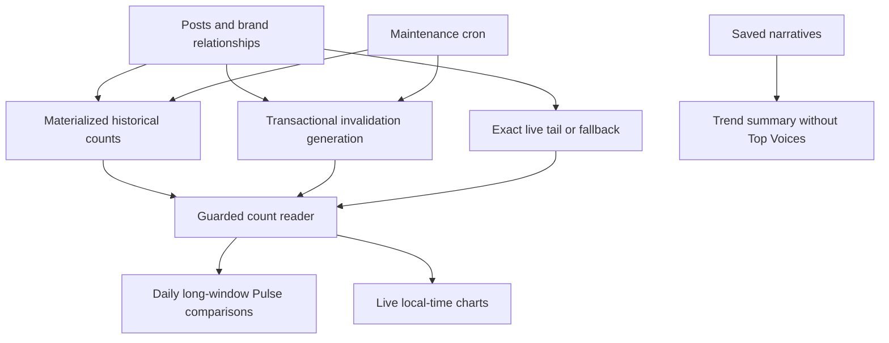
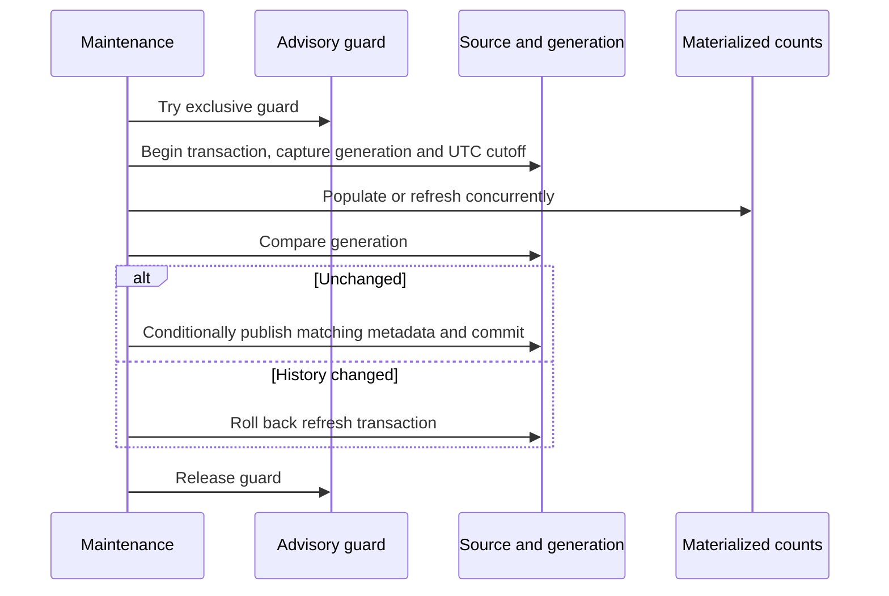
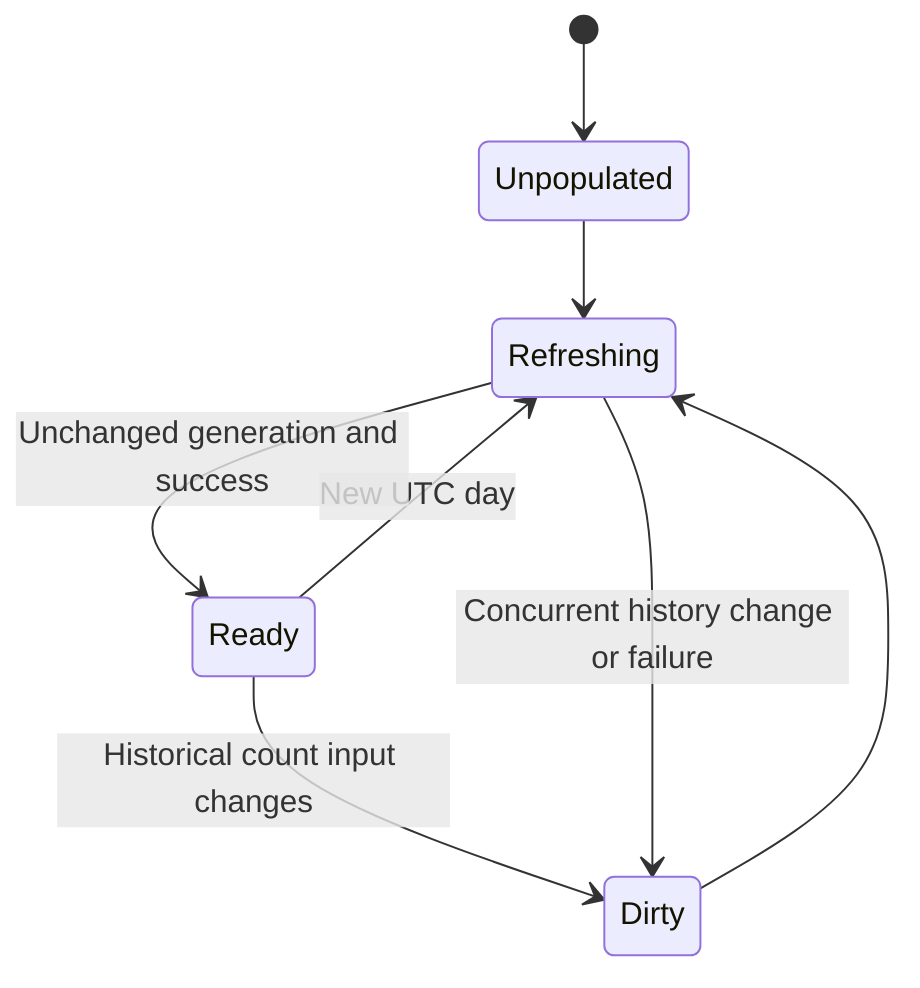
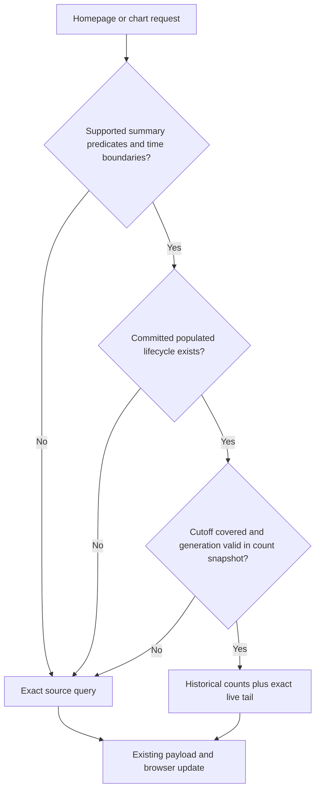

# Homepage count materialization and Top Voices removal - Plan

## Plain-English Summary

Make the homepage and its long-window charts respond faster by saving historical post counts in PostgreSQL, then combining that history with fresh posts.
The 30-day and 365-day percentage comparisons use a daily UTC cutoff.
The chart keeps its live clock, current-day activity, local-day boundaries and exact filters.
Top Voices disappears from the trend summary, and page requests stop calculating its author ranking.

A saved count must never conceal a newly imported historical post or a changed brand association.
Changes that invalidate saved history cause a temporary return to the exact query until maintenance refreshes it.
The first optimization covers default and brand-only charts; filters requiring more information retain the exact query.
The one-day chart keeps its five-minute detail.

Completion requires count-for-count comparisons against the original query, real PostgreSQL migration/concurrency proofs, browser coverage in all supported locales, measured improvement, and the exact final revision observed in production with the materialized path active.
Production delivery is authorized.
The existing staged route and its authentication controls still apply.

<!-- BEGIN OLLIJA DELIVERY GUIDE -->
## Ollija Delivery Guide

This block is generated guidance. Do not edit it directly. Correct durable facts in `.ollija/project.yaml` or this template, then rerun `ollija annotate-plan`. Current explicit owner instructions govern this task. Record exceptions below and reflect route changes in metadata; removed requirements must not return through another checklist.

### Resolved locations

- Authoritative host: `fuchitalee`
- Authoritative repository: `/Users/fuchitalee/development/pushin-weight-v2`
- Ollija release worktree area: `/Users/fuchitalee/development/pushin-weight-v2/.worktrees`
- Active worktree: `/Users/fuchitalee/development/pushin-weight-v2/.worktrees/fix/homepage-query-performance`
- Plan: `/Users/fuchitalee/development/pushin-weight-v2/.worktrees/fix/homepage-query-performance/docs/plans/2026-10-16-075859-fix-homepage-query-performance-plan.md`
- Change: `fix-homepage-query-performance-2026-10-16-075859`
- Branch: `fix/homepage-query-performance`
- Staging branch and blueprint: `staging`, `/Users/fuchitalee/development/pushin-weight-v2/.worktrees/fix/homepage-query-performance/render-staging.yaml`
- Production branch and blueprint: `main`, `/Users/fuchitalee/development/pushin-weight-v2/.worktrees/fix/homepage-query-performance/render.yaml`
- Staging URL: `https://pushinweight-staging-web.onrender.com`
- Production URL: `https://pushinweight-web.onrender.com`

### Placement

This worktree is inside the Ollija release worktree area. Reuse it for the whole change. Do not create a second worktree or plan for this branch.

### Delivery scope

- Workflow: `plan`
- Delivery target: `production`
- Owner selection recorded: `true`
- Delivery route: `staged`

1. Complete implementation and the plan's verification contract.
2. Run the configured focused checks:
   - `pytest tests/ollija`
3. The parent workflow commits only this plan's changes, pushes the feature branch, and records the candidate SHA.
4. Fetch the remote staging lane: `git fetch origin refs/heads/staging`.
5. Require the unchanged candidate SHA to be a fast-forward of that fetched remote ref, then push the exact candidate SHA to `refs/heads/staging` with the server-enforced fast-forward command `git push origin <candidate-sha>:refs/heads/staging`.
6. Verify the remote staging ref resolves to the candidate SHA and the deployment for `pushinweight-staging-web` reports that same SHA.
7. Run staging checks. Stop here if they fail.
8. Only after staging passes, fetch the remote production lane: `git fetch origin refs/heads/main`.
9. Require the same unchanged candidate SHA to be a fast-forward of that fetched remote ref, then push the exact candidate SHA to `refs/heads/main` with the server-enforced fast-forward command `git push origin <candidate-sha>:refs/heads/main`.
10. Verify the remote production ref resolves to the candidate SHA and the deployment for `pushinweight-web` reports that same SHA before reporting completion.
11. After step 10 succeeds, perform worktree cleanup as the final filesystem action:
    - From `/Users/fuchitalee/development/pushin-weight-v2`, require `/Users/fuchitalee/development/pushin-weight-v2/.worktrees/fix/homepage-query-performance` to remain registered, clean, unlocked, and at the verified candidate SHA. If any guard fails, retain it and report the reason.
    - Run `git -C /Users/fuchitalee/development/pushin-weight-v2 worktree remove /Users/fuchitalee/development/pushin-weight-v2/.worktrees/fix/homepage-query-performance` without `--force`.
    - Preserve the local and remote feature branches. Continue final reporting from the authoritative repository root.

### Failure handling

- Complete applicable, unwaived checks for the selected route. A waived check is waived, never passed. Owner-selected direct production does not require staging.
- Product defects return to the parent implementation workflow; repeat only checks invalidated by the fix. Environment failures require repairing the environment, not a new source commit. Retry only after a relevant fact changes.
- SSH, shell, environment, or multi-machine failures use the repository infra/multi-machine skill first.
- The change ledger is advisory; do not validate or enforce it.
- Never force-remove a worktree. Retain staging-only, failed, dirty, locked,
  noncanonical, or candidate-mismatched worktrees for diagnosis or later
  delivery.
- Do not run an endless retry loop or start a persistent Ollija process.
<!-- END OLLIJA DELIVERY GUIDE -->

## Delivery Exceptions

None.
The owner's October17 production request extends the existing release scope; it does not select direct production.
Finish independent implementation and verification before escalating a genuinely unresolved delivery prerequisite.

---

## Goal Capsule

- **Objective:** Visitors can load and switch the homepage's long-window charts promptly and see correct counts and trend summaries without a Top Voices section.
- **Means:** Native PostgreSQL count materialization with exact fallback and removal of request-time voice ranking, per KTD1–KTD6.
- **Authority:** Current owner request and AGENTS.md govern; this Product Contract owns behavior and KTDs own mechanisms.
- **Execution:** Implement the dependency-ordered units with strict characterization and failing caller-level regressions before product changes.
- **Endpoint and owner:** Parent workflow owns reviewed implementation, publication, staged acceptance, non-forced production promotion, observed activation and guarded cleanup. PR62 alone is intermediate.
- **Stop conditions:** Do not weaken a required check, fabricate count parity, change access controls or pause harvest to make this release pass. Investigate failures and preserve other owners' state.

---

## Product Contract

### Summary

Precompute historical homepage counts, keep charts current and filter-correct, remove Top Voices, and deploy the verified result to production.

### Problem Frame

The original homepage Pulse query ran two correlated historical counts for each of21brands.
Production observed a14.49-second query and30-day browser requests aborting at12seconds.
The reviewed grouped-count correction is prepared in this branch but has not been observed deployed.

The corrected production-host, uncached, read-only samples were1.100seconds for1day,4.496seconds for30days and8.456seconds for365days.
Pulse still consumed approximately2.1–2.5seconds for long windows.
Daily chart aggregation and the independent Top Voices ranking consumed additional time.
These single samples establish motivation, not a production latency distribution.

### Requirements

**Counts and time**

- R1. Thirty-day and365-day Pulse comparisons use equal adjacent half-open windows ending at00:00UTC of the comparison day, with at most a daily ordinary window advance.
- R2. One-day and7-day Pulse comparisons retain their existing rolling-window behavior.
- R3. Charts retain the existing live end time,288five-minute points for1day, local calendar-day points for7/30/365days, series totals, ordering, colors, stacked data and direct-job contributions.
- R4. Count semantics preserve canonical brand identity under PostgreSQL ICU collation, tracked/sentinel rules, brand narrowing, empty and old-only brands, zero/new-period handling and existing percentage rounding.
- R5. Default and brand-only long-window charts use materialized counts when eligible; every other filter combination remains exact through its existing query when the summary cannot represent it.
- R6. Current-day chart activity stays live; historical inserts, deletes, timestamp corrections, association changes and default-filter eligibility changes cannot silently leave a stale historical count in use.
- R7. Missing, unpopulated, invalid, stale, busy or unsuccessfully refreshed derived storage uses the exact query and produces an ordinary valid page.

**Presentation and compatibility**

- R8. Remove Top Voices from the fresh trend-summary DOM and stop its author aggregation, scoring and sorting on homepage/chart requests; retain narrative generation and saved narrative selection.
- R9. Retain existing URLs, anonymous production access, locale behavior, persisted preferences, atomic browser updates and stale-response protection.
- R10. Distinguish comparison cutoff from response/chart time so daily Pulse comparisons cannot freeze charts, feeds or narrative demand.
- R11. Preserve harmless wire compatibility for already-loaded clients through an empty Top Voices projection if required by the existing payload contract; compatibility must perform no ranking work.

**Operations and proof**

- R12. Preserve source records, identities, constraints, current harvest/provider policies and the15-minute harvest schedule; add only the derived-storage maintenance needed for this feature.
- R13. Enforce the strict regression net and measurable acceptance criteria below with zero required skips/errors.
- R14. Observe the final exact revision deployed to production, its materialized read path active, its maintenance job configured and functioning, and the original browser actions succeeding.

### Key Decisions

- KD1. Precompute counts rather than extend the request-local60-second cache as the whole solution. (session-settled: user-approved — chosen over live recounting/cache-only mitigation after discussion of cold misses and refresh cost.) Governs R1, R3, R5.
- KD2. Daily30-day and365-day comparisons are sufficient. (session-settled: user-directed — chosen over hourly comparison-window advances because that precision is unnecessary.) Governs R1.
- KD3. Disable Top Voices rather than optimize its independent ranking now. (session-settled: user-directed — chosen over keeping its request-time cost after confirming it does not drive narratives.) Governs R8, R11.

### Success Criteria

- SC1. On the same representative PostgreSQL dataset and runtime, five serialized cold requests for each eligible30-day/365-day chart have median server duration at least50percent below1693's unchanged reader and every sample below3seconds.
- SC2. Warm chart requests complete below2seconds on the same verification environment; the1-day path does not regress by more than10percent in median server duration.
- SC3. Production browser switches to30days and365days return200 before the existing12-second timeout, replace all associated projections correctly and produce zero JavaScript errors.
- SC4. A failed/dirty/unavailable summary is visibly and quantitatively correct through the fallback; such cases are reported separately from materialized performance samples.
- SC5. No required PostgreSQL/browser/assurance checks are skipped or errored; the exact candidate assessment and sealed performance evidence are clean.

### Scope Boundaries

Homepage Pulse means the percentage chips and count projection in monitor/views.py; it is distinct from the separately owned G2 research-Pulse workflow.
Touch only count storage/readers/maintenance, the existing grouped-count fix, Top Voices removal, directly affected tests and delivery/reference instructions.
Preserve G2 Chatter/research generation, G3 collection and metric semantics, the held chart-owner worktree and unrelated dirty documentation.

Filtered-chart precomputation, new author rankings and new domain measurements are outside this release.
One-day chart precomputation is unnecessary for the measured bottleneck and its exact existing path remains.
Existing mobile rendering/Lighthouse residuals are not claimed solved by faster SQL.

### Acceptance Examples

- AE1. Covers R1, R4: with40posts in the current30-day period and20in the preceding30days at the daily cutoff, the chip reports+100percent; posts exactly at either boundary are counted once in the correct interval.
- AE2. Covers R3, R6, R10: a new current-day post appears in the correct live chart day while the30-day comparison cutoff stays at UTC midnight.
- AE3. Covers R4, R6: importing an older post or adding an older post's brand association invalidates the saved history; the next uncached chart is exact and maintenance later restores materialized reads.
- AE4. Covers R3, R5: Tokyo, Los Angeles daylight-saving boundaries, Kathmandu and Chatham retain the same daily series as the exact query; a language or classification filter retains exact source-query behavior.
- AE5. Covers R8, R9, R11: initial and refreshed en/zh-CN/ja pages have no Top Voices region, no global author-ranking query and unchanged narrative content/window switching.

---

## Planning Contract

### Verified Integration Points

- core/models.py: Post.created_at is the event time, fetched_at is intake time; PostBrand is the unique post/brand relationship and has no insertion timestamp.
- PostBrandMention.mentioned_at is not an authoritative timestamp for all relationship writers, so it cannot safely detect every historical attribution change.
- monitor/cycle.py persists post-brand relationships through the Django ORM; management attribution/reclassification paths also write relationships.
- PostUnsanctionedFlag and PostUntrackedBrandPromotion are separate one-row-per-post eligibility facts used by the chart's default and explicit exclusion modes.
- monitor/views.py builds charts from PostBrand, applies default promotion/legacy exclusions even without other post filters, adds direct jobs separately, and currently takes its clock from Pulse.computed_at.
- monitor/trend_narrative_projection.py reads saved narrative results independently of Top Voices.
- monitor/templates/monitor/home.html, monitor/static/pw-chart.js and tests/ui_assurance consume the current Top Voices projection.
- core/migrations/0090 is irreversible history; the existing two-module disposable migration-test correction remains necessary and must not be undone.
- MetricValue and CollectionObservation represent provenance-backed acquired measurements, not a rebuildable homepage count cache. TrendNarrative storage has its own publication/provider lifecycle.
- No existing native materialized homepage count storage was found.
- Django dependency is5.2; production evidence established PostgreSQL18.4, and local verification uses PostgreSQL18.
- render.yaml already contains a separate jobs cron, so a narrowly scoped count-maintenance cron follows an existing deployment pattern without modifying harvest.

### Key Technical Decisions

- KTD1. Use one native materialized relation at UTC15-minute grain for all closed UTC days in the existing PostgreSQL source history, with a shared reader for Pulse and long charts. Avoid a moving retention floor that could silently remove the preceding365-day comparison when a fixed staging/test clock is older than wall time. A daily UTC grain cannot reproduce Tokyo/California local-day graphs, while15-minute buckets support the common quarter/half-hour offsets. Validate bucket-to-local-day alignment; use the exact query for any unsupported historical offset or boundary rather than approximate. Bound full-refresh duration through KTD5 and measure cardinality before release. The grain is a reversible tuning choice, not a separate architecture needing competing implementations. Governs R1–R6.
- KTD2. Add one HomeCountSnapshot-style singleton lifecycle table and one materialized count relation: **two derived relations, one ordinary table plus one materialized view; zero source tables retired or source columns added**. The singleton records source generation, published generation, earliest changed source time, published cutoff and successful refresh time. The view groups canonical Brand identities, bucket start and two boolean eligibility dimensions (legacy unsanctioned and untracked promotion), with a suitable all-row unique index. Lifecycle metadata has no natural home in measurement, collection or publication records. Plain metric/provider storage would misstate ownership and provenance. Governs R4, R7, R12.
- KTD3. Invalidate historical summaries at the database boundary. Statement-level transition-table triggers on count-relevant PostBrand, Post.created_at and eligibility writes increment the singleton's source generation transactionally and retain the earliest affected source timestamp. Current-day changes remain live and do not invalidate closed-day history; recording their generation is necessary to catch transactions that span UTC midnight while maintenance publishes the new cutoff. Deletions/cascades with unavailable parent time invalidate conservatively; TRUNCATE is covered. Ignore metric/text-only updates and empty/no-op statements. Compare old/new values, not only named UPDATE columns. Use bulk statement-level work rather than one counter update per row; source writes must not wait for a long refresh. Existing writers keep their API and semantics. Governs R6, R12. [PostgreSQL trigger semantics](https://www.postgresql.org/docs/18/sql-createtrigger.html).
- KTD4. Refresh and publish metadata in one database transaction, protected against a second refresher by a dedicated nonblocking advisory key. Readers evaluate generation validity and the earliest changed timestamp against the published cutoff, then aggregate counts in one SQL snapshot; concurrent refresh leaves the previous committed summary readable. Before initial population, a cheap lifecycle/catalog preflight selects raw fallback so readers do not queue on the ordinary REFRESH lock. If lifecycle state is missing, initialize it in a separate committed transaction under the same maintenance advisory key and a short NOWAIT barrier on the count-relevant source tables. This drains or refuses previously untracked writers before a new clean publication can exist; never hold those source locks during counting. Refuse missing-state initialization inside an enclosing application transaction, and do not recreate a deleted singleton inside the refresh transaction. Keep refresh computation outside a row lock on the singleton; capture the source generation before refresh and publish with an atomic conditional update only if it is unchanged. Update publication fields and clear the earliest-change marker only under that generation comparison: never save an old source-generation value over a concurrent increment. Roll back the entire refresh transaction if publication fails or the generation changes. Process death therefore preserves the previous committed count/cutoff pair. Governs R6, R7. [PostgreSQL18 REFRESH dispatch](https://github.com/postgres/postgres/blob/REL_18_STABLE/src/backend/tcop/utility.c) and [materialized-view transaction locks](https://github.com/postgres/postgres/blob/REL_18_STABLE/src/backend/commands/matview.c).
- KTD5. Add a provider-free maintenance management command and an additive Render cron at minutes7,22,37,52UTC. Normal work refreshes once per new UTC day; the other polls exit cheaply unless history was invalidated. Corrections may rebuild counts without advancing the daily comparison cutoff. Normal first publication is approximately00:07UTC/09:07JST, replacing the previously unselected00:15proposal. Initial population uses ordinary REFRESH while readers use fallback; later population uses CONCURRENTLY with a120-second statement timeout,2-second lock timeout and suitable unique index. Derive the refresh cutoff from the transaction's UTC day, keeping the view definition and published metadata on that same database clock. No request refreshes the view. No new worker, beat or harvest behavior. Governs R1, R6, R7, R12. [Refresh constraints](https://www.postgresql.org/docs/18/sql-refreshmaterializedview.html), [Render UTC scheduling](https://render.com/docs/cronjobs).
- KTD6. Keep the exact source aggregate as the common fallback and regression oracle. Only use the materialized path for the represented brand/time/default-eligibility predicates. Sum eligible historical buckets, add the exact current-day source tail, and add existing direct jobs separately. For a fixed historical request/staging clock, the historical/tail split is the earlier of the published cutoff and that request's UTC midnight; cap both portions at the requested window end. Pulse30/365 sums all eligibility dimensions through the requested comparison-day cutoff;1/7 keeps its live reader. Keep response computed_at live and add comparison_as_of for the daily-count meaning. Cache counts separately from response timestamps. Never substitute the comparison clock for chart/feed/narrative time. Governs R1–R5, R7, R10.
- KTD7. Remove the Top Voices helper call and its unused cache/scoring implementation from these callers, remove the fresh HTML region and JS rendering, and retain an empty compatibility object only where old payload validation requires it. Keep remaining validators and atomic chart/Pulse/narrative updates strict. Cache locks cover lookup/publication only, not expensive database work; summary-dependent cache identity includes cutoff/generation so validity changes are not hidden beyond the established cache policy. Chart-cache lifetime remains independent of the daily Pulse cache, and a daily comparison timestamp cannot prematurely expire every chart entry. Governs R8–R11.
- KTD8. Implement schema through Django migrations: managed singleton model plus explicit reversible native view/index/trigger operations. Create derived storage without data during schema migration, seed only lifecycle state, and populate through maintenance. Preserve Django model state with RunSQL/SeparateDatabaseAndState as appropriate; inspect the final migration graph before choosing the next number. Existing multi-service migration serialization remains authoritative. Governs R7, R12. [Django5.2 migration operations](https://docs.djangoproject.com/en/5.2/ref/migration-operations/).

### High-Level Technical Design

Architecture:

Refresh and publication protocol:

Lifecycle:

Reader decision:

### Risks and Execution-Time Decisions

- Fine-grain cardinality and full-refresh cost require production-shaped measurement; native REFRESH is not incremental.
- Historical-write invalidation must include default promotion/legacy exclusions and cascade/TRUNCATE paths; relying on Post.fetched_at alone misses attribution changes.
- Avoid global application locks during SQL and singleton row locks during REFRESH; measure historical bulk-write overhead and lock duration.
- An empty or missing singleton/view must be an explicit fallback, including after disposable test-database flushes; do not infer freshness from MAX(event time).
- Do not mask unexpected programming/SQL errors as empty data. Only recognized availability/validity conditions select fallback.
- New maintenance service provisioning and staging authentication are execution-time environment checks. The prior release lacked owner sessions; recheck current access and documented QA routes before asserting the same blocker still exists.
- Do not expand owner allowlists, disable middleware, forge an unrelated identity or alter authentication configuration. If a normal existing authenticated staging path cannot be established, complete the concrete package and request only the missing access/route selection.
- Freeze benchmark data/runtime/acceptance before optimization: at most3materially distinct SQL variants and3measurement rounds; retain all results and report unmet criteria rather than relaxing them.

### Sources and Research

The verified behavior trace is homepage/chart URL → shared builder → Pulse count/chart aggregation → independent stored narrative projection → independent Top Voices calculation.
The Top Voices cost is removable without changing narrative-generation inputs.
The existing cached-narrative learning at docs/solutions/architecture-patterns/2026-08-12-205000-cached-bilingual-trend-narratives.md supports keeping provider work out of requests; its older publication details are not copied as new count-storage semantics.
The schema-reference document is orientation only; current models and migrations govern.
No strategy document was found; CONCEPTS.md and the General Launch Charter supply the shared vocabulary and boundaries.

---

## Implementation Units

### U1. Freeze the strict regression net and workload

**Goal:** Pin the current caller behavior before changing counts or presentation.
**Requirements:** R1–R11, R13; AE1–AE5.
**Dependencies:** None.
**Files:** tests/test_home_chart_pulse.py; tests/test_home_chart.py; tests/test_public_home_window_cookie.py; tests/test_home_chart_materialization.py (new); tests/test_trend_narrative_projection.py; tests/ui_assurance and its current declaration.
**Approach:** Preserve the1693 grouped-count/collation tests and historical migration-test repair. Characterize exact source results at fixed live/comparison clocks, then add failing caller tests for the new daily semantics and Top Voices removal.
**Execution note:** Begin with real URL/view/template pins and an independent raw-count oracle, not helper-only or implementation-shaped expectations.
**Test scenarios:**

1. Pin half-open current/prior boundaries for1/7/30/365, future/null timestamps, zero/old-only brands, percent rounding and new status.
2. Pin canonical ICU equivalents including UP/up and composed/decomposed café; test explicit brand scopes and sentinels.
3. Compare full series/totals/stacked/jobs for UTC, Tokyo, Los Angeles daylight-saving transitions, Kathmandu and Chatham.
4. Cover default promotion-off behavior, legacy flags, explicit any/off/only combinations, language/classification filters and empty brand selection.
5. Verify initial homepage and chart endpoint use live chart time while30/365 comparisons use a separate daily cutoff.
6. Verify Top Voices is absent from rendered localized pages and runtime replacements, with no global author-ranking SQL and unchanged saved narratives.
7. Freeze representative data/runtime and record baseline timings separately from prior single production samples.

**Verification:** Caller pins demonstrate the intended changes fail on1693; existing unaffected assertions remain intact.

### U2. Add derived storage and complete historical invalidation

**Goal:** Store rebuildable historical counts with trustworthy lifecycle state.
**Requirements:** R4, R6, R7, R12; KTD1–KTD4, KTD8.
**Dependencies:** U1.
**Files:** core/models.py; next core/migrations/ migration(s); monitor/home_count_summary.py (new); tests/test_home_count_summary_migrations.py (new); tests/test_home_chart_materialization.py; config/staging_refresh.yaml; tests/staging_refresh/test_policy.py; docs/operations/staging-data-refresh.md.
**Approach:** Add only the KTD2relations and narrow count-relevant triggers. Keep source data and writer interfaces intact. Use canonical Brand joins and boolean EXISTS eligibility so joins never multiply post-brand counts.
**Test scenarios:**

1. Fresh PostgreSQL migration, populated-source forward migration, reversal of only this new migration, and reapplication preserve every source row/key and leave the expected objects/indexes valid.
2. Multiple deployment migration runners serialize through the real existing migration runner; no invalid index or half-installed trigger survives failure.
3. Historical post/association insert, delete, reattribute, timestamp update across cutoff/null, promotion/legacy eligibility change, canonical Brand identity spelling change, cascade and TRUNCATE invalidate appropriately.
4. Same-day inserts, metrics-only updates, weight-only relationship changes and empty/no-op statements avoid unnecessary historical invalidation.
5. Invalidations roll back with failed source transactions; bulk statements do bounded counter work.
6. Canonical collation, zero/empty state, missing lifecycle row and test-database flushes fail safely.
7. Measure historical bulk-write overhead on the frozen workload; verify refresh does not hold the singleton lock during counting.
8. Staging refresh excludes and scrubs environment-local publication state, permits pre-migration sources, and preserves its exhaustive relation guards. Grant only MAINTAIN on the new state table to an existing staging exporter; native PostgreSQL verifies no SELECT or INSERT privilege. Native materialized-view definitions carry through pg_dump/restore; an absent publication row forces fallback until local maintenance publishes.

**Verification:** Real PostgreSQL object/data inspection and writer call-chain tests prove validity tracking beyond ORM signals.

### U3. Implement refresh lifecycle and the isolated maintenance schedule

**Goal:** Maintain the saved history without request-time refresh or provider work.
**Requirements:** R1, R6, R7, R12, R14; KTD4, KTD5, KTD8.
**Dependencies:** U2.
**Files:** monitor/home_count_summary.py; monitor/management/commands/refresh_home_counts.py (new); render.yaml; render-staging.yaml; tests/test_refresh_home_counts.py (new); tests/test_home_count_render_config.py (new); tests/test_render_headline_topology.py; tests/ollija/test_render_staging_topology.py.
**Approach:** Add the idempotent due/dirty command and provider-free maintenance cron. Give production maintenance only the intended DATABASE_URL and runtime configuration; staging maintenance remains dormant or explicitly bounded for acceptance. Preserve all existing service commands and schedules.
**Test scenarios:**

1. First population succeeds from WITH NO DATA; subsequent refresh uses the concurrent mode and its valid all-row unique index.
2. Same-day healthy polls skip expensive refresh; crossing UTC midnight advances once; a historical correction rebuilds without hourly window advances.
3. Two independent refresh processes cannot overlap; a busy refresher exits truthfully while readers use the previous valid snapshot or exact fallback if invalid.
4. A concurrent historical commit during refresh prevents publication as clean; a rolled-back write does not.
5. Failure, timeout, process death after REFRESH but before metadata publication, and conditional-publication failure roll back counts and metadata together and permit a later ordinary maintenance run.
6. A reader racing refresh cannot combine counts with another cutoff/generation.
7. The actual management-command call chain invokes the intended refresher; manifests preserve the15-minute harvest and prohibit provider calls or recurring staging harvest.

**Verification:** Concurrency proofs use separate PostgreSQL connections/processes; command/manifest results and source-generation checks are inspectable.

### U4. Integrate materialized readers without changing chart meaning

**Goal:** Serve eligible long-window counts from saved history while keeping exact live behavior.
**Requirements:** R1–R7, R9, R10, R13; KTD1, KTD4, KTD6, KTD7.
**Dependencies:** U1–U3.
**Files:** monitor/home_count_summary.py; monitor/views.py; tests/test_home_chart_materialization.py; tests/test_home_chart_pulse.py; tests/test_home_chart.py; tests/test_public_home_window_cookie.py; applicable locale/filter/browser tests.
**Approach:** Share count-reading logic, preserve the exact source path, separate chart/response/comparison clocks, and merge the live tail and direct jobs without overlaps. Use existing eligibility semantics rather than an approximate default predicate.
**Test scenarios:**

1. For every frozen fixture/window/timezone/supported eligibility mode, refreshed materialized results equal the independent exact query at the same cutoff.
2. Live-tail posts at the boundary are counted once; sparse dates zero-fill; a chart requested after midnight keeps moving even before maintenance finishes. Fixed historical staging clocks retain both365-day comparison periods and exact partial-day tails.
3. Daily30/365 Pulse does not advance hourly;1/7 retains rolling boundaries.
4. Unsupported filters or timezone boundaries choose the exact path and never silently ignore a predicate.
5. Historical correction causes exact fallback, then parity returns after refresh; missing/unpopulated/dirty/busy/timed-out storage does not yield a500or fabricated zeros.
6. Cache keys isolate scope/window/timezone/locale/cutoff/generation; daily Pulse cache age does not expire a newly built chart entry, and shared locks do not let a cold365-day request stall unrelated cached windows.
7. Exercise real homepage, chart HTML/JSON and affected brand-page callers; preserve existing atomic UI replacement and delayed/out-of-order request behavior.

**Verification:** Count-for-count source parity, M18 caller pins, SQL/plan evidence showing summary use, and SC1–SC4.

### U5. Remove Top Voices presentation and request work

**Goal:** Remove the requested section and its latency without changing narrative generation.
**Requirements:** R8, R9, R11, R13; KTD7; AE5.
**Dependencies:** U1, U4.
**Files:** monitor/views.py; monitor/templates/monitor/home.html; monitor/static/pw-chart.js; relevant voice-only CSS only if unused; tests/test_trend_narrative_projection.py; tests/test_home_chart_pulse.py; tests/ui_assurance; tests/fixtures/ui_assurance/general-declaration.json.
**Approach:** Delete unused ranking/cache work and rendering. Keep the smallest empty wire-compatibility projection needed by old clients, and explicitly retire only owner-removed voice obligations. Preserve other assurance controls and narrative contracts.
**Test scenarios:**

1. Initial and refreshed en/zh-CN/ja pages show no Top Voices label, chips, stars or voice region.
2. A real homepage/chart request executes no author-ranking aggregate or scoring path.
3. Daily/rolling window changes, brand/filter selections and mobile/desktop replacement retain narratives and show no JavaScript errors.
4. Existing loaded-client payload validation can still complete chart updates through the compatibility shape.
5. Neighboring narrative, status, accessibility and source-hygiene assertions remain strict.

**Verification:** Real browser DOM/state evidence and captured production-call-chain SQL prove both visual removal and zero request-time ranking.

### U6. Verify the final candidate and deliver production activation

**Goal:** Deliver the measured, correct feature through the authorized production endpoint.
**Requirements:** R12–R14; SC1–SC5.
**Dependencies:** U2–U5.
**Files:** Existing plan; applicable delivery/reference docs; existing assurance source identity; .github/workflows/homepage-counts.yml; same PR62; task-owned private receipts.
**Approach:** Reconcile only already-promoted main changes before final candidate checks. Review migration/data integrity, invalidation races, query correctness and Top Voices removal. Use the selected staged route, fresh service/DB ownership checks and an existing authorized authenticated browser path. Provision only the new bounded count-maintenance resource as part of this release.
**Test scenarios:**

1. Exact candidate's required local/hosted suites, normalized UI obligations and sealed performance all pass.
2. Staging deployment uses the exact candidate, migrations complete, sources are preserved, initial refresh succeeds and owner-authenticated browser actions prove the materialized path.
3. Non-forced production promotion yields the same candidate revision in every affected active consumer and new maintenance resource.
4. Production schema/index/trigger/singleton state is correct; real homepage/30-day/365-day actions return200, show no Top Voices and produce no JavaScript errors.
5. Observe the scheduled maintenance command after deployment; a healthy same-day poll truthfully skips, while a necessary refresh publishes valid state.
6. Verify source-generation/summary mode logs tie activation to real requests; report fallback observations separately.
7. Cleanup removes only the clean, unlocked, registered canonical worktree at the verified final SHA, as the final filesystem action; preserve branches and retain the worktree if a guard fails.

**Verification:** Exact-revision deployment and feature activation receipts establish completion; PR state and Git refs alone do not.

---

## Verification Contract

Freeze test scope and workload before product edits.
Keep prior1693 results as baseline evidence only; application/model/template/JS changes require fresh candidate evidence.

| Proof | Required execution | Pass condition |
| --- | --- | --- |
| PostgreSQL count/migration/refresh net | New summary/migration/command modules plus existing Pulse/window/filter/projection/locale tests on isolatedPG18 | All required executed;0skipped/errored; exact source parity |
| Writer/concurrency proof | Actual relationship writer, direct/bulk SQL, separate refresh/read connections, multi-service migration runner | No stale clean publication (including writes spanning UTC midnight), source-data loss, writer-wide refresh lock or incorrect fallback |
| Hosted regression suites | All checks triggered by the final PR, including current Staff, Official, Editorial and Backfill suites | Terminal success at exact final SHA |
| Stateful browser assurance | Existing validate/prescribe, affected gate, then candidate gate with candidate performance |0failed/skipped/errored/missing/unknown normalized obligations |
| Numeric performance | Frozen same-data/runtime baseline versus candidate; cold/warm cases separated | SC1, SC2 and independently correct results |
| Real browser | Homepage and30/365switches, filters, locale, responsive and request-race scenarios | SC3, voice-region absence, complete atomic projections |
| Deployment | Exact-SHA staged and production/runtime checks, source preservation, active materialized reads and maintenance | R14; no false claim from branch/PR state |

Use the repository's existing candidate-gate and receipt wrapper, supplying the final product-source SHA and required sealed performance inputs.
For focused tests, the minimum invocation is the Django pytest runner over tests/test_home_chart_pulse.py, tests/test_home_chart.py, tests/test_public_home_window_cookie.py, tests/test_home_chart_materialization.py, tests/test_home_count_summary_migrations.py, tests/test_refresh_home_counts.py and tests/test_trend_narrative_projection.py; U2/U3 explicitly add the three new summary/command test modules.
Run Django migration drift/system checks and changed-file lint/diff checks.
A fixture/declaration change must not lower unrelated assertions or comparison tolerances.

The regression net must include at least five distinct real caller paths: homepage, chart HTML, chart JSON, maintenance command and relationship writer.
Function-level tests supplement these paths; final reporting states actual caller-test and helper-test counts and required executed/skipped/error totals.

---

## Definition of Done

- R1–R14 and SC1–SC5 are proven within their stated scope.
- Every U1–U6scenario has applicable evidence; any genuine limitation is explicit.
- The migration adds only the two justified derived relations and its narrow supporting objects; source data/constraints and unrelated behavior remain intact.
- Fresh pages and refreshed DOM have no Top Voices; request traces contain no ranking work.
- Historical summary, live-tail and fallback outputs are exact for the supported state, and clock/collation/timezone races are covered.
- Final review has no unresolved release-blocking defect, all required gates pass, and abandoned experimental code is removed.
- The exact revision is observed deployed with functioning materialization/maintenance, followed by guarded cleanup or a truthful retention reason.

---

## Appendix

### Preserved Baseline Evidence

Prepared baseline1693b96b15f6d5142c5b303a4a124d817b4f1e41 in PR62 contains the grouped Pulse correction, canonical ICU-brand fix and two-module historical migration-test isolation.
Its exact local gate passed344tests/75subtests/178requiredPG and5028UI obligations, with clean sealed performance b4b1c649f71933b4a6007a49.
Hosted Editorial583, Staff308 and Official327passed with0required skips/errors.
The seven focused historical migration tests passed and preserved the ordinary latest-schema database.
These results establish the starting point, not verification of this expanded materialization/removal scope.

Private baseline receipts remain under .ollija/state/homepage-query-release-20261016 in the authoritative repository.
At planning fetch, origin/main is67fae386 and already includes the separate metrics-refresh release; reconcile that promoted base before final verification.
No production application/schema change or test execution was performed while authoring this plan.
