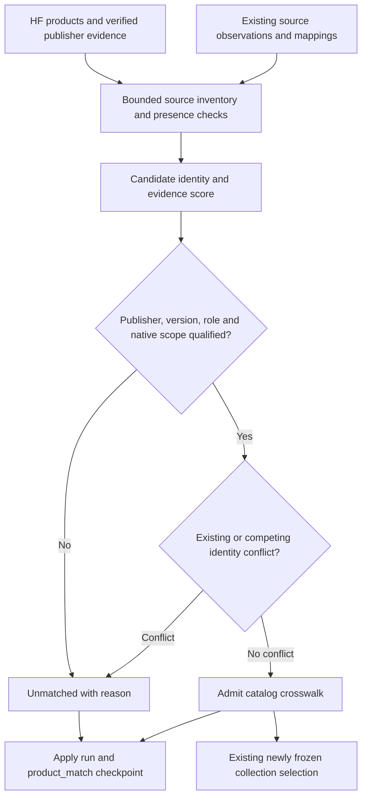
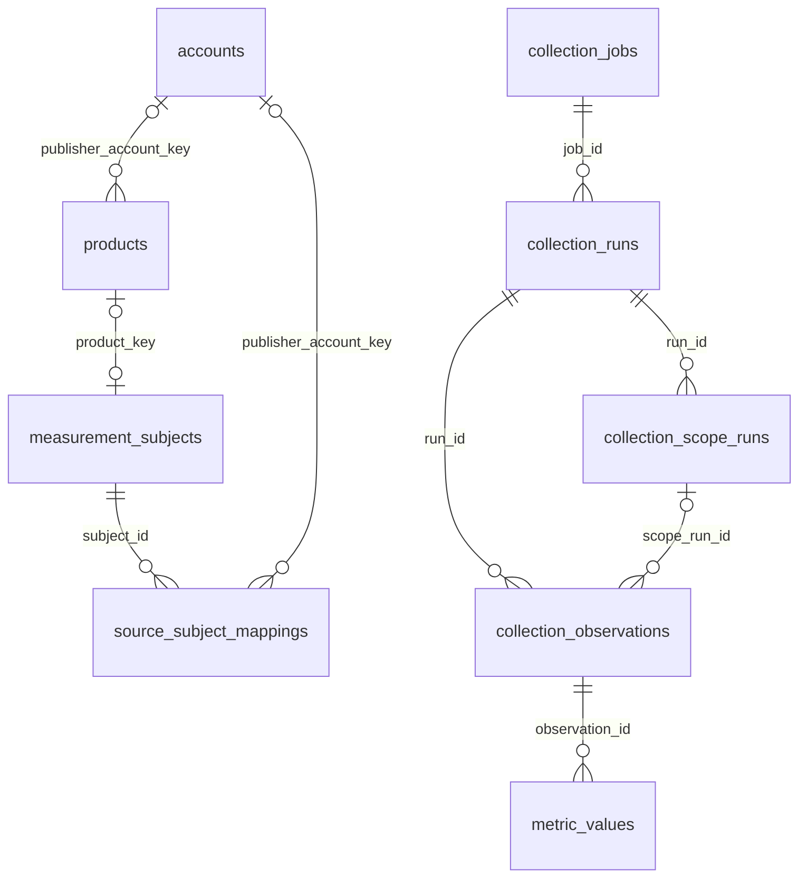

# G3 Conservative Product Crosswalk Matcher - Plan

## Plain-English Summary

Connect HF products to the identifiers we already collect from GitHub, OpenRouter, Arena and OpenCode, starting with matches supported by clear evidence.
The same model can have different names on each service.
This matcher will fill the existing crosswalk when it can establish identity and will leave uncertain cases unmatched.
A shared GitHub family or recipe repository will remain a contextual link rather than becoming a model's own metrics.

The draft below lists all 1,927 HF products in the current 21-brand inventory by highest link confidence first, with newest repository creation first within each confidence level.
Each proposed identifier shows whether it is already in our database, its confidence score and whether its crosswalk exists.
The initial pass found 155 name-based candidate links across 121 products, alongside 10 existing other-source links across five products.
All 155 candidates are already in the database. The owner subsequently confirmed every displayed90% candidate as a true match and authorized implementation, bounded application and production delivery.
The percentages are evidence scores, not measured probabilities of correctness.

Implementation will reuse our current product, account, crosswalk and collection records: zero tables added or retired, zero columns added, and no schema migration.
It will provide a read-only preview and an explicit bounded apply operation.
Completion requires proof that admitted links reach the existing collection/cohort path, uncertain links remain absent, and reruns add no duplicate mappings.
The current delivery endpoint is production. Apply the confirmed batch through durable reviewed instructions; future name-only candidates still require independent evidence or explicit review.

---

## Goal Capsule

- **Objective:** Operators can identify the same product across collected sources and inspect the evidence behind each link without treating uncertain or shared-resource matches as equivalent models.
- **Means:** A database-backed, deterministic matcher with evidence gates and a confidence-ordered review inventory, using the existing crosswalk writer (KTD1–KTD6).
- **Authority:** The owner's conservative-matching and database-presence requests govern this subplan. Existing G3 identity, evidence, temporal and immutable-contract rules still apply.
- **Endpoint:** Implement and verify this matcher, deploy it to production and apply the owner's confirmed155-link batch. Preserve historical metric records and contracts.
- **Stop conditions for implementation:** Conflicting identity/ownership, insufficient variant evidence or an unavailable native identifier produces an unmatched outcome. An additional table, product merge, broad metric rewrite or new provider batch is outside this plan.

---

## Product Contract

### Summary

Offer one shared way to preview and apply qualified product crosswalks from existing database evidence.
Keep the proposed relation, evidence score, database presence and admission result distinct.

### Problem Frame

The production capture contains 399,651 numeric values, but only five of the 1,927 in-scope HF products have any stored other-source link.
Many Arena and OpenRouter values already exist under native identifiers, so collecting more numbers alone will not make them usable as canonical product comparisons.
An incorrect crosswalk can combine different versions, assign a family repository's stars to several models, or confuse an OpenRouter catalog ID with its usage-history identifier.

The catalog also has 234 products without a stored brand and 1,923 without a reviewed product type.
The report groups the former through existing publisher/company relationships; it does not populate those missing fields.
Matching must not silently classify products to get past downstream eligibility checks.

### Requirements

**Identity, matching and review**

| ID | Required result |
| --- | --- |
| R1 | Cover the current HF catalog owned by the 21 tracked brand/publisher groups, including publisher-attributed products with null brand/type; keep this separate from the historical newest-100-per-brand collection cohort. |
| R2 | Populate a crosswalk only when source evidence establishes publisher, exact product/version, relation role and native identity without an unresolved conflict; leave every uncertain candidate unmatched. |
| R3 | Preserve existing reviewed mappings, their purposes and hashes; report conflicting evidence instead of replacing a link or merging products. |
| R4 | Show database presence independently for every proposed exact source identifier: present, absent, not checked, or not applicable when no identifier is proposed. |
| R5 | Preserve provider, resource kind and identifier scope; GitHub numeric IDs, labels, OpenRouter catalog IDs and usage permaslugs remain distinct. |
| R6 | Report a confidence percentage and its evidence/reason for every candidate; a percentage alone never authorizes admission. |
| R7 | Distinguish dedicated product, family repository, implementation, recipe and agent/harness relations; shared-resource metrics remain at their native resource grain. |

**Operation, storage and integration**

| ID | Required result |
| --- | --- |
| R8 | Reuse existing identity, relationship and execution storage; no permanent table, column, schema migration or authoritative YAML/Python crosswalk file is introduced. |
| R9 | Sort product rows by their highest per-source confidence descending, then HF repository creation descending and stable product identity; unknown scores and dates sort last within their respective keys, without substituting release, modification or collection time. |
| R10 | Preview is read-only; apply persists bounded, resumable decisions and qualified mappings, revalidates frozen evidence/ownership, and makes zero provider or model calls. |
| R11 | Separate catalog identity admission from product-type qualification and immutable metric/taxonomy contracts; neither unknown types nor a new crosswalk silently becomes text-benchmark eligibility. |
| R12 | Expose admitted catalog links through the existing collection/cohort interface without mutating old frozen jobs/contracts or copying native metric values into products. |
| R13 | Preserve numeric evidence, state/flow definitions and temporal precision, including existing start/end/range storage and unknown endpoints; this subplan changes none of those values. |
| R14 | Repeating an apply is idempotent, concurrent workers cannot admit a contested dedicated identity twice, and a crash cannot leave a mapping without its committed processing receipt. |

### Scope Boundaries

The 21 groups are MiniMax, Qwen, DeepSeek, GLM/Z.ai, MiMo, Kimi, InclusionAI, Mistral, StepFun, ERNIE/Baidu, Hunyuan/Tencent, Llama/Meta, NVIDIA/NeMo, Doubao/ByteDance, Yi/01.AI, SenseChat/SenseNova, EXAONE, Kuaishou, SakanaAI, Upstage and Dots.
The captured inventory excludes the 541 Google/OpenAI/xAI products outside these groups.

HF is the product-list starting point; other-source coverage comes from persisted source evidence rather than invented identifiers.
OpenCode's two existing identities are included in the inventory and preservation tests; this does not introduce a new OpenCode collection route.
Catalog links for unclassified model/agent/harness products are allowed only when identity evidence qualifies under R2 and R11.

### Deferred to Follow-Up Work

- Broader provider discovery, collecting missing repositories/publishers and live verification of external candidates.
- Automatic recurring matcher activation; this first delivery provides the shared service and manual database-backed operation without changing any scheduler.
- Probabilistic/fuzzy automatic admission, an LLM matcher, model training and calibrated match probabilities.
- Product family consolidation, taxonomy cleanup, product-type classification and release-date reconciliation.
- Retrofitting existing native metric histories into new product contracts or changing U35 reconstruction-first likes selection.

### Acceptance Examples

- AE1. An exact native model name has no publisher or version proof. Preview shows the candidate as present in the database and 90%, but apply leaves it unmatched. Covers R2, R4, R6.
- AE2. A qualified dedicated GitHub repository is renamed without changing its numeric ID. Its existing mapping survives, while the observed name remains an alias with its observation time. Covers R3, R5.
- AE3. One GitHub repository supports three model versions. The matcher reports the family relation and does not admit three dedicated identities or copy its stars. Covers R2, R7, R13.
- AE4. An OpenRouter catalog row names a model, but no evidence connects its catalog ID to the rankings permaslug. It may qualify as a catalog relation; usage identity stays unmatched. Covers R5, R11, R12.
- AE5. A source identifier exists in an observation but has no metric values and no mapping. Presence is present, metric coverage is absent and the crosswalk is unmatched. Covers R4, R12.
- AE6. A product has no stored brand/type but has a verified publisher. Catalog ownership is checked from that publisher; no brand/type is invented, and metric eligibility remains unchanged. Covers R1, R2, R11.
- AE7. Two workers propose the same dedicated native identity for different products. Only a qualified nonconflicting result can commit; the other returns conflict with no partial mapping. Covers R3, R14.
- AE8. A known external identifier was checked against both mapping and observation storage at the pinned cutoff and was absent. Preview says absent. A product with no proposed identifier says not applicable, not absent from the platform. Covers R4, R9.

---

## Planning Contract

### Current Evidence and Reuse

The implementation starting point is commit `67fae3869e1c470de67f23da4f7de873c337ba05` on `feat/g3-smart-crosswalk-matcher`.
The parent is `docs/plans/2026-10-16-003629-feat-g3-backfiller-data-source-plan.md`, retained on `feat/g3-backfiller-data-source`; preserve its completed ingestion work.
The authoritative shared G3 coordination remains in the repository-root index and charter on fuchitalee.

| Existing surface | Relevant behavior | Matcher consequence |
| --- | --- | --- |
| `core/models.py`: Product, Account and ownership joins | Product has stable `product_key`, optional brand/type, HF repo identity and provider creation time. | Do not create a second product or overwrite HF fields with another provider's labels. |
| `core/models.py`: MeasurementSubject, SourceSubjectMapping | Catalog mappings have null contract; metric mappings require a frozen contract. | Admit catalog relations through the current writer; purpose does not change during promotion. |
| `core/collection_identity.py` | Catalog review locks the subject, validates roles/ownership and keeps aliases; GH review uses numeric repository/owner IDs. | Extend this service rather than creating a second admission path. |
| `core/migrations/0082_collection_catalog_mappings.py` | Catalog uniqueness includes subject, allowing reviewed family relations. | The matcher needs a stricter application-level conflict gate for dedicated identities. |
| `core/model_inventory.py` | OR catalog observations retain both catalog ID and canonical slug and mark usage mapping unverified. | A matching catalog label is not proof of a rankings identifier. |
| `core/collection_state.py`, `core/collection_jobs.py` | Fenced runs/checkpoints already persist leases and bounded work. | Reuse these for apply progress and conflict outcomes. |
| `core/model_history_cohort.py` | Collection selections consume reviewed catalog mappings and freeze their pins. | New qualified links are available to a newly frozen selection, without changing old jobs. |
| `core/source_metric_projection.py` | Numeric mappings validate catalog pins, ownership and product qualification. | Preserve these gates; catalog admission does not authorize numeric attribution. |

### Key Technical Decisions

- KTD1. **Use deterministic evidence rules before any learned matcher.** Index source evidence by qualified publisher and full product signature, then apply R2. Name normalization can propose review candidates, but it cannot erase version/variant tokens or supply missing evidence. This instantiates the owner's conservative-matching direction; it avoids a new dependency or a labeled training corpus for the initial pass.
- KTD2. **Use an evidence-score rubric with a separate admission gate.** Scores and bands are defined below. R2 and all vetoes still govern admission. The ONS distinguishes incorrect links from missed links and describes exact matching as a useful first stage; this supports a conservative first pass, not an accuracy claim about our scores. [ONS linkage policy](https://www.ons.gov.uk/aboutus/transparencyandgovernance/datastrategy/datapolicies/datalinkageandmatchingpolicy).
- KTD3. **Keep catalog ownership qualification narrower than metric qualification.** For null-brand products, extend catalog-only ownership checks to verified Product publisher/account/company evidence, requiring the same confirmed company and no conflicting official ownership. Do not broaden numeric eligibility or assign a brand/type merely to satisfy the existing predicate (R11).
- KTD4. **Persist derived decisions in existing scoped checkpoints.** An apply job is source-specific, `purpose=catalog`, with a proposed `match_crosswalk` operation. A `product_match` scope stores frozen identity pins in `ownership`, a typed derived-decision envelope in `envelopes`, and a typed outcome; the run report holds bounded rollups. Envelopes reference existing source observations and mappings rather than duplicate provider payloads. Preview writes none of these records.
- KTD5. **Retain immutable source and contract identity.** Catalog mappings carry source-native scope, role, evidence references, score/ruleset and actual review time. Where later numeric collection is requested, the current contract builder creates separately pinned metric mappings. Existing metric observations and contracts remain unchanged (R5, R12, R13). GitHub's documented repository payload separates `id`, `full_name` and owner ID: [GitHub repository fields](https://docs.github.com/en/rest/repos/repos).
- KTD6. **Bound database work and revalidate inside short transactions.** Page products/evidence instead of aggregating full histories into one SQL JSON result. Bound each read page to 250 products or 500 native observations, select only matching fields, and use a 12-second statement timeout. Oversized embedded publication evidence returns a partial result for later bounded parsing. Apply at most 50 product/source scopes per claimed run and retain at most five candidates per scope, with a 32 KiB decision-envelope cap. A cap produces a typed partial/ambiguous outcome, not an arbitrary winning match.
- KTD7. **Separate presence from usability.** Presence checks use source/kind/scope/native ID in mapping and observation storage, plus identifiers embedded in captured publication rows. A catalog-only hit establishes present without metric coverage. A different identifier scope or a guessed alias does not establish presence for the requested identity (R4, R5).

No bake-off is needed: exact rules plus abstention is the selected first-stage mechanism, and storage/admission reuse is already established.
A learned matcher or alternative identity schema would exceed the requested first pass.

### Confidence and Admission Rubric

**Owner decision, 2026-10-17:** “I can confirm90% are all true matches. ... lfg this plan to production.” This supplies human identity review for the exact155 candidate coordinates in the inventory below, not a blanket approval of later lexical matches. Persist the actual reviewer and review basis separately from score/existing status in database-backed job instructions and mapping metadata. Reconcile a live read-only preview to those exact coordinates before application. New or changed candidates need new evidence/review. Existing status alone is not a measured99% probability; all percentages remain uncalibrated legacy draft ranks. Native ownership/conflict/scope and stale-input guards still apply. This decision supersedes planning-only wording and name-only abstention for that reviewed batch.

The percentages below are ordered evidence scores.
They are not calibrated probabilities and must not be advertised as an observed success rate.

| Score | Evidence available | First-pass action |
| --- | --- | --- |
| 99% | An existing reviewed link, or an explicit source-backed cross-reference resolves the exact native identity and product. | Preserve an existing link; a new link still needs every R2 check. |
| 98% | Full version/variant signature agrees uniquely, publisher is independently qualified and source evidence establishes the exact resource role and identifier scope. | Eligible to admit if no veto applies. |
| 90% | Exact name after case/space/hyphen/underscore normalization, with ownership, variant, role or alias lineage still unqualified. | Show as candidate and leave unmatched. |
| 70–89% | A related family/version candidate needs interpretation or has competing identity evidence. | Leave unmatched; no automatic family admission. |
| N/A | No candidate identifier was located in checked evidence. | Leave unmatched; no probability is invented. |

New automatic admission requires at least 98% and all R2 gates.
An existing link displayed at 99% means retained reviewed evidence, not a new audit of its correctness.
A conflict blocks new admission regardless of score.

Preserve parameter counts, active-parameter counts, revision/date suffixes, context size, modality, Base/Instruct/Chat, quantization, precision and serving/thinking configuration.
Do not strip `:free`, `:thinking`, `:beta`, `FP8`, `GGUF`, `AWQ`, `GPTQ`, `Preview` or date tokens merely to increase a score.
A provider alias can be linked only through recorded alias lineage or an explicit reference; a shared base name is insufficient.
Exclude aggregate identifiers such as OpenRouter `other` from product matching.

### Database Presence Contract

Each candidate result carries `data_source`, resource kind, identifier scope, exact native identifier, observed label, `db_presence`, presence-check cutoff/evidence references, existing-mapping flag, role, confidence, reasons and admission outcome.

| Presence value | Meaning |
| --- | --- |
| present | The exact qualified identifier is recorded in a mapping, an observation, or a retained publication row in this database. |
| absent | A known exact candidate identifier was checked across the applicable stores through the pinned cutoff and not found. |
| not_checked | The candidate is known but that presence check was not completed. |
| not_applicable | There is no proposed identifier to check. |

Do not convert the last two states to absent.
Presence in a GitHub URL/name does not establish presence of a numeric repository ID until captured evidence resolves the ID.
An API catalog ID and a usage permaslug get separate presence checks, even when their strings coincide.

### Storage and Schema Delta

**Tables added: 0. Tables retired: 0. Columns added: 0. Migrations: 0.**

| Information | Existing authoritative storage |
| --- | --- |
| HF product identity, original source dates and current metadata | `products` |
| Publisher identity and official ownership | `accounts`, `companies_accounts`, `brands_accounts`, `brands_companies` |
| Canonical subject identity | `measurement_subjects`, using the existing subject resolver |
| Qualified provider/product relation | `source_subject_mappings`, catalog purpose only |
| Frozen matching scope/ruleset and apply instruction | `collection_jobs.definition` |
| Attempt, lease and aggregate accounting | `collection_runs` |
| Per-product progress, candidates, scores, presence evidence and decision | `collection_scope_runs` under the new typed `product_match` scope |
| Original provider evidence | Existing `collection_observations`, referenced rather than rewritten |
| Numeric observations and values | Existing records remain unchanged |

A matching job uses the existing positive-budget definition shape, but its database-only operation permits zero HTTP/model calls and reports actual `request_count=0`.
Do not change other collectors' budget validators to activate this matcher.
Use typed derived envelopes so generic reporting does not count them as provider responses.
Local Markdown/CSV review copies are derived outputs, never inputs authoritative for applying a crosswalk.

### High-Level Technical Design

The product-match decision is processing evidence in its scope checkpoint.
It is not a new provider observation or a numeric metric.
Catalog mappings remain separate from the contract-specific mappings referenced by numeric observations.

### Atomicity and Concurrency

During apply, create/reuse the canonical product subject through the existing subject identity resolver.
Keep the native-identity lock in the shared catalog admission service so automatic and existing manual admission paths coordinate. Take that lock and the existing subject lock in deterministic order before checking competing dedicated mappings.
This extra conflict check is required because catalog uniqueness deliberately allows one source identity to have reviewed family relations to several subjects.
Use nonblocking acquisition and return a retryable busy outcome rather than accumulating lock waiters.

Recheck the evidence hashes, publisher ownership, product identity and current competing mappings in the same bounded transaction that commits admission and its checkpoint.
A stale preview hash or stale lease cannot commit a decision.
A matching existing mapping is reused; a changed role/owner requires explicit adjudication through the current identity service.
No owner transfer is automatically authorized.

### Assumptions

- The first implementation uses persisted evidence only. Missing verification remains an explicit gap rather than triggering external requests.
- The 21-group inventory label can be derived from a unique confirmed publisher/company relationship for display; that label is not a database brand update.
- Captured source inventory may not include every product listed by the provider. No-candidate results describe checked evidence, not provider nonexistence.
- Catalog-only identity matches can precede product-type qualification. Downstream ineligibility must remain visible and does not turn the identity match into a metric series.

---

## Implementation Units

### U1. Inspect native identities and database presence

**Goal:** Build a bounded, read-only inventory that explains what identifiers already exist before proposing links.

**Requirements:** R1, R4, R5, R9. **Dependencies:** none.

**Files:** new `core/collection_matching.py`; new `tests/test_collection_matching_inventory.py`; existing `core/model_inventory.py` and `core/model_history_publications.py` as evidence-format references.

**Approach:** Resolve the catalog through current publisher ownership. Read exact source identities from mappings, native observations and retained publication rows, preserving their scope and source coordinates. Keep OR catalog and usage indexes separate. Reuse stored evidence clocks and page by stable keys; cap parsing of large publication artifacts.

**Patterns:** Product source creation fields; existing collection observation formats; the subject identity resolver in `core/measurement_taxonomy.py`.

**Test scenarios:**

1. Covers AE5. A native observation exists without numeric values or a mapping; presence is present.
2. Covers AE8. A known ID has no record through the cutoff, while an unqueried ID and no candidate remain distinct.
3. Same string under another source or identifier scope does not satisfy presence.
4. Null brand/type does not hide an officially owned HF product from inventory; conflicting owners produce an unresolved group.
5. Creation ties and null dates provide deterministic secondary sort keys without substituting `collected_at`.
6. An OR catalog ID does not satisfy a usage-permaslug check; aggregate `other` is excluded.

**Verification:** Inspect reaches every selected HF product with bounded queries and zero writes/provider calls.

### U2. Propose qualified identities and abstain on ambiguity

**Goal:** Produce explainable candidates and a separate eligibility result using KTD1–KTD2.

**Requirements:** R2, R5–R7. **Dependencies:** U1.

**Files:** `core/collection_matching.py`; new `tests/test_collection_matching_rules.py`.

**Approach:** Apply the rubric to preserved source signatures and provenance. Keep normalization limited to candidate discovery. Treat family relations, conflicting variants and unverified alias lineage as vetoes for automatic dedicated admission.

**Test scenarios:**

1. An explicit source-backed HF/repository cross-reference with matching publisher/version/role qualifies at 99%.
2. A unique complete signature plus independent publisher/role evidence qualifies at 98%.
3. Covers AE1. A case-only name match without independent evidence stays unmatched at 90%.
4. `GLM-5.3` does not match `GLM-5.3-Flash`; `7B` does not match `70B`; `V4.1` does not match `V41`.
5. Base/Instruct, FP8/BF16, thinking configuration, free routing aliases and revision/date differences remain distinguishable.
6. Covers AE3. A shared repo produces no automatic dedicated matches or metric attribution.
7. Two equally plausible identities, a missing proof field or truncated evidence cannot select a winner.

**Verification:** A labeled acceptance set includes obvious identities and difficult near-matches; every admitted result has complete evidence, and every ambiguous/negative case abstains.

### U3. Persist matching decisions and admit catalog mappings safely

**Goal:** Apply qualified links through existing identity and fenced collection storage.

**Requirements:** R2, R3, R8, R10, R11, R14. **Dependencies:** U1, U2.

**Files:** `core/collection_identity.py`, `core/collection_jobs.py`, `core/collection_matching.py`; new `tests/test_collection_matching_admission.py`; existing `tests/test_collection_identity.py`, `tests/test_collection_state.py`.

**Approach:** Add the manual catalog matching operation to the current operation registry. Reuse the catalog writer and its canonical subject identity; add the catalog-only verified-publisher ownership fallback from KTD3. Persist typed scope decisions per KTD4 and honor KTD6 bounds. Native-identity conflict checking and scope/mapping writes share one short transaction.

**Test scenarios:**

1. An eligible candidate creates one catalog mapping and its committed matching checkpoint; no metric mapping or numeric value is created.
2. An uncertain candidate records its reason and presence evidence while leaving the crosswalk empty.
3. Rerunning the same admitted identity reuses its mapping and preserves evidence/hash semantics.
4. Covers AE6. Null-brand/type catalog admission uses confirmed publisher proof without modifying Product or numeric eligibility.
5. Covers AE7. Concurrent different-product proposals cannot both claim the same dedicated native identity.
6. A stale lease, changed owner, changed evidence hash or injected failure rolls back admission and its checkpoint together.
7. Covers AE2. A stable GH ID with a new name retains aliases; an owner transfer or changed relation requires adjudication.
8. Candidate/byte limits return a truthful partial outcome; actual HTTP count stays zero despite the shared positive-budget shape.

**Verification:** PostgreSQL integration checks prove atomicity, lock behavior, idempotency and no unauthorized data-classification/metric writes.

### U4. Expose preview, apply and confidence-ordered review output

**Goal:** Give operators and agents the same inspect/apply interface with separate presence and match status.

**Requirements:** R4, R6, R9, R10, R14. **Dependencies:** U1–U3.

**Files:** new `core/management/commands/match_collection_products.py`; `core/collection_reports.py`; new `tests/test_match_collection_products.py`.

**Approach:** Make preview the default and require explicit apply with the preview's input fingerprint. Apply records database-backed jobs/scopes; subsequent resume uses those records, not a local manifest. Report all selected products and each source's exact native ID, observed label, DB presence, existing-link flag, confidence, role, evidence and outcome. Exported files are optional derived review outputs.

**Test scenarios:**

1. Default preview leaves all database tables unchanged and makes no network/model call.
2. The full inventory has one row per selected HF product, with 99% before 90%, unknown scores last, and creation descending within tied scores per R9; individual source confidence values and unmatched states remain unchanged.
3. Present native identity plus missing mapping is displayed separately from an absent known identity or an uncompleted check.
4. Changed input fingerprint prevents apply; resume survives removal of all local review files.
5. GH output includes numeric ID and full-name label; OR output names catalog versus rankings scope, with the same evidence fields in human and machine-readable output.
6. Empty inventory, unavailable evidence and a busy apply return typed outcomes without success counts being inflated.

**Verification:** A real command-to-service integration test captures the admission call and proves that default preview cannot reach the writer.

### U5. Verify collection integration and preserve frozen histories

**Goal:** Prove a qualified crosswalk becomes available to existing collection selection without changing earlier data or contracts.

**Requirements:** R3, R7, R11–R14. **Dependencies:** U3, U4.

**Files:** `core/model_history_cohort.py` and `core/source_metric_projection.py` only if integration needs adjustment; existing `tests/test_model_history_cohort.py`, `tests/test_source_metric_projection.py`; new `tests/test_collection_matching_integration.py`.

**Approach:** Exercise the real catalog-mapping-to-new-cohort/contract path for an already qualified product. Fix only missing integration within that path. Keep immutable selections and native metric histories unchanged; do not broaden chart readers to join every current catalog candidate onto historical data.

**Execution note:** Start with the production-call-chain regression so a correct matcher cannot hide a disconnected collection path.

**Test scenarios:**

1. An admitted link appears in a newly frozen source selection with its mapping hash and native scope intact.
2. The same preview-only candidate remains a mapping gap in that selection.
3. An admitted identity with unknown product type remains explicitly ineligible for the metric/text cohort.
4. A changed mapping does not mutate an earlier job definition, taxonomy or metric contract; an OR catalog-only pin never passes the existing usage-scope filter.
5. One family/recipe repo retains one native metric history; no duplicate values or fan-out are introduced.
6. A saved metric and its observation retain identical temporal fields, value and source identity before/after matching.
7. Existing X, OpenCode, source-statistics and HF reconstruction policies remain unaffected.

**Verification:** At least two command/service integration checks cover preview isolation and applied-link consumption; PostgreSQL fixtures also cover cross-worker identity conflict and rollback.

---

## Verification Contract

Use the project's existing pytest/PostgreSQL setup for the named test files; required PostgreSQL cases must execute without skips.
No tests run during this planning task.

| Proof | Required result |
| --- | --- |
| Candidate acceptance set | Exact supported identities qualify; every ambiguous/negative fixture abstains. |
| Database presence | Mapping-only, observation-only, embedded-publication, absent, not-checked and no-candidate cases stay distinct. |
| Command call chain | Default preview cannot call the writer; explicit apply reaches the shared admission service. |
| Concurrency and crash | Competing native claims cannot both commit; mapping and processing receipt share a transaction. |
| Collection call chain | A newly admitted, already eligible link appears in a fresh frozen selection; old selections remain byte-equivalent. |
| Data preservation | Existing mapping hashes, metric counts/values, state/flow clocks and temporal bounds remain unchanged outside authorized new catalog links. |
| Schema | No model/migration delta; no new or retired tables/columns. |
| Operational scope | HTTP/model request count remains zero; no scheduler or production service change. |

The acceptance set must include a confirmed match, several version/size/precision near-matches, a shared repo, an unverified publisher and a native-ID collision.
A perfect result on name-normalization fixtures alone does not establish safe matching.
Verify preview first, then isolated fixture admission, then any separately authorized bounded database application.
The owner has explicitly authorized production delivery and bounded application of the confirmed155-link batch. No source-network collection, metric-history rewrite or scheduler activation is included.

---

## Definition of Done

The operator can inspect every selected HF product and its candidate source identities with independent presence, confidence and outcome fields.
Qualified links use the existing catalog crosswalk and reach a fresh collection selection; uncertain cases remain unmatched.
Database-backed apply resumes without local business-data files and preserves canonical IDs, old contracts, measurements and timestamps.
The named regression scenarios pass with PostgreSQL concurrency/rollback coverage, and the implementation contains no abandoned matcher experiments or alternative persistence path.
The schema delta remains zero.

---

## Appendix

### Draft Capture and Interpretation

This is a planning inventory, not a migration manifest or an admission receipt.
The numeric/source-identity capture ran 2026-10-17 06:38:50–06:43:05 UTC; catalog inspection followed at 06:43:55 UTC.
GitHub label resolution and existing crosswalk inspection used later small, read-only queries on the same production database (`pushinweight_shadow`).
No new source was crawled and no proposed mapping was written.

The native candidate search uses identifiers with stored numeric evidence plus the 141 GitHub repositories resolved from the three latest successful publisher inventories, and preserves all existing product mappings.
It is not an exhaustive search of every raw provider artifact or every external listing.
A dash means no candidate was located in this checked evidence, with DB presence and confidence not applicable; it does not assert that the product is absent from the provider or from unchecked database artifacts.

There are 155 unadmitted exact-name candidate links across 121 products: GitHub 20, OpenRouter 46 and Arena 89.
All 155 exact identifiers have **DB present** evidence.
There are also 10 distinct existing other-source product/identifier links across five products: GitHub 3 (including one recipe), OpenRouter 2, Arena 3 and OpenCode 2.
The table deduplicates catalog/metric-purpose records with the same product/source/native identity; it does not change their stored purposes.

Each cell shows the exact native identifier, DB presence, evidence score and admission state.
For GitHub, the human-readable full name accompanies its numeric native ID.
`existing` retains a stored link at 99%; `UNMATCHED` at 90% is only a name-based candidate awaiting R2 evidence.
No new candidate in this draft is declared admitted or auto-eligible.

### Draft Product Inventory - Highest Confidence First

Rows are ordered by their highest per-source confidence, descending; ties use HF repository creation descending, then stable product identity.
Products without a scored link appear last.
This sort key does not change the individual source confidence values or admission states.

| Highest link confidence | HF repository created (UTC) | HF product | GitHub identifier | OpenRouter usage identifier | Arena identifier | OpenCode identifier |
| --- | --- | --- | --- | --- | --- | --- |
| 99% | 2026-09-10 02:17:58 | `deepseek-ai/DeepSeek-V4.1-Flash` — DB yes | `deepseek-ai/deepseek-recipe` / ID `1363568952` — DB yes; 99%; existing; recipe only | `deepseek/deepseek-v4.1-flash-20260910` — DB yes; 99%; existing | `deepseek-v4.1-flash-max` — DB yes; 99%; existing | `deepseek/deepseek-v4.1-flash` — DB yes; 99%; existing |
| 99% | 2026-08-25 06:43:14 | `zai-org/GLM-5.3-Flash` — DB yes | Unmatched; DB N/A; confidence N/A | `z-ai/glm-5.3-flash-20260826` — DB yes; 99%; existing | `glm-5.3-flash` — DB yes; 99%; existing | `zhipuai/glm-5.3-flash` — DB yes; 99%; existing |
| 99% | 2026-08-24 08:24:59 | `Qwen/Qwen3.8-Flash-Next` — DB yes | `QwenLM/Qwen3.8-Flash-Next` / ID `1344453575` — DB yes; 99%; existing | Unmatched; DB N/A; confidence N/A | Unmatched; DB N/A; confidence N/A | Unmatched; DB N/A; confidence N/A |
| 99% | 2026-08-07 12:23:29 | `MiniMaxAI/MiniMax-Music3` — DB yes | `MiniMax-AI/MiniMax-Music3` / ID `1330652407` — DB yes; 99%; existing | Unmatched; DB N/A; confidence N/A | Unmatched; DB N/A; confidence N/A | Unmatched; DB N/A; confidence N/A |
| 99% | 2026-04-22 06:04:20 | `deepseek-ai/DeepSeek-V4-Flash` — DB yes | Unmatched; DB N/A; confidence N/A | Unmatched; DB N/A; confidence N/A | `deepseek-v4-flash` — DB yes; 99%; existing | Unmatched; DB N/A; confidence N/A |
| 90% | 2026-10-12 15:32:30 | `nvidia/NVIDIA-Nemotron-3.5-Super-VL-120B-A12B-NVFP4` — DB yes | Unmatched; DB N/A; confidence N/A | Unmatched; DB N/A; confidence N/A | `nvidia-nemotron-3.5-super-vl-120b-a12b-nvfp4` — DB yes; 90%; UNMATCHED | Unmatched; DB N/A; confidence N/A |
| 90% | 2026-09-20 03:15:06 | `stepfun-ai/Step-5-Preview` — DB yes | Unmatched; DB N/A; confidence N/A | Unmatched; DB N/A; confidence N/A | `Step 5 Preview` — DB yes; 90%; UNMATCHED | Unmatched; DB N/A; confidence N/A |
| 90% | 2026-09-14 03:47:26 | `Qwen/Qwen-Image-2.1` — DB yes | `QwenLM/Qwen-Image-2.1` / ID `1369262910` — DB yes; 90%; UNMATCHED | Unmatched; DB N/A; confidence N/A | Unmatched; DB N/A; confidence N/A | Unmatched; DB N/A; confidence N/A |
| 90% | 2026-08-05 08:22:59 | `Qwen/Qwen3.8-27B` — DB yes | Unmatched; DB N/A; confidence N/A | Unmatched; DB N/A; confidence N/A | `qwen3.8-27b` — DB yes; 90%; UNMATCHED | Unmatched; DB N/A; confidence N/A |
| 90% | 2026-08-04 19:10:45 | `nvidia/NVIDIA-Nemotron-3.5-Lightning-30B-A3B-NVFP4` — DB yes | Unmatched; DB N/A; confidence N/A | Unmatched; DB N/A; confidence N/A | `nvidia-nemotron-3.5-lightning-30b-a3b-nvfp4` — DB yes; 90%; UNMATCHED | Unmatched; DB N/A; confidence N/A |
| 90% | 2026-07-28 10:45:18 | `MiniMaxAI/MiniMax-H3` — DB yes | `MiniMax-AI/MiniMax-H3` / ID `1317041031` — DB yes; 90%; UNMATCHED | Unmatched; DB N/A; confidence N/A | Unmatched; DB N/A; confidence N/A | Unmatched; DB N/A; confidence N/A |
| 90% | 2026-07-02 13:23:54 | `tencent/Hy3` — DB yes | Unmatched; DB N/A; confidence N/A | Unmatched; DB N/A; confidence N/A | `hy3` — DB yes; 90%; UNMATCHED | Unmatched; DB N/A; confidence N/A |
| 90% | 2026-06-13 06:42:57 | `moonshotai/Kimi-K3` — DB yes | Unmatched; DB N/A; confidence N/A | Unmatched; DB N/A; confidence N/A | `kimi-k3` — DB yes; 90%; UNMATCHED | Unmatched; DB N/A; confidence N/A |
| 90% | 2026-06-03 14:54:33 | `nvidia/NVIDIA-Nemotron-3-Ultra-550B-A55B-NVFP4` — DB yes | Unmatched; DB N/A; confidence N/A | Unmatched; DB N/A; confidence N/A | `nvidia-nemotron-3-ultra-550b-a55b-nvfp4` — DB yes; 90%; UNMATCHED | Unmatched; DB N/A; confidence N/A |
| 90% | 2026-06-02 07:49:31 | `MiniMaxAI/MiniMax-M3` — DB yes | `MiniMax-AI/MiniMax-M3` / ID `1255737222` — DB yes; 90%; UNMATCHED | Unmatched; DB N/A; confidence N/A | `minimax-m3` — DB yes; 90%; UNMATCHED | Unmatched; DB N/A; confidence N/A |
| 90% | 2026-05-21 04:15:56 | `Qwen/Qwen-Image-Bench` — DB yes | `QwenLM/Qwen-Image-Bench` / ID `1245247308` — DB yes; 90%; UNMATCHED | Unmatched; DB N/A; confidence N/A | Unmatched; DB N/A; confidence N/A | Unmatched; DB N/A; confidence N/A |
| 90% | 2026-04-27 13:37:38 | `XiaomiMiMo/MiMo-V2.5` — DB yes | Unmatched; DB N/A; confidence N/A | Unmatched; DB N/A; confidence N/A | `mimo-v2.5` — DB yes; 90%; UNMATCHED | Unmatched; DB N/A; confidence N/A |
| 90% | 2026-04-27 12:52:53 | `XiaomiMiMo/MiMo-V2.5-Pro` — DB yes | Unmatched; DB N/A; confidence N/A | Unmatched; DB N/A; confidence N/A | `mimo-v2.5-pro` — DB yes; 90%; UNMATCHED | Unmatched; DB N/A; confidence N/A |
| 90% | 2026-04-22 06:04:45 | `deepseek-ai/DeepSeek-V4-Pro` — DB yes | Unmatched; DB N/A; confidence N/A | Unmatched; DB N/A; confidence N/A | `deepseek-v4-pro` — DB yes; 90%; UNMATCHED | Unmatched; DB N/A; confidence N/A |
| 90% | 2026-04-14 04:23:36 | `moonshotai/Kimi-K2.6` — DB yes | Unmatched; DB N/A; confidence N/A | Unmatched; DB N/A; confidence N/A | `kimi-k2.6` — DB yes; 90%; UNMATCHED | Unmatched; DB N/A; confidence N/A |
| 90% | 2026-04-09 03:37:12 | `MiniMaxAI/MiniMax-M2.7` — DB yes | `MiniMax-AI/MiniMax-M2.7` / ID `1205529630` — DB yes; 90%; UNMATCHED | Unmatched; DB N/A; confidence N/A | `minimax-m2.7` — DB yes; 90%; UNMATCHED | Unmatched; DB N/A; confidence N/A |
| 90% | 2026-04-03 09:28:47 | `zai-org/GLM-5.1` — DB yes | Unmatched; DB N/A; confidence N/A | Unmatched; DB N/A; confidence N/A | `glm-5.1` — DB yes; 90%; UNMATCHED | Unmatched; DB N/A; confidence N/A |
| 90% | 2026-02-24 09:43:37 | `Qwen/Qwen3.5-122B-A10B` — DB yes | Unmatched; DB N/A; confidence N/A | Unmatched; DB N/A; confidence N/A | `qwen3.5-122b-a10b` — DB yes; 90%; UNMATCHED | Unmatched; DB N/A; confidence N/A |
| 90% | 2026-02-24 09:41:56 | `Qwen/Qwen3.5-27B` — DB yes | Unmatched; DB N/A; confidence N/A | Unmatched; DB N/A; confidence N/A | `qwen3.5-27b` — DB yes; 90%; UNMATCHED | Unmatched; DB N/A; confidence N/A |
| 90% | 2026-02-24 09:39:25 | `Qwen/Qwen3.5-35B-A3B` — DB yes | Unmatched; DB N/A; confidence N/A | Unmatched; DB N/A; confidence N/A | `qwen3.5-35b-a3b` — DB yes; 90%; UNMATCHED | Unmatched; DB N/A; confidence N/A |
| 90% | 2026-02-16 04:55:12 | `Qwen/Qwen3.5-397B-A17B` — DB yes | Unmatched; DB N/A; confidence N/A | Unmatched; DB N/A; confidence N/A | `qwen3.5-397b-a17b` — DB yes; 90%; UNMATCHED | Unmatched; DB N/A; confidence N/A |
| 90% | 2026-02-12 06:05:24 | `MiniMaxAI/MiniMax-M2.5` — DB yes | `MiniMax-AI/MiniMax-M2.5` / ID `1156817695` — DB yes; 90%; UNMATCHED | Unmatched; DB N/A; confidence N/A | `minimax-m2.5` — DB yes; 90%; UNMATCHED | Unmatched; DB N/A; confidence N/A |
| 90% | 2026-02-11 04:55:46 | `zai-org/GLM-5` — DB yes | Unmatched; DB N/A; confidence N/A | Unmatched; DB N/A; confidence N/A | `glm-5` — DB yes; 90%; UNMATCHED | Unmatched; DB N/A; confidence N/A |
| 90% | 2026-02-01 08:03:45 | `stepfun-ai/Step-3.5-Flash` — DB yes | Unmatched; DB N/A; confidence N/A | `stepfun/step-3.5-flash` — DB yes; 90%; UNMATCHED | `step-3.5-flash` — DB yes; 90%; UNMATCHED | Unmatched; DB N/A; confidence N/A |
| 90% | 2026-01-27 02:56:54 | `deepseek-ai/DeepSeek-OCR-2` — DB yes | `deepseek-ai/DeepSeek-OCR-2` / ID `1142957805` — DB yes; 90%; UNMATCHED | Unmatched; DB N/A; confidence N/A | Unmatched; DB N/A; confidence N/A | Unmatched; DB N/A; confidence N/A |
| 90% | 2026-01-19 06:28:10 | `zai-org/GLM-4.7-Flash` — DB yes | Unmatched; DB N/A; confidence N/A | Unmatched; DB N/A; confidence N/A | `glm-4.7-flash` — DB yes; 90%; UNMATCHED | Unmatched; DB N/A; confidence N/A |
| 90% | 2025-12-22 07:45:52 | `zai-org/GLM-4.7` — DB yes | Unmatched; DB N/A; confidence N/A | Unmatched; DB N/A; confidence N/A | `glm-4.7` — DB yes; 90%; UNMATCHED | Unmatched; DB N/A; confidence N/A |
| 90% | 2025-12-20 05:45:05 | `MiniMaxAI/MiniMax-M2.1` — DB yes | `MiniMax-AI/MiniMax-M2.1` / ID `1120992116` — DB yes; 90%; UNMATCHED | `minimax/minimax-m2.1` — DB yes; 90%; UNMATCHED | Unmatched; DB N/A; confidence N/A | Unmatched; DB N/A; confidence N/A |
| 90% | 2025-12-17 06:02:34 | `Qwen/Qwen-Image-Layered` — DB yes | `QwenLM/Qwen-Image-Layered` / ID `1118770071` — DB yes; 90%; UNMATCHED | Unmatched; DB N/A; confidence N/A | Unmatched; DB N/A; confidence N/A | Unmatched; DB N/A; confidence N/A |
| 90% | 2025-12-07 07:20:45 | `zai-org/GLM-4.6V` — DB yes | Unmatched; DB N/A; confidence N/A | Unmatched; DB N/A; confidence N/A | `glm-4.6v` — DB yes; 90%; UNMATCHED | Unmatched; DB N/A; confidence N/A |
| 90% | 2025-12-04 03:37:11 | `nvidia/NVIDIA-Nemotron-3-Nano-30B-A3B-BF16` — DB yes | Unmatched; DB N/A; confidence N/A | Unmatched; DB N/A; confidence N/A | `nvidia-nemotron-3-nano-30b-a3b-bf16` — DB yes; 90%; UNMATCHED | Unmatched; DB N/A; confidence N/A |
| 90% | 2025-12-01 02:34:49 | `deepseek-ai/DeepSeek-V3.2` — DB yes | Unmatched; DB N/A; confidence N/A | Unmatched; DB N/A; confidence N/A | `deepseek-v3.2` — DB yes; 90%; UNMATCHED | Unmatched; DB N/A; confidence N/A |
| 90% | 2025-11-27 09:54:23 | `deepseek-ai/DeepSeek-Math-V2` — DB yes | `deepseek-ai/DeepSeek-Math-V2` / ID `1105098324` — DB yes; 90%; UNMATCHED | Unmatched; DB N/A; confidence N/A | Unmatched; DB N/A; confidence N/A | Unmatched; DB N/A; confidence N/A |
| 90% | 2025-10-22 13:45:10 | `MiniMaxAI/MiniMax-M2` — DB yes | `MiniMax-AI/MiniMax-M2` / ID `1083363028` — DB yes; 90%; UNMATCHED | `minimax/minimax-m2` — DB yes; 90%; UNMATCHED | `minimax-m2` — DB yes; 90%; UNMATCHED | Unmatched; DB N/A; confidence N/A |
| 90% | 2025-10-19 12:30:41 | `Qwen/Qwen3-VL-32B-Instruct` — DB yes | Unmatched; DB N/A; confidence N/A | `qwen/qwen3-vl-32b-instruct` — DB yes; 90%; UNMATCHED | Unmatched; DB N/A; confidence N/A | Unmatched; DB N/A; confidence N/A |
| 90% | 2025-10-17 06:22:05 | `deepseek-ai/DeepSeek-OCR` — DB yes | `deepseek-ai/DeepSeek-OCR` / ID `1078049937` — DB yes; 90%; UNMATCHED | Unmatched; DB N/A; confidence N/A | Unmatched; DB N/A; confidence N/A | Unmatched; DB N/A; confidence N/A |
| 90% | 2025-10-11 07:23:39 | `Qwen/Qwen3-VL-8B-Instruct` — DB yes | Unmatched; DB N/A; confidence N/A | `qwen/qwen3-vl-8b-instruct` — DB yes; 90%; UNMATCHED | Unmatched; DB N/A; confidence N/A | Unmatched; DB N/A; confidence N/A |
| 90% | 2025-09-29 18:22:51 | `zai-org/GLM-4.6` — DB yes | Unmatched; DB N/A; confidence N/A | `z-ai/glm-4.6` — DB yes; 90%; UNMATCHED | `glm-4.6` — DB yes; 90%; UNMATCHED | Unmatched; DB N/A; confidence N/A |
| 90% | 2025-09-29 06:07:26 | `deepseek-ai/DeepSeek-V3.2-Exp` — DB yes | `deepseek-ai/DeepSeek-V3.2-Exp` / ID `1066112337` — DB yes; 90%; UNMATCHED | `deepseek/deepseek-v3.2-exp` — DB yes; 90%; UNMATCHED | `deepseek-v3.2-exp` — DB yes; 90%; UNMATCHED | Unmatched; DB N/A; confidence N/A |
| 90% | 2025-09-22 04:56:04 | `deepseek-ai/DeepSeek-V3.1-Terminus` — DB yes | Unmatched; DB N/A; confidence N/A | `deepseek/deepseek-v3.1-terminus` — DB yes; 90%; UNMATCHED | `deepseek-v3.1-terminus` — DB yes; 90%; UNMATCHED | Unmatched; DB N/A; confidence N/A |
| 90% | 2025-09-22 03:54:48 | `Qwen/Qwen3-VL-235B-A22B-Thinking` — DB yes | Unmatched; DB N/A; confidence N/A | `qwen/qwen3-vl-235b-a22b-thinking` — DB yes; 90%; UNMATCHED | `qwen3-vl-235b-a22b-thinking` — DB yes; 90%; UNMATCHED | Unmatched; DB N/A; confidence N/A |
| 90% | 2025-09-22 03:54:32 | `Qwen/Qwen3-VL-235B-A22B-Instruct` — DB yes | Unmatched; DB N/A; confidence N/A | `qwen/qwen3-vl-235b-a22b-instruct` — DB yes; 90%; UNMATCHED | `qwen3-vl-235b-a22b-instruct` — DB yes; 90%; UNMATCHED | Unmatched; DB N/A; confidence N/A |
| 90% | 2025-09-19 07:11:36 | `inclusionAI/Ring-flash-2.0` — DB yes | Unmatched; DB N/A; confidence N/A | Unmatched; DB N/A; confidence N/A | `ring-flash-2.0` — DB yes; 90%; UNMATCHED | Unmatched; DB N/A; confidence N/A |
| 90% | 2025-09-17 02:40:31 | `inclusionAI/Ling-flash-2.0` — DB yes | Unmatched; DB N/A; confidence N/A | Unmatched; DB N/A; confidence N/A | `ling-flash-2.0` — DB yes; 90%; UNMATCHED | Unmatched; DB N/A; confidence N/A |
| 90% | 2025-09-09 15:45:31 | `Qwen/Qwen3-Next-80B-A3B-Thinking` — DB yes | Unmatched; DB N/A; confidence N/A | Unmatched; DB N/A; confidence N/A | `qwen3-next-80b-a3b-thinking` — DB yes; 90%; UNMATCHED | Unmatched; DB N/A; confidence N/A |
| 90% | 2025-09-09 15:40:56 | `Qwen/Qwen3-Next-80B-A3B-Instruct` — DB yes | Unmatched; DB N/A; confidence N/A | Unmatched; DB N/A; confidence N/A | `qwen3-next-80b-a3b-instruct` — DB yes; 90%; UNMATCHED | Unmatched; DB N/A; confidence N/A |
| 90% | 2025-08-21 02:37:52 | `deepseek-ai/DeepSeek-V3.1` — DB yes | Unmatched; DB N/A; confidence N/A | Unmatched; DB N/A; confidence N/A | `deepseek-v3.1` — DB yes; 90%; UNMATCHED | Unmatched; DB N/A; confidence N/A |
| 90% | 2025-08-10 13:55:30 | `zai-org/GLM-4.5V` — DB yes | Unmatched; DB N/A; confidence N/A | `z-ai/glm-4.5v` — DB yes; 90%; UNMATCHED | `glm-4.5v` — DB yes; 90%; UNMATCHED | Unmatched; DB N/A; confidence N/A |
| 90% | 2025-08-02 04:58:07 | `Qwen/Qwen-Image` — DB yes | `QwenLM/Qwen-Image` / ID `1031256025` — DB yes; 90%; UNMATCHED | Unmatched; DB N/A; confidence N/A | Unmatched; DB N/A; confidence N/A | Unmatched; DB N/A; confidence N/A |
| 90% | 2025-07-31 07:04:55 | `Qwen/Qwen3-Coder-30B-A3B-Instruct` — DB yes | Unmatched; DB N/A; confidence N/A | `qwen/qwen3-coder-30b-a3b-instruct` — DB yes; 90%; UNMATCHED | Unmatched; DB N/A; confidence N/A | Unmatched; DB N/A; confidence N/A |
| 90% | 2025-07-28 07:31:27 | `Qwen/Qwen3-30B-A3B-Instruct-2507` — DB yes | Unmatched; DB N/A; confidence N/A | `qwen/qwen3-30b-a3b-instruct-2507` — DB yes; 90%; UNMATCHED | `qwen3-30b-a3b-instruct-2507` — DB yes; 90%; UNMATCHED | Unmatched; DB N/A; confidence N/A |
| 90% | 2025-07-25 04:59:05 | `Qwen/Qwen3-235B-A22B-Thinking-2507` — DB yes | Unmatched; DB N/A; confidence N/A | `qwen/qwen3-235b-a22b-thinking-2507` — DB yes; 90%; UNMATCHED | `qwen3-235b-a22b-thinking-2507` — DB yes; 90%; UNMATCHED | Unmatched; DB N/A; confidence N/A |
| 90% | 2025-07-22 14:52:38 | `Qwen/Qwen3-Coder-480B-A35B-Instruct` — DB yes | Unmatched; DB N/A; confidence N/A | Unmatched; DB N/A; confidence N/A | `qwen3-coder-480b-a35b-instruct` — DB yes; 90%; UNMATCHED | Unmatched; DB N/A; confidence N/A |
| 90% | 2025-07-21 06:46:56 | `Qwen/Qwen3-235B-A22B-Instruct-2507` — DB yes | Unmatched; DB N/A; confidence N/A | Unmatched; DB N/A; confidence N/A | `qwen3-235b-a22b-instruct-2507` — DB yes; 90%; UNMATCHED | Unmatched; DB N/A; confidence N/A |
| 90% | 2025-07-20 03:25:55 | `zai-org/GLM-4.5-Air` — DB yes | Unmatched; DB N/A; confidence N/A | `z-ai/glm-4.5-air` — DB yes; 90%; UNMATCHED | `glm-4.5-air` — DB yes; 90%; UNMATCHED | Unmatched; DB N/A; confidence N/A |
| 90% | 2025-07-20 03:25:36 | `zai-org/GLM-4.5` — DB yes | Unmatched; DB N/A; confidence N/A | `z-ai/glm-4.5` — DB yes; 90%; UNMATCHED | `glm-4.5` — DB yes; 90%; UNMATCHED | Unmatched; DB N/A; confidence N/A |
| 90% | 2025-07-04 14:23:44 | `mistralai/Devstral-Small-2507` — DB yes | Unmatched; DB N/A; confidence N/A | `mistralai/devstral-small-2507` — DB yes; 90%; UNMATCHED | Unmatched; DB N/A; confidence N/A | Unmatched; DB N/A; confidence N/A |
| 90% | 2025-06-19 17:41:13 | `mistralai/Mistral-Small-3.2-24B-Instruct-2506` — DB yes | Unmatched; DB N/A; confidence N/A | `mistralai/mistral-small-3.2-24b-instruct-2506` — DB yes; 90%; UNMATCHED | Unmatched; DB N/A; confidence N/A | Unmatched; DB N/A; confidence N/A |
| 90% | 2025-06-03 14:39:10 | `Qwen/Qwen3-Embedding-8B` — DB yes | Unmatched; DB N/A; confidence N/A | `qwen/qwen3-embedding-8b` — DB yes; 90%; UNMATCHED | Unmatched; DB N/A; confidence N/A | Unmatched; DB N/A; confidence N/A |
| 90% | 2025-06-03 14:31:33 | `Qwen/Qwen3-Embedding-4B` — DB yes | Unmatched; DB N/A; confidence N/A | `qwen/qwen3-embedding-4b` — DB yes; 90%; UNMATCHED | Unmatched; DB N/A; confidence N/A | Unmatched; DB N/A; confidence N/A |
| 90% | 2025-05-29 11:07:47 | `deepseek-ai/DeepSeek-R1-0528-Qwen3-8B` — DB yes | Unmatched; DB N/A; confidence N/A | `deepseek/deepseek-r1-0528-qwen3-8b` — DB yes; 90%; UNMATCHED | Unmatched; DB N/A; confidence N/A | Unmatched; DB N/A; confidence N/A |
| 90% | 2025-05-28 09:46:42 | `deepseek-ai/DeepSeek-R1-0528` — DB yes | Unmatched; DB N/A; confidence N/A | `deepseek/deepseek-r1-0528` — DB yes; 90%; UNMATCHED | `deepseek-r1-0528` — DB yes; 90%; UNMATCHED | Unmatched; DB N/A; confidence N/A |
| 90% | 2025-05-12 21:49:21 | `mistralai/Devstral-Small-2505` — DB yes | Unmatched; DB N/A; confidence N/A | `mistralai/devstral-small-2505` — DB yes; 90%; UNMATCHED | Unmatched; DB N/A; confidence N/A | Unmatched; DB N/A; confidence N/A |
| 90% | 2025-04-27 03:53:46 | `Qwen/Qwen3-235B-A22B` — DB yes | Unmatched; DB N/A; confidence N/A | Unmatched; DB N/A; confidence N/A | `qwen3-235b-a22b` — DB yes; 90%; UNMATCHED | Unmatched; DB N/A; confidence N/A |
| 90% | 2025-04-27 03:52:59 | `Qwen/Qwen3-32B` — DB yes | Unmatched; DB N/A; confidence N/A | Unmatched; DB N/A; confidence N/A | `qwen3-32b` — DB yes; 90%; UNMATCHED | Unmatched; DB N/A; confidence N/A |
| 90% | 2025-04-27 03:43:05 | `Qwen/Qwen3-30B-A3B` — DB yes | Unmatched; DB N/A; confidence N/A | Unmatched; DB N/A; confidence N/A | `qwen3-30b-a3b` — DB yes; 90%; UNMATCHED | Unmatched; DB N/A; confidence N/A |
| 90% | 2025-04-02 13:34:17 | `meta-llama/Llama-4-Scout-17B-16E-Instruct` — DB yes | Unmatched; DB N/A; confidence N/A | `meta-llama/llama-4-scout-17b-16e-instruct` — DB yes; 90%; UNMATCHED | `llama-4-scout-17b-16e-instruct` — DB yes; 90%; UNMATCHED | Unmatched; DB N/A; confidence N/A |
| 90% | 2025-04-01 22:17:20 | `meta-llama/Llama-4-Maverick-17B-128E-Instruct` — DB yes | Unmatched; DB N/A; confidence N/A | `meta-llama/llama-4-maverick-17b-128e-instruct` — DB yes; 90%; UNMATCHED | `llama-4-maverick-17b-128e-instruct` — DB yes; 90%; UNMATCHED | Unmatched; DB N/A; confidence N/A |
| 90% | 2025-03-24 09:28:22 | `deepseek-ai/DeepSeek-V3-0324` — DB yes | Unmatched; DB N/A; confidence N/A | Unmatched; DB N/A; confidence N/A | `deepseek-v3-0324` — DB yes; 90%; UNMATCHED | Unmatched; DB N/A; confidence N/A |
| 90% | 2025-03-21 15:23:15 | `Qwen/Qwen2.5-VL-32B-Instruct` — DB yes | Unmatched; DB N/A; confidence N/A | `qwen/qwen2.5-vl-32b-instruct` — DB yes; 90%; UNMATCHED | Unmatched; DB N/A; confidence N/A | Unmatched; DB N/A; confidence N/A |
| 90% | 2025-03-11 17:04:58 | `mistralai/Mistral-Small-3.1-24B-Instruct-2503` — DB yes | Unmatched; DB N/A; confidence N/A | `mistralai/mistral-small-3.1-24b-instruct-2503` — DB yes; 90%; UNMATCHED | `mistral-small-3.1-24b-instruct-2503` — DB yes; 90%; UNMATCHED | Unmatched; DB N/A; confidence N/A |
| 90% | 2025-03-05 14:16:59 | `Qwen/QwQ-32B` — DB yes | Unmatched; DB N/A; confidence N/A | `qwen/qwq-32b` — DB yes; 90%; UNMATCHED | `qwq-32b` — DB yes; 90%; UNMATCHED | Unmatched; DB N/A; confidence N/A |
| 90% | 2025-01-28 13:30:13 | `mistralai/Mistral-Small-24B-Instruct-2501` — DB yes | Unmatched; DB N/A; confidence N/A | `mistralai/mistral-small-24b-instruct-2501` — DB yes; 90%; UNMATCHED | `mistral-small-24b-instruct-2501` — DB yes; 90%; UNMATCHED | Unmatched; DB N/A; confidence N/A |
| 90% | 2025-01-27 04:12:04 | `Qwen/Qwen2.5-VL-72B-Instruct` — DB yes | Unmatched; DB N/A; confidence N/A | `qwen/qwen2.5-vl-72b-instruct` — DB yes; 90%; UNMATCHED | Unmatched; DB N/A; confidence N/A | Unmatched; DB N/A; confidence N/A |
| 90% | 2025-01-20 09:19:00 | `deepseek-ai/DeepSeek-R1-Distill-Qwen-32B` — DB yes | Unmatched; DB N/A; confidence N/A | `deepseek/deepseek-r1-distill-qwen-32b` — DB yes; 90%; UNMATCHED | Unmatched; DB N/A; confidence N/A | Unmatched; DB N/A; confidence N/A |
| 90% | 2025-01-20 09:18:27 | `deepseek-ai/DeepSeek-R1-Distill-Qwen-14B` — DB yes | Unmatched; DB N/A; confidence N/A | `deepseek/deepseek-r1-distill-qwen-14b` — DB yes; 90%; UNMATCHED | Unmatched; DB N/A; confidence N/A | Unmatched; DB N/A; confidence N/A |
| 90% | 2025-01-20 09:13:33 | `deepseek-ai/DeepSeek-R1-Distill-Llama-70B` — DB yes | Unmatched; DB N/A; confidence N/A | `deepseek/deepseek-r1-distill-llama-70b` — DB yes; 90%; UNMATCHED | Unmatched; DB N/A; confidence N/A | Unmatched; DB N/A; confidence N/A |
| 90% | 2025-01-20 09:09:42 | `deepseek-ai/DeepSeek-R1-Distill-Llama-8B` — DB yes | Unmatched; DB N/A; confidence N/A | `deepseek/deepseek-r1-distill-llama-8b` — DB yes; 90%; UNMATCHED | Unmatched; DB N/A; confidence N/A | Unmatched; DB N/A; confidence N/A |
| 90% | 2025-01-20 03:46:07 | `deepseek-ai/DeepSeek-R1` — DB yes | `deepseek-ai/DeepSeek-R1` / ID `919443098` — DB yes; 90%; UNMATCHED | `deepseek/deepseek-r1` — DB yes; 90%; UNMATCHED | `deepseek-r1` — DB yes; 90%; UNMATCHED | Unmatched; DB N/A; confidence N/A |
| 90% | 2024-12-25 12:52:23 | `deepseek-ai/DeepSeek-V3` — DB yes | `deepseek-ai/DeepSeek-V3` / ID `908531752` — DB yes; 90%; UNMATCHED | Unmatched; DB N/A; confidence N/A | `deepseek-v3` — DB yes; 90%; UNMATCHED | Unmatched; DB N/A; confidence N/A |
| 90% | 2024-12-13 09:06:44 | `deepseek-ai/deepseek-vl2` — DB yes | `deepseek-ai/DeepSeek-VL2` / ID `902697574` — DB yes; 90%; UNMATCHED | Unmatched; DB N/A; confidence N/A | Unmatched; DB N/A; confidence N/A | Unmatched; DB N/A; confidence N/A |
| 90% | 2024-12-10 05:51:13 | `deepseek-ai/DeepSeek-V2.5-1210` — DB yes | Unmatched; DB N/A; confidence N/A | Unmatched; DB N/A; confidence N/A | `deepseek-v2.5-1210` — DB yes; 90%; UNMATCHED | Unmatched; DB N/A; confidence N/A |
| 90% | 2024-11-27 15:50:55 | `Qwen/QwQ-32B-Preview` — DB yes | Unmatched; DB N/A; confidence N/A | `qwen/qwq-32b-preview` — DB yes; 90%; UNMATCHED | `qwq-32b-preview` — DB yes; 90%; UNMATCHED | Unmatched; DB N/A; confidence N/A |
| 90% | 2024-11-26 16:08:47 | `meta-llama/Llama-3.3-70B-Instruct` — DB yes | Unmatched; DB N/A; confidence N/A | `meta-llama/llama-3.3-70b-instruct` — DB yes; 90%; UNMATCHED | `llama-3.3-70b-instruct` — DB yes; 90%; UNMATCHED | Unmatched; DB N/A; confidence N/A |
| 90% | 2024-11-06 07:49:50 | `Qwen/Qwen2.5-Coder-32B-Instruct` — DB yes | Unmatched; DB N/A; confidence N/A | Unmatched; DB N/A; confidence N/A | `qwen2.5-coder-32b-instruct` — DB yes; 90%; UNMATCHED | Unmatched; DB N/A; confidence N/A |
| 90% | 2024-09-18 16:47:28 | `meta-llama/Llama-3.2-11B-Vision-Instruct` — DB yes | Unmatched; DB N/A; confidence N/A | `meta-llama/llama-3.2-11b-vision-instruct` — DB yes; 90%; UNMATCHED | Unmatched; DB N/A; confidence N/A | Unmatched; DB N/A; confidence N/A |
| 90% | 2024-09-18 15:19:20 | `meta-llama/Llama-3.2-3B-Instruct` — DB yes | Unmatched; DB N/A; confidence N/A | `meta-llama/llama-3.2-3b-instruct` — DB yes; 90%; UNMATCHED | `llama-3.2-3b-instruct` — DB yes; 90%; UNMATCHED | Unmatched; DB N/A; confidence N/A |
| 90% | 2024-09-18 15:12:47 | `meta-llama/Llama-3.2-1B-Instruct` — DB yes | Unmatched; DB N/A; confidence N/A | `meta-llama/llama-3.2-1b-instruct` — DB yes; 90%; UNMATCHED | `llama-3.2-1b-instruct` — DB yes; 90%; UNMATCHED | Unmatched; DB N/A; confidence N/A |
| 90% | 2024-09-17 04:17:55 | `Qwen/Qwen2.5-32B-Instruct` — DB yes | Unmatched; DB N/A; confidence N/A | `qwen/qwen2.5-32b-instruct` — DB yes; 90%; UNMATCHED | Unmatched; DB N/A; confidence N/A | Unmatched; DB N/A; confidence N/A |
| 90% | 2024-09-16 11:56:31 | `Qwen/Qwen2.5-72B-Instruct` — DB yes | Unmatched; DB N/A; confidence N/A | Unmatched; DB N/A; confidence N/A | `qwen2.5-72b-instruct` — DB yes; 90%; UNMATCHED | Unmatched; DB N/A; confidence N/A |
| 90% | 2024-09-05 09:30:06 | `deepseek-ai/DeepSeek-V2.5` — DB yes | Unmatched; DB N/A; confidence N/A | Unmatched; DB N/A; confidence N/A | `deepseek-v2.5` — DB yes; 90%; UNMATCHED | Unmatched; DB N/A; confidence N/A |
| 90% | 2024-07-22 08:10:45 | `meta-llama/Llama-Guard-3-8B` — DB yes | Unmatched; DB N/A; confidence N/A | `meta-llama/llama-guard-3-8b` — DB yes; 90%; UNMATCHED | Unmatched; DB N/A; confidence N/A | Unmatched; DB N/A; confidence N/A |
| 90% | 2024-07-20 03:06:04 | `meta-llama/Llama-3.1-405B-Instruct-FP8` — DB yes | Unmatched; DB N/A; confidence N/A | Unmatched; DB N/A; confidence N/A | `llama-3.1-405b-instruct-fp8` — DB yes; 90%; UNMATCHED | Unmatched; DB N/A; confidence N/A |
| 90% | 2024-07-18 08:56:00 | `meta-llama/Llama-3.1-8B-Instruct` — DB yes | Unmatched; DB N/A; confidence N/A | `meta-llama/llama-3.1-8b-instruct` — DB yes; 90%; UNMATCHED | `llama-3.1-8b-instruct` — DB yes; 90%; UNMATCHED | Unmatched; DB N/A; confidence N/A |
| 90% | 2024-07-16 18:24:44 | `meta-llama/Llama-3.1-405B-Instruct` — DB yes | Unmatched; DB N/A; confidence N/A | `meta-llama/llama-3.1-405b-instruct` — DB yes; 90%; UNMATCHED | `llama-3.1-405b-instruct` — DB yes; 90%; UNMATCHED | Unmatched; DB N/A; confidence N/A |
| 90% | 2024-07-16 16:07:46 | `meta-llama/Llama-3.1-70B-Instruct` — DB yes | Unmatched; DB N/A; confidence N/A | `meta-llama/llama-3.1-70b-instruct` — DB yes; 90%; UNMATCHED | `llama-3.1-70b-instruct` — DB yes; 90%; UNMATCHED | Unmatched; DB N/A; confidence N/A |
| 90% | 2024-05-28 03:48:49 | `Qwen/Qwen2-72B-Instruct` — DB yes | Unmatched; DB N/A; confidence N/A | Unmatched; DB N/A; confidence N/A | `qwen2-72b-instruct` — DB yes; 90%; UNMATCHED | Unmatched; DB N/A; confidence N/A |
| 90% | 2024-05-22 09:57:04 | `mistralai/Mistral-7B-Instruct-v0.3` — DB yes | Unmatched; DB N/A; confidence N/A | `mistralai/mistral-7b-instruct-v0.3` — DB yes; 90%; UNMATCHED | Unmatched; DB N/A; confidence N/A | Unmatched; DB N/A; confidence N/A |
| 90% | 2024-05-10 06:47:21 | `01-ai/Yi-1.5-34B-Chat` — DB yes | Unmatched; DB N/A; confidence N/A | Unmatched; DB N/A; confidence N/A | `yi-1.5-34b-chat` — DB yes; 90%; UNMATCHED | Unmatched; DB N/A; confidence N/A |
| 90% | 2024-04-25 14:30:47 | `Qwen/Qwen1.5-110B-Chat` — DB yes | Unmatched; DB N/A; confidence N/A | Unmatched; DB N/A; confidence N/A | `qwen1.5-110b-chat` — DB yes; 90%; UNMATCHED | Unmatched; DB N/A; confidence N/A |
| 90% | 2024-04-22 07:53:46 | `deepseek-ai/DeepSeek-V2` — DB yes | `deepseek-ai/DeepSeek-V2` / ID `790044051` — DB yes; 90%; UNMATCHED | Unmatched; DB N/A; confidence N/A | Unmatched; DB N/A; confidence N/A | Unmatched; DB N/A; confidence N/A |
| 90% | 2024-04-16 20:08:01 | `mistralai/Mixtral-8x22B-Instruct-v0.1` — DB yes | Unmatched; DB N/A; confidence N/A | Unmatched; DB N/A; confidence N/A | `mixtral-8x22b-instruct-v0.1` — DB yes; 90%; UNMATCHED | Unmatched; DB N/A; confidence N/A |
| 90% | 2024-04-03 20:54:40 | `Qwen/Qwen1.5-32B-Chat` — DB yes | Unmatched; DB N/A; confidence N/A | Unmatched; DB N/A; confidence N/A | `qwen1.5-32b-chat` — DB yes; 90%; UNMATCHED | Unmatched; DB N/A; confidence N/A |
| 90% | 2024-01-30 17:20:46 | `Qwen/Qwen1.5-72B-Chat` — DB yes | Unmatched; DB N/A; confidence N/A | Unmatched; DB N/A; confidence N/A | `qwen1.5-72b-chat` — DB yes; 90%; UNMATCHED | Unmatched; DB N/A; confidence N/A |
| 90% | 2024-01-30 17:20:42 | `Qwen/Qwen1.5-14B-Chat` — DB yes | Unmatched; DB N/A; confidence N/A | Unmatched; DB N/A; confidence N/A | `qwen1.5-14b-chat` — DB yes; 90%; UNMATCHED | Unmatched; DB N/A; confidence N/A |
| 90% | 2024-01-30 17:20:37 | `Qwen/Qwen1.5-7B-Chat` — DB yes | Unmatched; DB N/A; confidence N/A | Unmatched; DB N/A; confidence N/A | `qwen1.5-7b-chat` — DB yes; 90%; UNMATCHED | Unmatched; DB N/A; confidence N/A |
| 90% | 2024-01-30 17:20:32 | `Qwen/Qwen1.5-4B-Chat` — DB yes | Unmatched; DB N/A; confidence N/A | Unmatched; DB N/A; confidence N/A | `qwen1.5-4b-chat` — DB yes; 90%; UNMATCHED | Unmatched; DB N/A; confidence N/A |
| 90% | 2023-12-12 12:39:22 | `upstage/SOLAR-10.7B-Instruct-v1.0` — DB yes | Unmatched; DB N/A; confidence N/A | Unmatched; DB N/A; confidence N/A | `solar-10.7b-instruct-v1.0` — DB yes; 90%; UNMATCHED | Unmatched; DB N/A; confidence N/A |
| 90% | 2023-12-11 13:18:44 | `mistralai/Mistral-7B-Instruct-v0.2` — DB yes | Unmatched; DB N/A; confidence N/A | Unmatched; DB N/A; confidence N/A | `mistral-7b-instruct-v0.2` — DB yes; 90%; UNMATCHED | Unmatched; DB N/A; confidence N/A |
| 90% | 2023-12-10 18:47:12 | `mistralai/Mixtral-8x7B-Instruct-v0.1` — DB yes | Unmatched; DB N/A; confidence N/A | Unmatched; DB N/A; confidence N/A | `mixtral-8x7b-instruct-v0.1` — DB yes; 90%; UNMATCHED | Unmatched; DB N/A; confidence N/A |
| 90% | 2023-11-30 08:52:37 | `Qwen/Qwen-Audio` — DB yes | `QwenLM/Qwen-Audio` / ID `715441002` — DB yes; 90%; UNMATCHED | Unmatched; DB N/A; confidence N/A | Unmatched; DB N/A; confidence N/A | Unmatched; DB N/A; confidence N/A |
| 90% | 2023-11-29 03:30:00 | `deepseek-ai/deepseek-llm-67b-chat` — DB yes | Unmatched; DB N/A; confidence N/A | Unmatched; DB N/A; confidence N/A | `deepseek-llm-67b-chat` — DB yes; 90%; UNMATCHED | Unmatched; DB N/A; confidence N/A |
| 90% | 2023-11-22 09:52:12 | `01-ai/Yi-34B-Chat` — DB yes | Unmatched; DB N/A; confidence N/A | Unmatched; DB N/A; confidence N/A | `yi-34b-chat` — DB yes; 90%; UNMATCHED | Unmatched; DB N/A; confidence N/A |
| 90% | 2023-10-25 09:56:41 | `zai-org/chatglm3-6b` — DB yes | Unmatched; DB N/A; confidence N/A | Unmatched; DB N/A; confidence N/A | `chatglm3-6b` — DB yes; 90%; UNMATCHED | Unmatched; DB N/A; confidence N/A |
| 90% | 2023-09-24 03:27:58 | `Qwen/Qwen-14B-Chat` — DB yes | Unmatched; DB N/A; confidence N/A | Unmatched; DB N/A; confidence N/A | `qwen-14b-chat` — DB yes; 90%; UNMATCHED | Unmatched; DB N/A; confidence N/A |
| 90% | 2023-08-18 02:20:59 | `Qwen/Qwen-VL` — DB yes | `QwenLM/Qwen-VL` / ID `681075491` — DB yes; 90%; UNMATCHED | Unmatched; DB N/A; confidence N/A | Unmatched; DB N/A; confidence N/A | Unmatched; DB N/A; confidence N/A |
| 90% | 2023-07-14 15:34:08 | `meta-llama/Llama-2-70b-chat` — DB yes | Unmatched; DB N/A; confidence N/A | Unmatched; DB N/A; confidence N/A | `llama-2-70b-chat` — DB yes; 90%; UNMATCHED | Unmatched; DB N/A; confidence N/A |
| 90% | 2023-07-09 17:50:53 | `meta-llama/Llama-2-13b-chat` — DB yes | Unmatched; DB N/A; confidence N/A | Unmatched; DB N/A; confidence N/A | `llama-2-13b-chat` — DB yes; 90%; UNMATCHED | Unmatched; DB N/A; confidence N/A |
| 90% | 2023-07-09 07:35:35 | `meta-llama/Llama-2-7b-chat` — DB yes | Unmatched; DB N/A; confidence N/A | Unmatched; DB N/A; confidence N/A | `llama-2-7b-chat` — DB yes; 90%; UNMATCHED | Unmatched; DB N/A; confidence N/A |
| 90% | 2023-06-24 16:26:27 | `zai-org/chatglm2-6b` — DB yes | Unmatched; DB N/A; confidence N/A | Unmatched; DB N/A; confidence N/A | `chatglm2-6b` — DB yes; 90%; UNMATCHED | Unmatched; DB N/A; confidence N/A |
| 90% | 2023-03-13 16:28:04 | `zai-org/chatglm-6b` — DB yes | Unmatched; DB N/A; confidence N/A | Unmatched; DB N/A; confidence N/A | `chatglm-6b` — DB yes; 90%; UNMATCHED | Unmatched; DB N/A; confidence N/A |
| N/A | 2026-10-16 04:40:26 | `nvidia/Muse-Spark-Open-816B-A42B-DFlash2` — DB yes | Unmatched; DB N/A; confidence N/A | Unmatched; DB N/A; confidence N/A | Unmatched; DB N/A; confidence N/A | Unmatched; DB N/A; confidence N/A |
| N/A | 2026-10-15 09:52:00 | `tencent/Hy-Memory-30B-A3B` — DB yes | Unmatched; DB N/A; confidence N/A | Unmatched; DB N/A; confidence N/A | Unmatched; DB N/A; confidence N/A | Unmatched; DB N/A; confidence N/A |
| N/A | 2026-10-15 08:42:42 | `nvidia/Nemotron-3.5-Rerank-8B-BF16` — DB yes | Unmatched; DB N/A; confidence N/A | Unmatched; DB N/A; confidence N/A | Unmatched; DB N/A; confidence N/A | Unmatched; DB N/A; confidence N/A |
| N/A | 2026-10-14 17:51:04 | `mistralai/Timestral-123M` — DB yes | Unmatched; DB N/A; confidence N/A | Unmatched; DB N/A; confidence N/A | Unmatched; DB N/A; confidence N/A | Unmatched; DB N/A; confidence N/A |
| N/A | 2026-10-14 17:50:53 | `mistralai/Timestral-28M` — DB yes | Unmatched; DB N/A; confidence N/A | Unmatched; DB N/A; confidence N/A | Unmatched; DB N/A; confidence N/A | Unmatched; DB N/A; confidence N/A |
| N/A | 2026-10-14 13:41:13 | `mistralai/Timestral-5M` — DB yes | Unmatched; DB N/A; confidence N/A | Unmatched; DB N/A; confidence N/A | Unmatched; DB N/A; confidence N/A | Unmatched; DB N/A; confidence N/A |
| N/A | 2026-10-14 08:52:36 | `mistralai/Timestral-209M` — DB yes | Unmatched; DB N/A; confidence N/A | Unmatched; DB N/A; confidence N/A | Unmatched; DB N/A; confidence N/A | Unmatched; DB N/A; confidence N/A |
| N/A | 2026-10-14 02:59:00 | `stepfun-ai/Step-5-Preview-NVFP4` — DB yes | Unmatched; DB N/A; confidence N/A | Unmatched; DB N/A; confidence N/A | Unmatched; DB N/A; confidence N/A | Unmatched; DB N/A; confidence N/A |
| N/A | 2026-10-13 19:17:25 | `nvidia/ARDY-SOMA-RP-30FPS-KimodoRep-Horizon60` — DB yes | Unmatched; DB N/A; confidence N/A | Unmatched; DB N/A; confidence N/A | Unmatched; DB N/A; confidence N/A | Unmatched; DB N/A; confidence N/A |
| N/A | 2026-10-13 18:04:43 | `nvidia/Kimodo-SOMA-RP-ArdyRep-v1.2` — DB yes | Unmatched; DB N/A; confidence N/A | Unmatched; DB N/A; confidence N/A | Unmatched; DB N/A; confidence N/A | Unmatched; DB N/A; confidence N/A |
| N/A | 2026-10-13 18:03:31 | `nvidia/Kimodo-SOMA-RP-v1.2` — DB yes | Unmatched; DB N/A; confidence N/A | Unmatched; DB N/A; confidence N/A | Unmatched; DB N/A; confidence N/A | Unmatched; DB N/A; confidence N/A |
| N/A | 2026-10-13 11:16:41 | `inclusionAI/Ling-3.1-flash` — DB yes | Unmatched; DB N/A; confidence N/A | Unmatched; DB N/A; confidence N/A | Unmatched; DB N/A; confidence N/A | Unmatched; DB N/A; confidence N/A |
| N/A | 2026-10-12 15:32:06 | `nvidia/NVIDIA-Nemotron-3.5-Super-VL-120B-A12B-BF16` — DB yes | Unmatched; DB N/A; confidence N/A | Unmatched; DB N/A; confidence N/A | Unmatched; DB N/A; confidence N/A | Unmatched; DB N/A; confidence N/A |
| N/A | 2026-10-12 15:31:49 | `nvidia/NVIDIA-Nemotron-3.5-Super-VL-120B-A12B-Base-BF16` — DB yes | Unmatched; DB N/A; confidence N/A | Unmatched; DB N/A; confidence N/A | Unmatched; DB N/A; confidence N/A | Unmatched; DB N/A; confidence N/A |
| N/A | 2026-10-12 14:42:40 | `nvidia/NVIDIA-Nemotron-3.5-Bolt-74B-A9B-24GB-LiLiCorr` — DB yes | Unmatched; DB N/A; confidence N/A | Unmatched; DB N/A; confidence N/A | Unmatched; DB N/A; confidence N/A | Unmatched; DB N/A; confidence N/A |
| N/A | 2026-10-12 14:27:49 | `nvidia/NVIDIA-Nemotron-3.5-Bolt-74B-A9B-24GB-LiLiCorr-GGUF` — DB yes | Unmatched; DB N/A; confidence N/A | Unmatched; DB N/A; confidence N/A | Unmatched; DB N/A; confidence N/A | Unmatched; DB N/A; confidence N/A |
| N/A | 2026-10-11 20:20:59 | `nvidia/NVIDIA-Nemotron-3.5-Super-VL-120B-A12B-NVFP4-LiLiCorr` — DB yes | Unmatched; DB N/A; confidence N/A | Unmatched; DB N/A; confidence N/A | Unmatched; DB N/A; confidence N/A | Unmatched; DB N/A; confidence N/A |
| N/A | 2026-10-09 23:37:43 | `nvidia/Qwen-Image-NVFP4` — DB yes | Unmatched; DB N/A; confidence N/A | Unmatched; DB N/A; confidence N/A | Unmatched; DB N/A; confidence N/A | Unmatched; DB N/A; confidence N/A |
| N/A | 2026-10-09 12:45:14 | `nvidia/NVIDIA-Nemotron-3.5-Bolt-74B-A9B-BF16` — DB yes | Unmatched; DB N/A; confidence N/A | Unmatched; DB N/A; confidence N/A | Unmatched; DB N/A; confidence N/A | Unmatched; DB N/A; confidence N/A |
| N/A | 2026-10-09 06:42:18 | `tencent/Youtu-Parsing-Omni` — DB yes | Unmatched; DB N/A; confidence N/A | Unmatched; DB N/A; confidence N/A | Unmatched; DB N/A; confidence N/A | Unmatched; DB N/A; confidence N/A |
| N/A | 2026-10-09 04:50:01 | `Qwen/Qwen-Image-2.1-Turbo` — DB yes | Unmatched; DB N/A; confidence N/A | Unmatched; DB N/A; confidence N/A | Unmatched; DB N/A; confidence N/A | Unmatched; DB N/A; confidence N/A |
| N/A | 2026-10-08 16:20:17 | `nvidia/Qwen3.8-Flash-Next-FP4-Local` — DB yes | Unmatched; DB N/A; confidence N/A | Unmatched; DB N/A; confidence N/A | Unmatched; DB N/A; confidence N/A | Unmatched; DB N/A; confidence N/A |
| N/A | 2026-10-08 11:37:05 | `mistralai/LIDstral-Arabic` — DB yes | Unmatched; DB N/A; confidence N/A | Unmatched; DB N/A; confidence N/A | Unmatched; DB N/A; confidence N/A | Unmatched; DB N/A; confidence N/A |
| N/A | 2026-10-08 11:36:06 | `mistralai/Voxtral-Mini-4B-Realtime-Arabic` — DB yes | Unmatched; DB N/A; confidence N/A | Unmatched; DB N/A; confidence N/A | Unmatched; DB N/A; confidence N/A | Unmatched; DB N/A; confidence N/A |
| N/A | 2026-10-07 19:15:58 | `nvidia/NVIDIA-Nemotron-3.5-Bolt-74B-A9B-24GB-GGUF` — DB yes | Unmatched; DB N/A; confidence N/A | Unmatched; DB N/A; confidence N/A | Unmatched; DB N/A; confidence N/A | Unmatched; DB N/A; confidence N/A |
| N/A | 2026-10-07 17:50:42 | `nvidia/NVIDIA-Nemotron-3.5-Bolt-74B-A9B-24GB` — DB yes | Unmatched; DB N/A; confidence N/A | Unmatched; DB N/A; confidence N/A | Unmatched; DB N/A; confidence N/A | Unmatched; DB N/A; confidence N/A |
| N/A | 2026-10-07 13:12:32 | `nvidia/Nemotron-3.5-Embed-8B-BF16` — DB yes | Unmatched; DB N/A; confidence N/A | Unmatched; DB N/A; confidence N/A | Unmatched; DB N/A; confidence N/A | Unmatched; DB N/A; confidence N/A |
| N/A | 2026-10-07 10:46:18 | `nvidia/Nemotron-3.5-Embed-1B-BF16` — DB yes | Unmatched; DB N/A; confidence N/A | Unmatched; DB N/A; confidence N/A | Unmatched; DB N/A; confidence N/A | Unmatched; DB N/A; confidence N/A |
| N/A | 2026-10-06 19:02:28 | `nvidia/lidarverse` — DB yes | Unmatched; DB N/A; confidence N/A | Unmatched; DB N/A; confidence N/A | Unmatched; DB N/A; confidence N/A | Unmatched; DB N/A; confidence N/A |
| N/A | 2026-10-05 04:27:12 | `inclusionAI/LemonDecider` — DB yes | Unmatched; DB N/A; confidence N/A | Unmatched; DB N/A; confidence N/A | Unmatched; DB N/A; confidence N/A | Unmatched; DB N/A; confidence N/A |
| N/A | 2026-10-01 21:40:34 | `nvidia/PixelUMM` — DB yes | Unmatched; DB N/A; confidence N/A | Unmatched; DB N/A; confidence N/A | Unmatched; DB N/A; confidence N/A | Unmatched; DB N/A; confidence N/A |
| N/A | 2026-10-01 21:26:49 | `nvidia/PixelDiT2-ImageNet` — DB yes | Unmatched; DB N/A; confidence N/A | Unmatched; DB N/A; confidence N/A | Unmatched; DB N/A; confidence N/A | Unmatched; DB N/A; confidence N/A |
| N/A | 2026-09-28 03:30:18 | `sensenova/Looped-DiT-B16` — DB yes | Unmatched; DB N/A; confidence N/A | Unmatched; DB N/A; confidence N/A | Unmatched; DB N/A; confidence N/A | Unmatched; DB N/A; confidence N/A |
| N/A | 2026-09-28 03:27:15 | `sensenova/Looped-DiT-B32` — DB yes | Unmatched; DB N/A; confidence N/A | Unmatched; DB N/A; confidence N/A | Unmatched; DB N/A; confidence N/A | Unmatched; DB N/A; confidence N/A |
| N/A | 2026-09-27 04:01:00 | `XiaomiMiMo/MiMo-V2.6-Flash-MOPD` — DB yes | Unmatched; DB N/A; confidence N/A | Unmatched; DB N/A; confidence N/A | Unmatched; DB N/A; confidence N/A | Unmatched; DB N/A; confidence N/A |
| N/A | 2026-09-27 03:58:00 | `XiaomiMiMo/MiMo-V2.6-Pro-MOPD` — DB yes | Unmatched; DB N/A; confidence N/A | Unmatched; DB N/A; confidence N/A | Unmatched; DB N/A; confidence N/A | Unmatched; DB N/A; confidence N/A |
| N/A | 2026-09-24 08:37:29 | `inclusionAI/AI-Transparency` — DB yes | Unmatched; DB N/A; confidence N/A | Unmatched; DB N/A; confidence N/A | Unmatched; DB N/A; confidence N/A | Unmatched; DB N/A; confidence N/A |
| N/A | 2026-09-21 18:18:40 | `XiaomiMiMo/MiMo-V2.6-Distill-Qwen-9B` — DB yes | Unmatched; DB N/A; confidence N/A | Unmatched; DB N/A; confidence N/A | Unmatched; DB N/A; confidence N/A | Unmatched; DB N/A; confidence N/A |
| N/A | 2026-09-21 15:39:51 | `XiaomiMiMo/MiMo-V2.6-Flash-RL` — DB yes | Unmatched; DB N/A; confidence N/A | Unmatched; DB N/A; confidence N/A | Unmatched; DB N/A; confidence N/A | Unmatched; DB N/A; confidence N/A |
| N/A | 2026-09-21 15:39:33 | `XiaomiMiMo/MiMo-V2.6-Pro-RL` — DB yes | Unmatched; DB N/A; confidence N/A | Unmatched; DB N/A; confidence N/A | Unmatched; DB N/A; confidence N/A | Unmatched; DB N/A; confidence N/A |
| N/A | 2026-09-21 03:08:04 | `upstage/solar-pro4-tokenizer` — DB yes | Unmatched; DB N/A; confidence N/A | Unmatched; DB N/A; confidence N/A | Unmatched; DB N/A; confidence N/A | Unmatched; DB N/A; confidence N/A |
| N/A | 2026-09-20 08:46:47 | `Qwen/Qwen-Image-2.1-PE-I2I` — DB yes | Unmatched; DB N/A; confidence N/A | Unmatched; DB N/A; confidence N/A | Unmatched; DB N/A; confidence N/A | Unmatched; DB N/A; confidence N/A |
| N/A | 2026-09-20 08:45:29 | `Qwen/Qwen-Image-2.1-PE-T2I` — DB yes | Unmatched; DB N/A; confidence N/A | Unmatched; DB N/A; confidence N/A | Unmatched; DB N/A; confidence N/A | Unmatched; DB N/A; confidence N/A |
| N/A | 2026-09-20 03:52:06 | `stepfun-ai/Step-5-Preview-BF16` — DB yes | Unmatched; DB N/A; confidence N/A | Unmatched; DB N/A; confidence N/A | Unmatched; DB N/A; confidence N/A | Unmatched; DB N/A; confidence N/A |
| N/A | 2026-09-17 11:36:00 | `inclusionAI/Ming-Image-0.1-Design-Layer` — DB yes | Unmatched; DB N/A; confidence N/A | Unmatched; DB N/A; confidence N/A | Unmatched; DB N/A; confidence N/A | Unmatched; DB N/A; confidence N/A |
| N/A | 2026-09-17 07:17:31 | `inclusionAI/Ming-Image-0.1-Design` — DB yes | Unmatched; DB N/A; confidence N/A | Unmatched; DB N/A; confidence N/A | Unmatched; DB N/A; confidence N/A | Unmatched; DB N/A; confidence N/A |
| N/A | 2026-09-16 20:37:42 | `nvidia/DeepSeek-V4.1-Flash-NVFP4` — DB yes | Unmatched; DB N/A; confidence N/A | Unmatched; DB N/A; confidence N/A | Unmatched; DB N/A; confidence N/A | Unmatched; DB N/A; confidence N/A |
| N/A | 2026-09-16 08:02:28 | `inclusionAI/Realtime-Venus` — DB yes | Unmatched; DB N/A; confidence N/A | Unmatched; DB N/A; confidence N/A | Unmatched; DB N/A; confidence N/A | Unmatched; DB N/A; confidence N/A |
| N/A | 2026-09-16 03:07:01 | `tencent/WeVisDoc-4B` — DB yes | Unmatched; DB N/A; confidence N/A | Unmatched; DB N/A; confidence N/A | Unmatched; DB N/A; confidence N/A | Unmatched; DB N/A; confidence N/A |
| N/A | 2026-09-16 03:06:43 | `tencent/WeVisDoc-2B` — DB yes | Unmatched; DB N/A; confidence N/A | Unmatched; DB N/A; confidence N/A | Unmatched; DB N/A; confidence N/A | Unmatched; DB N/A; confidence N/A |
| N/A | 2026-09-15 16:58:11 | `nvidia/RT-DETR-Hand-Detector-v1` — DB yes | Unmatched; DB N/A; confidence N/A | Unmatched; DB N/A; confidence N/A | Unmatched; DB N/A; confidence N/A | Unmatched; DB N/A; confidence N/A |
| N/A | 2026-09-15 01:25:18 | `nvidia/c-foundationstereo-s` — DB yes | Unmatched; DB N/A; confidence N/A | Unmatched; DB N/A; confidence N/A | Unmatched; DB N/A; confidence N/A | Unmatched; DB N/A; confidence N/A |
| N/A | 2026-09-15 01:25:12 | `nvidia/foundationpose` — DB yes | Unmatched; DB N/A; confidence N/A | Unmatched; DB N/A; confidence N/A | Unmatched; DB N/A; confidence N/A | Unmatched; DB N/A; confidence N/A |
| N/A | 2026-09-14 17:58:21 | `nvidia/GLM-5.3-NVFP4` — DB yes | Unmatched; DB N/A; confidence N/A | Unmatched; DB N/A; confidence N/A | Unmatched; DB N/A; confidence N/A | Unmatched; DB N/A; confidence N/A |
| N/A | 2026-09-14 07:43:25 | `tencent/Simple-Attention-Sparsification` — DB yes | Unmatched; DB N/A; confidence N/A | Unmatched; DB N/A; confidence N/A | Unmatched; DB N/A; confidence N/A | Unmatched; DB N/A; confidence N/A |
| N/A | 2026-09-14 03:20:56 | `inclusionAI/Step-3.7-Flash-singprobe` — DB yes | Unmatched; DB N/A; confidence N/A | Unmatched; DB N/A; confidence N/A | Unmatched; DB N/A; confidence N/A | Unmatched; DB N/A; confidence N/A |
| N/A | 2026-09-14 03:17:42 | `inclusionAI/Qwen3.8-27B-singprobe` — DB yes | Unmatched; DB N/A; confidence N/A | Unmatched; DB N/A; confidence N/A | Unmatched; DB N/A; confidence N/A | Unmatched; DB N/A; confidence N/A |
| N/A | 2026-09-14 03:17:29 | `inclusionAI/Qwen3.5-397B-A17B-singprobe` — DB yes | Unmatched; DB N/A; confidence N/A | Unmatched; DB N/A; confidence N/A | Unmatched; DB N/A; confidence N/A | Unmatched; DB N/A; confidence N/A |
| N/A | 2026-09-14 03:17:19 | `inclusionAI/gpt-oss-120b-singprobe` — DB yes | Unmatched; DB N/A; confidence N/A | Unmatched; DB N/A; confidence N/A | Unmatched; DB N/A; confidence N/A | Unmatched; DB N/A; confidence N/A |
| N/A | 2026-09-14 03:15:15 | `inclusionAI/MiniMax-M2.7-singprobe` — DB yes | Unmatched; DB N/A; confidence N/A | Unmatched; DB N/A; confidence N/A | Unmatched; DB N/A; confidence N/A | Unmatched; DB N/A; confidence N/A |
| N/A | 2026-09-14 03:15:00 | `inclusionAI/GLM-5.3-singprobe` — DB yes | Unmatched; DB N/A; confidence N/A | Unmatched; DB N/A; confidence N/A | Unmatched; DB N/A; confidence N/A | Unmatched; DB N/A; confidence N/A |
| N/A | 2026-09-14 03:08:41 | `inclusionAI/Qwen3.6-35B-A3B-singprobe` — DB yes | Unmatched; DB N/A; confidence N/A | Unmatched; DB N/A; confidence N/A | Unmatched; DB N/A; confidence N/A | Unmatched; DB N/A; confidence N/A |
| N/A | 2026-09-14 03:06:28 | `inclusionAI/Qwen3.6-27B-singprobe` — DB yes | Unmatched; DB N/A; confidence N/A | Unmatched; DB N/A; confidence N/A | Unmatched; DB N/A; confidence N/A | Unmatched; DB N/A; confidence N/A |
| N/A | 2026-09-14 03:06:05 | `inclusionAI/Qwen3.5-122B-A10B-singprobe` — DB yes | Unmatched; DB N/A; confidence N/A | Unmatched; DB N/A; confidence N/A | Unmatched; DB N/A; confidence N/A | Unmatched; DB N/A; confidence N/A |
| N/A | 2026-09-14 03:05:49 | `inclusionAI/Qwen3.5-35B-A3B-singprobe` — DB yes | Unmatched; DB N/A; confidence N/A | Unmatched; DB N/A; confidence N/A | Unmatched; DB N/A; confidence N/A | Unmatched; DB N/A; confidence N/A |
| N/A | 2026-09-14 03:02:00 | `inclusionAI/Qwen3.5-27B-singprobe` — DB yes | Unmatched; DB N/A; confidence N/A | Unmatched; DB N/A; confidence N/A | Unmatched; DB N/A; confidence N/A | Unmatched; DB N/A; confidence N/A |
| N/A | 2026-09-14 03:01:42 | `inclusionAI/Qwen3.5-9B-singprobe` — DB yes | Unmatched; DB N/A; confidence N/A | Unmatched; DB N/A; confidence N/A | Unmatched; DB N/A; confidence N/A | Unmatched; DB N/A; confidence N/A |
| N/A | 2026-09-14 03:01:30 | `inclusionAI/Qwen3.5-4B-singprobe` — DB yes | Unmatched; DB N/A; confidence N/A | Unmatched; DB N/A; confidence N/A | Unmatched; DB N/A; confidence N/A | Unmatched; DB N/A; confidence N/A |
| N/A | 2026-09-14 03:01:19 | `inclusionAI/Qwen3.5-2B-singprobe` — DB yes | Unmatched; DB N/A; confidence N/A | Unmatched; DB N/A; confidence N/A | Unmatched; DB N/A; confidence N/A | Unmatched; DB N/A; confidence N/A |
| N/A | 2026-09-14 03:01:03 | `inclusionAI/Qwen3.5-0.8B-singprobe` — DB yes | Unmatched; DB N/A; confidence N/A | Unmatched; DB N/A; confidence N/A | Unmatched; DB N/A; confidence N/A | Unmatched; DB N/A; confidence N/A |
| N/A | 2026-09-14 03:00:54 | `inclusionAI/Qwen3-8B-singprobe` — DB yes | Unmatched; DB N/A; confidence N/A | Unmatched; DB N/A; confidence N/A | Unmatched; DB N/A; confidence N/A | Unmatched; DB N/A; confidence N/A |
| N/A | 2026-09-14 03:00:25 | `inclusionAI/Qwen3-4B-Instruct-2507-singprobe` — DB yes | Unmatched; DB N/A; confidence N/A | Unmatched; DB N/A; confidence N/A | Unmatched; DB N/A; confidence N/A | Unmatched; DB N/A; confidence N/A |
| N/A | 2026-09-14 03:00:11 | `inclusionAI/Qwen3-0.6B-singprobe` — DB yes | Unmatched; DB N/A; confidence N/A | Unmatched; DB N/A; confidence N/A | Unmatched; DB N/A; confidence N/A | Unmatched; DB N/A; confidence N/A |
| N/A | 2026-09-14 02:58:51 | `inclusionAI/Llama-3.2-1B-Instruct-singprobe` — DB yes | Unmatched; DB N/A; confidence N/A | Unmatched; DB N/A; confidence N/A | Unmatched; DB N/A; confidence N/A | Unmatched; DB N/A; confidence N/A |
| N/A | 2026-09-14 02:58:38 | `inclusionAI/Llama-3.1-8B-Instruct-singprobe` — DB yes | Unmatched; DB N/A; confidence N/A | Unmatched; DB N/A; confidence N/A | Unmatched; DB N/A; confidence N/A | Unmatched; DB N/A; confidence N/A |
| N/A | 2026-09-14 02:58:17 | `inclusionAI/Hy3-singprobe` — DB yes | Unmatched; DB N/A; confidence N/A | Unmatched; DB N/A; confidence N/A | Unmatched; DB N/A; confidence N/A | Unmatched; DB N/A; confidence N/A |
| N/A | 2026-09-14 02:57:49 | `inclusionAI/gpt-oss-20b-singprobe` — DB yes | Unmatched; DB N/A; confidence N/A | Unmatched; DB N/A; confidence N/A | Unmatched; DB N/A; confidence N/A | Unmatched; DB N/A; confidence N/A |
| N/A | 2026-09-14 02:56:54 | `inclusionAI/GLM-5.2-singprobe` — DB yes | Unmatched; DB N/A; confidence N/A | Unmatched; DB N/A; confidence N/A | Unmatched; DB N/A; confidence N/A | Unmatched; DB N/A; confidence N/A |
| N/A | 2026-09-14 02:56:37 | `inclusionAI/gemma-4-E4B-it-singprobe` — DB yes | Unmatched; DB N/A; confidence N/A | Unmatched; DB N/A; confidence N/A | Unmatched; DB N/A; confidence N/A | Unmatched; DB N/A; confidence N/A |
| N/A | 2026-09-14 02:56:06 | `inclusionAI/gemma-4-31B-it-singprobe` — DB yes | Unmatched; DB N/A; confidence N/A | Unmatched; DB N/A; confidence N/A | Unmatched; DB N/A; confidence N/A | Unmatched; DB N/A; confidence N/A |
| N/A | 2026-09-14 02:55:45 | `inclusionAI/gemma-4-26B-A4B-it-singprobe` — DB yes | Unmatched; DB N/A; confidence N/A | Unmatched; DB N/A; confidence N/A | Unmatched; DB N/A; confidence N/A | Unmatched; DB N/A; confidence N/A |
| N/A | 2026-09-14 02:55:19 | `inclusionAI/DeepSeek-V4-Flash-0731-singprobe` — DB yes | Unmatched; DB N/A; confidence N/A | Unmatched; DB N/A; confidence N/A | Unmatched; DB N/A; confidence N/A | Unmatched; DB N/A; confidence N/A |
| N/A | 2026-09-10 05:39:50 | `inclusionAI/Ling-3.0-flash-Fin-fp4` — DB yes | Unmatched; DB N/A; confidence N/A | Unmatched; DB N/A; confidence N/A | Unmatched; DB N/A; confidence N/A | Unmatched; DB N/A; confidence N/A |
| N/A | 2026-09-09 17:47:04 | `nvidia/DeepSeek-V4-Pro-0813-nvfp4-DSpark` — DB yes | Unmatched; DB N/A; confidence N/A | Unmatched; DB N/A; confidence N/A | Unmatched; DB N/A; confidence N/A | Unmatched; DB N/A; confidence N/A |
| N/A | 2026-09-09 07:34:36 | `inclusionAI/Ling-3.0-flash-Fin-int4` — DB yes | Unmatched; DB N/A; confidence N/A | Unmatched; DB N/A; confidence N/A | Unmatched; DB N/A; confidence N/A | Unmatched; DB N/A; confidence N/A |
| N/A | 2026-09-09 07:34:01 | `inclusionAI/Ling-3.0-flash-Fin-fp8` — DB yes | Unmatched; DB N/A; confidence N/A | Unmatched; DB N/A; confidence N/A | Unmatched; DB N/A; confidence N/A | Unmatched; DB N/A; confidence N/A |
| N/A | 2026-09-08 10:22:40 | `inclusionAI/Ling-3.0-flash-VL-int4` — DB yes | Unmatched; DB N/A; confidence N/A | Unmatched; DB N/A; confidence N/A | Unmatched; DB N/A; confidence N/A | Unmatched; DB N/A; confidence N/A |
| N/A | 2026-09-08 10:22:02 | `inclusionAI/Ling-3.0-flash-VL-fp4` — DB yes | Unmatched; DB N/A; confidence N/A | Unmatched; DB N/A; confidence N/A | Unmatched; DB N/A; confidence N/A | Unmatched; DB N/A; confidence N/A |
| N/A | 2026-09-08 10:21:21 | `inclusionAI/Ling-3.0-flash-VL-fp8` — DB yes | Unmatched; DB N/A; confidence N/A | Unmatched; DB N/A; confidence N/A | Unmatched; DB N/A; confidence N/A | Unmatched; DB N/A; confidence N/A |
| N/A | 2026-09-08 05:06:51 | `nvidia/NV-Reason-CT` — DB yes | Unmatched; DB N/A; confidence N/A | Unmatched; DB N/A; confidence N/A | Unmatched; DB N/A; confidence N/A | Unmatched; DB N/A; confidence N/A |
| N/A | 2026-09-06 05:08:15 | `inclusionAI/LLaDA-UI` — DB yes | Unmatched; DB N/A; confidence N/A | Unmatched; DB N/A; confidence N/A | Unmatched; DB N/A; confidence N/A | Unmatched; DB N/A; confidence N/A |
| N/A | 2026-09-05 05:16:19 | `inclusionAI/LLaDA2.2-mini` — DB yes | Unmatched; DB N/A; confidence N/A | Unmatched; DB N/A; confidence N/A | Unmatched; DB N/A; confidence N/A | Unmatched; DB N/A; confidence N/A |
| N/A | 2026-09-04 21:43:04 | `nvidia/Qwen3.8-27B-NVFP4` — DB yes | Unmatched; DB N/A; confidence N/A | Unmatched; DB N/A; confidence N/A | Unmatched; DB N/A; confidence N/A | Unmatched; DB N/A; confidence N/A |
| N/A | 2026-09-04 15:24:37 | `inclusionAI/Ling-3.0-flash-VL` — DB yes | Unmatched; DB N/A; confidence N/A | Unmatched; DB N/A; confidence N/A | Unmatched; DB N/A; confidence N/A | Unmatched; DB N/A; confidence N/A |
| N/A | 2026-09-04 14:34:50 | `nvidia/NVIDIA-Nemotron-Labs-3-Competitive-Coding-550B-A55B-NVFP4` — DB yes | Unmatched; DB N/A; confidence N/A | Unmatched; DB N/A; confidence N/A | Unmatched; DB N/A; confidence N/A | Unmatched; DB N/A; confidence N/A |
| N/A | 2026-09-04 08:55:13 | `tencent/EVIE-8B` — DB yes | Unmatched; DB N/A; confidence N/A | Unmatched; DB N/A; confidence N/A | Unmatched; DB N/A; confidence N/A | Unmatched; DB N/A; confidence N/A |
| N/A | 2026-09-04 08:54:45 | `tencent/EVIE-4.5B` — DB yes | Unmatched; DB N/A; confidence N/A | Unmatched; DB N/A; confidence N/A | Unmatched; DB N/A; confidence N/A | Unmatched; DB N/A; confidence N/A |
| N/A | 2026-09-03 08:07:02 | `inclusionAI/LLaDA-Image-Turbo-FP8` — DB yes | Unmatched; DB N/A; confidence N/A | Unmatched; DB N/A; confidence N/A | Unmatched; DB N/A; confidence N/A | Unmatched; DB N/A; confidence N/A |
| N/A | 2026-09-03 08:06:39 | `inclusionAI/LLaDA-Image-FP8` — DB yes | Unmatched; DB N/A; confidence N/A | Unmatched; DB N/A; confidence N/A | Unmatched; DB N/A; confidence N/A | Unmatched; DB N/A; confidence N/A |
| N/A | 2026-09-03 06:09:53 | `inclusionAI/Ling-3.0-flash-Fin` — DB yes | Unmatched; DB N/A; confidence N/A | Unmatched; DB N/A; confidence N/A | Unmatched; DB N/A; confidence N/A | Unmatched; DB N/A; confidence N/A |
| N/A | 2026-09-02 22:03:12 | `nvidia/EgoHand-v1` — DB yes | Unmatched; DB N/A; confidence N/A | Unmatched; DB N/A; confidence N/A | Unmatched; DB N/A; confidence N/A | Unmatched; DB N/A; confidence N/A |
| N/A | 2026-09-02 20:37:17 | `nvidia/GLM-5.3-Flash-NVFP4` — DB yes | Unmatched; DB N/A; confidence N/A | Unmatched; DB N/A; confidence N/A | Unmatched; DB N/A; confidence N/A | Unmatched; DB N/A; confidence N/A |
| N/A | 2026-09-02 19:11:33 | `nvidia/Nemotron-3-Labs-Ultra-Math-RL` — DB yes | Unmatched; DB N/A; confidence N/A | Unmatched; DB N/A; confidence N/A | Unmatched; DB N/A; confidence N/A | Unmatched; DB N/A; confidence N/A |
| N/A | 2026-09-02 19:11:32 | `nvidia/Nemotron-3-Labs-Ultra-Math-SFT` — DB yes | Unmatched; DB N/A; confidence N/A | Unmatched; DB N/A; confidence N/A | Unmatched; DB N/A; confidence N/A | Unmatched; DB N/A; confidence N/A |
| N/A | 2026-09-02 04:03:35 | `nvidia/Qwen3.8-Flash-Next-NVFP4` — DB yes | Unmatched; DB N/A; confidence N/A | Unmatched; DB N/A; confidence N/A | Unmatched; DB N/A; confidence N/A | Unmatched; DB N/A; confidence N/A |
| N/A | 2026-09-01 19:58:31 | `nvidia/NVIDIA-NemotronLabs-AI-for-Media-Sports-Tennis` — DB yes | Unmatched; DB N/A; confidence N/A | Unmatched; DB N/A; confidence N/A | Unmatched; DB N/A; confidence N/A | Unmatched; DB N/A; confidence N/A |
| N/A | 2026-09-01 13:16:57 | `nvidia/Nemotron-3-Diarization` — DB yes | Unmatched; DB N/A; confidence N/A | Unmatched; DB N/A; confidence N/A | Unmatched; DB N/A; confidence N/A | Unmatched; DB N/A; confidence N/A |
| N/A | 2026-09-01 07:13:06 | `inclusionAI/Ling-3.0-tiny-singprobe` — DB yes | Unmatched; DB N/A; confidence N/A | Unmatched; DB N/A; confidence N/A | Unmatched; DB N/A; confidence N/A | Unmatched; DB N/A; confidence N/A |
| N/A | 2026-09-01 07:12:49 | `inclusionAI/Ling-3.0-flash-singprobe` — DB yes | Unmatched; DB N/A; confidence N/A | Unmatched; DB N/A; confidence N/A | Unmatched; DB N/A; confidence N/A | Unmatched; DB N/A; confidence N/A |
| N/A | 2026-09-01 07:00:05 | `nvidia/Kumo-Tabular` — DB yes | Unmatched; DB N/A; confidence N/A | Unmatched; DB N/A; confidence N/A | Unmatched; DB N/A; confidence N/A | Unmatched; DB N/A; confidence N/A |
| N/A | 2026-09-01 06:10:23 | `inclusionAI/ArmorOCR-GGUF` — DB yes | Unmatched; DB N/A; confidence N/A | Unmatched; DB N/A; confidence N/A | Unmatched; DB N/A; confidence N/A | Unmatched; DB N/A; confidence N/A |
| N/A | 2026-08-31 06:16:18 | `deepseek-ai/DeepSeek-V4-Flash-Vision-Exp` — DB yes | Unmatched; DB N/A; confidence N/A | Unmatched; DB N/A; confidence N/A | Unmatched; DB N/A; confidence N/A | Unmatched; DB N/A; confidence N/A |
| N/A | 2026-08-31 03:18:15 | `inclusionAI/Ling-3.0-flash-GGUF` — DB yes | Unmatched; DB N/A; confidence N/A | Unmatched; DB N/A; confidence N/A | Unmatched; DB N/A; confidence N/A | Unmatched; DB N/A; confidence N/A |
| N/A | 2026-08-30 09:52:42 | `inclusionAI/Ling-3.0-tiny-GGUF` — DB yes | Unmatched; DB N/A; confidence N/A | Unmatched; DB N/A; confidence N/A | Unmatched; DB N/A; confidence N/A | Unmatched; DB N/A; confidence N/A |
| N/A | 2026-08-28 02:18:43 | `inclusionAI/LLaDA-Image-Turbo` — DB yes | Unmatched; DB N/A; confidence N/A | Unmatched; DB N/A; confidence N/A | Unmatched; DB N/A; confidence N/A | Unmatched; DB N/A; confidence N/A |
| N/A | 2026-08-28 02:18:25 | `inclusionAI/LLaDA-Image` — DB yes | Unmatched; DB N/A; confidence N/A | Unmatched; DB N/A; confidence N/A | Unmatched; DB N/A; confidence N/A | Unmatched; DB N/A; confidence N/A |
| N/A | 2026-08-27 20:37:10 | `nvidia/Muse-Glimmer-30B-NVFP4` — DB yes | Unmatched; DB N/A; confidence N/A | Unmatched; DB N/A; confidence N/A | Unmatched; DB N/A; confidence N/A | Unmatched; DB N/A; confidence N/A |
| N/A | 2026-08-27 10:39:25 | `nvidia/DeepSeek-V4-Pro-0813-NVFP4` — DB yes | Unmatched; DB N/A; confidence N/A | Unmatched; DB N/A; confidence N/A | Unmatched; DB N/A; confidence N/A | Unmatched; DB N/A; confidence N/A |
| N/A | 2026-08-27 08:57:54 | `tencent/Hy4-preview-FP8` — DB yes | Unmatched; DB N/A; confidence N/A | Unmatched; DB N/A; confidence N/A | Unmatched; DB N/A; confidence N/A | Unmatched; DB N/A; confidence N/A |
| N/A | 2026-08-27 08:52:40 | `tencent/Hy4-preview` — DB yes | Unmatched; DB N/A; confidence N/A | Unmatched; DB N/A; confidence N/A | Unmatched; DB N/A; confidence N/A | Unmatched; DB N/A; confidence N/A |
| N/A | 2026-08-27 08:14:27 | `Qwen/Qwen-Drive-1.0-4B` — DB yes | Unmatched; DB N/A; confidence N/A | Unmatched; DB N/A; confidence N/A | Unmatched; DB N/A; confidence N/A | Unmatched; DB N/A; confidence N/A |
| N/A | 2026-08-27 01:07:44 | `tencent/ContextPilot-E4B` — DB yes | Unmatched; DB N/A; confidence N/A | Unmatched; DB N/A; confidence N/A | Unmatched; DB N/A; confidence N/A | Unmatched; DB N/A; confidence N/A |
| N/A | 2026-08-27 01:07:25 | `tencent/ContextPilot-14B` — DB yes | Unmatched; DB N/A; confidence N/A | Unmatched; DB N/A; confidence N/A | Unmatched; DB N/A; confidence N/A | Unmatched; DB N/A; confidence N/A |
| N/A | 2026-08-27 01:07:06 | `tencent/ContextPilot-8B` — DB yes | Unmatched; DB N/A; confidence N/A | Unmatched; DB N/A; confidence N/A | Unmatched; DB N/A; confidence N/A | Unmatched; DB N/A; confidence N/A |
| N/A | 2026-08-26 14:52:03 | `inclusionAI/UI-Venus-2-9B` — DB yes | Unmatched; DB N/A; confidence N/A | Unmatched; DB N/A; confidence N/A | Unmatched; DB N/A; confidence N/A | Unmatched; DB N/A; confidence N/A |
| N/A | 2026-08-25 18:55:42 | `nvidia/Qwen3.8-2.4T-A95B-NVFP4` — DB yes | Unmatched; DB N/A; confidence N/A | Unmatched; DB N/A; confidence N/A | Unmatched; DB N/A; confidence N/A | Unmatched; DB N/A; confidence N/A |
| N/A | 2026-08-25 06:45:05 | `zai-org/GLM-5.3-Flash-BF16` — DB yes | Unmatched; DB N/A; confidence N/A | Unmatched; DB N/A; confidence N/A | Unmatched; DB N/A; confidence N/A | Unmatched; DB N/A; confidence N/A |
| N/A | 2026-08-25 06:43:55 | `zai-org/GLM-5.3-BF16` — DB yes | Unmatched; DB N/A; confidence N/A | Unmatched; DB N/A; confidence N/A | Unmatched; DB N/A; confidence N/A | Unmatched; DB N/A; confidence N/A |
| N/A | 2026-08-25 06:42:50 | `zai-org/GLM-5.3` — DB yes | Unmatched; DB N/A; confidence N/A | Unmatched; DB N/A; confidence N/A | Unmatched; DB N/A; confidence N/A | Unmatched; DB N/A; confidence N/A |
| N/A | 2026-08-25 03:10:55 | `tencent/WeMM-Embedding-9B` — DB yes | Unmatched; DB N/A; confidence N/A | Unmatched; DB N/A; confidence N/A | Unmatched; DB N/A; confidence N/A | Unmatched; DB N/A; confidence N/A |
| N/A | 2026-08-25 03:10:36 | `tencent/WeMM-Embedding-4B` — DB yes | Unmatched; DB N/A; confidence N/A | Unmatched; DB N/A; confidence N/A | Unmatched; DB N/A; confidence N/A | Unmatched; DB N/A; confidence N/A |
| N/A | 2026-08-25 03:10:05 | `tencent/WeMM-Embedding-2B` — DB yes | Unmatched; DB N/A; confidence N/A | Unmatched; DB N/A; confidence N/A | Unmatched; DB N/A; confidence N/A | Unmatched; DB N/A; confidence N/A |
| N/A | 2026-08-24 23:00:02 | `nvidia/Nemotron-3-Diarization-preview` — DB yes | Unmatched; DB N/A; confidence N/A | Unmatched; DB N/A; confidence N/A | Unmatched; DB N/A; confidence N/A | Unmatched; DB N/A; confidence N/A |
| N/A | 2026-08-24 08:25:23 | `Qwen/Qwen3.8-Flash-Next-FP8` — DB yes | Unmatched; DB N/A; confidence N/A | Unmatched; DB N/A; confidence N/A | Unmatched; DB N/A; confidence N/A | Unmatched; DB N/A; confidence N/A |
| N/A | 2026-08-21 06:41:14 | `tencent/AuK-Flash` — DB yes | Unmatched; DB N/A; confidence N/A | Unmatched; DB N/A; confidence N/A | Unmatched; DB N/A; confidence N/A | Unmatched; DB N/A; confidence N/A |
| N/A | 2026-08-20 17:41:37 | `nvidia/so101-reach` — DB yes | Unmatched; DB N/A; confidence N/A | Unmatched; DB N/A; confidence N/A | Unmatched; DB N/A; confidence N/A | Unmatched; DB N/A; confidence N/A |
| N/A | 2026-08-20 10:54:31 | `inclusionAI/ArmorOCR` — DB yes | Unmatched; DB N/A; confidence N/A | Unmatched; DB N/A; confidence N/A | Unmatched; DB N/A; confidence N/A | Unmatched; DB N/A; confidence N/A |
| N/A | 2026-08-20 05:45:03 | `sensenova/SenseNova-U1.5-8B-MoT-LoRAs` — DB yes | Unmatched; DB N/A; confidence N/A | Unmatched; DB N/A; confidence N/A | Unmatched; DB N/A; confidence N/A | Unmatched; DB N/A; confidence N/A |
| N/A | 2026-08-19 17:34:48 | `sensenova/SenseNova-U1.5-8B-MoT-SFT` — DB yes | Unmatched; DB N/A; confidence N/A | Unmatched; DB N/A; confidence N/A | Unmatched; DB N/A; confidence N/A | Unmatched; DB N/A; confidence N/A |
| N/A | 2026-08-19 17:09:47 | `nvidia/DeepSeek-V4-Flash-0731-NVFP4` — DB yes | Unmatched; DB N/A; confidence N/A | Unmatched; DB N/A; confidence N/A | Unmatched; DB N/A; confidence N/A | Unmatched; DB N/A; confidence N/A |
| N/A | 2026-08-19 07:15:02 | `sensenova/SenseNova-U1.5-8B-MoT` — DB yes | Unmatched; DB N/A; confidence N/A | Unmatched; DB N/A; confidence N/A | Unmatched; DB N/A; confidence N/A | Unmatched; DB N/A; confidence N/A |
| N/A | 2026-08-18 07:08:36 | `tencent/AuK` — DB yes | Unmatched; DB N/A; confidence N/A | Unmatched; DB N/A; confidence N/A | Unmatched; DB N/A; confidence N/A | Unmatched; DB N/A; confidence N/A |
| N/A | 2026-08-17 11:53:54 | `tencent/EVIE-Preview-4.5B` — DB yes | Unmatched; DB N/A; confidence N/A | Unmatched; DB N/A; confidence N/A | Unmatched; DB N/A; confidence N/A | Unmatched; DB N/A; confidence N/A |
| N/A | 2026-08-14 21:19:37 | `nvidia/cari4d_commercial` — DB yes | Unmatched; DB N/A; confidence N/A | Unmatched; DB N/A; confidence N/A | Unmatched; DB N/A; confidence N/A | Unmatched; DB N/A; confidence N/A |
| N/A | 2026-08-14 19:53:24 | `nvidia/interp-dit-crps-era5` — DB yes | Unmatched; DB N/A; confidence N/A | Unmatched; DB N/A; confidence N/A | Unmatched; DB N/A; confidence N/A | Unmatched; DB N/A; confidence N/A |
| N/A | 2026-08-14 17:09:11 | `nvidia/NVIDIA-Nemotron-Labs-Teacher-Chat` — DB yes | Unmatched; DB N/A; confidence N/A | Unmatched; DB N/A; confidence N/A | Unmatched; DB N/A; confidence N/A | Unmatched; DB N/A; confidence N/A |
| N/A | 2026-08-14 17:08:58 | `nvidia/NVIDIA-Nemotron-Labs-Teacher-Competition-Coding` — DB yes | Unmatched; DB N/A; confidence N/A | Unmatched; DB N/A; confidence N/A | Unmatched; DB N/A; confidence N/A | Unmatched; DB N/A; confidence N/A |
| N/A | 2026-08-14 17:08:45 | `nvidia/NVIDIA-Nemotron-Labs-Teacher-Instruction-Following` — DB yes | Unmatched; DB N/A; confidence N/A | Unmatched; DB N/A; confidence N/A | Unmatched; DB N/A; confidence N/A | Unmatched; DB N/A; confidence N/A |
| N/A | 2026-08-14 17:08:25 | `nvidia/NVIDIA-Nemotron-Labs-Teacher-General-Reasoning` — DB yes | Unmatched; DB N/A; confidence N/A | Unmatched; DB N/A; confidence N/A | Unmatched; DB N/A; confidence N/A | Unmatched; DB N/A; confidence N/A |
| N/A | 2026-08-14 17:07:48 | `nvidia/NVIDIA-Nemotron-Labs-Teacher-STEM` — DB yes | Unmatched; DB N/A; confidence N/A | Unmatched; DB N/A; confidence N/A | Unmatched; DB N/A; confidence N/A | Unmatched; DB N/A; confidence N/A |
| N/A | 2026-08-14 04:59:23 | `tencent/UI-Mate-democua-27B` — DB yes | Unmatched; DB N/A; confidence N/A | Unmatched; DB N/A; confidence N/A | Unmatched; DB N/A; confidence N/A | Unmatched; DB N/A; confidence N/A |
| N/A | 2026-08-14 04:55:32 | `tencent/UI-Mate-9B` — DB yes | Unmatched; DB N/A; confidence N/A | Unmatched; DB N/A; confidence N/A | Unmatched; DB N/A; confidence N/A | Unmatched; DB N/A; confidence N/A |
| N/A | 2026-08-14 04:55:07 | `tencent/UI-Mate-27B` — DB yes | Unmatched; DB N/A; confidence N/A | Unmatched; DB N/A; confidence N/A | Unmatched; DB N/A; confidence N/A | Unmatched; DB N/A; confidence N/A |
| N/A | 2026-08-13 19:06:29 | `nvidia/Kimi-K3-NVFP4` — DB yes | Unmatched; DB N/A; confidence N/A | Unmatched; DB N/A; confidence N/A | Unmatched; DB N/A; confidence N/A | Unmatched; DB N/A; confidence N/A |
| N/A | 2026-08-13 16:59:36 | `nvidia/cmd` — DB yes | Unmatched; DB N/A; confidence N/A | Unmatched; DB N/A; confidence N/A | Unmatched; DB N/A; confidence N/A | Unmatched; DB N/A; confidence N/A |
| N/A | 2026-08-13 12:21:37 | `ByteDance/Bernini-Diffusers-v2` — DB yes | Unmatched; DB N/A; confidence N/A | Unmatched; DB N/A; confidence N/A | Unmatched; DB N/A; confidence N/A | Unmatched; DB N/A; confidence N/A |
| N/A | 2026-08-13 08:01:58 | `Qwen/Qwen3.8-27B-FP8` — DB yes | Unmatched; DB N/A; confidence N/A | Unmatched; DB N/A; confidence N/A | Unmatched; DB N/A; confidence N/A | Unmatched; DB N/A; confidence N/A |
| N/A | 2026-08-13 03:05:06 | `deepseek-ai/DeepSeek-V4-Pro-0813` — DB yes | Unmatched; DB N/A; confidence N/A | Unmatched; DB N/A; confidence N/A | Unmatched; DB N/A; confidence N/A | Unmatched; DB N/A; confidence N/A |
| N/A | 2026-08-11 12:11:35 | `inclusionAI/Ling-3.0-tiny-base` — DB yes | Unmatched; DB N/A; confidence N/A | Unmatched; DB N/A; confidence N/A | Unmatched; DB N/A; confidence N/A | Unmatched; DB N/A; confidence N/A |
| N/A | 2026-08-11 12:11:22 | `inclusionAI/Ling-3.0-tiny-base-30T` — DB yes | Unmatched; DB N/A; confidence N/A | Unmatched; DB N/A; confidence N/A | Unmatched; DB N/A; confidence N/A | Unmatched; DB N/A; confidence N/A |
| N/A | 2026-08-11 12:11:08 | `inclusionAI/Ling-3.0-flash-base` — DB yes | Unmatched; DB N/A; confidence N/A | Unmatched; DB N/A; confidence N/A | Unmatched; DB N/A; confidence N/A | Unmatched; DB N/A; confidence N/A |
| N/A | 2026-08-11 12:10:59 | `inclusionAI/Ling-3.0-flash-base-30T` — DB yes | Unmatched; DB N/A; confidence N/A | Unmatched; DB N/A; confidence N/A | Unmatched; DB N/A; confidence N/A | Unmatched; DB N/A; confidence N/A |
| N/A | 2026-08-11 12:10:20 | `inclusionAI/Ling-3.0-flash-base-midtrain` — DB yes | Unmatched; DB N/A; confidence N/A | Unmatched; DB N/A; confidence N/A | Unmatched; DB N/A; confidence N/A | Unmatched; DB N/A; confidence N/A |
| N/A | 2026-08-11 12:07:59 | `inclusionAI/Ling-3.0-tiny-base-midtrain` — DB yes | Unmatched; DB N/A; confidence N/A | Unmatched; DB N/A; confidence N/A | Unmatched; DB N/A; confidence N/A | Unmatched; DB N/A; confidence N/A |
| N/A | 2026-08-10 06:28:56 | `dots-studio/dots.tts-mf-2steps` — DB yes | Unmatched; DB N/A; confidence N/A | Unmatched; DB N/A; confidence N/A | Unmatched; DB N/A; confidence N/A | Unmatched; DB N/A; confidence N/A |
| N/A | 2026-08-10 06:28:56 | `dots-studio/dots.tts-mf-2steps-stts` — DB yes | Unmatched; DB N/A; confidence N/A | Unmatched; DB N/A; confidence N/A | Unmatched; DB N/A; confidence N/A | Unmatched; DB N/A; confidence N/A |
| N/A | 2026-08-10 06:28:55 | `dots-studio/dots.tts-mf-1step` — DB yes | Unmatched; DB N/A; confidence N/A | Unmatched; DB N/A; confidence N/A | Unmatched; DB N/A; confidence N/A | Unmatched; DB N/A; confidence N/A |
| N/A | 2026-08-10 02:59:26 | `inclusionAI/Ling-3.0-tiny-int4` — DB yes | Unmatched; DB N/A; confidence N/A | Unmatched; DB N/A; confidence N/A | Unmatched; DB N/A; confidence N/A | Unmatched; DB N/A; confidence N/A |
| N/A | 2026-08-10 02:48:07 | `inclusionAI/Ling-3.0-tiny-fp8` — DB yes | Unmatched; DB N/A; confidence N/A | Unmatched; DB N/A; confidence N/A | Unmatched; DB N/A; confidence N/A | Unmatched; DB N/A; confidence N/A |
| N/A | 2026-08-10 02:44:06 | `inclusionAI/Ling-3.0-tiny` — DB yes | Unmatched; DB N/A; confidence N/A | Unmatched; DB N/A; confidence N/A | Unmatched; DB N/A; confidence N/A | Unmatched; DB N/A; confidence N/A |
| N/A | 2026-08-09 12:32:20 | `inclusionAI/Ling-3.0-flash-dspark` — DB yes | Unmatched; DB N/A; confidence N/A | Unmatched; DB N/A; confidence N/A | Unmatched; DB N/A; confidence N/A | Unmatched; DB N/A; confidence N/A |
| N/A | 2026-08-09 07:34:50 | `dots-studio/dots3-note-prev-fp8` — DB yes | Unmatched; DB N/A; confidence N/A | Unmatched; DB N/A; confidence N/A | Unmatched; DB N/A; confidence N/A | Unmatched; DB N/A; confidence N/A |
| N/A | 2026-08-09 07:33:17 | `dots-studio/dots3-note-prev` — DB yes | Unmatched; DB N/A; confidence N/A | Unmatched; DB N/A; confidence N/A | Unmatched; DB N/A; confidence N/A | Unmatched; DB N/A; confidence N/A |
| N/A | 2026-08-08 01:50:52 | `Qwen/Qwen3.8-2.4T-A95B` — DB yes | Unmatched; DB N/A; confidence N/A | Unmatched; DB N/A; confidence N/A | Unmatched; DB N/A; confidence N/A | Unmatched; DB N/A; confidence N/A |
| N/A | 2026-08-08 01:49:49 | `Qwen/Qwen3.8-2.4T-A95B-FP8` — DB yes | Unmatched; DB N/A; confidence N/A | Unmatched; DB N/A; confidence N/A | Unmatched; DB N/A; confidence N/A | Unmatched; DB N/A; confidence N/A |
| N/A | 2026-08-05 19:16:50 | `nvidia/NVIDIA-Nemotron-3.5-Lightning-30B-A3B-NVFP4-DSpark` — DB yes | Unmatched; DB N/A; confidence N/A | Unmatched; DB N/A; confidence N/A | Unmatched; DB N/A; confidence N/A | Unmatched; DB N/A; confidence N/A |
| N/A | 2026-08-05 19:12:27 | `nvidia/NVIDIA-Nemotron-3.5-Lightning-30B-A3B-NVFP4-DFlash` — DB yes | Unmatched; DB N/A; confidence N/A | Unmatched; DB N/A; confidence N/A | Unmatched; DB N/A; confidence N/A | Unmatched; DB N/A; confidence N/A |
| N/A | 2026-08-04 04:33:13 | `inclusionAI/Ling-3.0-flash-fp4` — DB yes | Unmatched; DB N/A; confidence N/A | Unmatched; DB N/A; confidence N/A | Unmatched; DB N/A; confidence N/A | Unmatched; DB N/A; confidence N/A |
| N/A | 2026-08-04 04:31:51 | `inclusionAI/Ling-3.0-flash-int4` — DB yes | Unmatched; DB N/A; confidence N/A | Unmatched; DB N/A; confidence N/A | Unmatched; DB N/A; confidence N/A | Unmatched; DB N/A; confidence N/A |
| N/A | 2026-08-04 03:59:52 | `inclusionAI/Ling-3.0-flash-fp8` — DB yes | Unmatched; DB N/A; confidence N/A | Unmatched; DB N/A; confidence N/A | Unmatched; DB N/A; confidence N/A | Unmatched; DB N/A; confidence N/A |
| N/A | 2026-08-02 16:14:41 | `inclusionAI/Ling-3.0-flash` — DB yes | Unmatched; DB N/A; confidence N/A | Unmatched; DB N/A; confidence N/A | Unmatched; DB N/A; confidence N/A | Unmatched; DB N/A; confidence N/A |
| N/A | 2026-08-01 06:55:21 | `nvidia/NVIDIA-Nemotron-3.5-Lightning-30B-A3B-BF16` — DB yes | Unmatched; DB N/A; confidence N/A | Unmatched; DB N/A; confidence N/A | Unmatched; DB N/A; confidence N/A | Unmatched; DB N/A; confidence N/A |
| N/A | 2026-07-31 07:30:24 | `deepseek-ai/DeepSeek-V4-Flash-0731` — DB yes | Unmatched; DB N/A; confidence N/A | Unmatched; DB N/A; confidence N/A | Unmatched; DB N/A; confidence N/A | Unmatched; DB N/A; confidence N/A |
| N/A | 2026-07-30 08:48:54 | `LGAI-EXAONE/K-EXAONE-2.0-750B-A37B-DSpark` — DB yes | Unmatched; DB N/A; confidence N/A | Unmatched; DB N/A; confidence N/A | Unmatched; DB N/A; confidence N/A | Unmatched; DB N/A; confidence N/A |
| N/A | 2026-07-30 08:48:26 | `LGAI-EXAONE/K-EXAONE-2.0-750B-A37B-NVFP4` — DB yes | Unmatched; DB N/A; confidence N/A | Unmatched; DB N/A; confidence N/A | Unmatched; DB N/A; confidence N/A | Unmatched; DB N/A; confidence N/A |
| N/A | 2026-07-30 08:47:52 | `LGAI-EXAONE/K-EXAONE-2.0-750B-A37B-FP8` — DB yes | Unmatched; DB N/A; confidence N/A | Unmatched; DB N/A; confidence N/A | Unmatched; DB N/A; confidence N/A | Unmatched; DB N/A; confidence N/A |
| N/A | 2026-07-29 17:46:48 | `nvidia/NVIDIA-NemotronLabs-VoiceChat-11B` — DB yes | Unmatched; DB N/A; confidence N/A | Unmatched; DB N/A; confidence N/A | Unmatched; DB N/A; confidence N/A | Unmatched; DB N/A; confidence N/A |
| N/A | 2026-07-29 02:52:49 | `LGAI-EXAONE/K-EXAONE-2.0-750B-A37B` — DB yes | Unmatched; DB N/A; confidence N/A | Unmatched; DB N/A; confidence N/A | Unmatched; DB N/A; confidence N/A | Unmatched; DB N/A; confidence N/A |
| N/A | 2026-07-28 08:20:18 | `sensenova/SenseNova-U1.5-8B-MoT-Preview` — DB yes | Unmatched; DB N/A; confidence N/A | Unmatched; DB N/A; confidence N/A | Unmatched; DB N/A; confidence N/A | Unmatched; DB N/A; confidence N/A |
| N/A | 2026-07-28 07:02:06 | `dots-studio/dots.tts.edit` — DB yes | Unmatched; DB N/A; confidence N/A | Unmatched; DB N/A; confidence N/A | Unmatched; DB N/A; confidence N/A | Unmatched; DB N/A; confidence N/A |
| N/A | 2026-07-27 09:28:31 | `SakanaAI/fwpkm-l12-gdn-pkm6-fwpkm2_10` — DB yes | Unmatched; DB N/A; confidence N/A | Unmatched; DB N/A; confidence N/A | Unmatched; DB N/A; confidence N/A | Unmatched; DB N/A; confidence N/A |
| N/A | 2026-07-27 09:28:01 | `SakanaAI/fwpkm-l12-gdn_fa-pkm6-fwpkm2_10-pswa0.9` — DB yes | Unmatched; DB N/A; confidence N/A | Unmatched; DB N/A; confidence N/A | Unmatched; DB N/A; confidence N/A | Unmatched; DB N/A; confidence N/A |
| N/A | 2026-07-27 09:27:12 | `SakanaAI/fwpkm-l12-gdn_swa-pkm6-fwpkm2_10` — DB yes | Unmatched; DB N/A; confidence N/A | Unmatched; DB N/A; confidence N/A | Unmatched; DB N/A; confidence N/A | Unmatched; DB N/A; confidence N/A |
| N/A | 2026-07-27 09:26:44 | `SakanaAI/fwpkm-l12-gdn_swa-pkm2_6_10` — DB yes | Unmatched; DB N/A; confidence N/A | Unmatched; DB N/A; confidence N/A | Unmatched; DB N/A; confidence N/A | Unmatched; DB N/A; confidence N/A |
| N/A | 2026-07-27 09:25:35 | `SakanaAI/fwpkm-l12-gdn_fa-pkm2_6_10` — DB yes | Unmatched; DB N/A; confidence N/A | Unmatched; DB N/A; confidence N/A | Unmatched; DB N/A; confidence N/A | Unmatched; DB N/A; confidence N/A |
| N/A | 2026-07-27 09:25:02 | `SakanaAI/fwpkm-l12-gdn-pkm2_6_10` — DB yes | Unmatched; DB N/A; confidence N/A | Unmatched; DB N/A; confidence N/A | Unmatched; DB N/A; confidence N/A | Unmatched; DB N/A; confidence N/A |
| N/A | 2026-07-27 09:23:39 | `SakanaAI/fwpkm-l12-fa-pkm6-fwpkm2_10-pswa0.9` — DB yes | Unmatched; DB N/A; confidence N/A | Unmatched; DB N/A; confidence N/A | Unmatched; DB N/A; confidence N/A | Unmatched; DB N/A; confidence N/A |
| N/A | 2026-07-27 09:21:17 | `SakanaAI/fwpkm-l12-fa-pkm2_6_10` — DB yes | Unmatched; DB N/A; confidence N/A | Unmatched; DB N/A; confidence N/A | Unmatched; DB N/A; confidence N/A | Unmatched; DB N/A; confidence N/A |
| N/A | 2026-07-23 10:39:18 | `tencent/Hy-MT2-30B-A3B-GGUF` — DB yes | Unmatched; DB N/A; confidence N/A | Unmatched; DB N/A; confidence N/A | Unmatched; DB N/A; confidence N/A | Unmatched; DB N/A; confidence N/A |
| N/A | 2026-07-23 09:54:08 | `Kwaipilot/KAT-Coder-V2.5-Dev` — DB yes | Unmatched; DB N/A; confidence N/A | Unmatched; DB N/A; confidence N/A | Unmatched; DB N/A; confidence N/A | Unmatched; DB N/A; confidence N/A |
| N/A | 2026-07-22 12:19:26 | `nvidia/DeepSeek-V4-Pro-nvfp4-DSpark` — DB yes | Unmatched; DB N/A; confidence N/A | Unmatched; DB N/A; confidence N/A | Unmatched; DB N/A; confidence N/A | Unmatched; DB N/A; confidence N/A |
| N/A | 2026-07-22 11:54:18 | `nvidia/DeepSeek-V4-Flash-nvfp4-DSpark` — DB yes | Unmatched; DB N/A; confidence N/A | Unmatched; DB N/A; confidence N/A | Unmatched; DB N/A; confidence N/A | Unmatched; DB N/A; confidence N/A |
| N/A | 2026-07-22 02:40:42 | `upstage/Solar-Open2-250B` — DB yes | Unmatched; DB N/A; confidence N/A | Unmatched; DB N/A; confidence N/A | Unmatched; DB N/A; confidence N/A | Unmatched; DB N/A; confidence N/A |
| N/A | 2026-07-20 14:06:10 | `nvidia/Kumo-Relational` — DB yes | Unmatched; DB N/A; confidence N/A | Unmatched; DB N/A; confidence N/A | Unmatched; DB N/A; confidence N/A | Unmatched; DB N/A; confidence N/A |
| N/A | 2026-07-16 10:24:13 | `mistralai/Shieldstral-1.0-3B` — DB yes | Unmatched; DB N/A; confidence N/A | Unmatched; DB N/A; confidence N/A | Unmatched; DB N/A; confidence N/A | Unmatched; DB N/A; confidence N/A |
| N/A | 2026-07-16 03:41:45 | `inclusionAI/LLaDA2.2-flash` — DB yes | Unmatched; DB N/A; confidence N/A | Unmatched; DB N/A; confidence N/A | Unmatched; DB N/A; confidence N/A | Unmatched; DB N/A; confidence N/A |
| N/A | 2026-07-15 17:49:15 | `sensenova/SenseNova-U1-8B-MoT-Infographic-V3` — DB yes | Unmatched; DB N/A; confidence N/A | Unmatched; DB N/A; confidence N/A | Unmatched; DB N/A; confidence N/A | Unmatched; DB N/A; confidence N/A |
| N/A | 2026-07-15 16:22:56 | `nvidia/Ising-Decoder-ColorCode-1-Fast` — DB yes | Unmatched; DB N/A; confidence N/A | Unmatched; DB N/A; confidence N/A | Unmatched; DB N/A; confidence N/A | Unmatched; DB N/A; confidence N/A |
| N/A | 2026-07-14 09:58:24 | `tencent/Hy-Embodied-VLM-1.0` — DB yes | Unmatched; DB N/A; confidence N/A | Unmatched; DB N/A; confidence N/A | Unmatched; DB N/A; confidence N/A | Unmatched; DB N/A; confidence N/A |
| N/A | 2026-07-14 07:46:58 | `nvidia/Nemotron-3-Embed-1B-NVFP4` — DB yes | Unmatched; DB N/A; confidence N/A | Unmatched; DB N/A; confidence N/A | Unmatched; DB N/A; confidence N/A | Unmatched; DB N/A; confidence N/A |
| N/A | 2026-07-14 07:38:49 | `nvidia/Nemotron-3-Embed-8B-BF16` — DB yes | Unmatched; DB N/A; confidence N/A | Unmatched; DB N/A; confidence N/A | Unmatched; DB N/A; confidence N/A | Unmatched; DB N/A; confidence N/A |
| N/A | 2026-07-14 07:32:18 | `nvidia/Nemotron-3-Embed-1B-BF16` — DB yes | Unmatched; DB N/A; confidence N/A | Unmatched; DB N/A; confidence N/A | Unmatched; DB N/A; confidence N/A | Unmatched; DB N/A; confidence N/A |
| N/A | 2026-07-14 04:06:31 | `inclusionAI/SingGuard-NSFA-9B-GGUF` — DB yes | Unmatched; DB N/A; confidence N/A | Unmatched; DB N/A; confidence N/A | Unmatched; DB N/A; confidence N/A | Unmatched; DB N/A; confidence N/A |
| N/A | 2026-07-14 03:55:11 | `inclusionAI/SingGuard-NSFA-4B-GGUF` — DB yes | Unmatched; DB N/A; confidence N/A | Unmatched; DB N/A; confidence N/A | Unmatched; DB N/A; confidence N/A | Unmatched; DB N/A; confidence N/A |
| N/A | 2026-07-14 03:46:45 | `inclusionAI/SingGuard-NSFA-2B-GGUF` — DB yes | Unmatched; DB N/A; confidence N/A | Unmatched; DB N/A; confidence N/A | Unmatched; DB N/A; confidence N/A | Unmatched; DB N/A; confidence N/A |
| N/A | 2026-07-14 03:41:47 | `inclusionAI/SingGuard-NSFA-0.8B-GGUF` — DB yes | Unmatched; DB N/A; confidence N/A | Unmatched; DB N/A; confidence N/A | Unmatched; DB N/A; confidence N/A | Unmatched; DB N/A; confidence N/A |
| N/A | 2026-07-14 02:40:56 | `tencent/Hy-Embodied-RxBrain-1.0` — DB yes | Unmatched; DB N/A; confidence N/A | Unmatched; DB N/A; confidence N/A | Unmatched; DB N/A; confidence N/A | Unmatched; DB N/A; confidence N/A |
| N/A | 2026-07-13 21:21:11 | `nvidia/Ising-Calibration-1.5-31B-NVFP4` — DB yes | Unmatched; DB N/A; confidence N/A | Unmatched; DB N/A; confidence N/A | Unmatched; DB N/A; confidence N/A | Unmatched; DB N/A; confidence N/A |
| N/A | 2026-07-13 21:21:10 | `nvidia/Ising-Calibration-1.5-31B-BF16` — DB yes | Unmatched; DB N/A; confidence N/A | Unmatched; DB N/A; confidence N/A | Unmatched; DB N/A; confidence N/A | Unmatched; DB N/A; confidence N/A |
| N/A | 2026-07-13 03:09:27 | `ByteDance/UniVR-34B-Planning` — DB yes | Unmatched; DB N/A; confidence N/A | Unmatched; DB N/A; confidence N/A | Unmatched; DB N/A; confidence N/A | Unmatched; DB N/A; confidence N/A |
| N/A | 2026-07-10 09:59:37 | `inclusionAI/SingGuard-NSFA-9B` — DB yes | Unmatched; DB N/A; confidence N/A | Unmatched; DB N/A; confidence N/A | Unmatched; DB N/A; confidence N/A | Unmatched; DB N/A; confidence N/A |
| N/A | 2026-07-10 09:46:09 | `inclusionAI/SingGuard-NSFA-4B` — DB yes | Unmatched; DB N/A; confidence N/A | Unmatched; DB N/A; confidence N/A | Unmatched; DB N/A; confidence N/A | Unmatched; DB N/A; confidence N/A |
| N/A | 2026-07-10 09:35:47 | `inclusionAI/SingGuard-NSFA-2B` — DB yes | Unmatched; DB N/A; confidence N/A | Unmatched; DB N/A; confidence N/A | Unmatched; DB N/A; confidence N/A | Unmatched; DB N/A; confidence N/A |
| N/A | 2026-07-10 09:28:47 | `inclusionAI/SingGuard-NSFA-0.8B` — DB yes | Unmatched; DB N/A; confidence N/A | Unmatched; DB N/A; confidence N/A | Unmatched; DB N/A; confidence N/A | Unmatched; DB N/A; confidence N/A |
| N/A | 2026-07-09 23:39:57 | `nvidia/stormscope-meteosat` — DB yes | Unmatched; DB N/A; confidence N/A | Unmatched; DB N/A; confidence N/A | Unmatched; DB N/A; confidence N/A | Unmatched; DB N/A; confidence N/A |
| N/A | 2026-07-09 21:19:56 | `nvidia/Cosmos3-Edge-Policy-DROID` — DB yes | Unmatched; DB N/A; confidence N/A | Unmatched; DB N/A; confidence N/A | Unmatched; DB N/A; confidence N/A | Unmatched; DB N/A; confidence N/A |
| N/A | 2026-07-09 03:38:58 | `tencent/HiLS-Attention-7B` — DB yes | Unmatched; DB N/A; confidence N/A | Unmatched; DB N/A; confidence N/A | Unmatched; DB N/A; confidence N/A | Unmatched; DB N/A; confidence N/A |
| N/A | 2026-07-08 02:59:05 | `tencent/R3-rerank-0.6b` — DB yes | Unmatched; DB N/A; confidence N/A | Unmatched; DB N/A; confidence N/A | Unmatched; DB N/A; confidence N/A | Unmatched; DB N/A; confidence N/A |
| N/A | 2026-07-08 02:54:49 | `tencent/R3-embedding-0.6b` — DB yes | Unmatched; DB N/A; confidence N/A | Unmatched; DB N/A; confidence N/A | Unmatched; DB N/A; confidence N/A | Unmatched; DB N/A; confidence N/A |
| N/A | 2026-07-07 01:00:23 | `nvidia/Cosmos3-Super-Image2Video-4Step` — DB yes | Unmatched; DB N/A; confidence N/A | Unmatched; DB N/A; confidence N/A | Unmatched; DB N/A; confidence N/A | Unmatched; DB N/A; confidence N/A |
| N/A | 2026-07-07 01:00:22 | `nvidia/Cosmos3-Super-Text2Image-4Step` — DB yes | Unmatched; DB N/A; confidence N/A | Unmatched; DB N/A; confidence N/A | Unmatched; DB N/A; confidence N/A | Unmatched; DB N/A; confidence N/A |
| N/A | 2026-07-06 18:37:31 | `nvidia/corrdiff-cosmo-era5` — DB yes | Unmatched; DB N/A; confidence N/A | Unmatched; DB N/A; confidence N/A | Unmatched; DB N/A; confidence N/A | Unmatched; DB N/A; confidence N/A |
| N/A | 2026-07-06 16:21:07 | `nvidia/Nemotron-Labs-Audex-2B` — DB yes | Unmatched; DB N/A; confidence N/A | Unmatched; DB N/A; confidence N/A | Unmatched; DB N/A; confidence N/A | Unmatched; DB N/A; confidence N/A |
| N/A | 2026-07-06 16:20:28 | `nvidia/Nemotron-Labs-Audex-30B-A3B` — DB yes | Unmatched; DB N/A; confidence N/A | Unmatched; DB N/A; confidence N/A | Unmatched; DB N/A; confidence N/A | Unmatched; DB N/A; confidence N/A |
| N/A | 2026-07-04 13:39:00 | `tencent/Hy3-FP8` — DB yes | Unmatched; DB N/A; confidence N/A | Unmatched; DB N/A; confidence N/A | Unmatched; DB N/A; confidence N/A | Unmatched; DB N/A; confidence N/A |
| N/A | 2026-07-03 11:18:28 | `XiaomiMiMo/MiMo-V2.5-DFlash` — DB yes | Unmatched; DB N/A; confidence N/A | Unmatched; DB N/A; confidence N/A | Unmatched; DB N/A; confidence N/A | Unmatched; DB N/A; confidence N/A |
| N/A | 2026-07-03 00:07:55 | `ByteDance-Seed/PAR` — DB yes | Unmatched; DB N/A; confidence N/A | Unmatched; DB N/A; confidence N/A | Unmatched; DB N/A; confidence N/A | Unmatched; DB N/A; confidence N/A |
| N/A | 2026-07-02 19:13:30 | `nvidia/SDLLM-EsoLM-1.7B-Base` — DB yes | Unmatched; DB N/A; confidence N/A | Unmatched; DB N/A; confidence N/A | Unmatched; DB N/A; confidence N/A | Unmatched; DB N/A; confidence N/A |
| N/A | 2026-07-02 19:13:09 | `nvidia/SDLLM-Duo-1.7B-Base` — DB yes | Unmatched; DB N/A; confidence N/A | Unmatched; DB N/A; confidence N/A | Unmatched; DB N/A; confidence N/A | Unmatched; DB N/A; confidence N/A |
| N/A | 2026-07-02 19:12:38 | `nvidia/SDLLM-AR-1.7B-Base` — DB yes | Unmatched; DB N/A; confidence N/A | Unmatched; DB N/A; confidence N/A | Unmatched; DB N/A; confidence N/A | Unmatched; DB N/A; confidence N/A |
| N/A | 2026-07-02 19:03:45 | `nvidia/SDLLM-MDLM-1.7B-Base` — DB yes | Unmatched; DB N/A; confidence N/A | Unmatched; DB N/A; confidence N/A | Unmatched; DB N/A; confidence N/A | Unmatched; DB N/A; confidence N/A |
| N/A | 2026-07-02 15:16:00 | `nvidia/ARDY-G1-RP-25FPS-Horizon8` — DB yes | Unmatched; DB N/A; confidence N/A | Unmatched; DB N/A; confidence N/A | Unmatched; DB N/A; confidence N/A | Unmatched; DB N/A; confidence N/A |
| N/A | 2026-07-02 15:14:37 | `nvidia/ARDY-Core-RP-20FPS-Horizon8` — DB yes | Unmatched; DB N/A; confidence N/A | Unmatched; DB N/A; confidence N/A | Unmatched; DB N/A; confidence N/A | Unmatched; DB N/A; confidence N/A |
| N/A | 2026-07-01 21:54:04 | `nvidia/Cosmos3-Edge` — DB yes | Unmatched; DB N/A; confidence N/A | Unmatched; DB N/A; confidence N/A | Unmatched; DB N/A; confidence N/A | Unmatched; DB N/A; confidence N/A |
| N/A | 2026-07-01 16:43:19 | `mistralai/Leanstral-1.5-119B-A6B` — DB yes | Unmatched; DB N/A; confidence N/A | Unmatched; DB N/A; confidence N/A | Unmatched; DB N/A; confidence N/A | Unmatched; DB N/A; confidence N/A |
| N/A | 2026-07-01 13:45:57 | `nvidia/ARDY-SOMA-RP-30FPS-Horizon60` — DB yes | Unmatched; DB N/A; confidence N/A | Unmatched; DB N/A; confidence N/A | Unmatched; DB N/A; confidence N/A | Unmatched; DB N/A; confidence N/A |
| N/A | 2026-07-01 13:43:52 | `nvidia/ARDY-G1-RP-25FPS-Horizon52` — DB yes | Unmatched; DB N/A; confidence N/A | Unmatched; DB N/A; confidence N/A | Unmatched; DB N/A; confidence N/A | Unmatched; DB N/A; confidence N/A |
| N/A | 2026-07-01 13:26:25 | `nvidia/ARDY-Core-RP-20FPS-Horizon40` — DB yes | Unmatched; DB N/A; confidence N/A | Unmatched; DB N/A; confidence N/A | Unmatched; DB N/A; confidence N/A | Unmatched; DB N/A; confidence N/A |
| N/A | 2026-06-30 20:14:50 | `nvidia/NVIDIA-Nemotron-Parse-2.0` — DB yes | Unmatched; DB N/A; confidence N/A | Unmatched; DB N/A; confidence N/A | Unmatched; DB N/A; confidence N/A | Unmatched; DB N/A; confidence N/A |
| N/A | 2026-06-29 22:08:36 | `sensenova/SenseNova-U1-8B-MoT-Infographic-V2` — DB yes | Unmatched; DB N/A; confidence N/A | Unmatched; DB N/A; confidence N/A | Unmatched; DB N/A; confidence N/A | Unmatched; DB N/A; confidence N/A |
| N/A | 2026-06-29 11:46:03 | `sensenova/SenseNova-Vision-7B-MoT` — DB yes | Unmatched; DB N/A; confidence N/A | Unmatched; DB N/A; confidence N/A | Unmatched; DB N/A; confidence N/A | Unmatched; DB N/A; confidence N/A |
| N/A | 2026-06-28 12:37:17 | `deepseek-ai/eagle3_gemma4_12b_ttt7` — DB yes | Unmatched; DB N/A; confidence N/A | Unmatched; DB N/A; confidence N/A | Unmatched; DB N/A; confidence N/A | Unmatched; DB N/A; confidence N/A |
| N/A | 2026-06-28 12:36:20 | `deepseek-ai/eagle3_qwen3_14b_ttt7` — DB yes | Unmatched; DB N/A; confidence N/A | Unmatched; DB N/A; confidence N/A | Unmatched; DB N/A; confidence N/A | Unmatched; DB N/A; confidence N/A |
| N/A | 2026-06-28 12:35:29 | `deepseek-ai/eagle3_qwen3_8b_ttt7` — DB yes | Unmatched; DB N/A; confidence N/A | Unmatched; DB N/A; confidence N/A | Unmatched; DB N/A; confidence N/A | Unmatched; DB N/A; confidence N/A |
| N/A | 2026-06-28 12:34:59 | `deepseek-ai/eagle3_qwen3_4b_ttt7` — DB yes | Unmatched; DB N/A; confidence N/A | Unmatched; DB N/A; confidence N/A | Unmatched; DB N/A; confidence N/A | Unmatched; DB N/A; confidence N/A |
| N/A | 2026-06-28 12:33:24 | `deepseek-ai/dflash_gemma4_12b_block7` — DB yes | Unmatched; DB N/A; confidence N/A | Unmatched; DB N/A; confidence N/A | Unmatched; DB N/A; confidence N/A | Unmatched; DB N/A; confidence N/A |
| N/A | 2026-06-28 12:31:30 | `deepseek-ai/dflash_qwen3_14b_block7` — DB yes | Unmatched; DB N/A; confidence N/A | Unmatched; DB N/A; confidence N/A | Unmatched; DB N/A; confidence N/A | Unmatched; DB N/A; confidence N/A |
| N/A | 2026-06-28 12:30:07 | `deepseek-ai/dflash_qwen3_8b_block7` — DB yes | Unmatched; DB N/A; confidence N/A | Unmatched; DB N/A; confidence N/A | Unmatched; DB N/A; confidence N/A | Unmatched; DB N/A; confidence N/A |
| N/A | 2026-06-28 12:29:12 | `deepseek-ai/dflash_qwen3_4b_block7` — DB yes | Unmatched; DB N/A; confidence N/A | Unmatched; DB N/A; confidence N/A | Unmatched; DB N/A; confidence N/A | Unmatched; DB N/A; confidence N/A |
| N/A | 2026-06-28 12:27:36 | `deepseek-ai/dspark_gemma4_12b_block7` — DB yes | Unmatched; DB N/A; confidence N/A | Unmatched; DB N/A; confidence N/A | Unmatched; DB N/A; confidence N/A | Unmatched; DB N/A; confidence N/A |
| N/A | 2026-06-28 12:25:33 | `deepseek-ai/dspark_qwen3_14b_block7` — DB yes | Unmatched; DB N/A; confidence N/A | Unmatched; DB N/A; confidence N/A | Unmatched; DB N/A; confidence N/A | Unmatched; DB N/A; confidence N/A |
| N/A | 2026-06-28 12:24:08 | `deepseek-ai/dspark_qwen3_8b_block7` — DB yes | Unmatched; DB N/A; confidence N/A | Unmatched; DB N/A; confidence N/A | Unmatched; DB N/A; confidence N/A | Unmatched; DB N/A; confidence N/A |
| N/A | 2026-06-28 11:29:16 | `deepseek-ai/dspark_qwen3_4b_block7` — DB yes | Unmatched; DB N/A; confidence N/A | Unmatched; DB N/A; confidence N/A | Unmatched; DB N/A; confidence N/A | Unmatched; DB N/A; confidence N/A |
| N/A | 2026-06-27 03:02:56 | `deepseek-ai/DeepSeek-V4-Pro-DSpark` — DB yes | Unmatched; DB N/A; confidence N/A | Unmatched; DB N/A; confidence N/A | Unmatched; DB N/A; confidence N/A | Unmatched; DB N/A; confidence N/A |
| N/A | 2026-06-27 02:27:36 | `deepseek-ai/DeepSeek-V4-Flash-DSpark` — DB yes | Unmatched; DB N/A; confidence N/A | Unmatched; DB N/A; confidence N/A | Unmatched; DB N/A; confidence N/A | Unmatched; DB N/A; confidence N/A |
| N/A | 2026-06-26 08:42:01 | `Qwen/Qwen3-ForcedAligner-0.6B-hf` — DB yes | Unmatched; DB N/A; confidence N/A | Unmatched; DB N/A; confidence N/A | Unmatched; DB N/A; confidence N/A | Unmatched; DB N/A; confidence N/A |
| N/A | 2026-06-26 08:39:00 | `Qwen/Qwen3-ASR-0.6B-hf` — DB yes | Unmatched; DB N/A; confidence N/A | Unmatched; DB N/A; confidence N/A | Unmatched; DB N/A; confidence N/A | Unmatched; DB N/A; confidence N/A |
| N/A | 2026-06-26 08:34:21 | `Qwen/Qwen3-ASR-1.7B-hf` — DB yes | Unmatched; DB N/A; confidence N/A | Unmatched; DB N/A; confidence N/A | Unmatched; DB N/A; confidence N/A | Unmatched; DB N/A; confidence N/A |
| N/A | 2026-06-26 06:18:05 | `inclusionAI/SingGuard-0.8b-GGUF` — DB yes | Unmatched; DB N/A; confidence N/A | Unmatched; DB N/A; confidence N/A | Unmatched; DB N/A; confidence N/A | Unmatched; DB N/A; confidence N/A |
| N/A | 2026-06-26 02:39:33 | `tencent/Rosetta-inference` — DB yes | Unmatched; DB N/A; confidence N/A | Unmatched; DB N/A; confidence N/A | Unmatched; DB N/A; confidence N/A | Unmatched; DB N/A; confidence N/A |
| N/A | 2026-06-26 00:16:42 | `nvidia/c-fast-foundationstereo` — DB yes | Unmatched; DB N/A; confidence N/A | Unmatched; DB N/A; confidence N/A | Unmatched; DB N/A; confidence N/A | Unmatched; DB N/A; confidence N/A |
| N/A | 2026-06-24 01:43:37 | `inclusionAI/SingGuard-0.8b` — DB yes | Unmatched; DB N/A; confidence N/A | Unmatched; DB N/A; confidence N/A | Unmatched; DB N/A; confidence N/A | Unmatched; DB N/A; confidence N/A |
| N/A | 2026-06-22 19:55:57 | `nvidia/GLM-5.2-NVFP4` — DB yes | Unmatched; DB N/A; confidence N/A | Unmatched; DB N/A; confidence N/A | Unmatched; DB N/A; confidence N/A | Unmatched; DB N/A; confidence N/A |
| N/A | 2026-06-22 14:49:37 | `Qwen/Qwen-AgentWorld-35B-A3B` — DB yes | Unmatched; DB N/A; confidence N/A | Unmatched; DB N/A; confidence N/A | Unmatched; DB N/A; confidence N/A | Unmatched; DB N/A; confidence N/A |
| N/A | 2026-06-22 14:03:14 | `inclusionAI/SingGuard-2b-GGUF` — DB yes | Unmatched; DB N/A; confidence N/A | Unmatched; DB N/A; confidence N/A | Unmatched; DB N/A; confidence N/A | Unmatched; DB N/A; confidence N/A |
| N/A | 2026-06-22 14:02:50 | `inclusionAI/SingGuard-4b-GGUF` — DB yes | Unmatched; DB N/A; confidence N/A | Unmatched; DB N/A; confidence N/A | Unmatched; DB N/A; confidence N/A | Unmatched; DB N/A; confidence N/A |
| N/A | 2026-06-22 14:02:35 | `inclusionAI/SingGuard-8b-GGUF` — DB yes | Unmatched; DB N/A; confidence N/A | Unmatched; DB N/A; confidence N/A | Unmatched; DB N/A; confidence N/A | Unmatched; DB N/A; confidence N/A |
| N/A | 2026-06-19 09:40:33 | `baidu/Unlimited-OCR` — DB yes | Unmatched; DB N/A; confidence N/A | Unmatched; DB N/A; confidence N/A | Unmatched; DB N/A; confidence N/A | Unmatched; DB N/A; confidence N/A |
| N/A | 2026-06-16 07:39:20 | `zai-org/GLM-5.2` — DB yes | Unmatched; DB N/A; confidence N/A | Unmatched; DB N/A; confidence N/A | Unmatched; DB N/A; confidence N/A | Unmatched; DB N/A; confidence N/A |
| N/A | 2026-06-16 07:20:33 | `zai-org/GLM-5.2-FP8` — DB yes | Unmatched; DB N/A; confidence N/A | Unmatched; DB N/A; confidence N/A | Unmatched; DB N/A; confidence N/A | Unmatched; DB N/A; confidence N/A |
| N/A | 2026-06-15 20:21:41 | `ByteDance/Sa2VA-LLaVA-1.5-7B` — DB yes | Unmatched; DB N/A; confidence N/A | Unmatched; DB N/A; confidence N/A | Unmatched; DB N/A; confidence N/A | Unmatched; DB N/A; confidence N/A |
| N/A | 2026-06-12 09:14:21 | `inclusionAI/VISTA-9B` — DB yes | Unmatched; DB N/A; confidence N/A | Unmatched; DB N/A; confidence N/A | Unmatched; DB N/A; confidence N/A | Unmatched; DB N/A; confidence N/A |
| N/A | 2026-06-12 08:59:41 | `inclusionAI/VISTA-4B` — DB yes | Unmatched; DB N/A; confidence N/A | Unmatched; DB N/A; confidence N/A | Unmatched; DB N/A; confidence N/A | Unmatched; DB N/A; confidence N/A |
| N/A | 2026-06-12 03:42:43 | `tencent/Ex-Omni` — DB yes | Unmatched; DB N/A; confidence N/A | Unmatched; DB N/A; confidence N/A | Unmatched; DB N/A; confidence N/A | Unmatched; DB N/A; confidence N/A |
| N/A | 2026-06-11 07:51:47 | `moonshotai/Kimi-K2.7-Code` — DB yes | Unmatched; DB N/A; confidence N/A | Unmatched; DB N/A; confidence N/A | Unmatched; DB N/A; confidence N/A | Unmatched; DB N/A; confidence N/A |
| N/A | 2026-06-11 07:10:01 | `tencent/Hy-Embodied-0.5-VLA-RoboTwin` — DB yes | Unmatched; DB N/A; confidence N/A | Unmatched; DB N/A; confidence N/A | Unmatched; DB N/A; confidence N/A | Unmatched; DB N/A; confidence N/A |
| N/A | 2026-06-11 07:09:45 | `tencent/Hy-Embodied-0.5-VLA-UMI` — DB yes | Unmatched; DB N/A; confidence N/A | Unmatched; DB N/A; confidence N/A | Unmatched; DB N/A; confidence N/A | Unmatched; DB N/A; confidence N/A |
| N/A | 2026-06-10 13:41:46 | `sensenova/SenseNova-U1-8B-MoT-Interleaved` — DB yes | Unmatched; DB N/A; confidence N/A | Unmatched; DB N/A; confidence N/A | Unmatched; DB N/A; confidence N/A | Unmatched; DB N/A; confidence N/A |
| N/A | 2026-06-10 09:42:29 | `ByteDance/Bernini-Diffusers` — DB yes | Unmatched; DB N/A; confidence N/A | Unmatched; DB N/A; confidence N/A | Unmatched; DB N/A; confidence N/A | Unmatched; DB N/A; confidence N/A |
| N/A | 2026-06-10 09:09:33 | `ByteDance/EvoQuality` — DB yes | Unmatched; DB N/A; confidence N/A | Unmatched; DB N/A; confidence N/A | Unmatched; DB N/A; confidence N/A | Unmatched; DB N/A; confidence N/A |
| N/A | 2026-06-10 00:11:39 | `ByteDance/Sa2VA-Qwen3-VL-4B-SAM3` — DB yes | Unmatched; DB N/A; confidence N/A | Unmatched; DB N/A; confidence N/A | Unmatched; DB N/A; confidence N/A | Unmatched; DB N/A; confidence N/A |
| N/A | 2026-06-09 07:18:27 | `zai-org/SCAIL-2` — DB yes | Unmatched; DB N/A; confidence N/A | Unmatched; DB N/A; confidence N/A | Unmatched; DB N/A; confidence N/A | Unmatched; DB N/A; confidence N/A |
| N/A | 2026-06-08 06:39:38 | `ByteDance/Bernini-R-1.3B-Diffusers` — DB yes | Unmatched; DB N/A; confidence N/A | Unmatched; DB N/A; confidence N/A | Unmatched; DB N/A; confidence N/A | Unmatched; DB N/A; confidence N/A |
| N/A | 2026-06-08 04:32:32 | `XiaomiMiMo/MiMo-V2.5-Pro-FP4-DFlash` — DB yes | Unmatched; DB N/A; confidence N/A | Unmatched; DB N/A; confidence N/A | Unmatched; DB N/A; confidence N/A | Unmatched; DB N/A; confidence N/A |
| N/A | 2026-06-04 06:03:25 | `nvidia/ArtiFixer` — DB yes | Unmatched; DB N/A; confidence N/A | Unmatched; DB N/A; confidence N/A | Unmatched; DB N/A; confidence N/A | Unmatched; DB N/A; confidence N/A |
| N/A | 2026-06-04 03:50:43 | `dots-studio/dots.tts-mf` — DB yes | Unmatched; DB N/A; confidence N/A | Unmatched; DB N/A; confidence N/A | Unmatched; DB N/A; confidence N/A | Unmatched; DB N/A; confidence N/A |
| N/A | 2026-06-04 03:49:43 | `dots-studio/dots.tts-soar` — DB yes | Unmatched; DB N/A; confidence N/A | Unmatched; DB N/A; confidence N/A | Unmatched; DB N/A; confidence N/A | Unmatched; DB N/A; confidence N/A |
| N/A | 2026-06-03 16:58:32 | `dots-studio/dots.tts-base` — DB yes | Unmatched; DB N/A; confidence N/A | Unmatched; DB N/A; confidence N/A | Unmatched; DB N/A; confidence N/A | Unmatched; DB N/A; confidence N/A |
| N/A | 2026-06-03 14:50:04 | `nvidia/NVIDIA-Nemotron-3-Ultra-550B-A55B-BF16` — DB yes | Unmatched; DB N/A; confidence N/A | Unmatched; DB N/A; confidence N/A | Unmatched; DB N/A; confidence N/A | Unmatched; DB N/A; confidence N/A |
| N/A | 2026-06-03 14:47:17 | `nvidia/NVIDIA-Nemotron-3-Ultra-550B-A55B-Base-BF16` — DB yes | Unmatched; DB N/A; confidence N/A | Unmatched; DB N/A; confidence N/A | Unmatched; DB N/A; confidence N/A | Unmatched; DB N/A; confidence N/A |
| N/A | 2026-06-02 11:34:31 | `inclusionAI/Ling-2.6-1T-base` — DB yes | Unmatched; DB N/A; confidence N/A | Unmatched; DB N/A; confidence N/A | Unmatched; DB N/A; confidence N/A | Unmatched; DB N/A; confidence N/A |
| N/A | 2026-06-02 09:55:55 | `inclusionAI/Ling-2.6-flash-base` — DB yes | Unmatched; DB N/A; confidence N/A | Unmatched; DB N/A; confidence N/A | Unmatched; DB N/A; confidence N/A | Unmatched; DB N/A; confidence N/A |
| N/A | 2026-06-02 07:50:45 | `MiniMaxAI/MiniMax-M3-MXFP8` — DB yes | Unmatched; DB N/A; confidence N/A | Unmatched; DB N/A; confidence N/A | Unmatched; DB N/A; confidence N/A | Unmatched; DB N/A; confidence N/A |
| N/A | 2026-06-02 05:01:46 | `ByteDance/Bernini-R-Diffusers` — DB yes | Unmatched; DB N/A; confidence N/A | Unmatched; DB N/A; confidence N/A | Unmatched; DB N/A; confidence N/A | Unmatched; DB N/A; confidence N/A |
| N/A | 2026-06-02 03:10:24 | `ByteDance-Seed/TaskMem` — DB yes | Unmatched; DB N/A; confidence N/A | Unmatched; DB N/A; confidence N/A | Unmatched; DB N/A; confidence N/A | Unmatched; DB N/A; confidence N/A |
| N/A | 2026-06-01 03:04:03 | `ByteDance/Bernini-R` — DB yes | Unmatched; DB N/A; confidence N/A | Unmatched; DB N/A; confidence N/A | Unmatched; DB N/A; confidence N/A | Unmatched; DB N/A; confidence N/A |
| N/A | 2026-05-29 02:17:22 | `baidu/NAVA` — DB yes | Unmatched; DB N/A; confidence N/A | Unmatched; DB N/A; confidence N/A | Unmatched; DB N/A; confidence N/A | Unmatched; DB N/A; confidence N/A |
| N/A | 2026-05-28 11:34:17 | `stepfun-ai/Step-3.7-Flash-GGUF` — DB yes | Unmatched; DB N/A; confidence N/A | Unmatched; DB N/A; confidence N/A | Unmatched; DB N/A; confidence N/A | Unmatched; DB N/A; confidence N/A |
| N/A | 2026-05-28 03:49:21 | `nvidia/Cosmos3-Super-Text2Image` — DB yes | Unmatched; DB N/A; confidence N/A | Unmatched; DB N/A; confidence N/A | Unmatched; DB N/A; confidence N/A | Unmatched; DB N/A; confidence N/A |
| N/A | 2026-05-27 18:09:46 | `nvidia/Qwen3.6-35B-A3B-NVFP4` — DB yes | Unmatched; DB N/A; confidence N/A | Unmatched; DB N/A; confidence N/A | Unmatched; DB N/A; confidence N/A | Unmatched; DB N/A; confidence N/A |
| N/A | 2026-05-27 12:35:59 | `stepfun-ai/Step-3.7-Flash-NVFP4` — DB yes | Unmatched; DB N/A; confidence N/A | Unmatched; DB N/A; confidence N/A | Unmatched; DB N/A; confidence N/A | Unmatched; DB N/A; confidence N/A |
| N/A | 2026-05-27 06:12:37 | `tencent/Universal_Audio_Tokenizer` — DB yes | Unmatched; DB N/A; confidence N/A | Unmatched; DB N/A; confidence N/A | Unmatched; DB N/A; confidence N/A | Unmatched; DB N/A; confidence N/A |
| N/A | 2026-05-27 03:11:31 | `upstage/TinySolar-187m-4k` — DB yes | Unmatched; DB N/A; confidence N/A | Unmatched; DB N/A; confidence N/A | Unmatched; DB N/A; confidence N/A | Unmatched; DB N/A; confidence N/A |
| N/A | 2026-05-27 03:11:21 | `upstage/TinySolar-111m-4k` — DB yes | Unmatched; DB N/A; confidence N/A | Unmatched; DB N/A; confidence N/A | Unmatched; DB N/A; confidence N/A | Unmatched; DB N/A; confidence N/A |
| N/A | 2026-05-26 22:42:45 | `nvidia/NVIDIA-Nemotron-3-Ultra-550B-A55B-GenRM` — DB yes | Unmatched; DB N/A; confidence N/A | Unmatched; DB N/A; confidence N/A | Unmatched; DB N/A; confidence N/A | Unmatched; DB N/A; confidence N/A |
| N/A | 2026-05-25 10:49:15 | `inclusionAI/SingGuard-4b` — DB yes | Unmatched; DB N/A; confidence N/A | Unmatched; DB N/A; confidence N/A | Unmatched; DB N/A; confidence N/A | Unmatched; DB N/A; confidence N/A |
| N/A | 2026-05-25 10:48:43 | `inclusionAI/SingGuard-8b` — DB yes | Unmatched; DB N/A; confidence N/A | Unmatched; DB N/A; confidence N/A | Unmatched; DB N/A; confidence N/A | Unmatched; DB N/A; confidence N/A |
| N/A | 2026-05-25 10:48:25 | `inclusionAI/SingGuard-2b` — DB yes | Unmatched; DB N/A; confidence N/A | Unmatched; DB N/A; confidence N/A | Unmatched; DB N/A; confidence N/A | Unmatched; DB N/A; confidence N/A |
| N/A | 2026-05-23 12:49:10 | `stepfun-ai/Step-3.7-Flash-FP8` — DB yes | Unmatched; DB N/A; confidence N/A | Unmatched; DB N/A; confidence N/A | Unmatched; DB N/A; confidence N/A | Unmatched; DB N/A; confidence N/A |
| N/A | 2026-05-23 02:13:46 | `stepfun-ai/Step-3.7-Flash` — DB yes | Unmatched; DB N/A; confidence N/A | Unmatched; DB N/A; confidence N/A | Unmatched; DB N/A; confidence N/A | Unmatched; DB N/A; confidence N/A |
| N/A | 2026-05-21 19:21:28 | `nvidia/Cosmos3-Super-Image2Video` — DB yes | Unmatched; DB N/A; confidence N/A | Unmatched; DB N/A; confidence N/A | Unmatched; DB N/A; confidence N/A | Unmatched; DB N/A; confidence N/A |
| N/A | 2026-05-21 19:20:17 | `nvidia/Cosmos3-Nano-Policy-DROID` — DB yes | Unmatched; DB N/A; confidence N/A | Unmatched; DB N/A; confidence N/A | Unmatched; DB N/A; confidence N/A | Unmatched; DB N/A; confidence N/A |
| N/A | 2026-05-20 09:26:32 | `tencent/Hy-MT2-1.8B-1.25Bit-GGUF` — DB yes | Unmatched; DB N/A; confidence N/A | Unmatched; DB N/A; confidence N/A | Unmatched; DB N/A; confidence N/A | Unmatched; DB N/A; confidence N/A |
| N/A | 2026-05-20 09:26:12 | `tencent/Hy-MT2-1.8B-2Bit-GGUF` — DB yes | Unmatched; DB N/A; confidence N/A | Unmatched; DB N/A; confidence N/A | Unmatched; DB N/A; confidence N/A | Unmatched; DB N/A; confidence N/A |
| N/A | 2026-05-20 06:21:31 | `tencent/Hy-MT2-7B-GGUF` — DB yes | Unmatched; DB N/A; confidence N/A | Unmatched; DB N/A; confidence N/A | Unmatched; DB N/A; confidence N/A | Unmatched; DB N/A; confidence N/A |
| N/A | 2026-05-20 06:21:18 | `tencent/Hy-MT2-1.8B-GGUF` — DB yes | Unmatched; DB N/A; confidence N/A | Unmatched; DB N/A; confidence N/A | Unmatched; DB N/A; confidence N/A | Unmatched; DB N/A; confidence N/A |
| N/A | 2026-05-19 08:55:39 | `ByteDance-Seed/SimArt` — DB yes | Unmatched; DB N/A; confidence N/A | Unmatched; DB N/A; confidence N/A | Unmatched; DB N/A; confidence N/A | Unmatched; DB N/A; confidence N/A |
| N/A | 2026-05-18 09:12:17 | `baidu/ERNIE-Image-Aes` — DB yes | Unmatched; DB N/A; confidence N/A | Unmatched; DB N/A; confidence N/A | Unmatched; DB N/A; confidence N/A | Unmatched; DB N/A; confidence N/A |
| N/A | 2026-05-18 06:09:22 | `tencent/Hy-MT2-30B-A3B-FP8` — DB yes | Unmatched; DB N/A; confidence N/A | Unmatched; DB N/A; confidence N/A | Unmatched; DB N/A; confidence N/A | Unmatched; DB N/A; confidence N/A |
| N/A | 2026-05-15 21:52:25 | `nvidia/nemotron-3.5-asr-streaming-0.6b` — DB yes | Unmatched; DB N/A; confidence N/A | Unmatched; DB N/A; confidence N/A | Unmatched; DB N/A; confidence N/A | Unmatched; DB N/A; confidence N/A |
| N/A | 2026-05-15 08:05:57 | `bytedance-research/Lance` — DB yes | Unmatched; DB N/A; confidence N/A | Unmatched; DB N/A; confidence N/A | Unmatched; DB N/A; confidence N/A | Unmatched; DB N/A; confidence N/A |
| N/A | 2026-05-15 07:55:26 | `ByteDance-Seed/Cola-DLM` — DB yes | Unmatched; DB N/A; confidence N/A | Unmatched; DB N/A; confidence N/A | Unmatched; DB N/A; confidence N/A | Unmatched; DB N/A; confidence N/A |
| N/A | 2026-05-15 02:33:52 | `inclusionAI/ARGenSeg-8B` — DB yes | Unmatched; DB N/A; confidence N/A | Unmatched; DB N/A; confidence N/A | Unmatched; DB N/A; confidence N/A | Unmatched; DB N/A; confidence N/A |
| N/A | 2026-05-14 09:54:29 | `sensenova/SenseNova-U1-8B-MoT-Infographic` — DB yes | Unmatched; DB N/A; confidence N/A | Unmatched; DB N/A; confidence N/A | Unmatched; DB N/A; confidence N/A | Unmatched; DB N/A; confidence N/A |
| N/A | 2026-05-14 08:10:02 | `inclusionAI/Ring-2.6-1T` — DB yes | Unmatched; DB N/A; confidence N/A | Unmatched; DB N/A; confidence N/A | Unmatched; DB N/A; confidence N/A | Unmatched; DB N/A; confidence N/A |
| N/A | 2026-05-13 07:48:25 | `nvidia/Wan2.2-T2V-A14B-Diffusers-FP8` — DB yes | Unmatched; DB N/A; confidence N/A | Unmatched; DB N/A; confidence N/A | Unmatched; DB N/A; confidence N/A | Unmatched; DB N/A; confidence N/A |
| N/A | 2026-05-13 07:46:03 | `nvidia/Wan2.2-T2V-A14B-Diffusers-NVFP4` — DB yes | Unmatched; DB N/A; confidence N/A | Unmatched; DB N/A; confidence N/A | Unmatched; DB N/A; confidence N/A | Unmatched; DB N/A; confidence N/A |
| N/A | 2026-05-12 10:24:46 | `tencent/Hy-MT2-1.8B-FP8` — DB yes | Unmatched; DB N/A; confidence N/A | Unmatched; DB N/A; confidence N/A | Unmatched; DB N/A; confidence N/A | Unmatched; DB N/A; confidence N/A |
| N/A | 2026-05-12 10:23:53 | `tencent/Hy-MT2-7B-FP8` — DB yes | Unmatched; DB N/A; confidence N/A | Unmatched; DB N/A; confidence N/A | Unmatched; DB N/A; confidence N/A | Unmatched; DB N/A; confidence N/A |
| N/A | 2026-05-11 14:56:58 | `tencent/Hy-MT2-7B` — DB yes | Unmatched; DB N/A; confidence N/A | Unmatched; DB N/A; confidence N/A | Unmatched; DB N/A; confidence N/A | Unmatched; DB N/A; confidence N/A |
| N/A | 2026-05-11 08:22:10 | `tencent/Hy-MT2-1.8B` — DB yes | Unmatched; DB N/A; confidence N/A | Unmatched; DB N/A; confidence N/A | Unmatched; DB N/A; confidence N/A | Unmatched; DB N/A; confidence N/A |
| N/A | 2026-05-11 07:43:51 | `tencent/Hy-MT2-30B-A3B` — DB yes | Unmatched; DB N/A; confidence N/A | Unmatched; DB N/A; confidence N/A | Unmatched; DB N/A; confidence N/A | Unmatched; DB N/A; confidence N/A |
| N/A | 2026-05-08 06:42:56 | `sensenova/SenseNova-U1-A3B-MoT` — DB yes | Unmatched; DB N/A; confidence N/A | Unmatched; DB N/A; confidence N/A | Unmatched; DB N/A; confidence N/A | Unmatched; DB N/A; confidence N/A |
| N/A | 2026-05-06 11:10:50 | `sensenova/SenseNova-U1-8B-MoT-LoRAs` — DB yes | Unmatched; DB N/A; confidence N/A | Unmatched; DB N/A; confidence N/A | Unmatched; DB N/A; confidence N/A | Unmatched; DB N/A; confidence N/A |
| N/A | 2026-05-06 08:03:43 | `inclusionAI/LLaDA2.0-Uni-FP8` — DB yes | Unmatched; DB N/A; confidence N/A | Unmatched; DB N/A; confidence N/A | Unmatched; DB N/A; confidence N/A | Unmatched; DB N/A; confidence N/A |
| N/A | 2026-05-04 11:47:46 | `sensenova/SenseNova-U1-A3B-MoT-SFT` — DB yes | Unmatched; DB N/A; confidence N/A | Unmatched; DB N/A; confidence N/A | Unmatched; DB N/A; confidence N/A | Unmatched; DB N/A; confidence N/A |
| N/A | 2026-04-30 13:43:20 | `sensenova/SenseNova-U1-8B-MoT-8step-preview` — DB yes | Unmatched; DB N/A; confidence N/A | Unmatched; DB N/A; confidence N/A | Unmatched; DB N/A; confidence N/A | Unmatched; DB N/A; confidence N/A |
| N/A | 2026-04-29 16:53:38 | `bytedance-research/Valley3-32B-Think` — DB yes | Unmatched; DB N/A; confidence N/A | Unmatched; DB N/A; confidence N/A | Unmatched; DB N/A; confidence N/A | Unmatched; DB N/A; confidence N/A |
| N/A | 2026-04-29 16:35:18 | `bytedance-research/Valley3-32B-Instruct` — DB yes | Unmatched; DB N/A; confidence N/A | Unmatched; DB N/A; confidence N/A | Unmatched; DB N/A; confidence N/A | Unmatched; DB N/A; confidence N/A |
| N/A | 2026-04-29 04:36:33 | `tencent/Hy-MT1.5-1.8B-1.25bit` — DB yes | Unmatched; DB N/A; confidence N/A | Unmatched; DB N/A; confidence N/A | Unmatched; DB N/A; confidence N/A | Unmatched; DB N/A; confidence N/A |
| N/A | 2026-04-29 04:36:14 | `tencent/Hy-MT1.5-1.8B-1.25bit-GGUF` — DB yes | Unmatched; DB N/A; confidence N/A | Unmatched; DB N/A; confidence N/A | Unmatched; DB N/A; confidence N/A | Unmatched; DB N/A; confidence N/A |
| N/A | 2026-04-29 04:35:46 | `tencent/Hy-MT1.5-1.8B-2bit` — DB yes | Unmatched; DB N/A; confidence N/A | Unmatched; DB N/A; confidence N/A | Unmatched; DB N/A; confidence N/A | Unmatched; DB N/A; confidence N/A |
| N/A | 2026-04-29 04:26:09 | `tencent/Hy-MT1.5-1.8B-2bit-GGUF` — DB yes | Unmatched; DB N/A; confidence N/A | Unmatched; DB N/A; confidence N/A | Unmatched; DB N/A; confidence N/A | Unmatched; DB N/A; confidence N/A |
| N/A | 2026-04-29 04:18:51 | `bytedance-research/Valley3-8B-Think` — DB yes | Unmatched; DB N/A; confidence N/A | Unmatched; DB N/A; confidence N/A | Unmatched; DB N/A; confidence N/A | Unmatched; DB N/A; confidence N/A |
| N/A | 2026-04-29 04:12:06 | `bytedance-research/Valley3-8B-Instruct` — DB yes | Unmatched; DB N/A; confidence N/A | Unmatched; DB N/A; confidence N/A | Unmatched; DB N/A; confidence N/A | Unmatched; DB N/A; confidence N/A |
| N/A | 2026-04-29 03:19:36 | `inclusionAI/Ling-2.6-1T` — DB yes | Unmatched; DB N/A; confidence N/A | Unmatched; DB N/A; confidence N/A | Unmatched; DB N/A; confidence N/A | Unmatched; DB N/A; confidence N/A |
| N/A | 2026-04-28 09:51:02 | `inclusionAI/Ling-2.6-flash-int4` — DB yes | Unmatched; DB N/A; confidence N/A | Unmatched; DB N/A; confidence N/A | Unmatched; DB N/A; confidence N/A | Unmatched; DB N/A; confidence N/A |
| N/A | 2026-04-28 03:50:30 | `inclusionAI/Ling-2.6-flash-fp8` — DB yes | Unmatched; DB N/A; confidence N/A | Unmatched; DB N/A; confidence N/A | Unmatched; DB N/A; confidence N/A | Unmatched; DB N/A; confidence N/A |
| N/A | 2026-04-28 03:27:56 | `inclusionAI/Ling-2.6-flash` — DB yes | Unmatched; DB N/A; confidence N/A | Unmatched; DB N/A; confidence N/A | Unmatched; DB N/A; confidence N/A | Unmatched; DB N/A; confidence N/A |
| N/A | 2026-04-27 13:35:34 | `mistralai/Mistral-Medium-3.5-128B-EAGLE` — DB yes | Unmatched; DB N/A; confidence N/A | Unmatched; DB N/A; confidence N/A | Unmatched; DB N/A; confidence N/A | Unmatched; DB N/A; confidence N/A |
| N/A | 2026-04-27 12:49:45 | `XiaomiMiMo/MiMo-V2.5-Base` — DB yes | Unmatched; DB N/A; confidence N/A | Unmatched; DB N/A; confidence N/A | Unmatched; DB N/A; confidence N/A | Unmatched; DB N/A; confidence N/A |
| N/A | 2026-04-27 11:32:54 | `XiaomiMiMo/MiMo-V2.5-Pro-Base` — DB yes | Unmatched; DB N/A; confidence N/A | Unmatched; DB N/A; confidence N/A | Unmatched; DB N/A; confidence N/A | Unmatched; DB N/A; confidence N/A |
| N/A | 2026-04-27 03:39:47 | `Qwen/SAE-Res-Qwen3.5-35B-A3B-Base-W128K-L0_100` — DB yes | Unmatched; DB N/A; confidence N/A | Unmatched; DB N/A; confidence N/A | Unmatched; DB N/A; confidence N/A | Unmatched; DB N/A; confidence N/A |
| N/A | 2026-04-27 03:39:46 | `Qwen/SAE-Res-Qwen3.5-35B-A3B-Base-W32K-L0_50` — DB yes | Unmatched; DB N/A; confidence N/A | Unmatched; DB N/A; confidence N/A | Unmatched; DB N/A; confidence N/A | Unmatched; DB N/A; confidence N/A |
| N/A | 2026-04-27 03:39:45 | `Qwen/SAE-Res-Qwen3-30B-A3B-Base-W128K-L0_100` — DB yes | Unmatched; DB N/A; confidence N/A | Unmatched; DB N/A; confidence N/A | Unmatched; DB N/A; confidence N/A | Unmatched; DB N/A; confidence N/A |
| N/A | 2026-04-27 03:39:44 | `Qwen/SAE-Res-Qwen3-30B-A3B-Base-W32K-L0_50` — DB yes | Unmatched; DB N/A; confidence N/A | Unmatched; DB N/A; confidence N/A | Unmatched; DB N/A; confidence N/A | Unmatched; DB N/A; confidence N/A |
| N/A | 2026-04-27 03:39:43 | `Qwen/SAE-Res-Qwen3.5-27B-W80K-L0_100` — DB yes | Unmatched; DB N/A; confidence N/A | Unmatched; DB N/A; confidence N/A | Unmatched; DB N/A; confidence N/A | Unmatched; DB N/A; confidence N/A |
| N/A | 2026-04-27 03:39:42 | `Qwen/SAE-Res-Qwen3.5-27B-W80K-L0_50` — DB yes | Unmatched; DB N/A; confidence N/A | Unmatched; DB N/A; confidence N/A | Unmatched; DB N/A; confidence N/A | Unmatched; DB N/A; confidence N/A |
| N/A | 2026-04-27 03:39:41 | `Qwen/SAE-Res-Qwen3.5-9B-Base-W64K-L0_100` — DB yes | Unmatched; DB N/A; confidence N/A | Unmatched; DB N/A; confidence N/A | Unmatched; DB N/A; confidence N/A | Unmatched; DB N/A; confidence N/A |
| N/A | 2026-04-27 03:39:40 | `Qwen/SAE-Res-Qwen3.5-2B-Base-W32K-L0_100` — DB yes | Unmatched; DB N/A; confidence N/A | Unmatched; DB N/A; confidence N/A | Unmatched; DB N/A; confidence N/A | Unmatched; DB N/A; confidence N/A |
| N/A | 2026-04-27 03:39:40 | `Qwen/SAE-Res-Qwen3.5-9B-Base-W64K-L0_50` — DB yes | Unmatched; DB N/A; confidence N/A | Unmatched; DB N/A; confidence N/A | Unmatched; DB N/A; confidence N/A | Unmatched; DB N/A; confidence N/A |
| N/A | 2026-04-27 03:39:39 | `Qwen/SAE-Res-Qwen3.5-2B-Base-W32K-L0_50` — DB yes | Unmatched; DB N/A; confidence N/A | Unmatched; DB N/A; confidence N/A | Unmatched; DB N/A; confidence N/A | Unmatched; DB N/A; confidence N/A |
| N/A | 2026-04-27 03:39:38 | `Qwen/SAE-Res-Qwen3-8B-Base-W64K-L0_100` — DB yes | Unmatched; DB N/A; confidence N/A | Unmatched; DB N/A; confidence N/A | Unmatched; DB N/A; confidence N/A | Unmatched; DB N/A; confidence N/A |
| N/A | 2026-04-27 03:39:37 | `Qwen/SAE-Res-Qwen3-8B-Base-W64K-L0_50` — DB yes | Unmatched; DB N/A; confidence N/A | Unmatched; DB N/A; confidence N/A | Unmatched; DB N/A; confidence N/A | Unmatched; DB N/A; confidence N/A |
| N/A | 2026-04-27 03:39:36 | `Qwen/SAE-Res-Qwen3-1.7B-Base-W32K-L0_100` — DB yes | Unmatched; DB N/A; confidence N/A | Unmatched; DB N/A; confidence N/A | Unmatched; DB N/A; confidence N/A | Unmatched; DB N/A; confidence N/A |
| N/A | 2026-04-27 03:39:35 | `Qwen/SAE-Res-Qwen3-1.7B-Base-W32K-L0_50` — DB yes | Unmatched; DB N/A; confidence N/A | Unmatched; DB N/A; confidence N/A | Unmatched; DB N/A; confidence N/A | Unmatched; DB N/A; confidence N/A |
| N/A | 2026-04-27 02:29:39 | `SakanaAI/gpt-oss-120b-sft-aimo3-fishmath` — DB yes | Unmatched; DB N/A; confidence N/A | Unmatched; DB N/A; confidence N/A | Unmatched; DB N/A; confidence N/A | Unmatched; DB N/A; confidence N/A |
| N/A | 2026-04-24 21:47:47 | `SakanaAI/DreamCubed2MHuman` — DB yes | Unmatched; DB N/A; confidence N/A | Unmatched; DB N/A; confidence N/A | Unmatched; DB N/A; confidence N/A | Unmatched; DB N/A; confidence N/A |
| N/A | 2026-04-24 16:10:28 | `nvidia/Nemotron-3-Nano-Omni-30B-A3B-Reasoning-FP8` — DB yes | Unmatched; DB N/A; confidence N/A | Unmatched; DB N/A; confidence N/A | Unmatched; DB N/A; confidence N/A | Unmatched; DB N/A; confidence N/A |
| N/A | 2026-04-24 16:09:58 | `nvidia/Nemotron-3-Nano-Omni-30B-A3B-Reasoning-NVFP4` — DB yes | Unmatched; DB N/A; confidence N/A | Unmatched; DB N/A; confidence N/A | Unmatched; DB N/A; confidence N/A | Unmatched; DB N/A; confidence N/A |
| N/A | 2026-04-24 14:17:30 | `inclusionAI/DR-Venus-4B-SFT-GGUF` — DB yes | Unmatched; DB N/A; confidence N/A | Unmatched; DB N/A; confidence N/A | Unmatched; DB N/A; confidence N/A | Unmatched; DB N/A; confidence N/A |
| N/A | 2026-04-23 06:30:09 | `XiaomiMiMo/MiMo-V2.5-ASR` — DB yes | Unmatched; DB N/A; confidence N/A | Unmatched; DB N/A; confidence N/A | Unmatched; DB N/A; confidence N/A | Unmatched; DB N/A; confidence N/A |
| N/A | 2026-04-23 02:34:44 | `tencent/HY-Embodied-0.5-X` — DB yes | Unmatched; DB N/A; confidence N/A | Unmatched; DB N/A; confidence N/A | Unmatched; DB N/A; confidence N/A | Unmatched; DB N/A; confidence N/A |
| N/A | 2026-04-22 17:10:47 | `inclusionAI/LLaDA2.0-Uni` — DB yes | Unmatched; DB N/A; confidence N/A | Unmatched; DB N/A; confidence N/A | Unmatched; DB N/A; confidence N/A | Unmatched; DB N/A; confidence N/A |
| N/A | 2026-04-22 15:17:43 | `LGAI-EXAONE/EXAONE-4.5-33B-AWQ` — DB yes | Unmatched; DB N/A; confidence N/A | Unmatched; DB N/A; confidence N/A | Unmatched; DB N/A; confidence N/A | Unmatched; DB N/A; confidence N/A |
| N/A | 2026-04-22 13:32:34 | `sensenova/SenseNova-U1-8B-MoT-SFT` — DB yes | Unmatched; DB N/A; confidence N/A | Unmatched; DB N/A; confidence N/A | Unmatched; DB N/A; confidence N/A | Unmatched; DB N/A; confidence N/A |
| N/A | 2026-04-22 06:04:35 | `deepseek-ai/DeepSeek-V4-Pro-Base` — DB yes | Unmatched; DB N/A; confidence N/A | Unmatched; DB N/A; confidence N/A | Unmatched; DB N/A; confidence N/A | Unmatched; DB N/A; confidence N/A |
| N/A | 2026-04-22 06:03:55 | `deepseek-ai/DeepSeek-V4-Flash-Base` — DB yes | Unmatched; DB N/A; confidence N/A | Unmatched; DB N/A; confidence N/A | Unmatched; DB N/A; confidence N/A | Unmatched; DB N/A; confidence N/A |
| N/A | 2026-04-22 04:43:54 | `sensenova/SenseNova-U1-8B-MoT` — DB yes | Unmatched; DB N/A; confidence N/A | Unmatched; DB N/A; confidence N/A | Unmatched; DB N/A; confidence N/A | Unmatched; DB N/A; confidence N/A |
| N/A | 2026-04-21 08:25:10 | `inclusionAI/DR-Venus-4B-RL-GGUF` — DB yes | Unmatched; DB N/A; confidence N/A | Unmatched; DB N/A; confidence N/A | Unmatched; DB N/A; confidence N/A | Unmatched; DB N/A; confidence N/A |
| N/A | 2026-04-21 08:05:38 | `inclusionAI/DR-Venus-4B-RL` — DB yes | Unmatched; DB N/A; confidence N/A | Unmatched; DB N/A; confidence N/A | Unmatched; DB N/A; confidence N/A | Unmatched; DB N/A; confidence N/A |
| N/A | 2026-04-21 07:51:33 | `Qwen/Qwen3.6-27B-FP8` — DB yes | Unmatched; DB N/A; confidence N/A | Unmatched; DB N/A; confidence N/A | Unmatched; DB N/A; confidence N/A | Unmatched; DB N/A; confidence N/A |
| N/A | 2026-04-21 07:50:43 | `Qwen/Qwen3.6-27B` — DB yes | Unmatched; DB N/A; confidence N/A | Unmatched; DB N/A; confidence N/A | Unmatched; DB N/A; confidence N/A | Unmatched; DB N/A; confidence N/A |
| N/A | 2026-04-21 07:29:33 | `inclusionAI/DR-Venus-4B-SFT` — DB yes | Unmatched; DB N/A; confidence N/A | Unmatched; DB N/A; confidence N/A | Unmatched; DB N/A; confidence N/A | Unmatched; DB N/A; confidence N/A |
| N/A | 2026-04-21 06:49:34 | `nvidia/Kumo-Anomaly` — DB yes | Unmatched; DB N/A; confidence N/A | Unmatched; DB N/A; confidence N/A | Unmatched; DB N/A; confidence N/A | Unmatched; DB N/A; confidence N/A |
| N/A | 2026-04-20 04:40:42 | `nvidia/Nemotron-3-Nano-Omni-30B-A3B-Reasoning-BF16` — DB yes | Unmatched; DB N/A; confidence N/A | Unmatched; DB N/A; confidence N/A | Unmatched; DB N/A; confidence N/A | Unmatched; DB N/A; confidence N/A |
| N/A | 2026-04-17 20:54:08 | `SakanaAI/DreamCubed2M` — DB yes | Unmatched; DB N/A; confidence N/A | Unmatched; DB N/A; confidence N/A | Unmatched; DB N/A; confidence N/A | Unmatched; DB N/A; confidence N/A |
| N/A | 2026-04-16 09:01:34 | `bytedance-research/GRN` — DB yes | Unmatched; DB N/A; confidence N/A | Unmatched; DB N/A; confidence N/A | Unmatched; DB N/A; confidence N/A | Unmatched; DB N/A; confidence N/A |
| N/A | 2026-04-15 06:05:13 | `Qwen/Qwen3.6-35B-A3B-FP8` — DB yes | Unmatched; DB N/A; confidence N/A | Unmatched; DB N/A; confidence N/A | Unmatched; DB N/A; confidence N/A | Unmatched; DB N/A; confidence N/A |
| N/A | 2026-04-15 05:59:19 | `Qwen/Qwen3.6-35B-A3B` — DB yes | Unmatched; DB N/A; confidence N/A | Unmatched; DB N/A; confidence N/A | Unmatched; DB N/A; confidence N/A | Unmatched; DB N/A; confidence N/A |
| N/A | 2026-04-14 13:06:03 | `SakanaAI/DreamCubedCP2` — DB yes | Unmatched; DB N/A; confidence N/A | Unmatched; DB N/A; confidence N/A | Unmatched; DB N/A; confidence N/A | Unmatched; DB N/A; confidence N/A |
| N/A | 2026-04-14 13:04:46 | `SakanaAI/DreamCubedDP2` — DB yes | Unmatched; DB N/A; confidence N/A | Unmatched; DB N/A; confidence N/A | Unmatched; DB N/A; confidence N/A | Unmatched; DB N/A; confidence N/A |
| N/A | 2026-04-14 13:01:40 | `SakanaAI/DreamCubedDP4` — DB yes | Unmatched; DB N/A; confidence N/A | Unmatched; DB N/A; confidence N/A | Unmatched; DB N/A; confidence N/A | Unmatched; DB N/A; confidence N/A |
| N/A | 2026-04-14 06:15:52 | `nvidia/Real-time_RE-USE` — DB yes | Unmatched; DB N/A; confidence N/A | Unmatched; DB N/A; confidence N/A | Unmatched; DB N/A; confidence N/A | Unmatched; DB N/A; confidence N/A |
| N/A | 2026-04-13 06:07:57 | `tencent/Hy3-preview` — DB yes | Unmatched; DB N/A; confidence N/A | Unmatched; DB N/A; confidence N/A | Unmatched; DB N/A; confidence N/A | Unmatched; DB N/A; confidence N/A |
| N/A | 2026-04-13 06:07:47 | `tencent/Hy3-preview-Base` — DB yes | Unmatched; DB N/A; confidence N/A | Unmatched; DB N/A; confidence N/A | Unmatched; DB N/A; confidence N/A | Unmatched; DB N/A; confidence N/A |
| N/A | 2026-04-10 03:17:53 | `sensenova/SenseNova-SI-1.3-Qwen3-VL-8B` — DB yes | Unmatched; DB N/A; confidence N/A | Unmatched; DB N/A; confidence N/A | Unmatched; DB N/A; confidence N/A | Unmatched; DB N/A; confidence N/A |
| N/A | 2026-04-10 03:05:17 | `tencent/HY-World-2.0` — DB yes | Unmatched; DB N/A; confidence N/A | Unmatched; DB N/A; confidence N/A | Unmatched; DB N/A; confidence N/A | Unmatched; DB N/A; confidence N/A |
| N/A | 2026-04-09 09:16:42 | `tencent/DisCa` — DB yes | Unmatched; DB N/A; confidence N/A | Unmatched; DB N/A; confidence N/A | Unmatched; DB N/A; confidence N/A | Unmatched; DB N/A; confidence N/A |
| N/A | 2026-04-09 07:49:18 | `tencent/Unicom-Unified-Multimodal-Modeling-via-Compressed-Continuous-Semantic-Representations` — DB yes | Unmatched; DB N/A; confidence N/A | Unmatched; DB N/A; confidence N/A | Unmatched; DB N/A; confidence N/A | Unmatched; DB N/A; confidence N/A |
| N/A | 2026-04-09 04:39:40 | `SakanaAI/kame` — DB yes | Unmatched; DB N/A; confidence N/A | Unmatched; DB N/A; confidence N/A | Unmatched; DB N/A; confidence N/A | Unmatched; DB N/A; confidence N/A |
| N/A | 2026-04-09 04:06:21 | `bytedance-research/Timer-S1` — DB yes | Unmatched; DB N/A; confidence N/A | Unmatched; DB N/A; confidence N/A | Unmatched; DB N/A; confidence N/A | Unmatched; DB N/A; confidence N/A |
| N/A | 2026-04-08 16:29:30 | `LGAI-EXAONE/EXAONE-4.5-33B-GGUF` — DB yes | Unmatched; DB N/A; confidence N/A | Unmatched; DB N/A; confidence N/A | Unmatched; DB N/A; confidence N/A | Unmatched; DB N/A; confidence N/A |
| N/A | 2026-04-08 16:29:17 | `LGAI-EXAONE/EXAONE-4.5-33B-FP8` — DB yes | Unmatched; DB N/A; confidence N/A | Unmatched; DB N/A; confidence N/A | Unmatched; DB N/A; confidence N/A | Unmatched; DB N/A; confidence N/A |
| N/A | 2026-04-08 06:06:01 | `inclusionAI/TC-AE` — DB yes | Unmatched; DB N/A; confidence N/A | Unmatched; DB N/A; confidence N/A | Unmatched; DB N/A; confidence N/A | Unmatched; DB N/A; confidence N/A |
| N/A | 2026-04-07 22:29:18 | `nvidia/Kumo-Forecast` — DB yes | Unmatched; DB N/A; confidence N/A | Unmatched; DB N/A; confidence N/A | Unmatched; DB N/A; confidence N/A | Unmatched; DB N/A; confidence N/A |
| N/A | 2026-04-07 07:26:56 | `baidu/ERNIE-Image` — DB yes | Unmatched; DB N/A; confidence N/A | Unmatched; DB N/A; confidence N/A | Unmatched; DB N/A; confidence N/A | Unmatched; DB N/A; confidence N/A |
| N/A | 2026-04-06 18:36:29 | `nvidia/Ising-Decoder-SurfaceCode-1-Accurate` — DB yes | Unmatched; DB N/A; confidence N/A | Unmatched; DB N/A; confidence N/A | Unmatched; DB N/A; confidence N/A | Unmatched; DB N/A; confidence N/A |
| N/A | 2026-04-06 18:34:48 | `nvidia/Ising-Decoder-SurfaceCode-1-Fast` — DB yes | Unmatched; DB N/A; confidence N/A | Unmatched; DB N/A; confidence N/A | Unmatched; DB N/A; confidence N/A | Unmatched; DB N/A; confidence N/A |
| N/A | 2026-04-04 08:34:23 | `LGAI-EXAONE/EXAONE-4.5-33B` — DB yes | Unmatched; DB N/A; confidence N/A | Unmatched; DB N/A; confidence N/A | Unmatched; DB N/A; confidence N/A | Unmatched; DB N/A; confidence N/A |
| N/A | 2026-04-03 09:29:04 | `zai-org/GLM-5.1-FP8` — DB yes | Unmatched; DB N/A; confidence N/A | Unmatched; DB N/A; confidence N/A | Unmatched; DB N/A; confidence N/A | Unmatched; DB N/A; confidence N/A |
| N/A | 2026-04-03 07:12:19 | `tencent/Unified_Audio_Schema` — DB yes | Unmatched; DB N/A; confidence N/A | Unmatched; DB N/A; confidence N/A | Unmatched; DB N/A; confidence N/A | Unmatched; DB N/A; confidence N/A |
| N/A | 2026-04-02 13:02:10 | `tencent/HY-Embodied-0.5` — DB yes | Unmatched; DB N/A; confidence N/A | Unmatched; DB N/A; confidence N/A | Unmatched; DB N/A; confidence N/A | Unmatched; DB N/A; confidence N/A |
| N/A | 2026-04-02 10:57:06 | `baidu/ERNIE-Image-Turbo` — DB yes | Unmatched; DB N/A; confidence N/A | Unmatched; DB N/A; confidence N/A | Unmatched; DB N/A; confidence N/A | Unmatched; DB N/A; confidence N/A |
| N/A | 2026-04-01 02:06:58 | `SakanaAI/RePo-OLMo2-7B-stage2-L10` — DB yes | Unmatched; DB N/A; confidence N/A | Unmatched; DB N/A; confidence N/A | Unmatched; DB N/A; confidence N/A | Unmatched; DB N/A; confidence N/A |
| N/A | 2026-03-31 09:50:20 | `mistralai/Mistral-Medium-3.5-128B` — DB yes | Unmatched; DB N/A; confidence N/A | Unmatched; DB N/A; confidence N/A | Unmatched; DB N/A; confidence N/A | Unmatched; DB N/A; confidence N/A |
| N/A | 2026-03-31 09:46:10 | `tencent/Sequential-Hidden-Decoding-8B-n8-Instruct` — DB yes | Unmatched; DB N/A; confidence N/A | Unmatched; DB N/A; confidence N/A | Unmatched; DB N/A; confidence N/A | Unmatched; DB N/A; confidence N/A |
| N/A | 2026-03-31 09:42:00 | `tencent/HY-OmniWeaving` — DB yes | Unmatched; DB N/A; confidence N/A | Unmatched; DB N/A; confidence N/A | Unmatched; DB N/A; confidence N/A | Unmatched; DB N/A; confidence N/A |
| N/A | 2026-03-26 07:53:30 | `sensenova/SenseNova-SI-1.5-InternVL3-8B` — DB yes | Unmatched; DB N/A; confidence N/A | Unmatched; DB N/A; confidence N/A | Unmatched; DB N/A; confidence N/A | Unmatched; DB N/A; confidence N/A |
| N/A | 2026-03-24 09:15:16 | `sensenova/SenseNova-SI-1.4-InternVL3-8B` — DB yes | Unmatched; DB N/A; confidence N/A | Unmatched; DB N/A; confidence N/A | Unmatched; DB N/A; confidence N/A | Unmatched; DB N/A; confidence N/A |
| N/A | 2026-03-24 03:09:43 | `tencent/POINTS-Seeker` — DB yes | Unmatched; DB N/A; confidence N/A | Unmatched; DB N/A; confidence N/A | Unmatched; DB N/A; confidence N/A | Unmatched; DB N/A; confidence N/A |
| N/A | 2026-03-23 15:11:56 | `SakanaAI/SparseLM2B` — DB yes | Unmatched; DB N/A; confidence N/A | Unmatched; DB N/A; confidence N/A | Unmatched; DB N/A; confidence N/A | Unmatched; DB N/A; confidence N/A |
| N/A | 2026-03-23 15:11:22 | `SakanaAI/SparseLM1B` — DB yes | Unmatched; DB N/A; confidence N/A | Unmatched; DB N/A; confidence N/A | Unmatched; DB N/A; confidence N/A | Unmatched; DB N/A; confidence N/A |
| N/A | 2026-03-23 15:10:59 | `SakanaAI/SparseLM1.5B` — DB yes | Unmatched; DB N/A; confidence N/A | Unmatched; DB N/A; confidence N/A | Unmatched; DB N/A; confidence N/A | Unmatched; DB N/A; confidence N/A |
| N/A | 2026-03-23 15:09:45 | `SakanaAI/SparseLM0.5B` — DB yes | Unmatched; DB N/A; confidence N/A | Unmatched; DB N/A; confidence N/A | Unmatched; DB N/A; confidence N/A | Unmatched; DB N/A; confidence N/A |
| N/A | 2026-03-20 03:53:43 | `tencent/VersaViT` — DB yes | Unmatched; DB N/A; confidence N/A | Unmatched; DB N/A; confidence N/A | Unmatched; DB N/A; confidence N/A | Unmatched; DB N/A; confidence N/A |
| N/A | 2026-03-19 17:04:28 | `dots-studio/dots.mocr-svg` — DB yes | Unmatched; DB N/A; confidence N/A | Unmatched; DB N/A; confidence N/A | Unmatched; DB N/A; confidence N/A | Unmatched; DB N/A; confidence N/A |
| N/A | 2026-03-19 16:51:10 | `dots-studio/dots.mocr` — DB yes | Unmatched; DB N/A; confidence N/A | Unmatched; DB N/A; confidence N/A | Unmatched; DB N/A; confidence N/A | Unmatched; DB N/A; confidence N/A |
| N/A | 2026-03-18 07:48:43 | `baidu/Qianfan-OCR` — DB yes | Unmatched; DB N/A; confidence N/A | Unmatched; DB N/A; confidence N/A | Unmatched; DB N/A; confidence N/A | Unmatched; DB N/A; confidence N/A |
| N/A | 2026-03-17 07:15:50 | `nvidia/RE-USE` — DB yes | Unmatched; DB N/A; confidence N/A | Unmatched; DB N/A; confidence N/A | Unmatched; DB N/A; confidence N/A | Unmatched; DB N/A; confidence N/A |
| N/A | 2026-03-16 03:31:21 | `tencent/Covo-Audio-Chat` — DB yes | Unmatched; DB N/A; confidence N/A | Unmatched; DB N/A; confidence N/A | Unmatched; DB N/A; confidence N/A | Unmatched; DB N/A; confidence N/A |
| N/A | 2026-03-14 03:14:00 | `nvidia/GR00T-H` — DB yes | Unmatched; DB N/A; confidence N/A | Unmatched; DB N/A; confidence N/A | Unmatched; DB N/A; confidence N/A | Unmatched; DB N/A; confidence N/A |
| N/A | 2026-03-11 19:13:06 | `nvidia/GEM-X` — DB yes | Unmatched; DB N/A; confidence N/A | Unmatched; DB N/A; confidence N/A | Unmatched; DB N/A; confidence N/A | Unmatched; DB N/A; confidence N/A |
| N/A | 2026-03-11 14:01:29 | `mistralai/Leanstral-2603` — DB yes | Unmatched; DB N/A; confidence N/A | Unmatched; DB N/A; confidence N/A | Unmatched; DB N/A; confidence N/A | Unmatched; DB N/A; confidence N/A |
| N/A | 2026-03-10 23:01:40 | `nvidia/Cosmos3-Nano` — DB yes | Unmatched; DB N/A; confidence N/A | Unmatched; DB N/A; confidence N/A | Unmatched; DB N/A; confidence N/A | Unmatched; DB N/A; confidence N/A |
| N/A | 2026-03-10 22:59:21 | `nvidia/Cosmos3-Super` — DB yes | Unmatched; DB N/A; confidence N/A | Unmatched; DB N/A; confidence N/A | Unmatched; DB N/A; confidence N/A | Unmatched; DB N/A; confidence N/A |
| N/A | 2026-03-10 18:33:04 | `nvidia/NVIDIA-Nemotron-3-Super-120B-A12B-NVFP4` — DB yes | Unmatched; DB N/A; confidence N/A | Unmatched; DB N/A; confidence N/A | Unmatched; DB N/A; confidence N/A | Unmatched; DB N/A; confidence N/A |
| N/A | 2026-03-10 18:32:42 | `nvidia/NVIDIA-Nemotron-3-Super-120B-A12B-FP8` — DB yes | Unmatched; DB N/A; confidence N/A | Unmatched; DB N/A; confidence N/A | Unmatched; DB N/A; confidence N/A | Unmatched; DB N/A; confidence N/A |
| N/A | 2026-03-10 18:32:14 | `nvidia/NVIDIA-Nemotron-3-Super-120B-A12B-BF16` — DB yes | Unmatched; DB N/A; confidence N/A | Unmatched; DB N/A; confidence N/A | Unmatched; DB N/A; confidence N/A | Unmatched; DB N/A; confidence N/A |
| N/A | 2026-03-10 18:31:50 | `nvidia/NVIDIA-Nemotron-3-Super-120B-A12B-Base-BF16` — DB yes | Unmatched; DB N/A; confidence N/A | Unmatched; DB N/A; confidence N/A | Unmatched; DB N/A; confidence N/A | Unmatched; DB N/A; confidence N/A |
| N/A | 2026-03-10 08:42:00 | `tencent/Sequential-Hidden-Decoding-8B-n4` — DB yes | Unmatched; DB N/A; confidence N/A | Unmatched; DB N/A; confidence N/A | Unmatched; DB N/A; confidence N/A | Unmatched; DB N/A; confidence N/A |
| N/A | 2026-03-10 08:41:43 | `tencent/Sequential-Hidden-Decoding-8B-n8` — DB yes | Unmatched; DB N/A; confidence N/A | Unmatched; DB N/A; confidence N/A | Unmatched; DB N/A; confidence N/A | Unmatched; DB N/A; confidence N/A |
| N/A | 2026-03-10 08:41:27 | `tencent/Sequential-Hidden-Decoding-8B-n2` — DB yes | Unmatched; DB N/A; confidence N/A | Unmatched; DB N/A; confidence N/A | Unmatched; DB N/A; confidence N/A | Unmatched; DB N/A; confidence N/A |
| N/A | 2026-03-10 00:33:17 | `nvidia/Cosmos-Embed1-448p-anomaly-detection` — DB yes | Unmatched; DB N/A; confidence N/A | Unmatched; DB N/A; confidence N/A | Unmatched; DB N/A; confidence N/A | Unmatched; DB N/A; confidence N/A |
| N/A | 2026-03-09 22:37:40 | `nvidia/SOMA-X` — DB yes | Unmatched; DB N/A; confidence N/A | Unmatched; DB N/A; confidence N/A | Unmatched; DB N/A; confidence N/A | Unmatched; DB N/A; confidence N/A |
| N/A | 2026-03-06 16:14:28 | `inclusionAI/AReaL-tau2-merge-sft-235B` — DB yes | Unmatched; DB N/A; confidence N/A | Unmatched; DB N/A; confidence N/A | Unmatched; DB N/A; confidence N/A | Unmatched; DB N/A; confidence N/A |
| N/A | 2026-03-05 07:45:12 | `tencent/HY-WU` — DB yes | Unmatched; DB N/A; confidence N/A | Unmatched; DB N/A; confidence N/A | Unmatched; DB N/A; confidence N/A | Unmatched; DB N/A; confidence N/A |
| N/A | 2026-03-05 05:56:41 | `inclusionAI/ZwZ-4B-GGUF` — DB yes | Unmatched; DB N/A; confidence N/A | Unmatched; DB N/A; confidence N/A | Unmatched; DB N/A; confidence N/A | Unmatched; DB N/A; confidence N/A |
| N/A | 2026-03-05 05:56:22 | `inclusionAI/ZwZ-2B-GGUF` — DB yes | Unmatched; DB N/A; confidence N/A | Unmatched; DB N/A; confidence N/A | Unmatched; DB N/A; confidence N/A | Unmatched; DB N/A; confidence N/A |
| N/A | 2026-03-05 03:04:31 | `tencent/Penguin-Encoder` — DB yes | Unmatched; DB N/A; confidence N/A | Unmatched; DB N/A; confidence N/A | Unmatched; DB N/A; confidence N/A | Unmatched; DB N/A; confidence N/A |
| N/A | 2026-03-05 03:04:21 | `tencent/Penguin-VL-2B` — DB yes | Unmatched; DB N/A; confidence N/A | Unmatched; DB N/A; confidence N/A | Unmatched; DB N/A; confidence N/A | Unmatched; DB N/A; confidence N/A |
| N/A | 2026-03-05 03:04:07 | `tencent/Penguin-VL-8B` — DB yes | Unmatched; DB N/A; confidence N/A | Unmatched; DB N/A; confidence N/A | Unmatched; DB N/A; confidence N/A | Unmatched; DB N/A; confidence N/A |
| N/A | 2026-03-05 02:55:27 | `inclusionAI/AReaL-tau2-telecom-user-sft-30B` — DB yes | Unmatched; DB N/A; confidence N/A | Unmatched; DB N/A; confidence N/A | Unmatched; DB N/A; confidence N/A | Unmatched; DB N/A; confidence N/A |
| N/A | 2026-03-05 02:08:13 | `inclusionAI/AReaL-tau2-telecom-sft-30B` — DB yes | Unmatched; DB N/A; confidence N/A | Unmatched; DB N/A; confidence N/A | Unmatched; DB N/A; confidence N/A | Unmatched; DB N/A; confidence N/A |
| N/A | 2026-03-04 16:53:23 | `inclusionAI/AReaL-tau2-retail-sft-30B` — DB yes | Unmatched; DB N/A; confidence N/A | Unmatched; DB N/A; confidence N/A | Unmatched; DB N/A; confidence N/A | Unmatched; DB N/A; confidence N/A |
| N/A | 2026-03-04 16:38:14 | `mistralai/Mistral-Small-4-119B-2603-eagle` — DB yes | Unmatched; DB N/A; confidence N/A | Unmatched; DB N/A; confidence N/A | Unmatched; DB N/A; confidence N/A | Unmatched; DB N/A; confidence N/A |
| N/A | 2026-03-04 16:30:23 | `inclusionAI/AReaL-tau2-airline-sft-30B` — DB yes | Unmatched; DB N/A; confidence N/A | Unmatched; DB N/A; confidence N/A | Unmatched; DB N/A; confidence N/A | Unmatched; DB N/A; confidence N/A |
| N/A | 2026-03-04 11:42:00 | `LGAI-EXAONE/EXAONE-Path-2.0-rev-EGFR` — DB yes | Unmatched; DB N/A; confidence N/A | Unmatched; DB N/A; confidence N/A | Unmatched; DB N/A; confidence N/A | Unmatched; DB N/A; confidence N/A |
| N/A | 2026-03-04 08:25:43 | `inclusionAI/ZwZ-2B` — DB yes | Unmatched; DB N/A; confidence N/A | Unmatched; DB N/A; confidence N/A | Unmatched; DB N/A; confidence N/A | Unmatched; DB N/A; confidence N/A |
| N/A | 2026-03-03 19:41:39 | `nvidia/Cosmos-H-Surgical` — DB yes | Unmatched; DB N/A; confidence N/A | Unmatched; DB N/A; confidence N/A | Unmatched; DB N/A; confidence N/A | Unmatched; DB N/A; confidence N/A |
| N/A | 2026-03-03 10:51:08 | `mistralai/Mistral-Small-4-119B-2603-NVFP4` — DB yes | Unmatched; DB N/A; confidence N/A | Unmatched; DB N/A; confidence N/A | Unmatched; DB N/A; confidence N/A | Unmatched; DB N/A; confidence N/A |
| N/A | 2026-03-03 07:18:32 | `Qwen/Qwen3.5-35B-A3B-GPTQ-Int4` — DB yes | Unmatched; DB N/A; confidence N/A | Unmatched; DB N/A; confidence N/A | Unmatched; DB N/A; confidence N/A | Unmatched; DB N/A; confidence N/A |
| N/A | 2026-03-03 07:08:41 | `Qwen/Qwen3.5-27B-GPTQ-Int4` — DB yes | Unmatched; DB N/A; confidence N/A | Unmatched; DB N/A; confidence N/A | Unmatched; DB N/A; confidence N/A | Unmatched; DB N/A; confidence N/A |
| N/A | 2026-03-03 06:25:36 | `Qwen/Qwen3.5-397B-A17B-GPTQ-Int4` — DB yes | Unmatched; DB N/A; confidence N/A | Unmatched; DB N/A; confidence N/A | Unmatched; DB N/A; confidence N/A | Unmatched; DB N/A; confidence N/A |
| N/A | 2026-03-03 06:08:00 | `Qwen/Qwen3.5-122B-A10B-GPTQ-Int4` — DB yes | Unmatched; DB N/A; confidence N/A | Unmatched; DB N/A; confidence N/A | Unmatched; DB N/A; confidence N/A | Unmatched; DB N/A; confidence N/A |
| N/A | 2026-03-02 16:17:50 | `stepfun-ai/Step-3.5-Flash-Base` — DB yes | Unmatched; DB N/A; confidence N/A | Unmatched; DB N/A; confidence N/A | Unmatched; DB N/A; confidence N/A | Unmatched; DB N/A; confidence N/A |
| N/A | 2026-03-02 09:49:21 | `stepfun-ai/Step-3.5-Flash-Base-Midtrain` — DB yes | Unmatched; DB N/A; confidence N/A | Unmatched; DB N/A; confidence N/A | Unmatched; DB N/A; confidence N/A | Unmatched; DB N/A; confidence N/A |
| N/A | 2026-03-01 09:56:04 | `inclusionAI/AReaL-SEA-235B-A22B` — DB yes | Unmatched; DB N/A; confidence N/A | Unmatched; DB N/A; confidence N/A | Unmatched; DB N/A; confidence N/A | Unmatched; DB N/A; confidence N/A |
| N/A | 2026-02-28 23:57:45 | `Qwen/Qwen3.5-0.8B-Base` — DB yes | Unmatched; DB N/A; confidence N/A | Unmatched; DB N/A; confidence N/A | Unmatched; DB N/A; confidence N/A | Unmatched; DB N/A; confidence N/A |
| N/A | 2026-02-28 23:57:23 | `Qwen/Qwen3.5-2B-Base` — DB yes | Unmatched; DB N/A; confidence N/A | Unmatched; DB N/A; confidence N/A | Unmatched; DB N/A; confidence N/A | Unmatched; DB N/A; confidence N/A |
| N/A | 2026-02-28 23:57:01 | `Qwen/Qwen3.5-0.8B` — DB yes | Unmatched; DB N/A; confidence N/A | Unmatched; DB N/A; confidence N/A | Unmatched; DB N/A; confidence N/A | Unmatched; DB N/A; confidence N/A |
| N/A | 2026-02-28 23:56:16 | `Qwen/Qwen3.5-2B` — DB yes | Unmatched; DB N/A; confidence N/A | Unmatched; DB N/A; confidence N/A | Unmatched; DB N/A; confidence N/A | Unmatched; DB N/A; confidence N/A |
| N/A | 2026-02-27 14:45:03 | `Qwen/Qwen3.5-4B` — DB yes | Unmatched; DB N/A; confidence N/A | Unmatched; DB N/A; confidence N/A | Unmatched; DB N/A; confidence N/A | Unmatched; DB N/A; confidence N/A |
| N/A | 2026-02-27 13:20:09 | `Qwen/Qwen3.5-4B-Base` — DB yes | Unmatched; DB N/A; confidence N/A | Unmatched; DB N/A; confidence N/A | Unmatched; DB N/A; confidence N/A | Unmatched; DB N/A; confidence N/A |
| N/A | 2026-02-27 12:58:26 | `Qwen/Qwen3.5-9B` — DB yes | Unmatched; DB N/A; confidence N/A | Unmatched; DB N/A; confidence N/A | Unmatched; DB N/A; confidence N/A | Unmatched; DB N/A; confidence N/A |
| N/A | 2026-02-26 16:20:10 | `Qwen/Qwen3.5-9B-Base` — DB yes | Unmatched; DB N/A; confidence N/A | Unmatched; DB N/A; confidence N/A | Unmatched; DB N/A; confidence N/A | Unmatched; DB N/A; confidence N/A |
| N/A | 2026-02-26 08:03:35 | `tencent/StableToken` — DB yes | Unmatched; DB N/A; confidence N/A | Unmatched; DB N/A; confidence N/A | Unmatched; DB N/A; confidence N/A | Unmatched; DB N/A; confidence N/A |
| N/A | 2026-02-25 13:34:21 | `Qwen/Qwen3.5-35B-A3B-FP8` — DB yes | Unmatched; DB N/A; confidence N/A | Unmatched; DB N/A; confidence N/A | Unmatched; DB N/A; confidence N/A | Unmatched; DB N/A; confidence N/A |
| N/A | 2026-02-25 13:20:07 | `Qwen/Qwen3.5-27B-FP8` — DB yes | Unmatched; DB N/A; confidence N/A | Unmatched; DB N/A; confidence N/A | Unmatched; DB N/A; confidence N/A | Unmatched; DB N/A; confidence N/A |
| N/A | 2026-02-25 13:01:23 | `Qwen/Qwen3.5-122B-A10B-FP8` — DB yes | Unmatched; DB N/A; confidence N/A | Unmatched; DB N/A; confidence N/A | Unmatched; DB N/A; confidence N/A | Unmatched; DB N/A; confidence N/A |
| N/A | 2026-02-25 08:13:00 | `sensenova/ConsistCompose-BAGEL-7B-MoT` — DB yes | Unmatched; DB N/A; confidence N/A | Unmatched; DB N/A; confidence N/A | Unmatched; DB N/A; confidence N/A | Unmatched; DB N/A; confidence N/A |
| N/A | 2026-02-24 09:42:42 | `Qwen/Qwen3.5-35B-A3B-Base` — DB yes | Unmatched; DB N/A; confidence N/A | Unmatched; DB N/A; confidence N/A | Unmatched; DB N/A; confidence N/A | Unmatched; DB N/A; confidence N/A |
| N/A | 2026-02-19 20:58:31 | `nvidia/Cosmos-H-Surgical-Simulator` — DB yes | Unmatched; DB N/A; confidence N/A | Unmatched; DB N/A; confidence N/A | Unmatched; DB N/A; confidence N/A | Unmatched; DB N/A; confidence N/A |
| N/A | 2026-02-18 13:01:57 | `Qwen/Qwen3.5-397B-A17B-FP8` — DB yes | Unmatched; DB N/A; confidence N/A | Unmatched; DB N/A; confidence N/A | Unmatched; DB N/A; confidence N/A | Unmatched; DB N/A; confidence N/A |
| N/A | 2026-02-16 06:26:39 | `stepfun-ai/NextStep-1.1-Pretrain-256px` — DB yes | Unmatched; DB N/A; confidence N/A | Unmatched; DB N/A; confidence N/A | Unmatched; DB N/A; confidence N/A | Unmatched; DB N/A; confidence N/A |
| N/A | 2026-02-14 07:48:42 | `inclusionAI/Ling-2.5-1T` — DB yes | Unmatched; DB N/A; confidence N/A | Unmatched; DB N/A; confidence N/A | Unmatched; DB N/A; confidence N/A | Unmatched; DB N/A; confidence N/A |
| N/A | 2026-02-13 14:14:13 | `Qwen/WebWorld-32B` — DB yes | Unmatched; DB N/A; confidence N/A | Unmatched; DB N/A; confidence N/A | Unmatched; DB N/A; confidence N/A | Unmatched; DB N/A; confidence N/A |
| N/A | 2026-02-13 14:14:04 | `Qwen/WebWorld-14B` — DB yes | Unmatched; DB N/A; confidence N/A | Unmatched; DB N/A; confidence N/A | Unmatched; DB N/A; confidence N/A | Unmatched; DB N/A; confidence N/A |
| N/A | 2026-02-13 14:13:39 | `Qwen/WebWorld-8B` — DB yes | Unmatched; DB N/A; confidence N/A | Unmatched; DB N/A; confidence N/A | Unmatched; DB N/A; confidence N/A | Unmatched; DB N/A; confidence N/A |
| N/A | 2026-02-12 08:53:01 | `inclusionAI/ZwZ-4B` — DB yes | Unmatched; DB N/A; confidence N/A | Unmatched; DB N/A; confidence N/A | Unmatched; DB N/A; confidence N/A | Unmatched; DB N/A; confidence N/A |
| N/A | 2026-02-12 08:52:48 | `inclusionAI/ZwZ-7B` — DB yes | Unmatched; DB N/A; confidence N/A | Unmatched; DB N/A; confidence N/A | Unmatched; DB N/A; confidence N/A | Unmatched; DB N/A; confidence N/A |
| N/A | 2026-02-12 08:52:34 | `inclusionAI/ZwZ-8B` — DB yes | Unmatched; DB N/A; confidence N/A | Unmatched; DB N/A; confidence N/A | Unmatched; DB N/A; confidence N/A | Unmatched; DB N/A; confidence N/A |
| N/A | 2026-02-12 06:03:13 | `SakanaAI/doc-to-lora` — DB yes | Unmatched; DB N/A; confidence N/A | Unmatched; DB N/A; confidence N/A | Unmatched; DB N/A; confidence N/A | Unmatched; DB N/A; confidence N/A |
| N/A | 2026-02-12 01:26:21 | `nvidia/GEAR-SONIC` — DB yes | Unmatched; DB N/A; confidence N/A | Unmatched; DB N/A; confidence N/A | Unmatched; DB N/A; confidence N/A | Unmatched; DB N/A; confidence N/A |
| N/A | 2026-02-11 04:05:41 | `zai-org/GLM-5-FP8` — DB yes | Unmatched; DB N/A; confidence N/A | Unmatched; DB N/A; confidence N/A | Unmatched; DB N/A; confidence N/A | Unmatched; DB N/A; confidence N/A |
| N/A | 2026-02-11 03:12:52 | `inclusionAI/Ming-omni-tts-tokenizer-12Hz` — DB yes | Unmatched; DB N/A; confidence N/A | Unmatched; DB N/A; confidence N/A | Unmatched; DB N/A; confidence N/A | Unmatched; DB N/A; confidence N/A |
| N/A | 2026-02-11 03:10:23 | `inclusionAI/Ming-omni-tts-0.5B` — DB yes | Unmatched; DB N/A; confidence N/A | Unmatched; DB N/A; confidence N/A | Unmatched; DB N/A; confidence N/A | Unmatched; DB N/A; confidence N/A |
| N/A | 2026-02-11 02:49:34 | `inclusionAI/Ming-omni-tts-16.8B-A3B` — DB yes | Unmatched; DB N/A; confidence N/A | Unmatched; DB N/A; confidence N/A | Unmatched; DB N/A; confidence N/A | Unmatched; DB N/A; confidence N/A |
| N/A | 2026-02-10 12:45:40 | `inclusionAI/Ring-2.5-1T` — DB yes | Unmatched; DB N/A; confidence N/A | Unmatched; DB N/A; confidence N/A | Unmatched; DB N/A; confidence N/A | Unmatched; DB N/A; confidence N/A |
| N/A | 2026-02-10 06:57:15 | `inclusionAI/Ming-flash-omni-2.0` — DB yes | Unmatched; DB N/A; confidence N/A | Unmatched; DB N/A; confidence N/A | Unmatched; DB N/A; confidence N/A | Unmatched; DB N/A; confidence N/A |
| N/A | 2026-02-09 10:47:26 | `inclusionAI/LLaDA2.1-flash` — DB yes | Unmatched; DB N/A; confidence N/A | Unmatched; DB N/A; confidence N/A | Unmatched; DB N/A; confidence N/A | Unmatched; DB N/A; confidence N/A |
| N/A | 2026-02-09 07:55:59 | `inclusionAI/UI-Venus-1.5-30B-A3B` — DB yes | Unmatched; DB N/A; confidence N/A | Unmatched; DB N/A; confidence N/A | Unmatched; DB N/A; confidence N/A | Unmatched; DB N/A; confidence N/A |
| N/A | 2026-02-09 07:50:09 | `inclusionAI/UI-Venus-1.5-8B` — DB yes | Unmatched; DB N/A; confidence N/A | Unmatched; DB N/A; confidence N/A | Unmatched; DB N/A; confidence N/A | Unmatched; DB N/A; confidence N/A |
| N/A | 2026-02-09 07:46:22 | `inclusionAI/UI-Venus-1.5-2B` — DB yes | Unmatched; DB N/A; confidence N/A | Unmatched; DB N/A; confidence N/A | Unmatched; DB N/A; confidence N/A | Unmatched; DB N/A; confidence N/A |
| N/A | 2026-02-09 07:27:07 | `inclusionAI/LLaDA2.1-mini` — DB yes | Unmatched; DB N/A; confidence N/A | Unmatched; DB N/A; confidence N/A | Unmatched; DB N/A; confidence N/A | Unmatched; DB N/A; confidence N/A |
| N/A | 2026-02-07 09:03:46 | `stepfun-ai/Step-3.5-Flash-GGUF-Q8_0` — DB yes | Unmatched; DB N/A; confidence N/A | Unmatched; DB N/A; confidence N/A | Unmatched; DB N/A; confidence N/A | Unmatched; DB N/A; confidence N/A |
| N/A | 2026-02-03 06:27:34 | `tencent/Youtu-HiChunk` — DB yes | Unmatched; DB N/A; confidence N/A | Unmatched; DB N/A; confidence N/A | Unmatched; DB N/A; confidence N/A | Unmatched; DB N/A; confidence N/A |
| N/A | 2026-02-03 02:50:23 | `tencent/POINTS-GUI-G` — DB yes | Unmatched; DB N/A; confidence N/A | Unmatched; DB N/A; confidence N/A | Unmatched; DB N/A; confidence N/A | Unmatched; DB N/A; confidence N/A |
| N/A | 2026-02-02 06:58:16 | `stepfun-ai/Step3-VL-10B-FP8` — DB yes | Unmatched; DB N/A; confidence N/A | Unmatched; DB N/A; confidence N/A | Unmatched; DB N/A; confidence N/A | Unmatched; DB N/A; confidence N/A |
| N/A | 2026-02-02 05:40:51 | `Qwen/Qwen3-Coder-Next-GGUF` — DB yes | Unmatched; DB N/A; confidence N/A | Unmatched; DB N/A; confidence N/A | Unmatched; DB N/A; confidence N/A | Unmatched; DB N/A; confidence N/A |
| N/A | 2026-02-01 12:42:15 | `Qwen/Qwen3-Coder-Next-Base` — DB yes | Unmatched; DB N/A; confidence N/A | Unmatched; DB N/A; confidence N/A | Unmatched; DB N/A; confidence N/A | Unmatched; DB N/A; confidence N/A |
| N/A | 2026-02-01 12:22:41 | `Qwen/Qwen3-Coder-Next-FP8` — DB yes | Unmatched; DB N/A; confidence N/A | Unmatched; DB N/A; confidence N/A | Unmatched; DB N/A; confidence N/A | Unmatched; DB N/A; confidence N/A |
| N/A | 2026-02-01 08:13:41 | `stepfun-ai/Step-3.5-Flash-GGUF-Q4_K_S` — DB yes | Unmatched; DB N/A; confidence N/A | Unmatched; DB N/A; confidence N/A | Unmatched; DB N/A; confidence N/A | Unmatched; DB N/A; confidence N/A |
| N/A | 2026-02-01 08:03:52 | `stepfun-ai/Step-3.5-Flash-FP8` — DB yes | Unmatched; DB N/A; confidence N/A | Unmatched; DB N/A; confidence N/A | Unmatched; DB N/A; confidence N/A | Unmatched; DB N/A; confidence N/A |
| N/A | 2026-01-30 15:08:18 | `Qwen/Qwen3-Coder-Next` — DB yes | Unmatched; DB N/A; confidence N/A | Unmatched; DB N/A; confidence N/A | Unmatched; DB N/A; confidence N/A | Unmatched; DB N/A; confidence N/A |
| N/A | 2026-01-30 04:24:21 | `zai-org/GLM-OCR` — DB yes | Unmatched; DB N/A; confidence N/A | Unmatched; DB N/A; confidence N/A | Unmatched; DB N/A; confidence N/A | Unmatched; DB N/A; confidence N/A |
| N/A | 2026-01-29 03:36:22 | `sensenova/SenseNova-MARS-32B` — DB yes | Unmatched; DB N/A; confidence N/A | Unmatched; DB N/A; confidence N/A | Unmatched; DB N/A; confidence N/A | Unmatched; DB N/A; confidence N/A |
| N/A | 2026-01-28 03:29:54 | `Qwen/Qwen3-ForcedAligner-0.6B` — DB yes | Unmatched; DB N/A; confidence N/A | Unmatched; DB N/A; confidence N/A | Unmatched; DB N/A; confidence N/A | Unmatched; DB N/A; confidence N/A |
| N/A | 2026-01-28 03:22:40 | `Qwen/Qwen3-ASR-1.7B` — DB yes | Unmatched; DB N/A; confidence N/A | Unmatched; DB N/A; confidence N/A | Unmatched; DB N/A; confidence N/A | Unmatched; DB N/A; confidence N/A |
| N/A | 2026-01-28 03:15:39 | `Qwen/Qwen3-ASR-0.6B` — DB yes | Unmatched; DB N/A; confidence N/A | Unmatched; DB N/A; confidence N/A | Unmatched; DB N/A; confidence N/A | Unmatched; DB N/A; confidence N/A |
| N/A | 2026-01-25 04:24:06 | `tencent/HunyuanImage-3.0-Instruct-Distil` — DB yes | Unmatched; DB N/A; confidence N/A | Unmatched; DB N/A; confidence N/A | Unmatched; DB N/A; confidence N/A | Unmatched; DB N/A; confidence N/A |
| N/A | 2026-01-23 13:14:14 | `mistralai/Mistral-Small-4-119B-2603` — DB yes | Unmatched; DB N/A; confidence N/A | Unmatched; DB N/A; confidence N/A | Unmatched; DB N/A; confidence N/A | Unmatched; DB N/A; confidence N/A |
| N/A | 2026-01-23 09:05:10 | `tencent/Youtu-VL-4B-Instruct-GGUF` — DB yes | Unmatched; DB N/A; confidence N/A | Unmatched; DB N/A; confidence N/A | Unmatched; DB N/A; confidence N/A | Unmatched; DB N/A; confidence N/A |
| N/A | 2026-01-23 09:04:22 | `tencent/Youtu-VL-4B-Instruct` — DB yes | Unmatched; DB N/A; confidence N/A | Unmatched; DB N/A; confidence N/A | Unmatched; DB N/A; confidence N/A | Unmatched; DB N/A; confidence N/A |
| N/A | 2026-01-23 08:51:17 | `tencent/Youtu-Parsing` — DB yes | Unmatched; DB N/A; confidence N/A | Unmatched; DB N/A; confidence N/A | Unmatched; DB N/A; confidence N/A | Unmatched; DB N/A; confidence N/A |
| N/A | 2026-01-23 08:41:27 | `upstage/solar-pro3-tokenizer` — DB yes | Unmatched; DB N/A; confidence N/A | Unmatched; DB N/A; confidence N/A | Unmatched; DB N/A; confidence N/A | Unmatched; DB N/A; confidence N/A |
| N/A | 2026-01-22 00:25:46 | `bytedance-research/Vidi1.5-9B` — DB yes | Unmatched; DB N/A; confidence N/A | Unmatched; DB N/A; confidence N/A | Unmatched; DB N/A; confidence N/A | Unmatched; DB N/A; confidence N/A |
| N/A | 2026-01-21 17:22:02 | `mistralai/Voxtral-Mini-4B-Realtime-2602` — DB yes | Unmatched; DB N/A; confidence N/A | Unmatched; DB N/A; confidence N/A | Unmatched; DB N/A; confidence N/A | Unmatched; DB N/A; confidence N/A |
| N/A | 2026-01-21 08:58:06 | `Qwen/Qwen3-TTS-12Hz-0.6B-Base` — DB yes | Unmatched; DB N/A; confidence N/A | Unmatched; DB N/A; confidence N/A | Unmatched; DB N/A; confidence N/A | Unmatched; DB N/A; confidence N/A |
| N/A | 2026-01-21 08:57:38 | `Qwen/Qwen3-TTS-12Hz-0.6B-CustomVoice` — DB yes | Unmatched; DB N/A; confidence N/A | Unmatched; DB N/A; confidence N/A | Unmatched; DB N/A; confidence N/A | Unmatched; DB N/A; confidence N/A |
| N/A | 2026-01-21 08:57:11 | `Qwen/Qwen3-TTS-12Hz-1.7B-Base` — DB yes | Unmatched; DB N/A; confidence N/A | Unmatched; DB N/A; confidence N/A | Unmatched; DB N/A; confidence N/A | Unmatched; DB N/A; confidence N/A |
| N/A | 2026-01-21 08:56:49 | `Qwen/Qwen3-TTS-12Hz-1.7B-CustomVoice` — DB yes | Unmatched; DB N/A; confidence N/A | Unmatched; DB N/A; confidence N/A | Unmatched; DB N/A; confidence N/A | Unmatched; DB N/A; confidence N/A |
| N/A | 2026-01-21 08:56:20 | `Qwen/Qwen3-TTS-Tokenizer-12Hz` — DB yes | Unmatched; DB N/A; confidence N/A | Unmatched; DB N/A; confidence N/A | Unmatched; DB N/A; confidence N/A | Unmatched; DB N/A; confidence N/A |
| N/A | 2026-01-21 08:55:55 | `Qwen/Qwen3-TTS-12Hz-1.7B-VoiceDesign` — DB yes | Unmatched; DB N/A; confidence N/A | Unmatched; DB N/A; confidence N/A | Unmatched; DB N/A; confidence N/A | Unmatched; DB N/A; confidence N/A |
| N/A | 2026-01-20 21:56:36 | `nvidia/atlas-era5` — DB yes | Unmatched; DB N/A; confidence N/A | Unmatched; DB N/A; confidence N/A | Unmatched; DB N/A; confidence N/A | Unmatched; DB N/A; confidence N/A |
| N/A | 2026-01-15 07:49:01 | `ByteDance-Seed/Stable-DiffCoder-8B-Instruct` — DB yes | Unmatched; DB N/A; confidence N/A | Unmatched; DB N/A; confidence N/A | Unmatched; DB N/A; confidence N/A | Unmatched; DB N/A; confidence N/A |
| N/A | 2026-01-15 07:48:10 | `ByteDance-Seed/Stable-DiffCoder-8B-Base` — DB yes | Unmatched; DB N/A; confidence N/A | Unmatched; DB N/A; confidence N/A | Unmatched; DB N/A; confidence N/A | Unmatched; DB N/A; confidence N/A |
| N/A | 2026-01-14 22:44:29 | `nvidia/stormscope-goes-mrms` — DB yes | Unmatched; DB N/A; confidence N/A | Unmatched; DB N/A; confidence N/A | Unmatched; DB N/A; confidence N/A | Unmatched; DB N/A; confidence N/A |
| N/A | 2026-01-14 06:37:24 | `stepfun-ai/Step-Audio-R1.1` — DB yes | Unmatched; DB N/A; confidence N/A | Unmatched; DB N/A; confidence N/A | Unmatched; DB N/A; confidence N/A | Unmatched; DB N/A; confidence N/A |
| N/A | 2026-01-13 12:04:54 | `stepfun-ai/Step3-VL-10B-Base` — DB yes | Unmatched; DB N/A; confidence N/A | Unmatched; DB N/A; confidence N/A | Unmatched; DB N/A; confidence N/A | Unmatched; DB N/A; confidence N/A |
| N/A | 2026-01-13 07:55:22 | `stepfun-ai/Step3-VL-10B` — DB yes | Unmatched; DB N/A; confidence N/A | Unmatched; DB N/A; confidence N/A | Unmatched; DB N/A; confidence N/A | Unmatched; DB N/A; confidence N/A |
| N/A | 2026-01-13 06:48:36 | `tencent/HY3D-Bench` — DB yes | Unmatched; DB N/A; confidence N/A | Unmatched; DB N/A; confidence N/A | Unmatched; DB N/A; confidence N/A | Unmatched; DB N/A; confidence N/A |
| N/A | 2026-01-09 22:32:27 | `nvidia/PhysicalAI-Simulation-VoMP-Model` — DB yes | Unmatched; DB N/A; confidence N/A | Unmatched; DB N/A; confidence N/A | Unmatched; DB N/A; confidence N/A | Unmatched; DB N/A; confidence N/A |
| N/A | 2026-01-09 19:25:25 | `nvidia/cbottle` — DB yes | Unmatched; DB N/A; confidence N/A | Unmatched; DB N/A; confidence N/A | Unmatched; DB N/A; confidence N/A | Unmatched; DB N/A; confidence N/A |
| N/A | 2026-01-08 09:43:02 | `sensenova/SenseNova-SI-1.3-InternVL3-8B` — DB yes | Unmatched; DB N/A; confidence N/A | Unmatched; DB N/A; confidence N/A | Unmatched; DB N/A; confidence N/A | Unmatched; DB N/A; confidence N/A |
| N/A | 2026-01-08 09:39:56 | `zai-org/GLM-Image` — DB yes | Unmatched; DB N/A; confidence N/A | Unmatched; DB N/A; confidence N/A | Unmatched; DB N/A; confidence N/A | Unmatched; DB N/A; confidence N/A |
| N/A | 2026-01-07 09:35:45 | `tencent/TCAndon-Router` — DB yes | Unmatched; DB N/A; confidence N/A | Unmatched; DB N/A; confidence N/A | Unmatched; DB N/A; confidence N/A | Unmatched; DB N/A; confidence N/A |
| N/A | 2026-01-07 09:10:08 | `tencent/HY-Video-PRFL` — DB yes | Unmatched; DB N/A; confidence N/A | Unmatched; DB N/A; confidence N/A | Unmatched; DB N/A; confidence N/A | Unmatched; DB N/A; confidence N/A |
| N/A | 2026-01-07 03:11:53 | `Qwen/Qwen3-VL-Reranker-8B` — DB yes | Unmatched; DB N/A; confidence N/A | Unmatched; DB N/A; confidence N/A | Unmatched; DB N/A; confidence N/A | Unmatched; DB N/A; confidence N/A |
| N/A | 2026-01-07 03:10:13 | `Qwen/Qwen3-VL-Reranker-2B` — DB yes | Unmatched; DB N/A; confidence N/A | Unmatched; DB N/A; confidence N/A | Unmatched; DB N/A; confidence N/A | Unmatched; DB N/A; confidence N/A |
| N/A | 2026-01-07 03:03:25 | `Qwen/Qwen3-VL-Embedding-2B` — DB yes | Unmatched; DB N/A; confidence N/A | Unmatched; DB N/A; confidence N/A | Unmatched; DB N/A; confidence N/A | Unmatched; DB N/A; confidence N/A |
| N/A | 2026-01-07 03:02:55 | `Qwen/Qwen3-VL-Embedding-8B` — DB yes | Unmatched; DB N/A; confidence N/A | Unmatched; DB N/A; confidence N/A | Unmatched; DB N/A; confidence N/A | Unmatched; DB N/A; confidence N/A |
| N/A | 2026-01-06 06:55:14 | `SakanaAI/Llama-2-7b-hf-DroPE` — DB yes | Unmatched; DB N/A; confidence N/A | Unmatched; DB N/A; confidence N/A | Unmatched; DB N/A; confidence N/A | Unmatched; DB N/A; confidence N/A |
| N/A | 2026-01-06 05:59:42 | `ByteDance-Seed/VINCIE-7B` — DB yes | Unmatched; DB N/A; confidence N/A | Unmatched; DB N/A; confidence N/A | Unmatched; DB N/A; confidence N/A | Unmatched; DB N/A; confidence N/A |
| N/A | 2026-01-05 08:31:53 | `tencent/Youtu-LLM-2B-GGUF` — DB yes | Unmatched; DB N/A; confidence N/A | Unmatched; DB N/A; confidence N/A | Unmatched; DB N/A; confidence N/A | Unmatched; DB N/A; confidence N/A |
| N/A | 2026-01-03 15:20:30 | `LGAI-EXAONE/K-EXAONE-236B-A23B-FP8` — DB yes | Unmatched; DB N/A; confidence N/A | Unmatched; DB N/A; confidence N/A | Unmatched; DB N/A; confidence N/A | Unmatched; DB N/A; confidence N/A |
| N/A | 2026-01-02 01:51:25 | `LGAI-EXAONE/K-EXAONE-236B-A23B-GGUF` — DB yes | Unmatched; DB N/A; confidence N/A | Unmatched; DB N/A; confidence N/A | Unmatched; DB N/A; confidence N/A | Unmatched; DB N/A; confidence N/A |
| N/A | 2026-01-01 06:06:03 | `moonshotai/Kimi-K2.5` — DB yes | Unmatched; DB N/A; confidence N/A | Unmatched; DB N/A; confidence N/A | Unmatched; DB N/A; confidence N/A | Unmatched; DB N/A; confidence N/A |
| N/A | 2025-12-31 08:44:27 | `tencent/Youtu-LLM-2B` — DB yes | Unmatched; DB N/A; confidence N/A | Unmatched; DB N/A; confidence N/A | Unmatched; DB N/A; confidence N/A | Unmatched; DB N/A; confidence N/A |
| N/A | 2025-12-31 08:44:02 | `tencent/Youtu-LLM-2B-Base` — DB yes | Unmatched; DB N/A; confidence N/A | Unmatched; DB N/A; confidence N/A | Unmatched; DB N/A; confidence N/A | Unmatched; DB N/A; confidence N/A |
| N/A | 2025-12-30 08:26:48 | `tencent/HY-MT1.5-7B-GGUF` — DB yes | Unmatched; DB N/A; confidence N/A | Unmatched; DB N/A; confidence N/A | Unmatched; DB N/A; confidence N/A | Unmatched; DB N/A; confidence N/A |
| N/A | 2025-12-30 08:26:19 | `tencent/HY-MT1.5-1.8B-GGUF` — DB yes | Unmatched; DB N/A; confidence N/A | Unmatched; DB N/A; confidence N/A | Unmatched; DB N/A; confidence N/A | Unmatched; DB N/A; confidence N/A |
| N/A | 2025-12-30 04:46:05 | `tencent/HY-MT1.5-7B-GPTQ-Int4` — DB yes | Unmatched; DB N/A; confidence N/A | Unmatched; DB N/A; confidence N/A | Unmatched; DB N/A; confidence N/A | Unmatched; DB N/A; confidence N/A |
| N/A | 2025-12-30 04:43:01 | `tencent/HY-MT1.5-1.8B-GPTQ-Int4` — DB yes | Unmatched; DB N/A; confidence N/A | Unmatched; DB N/A; confidence N/A | Unmatched; DB N/A; confidence N/A | Unmatched; DB N/A; confidence N/A |
| N/A | 2025-12-30 03:20:50 | `bytedance-research/MammothModa2-Dev` — DB yes | Unmatched; DB N/A; confidence N/A | Unmatched; DB N/A; confidence N/A | Unmatched; DB N/A; confidence N/A | Unmatched; DB N/A; confidence N/A |
| N/A | 2025-12-30 02:29:01 | `Qwen/Qwen-Image-2512` — DB yes | Unmatched; DB N/A; confidence N/A | Unmatched; DB N/A; confidence N/A | Unmatched; DB N/A; confidence N/A | Unmatched; DB N/A; confidence N/A |
| N/A | 2025-12-29 09:39:21 | `tencent/HY-Motion-1.0` — DB yes | Unmatched; DB N/A; confidence N/A | Unmatched; DB N/A; confidence N/A | Unmatched; DB N/A; confidence N/A | Unmatched; DB N/A; confidence N/A |
| N/A | 2025-12-26 14:28:02 | `sensenova/SenseNova-MARS-8B` — DB yes | Unmatched; DB N/A; confidence N/A | Unmatched; DB N/A; confidence N/A | Unmatched; DB N/A; confidence N/A | Unmatched; DB N/A; confidence N/A |
| N/A | 2025-12-26 11:55:04 | `LGAI-EXAONE/K-EXAONE-236B-A23B` — DB yes | Unmatched; DB N/A; confidence N/A | Unmatched; DB N/A; confidence N/A | Unmatched; DB N/A; confidence N/A | Unmatched; DB N/A; confidence N/A |
| N/A | 2025-12-25 10:46:05 | `tencent/HY-MT1.5-7B-FP8` — DB yes | Unmatched; DB N/A; confidence N/A | Unmatched; DB N/A; confidence N/A | Unmatched; DB N/A; confidence N/A | Unmatched; DB N/A; confidence N/A |
| N/A | 2025-12-25 10:45:31 | `tencent/HY-MT1.5-7B` — DB yes | Unmatched; DB N/A; confidence N/A | Unmatched; DB N/A; confidence N/A | Unmatched; DB N/A; confidence N/A | Unmatched; DB N/A; confidence N/A |
| N/A | 2025-12-25 10:43:21 | `tencent/HY-MT1.5-1.8B-FP8` — DB yes | Unmatched; DB N/A; confidence N/A | Unmatched; DB N/A; confidence N/A | Unmatched; DB N/A; confidence N/A | Unmatched; DB N/A; confidence N/A |
| N/A | 2025-12-25 10:41:05 | `tencent/HY-MT1.5-1.8B` — DB yes | Unmatched; DB N/A; confidence N/A | Unmatched; DB N/A; confidence N/A | Unmatched; DB N/A; confidence N/A | Unmatched; DB N/A; confidence N/A |
| N/A | 2025-12-25 06:50:30 | `tencent/WeDLM-8B-Instruct` — DB yes | Unmatched; DB N/A; confidence N/A | Unmatched; DB N/A; confidence N/A | Unmatched; DB N/A; confidence N/A | Unmatched; DB N/A; confidence N/A |
| N/A | 2025-12-25 06:50:01 | `tencent/WeDLM-8B-Base` — DB yes | Unmatched; DB N/A; confidence N/A | Unmatched; DB N/A; confidence N/A | Unmatched; DB N/A; confidence N/A | Unmatched; DB N/A; confidence N/A |
| N/A | 2025-12-25 06:48:57 | `tencent/WeDLM-7B-Instruct` — DB yes | Unmatched; DB N/A; confidence N/A | Unmatched; DB N/A; confidence N/A | Unmatched; DB N/A; confidence N/A | Unmatched; DB N/A; confidence N/A |
| N/A | 2025-12-25 06:34:57 | `tencent/WeDLM-7B-Base` — DB yes | Unmatched; DB N/A; confidence N/A | Unmatched; DB N/A; confidence N/A | Unmatched; DB N/A; confidence N/A | Unmatched; DB N/A; confidence N/A |
| N/A | 2025-12-24 03:19:32 | `ByteDance-Seed/cryofm-v2` — DB yes | Unmatched; DB N/A; confidence N/A | Unmatched; DB N/A; confidence N/A | Unmatched; DB N/A; confidence N/A | Unmatched; DB N/A; confidence N/A |
| N/A | 2025-12-24 03:11:30 | `stepfun-ai/NextStep-1.1-Pretrain` — DB yes | Unmatched; DB N/A; confidence N/A | Unmatched; DB N/A; confidence N/A | Unmatched; DB N/A; confidence N/A | Unmatched; DB N/A; confidence N/A |
| N/A | 2025-12-24 02:43:02 | `sensenova/SenseNova-SI-1.1-BAGEL-7B-MoT` — DB yes | Unmatched; DB N/A; confidence N/A | Unmatched; DB N/A; confidence N/A | Unmatched; DB N/A; confidence N/A | Unmatched; DB N/A; confidence N/A |
| N/A | 2025-12-23 15:41:52 | `ByteDance-Seed/cryofm-v1` — DB yes | Unmatched; DB N/A; confidence N/A | Unmatched; DB N/A; confidence N/A | Unmatched; DB N/A; confidence N/A | Unmatched; DB N/A; confidence N/A |
| N/A | 2025-12-23 15:26:53 | `stepfun-ai/NextStep-1.1` — DB yes | Unmatched; DB N/A; confidence N/A | Unmatched; DB N/A; confidence N/A | Unmatched; DB N/A; confidence N/A | Unmatched; DB N/A; confidence N/A |
| N/A | 2025-12-23 08:42:21 | `inclusionAI/TwinFlow-Z-Image-Turbo` — DB yes | Unmatched; DB N/A; confidence N/A | Unmatched; DB N/A; confidence N/A | Unmatched; DB N/A; confidence N/A | Unmatched; DB N/A; confidence N/A |
| N/A | 2025-12-22 13:41:42 | `zai-org/GLM-4.7-FP8` — DB yes | Unmatched; DB N/A; confidence N/A | Unmatched; DB N/A; confidence N/A | Unmatched; DB N/A; confidence N/A | Unmatched; DB N/A; confidence N/A |
| N/A | 2025-12-20 09:12:40 | `nvidia/NVIDIA-Nemotron-3-Nano-30B-A3B-NVFP4` — DB yes | Unmatched; DB N/A; confidence N/A | Unmatched; DB N/A; confidence N/A | Unmatched; DB N/A; confidence N/A | Unmatched; DB N/A; confidence N/A |
| N/A | 2025-12-17 07:10:25 | `sensenova/SenseNova-SI-1.1-InternVL3-8B-800K` — DB yes | Unmatched; DB N/A; confidence N/A | Unmatched; DB N/A; confidence N/A | Unmatched; DB N/A; confidence N/A | Unmatched; DB N/A; confidence N/A |
| N/A | 2025-12-17 05:55:58 | `Qwen/Qwen-Image-Edit-2511` — DB yes | Unmatched; DB N/A; confidence N/A | Unmatched; DB N/A; confidence N/A | Unmatched; DB N/A; confidence N/A | Unmatched; DB N/A; confidence N/A |
| N/A | 2025-12-16 09:08:24 | `XiaomiMiMo/MiMo-V2-Flash-Base` — DB yes | Unmatched; DB N/A; confidence N/A | Unmatched; DB N/A; confidence N/A | Unmatched; DB N/A; confidence N/A | Unmatched; DB N/A; confidence N/A |
| N/A | 2025-12-16 08:47:02 | `XiaomiMiMo/MiMo-V2-Flash` — DB yes | Unmatched; DB N/A; confidence N/A | Unmatched; DB N/A; confidence N/A | Unmatched; DB N/A; confidence N/A | Unmatched; DB N/A; confidence N/A |
| N/A | 2025-12-16 05:27:29 | `MiniMaxAI/VTP-Large-f16d64` — DB yes | Unmatched; DB N/A; confidence N/A | Unmatched; DB N/A; confidence N/A | Unmatched; DB N/A; confidence N/A | Unmatched; DB N/A; confidence N/A |
| N/A | 2025-12-16 05:25:29 | `MiniMaxAI/VTP-Base-f16d64` — DB yes | Unmatched; DB N/A; confidence N/A | Unmatched; DB N/A; confidence N/A | Unmatched; DB N/A; confidence N/A | Unmatched; DB N/A; confidence N/A |
| N/A | 2025-12-16 05:06:02 | `MiniMaxAI/VTP-Small-f16d64` — DB yes | Unmatched; DB N/A; confidence N/A | Unmatched; DB N/A; confidence N/A | Unmatched; DB N/A; confidence N/A | Unmatched; DB N/A; confidence N/A |
| N/A | 2025-12-15 16:34:54 | `LGAI-EXAONE/EXAONE-Path-2.5` — DB yes | Unmatched; DB N/A; confidence N/A | Unmatched; DB N/A; confidence N/A | Unmatched; DB N/A; confidence N/A | Unmatched; DB N/A; confidence N/A |
| N/A | 2025-12-14 00:23:13 | `SakanaAI/RePo-OLMo2-1B-stage2-L5` — DB yes | Unmatched; DB N/A; confidence N/A | Unmatched; DB N/A; confidence N/A | Unmatched; DB N/A; confidence N/A | Unmatched; DB N/A; confidence N/A |
| N/A | 2025-12-12 07:57:40 | `tencent/HY-WorldPlay` — DB yes | Unmatched; DB N/A; confidence N/A | Unmatched; DB N/A; confidence N/A | Unmatched; DB N/A; confidence N/A | Unmatched; DB N/A; confidence N/A |
| N/A | 2025-12-11 08:04:35 | `zai-org/RealVideo` — DB yes | Unmatched; DB N/A; confidence N/A | Unmatched; DB N/A; confidence N/A | Unmatched; DB N/A; confidence N/A | Unmatched; DB N/A; confidence N/A |
| N/A | 2025-12-11 01:23:50 | `nvidia/magpie_tts_multilingual_357m` — DB yes | Unmatched; DB N/A; confidence N/A | Unmatched; DB N/A; confidence N/A | Unmatched; DB N/A; confidence N/A | Unmatched; DB N/A; confidence N/A |
| N/A | 2025-12-10 13:21:10 | `inclusionAI/LLaDA2.0-mini-CAP` — DB yes | Unmatched; DB N/A; confidence N/A | Unmatched; DB N/A; confidence N/A | Unmatched; DB N/A; confidence N/A | Unmatched; DB N/A; confidence N/A |
| N/A | 2025-12-10 12:20:56 | `inclusionAI/LLaDA2.0-flash-CAP` — DB yes | Unmatched; DB N/A; confidence N/A | Unmatched; DB N/A; confidence N/A | Unmatched; DB N/A; confidence N/A | Unmatched; DB N/A; confidence N/A |
| N/A | 2025-12-10 09:59:48 | `zai-org/GLM-TTS` — DB yes | Unmatched; DB N/A; confidence N/A | Unmatched; DB N/A; confidence N/A | Unmatched; DB N/A; confidence N/A | Unmatched; DB N/A; confidence N/A |
| N/A | 2025-12-10 01:10:35 | `upstage/Solar-Open-100B` — DB yes | Unmatched; DB N/A; confidence N/A | Unmatched; DB N/A; confidence N/A | Unmatched; DB N/A; confidence N/A | Unmatched; DB N/A; confidence N/A |
| N/A | 2025-12-09 09:07:41 | `zai-org/GLM-ASR-Nano-2512` — DB yes | Unmatched; DB N/A; confidence N/A | Unmatched; DB N/A; confidence N/A | Unmatched; DB N/A; confidence N/A | Unmatched; DB N/A; confidence N/A |
| N/A | 2025-12-09 07:55:37 | `stepfun-ai/RLVR-8B-0926` — DB yes | Unmatched; DB N/A; confidence N/A | Unmatched; DB N/A; confidence N/A | Unmatched; DB N/A; confidence N/A | Unmatched; DB N/A; confidence N/A |
| N/A | 2025-12-09 06:52:38 | `stepfun-ai/PaCoRe-8B` — DB yes | Unmatched; DB N/A; confidence N/A | Unmatched; DB N/A; confidence N/A | Unmatched; DB N/A; confidence N/A | Unmatched; DB N/A; confidence N/A |
| N/A | 2025-12-09 04:16:21 | `zai-org/AutoGLM-Phone-9B-Multilingual` — DB yes | Unmatched; DB N/A; confidence N/A | Unmatched; DB N/A; confidence N/A | Unmatched; DB N/A; confidence N/A | Unmatched; DB N/A; confidence N/A |
| N/A | 2025-12-08 12:40:27 | `zai-org/SCAIL-Preview` — DB yes | Unmatched; DB N/A; confidence N/A | Unmatched; DB N/A; confidence N/A | Unmatched; DB N/A; confidence N/A | Unmatched; DB N/A; confidence N/A |
| N/A | 2025-12-08 08:20:34 | `zai-org/AutoGLM-Phone-9B` — DB yes | Unmatched; DB N/A; confidence N/A | Unmatched; DB N/A; confidence N/A | Unmatched; DB N/A; confidence N/A | Unmatched; DB N/A; confidence N/A |
| N/A | 2025-12-07 07:21:18 | `zai-org/GLM-4.6V-FP8` — DB yes | Unmatched; DB N/A; confidence N/A | Unmatched; DB N/A; confidence N/A | Unmatched; DB N/A; confidence N/A | Unmatched; DB N/A; confidence N/A |
| N/A | 2025-12-07 06:30:04 | `zai-org/GLM-4.6V-Flash` — DB yes | Unmatched; DB N/A; confidence N/A | Unmatched; DB N/A; confidence N/A | Unmatched; DB N/A; confidence N/A | Unmatched; DB N/A; confidence N/A |
| N/A | 2025-12-06 08:21:05 | `sensenova/SenseNova-SI-1.1-Qwen2.5-VL-3B` — DB yes | Unmatched; DB N/A; confidence N/A | Unmatched; DB N/A; confidence N/A | Unmatched; DB N/A; confidence N/A | Unmatched; DB N/A; confidence N/A |
| N/A | 2025-12-06 08:12:09 | `sensenova/SenseNova-SI-1.1-Qwen2.5-VL-7B` — DB yes | Unmatched; DB N/A; confidence N/A | Unmatched; DB N/A; confidence N/A | Unmatched; DB N/A; confidence N/A | Unmatched; DB N/A; confidence N/A |
| N/A | 2025-12-06 06:00:45 | `nvidia/NVIDIA-Nemotron-3-Nano-30B-A3B-FP8` — DB yes | Unmatched; DB N/A; confidence N/A | Unmatched; DB N/A; confidence N/A | Unmatched; DB N/A; confidence N/A | Unmatched; DB N/A; confidence N/A |
| N/A | 2025-12-05 14:12:08 | `sensenova/SenseNova-SI-1.2-InternVL3-8B` — DB yes | Unmatched; DB N/A; confidence N/A | Unmatched; DB N/A; confidence N/A | Unmatched; DB N/A; confidence N/A | Unmatched; DB N/A; confidence N/A |
| N/A | 2025-12-05 12:58:16 | `sensenova/SenseNova-SI-1.1-Qwen3-VL-8B` — DB yes | Unmatched; DB N/A; confidence N/A | Unmatched; DB N/A; confidence N/A | Unmatched; DB N/A; confidence N/A | Unmatched; DB N/A; confidence N/A |
| N/A | 2025-12-04 18:46:53 | `nvidia/llama-nemotron-rerank-vl-1b-v2` — DB yes | Unmatched; DB N/A; confidence N/A | Unmatched; DB N/A; confidence N/A | Unmatched; DB N/A; confidence N/A | Unmatched; DB N/A; confidence N/A |
| N/A | 2025-12-04 06:22:58 | `zai-org/SSVAE` — DB yes | Unmatched; DB N/A; confidence N/A | Unmatched; DB N/A; confidence N/A | Unmatched; DB N/A; confidence N/A | Unmatched; DB N/A; confidence N/A |
| N/A | 2025-12-03 06:54:24 | `Qwen/Qwen3-Next-80B-A3B-Thinking-GGUF` — DB yes | Unmatched; DB N/A; confidence N/A | Unmatched; DB N/A; confidence N/A | Unmatched; DB N/A; confidence N/A | Unmatched; DB N/A; confidence N/A |
| N/A | 2025-12-03 06:32:59 | `Qwen/Qwen3-Next-80B-A3B-Instruct-GGUF` — DB yes | Unmatched; DB N/A; confidence N/A | Unmatched; DB N/A; confidence N/A | Unmatched; DB N/A; confidence N/A | Unmatched; DB N/A; confidence N/A |
| N/A | 2025-12-03 06:17:55 | `nvidia/NVIDIA-Nemotron-3-Nano-30B-A3B-Base-BF16` — DB yes | Unmatched; DB N/A; confidence N/A | Unmatched; DB N/A; confidence N/A | Unmatched; DB N/A; confidence N/A | Unmatched; DB N/A; confidence N/A |
| N/A | 2025-12-02 18:58:54 | `nvidia/Kimi-K2-Thinking-NVFP4` — DB yes | Unmatched; DB N/A; confidence N/A | Unmatched; DB N/A; confidence N/A | Unmatched; DB N/A; confidence N/A | Unmatched; DB N/A; confidence N/A |
| N/A | 2025-12-02 06:03:23 | `ByteDance-Seed/Adversarial-Flow-Models` — DB yes | Unmatched; DB N/A; confidence N/A | Unmatched; DB N/A; confidence N/A | Unmatched; DB N/A; confidence N/A | Unmatched; DB N/A; confidence N/A |
| N/A | 2025-12-01 12:23:15 | `ByteDance-Seed/ConfRover-interp-20M-v1.0` — DB yes | Unmatched; DB N/A; confidence N/A | Unmatched; DB N/A; confidence N/A | Unmatched; DB N/A; confidence N/A | Unmatched; DB N/A; confidence N/A |
| N/A | 2025-12-01 11:41:17 | `ByteDance-Seed/ConfRover-base-20M-v1.0` — DB yes | Unmatched; DB N/A; confidence N/A | Unmatched; DB N/A; confidence N/A | Unmatched; DB N/A; confidence N/A | Unmatched; DB N/A; confidence N/A |
| N/A | 2025-12-01 08:01:54 | `ByteDance/Dolphin-v2` — DB yes | Unmatched; DB N/A; confidence N/A | Unmatched; DB N/A; confidence N/A | Unmatched; DB N/A; confidence N/A | Unmatched; DB N/A; confidence N/A |
| N/A | 2025-11-30 13:05:40 | `mistralai/Mistral-Large-3-675B-Base-2512` — DB yes | Unmatched; DB N/A; confidence N/A | Unmatched; DB N/A; confidence N/A | Unmatched; DB N/A; confidence N/A | Unmatched; DB N/A; confidence N/A |
| N/A | 2025-11-29 15:26:57 | `sensenova/InteractiveOmni-4B` — DB yes | Unmatched; DB N/A; confidence N/A | Unmatched; DB N/A; confidence N/A | Unmatched; DB N/A; confidence N/A | Unmatched; DB N/A; confidence N/A |
| N/A | 2025-11-29 15:10:48 | `sensenova/InteractiveOmni-8B` — DB yes | Unmatched; DB N/A; confidence N/A | Unmatched; DB N/A; confidence N/A | Unmatched; DB N/A; confidence N/A | Unmatched; DB N/A; confidence N/A |
| N/A | 2025-11-28 18:05:12 | `mistralai/Mistral-Large-3-675B-Instruct-2512` — DB yes | Unmatched; DB N/A; confidence N/A | Unmatched; DB N/A; confidence N/A | Unmatched; DB N/A; confidence N/A | Unmatched; DB N/A; confidence N/A |
| N/A | 2025-11-28 17:57:04 | `mistralai/Mistral-Large-3-675B-Instruct-2512-NVFP4` — DB yes | Unmatched; DB N/A; confidence N/A | Unmatched; DB N/A; confidence N/A | Unmatched; DB N/A; confidence N/A | Unmatched; DB N/A; confidence N/A |
| N/A | 2025-11-28 17:32:09 | `mistralai/Devstral-2-123B-Instruct-2512` — DB yes | Unmatched; DB N/A; confidence N/A | Unmatched; DB N/A; confidence N/A | Unmatched; DB N/A; confidence N/A | Unmatched; DB N/A; confidence N/A |
| N/A | 2025-11-28 15:00:26 | `stepfun-ai/GELab-Zero-4B-preview` — DB yes | Unmatched; DB N/A; confidence N/A | Unmatched; DB N/A; confidence N/A | Unmatched; DB N/A; confidence N/A | Unmatched; DB N/A; confidence N/A |
| N/A | 2025-11-28 11:27:11 | `mistralai/Devstral-Small-2-24B-Instruct-2512` — DB yes | Unmatched; DB N/A; confidence N/A | Unmatched; DB N/A; confidence N/A | Unmatched; DB N/A; confidence N/A | Unmatched; DB N/A; confidence N/A |
| N/A | 2025-11-28 03:00:02 | `deepseek-ai/DeepSeek-V3.2-Speciale` — DB yes | Unmatched; DB N/A; confidence N/A | Unmatched; DB N/A; confidence N/A | Unmatched; DB N/A; confidence N/A | Unmatched; DB N/A; confidence N/A |
| N/A | 2025-11-27 08:24:19 | `ByteDance/Sa2VA-Qwen3-VL-2B` — DB yes | Unmatched; DB N/A; confidence N/A | Unmatched; DB N/A; confidence N/A | Unmatched; DB N/A; confidence N/A | Unmatched; DB N/A; confidence N/A |
| N/A | 2025-11-26 06:12:18 | `stepfun-ai/Step1X-Edit-v1p2` — DB yes | Unmatched; DB N/A; confidence N/A | Unmatched; DB N/A; confidence N/A | Unmatched; DB N/A; confidence N/A | Unmatched; DB N/A; confidence N/A |
| N/A | 2025-11-25 14:10:56 | `inclusionAI/LLaDA2.0-flash` — DB yes | Unmatched; DB N/A; confidence N/A | Unmatched; DB N/A; confidence N/A | Unmatched; DB N/A; confidence N/A | Unmatched; DB N/A; confidence N/A |
| N/A | 2025-11-25 14:08:45 | `inclusionAI/LLaDA2.0-mini` — DB yes | Unmatched; DB N/A; confidence N/A | Unmatched; DB N/A; confidence N/A | Unmatched; DB N/A; confidence N/A | Unmatched; DB N/A; confidence N/A |
| N/A | 2025-11-24 08:49:49 | `mistralai/Ministral-3-3B-Instruct-2512-ONNX` — DB yes | Unmatched; DB N/A; confidence N/A | Unmatched; DB N/A; confidence N/A | Unmatched; DB N/A; confidence N/A | Unmatched; DB N/A; confidence N/A |
| N/A | 2025-11-21 01:06:29 | `bytedance-research/Vidi-7B` — DB yes | Unmatched; DB N/A; confidence N/A | Unmatched; DB N/A; confidence N/A | Unmatched; DB N/A; confidence N/A | Unmatched; DB N/A; confidence N/A |
| N/A | 2025-11-19 09:34:27 | `XiaomiMiMo/MiMo-Embodied-7B` — DB yes | Unmatched; DB N/A; confidence N/A | Unmatched; DB N/A; confidence N/A | Unmatched; DB N/A; confidence N/A | Unmatched; DB N/A; confidence N/A |
| N/A | 2025-11-19 02:33:53 | `stepfun-ai/Step-Audio-EditX-AWQ-4bit` — DB yes | Unmatched; DB N/A; confidence N/A | Unmatched; DB N/A; confidence N/A | Unmatched; DB N/A; confidence N/A | Unmatched; DB N/A; confidence N/A |
| N/A | 2025-11-18 13:49:22 | `stepfun-ai/Step-Audio-R1` — DB yes | Unmatched; DB N/A; confidence N/A | Unmatched; DB N/A; confidence N/A | Unmatched; DB N/A; confidence N/A | Unmatched; DB N/A; confidence N/A |
| N/A | 2025-11-18 06:36:54 | `tencent/HunyuanVideo-1.5` — DB yes | Unmatched; DB N/A; confidence N/A | Unmatched; DB N/A; confidence N/A | Unmatched; DB N/A; confidence N/A | Unmatched; DB N/A; confidence N/A |
| N/A | 2025-11-18 04:08:56 | `tencent/HunyuanOCR` — DB yes | Unmatched; DB N/A; confidence N/A | Unmatched; DB N/A; confidence N/A | Unmatched; DB N/A; confidence N/A | Unmatched; DB N/A; confidence N/A |
| N/A | 2025-11-17 17:06:57 | `mistralai/Voxtral-4B-TTS-2603` — DB yes | Unmatched; DB N/A; confidence N/A | Unmatched; DB N/A; confidence N/A | Unmatched; DB N/A; confidence N/A | Unmatched; DB N/A; confidence N/A |
| N/A | 2025-11-15 12:38:15 | `sensenova/SenseNova-SI-1.1-InternVL3-2B` — DB yes | Unmatched; DB N/A; confidence N/A | Unmatched; DB N/A; confidence N/A | Unmatched; DB N/A; confidence N/A | Unmatched; DB N/A; confidence N/A |
| N/A | 2025-11-14 15:26:31 | `inclusionAI/AudioMCQ-Weak-To-Strong` — DB yes | Unmatched; DB N/A; confidence N/A | Unmatched; DB N/A; confidence N/A | Unmatched; DB N/A; confidence N/A | Unmatched; DB N/A; confidence N/A |
| N/A | 2025-11-14 15:25:36 | `inclusionAI/AudioMCQ-Mixed-To-Strong` — DB yes | Unmatched; DB N/A; confidence N/A | Unmatched; DB N/A; confidence N/A | Unmatched; DB N/A; confidence N/A | Unmatched; DB N/A; confidence N/A |
| N/A | 2025-11-14 12:44:49 | `XiaomiMiMo/MiMo-7B-MTPs` — DB yes | Unmatched; DB N/A; confidence N/A | Unmatched; DB N/A; confidence N/A | Unmatched; DB N/A; confidence N/A | Unmatched; DB N/A; confidence N/A |
| N/A | 2025-11-12 17:33:09 | `nvidia/dlesym-v1-era5` — DB yes | Unmatched; DB N/A; confidence N/A | Unmatched; DB N/A; confidence N/A | Unmatched; DB N/A; confidence N/A | Unmatched; DB N/A; confidence N/A |
| N/A | 2025-11-12 04:39:14 | `zai-org/WebVIA-Agent` — DB yes | Unmatched; DB N/A; confidence N/A | Unmatched; DB N/A; confidence N/A | Unmatched; DB N/A; confidence N/A | Unmatched; DB N/A; confidence N/A |
| N/A | 2025-11-12 02:25:44 | `tencent/DRIVE-RL` — DB yes | Unmatched; DB N/A; confidence N/A | Unmatched; DB N/A; confidence N/A | Unmatched; DB N/A; confidence N/A | Unmatched; DB N/A; confidence N/A |
| N/A | 2025-11-12 02:25:27 | `tencent/DRIVE-SFT` — DB yes | Unmatched; DB N/A; confidence N/A | Unmatched; DB N/A; confidence N/A | Unmatched; DB N/A; confidence N/A | Unmatched; DB N/A; confidence N/A |
| N/A | 2025-11-11 13:19:13 | `sensenova/SenseNova-SI-1.1-InternVL3-8B` — DB yes | Unmatched; DB N/A; confidence N/A | Unmatched; DB N/A; confidence N/A | Unmatched; DB N/A; confidence N/A | Unmatched; DB N/A; confidence N/A |
| N/A | 2025-11-11 11:18:32 | `zai-org/UI2Code_N` — DB yes | Unmatched; DB N/A; confidence N/A | Unmatched; DB N/A; confidence N/A | Unmatched; DB N/A; confidence N/A | Unmatched; DB N/A; confidence N/A |
| N/A | 2025-11-10 19:23:03 | `nvidia/music-flamingo-hf` — DB yes | Unmatched; DB N/A; confidence N/A | Unmatched; DB N/A; confidence N/A | Unmatched; DB N/A; confidence N/A | Unmatched; DB N/A; confidence N/A |
| N/A | 2025-11-10 07:41:02 | `mistralai/Mistral-Large-3-675B-Instruct-2512-Eagle` — DB yes | Unmatched; DB N/A; confidence N/A | Unmatched; DB N/A; confidence N/A | Unmatched; DB N/A; confidence N/A | Unmatched; DB N/A; confidence N/A |
| N/A | 2025-11-07 02:48:32 | `baidu/ERNIE-4.5-VL-28B-A3B-Thinking` — DB yes | Unmatched; DB N/A; confidence N/A | Unmatched; DB N/A; confidence N/A | Unmatched; DB N/A; confidence N/A | Unmatched; DB N/A; confidence N/A |
| N/A | 2025-11-06 06:45:38 | `upstage/TFLOP` — DB yes | Unmatched; DB N/A; confidence N/A | Unmatched; DB N/A; confidence N/A | Unmatched; DB N/A; confidence N/A | Unmatched; DB N/A; confidence N/A |
| N/A | 2025-11-04 08:25:31 | `moonshotai/Kimi-K2-Thinking` — DB yes | Unmatched; DB N/A; confidence N/A | Unmatched; DB N/A; confidence N/A | Unmatched; DB N/A; confidence N/A | Unmatched; DB N/A; confidence N/A |
| N/A | 2025-11-04 07:10:48 | `tencent/KaLM-Embedding-Gemma3-12B-2511` — DB yes | Unmatched; DB N/A; confidence N/A | Unmatched; DB N/A; confidence N/A | Unmatched; DB N/A; confidence N/A | Unmatched; DB N/A; confidence N/A |
| N/A | 2025-11-04 03:55:10 | `ByteDance/BindWeave` — DB yes | Unmatched; DB N/A; confidence N/A | Unmatched; DB N/A; confidence N/A | Unmatched; DB N/A; confidence N/A | Unmatched; DB N/A; confidence N/A |
| N/A | 2025-11-03 07:36:00 | `bytedance-research/ChatTS-8B` — DB yes | Unmatched; DB N/A; confidence N/A | Unmatched; DB N/A; confidence N/A | Unmatched; DB N/A; confidence N/A | Unmatched; DB N/A; confidence N/A |
| N/A | 2025-10-31 09:57:20 | `Qwen/Qwen3-VL-235B-A22B-Thinking-GGUF` — DB yes | Unmatched; DB N/A; confidence N/A | Unmatched; DB N/A; confidence N/A | Unmatched; DB N/A; confidence N/A | Unmatched; DB N/A; confidence N/A |
| N/A | 2025-10-31 09:28:01 | `dots-studio/dots.ocr.base` — DB yes | Unmatched; DB N/A; confidence N/A | Unmatched; DB N/A; confidence N/A | Unmatched; DB N/A; confidence N/A | Unmatched; DB N/A; confidence N/A |
| N/A | 2025-10-31 09:25:01 | `Qwen/Qwen3-VL-30B-A3B-Thinking-GGUF` — DB yes | Unmatched; DB N/A; confidence N/A | Unmatched; DB N/A; confidence N/A | Unmatched; DB N/A; confidence N/A | Unmatched; DB N/A; confidence N/A |
| N/A | 2025-10-31 08:47:40 | `mistralai/Ministral-3-14B-Reasoning-2512-GGUF` — DB yes | Unmatched; DB N/A; confidence N/A | Unmatched; DB N/A; confidence N/A | Unmatched; DB N/A; confidence N/A | Unmatched; DB N/A; confidence N/A |
| N/A | 2025-10-31 08:47:30 | `mistralai/Ministral-3-14B-Instruct-2512-GGUF` — DB yes | Unmatched; DB N/A; confidence N/A | Unmatched; DB N/A; confidence N/A | Unmatched; DB N/A; confidence N/A | Unmatched; DB N/A; confidence N/A |
| N/A | 2025-10-31 08:46:38 | `mistralai/Ministral-3-8B-Reasoning-2512-GGUF` — DB yes | Unmatched; DB N/A; confidence N/A | Unmatched; DB N/A; confidence N/A | Unmatched; DB N/A; confidence N/A | Unmatched; DB N/A; confidence N/A |
| N/A | 2025-10-31 08:46:24 | `mistralai/Ministral-3-8B-Instruct-2512-GGUF` — DB yes | Unmatched; DB N/A; confidence N/A | Unmatched; DB N/A; confidence N/A | Unmatched; DB N/A; confidence N/A | Unmatched; DB N/A; confidence N/A |
| N/A | 2025-10-31 08:45:49 | `mistralai/Ministral-3-3B-Reasoning-2512-GGUF` — DB yes | Unmatched; DB N/A; confidence N/A | Unmatched; DB N/A; confidence N/A | Unmatched; DB N/A; confidence N/A | Unmatched; DB N/A; confidence N/A |
| N/A | 2025-10-31 08:45:13 | `mistralai/Ministral-3-3B-Instruct-2512-GGUF` — DB yes | Unmatched; DB N/A; confidence N/A | Unmatched; DB N/A; confidence N/A | Unmatched; DB N/A; confidence N/A | Unmatched; DB N/A; confidence N/A |
| N/A | 2025-10-31 08:43:46 | `mistralai/Ministral-3-3B-Instruct-2512` — DB yes | Unmatched; DB N/A; confidence N/A | Unmatched; DB N/A; confidence N/A | Unmatched; DB N/A; confidence N/A | Unmatched; DB N/A; confidence N/A |
| N/A | 2025-10-31 08:43:35 | `mistralai/Ministral-3-8B-Instruct-2512` — DB yes | Unmatched; DB N/A; confidence N/A | Unmatched; DB N/A; confidence N/A | Unmatched; DB N/A; confidence N/A | Unmatched; DB N/A; confidence N/A |
| N/A | 2025-10-31 08:43:24 | `mistralai/Ministral-3-14B-Instruct-2512` — DB yes | Unmatched; DB N/A; confidence N/A | Unmatched; DB N/A; confidence N/A | Unmatched; DB N/A; confidence N/A | Unmatched; DB N/A; confidence N/A |
| N/A | 2025-10-31 08:42:28 | `mistralai/Ministral-3-14B-Reasoning-2512` — DB yes | Unmatched; DB N/A; confidence N/A | Unmatched; DB N/A; confidence N/A | Unmatched; DB N/A; confidence N/A | Unmatched; DB N/A; confidence N/A |
| N/A | 2025-10-31 08:42:04 | `mistralai/Ministral-3-14B-Instruct-2512-BF16` — DB yes | Unmatched; DB N/A; confidence N/A | Unmatched; DB N/A; confidence N/A | Unmatched; DB N/A; confidence N/A | Unmatched; DB N/A; confidence N/A |
| N/A | 2025-10-31 08:41:49 | `mistralai/Ministral-3-14B-Base-2512` — DB yes | Unmatched; DB N/A; confidence N/A | Unmatched; DB N/A; confidence N/A | Unmatched; DB N/A; confidence N/A | Unmatched; DB N/A; confidence N/A |
| N/A | 2025-10-31 08:41:36 | `mistralai/Ministral-3-8B-Reasoning-2512` — DB yes | Unmatched; DB N/A; confidence N/A | Unmatched; DB N/A; confidence N/A | Unmatched; DB N/A; confidence N/A | Unmatched; DB N/A; confidence N/A |
| N/A | 2025-10-31 08:41:17 | `mistralai/Ministral-3-8B-Instruct-2512-BF16` — DB yes | Unmatched; DB N/A; confidence N/A | Unmatched; DB N/A; confidence N/A | Unmatched; DB N/A; confidence N/A | Unmatched; DB N/A; confidence N/A |
| N/A | 2025-10-31 08:40:56 | `mistralai/Ministral-3-8B-Base-2512` — DB yes | Unmatched; DB N/A; confidence N/A | Unmatched; DB N/A; confidence N/A | Unmatched; DB N/A; confidence N/A | Unmatched; DB N/A; confidence N/A |
| N/A | 2025-10-31 08:39:58 | `mistralai/Ministral-3-3B-Reasoning-2512` — DB yes | Unmatched; DB N/A; confidence N/A | Unmatched; DB N/A; confidence N/A | Unmatched; DB N/A; confidence N/A | Unmatched; DB N/A; confidence N/A |
| N/A | 2025-10-31 08:39:19 | `mistralai/Ministral-3-3B-Instruct-2512-BF16` — DB yes | Unmatched; DB N/A; confidence N/A | Unmatched; DB N/A; confidence N/A | Unmatched; DB N/A; confidence N/A | Unmatched; DB N/A; confidence N/A |
| N/A | 2025-10-31 08:39:08 | `Qwen/Qwen3-VL-235B-A22B-Instruct-GGUF` — DB yes | Unmatched; DB N/A; confidence N/A | Unmatched; DB N/A; confidence N/A | Unmatched; DB N/A; confidence N/A | Unmatched; DB N/A; confidence N/A |
| N/A | 2025-10-31 08:38:59 | `mistralai/Ministral-3-3B-Base-2512` — DB yes | Unmatched; DB N/A; confidence N/A | Unmatched; DB N/A; confidence N/A | Unmatched; DB N/A; confidence N/A | Unmatched; DB N/A; confidence N/A |
| N/A | 2025-10-31 07:24:46 | `Kwaipilot/HiPO-1.7B` — DB yes | Unmatched; DB N/A; confidence N/A | Unmatched; DB N/A; confidence N/A | Unmatched; DB N/A; confidence N/A | Unmatched; DB N/A; confidence N/A |
| N/A | 2025-10-31 06:37:10 | `Qwen/Qwen3-VL-30B-A3B-Instruct-GGUF` — DB yes | Unmatched; DB N/A; confidence N/A | Unmatched; DB N/A; confidence N/A | Unmatched; DB N/A; confidence N/A | Unmatched; DB N/A; confidence N/A |
| N/A | 2025-10-31 03:17:15 | `Qwen/Qwen3-VL-2B-Thinking-GGUF` — DB yes | Unmatched; DB N/A; confidence N/A | Unmatched; DB N/A; confidence N/A | Unmatched; DB N/A; confidence N/A | Unmatched; DB N/A; confidence N/A |
| N/A | 2025-10-31 03:16:48 | `Qwen/Qwen3-VL-4B-Thinking-GGUF` — DB yes | Unmatched; DB N/A; confidence N/A | Unmatched; DB N/A; confidence N/A | Unmatched; DB N/A; confidence N/A | Unmatched; DB N/A; confidence N/A |
| N/A | 2025-10-31 03:16:22 | `Qwen/Qwen3-VL-8B-Thinking-GGUF` — DB yes | Unmatched; DB N/A; confidence N/A | Unmatched; DB N/A; confidence N/A | Unmatched; DB N/A; confidence N/A | Unmatched; DB N/A; confidence N/A |
| N/A | 2025-10-31 03:16:02 | `Qwen/Qwen3-VL-32B-Thinking-GGUF` — DB yes | Unmatched; DB N/A; confidence N/A | Unmatched; DB N/A; confidence N/A | Unmatched; DB N/A; confidence N/A | Unmatched; DB N/A; confidence N/A |
| N/A | 2025-10-31 02:54:27 | `Qwen/Qwen3-VL-32B-Instruct-GGUF` — DB yes | Unmatched; DB N/A; confidence N/A | Unmatched; DB N/A; confidence N/A | Unmatched; DB N/A; confidence N/A | Unmatched; DB N/A; confidence N/A |
| N/A | 2025-10-31 02:50:31 | `Qwen/Qwen3-VL-8B-Instruct-GGUF` — DB yes | Unmatched; DB N/A; confidence N/A | Unmatched; DB N/A; confidence N/A | Unmatched; DB N/A; confidence N/A | Unmatched; DB N/A; confidence N/A |
| N/A | 2025-10-31 02:50:15 | `Qwen/Qwen3-VL-4B-Instruct-GGUF` — DB yes | Unmatched; DB N/A; confidence N/A | Unmatched; DB N/A; confidence N/A | Unmatched; DB N/A; confidence N/A | Unmatched; DB N/A; confidence N/A |
| N/A | 2025-10-31 02:49:56 | `Qwen/Qwen3-VL-2B-Instruct-GGUF` — DB yes | Unmatched; DB N/A; confidence N/A | Unmatched; DB N/A; confidence N/A | Unmatched; DB N/A; confidence N/A | Unmatched; DB N/A; confidence N/A |
| N/A | 2025-10-30 12:39:14 | `moonshotai/Kimi-Linear-48B-A3B-Base` — DB yes | Unmatched; DB N/A; confidence N/A | Unmatched; DB N/A; confidence N/A | Unmatched; DB N/A; confidence N/A | Unmatched; DB N/A; confidence N/A |
| N/A | 2025-10-30 12:37:31 | `moonshotai/Kimi-Linear-48B-A3B-Instruct` — DB yes | Unmatched; DB N/A; confidence N/A | Unmatched; DB N/A; confidence N/A | Unmatched; DB N/A; confidence N/A | Unmatched; DB N/A; confidence N/A |
| N/A | 2025-10-29 11:53:19 | `stepfun-ai/Step-Audio-EditX` — DB yes | Unmatched; DB N/A; confidence N/A | Unmatched; DB N/A; confidence N/A | Unmatched; DB N/A; confidence N/A | Unmatched; DB N/A; confidence N/A |
| N/A | 2025-10-28 22:27:40 | `ByteDance/Ouro-2.6B-Thinking` — DB yes | Unmatched; DB N/A; confidence N/A | Unmatched; DB N/A; confidence N/A | Unmatched; DB N/A; confidence N/A | Unmatched; DB N/A; confidence N/A |
| N/A | 2025-10-28 22:19:46 | `ByteDance/Ouro-2.6B` — DB yes | Unmatched; DB N/A; confidence N/A | Unmatched; DB N/A; confidence N/A | Unmatched; DB N/A; confidence N/A | Unmatched; DB N/A; confidence N/A |
| N/A | 2025-10-28 22:15:18 | `ByteDance/Ouro-1.4B` — DB yes | Unmatched; DB N/A; confidence N/A | Unmatched; DB N/A; confidence N/A | Unmatched; DB N/A; confidence N/A | Unmatched; DB N/A; confidence N/A |
| N/A | 2025-10-28 22:14:40 | `ByteDance/Ouro-1.4B-Thinking` — DB yes | Unmatched; DB N/A; confidence N/A | Unmatched; DB N/A; confidence N/A | Unmatched; DB N/A; confidence N/A | Unmatched; DB N/A; confidence N/A |
| N/A | 2025-10-28 07:57:02 | `inclusionAI/LLaDA-MoE-7B-A1B-Instruct-TD` — DB yes | Unmatched; DB N/A; confidence N/A | Unmatched; DB N/A; confidence N/A | Unmatched; DB N/A; confidence N/A | Unmatched; DB N/A; confidence N/A |
| N/A | 2025-10-28 03:13:16 | `tencent/DeepSeek-V3.1-Terminus-W4AFP8` — DB yes | Unmatched; DB N/A; confidence N/A | Unmatched; DB N/A; confidence N/A | Unmatched; DB N/A; confidence N/A | Unmatched; DB N/A; confidence N/A |
| N/A | 2025-10-27 08:31:26 | `zai-org/Kaleido-14B-S2V` — DB yes | Unmatched; DB N/A; confidence N/A | Unmatched; DB N/A; confidence N/A | Unmatched; DB N/A; confidence N/A | Unmatched; DB N/A; confidence N/A |
| N/A | 2025-10-25 09:22:29 | `inclusionAI/LLaDA2.0-flash-preview` — DB yes | Unmatched; DB N/A; confidence N/A | Unmatched; DB N/A; confidence N/A | Unmatched; DB N/A; confidence N/A | Unmatched; DB N/A; confidence N/A |
| N/A | 2025-10-25 06:19:07 | `zai-org/Glyph` — DB yes | Unmatched; DB N/A; confidence N/A | Unmatched; DB N/A; confidence N/A | Unmatched; DB N/A; confidence N/A | Unmatched; DB N/A; confidence N/A |
| N/A | 2025-10-24 07:19:30 | `inclusionAI/TwinFlow` — DB yes | Unmatched; DB N/A; confidence N/A | Unmatched; DB N/A; confidence N/A | Unmatched; DB N/A; confidence N/A | Unmatched; DB N/A; confidence N/A |
| N/A | 2025-10-23 02:21:54 | `bytedance-research/Valley2.5` — DB yes | Unmatched; DB N/A; confidence N/A | Unmatched; DB N/A; confidence N/A | Unmatched; DB N/A; confidence N/A | Unmatched; DB N/A; confidence N/A |
| N/A | 2025-10-22 19:41:11 | `nvidia/NVIDIA-Nemotron-Nano-12B-v2-VL-NVFP4-QAD` — DB yes | Unmatched; DB N/A; confidence N/A | Unmatched; DB N/A; confidence N/A | Unmatched; DB N/A; confidence N/A | Unmatched; DB N/A; confidence N/A |
| N/A | 2025-10-22 19:11:21 | `nvidia/NVIDIA-Nemotron-Nano-12B-v2-VL-FP8` — DB yes | Unmatched; DB N/A; confidence N/A | Unmatched; DB N/A; confidence N/A | Unmatched; DB N/A; confidence N/A | Unmatched; DB N/A; confidence N/A |
| N/A | 2025-10-22 17:54:27 | `nvidia/diar_streaming_sortformer_4spk-v2.1` — DB yes | Unmatched; DB N/A; confidence N/A | Unmatched; DB N/A; confidence N/A | Unmatched; DB N/A; confidence N/A | Unmatched; DB N/A; confidence N/A |
| N/A | 2025-10-22 09:00:46 | `inclusionAI/Ming-VideoMAR` — DB yes | Unmatched; DB N/A; confidence N/A | Unmatched; DB N/A; confidence N/A | Unmatched; DB N/A; confidence N/A | Unmatched; DB N/A; confidence N/A |
| N/A | 2025-10-22 05:58:55 | `ByteDance/Video-As-Prompt-Wan2.1-14B` — DB yes | Unmatched; DB N/A; confidence N/A | Unmatched; DB N/A; confidence N/A | Unmatched; DB N/A; confidence N/A | Unmatched; DB N/A; confidence N/A |
| N/A | 2025-10-22 05:58:12 | `ByteDance/Video-As-Prompt-CogVideoX-5B` — DB yes | Unmatched; DB N/A; confidence N/A | Unmatched; DB N/A; confidence N/A | Unmatched; DB N/A; confidence N/A | Unmatched; DB N/A; confidence N/A |
| N/A | 2025-10-21 18:11:05 | `nvidia/NVIDIA-Nemotron-Nano-12B-v2-VL-BF16` — DB yes | Unmatched; DB N/A; confidence N/A | Unmatched; DB N/A; confidence N/A | Unmatched; DB N/A; confidence N/A | Unmatched; DB N/A; confidence N/A |
| N/A | 2025-10-21 07:40:01 | `ByteDance/Sa2VA-Qwen3-VL-4B` — DB yes | Unmatched; DB N/A; confidence N/A | Unmatched; DB N/A; confidence N/A | Unmatched; DB N/A; confidence N/A | Unmatched; DB N/A; confidence N/A |
| N/A | 2025-10-21 05:33:51 | `nvidia/NV-Generate-CT` — DB yes | Unmatched; DB N/A; confidence N/A | Unmatched; DB N/A; confidence N/A | Unmatched; DB N/A; confidence N/A | Unmatched; DB N/A; confidence N/A |
| N/A | 2025-10-21 02:57:09 | `inclusionAI/Ring-flash-linear-2.0-128k` — DB yes | Unmatched; DB N/A; confidence N/A | Unmatched; DB N/A; confidence N/A | Unmatched; DB N/A; confidence N/A | Unmatched; DB N/A; confidence N/A |
| N/A | 2025-10-20 07:51:14 | `Qwen/Qwen3-VL-2B-Thinking-FP8` — DB yes | Unmatched; DB N/A; confidence N/A | Unmatched; DB N/A; confidence N/A | Unmatched; DB N/A; confidence N/A | Unmatched; DB N/A; confidence N/A |
| N/A | 2025-10-19 14:44:12 | `Qwen/Qwen3-VL-2B-Thinking` — DB yes | Unmatched; DB N/A; confidence N/A | Unmatched; DB N/A; confidence N/A | Unmatched; DB N/A; confidence N/A | Unmatched; DB N/A; confidence N/A |
| N/A | 2025-10-19 13:14:41 | `Qwen/Qwen3-VL-2B-Instruct-FP8` — DB yes | Unmatched; DB N/A; confidence N/A | Unmatched; DB N/A; confidence N/A | Unmatched; DB N/A; confidence N/A | Unmatched; DB N/A; confidence N/A |
| N/A | 2025-10-19 13:13:24 | `Qwen/Qwen3-VL-2B-Instruct` — DB yes | Unmatched; DB N/A; confidence N/A | Unmatched; DB N/A; confidence N/A | Unmatched; DB N/A; confidence N/A | Unmatched; DB N/A; confidence N/A |
| N/A | 2025-10-19 13:01:30 | `Qwen/Qwen3-VL-32B-Instruct-FP8` — DB yes | Unmatched; DB N/A; confidence N/A | Unmatched; DB N/A; confidence N/A | Unmatched; DB N/A; confidence N/A | Unmatched; DB N/A; confidence N/A |
| N/A | 2025-10-19 12:39:10 | `Qwen/Qwen3-VL-32B-Thinking-FP8` — DB yes | Unmatched; DB N/A; confidence N/A | Unmatched; DB N/A; confidence N/A | Unmatched; DB N/A; confidence N/A | Unmatched; DB N/A; confidence N/A |
| N/A | 2025-10-19 12:38:38 | `Qwen/Qwen3-VL-32B-Thinking` — DB yes | Unmatched; DB N/A; confidence N/A | Unmatched; DB N/A; confidence N/A | Unmatched; DB N/A; confidence N/A | Unmatched; DB N/A; confidence N/A |
| N/A | 2025-10-17 07:36:24 | `inclusionAI/LLaDA2.0-mini-preview` — DB yes | Unmatched; DB N/A; confidence N/A | Unmatched; DB N/A; confidence N/A | Unmatched; DB N/A; confidence N/A | Unmatched; DB N/A; confidence N/A |
| N/A | 2025-10-17 03:33:03 | `ByteDance/Dolphin-1.5` — DB yes | Unmatched; DB N/A; confidence N/A | Unmatched; DB N/A; confidence N/A | Unmatched; DB N/A; confidence N/A | Unmatched; DB N/A; confidence N/A |
| N/A | 2025-10-16 23:09:22 | `nvidia/llama-nemotron-rerank-1b-v2` — DB yes | Unmatched; DB N/A; confidence N/A | Unmatched; DB N/A; confidence N/A | Unmatched; DB N/A; confidence N/A | Unmatched; DB N/A; confidence N/A |
| N/A | 2025-10-16 07:39:35 | `ByteDance/Sa2VA-Qwen2_5-VL-7B` — DB yes | Unmatched; DB N/A; confidence N/A | Unmatched; DB N/A; confidence N/A | Unmatched; DB N/A; confidence N/A | Unmatched; DB N/A; confidence N/A |
| N/A | 2025-10-16 07:38:39 | `ByteDance/Sa2VA-Qwen2_5-VL-3B` — DB yes | Unmatched; DB N/A; confidence N/A | Unmatched; DB N/A; confidence N/A | Unmatched; DB N/A; confidence N/A | Unmatched; DB N/A; confidence N/A |
| N/A | 2025-10-16 07:36:06 | `ByteDance/Sa2VA-InternVL3-14B` — DB yes | Unmatched; DB N/A; confidence N/A | Unmatched; DB N/A; confidence N/A | Unmatched; DB N/A; confidence N/A | Unmatched; DB N/A; confidence N/A |
| N/A | 2025-10-16 07:35:22 | `ByteDance/Sa2VA-InternVL3-8B` — DB yes | Unmatched; DB N/A; confidence N/A | Unmatched; DB N/A; confidence N/A | Unmatched; DB N/A; confidence N/A | Unmatched; DB N/A; confidence N/A |
| N/A | 2025-10-16 07:29:36 | `ByteDance/Sa2VA-InternVL3-2B` — DB yes | Unmatched; DB N/A; confidence N/A | Unmatched; DB N/A; confidence N/A | Unmatched; DB N/A; confidence N/A | Unmatched; DB N/A; confidence N/A |
| N/A | 2025-10-16 07:10:22 | `tencent/HunyuanWorld-Mirror` — DB yes | Unmatched; DB N/A; confidence N/A | Unmatched; DB N/A; confidence N/A | Unmatched; DB N/A; confidence N/A | Unmatched; DB N/A; confidence N/A |
| N/A | 2025-10-14 08:59:03 | `inclusionAI/Ring-mini-sparse-2.0-exp` — DB yes | Unmatched; DB N/A; confidence N/A | Unmatched; DB N/A; confidence N/A | Unmatched; DB N/A; confidence N/A | Unmatched; DB N/A; confidence N/A |
| N/A | 2025-10-14 06:44:27 | `inclusionAI/Ming-flash-omni-Preview` — DB yes | Unmatched; DB N/A; confidence N/A | Unmatched; DB N/A; confidence N/A | Unmatched; DB N/A; confidence N/A | Unmatched; DB N/A; confidence N/A |
| N/A | 2025-10-13 18:39:40 | `ByteDance/FaceCLIP` — DB yes | Unmatched; DB N/A; confidence N/A | Unmatched; DB N/A; confidence N/A | Unmatched; DB N/A; confidence N/A | Unmatched; DB N/A; confidence N/A |
| N/A | 2025-10-13 08:06:37 | `SakanaAI/ctm-maze-large` — DB yes | Unmatched; DB N/A; confidence N/A | Unmatched; DB N/A; confidence N/A | Unmatched; DB N/A; confidence N/A | Unmatched; DB N/A; confidence N/A |
| N/A | 2025-10-13 03:38:49 | `SakanaAI/ctm-imagenet` — DB yes | Unmatched; DB N/A; confidence N/A | Unmatched; DB N/A; confidence N/A | Unmatched; DB N/A; confidence N/A | Unmatched; DB N/A; confidence N/A |
| N/A | 2025-10-11 09:43:02 | `Qwen/Qwen3-VL-8B-Instruct-FP8` — DB yes | Unmatched; DB N/A; confidence N/A | Unmatched; DB N/A; confidence N/A | Unmatched; DB N/A; confidence N/A | Unmatched; DB N/A; confidence N/A |
| N/A | 2025-10-11 09:42:37 | `Qwen/Qwen3-VL-8B-Thinking-FP8` — DB yes | Unmatched; DB N/A; confidence N/A | Unmatched; DB N/A; confidence N/A | Unmatched; DB N/A; confidence N/A | Unmatched; DB N/A; confidence N/A |
| N/A | 2025-10-11 09:27:37 | `Qwen/Qwen3-VL-4B-Thinking-FP8` — DB yes | Unmatched; DB N/A; confidence N/A | Unmatched; DB N/A; confidence N/A | Unmatched; DB N/A; confidence N/A | Unmatched; DB N/A; confidence N/A |
| N/A | 2025-10-11 09:23:24 | `Qwen/Qwen3-VL-4B-Instruct-FP8` — DB yes | Unmatched; DB N/A; confidence N/A | Unmatched; DB N/A; confidence N/A | Unmatched; DB N/A; confidence N/A | Unmatched; DB N/A; confidence N/A |
| N/A | 2025-10-11 07:24:34 | `Qwen/Qwen3-VL-8B-Thinking` — DB yes | Unmatched; DB N/A; confidence N/A | Unmatched; DB N/A; confidence N/A | Unmatched; DB N/A; confidence N/A | Unmatched; DB N/A; confidence N/A |
| N/A | 2025-10-11 07:24:08 | `Qwen/Qwen3-VL-4B-Thinking` — DB yes | Unmatched; DB N/A; confidence N/A | Unmatched; DB N/A; confidence N/A | Unmatched; DB N/A; confidence N/A | Unmatched; DB N/A; confidence N/A |
| N/A | 2025-10-11 07:23:22 | `Qwen/Qwen3-VL-4B-Instruct` — DB yes | Unmatched; DB N/A; confidence N/A | Unmatched; DB N/A; confidence N/A | Unmatched; DB N/A; confidence N/A | Unmatched; DB N/A; confidence N/A |
| N/A | 2025-10-10 16:39:04 | `inclusionAI/Ring-1T` — DB yes | Unmatched; DB N/A; confidence N/A | Unmatched; DB N/A; confidence N/A | Unmatched; DB N/A; confidence N/A | Unmatched; DB N/A; confidence N/A |
| N/A | 2025-10-10 12:22:39 | `Kwaipilot/KAT-Dev-72B-Exp-FP8` — DB yes | Unmatched; DB N/A; confidence N/A | Unmatched; DB N/A; confidence N/A | Unmatched; DB N/A; confidence N/A | Unmatched; DB N/A; confidence N/A |
| N/A | 2025-10-10 12:13:17 | `inclusionAI/V2P-7B` — DB yes | Unmatched; DB N/A; confidence N/A | Unmatched; DB N/A; confidence N/A | Unmatched; DB N/A; confidence N/A | Unmatched; DB N/A; confidence N/A |
| N/A | 2025-10-10 09:11:25 | `Kwaipilot/KAT-Dev-FP8` — DB yes | Unmatched; DB N/A; confidence N/A | Unmatched; DB N/A; confidence N/A | Unmatched; DB N/A; confidence N/A | Unmatched; DB N/A; confidence N/A |
| N/A | 2025-10-10 03:07:29 | `Kwaipilot/KAT-Dev-72B-Exp` — DB yes | Unmatched; DB N/A; confidence N/A | Unmatched; DB N/A; confidence N/A | Unmatched; DB N/A; confidence N/A | Unmatched; DB N/A; confidence N/A |
| N/A | 2025-10-09 06:19:12 | `bytedance-research/DynamicCoT` — DB yes | Unmatched; DB N/A; confidence N/A | Unmatched; DB N/A; confidence N/A | Unmatched; DB N/A; confidence N/A | Unmatched; DB N/A; confidence N/A |
| N/A | 2025-10-08 07:23:59 | `ByteDance-Seed/AHN-Mamba2-for-Qwen-2.5-Instruct-14B` — DB yes | Unmatched; DB N/A; confidence N/A | Unmatched; DB N/A; confidence N/A | Unmatched; DB N/A; confidence N/A | Unmatched; DB N/A; confidence N/A |
| N/A | 2025-10-08 07:23:28 | `ByteDance-Seed/AHN-Mamba2-for-Qwen-2.5-Instruct-7B` — DB yes | Unmatched; DB N/A; confidence N/A | Unmatched; DB N/A; confidence N/A | Unmatched; DB N/A; confidence N/A | Unmatched; DB N/A; confidence N/A |
| N/A | 2025-10-08 07:22:45 | `ByteDance-Seed/AHN-Mamba2-for-Qwen-2.5-Instruct-3B` — DB yes | Unmatched; DB N/A; confidence N/A | Unmatched; DB N/A; confidence N/A | Unmatched; DB N/A; confidence N/A | Unmatched; DB N/A; confidence N/A |
| N/A | 2025-10-08 07:21:07 | `ByteDance-Seed/AHN-GDN-for-Qwen-2.5-Instruct-14B` — DB yes | Unmatched; DB N/A; confidence N/A | Unmatched; DB N/A; confidence N/A | Unmatched; DB N/A; confidence N/A | Unmatched; DB N/A; confidence N/A |
| N/A | 2025-10-08 07:20:53 | `ByteDance-Seed/AHN-GDN-for-Qwen-2.5-Instruct-7B` — DB yes | Unmatched; DB N/A; confidence N/A | Unmatched; DB N/A; confidence N/A | Unmatched; DB N/A; confidence N/A | Unmatched; DB N/A; confidence N/A |
| N/A | 2025-10-08 07:20:34 | `ByteDance-Seed/AHN-GDN-for-Qwen-2.5-Instruct-3B` — DB yes | Unmatched; DB N/A; confidence N/A | Unmatched; DB N/A; confidence N/A | Unmatched; DB N/A; confidence N/A | Unmatched; DB N/A; confidence N/A |
| N/A | 2025-10-08 07:20:11 | `ByteDance-Seed/AHN-DN-for-Qwen-2.5-Instruct-14B` — DB yes | Unmatched; DB N/A; confidence N/A | Unmatched; DB N/A; confidence N/A | Unmatched; DB N/A; confidence N/A | Unmatched; DB N/A; confidence N/A |
| N/A | 2025-10-08 07:19:54 | `ByteDance-Seed/AHN-DN-for-Qwen-2.5-Instruct-7B` — DB yes | Unmatched; DB N/A; confidence N/A | Unmatched; DB N/A; confidence N/A | Unmatched; DB N/A; confidence N/A | Unmatched; DB N/A; confidence N/A |
| N/A | 2025-10-08 07:18:51 | `ByteDance-Seed/AHN-DN-for-Qwen-2.5-Instruct-3B` — DB yes | Unmatched; DB N/A; confidence N/A | Unmatched; DB N/A; confidence N/A | Unmatched; DB N/A; confidence N/A | Unmatched; DB N/A; confidence N/A |
| N/A | 2025-10-06 05:22:52 | `ByteDance-Seed/BFS-Prover-V2-7B` — DB yes | Unmatched; DB N/A; confidence N/A | Unmatched; DB N/A; confidence N/A | Unmatched; DB N/A; confidence N/A | Unmatched; DB N/A; confidence N/A |
| N/A | 2025-10-02 13:41:55 | `inclusionAI/Ling-1T` — DB yes | Unmatched; DB N/A; confidence N/A | Unmatched; DB N/A; confidence N/A | Unmatched; DB N/A; confidence N/A | Unmatched; DB N/A; confidence N/A |
| N/A | 2025-10-01 14:52:16 | `Qwen/Qwen3-VL-30B-A3B-Thinking-FP8` — DB yes | Unmatched; DB N/A; confidence N/A | Unmatched; DB N/A; confidence N/A | Unmatched; DB N/A; confidence N/A | Unmatched; DB N/A; confidence N/A |
| N/A | 2025-10-01 14:49:16 | `Qwen/Qwen3-VL-30B-A3B-Instruct-FP8` — DB yes | Unmatched; DB N/A; confidence N/A | Unmatched; DB N/A; confidence N/A | Unmatched; DB N/A; confidence N/A | Unmatched; DB N/A; confidence N/A |
| N/A | 2025-10-01 14:31:44 | `Qwen/Qwen3-VL-235B-A22B-Thinking-FP8` — DB yes | Unmatched; DB N/A; confidence N/A | Unmatched; DB N/A; confidence N/A | Unmatched; DB N/A; confidence N/A | Unmatched; DB N/A; confidence N/A |
| N/A | 2025-10-01 13:57:47 | `Qwen/Qwen3-VL-235B-A22B-Instruct-FP8` — DB yes | Unmatched; DB N/A; confidence N/A | Unmatched; DB N/A; confidence N/A | Unmatched; DB N/A; confidence N/A | Unmatched; DB N/A; confidence N/A |
| N/A | 2025-09-30 14:24:48 | `inclusionAI/Ming-UniVision-16B-A3B` — DB yes | Unmatched; DB N/A; confidence N/A | Unmatched; DB N/A; confidence N/A | Unmatched; DB N/A; confidence N/A | Unmatched; DB N/A; confidence N/A |
| N/A | 2025-09-30 14:24:34 | `inclusionAI/MingTok-Vision` — DB yes | Unmatched; DB N/A; confidence N/A | Unmatched; DB N/A; confidence N/A | Unmatched; DB N/A; confidence N/A | Unmatched; DB N/A; confidence N/A |
| N/A | 2025-09-30 11:04:13 | `Qwen/Qwen3-VL-30B-A3B-Thinking` — DB yes | Unmatched; DB N/A; confidence N/A | Unmatched; DB N/A; confidence N/A | Unmatched; DB N/A; confidence N/A | Unmatched; DB N/A; confidence N/A |
| N/A | 2025-09-30 10:52:01 | `Qwen/Qwen3-VL-30B-A3B-Instruct` — DB yes | Unmatched; DB N/A; confidence N/A | Unmatched; DB N/A; confidence N/A | Unmatched; DB N/A; confidence N/A | Unmatched; DB N/A; confidence N/A |
| N/A | 2025-09-30 10:25:23 | `Qwen/Qwen3-4B-SafeRL` — DB yes | Unmatched; DB N/A; confidence N/A | Unmatched; DB N/A; confidence N/A | Unmatched; DB N/A; confidence N/A | Unmatched; DB N/A; confidence N/A |
| N/A | 2025-09-30 09:29:30 | `bytedance-research/MammothModa2-Preview` — DB yes | Unmatched; DB N/A; confidence N/A | Unmatched; DB N/A; confidence N/A | Unmatched; DB N/A; confidence N/A | Unmatched; DB N/A; confidence N/A |
| N/A | 2025-09-30 07:16:53 | `inclusionAI/Ming-UniAudio-16B-A3B-Edit` — DB yes | Unmatched; DB N/A; confidence N/A | Unmatched; DB N/A; confidence N/A | Unmatched; DB N/A; confidence N/A | Unmatched; DB N/A; confidence N/A |
| N/A | 2025-09-30 04:30:42 | `inclusionAI/Ring-flash-linear-2.0-GPTQ-int4` — DB yes | Unmatched; DB N/A; confidence N/A | Unmatched; DB N/A; confidence N/A | Unmatched; DB N/A; confidence N/A | Unmatched; DB N/A; confidence N/A |
| N/A | 2025-09-30 03:37:10 | `inclusionAI/Ring-mini-linear-2.0-GPTQ-int4` — DB yes | Unmatched; DB N/A; confidence N/A | Unmatched; DB N/A; confidence N/A | Unmatched; DB N/A; confidence N/A | Unmatched; DB N/A; confidence N/A |
| N/A | 2025-09-30 00:05:39 | `ByteDance-Seed/BFS-Prover-V2-32B` — DB yes | Unmatched; DB N/A; confidence N/A | Unmatched; DB N/A; confidence N/A | Unmatched; DB N/A; confidence N/A | Unmatched; DB N/A; confidence N/A |
| N/A | 2025-09-29 07:52:20 | `zai-org/GLM-4.6-FP8` — DB yes | Unmatched; DB N/A; confidence N/A | Unmatched; DB N/A; confidence N/A | Unmatched; DB N/A; confidence N/A | Unmatched; DB N/A; confidence N/A |
| N/A | 2025-09-29 06:19:07 | `inclusionAI/MingTok-Audio` — DB yes | Unmatched; DB N/A; confidence N/A | Unmatched; DB N/A; confidence N/A | Unmatched; DB N/A; confidence N/A | Unmatched; DB N/A; confidence N/A |
| N/A | 2025-09-29 02:59:11 | `inclusionAI/Ming-UniAudio-16B-A3B` — DB yes | Unmatched; DB N/A; confidence N/A | Unmatched; DB N/A; confidence N/A | Unmatched; DB N/A; confidence N/A | Unmatched; DB N/A; confidence N/A |
| N/A | 2025-09-29 02:43:23 | `deepseek-ai/DeepSeek-V3.2-Exp-Base` — DB yes | Unmatched; DB N/A; confidence N/A | Unmatched; DB N/A; confidence N/A | Unmatched; DB N/A; confidence N/A | Unmatched; DB N/A; confidence N/A |
| N/A | 2025-09-28 23:11:04 | `mistralai/Mistral-Large-3-675B-Instruct-2512-BF16` — DB yes | Unmatched; DB N/A; confidence N/A | Unmatched; DB N/A; confidence N/A | Unmatched; DB N/A; confidence N/A | Unmatched; DB N/A; confidence N/A |
| N/A | 2025-09-26 06:07:25 | `Kwaipilot/HiPO-8B` — DB yes | Unmatched; DB N/A; confidence N/A | Unmatched; DB N/A; confidence N/A | Unmatched; DB N/A; confidence N/A | Unmatched; DB N/A; confidence N/A |
| N/A | 2025-09-26 02:56:33 | `ByteDance/lynx` — DB yes | Unmatched; DB N/A; confidence N/A | Unmatched; DB N/A; confidence N/A | Unmatched; DB N/A; confidence N/A | Unmatched; DB N/A; confidence N/A |
| N/A | 2025-09-25 07:05:17 | `inclusionAI/Ring-flash-linear-2.0` — DB yes | Unmatched; DB N/A; confidence N/A | Unmatched; DB N/A; confidence N/A | Unmatched; DB N/A; confidence N/A | Unmatched; DB N/A; confidence N/A |
| N/A | 2025-09-25 06:28:53 | `tencent/HunyuanImage-3.0-Instruct` — DB yes | Unmatched; DB N/A; confidence N/A | Unmatched; DB N/A; confidence N/A | Unmatched; DB N/A; confidence N/A | Unmatched; DB N/A; confidence N/A |
| N/A | 2025-09-25 06:28:28 | `tencent/HunyuanImage-3.0` — DB yes | Unmatched; DB N/A; confidence N/A | Unmatched; DB N/A; confidence N/A | Unmatched; DB N/A; confidence N/A | Unmatched; DB N/A; confidence N/A |
| N/A | 2025-09-24 10:30:16 | `inclusionAI/Ring-mini-2.0-GGUF` — DB yes | Unmatched; DB N/A; confidence N/A | Unmatched; DB N/A; confidence N/A | Unmatched; DB N/A; confidence N/A | Unmatched; DB N/A; confidence N/A |
| N/A | 2025-09-24 09:34:53 | `tencent/Youtu-Embedding` — DB yes | Unmatched; DB N/A; confidence N/A | Unmatched; DB N/A; confidence N/A | Unmatched; DB N/A; confidence N/A | Unmatched; DB N/A; confidence N/A |
| N/A | 2025-09-24 09:15:09 | `inclusionAI/Ling-mini-2.0-GGUF` — DB yes | Unmatched; DB N/A; confidence N/A | Unmatched; DB N/A; confidence N/A | Unmatched; DB N/A; confidence N/A | Unmatched; DB N/A; confidence N/A |
| N/A | 2025-09-24 09:08:32 | `inclusionAI/Ring-mini-linear-2.0` — DB yes | Unmatched; DB N/A; confidence N/A | Unmatched; DB N/A; confidence N/A | Unmatched; DB N/A; confidence N/A | Unmatched; DB N/A; confidence N/A |
| N/A | 2025-09-23 11:52:50 | `Qwen/Qwen3Guard-Stream-8B` — DB yes | Unmatched; DB N/A; confidence N/A | Unmatched; DB N/A; confidence N/A | Unmatched; DB N/A; confidence N/A | Unmatched; DB N/A; confidence N/A |
| N/A | 2025-09-23 11:49:13 | `Qwen/Qwen3Guard-Stream-4B` — DB yes | Unmatched; DB N/A; confidence N/A | Unmatched; DB N/A; confidence N/A | Unmatched; DB N/A; confidence N/A | Unmatched; DB N/A; confidence N/A |
| N/A | 2025-09-23 11:46:30 | `Qwen/Qwen3Guard-Stream-0.6B` — DB yes | Unmatched; DB N/A; confidence N/A | Unmatched; DB N/A; confidence N/A | Unmatched; DB N/A; confidence N/A | Unmatched; DB N/A; confidence N/A |
| N/A | 2025-09-23 11:40:09 | `Qwen/Qwen3Guard-Gen-8B` — DB yes | Unmatched; DB N/A; confidence N/A | Unmatched; DB N/A; confidence N/A | Unmatched; DB N/A; confidence N/A | Unmatched; DB N/A; confidence N/A |
| N/A | 2025-09-23 11:37:25 | `Qwen/Qwen3Guard-Gen-4B` — DB yes | Unmatched; DB N/A; confidence N/A | Unmatched; DB N/A; confidence N/A | Unmatched; DB N/A; confidence N/A | Unmatched; DB N/A; confidence N/A |
| N/A | 2025-09-23 11:35:17 | `Qwen/Qwen3Guard-Gen-0.6B` — DB yes | Unmatched; DB N/A; confidence N/A | Unmatched; DB N/A; confidence N/A | Unmatched; DB N/A; confidence N/A | Unmatched; DB N/A; confidence N/A |
| N/A | 2025-09-23 03:17:30 | `tencent/Hunyuan3D-Omni` — DB yes | Unmatched; DB N/A; confidence N/A | Unmatched; DB N/A; confidence N/A | Unmatched; DB N/A; confidence N/A | Unmatched; DB N/A; confidence N/A |
| N/A | 2025-09-23 03:00:03 | `tencent/Hunyuan3D-Part` — DB yes | Unmatched; DB N/A; confidence N/A | Unmatched; DB N/A; confidence N/A | Unmatched; DB N/A; confidence N/A | Unmatched; DB N/A; confidence N/A |
| N/A | 2025-09-22 13:09:40 | `Qwen/Qwen-Image-Edit-2509` — DB yes | Unmatched; DB N/A; confidence N/A | Unmatched; DB N/A; confidence N/A | Unmatched; DB N/A; confidence N/A | Unmatched; DB N/A; confidence N/A |
| N/A | 2025-09-22 03:49:13 | `Qwen/Qwen3-Next-80B-A3B-Thinking-FP8` — DB yes | Unmatched; DB N/A; confidence N/A | Unmatched; DB N/A; confidence N/A | Unmatched; DB N/A; confidence N/A | Unmatched; DB N/A; confidence N/A |
| N/A | 2025-09-22 03:48:53 | `Qwen/Qwen3-Next-80B-A3B-Instruct-FP8` — DB yes | Unmatched; DB N/A; confidence N/A | Unmatched; DB N/A; confidence N/A | Unmatched; DB N/A; confidence N/A | Unmatched; DB N/A; confidence N/A |
| N/A | 2025-09-20 03:16:00 | `Qwen/Qwen3-Omni-30B-A3B-Instruct` — DB yes | Unmatched; DB N/A; confidence N/A | Unmatched; DB N/A; confidence N/A | Unmatched; DB N/A; confidence N/A | Unmatched; DB N/A; confidence N/A |
| N/A | 2025-09-19 14:38:22 | `bytedance-research/MammothModa` — DB yes | Unmatched; DB N/A; confidence N/A | Unmatched; DB N/A; confidence N/A | Unmatched; DB N/A; confidence N/A | Unmatched; DB N/A; confidence N/A |
| N/A | 2025-09-19 09:24:04 | `tencent/SongPrep-7B` — DB yes | Unmatched; DB N/A; confidence N/A | Unmatched; DB N/A; confidence N/A | Unmatched; DB N/A; confidence N/A | Unmatched; DB N/A; confidence N/A |
| N/A | 2025-09-18 21:28:00 | `XiaomiMiMo/MiMo-Audio-7B-Instruct` — DB yes | Unmatched; DB N/A; confidence N/A | Unmatched; DB N/A; confidence N/A | Unmatched; DB N/A; confidence N/A | Unmatched; DB N/A; confidence N/A |
| N/A | 2025-09-18 20:56:05 | `XiaomiMiMo/MiMo-Audio-Tokenizer` — DB yes | Unmatched; DB N/A; confidence N/A | Unmatched; DB N/A; confidence N/A | Unmatched; DB N/A; confidence N/A | Unmatched; DB N/A; confidence N/A |
| N/A | 2025-09-18 20:55:36 | `XiaomiMiMo/MiMo-Audio-7B-Base` — DB yes | Unmatched; DB N/A; confidence N/A | Unmatched; DB N/A; confidence N/A | Unmatched; DB N/A; confidence N/A | Unmatched; DB N/A; confidence N/A |
| N/A | 2025-09-18 02:50:03 | `inclusionAI/ASearcher-Web-QwQ-V2` — DB yes | Unmatched; DB N/A; confidence N/A | Unmatched; DB N/A; confidence N/A | Unmatched; DB N/A; confidence N/A | Unmatched; DB N/A; confidence N/A |
| N/A | 2025-09-17 02:48:12 | `inclusionAI/Ling-flash-base-2.0` — DB yes | Unmatched; DB N/A; confidence N/A | Unmatched; DB N/A; confidence N/A | Unmatched; DB N/A; confidence N/A | Unmatched; DB N/A; confidence N/A |
| N/A | 2025-09-16 14:18:26 | `baidu/Qianfan-VL-70B` — DB yes | Unmatched; DB N/A; confidence N/A | Unmatched; DB N/A; confidence N/A | Unmatched; DB N/A; confidence N/A | Unmatched; DB N/A; confidence N/A |
| N/A | 2025-09-16 14:18:23 | `baidu/Qianfan-VL-8B` — DB yes | Unmatched; DB N/A; confidence N/A | Unmatched; DB N/A; confidence N/A | Unmatched; DB N/A; confidence N/A | Unmatched; DB N/A; confidence N/A |
| N/A | 2025-09-16 14:18:12 | `baidu/Qianfan-VL-3B` — DB yes | Unmatched; DB N/A; confidence N/A | Unmatched; DB N/A; confidence N/A | Unmatched; DB N/A; confidence N/A | Unmatched; DB N/A; confidence N/A |
| N/A | 2025-09-15 15:39:44 | `Qwen/Qwen3-Omni-30B-A3B-Thinking` — DB yes | Unmatched; DB N/A; confidence N/A | Unmatched; DB N/A; confidence N/A | Unmatched; DB N/A; confidence N/A | Unmatched; DB N/A; confidence N/A |
| N/A | 2025-09-15 15:26:43 | `Qwen/Qwen3-Omni-30B-A3B-Captioner` — DB yes | Unmatched; DB N/A; confidence N/A | Unmatched; DB N/A; confidence N/A | Unmatched; DB N/A; confidence N/A | Unmatched; DB N/A; confidence N/A |
| N/A | 2025-09-15 07:37:18 | `Kwaipilot/KAT-Dev` — DB yes | Unmatched; DB N/A; confidence N/A | Unmatched; DB N/A; confidence N/A | Unmatched; DB N/A; confidence N/A | Unmatched; DB N/A; confidence N/A |
| N/A | 2025-09-12 09:45:52 | `mistralai/Magistral-Small-2509-GGUF` — DB yes | Unmatched; DB N/A; confidence N/A | Unmatched; DB N/A; confidence N/A | Unmatched; DB N/A; confidence N/A | Unmatched; DB N/A; confidence N/A |
| N/A | 2025-09-12 09:45:10 | `mistralai/Magistral-Small-2509` — DB yes | Unmatched; DB N/A; confidence N/A | Unmatched; DB N/A; confidence N/A | Unmatched; DB N/A; confidence N/A | Unmatched; DB N/A; confidence N/A |
| N/A | 2025-09-11 07:59:58 | `stepfun-ai/Step-Audio-2-mini-Think` — DB yes | Unmatched; DB N/A; confidence N/A | Unmatched; DB N/A; confidence N/A | Unmatched; DB N/A; confidence N/A | Unmatched; DB N/A; confidence N/A |
| N/A | 2025-09-10 09:13:14 | `inclusionAI/LLaDA-MoE-7B-A1B-Instruct` — DB yes | Unmatched; DB N/A; confidence N/A | Unmatched; DB N/A; confidence N/A | Unmatched; DB N/A; confidence N/A | Unmatched; DB N/A; confidence N/A |
| N/A | 2025-09-10 09:12:52 | `inclusionAI/LLaDA-MoE-7B-A1B-Base` — DB yes | Unmatched; DB N/A; confidence N/A | Unmatched; DB N/A; confidence N/A | Unmatched; DB N/A; confidence N/A | Unmatched; DB N/A; confidence N/A |
| N/A | 2025-09-10 07:41:30 | `bytedance-research/HuMo` — DB yes | Unmatched; DB N/A; confidence N/A | Unmatched; DB N/A; confidence N/A | Unmatched; DB N/A; confidence N/A | Unmatched; DB N/A; confidence N/A |
| N/A | 2025-09-08 14:45:03 | `inclusionAI/Ring-mini-2.0` — DB yes | Unmatched; DB N/A; confidence N/A | Unmatched; DB N/A; confidence N/A | Unmatched; DB N/A; confidence N/A | Unmatched; DB N/A; confidence N/A |
| N/A | 2025-09-08 14:44:37 | `inclusionAI/Ling-mini-base-2.0-20T` — DB yes | Unmatched; DB N/A; confidence N/A | Unmatched; DB N/A; confidence N/A | Unmatched; DB N/A; confidence N/A | Unmatched; DB N/A; confidence N/A |
| N/A | 2025-09-08 14:44:19 | `inclusionAI/Ling-mini-base-2.0-15T` — DB yes | Unmatched; DB N/A; confidence N/A | Unmatched; DB N/A; confidence N/A | Unmatched; DB N/A; confidence N/A | Unmatched; DB N/A; confidence N/A |
| N/A | 2025-09-08 14:43:57 | `inclusionAI/Ling-mini-base-2.0-10T` — DB yes | Unmatched; DB N/A; confidence N/A | Unmatched; DB N/A; confidence N/A | Unmatched; DB N/A; confidence N/A | Unmatched; DB N/A; confidence N/A |
| N/A | 2025-09-08 14:43:16 | `inclusionAI/Ling-mini-base-2.0-5T` — DB yes | Unmatched; DB N/A; confidence N/A | Unmatched; DB N/A; confidence N/A | Unmatched; DB N/A; confidence N/A | Unmatched; DB N/A; confidence N/A |
| N/A | 2025-09-08 14:42:49 | `inclusionAI/Ling-mini-base-2.0` — DB yes | Unmatched; DB N/A; confidence N/A | Unmatched; DB N/A; confidence N/A | Unmatched; DB N/A; confidence N/A | Unmatched; DB N/A; confidence N/A |
| N/A | 2025-09-08 14:18:31 | `baidu/ERNIE-4.5-21B-A3B-Thinking` — DB yes | Unmatched; DB N/A; confidence N/A | Unmatched; DB N/A; confidence N/A | Unmatched; DB N/A; confidence N/A | Unmatched; DB N/A; confidence N/A |
| N/A | 2025-09-08 13:43:44 | `inclusionAI/Ling-mini-2.0` — DB yes | Unmatched; DB N/A; confidence N/A | Unmatched; DB N/A; confidence N/A | Unmatched; DB N/A; confidence N/A | Unmatched; DB N/A; confidence N/A |
| N/A | 2025-09-08 12:44:15 | `tencent/SRPO` — DB yes | Unmatched; DB N/A; confidence N/A | Unmatched; DB N/A; confidence N/A | Unmatched; DB N/A; confidence N/A | Unmatched; DB N/A; confidence N/A |
| N/A | 2025-09-08 11:20:04 | `bytedance-research/UMO` — DB yes | Unmatched; DB N/A; confidence N/A | Unmatched; DB N/A; confidence N/A | Unmatched; DB N/A; confidence N/A | Unmatched; DB N/A; confidence N/A |
| N/A | 2025-09-07 12:45:47 | `stepfun-ai/Step1X-Edit-v1p2-preview` — DB yes | Unmatched; DB N/A; confidence N/A | Unmatched; DB N/A; confidence N/A | Unmatched; DB N/A; confidence N/A | Unmatched; DB N/A; confidence N/A |
| N/A | 2025-09-05 07:38:33 | `tencent/HunyuanImage-2.1` — DB yes | Unmatched; DB N/A; confidence N/A | Unmatched; DB N/A; confidence N/A | Unmatched; DB N/A; confidence N/A | Unmatched; DB N/A; confidence N/A |
| N/A | 2025-09-05 03:03:48 | `ByteDance/NEVC1.0` — DB yes | Unmatched; DB N/A; confidence N/A | Unmatched; DB N/A; confidence N/A | Unmatched; DB N/A; confidence N/A | Unmatched; DB N/A; confidence N/A |
| N/A | 2025-09-04 07:28:41 | `bytedance-research/OneReward` — DB yes | Unmatched; DB N/A; confidence N/A | Unmatched; DB N/A; confidence N/A | Unmatched; DB N/A; confidence N/A | Unmatched; DB N/A; confidence N/A |
| N/A | 2025-09-03 03:34:36 | `moonshotai/Kimi-K2-Instruct-0905` — DB yes | Unmatched; DB N/A; confidence N/A | Unmatched; DB N/A; confidence N/A | Unmatched; DB N/A; confidence N/A | Unmatched; DB N/A; confidence N/A |
| N/A | 2025-08-29 07:59:59 | `inclusionAI/Qwen3-32B-AWorld` — DB yes | Unmatched; DB N/A; confidence N/A | Unmatched; DB N/A; confidence N/A | Unmatched; DB N/A; confidence N/A | Unmatched; DB N/A; confidence N/A |
| N/A | 2025-08-29 03:00:06 | `tencent/Hunyuan-MT-Chimera-7B-fp8` — DB yes | Unmatched; DB N/A; confidence N/A | Unmatched; DB N/A; confidence N/A | Unmatched; DB N/A; confidence N/A | Unmatched; DB N/A; confidence N/A |
| N/A | 2025-08-29 02:56:48 | `tencent/Hunyuan-MT-7B-fp8` — DB yes | Unmatched; DB N/A; confidence N/A | Unmatched; DB N/A; confidence N/A | Unmatched; DB N/A; confidence N/A | Unmatched; DB N/A; confidence N/A |
| N/A | 2025-08-28 09:52:00 | `tencent/Hunyuan-MT-Chimera-7B` — DB yes | Unmatched; DB N/A; confidence N/A | Unmatched; DB N/A; confidence N/A | Unmatched; DB N/A; confidence N/A | Unmatched; DB N/A; confidence N/A |
| N/A | 2025-08-28 09:51:39 | `tencent/Hunyuan-MT-7B` — DB yes | Unmatched; DB N/A; confidence N/A | Unmatched; DB N/A; confidence N/A | Unmatched; DB N/A; confidence N/A | Unmatched; DB N/A; confidence N/A |
| N/A | 2025-08-28 07:12:50 | `stepfun-ai/Step-Audio-2-mini` — DB yes | Unmatched; DB N/A; confidence N/A | Unmatched; DB N/A; confidence N/A | Unmatched; DB N/A; confidence N/A | Unmatched; DB N/A; confidence N/A |
| N/A | 2025-08-28 07:07:21 | `stepfun-ai/Step-Audio-2-mini-Base` — DB yes | Unmatched; DB N/A; confidence N/A | Unmatched; DB N/A; confidence N/A | Unmatched; DB N/A; confidence N/A | Unmatched; DB N/A; confidence N/A |
| N/A | 2025-08-27 09:32:06 | `tencent/HunyuanWorld-Voyager` — DB yes | Unmatched; DB N/A; confidence N/A | Unmatched; DB N/A; confidence N/A | Unmatched; DB N/A; confidence N/A | Unmatched; DB N/A; confidence N/A |
| N/A | 2025-08-27 08:35:39 | `bytedance-research/USO` — DB yes | Unmatched; DB N/A; confidence N/A | Unmatched; DB N/A; confidence N/A | Unmatched; DB N/A; confidence N/A | Unmatched; DB N/A; confidence N/A |
| N/A | 2025-08-27 07:32:40 | `stepfun-ai/Step1X-Edit-v1p1-diffusers` — DB yes | Unmatched; DB N/A; confidence N/A | Unmatched; DB N/A; confidence N/A | Unmatched; DB N/A; confidence N/A | Unmatched; DB N/A; confidence N/A |
| N/A | 2025-08-26 02:29:56 | `ByteDance-Seed/byteff2` — DB yes | Unmatched; DB N/A; confidence N/A | Unmatched; DB N/A; confidence N/A | Unmatched; DB N/A; confidence N/A | Unmatched; DB N/A; confidence N/A |
| N/A | 2025-08-26 00:44:02 | `ByteDance-Seed/bamboo_mixer` — DB yes | Unmatched; DB N/A; confidence N/A | Unmatched; DB N/A; confidence N/A | Unmatched; DB N/A; confidence N/A | Unmatched; DB N/A; confidence N/A |
| N/A | 2025-08-25 09:31:34 | `ByteDance/Attention2Probability` — DB yes | Unmatched; DB N/A; confidence N/A | Unmatched; DB N/A; confidence N/A | Unmatched; DB N/A; confidence N/A | Unmatched; DB N/A; confidence N/A |
| N/A | 2025-08-21 07:02:42 | `tencent/HunyuanVideo-Foley` — DB yes | Unmatched; DB N/A; confidence N/A | Unmatched; DB N/A; confidence N/A | Unmatched; DB N/A; confidence N/A | Unmatched; DB N/A; confidence N/A |
| N/A | 2025-08-20 15:03:26 | `ByteDance-Seed/Seed-OSS-36B-Instruct` — DB yes | Unmatched; DB N/A; confidence N/A | Unmatched; DB N/A; confidence N/A | Unmatched; DB N/A; confidence N/A | Unmatched; DB N/A; confidence N/A |
| N/A | 2025-08-20 14:49:52 | `ByteDance-Seed/Seed-OSS-36B-Base-woSyn` — DB yes | Unmatched; DB N/A; confidence N/A | Unmatched; DB N/A; confidence N/A | Unmatched; DB N/A; confidence N/A | Unmatched; DB N/A; confidence N/A |
| N/A | 2025-08-20 13:57:44 | `ByteDance-Seed/Seed-OSS-36B-Base` — DB yes | Unmatched; DB N/A; confidence N/A | Unmatched; DB N/A; confidence N/A | Unmatched; DB N/A; confidence N/A | Unmatched; DB N/A; confidence N/A |
| N/A | 2025-08-19 10:01:00 | `deepseek-ai/DeepSeek-V3.1-Base` — DB yes | Unmatched; DB N/A; confidence N/A | Unmatched; DB N/A; confidence N/A | Unmatched; DB N/A; confidence N/A | Unmatched; DB N/A; confidence N/A |
| N/A | 2025-08-19 02:59:21 | `stepfun-ai/StepFun-Formalizer-32B` — DB yes | Unmatched; DB N/A; confidence N/A | Unmatched; DB N/A; confidence N/A | Unmatched; DB N/A; confidence N/A | Unmatched; DB N/A; confidence N/A |
| N/A | 2025-08-19 02:27:17 | `stepfun-ai/StepFun-Formalizer-7B` — DB yes | Unmatched; DB N/A; confidence N/A | Unmatched; DB N/A; confidence N/A | Unmatched; DB N/A; confidence N/A | Unmatched; DB N/A; confidence N/A |
| N/A | 2025-08-18 12:01:27 | `inclusionAI/GroveMoE-Base` — DB yes | Unmatched; DB N/A; confidence N/A | Unmatched; DB N/A; confidence N/A | Unmatched; DB N/A; confidence N/A | Unmatched; DB N/A; confidence N/A |
| N/A | 2025-08-18 07:15:14 | `inclusionAI/Rubicon-Preview` — DB yes | Unmatched; DB N/A; confidence N/A | Unmatched; DB N/A; confidence N/A | Unmatched; DB N/A; confidence N/A | Unmatched; DB N/A; confidence N/A |
| N/A | 2025-08-18 05:28:51 | `inclusionAI/GroveMoE-Inst` — DB yes | Unmatched; DB N/A; confidence N/A | Unmatched; DB N/A; confidence N/A | Unmatched; DB N/A; confidence N/A | Unmatched; DB N/A; confidence N/A |
| N/A | 2025-08-17 08:32:01 | `Qwen/Qwen-Image-Edit` — DB yes | Unmatched; DB N/A; confidence N/A | Unmatched; DB N/A; confidence N/A | Unmatched; DB N/A; confidence N/A | Unmatched; DB N/A; confidence N/A |
| N/A | 2025-08-16 07:27:35 | `inclusionAI/UI-Venus-Navi-72B` — DB yes | Unmatched; DB N/A; confidence N/A | Unmatched; DB N/A; confidence N/A | Unmatched; DB N/A; confidence N/A | Unmatched; DB N/A; confidence N/A |
| N/A | 2025-08-16 07:27:20 | `inclusionAI/UI-Venus-Navi-7B` — DB yes | Unmatched; DB N/A; confidence N/A | Unmatched; DB N/A; confidence N/A | Unmatched; DB N/A; confidence N/A | Unmatched; DB N/A; confidence N/A |
| N/A | 2025-08-16 07:27:06 | `inclusionAI/UI-Venus-Ground-72B` — DB yes | Unmatched; DB N/A; confidence N/A | Unmatched; DB N/A; confidence N/A | Unmatched; DB N/A; confidence N/A | Unmatched; DB N/A; confidence N/A |
| N/A | 2025-08-15 14:17:38 | `inclusionAI/GUI-G2-7B` — DB yes | Unmatched; DB N/A; confidence N/A | Unmatched; DB N/A; confidence N/A | Unmatched; DB N/A; confidence N/A | Unmatched; DB N/A; confidence N/A |
| N/A | 2025-08-15 13:30:20 | `inclusionAI/GUI-G2-3B` — DB yes | Unmatched; DB N/A; confidence N/A | Unmatched; DB N/A; confidence N/A | Unmatched; DB N/A; confidence N/A | Unmatched; DB N/A; confidence N/A |
| N/A | 2025-08-15 13:10:44 | `inclusionAI/UI-Venus-Ground-7B` — DB yes | Unmatched; DB N/A; confidence N/A | Unmatched; DB N/A; confidence N/A | Unmatched; DB N/A; confidence N/A | Unmatched; DB N/A; confidence N/A |
| N/A | 2025-08-15 10:12:54 | `tencent/POINTS-Reader` — DB yes | Unmatched; DB N/A; confidence N/A | Unmatched; DB N/A; confidence N/A | Unmatched; DB N/A; confidence N/A | Unmatched; DB N/A; confidence N/A |
| N/A | 2025-08-15 08:34:42 | `stepfun-ai/NextStep-1-Large-Pretrain` — DB yes | Unmatched; DB N/A; confidence N/A | Unmatched; DB N/A; confidence N/A | Unmatched; DB N/A; confidence N/A | Unmatched; DB N/A; confidence N/A |
| N/A | 2025-08-14 05:34:26 | `stepfun-ai/NextStep-1-f8ch16-Tokenizer` — DB yes | Unmatched; DB N/A; confidence N/A | Unmatched; DB N/A; confidence N/A | Unmatched; DB N/A; confidence N/A | Unmatched; DB N/A; confidence N/A |
| N/A | 2025-08-13 08:26:04 | `stepfun-ai/StepFun-Prover-Preview-32B` — DB yes | Unmatched; DB N/A; confidence N/A | Unmatched; DB N/A; confidence N/A | Unmatched; DB N/A; confidence N/A | Unmatched; DB N/A; confidence N/A |
| N/A | 2025-08-13 08:10:19 | `stepfun-ai/StepFun-Prover-Preview-7B` — DB yes | Unmatched; DB N/A; confidence N/A | Unmatched; DB N/A; confidence N/A | Unmatched; DB N/A; confidence N/A | Unmatched; DB N/A; confidence N/A |
| N/A | 2025-08-13 07:10:08 | `tencent/Hunyuan-GameCraft-1.0` — DB yes | Unmatched; DB N/A; confidence N/A | Unmatched; DB N/A; confidence N/A | Unmatched; DB N/A; confidence N/A | Unmatched; DB N/A; confidence N/A |
| N/A | 2025-08-12 16:52:03 | `stepfun-ai/NextStep-1-Large` — DB yes | Unmatched; DB N/A; confidence N/A | Unmatched; DB N/A; confidence N/A | Unmatched; DB N/A; confidence N/A | Unmatched; DB N/A; confidence N/A |
| N/A | 2025-08-12 11:06:59 | `ByteDance-Seed/M3-Agent-Memorization` — DB yes | Unmatched; DB N/A; confidence N/A | Unmatched; DB N/A; confidence N/A | Unmatched; DB N/A; confidence N/A | Unmatched; DB N/A; confidence N/A |
| N/A | 2025-08-12 11:05:07 | `ByteDance-Seed/M3-Agent-Control` — DB yes | Unmatched; DB N/A; confidence N/A | Unmatched; DB N/A; confidence N/A | Unmatched; DB N/A; confidence N/A | Unmatched; DB N/A; confidence N/A |
| N/A | 2025-08-12 02:57:31 | `stepfun-ai/NextStep-1-Large-Edit` — DB yes | Unmatched; DB N/A; confidence N/A | Unmatched; DB N/A; confidence N/A | Unmatched; DB N/A; confidence N/A | Unmatched; DB N/A; confidence N/A |
| N/A | 2025-08-10 16:49:53 | `bytedance-research/LVFace` — DB yes | Unmatched; DB N/A; confidence N/A | Unmatched; DB N/A; confidence N/A | Unmatched; DB N/A; confidence N/A | Unmatched; DB N/A; confidence N/A |
| N/A | 2025-08-10 13:41:24 | `zai-org/GLM-4.5V-FP8` — DB yes | Unmatched; DB N/A; confidence N/A | Unmatched; DB N/A; confidence N/A | Unmatched; DB N/A; confidence N/A | Unmatched; DB N/A; confidence N/A |
| N/A | 2025-08-08 08:07:53 | `inclusionAI/Ling-lite-1.5-2507` — DB yes | Unmatched; DB N/A; confidence N/A | Unmatched; DB N/A; confidence N/A | Unmatched; DB N/A; confidence N/A | Unmatched; DB N/A; confidence N/A |
| N/A | 2025-08-07 09:59:03 | `XiaomiMiMo/MiMo-VL-7B-RL-2508` — DB yes | Unmatched; DB N/A; confidence N/A | Unmatched; DB N/A; confidence N/A | Unmatched; DB N/A; confidence N/A | Unmatched; DB N/A; confidence N/A |
| N/A | 2025-08-07 09:36:36 | `XiaomiMiMo/MiMo-VL-7B-SFT-2508` — DB yes | Unmatched; DB N/A; confidence N/A | Unmatched; DB N/A; confidence N/A | Unmatched; DB N/A; confidence N/A | Unmatched; DB N/A; confidence N/A |
| N/A | 2025-08-06 08:50:29 | `tencent/DOGR` — DB yes | Unmatched; DB N/A; confidence N/A | Unmatched; DB N/A; confidence N/A | Unmatched; DB N/A; confidence N/A | Unmatched; DB N/A; confidence N/A |
| N/A | 2025-08-06 06:51:43 | `Qwen/Qwen3-4B-Instruct-2507-FP8` — DB yes | Unmatched; DB N/A; confidence N/A | Unmatched; DB N/A; confidence N/A | Unmatched; DB N/A; confidence N/A | Unmatched; DB N/A; confidence N/A |
| N/A | 2025-08-06 06:16:35 | `Qwen/Qwen3-4B-Thinking-2507-FP8` — DB yes | Unmatched; DB N/A; confidence N/A | Unmatched; DB N/A; confidence N/A | Unmatched; DB N/A; confidence N/A | Unmatched; DB N/A; confidence N/A |
| N/A | 2025-08-06 05:30:17 | `inclusionAI/Ring-lite-2506` — DB yes | Unmatched; DB N/A; confidence N/A | Unmatched; DB N/A; confidence N/A | Unmatched; DB N/A; confidence N/A | Unmatched; DB N/A; confidence N/A |
| N/A | 2025-08-06 03:01:55 | `inclusionAI/ASearcher-Local-7B` — DB yes | Unmatched; DB N/A; confidence N/A | Unmatched; DB N/A; confidence N/A | Unmatched; DB N/A; confidence N/A | Unmatched; DB N/A; confidence N/A |
| N/A | 2025-08-05 19:30:05 | `dots-studio/dots.vlm1.inst` — DB yes | Unmatched; DB N/A; confidence N/A | Unmatched; DB N/A; confidence N/A | Unmatched; DB N/A; confidence N/A | Unmatched; DB N/A; confidence N/A |
| N/A | 2025-08-05 11:02:27 | `Qwen/Qwen3-4B-Thinking-2507` — DB yes | Unmatched; DB N/A; confidence N/A | Unmatched; DB N/A; confidence N/A | Unmatched; DB N/A; confidence N/A | Unmatched; DB N/A; confidence N/A |
| N/A | 2025-08-05 10:58:03 | `Qwen/Qwen3-4B-Instruct-2507` — DB yes | Unmatched; DB N/A; confidence N/A | Unmatched; DB N/A; confidence N/A | Unmatched; DB N/A; confidence N/A | Unmatched; DB N/A; confidence N/A |
| N/A | 2025-08-05 10:51:58 | `inclusionAI/ASearcher-Web-7B` — DB yes | Unmatched; DB N/A; confidence N/A | Unmatched; DB N/A; confidence N/A | Unmatched; DB N/A; confidence N/A | Unmatched; DB N/A; confidence N/A |
| N/A | 2025-08-05 10:35:28 | `inclusionAI/ASearcher-Web-QwQ` — DB yes | Unmatched; DB N/A; confidence N/A | Unmatched; DB N/A; confidence N/A | Unmatched; DB N/A; confidence N/A | Unmatched; DB N/A; confidence N/A |
| N/A | 2025-08-05 10:28:52 | `inclusionAI/ASearcher-Local-14B` — DB yes | Unmatched; DB N/A; confidence N/A | Unmatched; DB N/A; confidence N/A | Unmatched; DB N/A; confidence N/A | Unmatched; DB N/A; confidence N/A |
| N/A | 2025-08-05 10:12:16 | `inclusionAI/ASearcher-Web-14B` — DB yes | Unmatched; DB N/A; confidence N/A | Unmatched; DB N/A; confidence N/A | Unmatched; DB N/A; confidence N/A | Unmatched; DB N/A; confidence N/A |
| N/A | 2025-08-04 13:34:41 | `nvidia/canary-1b-v2` — DB yes | Unmatched; DB N/A; confidence N/A | Unmatched; DB N/A; confidence N/A | Unmatched; DB N/A; confidence N/A | Unmatched; DB N/A; confidence N/A |
| N/A | 2025-08-03 00:40:02 | `ByteDance-Seed/cudaLLM-8B` — DB yes | Unmatched; DB N/A; confidence N/A | Unmatched; DB N/A; confidence N/A | Unmatched; DB N/A; confidence N/A | Unmatched; DB N/A; confidence N/A |
| N/A | 2025-08-01 11:40:01 | `inclusionAI/Ring-lite-2507` — DB yes | Unmatched; DB N/A; confidence N/A | Unmatched; DB N/A; confidence N/A | Unmatched; DB N/A; confidence N/A | Unmatched; DB N/A; confidence N/A |
| N/A | 2025-07-31 10:00:18 | `stepfun-ai/step3-fp8` — DB yes | Unmatched; DB N/A; confidence N/A | Unmatched; DB N/A; confidence N/A | Unmatched; DB N/A; confidence N/A | Unmatched; DB N/A; confidence N/A |
| N/A | 2025-07-31 08:33:17 | `tencent/Hunyuan-7B-Instruct-AWQ-Int4` — DB yes | Unmatched; DB N/A; confidence N/A | Unmatched; DB N/A; confidence N/A | Unmatched; DB N/A; confidence N/A | Unmatched; DB N/A; confidence N/A |
| N/A | 2025-07-31 08:30:42 | `tencent/Hunyuan-4B-Instruct-AWQ-Int4` — DB yes | Unmatched; DB N/A; confidence N/A | Unmatched; DB N/A; confidence N/A | Unmatched; DB N/A; confidence N/A | Unmatched; DB N/A; confidence N/A |
| N/A | 2025-07-31 08:14:11 | `Qwen/Qwen3-Coder-30B-A3B-Instruct-FP8` — DB yes | Unmatched; DB N/A; confidence N/A | Unmatched; DB N/A; confidence N/A | Unmatched; DB N/A; confidence N/A | Unmatched; DB N/A; confidence N/A |
| N/A | 2025-07-31 07:40:50 | `tencent/Hunyuan-1.8B-Instruct-AWQ-Int4` — DB yes | Unmatched; DB N/A; confidence N/A | Unmatched; DB N/A; confidence N/A | Unmatched; DB N/A; confidence N/A | Unmatched; DB N/A; confidence N/A |
| N/A | 2025-07-31 04:43:21 | `tencent/Hunyuan-0.5B-Instruct-AWQ-Int4` — DB yes | Unmatched; DB N/A; confidence N/A | Unmatched; DB N/A; confidence N/A | Unmatched; DB N/A; confidence N/A | Unmatched; DB N/A; confidence N/A |
| N/A | 2025-07-30 11:46:44 | `tencent/Hunyuan-0.5B-Instruct-GPTQ-Int4` — DB yes | Unmatched; DB N/A; confidence N/A | Unmatched; DB N/A; confidence N/A | Unmatched; DB N/A; confidence N/A | Unmatched; DB N/A; confidence N/A |
| N/A | 2025-07-30 11:46:23 | `tencent/Hunyuan-1.8B-Instruct-GPTQ-Int4` — DB yes | Unmatched; DB N/A; confidence N/A | Unmatched; DB N/A; confidence N/A | Unmatched; DB N/A; confidence N/A | Unmatched; DB N/A; confidence N/A |
| N/A | 2025-07-30 11:46:03 | `tencent/Hunyuan-4B-Instruct-GPTQ-Int4` — DB yes | Unmatched; DB N/A; confidence N/A | Unmatched; DB N/A; confidence N/A | Unmatched; DB N/A; confidence N/A | Unmatched; DB N/A; confidence N/A |
| N/A | 2025-07-30 11:45:44 | `tencent/Hunyuan-7B-Instruct-GPTQ-Int4` — DB yes | Unmatched; DB N/A; confidence N/A | Unmatched; DB N/A; confidence N/A | Unmatched; DB N/A; confidence N/A | Unmatched; DB N/A; confidence N/A |
| N/A | 2025-07-30 10:35:08 | `inclusionAI/Ming-lite-omni-1.5-FP8` — DB yes | Unmatched; DB N/A; confidence N/A | Unmatched; DB N/A; confidence N/A | Unmatched; DB N/A; confidence N/A | Unmatched; DB N/A; confidence N/A |
| N/A | 2025-07-30 09:55:44 | `dots-studio/dots.ocr` — DB yes | Unmatched; DB N/A; confidence N/A | Unmatched; DB N/A; confidence N/A | Unmatched; DB N/A; confidence N/A | Unmatched; DB N/A; confidence N/A |
| N/A | 2025-07-30 09:22:42 | `tencent/Hunyuan-7B-Instruct-FP8` — DB yes | Unmatched; DB N/A; confidence N/A | Unmatched; DB N/A; confidence N/A | Unmatched; DB N/A; confidence N/A | Unmatched; DB N/A; confidence N/A |
| N/A | 2025-07-30 09:21:15 | `tencent/Hunyuan-4B-Instruct-FP8` — DB yes | Unmatched; DB N/A; confidence N/A | Unmatched; DB N/A; confidence N/A | Unmatched; DB N/A; confidence N/A | Unmatched; DB N/A; confidence N/A |
| N/A | 2025-07-30 09:17:19 | `tencent/Hunyuan-1.8B-Instruct-FP8` — DB yes | Unmatched; DB N/A; confidence N/A | Unmatched; DB N/A; confidence N/A | Unmatched; DB N/A; confidence N/A | Unmatched; DB N/A; confidence N/A |
| N/A | 2025-07-30 09:07:12 | `tencent/Hunyuan-0.5B-Instruct-FP8` — DB yes | Unmatched; DB N/A; confidence N/A | Unmatched; DB N/A; confidence N/A | Unmatched; DB N/A; confidence N/A | Unmatched; DB N/A; confidence N/A |
| N/A | 2025-07-30 03:40:59 | `tencent/Hunyuan-7B-Instruct` — DB yes | Unmatched; DB N/A; confidence N/A | Unmatched; DB N/A; confidence N/A | Unmatched; DB N/A; confidence N/A | Unmatched; DB N/A; confidence N/A |
| N/A | 2025-07-30 03:33:05 | `tencent/Hunyuan-4B-Instruct` — DB yes | Unmatched; DB N/A; confidence N/A | Unmatched; DB N/A; confidence N/A | Unmatched; DB N/A; confidence N/A | Unmatched; DB N/A; confidence N/A |
| N/A | 2025-07-30 03:14:30 | `tencent/Hunyuan-1.8B-Instruct` — DB yes | Unmatched; DB N/A; confidence N/A | Unmatched; DB N/A; confidence N/A | Unmatched; DB N/A; confidence N/A | Unmatched; DB N/A; confidence N/A |
| N/A | 2025-07-30 03:13:14 | `tencent/Hunyuan-0.5B-Instruct` — DB yes | Unmatched; DB N/A; confidence N/A | Unmatched; DB N/A; confidence N/A | Unmatched; DB N/A; confidence N/A | Unmatched; DB N/A; confidence N/A |
| N/A | 2025-07-29 11:29:04 | `Qwen/Qwen3-30B-A3B-Thinking-2507-FP8` — DB yes | Unmatched; DB N/A; confidence N/A | Unmatched; DB N/A; confidence N/A | Unmatched; DB N/A; confidence N/A | Unmatched; DB N/A; confidence N/A |
| N/A | 2025-07-29 11:05:11 | `Qwen/Qwen3-30B-A3B-Thinking-2507` — DB yes | Unmatched; DB N/A; confidence N/A | Unmatched; DB N/A; confidence N/A | Unmatched; DB N/A; confidence N/A | Unmatched; DB N/A; confidence N/A |
| N/A | 2025-07-29 07:32:29 | `LGAI-EXAONE/EXAONE-4.0.1-32B` — DB yes | Unmatched; DB N/A; confidence N/A | Unmatched; DB N/A; confidence N/A | Unmatched; DB N/A; confidence N/A | Unmatched; DB N/A; confidence N/A |
| N/A | 2025-07-28 12:25:16 | `Qwen/Qwen3-30B-A3B-Instruct-2507-FP8` — DB yes | Unmatched; DB N/A; confidence N/A | Unmatched; DB N/A; confidence N/A | Unmatched; DB N/A; confidence N/A | Unmatched; DB N/A; confidence N/A |
| N/A | 2025-07-28 11:07:33 | `stepfun-ai/step3` — DB yes | Unmatched; DB N/A; confidence N/A | Unmatched; DB N/A; confidence N/A | Unmatched; DB N/A; confidence N/A | Unmatched; DB N/A; confidence N/A |
| N/A | 2025-07-28 09:37:01 | `ByteDance-Seed/Seed-X-PPO-7B-AWQ-Int4` — DB yes | Unmatched; DB N/A; confidence N/A | Unmatched; DB N/A; confidence N/A | Unmatched; DB N/A; confidence N/A | Unmatched; DB N/A; confidence N/A |
| N/A | 2025-07-28 09:35:31 | `ByteDance-Seed/Seed-X-PPO-7B-GPTQ-Int8` — DB yes | Unmatched; DB N/A; confidence N/A | Unmatched; DB N/A; confidence N/A | Unmatched; DB N/A; confidence N/A | Unmatched; DB N/A; confidence N/A |
| N/A | 2025-07-28 06:35:56 | `tencent/Hunyuan-7B-Pretrain` — DB yes | Unmatched; DB N/A; confidence N/A | Unmatched; DB N/A; confidence N/A | Unmatched; DB N/A; confidence N/A | Unmatched; DB N/A; confidence N/A |
| N/A | 2025-07-28 06:32:35 | `tencent/Hunyuan-4B-Pretrain` — DB yes | Unmatched; DB N/A; confidence N/A | Unmatched; DB N/A; confidence N/A | Unmatched; DB N/A; confidence N/A | Unmatched; DB N/A; confidence N/A |
| N/A | 2025-07-28 06:27:24 | `tencent/Hunyuan-1.8B-Pretrain` — DB yes | Unmatched; DB N/A; confidence N/A | Unmatched; DB N/A; confidence N/A | Unmatched; DB N/A; confidence N/A | Unmatched; DB N/A; confidence N/A |
| N/A | 2025-07-28 06:10:04 | `tencent/Hunyuan-0.5B-Pretrain` — DB yes | Unmatched; DB N/A; confidence N/A | Unmatched; DB N/A; confidence N/A | Unmatched; DB N/A; confidence N/A | Unmatched; DB N/A; confidence N/A |
| N/A | 2025-07-25 05:44:48 | `Qwen/Qwen3-235B-A22B-Thinking-2507-FP8` — DB yes | Unmatched; DB N/A; confidence N/A | Unmatched; DB N/A; confidence N/A | Unmatched; DB N/A; confidence N/A | Unmatched; DB N/A; confidence N/A |
| N/A | 2025-07-23 21:15:44 | `mistralai/Magistral-Small-2507-GGUF` — DB yes | Unmatched; DB N/A; confidence N/A | Unmatched; DB N/A; confidence N/A | Unmatched; DB N/A; confidence N/A | Unmatched; DB N/A; confidence N/A |
| N/A | 2025-07-23 10:21:33 | `inclusionAI/Ling-lite-1.5-2506` — DB yes | Unmatched; DB N/A; confidence N/A | Unmatched; DB N/A; confidence N/A | Unmatched; DB N/A; confidence N/A | Unmatched; DB N/A; confidence N/A |
| N/A | 2025-07-22 15:23:49 | `Qwen/Qwen3-Coder-480B-A35B-Instruct-FP8` — DB yes | Unmatched; DB N/A; confidence N/A | Unmatched; DB N/A; confidence N/A | Unmatched; DB N/A; confidence N/A | Unmatched; DB N/A; confidence N/A |
| N/A | 2025-07-21 11:16:16 | `Qwen/Qwen3-235B-A22B-Instruct-2507-FP8` — DB yes | Unmatched; DB N/A; confidence N/A | Unmatched; DB N/A; confidence N/A | Unmatched; DB N/A; confidence N/A | Unmatched; DB N/A; confidence N/A |
| N/A | 2025-07-21 03:37:45 | `tencent/HunyuanWorld-1` — DB yes | Unmatched; DB N/A; confidence N/A | Unmatched; DB N/A; confidence N/A | Unmatched; DB N/A; confidence N/A | Unmatched; DB N/A; confidence N/A |
| N/A | 2025-07-20 07:27:42 | `Kwaipilot/KAT-V1-40B` — DB yes | Unmatched; DB N/A; confidence N/A | Unmatched; DB N/A; confidence N/A | Unmatched; DB N/A; confidence N/A | Unmatched; DB N/A; confidence N/A |
| N/A | 2025-07-20 05:14:19 | `zai-org/GLM-4.5-Base` — DB yes | Unmatched; DB N/A; confidence N/A | Unmatched; DB N/A; confidence N/A | Unmatched; DB N/A; confidence N/A | Unmatched; DB N/A; confidence N/A |
| N/A | 2025-07-20 03:30:00 | `zai-org/GLM-4.5-Air-FP8` — DB yes | Unmatched; DB N/A; confidence N/A | Unmatched; DB N/A; confidence N/A | Unmatched; DB N/A; confidence N/A | Unmatched; DB N/A; confidence N/A |
| N/A | 2025-07-20 03:29:41 | `zai-org/GLM-4.5-FP8` — DB yes | Unmatched; DB N/A; confidence N/A | Unmatched; DB N/A; confidence N/A | Unmatched; DB N/A; confidence N/A | Unmatched; DB N/A; confidence N/A |
| N/A | 2025-07-20 03:24:43 | `zai-org/GLM-4.5-Air-Base` — DB yes | Unmatched; DB N/A; confidence N/A | Unmatched; DB N/A; confidence N/A | Unmatched; DB N/A; confidence N/A | Unmatched; DB N/A; confidence N/A |
| N/A | 2025-07-18 08:14:36 | `mistralai/Magistral-Small-2507` — DB yes | Unmatched; DB N/A; confidence N/A | Unmatched; DB N/A; confidence N/A | Unmatched; DB N/A; confidence N/A | Unmatched; DB N/A; confidence N/A |
| N/A | 2025-07-16 13:47:13 | `ByteDance-Seed/Seed-X-RM-7B` — DB yes | Unmatched; DB N/A; confidence N/A | Unmatched; DB N/A; confidence N/A | Unmatched; DB N/A; confidence N/A | Unmatched; DB N/A; confidence N/A |
| N/A | 2025-07-16 13:46:09 | `ByteDance-Seed/Seed-X-Instruct-7B` — DB yes | Unmatched; DB N/A; confidence N/A | Unmatched; DB N/A; confidence N/A | Unmatched; DB N/A; confidence N/A | Unmatched; DB N/A; confidence N/A |
| N/A | 2025-07-16 12:34:59 | `ByteDance-Seed/Seed-X-PPO-7B` — DB yes | Unmatched; DB N/A; confidence N/A | Unmatched; DB N/A; confidence N/A | Unmatched; DB N/A; confidence N/A | Unmatched; DB N/A; confidence N/A |
| N/A | 2025-07-15 11:20:28 | `inclusionAI/Ming-Lite-Omni-1.5` — DB yes | Unmatched; DB N/A; confidence N/A | Unmatched; DB N/A; confidence N/A | Unmatched; DB N/A; confidence N/A | Unmatched; DB N/A; confidence N/A |
| N/A | 2025-07-11 07:03:24 | `LGAI-EXAONE/EXAONE-4.0-1.2B-GGUF` — DB yes | Unmatched; DB N/A; confidence N/A | Unmatched; DB N/A; confidence N/A | Unmatched; DB N/A; confidence N/A | Unmatched; DB N/A; confidence N/A |
| N/A | 2025-07-11 07:03:14 | `LGAI-EXAONE/EXAONE-4.0-1.2B-AWQ` — DB yes | Unmatched; DB N/A; confidence N/A | Unmatched; DB N/A; confidence N/A | Unmatched; DB N/A; confidence N/A | Unmatched; DB N/A; confidence N/A |
| N/A | 2025-07-11 07:03:07 | `LGAI-EXAONE/EXAONE-4.0-1.2B-GPTQ-Int8` — DB yes | Unmatched; DB N/A; confidence N/A | Unmatched; DB N/A; confidence N/A | Unmatched; DB N/A; confidence N/A | Unmatched; DB N/A; confidence N/A |
| N/A | 2025-07-11 07:02:41 | `LGAI-EXAONE/EXAONE-4.0-1.2B-FP8` — DB yes | Unmatched; DB N/A; confidence N/A | Unmatched; DB N/A; confidence N/A | Unmatched; DB N/A; confidence N/A | Unmatched; DB N/A; confidence N/A |
| N/A | 2025-07-11 07:02:32 | `LGAI-EXAONE/EXAONE-4.0-1.2B` — DB yes | Unmatched; DB N/A; confidence N/A | Unmatched; DB N/A; confidence N/A | Unmatched; DB N/A; confidence N/A | Unmatched; DB N/A; confidence N/A |
| N/A | 2025-07-11 07:02:22 | `LGAI-EXAONE/EXAONE-4.0-32B-GGUF` — DB yes | Unmatched; DB N/A; confidence N/A | Unmatched; DB N/A; confidence N/A | Unmatched; DB N/A; confidence N/A | Unmatched; DB N/A; confidence N/A |
| N/A | 2025-07-11 07:02:13 | `LGAI-EXAONE/EXAONE-4.0-32B-AWQ` — DB yes | Unmatched; DB N/A; confidence N/A | Unmatched; DB N/A; confidence N/A | Unmatched; DB N/A; confidence N/A | Unmatched; DB N/A; confidence N/A |
| N/A | 2025-07-11 07:02:05 | `LGAI-EXAONE/EXAONE-4.0-32B-GPTQ` — DB yes | Unmatched; DB N/A; confidence N/A | Unmatched; DB N/A; confidence N/A | Unmatched; DB N/A; confidence N/A | Unmatched; DB N/A; confidence N/A |
| N/A | 2025-07-11 07:01:52 | `LGAI-EXAONE/EXAONE-4.0-32B-FP8` — DB yes | Unmatched; DB N/A; confidence N/A | Unmatched; DB N/A; confidence N/A | Unmatched; DB N/A; confidence N/A | Unmatched; DB N/A; confidence N/A |
| N/A | 2025-07-11 07:01:41 | `LGAI-EXAONE/EXAONE-4.0-32B` — DB yes | Unmatched; DB N/A; confidence N/A | Unmatched; DB N/A; confidence N/A | Unmatched; DB N/A; confidence N/A | Unmatched; DB N/A; confidence N/A |
| N/A | 2025-07-11 00:55:12 | `moonshotai/Kimi-K2-Instruct` — DB yes | Unmatched; DB N/A; confidence N/A | Unmatched; DB N/A; confidence N/A | Unmatched; DB N/A; confidence N/A | Unmatched; DB N/A; confidence N/A |
| N/A | 2025-07-10 07:25:20 | `tencent/Hunyuan-A13B-Instruct-GGUF` — DB yes | Unmatched; DB N/A; confidence N/A | Unmatched; DB N/A; confidence N/A | Unmatched; DB N/A; confidence N/A | Unmatched; DB N/A; confidence N/A |
| N/A | 2025-07-08 11:32:34 | `baidu/ERNIE-4.5-300B-A47B-2Bits-TP4-Paddle` — DB yes | Unmatched; DB N/A; confidence N/A | Unmatched; DB N/A; confidence N/A | Unmatched; DB N/A; confidence N/A | Unmatched; DB N/A; confidence N/A |
| N/A | 2025-07-08 11:20:03 | `baidu/ERNIE-4.5-300B-A47B-2Bits-TP2-Paddle` — DB yes | Unmatched; DB N/A; confidence N/A | Unmatched; DB N/A; confidence N/A | Unmatched; DB N/A; confidence N/A | Unmatched; DB N/A; confidence N/A |
| N/A | 2025-07-08 03:31:42 | `upstage/solar-pro2-tokenizer` — DB yes | Unmatched; DB N/A; confidence N/A | Unmatched; DB N/A; confidence N/A | Unmatched; DB N/A; confidence N/A | Unmatched; DB N/A; confidence N/A |
| N/A | 2025-07-07 22:37:52 | `LGAI-EXAONE/EXAONE-Path-EGFR` — DB yes | Unmatched; DB N/A; confidence N/A | Unmatched; DB N/A; confidence N/A | Unmatched; DB N/A; confidence N/A | Unmatched; DB N/A; confidence N/A |
| N/A | 2025-07-07 12:22:38 | `mistralai/Devstral-Small-2507_gguf` — DB yes | Unmatched; DB N/A; confidence N/A | Unmatched; DB N/A; confidence N/A | Unmatched; DB N/A; confidence N/A | Unmatched; DB N/A; confidence N/A |
| N/A | 2025-07-07 10:39:02 | `LGAI-EXAONE/EXAONE-Path-2.0` — DB yes | Unmatched; DB N/A; confidence N/A | Unmatched; DB N/A; confidence N/A | Unmatched; DB N/A; confidence N/A | Unmatched; DB N/A; confidence N/A |
| N/A | 2025-07-07 10:08:22 | `LGAI-EXAONE/EXAONE-Path-MSI` — DB yes | Unmatched; DB N/A; confidence N/A | Unmatched; DB N/A; confidence N/A | Unmatched; DB N/A; confidence N/A | Unmatched; DB N/A; confidence N/A |
| N/A | 2025-07-03 12:49:14 | `moonshotai/Kimi-K2-Base` — DB yes | Unmatched; DB N/A; confidence N/A | Unmatched; DB N/A; confidence N/A | Unmatched; DB N/A; confidence N/A | Unmatched; DB N/A; confidence N/A |
| N/A | 2025-07-02 06:49:28 | `inclusionAI/M2-Reasoning` — DB yes | Unmatched; DB N/A; confidence N/A | Unmatched; DB N/A; confidence N/A | Unmatched; DB N/A; confidence N/A | Unmatched; DB N/A; confidence N/A |
| N/A | 2025-07-02 06:09:02 | `ByteDance-Seed/VINCIE-3B` — DB yes | Unmatched; DB N/A; confidence N/A | Unmatched; DB N/A; confidence N/A | Unmatched; DB N/A; confidence N/A | Unmatched; DB N/A; confidence N/A |
| N/A | 2025-07-02 05:51:16 | `ByteDance-Seed/Tar-TA-Tok` — DB yes | Unmatched; DB N/A; confidence N/A | Unmatched; DB N/A; confidence N/A | Unmatched; DB N/A; confidence N/A | Unmatched; DB N/A; confidence N/A |
| N/A | 2025-07-02 05:47:40 | `ByteDance-Seed/Tar-1.5B` — DB yes | Unmatched; DB N/A; confidence N/A | Unmatched; DB N/A; confidence N/A | Unmatched; DB N/A; confidence N/A | Unmatched; DB N/A; confidence N/A |
| N/A | 2025-07-02 05:45:55 | `ByteDance-Seed/Tar-7B` — DB yes | Unmatched; DB N/A; confidence N/A | Unmatched; DB N/A; confidence N/A | Unmatched; DB N/A; confidence N/A | Unmatched; DB N/A; confidence N/A |
| N/A | 2025-07-01 16:56:51 | `MiniMaxAI/MiniMax-M1-40k-hf` — DB yes | Unmatched; DB N/A; confidence N/A | Unmatched; DB N/A; confidence N/A | Unmatched; DB N/A; confidence N/A | Unmatched; DB N/A; confidence N/A |
| N/A | 2025-07-01 16:52:58 | `MiniMaxAI/MiniMax-M1-80k-hf` — DB yes | Unmatched; DB N/A; confidence N/A | Unmatched; DB N/A; confidence N/A | Unmatched; DB N/A; confidence N/A | Unmatched; DB N/A; confidence N/A |
| N/A | 2025-07-01 14:11:59 | `mistralai/Voxtral-Small-24B-2507` — DB yes | Unmatched; DB N/A; confidence N/A | Unmatched; DB N/A; confidence N/A | Unmatched; DB N/A; confidence N/A | Unmatched; DB N/A; confidence N/A |
| N/A | 2025-07-01 14:11:46 | `mistralai/Voxtral-Mini-3B-2507` — DB yes | Unmatched; DB N/A; confidence N/A | Unmatched; DB N/A; confidence N/A | Unmatched; DB N/A; confidence N/A | Unmatched; DB N/A; confidence N/A |
| N/A | 2025-06-29 07:24:14 | `baidu/ERNIE-4.5-0.3B-Paddle` — DB yes | Unmatched; DB N/A; confidence N/A | Unmatched; DB N/A; confidence N/A | Unmatched; DB N/A; confidence N/A | Unmatched; DB N/A; confidence N/A |
| N/A | 2025-06-29 06:02:05 | `baidu/ERNIE-4.5-0.3B-Base-Paddle` — DB yes | Unmatched; DB N/A; confidence N/A | Unmatched; DB N/A; confidence N/A | Unmatched; DB N/A; confidence N/A | Unmatched; DB N/A; confidence N/A |
| N/A | 2025-06-28 16:05:05 | `baidu/ERNIE-4.5-VL-424B-A47B-Base-Paddle` — DB yes | Unmatched; DB N/A; confidence N/A | Unmatched; DB N/A; confidence N/A | Unmatched; DB N/A; confidence N/A | Unmatched; DB N/A; confidence N/A |
| N/A | 2025-06-28 15:56:13 | `baidu/ERNIE-4.5-VL-424B-A47B-Paddle` — DB yes | Unmatched; DB N/A; confidence N/A | Unmatched; DB N/A; confidence N/A | Unmatched; DB N/A; confidence N/A | Unmatched; DB N/A; confidence N/A |
| N/A | 2025-06-28 14:24:10 | `zai-org/GLM-4.1V-9B-Thinking` — DB yes | Unmatched; DB N/A; confidence N/A | Unmatched; DB N/A; confidence N/A | Unmatched; DB N/A; confidence N/A | Unmatched; DB N/A; confidence N/A |
| N/A | 2025-06-28 14:23:46 | `zai-org/GLM-4.1V-9B-Base` — DB yes | Unmatched; DB N/A; confidence N/A | Unmatched; DB N/A; confidence N/A | Unmatched; DB N/A; confidence N/A | Unmatched; DB N/A; confidence N/A |
| N/A | 2025-06-28 09:30:14 | `baidu/ERNIE-4.5-300B-A47B-2Bits-Paddle` — DB yes | Unmatched; DB N/A; confidence N/A | Unmatched; DB N/A; confidence N/A | Unmatched; DB N/A; confidence N/A | Unmatched; DB N/A; confidence N/A |
| N/A | 2025-06-28 09:29:57 | `baidu/ERNIE-4.5-300B-A47B-FP8-Paddle` — DB yes | Unmatched; DB N/A; confidence N/A | Unmatched; DB N/A; confidence N/A | Unmatched; DB N/A; confidence N/A | Unmatched; DB N/A; confidence N/A |
| N/A | 2025-06-28 09:27:03 | `baidu/ERNIE-4.5-300B-A47B-W4A8C8-TP4-Paddle` — DB yes | Unmatched; DB N/A; confidence N/A | Unmatched; DB N/A; confidence N/A | Unmatched; DB N/A; confidence N/A | Unmatched; DB N/A; confidence N/A |
| N/A | 2025-06-28 07:24:07 | `baidu/ERNIE-4.5-VL-28B-A3B-Base-PT` — DB yes | Unmatched; DB N/A; confidence N/A | Unmatched; DB N/A; confidence N/A | Unmatched; DB N/A; confidence N/A | Unmatched; DB N/A; confidence N/A |
| N/A | 2025-06-28 07:14:56 | `baidu/ERNIE-4.5-21B-A3B-Base-Paddle` — DB yes | Unmatched; DB N/A; confidence N/A | Unmatched; DB N/A; confidence N/A | Unmatched; DB N/A; confidence N/A | Unmatched; DB N/A; confidence N/A |
| N/A | 2025-06-28 06:36:07 | `baidu/ERNIE-4.5-300B-A47B-Base-Paddle` — DB yes | Unmatched; DB N/A; confidence N/A | Unmatched; DB N/A; confidence N/A | Unmatched; DB N/A; confidence N/A | Unmatched; DB N/A; confidence N/A |
| N/A | 2025-06-28 06:14:07 | `baidu/ERNIE-4.5-21B-A3B-Paddle` — DB yes | Unmatched; DB N/A; confidence N/A | Unmatched; DB N/A; confidence N/A | Unmatched; DB N/A; confidence N/A | Unmatched; DB N/A; confidence N/A |
| N/A | 2025-06-28 06:13:30 | `baidu/ERNIE-4.5-21B-A3B-PT` — DB yes | Unmatched; DB N/A; confidence N/A | Unmatched; DB N/A; confidence N/A | Unmatched; DB N/A; confidence N/A | Unmatched; DB N/A; confidence N/A |
| N/A | 2025-06-28 06:12:54 | `baidu/ERNIE-4.5-21B-A3B-Base-PT` — DB yes | Unmatched; DB N/A; confidence N/A | Unmatched; DB N/A; confidence N/A | Unmatched; DB N/A; confidence N/A | Unmatched; DB N/A; confidence N/A |
| N/A | 2025-06-28 06:11:42 | `baidu/ERNIE-4.5-0.3B-PT` — DB yes | Unmatched; DB N/A; confidence N/A | Unmatched; DB N/A; confidence N/A | Unmatched; DB N/A; confidence N/A | Unmatched; DB N/A; confidence N/A |
| N/A | 2025-06-28 06:10:12 | `baidu/ERNIE-4.5-0.3B-Base-PT` — DB yes | Unmatched; DB N/A; confidence N/A | Unmatched; DB N/A; confidence N/A | Unmatched; DB N/A; confidence N/A | Unmatched; DB N/A; confidence N/A |
| N/A | 2025-06-28 05:50:33 | `baidu/ERNIE-4.5-VL-28B-A3B-PT` — DB yes | Unmatched; DB N/A; confidence N/A | Unmatched; DB N/A; confidence N/A | Unmatched; DB N/A; confidence N/A | Unmatched; DB N/A; confidence N/A |
| N/A | 2025-06-28 05:49:55 | `baidu/ERNIE-4.5-VL-424B-A47B-PT` — DB yes | Unmatched; DB N/A; confidence N/A | Unmatched; DB N/A; confidence N/A | Unmatched; DB N/A; confidence N/A | Unmatched; DB N/A; confidence N/A |
| N/A | 2025-06-28 05:49:36 | `baidu/ERNIE-4.5-VL-424B-A47B-Base-PT` — DB yes | Unmatched; DB N/A; confidence N/A | Unmatched; DB N/A; confidence N/A | Unmatched; DB N/A; confidence N/A | Unmatched; DB N/A; confidence N/A |
| N/A | 2025-06-28 05:38:53 | `baidu/ERNIE-4.5-300B-A47B-PT` — DB yes | Unmatched; DB N/A; confidence N/A | Unmatched; DB N/A; confidence N/A | Unmatched; DB N/A; confidence N/A | Unmatched; DB N/A; confidence N/A |
| N/A | 2025-06-28 05:37:06 | `baidu/ERNIE-4.5-300B-A47B-Base-PT` — DB yes | Unmatched; DB N/A; confidence N/A | Unmatched; DB N/A; confidence N/A | Unmatched; DB N/A; confidence N/A | Unmatched; DB N/A; confidence N/A |
| N/A | 2025-06-28 05:21:28 | `baidu/ERNIE-4.5-VL-28B-A3B-Base-Paddle` — DB yes | Unmatched; DB N/A; confidence N/A | Unmatched; DB N/A; confidence N/A | Unmatched; DB N/A; confidence N/A | Unmatched; DB N/A; confidence N/A |
| N/A | 2025-06-28 04:25:34 | `baidu/ERNIE-4.5-VL-28B-A3B-Paddle` — DB yes | Unmatched; DB N/A; confidence N/A | Unmatched; DB N/A; confidence N/A | Unmatched; DB N/A; confidence N/A | Unmatched; DB N/A; confidence N/A |
| N/A | 2025-06-28 03:46:02 | `baidu/ERNIE-4.5-300B-A47B-Paddle` — DB yes | Unmatched; DB N/A; confidence N/A | Unmatched; DB N/A; confidence N/A | Unmatched; DB N/A; confidence N/A | Unmatched; DB N/A; confidence N/A |
| N/A | 2025-06-27 09:43:47 | `tencent/Hunyuan-A13B-Pretrain` — DB yes | Unmatched; DB N/A; confidence N/A | Unmatched; DB N/A; confidence N/A | Unmatched; DB N/A; confidence N/A | Unmatched; DB N/A; confidence N/A |
| N/A | 2025-06-26 12:56:35 | `tencent/Hunyuan-A13B-Instruct-FP8` — DB yes | Unmatched; DB N/A; confidence N/A | Unmatched; DB N/A; confidence N/A | Unmatched; DB N/A; confidence N/A | Unmatched; DB N/A; confidence N/A |
| N/A | 2025-06-26 12:32:26 | `tencent/Hunyuan-A13B-Instruct-GPTQ-Int4` — DB yes | Unmatched; DB N/A; confidence N/A | Unmatched; DB N/A; confidence N/A | Unmatched; DB N/A; confidence N/A | Unmatched; DB N/A; confidence N/A |
| N/A | 2025-06-26 12:06:26 | `ByteDance/XVerse` — DB yes | Unmatched; DB N/A; confidence N/A | Unmatched; DB N/A; confidence N/A | Unmatched; DB N/A; confidence N/A | Unmatched; DB N/A; confidence N/A |
| N/A | 2025-06-25 12:39:52 | `tencent/Hunyuan-A13B-Instruct` — DB yes | Unmatched; DB N/A; confidence N/A | Unmatched; DB N/A; confidence N/A | Unmatched; DB N/A; confidence N/A | Unmatched; DB N/A; confidence N/A |
| N/A | 2025-06-23 09:53:10 | `dots-studio/dots.llm1.inst-FP8-dynamic` — DB yes | Unmatched; DB N/A; confidence N/A | Unmatched; DB N/A; confidence N/A | Unmatched; DB N/A; confidence N/A | Unmatched; DB N/A; confidence N/A |
| N/A | 2025-06-22 00:50:20 | `SakanaAI/RLT-32B` — DB yes | Unmatched; DB N/A; confidence N/A | Unmatched; DB N/A; confidence N/A | Unmatched; DB N/A; confidence N/A | Unmatched; DB N/A; confidence N/A |
| N/A | 2025-06-21 09:50:04 | `SakanaAI/RLT-7B` — DB yes | Unmatched; DB N/A; confidence N/A | Unmatched; DB N/A; confidence N/A | Unmatched; DB N/A; confidence N/A | Unmatched; DB N/A; confidence N/A |
| N/A | 2025-06-21 09:40:28 | `moonshotai/Kimi-VL-A3B-Thinking-2506` — DB yes | Unmatched; DB N/A; confidence N/A | Unmatched; DB N/A; confidence N/A | Unmatched; DB N/A; confidence N/A | Unmatched; DB N/A; confidence N/A |
| N/A | 2025-06-17 04:18:39 | `inclusionAI/Ring-lite` — DB yes | Unmatched; DB N/A; confidence N/A | Unmatched; DB N/A; confidence N/A | Unmatched; DB N/A; confidence N/A | Unmatched; DB N/A; confidence N/A |
| N/A | 2025-06-16 11:40:59 | `moonshotai/Kimi-Dev-72B` — DB yes | Unmatched; DB N/A; confidence N/A | Unmatched; DB N/A; confidence N/A | Unmatched; DB N/A; confidence N/A | Unmatched; DB N/A; confidence N/A |
| N/A | 2025-06-13 16:10:02 | `tencent/Hunyuan3D-2.1` — DB yes | Unmatched; DB N/A; confidence N/A | Unmatched; DB N/A; confidence N/A | Unmatched; DB N/A; confidence N/A | Unmatched; DB N/A; confidence N/A |
| N/A | 2025-06-13 08:21:14 | `MiniMaxAI/MiniMax-M1-80k` — DB yes | Unmatched; DB N/A; confidence N/A | Unmatched; DB N/A; confidence N/A | Unmatched; DB N/A; confidence N/A | Unmatched; DB N/A; confidence N/A |
| N/A | 2025-06-12 01:46:57 | `Qwen/Qwen3-14B-MLX-bf16` — DB yes | Unmatched; DB N/A; confidence N/A | Unmatched; DB N/A; confidence N/A | Unmatched; DB N/A; confidence N/A | Unmatched; DB N/A; confidence N/A |
| N/A | 2025-06-11 14:03:02 | `Qwen/Qwen3-235B-A22B-MLX-8bit` — DB yes | Unmatched; DB N/A; confidence N/A | Unmatched; DB N/A; confidence N/A | Unmatched; DB N/A; confidence N/A | Unmatched; DB N/A; confidence N/A |
| N/A | 2025-06-11 12:44:21 | `ByteDance-Seed/SeedVR-3B` — DB yes | Unmatched; DB N/A; confidence N/A | Unmatched; DB N/A; confidence N/A | Unmatched; DB N/A; confidence N/A | Unmatched; DB N/A; confidence N/A |
| N/A | 2025-06-11 12:38:53 | `ByteDance-Seed/SeedVR-7B` — DB yes | Unmatched; DB N/A; confidence N/A | Unmatched; DB N/A; confidence N/A | Unmatched; DB N/A; confidence N/A | Unmatched; DB N/A; confidence N/A |
| N/A | 2025-06-11 12:37:31 | `ByteDance-Seed/SeedVR2-7B` — DB yes | Unmatched; DB N/A; confidence N/A | Unmatched; DB N/A; confidence N/A | Unmatched; DB N/A; confidence N/A | Unmatched; DB N/A; confidence N/A |
| N/A | 2025-06-11 12:21:41 | `Qwen/Qwen3-235B-A22B-MLX-6bit` — DB yes | Unmatched; DB N/A; confidence N/A | Unmatched; DB N/A; confidence N/A | Unmatched; DB N/A; confidence N/A | Unmatched; DB N/A; confidence N/A |
| N/A | 2025-06-11 12:09:31 | `stepfun-ai/Step-Audio-AQAA` — DB yes | Unmatched; DB N/A; confidence N/A | Unmatched; DB N/A; confidence N/A | Unmatched; DB N/A; confidence N/A | Unmatched; DB N/A; confidence N/A |
| N/A | 2025-06-11 11:09:17 | `Qwen/Qwen3-235B-A22B-MLX-4bit` — DB yes | Unmatched; DB N/A; confidence N/A | Unmatched; DB N/A; confidence N/A | Unmatched; DB N/A; confidence N/A | Unmatched; DB N/A; confidence N/A |
| N/A | 2025-06-11 09:18:00 | `ByteDance/LatentSync-1.6` — DB yes | Unmatched; DB N/A; confidence N/A | Unmatched; DB N/A; confidence N/A | Unmatched; DB N/A; confidence N/A | Unmatched; DB N/A; confidence N/A |
| N/A | 2025-06-11 09:03:05 | `Qwen/Qwen3-235B-A22B-MLX-bf16` — DB yes | Unmatched; DB N/A; confidence N/A | Unmatched; DB N/A; confidence N/A | Unmatched; DB N/A; confidence N/A | Unmatched; DB N/A; confidence N/A |
| N/A | 2025-06-11 08:51:07 | `Qwen/Qwen3-30B-A3B-MLX-4bit` — DB yes | Unmatched; DB N/A; confidence N/A | Unmatched; DB N/A; confidence N/A | Unmatched; DB N/A; confidence N/A | Unmatched; DB N/A; confidence N/A |
| N/A | 2025-06-11 08:43:42 | `Qwen/Qwen3-30B-A3B-MLX-6bit` — DB yes | Unmatched; DB N/A; confidence N/A | Unmatched; DB N/A; confidence N/A | Unmatched; DB N/A; confidence N/A | Unmatched; DB N/A; confidence N/A |
| N/A | 2025-06-11 08:26:29 | `Qwen/Qwen3-30B-A3B-MLX-8bit` — DB yes | Unmatched; DB N/A; confidence N/A | Unmatched; DB N/A; confidence N/A | Unmatched; DB N/A; confidence N/A | Unmatched; DB N/A; confidence N/A |
| N/A | 2025-06-11 07:59:38 | `Qwen/Qwen3-30B-A3B-MLX-bf16` — DB yes | Unmatched; DB N/A; confidence N/A | Unmatched; DB N/A; confidence N/A | Unmatched; DB N/A; confidence N/A | Unmatched; DB N/A; confidence N/A |
| N/A | 2025-06-11 07:54:44 | `Qwen/Qwen3-32B-MLX-4bit` — DB yes | Unmatched; DB N/A; confidence N/A | Unmatched; DB N/A; confidence N/A | Unmatched; DB N/A; confidence N/A | Unmatched; DB N/A; confidence N/A |
| N/A | 2025-06-11 07:19:26 | `Qwen/Qwen3-32B-MLX-6bit` — DB yes | Unmatched; DB N/A; confidence N/A | Unmatched; DB N/A; confidence N/A | Unmatched; DB N/A; confidence N/A | Unmatched; DB N/A; confidence N/A |
| N/A | 2025-06-11 06:56:34 | `Qwen/Qwen3-32B-MLX-8bit` — DB yes | Unmatched; DB N/A; confidence N/A | Unmatched; DB N/A; confidence N/A | Unmatched; DB N/A; confidence N/A | Unmatched; DB N/A; confidence N/A |
| N/A | 2025-06-11 06:40:30 | `Qwen/Qwen3-32B-MLX-bf16` — DB yes | Unmatched; DB N/A; confidence N/A | Unmatched; DB N/A; confidence N/A | Unmatched; DB N/A; confidence N/A | Unmatched; DB N/A; confidence N/A |
| N/A | 2025-06-10 15:59:52 | `ByteDance-Seed/SeedVR2-3B` — DB yes | Unmatched; DB N/A; confidence N/A | Unmatched; DB N/A; confidence N/A | Unmatched; DB N/A; confidence N/A | Unmatched; DB N/A; confidence N/A |
| N/A | 2025-06-09 09:25:46 | `mistralai/Magistral-Small-2506_gguf` — DB yes | Unmatched; DB N/A; confidence N/A | Unmatched; DB N/A; confidence N/A | Unmatched; DB N/A; confidence N/A | Unmatched; DB N/A; confidence N/A |
| N/A | 2025-06-08 13:44:26 | `XiaomiMiMo/MiMo-VL-7B-SFT-GGUF` — DB yes | Unmatched; DB N/A; confidence N/A | Unmatched; DB N/A; confidence N/A | Unmatched; DB N/A; confidence N/A | Unmatched; DB N/A; confidence N/A |
| N/A | 2025-06-08 13:30:49 | `XiaomiMiMo/MiMo-VL-7B-RL-GGUF` — DB yes | Unmatched; DB N/A; confidence N/A | Unmatched; DB N/A; confidence N/A | Unmatched; DB N/A; confidence N/A | Unmatched; DB N/A; confidence N/A |
| N/A | 2025-06-05 08:42:49 | `MiniMaxAI/MiniMax-M1-40k` — DB yes | Unmatched; DB N/A; confidence N/A | Unmatched; DB N/A; confidence N/A | Unmatched; DB N/A; confidence N/A | Unmatched; DB N/A; confidence N/A |
| N/A | 2025-06-05 08:34:51 | `Qwen/Qwen3-Embedding-0.6B-GGUF` — DB yes | Unmatched; DB N/A; confidence N/A | Unmatched; DB N/A; confidence N/A | Unmatched; DB N/A; confidence N/A | Unmatched; DB N/A; confidence N/A |
| N/A | 2025-06-05 08:17:17 | `Qwen/Qwen3-Embedding-4B-GGUF` — DB yes | Unmatched; DB N/A; confidence N/A | Unmatched; DB N/A; confidence N/A | Unmatched; DB N/A; confidence N/A | Unmatched; DB N/A; confidence N/A |
| N/A | 2025-06-05 07:59:05 | `Qwen/Qwen3-Embedding-8B-GGUF` — DB yes | Unmatched; DB N/A; confidence N/A | Unmatched; DB N/A; confidence N/A | Unmatched; DB N/A; confidence N/A | Unmatched; DB N/A; confidence N/A |
| N/A | 2025-06-04 20:35:51 | `nvidia/diar_streaming_sortformer_4spk-v2` — DB yes | Unmatched; DB N/A; confidence N/A | Unmatched; DB N/A; confidence N/A | Unmatched; DB N/A; confidence N/A | Unmatched; DB N/A; confidence N/A |
| N/A | 2025-06-04 10:51:21 | `mistralai/Magistral-Small-2506` — DB yes | Unmatched; DB N/A; confidence N/A | Unmatched; DB N/A; confidence N/A | Unmatched; DB N/A; confidence N/A | Unmatched; DB N/A; confidence N/A |
| N/A | 2025-06-03 14:46:47 | `Qwen/Qwen3-Reranker-4B` — DB yes | Unmatched; DB N/A; confidence N/A | Unmatched; DB N/A; confidence N/A | Unmatched; DB N/A; confidence N/A | Unmatched; DB N/A; confidence N/A |
| N/A | 2025-06-03 14:30:02 | `inclusionAI/AReaL-boba-2-32B` — DB yes | Unmatched; DB N/A; confidence N/A | Unmatched; DB N/A; confidence N/A | Unmatched; DB N/A; confidence N/A | Unmatched; DB N/A; confidence N/A |
| N/A | 2025-06-03 14:25:32 | `Qwen/Qwen3-Embedding-0.6B` — DB yes | Unmatched; DB N/A; confidence N/A | Unmatched; DB N/A; confidence N/A | Unmatched; DB N/A; confidence N/A | Unmatched; DB N/A; confidence N/A |
| N/A | 2025-06-03 14:19:54 | `inclusionAI/AReaL-boba-2-8B` — DB yes | Unmatched; DB N/A; confidence N/A | Unmatched; DB N/A; confidence N/A | Unmatched; DB N/A; confidence N/A | Unmatched; DB N/A; confidence N/A |
| N/A | 2025-06-03 14:18:20 | `inclusionAI/AReaL-boba-2-14B` — DB yes | Unmatched; DB N/A; confidence N/A | Unmatched; DB N/A; confidence N/A | Unmatched; DB N/A; confidence N/A | Unmatched; DB N/A; confidence N/A |
| N/A | 2025-06-03 14:10:28 | `inclusionAI/AReaL-boba-2-14B-Open` — DB yes | Unmatched; DB N/A; confidence N/A | Unmatched; DB N/A; confidence N/A | Unmatched; DB N/A; confidence N/A | Unmatched; DB N/A; confidence N/A |
| N/A | 2025-06-03 13:48:11 | `inclusionAI/AReaL-boba-2-8B-Open` — DB yes | Unmatched; DB N/A; confidence N/A | Unmatched; DB N/A; confidence N/A | Unmatched; DB N/A; confidence N/A | Unmatched; DB N/A; confidence N/A |
| N/A | 2025-06-03 09:38:42 | `MiniMaxAI/MiniMax-Text-01-hf` — DB yes | Unmatched; DB N/A; confidence N/A | Unmatched; DB N/A; confidence N/A | Unmatched; DB N/A; confidence N/A | Unmatched; DB N/A; confidence N/A |
| N/A | 2025-06-03 06:42:58 | `ByteDance/ContentV-8B` — DB yes | Unmatched; DB N/A; confidence N/A | Unmatched; DB N/A; confidence N/A | Unmatched; DB N/A; confidence N/A | Unmatched; DB N/A; confidence N/A |
| N/A | 2025-06-03 03:00:03 | `MiniMaxAI/SynLogic-7B` — DB yes | Unmatched; DB N/A; confidence N/A | Unmatched; DB N/A; confidence N/A | Unmatched; DB N/A; confidence N/A | Unmatched; DB N/A; confidence N/A |
| N/A | 2025-06-02 14:16:15 | `Kwaipilot/KwaiCoder-AutoThink-preview` — DB yes | Unmatched; DB N/A; confidence N/A | Unmatched; DB N/A; confidence N/A | Unmatched; DB N/A; confidence N/A | Unmatched; DB N/A; confidence N/A |
| N/A | 2025-06-01 15:56:01 | `inclusionAI/ViLaSR` — DB yes | Unmatched; DB N/A; confidence N/A | Unmatched; DB N/A; confidence N/A | Unmatched; DB N/A; confidence N/A | Unmatched; DB N/A; confidence N/A |
| N/A | 2025-05-30 17:56:55 | `bytedance-research/ATI` — DB yes | Unmatched; DB N/A; confidence N/A | Unmatched; DB N/A; confidence N/A | Unmatched; DB N/A; confidence N/A | Unmatched; DB N/A; confidence N/A |
| N/A | 2025-05-30 13:32:06 | `MiniMaxAI/SynLogic-Mix-3-32B` — DB yes | Unmatched; DB N/A; confidence N/A | Unmatched; DB N/A; confidence N/A | Unmatched; DB N/A; confidence N/A | Unmatched; DB N/A; confidence N/A |
| N/A | 2025-05-30 12:06:34 | `MiniMaxAI/SynLogic-32B` — DB yes | Unmatched; DB N/A; confidence N/A | Unmatched; DB N/A; confidence N/A | Unmatched; DB N/A; confidence N/A | Unmatched; DB N/A; confidence N/A |
| N/A | 2025-05-30 01:19:37 | `XiaomiMiMo/MiMo-7B-RL-0530` — DB yes | Unmatched; DB N/A; confidence N/A | Unmatched; DB N/A; confidence N/A | Unmatched; DB N/A; confidence N/A | Unmatched; DB N/A; confidence N/A |
| N/A | 2025-05-30 00:44:26 | `XiaomiMiMo/MiMo-VL-7B-SFT` — DB yes | Unmatched; DB N/A; confidence N/A | Unmatched; DB N/A; confidence N/A | Unmatched; DB N/A; confidence N/A | Unmatched; DB N/A; confidence N/A |
| N/A | 2025-05-30 00:37:21 | `XiaomiMiMo/MiMo-VL-7B-RL` — DB yes | Unmatched; DB N/A; confidence N/A | Unmatched; DB N/A; confidence N/A | Unmatched; DB N/A; confidence N/A | Unmatched; DB N/A; confidence N/A |
| N/A | 2025-05-29 14:44:18 | `ByteDance/Q-Insight` — DB yes | Unmatched; DB N/A; confidence N/A | Unmatched; DB N/A; confidence N/A | Unmatched; DB N/A; confidence N/A | Unmatched; DB N/A; confidence N/A |
| N/A | 2025-05-29 13:30:45 | `Qwen/Qwen3-Reranker-0.6B` — DB yes | Unmatched; DB N/A; confidence N/A | Unmatched; DB N/A; confidence N/A | Unmatched; DB N/A; confidence N/A | Unmatched; DB N/A; confidence N/A |
| N/A | 2025-05-29 13:30:18 | `Qwen/Qwen3-Reranker-8B` — DB yes | Unmatched; DB N/A; confidence N/A | Unmatched; DB N/A; confidence N/A | Unmatched; DB N/A; confidence N/A | Unmatched; DB N/A; confidence N/A |
| N/A | 2025-05-28 07:58:34 | `zai-org/androidgen-llama-3-70b` — DB yes | Unmatched; DB N/A; confidence N/A | Unmatched; DB N/A; confidence N/A | Unmatched; DB N/A; confidence N/A | Unmatched; DB N/A; confidence N/A |
| N/A | 2025-05-28 07:58:17 | `zai-org/androidgen-glm-4-9b` — DB yes | Unmatched; DB N/A; confidence N/A | Unmatched; DB N/A; confidence N/A | Unmatched; DB N/A; confidence N/A | Unmatched; DB N/A; confidence N/A |
| N/A | 2025-05-28 02:21:38 | `LGAI-EXAONE/EXAONE-Path-1.5` — DB yes | Unmatched; DB N/A; confidence N/A | Unmatched; DB N/A; confidence N/A | Unmatched; DB N/A; confidence N/A | Unmatched; DB N/A; confidence N/A |
| N/A | 2025-05-27 06:38:40 | `ByteDance-Seed/BM-Model` — DB yes | Unmatched; DB N/A; confidence N/A | Unmatched; DB N/A; confidence N/A | Unmatched; DB N/A; confidence N/A | Unmatched; DB N/A; confidence N/A |
| N/A | 2025-05-27 06:16:36 | `tencent/HunyuanPortrait` — DB yes | Unmatched; DB N/A; confidence N/A | Unmatched; DB N/A; confidence N/A | Unmatched; DB N/A; confidence N/A | Unmatched; DB N/A; confidence N/A |
| N/A | 2025-05-26 08:26:28 | `tencent/HunyuanVideo-Avatar` — DB yes | Unmatched; DB N/A; confidence N/A | Unmatched; DB N/A; confidence N/A | Unmatched; DB N/A; confidence N/A | Unmatched; DB N/A; confidence N/A |
| N/A | 2025-05-23 23:59:12 | `Qwen/Qwen3-14B-MLX-4bit` — DB yes | Unmatched; DB N/A; confidence N/A | Unmatched; DB N/A; confidence N/A | Unmatched; DB N/A; confidence N/A | Unmatched; DB N/A; confidence N/A |
| N/A | 2025-05-23 23:58:29 | `Qwen/Qwen3-4B-MLX-4bit` — DB yes | Unmatched; DB N/A; confidence N/A | Unmatched; DB N/A; confidence N/A | Unmatched; DB N/A; confidence N/A | Unmatched; DB N/A; confidence N/A |
| N/A | 2025-05-23 23:53:17 | `Qwen/Qwen3-4B-MLX-6bit` — DB yes | Unmatched; DB N/A; confidence N/A | Unmatched; DB N/A; confidence N/A | Unmatched; DB N/A; confidence N/A | Unmatched; DB N/A; confidence N/A |
| N/A | 2025-05-23 23:52:31 | `Qwen/Qwen3-14B-MLX-6bit` — DB yes | Unmatched; DB N/A; confidence N/A | Unmatched; DB N/A; confidence N/A | Unmatched; DB N/A; confidence N/A | Unmatched; DB N/A; confidence N/A |
| N/A | 2025-05-23 23:47:11 | `Qwen/Qwen3-4B-MLX-8bit` — DB yes | Unmatched; DB N/A; confidence N/A | Unmatched; DB N/A; confidence N/A | Unmatched; DB N/A; confidence N/A | Unmatched; DB N/A; confidence N/A |
| N/A | 2025-05-23 23:46:01 | `Qwen/Qwen3-14B-MLX-8bit` — DB yes | Unmatched; DB N/A; confidence N/A | Unmatched; DB N/A; confidence N/A | Unmatched; DB N/A; confidence N/A | Unmatched; DB N/A; confidence N/A |
| N/A | 2025-05-23 23:41:04 | `Qwen/Qwen3-4B-MLX-bf16` — DB yes | Unmatched; DB N/A; confidence N/A | Unmatched; DB N/A; confidence N/A | Unmatched; DB N/A; confidence N/A | Unmatched; DB N/A; confidence N/A |
| N/A | 2025-05-23 23:36:11 | `Qwen/Qwen3-8B-MLX-bf16` — DB yes | Unmatched; DB N/A; confidence N/A | Unmatched; DB N/A; confidence N/A | Unmatched; DB N/A; confidence N/A | Unmatched; DB N/A; confidence N/A |
| N/A | 2025-05-23 23:26:55 | `Qwen/Qwen3-8B-MLX-8bit` — DB yes | Unmatched; DB N/A; confidence N/A | Unmatched; DB N/A; confidence N/A | Unmatched; DB N/A; confidence N/A | Unmatched; DB N/A; confidence N/A |
| N/A | 2025-05-23 23:24:59 | `Qwen/Qwen3-8B-MLX-4bit` — DB yes | Unmatched; DB N/A; confidence N/A | Unmatched; DB N/A; confidence N/A | Unmatched; DB N/A; confidence N/A | Unmatched; DB N/A; confidence N/A |
| N/A | 2025-05-23 23:22:54 | `Qwen/Qwen3-1.7B-MLX-4bit` — DB yes | Unmatched; DB N/A; confidence N/A | Unmatched; DB N/A; confidence N/A | Unmatched; DB N/A; confidence N/A | Unmatched; DB N/A; confidence N/A |
| N/A | 2025-05-23 16:13:59 | `Qwen/Qwen3-1.7B-MLX-8bit` — DB yes | Unmatched; DB N/A; confidence N/A | Unmatched; DB N/A; confidence N/A | Unmatched; DB N/A; confidence N/A | Unmatched; DB N/A; confidence N/A |
| N/A | 2025-05-23 16:10:26 | `Qwen/Qwen3-1.7B-MLX-6bit` — DB yes | Unmatched; DB N/A; confidence N/A | Unmatched; DB N/A; confidence N/A | Unmatched; DB N/A; confidence N/A | Unmatched; DB N/A; confidence N/A |
| N/A | 2025-05-23 16:03:31 | `Qwen/Qwen3-8B-MLX-6bit` — DB yes | Unmatched; DB N/A; confidence N/A | Unmatched; DB N/A; confidence N/A | Unmatched; DB N/A; confidence N/A | Unmatched; DB N/A; confidence N/A |
| N/A | 2025-05-23 15:54:44 | `Qwen/Qwen3-1.7B-MLX-bf16` — DB yes | Unmatched; DB N/A; confidence N/A | Unmatched; DB N/A; confidence N/A | Unmatched; DB N/A; confidence N/A | Unmatched; DB N/A; confidence N/A |
| N/A | 2025-05-23 15:51:55 | `Qwen/Qwen3-0.6B-MLX-8bit` — DB yes | Unmatched; DB N/A; confidence N/A | Unmatched; DB N/A; confidence N/A | Unmatched; DB N/A; confidence N/A | Unmatched; DB N/A; confidence N/A |
| N/A | 2025-05-23 15:50:40 | `Qwen/Qwen3-0.6B-MLX-bf16` — DB yes | Unmatched; DB N/A; confidence N/A | Unmatched; DB N/A; confidence N/A | Unmatched; DB N/A; confidence N/A | Unmatched; DB N/A; confidence N/A |
| N/A | 2025-05-23 15:47:53 | `Qwen/Qwen3-0.6B-MLX-6bit` — DB yes | Unmatched; DB N/A; confidence N/A | Unmatched; DB N/A; confidence N/A | Unmatched; DB N/A; confidence N/A | Unmatched; DB N/A; confidence N/A |
| N/A | 2025-05-23 15:45:51 | `Qwen/Qwen3-0.6B-MLX-4bit` — DB yes | Unmatched; DB N/A; confidence N/A | Unmatched; DB N/A; confidence N/A | Unmatched; DB N/A; confidence N/A | Unmatched; DB N/A; confidence N/A |
| N/A | 2025-05-22 12:46:08 | `SakanaAI/text-to-lora` — DB yes | Unmatched; DB N/A; confidence N/A | Unmatched; DB N/A; confidence N/A | Unmatched; DB N/A; confidence N/A | Unmatched; DB N/A; confidence N/A |
| N/A | 2025-05-19 23:27:50 | `ByteDance-Seed/BAGEL-7B-MoT` — DB yes | Unmatched; DB N/A; confidence N/A | Unmatched; DB N/A; confidence N/A | Unmatched; DB N/A; confidence N/A | Unmatched; DB N/A; confidence N/A |
| N/A | 2025-05-19 16:34:03 | `mistralai/Devstral-Small-2505_gguf` — DB yes | Unmatched; DB N/A; confidence N/A | Unmatched; DB N/A; confidence N/A | Unmatched; DB N/A; confidence N/A | Unmatched; DB N/A; confidence N/A |
| N/A | 2025-05-19 07:12:38 | `ByteDance/Dolphin` — DB yes | Unmatched; DB N/A; confidence N/A | Unmatched; DB N/A; confidence N/A | Unmatched; DB N/A; confidence N/A | Unmatched; DB N/A; confidence N/A |
| N/A | 2025-05-16 08:17:09 | `Qwen/WorldPM-72B-RLHFLow` — DB yes | Unmatched; DB N/A; confidence N/A | Unmatched; DB N/A; confidence N/A | Unmatched; DB N/A; confidence N/A | Unmatched; DB N/A; confidence N/A |
| N/A | 2025-05-16 08:16:40 | `Qwen/WorldPM-72B-UltraFeedback` — DB yes | Unmatched; DB N/A; confidence N/A | Unmatched; DB N/A; confidence N/A | Unmatched; DB N/A; confidence N/A | Unmatched; DB N/A; confidence N/A |
| N/A | 2025-05-16 08:16:09 | `Qwen/WorldPM-72B-HelpSteer2` — DB yes | Unmatched; DB N/A; confidence N/A | Unmatched; DB N/A; confidence N/A | Unmatched; DB N/A; confidence N/A | Unmatched; DB N/A; confidence N/A |
| N/A | 2025-05-16 08:14:06 | `Qwen/WorldPM-72B` — DB yes | Unmatched; DB N/A; confidence N/A | Unmatched; DB N/A; confidence N/A | Unmatched; DB N/A; confidence N/A | Unmatched; DB N/A; confidence N/A |
| N/A | 2025-05-14 10:05:01 | `dots-studio/dots.llm1.inst` — DB yes | Unmatched; DB N/A; confidence N/A | Unmatched; DB N/A; confidence N/A | Unmatched; DB N/A; confidence N/A | Unmatched; DB N/A; confidence N/A |
| N/A | 2025-05-14 10:03:46 | `dots-studio/dots.llm1.base` — DB yes | Unmatched; DB N/A; confidence N/A | Unmatched; DB N/A; confidence N/A | Unmatched; DB N/A; confidence N/A | Unmatched; DB N/A; confidence N/A |
| N/A | 2025-05-14 08:30:32 | `Qwen/Qwen2.5-Omni-7B-GPTQ-Int4` — DB yes | Unmatched; DB N/A; confidence N/A | Unmatched; DB N/A; confidence N/A | Unmatched; DB N/A; confidence N/A | Unmatched; DB N/A; confidence N/A |
| N/A | 2025-05-14 08:29:05 | `Qwen/Qwen2.5-Omni-7B-AWQ` — DB yes | Unmatched; DB N/A; confidence N/A | Unmatched; DB N/A; confidence N/A | Unmatched; DB N/A; confidence N/A | Unmatched; DB N/A; confidence N/A |
| N/A | 2025-05-13 02:20:17 | `ByteDance-Seed/Seed-Coder-8B-Reasoning-bf16` — DB yes | Unmatched; DB N/A; confidence N/A | Unmatched; DB N/A; confidence N/A | Unmatched; DB N/A; confidence N/A | Unmatched; DB N/A; confidence N/A |
| N/A | 2025-05-11 15:20:00 | `stepfun-ai/Step1X-3D` — DB yes | Unmatched; DB N/A; confidence N/A | Unmatched; DB N/A; confidence N/A | Unmatched; DB N/A; confidence N/A | Unmatched; DB N/A; confidence N/A |
| N/A | 2025-05-11 05:36:02 | `inclusionAI/Ling-lite-base-1.5` — DB yes | Unmatched; DB N/A; confidence N/A | Unmatched; DB N/A; confidence N/A | Unmatched; DB N/A; confidence N/A | Unmatched; DB N/A; confidence N/A |
| N/A | 2025-05-11 05:32:38 | `inclusionAI/Ling-lite-1.5` — DB yes | Unmatched; DB N/A; confidence N/A | Unmatched; DB N/A; confidence N/A | Unmatched; DB N/A; confidence N/A | Unmatched; DB N/A; confidence N/A |
| N/A | 2025-05-11 01:15:22 | `Qwen/Qwen3-235B-A22B-GGUF` — DB yes | Unmatched; DB N/A; confidence N/A | Unmatched; DB N/A; confidence N/A | Unmatched; DB N/A; confidence N/A | Unmatched; DB N/A; confidence N/A |
| N/A | 2025-05-10 13:54:21 | `Qwen/Qwen3-235B-A22B-GPTQ-Int4` — DB yes | Unmatched; DB N/A; confidence N/A | Unmatched; DB N/A; confidence N/A | Unmatched; DB N/A; confidence N/A | Unmatched; DB N/A; confidence N/A |
| N/A | 2025-05-09 10:07:07 | `stepfun-ai/Qwen2.5-32B-DialogueReason` — DB yes | Unmatched; DB N/A; confidence N/A | Unmatched; DB N/A; confidence N/A | Unmatched; DB N/A; confidence N/A | Unmatched; DB N/A; confidence N/A |
| N/A | 2025-05-08 13:37:04 | `tencent/HunyuanCustom` — DB yes | Unmatched; DB N/A; confidence N/A | Unmatched; DB N/A; confidence N/A | Unmatched; DB N/A; confidence N/A | Unmatched; DB N/A; confidence N/A |
| N/A | 2025-05-08 10:48:18 | `Qwen/Qwen3-0.6B-GPTQ-Int8` — DB yes | Unmatched; DB N/A; confidence N/A | Unmatched; DB N/A; confidence N/A | Unmatched; DB N/A; confidence N/A | Unmatched; DB N/A; confidence N/A |
| N/A | 2025-05-08 10:42:06 | `Qwen/Qwen3-1.7B-GPTQ-Int8` — DB yes | Unmatched; DB N/A; confidence N/A | Unmatched; DB N/A; confidence N/A | Unmatched; DB N/A; confidence N/A | Unmatched; DB N/A; confidence N/A |
| N/A | 2025-05-08 08:29:06 | `ByteDance/DreamO` — DB yes | Unmatched; DB N/A; confidence N/A | Unmatched; DB N/A; confidence N/A | Unmatched; DB N/A; confidence N/A | Unmatched; DB N/A; confidence N/A |
| N/A | 2025-05-07 06:42:31 | `ByteDance-Seed/SAIL-7B` — DB yes | Unmatched; DB N/A; confidence N/A | Unmatched; DB N/A; confidence N/A | Unmatched; DB N/A; confidence N/A | Unmatched; DB N/A; confidence N/A |
| N/A | 2025-05-05 14:41:59 | `Qwen/Qwen3-4B-AWQ` — DB yes | Unmatched; DB N/A; confidence N/A | Unmatched; DB N/A; confidence N/A | Unmatched; DB N/A; confidence N/A | Unmatched; DB N/A; confidence N/A |
| N/A | 2025-05-05 09:18:09 | `bytedance-research/Dreamfit` — DB yes | Unmatched; DB N/A; confidence N/A | Unmatched; DB N/A; confidence N/A | Unmatched; DB N/A; confidence N/A | Unmatched; DB N/A; confidence N/A |
| N/A | 2025-05-05 09:16:31 | `Qwen/Qwen3-0.6B-GGUF` — DB yes | Unmatched; DB N/A; confidence N/A | Unmatched; DB N/A; confidence N/A | Unmatched; DB N/A; confidence N/A | Unmatched; DB N/A; confidence N/A |
| N/A | 2025-05-05 09:14:36 | `Qwen/Qwen3-1.7B-GGUF` — DB yes | Unmatched; DB N/A; confidence N/A | Unmatched; DB N/A; confidence N/A | Unmatched; DB N/A; confidence N/A | Unmatched; DB N/A; confidence N/A |
| N/A | 2025-05-05 09:03:03 | `Qwen/Qwen3-30B-A3B-GPTQ-Int4` — DB yes | Unmatched; DB N/A; confidence N/A | Unmatched; DB N/A; confidence N/A | Unmatched; DB N/A; confidence N/A | Unmatched; DB N/A; confidence N/A |
| N/A | 2025-05-05 08:48:20 | `Qwen/Qwen3-4B-GGUF` — DB yes | Unmatched; DB N/A; confidence N/A | Unmatched; DB N/A; confidence N/A | Unmatched; DB N/A; confidence N/A | Unmatched; DB N/A; confidence N/A |
| N/A | 2025-05-05 08:38:52 | `Qwen/Qwen3-30B-A3B-GGUF` — DB yes | Unmatched; DB N/A; confidence N/A | Unmatched; DB N/A; confidence N/A | Unmatched; DB N/A; confidence N/A | Unmatched; DB N/A; confidence N/A |
| N/A | 2025-05-03 06:33:59 | `Qwen/Qwen3-8B-GGUF` — DB yes | Unmatched; DB N/A; confidence N/A | Unmatched; DB N/A; confidence N/A | Unmatched; DB N/A; confidence N/A | Unmatched; DB N/A; confidence N/A |
| N/A | 2025-05-03 03:20:49 | `Qwen/Qwen3-8B-AWQ` — DB yes | Unmatched; DB N/A; confidence N/A | Unmatched; DB N/A; confidence N/A | Unmatched; DB N/A; confidence N/A | Unmatched; DB N/A; confidence N/A |
| N/A | 2025-05-02 03:18:07 | `inclusionAI/Ming-Lite-Uni` — DB yes | Unmatched; DB N/A; confidence N/A | Unmatched; DB N/A; confidence N/A | Unmatched; DB N/A; confidence N/A | Unmatched; DB N/A; confidence N/A |
| N/A | 2025-05-02 02:32:18 | `inclusionAI/Ming-Lite-Omni` — DB yes | Unmatched; DB N/A; confidence N/A | Unmatched; DB N/A; confidence N/A | Unmatched; DB N/A; confidence N/A | Unmatched; DB N/A; confidence N/A |
| N/A | 2025-05-01 10:46:38 | `Qwen/Qwen3-14B-AWQ` — DB yes | Unmatched; DB N/A; confidence N/A | Unmatched; DB N/A; confidence N/A | Unmatched; DB N/A; confidence N/A | Unmatched; DB N/A; confidence N/A |
| N/A | 2025-05-01 10:38:33 | `Qwen/Qwen3-32B-AWQ` — DB yes | Unmatched; DB N/A; confidence N/A | Unmatched; DB N/A; confidence N/A | Unmatched; DB N/A; confidence N/A | Unmatched; DB N/A; confidence N/A |
| N/A | 2025-05-01 10:25:24 | `Qwen/Qwen3-14B-GGUF` — DB yes | Unmatched; DB N/A; confidence N/A | Unmatched; DB N/A; confidence N/A | Unmatched; DB N/A; confidence N/A | Unmatched; DB N/A; confidence N/A |
| N/A | 2025-05-01 10:23:45 | `Qwen/Qwen3-32B-GGUF` — DB yes | Unmatched; DB N/A; confidence N/A | Unmatched; DB N/A; confidence N/A | Unmatched; DB N/A; confidence N/A | Unmatched; DB N/A; confidence N/A |
| N/A | 2025-04-30 06:32:28 | `deepseek-ai/DeepSeek-Prover-V2-7B` — DB yes | Unmatched; DB N/A; confidence N/A | Unmatched; DB N/A; confidence N/A | Unmatched; DB N/A; confidence N/A | Unmatched; DB N/A; confidence N/A |
| N/A | 2025-04-30 06:14:35 | `deepseek-ai/DeepSeek-Prover-V2-671B` — DB yes | Unmatched; DB N/A; confidence N/A | Unmatched; DB N/A; confidence N/A | Unmatched; DB N/A; confidence N/A | Unmatched; DB N/A; confidence N/A |
| N/A | 2025-04-30 03:22:47 | `Qwen/Qwen2.5-Omni-3B` — DB yes | Unmatched; DB N/A; confidence N/A | Unmatched; DB N/A; confidence N/A | Unmatched; DB N/A; confidence N/A | Unmatched; DB N/A; confidence N/A |
| N/A | 2025-04-29 23:56:19 | `XiaomiMiMo/MiMo-7B-RL-Zero` — DB yes | Unmatched; DB N/A; confidence N/A | Unmatched; DB N/A; confidence N/A | Unmatched; DB N/A; confidence N/A | Unmatched; DB N/A; confidence N/A |
| N/A | 2025-04-29 23:48:55 | `XiaomiMiMo/MiMo-7B-RL` — DB yes | Unmatched; DB N/A; confidence N/A | Unmatched; DB N/A; confidence N/A | Unmatched; DB N/A; confidence N/A | Unmatched; DB N/A; confidence N/A |
| N/A | 2025-04-29 23:41:27 | `XiaomiMiMo/MiMo-7B-Base` — DB yes | Unmatched; DB N/A; confidence N/A | Unmatched; DB N/A; confidence N/A | Unmatched; DB N/A; confidence N/A | Unmatched; DB N/A; confidence N/A |
| N/A | 2025-04-29 23:30:47 | `XiaomiMiMo/MiMo-7B-SFT` — DB yes | Unmatched; DB N/A; confidence N/A | Unmatched; DB N/A; confidence N/A | Unmatched; DB N/A; confidence N/A | Unmatched; DB N/A; confidence N/A |
| N/A | 2025-04-28 14:36:08 | `Qwen/Qwen3-235B-A22B-FP8` — DB yes | Unmatched; DB N/A; confidence N/A | Unmatched; DB N/A; confidence N/A | Unmatched; DB N/A; confidence N/A | Unmatched; DB N/A; confidence N/A |
| N/A | 2025-04-28 14:16:28 | `Qwen/Qwen3-30B-A3B-FP8` — DB yes | Unmatched; DB N/A; confidence N/A | Unmatched; DB N/A; confidence N/A | Unmatched; DB N/A; confidence N/A | Unmatched; DB N/A; confidence N/A |
| N/A | 2025-04-28 12:41:57 | `Qwen/Qwen3-32B-FP8` — DB yes | Unmatched; DB N/A; confidence N/A | Unmatched; DB N/A; confidence N/A | Unmatched; DB N/A; confidence N/A | Unmatched; DB N/A; confidence N/A |
| N/A | 2025-04-28 12:35:50 | `Qwen/Qwen3-14B-FP8` — DB yes | Unmatched; DB N/A; confidence N/A | Unmatched; DB N/A; confidence N/A | Unmatched; DB N/A; confidence N/A | Unmatched; DB N/A; confidence N/A |
| N/A | 2025-04-28 12:34:50 | `Qwen/Qwen3-8B-FP8` — DB yes | Unmatched; DB N/A; confidence N/A | Unmatched; DB N/A; confidence N/A | Unmatched; DB N/A; confidence N/A | Unmatched; DB N/A; confidence N/A |
| N/A | 2025-04-28 12:32:39 | `Qwen/Qwen3-4B-FP8` — DB yes | Unmatched; DB N/A; confidence N/A | Unmatched; DB N/A; confidence N/A | Unmatched; DB N/A; confidence N/A | Unmatched; DB N/A; confidence N/A |
| N/A | 2025-04-28 12:30:04 | `Qwen/Qwen3-1.7B-FP8` — DB yes | Unmatched; DB N/A; confidence N/A | Unmatched; DB N/A; confidence N/A | Unmatched; DB N/A; confidence N/A | Unmatched; DB N/A; confidence N/A |
| N/A | 2025-04-28 12:26:36 | `Qwen/Qwen3-0.6B-FP8` — DB yes | Unmatched; DB N/A; confidence N/A | Unmatched; DB N/A; confidence N/A | Unmatched; DB N/A; confidence N/A | Unmatched; DB N/A; confidence N/A |
| N/A | 2025-04-28 07:16:35 | `meta-llama/Llama-Prompt-Guard-2-86M` — DB yes | Unmatched; DB N/A; confidence N/A | Unmatched; DB N/A; confidence N/A | Unmatched; DB N/A; confidence N/A | Unmatched; DB N/A; confidence N/A |
| N/A | 2025-04-28 07:15:58 | `meta-llama/Llama-Prompt-Guard-2-22M` — DB yes | Unmatched; DB N/A; confidence N/A | Unmatched; DB N/A; confidence N/A | Unmatched; DB N/A; confidence N/A | Unmatched; DB N/A; confidence N/A |
| N/A | 2025-04-28 05:09:54 | `Qwen/Qwen3-0.6B-Base` — DB yes | Unmatched; DB N/A; confidence N/A | Unmatched; DB N/A; confidence N/A | Unmatched; DB N/A; confidence N/A | Unmatched; DB N/A; confidence N/A |
| N/A | 2025-04-28 05:07:11 | `Qwen/Qwen3-14B-Base` — DB yes | Unmatched; DB N/A; confidence N/A | Unmatched; DB N/A; confidence N/A | Unmatched; DB N/A; confidence N/A | Unmatched; DB N/A; confidence N/A |
| N/A | 2025-04-28 05:05:55 | `Qwen/Qwen3-1.7B-Base` — DB yes | Unmatched; DB N/A; confidence N/A | Unmatched; DB N/A; confidence N/A | Unmatched; DB N/A; confidence N/A | Unmatched; DB N/A; confidence N/A |
| N/A | 2025-04-28 05:04:27 | `Qwen/Qwen3-4B-Base` — DB yes | Unmatched; DB N/A; confidence N/A | Unmatched; DB N/A; confidence N/A | Unmatched; DB N/A; confidence N/A | Unmatched; DB N/A; confidence N/A |
| N/A | 2025-04-28 05:03:58 | `Qwen/Qwen3-8B-Base` — DB yes | Unmatched; DB N/A; confidence N/A | Unmatched; DB N/A; confidence N/A | Unmatched; DB N/A; confidence N/A | Unmatched; DB N/A; confidence N/A |
| N/A | 2025-04-28 05:03:24 | `Qwen/Qwen3-30B-A3B-Base` — DB yes | Unmatched; DB N/A; confidence N/A | Unmatched; DB N/A; confidence N/A | Unmatched; DB N/A; confidence N/A | Unmatched; DB N/A; confidence N/A |
| N/A | 2025-04-27 07:52:58 | `ByteDance-Seed/Seed-Coder-8B-Reasoning` — DB yes | Unmatched; DB N/A; confidence N/A | Unmatched; DB N/A; confidence N/A | Unmatched; DB N/A; confidence N/A | Unmatched; DB N/A; confidence N/A |
| N/A | 2025-04-27 07:52:37 | `ByteDance-Seed/Seed-Coder-8B-Instruct` — DB yes | Unmatched; DB N/A; confidence N/A | Unmatched; DB N/A; confidence N/A | Unmatched; DB N/A; confidence N/A | Unmatched; DB N/A; confidence N/A |
| N/A | 2025-04-27 03:53:38 | `ByteDance-Seed/Seed-Coder-8B-Base` — DB yes | Unmatched; DB N/A; confidence N/A | Unmatched; DB N/A; confidence N/A | Unmatched; DB N/A; confidence N/A | Unmatched; DB N/A; confidence N/A |
| N/A | 2025-04-27 03:42:45 | `Qwen/Qwen3-14B` — DB yes | Unmatched; DB N/A; confidence N/A | Unmatched; DB N/A; confidence N/A | Unmatched; DB N/A; confidence N/A | Unmatched; DB N/A; confidence N/A |
| N/A | 2025-04-27 03:42:21 | `Qwen/Qwen3-8B` — DB yes | Unmatched; DB N/A; confidence N/A | Unmatched; DB N/A; confidence N/A | Unmatched; DB N/A; confidence N/A | Unmatched; DB N/A; confidence N/A |
| N/A | 2025-04-27 03:41:29 | `Qwen/Qwen3-4B` — DB yes | Unmatched; DB N/A; confidence N/A | Unmatched; DB N/A; confidence N/A | Unmatched; DB N/A; confidence N/A | Unmatched; DB N/A; confidence N/A |
| N/A | 2025-04-27 03:41:05 | `Qwen/Qwen3-1.7B` — DB yes | Unmatched; DB N/A; confidence N/A | Unmatched; DB N/A; confidence N/A | Unmatched; DB N/A; confidence N/A | Unmatched; DB N/A; confidence N/A |
| N/A | 2025-04-27 03:40:08 | `Qwen/Qwen3-0.6B` — DB yes | Unmatched; DB N/A; confidence N/A | Unmatched; DB N/A; confidence N/A | Unmatched; DB N/A; confidence N/A | Unmatched; DB N/A; confidence N/A |
| N/A | 2025-04-25 12:22:40 | `moonshotai/Kimi-Audio-7B` — DB yes | Unmatched; DB N/A; confidence N/A | Unmatched; DB N/A; confidence N/A | Unmatched; DB N/A; confidence N/A | Unmatched; DB N/A; confidence N/A |
| N/A | 2025-04-25 08:05:10 | `moonshotai/Kimi-Audio-7B-Instruct` — DB yes | Unmatched; DB N/A; confidence N/A | Unmatched; DB N/A; confidence N/A | Unmatched; DB N/A; confidence N/A | Unmatched; DB N/A; confidence N/A |
| N/A | 2025-04-24 02:58:46 | `inclusionAI/Ring-lite-linear-preview` — DB yes | Unmatched; DB N/A; confidence N/A | Unmatched; DB N/A; confidence N/A | Unmatched; DB N/A; confidence N/A | Unmatched; DB N/A; confidence N/A |
| N/A | 2025-04-23 11:30:25 | `meta-llama/Llama-Guard-4-12B` — DB yes | Unmatched; DB N/A; confidence N/A | Unmatched; DB N/A; confidence N/A | Unmatched; DB N/A; confidence N/A | Unmatched; DB N/A; confidence N/A |
| N/A | 2025-04-23 05:42:15 | `stepfun-ai/Step1X-Edit` — DB yes | Unmatched; DB N/A; confidence N/A | Unmatched; DB N/A; confidence N/A | Unmatched; DB N/A; confidence N/A | Unmatched; DB N/A; confidence N/A |
| N/A | 2025-04-21 14:16:23 | `Kwaipilot/SRPO-Qwen-32B` — DB yes | Unmatched; DB N/A; confidence N/A | Unmatched; DB N/A; confidence N/A | Unmatched; DB N/A; confidence N/A | Unmatched; DB N/A; confidence N/A |
| N/A | 2025-04-21 08:55:27 | `bytedance-research/HyperLoRA` — DB yes | Unmatched; DB N/A; confidence N/A | Unmatched; DB N/A; confidence N/A | Unmatched; DB N/A; confidence N/A | Unmatched; DB N/A; confidence N/A |
| N/A | 2025-04-21 03:24:09 | `bytedance-research/Phantom` — DB yes | Unmatched; DB N/A; confidence N/A | Unmatched; DB N/A; confidence N/A | Unmatched; DB N/A; confidence N/A | Unmatched; DB N/A; confidence N/A |
| N/A | 2025-04-18 07:04:15 | `ByteDance/ID-Patch` — DB yes | Unmatched; DB N/A; confidence N/A | Unmatched; DB N/A; confidence N/A | Unmatched; DB N/A; confidence N/A | Unmatched; DB N/A; confidence N/A |
| N/A | 2025-04-16 11:44:49 | `bytedance-research/RealCustom` — DB yes | Unmatched; DB N/A; confidence N/A | Unmatched; DB N/A; confidence N/A | Unmatched; DB N/A; confidence N/A | Unmatched; DB N/A; confidence N/A |
| N/A | 2025-04-16 09:40:50 | `ByteDance-Seed/UI-TARS-1.5-7B` — DB yes | Unmatched; DB N/A; confidence N/A | Unmatched; DB N/A; confidence N/A | Unmatched; DB N/A; confidence N/A | Unmatched; DB N/A; confidence N/A |
| N/A | 2025-04-14 08:18:01 | `bytedance-research/Valley2-DPO` — DB yes | Unmatched; DB N/A; confidence N/A | Unmatched; DB N/A; confidence N/A | Unmatched; DB N/A; confidence N/A | Unmatched; DB N/A; confidence N/A |
| N/A | 2025-04-13 12:06:04 | `zai-org/GLM-Z1-Rumination-32B-0414` — DB yes | Unmatched; DB N/A; confidence N/A | Unmatched; DB N/A; confidence N/A | Unmatched; DB N/A; confidence N/A | Unmatched; DB N/A; confidence N/A |
| N/A | 2025-04-10 10:02:35 | `moonshotai/MoonViT-SO-400M` — DB yes | Unmatched; DB N/A; confidence N/A | Unmatched; DB N/A; confidence N/A | Unmatched; DB N/A; confidence N/A | Unmatched; DB N/A; confidence N/A |
| N/A | 2025-04-09 13:02:51 | `ByteDance-Seed/academic-ds-9B` — DB yes | Unmatched; DB N/A; confidence N/A | Unmatched; DB N/A; confidence N/A | Unmatched; DB N/A; confidence N/A | Unmatched; DB N/A; confidence N/A |
| N/A | 2025-04-09 08:13:53 | `moonshotai/Kimi-VL-A3B-Thinking` — DB yes | Unmatched; DB N/A; confidence N/A | Unmatched; DB N/A; confidence N/A | Unmatched; DB N/A; confidence N/A | Unmatched; DB N/A; confidence N/A |
| N/A | 2025-04-09 08:07:06 | `moonshotai/Kimi-VL-A3B-Instruct` — DB yes | Unmatched; DB N/A; confidence N/A | Unmatched; DB N/A; confidence N/A | Unmatched; DB N/A; confidence N/A | Unmatched; DB N/A; confidence N/A |
| N/A | 2025-04-08 06:57:28 | `zai-org/GLM-Z1-32B-0414` — DB yes | Unmatched; DB N/A; confidence N/A | Unmatched; DB N/A; confidence N/A | Unmatched; DB N/A; confidence N/A | Unmatched; DB N/A; confidence N/A |
| N/A | 2025-04-08 06:39:51 | `zai-org/GLM-Z1-9B-0414` — DB yes | Unmatched; DB N/A; confidence N/A | Unmatched; DB N/A; confidence N/A | Unmatched; DB N/A; confidence N/A | Unmatched; DB N/A; confidence N/A |
| N/A | 2025-04-07 12:53:57 | `zai-org/GLM-4-32B-Base-0414` — DB yes | Unmatched; DB N/A; confidence N/A | Unmatched; DB N/A; confidence N/A | Unmatched; DB N/A; confidence N/A | Unmatched; DB N/A; confidence N/A |
| N/A | 2025-04-07 12:53:41 | `zai-org/GLM-4-32B-0414` — DB yes | Unmatched; DB N/A; confidence N/A | Unmatched; DB N/A; confidence N/A | Unmatched; DB N/A; confidence N/A | Unmatched; DB N/A; confidence N/A |
| N/A | 2025-04-07 11:57:02 | `zai-org/GLM-4-9B-0414` — DB yes | Unmatched; DB N/A; confidence N/A | Unmatched; DB N/A; confidence N/A | Unmatched; DB N/A; confidence N/A | Unmatched; DB N/A; confidence N/A |
| N/A | 2025-04-06 15:01:41 | `zai-org/SWE-Dev-9B` — DB yes | Unmatched; DB N/A; confidence N/A | Unmatched; DB N/A; confidence N/A | Unmatched; DB N/A; confidence N/A | Unmatched; DB N/A; confidence N/A |
| N/A | 2025-04-06 13:33:41 | `zai-org/SWE-Dev-32B` — DB yes | Unmatched; DB N/A; confidence N/A | Unmatched; DB N/A; confidence N/A | Unmatched; DB N/A; confidence N/A | Unmatched; DB N/A; confidence N/A |
| N/A | 2025-04-06 13:33:25 | `zai-org/SWE-Dev-7B` — DB yes | Unmatched; DB N/A; confidence N/A | Unmatched; DB N/A; confidence N/A | Unmatched; DB N/A; confidence N/A | Unmatched; DB N/A; confidence N/A |
| N/A | 2025-04-04 10:03:43 | `meta-llama/Llama-4-Maverick-17B-128E-Instruct-FP8-Original` — DB yes | Unmatched; DB N/A; confidence N/A | Unmatched; DB N/A; confidence N/A | Unmatched; DB N/A; confidence N/A | Unmatched; DB N/A; confidence N/A |
| N/A | 2025-04-04 08:02:25 | `meta-llama/Llama-4-Maverick-17B-128E-Instruct-Original` — DB yes | Unmatched; DB N/A; confidence N/A | Unmatched; DB N/A; confidence N/A | Unmatched; DB N/A; confidence N/A | Unmatched; DB N/A; confidence N/A |
| N/A | 2025-04-03 15:51:13 | `meta-llama/Llama-4-Maverick-17B-128E-Original` — DB yes | Unmatched; DB N/A; confidence N/A | Unmatched; DB N/A; confidence N/A | Unmatched; DB N/A; confidence N/A | Unmatched; DB N/A; confidence N/A |
| N/A | 2025-04-03 15:39:52 | `meta-llama/Llama-4-Scout-17B-16E-Instruct-Original` — DB yes | Unmatched; DB N/A; confidence N/A | Unmatched; DB N/A; confidence N/A | Unmatched; DB N/A; confidence N/A | Unmatched; DB N/A; confidence N/A |
| N/A | 2025-04-03 15:06:08 | `meta-llama/Llama-4-Scout-17B-16E-Original` — DB yes | Unmatched; DB N/A; confidence N/A | Unmatched; DB N/A; confidence N/A | Unmatched; DB N/A; confidence N/A | Unmatched; DB N/A; confidence N/A |
| N/A | 2025-04-03 09:19:48 | `bytedance-research/UNO` — DB yes | Unmatched; DB N/A; confidence N/A | Unmatched; DB N/A; confidence N/A | Unmatched; DB N/A; confidence N/A | Unmatched; DB N/A; confidence N/A |
| N/A | 2025-04-03 07:50:35 | `inclusionAI/Ling-Coder-lite-GPTQ-Int8` — DB yes | Unmatched; DB N/A; confidence N/A | Unmatched; DB N/A; confidence N/A | Unmatched; DB N/A; confidence N/A | Unmatched; DB N/A; confidence N/A |
| N/A | 2025-04-02 17:35:27 | `meta-llama/Llama-4-Maverick-17B-128E` — DB yes | Unmatched; DB N/A; confidence N/A | Unmatched; DB N/A; confidence N/A | Unmatched; DB N/A; confidence N/A | Unmatched; DB N/A; confidence N/A |
| N/A | 2025-04-02 17:03:27 | `meta-llama/Llama-4-Scout-17B-16E` — DB yes | Unmatched; DB N/A; confidence N/A | Unmatched; DB N/A; confidence N/A | Unmatched; DB N/A; confidence N/A | Unmatched; DB N/A; confidence N/A |
| N/A | 2025-04-01 20:47:02 | `meta-llama/Llama-4-Maverick-17B-128E-Instruct-FP8` — DB yes | Unmatched; DB N/A; confidence N/A | Unmatched; DB N/A; confidence N/A | Unmatched; DB N/A; confidence N/A | Unmatched; DB N/A; confidence N/A |
| N/A | 2025-03-29 12:14:00 | `inclusionAI/Ring-lite-distill-preview` — DB yes | Unmatched; DB N/A; confidence N/A | Unmatched; DB N/A; confidence N/A | Unmatched; DB N/A; confidence N/A | Unmatched; DB N/A; confidence N/A |
| N/A | 2025-03-29 09:13:40 | `inclusionAI/AReaL-boba-RL-7B` — DB yes | Unmatched; DB N/A; confidence N/A | Unmatched; DB N/A; confidence N/A | Unmatched; DB N/A; confidence N/A | Unmatched; DB N/A; confidence N/A |
| N/A | 2025-03-29 06:44:52 | `inclusionAI/AReaL-boba-SFT-32B` — DB yes | Unmatched; DB N/A; confidence N/A | Unmatched; DB N/A; confidence N/A | Unmatched; DB N/A; confidence N/A | Unmatched; DB N/A; confidence N/A |
| N/A | 2025-03-28 16:43:26 | `ByteDance/MegaTTS3` — DB yes | Unmatched; DB N/A; confidence N/A | Unmatched; DB N/A; confidence N/A | Unmatched; DB N/A; confidence N/A | Unmatched; DB N/A; confidence N/A |
| N/A | 2025-03-26 12:20:48 | `Qwen/Qwen2.5-VL-32B-Instruct-AWQ` — DB yes | Unmatched; DB N/A; confidence N/A | Unmatched; DB N/A; confidence N/A | Unmatched; DB N/A; confidence N/A | Unmatched; DB N/A; confidence N/A |
| N/A | 2025-03-22 02:27:55 | `Qwen/Qwen2.5-Omni-7B` — DB yes | Unmatched; DB N/A; confidence N/A | Unmatched; DB N/A; confidence N/A | Unmatched; DB N/A; confidence N/A | Unmatched; DB N/A; confidence N/A |
| N/A | 2025-03-21 14:24:45 | `mistralai/Mistral-Nemo-Instruct-FP8-2407` — DB yes | Unmatched; DB N/A; confidence N/A | Unmatched; DB N/A; confidence N/A | Unmatched; DB N/A; confidence N/A | Unmatched; DB N/A; confidence N/A |
| N/A | 2025-03-19 07:11:59 | `SakanaAI/Llama-3-Karamaru-v1` — DB yes | Unmatched; DB N/A; confidence N/A | Unmatched; DB N/A; confidence N/A | Unmatched; DB N/A; confidence N/A | Unmatched; DB N/A; confidence N/A |
| N/A | 2025-03-16 23:31:11 | `mistralai/Mistral-Small-3.1-24B-Base-2503` — DB yes | Unmatched; DB N/A; confidence N/A | Unmatched; DB N/A; confidence N/A | Unmatched; DB N/A; confidence N/A | Unmatched; DB N/A; confidence N/A |
| N/A | 2025-03-14 09:38:35 | `ByteDance/LatentSync-1.5` — DB yes | Unmatched; DB N/A; confidence N/A | Unmatched; DB N/A; confidence N/A | Unmatched; DB N/A; confidence N/A | Unmatched; DB N/A; confidence N/A |
| N/A | 2025-03-13 08:03:16 | `stepfun-ai/stepvideo-ti2v` — DB yes | Unmatched; DB N/A; confidence N/A | Unmatched; DB N/A; confidence N/A | Unmatched; DB N/A; confidence N/A | Unmatched; DB N/A; confidence N/A |
| N/A | 2025-03-12 23:43:45 | `ByteDance/InfiniteYou` — DB yes | Unmatched; DB N/A; confidence N/A | Unmatched; DB N/A; confidence N/A | Unmatched; DB N/A; confidence N/A | Unmatched; DB N/A; confidence N/A |
| N/A | 2025-03-12 11:36:17 | `tencent/Hunyuan3D-2mv` — DB yes | Unmatched; DB N/A; confidence N/A | Unmatched; DB N/A; confidence N/A | Unmatched; DB N/A; confidence N/A | Unmatched; DB N/A; confidence N/A |
| N/A | 2025-03-12 11:36:01 | `tencent/Hunyuan3D-2mini` — DB yes | Unmatched; DB N/A; confidence N/A | Unmatched; DB N/A; confidence N/A | Unmatched; DB N/A; confidence N/A | Unmatched; DB N/A; confidence N/A |
| N/A | 2025-03-12 04:44:23 | `LGAI-EXAONE/EXAONE-Deep-32B-GGUF` — DB yes | Unmatched; DB N/A; confidence N/A | Unmatched; DB N/A; confidence N/A | Unmatched; DB N/A; confidence N/A | Unmatched; DB N/A; confidence N/A |
| N/A | 2025-03-12 04:44:13 | `LGAI-EXAONE/EXAONE-Deep-32B-AWQ` — DB yes | Unmatched; DB N/A; confidence N/A | Unmatched; DB N/A; confidence N/A | Unmatched; DB N/A; confidence N/A | Unmatched; DB N/A; confidence N/A |
| N/A | 2025-03-12 04:44:03 | `LGAI-EXAONE/EXAONE-Deep-32B` — DB yes | Unmatched; DB N/A; confidence N/A | Unmatched; DB N/A; confidence N/A | Unmatched; DB N/A; confidence N/A | Unmatched; DB N/A; confidence N/A |
| N/A | 2025-03-12 04:43:50 | `LGAI-EXAONE/EXAONE-Deep-7.8B-GGUF` — DB yes | Unmatched; DB N/A; confidence N/A | Unmatched; DB N/A; confidence N/A | Unmatched; DB N/A; confidence N/A | Unmatched; DB N/A; confidence N/A |
| N/A | 2025-03-12 04:43:28 | `LGAI-EXAONE/EXAONE-Deep-7.8B-AWQ` — DB yes | Unmatched; DB N/A; confidence N/A | Unmatched; DB N/A; confidence N/A | Unmatched; DB N/A; confidence N/A | Unmatched; DB N/A; confidence N/A |
| N/A | 2025-03-12 04:43:02 | `LGAI-EXAONE/EXAONE-Deep-7.8B` — DB yes | Unmatched; DB N/A; confidence N/A | Unmatched; DB N/A; confidence N/A | Unmatched; DB N/A; confidence N/A | Unmatched; DB N/A; confidence N/A |
| N/A | 2025-03-12 04:42:40 | `LGAI-EXAONE/EXAONE-Deep-2.4B-GGUF` — DB yes | Unmatched; DB N/A; confidence N/A | Unmatched; DB N/A; confidence N/A | Unmatched; DB N/A; confidence N/A | Unmatched; DB N/A; confidence N/A |
| N/A | 2025-03-12 04:42:16 | `LGAI-EXAONE/EXAONE-Deep-2.4B-AWQ` — DB yes | Unmatched; DB N/A; confidence N/A | Unmatched; DB N/A; confidence N/A | Unmatched; DB N/A; confidence N/A | Unmatched; DB N/A; confidence N/A |
| N/A | 2025-03-12 04:41:47 | `LGAI-EXAONE/EXAONE-Deep-2.4B` — DB yes | Unmatched; DB N/A; confidence N/A | Unmatched; DB N/A; confidence N/A | Unmatched; DB N/A; confidence N/A | Unmatched; DB N/A; confidence N/A |
| N/A | 2025-03-11 03:16:18 | `Kwaipilot/OASIS-code-embedding-1.5B` — DB yes | Unmatched; DB N/A; confidence N/A | Unmatched; DB N/A; confidence N/A | Unmatched; DB N/A; confidence N/A | Unmatched; DB N/A; confidence N/A |
| N/A | 2025-03-08 02:07:45 | `inclusionAI/Ling-Coder-lite-base` — DB yes | Unmatched; DB N/A; confidence N/A | Unmatched; DB N/A; confidence N/A | Unmatched; DB N/A; confidence N/A | Unmatched; DB N/A; confidence N/A |
| N/A | 2025-03-08 01:47:51 | `inclusionAI/Ling-Coder-lite` — DB yes | Unmatched; DB N/A; confidence N/A | Unmatched; DB N/A; confidence N/A | Unmatched; DB N/A; confidence N/A | Unmatched; DB N/A; confidence N/A |
| N/A | 2025-03-05 15:12:54 | `Qwen/QwQ-32B-GGUF` — DB yes | Unmatched; DB N/A; confidence N/A | Unmatched; DB N/A; confidence N/A | Unmatched; DB N/A; confidence N/A | Unmatched; DB N/A; confidence N/A |
| N/A | 2025-03-05 14:00:05 | `Qwen/QwQ-32B-AWQ` — DB yes | Unmatched; DB N/A; confidence N/A | Unmatched; DB N/A; confidence N/A | Unmatched; DB N/A; confidence N/A | Unmatched; DB N/A; confidence N/A |
| N/A | 2025-03-05 09:27:03 | `tencent/HunyuanVideo-I2V` — DB yes | Unmatched; DB N/A; confidence N/A | Unmatched; DB N/A; confidence N/A | Unmatched; DB N/A; confidence N/A | Unmatched; DB N/A; confidence N/A |
| N/A | 2025-03-03 12:19:58 | `zai-org/CogView4-6B` — DB yes | Unmatched; DB N/A; confidence N/A | Unmatched; DB N/A; confidence N/A | Unmatched; DB N/A; confidence N/A | Unmatched; DB N/A; confidence N/A |
| N/A | 2025-02-28 07:12:07 | `inclusionAI/Ling-plus` — DB yes | Unmatched; DB N/A; confidence N/A | Unmatched; DB N/A; confidence N/A | Unmatched; DB N/A; confidence N/A | Unmatched; DB N/A; confidence N/A |
| N/A | 2025-02-28 07:11:07 | `inclusionAI/Ling-plus-base` — DB yes | Unmatched; DB N/A; confidence N/A | Unmatched; DB N/A; confidence N/A | Unmatched; DB N/A; confidence N/A | Unmatched; DB N/A; confidence N/A |
| N/A | 2025-02-28 07:10:10 | `inclusionAI/Ling-lite` — DB yes | Unmatched; DB N/A; confidence N/A | Unmatched; DB N/A; confidence N/A | Unmatched; DB N/A; confidence N/A | Unmatched; DB N/A; confidence N/A |
| N/A | 2025-02-28 07:07:50 | `inclusionAI/Ling-lite-base` — DB yes | Unmatched; DB N/A; confidence N/A | Unmatched; DB N/A; confidence N/A | Unmatched; DB N/A; confidence N/A | Unmatched; DB N/A; confidence N/A |
| N/A | 2025-02-24 08:34:00 | `inclusionAI/AReaL-1.5B-Preview-Stage-3` — DB yes | Unmatched; DB N/A; confidence N/A | Unmatched; DB N/A; confidence N/A | Unmatched; DB N/A; confidence N/A | Unmatched; DB N/A; confidence N/A |
| N/A | 2025-02-24 08:33:18 | `inclusionAI/AReaL-1.5B-Preview-Stage-2` — DB yes | Unmatched; DB N/A; confidence N/A | Unmatched; DB N/A; confidence N/A | Unmatched; DB N/A; confidence N/A | Unmatched; DB N/A; confidence N/A |
| N/A | 2025-02-24 08:31:02 | `inclusionAI/AReaL-1.5B-Preview-Stage-1` — DB yes | Unmatched; DB N/A; confidence N/A | Unmatched; DB N/A; confidence N/A | Unmatched; DB N/A; confidence N/A | Unmatched; DB N/A; confidence N/A |
| N/A | 2025-02-23 23:11:13 | `ByteDance-Seed/BFS-Prover-V1-7B` — DB yes | Unmatched; DB N/A; confidence N/A | Unmatched; DB N/A; confidence N/A | Unmatched; DB N/A; confidence N/A | Unmatched; DB N/A; confidence N/A |
| N/A | 2025-02-22 04:15:17 | `moonshotai/Moonlight-16B-A3B-Instruct` — DB yes | Unmatched; DB N/A; confidence N/A | Unmatched; DB N/A; confidence N/A | Unmatched; DB N/A; confidence N/A | Unmatched; DB N/A; confidence N/A |
| N/A | 2025-02-22 04:14:40 | `moonshotai/Moonlight-16B-A3B` — DB yes | Unmatched; DB N/A; confidence N/A | Unmatched; DB N/A; confidence N/A | Unmatched; DB N/A; confidence N/A | Unmatched; DB N/A; confidence N/A |
| N/A | 2025-02-18 03:01:10 | `bytedance-research/EchoVideo` — DB yes | Unmatched; DB N/A; confidence N/A | Unmatched; DB N/A; confidence N/A | Unmatched; DB N/A; confidence N/A | Unmatched; DB N/A; confidence N/A |
| N/A | 2025-02-17 06:34:42 | `LGAI-EXAONE/EXAONEPath-CRC-MSI-Predictor` — DB yes | Unmatched; DB N/A; confidence N/A | Unmatched; DB N/A; confidence N/A | Unmatched; DB N/A; confidence N/A | Unmatched; DB N/A; confidence N/A |
| N/A | 2025-02-15 09:21:11 | `Qwen/Qwen2.5-VL-7B-Instruct-AWQ` — DB yes | Unmatched; DB N/A; confidence N/A | Unmatched; DB N/A; confidence N/A | Unmatched; DB N/A; confidence N/A | Unmatched; DB N/A; confidence N/A |
| N/A | 2025-02-14 02:43:54 | `stepfun-ai/stepvideo-t2v` — DB yes | Unmatched; DB N/A; confidence N/A | Unmatched; DB N/A; confidence N/A | Unmatched; DB N/A; confidence N/A | Unmatched; DB N/A; confidence N/A |
| N/A | 2025-02-13 14:49:26 | `stepfun-ai/Step-Audio-TTS-3B` — DB yes | Unmatched; DB N/A; confidence N/A | Unmatched; DB N/A; confidence N/A | Unmatched; DB N/A; confidence N/A | Unmatched; DB N/A; confidence N/A |
| N/A | 2025-02-13 14:49:03 | `stepfun-ai/Step-Audio-Tokenizer` — DB yes | Unmatched; DB N/A; confidence N/A | Unmatched; DB N/A; confidence N/A | Unmatched; DB N/A; confidence N/A | Unmatched; DB N/A; confidence N/A |
| N/A | 2025-02-13 14:48:02 | `stepfun-ai/Step-Audio-Chat` — DB yes | Unmatched; DB N/A; confidence N/A | Unmatched; DB N/A; confidence N/A | Unmatched; DB N/A; confidence N/A | Unmatched; DB N/A; confidence N/A |
| N/A | 2025-02-13 09:24:22 | `Qwen/Qwen2.5-VL-72B-Instruct-AWQ` — DB yes | Unmatched; DB N/A; confidence N/A | Unmatched; DB N/A; confidence N/A | Unmatched; DB N/A; confidence N/A | Unmatched; DB N/A; confidence N/A |
| N/A | 2025-02-13 09:23:42 | `Qwen/Qwen2.5-VL-3B-Instruct-AWQ` — DB yes | Unmatched; DB N/A; confidence N/A | Unmatched; DB N/A; confidence N/A | Unmatched; DB N/A; confidence N/A | Unmatched; DB N/A; confidence N/A |
| N/A | 2025-02-12 06:10:03 | `stepfun-ai/stepvideo-t2v-turbo` — DB yes | Unmatched; DB N/A; confidence N/A | Unmatched; DB N/A; confidence N/A | Unmatched; DB N/A; confidence N/A | Unmatched; DB N/A; confidence N/A |
| N/A | 2025-01-29 01:01:27 | `SakanaAI/TinySwallow-1.5B-Instruct-GGUF` — DB yes | Unmatched; DB N/A; confidence N/A | Unmatched; DB N/A; confidence N/A | Unmatched; DB N/A; confidence N/A | Unmatched; DB N/A; confidence N/A |
| N/A | 2025-01-26 12:07:49 | `deepseek-ai/Janus-Pro-1B` — DB yes | Unmatched; DB N/A; confidence N/A | Unmatched; DB N/A; confidence N/A | Unmatched; DB N/A; confidence N/A | Unmatched; DB N/A; confidence N/A |
| N/A | 2025-01-26 12:05:50 | `deepseek-ai/Janus-Pro-7B` — DB yes | Unmatched; DB N/A; confidence N/A | Unmatched; DB N/A; confidence N/A | Unmatched; DB N/A; confidence N/A | Unmatched; DB N/A; confidence N/A |
| N/A | 2025-01-26 09:26:37 | `Qwen/Qwen2.5-VL-7B-Instruct` — DB yes | Unmatched; DB N/A; confidence N/A | Unmatched; DB N/A; confidence N/A | Unmatched; DB N/A; confidence N/A | Unmatched; DB N/A; confidence N/A |
| N/A | 2025-01-26 09:25:35 | `Qwen/Qwen2.5-VL-3B-Instruct` — DB yes | Unmatched; DB N/A; confidence N/A | Unmatched; DB N/A; confidence N/A | Unmatched; DB N/A; confidence N/A | Unmatched; DB N/A; confidence N/A |
| N/A | 2025-01-24 08:11:33 | `tencent/Hunyuan-7B-Instruct-0124` — DB yes | Unmatched; DB N/A; confidence N/A | Unmatched; DB N/A; confidence N/A | Unmatched; DB N/A; confidence N/A | Unmatched; DB N/A; confidence N/A |
| N/A | 2025-01-24 08:10:41 | `tencent/Hunyuan-7B-Pretrain-0124` — DB yes | Unmatched; DB N/A; confidence N/A | Unmatched; DB N/A; confidence N/A | Unmatched; DB N/A; confidence N/A | Unmatched; DB N/A; confidence N/A |
| N/A | 2025-01-24 02:44:38 | `SakanaAI/TinySwallow-1.5B-Instruct-q4f32_1-MLC` — DB yes | Unmatched; DB N/A; confidence N/A | Unmatched; DB N/A; confidence N/A | Unmatched; DB N/A; confidence N/A | Unmatched; DB N/A; confidence N/A |
| N/A | 2025-01-23 14:13:54 | `mistralai/Mistral-Small-24B-Base-2501` — DB yes | Unmatched; DB N/A; confidence N/A | Unmatched; DB N/A; confidence N/A | Unmatched; DB N/A; confidence N/A | Unmatched; DB N/A; confidence N/A |
| N/A | 2025-01-23 13:36:32 | `Qwen/Qwen2.5-7B-Instruct-1M` — DB yes | Unmatched; DB N/A; confidence N/A | Unmatched; DB N/A; confidence N/A | Unmatched; DB N/A; confidence N/A | Unmatched; DB N/A; confidence N/A |
| N/A | 2025-01-23 13:23:24 | `Qwen/Qwen2.5-14B-Instruct-1M` — DB yes | Unmatched; DB N/A; confidence N/A | Unmatched; DB N/A; confidence N/A | Unmatched; DB N/A; confidence N/A | Unmatched; DB N/A; confidence N/A |
| N/A | 2025-01-22 12:27:52 | `Kwaipilot/KwaiCoder-23B-A4B-v1` — DB yes | Unmatched; DB N/A; confidence N/A | Unmatched; DB N/A; confidence N/A | Unmatched; DB N/A; confidence N/A | Unmatched; DB N/A; confidence N/A |
| N/A | 2025-01-22 08:26:41 | `ByteDance-Seed/UI-TARS-72B-DPO` — DB yes | Unmatched; DB N/A; confidence N/A | Unmatched; DB N/A; confidence N/A | Unmatched; DB N/A; confidence N/A | Unmatched; DB N/A; confidence N/A |
| N/A | 2025-01-22 08:26:26 | `ByteDance-Seed/UI-TARS-7B-DPO` — DB yes | Unmatched; DB N/A; confidence N/A | Unmatched; DB N/A; confidence N/A | Unmatched; DB N/A; confidence N/A | Unmatched; DB N/A; confidence N/A |
| N/A | 2025-01-20 12:12:37 | `zai-org/VisionReward-Image-bf16` — DB yes | Unmatched; DB N/A; confidence N/A | Unmatched; DB N/A; confidence N/A | Unmatched; DB N/A; confidence N/A | Unmatched; DB N/A; confidence N/A |
| N/A | 2025-01-20 09:16:14 | `deepseek-ai/DeepSeek-R1-Distill-Qwen-7B` — DB yes | Unmatched; DB N/A; confidence N/A | Unmatched; DB N/A; confidence N/A | Unmatched; DB N/A; confidence N/A | Unmatched; DB N/A; confidence N/A |
| N/A | 2025-01-20 09:04:18 | `deepseek-ai/DeepSeek-R1-Distill-Qwen-1.5B` — DB yes | Unmatched; DB N/A; confidence N/A | Unmatched; DB N/A; confidence N/A | Unmatched; DB N/A; confidence N/A | Unmatched; DB N/A; confidence N/A |
| N/A | 2025-01-20 06:55:37 | `tencent/Hunyuan3D-2` — DB yes | Unmatched; DB N/A; confidence N/A | Unmatched; DB N/A; confidence N/A | Unmatched; DB N/A; confidence N/A | Unmatched; DB N/A; confidence N/A |
| N/A | 2025-01-20 03:35:48 | `deepseek-ai/DeepSeek-R1-Zero` — DB yes | Unmatched; DB N/A; confidence N/A | Unmatched; DB N/A; confidence N/A | Unmatched; DB N/A; confidence N/A | Unmatched; DB N/A; confidence N/A |
| N/A | 2025-01-20 03:24:42 | `ByteDance-Seed/UI-TARS-72B-SFT` — DB yes | Unmatched; DB N/A; confidence N/A | Unmatched; DB N/A; confidence N/A | Unmatched; DB N/A; confidence N/A | Unmatched; DB N/A; confidence N/A |
| N/A | 2025-01-20 03:20:33 | `ByteDance-Seed/UI-TARS-7B-SFT` — DB yes | Unmatched; DB N/A; confidence N/A | Unmatched; DB N/A; confidence N/A | Unmatched; DB N/A; confidence N/A | Unmatched; DB N/A; confidence N/A |
| N/A | 2025-01-20 02:23:35 | `ByteDance-Seed/UI-TARS-2B-SFT` — DB yes | Unmatched; DB N/A; confidence N/A | Unmatched; DB N/A; confidence N/A | Unmatched; DB N/A; confidence N/A | Unmatched; DB N/A; confidence N/A |
| N/A | 2025-01-19 12:23:14 | `ByteDance/LatentSync` — DB yes | Unmatched; DB N/A; confidence N/A | Unmatched; DB N/A; confidence N/A | Unmatched; DB N/A; confidence N/A | Unmatched; DB N/A; confidence N/A |
| N/A | 2025-01-17 10:03:45 | `bytedance-research/pasa-7b-crawler` — DB yes | Unmatched; DB N/A; confidence N/A | Unmatched; DB N/A; confidence N/A | Unmatched; DB N/A; confidence N/A | Unmatched; DB N/A; confidence N/A |
| N/A | 2025-01-17 10:02:45 | `bytedance-research/pasa-7b-selector` — DB yes | Unmatched; DB N/A; confidence N/A | Unmatched; DB N/A; confidence N/A | Unmatched; DB N/A; confidence N/A | Unmatched; DB N/A; confidence N/A |
| N/A | 2025-01-16 06:02:41 | `zai-org/glm-4-9b-hf` — DB yes | Unmatched; DB N/A; confidence N/A | Unmatched; DB N/A; confidence N/A | Unmatched; DB N/A; confidence N/A | Unmatched; DB N/A; confidence N/A |
| N/A | 2025-01-14 13:34:35 | `ByteDance/Sa2VA-26B` — DB yes | Unmatched; DB N/A; confidence N/A | Unmatched; DB N/A; confidence N/A | Unmatched; DB N/A; confidence N/A | Unmatched; DB N/A; confidence N/A |
| N/A | 2025-01-13 13:00:06 | `Qwen/Qwen2.5-Math-PRM-7B` — DB yes | Unmatched; DB N/A; confidence N/A | Unmatched; DB N/A; confidence N/A | Unmatched; DB N/A; confidence N/A | Unmatched; DB N/A; confidence N/A |
| N/A | 2025-01-13 12:59:59 | `Qwen/Qwen2.5-Math-PRM-72B` — DB yes | Unmatched; DB N/A; confidence N/A | Unmatched; DB N/A; confidence N/A | Unmatched; DB N/A; confidence N/A | Unmatched; DB N/A; confidence N/A |
| N/A | 2025-01-13 12:59:50 | `Qwen/Qwen2.5-Math-7B-PRM800K` — DB yes | Unmatched; DB N/A; confidence N/A | Unmatched; DB N/A; confidence N/A | Unmatched; DB N/A; confidence N/A | Unmatched; DB N/A; confidence N/A |
| N/A | 2025-01-12 15:02:13 | `MiniMaxAI/MiniMax-VL-01` — DB yes | Unmatched; DB N/A; confidence N/A | Unmatched; DB N/A; confidence N/A | Unmatched; DB N/A; confidence N/A | Unmatched; DB N/A; confidence N/A |
| N/A | 2025-01-12 13:48:31 | `MiniMaxAI/MiniMax-Text-01` — DB yes | Unmatched; DB N/A; confidence N/A | Unmatched; DB N/A; confidence N/A | Unmatched; DB N/A; confidence N/A | Unmatched; DB N/A; confidence N/A |
| N/A | 2025-01-08 04:10:49 | `ByteDance/Sa2VA-1B` — DB yes | Unmatched; DB N/A; confidence N/A | Unmatched; DB N/A; confidence N/A | Unmatched; DB N/A; confidence N/A | Unmatched; DB N/A; confidence N/A |
| N/A | 2025-01-07 23:42:59 | `SakanaAI/TinySwallow-1.5B-Instruct` — DB yes | Unmatched; DB N/A; confidence N/A | Unmatched; DB N/A; confidence N/A | Unmatched; DB N/A; confidence N/A | Unmatched; DB N/A; confidence N/A |
| N/A | 2025-01-07 16:09:31 | `ByteDance/Sa2VA-8B` — DB yes | Unmatched; DB N/A; confidence N/A | Unmatched; DB N/A; confidence N/A | Unmatched; DB N/A; confidence N/A | Unmatched; DB N/A; confidence N/A |
| N/A | 2025-01-07 15:56:04 | `ByteDance/Sa2VA-4B` — DB yes | Unmatched; DB N/A; confidence N/A | Unmatched; DB N/A; confidence N/A | Unmatched; DB N/A; confidence N/A | Unmatched; DB N/A; confidence N/A |
| N/A | 2024-12-26 06:19:51 | `SakanaAI/TinySwallow-1.5B` — DB yes | Unmatched; DB N/A; confidence N/A | Unmatched; DB N/A; confidence N/A | Unmatched; DB N/A; confidence N/A | Unmatched; DB N/A; confidence N/A |
| N/A | 2024-12-25 12:52:06 | `deepseek-ai/DeepSeek-V3-Base` — DB yes | Unmatched; DB N/A; confidence N/A | Unmatched; DB N/A; confidence N/A | Unmatched; DB N/A; confidence N/A | Unmatched; DB N/A; confidence N/A |
| N/A | 2024-12-24 10:13:22 | `Qwen/QVQ-72B-Preview` — DB yes | Unmatched; DB N/A; confidence N/A | Unmatched; DB N/A; confidence N/A | Unmatched; DB N/A; confidence N/A | Unmatched; DB N/A; confidence N/A |
| N/A | 2024-12-23 09:11:52 | `bytedance-research/Valley-Eagle-7B` — DB yes | Unmatched; DB N/A; confidence N/A | Unmatched; DB N/A; confidence N/A | Unmatched; DB N/A; confidence N/A | Unmatched; DB N/A; confidence N/A |
| N/A | 2024-12-23 05:51:14 | `bytedance-research/ChatTS-14B` — DB yes | Unmatched; DB N/A; confidence N/A | Unmatched; DB N/A; confidence N/A | Unmatched; DB N/A; confidence N/A | Unmatched; DB N/A; confidence N/A |
| N/A | 2024-12-20 07:14:53 | `zai-org/cogagent-9b-20241220` — DB yes | Unmatched; DB N/A; confidence N/A | Unmatched; DB N/A; confidence N/A | Unmatched; DB N/A; confidence N/A | Unmatched; DB N/A; confidence N/A |
| N/A | 2024-12-13 09:01:03 | `deepseek-ai/deepseek-vl2-small` — DB yes | Unmatched; DB N/A; confidence N/A | Unmatched; DB N/A; confidence N/A | Unmatched; DB N/A; confidence N/A | Unmatched; DB N/A; confidence N/A |
| N/A | 2024-12-13 08:49:22 | `deepseek-ai/deepseek-vl2-tiny` — DB yes | Unmatched; DB N/A; confidence N/A | Unmatched; DB N/A; confidence N/A | Unmatched; DB N/A; confidence N/A | Unmatched; DB N/A; confidence N/A |
| N/A | 2024-12-11 16:36:34 | `zai-org/VisionReward-Image` — DB yes | Unmatched; DB N/A; confidence N/A | Unmatched; DB N/A; confidence N/A | Unmatched; DB N/A; confidence N/A | Unmatched; DB N/A; confidence N/A |
| N/A | 2024-12-10 09:40:56 | `zai-org/VisionReward-Video` — DB yes | Unmatched; DB N/A; confidence N/A | Unmatched; DB N/A; confidence N/A | Unmatched; DB N/A; confidence N/A | Unmatched; DB N/A; confidence N/A |
| N/A | 2024-12-09 19:17:22 | `nvidia/diar_sortformer_4spk-v1` — DB yes | Unmatched; DB N/A; confidence N/A | Unmatched; DB N/A; confidence N/A | Unmatched; DB N/A; confidence N/A | Unmatched; DB N/A; confidence N/A |
| N/A | 2024-12-09 03:12:00 | `ByteDance/ListConRanker` — DB yes | Unmatched; DB N/A; confidence N/A | Unmatched; DB N/A; confidence N/A | Unmatched; DB N/A; confidence N/A | Unmatched; DB N/A; confidence N/A |
| N/A | 2024-12-09 02:11:36 | `zai-org/webrl-orm-llama-3.1-8b` — DB yes | Unmatched; DB N/A; confidence N/A | Unmatched; DB N/A; confidence N/A | Unmatched; DB N/A; confidence N/A | Unmatched; DB N/A; confidence N/A |
| N/A | 2024-12-05 03:34:54 | `zai-org/MathGLM-Vision-19B` — DB yes | Unmatched; DB N/A; confidence N/A | Unmatched; DB N/A; confidence N/A | Unmatched; DB N/A; confidence N/A | Unmatched; DB N/A; confidence N/A |
| N/A | 2024-12-05 03:29:13 | `zai-org/MathGLM-Vision` — DB yes | Unmatched; DB N/A; confidence N/A | Unmatched; DB N/A; confidence N/A | Unmatched; DB N/A; confidence N/A | Unmatched; DB N/A; confidence N/A |
| N/A | 2024-12-04 09:33:57 | `Qwen/Qwen2-VL-72B` — DB yes | Unmatched; DB N/A; confidence N/A | Unmatched; DB N/A; confidence N/A | Unmatched; DB N/A; confidence N/A | Unmatched; DB N/A; confidence N/A |
| N/A | 2024-12-02 11:51:57 | `tencent/HunyuanVideo-PromptRewrite` — DB yes | Unmatched; DB N/A; confidence N/A | Unmatched; DB N/A; confidence N/A | Unmatched; DB N/A; confidence N/A | Unmatched; DB N/A; confidence N/A |
| N/A | 2024-12-02 07:05:53 | `Kwaipilot/KwaiCoder-DS-V2-Lite-Base` — DB yes | Unmatched; DB N/A; confidence N/A | Unmatched; DB N/A; confidence N/A | Unmatched; DB N/A; confidence N/A | Unmatched; DB N/A; confidence N/A |
| N/A | 2024-12-01 13:18:05 | `LGAI-EXAONE/EXAONE-3.5-32B-Instruct-GGUF` — DB yes | Unmatched; DB N/A; confidence N/A | Unmatched; DB N/A; confidence N/A | Unmatched; DB N/A; confidence N/A | Unmatched; DB N/A; confidence N/A |
| N/A | 2024-12-01 13:17:52 | `LGAI-EXAONE/EXAONE-3.5-32B-Instruct-AWQ` — DB yes | Unmatched; DB N/A; confidence N/A | Unmatched; DB N/A; confidence N/A | Unmatched; DB N/A; confidence N/A | Unmatched; DB N/A; confidence N/A |
| N/A | 2024-12-01 13:17:33 | `LGAI-EXAONE/EXAONE-3.5-32B-Instruct` — DB yes | Unmatched; DB N/A; confidence N/A | Unmatched; DB N/A; confidence N/A | Unmatched; DB N/A; confidence N/A | Unmatched; DB N/A; confidence N/A |
| N/A | 2024-12-01 13:17:16 | `LGAI-EXAONE/EXAONE-3.5-7.8B-Instruct-GGUF` — DB yes | Unmatched; DB N/A; confidence N/A | Unmatched; DB N/A; confidence N/A | Unmatched; DB N/A; confidence N/A | Unmatched; DB N/A; confidence N/A |
| N/A | 2024-12-01 13:16:55 | `LGAI-EXAONE/EXAONE-3.5-7.8B-Instruct-AWQ` — DB yes | Unmatched; DB N/A; confidence N/A | Unmatched; DB N/A; confidence N/A | Unmatched; DB N/A; confidence N/A | Unmatched; DB N/A; confidence N/A |
| N/A | 2024-12-01 13:15:33 | `LGAI-EXAONE/EXAONE-3.5-7.8B-Instruct` — DB yes | Unmatched; DB N/A; confidence N/A | Unmatched; DB N/A; confidence N/A | Unmatched; DB N/A; confidence N/A | Unmatched; DB N/A; confidence N/A |
| N/A | 2024-12-01 11:18:07 | `LGAI-EXAONE/EXAONE-3.5-2.4B-Instruct-GGUF` — DB yes | Unmatched; DB N/A; confidence N/A | Unmatched; DB N/A; confidence N/A | Unmatched; DB N/A; confidence N/A | Unmatched; DB N/A; confidence N/A |
| N/A | 2024-12-01 11:17:55 | `LGAI-EXAONE/EXAONE-3.5-2.4B-Instruct-AWQ` — DB yes | Unmatched; DB N/A; confidence N/A | Unmatched; DB N/A; confidence N/A | Unmatched; DB N/A; confidence N/A | Unmatched; DB N/A; confidence N/A |
| N/A | 2024-12-01 11:17:08 | `LGAI-EXAONE/EXAONE-3.5-2.4B-Instruct` — DB yes | Unmatched; DB N/A; confidence N/A | Unmatched; DB N/A; confidence N/A | Unmatched; DB N/A; confidence N/A | Unmatched; DB N/A; confidence N/A |
| N/A | 2024-12-01 06:00:34 | `tencent/HunyuanVideo` — DB yes | Unmatched; DB N/A; confidence N/A | Unmatched; DB N/A; confidence N/A | Unmatched; DB N/A; confidence N/A | Unmatched; DB N/A; confidence N/A |
| N/A | 2024-11-28 12:31:23 | `tencent/InstantCharacter` — DB yes | Unmatched; DB N/A; confidence N/A | Unmatched; DB N/A; confidence N/A | Unmatched; DB N/A; confidence N/A | Unmatched; DB N/A; confidence N/A |
| N/A | 2024-11-27 13:25:58 | `zai-org/glm-edge-4b-chat-gguf` — DB yes | Unmatched; DB N/A; confidence N/A | Unmatched; DB N/A; confidence N/A | Unmatched; DB N/A; confidence N/A | Unmatched; DB N/A; confidence N/A |
| N/A | 2024-11-27 13:25:26 | `zai-org/glm-edge-1.5b-chat-gguf` — DB yes | Unmatched; DB N/A; confidence N/A | Unmatched; DB N/A; confidence N/A | Unmatched; DB N/A; confidence N/A | Unmatched; DB N/A; confidence N/A |
| N/A | 2024-11-27 13:22:32 | `zai-org/glm-edge-v-2b-gguf` — DB yes | Unmatched; DB N/A; confidence N/A | Unmatched; DB N/A; confidence N/A | Unmatched; DB N/A; confidence N/A | Unmatched; DB N/A; confidence N/A |
| N/A | 2024-11-27 13:22:18 | `zai-org/glm-edge-v-5b-gguf` — DB yes | Unmatched; DB N/A; confidence N/A | Unmatched; DB N/A; confidence N/A | Unmatched; DB N/A; confidence N/A | Unmatched; DB N/A; confidence N/A |
| N/A | 2024-11-24 13:12:49 | `zai-org/glm-edge-v-5b` — DB yes | Unmatched; DB N/A; confidence N/A | Unmatched; DB N/A; confidence N/A | Unmatched; DB N/A; confidence N/A | Unmatched; DB N/A; confidence N/A |
| N/A | 2024-11-24 13:10:48 | `zai-org/glm-edge-v-2b` — DB yes | Unmatched; DB N/A; confidence N/A | Unmatched; DB N/A; confidence N/A | Unmatched; DB N/A; confidence N/A | Unmatched; DB N/A; confidence N/A |
| N/A | 2024-11-22 23:01:40 | `stepfun-ai/GOT-OCR-2.0-hf` — DB yes | Unmatched; DB N/A; confidence N/A | Unmatched; DB N/A; confidence N/A | Unmatched; DB N/A; confidence N/A | Unmatched; DB N/A; confidence N/A |
| N/A | 2024-11-20 14:27:05 | `zai-org/glm-edge-4b-chat` — DB yes | Unmatched; DB N/A; confidence N/A | Unmatched; DB N/A; confidence N/A | Unmatched; DB N/A; confidence N/A | Unmatched; DB N/A; confidence N/A |
| N/A | 2024-11-20 14:25:36 | `zai-org/glm-edge-1.5b-chat` — DB yes | Unmatched; DB N/A; confidence N/A | Unmatched; DB N/A; confidence N/A | Unmatched; DB N/A; confidence N/A | Unmatched; DB N/A; confidence N/A |
| N/A | 2024-11-20 08:58:17 | `SakanaAI/Metom` — DB yes | Unmatched; DB N/A; confidence N/A | Unmatched; DB N/A; confidence N/A | Unmatched; DB N/A; confidence N/A | Unmatched; DB N/A; confidence N/A |
| N/A | 2024-11-19 05:49:20 | `LGAI-EXAONE/EXAONE-3.0-7.8B-Instruct-AWQ` — DB yes | Unmatched; DB N/A; confidence N/A | Unmatched; DB N/A; confidence N/A | Unmatched; DB N/A; confidence N/A | Unmatched; DB N/A; confidence N/A |
| N/A | 2024-11-15 05:14:07 | `upstage/solar-pro-tokenizer` — DB yes | Unmatched; DB N/A; confidence N/A | Unmatched; DB N/A; confidence N/A | Unmatched; DB N/A; confidence N/A | Unmatched; DB N/A; confidence N/A |
| N/A | 2024-11-14 20:07:26 | `mistralai/Pixtral-Large-Instruct-2411` — DB yes | Unmatched; DB N/A; confidence N/A | Unmatched; DB N/A; confidence N/A | Unmatched; DB N/A; confidence N/A | Unmatched; DB N/A; confidence N/A |
| N/A | 2024-11-14 20:03:52 | `mistralai/Mistral-Large-Instruct-2411` — DB yes | Unmatched; DB N/A; confidence N/A | Unmatched; DB N/A; confidence N/A | Unmatched; DB N/A; confidence N/A | Unmatched; DB N/A; confidence N/A |
| N/A | 2024-11-12 06:39:25 | `deepseek-ai/JanusFlow-1.3B` — DB yes | Unmatched; DB N/A; confidence N/A | Unmatched; DB N/A; confidence N/A | Unmatched; DB N/A; confidence N/A | Unmatched; DB N/A; confidence N/A |
| N/A | 2024-11-09 12:46:35 | `Qwen/Qwen2.5-Coder-0.5B-Instruct-GGUF` — DB yes | Unmatched; DB N/A; confidence N/A | Unmatched; DB N/A; confidence N/A | Unmatched; DB N/A; confidence N/A | Unmatched; DB N/A; confidence N/A |
| N/A | 2024-11-09 12:46:25 | `Qwen/Qwen2.5-Coder-0.5B-Instruct-AWQ` — DB yes | Unmatched; DB N/A; confidence N/A | Unmatched; DB N/A; confidence N/A | Unmatched; DB N/A; confidence N/A | Unmatched; DB N/A; confidence N/A |
| N/A | 2024-11-09 12:46:15 | `Qwen/Qwen2.5-Coder-3B-Instruct-GGUF` — DB yes | Unmatched; DB N/A; confidence N/A | Unmatched; DB N/A; confidence N/A | Unmatched; DB N/A; confidence N/A | Unmatched; DB N/A; confidence N/A |
| N/A | 2024-11-09 12:46:06 | `Qwen/Qwen2.5-Coder-3B-Instruct-AWQ` — DB yes | Unmatched; DB N/A; confidence N/A | Unmatched; DB N/A; confidence N/A | Unmatched; DB N/A; confidence N/A | Unmatched; DB N/A; confidence N/A |
| N/A | 2024-11-09 12:45:52 | `Qwen/Qwen2.5-Coder-14B-Instruct-GGUF` — DB yes | Unmatched; DB N/A; confidence N/A | Unmatched; DB N/A; confidence N/A | Unmatched; DB N/A; confidence N/A | Unmatched; DB N/A; confidence N/A |
| N/A | 2024-11-09 12:45:43 | `Qwen/Qwen2.5-Coder-14B-Instruct-AWQ` — DB yes | Unmatched; DB N/A; confidence N/A | Unmatched; DB N/A; confidence N/A | Unmatched; DB N/A; confidence N/A | Unmatched; DB N/A; confidence N/A |
| N/A | 2024-11-09 12:45:18 | `Qwen/Qwen2.5-Coder-32B-Instruct-GGUF` — DB yes | Unmatched; DB N/A; confidence N/A | Unmatched; DB N/A; confidence N/A | Unmatched; DB N/A; confidence N/A | Unmatched; DB N/A; confidence N/A |
| N/A | 2024-11-09 12:45:09 | `Qwen/Qwen2.5-Coder-32B-Instruct-AWQ` — DB yes | Unmatched; DB N/A; confidence N/A | Unmatched; DB N/A; confidence N/A | Unmatched; DB N/A; confidence N/A | Unmatched; DB N/A; confidence N/A |
| N/A | 2024-11-09 12:44:36 | `Qwen/Qwen2.5-Coder-32B-Instruct-GPTQ-Int4` — DB yes | Unmatched; DB N/A; confidence N/A | Unmatched; DB N/A; confidence N/A | Unmatched; DB N/A; confidence N/A | Unmatched; DB N/A; confidence N/A |
| N/A | 2024-11-09 12:44:27 | `Qwen/Qwen2.5-Coder-32B-Instruct-GPTQ-Int8` — DB yes | Unmatched; DB N/A; confidence N/A | Unmatched; DB N/A; confidence N/A | Unmatched; DB N/A; confidence N/A | Unmatched; DB N/A; confidence N/A |
| N/A | 2024-11-09 12:44:18 | `Qwen/Qwen2.5-Coder-14B-Instruct-GPTQ-Int4` — DB yes | Unmatched; DB N/A; confidence N/A | Unmatched; DB N/A; confidence N/A | Unmatched; DB N/A; confidence N/A | Unmatched; DB N/A; confidence N/A |
| N/A | 2024-11-09 12:43:53 | `Qwen/Qwen2.5-Coder-14B-Instruct-GPTQ-Int8` — DB yes | Unmatched; DB N/A; confidence N/A | Unmatched; DB N/A; confidence N/A | Unmatched; DB N/A; confidence N/A | Unmatched; DB N/A; confidence N/A |
| N/A | 2024-11-09 12:43:36 | `Qwen/Qwen2.5-Coder-3B-Instruct-GPTQ-Int4` — DB yes | Unmatched; DB N/A; confidence N/A | Unmatched; DB N/A; confidence N/A | Unmatched; DB N/A; confidence N/A | Unmatched; DB N/A; confidence N/A |
| N/A | 2024-11-09 12:43:25 | `Qwen/Qwen2.5-Coder-3B-Instruct-GPTQ-Int8` — DB yes | Unmatched; DB N/A; confidence N/A | Unmatched; DB N/A; confidence N/A | Unmatched; DB N/A; confidence N/A | Unmatched; DB N/A; confidence N/A |
| N/A | 2024-11-09 12:43:15 | `Qwen/Qwen2.5-Coder-0.5B-Instruct-GPTQ-Int4` — DB yes | Unmatched; DB N/A; confidence N/A | Unmatched; DB N/A; confidence N/A | Unmatched; DB N/A; confidence N/A | Unmatched; DB N/A; confidence N/A |
| N/A | 2024-11-09 12:42:57 | `Qwen/Qwen2.5-Coder-0.5B-Instruct-GPTQ-Int8` — DB yes | Unmatched; DB N/A; confidence N/A | Unmatched; DB N/A; confidence N/A | Unmatched; DB N/A; confidence N/A | Unmatched; DB N/A; confidence N/A |
| N/A | 2024-11-08 10:48:23 | `Qwen/Qwen2.5-Coder-32B` — DB yes | Unmatched; DB N/A; confidence N/A | Unmatched; DB N/A; confidence N/A | Unmatched; DB N/A; confidence N/A | Unmatched; DB N/A; confidence N/A |
| N/A | 2024-11-08 10:48:15 | `Qwen/Qwen2.5-Coder-14B` — DB yes | Unmatched; DB N/A; confidence N/A | Unmatched; DB N/A; confidence N/A | Unmatched; DB N/A; confidence N/A | Unmatched; DB N/A; confidence N/A |
| N/A | 2024-11-08 10:48:10 | `Qwen/Qwen2.5-Coder-3B` — DB yes | Unmatched; DB N/A; confidence N/A | Unmatched; DB N/A; confidence N/A | Unmatched; DB N/A; confidence N/A | Unmatched; DB N/A; confidence N/A |
| N/A | 2024-11-08 10:47:59 | `Qwen/Qwen2.5-Coder-0.5B` — DB yes | Unmatched; DB N/A; confidence N/A | Unmatched; DB N/A; confidence N/A | Unmatched; DB N/A; confidence N/A | Unmatched; DB N/A; confidence N/A |
| N/A | 2024-11-06 07:49:46 | `Qwen/Qwen2.5-Coder-14B-Instruct` — DB yes | Unmatched; DB N/A; confidence N/A | Unmatched; DB N/A; confidence N/A | Unmatched; DB N/A; confidence N/A | Unmatched; DB N/A; confidence N/A |
| N/A | 2024-11-06 07:49:38 | `Qwen/Qwen2.5-Coder-3B-Instruct` — DB yes | Unmatched; DB N/A; confidence N/A | Unmatched; DB N/A; confidence N/A | Unmatched; DB N/A; confidence N/A | Unmatched; DB N/A; confidence N/A |
| N/A | 2024-11-06 07:49:26 | `Qwen/Qwen2.5-Coder-0.5B-Instruct` — DB yes | Unmatched; DB N/A; confidence N/A | Unmatched; DB N/A; confidence N/A | Unmatched; DB N/A; confidence N/A | Unmatched; DB N/A; confidence N/A |
| N/A | 2024-11-05 15:26:39 | `zai-org/webrl-llama-3.1-70b` — DB yes | Unmatched; DB N/A; confidence N/A | Unmatched; DB N/A; confidence N/A | Unmatched; DB N/A; confidence N/A | Unmatched; DB N/A; confidence N/A |
| N/A | 2024-11-05 15:22:04 | `zai-org/webrl-llama-3.1-8b` — DB yes | Unmatched; DB N/A; confidence N/A | Unmatched; DB N/A; confidence N/A | Unmatched; DB N/A; confidence N/A | Unmatched; DB N/A; confidence N/A |
| N/A | 2024-11-04 15:20:18 | `zai-org/webrl-glm-4-9b` — DB yes | Unmatched; DB N/A; confidence N/A | Unmatched; DB N/A; confidence N/A | Unmatched; DB N/A; confidence N/A | Unmatched; DB N/A; confidence N/A |
| N/A | 2024-11-04 06:42:30 | `zai-org/CogVideoX1.5-5B-SAT` — DB yes | Unmatched; DB N/A; confidence N/A | Unmatched; DB N/A; confidence N/A | Unmatched; DB N/A; confidence N/A | Unmatched; DB N/A; confidence N/A |
| N/A | 2024-11-02 13:20:01 | `zai-org/CogVideoX1.5-5B-I2V` — DB yes | Unmatched; DB N/A; confidence N/A | Unmatched; DB N/A; confidence N/A | Unmatched; DB N/A; confidence N/A | Unmatched; DB N/A; confidence N/A |
| N/A | 2024-11-02 13:19:24 | `zai-org/CogVideoX1.5-5B` — DB yes | Unmatched; DB N/A; confidence N/A | Unmatched; DB N/A; confidence N/A | Unmatched; DB N/A; confidence N/A | Unmatched; DB N/A; confidence N/A |
| N/A | 2024-11-01 08:42:28 | `tencent/Hunyuan3D-1` — DB yes | Unmatched; DB N/A; confidence N/A | Unmatched; DB N/A; confidence N/A | Unmatched; DB N/A; confidence N/A | Unmatched; DB N/A; confidence N/A |
| N/A | 2024-10-30 03:38:22 | `Kwaipilot/OASIS-code-1.3B` — DB yes | Unmatched; DB N/A; confidence N/A | Unmatched; DB N/A; confidence N/A | Unmatched; DB N/A; confidence N/A | Unmatched; DB N/A; confidence N/A |
| N/A | 2024-10-28 16:54:31 | `zai-org/LongReward-glm4-9b-DPO` — DB yes | Unmatched; DB N/A; confidence N/A | Unmatched; DB N/A; confidence N/A | Unmatched; DB N/A; confidence N/A | Unmatched; DB N/A; confidence N/A |
| N/A | 2024-10-24 10:20:54 | `zai-org/glm-4-voice-9b` — DB yes | Unmatched; DB N/A; confidence N/A | Unmatched; DB N/A; confidence N/A | Unmatched; DB N/A; confidence N/A | Unmatched; DB N/A; confidence N/A |
| N/A | 2024-10-24 10:19:42 | `zai-org/glm-4-voice-tokenizer` — DB yes | Unmatched; DB N/A; confidence N/A | Unmatched; DB N/A; confidence N/A | Unmatched; DB N/A; confidence N/A | Unmatched; DB N/A; confidence N/A |
| N/A | 2024-10-24 10:18:25 | `zai-org/glm-4-voice-decoder` — DB yes | Unmatched; DB N/A; confidence N/A | Unmatched; DB N/A; confidence N/A | Unmatched; DB N/A; confidence N/A | Unmatched; DB N/A; confidence N/A |
| N/A | 2024-10-24 04:31:31 | `zai-org/glm-4-9b-chat-1m-hf` — DB yes | Unmatched; DB N/A; confidence N/A | Unmatched; DB N/A; confidence N/A | Unmatched; DB N/A; confidence N/A | Unmatched; DB N/A; confidence N/A |
| N/A | 2024-10-23 21:39:25 | `meta-llama/Llama-3.2-3B-Instruct-SpinQuant_INT4_EO8` — DB yes | Unmatched; DB N/A; confidence N/A | Unmatched; DB N/A; confidence N/A | Unmatched; DB N/A; confidence N/A | Unmatched; DB N/A; confidence N/A |
| N/A | 2024-10-23 21:30:48 | `meta-llama/Llama-3.2-3B-Instruct-QLORA_INT4_EO8` — DB yes | Unmatched; DB N/A; confidence N/A | Unmatched; DB N/A; confidence N/A | Unmatched; DB N/A; confidence N/A | Unmatched; DB N/A; confidence N/A |
| N/A | 2024-10-23 21:30:23 | `meta-llama/Llama-3.2-1B-Instruct-SpinQuant_INT4_EO8` — DB yes | Unmatched; DB N/A; confidence N/A | Unmatched; DB N/A; confidence N/A | Unmatched; DB N/A; confidence N/A | Unmatched; DB N/A; confidence N/A |
| N/A | 2024-10-23 21:29:57 | `meta-llama/Llama-3.2-1B-Instruct-QLORA_INT4_EO8` — DB yes | Unmatched; DB N/A; confidence N/A | Unmatched; DB N/A; confidence N/A | Unmatched; DB N/A; confidence N/A | Unmatched; DB N/A; confidence N/A |
| N/A | 2024-10-23 05:22:52 | `zai-org/glm-4-9b-chat-hf` — DB yes | Unmatched; DB N/A; confidence N/A | Unmatched; DB N/A; confidence N/A | Unmatched; DB N/A; confidence N/A | Unmatched; DB N/A; confidence N/A |
| N/A | 2024-10-22 14:27:04 | `tencent/Tencent-Hunyuan-Large` — DB yes | Unmatched; DB N/A; confidence N/A | Unmatched; DB N/A; confidence N/A | Unmatched; DB N/A; confidence N/A | Unmatched; DB N/A; confidence N/A |
| N/A | 2024-10-22 11:45:58 | `zai-org/LongReward-llama3.1-8b-DPO` — DB yes | Unmatched; DB N/A; confidence N/A | Unmatched; DB N/A; confidence N/A | Unmatched; DB N/A; confidence N/A | Unmatched; DB N/A; confidence N/A |
| N/A | 2024-10-21 23:28:54 | `ByteDance/feature-preserve-portrait-editing` — DB yes | Unmatched; DB N/A; confidence N/A | Unmatched; DB N/A; confidence N/A | Unmatched; DB N/A; confidence N/A | Unmatched; DB N/A; confidence N/A |
| N/A | 2024-10-18 04:19:26 | `deepseek-ai/Janus-1.3B` — DB yes | Unmatched; DB N/A; confidence N/A | Unmatched; DB N/A; confidence N/A | Unmatched; DB N/A; confidence N/A | Unmatched; DB N/A; confidence N/A |
| N/A | 2024-10-17 12:04:42 | `mistralai/Pixtral-12B-Base-2409` — DB yes | Unmatched; DB N/A; confidence N/A | Unmatched; DB N/A; confidence N/A | Unmatched; DB N/A; confidence N/A | Unmatched; DB N/A; confidence N/A |
| N/A | 2024-10-15 09:20:23 | `mistralai/Ministral-8B-Instruct-2410` — DB yes | Unmatched; DB N/A; confidence N/A | Unmatched; DB N/A; confidence N/A | Unmatched; DB N/A; confidence N/A | Unmatched; DB N/A; confidence N/A |
| N/A | 2024-10-04 14:16:06 | `zai-org/CogView3-Plus-3B` — DB yes | Unmatched; DB N/A; confidence N/A | Unmatched; DB N/A; confidence N/A | Unmatched; DB N/A; confidence N/A | Unmatched; DB N/A; confidence N/A |
| N/A | 2024-09-20 16:07:42 | `meta-llama/Llama-Guard-3-1B-INT4` — DB yes | Unmatched; DB N/A; confidence N/A | Unmatched; DB N/A; confidence N/A | Unmatched; DB N/A; confidence N/A | Unmatched; DB N/A; confidence N/A |
| N/A | 2024-09-20 16:04:40 | `meta-llama/Llama-Guard-3-1B` — DB yes | Unmatched; DB N/A; confidence N/A | Unmatched; DB N/A; confidence N/A | Unmatched; DB N/A; confidence N/A | Unmatched; DB N/A; confidence N/A |
| N/A | 2024-09-20 15:42:27 | `meta-llama/Llama-Guard-3-11B-Vision` — DB yes | Unmatched; DB N/A; confidence N/A | Unmatched; DB N/A; confidence N/A | Unmatched; DB N/A; confidence N/A | Unmatched; DB N/A; confidence N/A |
| N/A | 2024-09-20 03:31:04 | `Qwen/Qwen2.5-Coder-1.5B-Instruct-AWQ` — DB yes | Unmatched; DB N/A; confidence N/A | Unmatched; DB N/A; confidence N/A | Unmatched; DB N/A; confidence N/A | Unmatched; DB N/A; confidence N/A |
| N/A | 2024-09-20 03:30:26 | `Qwen/Qwen2.5-Coder-7B-Instruct-AWQ` — DB yes | Unmatched; DB N/A; confidence N/A | Unmatched; DB N/A; confidence N/A | Unmatched; DB N/A; confidence N/A | Unmatched; DB N/A; confidence N/A |
| N/A | 2024-09-20 03:30:04 | `Qwen/Qwen2.5-Coder-7B-Instruct-GPTQ-Int8` — DB yes | Unmatched; DB N/A; confidence N/A | Unmatched; DB N/A; confidence N/A | Unmatched; DB N/A; confidence N/A | Unmatched; DB N/A; confidence N/A |
| N/A | 2024-09-20 03:29:44 | `Qwen/Qwen2.5-Coder-7B-Instruct-GPTQ-Int4` — DB yes | Unmatched; DB N/A; confidence N/A | Unmatched; DB N/A; confidence N/A | Unmatched; DB N/A; confidence N/A | Unmatched; DB N/A; confidence N/A |
| N/A | 2024-09-20 03:28:47 | `Qwen/Qwen2.5-Coder-1.5B-Instruct-GPTQ-Int8` — DB yes | Unmatched; DB N/A; confidence N/A | Unmatched; DB N/A; confidence N/A | Unmatched; DB N/A; confidence N/A | Unmatched; DB N/A; confidence N/A |
| N/A | 2024-09-20 03:28:19 | `Qwen/Qwen2.5-Coder-1.5B-Instruct-GPTQ-Int4` — DB yes | Unmatched; DB N/A; confidence N/A | Unmatched; DB N/A; confidence N/A | Unmatched; DB N/A; confidence N/A | Unmatched; DB N/A; confidence N/A |
| N/A | 2024-09-19 16:03:11 | `meta-llama/Llama-3.2-90B-Vision-Instruct` — DB yes | Unmatched; DB N/A; confidence N/A | Unmatched; DB N/A; confidence N/A | Unmatched; DB N/A; confidence N/A | Unmatched; DB N/A; confidence N/A |
| N/A | 2024-09-19 12:16:23 | `Qwen/Qwen2.5-Math-7B-Instruct` — DB yes | Unmatched; DB N/A; confidence N/A | Unmatched; DB N/A; confidence N/A | Unmatched; DB N/A; confidence N/A | Unmatched; DB N/A; confidence N/A |
| N/A | 2024-09-19 11:32:34 | `meta-llama/Llama-3.2-90B-Vision` — DB yes | Unmatched; DB N/A; confidence N/A | Unmatched; DB N/A; confidence N/A | Unmatched; DB N/A; confidence N/A | Unmatched; DB N/A; confidence N/A |
| N/A | 2024-09-19 06:23:51 | `ByteDance/HLLM` — DB yes | Unmatched; DB N/A; confidence N/A | Unmatched; DB N/A; confidence N/A | Unmatched; DB N/A; confidence N/A | Unmatched; DB N/A; confidence N/A |
| N/A | 2024-09-18 16:46:21 | `meta-llama/Llama-3.2-11B-Vision` — DB yes | Unmatched; DB N/A; confidence N/A | Unmatched; DB N/A; confidence N/A | Unmatched; DB N/A; confidence N/A | Unmatched; DB N/A; confidence N/A |
| N/A | 2024-09-18 15:23:48 | `meta-llama/Llama-3.2-3B` — DB yes | Unmatched; DB N/A; confidence N/A | Unmatched; DB N/A; confidence N/A | Unmatched; DB N/A; confidence N/A | Unmatched; DB N/A; confidence N/A |
| N/A | 2024-09-18 15:03:14 | `meta-llama/Llama-3.2-1B` — DB yes | Unmatched; DB N/A; confidence N/A | Unmatched; DB N/A; confidence N/A | Unmatched; DB N/A; confidence N/A | Unmatched; DB N/A; confidence N/A |
| N/A | 2024-09-18 13:58:16 | `Qwen/Qwen2.5-Coder-1.5B-Instruct-GGUF` — DB yes | Unmatched; DB N/A; confidence N/A | Unmatched; DB N/A; confidence N/A | Unmatched; DB N/A; confidence N/A | Unmatched; DB N/A; confidence N/A |
| N/A | 2024-09-18 11:40:39 | `Qwen/Qwen2.5-Coder-7B-Instruct-GGUF` — DB yes | Unmatched; DB N/A; confidence N/A | Unmatched; DB N/A; confidence N/A | Unmatched; DB N/A; confidence N/A | Unmatched; DB N/A; confidence N/A |
| N/A | 2024-09-18 11:21:11 | `zai-org/cogvlm2-llama3-caption` — DB yes | Unmatched; DB N/A; confidence N/A | Unmatched; DB N/A; confidence N/A | Unmatched; DB N/A; confidence N/A | Unmatched; DB N/A; confidence N/A |
| N/A | 2024-09-18 09:41:47 | `Qwen/Qwen2.5-Coder-1.5B-Instruct` — DB yes | Unmatched; DB N/A; confidence N/A | Unmatched; DB N/A; confidence N/A | Unmatched; DB N/A; confidence N/A | Unmatched; DB N/A; confidence N/A |
| N/A | 2024-09-18 09:41:38 | `Qwen/Qwen2.5-Coder-1.5B` — DB yes | Unmatched; DB N/A; confidence N/A | Unmatched; DB N/A; confidence N/A | Unmatched; DB N/A; confidence N/A | Unmatched; DB N/A; confidence N/A |
| N/A | 2024-09-18 05:42:19 | `Qwen/Qwen2-7B-Instruct-MLX` — DB yes | Unmatched; DB N/A; confidence N/A | Unmatched; DB N/A; confidence N/A | Unmatched; DB N/A; confidence N/A | Unmatched; DB N/A; confidence N/A |
| N/A | 2024-09-17 14:10:29 | `Qwen/Qwen2.5-1.5B-Instruct` — DB yes | Unmatched; DB N/A; confidence N/A | Unmatched; DB N/A; confidence N/A | Unmatched; DB N/A; confidence N/A | Unmatched; DB N/A; confidence N/A |
| N/A | 2024-09-17 14:08:52 | `Qwen/Qwen2.5-3B-Instruct` — DB yes | Unmatched; DB N/A; confidence N/A | Unmatched; DB N/A; confidence N/A | Unmatched; DB N/A; confidence N/A | Unmatched; DB N/A; confidence N/A |
| N/A | 2024-09-17 13:58:59 | `Qwen/Qwen2.5-72B-Instruct-GGUF` — DB yes | Unmatched; DB N/A; confidence N/A | Unmatched; DB N/A; confidence N/A | Unmatched; DB N/A; confidence N/A | Unmatched; DB N/A; confidence N/A |
| N/A | 2024-09-17 13:58:49 | `Qwen/Qwen2.5-32B-Instruct-GGUF` — DB yes | Unmatched; DB N/A; confidence N/A | Unmatched; DB N/A; confidence N/A | Unmatched; DB N/A; confidence N/A | Unmatched; DB N/A; confidence N/A |
| N/A | 2024-09-17 13:58:37 | `Qwen/Qwen2.5-14B-Instruct-GGUF` — DB yes | Unmatched; DB N/A; confidence N/A | Unmatched; DB N/A; confidence N/A | Unmatched; DB N/A; confidence N/A | Unmatched; DB N/A; confidence N/A |
| N/A | 2024-09-17 13:58:24 | `Qwen/Qwen2.5-7B-Instruct-GGUF` — DB yes | Unmatched; DB N/A; confidence N/A | Unmatched; DB N/A; confidence N/A | Unmatched; DB N/A; confidence N/A | Unmatched; DB N/A; confidence N/A |
| N/A | 2024-09-17 13:58:05 | `Qwen/Qwen2.5-3B-Instruct-GGUF` — DB yes | Unmatched; DB N/A; confidence N/A | Unmatched; DB N/A; confidence N/A | Unmatched; DB N/A; confidence N/A | Unmatched; DB N/A; confidence N/A |
| N/A | 2024-09-17 13:57:52 | `Qwen/Qwen2.5-1.5B-Instruct-GGUF` — DB yes | Unmatched; DB N/A; confidence N/A | Unmatched; DB N/A; confidence N/A | Unmatched; DB N/A; confidence N/A | Unmatched; DB N/A; confidence N/A |
| N/A | 2024-09-17 13:57:41 | `Qwen/Qwen2.5-0.5B-Instruct-GGUF` — DB yes | Unmatched; DB N/A; confidence N/A | Unmatched; DB N/A; confidence N/A | Unmatched; DB N/A; confidence N/A | Unmatched; DB N/A; confidence N/A |
| N/A | 2024-09-17 13:56:58 | `Qwen/Qwen2.5-72B-Instruct-AWQ` — DB yes | Unmatched; DB N/A; confidence N/A | Unmatched; DB N/A; confidence N/A | Unmatched; DB N/A; confidence N/A | Unmatched; DB N/A; confidence N/A |
| N/A | 2024-09-17 13:56:47 | `Qwen/Qwen2.5-32B-Instruct-AWQ` — DB yes | Unmatched; DB N/A; confidence N/A | Unmatched; DB N/A; confidence N/A | Unmatched; DB N/A; confidence N/A | Unmatched; DB N/A; confidence N/A |
| N/A | 2024-09-17 13:55:22 | `Qwen/Qwen2.5-14B-Instruct-AWQ` — DB yes | Unmatched; DB N/A; confidence N/A | Unmatched; DB N/A; confidence N/A | Unmatched; DB N/A; confidence N/A | Unmatched; DB N/A; confidence N/A |
| N/A | 2024-09-17 13:55:09 | `Qwen/Qwen2.5-7B-Instruct-AWQ` — DB yes | Unmatched; DB N/A; confidence N/A | Unmatched; DB N/A; confidence N/A | Unmatched; DB N/A; confidence N/A | Unmatched; DB N/A; confidence N/A |
| N/A | 2024-09-17 13:54:58 | `Qwen/Qwen2.5-3B-Instruct-AWQ` — DB yes | Unmatched; DB N/A; confidence N/A | Unmatched; DB N/A; confidence N/A | Unmatched; DB N/A; confidence N/A | Unmatched; DB N/A; confidence N/A |
| N/A | 2024-09-17 13:54:47 | `Qwen/Qwen2.5-1.5B-Instruct-AWQ` — DB yes | Unmatched; DB N/A; confidence N/A | Unmatched; DB N/A; confidence N/A | Unmatched; DB N/A; confidence N/A | Unmatched; DB N/A; confidence N/A |
| N/A | 2024-09-17 13:54:32 | `Qwen/Qwen2.5-0.5B-Instruct-AWQ` — DB yes | Unmatched; DB N/A; confidence N/A | Unmatched; DB N/A; confidence N/A | Unmatched; DB N/A; confidence N/A | Unmatched; DB N/A; confidence N/A |
| N/A | 2024-09-17 13:38:49 | `Qwen/Qwen2.5-Coder-7B-Instruct` — DB yes | Unmatched; DB N/A; confidence N/A | Unmatched; DB N/A; confidence N/A | Unmatched; DB N/A; confidence N/A | Unmatched; DB N/A; confidence N/A |
| N/A | 2024-09-17 13:05:37 | `mistralai/Mistral-Small-Instruct-2409` — DB yes | Unmatched; DB N/A; confidence N/A | Unmatched; DB N/A; confidence N/A | Unmatched; DB N/A; confidence N/A | Unmatched; DB N/A; confidence N/A |
| N/A | 2024-09-17 12:53:28 | `Qwen/Qwen2.5-72B-Instruct-GPTQ-Int8` — DB yes | Unmatched; DB N/A; confidence N/A | Unmatched; DB N/A; confidence N/A | Unmatched; DB N/A; confidence N/A | Unmatched; DB N/A; confidence N/A |
| N/A | 2024-09-17 12:53:17 | `Qwen/Qwen2.5-72B-Instruct-GPTQ-Int4` — DB yes | Unmatched; DB N/A; confidence N/A | Unmatched; DB N/A; confidence N/A | Unmatched; DB N/A; confidence N/A | Unmatched; DB N/A; confidence N/A |
| N/A | 2024-09-17 12:53:06 | `Qwen/Qwen2.5-32B-Instruct-GPTQ-Int8` — DB yes | Unmatched; DB N/A; confidence N/A | Unmatched; DB N/A; confidence N/A | Unmatched; DB N/A; confidence N/A | Unmatched; DB N/A; confidence N/A |
| N/A | 2024-09-17 12:52:55 | `Qwen/Qwen2.5-32B-Instruct-GPTQ-Int4` — DB yes | Unmatched; DB N/A; confidence N/A | Unmatched; DB N/A; confidence N/A | Unmatched; DB N/A; confidence N/A | Unmatched; DB N/A; confidence N/A |
| N/A | 2024-09-17 12:52:39 | `Qwen/Qwen2.5-14B-Instruct-GPTQ-Int8` — DB yes | Unmatched; DB N/A; confidence N/A | Unmatched; DB N/A; confidence N/A | Unmatched; DB N/A; confidence N/A | Unmatched; DB N/A; confidence N/A |
| N/A | 2024-09-17 12:52:26 | `Qwen/Qwen2.5-14B-Instruct-GPTQ-Int4` — DB yes | Unmatched; DB N/A; confidence N/A | Unmatched; DB N/A; confidence N/A | Unmatched; DB N/A; confidence N/A | Unmatched; DB N/A; confidence N/A |
| N/A | 2024-09-17 12:52:12 | `Qwen/Qwen2.5-7B-Instruct-GPTQ-Int8` — DB yes | Unmatched; DB N/A; confidence N/A | Unmatched; DB N/A; confidence N/A | Unmatched; DB N/A; confidence N/A | Unmatched; DB N/A; confidence N/A |
| N/A | 2024-09-17 12:51:51 | `Qwen/Qwen2.5-7B-Instruct-GPTQ-Int4` — DB yes | Unmatched; DB N/A; confidence N/A | Unmatched; DB N/A; confidence N/A | Unmatched; DB N/A; confidence N/A | Unmatched; DB N/A; confidence N/A |
| N/A | 2024-09-17 12:51:39 | `Qwen/Qwen2.5-3B-Instruct-GPTQ-Int8` — DB yes | Unmatched; DB N/A; confidence N/A | Unmatched; DB N/A; confidence N/A | Unmatched; DB N/A; confidence N/A | Unmatched; DB N/A; confidence N/A |
| N/A | 2024-09-17 12:51:28 | `Qwen/Qwen2.5-3B-Instruct-GPTQ-Int4` — DB yes | Unmatched; DB N/A; confidence N/A | Unmatched; DB N/A; confidence N/A | Unmatched; DB N/A; confidence N/A | Unmatched; DB N/A; confidence N/A |
| N/A | 2024-09-17 12:51:14 | `Qwen/Qwen2.5-1.5B-Instruct-GPTQ-Int8` — DB yes | Unmatched; DB N/A; confidence N/A | Unmatched; DB N/A; confidence N/A | Unmatched; DB N/A; confidence N/A | Unmatched; DB N/A; confidence N/A |
| N/A | 2024-09-17 12:50:58 | `Qwen/Qwen2.5-1.5B-Instruct-GPTQ-Int4` — DB yes | Unmatched; DB N/A; confidence N/A | Unmatched; DB N/A; confidence N/A | Unmatched; DB N/A; confidence N/A | Unmatched; DB N/A; confidence N/A |
| N/A | 2024-09-17 12:50:45 | `Qwen/Qwen2.5-0.5B-Instruct-GPTQ-Int8` — DB yes | Unmatched; DB N/A; confidence N/A | Unmatched; DB N/A; confidence N/A | Unmatched; DB N/A; confidence N/A | Unmatched; DB N/A; confidence N/A |
| N/A | 2024-09-17 12:25:53 | `Qwen/Qwen2.5-0.5B-Instruct-GPTQ-Int4` — DB yes | Unmatched; DB N/A; confidence N/A | Unmatched; DB N/A; confidence N/A | Unmatched; DB N/A; confidence N/A | Unmatched; DB N/A; confidence N/A |
| N/A | 2024-09-17 12:02:22 | `Qwen/Qwen2-Math-RM-72B` — DB yes | Unmatched; DB N/A; confidence N/A | Unmatched; DB N/A; confidence N/A | Unmatched; DB N/A; confidence N/A | Unmatched; DB N/A; confidence N/A |
| N/A | 2024-09-17 12:02:08 | `Qwen/Qwen2.5-Math-RM-72B` — DB yes | Unmatched; DB N/A; confidence N/A | Unmatched; DB N/A; confidence N/A | Unmatched; DB N/A; confidence N/A | Unmatched; DB N/A; confidence N/A |
| N/A | 2024-09-17 04:25:55 | `Qwen/Qwen2-VL-72B-Instruct-GPTQ-Int8` — DB yes | Unmatched; DB N/A; confidence N/A | Unmatched; DB N/A; confidence N/A | Unmatched; DB N/A; confidence N/A | Unmatched; DB N/A; confidence N/A |
| N/A | 2024-09-17 04:25:50 | `Qwen/Qwen2-VL-72B-Instruct-GPTQ-Int4` — DB yes | Unmatched; DB N/A; confidence N/A | Unmatched; DB N/A; confidence N/A | Unmatched; DB N/A; confidence N/A | Unmatched; DB N/A; confidence N/A |
| N/A | 2024-09-17 04:25:43 | `Qwen/Qwen2-VL-72B-Instruct-AWQ` — DB yes | Unmatched; DB N/A; confidence N/A | Unmatched; DB N/A; confidence N/A | Unmatched; DB N/A; confidence N/A | Unmatched; DB N/A; confidence N/A |
| N/A | 2024-09-17 04:25:34 | `Qwen/Qwen2-VL-72B-Instruct` — DB yes | Unmatched; DB N/A; confidence N/A | Unmatched; DB N/A; confidence N/A | Unmatched; DB N/A; confidence N/A | Unmatched; DB N/A; confidence N/A |
| N/A | 2024-09-16 11:58:10 | `Qwen/Qwen2.5-Math-72B-Instruct` — DB yes | Unmatched; DB N/A; confidence N/A | Unmatched; DB N/A; confidence N/A | Unmatched; DB N/A; confidence N/A | Unmatched; DB N/A; confidence N/A |
| N/A | 2024-09-16 11:58:05 | `Qwen/Qwen2.5-Math-72B` — DB yes | Unmatched; DB N/A; confidence N/A | Unmatched; DB N/A; confidence N/A | Unmatched; DB N/A; confidence N/A | Unmatched; DB N/A; confidence N/A |
| N/A | 2024-09-16 11:57:55 | `Qwen/Qwen2.5-Math-7B` — DB yes | Unmatched; DB N/A; confidence N/A | Unmatched; DB N/A; confidence N/A | Unmatched; DB N/A; confidence N/A | Unmatched; DB N/A; confidence N/A |
| N/A | 2024-09-16 11:57:49 | `Qwen/Qwen2.5-Math-1.5B-Instruct` — DB yes | Unmatched; DB N/A; confidence N/A | Unmatched; DB N/A; confidence N/A | Unmatched; DB N/A; confidence N/A | Unmatched; DB N/A; confidence N/A |
| N/A | 2024-09-16 11:57:43 | `Qwen/Qwen2.5-Math-1.5B` — DB yes | Unmatched; DB N/A; confidence N/A | Unmatched; DB N/A; confidence N/A | Unmatched; DB N/A; confidence N/A | Unmatched; DB N/A; confidence N/A |
| N/A | 2024-09-16 11:57:24 | `Qwen/Qwen2.5-Coder-7B` — DB yes | Unmatched; DB N/A; confidence N/A | Unmatched; DB N/A; confidence N/A | Unmatched; DB N/A; confidence N/A | Unmatched; DB N/A; confidence N/A |
| N/A | 2024-09-16 11:56:10 | `Qwen/Qwen2.5-14B-Instruct` — DB yes | Unmatched; DB N/A; confidence N/A | Unmatched; DB N/A; confidence N/A | Unmatched; DB N/A; confidence N/A | Unmatched; DB N/A; confidence N/A |
| N/A | 2024-09-16 11:55:40 | `Qwen/Qwen2.5-7B-Instruct` — DB yes | Unmatched; DB N/A; confidence N/A | Unmatched; DB N/A; confidence N/A | Unmatched; DB N/A; confidence N/A | Unmatched; DB N/A; confidence N/A |
| N/A | 2024-09-16 11:52:46 | `Qwen/Qwen2.5-0.5B-Instruct` — DB yes | Unmatched; DB N/A; confidence N/A | Unmatched; DB N/A; confidence N/A | Unmatched; DB N/A; confidence N/A | Unmatched; DB N/A; confidence N/A |
| N/A | 2024-09-16 02:57:53 | `zai-org/CogVideoX-5b-I2V` — DB yes | Unmatched; DB N/A; confidence N/A | Unmatched; DB N/A; confidence N/A | Unmatched; DB N/A; confidence N/A | Unmatched; DB N/A; confidence N/A |
| N/A | 2024-09-15 12:18:46 | `Qwen/Qwen2.5-72B` — DB yes | Unmatched; DB N/A; confidence N/A | Unmatched; DB N/A; confidence N/A | Unmatched; DB N/A; confidence N/A | Unmatched; DB N/A; confidence N/A |
| N/A | 2024-09-15 12:18:33 | `Qwen/Qwen2.5-32B` — DB yes | Unmatched; DB N/A; confidence N/A | Unmatched; DB N/A; confidence N/A | Unmatched; DB N/A; confidence N/A | Unmatched; DB N/A; confidence N/A |
| N/A | 2024-09-15 12:18:18 | `Qwen/Qwen2.5-14B` — DB yes | Unmatched; DB N/A; confidence N/A | Unmatched; DB N/A; confidence N/A | Unmatched; DB N/A; confidence N/A | Unmatched; DB N/A; confidence N/A |
| N/A | 2024-09-15 12:17:40 | `Qwen/Qwen2.5-7B` — DB yes | Unmatched; DB N/A; confidence N/A | Unmatched; DB N/A; confidence N/A | Unmatched; DB N/A; confidence N/A | Unmatched; DB N/A; confidence N/A |
| N/A | 2024-09-15 12:17:03 | `Qwen/Qwen2.5-3B` — DB yes | Unmatched; DB N/A; confidence N/A | Unmatched; DB N/A; confidence N/A | Unmatched; DB N/A; confidence N/A | Unmatched; DB N/A; confidence N/A |
| N/A | 2024-09-15 12:16:50 | `Qwen/Qwen2.5-1.5B` — DB yes | Unmatched; DB N/A; confidence N/A | Unmatched; DB N/A; confidence N/A | Unmatched; DB N/A; confidence N/A | Unmatched; DB N/A; confidence N/A |
| N/A | 2024-09-15 12:15:39 | `Qwen/Qwen2.5-0.5B` — DB yes | Unmatched; DB N/A; confidence N/A | Unmatched; DB N/A; confidence N/A | Unmatched; DB N/A; confidence N/A | Unmatched; DB N/A; confidence N/A |
| N/A | 2024-09-14 04:50:30 | `tencent/DepthCrafter` — DB yes | Unmatched; DB N/A; confidence N/A | Unmatched; DB N/A; confidence N/A | Unmatched; DB N/A; confidence N/A | Unmatched; DB N/A; confidence N/A |
| N/A | 2024-09-12 16:02:28 | `stepfun-ai/GOT-OCR2_0` — DB yes | Unmatched; DB N/A; confidence N/A | Unmatched; DB N/A; confidence N/A | Unmatched; DB N/A; confidence N/A | Unmatched; DB N/A; confidence N/A |
| N/A | 2024-09-11 18:11:16 | `mistralai/Pixtral-12B-2409` — DB yes | Unmatched; DB N/A; confidence N/A | Unmatched; DB N/A; confidence N/A | Unmatched; DB N/A; confidence N/A | Unmatched; DB N/A; confidence N/A |
| N/A | 2024-09-09 01:08:58 | `upstage/solar-pro-preview-instruct` — DB yes | Unmatched; DB N/A; confidence N/A | Unmatched; DB N/A; confidence N/A | Unmatched; DB N/A; confidence N/A | Unmatched; DB N/A; confidence N/A |
| N/A | 2024-09-05 11:46:53 | `deepseek-ai/DeepSeek-Coder-V2-Instruct-0724` — DB yes | Unmatched; DB N/A; confidence N/A | Unmatched; DB N/A; confidence N/A | Unmatched; DB N/A; confidence N/A | Unmatched; DB N/A; confidence N/A |
| N/A | 2024-09-05 07:15:10 | `Qwen/Qwen2-VL-7B` — DB yes | Unmatched; DB N/A; confidence N/A | Unmatched; DB N/A; confidence N/A | Unmatched; DB N/A; confidence N/A | Unmatched; DB N/A; confidence N/A |
| N/A | 2024-09-05 07:14:45 | `Qwen/Qwen2-VL-2B` — DB yes | Unmatched; DB N/A; confidence N/A | Unmatched; DB N/A; confidence N/A | Unmatched; DB N/A; confidence N/A | Unmatched; DB N/A; confidence N/A |
| N/A | 2024-09-04 07:15:35 | `upstage/solar-docvision-preview-tokenizer` — DB yes | Unmatched; DB N/A; confidence N/A | Unmatched; DB N/A; confidence N/A | Unmatched; DB N/A; confidence N/A | Unmatched; DB N/A; confidence N/A |
| N/A | 2024-09-04 01:59:07 | `upstage/solar-pro-preview-tokenizer` — DB yes | Unmatched; DB N/A; confidence N/A | Unmatched; DB N/A; confidence N/A | Unmatched; DB N/A; confidence N/A | Unmatched; DB N/A; confidence N/A |
| N/A | 2024-09-02 06:55:53 | `ByteDance/CascadeV` — DB yes | Unmatched; DB N/A; confidence N/A | Unmatched; DB N/A; confidence N/A | Unmatched; DB N/A; confidence N/A | Unmatched; DB N/A; confidence N/A |
| N/A | 2024-09-02 06:32:16 | `zai-org/LongCite-llama3.1-8b` — DB yes | Unmatched; DB N/A; confidence N/A | Unmatched; DB N/A; confidence N/A | Unmatched; DB N/A; confidence N/A | Unmatched; DB N/A; confidence N/A |
| N/A | 2024-09-02 03:59:39 | `zai-org/LongCite-glm4-9b` — DB yes | Unmatched; DB N/A; confidence N/A | Unmatched; DB N/A; confidence N/A | Unmatched; DB N/A; confidence N/A | Unmatched; DB N/A; confidence N/A |
| N/A | 2024-08-29 21:29:29 | `upstage/solar-pro-preview-pretrained` — DB yes | Unmatched; DB N/A; confidence N/A | Unmatched; DB N/A; confidence N/A | Unmatched; DB N/A; confidence N/A | Unmatched; DB N/A; confidence N/A |
| N/A | 2024-08-29 02:43:44 | `Qwen/Qwen2-VL-2B-Instruct-GPTQ-Int8` — DB yes | Unmatched; DB N/A; confidence N/A | Unmatched; DB N/A; confidence N/A | Unmatched; DB N/A; confidence N/A | Unmatched; DB N/A; confidence N/A |
| N/A | 2024-08-29 02:43:29 | `Qwen/Qwen2-VL-2B-Instruct-GPTQ-Int4` — DB yes | Unmatched; DB N/A; confidence N/A | Unmatched; DB N/A; confidence N/A | Unmatched; DB N/A; confidence N/A | Unmatched; DB N/A; confidence N/A |
| N/A | 2024-08-29 02:43:13 | `Qwen/Qwen2-VL-2B-Instruct-AWQ` — DB yes | Unmatched; DB N/A; confidence N/A | Unmatched; DB N/A; confidence N/A | Unmatched; DB N/A; confidence N/A | Unmatched; DB N/A; confidence N/A |
| N/A | 2024-08-29 02:42:56 | `Qwen/Qwen2-VL-7B-Instruct-GPTQ-Int8` — DB yes | Unmatched; DB N/A; confidence N/A | Unmatched; DB N/A; confidence N/A | Unmatched; DB N/A; confidence N/A | Unmatched; DB N/A; confidence N/A |
| N/A | 2024-08-29 02:42:38 | `Qwen/Qwen2-VL-7B-Instruct-GPTQ-Int4` — DB yes | Unmatched; DB N/A; confidence N/A | Unmatched; DB N/A; confidence N/A | Unmatched; DB N/A; confidence N/A | Unmatched; DB N/A; confidence N/A |
| N/A | 2024-08-29 02:42:15 | `Qwen/Qwen2-VL-7B-Instruct-AWQ` — DB yes | Unmatched; DB N/A; confidence N/A | Unmatched; DB N/A; confidence N/A | Unmatched; DB N/A; confidence N/A | Unmatched; DB N/A; confidence N/A |
| N/A | 2024-08-28 09:03:13 | `Qwen/Qwen2-VL-7B-Instruct` — DB yes | Unmatched; DB N/A; confidence N/A | Unmatched; DB N/A; confidence N/A | Unmatched; DB N/A; confidence N/A | Unmatched; DB N/A; confidence N/A |
| N/A | 2024-08-28 09:02:15 | `Qwen/Qwen2-VL-2B-Instruct` — DB yes | Unmatched; DB N/A; confidence N/A | Unmatched; DB N/A; confidence N/A | Unmatched; DB N/A; confidence N/A | Unmatched; DB N/A; confidence N/A |
| N/A | 2024-08-21 02:11:52 | `01-ai/Yi-Coder-9B-Chat` — DB yes | Unmatched; DB N/A; confidence N/A | Unmatched; DB N/A; confidence N/A | Unmatched; DB N/A; confidence N/A | Unmatched; DB N/A; confidence N/A |
| N/A | 2024-08-21 02:11:15 | `01-ai/Yi-Coder-1.5B-Chat` — DB yes | Unmatched; DB N/A; confidence N/A | Unmatched; DB N/A; confidence N/A | Unmatched; DB N/A; confidence N/A | Unmatched; DB N/A; confidence N/A |
| N/A | 2024-08-20 05:22:56 | `LGAI-EXAONE/EXAONEPath` — DB yes | Unmatched; DB N/A; confidence N/A | Unmatched; DB N/A; confidence N/A | Unmatched; DB N/A; confidence N/A | Unmatched; DB N/A; confidence N/A |
| N/A | 2024-08-17 11:42:28 | `zai-org/CogVideoX-5b` — DB yes | Unmatched; DB N/A; confidence N/A | Unmatched; DB N/A; confidence N/A | Unmatched; DB N/A; confidence N/A | Unmatched; DB N/A; confidence N/A |
| N/A | 2024-08-16 07:11:35 | `deepseek-ai/DeepSeek-Prover-V1` — DB yes | Unmatched; DB N/A; confidence N/A | Unmatched; DB N/A; confidence N/A | Unmatched; DB N/A; confidence N/A | Unmatched; DB N/A; confidence N/A |
| N/A | 2024-08-15 14:37:11 | `deepseek-ai/DeepSeek-Prover-V1.5-RL` — DB yes | Unmatched; DB N/A; confidence N/A | Unmatched; DB N/A; confidence N/A | Unmatched; DB N/A; confidence N/A | Unmatched; DB N/A; confidence N/A |
| N/A | 2024-08-15 14:36:27 | `deepseek-ai/DeepSeek-Prover-V1.5-SFT` — DB yes | Unmatched; DB N/A; confidence N/A | Unmatched; DB N/A; confidence N/A | Unmatched; DB N/A; confidence N/A | Unmatched; DB N/A; confidence N/A |
| N/A | 2024-08-15 14:35:40 | `deepseek-ai/DeepSeek-Prover-V1.5-Base` — DB yes | Unmatched; DB N/A; confidence N/A | Unmatched; DB N/A; confidence N/A | Unmatched; DB N/A; confidence N/A | Unmatched; DB N/A; confidence N/A |
| N/A | 2024-08-15 07:42:44 | `01-ai/Yi-Coder-1.5B` — DB yes | Unmatched; DB N/A; confidence N/A | Unmatched; DB N/A; confidence N/A | Unmatched; DB N/A; confidence N/A | Unmatched; DB N/A; confidence N/A |
| N/A | 2024-08-15 07:40:42 | `01-ai/Yi-Coder-9B` — DB yes | Unmatched; DB N/A; confidence N/A | Unmatched; DB N/A; confidence N/A | Unmatched; DB N/A; confidence N/A | Unmatched; DB N/A; confidence N/A |
| N/A | 2024-08-14 23:54:27 | `SakanaAI/TAID-VLM-2B` — DB yes | Unmatched; DB N/A; confidence N/A | Unmatched; DB N/A; confidence N/A | Unmatched; DB N/A; confidence N/A | Unmatched; DB N/A; confidence N/A |
| N/A | 2024-08-12 21:37:29 | `SakanaAI/Llama-3-8B-Instruct-CycleQD-CS` — DB yes | Unmatched; DB N/A; confidence N/A | Unmatched; DB N/A; confidence N/A | Unmatched; DB N/A; confidence N/A | Unmatched; DB N/A; confidence N/A |
| N/A | 2024-08-12 06:16:49 | `zai-org/LongWriter-glm4-9b` — DB yes | Unmatched; DB N/A; confidence N/A | Unmatched; DB N/A; confidence N/A | Unmatched; DB N/A; confidence N/A | Unmatched; DB N/A; confidence N/A |
| N/A | 2024-08-12 06:11:08 | `zai-org/LongWriter-llama3.1-8b` — DB yes | Unmatched; DB N/A; confidence N/A | Unmatched; DB N/A; confidence N/A | Unmatched; DB N/A; confidence N/A | Unmatched; DB N/A; confidence N/A |
| N/A | 2024-08-08 04:29:39 | `Qwen/Qwen2-Math-1.5B` — DB yes | Unmatched; DB N/A; confidence N/A | Unmatched; DB N/A; confidence N/A | Unmatched; DB N/A; confidence N/A | Unmatched; DB N/A; confidence N/A |
| N/A | 2024-08-08 04:29:12 | `Qwen/Qwen2-Math-7B` — DB yes | Unmatched; DB N/A; confidence N/A | Unmatched; DB N/A; confidence N/A | Unmatched; DB N/A; confidence N/A | Unmatched; DB N/A; confidence N/A |
| N/A | 2024-08-08 04:28:35 | `Qwen/Qwen2-Math-72B` — DB yes | Unmatched; DB N/A; confidence N/A | Unmatched; DB N/A; confidence N/A | Unmatched; DB N/A; confidence N/A | Unmatched; DB N/A; confidence N/A |
| N/A | 2024-08-08 04:28:01 | `Qwen/Qwen2-Math-1.5B-Instruct` — DB yes | Unmatched; DB N/A; confidence N/A | Unmatched; DB N/A; confidence N/A | Unmatched; DB N/A; confidence N/A | Unmatched; DB N/A; confidence N/A |
| N/A | 2024-08-08 04:27:25 | `Qwen/Qwen2-Math-7B-Instruct` — DB yes | Unmatched; DB N/A; confidence N/A | Unmatched; DB N/A; confidence N/A | Unmatched; DB N/A; confidence N/A | Unmatched; DB N/A; confidence N/A |
| N/A | 2024-08-08 04:18:44 | `Qwen/Qwen2-Math-72B-Instruct` — DB yes | Unmatched; DB N/A; confidence N/A | Unmatched; DB N/A; confidence N/A | Unmatched; DB N/A; confidence N/A | Unmatched; DB N/A; confidence N/A |
| N/A | 2024-08-07 23:48:30 | `SakanaAI/TAID-LLM-1.5B` — DB yes | Unmatched; DB N/A; confidence N/A | Unmatched; DB N/A; confidence N/A | Unmatched; DB N/A; confidence N/A | Unmatched; DB N/A; confidence N/A |
| N/A | 2024-08-05 14:13:31 | `zai-org/CogVideoX-2b` — DB yes | Unmatched; DB N/A; confidence N/A | Unmatched; DB N/A; confidence N/A | Unmatched; DB N/A; confidence N/A | Unmatched; DB N/A; confidence N/A |
| N/A | 2024-07-31 09:22:21 | `Qwen/Qwen2-Audio-7B-Instruct` — DB yes | Unmatched; DB N/A; confidence N/A | Unmatched; DB N/A; confidence N/A | Unmatched; DB N/A; confidence N/A | Unmatched; DB N/A; confidence N/A |
| N/A | 2024-07-31 05:02:00 | `LGAI-EXAONE/EXAONE-3.0-7.8B-Instruct` — DB yes | Unmatched; DB N/A; confidence N/A | Unmatched; DB N/A; confidence N/A | Unmatched; DB N/A; confidence N/A | Unmatched; DB N/A; confidence N/A |
| N/A | 2024-07-29 07:47:15 | `SakanaAI/Llama-3-8B-Instruct-Coding-Expert` — DB yes | Unmatched; DB N/A; confidence N/A | Unmatched; DB N/A; confidence N/A | Unmatched; DB N/A; confidence N/A | Unmatched; DB N/A; confidence N/A |
| N/A | 2024-07-29 05:24:07 | `SakanaAI/Llama-3-EvoVLM-JP-v2` — DB yes | Unmatched; DB N/A; confidence N/A | Unmatched; DB N/A; confidence N/A | Unmatched; DB N/A; confidence N/A | Unmatched; DB N/A; confidence N/A |
| N/A | 2024-07-24 11:27:22 | `mistralai/Mistral-Large-Instruct-2407` — DB yes | Unmatched; DB N/A; confidence N/A | Unmatched; DB N/A; confidence N/A | Unmatched; DB N/A; confidence N/A | Unmatched; DB N/A; confidence N/A |
| N/A | 2024-07-22 04:12:16 | `zai-org/apar-13b` — DB yes | Unmatched; DB N/A; confidence N/A | Unmatched; DB N/A; confidence N/A | Unmatched; DB N/A; confidence N/A | Unmatched; DB N/A; confidence N/A |
| N/A | 2024-07-22 03:49:44 | `zai-org/apar-7b` — DB yes | Unmatched; DB N/A; confidence N/A | Unmatched; DB N/A; confidence N/A | Unmatched; DB N/A; confidence N/A | Unmatched; DB N/A; confidence N/A |
| N/A | 2024-07-21 19:20:24 | `meta-llama/Llama-Guard-3-8B-INT8` — DB yes | Unmatched; DB N/A; confidence N/A | Unmatched; DB N/A; confidence N/A | Unmatched; DB N/A; confidence N/A | Unmatched; DB N/A; confidence N/A |
| N/A | 2024-07-21 19:18:13 | `meta-llama/Prompt-Guard-86M` — DB yes | Unmatched; DB N/A; confidence N/A | Unmatched; DB N/A; confidence N/A | Unmatched; DB N/A; confidence N/A | Unmatched; DB N/A; confidence N/A |
| N/A | 2024-07-20 03:20:19 | `meta-llama/Llama-3.1-405B-FP8` — DB yes | Unmatched; DB N/A; confidence N/A | Unmatched; DB N/A; confidence N/A | Unmatched; DB N/A; confidence N/A | Unmatched; DB N/A; confidence N/A |
| N/A | 2024-07-18 10:26:55 | `mistralai/Mistral-Nemo-Base-2407` — DB yes | Unmatched; DB N/A; confidence N/A | Unmatched; DB N/A; confidence N/A | Unmatched; DB N/A; confidence N/A | Unmatched; DB N/A; confidence N/A |
| N/A | 2024-07-18 02:47:09 | `deepseek-ai/DeepSeek-V2-Chat-0628` — DB yes | Unmatched; DB N/A; confidence N/A | Unmatched; DB N/A; confidence N/A | Unmatched; DB N/A; confidence N/A | Unmatched; DB N/A; confidence N/A |
| N/A | 2024-07-17 17:26:49 | `mistralai/Mistral-Nemo-Instruct-2407` — DB yes | Unmatched; DB N/A; confidence N/A | Unmatched; DB N/A; confidence N/A | Unmatched; DB N/A; confidence N/A | Unmatched; DB N/A; confidence N/A |
| N/A | 2024-07-16 10:10:56 | `mistralai/Mamba-Codestral-7B-v0.1` — DB yes | Unmatched; DB N/A; confidence N/A | Unmatched; DB N/A; confidence N/A | Unmatched; DB N/A; confidence N/A | Unmatched; DB N/A; confidence N/A |
| N/A | 2024-07-16 10:10:35 | `mistralai/Mathstral-7B-v0.1` — DB yes | Unmatched; DB N/A; confidence N/A | Unmatched; DB N/A; confidence N/A | Unmatched; DB N/A; confidence N/A | Unmatched; DB N/A; confidence N/A |
| N/A | 2024-07-16 07:59:04 | `Qwen/Qwen2-Audio-7B` — DB yes | Unmatched; DB N/A; confidence N/A | Unmatched; DB N/A; confidence N/A | Unmatched; DB N/A; confidence N/A | Unmatched; DB N/A; confidence N/A |
| N/A | 2024-07-16 01:29:54 | `meta-llama/Llama-3.1-405B` — DB yes | Unmatched; DB N/A; confidence N/A | Unmatched; DB N/A; confidence N/A | Unmatched; DB N/A; confidence N/A | Unmatched; DB N/A; confidence N/A |
| N/A | 2024-07-14 22:23:12 | `meta-llama/Llama-3.1-70B` — DB yes | Unmatched; DB N/A; confidence N/A | Unmatched; DB N/A; confidence N/A | Unmatched; DB N/A; confidence N/A | Unmatched; DB N/A; confidence N/A |
| N/A | 2024-07-14 22:20:15 | `meta-llama/Llama-3.1-8B` — DB yes | Unmatched; DB N/A; confidence N/A | Unmatched; DB N/A; confidence N/A | Unmatched; DB N/A; confidence N/A | Unmatched; DB N/A; confidence N/A |
| N/A | 2024-07-13 07:46:53 | `zai-org/codegeex4-all-9b-GGUF` — DB yes | Unmatched; DB N/A; confidence N/A | Unmatched; DB N/A; confidence N/A | Unmatched; DB N/A; confidence N/A | Unmatched; DB N/A; confidence N/A |
| N/A | 2024-07-11 08:39:06 | `SakanaAI/Evo-Nishikie-v1` — DB yes | Unmatched; DB N/A; confidence N/A | Unmatched; DB N/A; confidence N/A | Unmatched; DB N/A; confidence N/A | Unmatched; DB N/A; confidence N/A |
| N/A | 2024-07-11 08:37:41 | `SakanaAI/Evo-Ukiyoe-v1` — DB yes | Unmatched; DB N/A; confidence N/A | Unmatched; DB N/A; confidence N/A | Unmatched; DB N/A; confidence N/A | Unmatched; DB N/A; confidence N/A |
| N/A | 2024-07-05 02:09:57 | `zai-org/codegeex4-all-9b` — DB yes | Unmatched; DB N/A; confidence N/A | Unmatched; DB N/A; confidence N/A | Unmatched; DB N/A; confidence N/A | Unmatched; DB N/A; confidence N/A |
| N/A | 2024-07-04 08:59:12 | `deepseek-ai/ESFT-token-summary-lite` — DB yes | Unmatched; DB N/A; confidence N/A | Unmatched; DB N/A; confidence N/A | Unmatched; DB N/A; confidence N/A | Unmatched; DB N/A; confidence N/A |
| N/A | 2024-07-04 08:58:02 | `deepseek-ai/ESFT-gate-summary-lite` — DB yes | Unmatched; DB N/A; confidence N/A | Unmatched; DB N/A; confidence N/A | Unmatched; DB N/A; confidence N/A | Unmatched; DB N/A; confidence N/A |
| N/A | 2024-07-04 08:57:05 | `deepseek-ai/ESFT-token-translation-lite` — DB yes | Unmatched; DB N/A; confidence N/A | Unmatched; DB N/A; confidence N/A | Unmatched; DB N/A; confidence N/A | Unmatched; DB N/A; confidence N/A |
| N/A | 2024-07-04 08:56:04 | `deepseek-ai/ESFT-gate-translation-lite` — DB yes | Unmatched; DB N/A; confidence N/A | Unmatched; DB N/A; confidence N/A | Unmatched; DB N/A; confidence N/A | Unmatched; DB N/A; confidence N/A |
| N/A | 2024-07-04 08:55:06 | `deepseek-ai/ESFT-token-math-lite` — DB yes | Unmatched; DB N/A; confidence N/A | Unmatched; DB N/A; confidence N/A | Unmatched; DB N/A; confidence N/A | Unmatched; DB N/A; confidence N/A |
| N/A | 2024-07-04 08:53:59 | `deepseek-ai/ESFT-gate-math-lite` — DB yes | Unmatched; DB N/A; confidence N/A | Unmatched; DB N/A; confidence N/A | Unmatched; DB N/A; confidence N/A | Unmatched; DB N/A; confidence N/A |
| N/A | 2024-07-04 08:52:50 | `deepseek-ai/ESFT-token-law-lite` — DB yes | Unmatched; DB N/A; confidence N/A | Unmatched; DB N/A; confidence N/A | Unmatched; DB N/A; confidence N/A | Unmatched; DB N/A; confidence N/A |
| N/A | 2024-07-04 08:51:38 | `deepseek-ai/ESFT-gate-law-lite` — DB yes | Unmatched; DB N/A; confidence N/A | Unmatched; DB N/A; confidence N/A | Unmatched; DB N/A; confidence N/A | Unmatched; DB N/A; confidence N/A |
| N/A | 2024-07-04 08:50:16 | `deepseek-ai/ESFT-token-code-lite` — DB yes | Unmatched; DB N/A; confidence N/A | Unmatched; DB N/A; confidence N/A | Unmatched; DB N/A; confidence N/A | Unmatched; DB N/A; confidence N/A |
| N/A | 2024-07-04 08:31:49 | `deepseek-ai/ESFT-gate-code-lite` — DB yes | Unmatched; DB N/A; confidence N/A | Unmatched; DB N/A; confidence N/A | Unmatched; DB N/A; confidence N/A | Unmatched; DB N/A; confidence N/A |
| N/A | 2024-07-04 08:24:22 | `deepseek-ai/ESFT-token-intent-lite` — DB yes | Unmatched; DB N/A; confidence N/A | Unmatched; DB N/A; confidence N/A | Unmatched; DB N/A; confidence N/A | Unmatched; DB N/A; confidence N/A |
| N/A | 2024-07-04 08:19:45 | `deepseek-ai/ESFT-gate-intent-lite` — DB yes | Unmatched; DB N/A; confidence N/A | Unmatched; DB N/A; confidence N/A | Unmatched; DB N/A; confidence N/A | Unmatched; DB N/A; confidence N/A |
| N/A | 2024-07-04 07:48:49 | `deepseek-ai/ESFT-vanilla-lite` — DB yes | Unmatched; DB N/A; confidence N/A | Unmatched; DB N/A; confidence N/A | Unmatched; DB N/A; confidence N/A | Unmatched; DB N/A; confidence N/A |
| N/A | 2024-07-03 02:22:24 | `zai-org/cogvlm2-video-llama3-base` — DB yes | Unmatched; DB N/A; confidence N/A | Unmatched; DB N/A; confidence N/A | Unmatched; DB N/A; confidence N/A | Unmatched; DB N/A; confidence N/A |
| N/A | 2024-07-03 02:21:55 | `zai-org/cogvlm2-video-llama3-chat` — DB yes | Unmatched; DB N/A; confidence N/A | Unmatched; DB N/A; confidence N/A | Unmatched; DB N/A; confidence N/A | Unmatched; DB N/A; confidence N/A |
| N/A | 2024-06-25 02:33:43 | `tencent/MimicMotion` — DB yes | Unmatched; DB N/A; confidence N/A | Unmatched; DB N/A; confidence N/A | Unmatched; DB N/A; confidence N/A | Unmatched; DB N/A; confidence N/A |
| N/A | 2024-06-17 09:43:09 | `SakanaAI/Llama-3-8B-Instruct-DB-Expert` — DB yes | Unmatched; DB N/A; confidence N/A | Unmatched; DB N/A; confidence N/A | Unmatched; DB N/A; confidence N/A | Unmatched; DB N/A; confidence N/A |
| N/A | 2024-06-17 09:40:35 | `SakanaAI/Llama-3-8B-Instruct-OS-Expert` — DB yes | Unmatched; DB N/A; confidence N/A | Unmatched; DB N/A; confidence N/A | Unmatched; DB N/A; confidence N/A | Unmatched; DB N/A; confidence N/A |
| N/A | 2024-06-15 11:54:23 | `Qwen/Qwen2-57B-A14B-Instruct-GGUF` — DB yes | Unmatched; DB N/A; confidence N/A | Unmatched; DB N/A; confidence N/A | Unmatched; DB N/A; confidence N/A | Unmatched; DB N/A; confidence N/A |
| N/A | 2024-06-14 06:23:33 | `deepseek-ai/DeepSeek-Coder-V2-Lite-Instruct` — DB yes | Unmatched; DB N/A; confidence N/A | Unmatched; DB N/A; confidence N/A | Unmatched; DB N/A; confidence N/A | Unmatched; DB N/A; confidence N/A |
| N/A | 2024-06-14 03:46:36 | `deepseek-ai/DeepSeek-Coder-V2-Lite-Base` — DB yes | Unmatched; DB N/A; confidence N/A | Unmatched; DB N/A; confidence N/A | Unmatched; DB N/A; confidence N/A | Unmatched; DB N/A; confidence N/A |
| N/A | 2024-06-14 03:46:22 | `deepseek-ai/DeepSeek-Coder-V2-Instruct` — DB yes | Unmatched; DB N/A; confidence N/A | Unmatched; DB N/A; confidence N/A | Unmatched; DB N/A; confidence N/A | Unmatched; DB N/A; confidence N/A |
| N/A | 2024-06-14 03:45:54 | `deepseek-ai/DeepSeek-Coder-V2-Base` — DB yes | Unmatched; DB N/A; confidence N/A | Unmatched; DB N/A; confidence N/A | Unmatched; DB N/A; confidence N/A | Unmatched; DB N/A; confidence N/A |
| N/A | 2024-06-12 01:34:24 | `SakanaAI/DiscoPOP-zephyr-7b-gemma` — DB yes | Unmatched; DB N/A; confidence N/A | Unmatched; DB N/A; confidence N/A | Unmatched; DB N/A; confidence N/A | Unmatched; DB N/A; confidence N/A |
| N/A | 2024-06-11 11:47:59 | `zai-org/MSAGPT` — DB yes | Unmatched; DB N/A; confidence N/A | Unmatched; DB N/A; confidence N/A | Unmatched; DB N/A; confidence N/A | Unmatched; DB N/A; confidence N/A |
| N/A | 2024-06-08 09:30:57 | `zai-org/cogvlm2-llama3-chat-19B-tgi` — DB yes | Unmatched; DB N/A; confidence N/A | Unmatched; DB N/A; confidence N/A | Unmatched; DB N/A; confidence N/A | Unmatched; DB N/A; confidence N/A |
| N/A | 2024-06-08 07:36:52 | `zai-org/cogvlm2-llama3-chinese-chat-19B-tgi` — DB yes | Unmatched; DB N/A; confidence N/A | Unmatched; DB N/A; confidence N/A | Unmatched; DB N/A; confidence N/A | Unmatched; DB N/A; confidence N/A |
| N/A | 2024-06-07 00:30:08 | `Qwen/Qwen2-1.5B-Instruct-GGUF` — DB yes | Unmatched; DB N/A; confidence N/A | Unmatched; DB N/A; confidence N/A | Unmatched; DB N/A; confidence N/A | Unmatched; DB N/A; confidence N/A |
| N/A | 2024-06-06 13:18:05 | `Qwen/Qwen2-7B-Instruct-GGUF` — DB yes | Unmatched; DB N/A; confidence N/A | Unmatched; DB N/A; confidence N/A | Unmatched; DB N/A; confidence N/A | Unmatched; DB N/A; confidence N/A |
| N/A | 2024-06-06 10:54:52 | `Qwen/Qwen2-72B-Instruct-GGUF` — DB yes | Unmatched; DB N/A; confidence N/A | Unmatched; DB N/A; confidence N/A | Unmatched; DB N/A; confidence N/A | Unmatched; DB N/A; confidence N/A |
| N/A | 2024-06-06 10:05:04 | `Qwen/Qwen2-1.5B-Instruct-MLX` — DB yes | Unmatched; DB N/A; confidence N/A | Unmatched; DB N/A; confidence N/A | Unmatched; DB N/A; confidence N/A | Unmatched; DB N/A; confidence N/A |
| N/A | 2024-06-06 08:05:51 | `Qwen/Qwen2-0.5B-Instruct-GGUF` — DB yes | Unmatched; DB N/A; confidence N/A | Unmatched; DB N/A; confidence N/A | Unmatched; DB N/A; confidence N/A | Unmatched; DB N/A; confidence N/A |
| N/A | 2024-06-06 07:43:25 | `Qwen/Qwen2-0.5B-Instruct-MLX` — DB yes | Unmatched; DB N/A; confidence N/A | Unmatched; DB N/A; confidence N/A | Unmatched; DB N/A; confidence N/A | Unmatched; DB N/A; confidence N/A |
| N/A | 2024-06-06 06:19:20 | `Qwen/Qwen2-0.5B-Instruct-AWQ` — DB yes | Unmatched; DB N/A; confidence N/A | Unmatched; DB N/A; confidence N/A | Unmatched; DB N/A; confidence N/A | Unmatched; DB N/A; confidence N/A |
| N/A | 2024-06-06 06:19:06 | `Qwen/Qwen2-0.5B-Instruct-GPTQ-Int8` — DB yes | Unmatched; DB N/A; confidence N/A | Unmatched; DB N/A; confidence N/A | Unmatched; DB N/A; confidence N/A | Unmatched; DB N/A; confidence N/A |
| N/A | 2024-06-06 06:18:53 | `Qwen/Qwen2-0.5B-Instruct-GPTQ-Int4` — DB yes | Unmatched; DB N/A; confidence N/A | Unmatched; DB N/A; confidence N/A | Unmatched; DB N/A; confidence N/A | Unmatched; DB N/A; confidence N/A |
| N/A | 2024-06-06 06:18:35 | `Qwen/Qwen2-7B-Instruct-AWQ` — DB yes | Unmatched; DB N/A; confidence N/A | Unmatched; DB N/A; confidence N/A | Unmatched; DB N/A; confidence N/A | Unmatched; DB N/A; confidence N/A |
| N/A | 2024-06-06 06:18:19 | `Qwen/Qwen2-7B-Instruct-GPTQ-Int8` — DB yes | Unmatched; DB N/A; confidence N/A | Unmatched; DB N/A; confidence N/A | Unmatched; DB N/A; confidence N/A | Unmatched; DB N/A; confidence N/A |
| N/A | 2024-06-06 06:18:03 | `Qwen/Qwen2-7B-Instruct-GPTQ-Int4` — DB yes | Unmatched; DB N/A; confidence N/A | Unmatched; DB N/A; confidence N/A | Unmatched; DB N/A; confidence N/A | Unmatched; DB N/A; confidence N/A |
| N/A | 2024-06-06 06:17:43 | `Qwen/Qwen2-1.5B-Instruct-AWQ` — DB yes | Unmatched; DB N/A; confidence N/A | Unmatched; DB N/A; confidence N/A | Unmatched; DB N/A; confidence N/A | Unmatched; DB N/A; confidence N/A |
| N/A | 2024-06-06 06:16:59 | `Qwen/Qwen2-1.5B-Instruct-GPTQ-Int8` — DB yes | Unmatched; DB N/A; confidence N/A | Unmatched; DB N/A; confidence N/A | Unmatched; DB N/A; confidence N/A | Unmatched; DB N/A; confidence N/A |
| N/A | 2024-06-06 06:16:04 | `Qwen/Qwen2-1.5B-Instruct-GPTQ-Int4` — DB yes | Unmatched; DB N/A; confidence N/A | Unmatched; DB N/A; confidence N/A | Unmatched; DB N/A; confidence N/A | Unmatched; DB N/A; confidence N/A |
| N/A | 2024-06-06 05:25:27 | `Qwen/Qwen2-57B-A14B-Instruct-GPTQ-Int4` — DB yes | Unmatched; DB N/A; confidence N/A | Unmatched; DB N/A; confidence N/A | Unmatched; DB N/A; confidence N/A | Unmatched; DB N/A; confidence N/A |
| N/A | 2024-06-04 13:35:27 | `Qwen/Qwen2-7B` — DB yes | Unmatched; DB N/A; confidence N/A | Unmatched; DB N/A; confidence N/A | Unmatched; DB N/A; confidence N/A | Unmatched; DB N/A; confidence N/A |
| N/A | 2024-06-04 10:07:03 | `Qwen/Qwen2-7B-Instruct` — DB yes | Unmatched; DB N/A; confidence N/A | Unmatched; DB N/A; confidence N/A | Unmatched; DB N/A; confidence N/A | Unmatched; DB N/A; confidence N/A |
| N/A | 2024-06-04 09:18:51 | `zai-org/glm-4-9b-chat-1m` — DB yes | Unmatched; DB N/A; confidence N/A | Unmatched; DB N/A; confidence N/A | Unmatched; DB N/A; confidence N/A | Unmatched; DB N/A; confidence N/A |
| N/A | 2024-06-04 09:01:42 | `zai-org/glm-4-9b-chat` — DB yes | Unmatched; DB N/A; confidence N/A | Unmatched; DB N/A; confidence N/A | Unmatched; DB N/A; confidence N/A | Unmatched; DB N/A; confidence N/A |
| N/A | 2024-06-04 08:59:09 | `zai-org/glm-4-9b` — DB yes | Unmatched; DB N/A; confidence N/A | Unmatched; DB N/A; confidence N/A | Unmatched; DB N/A; confidence N/A | Unmatched; DB N/A; confidence N/A |
| N/A | 2024-06-04 08:58:46 | `zai-org/glm-4v-9b` — DB yes | Unmatched; DB N/A; confidence N/A | Unmatched; DB N/A; confidence N/A | Unmatched; DB N/A; confidence N/A | Unmatched; DB N/A; confidence N/A |
| N/A | 2024-06-04 08:11:26 | `Qwen/Qwen2-57B-A14B-Instruct` — DB yes | Unmatched; DB N/A; confidence N/A | Unmatched; DB N/A; confidence N/A | Unmatched; DB N/A; confidence N/A | Unmatched; DB N/A; confidence N/A |
| N/A | 2024-06-03 13:41:41 | `Qwen/Qwen2-72B-Instruct-AWQ` — DB yes | Unmatched; DB N/A; confidence N/A | Unmatched; DB N/A; confidence N/A | Unmatched; DB N/A; confidence N/A | Unmatched; DB N/A; confidence N/A |
| N/A | 2024-06-03 13:38:20 | `Qwen/Qwen2-72B-Instruct-GPTQ-Int8` — DB yes | Unmatched; DB N/A; confidence N/A | Unmatched; DB N/A; confidence N/A | Unmatched; DB N/A; confidence N/A | Unmatched; DB N/A; confidence N/A |
| N/A | 2024-06-03 13:28:40 | `Qwen/Qwen2-72B-Instruct-GPTQ-Int4` — DB yes | Unmatched; DB N/A; confidence N/A | Unmatched; DB N/A; confidence N/A | Unmatched; DB N/A; confidence N/A | Unmatched; DB N/A; confidence N/A |
| N/A | 2024-06-03 09:08:12 | `Qwen/Qwen2-1.5B-Instruct` — DB yes | Unmatched; DB N/A; confidence N/A | Unmatched; DB N/A; confidence N/A | Unmatched; DB N/A; confidence N/A | Unmatched; DB N/A; confidence N/A |
| N/A | 2024-06-03 09:06:06 | `Qwen/Qwen2-0.5B-Instruct` — DB yes | Unmatched; DB N/A; confidence N/A | Unmatched; DB N/A; confidence N/A | Unmatched; DB N/A; confidence N/A | Unmatched; DB N/A; confidence N/A |
| N/A | 2024-05-31 08:41:32 | `Qwen/Qwen2-1.5B` — DB yes | Unmatched; DB N/A; confidence N/A | Unmatched; DB N/A; confidence N/A | Unmatched; DB N/A; confidence N/A | Unmatched; DB N/A; confidence N/A |
| N/A | 2024-05-31 08:38:11 | `Qwen/Qwen2-0.5B` — DB yes | Unmatched; DB N/A; confidence N/A | Unmatched; DB N/A; confidence N/A | Unmatched; DB N/A; confidence N/A | Unmatched; DB N/A; confidence N/A |
| N/A | 2024-05-29 11:28:50 | `mistralai/Codestral-22B-v0.1` — DB yes | Unmatched; DB N/A; confidence N/A | Unmatched; DB N/A; confidence N/A | Unmatched; DB N/A; confidence N/A | Unmatched; DB N/A; confidence N/A |
| N/A | 2024-05-24 07:30:55 | `zai-org/cogvlm2-llama3-chinese-chat-19B-int4` — DB yes | Unmatched; DB N/A; confidence N/A | Unmatched; DB N/A; confidence N/A | Unmatched; DB N/A; confidence N/A | Unmatched; DB N/A; confidence N/A |
| N/A | 2024-05-24 06:57:53 | `zai-org/cogvlm2-llama3-chat-19B-int4` — DB yes | Unmatched; DB N/A; confidence N/A | Unmatched; DB N/A; confidence N/A | Unmatched; DB N/A; confidence N/A | Unmatched; DB N/A; confidence N/A |
| N/A | 2024-05-22 18:08:21 | `Qwen/Qwen2-57B-A14B` — DB yes | Unmatched; DB N/A; confidence N/A | Unmatched; DB N/A; confidence N/A | Unmatched; DB N/A; confidence N/A | Unmatched; DB N/A; confidence N/A |
| N/A | 2024-05-22 15:28:10 | `Qwen/Qwen2-72B` — DB yes | Unmatched; DB N/A; confidence N/A | Unmatched; DB N/A; confidence N/A | Unmatched; DB N/A; confidence N/A | Unmatched; DB N/A; confidence N/A |
| N/A | 2024-05-22 09:56:38 | `mistralai/Mistral-7B-v0.3` — DB yes | Unmatched; DB N/A; confidence N/A | Unmatched; DB N/A; confidence N/A | Unmatched; DB N/A; confidence N/A | Unmatched; DB N/A; confidence N/A |
| N/A | 2024-05-16 11:51:31 | `zai-org/cogvlm2-llama3-chinese-chat-19B` — DB yes | Unmatched; DB N/A; confidence N/A | Unmatched; DB N/A; confidence N/A | Unmatched; DB N/A; confidence N/A | Unmatched; DB N/A; confidence N/A |
| N/A | 2024-05-16 11:51:07 | `zai-org/cogvlm2-llama3-chat-19B` — DB yes | Unmatched; DB N/A; confidence N/A | Unmatched; DB N/A; confidence N/A | Unmatched; DB N/A; confidence N/A | Unmatched; DB N/A; confidence N/A |
| N/A | 2024-05-16 05:38:46 | `ByteDance/Make-An-Audio-2` — DB yes | Unmatched; DB N/A; confidence N/A | Unmatched; DB N/A; confidence N/A | Unmatched; DB N/A; confidence N/A | Unmatched; DB N/A; confidence N/A |
| N/A | 2024-05-15 10:45:56 | `01-ai/Yi-1.5-9B-Chat-16K` — DB yes | Unmatched; DB N/A; confidence N/A | Unmatched; DB N/A; confidence N/A | Unmatched; DB N/A; confidence N/A | Unmatched; DB N/A; confidence N/A |
| N/A | 2024-05-15 10:45:46 | `01-ai/Yi-1.5-34B-Chat-16K` — DB yes | Unmatched; DB N/A; confidence N/A | Unmatched; DB N/A; confidence N/A | Unmatched; DB N/A; confidence N/A | Unmatched; DB N/A; confidence N/A |
| N/A | 2024-05-15 10:45:35 | `01-ai/Yi-1.5-9B-32K` — DB yes | Unmatched; DB N/A; confidence N/A | Unmatched; DB N/A; confidence N/A | Unmatched; DB N/A; confidence N/A | Unmatched; DB N/A; confidence N/A |
| N/A | 2024-05-15 10:42:51 | `01-ai/Yi-1.5-34B-32K` — DB yes | Unmatched; DB N/A; confidence N/A | Unmatched; DB N/A; confidence N/A | Unmatched; DB N/A; confidence N/A | Unmatched; DB N/A; confidence N/A |
| N/A | 2024-05-15 05:34:09 | `deepseek-ai/DeepSeek-V2-Lite-Chat` — DB yes | Unmatched; DB N/A; confidence N/A | Unmatched; DB N/A; confidence N/A | Unmatched; DB N/A; confidence N/A | Unmatched; DB N/A; confidence N/A |
| N/A | 2024-05-15 05:31:53 | `deepseek-ai/DeepSeek-V2-Lite` — DB yes | Unmatched; DB N/A; confidence N/A | Unmatched; DB N/A; confidence N/A | Unmatched; DB N/A; confidence N/A | Unmatched; DB N/A; confidence N/A |
| N/A | 2024-05-11 10:36:37 | `01-ai/Yi-1.5-6B-Chat` — DB yes | Unmatched; DB N/A; confidence N/A | Unmatched; DB N/A; confidence N/A | Unmatched; DB N/A; confidence N/A | Unmatched; DB N/A; confidence N/A |
| N/A | 2024-05-11 08:34:14 | `01-ai/Yi-1.5-9B` — DB yes | Unmatched; DB N/A; confidence N/A | Unmatched; DB N/A; confidence N/A | Unmatched; DB N/A; confidence N/A | Unmatched; DB N/A; confidence N/A |
| N/A | 2024-05-11 08:32:01 | `01-ai/Yi-1.5-34B` — DB yes | Unmatched; DB N/A; confidence N/A | Unmatched; DB N/A; confidence N/A | Unmatched; DB N/A; confidence N/A | Unmatched; DB N/A; confidence N/A |
| N/A | 2024-05-11 08:25:23 | `01-ai/Yi-1.5-6B` — DB yes | Unmatched; DB N/A; confidence N/A | Unmatched; DB N/A; confidence N/A | Unmatched; DB N/A; confidence N/A | Unmatched; DB N/A; confidence N/A |
| N/A | 2024-05-10 05:38:24 | `01-ai/Yi-1.5-9B-Chat` — DB yes | Unmatched; DB N/A; confidence N/A | Unmatched; DB N/A; confidence N/A | Unmatched; DB N/A; confidence N/A | Unmatched; DB N/A; confidence N/A |
| N/A | 2024-05-02 06:26:22 | `upstage/solar-1-mini-tokenizer` — DB yes | Unmatched; DB N/A; confidence N/A | Unmatched; DB N/A; confidence N/A | Unmatched; DB N/A; confidence N/A | Unmatched; DB N/A; confidence N/A |
| N/A | 2024-04-28 09:53:56 | `deepseek-ai/DeepSeek-V2-Chat` — DB yes | Unmatched; DB N/A; confidence N/A | Unmatched; DB N/A; confidence N/A | Unmatched; DB N/A; confidence N/A | Unmatched; DB N/A; confidence N/A |
| N/A | 2024-04-28 01:38:30 | `Qwen/Qwen1.5-110B-Chat-GGUF` — DB yes | Unmatched; DB N/A; confidence N/A | Unmatched; DB N/A; confidence N/A | Unmatched; DB N/A; confidence N/A | Unmatched; DB N/A; confidence N/A |
| N/A | 2024-04-27 06:25:13 | `Qwen/Qwen1.5-110B-Chat-AWQ` — DB yes | Unmatched; DB N/A; confidence N/A | Unmatched; DB N/A; confidence N/A | Unmatched; DB N/A; confidence N/A | Unmatched; DB N/A; confidence N/A |
| N/A | 2024-04-26 14:21:02 | `Qwen/Qwen1.5-110B-Chat-GPTQ-Int4` — DB yes | Unmatched; DB N/A; confidence N/A | Unmatched; DB N/A; confidence N/A | Unmatched; DB N/A; confidence N/A | Unmatched; DB N/A; confidence N/A |
| N/A | 2024-04-25 07:30:56 | `Qwen/Qwen1.5-110B` — DB yes | Unmatched; DB N/A; confidence N/A | Unmatched; DB N/A; confidence N/A | Unmatched; DB N/A; confidence N/A | Unmatched; DB N/A; confidence N/A |
| N/A | 2024-04-21 10:23:58 | `Qwen/CodeQwen1.5-7B-AWQ` — DB yes | Unmatched; DB N/A; confidence N/A | Unmatched; DB N/A; confidence N/A | Unmatched; DB N/A; confidence N/A | Unmatched; DB N/A; confidence N/A |
| N/A | 2024-04-20 14:15:18 | `sensenova/piccolo-large-zh-v2` — DB yes | Unmatched; DB N/A; confidence N/A | Unmatched; DB N/A; confidence N/A | Unmatched; DB N/A; confidence N/A | Unmatched; DB N/A; confidence N/A |
| N/A | 2024-04-20 06:34:54 | `ByteDance/Hyper-SD` — DB yes | Unmatched; DB N/A; confidence N/A | Unmatched; DB N/A; confidence N/A | Unmatched; DB N/A; confidence N/A | Unmatched; DB N/A; confidence N/A |
| N/A | 2024-04-17 09:35:34 | `meta-llama/Meta-Llama-Guard-2-8B` — DB yes | Unmatched; DB N/A; confidence N/A | Unmatched; DB N/A; confidence N/A | Unmatched; DB N/A; confidence N/A | Unmatched; DB N/A; confidence N/A |
| N/A | 2024-04-17 09:35:16 | `meta-llama/Meta-Llama-3-8B` — DB yes | Unmatched; DB N/A; confidence N/A | Unmatched; DB N/A; confidence N/A | Unmatched; DB N/A; confidence N/A | Unmatched; DB N/A; confidence N/A |
| N/A | 2024-04-17 09:35:12 | `meta-llama/Meta-Llama-3-8B-Instruct` — DB yes | Unmatched; DB N/A; confidence N/A | Unmatched; DB N/A; confidence N/A | Unmatched; DB N/A; confidence N/A | Unmatched; DB N/A; confidence N/A |
| N/A | 2024-04-17 09:34:54 | `meta-llama/Meta-Llama-3-70B-Instruct` — DB yes | Unmatched; DB N/A; confidence N/A | Unmatched; DB N/A; confidence N/A | Unmatched; DB N/A; confidence N/A | Unmatched; DB N/A; confidence N/A |
| N/A | 2024-04-17 09:25:54 | `meta-llama/Meta-Llama-3-70B` — DB yes | Unmatched; DB N/A; confidence N/A | Unmatched; DB N/A; confidence N/A | Unmatched; DB N/A; confidence N/A | Unmatched; DB N/A; confidence N/A |
| N/A | 2024-04-17 05:19:00 | `ByteDance/AffineQuant` — DB yes | Unmatched; DB N/A; confidence N/A | Unmatched; DB N/A; confidence N/A | Unmatched; DB N/A; confidence N/A | Unmatched; DB N/A; confidence N/A |
| N/A | 2024-04-16 18:58:08 | `mistralai/Mixtral-8x22B-v0.1` — DB yes | Unmatched; DB N/A; confidence N/A | Unmatched; DB N/A; confidence N/A | Unmatched; DB N/A; confidence N/A | Unmatched; DB N/A; confidence N/A |
| N/A | 2024-04-15 12:38:36 | `Qwen/CodeQwen1.5-7B-Chat-GGUF` — DB yes | Unmatched; DB N/A; confidence N/A | Unmatched; DB N/A; confidence N/A | Unmatched; DB N/A; confidence N/A | Unmatched; DB N/A; confidence N/A |
| N/A | 2024-04-15 11:42:58 | `Qwen/CodeQwen1.5-7B-Chat-AWQ` — DB yes | Unmatched; DB N/A; confidence N/A | Unmatched; DB N/A; confidence N/A | Unmatched; DB N/A; confidence N/A | Unmatched; DB N/A; confidence N/A |
| N/A | 2024-04-15 07:17:06 | `Qwen/CodeQwen1.5-7B-Chat` — DB yes | Unmatched; DB N/A; confidence N/A | Unmatched; DB N/A; confidence N/A | Unmatched; DB N/A; confidence N/A | Unmatched; DB N/A; confidence N/A |
| N/A | 2024-04-15 05:38:30 | `Qwen/CodeQwen1.5-7B` — DB yes | Unmatched; DB N/A; confidence N/A | Unmatched; DB N/A; confidence N/A | Unmatched; DB N/A; confidence N/A | Unmatched; DB N/A; confidence N/A |
| N/A | 2024-04-15 02:21:14 | `upstage/TinySolar-248m-4k-code-instruct` — DB yes | Unmatched; DB N/A; confidence N/A | Unmatched; DB N/A; confidence N/A | Unmatched; DB N/A; confidence N/A | Unmatched; DB N/A; confidence N/A |
| N/A | 2024-04-11 08:33:20 | `upstage/TinySolar-248m-4k-py-instruct` — DB yes | Unmatched; DB N/A; confidence N/A | Unmatched; DB N/A; confidence N/A | Unmatched; DB N/A; confidence N/A | Unmatched; DB N/A; confidence N/A |
| N/A | 2024-04-04 16:57:38 | `Qwen/Qwen1.5-32B-Chat-AWQ` — DB yes | Unmatched; DB N/A; confidence N/A | Unmatched; DB N/A; confidence N/A | Unmatched; DB N/A; confidence N/A | Unmatched; DB N/A; confidence N/A |
| N/A | 2024-04-04 09:05:43 | `Qwen/Qwen1.5-32B-Chat-GGUF` — DB yes | Unmatched; DB N/A; confidence N/A | Unmatched; DB N/A; confidence N/A | Unmatched; DB N/A; confidence N/A | Unmatched; DB N/A; confidence N/A |
| N/A | 2024-04-01 06:20:06 | `Qwen/Qwen1.5-32B-Chat-GPTQ-Int4` — DB yes | Unmatched; DB N/A; confidence N/A | Unmatched; DB N/A; confidence N/A | Unmatched; DB N/A; confidence N/A | Unmatched; DB N/A; confidence N/A |
| N/A | 2024-04-01 06:19:21 | `Qwen/Qwen1.5-32B` — DB yes | Unmatched; DB N/A; confidence N/A | Unmatched; DB N/A; confidence N/A | Unmatched; DB N/A; confidence N/A | Unmatched; DB N/A; confidence N/A |
| N/A | 2024-03-20 09:29:18 | `Qwen/Qwen1.5-MoE-A2.7B-Chat-GPTQ-Int4` — DB yes | Unmatched; DB N/A; confidence N/A | Unmatched; DB N/A; confidence N/A | Unmatched; DB N/A; confidence N/A | Unmatched; DB N/A; confidence N/A |
| N/A | 2024-03-19 12:58:46 | `ByteDance/AnimateDiff-Lightning` — DB yes | Unmatched; DB N/A; confidence N/A | Unmatched; DB N/A; confidence N/A | Unmatched; DB N/A; confidence N/A | Unmatched; DB N/A; confidence N/A |
| N/A | 2024-03-15 06:03:01 | `01-ai/Yi-9B-200K` — DB yes | Unmatched; DB N/A; confidence N/A | Unmatched; DB N/A; confidence N/A | Unmatched; DB N/A; confidence N/A | Unmatched; DB N/A; confidence N/A |
| N/A | 2024-03-14 03:26:42 | `Qwen/Qwen1.5-MoE-A2.7B-Chat` — DB yes | Unmatched; DB N/A; confidence N/A | Unmatched; DB N/A; confidence N/A | Unmatched; DB N/A; confidence N/A | Unmatched; DB N/A; confidence N/A |
| N/A | 2024-03-14 02:46:45 | `SakanaAI/EvoSDXL-JP-v1` — DB yes | Unmatched; DB N/A; confidence N/A | Unmatched; DB N/A; confidence N/A | Unmatched; DB N/A; confidence N/A | Unmatched; DB N/A; confidence N/A |
| N/A | 2024-03-14 01:16:04 | `meta-llama/CodeLlama-34b-Instruct-hf` — DB yes | Unmatched; DB N/A; confidence N/A | Unmatched; DB N/A; confidence N/A | Unmatched; DB N/A; confidence N/A | Unmatched; DB N/A; confidence N/A |
| N/A | 2024-03-14 00:50:31 | `meta-llama/CodeLlama-34b-Python-hf` — DB yes | Unmatched; DB N/A; confidence N/A | Unmatched; DB N/A; confidence N/A | Unmatched; DB N/A; confidence N/A | Unmatched; DB N/A; confidence N/A |
| N/A | 2024-03-14 00:24:52 | `meta-llama/CodeLlama-34b-hf` — DB yes | Unmatched; DB N/A; confidence N/A | Unmatched; DB N/A; confidence N/A | Unmatched; DB N/A; confidence N/A | Unmatched; DB N/A; confidence N/A |
| N/A | 2024-03-13 21:50:19 | `meta-llama/CodeLlama-70b-Instruct-hf` — DB yes | Unmatched; DB N/A; confidence N/A | Unmatched; DB N/A; confidence N/A | Unmatched; DB N/A; confidence N/A | Unmatched; DB N/A; confidence N/A |
| N/A | 2024-03-13 21:15:50 | `meta-llama/CodeLlama-70b-Python-hf` — DB yes | Unmatched; DB N/A; confidence N/A | Unmatched; DB N/A; confidence N/A | Unmatched; DB N/A; confidence N/A | Unmatched; DB N/A; confidence N/A |
| N/A | 2024-03-13 20:22:50 | `meta-llama/CodeLlama-70b-hf` — DB yes | Unmatched; DB N/A; confidence N/A | Unmatched; DB N/A; confidence N/A | Unmatched; DB N/A; confidence N/A | Unmatched; DB N/A; confidence N/A |
| N/A | 2024-03-13 20:12:04 | `meta-llama/CodeLlama-13b-Instruct-hf` — DB yes | Unmatched; DB N/A; confidence N/A | Unmatched; DB N/A; confidence N/A | Unmatched; DB N/A; confidence N/A | Unmatched; DB N/A; confidence N/A |
| N/A | 2024-03-13 20:01:35 | `meta-llama/CodeLlama-13b-Python-hf` — DB yes | Unmatched; DB N/A; confidence N/A | Unmatched; DB N/A; confidence N/A | Unmatched; DB N/A; confidence N/A | Unmatched; DB N/A; confidence N/A |
| N/A | 2024-03-13 19:51:25 | `meta-llama/CodeLlama-13b-hf` — DB yes | Unmatched; DB N/A; confidence N/A | Unmatched; DB N/A; confidence N/A | Unmatched; DB N/A; confidence N/A | Unmatched; DB N/A; confidence N/A |
| N/A | 2024-03-13 19:44:23 | `meta-llama/CodeLlama-7b-Instruct-hf` — DB yes | Unmatched; DB N/A; confidence N/A | Unmatched; DB N/A; confidence N/A | Unmatched; DB N/A; confidence N/A | Unmatched; DB N/A; confidence N/A |
| N/A | 2024-03-13 19:37:27 | `meta-llama/CodeLlama-7b-Python-hf` — DB yes | Unmatched; DB N/A; confidence N/A | Unmatched; DB N/A; confidence N/A | Unmatched; DB N/A; confidence N/A | Unmatched; DB N/A; confidence N/A |
| N/A | 2024-03-13 19:27:11 | `meta-llama/CodeLlama-7b-hf` — DB yes | Unmatched; DB N/A; confidence N/A | Unmatched; DB N/A; confidence N/A | Unmatched; DB N/A; confidence N/A | Unmatched; DB N/A; confidence N/A |
| N/A | 2024-03-08 02:47:37 | `SakanaAI/EvoLLM-JP-v1-10B` — DB yes | Unmatched; DB N/A; confidence N/A | Unmatched; DB N/A; confidence N/A | Unmatched; DB N/A; confidence N/A | Unmatched; DB N/A; confidence N/A |
| N/A | 2024-03-08 02:08:56 | `SakanaAI/EvoLLM-JP-A-v1-7B` — DB yes | Unmatched; DB N/A; confidence N/A | Unmatched; DB N/A; confidence N/A | Unmatched; DB N/A; confidence N/A | Unmatched; DB N/A; confidence N/A |
| N/A | 2024-03-07 07:48:34 | `deepseek-ai/deepseek-vl-7b-base` — DB yes | Unmatched; DB N/A; confidence N/A | Unmatched; DB N/A; confidence N/A | Unmatched; DB N/A; confidence N/A | Unmatched; DB N/A; confidence N/A |
| N/A | 2024-03-07 07:45:24 | `deepseek-ai/deepseek-vl-1.3b-base` — DB yes | Unmatched; DB N/A; confidence N/A | Unmatched; DB N/A; confidence N/A | Unmatched; DB N/A; confidence N/A | Unmatched; DB N/A; confidence N/A |
| N/A | 2024-03-07 06:46:08 | `deepseek-ai/deepseek-vl-1.3b-chat` — DB yes | Unmatched; DB N/A; confidence N/A | Unmatched; DB N/A; confidence N/A | Unmatched; DB N/A; confidence N/A | Unmatched; DB N/A; confidence N/A |
| N/A | 2024-03-07 06:14:29 | `deepseek-ai/deepseek-vl-7b-chat` — DB yes | Unmatched; DB N/A; confidence N/A | Unmatched; DB N/A; confidence N/A | Unmatched; DB N/A; confidence N/A | Unmatched; DB N/A; confidence N/A |
| N/A | 2024-03-06 08:00:07 | `SakanaAI/EvoLLM-JP-v1-7B` — DB yes | Unmatched; DB N/A; confidence N/A | Unmatched; DB N/A; confidence N/A | Unmatched; DB N/A; confidence N/A | Unmatched; DB N/A; confidence N/A |
| N/A | 2024-03-04 06:13:34 | `SakanaAI/EvoVLM-JP-v1-7B` — DB yes | Unmatched; DB N/A; confidence N/A | Unmatched; DB N/A; confidence N/A | Unmatched; DB N/A; confidence N/A | Unmatched; DB N/A; confidence N/A |
| N/A | 2024-03-01 05:57:44 | `01-ai/Yi-9B` — DB yes | Unmatched; DB N/A; confidence N/A | Unmatched; DB N/A; confidence N/A | Unmatched; DB N/A; confidence N/A | Unmatched; DB N/A; confidence N/A |
| N/A | 2024-02-29 04:52:16 | `Qwen/Qwen1.5-MoE-A2.7B` — DB yes | Unmatched; DB N/A; confidence N/A | Unmatched; DB N/A; confidence N/A | Unmatched; DB N/A; confidence N/A | Unmatched; DB N/A; confidence N/A |
| N/A | 2024-02-20 20:03:33 | `ByteDance/SDXL-Lightning` — DB yes | Unmatched; DB N/A; confidence N/A | Unmatched; DB N/A; confidence N/A | Unmatched; DB N/A; confidence N/A | Unmatched; DB N/A; confidence N/A |
| N/A | 2024-02-07 14:49:15 | `upstage/TinySolar-248m-4k` — DB yes | Unmatched; DB N/A; confidence N/A | Unmatched; DB N/A; confidence N/A | Unmatched; DB N/A; confidence N/A | Unmatched; DB N/A; confidence N/A |
| N/A | 2024-02-07 03:33:41 | `upstage/TinySolar-248m-4k-py` — DB yes | Unmatched; DB N/A; confidence N/A | Unmatched; DB N/A; confidence N/A | Unmatched; DB N/A; confidence N/A | Unmatched; DB N/A; confidence N/A |
| N/A | 2024-02-05 08:17:11 | `deepseek-ai/deepseek-math-7b-rl` — DB yes | Unmatched; DB N/A; confidence N/A | Unmatched; DB N/A; confidence N/A | Unmatched; DB N/A; confidence N/A | Unmatched; DB N/A; confidence N/A |
| N/A | 2024-02-05 08:14:00 | `deepseek-ai/deepseek-math-7b-instruct` — DB yes | Unmatched; DB N/A; confidence N/A | Unmatched; DB N/A; confidence N/A | Unmatched; DB N/A; confidence N/A | Unmatched; DB N/A; confidence N/A |
| N/A | 2024-02-05 08:10:45 | `deepseek-ai/deepseek-math-7b-base` — DB yes | Unmatched; DB N/A; confidence N/A | Unmatched; DB N/A; confidence N/A | Unmatched; DB N/A; confidence N/A | Unmatched; DB N/A; confidence N/A |
| N/A | 2024-02-04 18:23:53 | `Qwen/Qwen1.5-0.5B-Chat-GPTQ-Int8` — DB yes | Unmatched; DB N/A; confidence N/A | Unmatched; DB N/A; confidence N/A | Unmatched; DB N/A; confidence N/A | Unmatched; DB N/A; confidence N/A |
| N/A | 2024-02-04 18:23:22 | `Qwen/Qwen1.5-0.5B-Chat-GPTQ-Int4` — DB yes | Unmatched; DB N/A; confidence N/A | Unmatched; DB N/A; confidence N/A | Unmatched; DB N/A; confidence N/A | Unmatched; DB N/A; confidence N/A |
| N/A | 2024-02-04 18:22:44 | `Qwen/Qwen1.5-1.8B-Chat-GPTQ-Int4` — DB yes | Unmatched; DB N/A; confidence N/A | Unmatched; DB N/A; confidence N/A | Unmatched; DB N/A; confidence N/A | Unmatched; DB N/A; confidence N/A |
| N/A | 2024-02-04 18:22:03 | `Qwen/Qwen1.5-1.8B-Chat-GPTQ-Int8` — DB yes | Unmatched; DB N/A; confidence N/A | Unmatched; DB N/A; confidence N/A | Unmatched; DB N/A; confidence N/A | Unmatched; DB N/A; confidence N/A |
| N/A | 2024-02-04 18:13:45 | `Qwen/Qwen1.5-4B-Chat-GPTQ-Int4` — DB yes | Unmatched; DB N/A; confidence N/A | Unmatched; DB N/A; confidence N/A | Unmatched; DB N/A; confidence N/A | Unmatched; DB N/A; confidence N/A |
| N/A | 2024-02-04 18:13:19 | `Qwen/Qwen1.5-4B-Chat-GPTQ-Int8` — DB yes | Unmatched; DB N/A; confidence N/A | Unmatched; DB N/A; confidence N/A | Unmatched; DB N/A; confidence N/A | Unmatched; DB N/A; confidence N/A |
| N/A | 2024-02-04 18:09:03 | `Qwen/Qwen1.5-7B-Chat-GPTQ-Int4` — DB yes | Unmatched; DB N/A; confidence N/A | Unmatched; DB N/A; confidence N/A | Unmatched; DB N/A; confidence N/A | Unmatched; DB N/A; confidence N/A |
| N/A | 2024-02-04 18:08:32 | `Qwen/Qwen1.5-7B-Chat-GPTQ-Int8` — DB yes | Unmatched; DB N/A; confidence N/A | Unmatched; DB N/A; confidence N/A | Unmatched; DB N/A; confidence N/A | Unmatched; DB N/A; confidence N/A |
| N/A | 2024-02-04 18:07:57 | `Qwen/Qwen1.5-14B-Chat-GPTQ-Int4` — DB yes | Unmatched; DB N/A; confidence N/A | Unmatched; DB N/A; confidence N/A | Unmatched; DB N/A; confidence N/A | Unmatched; DB N/A; confidence N/A |
| N/A | 2024-02-04 18:07:10 | `Qwen/Qwen1.5-14B-Chat-GPTQ-Int8` — DB yes | Unmatched; DB N/A; confidence N/A | Unmatched; DB N/A; confidence N/A | Unmatched; DB N/A; confidence N/A | Unmatched; DB N/A; confidence N/A |
| N/A | 2024-02-04 17:48:20 | `Qwen/Qwen1.5-72B-Chat-GPTQ-Int4` — DB yes | Unmatched; DB N/A; confidence N/A | Unmatched; DB N/A; confidence N/A | Unmatched; DB N/A; confidence N/A | Unmatched; DB N/A; confidence N/A |
| N/A | 2024-02-04 17:35:24 | `Qwen/Qwen1.5-72B-Chat-GPTQ-Int8` — DB yes | Unmatched; DB N/A; confidence N/A | Unmatched; DB N/A; confidence N/A | Unmatched; DB N/A; confidence N/A | Unmatched; DB N/A; confidence N/A |
| N/A | 2024-02-03 12:02:20 | `Qwen/Qwen1.5-4B-Chat-GGUF` — DB yes | Unmatched; DB N/A; confidence N/A | Unmatched; DB N/A; confidence N/A | Unmatched; DB N/A; confidence N/A | Unmatched; DB N/A; confidence N/A |
| N/A | 2024-02-03 12:00:35 | `Qwen/Qwen1.5-1.8B-Chat-GGUF` — DB yes | Unmatched; DB N/A; confidence N/A | Unmatched; DB N/A; confidence N/A | Unmatched; DB N/A; confidence N/A | Unmatched; DB N/A; confidence N/A |
| N/A | 2024-02-03 11:58:20 | `Qwen/Qwen1.5-0.5B-Chat-GGUF` — DB yes | Unmatched; DB N/A; confidence N/A | Unmatched; DB N/A; confidence N/A | Unmatched; DB N/A; confidence N/A | Unmatched; DB N/A; confidence N/A |
| N/A | 2024-02-03 11:56:26 | `Qwen/Qwen1.5-14B-Chat-GGUF` — DB yes | Unmatched; DB N/A; confidence N/A | Unmatched; DB N/A; confidence N/A | Unmatched; DB N/A; confidence N/A | Unmatched; DB N/A; confidence N/A |
| N/A | 2024-02-03 11:53:25 | `Qwen/Qwen1.5-7B-Chat-GGUF` — DB yes | Unmatched; DB N/A; confidence N/A | Unmatched; DB N/A; confidence N/A | Unmatched; DB N/A; confidence N/A | Unmatched; DB N/A; confidence N/A |
| N/A | 2024-02-03 11:49:01 | `Qwen/Qwen1.5-72B-Chat-GGUF` — DB yes | Unmatched; DB N/A; confidence N/A | Unmatched; DB N/A; confidence N/A | Unmatched; DB N/A; confidence N/A | Unmatched; DB N/A; confidence N/A |
| N/A | 2024-02-03 07:01:23 | `Qwen/Qwen1.5-0.5B-Chat-AWQ` — DB yes | Unmatched; DB N/A; confidence N/A | Unmatched; DB N/A; confidence N/A | Unmatched; DB N/A; confidence N/A | Unmatched; DB N/A; confidence N/A |
| N/A | 2024-02-03 07:00:54 | `Qwen/Qwen1.5-1.8B-Chat-AWQ` — DB yes | Unmatched; DB N/A; confidence N/A | Unmatched; DB N/A; confidence N/A | Unmatched; DB N/A; confidence N/A | Unmatched; DB N/A; confidence N/A |
| N/A | 2024-02-03 07:00:13 | `Qwen/Qwen1.5-4B-Chat-AWQ` — DB yes | Unmatched; DB N/A; confidence N/A | Unmatched; DB N/A; confidence N/A | Unmatched; DB N/A; confidence N/A | Unmatched; DB N/A; confidence N/A |
| N/A | 2024-02-03 06:59:23 | `Qwen/Qwen1.5-7B-Chat-AWQ` — DB yes | Unmatched; DB N/A; confidence N/A | Unmatched; DB N/A; confidence N/A | Unmatched; DB N/A; confidence N/A | Unmatched; DB N/A; confidence N/A |
| N/A | 2024-02-03 06:58:56 | `Qwen/Qwen1.5-14B-Chat-AWQ` — DB yes | Unmatched; DB N/A; confidence N/A | Unmatched; DB N/A; confidence N/A | Unmatched; DB N/A; confidence N/A | Unmatched; DB N/A; confidence N/A |
| N/A | 2024-02-03 06:56:21 | `Qwen/Qwen1.5-72B-Chat-AWQ` — DB yes | Unmatched; DB N/A; confidence N/A | Unmatched; DB N/A; confidence N/A | Unmatched; DB N/A; confidence N/A | Unmatched; DB N/A; confidence N/A |
| N/A | 2024-01-31 07:08:48 | `Qwen/Qwen1.5-0.5B-Chat` — DB yes | Unmatched; DB N/A; confidence N/A | Unmatched; DB N/A; confidence N/A | Unmatched; DB N/A; confidence N/A | Unmatched; DB N/A; confidence N/A |
| N/A | 2024-01-30 17:20:21 | `Qwen/Qwen1.5-1.8B-Chat` — DB yes | Unmatched; DB N/A; confidence N/A | Unmatched; DB N/A; confidence N/A | Unmatched; DB N/A; confidence N/A | Unmatched; DB N/A; confidence N/A |
| N/A | 2024-01-30 07:00:55 | `zai-org/chatglm3-6b-128k` — DB yes | Unmatched; DB N/A; confidence N/A | Unmatched; DB N/A; confidence N/A | Unmatched; DB N/A; confidence N/A | Unmatched; DB N/A; confidence N/A |
| N/A | 2024-01-29 13:37:47 | `zai-org/LongAlign-13B-64k-base` — DB yes | Unmatched; DB N/A; confidence N/A | Unmatched; DB N/A; confidence N/A | Unmatched; DB N/A; confidence N/A | Unmatched; DB N/A; confidence N/A |
| N/A | 2024-01-29 13:37:12 | `zai-org/LongAlign-7B-64k-base` — DB yes | Unmatched; DB N/A; confidence N/A | Unmatched; DB N/A; confidence N/A | Unmatched; DB N/A; confidence N/A | Unmatched; DB N/A; confidence N/A |
| N/A | 2024-01-29 13:36:16 | `zai-org/LongAlign-6B-64k-base` — DB yes | Unmatched; DB N/A; confidence N/A | Unmatched; DB N/A; confidence N/A | Unmatched; DB N/A; confidence N/A | Unmatched; DB N/A; confidence N/A |
| N/A | 2024-01-29 11:29:19 | `zai-org/LongAlign-13B-64k` — DB yes | Unmatched; DB N/A; confidence N/A | Unmatched; DB N/A; confidence N/A | Unmatched; DB N/A; confidence N/A | Unmatched; DB N/A; confidence N/A |
| N/A | 2024-01-29 09:55:06 | `zai-org/LongAlign-6B-64k` — DB yes | Unmatched; DB N/A; confidence N/A | Unmatched; DB N/A; confidence N/A | Unmatched; DB N/A; confidence N/A | Unmatched; DB N/A; confidence N/A |
| N/A | 2024-01-29 09:06:16 | `zai-org/LongAlign-7B-64k` — DB yes | Unmatched; DB N/A; confidence N/A | Unmatched; DB N/A; confidence N/A | Unmatched; DB N/A; confidence N/A | Unmatched; DB N/A; confidence N/A |
| N/A | 2024-01-25 15:51:02 | `deepseek-ai/deepseek-coder-7b-instruct-v1.5` — DB yes | Unmatched; DB N/A; confidence N/A | Unmatched; DB N/A; confidence N/A | Unmatched; DB N/A; confidence N/A | Unmatched; DB N/A; confidence N/A |
| N/A | 2024-01-25 15:39:50 | `deepseek-ai/deepseek-coder-7b-base-v1.5` — DB yes | Unmatched; DB N/A; confidence N/A | Unmatched; DB N/A; confidence N/A | Unmatched; DB N/A; confidence N/A | Unmatched; DB N/A; confidence N/A |
| N/A | 2024-01-23 15:06:37 | `Qwen/Qwen1.5-72B` — DB yes | Unmatched; DB N/A; confidence N/A | Unmatched; DB N/A; confidence N/A | Unmatched; DB N/A; confidence N/A | Unmatched; DB N/A; confidence N/A |
| N/A | 2024-01-22 17:15:09 | `Qwen/Qwen1.5-14B` — DB yes | Unmatched; DB N/A; confidence N/A | Unmatched; DB N/A; confidence N/A | Unmatched; DB N/A; confidence N/A | Unmatched; DB N/A; confidence N/A |
| N/A | 2024-01-22 17:14:21 | `Qwen/Qwen1.5-7B` — DB yes | Unmatched; DB N/A; confidence N/A | Unmatched; DB N/A; confidence N/A | Unmatched; DB N/A; confidence N/A | Unmatched; DB N/A; confidence N/A |
| N/A | 2024-01-22 17:01:16 | `Qwen/Qwen1.5-4B` — DB yes | Unmatched; DB N/A; confidence N/A | Unmatched; DB N/A; confidence N/A | Unmatched; DB N/A; confidence N/A | Unmatched; DB N/A; confidence N/A |
| N/A | 2024-01-22 16:53:32 | `Qwen/Qwen1.5-1.8B` — DB yes | Unmatched; DB N/A; confidence N/A | Unmatched; DB N/A; confidence N/A | Unmatched; DB N/A; confidence N/A | Unmatched; DB N/A; confidence N/A |
| N/A | 2024-01-22 16:30:10 | `Qwen/Qwen1.5-0.5B` — DB yes | Unmatched; DB N/A; confidence N/A | Unmatched; DB N/A; confidence N/A | Unmatched; DB N/A; confidence N/A | Unmatched; DB N/A; confidence N/A |
| N/A | 2024-01-18 13:43:18 | `ByteDance/sd2.1-base-zsnr-laionaes6-perceptual` — DB yes | Unmatched; DB N/A; confidence N/A | Unmatched; DB N/A; confidence N/A | Unmatched; DB N/A; confidence N/A | Unmatched; DB N/A; confidence N/A |
| N/A | 2024-01-18 13:37:39 | `ByteDance/sd2.1-base-zsnr-laionaes5` — DB yes | Unmatched; DB N/A; confidence N/A | Unmatched; DB N/A; confidence N/A | Unmatched; DB N/A; confidence N/A | Unmatched; DB N/A; confidence N/A |
| N/A | 2024-01-18 13:12:55 | `ByteDance/sd2.1-base-zsnr-laionaes6` — DB yes | Unmatched; DB N/A; confidence N/A | Unmatched; DB N/A; confidence N/A | Unmatched; DB N/A; confidence N/A | Unmatched; DB N/A; confidence N/A |
| N/A | 2024-01-13 09:49:21 | `Qwen/Qwen-tokenizer` — DB yes | Unmatched; DB N/A; confidence N/A | Unmatched; DB N/A; confidence N/A | Unmatched; DB N/A; confidence N/A | Unmatched; DB N/A; confidence N/A |
| N/A | 2024-01-09 04:55:35 | `deepseek-ai/deepseek-moe-16b-chat` — DB yes | Unmatched; DB N/A; confidence N/A | Unmatched; DB N/A; confidence N/A | Unmatched; DB N/A; confidence N/A | Unmatched; DB N/A; confidence N/A |
| N/A | 2024-01-08 09:45:58 | `deepseek-ai/deepseek-moe-16b-base` — DB yes | Unmatched; DB N/A; confidence N/A | Unmatched; DB N/A; confidence N/A | Unmatched; DB N/A; confidence N/A | Unmatched; DB N/A; confidence N/A |
| N/A | 2023-12-25 04:48:32 | `01-ai/Yi-VL-6B` — DB yes | Unmatched; DB N/A; confidence N/A | Unmatched; DB N/A; confidence N/A | Unmatched; DB N/A; confidence N/A | Unmatched; DB N/A; confidence N/A |
| N/A | 2023-12-25 03:26:32 | `01-ai/Yi-VL-34B` — DB yes | Unmatched; DB N/A; confidence N/A | Unmatched; DB N/A; confidence N/A | Unmatched; DB N/A; confidence N/A | Unmatched; DB N/A; confidence N/A |
| N/A | 2023-12-16 11:47:48 | `ByteDance/shot2story` — DB yes | Unmatched; DB N/A; confidence N/A | Unmatched; DB N/A; confidence N/A | Unmatched; DB N/A; confidence N/A | Unmatched; DB N/A; confidence N/A |
| N/A | 2023-12-16 08:11:54 | `zai-org/cogagent-vqa-hf` — DB yes | Unmatched; DB N/A; confidence N/A | Unmatched; DB N/A; confidence N/A | Unmatched; DB N/A; confidence N/A | Unmatched; DB N/A; confidence N/A |
| N/A | 2023-12-15 13:30:17 | `zai-org/CogAgent` — DB yes | Unmatched; DB N/A; confidence N/A | Unmatched; DB N/A; confidence N/A | Unmatched; DB N/A; confidence N/A | Unmatched; DB N/A; confidence N/A |
| N/A | 2023-12-15 06:12:34 | `zai-org/cogagent-chat-hf` — DB yes | Unmatched; DB N/A; confidence N/A | Unmatched; DB N/A; confidence N/A | Unmatched; DB N/A; confidence N/A | Unmatched; DB N/A; confidence N/A |
| N/A | 2023-12-12 14:57:41 | `upstage/SOLAR-10.7B-v1.0` — DB yes | Unmatched; DB N/A; confidence N/A | Unmatched; DB N/A; confidence N/A | Unmatched; DB N/A; confidence N/A | Unmatched; DB N/A; confidence N/A |
| N/A | 2023-12-05 22:29:49 | `meta-llama/LlamaGuard-7b` — DB yes | Unmatched; DB N/A; confidence N/A | Unmatched; DB N/A; confidence N/A | Unmatched; DB N/A; confidence N/A | Unmatched; DB N/A; confidence N/A |
| N/A | 2023-12-01 09:42:00 | `mistralai/Mixtral-8x7B-v0.1` — DB yes | Unmatched; DB N/A; confidence N/A | Unmatched; DB N/A; confidence N/A | Unmatched; DB N/A; confidence N/A | Unmatched; DB N/A; confidence N/A |
| N/A | 2023-11-30 09:38:13 | `Qwen/Qwen-Audio-Chat` — DB yes | Unmatched; DB N/A; confidence N/A | Unmatched; DB N/A; confidence N/A | Unmatched; DB N/A; confidence N/A | Unmatched; DB N/A; confidence N/A |
| N/A | 2023-11-30 03:42:05 | `Qwen/Qwen-72B-Chat-Int8` — DB yes | Unmatched; DB N/A; confidence N/A | Unmatched; DB N/A; confidence N/A | Unmatched; DB N/A; confidence N/A | Unmatched; DB N/A; confidence N/A |
| N/A | 2023-11-30 03:41:39 | `Qwen/Qwen-72B-Chat-Int4` — DB yes | Unmatched; DB N/A; confidence N/A | Unmatched; DB N/A; confidence N/A | Unmatched; DB N/A; confidence N/A | Unmatched; DB N/A; confidence N/A |
| N/A | 2023-11-30 02:59:02 | `Qwen/Qwen-1_8B-Chat-Int4` — DB yes | Unmatched; DB N/A; confidence N/A | Unmatched; DB N/A; confidence N/A | Unmatched; DB N/A; confidence N/A | Unmatched; DB N/A; confidence N/A |
| N/A | 2023-11-30 02:58:15 | `Qwen/Qwen-1_8B-Chat-Int8` — DB yes | Unmatched; DB N/A; confidence N/A | Unmatched; DB N/A; confidence N/A | Unmatched; DB N/A; confidence N/A | Unmatched; DB N/A; confidence N/A |
| N/A | 2023-11-30 02:55:15 | `Qwen/Qwen-1_8B` — DB yes | Unmatched; DB N/A; confidence N/A | Unmatched; DB N/A; confidence N/A | Unmatched; DB N/A; confidence N/A | Unmatched; DB N/A; confidence N/A |
| N/A | 2023-11-29 09:37:07 | `Qwen/Qwen-72B-Chat` — DB yes | Unmatched; DB N/A; confidence N/A | Unmatched; DB N/A; confidence N/A | Unmatched; DB N/A; confidence N/A | Unmatched; DB N/A; confidence N/A |
| N/A | 2023-11-29 03:23:47 | `deepseek-ai/deepseek-llm-67b-base` — DB yes | Unmatched; DB N/A; confidence N/A | Unmatched; DB N/A; confidence N/A | Unmatched; DB N/A; confidence N/A | Unmatched; DB N/A; confidence N/A |
| N/A | 2023-11-29 03:19:32 | `deepseek-ai/deepseek-llm-7b-chat` — DB yes | Unmatched; DB N/A; confidence N/A | Unmatched; DB N/A; confidence N/A | Unmatched; DB N/A; confidence N/A | Unmatched; DB N/A; confidence N/A |
| N/A | 2023-11-29 03:08:22 | `deepseek-ai/deepseek-llm-7b-base` — DB yes | Unmatched; DB N/A; confidence N/A | Unmatched; DB N/A; confidence N/A | Unmatched; DB N/A; confidence N/A | Unmatched; DB N/A; confidence N/A |
| N/A | 2023-11-26 16:16:31 | `Qwen/Qwen-72B` — DB yes | Unmatched; DB N/A; confidence N/A | Unmatched; DB N/A; confidence N/A | Unmatched; DB N/A; confidence N/A | Unmatched; DB N/A; confidence N/A |
| N/A | 2023-11-22 09:55:46 | `01-ai/Yi-6B-Chat-4bits` — DB yes | Unmatched; DB N/A; confidence N/A | Unmatched; DB N/A; confidence N/A | Unmatched; DB N/A; confidence N/A | Unmatched; DB N/A; confidence N/A |
| N/A | 2023-11-22 09:55:20 | `01-ai/Yi-6B-Chat-8bits` — DB yes | Unmatched; DB N/A; confidence N/A | Unmatched; DB N/A; confidence N/A | Unmatched; DB N/A; confidence N/A | Unmatched; DB N/A; confidence N/A |
| N/A | 2023-11-22 09:54:43 | `01-ai/Yi-34B-Chat-4bits` — DB yes | Unmatched; DB N/A; confidence N/A | Unmatched; DB N/A; confidence N/A | Unmatched; DB N/A; confidence N/A | Unmatched; DB N/A; confidence N/A |
| N/A | 2023-11-22 09:54:19 | `01-ai/Yi-34B-Chat-8bits` — DB yes | Unmatched; DB N/A; confidence N/A | Unmatched; DB N/A; confidence N/A | Unmatched; DB N/A; confidence N/A | Unmatched; DB N/A; confidence N/A |
| N/A | 2023-11-22 09:52:53 | `01-ai/Yi-6B-Chat` — DB yes | Unmatched; DB N/A; confidence N/A | Unmatched; DB N/A; confidence N/A | Unmatched; DB N/A; confidence N/A | Unmatched; DB N/A; confidence N/A |
| N/A | 2023-11-20 08:30:15 | `zai-org/BPO` — DB yes | Unmatched; DB N/A; confidence N/A | Unmatched; DB N/A; confidence N/A | Unmatched; DB N/A; confidence N/A | Unmatched; DB N/A; confidence N/A |
| N/A | 2023-11-17 12:34:00 | `zai-org/cogvlm-grounding-generalist-hf` — DB yes | Unmatched; DB N/A; confidence N/A | Unmatched; DB N/A; confidence N/A | Unmatched; DB N/A; confidence N/A | Unmatched; DB N/A; confidence N/A |
| N/A | 2023-11-17 12:33:45 | `zai-org/cogvlm-grounding-base-hf` — DB yes | Unmatched; DB N/A; confidence N/A | Unmatched; DB N/A; confidence N/A | Unmatched; DB N/A; confidence N/A | Unmatched; DB N/A; confidence N/A |
| N/A | 2023-11-17 12:33:25 | `zai-org/cogvlm-base-490-hf` — DB yes | Unmatched; DB N/A; confidence N/A | Unmatched; DB N/A; confidence N/A | Unmatched; DB N/A; confidence N/A | Unmatched; DB N/A; confidence N/A |
| N/A | 2023-11-17 12:33:13 | `zai-org/cogvlm-base-224-hf` — DB yes | Unmatched; DB N/A; confidence N/A | Unmatched; DB N/A; confidence N/A | Unmatched; DB N/A; confidence N/A | Unmatched; DB N/A; confidence N/A |
| N/A | 2023-11-16 14:33:37 | `zai-org/cogvlm-chat-hf` — DB yes | Unmatched; DB N/A; confidence N/A | Unmatched; DB N/A; confidence N/A | Unmatched; DB N/A; confidence N/A | Unmatched; DB N/A; confidence N/A |
| N/A | 2023-11-06 01:47:32 | `01-ai/Yi-6B-200K` — DB yes | Unmatched; DB N/A; confidence N/A | Unmatched; DB N/A; confidence N/A | Unmatched; DB N/A; confidence N/A | Unmatched; DB N/A; confidence N/A |
| N/A | 2023-11-06 01:46:54 | `01-ai/Yi-34B-200K` — DB yes | Unmatched; DB N/A; confidence N/A | Unmatched; DB N/A; confidence N/A | Unmatched; DB N/A; confidence N/A | Unmatched; DB N/A; confidence N/A |
| N/A | 2023-11-01 11:14:36 | `01-ai/Yi-6B` — DB yes | Unmatched; DB N/A; confidence N/A | Unmatched; DB N/A; confidence N/A | Unmatched; DB N/A; confidence N/A | Unmatched; DB N/A; confidence N/A |
| N/A | 2023-11-01 07:03:50 | `01-ai/Yi-34B` — DB yes | Unmatched; DB N/A; confidence N/A | Unmatched; DB N/A; confidence N/A | Unmatched; DB N/A; confidence N/A | Unmatched; DB N/A; confidence N/A |
| N/A | 2023-11-01 05:46:34 | `deepseek-ai/deepseek-coder-33b-instruct` — DB yes | Unmatched; DB N/A; confidence N/A | Unmatched; DB N/A; confidence N/A | Unmatched; DB N/A; confidence N/A | Unmatched; DB N/A; confidence N/A |
| N/A | 2023-10-31 16:13:28 | `deepseek-ai/deepseek-coder-5.7bmqa-base` — DB yes | Unmatched; DB N/A; confidence N/A | Unmatched; DB N/A; confidence N/A | Unmatched; DB N/A; confidence N/A | Unmatched; DB N/A; confidence N/A |
| N/A | 2023-10-29 12:43:40 | `deepseek-ai/deepseek-coder-1.3b-instruct` — DB yes | Unmatched; DB N/A; confidence N/A | Unmatched; DB N/A; confidence N/A | Unmatched; DB N/A; confidence N/A | Unmatched; DB N/A; confidence N/A |
| N/A | 2023-10-29 11:01:36 | `deepseek-ai/deepseek-coder-6.7b-instruct` — DB yes | Unmatched; DB N/A; confidence N/A | Unmatched; DB N/A; confidence N/A | Unmatched; DB N/A; confidence N/A | Unmatched; DB N/A; confidence N/A |
| N/A | 2023-10-28 08:14:27 | `deepseek-ai/deepseek-coder-33b-base` — DB yes | Unmatched; DB N/A; confidence N/A | Unmatched; DB N/A; confidence N/A | Unmatched; DB N/A; confidence N/A | Unmatched; DB N/A; confidence N/A |
| N/A | 2023-10-28 07:42:03 | `deepseek-ai/deepseek-coder-1.3b-base` — DB yes | Unmatched; DB N/A; confidence N/A | Unmatched; DB N/A; confidence N/A | Unmatched; DB N/A; confidence N/A | Unmatched; DB N/A; confidence N/A |
| N/A | 2023-10-26 13:04:58 | `zai-org/chatglm3-6b-32k` — DB yes | Unmatched; DB N/A; confidence N/A | Unmatched; DB N/A; confidence N/A | Unmatched; DB N/A; confidence N/A | Unmatched; DB N/A; confidence N/A |
| N/A | 2023-10-26 09:34:43 | `zai-org/chatglm3-6b-base` — DB yes | Unmatched; DB N/A; confidence N/A | Unmatched; DB N/A; confidence N/A | Unmatched; DB N/A; confidence N/A | Unmatched; DB N/A; confidence N/A |
| N/A | 2023-10-23 16:15:39 | `deepseek-ai/deepseek-coder-6.7b-base` — DB yes | Unmatched; DB N/A; confidence N/A | Unmatched; DB N/A; confidence N/A | Unmatched; DB N/A; confidence N/A | Unmatched; DB N/A; confidence N/A |
| N/A | 2023-10-16 08:36:28 | `zai-org/agentlm-7b` — DB yes | Unmatched; DB N/A; confidence N/A | Unmatched; DB N/A; confidence N/A | Unmatched; DB N/A; confidence N/A | Unmatched; DB N/A; confidence N/A |
| N/A | 2023-10-12 08:23:31 | `Qwen/Qwen-14B-Chat-Int8` — DB yes | Unmatched; DB N/A; confidence N/A | Unmatched; DB N/A; confidence N/A | Unmatched; DB N/A; confidence N/A | Unmatched; DB N/A; confidence N/A |
| N/A | 2023-10-11 09:20:52 | `Qwen/Qwen-7B-Chat-Int8` — DB yes | Unmatched; DB N/A; confidence N/A | Unmatched; DB N/A; confidence N/A | Unmatched; DB N/A; confidence N/A | Unmatched; DB N/A; confidence N/A |
| N/A | 2023-10-11 02:50:56 | `zai-org/CogVLM` — DB yes | Unmatched; DB N/A; confidence N/A | Unmatched; DB N/A; confidence N/A | Unmatched; DB N/A; confidence N/A | Unmatched; DB N/A; confidence N/A |
| N/A | 2023-10-08 13:05:19 | `zai-org/agentlm-70b` — DB yes | Unmatched; DB N/A; confidence N/A | Unmatched; DB N/A; confidence N/A | Unmatched; DB N/A; confidence N/A | Unmatched; DB N/A; confidence N/A |
| N/A | 2023-10-08 12:48:56 | `zai-org/agentlm-13b` — DB yes | Unmatched; DB N/A; confidence N/A | Unmatched; DB N/A; confidence N/A | Unmatched; DB N/A; confidence N/A | Unmatched; DB N/A; confidence N/A |
| N/A | 2023-09-27 14:31:52 | `mistralai/Mistral-7B-Instruct-v0.1` — DB yes | Unmatched; DB N/A; confidence N/A | Unmatched; DB N/A; confidence N/A | Unmatched; DB N/A; confidence N/A | Unmatched; DB N/A; confidence N/A |
| N/A | 2023-09-24 03:28:41 | `Qwen/Qwen-14B` — DB yes | Unmatched; DB N/A; confidence N/A | Unmatched; DB N/A; confidence N/A | Unmatched; DB N/A; confidence N/A | Unmatched; DB N/A; confidence N/A |
| N/A | 2023-09-24 03:27:30 | `Qwen/Qwen-14B-Chat-Int4` — DB yes | Unmatched; DB N/A; confidence N/A | Unmatched; DB N/A; confidence N/A | Unmatched; DB N/A; confidence N/A | Unmatched; DB N/A; confidence N/A |
| N/A | 2023-09-21 20:25:06 | `zai-org/MathGLM` — DB yes | Unmatched; DB N/A; confidence N/A | Unmatched; DB N/A; confidence N/A | Unmatched; DB N/A; confidence N/A | Unmatched; DB N/A; confidence N/A |
| N/A | 2023-09-20 13:03:50 | `mistralai/Mistral-7B-v0.1` — DB yes | Unmatched; DB N/A; confidence N/A | Unmatched; DB N/A; confidence N/A | Unmatched; DB N/A; confidence N/A | Unmatched; DB N/A; confidence N/A |
| N/A | 2023-09-04 07:07:56 | `sensenova/piccolo-large-zh` — DB yes | Unmatched; DB N/A; confidence N/A | Unmatched; DB N/A; confidence N/A | Unmatched; DB N/A; confidence N/A | Unmatched; DB N/A; confidence N/A |
| N/A | 2023-09-04 07:04:26 | `sensenova/piccolo-base-zh` — DB yes | Unmatched; DB N/A; confidence N/A | Unmatched; DB N/A; confidence N/A | Unmatched; DB N/A; confidence N/A | Unmatched; DB N/A; confidence N/A |
| N/A | 2023-08-31 08:18:17 | `Qwen/Qwen-VL-Chat-Int4` — DB yes | Unmatched; DB N/A; confidence N/A | Unmatched; DB N/A; confidence N/A | Unmatched; DB N/A; confidence N/A | Unmatched; DB N/A; confidence N/A |
| N/A | 2023-08-20 14:57:46 | `Qwen/Qwen-7B-Chat-Int4` — DB yes | Unmatched; DB N/A; confidence N/A | Unmatched; DB N/A; confidence N/A | Unmatched; DB N/A; confidence N/A | Unmatched; DB N/A; confidence N/A |
| N/A | 2023-08-20 04:45:22 | `Qwen/Qwen-VL-Chat` — DB yes | Unmatched; DB N/A; confidence N/A | Unmatched; DB N/A; confidence N/A | Unmatched; DB N/A; confidence N/A | Unmatched; DB N/A; confidence N/A |
| N/A | 2023-08-16 04:50:50 | `upstage/SOLAR-0-70b-8bit` — DB yes | Unmatched; DB N/A; confidence N/A | Unmatched; DB N/A; confidence N/A | Unmatched; DB N/A; confidence N/A | Unmatched; DB N/A; confidence N/A |
| N/A | 2023-08-04 12:47:20 | `zai-org/chatglm2-6b-32k-int4` — DB yes | Unmatched; DB N/A; confidence N/A | Unmatched; DB N/A; confidence N/A | Unmatched; DB N/A; confidence N/A | Unmatched; DB N/A; confidence N/A |
| N/A | 2023-08-03 03:01:31 | `Qwen/Qwen-7B-Chat` — DB yes | Unmatched; DB N/A; confidence N/A | Unmatched; DB N/A; confidence N/A | Unmatched; DB N/A; confidence N/A | Unmatched; DB N/A; confidence N/A |
| N/A | 2023-08-03 02:51:18 | `Qwen/Qwen-7B` — DB yes | Unmatched; DB N/A; confidence N/A | Unmatched; DB N/A; confidence N/A | Unmatched; DB N/A; confidence N/A | Unmatched; DB N/A; confidence N/A |
| N/A | 2023-07-30 14:16:43 | `zai-org/chatglm2-6b-32k` — DB yes | Unmatched; DB N/A; confidence N/A | Unmatched; DB N/A; confidence N/A | Unmatched; DB N/A; confidence N/A | Unmatched; DB N/A; confidence N/A |
| N/A | 2023-07-30 01:10:53 | `upstage/SOLAR-0-70b-16bit` — DB yes | Unmatched; DB N/A; confidence N/A | Unmatched; DB N/A; confidence N/A | Unmatched; DB N/A; confidence N/A | Unmatched; DB N/A; confidence N/A |
| N/A | 2023-07-26 07:19:32 | `zai-org/codegeex2-6b-int4` — DB yes | Unmatched; DB N/A; confidence N/A | Unmatched; DB N/A; confidence N/A | Unmatched; DB N/A; confidence N/A | Unmatched; DB N/A; confidence N/A |
| N/A | 2023-07-24 09:13:08 | `upstage/Llama-2-70b-instruct` — DB yes | Unmatched; DB N/A; confidence N/A | Unmatched; DB N/A; confidence N/A | Unmatched; DB N/A; confidence N/A | Unmatched; DB N/A; confidence N/A |
| N/A | 2023-07-19 08:25:26 | `zai-org/codegeex2-6b` — DB yes | Unmatched; DB N/A; confidence N/A | Unmatched; DB N/A; confidence N/A | Unmatched; DB N/A; confidence N/A | Unmatched; DB N/A; confidence N/A |
| N/A | 2023-07-17 12:24:11 | `upstage/llama-65b-instruct` — DB yes | Unmatched; DB N/A; confidence N/A | Unmatched; DB N/A; confidence N/A | Unmatched; DB N/A; confidence N/A | Unmatched; DB N/A; confidence N/A |
| N/A | 2023-07-14 18:02:07 | `meta-llama/Llama-2-70b-chat-hf` — DB yes | Unmatched; DB N/A; confidence N/A | Unmatched; DB N/A; confidence N/A | Unmatched; DB N/A; confidence N/A | Unmatched; DB N/A; confidence N/A |
| N/A | 2023-07-13 16:45:23 | `meta-llama/Llama-2-7b-chat-hf` — DB yes | Unmatched; DB N/A; confidence N/A | Unmatched; DB N/A; confidence N/A | Unmatched; DB N/A; confidence N/A | Unmatched; DB N/A; confidence N/A |
| N/A | 2023-07-13 16:16:13 | `meta-llama/Llama-2-7b-hf` — DB yes | Unmatched; DB N/A; confidence N/A | Unmatched; DB N/A; confidence N/A | Unmatched; DB N/A; confidence N/A | Unmatched; DB N/A; confidence N/A |
| N/A | 2023-07-13 15:49:56 | `meta-llama/Llama-2-13b-hf` — DB yes | Unmatched; DB N/A; confidence N/A | Unmatched; DB N/A; confidence N/A | Unmatched; DB N/A; confidence N/A | Unmatched; DB N/A; confidence N/A |
| N/A | 2023-07-13 15:11:20 | `meta-llama/Llama-2-13b-chat-hf` — DB yes | Unmatched; DB N/A; confidence N/A | Unmatched; DB N/A; confidence N/A | Unmatched; DB N/A; confidence N/A | Unmatched; DB N/A; confidence N/A |
| N/A | 2023-07-13 12:06:18 | `upstage/llama-30b-instruct-2048` — DB yes | Unmatched; DB N/A; confidence N/A | Unmatched; DB N/A; confidence N/A | Unmatched; DB N/A; confidence N/A | Unmatched; DB N/A; confidence N/A |
| N/A | 2023-07-11 08:56:34 | `meta-llama/Llama-2-70b-hf` — DB yes | Unmatched; DB N/A; confidence N/A | Unmatched; DB N/A; confidence N/A | Unmatched; DB N/A; confidence N/A | Unmatched; DB N/A; confidence N/A |
| N/A | 2023-07-11 02:41:53 | `upstage/llama-30b-instruct` — DB yes | Unmatched; DB N/A; confidence N/A | Unmatched; DB N/A; confidence N/A | Unmatched; DB N/A; confidence N/A | Unmatched; DB N/A; confidence N/A |
| N/A | 2023-07-09 18:14:29 | `meta-llama/Llama-2-70b` — DB yes | Unmatched; DB N/A; confidence N/A | Unmatched; DB N/A; confidence N/A | Unmatched; DB N/A; confidence N/A | Unmatched; DB N/A; confidence N/A |
| N/A | 2023-07-09 17:49:08 | `meta-llama/Llama-2-13b` — DB yes | Unmatched; DB N/A; confidence N/A | Unmatched; DB N/A; confidence N/A | Unmatched; DB N/A; confidence N/A | Unmatched; DB N/A; confidence N/A |
| N/A | 2023-07-09 07:34:35 | `meta-llama/Llama-2-7b` — DB yes | Unmatched; DB N/A; confidence N/A | Unmatched; DB N/A; confidence N/A | Unmatched; DB N/A; confidence N/A | Unmatched; DB N/A; confidence N/A |
| N/A | 2023-06-25 12:46:22 | `zai-org/chatglm2-6b-int4` — DB yes | Unmatched; DB N/A; confidence N/A | Unmatched; DB N/A; confidence N/A | Unmatched; DB N/A; confidence N/A | Unmatched; DB N/A; confidence N/A |
| N/A | 2023-06-14 02:12:40 | `zai-org/WebGLM-2B` — DB yes | Unmatched; DB N/A; confidence N/A | Unmatched; DB N/A; confidence N/A | Unmatched; DB N/A; confidence N/A | Unmatched; DB N/A; confidence N/A |
| N/A | 2023-05-28 07:04:54 | `zai-org/WebGLM` — DB yes | Unmatched; DB N/A; confidence N/A | Unmatched; DB N/A; confidence N/A | Unmatched; DB N/A; confidence N/A | Unmatched; DB N/A; confidence N/A |
| N/A | 2023-05-17 08:34:19 | `zai-org/visualglm-6b` — DB yes | Unmatched; DB N/A; confidence N/A | Unmatched; DB N/A; confidence N/A | Unmatched; DB N/A; confidence N/A | Unmatched; DB N/A; confidence N/A |
| N/A | 2023-04-14 08:35:31 | `zai-org/chatglm-6b-int8` — DB yes | Unmatched; DB N/A; confidence N/A | Unmatched; DB N/A; confidence N/A | Unmatched; DB N/A; confidence N/A | Unmatched; DB N/A; confidence N/A |
| N/A | 2023-04-06 11:54:38 | `zai-org/ImageReward` — DB yes | Unmatched; DB N/A; confidence N/A | Unmatched; DB N/A; confidence N/A | Unmatched; DB N/A; confidence N/A | Unmatched; DB N/A; confidence N/A |
| N/A | 2023-03-20 12:54:14 | `zai-org/chatglm-6b-int4-qe` — DB yes | Unmatched; DB N/A; confidence N/A | Unmatched; DB N/A; confidence N/A | Unmatched; DB N/A; confidence N/A | Unmatched; DB N/A; confidence N/A |
| N/A | 2023-03-19 12:01:56 | `zai-org/chatglm-6b-int4` — DB yes | Unmatched; DB N/A; confidence N/A | Unmatched; DB N/A; confidence N/A | Unmatched; DB N/A; confidence N/A | Unmatched; DB N/A; confidence N/A |
| N/A | 2023-03-01 04:19:35 | `zai-org/glm-roberta-large` — DB yes | Unmatched; DB N/A; confidence N/A | Unmatched; DB N/A; confidence N/A | Unmatched; DB N/A; confidence N/A | Unmatched; DB N/A; confidence N/A |
| N/A | 2023-03-01 04:14:29 | `zai-org/glm-large-chinese` — DB yes | Unmatched; DB N/A; confidence N/A | Unmatched; DB N/A; confidence N/A | Unmatched; DB N/A; confidence N/A | Unmatched; DB N/A; confidence N/A |
| N/A | 2023-03-01 02:34:05 | `zai-org/glm-2b` — DB yes | Unmatched; DB N/A; confidence N/A | Unmatched; DB N/A; confidence N/A | Unmatched; DB N/A; confidence N/A | Unmatched; DB N/A; confidence N/A |
| N/A | 2023-02-28 16:36:20 | `zai-org/glm-10b` — DB yes | Unmatched; DB N/A; confidence N/A | Unmatched; DB N/A; confidence N/A | Unmatched; DB N/A; confidence N/A | Unmatched; DB N/A; confidence N/A |
| N/A | 2023-02-28 14:58:47 | `zai-org/glm-10b-chinese` — DB yes | Unmatched; DB N/A; confidence N/A | Unmatched; DB N/A; confidence N/A | Unmatched; DB N/A; confidence N/A | Unmatched; DB N/A; confidence N/A |
| N/A | 2022-07-18 11:02:30 | `zai-org/CogVideo` — DB yes | Unmatched; DB N/A; confidence N/A | Unmatched; DB N/A; confidence N/A | Unmatched; DB N/A; confidence N/A | Unmatched; DB N/A; confidence N/A |
| N/A | 2022-06-22 11:23:42 | `zai-org/CogView2` — DB yes | Unmatched; DB N/A; confidence N/A | Unmatched; DB N/A; confidence N/A | Unmatched; DB N/A; confidence N/A | Unmatched; DB N/A; confidence N/A |

### Evidence References

- Existing implementation: `core/collection_identity.py`, `core/model_inventory.py`, `core/model_history_cohort.py`, `core/source_metric_projection.py` and migrations `0080`–`0082`, verified against the named starting revision.
- Production inventory report: authoritative-root `docs/analysis/2026-10-17-155000-g3-production-source-brand-metric-coverage.html`.
- Private read-only captures: authoritative-root `.local/g3-source-coverage-20261017/`; draft analysis: `.local/g3-smart-crosswalk-planning-20261017/`. These are evidence, not application runtime inputs.
- Source-input SHA-256 fingerprints:

| Evidence file | SHA-256 |
| --- | --- |
| `bounded-catalog.json` | `f89d18348be20c59fa724f9339303e906d7266c1216be275d43ae43d57e6c511` |
| `bounded-facts.json` | `7147c98277b387aab3300ba981f180a231a58605d6e9b6e29b6b320babaa1a22` |
| `matcher-existing-mappings.json` | `15a0fe0941f7814b62023337d47b4a0b28f53daf88be3daa54ed7fb32d0e9fae` |
| `matcher-gh-0.json` | `e7005360f501d32587de7b8324a18fe81362ad2c04035c5a17ef34728e246ec6` |
| `matcher-gh-1.json` | `a1e637001c7bbdc3d9fd2b02fafaa67f1c7cb6368c37446bad872288f554c1d9` |
| `matcher-gh-2.json` | `8cce41e1bee803f887d924930f8835ce720101b0a9867021c0146f35f956fc9a` |

---

## Delivery Exceptions

Planning only. No implementation, test execution, database application, provider collection or release is selected by this request.

<!-- BEGIN OLLIJA DELIVERY GUIDE -->
## Ollija Delivery Guide

This block is generated guidance. Do not edit it directly. Correct durable facts in `.ollija/project.yaml` or this template, then rerun `ollija annotate-plan`. Current explicit owner instructions govern this task. Record exceptions below and reflect route changes in metadata; removed requirements must not return through another checklist.

### Resolved locations

- Authoritative host: `fuchitalee`
- Authoritative repository: `/Users/fuchitalee/development/pushin-weight-v2`
- Ollija release worktree area: `/Users/fuchitalee/development/pushin-weight-v2/.worktrees`
- Active worktree: `/Users/fuchitalee/development/pushin-weight-v2/.worktrees/feat/g3-smart-crosswalk-matcher`
- Plan: `/Users/fuchitalee/development/pushin-weight-v2/.worktrees/feat/g3-smart-crosswalk-matcher/docs/plans/2026-10-17-065702-feat-g3-smart-crosswalk-matcher-plan.md`
- Change: `feat-g3-smart-crosswalk-matcher-2026-10-17-065702`
- Branch: `feat/g3-smart-crosswalk-matcher`
- Staging branch and blueprint: `staging`, `/Users/fuchitalee/development/pushin-weight-v2/.worktrees/feat/g3-smart-crosswalk-matcher/render-staging.yaml`
- Production branch and blueprint: `main`, `/Users/fuchitalee/development/pushin-weight-v2/.worktrees/feat/g3-smart-crosswalk-matcher/render.yaml`
- Staging URL: `https://pushinweight-staging-web.onrender.com`
- Production URL: `https://pushinweight-web.onrender.com`

### Placement

This worktree is inside the Ollija release worktree area. Reuse it for the whole change. Do not create a second worktree or plan for this branch.

### Delivery scope

- Workflow: `plan`
- Delivery target: `production`
- Owner selection recorded: `true`
- Delivery route: `staged`

1. Complete implementation and the plan's verification contract.
2. Run the configured focused checks:
   - `pytest tests/ollija`
3. The parent workflow commits only this plan's changes, pushes the feature branch, and records the candidate SHA.
4. Fetch the remote staging lane: `git fetch origin refs/heads/staging`.
5. Require the unchanged candidate SHA to be a fast-forward of that fetched remote ref, then push the exact candidate SHA to `refs/heads/staging` with the server-enforced fast-forward command `git push origin <candidate-sha>:refs/heads/staging`.
6. Verify the remote staging ref resolves to the candidate SHA and the deployment for `pushinweight-staging-web` reports that same SHA.
7. Run staging checks. Stop here if they fail.
8. Only after staging passes, fetch the remote production lane: `git fetch origin refs/heads/main`.
9. Require the same unchanged candidate SHA to be a fast-forward of that fetched remote ref, then push the exact candidate SHA to `refs/heads/main` with the server-enforced fast-forward command `git push origin <candidate-sha>:refs/heads/main`.
10. Verify the remote production ref resolves to the candidate SHA and the deployment for `pushinweight-web` reports that same SHA before reporting completion.
11. After step 10 succeeds, perform worktree cleanup as the final filesystem action:
    - From `/Users/fuchitalee/development/pushin-weight-v2`, require `/Users/fuchitalee/development/pushin-weight-v2/.worktrees/feat/g3-smart-crosswalk-matcher` to remain registered, clean, unlocked, and at the verified candidate SHA. If any guard fails, retain it and report the reason.
    - Run `git -C /Users/fuchitalee/development/pushin-weight-v2 worktree remove /Users/fuchitalee/development/pushin-weight-v2/.worktrees/feat/g3-smart-crosswalk-matcher` without `--force`.
    - Preserve the local and remote feature branches. Continue final reporting from the authoritative repository root.

### Failure handling

- Complete applicable, unwaived checks for the selected route. A waived check is waived, never passed. Owner-selected direct production does not require staging.
- Product defects return to the parent implementation workflow; repeat only checks invalidated by the fix. Environment failures require repairing the environment, not a new source commit. Retry only after a relevant fact changes.
- SSH, shell, environment, or multi-machine failures use the repository infra/multi-machine skill first.
- The change ledger is advisory; do not validate or enforce it.
- Never force-remove a worktree. Retain staging-only, failed, dirty, locked,
  noncanonical, or candidate-mismatched worktrees for diagnosis or later
  delivery.
- Do not run an endless retry loop or start a persistent Ollija process.
<!-- END OLLIJA DELIVERY GUIDE -->
