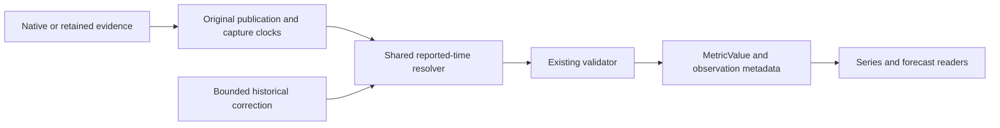
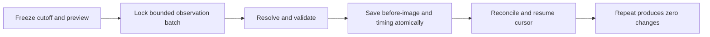

# G3 reported metric timing - Plan

## Plain-English Summary

Stored measurements will show the dates already present in their source evidence. Historical archive dates will stay historical; live snapshots will retain their original capture time. Rolling download windows will cover the reported 30 days, cumulative windows will begin at verified repository creation, and partial OpenCode days will end at their published update time.

The same timing policy will serve normal collection and a bounded correction of existing rows. Counter values, original evidence, collection schedules and frozen metric definitions remain intact. The repair will keep each prior timing value and allow safe restart and a repeat run that changes nothing.

Completion includes PostgreSQL regression tests, staged production release, reconciled historical correction and a second no-change run. The production backup is verified for archive integrity and PostgreSQL readability, without a full restore rehearsal.

## Goal Capsule

Objective: Operators and metric consumers can recover each measurement's usable reported date or interval and see specific reasons for any unresolved timing component.
Means: Shared versioned reported-time policy with bounded in-place correction (KTD1–KTD4).
Authority: Current owner “all authorized” continues the selected manual handoff through implementation, staged production delivery and bounded timing repair. Current project instructions and G3-R35/R34 prevail over historical defaults.
Execution: Main session implements and verifies sequentially; LFG owns review and delivery. No provider calls or scheduler changes.
Stop conditions: Unverified backup, unresolved original-evidence conflict, overlapping active source ownership, destructive correction, unavailable shared release environment or failing required checks.

## Product Contract

### Summary

Apply G3-R35 consistently to new and historical numeric measurements, while preserving the original values and provenance.

### Problem Frame

The October19 frozen audit found 230,336 production and 1,159,834 staging repair candidates. Existing dates are retained in observations but omitted by adapters or rejected by the earlier exact-only complete-window validator.

### Requirements

- R1. Use publication/effective/as-of dates at their recorded precision, then labeled archive dates or original-capture proxies; retrieval remains separate.
- R2. HF rolling downloads derive their start from the stated 30-day interval; cumulative downloads use verified repository creation and reject conflicting or unsupported origins.
- R3. Date-only flow endpoints use declared UTC day-boundary normalization, with report-day end at the next midnight so same-day creation remains valid; retain native report date and date-only precision.
- R4. OpenCode partial days retain partial status and use the provider update as their reported endpoint; full days, OpenRouter daily intervals and Arena publication dates retain current semantics.
- R5. Preserve counter values, zero-versus-missing, original evidence/clocks, frozen definitions/contracts, replay identity, finite generated [start,end) ranges and G3-R34 reconstructed-first HF likes selection.
- R6. Store versioned timing basis and component-specific unresolved reasons in existing observation metadata; add/retire zero tables and add zero columns.
- R7. Provide bounded dry-run/apply correction, stable cutoff/cursor, before-images, conflict/defer reasons, concurrency guard and conditional timing-only rollback. A second identical run changes zero rows.
- R8. Complete staging verification and production release, then correct the audited production/staging populations using retained evidence and reconcile actual counts against frozen cutoffs plus separately reported newer rows.

### Key Decisions

- Apply the owner's reported-time rule rather than retain the older complete-window/exact-only policy. (session-settled: user-directed — chosen over requiring an unpublished backend cutoff: available publication/as-of dates are usable.) Governs R1–R4.
- Verify the requested live export before implementation or historical mutation. (session-settled: user-directed — chosen over starting from an unverified export: preserve recovery evidence.) Governs R7–R8.

### Acceptance Examples

- AE1. An HF archive dated September28 and imported October8 reports September28, with a normalized exclusive end September29 UTC and original import clock unchanged. Covers R1–R3.
- AE2. A repository created September28 afternoon and reported that day has a positive cumulative interval ending September29 midnight, labeled date-only. Covers R2–R3.
- AE3. An OpenCode October7 partial revision at12:44:18UTC ends there, never at the future nominal day end. Covers R4.
- AE4. Replaying the same evidence or rerunning correction preserves numeric values/identity and adds no further writes. Covers R5–R7.

## Planning Contract

### Key Technical Decisions

- KTD1. Reuse `MetricValue` timing fields and `CollectionObservation.source_metadata` for policy/basis and correction before-images. Existing Product creation and captured native creation provide origins. Frozen `SourceMetric` definitions and collection contracts remain byte-identical. Zero tables added/retired, zero columns added.
- KTD2. Add a pure reported-time resolver, invoked by `prepare_rows` after original observation context is known and by historical correction. Preserve native creation evidence across projection field filtering. Existing supplied valid timing remains authoritative; only affected incomplete paths are derived. Implements R1–R6.
- KTD3. Allow complete date-only reported flows only with the versioned policy marker and declared basis; retain strict legacy validation for unmarked arbitrary intervals. OpenCode partial endpoints remain date-only to avoid claiming a complete calendar day. Implements R3–R4.
- KTD4. Correction scans numeric observation IDs in bounded batches up to a frozen high watermark, locks only the batch, records prior timing before changing rows, and rechecks expected state. Use a nonblocking task advisory lock and short lock/statement timeouts; preserve original metadata keys, numeric fields and ingestion keys. Resume by durable database markers, with counts/reasons emitted per batch. Implements R5–R7.
- KTD4 execution detail. Write already-locked rows using parameterized `UPDATE ... FROM (VALUES ...)`, with existing Django field types and preparation, a 1,000-row ceiling and exact affected-row count assertion. Staging showed that Django's conditional-expression `bulk_update` was too slow for the full population. This changes the write mechanism only; atomic timing/metadata before-images and conditional rollback remain the contract.
- KTD5. Readers expose timing-policy basis with existing per-point evidence. Retain operational first-local-observation/import cutoffs and reconstructed-first selection. Implements R5–R6.

### Data Flow

### Correction Lifecycle

### Assumptions and Risks

Native provider refresh lag/timezone may remain unknown even with usable reported endpoints; metadata must explain this. No source-certified intraday cutoff is inferred from an archive day. Missing/conflicting origins are deferred explicitly. Shared staging occupancy is an execution prerequisite, not permission to replace another owner's deployment. Local free space is limited; use an isolated small PostgreSQL test database, not a full production restore.

### Sources

Authoritative root audit: `docs/analysis/2026-10-19-095425-g3-metric-known-unknowns-audit.md` and adjacent inventories (untracked root evidence, not present in fresh worktree). Schema: `core/models.py`, migrations0067/0087/0091/0092. Writers: `core/benchmark_metric_store.py`, `core/source_metric_projection.py`, `core/benchmark_metric_history.py`, `core/model_history_archives.py`. Consumers: `core/benchmark_metric_series.py`, `core/benchmark_forecast_inputs.py`. Current HF [ModelInfo documentation](https://huggingface.co/docs/huggingface_hub/en/package_reference/hf_api#huggingface_hub.ModelInfo) supplies the30-day/cumulative distinctions.

## Implementation Units

### U1. Shared reported-time policy and writer integration

Goal: New normal and historical ingestions honor R1–R6.
Files: `core/benchmark_metric_timing.py` (new), `core/benchmark_metric_store.py`, `core/source_metric_projection.py`, existing source-projection/history/OpenCode test modules.
Approach: Implement KTD1–KTD3; retain original clocks and obtain verified origin before optional numeric-field filtering. Resolve from observation context, not replay wall-clock.
Execution note: First exercise the changed behavior through existing callers and observe failures on current code.
Test scenarios: Archive day versus import day; original capture versus replay; rolling30-day start; catalog/native origin agreement, missing/conflicting/floor/after-report origins;39same-day pattern; partial update and midnight; missing optional counters; zero; invalid numeric field isolation; unchanged Arena/OpenRouter.
Verification: Focused PostgreSQL tests assert persisted fields, finite generated ranges, source metadata and replay no-duplicates.

### U2. Bounded historical correction and recovery

Goal: Repair existing timing safely under R5–R8.
Files: `core/benchmark_metric_timing_repair.py` and `core/management/commands/repair_metric_timing.py` (new), existing projection/history regression tests.
Depends on U1. Approach: KTD4 with explicit environment/cutoff/batch limits and dry-run default; before-images and policy version make apply idempotent. Rollback compares current corrected timing against the saved after-image before restoring prior fields.
Test scenarios: Dry run makes no writes; multiple bounded/resumed batches; second run zero; interrupted transaction; unrelated observation metadata retained; numeric/definition hashes unchanged; concurrent lock refusal; conflict/defer counts; rollback refuses later changes and preserves later posts.
Verification: PostgreSQL fixtures exercise actual command and persisted rows, including mixed affected/unaffected metrics on one observation.

### U3. Reader compatibility and regression net

Goal: Consumers preserve precision, evidence and selection under R5–R6.
Files: `core/benchmark_metric_series.py`, `core/benchmark_forecast_inputs.py`, existing series/forecast/measurement-window tests only where needed.
Depends on U1–U2. Approach: KTD5; carry timing basis through existing evidence and preserve availability filters.
Test scenarios: Date-only intervals retain label/basis; state values have no flow range; partial ranges available; reconstructed-first fallback selects once; operational cutoff does not admit later imports; valid daily sources unchanged.
Verification: Focused reader, range and source collection suites, then required hosted suites.

### U4. Staged release, correction and reconciliation

Goal: Fulfill R7–R8 with exact-revision proof.
Files: Same plan and scoped operational evidence; release uses existing project process.
Depends on U1–U3. Approach: Stage unchanged candidate after availability preflight; verify runtime policy and rollback-only fixtures; promote unchanged candidate to main and observe affected production services. Run bounded dry-run, apply and repeat in each database sequentially. Reconcile numeric/count/definition/evidence invariants, finite ranges and timing reasons. Notify originating thread with final receipt.
Test scenarios: Staging and production exactSHA; real retained-evidence samples; cohort repair counts/deferred reasons; zero further changes on repeat; ordinary naturally scheduled writes use new policy without changing cadence.
Verification: Release receipt, per-batch ledger, before/after census and same-cutoff no-change run. No broad scrape or whole-database rollback.

## Verification Contract

Use PostgreSQL18 and an isolated task-owned database. Run focused `pytest tests/test_source_metric_projection.py tests/test_benchmark_download_history.py tests/test_benchmark_opencode.py tests/test_benchmark_download_persistence.py tests/test_benchmark_download_series_db.py tests/test_benchmark_forecast_inputs.py tests/test_measurement_time_ranges.py` after checking actual filenames. Include new command scenarios in existing owning tests. Run Django system checks, migration-drift check, whitespace/lint for changed files and `pytest tests/ollija`; hosted collection/benchmark/company/editorial/staff required suites must execute their PostgreSQL cases without required skips/errors. Reuse valid evidence until affected code changes.

Freeze acceptance to R1–R8, AE1–AE4 and U1–U4. Bound review/fix iteration to three substantive attempts per defect; investigate failed assumptions before retrying. Historical correction processes one database at a time with bounded batches and explicit end cutoff. Report unresolved rows rather than inventing dates.

## Definition of Done

All unit scenarios pass; backup verification receipt retained; source definitions/contracts/numbers/evidence unchanged; zero schema additions; review findings resolved or durably disclosed; CI decided; exact candidate observed on staging and production; historical correction counts reconcile and identical repeat changes zero rows; normal scheduled numeric ingestion verified; originating session notified. Abandoned code is removed. Final cleanup follows guarded Ollija instructions only after authoritative receipts are retained and canonical worktree is clean at the verified candidate.

## Delivery Exceptions

None. Owner “all authorized” on2026-10-19 selects production and historical correction; default staged route remains. No staging/direct-route waiver, scheduler pause, broad provider scrape or unrelated work is included.

<!-- BEGIN OLLIJA DELIVERY GUIDE -->
## Ollija Delivery Guide

This block is generated guidance. Do not edit it directly. Correct durable facts in `.ollija/project.yaml` or this template, then rerun `ollija annotate-plan`. Current explicit owner instructions govern this task. Record exceptions below and reflect route changes in metadata; removed requirements must not return through another checklist.

### Resolved locations

- Authoritative host: `fuchitalee`
- Authoritative repository: `/Users/fuchitalee/development/pushin-weight-v2`
- Ollija release worktree area: `/Users/fuchitalee/development/pushin-weight-v2/.worktrees`
- Active worktree: `/Users/fuchitalee/development/pushin-weight-v2/.worktrees/fix/g3-metric-reported-timing`
- Plan: `/Users/fuchitalee/development/pushin-weight-v2/.worktrees/fix/g3-metric-reported-timing/docs/plans/2026-10-19-035408-fix-g3-metric-reported-timing-plan.md`
- Change: `fix-g3-metric-reported-timing-2026-10-19-035408`
- Branch: `fix/g3-metric-reported-timing`
- Staging branch and blueprint: `staging`, `/Users/fuchitalee/development/pushin-weight-v2/.worktrees/fix/g3-metric-reported-timing/render-staging.yaml`
- Production branch and blueprint: `main`, `/Users/fuchitalee/development/pushin-weight-v2/.worktrees/fix/g3-metric-reported-timing/render.yaml`
- Staging URL: `https://pushinweight-staging-web.onrender.com`
- Production URL: `https://pushinweight-web.onrender.com`

### Placement

This worktree is inside the Ollija release worktree area. Reuse it for the whole change. Do not create a second worktree or plan for this branch.

### Delivery scope

- Workflow: `lfg`
- Delivery target: `production`
- Owner selection recorded: `true`
- Delivery route: `staged`

1. Complete implementation and the plan's verification contract.
2. Run the configured focused checks:
   - `pytest tests/ollija`
3. The parent workflow commits only this plan's changes, pushes the feature branch, and records the candidate SHA.
4. Fetch the remote staging lane: `git fetch origin refs/heads/staging`.
5. Require the unchanged candidate SHA to be a fast-forward of that fetched remote ref, then push the exact candidate SHA to `refs/heads/staging` with the server-enforced fast-forward command `git push origin <candidate-sha>:refs/heads/staging`.
6. Verify the remote staging ref resolves to the candidate SHA and the deployment for `pushinweight-staging-web` reports that same SHA.
7. Run staging checks. Stop here if they fail.
8. Only after staging passes, fetch the remote production lane: `git fetch origin refs/heads/main`.
9. Require the same unchanged candidate SHA to be a fast-forward of that fetched remote ref, then push the exact candidate SHA to `refs/heads/main` with the server-enforced fast-forward command `git push origin <candidate-sha>:refs/heads/main`.
10. Verify the remote production ref resolves to the candidate SHA and the deployment for `pushinweight-web` reports that same SHA before reporting completion.
11. After step 10 succeeds, perform worktree cleanup as the final filesystem action:
    - From `/Users/fuchitalee/development/pushin-weight-v2`, require `/Users/fuchitalee/development/pushin-weight-v2/.worktrees/fix/g3-metric-reported-timing` to remain registered, clean, unlocked, and at the verified candidate SHA. If any guard fails, retain it and report the reason.
    - Run `git -C /Users/fuchitalee/development/pushin-weight-v2 worktree remove /Users/fuchitalee/development/pushin-weight-v2/.worktrees/fix/g3-metric-reported-timing` without `--force`.
    - Preserve the local and remote feature branches. Continue final reporting from the authoritative repository root.

### Failure handling

- Complete applicable, unwaived checks for the selected route. A waived check is waived, never passed. Owner-selected direct production does not require staging.
- Product defects return to the parent implementation workflow; repeat only checks invalidated by the fix. Environment failures require repairing the environment, not a new source commit. Retry only after a relevant fact changes.
- SSH, shell, environment, or multi-machine failures use the repository infra/multi-machine skill first.
- The change ledger is advisory; do not validate or enforce it.
- Never force-remove a worktree. Retain staging-only, failed, dirty, locked,
  noncanonical, or candidate-mismatched worktrees for diagnosis or later
  delivery.
- Do not run an endless retry loop or start a persistent Ollija process.
<!-- END OLLIJA DELIVERY GUIDE -->
