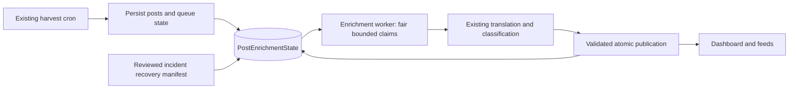
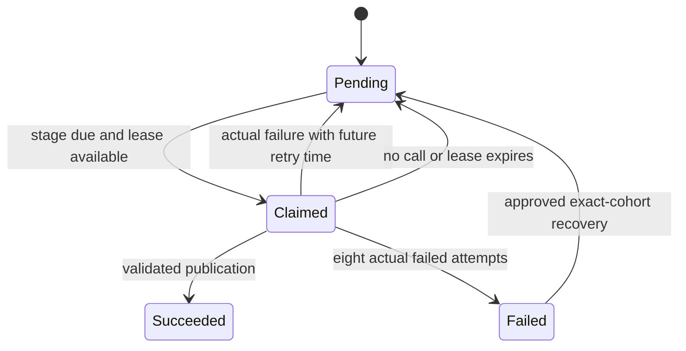
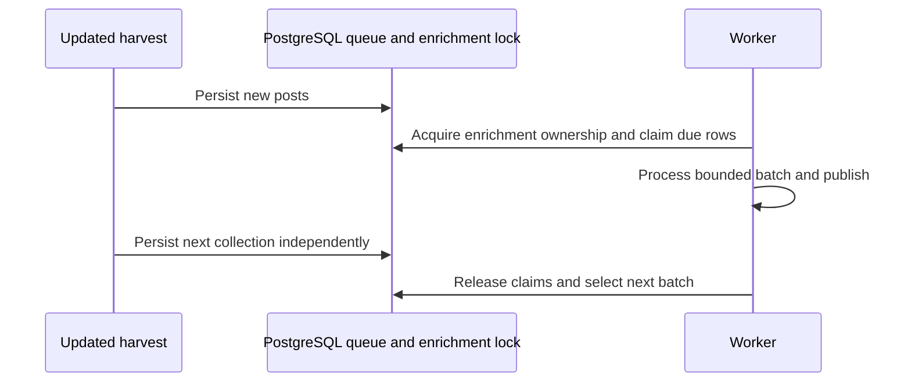

# Fix enrichment capacity and recover the October 21 backlog

## Plain-English Summary

**October 28 combined repair and delivery:** The owner adds the selected `x-list-credential-403-block.md` handoff and explicitly orders “commit push and deploy”, continuing the exact-commit staging route proposed immediately before this request. Deploy the combined enrichment and list-refusal repair on the existing staging services without moving the independent special-events branch, then promote the same candidate to production. This current instruction supersedes the handoff's undecided delivery endpoint and the earlier pending route selection. Do not pause harvesting or add a collection probe. Internal GPT review remains selected.

The added fix distinguishes a refused list-add POST from rejected authentication. Keep single-use token rotation and true credential failures fail-closed. Preserve a compact safe provider reason, pause the list after a refused write, back off from two hours to at most 24 hours, and send an account to review after five attempted refusals. Unsent accounts do not consume attempts. Existing HTTP 429 behavior remains unchanged. Existing `OfficialCompanyListIntent` status, last_error, next_attempt_at and attempts fields provide the record; credential status remains in `OfficialCompanyOwnerCredential`. Inspected models, migrations 0066/0067 and both writer/reader paths: zero tables/columns added or retired; no new JSON storage.

Regression net: real `sync_intents` → stored credential client → HTTP adapter with fake transport and real encrypted PostgreSQL state, proving 403 add does not block credentials, cooldown persists across calls, later claims are released without spending attempts, provider reasons remain bounded and omit tokens, membership readback avoids duplicate writes, and repeated refusals terminate for review. Pin persistent 401 after one refresh, owner mismatch, failed refresh and HTTP 429. Reuse unchanged enrichment test evidence and run the combined affected suite plus Ollija. Apply internal GPT findings before committing.

After exact-SHA production deployment, restore only the incident's known false block with guarded revision/status/evidence checks: credential `x-owner-17456158-list-2067062923525275922` at the observed revision, and intent 135 if still `blocked_auth/owner_auth_denied` for @LTX_io. Preserve encrypted tokens; never use stale local token pairs. Let the normal scheduled lane refresh and verify membership. If current evidence no longer matches, inspect rather than broadly resetting credentials/intents. A failed real refresh remains blocked and requires replacement credentials; never repeat an uncertain refresh. Observe a scheduled cycle and persisted membership, plus enrichment's latest-20 exact-cohort follow-up.

**October 28 review route correction:** The owner directs review through internal GPT access, superseding the external Claude/Grok route for this work. Claude returned HTTP 402 without a review; the Grok fallback was stopped at owner direction and its result is not consumed. Use the internal GPT reviewer only; preserve separate-context versus cross-model independence honestly. External route retries and dependent steps are retired.

**October28 owner correction — continuous provider-key operation:** The owner states, “continuous should be linked to our deepinfra key.” Scheduled continuous enrichment must use the existing `DEEPINFRA_API_KEY` and remain independent of the temporary launch/recovery allowance. This supersedes fixed-window expiry/spend limits for the continuous scheduled lane only, including the earlier requirement to renew that allowance. Keep provider activation, explicit model/key selection, six translation/three classifier slots, two commentary slots, one process, request/stage deadlines, per-batch call bounds, per-post retries, queue ownership and fresh/recovery fairness. Pilots retain their explicit fixed allowance and on-demand credential; historical collection budgets are unchanged. Preserve historical allowance rows without new schema (zero tables/columns added or retired).

Implement in `monitor/enrichment_worker.py` and `monitor/management/commands/run_enrichment_worker.py`, covering both individual translation/extraction dispatch and paired classifier admission. Regression first: run the actual command through real queue claims, translator/classifier parsing and persistence with fake provider transports, for absent, expired and exhausted launch windows; verify successful publication and untouched historical allowance. Retain pilot denial/no-attempt behavior, missing credential failure, per-batch bounds and process/claim fencing. Reuse the permanent shared PostgreSQL database. Source is refreshed from deployedb0d53904, independently of the special-events candidatec458b9bd. Complete review and compatible staging observation before the existing authorized production endpoint; the staging branch currently contains that separate unreleased candidate, so its failed special-events acceptance is not evidence about this worker repair. Production proof requires exact revision, provider-key route, observed successful stored-queue processing and persisted latest20/exact30-minute follow-up; do not relabel existing failed checks.

Restore timely classification and translation for every tracked brand, then recover the posts missed since October 21. Collection now brings in more posts than the enrichment step can finish. The fixed limit, shared runtime, repeated failed answers, and 24-hour expiry turn a busy queue into permanent dashboard gaps.

First test commentary with two concurrent per-post model calls in its existing worker. For the systemic repair, run enrichment continuously in a dedicated Render worker using the existing PostgreSQL queue and the existing translation/classification implementation. Keep collection on its current schedule. Give new posts most of the worker's capacity while guaranteeing progress for older posts. Stop failing work merely because it waited in the queue. Repair the tracked-promotion rejection as part of the complete pipeline change, with evidence that classification quality is preserved.

Completion requires measured capacity above incoming traffic, fresh posts completing within 30 minutes, and a frozen recovery cohort accounted for individually. The initial target is 1,100 successful enrichments/hour against an observed peak intake of 809/hour. This is a verification target, not an assertion that a proposed concurrency setting already achieves it.

The owner expects collection volume to grow 2–3 times when larger model brands are added. Make capacity configurable across the pipeline, but activate only what measured demand requires. Start commentary at two slots and one process; keep current translation/classifier slot counts for the first enrichment measurement, increasing only the constrained stage. Additional worker processes remain a later capacity option, not the default. More completed work increases model usage; slot changes mainly change how quickly that usage occurs.

On October 27 the owner invoked `compound-engineering:lfg to deployment`, resuming the full implementation and production endpoint. Execute U1–U6 as well as the already implemented two-slot commentary change. Keep conservative, explicit provider limits and record the bounded pilot/recovery settings before execution.

The subsequent broad test run completed with 901 passes and 34 failures: all 54 commentary tests passed; 31 historical experiment tests lack their original frozen inputs; three assertions also fail without this patch. The commentary database tests are no longer blocked by the shared schema mismatch. The October 27 implementation now includes the continuous worker, due queue, durable attempt/cost reservations, tracked-subject normalization, recovery and health commands. Current verification and release evidence follows below; earlier test receipts cover only their named revisions.

---

## Goal Capsule

- **Objective:** Dashboard classifications remain current across brands, and the October 21 onward enrichment gaps are recovered with explicit accounting for any genuinely unprocessable posts.
- **Means:** A continuously draining worker sharing the existing durable queue and processing code, fair scheduling, bounded real retries, and exact-cohort recovery and incremental capacity controls (KTD1–KTD7).
- **Authority:** Current owner instructions, repository AGENTS.md, this plan, then skills. The owner rejected a promotion-only patch and requested the systemic repair.
- **Endpoint:** Complete the systemic incident repair through production deployment and activation under the owner's October 27 LFG instruction, including the two-slot commentary change. Verify the actual deployed revision and queue behavior. Existing dashboard-release authorization is not reused for this incident.
- **Stop conditions:** Unknown target database, unavailable required credentials, exhausted approved provider budget, failed lease/ownership proof, or incompatible shared test schema prevents the corresponding execution/release step. Preserve collected posts and the queue.

## Product Contract

### Problem Frame and Evidence

The October 21 change `0462860f` made scheduled searches drain provider pages before enrichment. Enrichment retained its August-era 100-claim allocation, divided into 50 current-cycle and 50 carryover posts. On October 21 at 22:00–23:00 JST, 600 posts arrived while 371 completed enrichment. Failed attempts also consume claim capacity.

The post-fetch admission guard requires both 300-second stage budgets plus 30 seconds of terminalization time: a collection run leaving less than 630 seconds defers the entire enrichment batch. The queue orders newest entries first, writes retry times equal to the current time, and does not currently enforce those per-stage retry times in its due predicate. Waiting entries are failed after 24 hours from queue creation, including work never attempted.

Observed on October 26, using immutable enrichment-state creation time from October 21 00:00 JST and excluding collection-job-owned batches:

| Measurement | Observation |
| --- | ---: |
| Mean intake over complete UTC hours | 375 posts/hour |
| 95th percentile hourly intake | 682 posts/hour |
| Peak hourly intake | 809 posts/hour |
| Classification pending without an error | 7,229 posts |
| Classification pending with `classification_incomplete` | 2,288 posts |
| Classification failed with `age_exhausted` | 5,639 posts |
| Classification failed with `attempts_exhausted` | 1 post |

These are point-in-time counts, not a frozen recovery manifest. Translation debt overlaps this population and must be counted separately before execution. In the October 26 09:30 UTC cycle, 46 publications failed with `classification_untracked_promotion_subject_is_tracked`; all ten classifier role transports succeeded. Sampled rejected posts were Muse referrals under the existing `llama` brand. The October 25 activation added Muse aliases and increased that workload. This is an additional capacity drain, not the explanation for the original October 21 onset.

### Requirements

- **R1 — Keep up with collection:** Enrichment capacity must exceed observed arrival volume and keep fresh posts timely across brands, without reducing the authorized collection scope.
- **R2 — Independent runtime:** Search duration must not determine whether persisted posts receive enrichment. Continue using the shared translation/classification implementation.
- **R3 — Fair progress:** Fresh work and old debt both progress; a busy brand or repeatedly failing post cannot monopolize claims. Idle capacity can be borrowed between age groups.
- **R4 — Honest retries:** Count actual processing attempts, honor future retry times, bound retries, and preserve diagnostic causes. Waiting or budget deferral alone must not mark a post failed.
- **R5 — Preserve meaning:** Fix the tracked-promotion contract conflict without inventing semantic labels, hiding invalid model output, or weakening direct publication validation.
- **R6 — Recover the incident:** Select scheduled enrichment states created from `2026-10-20T15:00:00Z` through the recorded cutover instant; recover incomplete stages using stored source data. Preserve completed stages and exclude separately owned historical collection jobs.
- **R7 — Prove the outcome:** Report arrivals, actual completions, pending age, failures, retries, provider calls, and cost. A successful process exit or an empty queue sample is insufficient proof.
- **R8 — Bound changes and spending:** Preserve the model/provider choices, collection schedule and scope, backfill ownership, existing published data, and other workers. Add no TwitterAPI calls for recovery. Enforce the approved provider-call and monetary limits before transport.
- **R9 — Grow capacity incrementally:** Start commentary at two slots. Keep independent stage/worker controls so 2–3× future intake can be supported without rewriting queue or publication logic. Increase only measured bottlenecks; do not preactivate extra workers, change models, or automatically generate commentary for all posts.

**Product Contract changed:** The earlier promotion-only proposal is superseded by R1–R9 at the owner's direction. The latest owner decision adds the two-slot commentary trial and incremental whole-pipeline scaling for 2–3× future intake. The three existing uncommitted narrow-patch source/test edits are draft evidence only; they are not an accepted standalone release or a completed unit.

### Success Criteria

1. Sustain at least 1,100 fully enriched posts/hour across three consecutive saturated hours within the four-hour observation, including retries and publication, within the approved cost envelope. Use incident backlog as stored input when fresh intake alone cannot saturate the worker. The 200-post pilot can screen a candidate but cannot prove sustained capacity. Measure completed posts, not claims or HTTP successes.
2. At least 99% of fresh scheduled posts complete both stages within 30 minutes of queue creation during a bounded four-hour observation; report per-brand counts and every exception, including terminal failures and budget deferrals. Do not remove failed posts from the denominator. `context_missing` is a valid completed classification and must not be relabeled to make dashboard charts look complete.
3. No entry becomes failed solely because queue age exceeded 24 hours. No brand with due work is repeatedly denied service by claim ordering.
4. The frozen recovery manifest is fully accounted for as completed, concurrently completed/skipped, or a specific reviewed terminal failure. Target recovery within 72 hours after activation, conditional on the measured spare capacity and approved spending ceiling; calculate the forecast before release.
5. The literal latest-20 post check is performed once and its exact IDs inspected once after 30 minutes. Supplement it with the queue-wide measurements above; a small cohort alone cannot establish capacity.

---

## Planning Contract

### KTD1 — Use the existing PostgreSQL queue in a dedicated worker

Add one `pushinweight-enrichment` Render background worker, following the existing `run_synthesis_worker` management-command pattern. It polls `PostEnrichmentState` and invokes the same post-fetch processor used by `CycleRunner`; it never calls `CycleRunner.run`, search, metrics refresh, or cursor advancement. No new broker or scheduler is needed. Render supports continuously running background workers that poll a queue: [official worker documentation](https://render.com/docs/background-workers).

Extract only the boundary needed to call the existing processor safely; do not copy the translation, classification, publication, or retry implementation. Preserve the successful-publication hooks, including bounded targeted extraction and required local rare-hit reconciliation. Account for their calls in the worker budget; do not silently lose them when inline post-fetch is disabled. Demand synthesis, headlines, and unrelated schedules retain their existing owners.

A larger inline cap was considered and rejected as the complete solution because collection and enrichment would still compete for the same 13-minute runtime and 630-second admission envelope. A separate Celery/Redis pipeline would duplicate infrastructure for an existing database queue.

### KTD2 — Preserve durable identity and separate ownership locks

Reuse `PostEnrichmentState`'s one-row-per-post identity, per-stage state, attempts, retry timestamps, and lease fields. Preserve `source_collection_job_id` separation. Inspect migrations `0011_harvester_state_primitives`, `0038_split_translation_synthesis_ja`, `0058_postenrichmentstate_translation_diagnostics`, and `0085_provider_batch_enrichment` alongside current models before implementation.

**Schema footprint:** one new typed budget table, zero retired tables, zero new JSON columns, no new queue store. `PostEnrichmentState` remains unchanged except for a supporting index if the measured due-query plan requires one. External recovery manifests are bounded operational audit artifacts, not replacement application state.

The budget record has a distinct meaning: one approved spending window for the shared enrichment processor. Existing `PostSynthesisDailyBudget` belongs to synthesis demands; `EditorialBudget` and `OriginalContentCall` belong to editorial/content runs; `CollectionRun` belongs to collection jobs deliberately excluded here. Reusing those identities would mix ownership or force fake jobs. Their models, migrations `0038`/`0065`, and writers in `monitor/post_synthesis.py`, `monitor/editorial/persistence.py`, and `monitor/backfill_collection.py` were inspected; reuse their atomic reservation pattern, not their records.

Add `EnrichmentBudgetWindow` with UUID identity; typed scope (`pilot` or `scheduled`), start/end timestamps, request and USD limits, reserved request/USD counters, and an immutable pricing/config fingerprint. Require positive limits, start before end, counters within limits, and uniqueness of scope/start. The worker selects the explicitly configured window ID; a restart or code/config revision cannot create a new allowance. The scheduled window covers fresh work and recovery together. A new allowance requires an explicit operational setting, not automatic replenishment. Each physical call locks and reserves against that row before transport; no refunds are needed for correctness. A crash after reservation keeps the conservative debit. Returned token usage is reported separately from reserved upper-bound cost. The table is an aggregate allowance, so it needs no false post or collection-job foreign key. No variable-schema data is being added.

Start with one active enrichment process, but implement the coordination boundary as a bounded process-slot pool: environment-scoped advisory keys `enrichment-writer:slot:1..max_worker_processes`, separate from `harvest-writer`. Default `max_worker_processes=1`; configure no second Render instance now. Updated inline processing and the worker use the same slot pool. Keep `SKIP LOCKED` row claims and run-ID checks at publication. Each process owns one slot; rolling replacements cannot duplicate that slot. Increasing the configured process limit and matching service instances later allows disjoint concurrent claims without replacing processing logic. Preserve database-refresh exclusion separately from worker-count exclusion. On lock connection loss, stop provider dispatch and exit. Claims recover after lease expiry; stale owners cannot publish.

### KTD3 — Remove age-based loss and enforce fair due scheduling

For scheduled states (`source_collection_job_id IS NULL`), queue age becomes an alert condition, not terminal failure. Remove age exclusion and age terminalization from both the claimant and stage finisher. Keep the existing maximum of eight actual failed attempts. Preserve source-job-specific behavior for historical collection batches.

The new worker claims up to 100 posts per batch: reserve 80 for states less than 30 minutes old and 20 for older states, then let either group borrow unused places. Within each group prefer oldest due, with deterministic post-ID ordering; do not put newest failures back at the head. Partitioning uses queue creation time, not X publication time or mutable `fetched_at`.

A stage is due only if pending and its own next-attempt time is null or elapsed. Claiming a row for translation must not run classification whose retry time is in the future, and vice versa. Record a stage attempt only when a provider request for that stage actually starts. A classifier role pair counts as one attempt per affected post; an incomplete pair is a failed attempt, not two. Reservations, budget refusal, expired local deadlines, and shutdown before dispatch consume no attempt.

After an actual failure, back off 5, 10, 20, 40, 80, 160, then up to 360 minutes, using the existing stage retry fields. Persist a bounded error code that distinguishes transport, invalid response, publication conflict, and source failure. Eight real failed attempts become terminal and visible. No automatic requeue of all historical failures.

### KTD4 — Start with bounded parallelism, then measure capacity

Initial enrichment configuration: batch size 100; existing translation concurrency three; existing classifier concurrency three; one active worker process and one batch per process; five-second idle poll; immediate next batch when due work remains. Commentary uses its existing separate process, with two concurrent calls. Do not increase translation to six in advance: if the bounded pilot misses the current target and translation is the measured limit, test four, then six only if four is insufficient, within the same approved test ceiling. Translation calls within a post remain serial. Keep 90-second request timeout, 300-second stage budgets, 30-second terminalization reserve, and 660-second claim TTL. Use config.yaml plus `load_config` as the runtime source of truth; remove hard-coded worker counts from the changed caller seam.

Reserve the classifier's request allowance before translation dispatch so translation cannot consume the complete batch budget. Proposed hard ceiling: 600 physical provider requests per 100-post batch, including retries and optional publication hooks; deferred work stays pending. Preserve paired classifier reservation. Enforce the approved window limits through KTD2 before each physical request, using conservative input-token bounds and the configured maximum output tokens at verified model rates. Record actual usage separately; do not refund reservations in this patch. Unknown pricing or an input without a defensible token bound stops dispatch. Budget denial is a neutral deferral with an alert, never a completed post or consumed attempt. Reserve both classifier roles together; retain a failed or interrupted reservation conservatively.

This setting is a starting candidate, not a promised throughput result. A representative maximum-200-post staging pilot is capped at 1,200 physical requests and an explicit owner-approved dollar ceiling. Measure translation time, classification time, database publication, retries, long posts, and cost per completed post. Use observed results to size the steady operating window and recovery budget; do not invent a dollar estimate from request count alone. If the target is missed, permit at most two measured concurrency adjustments within the approved ceiling, stopping as soon as the target is met; otherwise report the remaining constraint. No model/provider substitution or unlimited tuning loop.

### KTD5 — Repair the promotion conflict under the same semantic contract

At the selected v4 parser/publication boundary, use the exact tracked-catalog snapshot already fingerprinted into the input. Make the model instruction explicit that reviewed aliases/products belonging to a tracked brand cannot also be untracked promotion subjects. Validate all fields before normalization.

An exact, unambiguous tracked-subject match can be excluded from the untracked-only projection while retaining independently valid per-brand judgments; clear that projection if no untracked subject remains. Preserve genuinely untracked subjects in mixed output. Never fuzzy-match, discard malformed output, fabricate a type/sentiment, or treat an ambiguous alias as proof of identity. Emit a normalization counter and retained error causes so the operation is observable. Direct publication callers remain strict.

Use the stored Muse referral examples and a bounded set of actual failed posts, with tracked-only, untracked-only, mixed, alias-collision, and malformed cases. Compare actual labels and evidence, not only successful writes. The original helper-only draft is insufficient; this must pass through the real classifier and durable publication call chain. If exact identity cannot be established, retain a diagnosable retry/failure rather than forcing success.

### KTD6 — Recover an immutable incident cohort without recollection

Build a read-only manifest from the incident window in R6 with exact post IDs, stage statuses, attempt counts, errors, queue timestamps, and a manifest digest. Include pending work in reconciliation, but reopen only failed stages covered by the incident. `age_exhausted` can return to pending with its existing attempt history; never rewrite queue creation timestamps to bypass age logic.

The one `attempts_exhausted` case and any newly discovered terminal causes require explicit classification in the manifest. If a further attempt is justified by a corrected defect, preserve the pre-reset counter in the immutable receipt and reset only that failed stage under the approved manifest. Completed stages and later successful updates are skipped at apply time. Recheck active leases and `source_collection_job_id` under row locks. Repeat application is idempotent.

The recovery command defaults to preview, requires exact manifest plus bounded `--apply`, and only requeues states. The same worker processes them. Preserve source texts, translations, taxonomy records, and collection cursors. Use stored source material; no X recollection. Recovered published results are not erased during rollback.

### KTD7 — Configure stages independently and size from measured demand

**Owner-directed decision:** two commentary slots now; enable additional slots or processes only as needed. Future 2–3× post volume is a capacity design requirement, not authorization for new collection scope or immediate capacity expansion.

| Arrival scenario | Average posts/hour | Observed peak scaled proportionally | Enrichment capacity target with current headroom |
| --- | ---: | ---: | ---: |
| Current | 375 | 809 | 1,100/hour |
| 2× future volume | 750 | 1,618 | 2,200/hour |
| 3× future volume | 1,125 | 2,427 | 3,300/hour |

Future rows are planning scenarios, not provider performance claims or active settings. October 22–23 active processing implies about 850–920 completions/hour at existing settings if idle cron time is removed; continuous performance must still be measured. Commentary's October 26 sample implies about 540/hour at one slot; do not claim two slots doubles it before testing. Commentary stays demand-triggered; its growth follows viewing demand, not automatically every new post.

Keep `config.yaml` / `load_config` as the sole configuration path for per-stage concurrency, batch limits, timeouts and worker process limits. Keep claim ownership and publication independent of process count. No hard-coded single-dispatch mutex may silently prevent a configured second enrichment process. Higher settings must pass validation, bounded request/spending checks, and the same lease/retry tests. The initial commentary trial adds only `synthesis.concurrency=2`; its existing process coordination lock remains, so additional commentary processes are a separately tested extension.

Measure the entire path: collection pagination/runtime and credits; persisted arrivals; translation and classification completion/latency/retries; targeted extraction and metrics-refresh backlog; commentary demand/completion/expiry; database connection/writes; and provider calls/cost by model. Translation and commentary share Gemma capacity, so a slot increase must include their combined configured maximum, all permitted worker processes, and rolling-deploy overlap. Bound each stage at its transport boundary and validate the sum of permitted process slots times per-process calls, plus other declared callers, against the selected model allowance. A mismatched capacity/config fingerprint must refuse dispatch. Rolling replacements share process slots, so they cannot add uncounted capacity. Verify actual account limits and leave headroom for separately owned callers before paid scaling; per-worker settings alone are insufficient for multiple processes.

Scaling sequence: confirm the queue is losing ground or freshness misses persist; identify the slow stage; raise only that stage one bounded step; compare successful completions, latency, retries, database load and cost. Add a process only when more slots in the existing process are inadequate or process resources are the constraint. Stop scaling when current acceptance targets are met. Exercise 1×/2×/3× arrival patterns with fake transports and stored inputs to prove scheduling, ownership and limits; live throughput claims require an approved bounded provider run. Collection cadence and enabled brands remain unchanged in this patch.

### High-Level Technical Design

---

## Implementation Units

### U0. Test two commentary slots in the existing worker

**Requirements:** R7–R9. **Dependencies:** none. Included in the resumed full incident release.

**Files:** `monitor/post_synthesis.py`, `monitor/management/commands/run_synthesis_worker.py`, `x_monitor/config.py`, `config.yaml`, `tests/test_post_synthesis_concurrency.py`, `tests/test_post_synthesis_lifecycle.py`.

**Approach:** Add validated `synthesis.concurrency` (initial setting two, supported range one through twenty). Claim at most the available immediate slots, with `batch_size` required to cover concurrency. Run only `synthesize_post` in the thread pool; load contexts, claim and publish on the owner thread. Publish each finished result independently and retain per-post retries/fencing. Poll immediately after a nonempty batch; sleep only when no work is claimed. Keep one commentary process, the existing model/prompts and demand-driven behavior. Add no schema or provider call for offline verification.

**Regression net:** exercise the actual synthesis prompt/parser call chain with fake transports at one and two slots; prove overlap, maximum active calls, sibling success during a timeout, no ORM work in provider threads, zero dispatch while disabled, and idle-only polling. PostgreSQL integration must prove two independent publications, exact usage accounting, and that a third queued post remains unclaimed with zero attempts. A bounded latency simulation may compare one/two slots but is not live throughput evidence.

**Verification:** targeted provider-free tests, required PostgreSQL lifecycle/API/prewarm checks, and an eventual bounded live trial after database verification/release can proceed. Report deployment state separately from local code completion.

**October 26 local evidence:** four new cases failed against the original sequential/no-concurrency implementation, then the targeted synthesis suite passed **23 tests, zero skips** after the change. Ruff on changed processor/command/test files and whitespace checks passed. The complete config module reports three existing lint findings (`UP037`, `LOG015`, `TRY203`), independently reproduced from HEAD; none is in the changed configuration lines. Forty simulated 50ms provider responses took **2.294s at one slot** and **1.156s at two**, with observed maximum simultaneous calls exactly one/two. This is scheduling evidence, not a live-provider throughput claim. The shared PostgreSQL wrapper refused lifecycle/API/prewarm tests before execution because G2/RG6 advanced the database beyond this checkout through `0186_source_datasets`. A broader lock-test invocation reported 33 passed and two PostgreSQL-required skips and was correctly non-green. The full persistence suite remains unexecuted; no deployment or paid provider trial has occurred.

**Owner-requested xbackfiller database evidence, October 26 21:49 JST:** `xbackfiller-db` (`dpg-dbfemu2vcj2c73fsafe0-a`, database `xbackfiller`) has schema through `0183`, also ahead of this checkout's `0168`. All eight tables used by commentary matched the required model columns, with no extra required columns, and its commentary queue was empty. A bounded integration script used the actual demand, claim, synthesis parser, publication, retry, and budget code with fake provider transports. Both scenarios passed: two concurrent successful calls produced two current artifacts and six language texts; one simulated timeout still allowed the other call to publish one artifact and three texts. Both claimed exactly two posts, left a third pending with zero attempts, and recorded exactly the returned token usage. All synthetic posts, demands, artifacts/texts, and budget records were rolled back and absence was verified. No model network calls, migrations, table flushes, or retained fixture rows. PostgreSQL sequence allocation can advance despite rollback.

The scoped script and source-hashed receipt are local evidence at `.local/commentary-two-slot/xbackfiller-rollback-smoke.py` and `.local/commentary-two-slot/xbackfiller-rollback-receipt.json`; invocation: `PYTHONPATH=. .venv/bin/python .local/commentary-two-slot/xbackfiller-rollback-smoke.py`. An earlier harness verification used an unsupported foreign-key lookup and rolled back; the saved script uses exact IDs. A launch without `PYTHONPATH=.` failed before connecting; the corrected invocation passed. This narrow integration proof does not replace the full lifecycle/API/prewarm suite or establish live provider throughput.

**Later expanded verification:** all 54 commentary cases, including the full lifecycle/API/prewarm suites and the new two-slot persistence test, passed against the permanent shared PostgreSQL database in the compatible verification checkout described below. Twelve production/staging topology tests also passed on the canonical task checkout; Django system checks reported zero issues. This supersedes the earlier unexecuted-suite status. The broader suite remains non-green for the separately recorded failures; no live model throughput or deployment is claimed.

### U1. Reproduce capacity loss and establish the shared processing boundary

**Requirements:** R1, R2, R7. **Dependencies:** none.

**Files:** `monitor/cycle.py`, `monitor/post_enrichment.py`, `tests/test_post_enrichment_queue.py`, `tests/test_cycle_error_counters.py`, new `tests/test_enrichment_capacity.py`.

**Approach:** Characterize the 809/hour arrival pattern, current claim ceiling, retry amplification, and skipped post-fetch when collection leaves less than 630 seconds. Inventory all post-fetch publication hooks before extracting a reusable batch entry point. Retire or rework the three narrow-draft edits as part of U4; do not stage them as a complete fix.

**Test scenarios:**

- A deterministic multi-hour workload exceeds 100 arrivals per 15 minutes and exposes growing debt before the patch.
- A long collection run persists posts even though inline enrichment cannot start.
- Successful prior translation is reused when only classification remains pending.
- Source-job-owned backfill states are excluded from the scheduled worker.

**Verification:** The reproduction exercises the real cycle/claim/publication seams with captured fake transports and shows the original deficit. The shared boundary preserves existing downstream effects.

### U2. Fix due scheduling, attempt accounting, and expiry

**Requirements:** R3, R4. **Dependencies:** U1.

**Files:** `monitor/cycle.py`, `monitor/post_enrichment.py`, `x_monitor/config.py`, `config.yaml`, `x_monitor/attribution.py`, `tests/test_post_enrichment_queue.py`, `tests/test_post_enrichment_policy.py`, `tests/test_harvester_config_contract.py`.

**Approach:** Implement KTD3 using existing fields. Add dispatch callbacks where needed to associate actual classifier role calls with post IDs. Preserve partial-stage success and lease ownership; record retry causes before releasing a claim.

**Test scenarios:**

- A 30-hour-old never-attempted scheduled post is processed rather than failed.
- Future classification retry time remains honored when translation is due now.
- Empty fresh or old lanes lend their unused quota; a continuous fresh stream cannot starve old work.
- No-call budget or deadline deferral increments no attempt; eight actual failures terminalize exactly once.
- Lost lease, stale publication, duplicate claims, and source-job exclusions retain their existing guarantees.

**Verification:** Real PostgreSQL claim tests prove stage-specific due predicates and fairness; a clock-driven sustained workload demonstrates progress for both age groups.

### U3. Add the independently draining worker and resource guards

**Requirements:** R1, R2, R8. **Dependencies:** U1, U2.

**Files:** new `monitor/management/commands/run_enrichment_worker.py` and `monitor/enrichment_budget.py`, `core/models.py`, one new budget migration, `monitor/cycle.py`, `monitor/run_lock.py`, `x_monitor/config.py`, `config.yaml`, `render.yaml`, `render-staging.yaml`, new `tests/test_enrichment_worker.py` and `tests/test_enrichment_budget.py`, `tests/test_harvest_writer_lock.py`.

**Approach:** Follow the existing synthesis-worker process pattern, reuse the shared batch entry point, and implement KTD2/KTD4. Add a config-controlled `inline`/`worker` mode defaulting to inline for the compatibility release. Provide `--once` for bounded tests and structured summaries. Use service-scoped required database/provider configuration; the worker receives no Twitter credential. Scheduled enrichment and its approved recovery use the existing scheduled DeepInfra factory and service-scoped `DEEPINFRA_API_KEY`; the manually launched pilot explicitly uses `DEEPINFRA_ON_DEMAND`, with no fallback between purposes. Implement the typed allowance and atomic reservation in KTD2. Keep credentials in Render configuration, never in manifests or logs.

**Test scenarios:**

- Worker completes pending rows without any search, metrics, cursor, or Twitter client invocation.
- Collection persists while the enrichment lock is held; two processes cannot own the same configured worker slot; with a tested limit of two, they claim disjoint posts and respect the aggregate provider ceiling.
- Connection loss stops new calls; SIGTERM stops new claims and checkpoints completed work; a replacement resumes safely after lease expiry.
- Request reservations preserve classifier capacity and count retries; missing budget/price/credentials fails before transport. Restart after a committed reservation cannot replenish it; concurrent requests cannot exceed the window; expired windows stop dispatch without exhausting post attempts.
- Configured concurrency is observed at the actual provider boundary and does not grow with batch count.

**Verification:** Command-to-provider-to-publication tests pass, deployment manifests contain only the intended additive worker, and bounded representative processing meets the capacity gate or identifies the measured shortfall.

### U4. Fix repeated classification rejection with semantic proof

**Requirements:** R4, R5. **Dependencies:** U1, U2.

**Files:** `x_monitor/classifier_0731_prompts.py`, `x_monitor/attribution.py`, `monitor/classification_persistence.py`, `monitor/cycle.py`, `tests/test_u18a_classifier_contract_v4.py`, `tests/test_u18a_v4_classification_persistence.py`, `tests/test_cycle_error_counters.py`, relevant stored Muse fixtures.

**Approach:** Implement KTD5 at the shared path; version any changed classifier prompt and preserve provenance. Keep the full per-post transaction and atomic type/state publication. Expose precise publication errors instead of turning every failure into `classification_incomplete`.

**Test scenarios:**

- Exact tracked-only and mixed subjects publish valid classifications with correct promotion evidence.
- An independent company sharing a substring with a tracked brand remains independent.
- Malformed evidence and uncertain identity remain rejected; a direct tracked-subject publication still fails safely.
- A failure in one post does not discard valid sibling posts, and a successful retry does not duplicate evidence.

**Verification:** Provider-free tests traverse classifier parsing, CycleRunner publication, state completion, and dashboard-readable type edges. The authorized bounded live pilot checks semantic output against a frozen reviewed sample.

### U5. Add previewable incident recovery and queue health reporting

**Requirements:** R6, R7, R8. **Dependencies:** U2, U3, U4.

**Files:** new `monitor/management/commands/recover_enrichment.py`, `monitor/post_enrichment.py`, `monitor/harvest_summary.py`, new `tests/test_enrichment_recovery.py`, new `tests/test_enrichment_health.py`, `docs/operations/` incident runbook.

**Approach:** Implement KTD6. Reuse existing persisted state and bounded reporting conventions. Emit arrival/completion rates, due/future-retry/leased counts, oldest pending age, completed latency, terminal error causes, per-brand backlog, provider requests/tokens/cost, and mode/worker revision. Harvest summaries must identify externally processed enrichment explicitly rather than reporting zero inline completions as health.

**Test scenarios:**

- Preview makes no writes or provider calls; apply touches only the manifested failed stages.
- Repeated apply, active leases, concurrently completed rows, changed source ownership, and digest mismatch are handled safely.
- No queue creation timestamp is rewritten and no successful stage is reset.
- A provider outage or budget stop is visible while claims return safely; fresh intake and recovery debt remain separately countable.

**Verification:** Every manifest ID has an explicit disposition and the command cannot widen selection at apply time. Counts reconcile with independent database queries.

### U6. Stage, activate, measure, and drain the backlog

**Requirements:** R1–R9. **Dependencies:** U2–U5.

**Files:** `render.yaml`, `render-staging.yaml`, `docs/deploy/render.md`, the incident runbook and evidence under `docs/analysis/harvester/`, `tests/test_enrichment_worker.py`, `tests/test_enrichment_recovery.py`.

**Approach:** Use the staged rollout below after owner-selected delivery. Freeze the exact candidate and pilot/recovery cohorts. Quote service cost and calculate model spend from measured token usage before activation. Use a bounded four-hour capacity observation and at most two permitted tuning adjustments; use the approved recovery spend/time limits as real stop conditions.

**Test scenarios:**

- Inline compatibility revision and worker coexist during a rolling deployment without duplicate calls or lost rows.
- Worker deployment failure leaves inline processing available; rollback after cutover preserves the new non-expiring queue behavior.
- Maximum-200-post pilot, exact latest-20 follow-up, four-hour queue trend, and recovery reconciliation all describe the same candidate revision.

**Verification:** Exact deployed revision is observed, fresh completion and throughput gates pass, recovery manifest is reconciled, and any remaining terminal failures are reported individually.

---

## October 27 Implementation and Verification Record

The candidate now starts from production `8785ea76` / schema `0195`. U0–U5 code and local verification are complete; U6 activation/measurement/recovery remains pending. No incident deployment or paid provider request has occurred yet.

- `monitor/enrichment_queue.py` owns the shared due/claim/attempt/finish rules, reused by the original `CycleRunner` processing path. Scheduled claims consume no attempt; first physical dispatch checkpoints once per claimed stage, with both classifier roles sharing the attempt. Worker allocation is 80 fresh / 20 old with borrowing; inline collection retains its current/carryover reporting contract. Source-job-owned historical batches retain their existing replay timing and are excluded from the scheduled worker.
- `monitor/enrichment_worker.py` wraps the same processor with configurable PostgreSQL process slots and a shared database-refresh gate. `run_enrichment_worker` never invokes collection; shutdown stops new calls and lets started requests checkpoint. The new role-pair allowance is reserved atomically, including retry envelopes, before dispatch. Every physical request and optional extraction uses the shared batch/window limit. The new worker performs the existing local rare-hit reconciliation.
- `0197_enrichment_budget_window` adds exactly one typed table and no JSON or existing-column change. G2 explicitly assigned this number, reserving later physical retirement after a merge. The shared test database contains G2 `0196`, our `0197`, and verification-only `0198_merge_enrichment_rg6`. The release candidate contains only `0197`, with parent `0195`; it does not promote G2's unreleased change.
- Classifier content/merge prompt revision advances to v7, retaining historical v5/v6 trace readability. Exact unambiguous reviewed aliases/products/official handles/domains can be removed from the untracked-only promotion projection; search keywords alone cannot justify removal. Raw classifier traces remain available; the normalization counter reports only successfully published results. Direct publication remains strict, including live-lease checks.
- `recover_enrichment` writes a digest-bound preview by default. Apply preserves completed stages, source ownership, original queue timestamps, and attempt history; explicit reviewed reset reasons are required for exhausted attempts. Validation covers the entire manifest before writes. Each application locks only its bounded write set and records a receipt. `enrichment_health` reports arrivals/completions, due/future/leased debt, brand backlog, error causes and allowance reservations.
- Capacity remains translation3 / classifier3 / commentary2 / one enrichment process. The declared shared Gemma allowance is20, with7 places reserved for two overlapping two-slot commentary processes during deployment and a separate three-slot staging/production peer. This declares headroom; it does not activate20 calls. Verified DeepInfra default account concurrency is200/model; separately owned active callers must be checked before a pilot.

Pricing verified October27: [Gemma](https://deepinfra.com/google/gemma-4-31B-it-turbo) is USD0.09 input /0.34 output per million tokens; [DeepSeek0731](https://deepinfra.com/deepseek-ai/DeepSeek-V4-Flash-0731) is USD0.06 /0.18. Reservations deliberately use the published1.5x priority rates, UTF-8-byte input bounds plus template allowance, and the actual configured output maximum. No cache discount/refund is assumed. A changed pricing/config fingerprint cannot reuse the old allowance; concurrent windows with different configurations refuse dispatch.

Verification evidence resides in `.local/enrichment-regression/` in the existing verification worktree, with source manifests copied before each run. First run:32 passed/4 old-policy assertions failed; all6 new PostgreSQL guard/queue cases passed. Updated broad run:125 passed/1 fixture failure; the fixture omitted a lease expiry and was corrected. Next run:106 passed/1 backfill replay failure; this exposed an actual compatibility issue, repaired by retaining historical source-job replay timing. Follow-up:97 passed/2 failures; the saved-reply backfill regression now passes, one topology inventory needed the new worker, and the remaining scrub assertion also fails with the unchanged `8785ea76` refresh implementation (baseline receipt retained). That assertion expects zero collection scopes, although preserved numeric evidence now owns a typed scope; it is outside the changed refresh-lock behavior.

Both Render Blueprints validate. Production's validation plan shows exactly the new enrichment service. Staging reports additional existing drift; do not apply the entire staging Blueprint blindly. Create/update only the owned enrichment resource and selected candidate services under the staged delivery route.

G2 coordination is with thread `01a15790-3183-7be2-ab63-6f359c24e588`. G2 granted exclusive local test windows and copied hash-verified0197/0198 compatibility files. Before either staging or production deployment, notify G2 so its current bounded historical copy can finish and new copies stop launching; wait for its clear-lane reply. Do not pause harvesting or restart backfill. G2 will update its copy guards to the observed new service SHA/schema after release.

## October 27 release review and operational inputs

The implementation is based on `8785ea76` and adds migration0197 directly after0195. G2's0196 and the local verification merge0198 remain excluded from this candidate. The production and staging databases are currently0195; the permanent local test database remains0195/0196/0197/0198 without reset. This supersedes the historical0168/0186 mismatch below.

Current regression evidence:387 passed and one unchanged baseline scrub failure,119 required PostgreSQL tests executed, zero skipped. The baseline `test_shared_collection_scrub_preserves_numeric_evidence` assertion at693 reproduced with the unchanged8785 refresh implementation. Follow-up failure tests caught and fixed missing enrichment exclusion in refresh preflight/rollback/prune. The refresh/recovery rerun has78 passed and the same baseline failure. The process-lock loss case dispatches zero provider calls and consumes zero stage attempts. Recovery receipt write failure rolls back the complete bounded batch.

The local implementation uses the existing transport and publisher. There is no HTTP retry hidden below the guarded DeepInfra transport; retry envelopes are reserved by the caller. Three inline simplification passes checked reuse, quality and efficiency. New modules were formatted; the recovery loop reads the manifest cohort once and locks only the bounded write set. Existing guard behavior and compatibility entry points were preserved. Repository agent instructions require inline review instead of local subagent dispatch; any independent cross-model review is recorded separately.

Fresh production census on October27 before activation:61,120 incident-window rows,22,367 with at least one incomplete stage;16,952 arrivals in the preceding24 hours (706/hour). The earlier375/hour average is historical. Recalculate recovery forecast from observed completion throughput; do not assume1,100/hour or the earlier intake still describes reality.

Owner-selected activation limits: on October27 at09:16JST the owner replied `deploy` to the explicit $5 pilot/$100 first12-hour recovery question. Proceed with staging pilot at most200 exact stored posts,1,200 reserved requests,$5,2 hours; production scheduled/recovery together at most40,000 reserved requests,$100,12 hours. These ceilings reserve conservative worst-case token costs and are not expected billed charges. Deployment and paid activation under these bounds are authorized; no repeated approval question is needed. The service starts with calls disabled until the pilot passes. The finite allowance requires an explicit replacement after the observation; it never renews on restart.

Additional release-review corrections: both worker definitions now carry the same literal-translation and rare-type post-classification settings as production harvest. An effective-config test loads each Blueprint environment through `load_config` and compares LLM, targeted-extraction and rare-type settings. This caught a real omitted flag that would have selected the older combined translator. All43 Ollija/topology checks pass. Ruff on existing changed modules adds zero findings after removing obsolete extraction imports; new modules pass.

Final worker/config/topology verification:52 passed, including24 required PostgreSQL tests with zero skips. Separate queue fixtures at1x,2x and3x arrival volume all drain both fresh and old lanes; these are scheduling tests, not measured provider throughput. The read-only production query selecting20 old due rows took128.485ms using existing indexes. No extra index is justified by that observation.

Full review was performed sequentially inline under the repository's agent mapping. No remaining code finding was established. Independent review coverage is unavailable: the configured Claude route returned402 before review, and its single Grok fallback timed out after600 seconds without a review artifact. Both jobs were terminated/collected and removed. The inline adversarial pass checked lost process locks, expired/replaced claims, paired request reservations, recovery receipt failures and shared model capacity. This is not independent corroboration. Review receipt: `.local/enrichment-release/review.json`; known baseline scrub failure remains recorded above.

The staged pilot is frozen as200 actual stored posts spanning21 brands, including42 Muse mentions,25 stored parent-context posts and189 author identities. Its digest is `834c1aa53a8abee1fe8ab1161811af4c10190abb51e0d19cd76cf1106ca70abd`. Import creates only these new source rows and their bounded context in staging; it neither flushes staging nor changes production. Before activation, compare semantic output and validate persisted labels on this exact cohort. The new starter worker costs$7/month per environment ($14/month if both remain running), per [Render pricing](https://render.com/pricing); creating the resources falls within the authorized worker deployment. No extra database or broker is added.

Browser scope is backend-only: no route, template, static asset, or browser interaction changes. Exercise commentary's existing demand/poll/publication API through its PostgreSQL integration tests; record browser route coverage as not applicable rather than claiming a browser pass. The already-deployed dashboard chart/pills change is outside this candidate.

## October 28 combined list-refusal release verification

Added the X list-refusal repair under the owner's commit/push/deploy instruction. The new production-call-chain regressions failed before the fix (9 failures, 17 passes). The initial corrected list/credential suite passed all 26 cases. Added preflight permission/owner guards, then ran the full combined affected suite: **178 passed, 21 failed; 128 required PostgreSQL tests executed, zero skipped/errors**. All 21 failures reproduce identically with the deployed `b0d53904` production source: two old cycle assertions expect seven planned calls instead of the deployed eight, and nineteen account-evidence fixtures omit `verified_type` after the prior vocabulary refactor. These are baseline failures, not passed checks. Candidate source hashes were restored exactly after baseline verification. Logs: `.local/enrichment-release/combined-regression.log`, `combined-baseline.log`, and `baseline-source-check.json`. Changed production modules and the list-sync tests pass Ruff; whitespace checks pass.

Internal GPT reviewed the new list credential call chain, refusal bounds, cooldown persistence, authentication, single-use renewal and safe error handling; no actionable introduced defects. New review: `/tmp/compound-engineering-501/ce-code-review/20261028-enrichment-provider-key/internal-gpt-list.json`; combined follow-up records coverage and baseline failures. No external review calls were made for this addition.

Production read-only preflight still matches the handoff: the exact credential is blocked at revision 25, last token save `2026-10-18T03:36:46.012265Z`; intent 135 is the only `blocked_auth` row, for native account `1757373753829253120`, with matching registered evidence and one attempt. The production repair will compare this exact state and use the normal writer locks; it will not reset other credentials or pending accounts. Staging web/enrichment have no active deployment or one-off job, and staging provider activation remains false. Use the staging enrichment service for the rollback-only list fixture smoke and an empty exact-ID worker command; no real provider call, real-post fake output or stage jobs cron deployment is needed. The staging branch remains unchanged, and exact live revision checks before smoke and promotion fence automatic deployment races.

## October 28 provider-key repair verification

The internal GPT review found that the first implementation exempted all callers using the default `scheduled` scope, including manual repair commands. Applied finding #1 by introducing an explicit `continuous` scope selected only by the non-pilot worker command. Default manual callers and pilots retain their existing allowance checks. No other review finding remains. Review evidence: `/tmp/compound-engineering-501/ce-code-review/20261028-enrichment-provider-key/review.json`; caller follow-up records the fix without replacing the original review.

Tests first reproduced the absent, expired and exhausted launch-window failures through the real management command, queue, parsers and publishers with fake provider transports. The review follow-up also reproduced manual dispatch bypass before fixing it. Final verification on the permanent shared PostgreSQL database: **123 passed**, including all **73 required PostgreSQL tests**, zero skips/errors. Scope: `test_enrichment_worker`, budget command, recovery, post-enrichment queue, bounded classifier, DeepInfra factory routing and `tests/ollija`. Log: `.local/enrichment-release/provider-key-final-regression.log`. Both changed production modules pass Ruff; `git diff --check` passes.

The earlier broader run had 128 passes and one pre-existing activation-control assertion failure (configured targeted-extraction limit 20 versus expected 0). That failure is not passed or fixed by this repair and is not included in the final focused run. The worker test file's existing import-order lint warning also reproduces on the deployed base. Preserve both baseline findings without unrelated edits.

Read-only preflight confirms production enrichment is active and has `DEEPINFRA_API_KEY` configured; the service still runs `b0d53904`. Staging web/enrichment/jobs are idle at the independent special-events candidate `c458b9bd`, with no active jobs. Production harvest remains on its normal 15-minute schedule. Local tests do not establish live provider throughput or backlog recovery. The exact-commit staging route has been proposed to the owner; its selection remains pending. Do not move the occupied staging branch or change its separate special-events acceptance result.

## Verification Contract

### Active production worker, bounded recovery, and receipt correction, October27 10:57JST

All eight active production services and four active staging services were observed at `f68777aa0af20668c36de1dba493dc59fcaacd02`. Production applied only0197/0199 after0195; restricted web roles have no budget-table privileges. The single production enrichment process became active at01:32:12UTC, using six translation slots and three classifier slots; commentary retains two. Window `08e4c867-b8bb-44b0-b57a-f5c5c534561b` reserves at most$100/40,000 requests and expires13:24:54UTC. No automatic replenishment is authorized. Harvest changed to worker mode after the first successful worker batch; collection was never paused.

The immutable incident manifest contains23,552 scheduled-owned states, SHA256 `07358c68ce2efa924f1b52dbdea6b37ed6eac45b28fed099c0d17d07c4ba3374`. All12 bounded recovery jobs succeeded and their receipts were hash-verified:11,721 requeued,279 skipped (274 already pending and five reviewed actual-attempt failures). Read-only exact-ID reconciliation at01:54UTC found all23,552 rows, zero source-job-owned rows, zero remaining age-exhausted failures,283 completed,23,264 pending, and the same five exhausted failures. No source/collection ownership or completed outputs were rewritten. Receipts are retained under `.local/enrichment-release/production-recovery-reconciliation.json` and `recovery-part-NNN-{job,receipt,logs}.json`; G2 was notified all jobs are terminal.

The first worker-mode scheduled harvest (`20261027T014611_0000-c074c35f`) saved146 posts in98.29 seconds but failed to emit its exact cohort receipt: the new handoff returned zero claim counts without the inserted IDs required by the existing receipt contract. The summary envelope and collection succeeded; the cohort receipt did not. Share the existing unclaimed-cohort metadata between inline processing and worker handoff, preserving zero claimed/processed counts and empty enrichment facts. No provider, schema, queue ownership, schedule, or feed change is included in this correction.

The real scheduled `CycleRunner.run` regression reproduced `cohort inserted identity mismatch` before the correction. It now exercises fake search responses, real persistence/handoff, canonical summary/cohort validation and file persistence, and asserts no inline enrichment, claims, or consumed attempts. Numeric fixture IDs satisfy the existing strict receipt validator. Focused cycle/summary/worker/Ollija verification:105 passed,39 required PostgreSQL cases executed, zero skipped/errors. Inline review confirmed unchanged inline/backfill cohort semantics and no fabricated enrichment success. Reuse all unchanged processing/schema/pilot verification. Stage this correction first; coordinate production promotion after the exact initial20-post cohort recheck and G2 copy-job boundary.

At01:55UTC the worker had completed445 posts in23 minutes (about1,160/hour early rate);$7.140967/1,168 requests were conservatively reserved. This is not the required three-hour sustained result. The initial latest20 observation was01:33:06UTC; its exact ordered IDs must be rechecked once after02:03:06UTC, with no replacement cohort. Freshness and four-hour capacity observations, whole-incident completion, and any spend beyond the first approved window remain unproven. Commentary is demand-triggered; do not generate it merely to pass a diagnostic completeness threshold. The task worktree retains untracked operational receipts and therefore does not meet the clean-tree removal guard.

### Activation persistence correction, October27 10:23JST

Production e3624624/schema0199 deployed with the worker still idle. Before paid activation, identified that the Blueprint's hard-coded callsFalse would overwrite manual activation on subsequent syncs. Change only that variable to sync:false in both Blueprints; config.yaml retains the false default for new environments, and an explicit operator value survives future syncs. This matches [Render's documented existing-Blueprint behavior](https://render.com/docs/blueprint-spec#prompting-for-secret-values). Reproduced the old declaration resetting True to False and added a real load_config/Blueprint regression for retained activation plus default-idle coverage. All44 topology/Ollija checks pass, zero skips/errors; no database test is invalidated by this declaration-only change. Reuse all processing/pilot/schema evidence unchanged; stage and promote this configuration-only correction before activation. Owner also explicitly confirmed both field corrections in G2 (yes to both); no schema approval remains outstanding.

### Six-slot screen and forward schema correction, October27 10:06JST

Post-correction verification:54 focused PostgreSQL tests passed, zero skips/errors, covering budget reservations/denials, invalid kind/fingerprint bulk writes and updates, restricted serving login/page reads, and exact recovery behavior. Core models match the complete migration state with no pending core changes. Shared local0199/0200 advancement was explicit and coordinated;0199 hash `686f6221d957fd8d0fef02b3f91dc7d8f6eb6ba76e3ac2f3e230bc2ad0f1a84e`. The existing third-party model-state drift is outside this core schema correction.

The six-slot translation-only job job-dbfvfm61egvs73a5lui0 on4de91fe7 ended normally:97/100 translations completed in161seconds, with three explicit retryable deferrals/errors.208 physical requests,USD0.015221 reported cost (two errors lack cost),USD0.333899 reserved. Combining161seconds with the unchanged four-slot run's104seconds of classification/extraction/publication and85 full first-pass completions projects about1,155 completions/hour. This is a screening projection, not measured end-to-end or sustained capacity. Total pilot debit is941requests/USD4.662007; residual259requests/USD0.337993 remains until the original02:18:56UTC cutoff. Restore only the12 intentionally deferred pilot classification timestamps, then use the same window for bounded remaining retries on the original200 IDs; no new allowance.

G2 clarified that the owner requires consistent column meanings and review of new CharField/TextField storage, but supplied AGENTS does not create a blanket new naming-approval gate. The existing deploy authorization covers a review correction that adds zero columns/tables: forward0199_enrichment_budget_contract depends only0197, physically renames scope to enrichment_window_kind (pilot/scheduled CHECK retained), and adds the exact64 lowercase-hex fingerprint CHECK. Applied0197 stays byte-identical. This enforces the already-selected semantics and preserves every staged window ID/balance. The parent and G2 retired the inferred extra approval dependency; coordinate schema application only after active pilot jobs finish. G2 owns local-only0200 merge of0198+0199; production candidate excludes G2's unshipped0196/0198/0200 and retirement work.

### Final pilot adjustment and budget-role repair, October27 10:00JST

The four-slot comparison on46ccb9ed ended normally:85/100 completed in the first337 seconds, then two translation retries completed (87/100 total). Twelve classifications and one translation remain retryable. The first pass spent approximately233 seconds in translation,80 in classification and24 in extraction/publication. Translation transport time summed768 seconds; two requests errored. This is still below the1,100/hour target. Increase only translation4→6 for the second and final permitted pilot adjustment; retain classifier3, commentary2 and one process. Validate the same100 stored sources with cold translation outputs only, retaining classification results and temporarily deferring incomplete classifications past the pilot window. Compare measured translation time with the unchanged measured classification/publication phases as a projection, not a sustained end-to-end result. Actual production throughput/freshness still requires the four-hour observation. The original pilot allowance has733 requests andUSD4.328108 reserved, leaving467 requests/USD0.671892 until02:18:56UTC; no renewed allowance or extra distinct posts.

G2 identified that generic serving grants would expose the operational budget table to the web role. Exclude enrichment_budget_windows from canonical serving grants; revoke old table/column privileges during normal reconciliation and refuse startup if any effective table/column permission remains, including PUBLIC grants. No schema bytes change. A real restricted-login regression first failed on the previous behavior, then all19 geography/benchmark serving tests passed with zero skips/errors. Existing website/feed reads still work. All candidate service builds use the corrected reconciler; confirm denial again after all active production images finish deploying. G2 must preserve this in its later schema union.

### Bounded pilot and measured capacity correction, October27 09:38JST

Staging pilot `job-dbfurjijnfac73eobnmg` on1a89457e processed the frozen200 posts under window `1bffddd1-ba0c-48ab-a917-777723825ba3`. Four bounded batches ended normally:186 posts completed both stages;14 retained explicit retry causes, including long-post deferrals, transport timeouts and model validation failures. The first two100-post batches completed178 posts in approximately13 minutes, below the1,100/hour capacity target.24 tracked promotion subjects were removed across successfully published results.441 transport events reportUSD0.131175; two error events lack billed cost, so this is incomplete actual-cost reporting.485 reserved requests/USD2.947702 are the enforceable conservative debit.

The pilot exposed an inherited long-post quota: one long post per batch, always serial. Production read-only intake was262 posts longer than5,000 characters in24hours (10.9/hour), above the old measured quota's roughly9/hour even before retries. The continuous worker now offers all selected long posts to its existing bounded translation pool, retaining the long-stage deadline and chunk checkpoint/lease guards. Inline cron and source-job backfill limits are unchanged. The first permitted capacity adjustment is translation3→4; classifier3/commentary2/one worker remain unchanged. No new schema or provider route is added.

The real caller regression creates three long posts, proves two simultaneous provider calls with a two-slot setting, and verifies that all three publish complete translation artifacts. The focused run passed124 tests, including60 PostgreSQL tests with zero skips. Prior broad evidence remains valid for untouched behavior.

For a cold comparison, preserve first-pass artifacts and reset only the first100 owned staging pilot posts to their identical frozen source/queue identities. Re-run that exact subset with four slots; do not substitute new posts or count cached outputs as capacity. The total experiment retains the original200 distinct-post ceiling,1,200 request ceiling,USD5 ceiling and original two-hour end time. Close the old window after its job is terminal; explicitly provision the new fingerprint with only its unspent conservative dollars/requests. No refund or renewed allowance is allowed. Further retries/tuning must fit that remainder. Existing translation-quality issues (discount wording and an added year in a Korean-to-Chinese output) are recorded as residual model behavior; this queue change does not establish perfect semantic accuracy.

### October 27 staged delivery observation, 07:55 JST

Candidate `1a89457e8c11b1198e089e919cb5cec3b15480d1` is committed and remotely verified on the feature and staging branches. Staging web, jobs and the new enrichment worker all report that exact revision live; schema0197 is applied. The login endpoint returnedHTTP200. Automatic Blueprint synchronization created the new worker; no manual full Blueprint apply was performed. A transient staging database outage stopped initial builds at the migration connection lock; the database recovered, and same-SHA retries succeeded without a source commit or manual database restart.

New worker `srv-dbftg9ec6qcc73dkgm1g` retains callsFalse and has only the on-demand model credential for its future pilot. Provider-free oneoff `job-dbftjd942hec73cuv70g` succeeded, verifying actual staging database, candidate revision, worker mode, disabled calls, zero budget windows and3/3/2 stage slots. Its runtime fingerprint is `12b817d1b6ae19f4b4c316bb796f4d389b8f8b4327414198fea2a956ed77b094`. Suspended staging harvest/synthesis remain suspended.

The frozen200-post cohort is imported, with source text/language/timestamp/quote/parent references, brand links and provider-qualified author identities verified. A first import attempt rolled back on differing environment-specific account UUIDs; the corrected import reuses stable provider identities and preserves existing rows. All200 states remain pending with zero attempts. There have been zero paid pilot/enrichment requests. Evidence: `.local/enrichment-release/deployment-receipt.json`, `staging-preflight-output.json`, `pilot-import-receipt.json` and `pilot-input-verification.json`.

Production still runs8785ea76/schema0195. The numeric spending selection remains unanswered, so the paid pilot, production promotion, activation and recovery accounting remain unperformed. G2 has the exact candidate/schema observation; staging was released at07:55JST after all local imports/oneoffs ended. If G2 advances production or staging schema before resumption, refresh/rebase and reverify compatibility before paid dispatch. Do not implicitly promote this feature through G2's separate migration release. Retain this worktree and its evidence; the production endpoint is incomplete.

**October 26 broader verification request:** The owner requested “then test everything.” Executed the existing commentary, collection-cycle, enrichment, translation, classifier, and database-lock suites and investigated failures. This historical run preceded U1–U6; current implementation evidence is above. The verification-only checkout is `.worktrees/test/enrichment-regression-20261026`, pinned to G2 `b266b1f5c68a7cb11afc5b8788e421718cf9725e` for schema `0186`. The final run restores existing runtime/test files from current production revision `56587a0595f3409ec26318ca123d0e3d30796803`, applies the eight-file candidate diff and new concurrency test, and retains G2's model/migration definitions for shared-database compatibility. Unreferenced G2-only files remain in that verification checkout. The wrapper's identity/history/exclusive-lock checks remain active. Source manifests identify all restored/retained files and hash the candidate files. This is production-runtime verification against the newer test schema, not an assertion that production schema `0168` was migrated.

The final 78-module run completed **935 cases: 901 passed, 34 failed, zero skipped**, with **287 required PostgreSQL cases executed, zero skipped or setup errors**. All **54 commentary cases passed**. The failures are:

- **31 historical U18 experiment cases:** missing original private/frozen artifacts under `.context/u18/fresh-human-review-45-v1/`, `.context/u18/human-ambiguity-study-v1/`, and `.context/u18/low-cost-single-primary-r104-v1/`. Required starting files include `frozen-review-inputs.json`, `selection-manifest.json`, and `public-packets.json`; downstream dependencies include owner reference/join data. Exact-path checks across registered worktrees, bounded repository filename search, and Git history did not recover the originals. No substitutes or skips were introduced.
- **Two existing collection assertions:** `tests/test_cycle_regression_net.py` expects seven planned calls but receives eight, including `C4`.
- **One existing activation assertion:** `tests/test_stage1_activation_controls.py` expects `X_MONITOR_TARGETED_EXTRACTION_MAX_CALLS_PER_CYCLE=0`, while production configuration declares `20`.

All three non-artifact failures reproduced with the candidate patch removed from the production-runtime checkout, with the same assertion messages. This establishes that the patch did not introduce them; it does not establish whether the older tests or current collection settings should change. No collection setting was changed to make tests pass.

Diagnostic runs remain recorded: the initial G2-runtime run had **899 passed/35 failed**; its four additional scheduled-lineage failures reproduced unchanged without our patch. A comparison replacing only `monitor/cycle.py` had **228 passed/19 failed** because it retained tests and transport code for newer G2 behavior; those results are not a coherent production release gate. Correcting runtime/test pairing produced the final result above. The six cursor-page sweep tests pass in the final production-runtime run.

Supplemental verification: **12 topology tests passed** on the canonical task checkout, Django system checks found no issues, and diff whitespace checks passed. Ruff found **47 existing findings** across the cycle/config/classification files; codes and messages match their unchanged HEAD versions, with zero added findings. The processor, worker command and changed tests have zero Ruff findings.

Evidence is retained at `.local/enrichment-regression/` in the verification checkout and copied into the canonical task checkout at `.local/commentary-two-slot/regression-proof/` (summary, source manifests, logs and JUnit XML). No G2 merge into the candidate, schema reset/migration, operational xbackfiller flush, paid model request, or deployment occurred. The shared database lock was released and no clients remained after testing. Production was rechecked and remains at `0168`; its coordinated G2 schema/code release is separate.

For the full regression suite, use the permanent shared PostgreSQL database through `~/.local/bin/pushinweight-test-db pytest`; never create or restore another test database. Before running that suite, resolve the current source/schema compatibility with the G2 owner. The wrapper refusal lists `core.0169_rg6_post_flag_assignments`, `0170_rg6_account_query_memberships`, and `0171_rg6_benchmark_provenance_fields`. A read-only full-ledger check on October 26 confirmed additional applied migrations through `0186_source_datasets`, owned by G2/RG6. Resolve the actual history rather than assuming there are exactly three. Do not change the shared schema or merge unrelated unreleased G2 work just to turn the gate green. This is a prerequisite for the full regression suite, not a reason to stop other authorized verification.

The owner explicitly proposed `xbackfiller-db` as an alternative. It contains active historical collection data and is not a disposable test database. U0 therefore used only the bounded transaction-rollback integration test recorded above after inspecting table compatibility. Do not point the standard pytest database setup/flush workflow at it. This exception authorizes the scoped test, not changes to backfill data, schema, workers, or collection activity.

Required command groups once source/schema are compatible:

- Queue/cycle: `~/.local/bin/pushinweight-test-db pytest tests/test_post_enrichment_queue.py tests/test_post_enrichment_policy.py tests/test_harvester_config_contract.py tests/test_cycle_error_counters.py tests/test_enrichment_capacity.py -q`
- Worker/recovery: `~/.local/bin/pushinweight-test-db pytest tests/test_enrichment_worker.py tests/test_enrichment_recovery.py tests/staging_refresh/test_database.py -q`
- Classifier: `~/.local/bin/pushinweight-test-db pytest tests/test_u18a_classifier_contract_v4.py tests/test_u18a_v4_classification_persistence.py tests/test_cycle_classifier_model_propagation.py tests/test_cycle_plaintext_translation.py -q`

Budget, process-slot and health cases are consolidated in `tests/test_enrichment_worker.py`; recovery and refresh exclusion have their own modules above. Report executed/skipped/error counts; required skips and wrapper refusals do not pass. Run relevant syntax/lint/diff checks and explain existing baseline findings. Reuse valid prior evidence only for unchanged behavior; the three earlier pure tests do not verify this broader plan.

Use the enrichment-relevant route in `.claude/skills/harvester-latest-n-health-check/SKILL.md`: select latest 20 once, retain their ordered IDs, and inspect those exact IDs once after 30 minutes. Reconcile its legacy commentary criteria with the deployed translation/synthesis split and report raw and applicable gates separately; do not silently count an outdated checker failure as a pass. Do not substitute a healthier cohort.

## Release and Recovery Sequence

1. Complete offline implementation and required integration proof. Prepare the exact manifests, current infrastructure/model cost estimate, and enforcement settings. Record owner-selected delivery and separate paid-pilot/recovery limits in this plan.
2. Deploy the compatibility revision in staging with inline mode retained, the new queue semantics, and shared enrichment ownership. Verify real call-chain tests and bounded stored-input pilot there.
3. Under the existing production authorization, deploy that compatibility revision to the harvest service before activating a worker. Add only the new enrichment worker with calls disabled. Verify service/database/credential identity and the deployed revision.
4. Activate worker mode using the same declared configuration on harvest and worker. Both paths honor the dedicated enrichment lock during overlap. Observe first completion before considering handoff successful. If worker startup fails, return to compatibility inline mode.
5. Observe current traffic and exact latest-N cohort, then apply the approved incident manifest in bounded chunks. The 80/20 borrowing policy protects fresh posts while draining recovery work.
6. Reconcile all affected stages and chart coverage by brand; report data gaps caused by genuine `context_missing` separately from missing enrichment. Finish the bounded capacity observation and recovery accounting before claiming the incident resolved.

**Rollback:** Stop new worker claims, allow bounded in-flight work to checkpoint, and restore inline mode on the compatibility revision. Do not revert to the older age-expiring code after reopening expired work. Preserve completed publications, manifest receipts, and pending rows. Do not pause collection or restart unrelated workers as an automatic rollback step. Handle graceful shutdown and replacement-worker overlap explicitly; Render deployment signaling is documented in [Deploying on Render](https://render.com/docs/deploys#graceful-shutdown).

## Definition of Done

- R1–R9 and the measurable success criteria are satisfied at the owner-selected endpoint.
- Shared call-chain regression and concurrency/lease tests pass with zero required skips.
- The separate worker, staged handoff, accounting, and safe rollback are demonstrated on the exact candidate.
- The incident cohort has no silently expired or unaccounted rows; genuine terminal failures retain reasons and IDs.
- The discarded narrow attempt is absent from the final diff unless deliberately incorporated and covered by U4.
- Only after authorized production delivery and exact-SHA verification, perform the repository's guarded clean-worktree cleanup; otherwise retain the task worktree.

## Sources and Planning Limits

- `monitor/cycle.py`: queue claimant, `_run_post_fetch`, stage finisher, publication, and outer cycle deadline.
- `core/models.py` and the migrations cited in KTD2: existing stage identity, retry, lease, and source-job ownership.
- `monitor/management/commands/run_synthesis_worker.py`, `monitor/run_lock.py`, and `render.yaml`: existing PostgreSQL worker and lock patterns.
- `x_monitor/literal_translation.py`: per-post serial target calls and bounded concurrent posts; `x_monitor/attribution.py`: paired batches of 20.
- `docs/solutions/architecture-patterns/backfiller-and-llm-classifier-pipeline-wiring.md`: shared processor and resumable batch lessons; historical scheduler claims are superseded by the current Render topology.
- Production read-only queries and Render logs collected in this conversation on October 26; counts must be refreshed when freezing the execution manifest.

The proposed concurrency, spending limits, and completion rate require the bounded implementation pilot. The capacity investigation used read-only production queries/logs. The current two-slot trial changes local commentary code/config and includes the owner-requested, rolled-back synthetic test on `xbackfiller-db` plus broader tests on the permanent local database; no service change, paid provider call, or retained operational data change has been performed for it. The one proposed budget table is justified in KTD2; it adds no alternative enrichment queue. The verification checkout resolves the commentary test-schema mismatch. Future schema changes still need migration/source alignment and their own validation; the unresolved broader test failures above remain failures.

## Plan Review

Reviewed inline for coherence, feasibility, recovery failure modes, and credential boundaries. This is not an independent-agent review. Corrected three material gaps: restart-safe spend enforcement now has a concrete schema and ownership; the capacity gate requires sustained observations rather than extrapolation from 200 posts; freshness reporting includes failures in its denominator. Worker credential purpose is explicit.

The owner's later capacity decision supersedes the original single-process-only enrichment lock and preselected six translation slots: implement configurable process slots and scale only measured bottlenecks. U0 covers the two-slot commentary trial. The revised capacity design keeps explicit worker-slot ownership and rejects mismatched capacity settings; no unresolved architectural choice prevents starting offline implementation. Scoped database proof passed on `xbackfiller-db`, and all 54 commentary regression cases passed on the permanent local database using compatible source definitions. The broader run's 34 failures remain explicitly unresolved above. Paid pilot/activation still requires concrete spending-window values; release has resumed under the October27 LFG instruction; those are operational inputs, not evidence already obtained. Review record: `docs/reviews/2026-10-26-192835-enrichment-plan-review.md`.

## Delivery Exceptions

**October 28 current scope:** The owner adds the X list-refusal handoff and orders commit, push and deploy after the proposed exact-commit staging route. Record `staging_transport: commit` and keep the occupied staging branch unchanged. Include bounded recovery of the handoff's known false credential block, guarded by current state; no harvest pause, local token rotation, new paid probe or unrelated special-events activation.

**October 28 review and route:** Use internal GPT review only, as explicitly directed by the owner. The review is complete and its one finding is applied. Production delivery remains authorized. The staging branch contains an independent unreleased candidate; an owner choice of `staging_transport: commit` is still pending under the repository's route-selection rule. Commit and push this tested repair independently while preserving that branch. No additional paid pilot or TwitterAPI collection is authorized by this route proposal.

**October27 09:16JST continuation:** owner says `deploy` directly after the proposed $5 pilot/$100 recovery limits. This supplies the pending numeric operating selection and reaffirms the existing production endpoint. Execute the bounded pilot and authorized release without asking again. Current read-only observations still show production8785ea76/schema0195 and staging1a89457e/schema0197; coordinate the production interval with G2, preserving its copy jobs and the staged cohort.

**Current owner instruction, October 27:** `compound-engineering:lfg to deployment` explicitly resumes the entire incident release, superseding the capacity-review pause described in the history below. Reuse this plan and canonical branch, retain the staged route, and carry production authorization through implementation, review and delivery. G2 has since shipped schema `0195` and production code through `8785ea76`; refresh the candidate against current main before implementation. The shared test database currently has an additional G2 ORM-detachment migration `0196` (physical columns retained); preserve its schema and coordinate compatibility without resetting it. Earlier test receipts remain historical evidence for their named revisions, not automatic verification of the advanced source.

Owner chronology: deployment was authorized, then explicitly paused for capacity questions. The latest instruction authorizes implementing/testing commentary at two slots and revising this same plan for incremental 2–3× whole-pipeline growth. At that historical point, broader deployment remained paused during the bounded step; the October 27 LFG instruction above resumes it. Preserve the existing deployment grant; do not turn a status question into revocation; the October27 instruction explicitly resumes the rollout. No cron pause or new collection scope is authorized. No live provider benchmark was run for U0.

The owner's follow-up, “could we test on the new xbackfiller-db instead?”, authorizes the bounded alternative database test described in U0. Preserve the shared database as the default for the full suite. The exception does not authorize flushing the operational backfill database or changing its schema.

The later “then test everything” authorizes expanded local verification and cause-specific test-environment repair. The verification-only checkout preserves the candidate and G2 ownership, uses the existing exclusive database wrapper, and does not resume the paused deployment or activate the planned worker.

<!-- BEGIN OLLIJA DELIVERY GUIDE -->
## Ollija Delivery Guide

This block is generated guidance. Do not edit it directly. Correct durable facts in `.ollija/project.yaml` or this template, then rerun `ollija annotate-plan`. Current explicit owner instructions govern this task. Record exceptions below and reflect route changes in metadata; removed requirements must not return through another checklist.

### Resolved locations

- Authoritative host: `fuchitalee`
- Authoritative repository: `/Users/fuchitalee/development/pushin-weight-v2`
- Ollija release worktree area: `/Users/fuchitalee/development/pushin-weight-v2/.worktrees`
- Active worktree: `/Users/fuchitalee/development/pushin-weight-v2/.worktrees/fix/enrichment-tracked-promotion-20261026`
- Plan: `/Users/fuchitalee/development/pushin-weight-v2/.worktrees/fix/enrichment-tracked-promotion-20261026/docs/plans/2026-10-26-095132-fix-enrichment-tracked-promotion-20261026-plan.md`
- Change: `fix-enrichment-tracked-promotion-20261026-2026-10-26-095132`
- Branch: `fix/enrichment-tracked-promotion-20261026`
- Staging branch and blueprint: `staging`, `/Users/fuchitalee/development/pushin-weight-v2/.worktrees/fix/enrichment-tracked-promotion-20261026/render-staging.yaml`
- Production branch and blueprint: `main`, `/Users/fuchitalee/development/pushin-weight-v2/.worktrees/fix/enrichment-tracked-promotion-20261026/render.yaml`
- Staging URL: `https://pushinweight-staging-web.onrender.com`
- Production URL: `https://pushinweight-web.onrender.com`

### Placement

This worktree is inside the Ollija release worktree area. Reuse it for the whole change. Do not create a second worktree or plan for this branch.

### Delivery scope

- Workflow: `plan`
- Delivery target: `production`
- Owner selection recorded: `true`

1. Complete implementation and the plan's verification contract.
2. Run the configured focused checks:
   - `pytest tests/ollija`
3. The parent workflow commits only this plan's changes, pushes the feature branch, and records the candidate SHA.
4. Inspect staging service/database occupancy. Do not interrupt another release.
5. Use the project's deployment interface to deploy the exact candidate commit to staging without moving its branch. Account for automatic deployment races.
6. Verify the staging service reports that candidate SHA.
7. Run the applicable, unwaived staging checks. Diagnose a failure before retrying.
8. Only after staging passes, fetch the remote production lane: `git fetch origin refs/heads/main`.
9. Require the same unchanged candidate SHA to be a fast-forward of that fetched remote ref, then push the exact candidate SHA to `refs/heads/main` with the server-enforced fast-forward command `git push origin <candidate-sha>:refs/heads/main`.
10. Verify the remote production ref resolves to the candidate SHA and the deployment for `pushinweight-web` reports that same SHA before reporting completion.
11. After step 10 succeeds, perform worktree cleanup as the final filesystem action:
    - From `/Users/fuchitalee/development/pushin-weight-v2`, require `/Users/fuchitalee/development/pushin-weight-v2/.worktrees/fix/enrichment-tracked-promotion-20261026` to remain registered, clean, unlocked, and at the verified candidate SHA. If any guard fails, retain it and report the reason.
    - Run `git -C /Users/fuchitalee/development/pushin-weight-v2 worktree remove /Users/fuchitalee/development/pushin-weight-v2/.worktrees/fix/enrichment-tracked-promotion-20261026` without `--force`.
    - Preserve the local and remote feature branches. Continue final reporting from the authoritative repository root.

### Failure handling

- Complete applicable, unwaived checks for the selected route. A waived check is waived, never passed. Owner-selected direct production does not require staging.
- Product defects return to the parent implementation workflow; repeat only checks invalidated by the fix. Environment failures require repairing the environment, not a new source commit. Retry only after a relevant fact changes.
- SSH, shell, environment, or multi-machine failures use the repository infra/multi-machine skill first.
- The change ledger is advisory; do not validate or enforce it.
- Never force-remove a worktree. Retain staging-only, failed, dirty, locked,
  noncanonical, or candidate-mismatched worktrees for diagnosis or later
  delivery.
- Do not run an endless retry loop or start a persistent Ollija process.
<!-- END OLLIJA DELIVERY GUIDE -->
