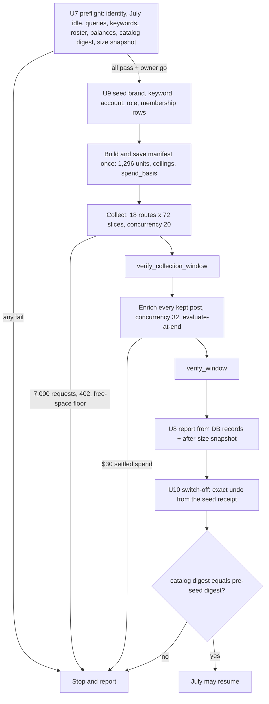
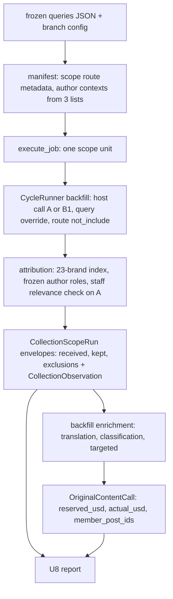

<!-- BEGIN OLLIJA DELIVERY GUIDE -->
## Ollija Delivery Guide

This block is generated guidance. Do not edit it directly. Correct durable facts in `.ollija/project.yaml` or this template, then rerun `ollija annotate-plan`. Current explicit owner instructions govern this task. Record exceptions below and reflect route changes in metadata; removed requirements must not return through another checklist.

### Resolved locations

- Authoritative host: `fuchitalee`
- Authoritative repository: `/Users/fuchitalee/development/pushin-weight-v2`
- Ollija release worktree area: `/Users/fuchitalee/development/pushin-weight-v2/.worktrees`
- Active worktree: `/Users/fuchitalee/development/pushin-weight-v2/.worktrees/ops/oai-anthropic-size-20261027`
- Plan: `/Users/fuchitalee/development/pushin-weight-v2/.worktrees/ops/oai-anthropic-size-20261027/docs/plans/2026-10-27-113859-ops-oai-anthropic-size-20261027-plan.md`
- Change: `ops-oai-anthropic-size-20261027-2026-10-27-113859`
- Branch: `ops/oai-anthropic-size-20261027`
- Staging branch and blueprint: `staging`, `/Users/fuchitalee/development/pushin-weight-v2/.worktrees/ops/oai-anthropic-size-20261027/render-staging.yaml`
- Production branch and blueprint: `main`, `/Users/fuchitalee/development/pushin-weight-v2/.worktrees/ops/oai-anthropic-size-20261027/render.yaml`
- Staging URL: `https://pushinweight-staging-web.onrender.com`
- Production URL: `https://pushinweight-web.onrender.com`

### Placement

This worktree is inside the Ollija release worktree area. Reuse it for the whole change. Do not create a second worktree or plan for this branch.

### Delivery scope

- Workflow: `plan`
- Delivery target: `on-request`
- Owner selection recorded: `false`

Target is not authorized until the owner selects it. Wait for a later explicit release request; do not commit, push, stage, or promote on this guide alone.

### Failure handling

- Complete applicable, unwaived checks for the selected route. A waived check is waived, never passed. Owner-selected direct production does not require staging.
- Product defects return to the parent implementation workflow; repeat only checks invalidated by the fix. Environment failures require repairing the environment, not a new source commit. Retry only after a relevant fact changes.
- SSH, shell, environment, or multi-machine failures use the repository infra/multi-machine skill first.
- The change ledger is advisory; do not validate or enforce it.
- Never force-remove a worktree. Retain staging-only, failed, dirty, locked,
  noncanonical, or candidate-mismatched worktrees for diagnosis or later
  delivery.
- Do not run an endless retry loop or start a persistent Ollija process.
<!-- END OLLIJA DELIVERY GUIDE -->

## Delivery Exceptions

- 2026-10-28: the owner invoked `/lfg` on this plan. That run's endpoint is an open pull request with CI decided; it does not include a merge, staging or production delivery.
  - The paid launch (U9 from the owner "go" onward) and U10 still wait for the owner's go after the preflight report.
  - The pull request carries this branch's `config.yaml` and `config/harvest_policy.yaml` edits, which must never merge to `main`.
- 2026-10-29 (JST): after the `/lfg` close-out listed the pre-launch items (rollback proof, keyword-check record, exact undo in place of `is_sentinel`, preflight report), the owner replied "go".
  - Read as: complete the pre-launch items, then run U9 if every preflight check passes; any failed check stops the run and goes back to the owner. U10 follows the delivered report.
  - The owner's go also confirms the exact undo for KTD10/R9/U10 (recommended in the close-out); KTD10, R9, U10 and the flowchart below now say so.
  - Database-backed proof method changed from a rollback run on xbackfiller to CI on a fresh PostgreSQL at schema 0183 (KTD12 records why).
  - Window date: 2026-10-28 Pacific, the most recent complete weekday at launch; production's 2026-10-27 day is missing about 1,180 saved posts from a schedule hold (U9 step 3).

# OpenAI and Anthropic Collection Size Test - Plan

## Plain-English Summary

When this is done, you will have an estimate of what the production harvester would need if OpenAI and Anthropic became tracked brands (21 brands → 23). The estimate covers:

- posts saved per day;
- search credits;
- the credits for re-fetching each saved post's likes and views once;
- classification cost;
- database growth;
- which of the harvester's current per-run limits the extra posts would exceed.

The one thing it can't measure is how long each 15-minute harvester run would take with the extra posts; that needs a separate staging trial. It comes from one real collection of a past 6-hour window: 12:00–18:00 US Pacific time on a recent weekday. That run carries production's eight current searches, worded exactly as production words them, side by side with the ten new OpenAI/Anthropic searches, so both sides are measured the same way.

Nothing in production changes. The test runs in the separate backfill database (`xbackfiller`) under its own job. It uses the backfiller, which runs the harvester's own search-and-match code against a past time window, using the one-off API keys. Production's 15-minute harvest keeps running. July's backfill is held while the test runs. Afterwards, OpenAI and Anthropic are switched off in that database so July is still classified with the same 21 brands as production. The test's data stays stored there, and it is never copied into production.

The code changes are small and confined to the backfill path:

- named, sliced searches with their own exclusion words;
- the two lab lists' authors treated like today's main list;
- a spend limit counted on real cost;
- the HTTP 520 retry fix.

Completion means:

- the window is fully collected and classified, and both checks the backfill already runs pass;
- a report built from the database answers the question, with numbers you can compare with the pilot and with production's own saved posts;
- July and production are unchanged.

One decision needs your attention. You approved a $30 limit for classification. The existing limit counts the code's cautious up-front price estimates, not real cost, and in October those estimates ran 6–7 times the real bill. Applied literally, $30 would stop classification after roughly $5 of real spending, probably partway through, with no way to raise it afterwards. This plan therefore changes how the limit counts: real cost for finished requests, the estimate only for requests still in flight. That way $30 means $30 actually spent. The $30 stays as a hard ceiling. Your expectation is that today's ~$4 a day of model spend for 21 brands would double to ~$8, so about $2 for this 6-hour window. The run is watched against that:

- If spending passes $2 while the cost per classified post is more than twice production's normal rate, the run pauses and reports, because something is wrong.
- If spending passes $2 at a normal cost per post, the volume simply more than doubled. The run continues, and the report shows it.

Search spend is roughly $5, capped at $21.

---

## Goal Capsule

- **Objective:** The owner can estimate the production harvester's daily resource needs once OpenAI and Anthropic are tracked brands: posts, search and engagement-refresh credits, classification cost, database growth, and which current harvester limits the added volume would exceed. The estimate comes from one measured 6-hour window, and production and July's data stay unchanged.
- **Means:** one backfill campaign in the xbackfiller database (KTD1). It runs production's 8 searches and the 10 frozen OpenAI/Anthropic searches in five-minute slices under its own CollectionJob (KTD2, KTD3).
- **Authority:**
  1. Project rules in `AGENTS.md`: credential purposes, production read-only, live-operation continuity.
  2. Owner decisions (Product Contract → Key Decisions).
  3. Requirements (R-IDs).
  4. Key Technical Decisions (KTD-IDs).
  5. Implementation Units.
- **Stop conditions.** Stop and report to the owner when any of these happens:
  - preflight (U7) fails;
  - a July historical run holds a live lease;
  - any spend or request limit is reached;
  - TwitterAPI returns HTTP 402;
  - xbackfiller free space falls below the U7 threshold;
  - the work would need a production write, a production configuration change or a merge to `main`;
  - evidence shows the run would alter production or July's frozen manifests.
- **Execution profile:**
  - Code and tests are written on `ops/oai-anthropic-size-20261027` (U1–U8).
  - Database-backed proofs run in CI on a fresh PostgreSQL at schema 0183 (KTD12).
  - The run itself is a Render one-off from this branch's checksummed archive (U9).
  - The branch's configuration edits never merge to `main`.
- **Who finishes:**
  - `ce-work` implements and verifies U1–U8.
  - U9's paid launch waits for one owner "go" after the preflight report, because it holds July and spends money.
  - U10 runs after the report is delivered.

---

## Product Contract

### Summary

Run one 6-hour historical collection in xbackfiller (12:00–18:00 Pacific). It carries 18 searches: production's 8, word for word, plus 10 frozen OpenAI/Anthropic searches, with all 23 brands attributing. Classify every kept post, and report how much the two new brands add. Spend is capped at 7,000 search requests and $30 of actual classification cost. When the test is done, the two brands are switched off in xbackfiller so July can resume classifying with production's 21 brands.

### Problem Frame

The owner is deciding whether to track OpenAI and Anthropic. Their X volume is far larger than that of the current 21 brands. An offline pilot sampled twelve 5-minute slices of 2026-10-26 JST. It estimated the new searches at about 118,500 fetched posts and about $22.86 of search per day, against about 23,300 posts and $4.02 for today's searches (`docs/analysis/2026-10-27-221500-oai-anthropic-volume-pilot.md`). It could not measure classification cost or database growth, and the owner disputes the scale. A real stored-and-classified sample is the evidence the decision needs.

### Requirements

**Window and searches**

- R1. Collect exactly one window: 12:00–18:00 US Pacific clock time on one date. The UTC bounds are written into the saved manifest. Pacific is UTC−7 until 2026-11-01 and UTC−8 from then on.
- R2. Run 18 searches. Eight are production's (A, B1–B3, C1–C4), with query text byte-identical to production's rendering. Ten are the frozen OpenAI/Anthropic routes A_OAI, OAI_1–3, B_OAI, A_ANT, ANT_1–3 and B_ANT, byte-identical to `docs/analysis/2026-10-27-215214-oai-anthropic-frozen-queries.json` (sha256 `3d2c9c17114bd3de7a7070c60e35ad14eb54236fbf2efd048f657e804c994dec`). RARE_EXTRA is not run.
- R3. Each new search drops posts using its own frozen `not_include` list, applied after fetch. Each production search keeps its own exclusion list.
- R4. All 23 brands attribute posts from all 18 searches through the production matcher, unchanged. The new brands' keywords are mined from our own data and kept maximally inclusive.
- R5. Posts by lab-list members are attributed the way Call A attributes its members today:
  - official accounts count for their brand without a keyword match;
  - staff posts pass through the staff relevance check.

**Storage and isolation**

- R6. All writes go to xbackfiller (`dpg-dbfemu2vcj2c73fsafe0-a`, database and user `xbackfiller`) under the test's own CollectionJob. The test job is never promoted to production.
- R7. Production receives no writes or configuration changes, and its 15-minute harvest keeps saving posts throughout the test.
- R8. No July historical run executes from preflight until switch-off. July's saved manifests, jobs and scope rows are unchanged when it resumes.
- R9. Before July resumes, xbackfiller's classifier catalog and brand registry are back exactly as they were before the seed, which is how production has them. `openai` and `anthropic` return to alias-only rows, and the seeded keywords, account roles and list memberships are removed. The test's stored data remains intact.

**Spend limits**

- R10. Search uses at most 7,000 TwitterAPI requests, which bounds search at 2.1M credits ($21).
- R11. Classification spends at most $30. Finished requests count at provider-reported cost; unfinished, failed and ambiguous requests count at their reservation.
- R12. Reaching any limit stops the run with its progress saved and waits for the owner. No limit is raised automatically.
- R24. Model spend is checked against the owner's expected rate.
  - Reference: production spends about $4 a day on models for 21 brands (DeepInfra plus TypeSafe), about $0.0004 per classified post. That is $4 over the 10,000–11,000 posts classified per day on normal days (2026-10-21/22).
  - Expectation: doubled volume implies about $2 for this window.
  - Trigger: when settled spend passes $2 and the provider-reported cost per classified post exceeds $0.0008 (twice the reference), enrichment is paused and the owner is told that something is wrong.
  - Spend above $2 at or below $0.0008 per post is a volume finding: the run continues, and the report shows it.
  - The test calls DeepInfra only. TypeSafe serves the rare-type check, which this test does not run.

**Classification**

- R13. Every kept post goes through the backfill enrichment (translation, classification and targeted extraction). Dropped posts are not classified; they are counted by reason.

**Report**

- R14. For each route, report:
  - fetched: unique `received_post_ids`;
  - kept: retained `post_ids`;
  - dropped, by exclusion reason;
  - pages, retries and terminal state.
- R15. Report the growth figures:
  - baseline-equivalent kept: kept on a production route with at least one tag from the 21 current brands;
  - incremental kept, split two ways:
    - by how the post was found: fetched only by new routes, or fetched by a production route but kept only because of a new-brand keyword;
    - by brand set;
  - net-new fetched;
  - each figure's ratio to baseline.
- R16. Report search requests and credits. Credits are `max(15, 15 × raw_count)` for each request receipt with a successful body, including retries. Two kinds of request are reported as ranges instead:
  - requests with no returned body (unknown outcome, transport error or lost body): 0–300 credits each, because a page holds at most 20 posts;
  - error responses with a body, such as a 520: 0–15 credits each.
- R17. Report model cost, both reserved and provider-reported:
  - broken down by stage;
  - with the collection-time staff relevance cost shown separately;
  - with each request's cost allocated across its member posts.
- R18. Report database growth from before-and-after snapshots taken while July is idle, split into backfill bookkeeping tables and tables production would also grow.
- R19. Compare the results with the pilot's estimates and with production's saved posts for the same window (read-only). Label that the baseline excludes RARE_EXTRA and production's two brand-neutral special-events searches (`SPECIALEVENTS1`, `SPECIALEVENTS2`, live from deployed revision `e5edf737`). Those searches have their own shared budget, so their search volume does not change with the new brands. Their posts that mention OpenAI or Anthropic would gain tracked tags; that added classification is not measured here.
- R20. Every figure is computed from database records of the test job, not from run counters. The report is written under `docs/analysis/`.
- R21. The report gives a per-day estimate for each headline figure: the window figure divided by the window's share of daily volume in 12:00–18:00 Pacific.
  - Production routes take that share from production's saved posts for the same date (read-only).
  - New routes take it from the pilot's slice data.
  - Each estimate is labelled as an estimate and names the share it used.
- R22. The report projects the production harvester's daily resource needs with OpenAI and Anthropic added, each next to production's current daily figure:
  - search credits (R16 scaled by R21);
  - engagement-refresh credits: kept posts per day × 15 credits, since production re-fetches each saved post once by ID and is billed per refreshed post (`metrics_refresh` in `config.yaml`; `scripts/harvest_cost/engine.py`);
  - quote-tweet fetch credits, scaled from production's current credits per saved post;
  - classification cost (R17 scaled by R21);
  - database growth (R18 scaled by R21).
- R23. The report compares projected posts per day with the harvester's current per-run limits in `config.yaml` at the production revision deployed when the report is written (`e5edf737` on 2026-10-28), and states which limits the added volume exceeds and by how much:
  - up to 2,000 posts per search per run;
  - an enrichment batch of 100 posts per run, about 9,600 per day;
  - engagement refresh capped at 200 posts per run, about 19,200 per day;
  - the 13-minute run deadline (`harvest.run_deadline_seconds: 780`).

  Run time per 15-minute run is not measured by this test, and the report says so.

### Key Decisions

- **One 6-hour window, 12:00–18:00 Pacific.** Governs R1. (session-settled: user-directed — chosen over the most recent complete JST day: a quarter of the cost and time is enough to size the change)
- **Use the existing xbackfiller database and hold July during the test.** Governs R6, R8. (session-settled: user-directed — chosen over a second dedicated database: no new infrastructure for a test)
- **All 23 brands; every kept post stored and classified.** Governs R4, R13. (session-settled: user-directed — chosen over collection-only or staged classification: classification cost is part of the answer)
- **Keywords mined from our own data, maximally inclusive.** Governs R4. (session-settled: user-directed — chosen over a minimal hand-picked keyword list)
- **Baseline inside the same run, with production's wording.** Governs R2, R15. (session-settled: user-directed — chosen over comparing against production's own saved counts: both sides then share one method and one provider pass)
- **Claude and Codex as standalone searches with exclusion words.** Governs R2, R3. (session-settled: user-directed — chosen over context-gating those names)
- **One search per lab list.** Governs R2. (session-settled: user-directed — chosen over one OR'd list search, which TwitterAPI.io rejects with HTTP 400)
- **One hard limit each: 7,000 search requests and $30 of classification.** Governs R10–R12. (session-settled: user-approved — chosen over day-level limits of about 8,000–10,000 requests per window, because only one window runs)
  - Conflict call-out: the existing enrichment limit counts conservative reservations. In October those ran 6.1–6.8× provider-reported cost (production `original_content_calls`, 2026-10-21/22 backfill scopes). Taken literally, $30 would stop classification near $5 of real spend, likely partway through, and a frozen limit cannot be raised. KTD6 makes the limit count real cost.
- **Keep the high limits, but check spend against the expected rate (about $2 for this window).** Governs R24. (session-settled: user-directed — chosen over relying on the $30 hard limit alone: spend well above the expected rate means something is wrong)
- **Lab-list roles.** Governs R5. (session-settled: user-approved — chosen over leaving roleless members keyword-only)
  - Official: @OpenAI, @OpenAIDevs, @OpenAINewsroom, @AnthropicAI, @claudeai, @ClaudeDevs, @claude_code.
  - Staff: every other member of the two lists (26 OpenAI, 15 Anthropic), including @karpathy and @addyosmani as Anthropic staff.
- **Switch OpenAI and Anthropic off in xbackfiller before July resumes.** Governs R9. (session-settled: user-approved — chosen over classifying July with a 23-brand catalog, or deleting the test data)
  - Method (owner go, 2026-10-29): switch-off undoes exactly what the seed created or changed, from the seed's undo receipt, instead of setting `is_sentinel`. Both brands already exist in production and xbackfiller as non-sentinel, alias-only rows that the classifier catalog includes, so `is_sentinel` would leave July with a catalog different from production's.
- **"Every post saved" means kept posts are stored and classified, and dropped posts are counted by reason.** Governs R13, R14. Storing unattributed posts would need new code and is not how production behaves.
- **Keep production's matcher as it is, including its Latin-plus-CJK and katakana word-boundary miss.** Governs R4. The size answer must match what production would actually keep. The pilot's drop analysis explains the miss.

### Acceptance Examples

- AE1. Covers R10, R12.
  - **Given** collection has used 7,000 requests,
  - **when** another page is due,
  - **then** collection stops with `collection_request_allowance_exhausted`, the job pauses with its checkpoints, and nothing is classified until the owner decides.
- AE2. Covers R11, R12.
  - **Given** classification has $29.90 of counted spend,
  - **when** a request would add $0.20 of reservation,
  - **then** admission fails with `model_campaign_allowance_exhausted` and enrichment pauses.
- AE3. Covers R4, R15.
  - **Given** B1 fetches a post that says "better than ChatGPT" and names no tracked brand,
  - **then** it is kept with an `openai` tag and counted as "production route, kept by new keyword".
- AE4. Covers R3.
  - **Given** OAI_3 fetches a post mentioning Solana,
  - **then** it is dropped with reason `not_include` and counted in OAI_3's drops.
  - The same word in a C1 post follows C1's own list.
- AE5. Covers R5.
  - **Given** A_ANT fetches a @bcherny post with no brand word,
  - **then** the staff relevance check decides it, and a pass keeps it with an `anthropic` tag.
- AE6. Covers R9.
  - **Given** switch-off has run,
  - **then** the classifier catalog digest equals the digest recorded before seeding, and the test job's stored posts and tags are still present.

### Success Criteria

- The owner can read one table with measured window figures and a labelled per-day extrapolation:
  - posts kept: baseline versus with OpenAI/Anthropic;
  - search cost;
  - classification cost;
  - database growth.
- Every measured figure in that table traces to an R14–R18 definition and a database query, and every per-day estimate traces to R21.
- The owner can read the harvester's projected daily needs and the limits they exceed (R22, R23) without further calculation.

### Scope Boundaries

- Not in scope:
  - adding OpenAI/Anthropic to production;
  - changing production configuration or production harvest;
  - merging this branch's configuration edits to `main`.
- Not in scope: fixing the matcher's CJK/katakana boundary miss. Its effect is reported as drops.
- Not in scope: RARE_EXTRA, a multi-window or full-day run, or promoting the test job.
- Not measured: the production harvester's run time and Render compute with the added volume. The backfiller runs a different execution shape; R23 reports the limits instead.

### Deferred to Follow-Up Work

- Porting the 520 fix (U5) to July's branch `ops/xbackfiller-db-20261026`. That branch is at the same commit `ccf10e1b`, so the U5 commit applies as-is; the July session owns that choice.
- A production rollout plan for the two brands, informed by the report.
- A staging trial of `run_cycle` with the two brands, to measure run time per 15-minute run and the limit changes R23 identifies.

### Dependencies

- The TwitterAPI on-demand balance covers $21.
- The DeepInfra on-demand key (`DEEPINFRA_ON_DEMAND`) is funded for $30.
- xbackfiller has free space for the projected growth (U7 measures it).
- The lab-list rosters were read from the X API on 2026-10-28 (machine-local `~/.local/share/render-operations/2026-10-28-x-pay-per-use-check/lab-list-members.json`): OpenAI list 29 members, Anthropic list 19.

### Sources

- Pilot method and results: `docs/analysis/2026-10-27-221500-oai-anthropic-volume-pilot.md`. Its raw pages are machine-local in `~/.local/share/render-operations/2026-10-27-oai-anthropic-volume-pilot/`.
- Production's per-post enrichment cost and throughput: read-only reads of `original_content_calls` and `post_enrichment_states` on 2026-10-28.
- DeepInfra's monthly bill: machine-local receipt at `~/.local/share/render-operations/2026-10-28-deepinfra-cost-check/`.
- July backfill state and launch pattern: `docs/brainstorms/2026-10-27-163458-backfill-testing-handoff.md` in the authoritative checkout.
- Deployed production revision `e5edf737` (2026-10-28 17:21 JST), compared with this branch's base `ccf10e1b`:
  - `config/harvest_policy.yaml` is identical, so the frozen baseline wording is still production's;
  - `x_monitor/attribution.py` (the classification prompts) is identical, and the translator and classifier models and request profiles are unchanged;
  - `config.yaml` differs only by the scheduled worker's enrichment settings and a synthesis concurrency line.
  - U7 repeats the baseline-wording check against whatever revision is deployed at launch.

---

## Planning Contract

### Key Technical Decisions

- KTD1. **Collect with the backfiller.**
  - The manifest is built once by a `python manage.py run_backfill --windows … --response-storage database` dry run, and its output is saved. The run then uses only that saved `--manifest`, which carries the storage choice; `run_backfill` refuses `--response-storage` together with `--manifest`.
  - The run is a Render one-off launched from this branch's checksummed archive, the same pattern as July's collector.
  - The backfiller runs the harvester's own `CycleRunner` with `cycle_kind="backfill"` (`monitor/backfill_collection.py:577,766,879`) on the on-demand TwitterAPI key (`monitor/backfill_staging.py:267`) and `DEEPINFRA_ON_DEMAND` (`monitor/backfill_collection.py:292`), so search and matching are production's code.
  - Rejected: a live harvester run against xbackfiller. It cannot reach a past window, and the scheduled key is reserved for production's `run_cycle`.
- KTD2. **Extend the campaign manifest with options that default to today's behaviour; don't use the July month recipe.**
  - The `--windows` JSON gains these per-window fields:
    - `call_ids` (the 8 production routes);
    - `slice_seconds: 300`;
    - `routes` (each with name, host call ID, query and `not_include`);
    - explicit `ceilings`;
    - `spend_basis`.
  - `manifest()` slices every route into 72 five-minute units: 18 × 72 = 1,296 units, scope key `{route}:{since}:{until}`. That is the slicing the pilot and July used.
  - Inputs without the new fields produce exactly today's manifest, so July's saved manifests and recipe stay valid.
  - Rejected: `daily_manifest` (`scripts/backfill_month.py:56-107`). It is bound to JST-day windows, requires RARE_EXTRA, and keys slices by call ID.
- KTD3. **Host the new routes on existing call IDs, with route metadata at scope level.**
  - A_OAI and A_ANT are hosted on `A`, so frozen author roles and the staff relevance check apply (`monitor/cycle.py:3486-3605`).
  - The other eight are hosted on `B1`, which has no exclusion words of its own.
  - For hosted units, the route's `not_include` replaces the host's list. Production units keep their own.
  - Reports key on the route name in scope metadata, not on `call_id`.
  - Ownership keys stay `{call_id, query, since, until}` (`core/collection_state.py:483`).
  - Rejected: first-class new call IDs. They would widen shared Call-A branches in `monitor/cycle.py` that production runs.
- KTD4. **Union author contexts across the main list and the two lab lists.** `plan_job_definition` (`monitor/backfill_collection.py:196-210`) currently freezes contexts for one list ID. It will freeze the union for `2067062923525275922`, `2067500935769895374` and `2067501173402460553`. Roles come from the BrandAccount rows seeded in U1, and memberships from TwitterListMembership rows built from the saved roster. Contexts are keyed by author ID, so a union is safe.
- KTD5. **Seed brand data through `onboard_brand --csv` with branch-only configuration.**
  - Configuration:
    - `openai` and `anthropic` go into `config.yaml` `enabled_models`;
    - they go into `config/harvest_policy.yaml` as `paths: [none]`, which leaves the 8 production queries byte-identical (verified offline in research).
  - Keywords are literal BrandKeyword rows:
    - every term in the frozen new route texts;
    - handle strings without the "@";
    - spellings found in production's untracked-brand evidence for the two labs, read-only.
  - Gating mirrors the searches. Terms that appear only in the context-gated OAI_3/ANT_3 packs get the same context words through `alias_context`, and so does any handle string that is also a common word, such as `sama`.
- KTD6. **Count actual cost against the classification limit.** This instantiates the limit decision governing R11 (session-settled: user-approved — chosen over reservation-basis counting, which would stop near $5 of real spend).
  - When a ProviderBatch policy carries `spend_basis: "settled"`, admission in `core/provider_batches.py` sums `actual_usd` for completed calls and `reserved_usd` for every other state, then adds the new request's reservation.
  - Policies without the field keep today's reservation-only sum.
  - `max_usd` is set to 30.
- KTD7. **Map the search limit onto the job request ceiling, and lift the model-request count ceiling.** This instantiates the limit decision governing R10 and R12 (session-settled: user-approved — chosen over per-window day-level ceilings).
  - `maximum_api_requests` is 7,000. Pages hold at most 20 tweets, so search credits are bounded at 7,000 × 300.
  - `maximum_model_requests` is 100,000, so the USD limit binds first. October backfill jobs used about 2.6 model calls per post, so roughly 16,000 posts would need about 42,000 calls, above the 12,500 default.
  - The 72-hour default deadline is kept. The estimated duration fits it about three times over.
- KTD8. **Treat HTTP 520 as transient** in `monitor/backfill_retry.py`, keeping the existing cooldowns. The request limit and deadline bound repeated retries. (session-settled: user-directed — chosen over waiting for the July session's fix: the test must survive a 520)
- KTD9. **Run with `--collection-concurrency 20`, `--enrichment-concurrency 32` and `--evaluate-at-end`.** These are July's tested collection concurrency and October's enrichment concurrency. Evaluate-at-end stops one failed model call from halting every resume (spec-flow G1). It does not relax R13: deferred posts are retried before the run counts as complete (U9).
- KTD10. **Switch-off undoes exactly what the seed created or changed, from the seed's undo receipt.** This instantiates the switch-off decision governing R9 (session-settled: user-approved — chosen over deleting the rows; owner go 2026-10-29 for the exact undo over `is_sentinel`).
  - `python -m scripts.backfill_size_seed switch-off --undo-receipt <receipt>` refuses while any historical run holds a live lease, reverses only the receipt's rows, and rolls back unless the classifier catalog revision equals the pre-seed value recorded in the receipt.
  - Superseded: setting `is_sentinel=True`. The `openai` and `anthropic` Brand rows already exist, in production and xbackfiller, as non-sentinel alias-only rows. The classifier catalog includes every non-sentinel brand (`monitor/cycle.py:165-215,4110-4141`), so the flag would make July's catalog differ from production's.
  - Deletion stays rejected: PROTECT foreign keys from classification tables such as `PostBrandClassificationState` and `PostBrandMention` block it, and it would destroy the test data.
  - Left in place, outside the catalog: Account rows the seed created, and the test's PostBrand rows.
- KTD11. **The report is a read-only script over the test job's records.** It reads:
  - `CollectionObservation`;
  - the last successful run's `CollectionScopeRun` envelopes;
  - every `CollectionRequest`;
  - `run.report["staging_responses"]`;
  - `OriginalContentCall` through `provider_batch__source_collection_job`.

  It dedupes by post ID across copied scope rows (`core/collection_state.py:406-425`).
- KTD12. **Prove database-backed behaviour on a fresh PostgreSQL at schema 0183 in CI.** The shared test database refuses schema 0183.
  - Superseded (2026-10-29): rollback proofs on xbackfiller. A harness that runs every test inside one rolled-back transaction, with read-only sessions by default and outbound network blocked, ran four tests from fuchitalee against xbackfiller and left the 13 core tables' row counts unchanged. But the tests it must prove fail by design inside a wrapping transaction: the backfill fakes assert `not connection.in_atomic_block` before every provider call, and the modules use `django_db(transaction=True)`, which under pytest-django would flush xbackfiller.
  - Method: two temporary branches change only `.github/workflows/backfill.yml` to run `pytest -m requires_postgres` over the size-test modules (`tests/test_backfill_staging_retry.py`, `test_backfill_collection.py`, `test_run_backfill_command.py`, `test_call_a_role_routing.py`, `test_backfill_direct_enrichment.py`, `test_backfill_native_enrichment.py`, `test_backfill_size_seed.py`, `test_backfill_campaign.py`): one at this branch's code, one at base `ccf10e1b`. Each runs on CI's own PostgreSQL, migrated to this revision's schema. Both branches are deleted after the runs.
  - Pure-Python tests run through `scripts/pytest-local`.

### Sizing Assumptions

These come from the pilot's three slices inside the window (Sunday 2026-10-25 Pacific) and production's October backfill rates. They size the limits; the run replaces them.

| Measure | Production 8 searches | New 10 searches | Total |
|---|---|---|---|
| Requests | ~1,100 | ~2,300 | ~3,400 (limit 7,000) |
| Search cost | ~$0.73 | ~$3.97 | ~$4.70 (cap $21) |
| Fetched posts | ~4,100 | ~21,000 (~20,200 net-new) | ~24,000 |
| Kept posts to classify | ~2,800 | ~13,000 | ~16,000 |

At $0.00025–$0.0008 of provider-reported cost per post, classification is about $4–13. At 670–1,270 posts per hour it takes 13–25 hours. Those rates come from production `original_content_calls` for backfill scopes `fa102b68`, `3fb9f21a` and `aa3b42db`, 2026-10-21/22.

The owner's reference is about $4 a day of production model spend for 21 brands, so about $2 for this window if volume doubles (R24). A total above $2 is expected if the pilot's larger volume holds; a cost per post above $0.0008 is not.

### High-Level Technical Design

Run sequence and stop points:

Data flow through one unit:

### System-Wide Impact

- **July backfill:**
  - The test and July share the per-database controller lock (`scripts/backfill_month.py:491-528`), the on-demand TwitterAPI and DeepInfra keys, and the 20 GB disk.
  - July's frozen manifests pin configuration digests (`monitor/backfill_collection.py:87-94`). July must resume from its own archive, never this branch's.
- **Production:** no shared writes. The collection uses only on-demand keys. A balance shared across TwitterAPI keys is checked in U7.
- **Main-list Call A:** BrandAccount rows are shared across routes. A main-list author with a new lab role gains that context on main-list posts too (spec-flow G5); U7 lists these overlaps, and the report labels their effect on the baseline.

### Risks

| Risk | Mitigation |
|---|---|
| Volume differs widely from the pilot (owner disputes the scale) | The run measures it directly; R10 and R11 bound spend either way |
| Generic keywords tag many production-route posts | `alias_context` mirrors the OAI_3/ANT_3 gating (KTD5); R15 reports these posts separately |
| July is held longer than expected | Enrichment concurrency 32; the owner can stop at any time; July resumes after U10 |
| Historical search omits posts | Five-minute slices drained to the end; report "provider_filtered_not_exhaustive", as July does |
| Disk fills | U7 checks free space and sets a stop floor |
| Branch configuration reaches `main` | DoD forbids merging configuration; the branch is a test branch |

### Deferred Implementation Notes

- Whether one `maximum_model_requests` value feeds both the collection-time staff check and enrichment. Confirm in `scripts/backfill_campaign.py:153-178` and keep both bounded.
- The exact form of `author_scope` with several list IDs, and its validators in `monitor/backfill_collection.py` and `monitor/backfill_staging.py:117-124`.
- The mined extra spellings: the final keyword list is produced in U1 and checked offline against the pilot's `tweets.jsonl`.

---

## Implementation Units

| U-ID | Title | Files touched | Depends on |
|---|---|---|---|
| U6 | Regression net | `tests/test_backfill_campaign.py`, `tests/test_harvest_policy_regression_net.py`, `tests/test_backfill_month.py` | — |
| U1 | Brand configuration and seed data | `config.yaml`, `config/harvest_policy.yaml`, `scripts/backfill_size_seed.py` | — |
| U2 | Named, sliced routes in the manifest | `scripts/backfill_campaign.py`, `monitor/management/commands/run_backfill.py`, `monitor/backfill_collection.py`, `monitor/cycle.py` | U6 |
| U3 | Lab-list author contexts | `monitor/backfill_collection.py`, `monitor/list_membership.py` | U2 |
| U4 | Classification limit on actual cost | `core/provider_batches.py`, `monitor/backfill_enrichment.py` | U6 |
| U5 | HTTP 520 as transient | `monitor/backfill_retry.py`, `tests/test_backfill_staging_retry.py` | U6 |
| U7 | Read-only preflight | `scripts/backfill_size_preflight.py` | U1, U2, U3 |
| U8 | Size report | `scripts/backfill_size_report.py` | U2 |
| U9 | Rollback proofs, seed and launch | machine-local proof and launch receipts | U1–U8 |
| U10 | Switch-off and July handback | `scripts/backfill_size_seed.py` | U9 |

### U6. Regression net

- **Goal:** pin the surfaces this plan must not change before changing code.
- **Requirements:** R2, R7, R8.
- **Dependencies:** none. Land it first.
- **Files:** `tests/test_backfill_campaign.py`, `tests/test_harvest_policy_regression_net.py`, `tests/test_backfill_month.py`.
- **Approach:**
  1. Record a golden `manifest()` output for July-style inputs (windows only, no new fields), using the existing test fixtures.
  2. Rely on the existing exact-query pins for the 8 rendered production queries (`tests/test_harvest_policy_regression_net.py:422-427`).
  3. Rely on the month recipe pins in `tests/test_backfill_month.py`.
- **Execution note:** run these pins green on unmodified `ccf10e1b` before U1–U5 begin.
- **Test scenarios:**
  - `manifest()` without the new window fields produces the recorded golden output, byte for byte after JSON canonicalisation.
  - With the branch configuration from U1, the 8 production queries render byte-identical to the frozen baseline texts.
  - `daily_manifest` still yields its July route inventory and slice keys.
- **Verification:** the pins pass before and after U1–U5.

### U1. Brand configuration and seed data

- **Goal:** make OpenAI and Anthropic attributable in xbackfiller without changing production's query text.
- **Requirements:** R4, R5, R6; KTD5.
- **Dependencies:** none.
- **Files:**
  - `config.yaml` (`enabled_models`) and `config/harvest_policy.yaml` (`paths: [none]` entries);
  - `scripts/backfill_size_seed.py` (new);
  - `docs/analysis/YYYY-MM-DD-HHMMSS-oai-anthropic-keywords.csv` and `docs/analysis/YYYY-MM-DD-HHMMSS-oai-anthropic-roster.csv` (new, JST-timestamped);
  - `tests/test_backfill_size_seed.py` (new).
- **Approach:**
  1. Build the keyword table:
     - every literal term in the 10 frozen route texts;
     - handle strings without the "@";
     - extra spellings found in production's untracked-brand evidence (`PostUntrackedBrandPromotion`, `UntrackedBrandPromotionEvidence`, `BrandDiscoveryCandidate*`), queried read-only.

     Mark context-gated terms per KTD5.
  2. Build the roster CSV from `lab-list-members.json`, with roles per the lab-roles Key Decision.
  3. The `seed` subcommand runs `validate_staging` first and refuses any database that is not xbackfiller. It then:
     - calls `onboard_brand --csv` for the brand, keyword, account and BrandAccount rows;
     - writes TwitterListMembership rows for the two lab lists;
     - is idempotent on re-run.
  4. Do the offline keyword check against the pilot's `tweets.jsonl`, using `x_monitor.attribution.compile_keyword_index`:
     - report the keep rate per route;
     - report tags added to production-route posts.

     Result (implementation run, 2026-10-28; pilot `tweets.jsonl`, production's 235 keyword rows plus the new table, branch policy gating):

     | Route | Keep rate |
     |---|---|
     | OAI_1 | 67.5% |
     | OAI_2 | 72.2% |
     | OAI_3 | 71.3% |
     | B_OAI | 97.3% |
     | ANT_1 | 74.8% |
     | ANT_2 | 97.7% |
     | ANT_3 | 90.2% |
     | B_ANT | 100% |

     - Net-new posts: 4,752 fetched, 3,342 kept (70.3%).
     - Production-route posts: of 972, 134 gain an `openai` or `anthropic` tag, and the kept count rises from 699 to 710.
- **Patterns to follow:** `monitor/management/commands/onboard_brand.py:651-765`; `scripts/backfill_database.py:277-288` for the brand tables xbackfiller carries.
- **Test scenarios:**
  - "Sol is out" does not attribute to openai, and "Sol AI model" does.
  - `sama` alone does not attribute, and "sama said the model…" does.
  - "ChatGPTの新機能" does not match, because of the unchanged katakana boundary miss. The test pins that miss deliberately.
  - `seed` against a database whose `current_database()` is not `xbackfiller` exits before any write.
  - A second `seed` run creates no duplicate rows.
  - Every official handle in the roster CSV gets role `official`, and every other member gets `staff`.
- **Verification:** the offline keyword check reports per-route keep rates, and the 8 production queries are unchanged (U6).

### U2. Named, sliced routes in the manifest

- **Goal:** one saved manifest carries 18 named routes in 300-second slices with route-specific exclusion words and explicit ceilings.
- **Requirements:** R1–R3, R10, R12; KTD2, KTD3, KTD7.
- **Dependencies:** U6.
- **Files:**
  - `scripts/backfill_campaign.py` (`manifest()`: window fields, slicing, `route_metadata`, ceilings, `spend_basis` pass-through);
  - `monitor/management/commands/run_backfill.py` (`--windows` JSON fields);
  - `monitor/backfill_collection.py` (`plan_job_definition` `call_ids`, `validate_scope` route metadata, `execute_job` passes route `not_include`);
  - `monitor/backfill_resources.py` (`BackfillContext` field);
  - `monitor/cycle.py` (`_plan_calls` override applies a route's `not_include` to the replaced call);
  - tests: `tests/test_backfill_campaign.py`, `tests/test_run_backfill_command.py`, `tests/test_backfill_collection.py`.
- **Approach:**
  1. Parse and validate the new fields. Unknown fields are rejected. Route names are unique and must not collide with the production call IDs.
  2. For each route, build host-call units sliced at `slice_seconds`, keyed `{route}:{since}:{until}`, with `scope["route_metadata"][scope_key] = {name, host_call_id, not_include}`.
  3. Apply the ceilings, while keeping the `units < maximum_api_requests` check.
  4. Restrict planned calls to `call_ids`.
  5. In `_plan_calls`, set the replaced call's `not_include` from the route metadata only when metadata is present (`monitor/cycle.py:2750-2758`).
- **Patterns to follow:**
  - supplement units at `scripts/backfill_campaign.py:182-187`;
  - slicing at `scripts/backfill_month.py:76-100`;
  - suffixed length preflight at `scripts/backfill_campaign.py:145-152`.
- **Test scenarios:**
  - A one-window input with 8 `call_ids`, 10 routes and `slice_seconds: 300` yields 1,296 units with unique scope keys.
  - No unit has call ID RARE_EXTRA.
  - An OAI_3 unit drops a post containing "Solana" with reason `not_include`, while a C1 unit for the same window still applies its F1 exclusions. Covers AE4.
  - A route name equal to `B1` is rejected.
  - A route whose suffixed query exceeds 512 characters is rejected at manifest time.
  - Ceilings `maximum_api_requests: 1000` with 1,296 units fail the `units < maximum_api_requests` check.
  - Reaching `maximum_api_requests` pauses the job with `collection_request_allowance_exhausted`. Covers AE1.
  - A manifest built twice from the same input differs only in the time-dependent fields (the deadline and the author-scope observation time), so launches must reuse one saved manifest (spec-flow F1).
- **Verification:** the manifest dry run prints 1,296 units with ceilings and route metadata, and the U6 pins still pass.

### U3. Lab-list author contexts

- **Goal:** posts by lab-list members attribute through frozen official and staff roles.
- **Requirements:** R5; KTD4.
- **Dependencies:** U2.
- **Files:** `monitor/backfill_collection.py` (`plan_job_definition` author scope), `monitor/list_membership.py` (`resolve_call_a_author_contexts` per list), `tests/test_backfill_collection.py`, `tests/test_call_a_role_routing.py`.
- **Approach:**
  1. Accept extra author list IDs from the window input.
  2. Freeze `author_scope` with every list ID and the union of their contexts.
  3. Keep `validate_staging`'s check that every named brand exists.
- **Test scenarios:**
  - An @OpenAI post on A_OAI with no brand word is kept with an `openai` tag.
  - A @bcherny post on A_ANT goes through the staff relevance check. Covers AE5.
  - An author present in the main list and a lab list gets both contexts, and official overrides staff.
  - A roster member with no BrandAccount row is kept only on a keyword match, and preflight lists them.
- **Verification:** the frozen manifest's `author_scope` lists all three list IDs and 48 lab members with roles.

### U4. Classification limit on actual cost

- **Goal:** the $30 limit counts real spend.
- **Requirements:** R11, R12; KTD6.
- **Dependencies:** U6.
- **Files:** `core/provider_batches.py` (admission totals, around `:447-512`), `monitor/backfill_enrichment.py` (`policy_snapshot` accepts and validates `spend_basis`, around `:240-272`), `scripts/backfill_campaign.py` (pass-through), `tests/test_backfill_direct_enrichment.py`, `tests/test_backfill_native_enrichment.py`.
- **Approach:**
  1. Under `spend_basis: "settled"`, sum `actual_usd` for completed calls with a non-null cost, and `reserved_usd` for every other call.
  2. Without the field, behaviour stays as today.
  3. The basis is frozen on the first ProviderBatch, like the other policy fields.
- **Test scenarios:**
  - Settled basis: completed calls with actual $1 against reserved $6, plus one in-flight reservation of $0.50, count $1.50.
  - Reservation basis: the same calls count $6.50.
  - Settled basis at $29.90 counted, plus a $0.20 reservation, raises `model_campaign_allowance_exhausted`. Covers AE2.
  - A completed call with null `actual_usd` counts its reservation.
  - Failed and ambiguous calls count their reservation.
  - An unknown `spend_basis` value is rejected when the policy is created.
- **Verification:** the existing enrichment allowance tests pass unchanged, and the new settled-basis cases pass.

### U5. HTTP 520 as transient

- **Goal:** a 520 retries at the same cursor instead of failing the run.
- **Requirements:** R12; KTD8.
- **Dependencies:** U6.
- **Files:** `monitor/backfill_retry.py`, `tests/test_backfill_staging_retry.py`.
- **Approach:** add 520 to the `transient()` status set (`monitor/backfill_retry.py:13-19`), leaving the cooldowns (`:9-10`) unchanged.
- **Test scenarios:**
  - Extend the parametrized transient recovery (`tests/test_backfill_staging_retry.py:196-206`) with 520: the request is saved received with `retry_after_at`, the cursor is unchanged, and the next pass succeeds and keeps earlier pages.
  - After five consecutive 520s, the cooldown applies.
  - A 400 still fails permanently (`:188-193`).
  - With 20 concurrent scopes, one 520 does not stop the others.
- **Verification:** the staging retry module passes in the CI database proof (KTD12).

### U7. Read-only preflight

- **Goal:** one command proves the launch conditions without spending money or writing.
- **Requirements:** R2, R6–R10; KTD5, KTD10.
- **Dependencies:** U1, U2, U3.
- **Files:** `scripts/backfill_size_preflight.py` (new), `tests/test_backfill_size_preflight.py` (new).
- **Approach.** Checks, each reported pass or fail with evidence:
  1. `validate_staging` identity: the backfill environment, and `xbackfiller` as both database and `session_user`, with a host match.
  2. July state: job `d4440f2e-0366-44ec-9bfe-fe12ac3df79c` paused, no live historical lease, and job, run and scope counts snapshotted.
  3. Every manifest query is byte-identical to the frozen JSON, and every suffixed query is ≤512 characters. The deployed production revision's `config/harvest_policy.yaml` is identical to this branch's, so the 8 production searches are still production's wording.
  4. Each route's `not_include` equals the frozen list.
  5. Every attributing term has a literal BrandKeyword row.
  6. Every lab member has a context. List any `missing_brand_role` warnings and any overlaps with the main list.
  7. The on-demand credentials resolve with a declared purpose, the TwitterAPI balance covers $21, and the DeepInfra key responds.
  8. Free space is at least 2× the projected growth, and the stop floor is recorded.
  9. Record the catalog digest of `_classification_tracked_brand_catalog()` and the per-table sizes before seeding.
- **Test scenarios:**
  - A frozen-query mismatch of one byte fails check 3 and names the route.
  - A missing BrandKeyword term fails check 5.
  - A live lease fails check 2.
  - The catalog digest is stable across two reads of unchanged rows and changes when a brand is added.
- **Verification:** a run against xbackfiller before seeding passes checks 1–4 and 7–9, and reports checks 5–6 as pending until the seed exists.

### U8. Size report

- **Goal:** turn the test job's records into the R14–R23 figures, and give U9 a read-only spend watch for R24.
- **Requirements:** R14–R24; KTD11.
- **Dependencies:** U2.
- **Files:** `scripts/backfill_size_report.py` (new), `tests/test_backfill_size_report.py` (new). Output goes to `docs/analysis/YYYY-MM-DD-HHMMSS-oai-anthropic-size-report.md` and `.json`.
- **Approach:**
  1. Read the last successful run's scopes, grouped by route name and deduped by post ID.
  2. Read every `CollectionRequest` for credits.
  3. Allocate `OriginalContentCall` cost by member share.
  4. Read the production comparison (posts created in the same window) read-only.
  5. Compute the after-snapshot sizes.
  6. Read production's current daily figures for R22, read-only:
     - search, engagement-refresh and quote-tweet credits from the harvest cost report (`python -m scripts.harvest_cost --since … --until …`);
     - classification cost from the DeepInfra bill;
     - saved posts per day.
  7. Read the R23 limits from `config.yaml` at the deployed production revision.
  8. A `--watch` mode reads only the test job's `OriginalContentCall` rows and prints settled spend, classified posts, cost per classified post, and whether the R24 trigger holds.
- **Test scenarios:**
  - A post fetched by B1 and OAI_1 counts once in total fetched and appears in both routes' rows.
  - A post kept on B1 only because of an `openai` keyword falls in "production route, kept by new keyword". Covers AE3.
  - A request with `raw_count` 0 costs 15 credits.
  - A request with no returned body widens the credit range by 0–300.
  - A 520 response with a body widens it by 0–15.
  - A classification call of 4 members costing $0.008 allocates $0.002 to each.
  - Copied scope rows across 3 runs do not inflate counts.
  - A window figure of 4,000 posts with a window share of 0.25 yields a per-day estimate of 16,000, labelled with that share.
  - 89,000 projected kept posts per day yield 1,335,000 engagement-refresh credits per day.
  - The same volume against an enrichment batch of 100 per run reports the limit as exceeded about 9.3×.
  - Watch mode: $2.40 settled over 2,000 classified posts ($0.0012 per post) reports the R24 trigger as holding.
  - Watch mode: $4.00 over 12,000 classified posts ($0.00033 per post) reports no trigger and flags volume above the doubling expectation.
- **Verification:** on a rollback fixture with known records, the report's figures equal the hand-computed values.

### U9. Rollback proofs, seed and launch

- **Goal:** prove the database-backed changes, then run the test.
- **Requirements:** R1, R6–R13; KTD1, KTD9, KTD12.
- **Dependencies:** U1–U8.
- **Files:** machine-local receipts under `~/.local/share/render-operations/YYYY-MM-DD-oai-anthropic-size-test/` (proof script, preflight output, manifest and its sha256, launch payload, logs).
- **Approach:**
  1. Run the CI database proof (KTD12) covering the U2–U5 database-backed tests, at this branch and at base `ccf10e1b`.
  2. Run U7 against xbackfiller.
  3. Compute the window's UTC bounds from America/Los_Angeles for the most recent complete weekday. Example: 2026-10-27 is 19:00Z to 01:00Z.
     - Chosen (2026-10-29 JST): 2026-10-28, 19:00Z to 2026-10-29 01:00Z. Collection starts after the window has closed.
     - Not 2026-10-27: production held its schedule from 04:48Z to 08:30Z that day, so the Pacific day 2026-10-27 lacks about 1,180 saved posts (UTC hours 07 and 08), and R21's window share would be overstated by about 8%.
  4. Present the preflight report and get the owner's "go".
  5. Run `seed`, then re-run U7 so checks 5–6 pass.
  6. Build and save the manifest once.
  7. Launch the Render one-off from this branch's checksummed archive, with the July collector's launch shape.
  8. Watch it until it reaches a terminal state. During enrichment, run the U8 watch every 15 minutes. If the R24 trigger holds, cancel the one-off (progress stays saved and resumes from the same manifest) and report spend, classified posts and cost per post to the owner.
  9. If evaluate-at-end deferred any kept posts, re-run the enrich phase from the same saved manifest until none remain. If some still cannot be classified, stop and report them to the owner before the report is final and before U10.
  10. Read production read-only once during the run to confirm a freshly saved post.
- **Execution record** (receipts in `~/.local/share/render-operations/2026-10-29-oai-anthropic-size-test/`, machine-local on fuchitalee):
  - Step 1, CI database proof (`ci-proof-receipt.json`):
    - branch (run 40769414567, code `47f8b721`): 181 passed and 3 failed of 184 required, none skipped;
    - base (run 40769414903, code `ccf10e1b`): 161 passed and 3 failed of 164;
    - the same 3 tests fail on both (two `test_arbitrary_ranges_need_no_source_edits_or_paid_requests` cases and `test_explicit_campaign_all_routes_whole_range_to_phase_runner`, which predate this plan);
    - no shared test changes outcome, and all 20 new PostgreSQL tests pass, including the 520 recovery case;
    - both temporary branches are deleted.
  - Step 2, U7 pre-seed (`preflight-pre-seed.json`): PASS; checks 5–6 pending as designed. TwitterAPI on-demand balance 16,531,104 credits; DeepInfra HTTP 200.
  - Step 5, seed (`seed-result.json`, undo receipt `seed-undo-receipt.json`):
    - 178 BrandKeyword rows, 40 accounts, 48 lab-list roles and 48 lab-list memberships;
    - from production's read-only main-list export (208 members, 232 roles; `main-list-production.json`): 208 main-list memberships, 60 accounts, 130 roles created and 62 already present;
    - catalog revision `44ab32ab…` before (switch-off must restore it) and `874988d1…` after.
  - Step 5, U7 post-seed (`preflight-post-seed.json`, also the R18 before-snapshot): PASS on all nine checks.
  - Step 6, manifest (`manifest.json`, sha256 `6079016a0911381e40b1c6a4339b509d0f55965ec16b6350503ea20b161397e0`):
    - built by the plan's dry run in a read-only Render one-off from source `47f8b721`, on image `e5edf737`;
    - 1,296 units, 256 author contexts over 3 lists, deadline 2026-10-31T21:39Z.
  - One-off environment: production's rare-types variables (`e5edf737`) name a special-events assessment that source `47f8b721` lacks. The one-offs replace them with this revision's own `render.yaml` harvest values: the 2026-09-24 assessment, with targeted extraction on.
    - RARE_EXTRA still does not run, because the window's `call_ids` exclude it.
    - The run job also drops the scheduled and legacy TwitterAPI keys and the TypeSafe key.
- **Test expectation:** none — this is an operational unit. Its proof is the CI database proof and the run's verification outcomes.
- **Verification:**
  - `verify_collection_window` returns verified;
  - `verify_window` returns verified with zero deferred kept posts;
  - spend stays within R10 and R11, and any R24 trigger was handled.

### U10. Switch-off and July handback

- **Goal:** July resumes with production's 21-brand catalog, and the test data is kept.
- **Requirements:** R8, R9; KTD10.
- **Dependencies:** U9 complete with zero deferred kept posts, and the delivered U8 report. Classifying a post after switch-off would use the 21-brand catalog.
- **Files:** `scripts/backfill_size_seed.py` (`switch-off` subcommand, guarded like `seed`), `tests/test_backfill_size_seed.py`.
- **Approach:**
  1. Run `python -m scripts.backfill_size_seed switch-off --undo-receipt <receipt>` (KTD10): it undoes exactly the receipt's rows.
  2. The same command recomputes the catalog revision and rolls back unless it equals the pre-seed value in the receipt.
  3. Re-snapshot July's job, run and scope counts against the U7 snapshot.
  4. Write a handback receipt for the July session.
- **Test scenarios:**
  - After switch-off, `_classification_tracked_brand_catalog()` has the pre-seed revision again, with both brands back to their alias-only rows. Covers AE6.
  - Their PostBrand rows remain.
  - Switch-off refuses to run while a historical lease is live.
- **Verification:** the digests are equal, July's snapshot is unchanged, and the receipt exists.

---

## Verification Contract

| Gate | Command or method | Proves |
|---|---|---|
| Pure-Python tests | `scripts/pytest-local tests/test_backfill_campaign.py tests/test_backfill_month.py tests/test_harvest_policy_regression_net.py tests/test_specs_from_policy.py tests/test_attribution.py tests/test_backfill_size_seed.py tests/test_backfill_size_preflight.py tests/test_backfill_size_report.py` plus `tests/test_query_plan_*.py` | U1, U2, U6–U8 logic; production query text unchanged |
| Database-backed tests | CI database proof (KTD12): `pytest -m requires_postgres` over `tests/test_backfill_staging_retry.py`, `test_backfill_collection.py`, `test_run_backfill_command.py`, `test_call_a_role_routing.py`, `test_backfill_direct_enrichment.py`, `test_backfill_native_enrichment.py`, `test_backfill_size_seed.py` and `test_backfill_campaign.py`, at this branch and at base `ccf10e1b` | U2–U5 call chains; every failure also fails on the base |
| Django checks | `python manage.py check` | Configuration loads with the branch configuration |
| Manifest dry run | `python manage.py run_backfill --windows <window.json> --response-storage database` (no `--execute`); its output is saved as the manifest | 1,296 units, ceilings, route metadata, frozen texts |
| Preflight | `python scripts/backfill_size_preflight.py` | U7 checks 1–9 |
| Run | `python manage.py run_backfill --manifest <saved> --phase all --execute --evaluate-at-end --collection-concurrency 20 --enrichment-concurrency 32` in the Render one-off | R1–R13 |
| Run outcome | `verify_collection_window` and `verify_window` results, with zero deferred kept posts | Drained collection; every kept post classified |
| Production continuity | Read-only `render psql dpg-d9koekqjobas73fvjqng-a` query for the newest saved post during the run | R7 |
| Switch-off | Catalog digest equality and July snapshot equality (U10) | R8, R9 |

The shared local test database is not used; it refuses schema 0183. A skipped `requires_postgres` test is not a pass.

---

## Definition of Done

Global:

- The U8 report exists in `docs/analysis/`, answers R14–R23, and has been delivered to the owner for review.
- Search requests stayed ≤7,000 and settled classification spend ≤$30, or the run stopped at a limit and the owner was told.
- Production received no writes or configuration changes, and a fresh production post was observed during the run.
- Switch-off is verified, July's snapshot is unchanged, and the handback receipt exists.
- This branch's `config.yaml` and `config/harvest_policy.yaml` edits are not merged to `main`.
- No abandoned-attempt code remains in the diff.

Per unit:

| Unit | Done when |
|---|---|
| U6 | Pins pass on `ccf10e1b` and after U1–U5 |
| U1 | Seed is idempotent and refuses non-xbackfiller databases; offline keyword check reported |
| U2 | 1,296-unit manifest with route metadata; AE1 and AE4 tests pass |
| U3 | Frozen author scope covers 3 lists and 48 lab members; AE5 test passes |
| U4 | Settled-basis cases and AE2 pass; reservation basis unchanged |
| U5 | 520 recovery passes in the CI database proof |
| U7 | All checks pass before launch |
| U8 | Fixture figures equal hand-computed values; real report written |
| U9 | Both verifications pass with zero deferred kept posts, and receipts are saved |
| U10 | AE6 holds and July handback is recorded |
