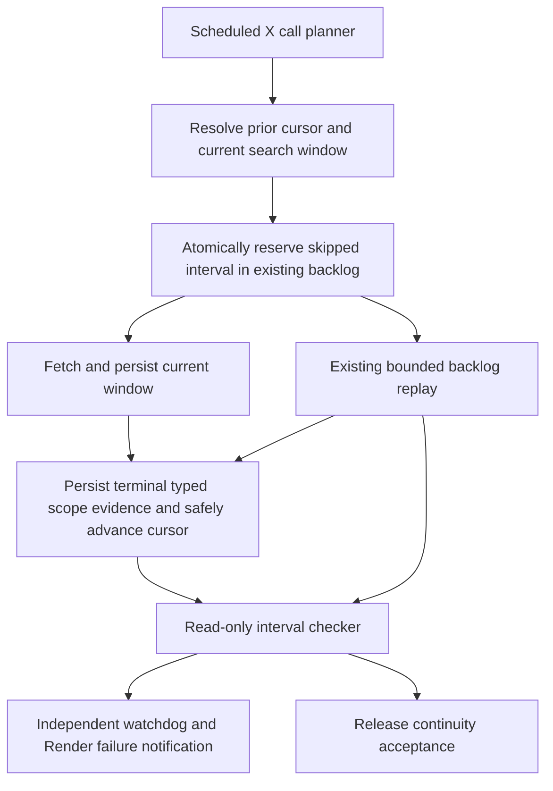
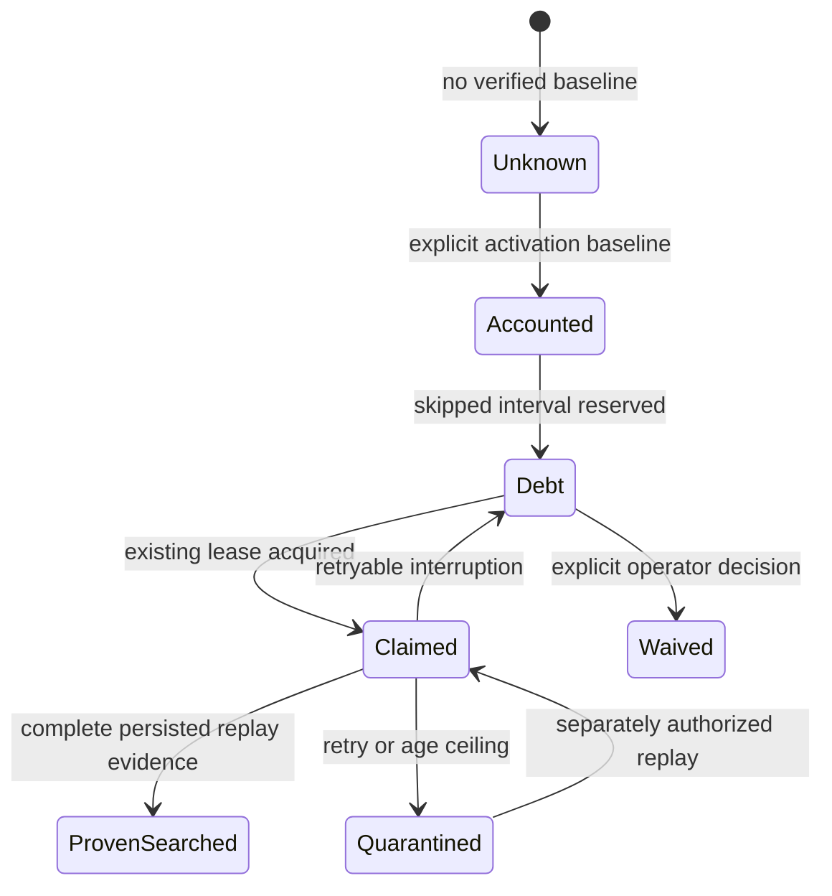

<!-- BEGIN OLLIJA DELIVERY GUIDE -->
## Ollija Delivery Guide

This block is generated guidance. Do not edit it directly. Correct durable facts in `.ollija/project.yaml` or this template, then rerun `ollija annotate-plan`. Current explicit owner instructions govern this task. Record exceptions below and reflect route changes in metadata; removed requirements must not return through another checklist.

### Resolved locations

- Authoritative host: `fuchitalee`
- Authoritative repository: `/Users/fuchitalee/development/pushin-weight-v2`
- Ollija release worktree area: `/Users/fuchitalee/development/pushin-weight-v2/.worktrees`
- Active worktree: `/Users/fuchitalee/development/pushin-weight-v2/.worktrees/fix/live-operation-continuity-20261028`
- Plan: `/Users/fuchitalee/development/pushin-weight-v2/.worktrees/fix/live-operation-continuity-20261028/docs/plans/2026-10-28-002739-fix-live-operation-continuity-20261028-plan.md`
- Change: `fix-live-operation-continuity-20261028-2026-10-28-002739`
- Branch: `fix/live-operation-continuity-20261028`
- Staging branch and blueprint: `staging`, `/Users/fuchitalee/development/pushin-weight-v2/.worktrees/fix/live-operation-continuity-20261028/render-staging.yaml`
- Production branch and blueprint: `main`, `/Users/fuchitalee/development/pushin-weight-v2/.worktrees/fix/live-operation-continuity-20261028/render.yaml`
- Staging URL: `https://pushinweight-staging-web.onrender.com`
- Production URL: `https://pushinweight-web.onrender.com`

### Placement

This worktree is inside the Ollija release worktree area. Reuse it for the whole change. Do not create a second worktree or plan for this branch.

### Delivery scope

- Workflow: `plan`
- Delivery target: `on-request`
- Owner selection recorded: `false`

Target is not authorized until the owner selects it. Wait for a later explicit release request; do not commit, push, stage, or promote on this guide alone.

### Failure handling

- Complete applicable, unwaived checks for the selected route. A waived check is waived, never passed. Owner-selected direct production does not require staging.
- Product defects return to the parent implementation workflow; repeat only checks invalidated by the fix. Environment failures require repairing the environment, not a new source commit. Retry only after a relevant fact changes.
- SSH, shell, environment, or multi-machine failures use the repository infra/multi-machine skill first.
- The change ledger is advisory; do not validate or enforce it.
- Never force-remove a worktree. Retain staging-only, failed, dirty, locked,
  noncanonical, or candidate-mismatched worktrees for diagnosis or later
  delivery.
- Do not run an endless retry loop or start a persistent Ollija process.
<!-- END OLLIJA DELIVERY GUIDE --># Live-operation continuity and RG6 gap recovery - Plan

## Plain-English Summary

Users must continue receiving fresh collected data while schema work and deployments proceed. This group prevents a repeat of RG6's planned harvest interruption and makes accidental missed search windows visible and recoverable. It combines a release rule, durable missed-window accounting in the existing backlog, an independent watchdog, and a continuity check covering the whole release interval.

The first automatic recovery implementation covers the scheduled X searches that use CallState; the operational protection and release inventory cover all existing production collectors and workers. Existing record owners remain in place. Proposed schema additions: zero tables, zero columns, zero JSON fields. One independent watchdog cron is proposed; activation and any provider spending require the current task's explicit delivery authority.

Completion requires a realistic hold/resume rehearsal using fake providers, staging proof without pausing production, and a production release with every expected search window accounted for. The October27 gap has its own bounded recovery unit below. The enrichment allowance issue belongs to another session and is excluded from this plan.

## Goal Capsule

- Objective: Users receive continuous fresh collection through releases, with every missed search interval detected and accounted for.
- Means: Online migrations, atomic transfer of skipped intervals to existing recovery storage, independent monitoring, and release-wide continuity verification.
- Scope: U37–U43 below. U37–U42 retain their IDs from the originating database plan; U43 owns the newly separated incident recovery. Historical database-release acceptance and ChartEngine work remain in the origin plan.
- Authority: The current request authorizes planning. Historical production authorization in the enclosing plan does not authorize deploying this new group, provisioning its watchdog, replaying the October27 gap, or increasing budgets.
- Stop condition during implementation: Stop the proposed rollout or migration if it cannot preserve live operations. Continue healthy production operations. An exceptional current owner order is required to stop those operations.

## Product Contract

**Problem Frame.** RG6 held the X schedule to freeze an archive cohort. When collection resumed, the configured 15-minute lookback omitted earlier hours. Existing-row parity and next-cycle health passed while the missing time remained unqueued. The durable failure was both a release decision and a missing recovery boundary; documentation alone cannot prevent an accidental recurrence.

**Continuity and evidence requirements**

- R47. Routine refactors, copies, verification and deployments must preserve live production collection and worker operations; a release that requires an intentional operational gap must be redesigned or deferred.
- R48. Before a live cursor advances beyond an unsearched interval, durable recovery ownership must exist for that interval; database errors or backlog capacity refusal must never silently erase that obligation.
- R49. Each active X call identity must distinguish completed queried windows, pending or quarantined recovery, operator-waived loss, and unknown coverage; successful invocation alone must not imply completeness.
- R50. A monitor running independently of the harvester must mark a missing 15-minute completion overdue at 20 minutes after its scheduled boundary and detect it at the next five-minute watchdog observation, subject to measured scheduler/notification delay and monitor-platform availability; unknown or unavailable evidence must be unhealthy rather than green.

**Recovery and release requirements**

- R51. Recovery must reuse existing claim, deadline, provider-purpose, deduplication and spending controls, while giving fresh scheduled collection priority; waived or quarantined intervals remain visible as unresolved completeness limitations.
- R52. Release acceptance must reconcile expected ticks and actual requested windows across the complete release interval, as well as exact revision, schema, pages and worker health. Recovery ownership permits truthful operation with debt; it does not permit a claim of complete coverage.
- R53. Every agent entry point and release runbook must discover the continuity invariant and its operational procedure, with the incident report retained as evidence.
- R54. Recovery requests must use the on-demand credential and an explicitly selected spend limit; current routine collection and enrichment budgets remain unchanged.
- R55. Assess and recover the October27 13:45–18:30 JST gap in exact per-call windows, retaining evidence and reporting any remaining historical-recall limitation.

**Success criteria.** A simulated four-hour outage produces no silently omitted interval; replay reproduces the expected fixture posts without duplicates. Every interval at release closure is either proven queried or explicitly retained as debt. An independent stopped-harvester scenario raises the configured operator notification. No planned production tick is removed by this group's rollout.

**Scope boundaries.** The project-wide operating rule applies to all live collectors and workers. This group's durable automatic interval recovery is limited to scheduled X calls whose existing composite CallState identity matches a current planner call. Benchmark/jobs/enrichment remain in the release census and health report; generalizing their recovery semantics is follow-up work. Whole-platform redundant infrastructure, a new scheduling vendor, changing the normal 15-minute lookback, arbitrary new schema storage, and automatic budget renewal are outside this group.

## Planning Contract

**Current evidence.** `monitor/cycle.py::_read_cursor_since` clamps stale cursors to the configured lookback. `_resolve_window` runs before requests and successful processing calls `_advance_cursor`. `monitor/backlog.py::transfer_truncated_coverage` already normalizes residual intervals and updates CallState atomically. `HarvestBacklogWindow` has bounds, composite call identity, pending/claimed/quarantined/waived states and capacity limits; `finish_claim` deletes a successfully replayed pending row. Completed replay evidence must therefore come from persisted collection execution, not the absence of backlog. Existing limits in `config.yaml` include two replay claims per cycle and a 13-minute deadline; they remain unchanged absent measured justification.

**Key Technical Decisions**

- KTD15. Implement R47 using online expand/migrate/contract changes and bounded changed-row reconciliation. The owner rejected planned operational interruption to stabilize migration cohorts (session-settled: user-directed — chosen over holding live collection: skipped source windows may be unrecoverable). Previously recorded RG6 hold instructions are historical evidence, not future release authority. Bound migration locks and statement runtime; fail and retry/defer migration work instead of blocking live writers indefinitely. Measure copy throughput and resource headroom before choosing concurrency.
- KTD16. Reuse CallState, HarvestBacklogWindow and existing typed CollectionRun/CollectionScopeRun requested bounds and terminal outcomes. Zero tables or columns are proposed. New reason values use the existing bounded reason_code field; no source text or provider payload is introduced. If these owners cannot represent the required invariant, stop that schema subtask for a justified design review instead of inventing new persistence.
- KTD17. Add a distinct atomic skipped-window reservation operation in `monitor/backlog.py`, rather than calling the truncation-transfer helper blindly. It must lock the same composite cursor and retain the cursor's prior value while normalizing debt. Completion later advances only from an expected cursor version, or reconciles an already changed cursor under the same lock. Database transaction and capacity failure leave the cursor unchanged; current-window reads may continue with safe duplicate writes, but cannot acknowledge skipped history.
- KTD18. Treat an absent initial cursor as an explicit activation baseline, not evidence that all history was collected. Future cursors, identity changes and missing terminal execution evidence are unknown coverage. An operator-supplied historical window must not advance the scheduled cursor or create an invented current outage. Requested bounds and terminal outcomes establish searched-window coverage, not complete recall of all X posts.
- KTD19. Build a provider-free, database-read-only continuity command and deploy it as one separate Render cron every five minutes. Use the existing Render failed-run notification facility after verifying the owner's configured recipient; delivery proof is required before operational activation is considered complete. This catches a stopped harvester while Render and the database remain available. It is not an independent guarantee against a Render-wide outage. Provisioning this resource remains a delivery decision under this group's authority boundary.
- KTD20. Use the same read-only interval checker for watchdog and release acceptance. Compare expected call identities and UTC half-open intervals with persisted requested bounds, execution outcomes and outstanding debt. Include a cold-start baseline from the exact activation receipt. Never use row counts, elapsed invocation time, HTTP200 or a cursor high-water alone as coverage proof.

**Architecture**

**Assumptions and alternatives.** Prefer existing database ownership and a small separate watchdog over adopting a workflow platform during this refactor. Ordinary lookback widening alone is rejected because cost caps or outages longer than the new lookback can still lose time. A prohibition in AGENTS.md alone is insufficient because accidental outages bypass an agent's decision. The notification recipient and current Render settings must be verified during implementation; missing notification delivery blocks activation acceptance, not local code work. Exact query performance and deployed service census are implementation-time measurements, not assumed passes.

## Implementation Units

### U37. Establish the operating invariant and release manifest

**Goal:** Make R47/R53 discoverable and bind the checker to the actual production workloads.

**Dependencies:** Existing incident review; no unfinished ChartEngine feature is required.

**Files:** `AGENTS.md`, `.claude/skills/change-harvester/SKILL.md`, `.claude/skills/avoiding-recurring-mistakes/SKILL.md` M17/M18, `docs/operations/pause-and-resume-harvest-cron.md`, `docs/deploy/render.md`, `render.yaml`; proposed `scripts/check_live_operation_contract.py` and `tests/test_live_operation_contract.py`.

**Approach:** Reconcile the already drafted root-checkout guidance with the delivery checkout without copying unrelated dirty changes. Keep one normative operating rule in AGENTS.md and one detailed coverage procedure in the runbook; other entries link to them. Preserve dated hold logs as history. Add a checked service manifest derived from the actual Blueprint and explicitly existing manual services; distinguish active, dormant and retired resources. The static checker rejects a proposed diff that suspends or removes an active workload or reduces its schedule; it must compare semantic schedules or reject an unclassified changed schedule for review, rather than compare raw cron strings. A waiver requires an explicit exceptional owner instruction recorded in the active task, never historical RG6 authority.

**Test scenarios:** An equivalent cron expression is accepted after semantic classification; a daily schedule replacing the production 15-minute schedule is rejected; unchanged dormant staging services are accepted; a removed active worker is rejected; unrelated YAML edits remain permitted. A runtime-only service modification is not falsely claimed covered by this static guard.

**Verification:** Both authoritative root and intended delivery branch expose the same invariant. Static release evidence identifies its exact manifest revision.

### U38. Reserve stale-cursor gaps before acknowledging current work

**Goal:** Implement R48/R49 through KTD16–KTD18 without changing the search budget.

**Dependencies:** U37 operating contract.

**Files:** `monitor/backlog.py`, `monitor/cycle.py`, relevant existing manager methods in `core/models.py` only if needed without schema changes; `tests/test_cycle_cursor_wiring.py`, `tests/test_harvest_cursor_lifecycle.py`, `tests/test_harvest_backlog_transfer.py`, proposed `tests/test_cycle_schedule_gap.py`.

**Approach:** Characterize the real planner→window→provider→persist→cursor chain before changing it. Reserve the unsearched interval between the prior acknowledged frontier and current lookback floor, respecting overlap and existing outstanding claims. Preserve current fresh queries if debt recording fails, but withhold unsafe cursor advancement and emit an explicit failure. Make retries, identity isolation and concurrent normalizers idempotent; never coalesce by deleting a claim held by another runner. Cursor reads failing must not silently turn into a trusted cold start. Completed scope evidence and cursor acknowledgement must remain crash-safe: a crash can produce safe replay, never false completion.

**Test scenarios:** A four-hour stale cursor creates exact old debt and a normal current window; a 60-second overlap creates no spurious debt; backlog capacity refusal and database write failure keep the cursor frontier; replay twice creates no duplicated debt or posts; concurrent normalization respects an active lease; a missing or future cursor yields the declared baseline/unknown state; explicit historical overrides leave the live cursor alone; persistence failure does not acknowledge completion; crash after persistence before acknowledgement safely replays.

**Verification:** Required PostgreSQL integration cases use fake providers and assert actual requested bounds and persisted owners. No production provider call is part of regression testing.

### U39. Verify debt replay and preserve completion evidence

**Goal:** Satisfy R49/R51 without granting a new spend budget.

**Dependencies:** U38.

**Files:** `monitor/backlog.py`, `monitor/cycle.py::_replay_backlog`, `tests/test_cycle_backlog_replay.py`, `tests/test_harvest_backlog_transfer.py`, `tests/test_cycle_schedule_gap.py`.

**Approach:** Reuse existing lease/retry/deadline and source-post deduplication paths. Persist successful typed replay bounds and terminal outcomes before deleting the pending claim, or atomically in its completion transaction. Retain pending/quarantined/waived limitations in reports and enforce the existing fresh-work-first replay budget. A changed or removed call identity must not replay under a different query silently. Compare the original pinned collection target/query revision with the current planner; if the exact historical query cannot be reconstructed, keep the debt quarantined/unknown rather than search with current wording and claim recovery. Respect the existing credential purpose of the selected recurring replay path; explicitly launched incident backfills require the on-demand key and their own spending authority.

**Test scenarios:** Completed replay removes pending ownership only after durable terminal evidence; failure between evidence write and claim deletion is safe and idempotent; exhausted deadline starts no replay claim; partial pages retain residual debt; changed query identity cannot be mistaken for the old query; quarantined or waived debt prevents a completeness claim; fresh collection runs before recovery.

**Verification:** The recovered fake-provider cohort equals the expected original IDs; a restart cannot lose the remaining intervals.

### U40. Add read-only coverage inspection and an independent watchdog

**Goal:** Implement R50 using KTD19/KTD20.

**Dependencies:** U38/U39 evidence semantics.

**Files:** proposed `monitor/harvest_continuity.py`, `monitor/management/commands/harvest_continuity.py`, `tests/test_harvest_continuity.py`, `tests/test_harvest_continuity_command.py`, `tests/test_render_continuity_watchdog.py`; `render.yaml` and `docs/deploy/render.md`.

**Approach:** Report per-call expected windows, proven queried unions, debt states, unknown evidence, last terminal completion and stale-running execution. Empty successful queries count as searched. Exclude nonterminal, failed or truncated scopes from full-interval proof. The watchdog queries indexed bounded time ranges, uses a restricted read-only database role and no Twitter/LLM credentials, and exits nonzero for overdue or unknown coverage. Its 5-minute schedule and 20-minute boundary threshold allow the existing 13-minute runtime to complete; receipt timestamps and query windows determine actual coverage. Emit counts and identifiers without source payloads. Verify the configured Render failure notification recipient and deliver a synthetic failure from the watchdog test environment before declaring alerting active.

**Test scenarios:** The collector stops entirely and the separate monitor detects it; a legitimate zero-post complete query passes; a process exits zero with missing terminal scope fails; pending, quarantined and waived gaps remain distinct; a missing database connection is unhealthy; completed out-of-order windows form the correct union; delayed execution or overlapping calls do not create a false full pass; a 20-minute-old missed boundary fails. Generated SQL must not select retired JSON, full post bodies or unbounded historical cohorts.

**Verification:** Staging checks run under the actual restricted role with zero provider calls and no database writes. Watchdog availability limitations are visible in the runbook.

### U41. Bind release acceptance to continuity throughout rollout

**Goal:** Implement R47/R52 while retaining existing schema and page gates.

**Dependencies:** U37/U40.

**Files:** proposed `scripts/check_release_continuity.py`, `tests/test_release_continuity_gate.py`; `docs/deploy/render.md`, `docs/operations/pause-and-resume-harvest-cron.md`; existing release automation discovered from the active delivery branch rather than a new competing release controller.

**Approach:** Capture a baseline immediately after a completed natural cycle and keep the checker window open through the first candidate-revision terminal cycle and the following scheduled boundary. Re-read actual active service settings after every Blueprint operation. Include web routes, active worker readiness, scheduler schedules and in-flight execution compatibility in the release manifest. Fail promotion if new unexpected gaps appear; stop the candidate rollout and preserve live serving/collection. A release receipt can report operation with explicit debt, but must never label it continuous or recovered. Rollback must use a schema-compatible image and preserve recorded recovery owners. Do not solve a failed gate by pausing the collector, deleting evidence, widening scan scope, or starting paid manual runs.

**Test scenarios:** Exact released SHA plus one green cycle still fails when an earlier tick is missing; a Blueprint changes only the runtime schedule and is detected; old and new compatible writers overlap without a false gap; interrupted migration leaves existing live code operational; operator-ordered exceptional stop yields debt rather than a pass; debt pre-existing before the baseline is disclosed without being attributed to the candidate; a later schedule boundary missed after initial success fails closure.

**Verification:** A fake-clock end-to-end rehearsal reproduces RG6's hold and proves the release cannot be declared continuous. Staging demonstrates the new code with active compatible writers and bounded copy/delta work.

### U42. Deliver online and record the proven learning

**Goal:** Verify R47–R54 in the real topology after separately selected delivery authority.

**Dependencies:** U37–U41.

**Files:** The preceding code/docs; `docs/analysis/2026-10-28-070730-rg6-harvest-gap-incident-review.md`; a dated learning in `docs/solutions/workflow-issues/` after verification.

**Approach:** Inventory current service revisions, role permissions, backlog counts, query workload and disk/RAM before release. Demonstrate fake-provider crash/resume, debt-capacity failure and simultaneous online migration in the permanent shared local PostgreSQL instance under its exclusive wrapper, then rehearse staging. Promote the unchanged accepted revision with live schedules intact and activate the watchdog only with confirmed resource and notification authority. Verify natural production cycles and the complete release ledger. Run ce-compound after verified delivery and amend remaining plan instructions with any material lesson; do not describe the October27 historical gap or expired enrichment allowance as repaired by these protections.

**Test scenarios:** One production-shaped integrated rehearsal combines a four-hour gap, interrupted replay, duplicate normalization and compatible concurrent writes with no omitted fixture ID. A watchdog-notification test observes actual delivery. Post-release read-only probes cover affected web pages and active worker/cron evidence.

**Verification:** Reuse valid focused test evidence; do not repeatedly scan all historical collection rows. Preserve exact revision, bounded cohorts and honest skipped/failed checks in release receipts.

### U43. Assess and recover the October27 collection gap

**Goal:** Implement R54/R55 independently of future-outage prevention.

**Dependencies:** Saved incident evidence and existing collection/backfill infrastructure. Read-only assessment may proceed before U38; recovery must use current compatible code and preserve its durable evidence.

**Files:** Existing historical collection/backfill management command selected after inspecting `monitor/management/commands/`; `docs/analysis/2026-10-28-070730-rg6-harvest-gap-incident-review.md`; a dated bounded recovery receipt/report under `docs/analysis/harvester/`.

**Approach:** Reconstruct the original query definitions and per-call coverage from the saved 13:45/17:30/18:31 evidence and typed pins. Use the conservative half-open UTC envelope `[2026-10-27T04:45:00Z, 2026-10-27T09:30:00Z)` and ordinary deduplication, narrowing only with actual coverage evidence. Perform a provider-free cost/call-window preview first. Recovery dispatch requires an explicitly selected budget and the on-demand key; it must not stop, reschedule, starve or advance the live harvester cursor. If historical queries or provider recall cannot be reproduced, preserve that limitation and remaining windows rather than fabricate completeness. Enrichment repair is owned by the separate session.

**Test scenarios:** An already-stored interim post is not duplicated; repeated recovery is idempotent; publication time and ingestion time are reported separately; unavailable historical query definitions remain unresolved; cap/deadline refusal records unfinished windows; live scheduled cursors remain unchanged.

**Verification:** Record attempted windows, exact query versions, actual provider requests, cost, source IDs, newly inserted/already-present counts and residual debt. A successful provider response is not a promise of complete historical X recall. Do not close the incident without those receipts or an explicit owner decision accepting the documented loss.

## Verification Contract

Local proof uses the permanent shared PostgreSQL wrapper and required PostgreSQL cases in the named test files; no pytest command may silently migrate the shared schema. Code tests must exercise the actual CycleRunner provider-window and persisted-evidence chain. Static checks cover Blueprint/service schedule changes and active worker removal. Staging rehearses a clock-driven interruption with fake sources, concurrent online writes, restricted inspection and notification failure delivery. Production verification is read-only observation of natural cycles and service settings under separately selected delivery authority. Zero paid provider calls and zero operational changes are authorized merely by writing this plan.

## Definition of Done

All R47–R55 outcomes hold; U37–U43 proof is attached to exact code revisions; no planned production schedule was removed; interrupted intervals survive restart and capacity refusal; completed replay has durable typed evidence; the independent watchdog and its notification delivery are observed; release closure checks all expected windows rather than one next run. The October27 incident closes only with a recovery receipt or an explicit owner acceptance of remaining loss under U43. Remove abandoned experimental paths and duplicate normative rule text. Preserve unrelated session changes and existing dormant services.

## Sources

- `docs/analysis/2026-10-28-070730-rg6-harvest-gap-incident-review.md` and original handoff: observed RG6 interruption, missed windows and preservation limits.
- `monitor/cycle.py`, `monitor/backlog.py`, `core/models.py` CallState and HarvestBacklogWindow: current ownership, transfer, replay and completion behavior.
- `tests/test_harvest_backlog_transfer.py`, `tests/test_cycle_backlog_replay.py`, `tests/test_harvest_cursor_lifecycle.py`: existing rollback and replay proof patterns.
- [Google SRE pipeline guidance](https://sre.google/workbook/data-processing/): freshness and completeness measures.
- [Render deployment lifecycle](https://render.com/docs/deploys): readiness and graceful instance replacement do not establish application coverage.
- [Render scheduled workloads](https://render.com/articles/how-render-handles-scheduled-tasks): isolated cron execution and failed-run notifications.
- [Temporal missed actions](https://github.com/temporalio/documentation/blob/main/docs/troubleshooting/schedule-missed-actions.mdx): explicit catch-up limits and missing-action detection as precedent, not a scheduler adoption proposal.

## Delivery Exceptions

The owner requested a separate plan/worktree and authorized committing and pushing this planning record. Implementation, provider spending, provisioning, staging and production activation require subsequent selected authority.
