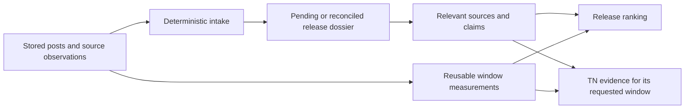

<!-- BEGIN OLLIJA DELIVERY GUIDE -->
## Ollija Delivery Guide

This block is generated guidance. Do not edit it directly. Correct durable facts in `.ollija/project.yaml` or this template, then rerun `ollija annotate-plan`. Current explicit owner instructions govern this task. Record exceptions below and reflect route changes in metadata; removed requirements must not return through another checklist.

### Resolved locations

- Authoritative host: `fuchitalee`
- Authoritative repository: `/Users/fuchitalee/development/pushin-weight-v2`
- Ollija release worktree area: `/Users/fuchitalee/development/pushin-weight-v2/.worktrees`
- Active worktree: `/Users/fuchitalee/development/pushin-weight-v2/.worktrees/feat/product-release-intake-20261027`
- Plan: `/Users/fuchitalee/development/pushin-weight-v2/.worktrees/feat/product-release-intake-20261027/docs/plans/2026-10-28-083502-feat-product-release-intake-20261027-plan.md`
- Change: `feat-product-release-intake-20261027-2026-10-28-083502`
- Branch: `feat/product-release-intake-20261027`
- Staging branch and blueprint: `staging`, `/Users/fuchitalee/development/pushin-weight-v2/.worktrees/feat/product-release-intake-20261027/render-staging.yaml`
- Production branch and blueprint: `main`, `/Users/fuchitalee/development/pushin-weight-v2/.worktrees/feat/product-release-intake-20261027/render.yaml`
- Staging URL: `https://pushinweight-staging-web.onrender.com`
- Production URL: `https://pushinweight-web.onrender.com`

### Placement

This worktree is inside the Ollija release worktree area. Reuse it for the whole change. Do not create a second worktree or plan for this branch.

### Delivery scope

- Workflow: `lfg`
- Delivery target: `staging`
- Owner selection recorded: `true`

1. Complete implementation and the plan's verification contract.
2. Run the configured focused checks:
   - `pytest tests/ollija`
3. The parent workflow commits only this plan's changes, pushes the feature branch, and records the candidate SHA.
4. Fetch the remote staging lane: `git fetch origin refs/heads/staging`.
5. Require the unchanged candidate SHA to be a fast-forward of that fetched remote ref, then push the exact candidate SHA to `refs/heads/staging` with the server-enforced fast-forward command `git push origin <candidate-sha>:refs/heads/staging`.
6. Verify the remote staging ref resolves to the candidate SHA and the deployment for `pushinweight-staging-web` reports that same SHA.
7. Run staging checks. Stop here if they fail.

### Failure handling

- Complete applicable, unwaived checks for the selected route. A waived check is waived, never passed. Owner-selected direct production does not require staging.
- Product defects return to the parent implementation workflow; repeat only checks invalidated by the fix. Environment failures require repairing the environment, not a new source commit. Retry only after a relevant fact changes.
- SSH, shell, environment, or multi-machine failures use the repository infra/multi-machine skill first.
- The change ledger is advisory; do not validate or enforce it.
- Never force-remove a worktree. Retain staging-only, failed, dirty, locked,
  noncanonical, or candidate-mismatched worktrees for diagnosis or later
  delivery.
- Do not run an endless retry loop or start a persistent Ollija process.
<!-- END OLLIJA DELIVERY GUIDE -->

# Product-release detection, milestone timelines and lifecycle study

## Plain-English Summary

Finish the inclusive release detector that starts from stored X posts and supported data-source evidence, reusing existing saved enrichment. Either can reveal a release first; an X announcement is not required before considering repository or other collected evidence. The original source-first detector and collection-window replay are implemented locally, but their broader candidates are not yet connected to the database workflow. The old RG7 storage prerequisite is now delivered: pending release claims and completed product-release reviews have distinct owners, and the retired model-release tables must stay retired.

First use the LLM already included in this agent session to review approximately 30 varied cases, check the interpretations against sources and turn recurring signals into code. Do not launch separate model/API calls or add a paid research budget. Routine detection continues to reuse existing enrichment without additional LLM calls. Persist suspected releases in pending EventDossiers, retain identified but unverified publishers in BrandDiscoveryCandidate, and preserve their source links while identity work continues. Verify the actual publisher and its source account/repository before treating its announcement as confirmed. SourceRecord remains an in-memory input object.

Collect significance facts early, then rank after evidence and historical comparisons are available. Favor substantive significance while displaying absolute and baseline-relative attention separately. Include quiet and unfamiliar publishers and create their EventDossiers; this phase does not need a special discovery ranking or a boost for being overlooked. Display distinct product releases separately, including products announced together.

Validate the completed path in staging, first on a few cases, then the study set, then a resumable scan of stored posts and supported data-source records from August 1 through a declared cutoff. Deliver a sortable report backed by the staged release timelines, source claims and reusable measurements, plus reviewed code; stop before production rollout. The before/after discussion study uses our stored posts and classifications. Its seven-day comparison preset is not a discovery or verification limit. TN can reuse the dossiers and compatible calculations while selecting quotations for its particular window. Establish that reuse before further TN writing development; broader automated acquisition, lineage and live binding remain later work. The existing extractor already writes pending release dossiers, but that does not establish that this new workflow is installed. The Planning Contract resolves storage and integration for this implementation-ready staging slice.

## Goal Capsule

Enable stored and subsequently collected posts and supported data-source evidence to enter a reusable, inclusive product-release inventory, with supporting dossiers, recoverable unknown identities and evidence-backed milestone timelines. Either source route can initiate a candidate. Use that persisted inventory to produce a multi-release lifecycle dataset of posting volume, saved classifications and representative sources before further TN development; later ranking and broader metadata acquisition build on it. The outcome must not depend on an X announcement, prior catalogue membership or additional routine release-detection LLM calls.

Source: the product-release follow-up, PR-U1–PR-U5 and settled owner decisions in the [original G3 plan](../../../../refactor/global-shared-vocabulary-20261021/docs/plans/2026-10-09-063417-feat-g3-round2-chart-engine-plan.md). RG1–RG7 schema delivery is closed. This branch-bound continuation, returned by Ollija, owns subsequent feature work; preserve the earlier plan as evidence and requirements, rather than reopening the delivered schema release.

## Product Contract

- Start historical detection from both saved X Posts and supported data-source records. Reuse posts' existing labels, commentary, translations, quoted context, URLs and release reports, and available repository snapshots, revisions and release/availability evidence. Either route can independently initiate a candidate; other data sources are not limited to corroborating an X-discovered release. Future collection/enrichment updates feed the same intake rules. A repository creation/edit or numerical metric change alone does not establish a release; retain applicable clues with their uncertainty.
- Retain unknown Products, publishers and repositories. Source candidates are provisional evidence requiring reconciliation; they are not automatically legitimate or distinct real-world releases. Preserve unresolved cases. A content-supported finding that a post does not describe a release is a false-positive decision, not a fake/scam accusation; retain its evidence and reason. Legitimate releases remain in the inventory irrespective of popularity or rank. Missing attention alone cannot establish non-release, fraud or scam.
- Reuse pending EventDossiers for suspected releases before product/publisher identity is complete. Reconcile identifiable releases into canonical dossiers before ranking. Support models, agents, harnesses and other products; do not restore model-only tables, create a SourceRecord table or invent completed reviews for pending evidence.
- Use this session's included LLM for the initial case study, with source-checked conclusions and a frozen evaluation set. No separate model/API research calls, dollar budget or dependent per-call/token allocation is selected. Routine historical/live release detection makes no additional LLM calls; existing classifications/commentaries/extractions remain usable. Inspect TN packets and prose here if useful; do not invoke the application's paid TN generation path for this study.
- Create/reuse BrandDiscoveryCandidate for an observed unknown publisher and retain its release-context claim link. Publisher verification may follow candidate storage, but must precede confirmation based on that publisher's assertion. Verify both the entity and its control of the source account/repository, retaining the supporting evidence; a matching name, classification tag or account badge alone is insufficient. A completely unidentified publisher remains unresolved without an invented candidate name.
- Give each distinct product/revision its own release identity, EventDossier and report entry, including products launched in one announcement. No grouped family-launch presentation or new launch-container entity is required. Shared source Posts remain shared canonical records; combined attention totals deduplicate them and ambiguous family-wide discussion is not assigned wholesale to every product.
- Resolve exact Products/publishers and acquire bounded HF/GitHub/other supported metadata after source discovery. Distinguish the actual derivative publisher from base/teacher/comparator brands and use exact Product references for resolved lineage.
- Initially test history back to August against a comprehensive primary-source web inventory, recording gaps and changes needed in the underlying collectors. No whole-HF census or short-link resolver is selected.
- Preserve all legitimate inventory through ranking. Collect significance inputs in steps 3–5 and calculate/revise rank after dossier evidence and comparisons are available. Primary releases generally precede derivatives and then ablations/narrow-use variants; frontier general-intelligence models receive the owner's default editorial preference. Favor substantive significance over fame or raw attention while keeping measured attention visible. Technical ancestry or marketed version numbering alone does not determine significance. Inclusion and an EventDossier satisfy this phase's treatment of overlooked releases; no separate discovery view or special boost is required.
- Historical replay accepts exact collection bounds/timezone, distinguishes physical refetch from cached-page processing and first-storage fallback, and is idempotent. Post publication windows are a different selection.
- Detect and retain distinct announcement, source-stated release, channel-specific availability and first observed usage milestones. Preserve rumor/anticipation evidence, date precision, source timezone, knowledge cutoff and unresolved/conflicting claims. Do not manufacture an exact instant or force every release through the same sequence of stages.
- Build the lifecycle-study dataset through the reusable release pipeline and shared numerical owners. Use our stored Posts, classifications and source observations to examine pre-release, anticipation/rumor, announcement and post-release movements. Seven days before/after is a comparison preset where the DB has coverage, not a discovery boundary or confirmation requirement. Show incomplete history instead of collecting discussion just to fill the preset. Keep brand-wide activity distinct from evidence attributable to a particular release, and preserve taxonomy/classification coverage and versions.
- Deliver candidate persistence, dated dossiers and the reusable study dataset before further TN writing development. Ranking and comprehensive provenance/lineage automation are later work, while bounded evidence/identity resolution needed for the study remains in scope. Do not create another full counted-Post relationship set for every release, chart, comparison or TN request.
- Use staging for end-to-end persistence and replay validation. Expand from a small pilot to the study set and then all stored posts and supported source records in the August-onward test period. Verify coverage, include detector nonmatches in the audit and preserve existing staging data. The selected endpoint is working staging results, a sortable review report and reviewed code through the existing PR/CI process; production activation is outside this delivery.

## Executed staging slice — October 29 LFG

Application `5e3c475e4d42c776b9d8d33aecd2d56dc5dfb26d` is observed live on the staging web and staging-jobs services; schema 0206 is applied. The supported detector/study commands, typed persistence, milestone review, numerical sharing and sortable report are implemented. [Study results](../analysis/2026-10-29-230000-product-release-staging-study.md), [35-entry report](../analysis/2026-10-29-230000-product-release-staging-study.html) and [review receipt](../reviews/2026-10-29-230500-product-release-review.md) carry the concrete evidence. Final documentation/PR CI and local delivery close-out follow this checkpoint; their observed final revision is recorded in the delivery receipt, not inferred from a branch push.

| Unit | Executed result |
|---|---|
| PR-U0 | Frozen 30 nominations, 20 development/ten held aside; six separate misleading controls; session-only assessment with public primary lookups. All nominations detected, with ambiguous/retrospective cases retained. |
| PR-U3 / U3A | Real source command/persistence/reader paths; pending evidence independent of catalogue membership; exact Product references when assessed; separate family products; milestone precision; verified publisher gate; idempotent reviewed import. Unknown publisher context uses existing discovery records. |
| PR-U3B | 3,539 immutable numerical snapshots, 43,491 categorical count rows and 4,650 dossier uses including review history. Exact arbitrary boundaries, distinct-account unions, correction versions and shared family populations tested. |
| PR-U3C | 35 assessed product entries, two confirmed/33 provisional; five pilots then full frozen cohort, six controls with zero false confirmations, exact repeat, 38 side-count reconciliations and five arbitrary-window checks. |
| Bounded PR-U5 | Ordinary significance ordering and sortable source/date/count report. No discovery boost. Before/after descriptive recipe and exact membership/exclusions retained; incomplete staging data is not a popularity/prediction baseline. |
| PR-U4 / TN writing | Deferred: broad automatic identity/acquisition/lineage, recurring harvest binding, production and application TN/Pulse prose. |

**Refresh integration:** CI exposed missing refresh-policy entries for the four additive study tables. Copy the immutable decisions/calculations and their two generated-ID sequences with exact-count validation; treat them as optional on pre-0206 source snapshots. The policy, grant runbook and four shared-schema sections are updated together. No full refresh or source-database grant is performed. Broader pre-existing schema-reference and collector/account-fixture drift is reported separately; assertions and retired columns are not weakened or restored to make CI pass. The bounded CI repair scope includes this feature-owned integration correction after three lint repairs; the original watch deadline is unchanged.

**Historical scan execution:** publication window August 1 00:00 JST–October 29 19:00 JST; every one of the 265,340 staged Posts was scanned, admitting 69,550 source candidates in 133 resumable pages. These are source records, not grouped releases. The wide census is read-only; bounded earlier persistence pilots and the finite study remain saved. This deliberate study limit avoids inserting tens of thousands of unreviewed test dossiers while retaining actual persistence/replay evidence. Non-X first-storage scanning is separately bounded to one hour and exposes its last cursor/completeness/unsupported-content counts. The completed one-hour run read 562,000 of 1,371,466 retained observations, with zero candidates and no supported release text in every scanned row. It retained its cursor with complete=false; 809,466 rows remain unscanned. This is a measured source-content limitation, not total non-X coverage.

**Research and analysis limits:** the primary-web inventory includes the retained 56 nominations and expanded provider/research sources. Provider access/region listings are not automatically new releases; exact provider spellings must be used before declaring a name missing. The read-only source database has 438,494 Posts versus 265,340 staged Posts in this interval. This discrepancy, unknown publisher control and missing dated brand anchors are reported, not filled with fabricated data. Any confirmed future harvester/source omission requires a demonstrated cause and repair under PR-U4; a narrow alias nonmatch is not yet that diagnosis.

**Statistical recipe:** `stored-population-descriptive-v1`, equal weight per distinct brand/anchor pair, seven-day pre/post windows, family populations counted once, no percentage for zero baseline, and separate availability anchors. Seventeen elapsed aligned populations remain; members/exclusions, absolute counts, ratios and spread are recorded in the result JSON. Missing collection coverage prevents causal or predictive conclusions. Actual numerical reuse is measured; no 95% computational-reuse claim is made.

**Validation:** 83 focused tests passed at f85f67f7, including 47 PostgreSQL-required ; 14 report/study tests passed after the anchor-display correction, including 11 required. No required skips/errors. Prior applicable 54 shared-vocabulary/classification/Ollija checks remain valid. Inline code review follows the owner's sequential/session-only restriction, with no independent model review claimed. Real browser checks cover the exported report at 1280px/390px, sorting, filtering and expanded dated evidence. The only later application correction labels announcement and availability windows with their actual claim identity; it is covered by the new database-to-report regression.

**Operational receipts:** source-copy, assessment, capture, repeat/control, report export and scans are retained privately under `/Users/fuchitalee/development/pushin-weight-v2/.local/2026-10-29-product-release-lfg/`. An earlier synthetic Post insertion timed out before detector execution; the control setup was replaced with rolled-back in-memory controls and local real-Post path tests. No claim is made that the original staging insertion bottleneck was fixed. No production write, new paid API/model call, scheduler activation or peer-service change occurred. Keep this staging worktree for review.

## Verification continuation — October30

Owner resumed product releases using existing joined website evidence while the URL issue is handled separately. [35-entry triage](../analysis/2026-10-30-170952-product-release-verification-triage.md) classifies the saved cohort:2confirmed,14apparent lab announcements,2creator announcements,14third-party/access reports and3anticipation/existing-product contexts. The33provisional entries are not33detector failures.25of35 lack an exact Product link;11lack a resolved issuer. The source-study report remains unchanged.

Next bounded pass: verify GLM5.3/Flash, MiniMax Music3, DeepSeek1017 and Nanbeige using saved evidence and targeted primary lookups where necessary; preserve account identity/time/URL role, announcement versus access, and report-time versus release-time. Reuse company/account/post and official-company evidence; do not depend on Company.url. Investigate the Company-only confirmation gate for independent creators before broadening it. Revise staged reviews only with supporting evidence and verify replay. Website finding alone is not proof; low attention is never a rejection reason. Session-only analysis and staging endpoint retained; broader acquisition/live binding/TN writing remain deferred.

Current branch6257cdf2 reverses the unintended Company.url commit locally; reversal is unpushed and the earlier staging column remains. This is an outstanding delivery mismatch to resolve before another deployment, not a dependency on that column for release research. No code/database/status change occurred during this review.

## Executed verification pilot — October30

[Five-entry pilot results](../analysis/2026-10-30-172900-product-release-verification-pilot.md) and [updated35-entry report](../analysis/2026-10-30-172900-product-release-verification-pilot.html): native staging job `job-dbi56coae00c73b8ug0g` succeeded at17:26:45JST on existing runtime0a974d77. GLM5.3/Flash now confirmed; cohort4confirmed/31provisional. MiniMax retains account-continuity uncertainty; DeepSeek1017 and Nanbeige retain primary research but await a collected primary-source/issuer path. Both third-party timestamps are excluded as release anchors in new reviews. Five new reviews, zero new dossiers; all old reviews preserved, other30unchanged, exact replay passed. Three186-window studies reused existing calculations for558window uses with zero new numerical rows, including repeat. No app/schema/deploy/production/paid-model change.

Next bounded implementation should address actual primary-document ingestion/claims, stable account identity and individual-publisher confirmation using existing collection/account/dossier entities. Current study research is archived but is not an independent collected source. Hosted access is also missing from the api/weights-only channel vocabulary. Keep these gaps visible; do not infer that session-assisted confirmation already implements an automatic verifier. The URL revert remains local; no deployment occurred in this pilot.

## Primary-document verification continuation — October30

Continue the preceding pilot by importing bounded, already captured primary documents, then allowing study evidence to reference their CollectionObservations alongside Posts. This is session-assisted source assessment, not unattended website ownership verification or a general crawler. Preserve exact raw capture bytes, capture URL/time, checksum and import time. A saved capture import makes zero transport requests and creates no invented CollectionRequests. Ordinary research notes remain notes until an actual retained source document is imported.

Storage review: reuse CollectionJob/Run, CollectionEvidenceArchive, CollectionObservation and CollectionResourceSnapshot plus existing EventDossier sources/claims/reviews/details. **Zero tables and zero feature columns added.** The separately requested Company.url cleanup retires that one unused column through0208 while retaining0207 as applied history. Documents describing models use the existing model subject kind; repository documents use repository. These are unresolved source identities, not fabricated Product rows. A disabled publisher_web datasource represents public publisher model/catalogue documents. Import jobs are manual, with typed settings, strict empty operation options, and bounded capture inputs. Full document bytes are opaque evidence in the existing archive, not a new JSON business entity. Capture format, URL, clocks and hashes stay on their existing typed owners.

Implementation: add a bounded document-import service/command; extend the existing study's exclusive Post-or-observation reference and its source quotation validation; preserve exact source URL and archive on claims. Keep the native account-ownership gate for repository observations. For publisher website documents only, accept explicit session-reviewed entity/control proof scoped to that exact observation and URL; retain the assessment archive and require the actual announcement to cite the same independently captured document. Do not treat a generic research note, a matching hostname, an unverified account or a third-party source as publisher verification. No Company.url lookup is used.

Verification: existing Post study stays unchanged; document-only and mixed-source studies work; invented quotations, missing/ambiguous source references, unsupported formats, checksum/identity mismatch, future capture clocks, unrelated ownership proof and unavailable evidence fail atomically. Repeating a capture/import/review adds no rows. First validate locally using the permanent test database, then use the supported paths in staging on DeepSeek1017 and MiniMaxMusic, preserving old reviews and other cohort pointers. Announcement day precision remains separate from current availability and document capture time. Repository/unknown-publisher cases remain provisional until actual control is established. Broader discovery/collector automation, creator ownership, hosted-channel vocabulary and TN writing remain deferred.

Before deployment, reconcile the earlier local Company.url revert with staging's already-applied0207 migration. Retain historical migration identity and remove the unwanted field through a forward migration if required; never rewrite applied migration history or affect production. This continuation preserves the authorized staging endpoint.

Staging checkpoint: `cbe8da4f` is live on both staging services with migration 0208 and no `companies.url` column. The two-document pilot passed its rollback preflight, then stopped and rolled back on an exact-repeat assertion. Diagnosis reproduced the defect locally: merging a temporary intake dossier copied evidence but left the canonical intake decision to the second invocation. The fix completes source intake immediately after the merge using the existing writer, including its exclusion protection. The strengthened existing regression checks an exclusive-source merge and includes intake-decision row counts. All 28 document/study/pipeline tests pass after the correction. The failed pilot is not a successful data import; the corrected revision requires a new bounded staging pilot before completion.

Completed checkpoint — October 30, 18:31 JST: corrected source revision `6e0894133a715853f9deaa5dc15664cac6bf80b3` is live on both staging services. Native job `job-dbi659oae00c73bb9ie0` succeeded. DeepSeek 1017 and MiniMax Music 3.0 are confirmed from retained official captures; the cohort is now **6 confirmed / 29 provisional**, with all other 33 current reviews and all prior reviews preserved. Exact import/review replay adds zero rows. Each case has 186 discussion snapshots; repeating each calculation adds zero snapshots. The run creates two raw-document archives and two assessment archives, two observations and two new historical reviews; no Product, Account, CompanyAccount or CollectionRequest is created. Two temporary source dossiers merge into the existing release identities. [Results and row deltas](../analysis/2026-10-30-183147-product-release-primary-documents.md) and the linked report/JSON preserve the evidence.

The report passed desktop/narrow-screen browser checks for filtering, sorting, named source links and dates. After the replay fix, 28 database-backed document/study/pipeline tests and 32 detector/replay/report tests plus 12 subtests pass. The permanent local database is restored to its prior schema 0206. Current source-head CI still reports the existing shared schema-reference mismatch (387 passed, one failed, 110 passing subtests); remaining broad checks are not asserted green. This closes the bounded primary-document staging continuation, not the broader acquisition/TN work or production delivery. Final result-document publication does not change the deployed application source revision.

## Historical checkpoint — October28

- Feature branch `feat/product-release-intake-20261027` remains at local commit `490a34c62be3efb76c47983699c137cce6eee1ce`. Four owned files: `core/product_release_intake.py`, `core/product_release_replay.py`, and their two tests. The previous receipt records29 passing pure tests; no new test run is claimed by this status audit. The commit is not on `origin/main` and the branch has no upstream publication in the observed branch inventory.
- PR-U1 admits release signals before catalogue resolution and preserves saved evidence attribution, uncertainty, repository hints and explicit fraud dispositions. A source key is not a cross-post release identity. PR-U2 selects reproducible collection windows from supplied receipt/first-storage records; neither module performs ORM or provider I/O.
- Delivered RG7 provides `ProductReleaseDetail`, `ProductVerificationProposal.source_dossier`, `core/product_release_dossiers.py:record_release_report`, pending/current-evidence readers and source-bound claims. The source plan records production cutover18742e44, physical retirement6873cf17 and schema0205. This supersedes the October27 observation that RG7 storage was unavailable.
- Fetched `origin/main` is `e5edf737` at this audit. It includes the separately owned ordinary-versus-special-event release-routing correction and `tests/test_product_release_routing.py`. That correction uses the existing extraction path and budgets; it is not integration of our pure detector. The active special-events owner retains rollout/activation proof.
- Read-only production snapshot at2026-10-28T08:38:18.043172Z (17:38:18 JST):423 product-release dossiers,582 claims from452 distinct source Posts,0 completed current reviews,0 resolved Product details and580 pending linked product-verification proposals. These are current saved pending reports, not423 confirmed releases and not output of the new detector. Counts can change after this observation.
- Broader automatic targeted acquisition, complete lineage ingestion, revised ranking and the August completeness test remain incomplete. Existing exact-HF verification/proposal/collection services must be reused where their actual contracts fit; do not describe all discovery capability as absent.

**October29 source check for this amendment:** local `origin/main` is c445ec24701c3c28decf661844b6d7402f551e2a. The feature worktree remains at490a34c6, one commit ahead and90 behind that ref, with the continuation plan untracked. Preserve the four-file detector/replay checkpoint and reconcile the delivered source base before implementation. Models, dossier/brand-candidate writers/readers and integrity migrations were inspected from the main ref; no current staging capacity/schema, provider health or production data count was measured in this amendment.

## Planning Contract

The executable slice is PR-U0, PR-U3, PR-U3A–C and the bounded ranking/report portion of PR-U5. PR-U4, recurring activation, production rollout and the application's TN prose generator remain deferred. Implementation begins from main c445ec24/schema0205 plus the existing four-file detector/replay commit; preserve the retained drafts in other worktrees rather than merging their obsolete schema edits.

- KTD1. Pending EventDossier is the candidate owner; source identity is provisional until exact release reconciliation. Use canonical dossier/source/claim writers, immutable evidence and explicit merge decisions. (session-settled: user-directed — chosen over a new SourceRecord/candidate table: retain uncertain release evidence in the shared dossier.)
- KTD2. Each released product/revision has its own dossier and report entry. Shared source records do not imply shared release identity, and combined attention uses distinct Post/account counts. (session-settled: user-directed — chosen over grouped family launches: show releases separately.)
- KTD3. Confirmation requires source-backed publisher identity and control of the announcing account/repository; attribution tags and badges do not satisfy it. Pending storage proceeds without that proof. (session-settled: user-approved — chosen over treating an apparent official announcement as sufficient: impersonation and upstream-model confusion must not produce confirmed releases.)
- KTD4. The initial reference assessment and any illustrative TN prose use only this session's included model. No external model/API, elevated-model or paid TN calls are used by implementation, research, review or tests. (session-settled: user-directed — chosen over a separately budgeted model batch: session analysis supplies the required LLM assistance.)
- KTD5. Add four typed tables, zero JSON columns and retire zero tables. They store intake decisions, reusable numerical snapshots, their categorical counts and dossier use of those snapshots; none stores a fresh full Post membership per dossier. The schema decision and concrete queries follow below.
- KTD6. Deliver tested staging data and the sortable evidence report with reviewed code/CI decided; do not promote to production. (session-settled: user-approved — chosen over continuing into production: inspect the first study in staging.)

### Storage and invariants

| Table | One record and ownership | Why existing storage does not suffice | Required constraints/read path |
|---|---|---|---|
| `event_dossier_intake_decisions` | One immutable disposition of a pending dossier, with dossier FK, supporting claim FK, recorded time, actor, method, reason and input hash; outcomes pending/non_release/scam/superseded. | Completed EventDossierReview requires a truthful named typed release detail, so it cannot represent retiring an unidentified signal. This is assessment history, not another candidate entity. | Unique dossier/input hash; nonempty reason/actor/method; claim must belong to the dossier; append-only history. The current intake reader selects the latest decision and follows canonical merge pointers. Confirmation still requires a completed product-release review. |
| `discussion_window_snapshots` | One immutable calculation for a MeasurementSubject and exact half-open window under a method/history policy and input fingerprint; retain observation/cutoff clocks, post/account totals and coverage. | `home_brand_time_counts` is a mutable volume projection; `materialization_state` tracks the current generation. Neither preserves classification breakdowns or saved arbitrary-window results. Provider metric observations describe collected source measurements, not this local classification/population calculation. | Unique subject/window/method/policy/input fingerprint; positive window; nonnegative counts; account count cannot exceed posts; immutable rows; `count_rows` and deferred database completeness checks seal the categorical calculation at commit. Reuse unchanged windows and retain new snapshots after corrected input. |
| `discussion_window_counts` | One count and denominator for a snapshot, population (exact/legacy/excluded/all), dimension, definition/taxonomy and category code. | The breakdown belongs to the saved analysis, not to a release or provider payload. Separate rows support querying sentiment/language/topic changes without parsing a document or duplicating Posts. | Unique snapshot/population/dimension/definition/category; nonnegative count and denominator; validate allowed dimensions and category vocabulary at the single writer; preserve historical definition labels. Multi-label categories remain nonexclusive. |
| `event_dossier_discussion_windows` | One dossier's use of a snapshot anchored to a dated evidence claim, optionally pinned to a completed review; role before/after/context. | The same numerical result can support multiple release dossiers, and one dossier has multiple anchors/windows. Source-evidence joins cannot reference numerical snapshots. | Unique dossier/anchor/snapshot/role/review, including null review; claim and optional review must belong to the dossier; immutable association. Saved study readers expose exact snapshot and anchor IDs. |

Counts are typed numeric facts with explicit dimension/category columns, not arbitrary JSON. Category codes are historical classification outputs validated against the existing catalogs/crosswalks and retained definition version; they do not create a second live taxonomy. The snapshot input fingerprint includes selected Post/account identities, publication timestamps, attribution and classification inputs. It is a digest, not a retained membership array. It establishes which observed inputs produced the numbers; it does not promise reconstruction of overwritten raw rows.

Use canonical classification analysis semantics (`core/classification_analysis.py` and its contracts) to separate recognized exact Stage1 data, unversioned approximation and exclusions. Never infer taxonomy from post dates. A current-projection historical analysis is labeled as observed now; an as-known replay must exclude later enrichment or explicitly report missing historical versions. Compute distinct accounts over the actual requested population rather than summing per-bin distinct counts. Reusable 15-minute snapshots support curves; whole-window snapshots preserve exact union totals and arbitrary boundary slices. A repeat request may read inputs to validate its fingerprint while reusing saved numeric rows; measure this cost rather than claiming 95% computational reuse.

The supported `study_product_releases` command accepts a strictly validated, source-checked file and defaults to validation only. Exact stored Post excerpts become claims; reviewer interpretations and cited external research are retained in the existing `collection_evidence_archives` as `release_study_assessment`, explicitly not HTTP receipts or extra Posts. Completed review cutoff includes the time its claims were actually recorded; the supplied assessment time never backdates evidence. Date-only claims retain the existing `day` precision. Their discussion-study anchor uses a disclosed UTC-midnight convention, not an invented release hour. Each named revision has a stable independent dossier. A shared announcement is attached to each relevant product; only explicitly exclusive single-source provisional containers can merge automatically during this reviewed import.

The study captures two-hour bins over seven days on each side and 15-minute bins within two hours of an anchor, plus exact whole-side totals. This bounds initial storage while exercising reuse at both resolutions; callers can request other exact windows through the same service. No scheduled TN is activated. Same-brand capture is serialized before taking its database snapshot to avoid a concurrent duplicate calculation publishing partially visible counts. A busy brand returns an explicit retryable error.

Migration after0205 adds the four models, indexes/checks, controlled claim kinds needed for pending signals/milestones and database guards for immutable new records and same-dossier evidence ownership. Existing completed-review and claim guards remain intact. Add no new lifecycle JSON, source membership arrays or provider collection instructions. Reverse deployment can disable the new command/readers while retaining additive data; do not delete study history as rollback.

### Implementation detail by existing unit

| Unit | Files and concrete work | Verification |
|---|---|---|
| PR-U0 | Freeze source-linked cases/controls under `docs/analysis/` and `tests/fixtures/product_release/`; assess them in this session. Preserve held-aside examples and uncertain cases. | Trace reference answers to original stored or primary-source evidence; no unsupported confirmation or external model invocation. |
| PR-U3 | Add `core/product_release_sources.py`, `core/product_release_pipeline.py`, management command `detect_product_releases`, integration tests; extend canonical dossier writer/reader only where required. Batch by native source ID and explicit clock, with a bounded limit/resume cursor, dry-run default and explicit persistence. Preserve all detector signals, source locators and uncertainty. | Real ORM command→loader→detector→canonical writer→reader tests, including Post/non-Post arrival, unknown identities, replay, missing receipts, concurrency and zero network/model calls. |
| PR-U3A | Add pure milestone/context extraction alongside pipeline reconciliation; use existing dated claims/access channels and strict source-backed reviewed inputs. Implement safe canonical merge/claim preservation and separate release identities. | Announce/available/first observed usage/rumor, timezone/partial dates, teacher/derivative roles, multiple products, impersonation controls, duplicate and split candidates; no marketed-number-as-date inference. |
| PR-U3B | Add `core/discussion_windows.py` and the four typed models/migration above; reuse classification analysis and attribution readers. Produce immutable numerical snapshots, breakdowns and dossier-anchor links through a single validated writer. | Direct canonical-query reconciliation; exact account unions; overlapping and arbitrary windows; corrected classification; sparse/empty/incomplete data; repeat requests add no full-population memberships. |
| PR-U3C | Add a supported study/review command and `core/product_release_report.py`; use source-backed reference inputs, canonical verification/review services and stored snapshots. Run five pilot cases, the 30-case study with controls, then bounded August-onward source replay. | Persisted reader output, unknown/conflict visibility, held-aside outcomes, nonmatch audit, resumability, row growth/latency and measured reuse; report source gaps separately from detector misses. |
| PR-U5 | Expose ordinary significance ordering and absolute/relative attention with reasons in a sortable HTML report generated from saved records. Link actual claims, sources, publisher verification, dates and snapshot IDs. | Primary/derivative/ablation and agent/specialist cases; quiet releases retained; no discovery boost; source links and sorting work in browser, safe escaping of untrusted text. |

Tests belong in `tests/test_product_release_pipeline.py`, `tests/test_product_release_milestones.py`, `tests/test_discussion_windows.py` and `tests/test_product_release_report.py`, alongside existing detector/replay/dossier/classification tests. Use the shared local PostgreSQL wrapper and exclusive lock for schema/data tests; inspect compatibility before migrating. All source/staging preparation is append/reconcile through the established bounded path, not a full database replacement. Check shared staging occupancy and the deployed schema before changing it.

### Definition of Done

The supported command persists Post and supported non-Post candidates, retains unknowns and records source-backed milestones without new routine LLM calls. Verified publisher evidence gates confirmation. The stored five/30-case study and August-onward scan report actual coverage and outcomes; all agreed must-pass cases with available evidence are detected and controls are never falsely confirmed. Canonical source queries match stored numeric totals and classification populations. Repeated and overlapping requests demonstrate idempotent evidence and reusable numerical records. The sortable report opens locally with usable source links. Relevant tests, simplification and code review are complete, feature commits/PR are remote with CI decided, and the candidate revision plus persisted study are verified in staging. Production and scheduled activation remain deferred.

## Implementation Units

### PR-U0 — initial LLM-assisted case study

**Goal:** use this session's included LLM to learn and evaluate detection rules from 30 varied release cases before completing the database integration. This is the owner's selected research approach, distinct from routine detection and from the later persisted lifecycle study. It is session analysis of supplied evidence, not a separate inference service or provider batch.

**Inputs and approach:**

1. Freeze the cohort, reference questions, evaluation rubric and evidence cutoff. Include prominent and quiet releases, unfamiliar publishers, primary and derivative models, specialist models and agents/harnesses. Add separate misleading-post and non-release controls. Use 20 cases for development and hold 10 aside for evaluation under the accepted Q3 mix; do not repeatedly tune against that held-aside set.
2. Gather stored posts, saved enrichment and supported source observations with ordinary database readers. Use targeted primary-source lookups for material gaps under the existing August research scope. Keep discovery, historical evidence retrieval and current availability checks distinguishable.
3. Assess each case holistically in this session: released product, verified or unresolved publisher, upstream/derivative roles, supported milestone dates, significance inputs, ambiguity and evidence gaps. Preserve original evidence and locators alongside the resulting research notes. Do not create a separate provider/model call path or a paid-call/token budget for this work.
4. Check conclusions against the cited sources, including evidence that the purported publisher controls the announcing account/repository. An LLM assertion, matching brand name or classifier tag alone does not confirm a release, date or publisher. Freeze the resulting reference answers and distinguish unknown from negative findings.
5. Turn recurring signals into deterministic code and evaluate the held-aside cases and controls. Keep cases that cannot be resolved by the rules pending; do not hide a routine LLM fallback inside the detector or tune repeatedly against the final evaluation set.

**Relevant files:** `core/product_release_intake.py`, `core/product_release_replay.py`, their existing tests, and the source-reader/canonical-writer integration in PR-U3. Research artifacts use the existing project analysis/research locations; they are not a new production candidate store.

**Completion evidence:** source-checked case answers and publisher-verification evidence, named rule improvements, per-case matches/misses and false positives, research source locators, and frozen cases carried into the later staging run. The study must not label the new runtime workflow complete. Research uses this session and permitted source lookups; there is no new API/model budget or inference batch to approve.

### PR-U3 — current-source adapter, persistence and historical command

First reconcile the current RG6 receipt/member and RG7 pending-claim contracts against the pure detector/replay. Read `core/models.py`, current migrations, `core/product_release_dossiers.py`, `core/event_dossiers.py`, `core/intelligence_readers.py`, `core/targeted_extraction.py` and the saved-enrichment writers.

#### Step 1 — read stored posts and data-source evidence

**Owner decision — October29:** both routes can initiate release candidates. The earlier X-first description is superseded; a saved data-source observation does not need a matching X post or existing Product before detection.

- **Post route:** load saved `posts` and compatible existing enrichment, preserving original versus translated/commentary/extracted wording and the evidence locator for each signal.
- **Data-source route:** select supported saved `collection_observations`, their `collection_resource_snapshots` and available captured inputs. Interpret repository/revision and release/availability evidence, including HF/GitHub evidence where collected. `data_sources` identifies/configures the provider; it is not itself the collected release evidence. Do not substitute a current Product catalogue row for a historical source observation.
- **Shared detection:** prepare source-identified inputs for the same deterministic detector. Map structured facts explicitly, extending source mapping/rules where needed rather than pretending the current text-oriented detector already interprets every snapshot. Preserve weak/ambiguous signals as provisional evidence; repository creation, metadata edits or downloads/likes alone cannot confirm a release. Missing content or an unsupported source mapping is a visible coverage gap.
- **Shared identity and evidence:** retain each source's native identity, revision, locators and distinct publication/provider/collection clocks. Once evidence supports the same atomic release, reuse its EventDossier and retain each supporting source. Keep different releases/revisions separate, preserve conflicting dates and unknown identities, and allow either source route to arrive first.
- **Existing storage and unfinished integration:** the inspected schema permits `event_dossier_sources.post_id` or `event_dossier_sources.collection_observation_id`, with exactly one source owner. `core/event_dossiers.py:attach_source` accepts either and `add_claim` supports source-bound claims; `core/product_release_dossiers.py:record_release_report` currently requires a Post and uses its storage clock. Specify the non-Post intake, captured-input, first/last-seen and pending-reader contract before extending the canonical writer. Do not fabricate a Post for repository evidence or claim non-Post detector integration is already installed. Pending EventDossier reuse is now selected below; its lifecycle and identity operations still need integration.
- **Bounded operation:** historical replay declares its source scope and source-specific clock/coverage. Going forward, saved data-source observations can feed intake alongside harvester/enrichment updates, with live binding still owned by PR-U4. Reuse already-collected evidence first; this decision selects no whole-HF scrape, new collection batch or additional detector LLM call.

#### Step 2 — select the requested historical clock

Declare start, exclusive end, timezone and whether the question is about publication or physical collection. A post published at 09:55 and collected at 10:15 belongs in a 10:00–11:00 collection replay but not that publication window. A later use of a cached response is not a new collection; `posts.fetched_at` is first storage rather than a complete refetch history. Keep provider creation/modification, publication, collection, interpretation and actual release milestones distinct. Historical as-known-at-the-time tests must not use later enrichment or newly collected corroboration without exposing that later knowledge cutoff. Step 1 serves both historical runs and incremental production input; its role is not limited to the initial study.

#### Steps 3–5 — pending dossiers, publisher candidates and significance facts

**Chosen storage:** reuse `event_dossiers` as the durable container for suspected release evidence, including unresolved identity. `SourceRecord` and `ReleaseCandidate` are Python input/result objects, not proposed database entities. `event_dossiers.current_review_id = NULL` already represents an unreviewed dossier and the current reader reports it as pending. Add relevant source links immediately; create only assertions the source actually supports. No Product or completed ProductReleaseDetail is required for a pending dossier.

**Identity and lifecycle integration:**

- Give unresolved intake a deterministic, explicitly provisional identity. Keep source-candidate identity distinct from the identity of one real-world release. Existing database guards make `event_dossiers.identity_key` and `first_seen_at` immutable and allow `last_seen_at` only to advance. Do not rewrite a provisional key into a canonical one or backdate dossier discovery when an older source is found later; preserve the older event/source time in its own evidence.
- Reconcile duplicate candidates through the existing `event_dossiers.merged_into_id` relationship and canonical readers. Serialize merges in a transaction, lock participating dossiers in stable ID order, resolve/recheck canonical targets under that lock and reject self/cyclic/cross-kind merges or reassignment of an already merged source. An unchanged merge is a no-op. Preserve immutable original source/claim ownership and saved-review references; attach/copy relevant evidence through canonical writers with fresh canonical claim identities rather than moving old rows. One source can describe multiple releases: retain its evidence for each distinct release, record supersession of the provisional grouping through an intake decision, and discover its resolved children via the shared source links; a one-target merge cannot express a split.
- Keep pending, reviewed-unresolved, confirmed, duplicate, content-supported non-release and evidenced fake/scam outcomes distinguishable. Lack of attention can prompt review, but never establishes the last two outcomes by itself. Preserve decisions and evidence; do not silently delete an unresolved or quiet legitimate release.
- The schema has no literal `temp` or `archived` column. `event_dossier_reviews.review_state` supports provisional/confirmed/unresolved/retired, and review-claim dispositions support accepted/rejected/uncertain, but completed-review constraints require truthful release details. Use KTD5's immutable intake-decision extension for unidentified non-release/scam/superseded outcomes without inventing product details. The existing reviewed lifecycle remains authoritative for identified releases.
- Existing `release_report` claims require an original reported Brand or BrandDiscoveryCandidate. A bare release signal with no publisher cannot be passed through that writer as a fully formed report. Resolve the applicable existing claim kind, or a justified vocabulary addition, and the source-safe pending writer. Preserve rule/method version, original excerpts, uncertainty and negative decisions without using an unvalidated archive or JSON field as a substitute for queryable lifecycle state.

**Unknown publishers:** create/reuse `brand_discovery_candidates` with `verification_status = 'pending'` when the source provides an actual publisher name/handle. Set `event_dossier_claims.reported_brand_discovery_candidate_id` on the applicable supported claim. Following `event_dossier_claims.event_dossier_source_id` to `event_dossier_sources.event_dossier_id` and `event_dossiers.event_kind_id` preserves the product-release context; the source link retains the original Post or observation. Keep publisher verification deferred when evidence is incomplete, and keep the actual issuer distinct from base/teacher/comparator brands. Pending storage must not be blocked by verification, but an announcement cannot become confirmed solely on that publisher's assertion until its entity/source identity has been verified. Trace existing verification readers/writers and retain the actual evidence, such as authoritative domain/account/repository links; a stored status with missing or conflicting provenance is not enough. Test impersonation, similarly named accounts and derivative publishers. Do not create placeholder candidate organizations for a wholly unknown identity or duplicate a candidate merely because another release mentions it. This link records an encounter in release evidence; it does not establish which detector run first discovered the organization. Exact run provenance remains a shared execution mapping task, not a reason to fabricate a source query or add a redundant origin table.

**Early significance inputs:** preserve product kind/modality; frontier general-intelligence versus specialist/agent use; primary/derivative/ablation role; exact predecessor/family/revision where resolved; supported change in capability or access; actual publisher and sourced geographic context. Derive prior attention, release cadence and time since previous release from the declared historical scope. Missing collection history must not be treated as infrequent releases. A marketed jump from 4.x to 5 is a clue to generation change, not independent proof of capability. Store facts and their source basis now; ranking policy and weights belong to PR-U5.

**Schema accounting:** KTD5 adds four typed assessment/analysis/link tables, zero JSON columns and retires zero tables, while preserving existing dossier, evidence, claim and brand-candidate owners. There is no parallel candidate table. The Planning Contract specifies each record meaning, existing-storage limitation and query/constraint. Source/model and migration checks include c445ec24, the dossier foundation/integrity migrations and RG7 through0205; this is not a fresh live schema audit.

#### Step 6 — reusable event evidence and TN context

Attach event-relevant Posts or collection observations once per dossier through `event_dossier_sources`. Preserve the actual source assertions in `event_dossier_claims` and the supported captured input in `collection_evidence_archives`. These source records can substantiate announcement or availability; attention measurements describe discussion and cannot alone confirm the release or establish why discussion changed.

PR-U3B owns reusable numerical analysis: full-population post/account counts, changes, classification distributions and coverage for a defined subject/window. Rankers, charts and TN should reuse compatible calculations. Do not attach every counted Post to each dossier, copy the full membership into a JSON/archive payload, or repeat provider acquisition merely because another TN is requested.

One TN may use several event dossiers or none; many TNs can use the same release dossier. Each TN selects relevant existing evidence plus any additional representative reactions for its window. An announcement before the window can explain it without being counted as an in-window post. Preserve the exact analysis figures, source passages, evidence cutoff and dossier review used by each saved TN; when using unreviewed claims, preserve the exact claim set and its pending status without fabricating a review. Total Posts, distinct accounts, examined texts and published citations remain separate counts, with names and links for the actual writing sources. Later corrections refresh current results without rewriting saved prose or its evidence. Explicit TN-to-analysis/used-review integration remains to be implemented and must be tested through real readers and writers.

Then expose the historical command with exact start/end/timezone, bounded source selection and an auditable replay result. Dry-run performs no provider or persistence work; explicit persistence uses the same canonical path as ongoing intake. Preserve evidence locators, actual source/collection times and coverage limitations.

Required proof: unknown product/publisher/repository; multiple releases in one Post; quoted teacher/comparator links; ordinary and special-event sources; existing saved claims; future/negated/ambiguous source wording; refetch versus cached processing; partial/missing receipts; timezone boundaries; deterministic replay; concurrent/idempotent dossier/claim persistence; no provider/LLM invocation.

**Additional source-route regression net:** a release evidenced only by a saved non-X source; X-first and repository-first arrival converging on the same dossier with both sources retained; a repository evidence candidate with no Product; metadata-only edits/new repositories/metric changes not promoted to confirmed releases; unchanged and distinct revisions; missing snapshot/body/adapter reported as incomplete coverage; source-specific historical clocks and replay without provider/model calls. Verify the real source loader, canonical writer and pending reader together; fixtures of the pure detector alone do not prove this integration.

**Pending-dossier regression net:** an unidentified source persists without fabricated owner/name/review; later corroboration reconciles it without rewriting immutable identity; duplicates merge safely; a two-release post retains both releases without pretending a merge represents a split; publisher verification remains deferred with its release-context link readable; no-attention cases remain unresolved or confirmed according to source evidence; and a supported non-release/fraud disposition retains its reason without creating a completed review from invented details.

### PR-U3A — milestone detection and dated claim persistence

**Outcome:** each identifiable release has a reusable dossier timeline with source-supported milestones; unresolved candidates and dates remain recoverable. This is required implementation, not a manual spreadsheet that substitutes for the pipeline.

- Distinguish the announcement, an explicitly reported release/revision date, availability for each supported channel (such as API, web/app or downloadable weights), and first observed usage evidence. A source may support several separately scoped claims. Record maturity/preview and access restrictions when supported; no single date silently represents every channel or state.
- Retain the first rumor/anticipation reports found in the declared search population, including their source publication and collection/knowledge clocks. These are bounded observations, not proof of when worldwide speculation began. First observed usage means the earliest evidenced report found under that declared scope; preserve a separately stated usage date if the source supplies one. A rumor can remain unconfirmed without being classified as fake/scam.
- Use saved classifications, commentary, extractions and source text, deterministic date/context parsing and existing dated provider evidence. Use bounded primary-source research to resolve material gaps under the existing August-test authorization. Add no separate detector LLM calls. Source wording, not the presence of a date-shaped token in a model name, determines whether a milestone date is supported.
- Preserve exact instants only when supported, with an explicit timezone/offset. Keep day/month/year/range/unknown precision, source locators/excerpts, method version, observation time and conflicting alternatives. Resolve relative dates only when the source's publication context and timezone establish their meaning. Post publication, physical collection, first storage, claim recording, repository creation and metric observation dates must not silently become release dates.
- Keep announcements, access and usage claims distinct when access precedes announcement, weights arrive later, an API name briefly appears and disappears, or a release has no observed rumor/usage phase. Later evidence updates the selected review while retaining prior claims and the evidence cutoff used by saved outputs.

**Existing storage and design boundary:** inspect current `EventDossier`, `EventDossierSource`, `EventDossierClaim`, `EventDossierReview`, `EventDossierReviewClaim` and `ProductReleaseDetail` before implementation. The verified claim foundation already has `claim_kind_id`, `access_channel_id`, `event_timezone_id`, `effective_at`, `effective_date`, `effective_year`, `effective_month`, `not_before`, `not_after` and `effective_precision`. `core/event_dossiers.py:add_claim` accepts those time shapes; the existing `core/product_release_dossiers.py` intake adapter currently supports only one generic day/month/year/unknown release-date report. Extend the canonical writer/reader contract, audit available business vocabulary codes and add justified code rows where needed; do not create four parallel date columns or use a completed review/detail for an unresolved report. These observations were checked against `origin/main` e5edf737 and the dossier foundation/current cutover sources; no deployed milestone-detector capability is implied.

**Regression net:** exact timestamp and timezone; date-only/partial/unknown facts; ambiguous relative dates; a version suffix containing digits; missing and conflicting dates; rumor without a confirmed release; first observed usage versus an asserted actual usage date; API access before announcement; delayed weights; revoked/transient access; repeated sources; one Post describing multiple releases; and corrected evidence without duplicate dossiers or rewritten saved reviews.

### PR-U3B — reusable lifecycle measurements and source accounting

**Outcome:** stored release timelines can be read with their surrounding discussion curves and representative sources, without a fresh full-population membership copy per output.

- Reuse canonical Posts, account/subject/product attribution and compatible saved classifications. Keep brand-wide discussion, exact-release discussion and ambiguous/teacher/comparator mentions separate. Do not assign an entire brand's volume increase to one release merely because its announcement falls in the window.
- Produce post and distinct-account counts, sentiment, post type, audience, language and geopolitical distributions with explicit counting units, classification denominators, coverage and definition/taxonomy versions. Use the provenance-aware classification contracts under `docs/analysis/2026-09-09-112957-classification-analysis-contract.md` and `docs/analysis/2026-09-10-203138-stage1c-contracts.md`; do not mix incompatible historical labels as one exact category.
- **Initial DB-based measurement profile:** seven days before and seven days after each supported anchor where stored history permits, with reusable 15-minute measurements composed into hourly/daily views. This studies discussion changes for later TN development; it is neither release discovery nor verification and sets no minimum evidence window for either. Use stored Posts/classifications and existing historical measurements; do not acquire a new discussion population to fill missing intervals. It is a preset, not a restriction on arbitrary TN windows. Keep rumor evidence outside that profile, recent-event partial follow-up, low-N intervals, zero baselines and missing collection/classification coverage explicit. Preserve middle-of-window peaks and reversals, not just first/last values.
- Align separate views to announcement and usable-access milestones; declare the anchor for every comparison. Retain individual curves and absolute counts alongside baseline-relative changes. Historical means/medians and spread must declare release membership, weighting, baseline, missingness and method version. Show primary releases, derivatives and agent/harness cases separately where their patterns differ. Final statistical recipe choices remain explicit planning decisions; no universal lifecycle curve or combined score across unlike metrics is selected.
- Preserve numerical and writing evidence under the existing dossier-chart and TN demand-driven reuse contracts. A dossier links the milestone evidence and selected explanatory/quotable sources actually used; it does not receive every counted Post as a fresh source link. Show supplied/cited Post counts and distinct named accounts separately from total population counts. Source corrections invalidate affected current results while saved outputs retain the numerical/review/evidence versions they used.

**Schema implementation:** use KTD5's reusable discussion snapshots/counts and dossier-use links with existing MeasurementSubject identities. Existing `home_brand_time_counts` supplies limited 15-minute volume counts, not full classification distributions or exact distinct-account unions. Current `materialization_state` does not preserve historical dataset versions. The Planning Contract specifies the grain, input fingerprint, correction behavior and constraints; include its fourth intake-decision table in the total of four additions, zero retirements and zero JSON columns.

**Regression net:** overlapping release windows share compatible calculations; a repeated TN request creates no duplicate full-population relationships; distinct-account unions do not sum duplicate accounts across bins; sparse/zero-baseline series preserve counts; missing follow-up is not zero activity; taxonomy changes and corrected attribution invalidate affected work; and referenced saved results retain their original figures, sources and cutoff.

### PR-U3C — stored historical study and TN-readiness acceptance

**Outcome:** a reproducible collection of release timelines, discussion curves and representative evidence is available through database readers for subsequent TN development. A one-off export or a single successfully generated headline does not meet this outcome.

- Reconstruct history beginning August 1, 2026, with exact end/timezone/knowledge-cutoff semantics. Start from the existing 56-case reference checklist and inclusive detector candidates, reconciling aliases and duplicate/multiple milestones into distinct releases. The checklist is a selected research set, not proof of complete release coverage. Cross-check primary sources and diagnose confirmed collector omissions under the existing repair requirement.
- **Staged study targets:** exercise five worked cases first, then the 30-case cohort assessed in PR-U0. Carry the frozen ten held-aside cases and separate negative controls forward; do not select only visible spikes or successful detector matches. Include quiet releases, unfamiliar labs, ambiguous dates and delayed availability. Record exclusions and coverage limitations. Q3/Q9 below record the accepted cohort and acceptance criteria; the existing checklist still requires source checks before its entries become reference answers.
- Each worked case must expose stable release/dossier identity, exact Product/version when resolved, source-backed milestones with unknowns/conflicts visible, selected review and method/cutoff, surrounding numerical/classification series with coverage, named representative sources around meaningful transitions, and query/storage execution measurements. Cases with uncertain anchors remain retained and are visibly excluded from, or handled by a declared rule in, averages requiring exact alignment.
- Exercise multiple views of the same stored case: pre-announcement rumor/anticipation, announcement surge, sustained plateau, declining interest and a temporary composition peak where present. Include 15-minute, 2-hour, 24-hour, 7-day and overlapping arbitrary-boundary requests within available history; a case need not exhibit every behavior. Compare requested-window and neighboring context without leaking later evidence into an as-known-at-the-time replay.
- Measure source rows read, query/packet latency, model-free numerical work, retained aggregate size, new evidence/membership rows, correction handling and reuse across different requests. Publish the measured reuse rather than claiming the previously discussed 95% target is already established. Record the remaining storage/reader gaps in this plan using concrete cases.
- Reuse PR-U0's frozen case answers and methods when checking the stored outputs. Routine replay and numerical calculations make no new detector LLM calls. Any further interpretation uses this session's included LLM. Numerical/timeline reconstruction does not require generating a TN for every release. Do not invoke paid TN rank/editor/critic calls; inspect model-free packets and, if useful, write illustrative prose here without claiming that the application's generator produced or passed it. The completed three-call1017 evaluation remains historical evidence.

**Completion criteria before further TN writing development:**

1. A bounded historical command persists candidates in pending dossiers, reconciles identifiable releases and saves separately scoped milestone claims. Rerunning unchanged inputs produces no duplicate releases, claims or counted-population copies; later evidence preserves history and uses explicit reconciliation rather than rewriting immutable identities.
2. The five pilot cases are readable from persisted canonical records with actual evidence-backed timelines and surrounding measurements. The comparative study then exercises the accepted 30-case cohort and DB-based profile, with incomplete or unalignable cases visible rather than fabricated. Record the actual case list and statistical recipe before calling the full study complete.
3. Counts and classification distributions reconcile to canonical source queries; quotes/names/citations resolve to their source records. Corrected data, sparse intervals, partial classification, overlapping windows and unknown dates pass the risk-specific regression net.
4. A saved comparison uses declared milestone anchors, member versions and compatible metric definitions. Individual patterns, aggregate patterns, coverage and measured query/storage/reuse costs can be inspected. Findings identify the concrete TN source-selection, numerical-sharing and persistence work still required.
5. Only after this dataset and its acceptance evidence exist should further TN writing behavior be developed and assessed against the stored cases. General ranking and comprehensive provenance/lineage automation are not prerequisites; bounded identity/source resolution necessary to establish a case is required. Full unrelated live-harvest activation and TN/Pulse implementation are not silently bundled into this acceptance step.

### PR-U4 — targeted acquisition, lineage and live binding

**Owner-selected active goal:** implement targeted product-release acquisition and validate it in staging. The October 30 goal explicitly advances this formerly deferred acquisition work while continuing to exclude production deployment and recurring activation. Read `/Users/fuchitalee/.codex/attachments/21905fb4-7350-4c31-a387-52515611bf31/pasted-text-1.txt` for the complete acceptance scope, including Nanbeige, unknown publishers, derivative models, delayed repositories and misleading announcements. The work must handle both stored and newly collected evidence, without extra model calls for routine processing.

**Initial code inspection:** the existing `ProductVerificationProposal` is tied to an X Post and Account, and its HF verification queue requires an exact repository identifier. A 404 is recorded as `missing` but is not selected by the existing retry drain. The HF catalog scope requires a confirmed publisher namespace; the GitHub catalog also freezes publisher identity. These paths cannot by themselves satisfy an unknown-publisher or no-link announcement. The existing `CollectionJobTarget` supports unresolved native identities; `EventDossier`, collection observations and archives, Product, measurement subjects and metric records are candidate reuse points, subject to tracing their actual writers, invariants and migrations. Do not claim a new table is needed or unnecessary before completing that review.

**Acceptance evidence:** retain a pending dossier before lookup; bound physical requests, retries, time and response sizes; distinguish provider failures and missing evidence; preserve original captures and source clocks; verify publisher and source control before confirmation; create/reuse product identities and initial measured values without inventing history; demonstrate idempotency, corrections and later publication; verify both historical and collection-time integration without activating recurring operations; deliver the requested staging case report and reviewed code. Retain prior staging reviews and other sessions' data.

**First acquisition component:** `HFMetadataClient.search_models` can search one bounded page by a supplied model name without a pre-verified namespace, returning all results as unverified leads and exposing a continuation cursor when results are incomplete. It validates returned identities and continuation host, uses the existing request/time/byte budget and capture hooks, and makes no implicit follow-up. A test first failed because the operation was missing; all 87 HF client tests then passed, including no-publisher, invalid-input, incomplete-page and untrusted-link cases. No live provider call was made. This component is not yet connected to dossier intake, persistence, retry, Product resolution or ChartEngine. Official provider references consulted: [HF model search](https://huggingface.co/docs/huggingface_hub/en/package_reference/hf_api#huggingface_hub.HfApi.list_models) and [GitHub repository search](https://docs.github.com/en/rest/search/search#search-repositories); the latter's incomplete-results signal must be retained if its search is implemented.

**Saved-name bridge:** `search_leads` exposes each existing `release_extraction` name and its evidence locator as a search lead from `persist_source`. No repository reference is promoted to a product name: linked teacher and comparison repositories stay separate. Ineligible search terms remain visible for later handling. The new tests failed before the helper existed; afterward 117 intake/replay/HF client tests and 12 subtests passed. Database-backed pipeline verification remains pending: the shared test database wrapper reported it busy; do not create a replacement or bypass its lock. This bridge does not yet start a collection job or perform a provider request.

**Follow-up integration evidence:** after the shared test database became free, 28 document/study/pipeline PostgreSQL tests passed. A new real-writer test then exercised an existing `release_report` through `stored_posts` and `persist_source`, including a Nanbeige name with no repository link, stable replay and no fabricated Product; all nine pipeline tests passed. The first two test setups failed because they did not satisfy the real release-claim trigger or misread the writer's return values; the corrected test uses the actual writer and queries its claim. The database was returned to its original schema 0206. `search_saved_names` now connects these leads to the bounded HF client, preserving each claim locator and explicitly returning ineligible/budget-exhausted outcomes; repeated identical names share a request in the invocation. Mocked-transport tests plus intake/HF tests pass (106 tests, seven subtests). This is still an in-process adapter, not durable request orchestration, and no staging/provider calls have run for this goal.

**Dossier-scoped lookup:** a shared Post can describe two releases, and the broad Post evidence reader returns both names. `dossier_name_leads` instead selects only release-report claims attached to the canonical dossier; `search_dossier_names` passes those leads to the bounded HF adapter and honors explicit scam/non-release decisions. A real PostgreSQL test creates Alto and Solo from one Post and verifies that Solo's lookup never uses Alto's name; it also verifies an explicit scam decision makes no new request. Ten pipeline tests and 106 adapter/intake/HF tests pass. These lookups still run in process and are not automatically scheduled or persisted.

**Pending durable-job design:** collection jobs seal their selected target set and budgets, and RequestCapture requires a claimed run and scope before transport. `CollectionJobTarget.evidence_observation` can reference a saved collection observation but cannot reference a Post-backed `EventDossierSource`; `ProductVerificationProposal` can link a dossier but requires an X Post, Account and exactly one brand/candidate. Neither existing association covers every required source or a shared lookup serving several dossiers. Compare a typed association between a collection job and dossier source with a narrowly extended target before selecting schema; preserve sealed-hash compatibility and ensure shared results can attach to multiple dossiers without duplicated physical requests. No new table or column has yet been selected or added for this goal.

**Selected association:** add one typed `event_dossier_claim_collection_jobs` link table and retire zero tables. One row means an existing dossier claim supplied a reason for an existing collection job. Foreign keys point to the claim and job; a unique constraint on the pair makes replay idempotent. The claim already identifies its source and dossier; the job owns instructions, budgets, attempts, requests and observations, so none are copied into the link. Multiple claims/dossiers may use the same job, and one claim may require multiple jobs. An added target FK would freeze an event-specific reason into the job's sealed target hash and would not naturally allow later dossiers to reuse the job. The existing proposal and observation links do not cover a still-unresolved Post or all sources before a fetch. This adds no JSON. The link is provenance, not an assertion that a returned repository is the released artifact or that the publisher is verified.

**Unidentified publisher:** existing `release_report` claims already have nullable owner columns, but the RG7 trigger required exactly one owner and the extraction writer invented a requirement for an organization name. Migration 0211 permits both owner columns to be null while retaining the existing prohibition on two owners and requiring the source archive and maturity. The writer retains the named report and its original category in the existing immutable packet; it creates neither an invented discovery candidate nor an owner-bound category or product-verification proposal. Separate sources remain separate dossiers even if they report the same name/version, until reconciled. This changes no column and adds or retires no table; reversing the migration is blocked if unidentified reports exist. Follow-up work must reconcile their publisher and project category evidence once justified.

**Exact-repository acquisition:** when a report selects an HF repository and its exact link appears in the original Post or captured entities, the queued job now requests that repository's bounded metadata instead of searching the name. Missing and other provider outcomes remain recorded and retry under the existing finite attempt limits. A later successful response is archived and linked to a timestamped unresolved observation, including available numeric fields; the response alone does not prove that repository belongs to the release or verify publisher control. An unbound extracted repo remains only a claim and uses name search. Mocked delayed-availability and idempotent-rerun tests exercise the actual PostgreSQL writer; ChartEngine projection remains open. The additional known-publisher verification path is described below.

**Automatic job registration:** the existing post-fetch and saved-extraction replay paths share the release-report writer. After the enclosing evidence transaction commits, that writer now registers a bounded acquisition job and claim link without a network request. A registration exception is logged and leaves the saved report for the existing sweep to recover; it does not undo the report or fail the extraction. Real CycleRunner post-fetch and saved-replay tests cover the registration and unchanged rerun, and a separate test exercises failed registration followed by recovery. This covers saved release reports; worker activation, data-source intake, and automatic execution remain open. No recurring job or scheduler is activated.

**Post-collection detection:** the shared CycleRunner post-fetch boundary now runs the existing deterministic detector over saved collection identities and explicit post batches, including the scheduled worker-enrichment mode, without waiting for a release label or making a new model call. It reads in batches of at most 2,000 and persists each candidate independently; explicit classification-repair runs are excluded. Failures are reported in the returned intake counters and logged while saved posts remain eligible for historical replay. Real call-chain tests cover an unclassified announcement, idempotent replay, and a simulated intake failure. Reconciliation of a generic source dossier with a later extracted product report, source-observation intake, bounded worker execution, and load characterization remain open. This is code under test, not a production activation.

**Raw-post acquisition leads:** the detector preserves up to three distinct exact HF model links per source as `release_context` claims, reusing the existing claim/job association and bounded exact-metadata job. It accepts links visibly present in the original Post or its saved entities; the full source keeps any additional links. A link is explicitly an unresolved lead, including when it might identify a teacher or comparator. When no usable HF link exists, a deterministic rule can take up to three versioned name strings verbatim from the announcement, nearest its release wording first, and queue bounded name searches. Each is an unresolved `release_context` claim with the source excerpt; names are recomputed against the saved Post before queuing. This rule misses unversioned and many non-Latin names, and may include teachers or unrelated version strings; it does not assert product identity. Registration happens after commit, and the saved-claim recovery sweep includes both types of lead. Real CycleRunner tests exercise linked repositories and a no-link Nanbeige announcement with mocked provider responses, idempotent reruns and no Product creation. Raw announcements without a qualifying name or link remain pending without a job. No additional table, column, model call or scheduler is introduced.

**Evidence and known-publisher identity reuse:** successful HF search and exact captures are attached to each linked canonical dossier through existing source and `release_context` claims, with the original observation, archive and observation time retained. Captures remain unresolved repository evidence. A later dossier linking the same completed job receives the same saved observation without another HTTP request. Exact captures may enter the existing known-publisher verifier only when an existing pending proposal identifies that same Post, dossier and exact repository; its reported name must equal the repository name after normalization, its source-account evidence must pass, and the tracked official account and confirmed HF namespace ownership must agree. Existing category and product conflict rules still apply. A mismatched name, unverified source, exclusion or search-only match cannot create a Product; announcement confirmation remains separate. PostgreSQL tests cover these gates, shared capture reuse and reruns. Unfamiliar publishers, more flexible name reconciliation, automatic numeric worker execution and follow-up metadata remain open.

**Initial numerical projection:** the existing source-statistics projector and bounded replay now accept checksum-validated exact HF release captures alongside catalog captures. They retain the original observation as input, use the frozen metric definitions and capture clock, and reuse the existing immutable `MetricValue` snapshot on replay. Existing reviewed publisher and repository-to-product mapping rules still determine whether values attach to a Product; without a repository mapping, they remain native-resource measurements. Search-list hits are not accepted by this new path. On capture, the existing typed projection queue receives the exact observation in the same fenced transaction only for a ready, authority-enabled HF metric contract with a qualifying dedicated-product mapping and current verified ownership. No contract is invented; absent, paused, unreviewed or unsuitable mappings leave the capture available for later explicit replay. The finite acquisition worker drains this queue using existing metric jobs, without another HTTP request, and selects completed acquisition jobs with pending numerical work on a later invocation if the drain was busy. The worker still requires explicit invocation; no scheduler is activated. PostgreSQL tests cover queue selection, pause/missing-mapping cases, original time, native-only fallback, duplicate prevention, busy recovery and the existing concurrency fences. The fencing fixtures were updated to use the current archived evidence fields after retired columns made the prior tests fail. Unfamiliar-publisher verification and follow-up metadata remain goal work. No new table or column was added.

**Event-driven worker wiring:** a committed release job can now enqueue one finite Celery task on the existing `trend-narratives` worker, behind `PRODUCT_RELEASE_BACKGROUND_ENABLED`, which defaults to false in every environment. The consumer rechecks the flag, uses one saved job and bounded public HTTP, then processes its numerical queue. Duplicate delivery is idempotent. Broker errors leave the saved job ready for recovery. When the flag is enabled, the existing scheduled-harvest wake-up checks for due jobs and dispatches one bounded recovery task for up to three; each job retains its existing physical-request and attempt caps. This recovers missed broker dispatch and retries after the saved cooldown on a later successful harvest wake-up; it does not guarantee progress if harvest or broker remains unavailable. No new scheduler, service or recurring collection is activated in this goal. Tests exercise real CycleRunner registration, a missing release, cooldown, later successful retry, duplicate delivery, the disabled consumer and broker failure. The shared single-concurrency headline worker can be delayed by release acquisition; measure this tradeoff in staging before activation. Enabling the flag requires it consistently in the producer and worker; do not enable either in production under this goal.

**Unfamiliar-publisher social evidence:** an exact HF capture linked to an unresolved publisher now registers a separate bounded, shared namespace-socials job. HF's current [official OpenAPI specification](https://huggingface.co/.well-known/openapi.json) lists the organization socials endpoint; its self-reported handles are evidence, not verified control or corporate identity. The response, request, timestamp and dossier source are retained independently from the model capture, with no new table or JSON column. A missing endpoint, inaccessible namespace or identity mismatch remains unresolved and follows the finite retry policy. Tests cover a previously untracked publisher, separate source capture, no Product or confirmed review, and rerun without another call. This does not yet automatically corroborate the other side of the social link or verify the entity.

**No-link exact follow-ups:** a completed saved name search now selects at most three distinct repository hits in captured order and registers one bounded exact-metadata job per hit. Each job links to the dossier claim whose source is that actual checksum-verified search observation; it does not require a prior Product or publisher. Exact jobs can be shared with other source claims, and repeated runs reuse them. Their responses and subsequent publisher-social evidence stay provisional by themselves. A real PostgreSQL test covers four returned hits, the three-hit cap, provenance, exact capture, rerun and absence of a fabricated Product. No table or column is added.

**Known-publisher no-link identity:** an exact follow-up can resolve an existing pending ProductVerificationProposal only if its original release-report claim and source Post belong to the same dossier, the search term equals the report's source name, the repository basename matches that name, and the captured search contains only one such match within the namespace. The Post must be a direct first-person announcement of that name from a stable tracked official account; the namespace must already have confirmed ownership by the Brand's company, and exactly one saved product category must exist. Questions, rumors, negations, retweets, comparisons, competing matching repositories, rejected proposals and unverified accounts remain pending. The existing Product and PostBrandProduct writers are reused; the edge records the search observation, exact observation and report claim. Product identity approval is separate from EventDossier announcement confirmation. PostgreSQL tests cover the positive path, comparison, question, unofficial account, ambiguous search, rejected review and idempotent replay. This is a narrow deterministic rule: unrecognized phrasing and unfamiliar publishers remain unresolved, and a newly created Product still requires a reviewed measurement mapping before automatic projection.

**Follow-up recovery:** a typed `release_integration` scope on the existing acquisition run is saved in the fenced capture transaction before completion. It records incomplete follow-up registration, a six-hour retry time, and at most three recorded failures; exhaustion is retained as failed rather than deleting evidence. A completed acquisition with due reconciliation is eligible for the existing bounded worker recovery without repeating the HTTP capture. Child dispatch occurs only after its enclosing transaction commits. PostgreSQL tests cover failed exact and publisher-child registration, cooldown, successful recovery, crash after capture completion, and the retry cap. An interruption before a failed attempt is recorded still relies on normal worker redelivery and is not a counted failure. No table or column is added.

**Expanded metadata and lineage leads:** each exact capture registers a shared, bounded HF expanded-metadata job using the captured observation claim as its reason. Its archived response retains card metadata and other requested fields; an API fallback is explicitly marked `partial_expansion` rather than represented as a complete response. When `cardData.base_model` contains valid HF repository IDs, up to 50 are retained as source-attributed `release_context` claims with the explicitly supplied relation or `unspecified`. The original response retains all data, including additional entries. [HF model-card documentation](https://huggingface.co/docs/hub/model-cards#specifying-a-base-model) distinguishes explicit base-model relations from ones the Hub may infer; these claims do not pretend to determine which supplied fields were human-entered. The existing `product_relationships` writer belongs to a reviewed, frozen taxonomy version and requires exact parent and child Product identities, so these provisional statements do not create those rows or invent teacher relationships. A PostgreSQL test covers two base models, fallback coverage, source archive linkage, no fabricated Product/relationship and idempotent rerun. Automated verified lineage reconciliation and follow-up measurements remain open; no table or column is added.

**Association implementation checkpoint:** migration 0209 creates the link with protected foreign keys and a unique claim/job pair. `link_claim_to_job` rejects claims outside product-release dossiers and uses idempotent insertion. A real PostgreSQL test creates two release claims, links both to one existing job, repeats the first link and verifies direct duplicate insertion is rejected. The test initially failed because the helper did not exist; 22 pipeline/job tests pass after implementation. Existing sealed job instructions were unchanged; migration/model consistency and Ruff pass. The permanent test database was returned to schema 0206 after an exclusive-lock check verified the new table had zero rows. The new link is not yet wired into acquisition jobs, and no provider fetch or staging operation has run for this goal.

**Manual HF acquisition checkpoint:** typed manual `release_acquisition` jobs now use migration 0210's strictly empty instruction options. `queue_hf_name_search` shares one bounded name-search job across source claims, while retaining a separate claim/job link; default limits are three physical requests and 1 MiB per attempt, 30 seconds and ten results. `execute_hf_name_search` explicitly claims the job, captures actual requests and response bytes through `RequestCapture`, records each result as an unverified observation backed by its exact response and row position, and supports checksum/endpoint/target-validated reading. A successful unchanged repeat reuses its run. An empty search yields for a six-hour retry with at most three attempts; a later match preserves both physical receipts and cumulative counts. A queued job whose linked dossiers are all explicitly excluded makes no request. These paths passed focused PostgreSQL mock-transport tests; broad regression results are recorded separately below. No live provider or staging job was executed.

**Known incomplete acquisition behavior:** persisted observations are candidate leads; they do not resolve a Product, verify ownership, create metrics, attach a final source claim or bind to collection-time intake. Interrupted transport before a saved checkpoint, concurrent callers, due-retry scheduling, source reuse, raw-name extraction without saved reports, repository/card acquisition, derivative lineage, GitHub and publisher verification still need implementation and proof. Three attempts each bounded at three requests permit at most nine physical requests per logical search; current defaults are provisional operational limits, not an activation schedule.

**Regression receipt:** 45 PostgreSQL-required pipeline, collection-job, document and study tests passed, with zero skips/errors. Another 119 HF, acquisition, intake and replay tests plus 12 subtests passed without database use. Ruff and migration-state checks passed. The permanent test database was returned to schema 0206 after an exclusive check found no acquisition links. The first real capture test exposed a misplaced reader dispatch; the delayed-result test exposed an incorrect cumulative request count; both were corrected and rerun. No live provider calls were made.

**Pagination and checkpoint correction:** name search now resumes from its stored opaque cursor while preserving the original term and limit. The run saves selected observations, source links, cursor history, cumulative raw counts and completion state together under its fence. Identical search hits are deduplicated within a run; changed source data retains a separate observation. Repeated cursors stop as an explicit failure instead of looping. A simulated crash after a complete checkpoint resumes from the verified stored observations without making another provider request. The no-cursor and cursor-cycle tests failed before the corrections and passed after; this is bounded mocked-transport proof, not staging or live-provider evidence. A crash before the checkpoint may still require re-fetching an already captured response; replay of that response needs further work.

**Saved-report recovery and manual worker:** `queue_saved_release_claims` and `queue_release_acquisition` page through saved release-report claims that have no HF acquisition link; preview is the default, and `--persist` registers bounded jobs without provider calls. The exclusive `(recorded_at, claim_id)` cursor lets a caller continue a finite scan; restarting skips already-linked claims. `run_release_acquisition` previews due manual jobs by default and makes provider requests only with `--execute`; repeatable `--job` selection limits execution to specified job UUIDs. Both commands are manual; no schedule is installed. PostgreSQL tests cover shared jobs, dry-run behavior, pagination, excluded and unsearchable names, and a future-due job. Remaining limitations: cursor state is returned to the caller rather than automatically persisted; repeatedly starting at the beginning can revisit excluded/ineligible claims. Claims created outside `release_report` and automatic worker invocation are not yet integrated.

**No-link extraction correction:** the existing post-fetch extraction path previously rejected a saved named release when both URL and separate version were absent. It now records a source-specific pending dossier by including the Post identity in that unresolved case; existing URL/version identities retain their prior format. Tests cover two posts with the same name remaining separate, repeat safety, unknown milestone precision, the saved-claim queue, and the real `run_targeted_extractions` dispatcher with a fake response and no provider request. The fixture's first setup failed because it reused an X handle; after correction the pre-change gate failed as expected and the fixed path passed. All 71 targeted-extraction, pipeline and collection-job PostgreSQL tests passed before the additional dispatcher test; that dispatcher test passed separately. No live harvest was run and no extra model call was made. The source-specific identity deliberately leaves later cross-post reconciliation unresolved.

The later owner-selected targeted-acquisition goal supersedes the older sequencing below: acquisition and bounded staging validation are part of the current work. On October 30 the combined local PostgreSQL regression passed 176 tests (174 required checks executed, none skipped); the shared test database was restored to schema 0206 after confirming no new link or unidentified-report rows remained. Targeted lint passed outside the existing harvester file; whole-file harvester lint reports pre-existing issues. Staging web remains at 6e089413 and the last staging jobs have finished. No new acquisition code has yet been deployed or exercised against a live provider in staging. Automatically attributing a newly established product's measurements remains unfinished. Unknown-publisher verification, GitHub acquisition, generic-to-specific dossier reconciliation and real representative staging proof also remain open.

**Native measurement improvement:** An exact HF release capture now queues the existing numeric projection under an active, reviewed publisher contract even when its repository lacks a product mapping, provided that contract's native partition includes it. Counts retain the source observation time and stay associated with the native repository, without claiming a Product. An existing dedicated Product mapping still receives attribution; paused authority, an unrelated publisher and a partition that excludes native resources queue nothing. The source projection suite passed 43 tests before the two additional negative cases; the five-case focused test then passed. No reviewed publisher contract is fabricated: absent one, counts remain in the original capture and automatic projection remains an open integration gap. No live-provider or staging proof is claimed.

**GitHub leads:** Existing GitHub catalog collection requires a reviewed publisher, so it cannot alone fetch a newly encountered publisher. The release intake now retains up to three deduplicated GitHub repository references per source as unresolved dossier context, including the actual source link; replay does not add duplicate claims. All 31 release-pipeline PostgreSQL tests passed and the shared test database was restored to 0206. This does not yet queue or fetch the repository, establish its release role or verify its owner; bounded GitHub acquisition and recovery remain required.

**GitHub registration foundation:** A caller can now register a bounded, exact-repository GitHub acquisition job only when the lead still matches the saved source and the dossier has not been excluded. Repeated registration reuses the job and evidence link; a fabricated unrelated lead is rejected. The focused PostgreSQL test passes and the shared database was restored to 0206. This function is not yet wired into automatic dispatch or a GitHub execution/recovery worker, and performs no provider call. The preceding note's statement that no queue function exists is superseded; automatic queuing, capture, retries, verification and staging remain unfinished.

**GitHub exact capture foundation:** Manual execution now makes a bounded exact repository request using the existing GitHub client and physical request capture. Public matching results attach source-backed unresolved context to the dossier; the shared reader verifies capture ownership, endpoint, checksum and native identity. A 404 is retained as missing-or-private, and throttled/forbidden results are distinct; failures receive bounded retry times. Repeating a completed job makes no provider request. The local 48-test pipeline/routing batch passed before adding the reader, followed by three successful, missing and throttled focused tests including reader verification; no live provider call or staging test occurred. Automatic dispatch/recovery, crash-after-capture handling, attaching a completed shared job to a newly linked dossier, publisher verification and GitHub numeric projection remain open. In particular, a newly linked dossier is not yet reconciled on a successful job's replay.

**GitHub dispatch and replay:** Superseding the relevant gaps above, source-backed leads now register after commit and enter the existing opt-in background dispatch and bounded due-job drain, without enabling it. A completed capture is attached to newly linked dossiers; recovery after a completed capture checkpoint reuses it without another request. A manual saved-claim sweep can recover a failed registration. Local pipeline, routing and acquisition checks passed 52 tests (50 required, none skipped); the shared database was restored to 0206. A crash before the checkpoint can still require a new fetch, registration-failure sweeping is not yet automatic, and publisher verification, GitHub numeric projection, real provider/staging proof and reviewed delivery remain open.

**Automatic registration recovery:** The existing opt-in worker wake-up now scans at most 25 saved claims per invocation, recording its exclusive cursor in the existing typed collection run and restarting after a full pass. Failed individual registrations are logged and remain eligible for a later pass; the page advances past excluded, ineligible and failed records. The existing worker then processes up to three due acquisition jobs. A local worker test proves recovery of a failed GitHub registration through a mocked capture, and a separate test proves multi-page resumption and no provider calls during the scan. The combined pipeline/routing/acquisition suite passed 53 tests before that additional focused worker test; both focused tests passed. The shared DB is restored to 0206. The background feature remains disabled and no live collection occurred. This removes the automatic-sweep gap above; staging and publisher/measurement integration remain open.

**Staging preparation:** A later combined local regression passed 185 tests (183 required, none skipped), and a strengthened focused test proves a temporary registration failure does not block later claims and is revisited after the next sweep. Read-only staging inspection found the HF source but no GitHub source. GitHub registration now reuses the existing `register_github_source` writer to create a disabled source identity as needed, without provider calls or recurring activation; five focused repository/recovery tests passed after this change. Staging web remains at 6e089413, the staging commit is an ancestor of this feature branch, and no current native staging job was observed. No goal changes have yet been committed, deployed or tested on a live provider; the shared local test DB is again at 0206. Publisher verification, source metrics without a reviewed publisher contract and full staging evidence remain open.

**New-publisher verification integration:** The saved HF exact-repository and organization-social captures now feed the existing new-publisher proposal policy, without another request or model call. That policy requires a stable announcing X account, an exact linked repository, matching HF social handle, the existing business-account check and one classified product category; the reported product name must also match the repository. On success the existing writer creates/reuses the Brand and Product while the EventDossier remains pending until a separate announcement review. Mismatched or missing evidence, category ambiguity, a conflicting Brand and candidate decisions marked rejected/needs-review remain unresolved with the source evidence preserved. The shared verifier now protects those candidate reviews in its original path as well. A PostgreSQL batch of 76 verification and release-pipeline tests passed; the shared DB returned to 0206. The strict business-account rule leaves many legitimate individuals or smaller publishers unresolved; broader evidence-based identity paths and real staging proof remain open. The earlier acquisition checkpoint was committed/pushed as d377e642; this integration is subsequent local work.

**Non-business publisher path:** Superseding the business-only limitation for this captured-source path, a stable X account can qualify without a business badge when its own post begins with an unambiguous first-person announcement of the exact product, links its repository, and the retained HF organization social record links back to that account. Candidate name/namespace correlation, exact model name, category and existing review safeguards still apply. Quoted or third-party wording, future or uncertain claims, mismatched handles and absent evidence remain pending. The older standalone verification caller retains its original business-only policy. The local combined verification/pipeline batch passed 81 tests; the shared DB is restored to 0206. This does not yet support HF individual-profile lookup or prove publisher control at a historical time different from capture; staging and independent-creator coverage remain open.

**Individual HF publisher profiles:** The [HF OpenAPI schema](https://huggingface.co/.well-known/openapi.json) documents separate organization and user social endpoints. On an organization 404, the bounded client now checks the individual endpoint; it retains the actual user response, its timestamp and endpoint, and validates the endpoint-specific identity before applying the same cross-link policy. Other organization failures do not trigger a fallback. An October 30 direct research lookup of [shafire's public social record](https://huggingface.co/api/users/shafire/socials) found GitHub and LinkedIn handles, but no X handle; that is not sufficient to verify the announcing X account. Three bounded direct HF requests were used for this research (two schema reads and one user-social read); no staging/provider batch ran. Local checks passed 90 client tests and 83 database-backed verification/pipeline tests. The shared test DB is restored to 0206. Historical control, automatic resolution without an HF-to-X link, GitHub publisher verification, metric mapping and real staging validation remain open.

**First real staging acquisition evidence:** Feature revision `66d98c44944093d628058ccffe4a72487153e68e` is live on staging web and jobs; migrations 0209–0211 are applied and background acquisition is disabled. Read-only preview job `job-dbi88vui0phs73d4q3b0` examined three saved Nanbeige, OpenZero and DeepSeek posts. Finite intake job `job-dbi89jei0phs73d4rn0g` created pending dossiers and seven search jobs; existing review count remained 52. Nanbeige generated `Nanbeige4.3-33B` plus a Qwen comparison; OpenZero generated generic Qwen/F16/quantization names rather than its full derivative name, because its staging Post lacks saved URL entities. These incorrect candidate terms were not sent to HF. A separate bounded Nanbeige-only search job `job-dbi8a3fb9u1s73dd5a7g` made one physical request and saved 10 source observations, including `Nanbeige/Nanbeige4.3-33B` as the first result. The page has a continuation cursor; the job is partial with a six-hour retry and no follow-up queued. This exposes a substantive defect: useful first-page hits cannot be fetched until all pages complete, and a popular search can exhaust its three attempts. Retain partial-coverage and avoid confirming uniqueness from an incomplete search; change integration to attach and pursue bounded provisional first-page hits without falsely declaring search completeness. No follow-up lookup, recurring activation or production change occurred.

**Partial-page fix:** A checksum-verified saved search page now queues up to three provisional exact lookups as soon as it is retained, even when pagination remains incomplete or terminates at the retry limit. No-link Product attribution still requires the entire search to have succeeded; a test proves the captured exact repository is reused when a later page completes, without refetching it. Each new page refreshes the durable integration marker, and recovery can process a pending marker during the provider cooldown without a request. A simulated crash and replay test and 100 combined PostgreSQL pipeline/routing/verification tests passed; the shared local DB was restored to 0206. The previous staging partial run predates its integration marker; explicitly integrate its retained run after deploying this fix rather than repeating the search. OpenZero's poor candidate terms and staged URL-entity gap remain unresolved.

**Nanbeige partial-page staging proof:** Revision `b790eb0c3ab2893cd2542e114c93f80199bfa39f` is live on staging web and jobs. Finite job `job-dbi8ecpsrm7s73dhsubg` integrated the existing partial search run without another search request, then made one public exact-repository request and retained observation 1637059 for `Nanbeige/Nanbeige4.3-33B` at 2026-10-30 12:02:27 UTC. The captured response reports downloads 12178 and likes 787 at that observation time; they are source counts, not newly attributed Product measurements. An exact replay made zero requests and reused the same run. Existing review count remained 52; no Product was resolved or announcement confirmed. Search coverage remains partial and the original third-party post does not verify the publisher. One targeted exact request occurred in this job, two cumulative requests including the earlier search; generated other candidate jobs were not executed. No recurring collection or production deployment occurred.

**OpenZero lead correction:** A single bounded public HF research search for the exact source phrase `OpenZero Fusion Qwen3-4B Agentic` returned `shafire/OpenZero-Fusion-Qwen3-4B-Agentic-GGUF`. The deterministic selector now prioritizes source-verbatim, version-bearing names immediately following release wording and places generic quantization/build formats behind other mentions. It also supports a separated version such as `MiniMax Music 3.0`. Existing raw-name jobs whose source text no longer selects that lead remain stored but are skipped before a provider call; replay creates new eligible leads without deleting the dossier or old evidence. Local tests passed 101 pipeline/routing/verification tests before the separated-version adjustment, followed by 19 intake tests (7 subtests) and three focused DB regressions after it. The shared DB was restored to 0206. This ranks leads, not releases: comparisons can still be provisional candidates, and the lack of staged expanded URL entities remains an independent ingestion gap. Staging replay and live acquisition for this correction are outstanding.

**OpenZero staging proof:** Revision `cb775116bd7dd3feff69959b1c2e0e5e73906d83` is live on staging web/jobs. Native job `job-dbi8iq8m7kps73c6ns90` replayed the actual stored Post into the same pending dossier; the full `OpenZero Fusion Qwen3-4B Agentic` phrase became the first lead, while Qwen3-1.7B and Gemma4 remained separate provisional mentions. The old F16 job was skipped with zero requests. One HF search and one exact-repository request found `shafire/OpenZero-Fusion-Qwen3-4B-Agentic-GGUF`; exact replay made zero requests. Observation 1637061 recorded downloads 142 and likes 1 at 2026-10-30 12:11:46 UTC, without Product attribution. Bounded follow-up job `job-dbi8jblg1s2s73ea85l0` made three requests: one expanded model metadata and two profile requests (organization 404, individual 200). Observation 1637062 records HF's `Qwen/Qwen3-4B` base-model assertion with relation unspecified; it does not establish the Qwen/Gemma teacher claims in the Post. Observation 1637063 records GitHub and LinkedIn profile link types but no X handle; publisher confirmation stays unresolved. Both jobs preserved the existing 52 review count. Total staged provider requests for this OpenZero pass: five, plus one earlier direct research search. The staged Post's missing expanded URLs and later lineage reconciliation remain open; no recurring collection or production deployment occurred.

**Pinned HF model cards:** HF's [model-card documentation](https://huggingface.co/docs/hub/en/model-cards) identifies the card as the repository README. The retained exact OpenZero metadata supplies revision `e8710488c60c5043d0eeeec0b41f181d95268e94`; one bounded direct research probe of that revision's raw README returned HTTP 200, 4381 bytes, no redirect. The acquisition path now queues only `README.md` at a valid captured immutable revision, within three requests and 1 MiB; response bytes, endpoint, time and checksum use existing request/observation/archive storage. The card is attached to the dossier as unassessed source evidence; no teacher or Product relationship is invented from free text. Missing, throttled, redirect and failed responses stay distinct. Local pipeline/routing/verification/job regressions passed 114 tests before expanded negative and crash tests; five focused card tests then passed, covering replay, checksum, redirect refusal and recovery after checkpoint. The shared DB was restored to 0206. Staged card capture and structured teacher/lineage interpretation remain outstanding; this adds no table or JSON column and does not fetch model weights.

**Card failure accounting:** The capture also records a received HTTP status and byte count when a text response is malformed or exceeds the size limit, rather than treating it as a transport failure. Seven focused tests passed after this correction, including invalid UTF-8 and a response over 1 MiB; the shared DB was restored to 0206. One attempted DB-wrapper invocation reported the shared lock busy; the owner had exited by inspection and the subsequent guarded restore succeeded. No live staging card test is claimed yet.

**Card transport accounting:** Review identified that a stream can fail after receiving HTTP headers, so the card path now marks physical accounting complete only after the response receipt is actually recorded. An interrupted-stream control and the seven prior focused cases pass (eight total); the shared DB again returned to 0206. The earlier 114-test combined regression preceded this narrow accounting change.

**OpenZero card staging proof:** Revision `1e9f7d57feb02764035768e8c280a9f781d836ad` is live on staging web/jobs. Finite job `job-dbi8p63bc2fs73ae2690` re-integrated the already saved exact-repository capture without a new metadata request, then made one request for the pinned 4381-byte README. Observation 1637064 was retained at 2026-10-30 12:25:30 UTC and linked to one dossier; replay used zero requests and the same run. Its text mentions Qwen, Gemma and distillation; those mentions are source evidence, not yet structured or verified teacher relationships. Review count remained 52 and no Product was resolved. This is the first staged card capture; broader lineage interpretation and the rest of the representative cases remain unfinished. Background collection remained disabled, with no production deployment.

**Source-attributed teacher leads:** A narrow deterministic extraction retains explicit model-card statements that versioned specialists supplied training outputs as existing `EventDossierClaim` rows linked to the archived card. Negated or speculative statements are excluded, and names remain unresolved leads, not Product foreign keys or verified `ProductRelationship` rows. The full card remains available for broader interpretation. A local pipeline test covers both named teachers, archived source linkage, replay and false positives; 48 pipeline tests passed before the final added negation case, followed by eight focused tests. No table or column is added. Exact Product identity reconciliation remains outstanding.

**Staging teacher and duplicate proof:** Revision `69f03ebee057f08fe42642ea16a2b388e954ed64` is live on staging web and jobs. Job `job-dbi8tg6tlv9c7396ggr0` replayed archived card observation 1637064 with zero provider calls and retained two claims: Qwen3-1.7B and Gemma4-E2B. A second integration added none; all 52 reviews stayed intact. The same exact OpenZero release and post were also found in existing reviewed dossier `1db85276-81e3-4aaa-b70b-21077debc0ef` and new dossier `b900f9ee-6cee-4bbc-b0c9-b570afabf26f`. Finite job `job-dbi8ub1srm7s73dj54sg` reconciled the latter into the former using the existing explicit merge path: 23 claims in the canonical dossier, original review `3255bac8-5c69-49ff-a754-438e722b9d38` and 52 total reviews preserved, repeat merge safe, no provider calls. This is a source-checked manual reconciliation of this case, not proof of automatic cross-path deduplication; family announcements remain an important ambiguity. The teacher names remain unresolved and do not establish Product relationships.

**Exact repository product versus release attribution:** `Product.repo_id` already uniquely identifies an HF model repository, and `CollectionObservation.product_id` already links a capture to its Product. For an eligible candidate, an exact validated HF response can create or reuse that repository Product even while its role in the announcement and its publisher's ownership remain unresolved. Leave `Product.brand_id` and `publisher_account_id` empty for a new unverified repository and do not create `PostBrandProduct`, `ProductReleaseDetail`, or a confirmation review from the capture. The existing source metadata writer initializes a newly created Product's available fields with the observation reference; it does not overwrite an existing Product during replay. Original request archives and `CollectionObservation.observed_at` remain the timed source of metrics. Malformed metadata records a projection error, preserving repository identity and source capture without inventing zeroes. If an approved X-only Product exists for an involved dossier, defer new repository Product creation until the existing verifier resolves whether they are the same; lock the dossier during this decision. This introduces no table or JSON column. ChartEngine subject/measurement mapping for an unverified publisher and automatic exact-release reconciliation still require work; linking a repository observation to a Product does not assert that the dossier describes that Product.

**Exact Product staging proof:** Revision `cc0c3364b185480b84c013de332d72b851faa8e6` is live on staging web and jobs. Finite job `job-dbi9426tlv9c73970ovg` reprocessed two saved exact responses without provider calls. Nanbeige observation 1637059 became Product 2410 (`b43ac8ad-680f-4ab4-89b4-2ac3f1307137`), observed 2026-10-30 12:02:27 UTC with 12178 downloads and 787 likes. OpenZero observation 1637061 became Product 2411 (`10aea660-6a63-4ebc-aadd-8283c8db7611`), observed 12:11:46 UTC with 142 downloads and one like. These are HF response values at observation time; ownership and release role remain unresolved. Neither gained a PostBrandProduct edge, repeated integration left one Product per repo, and all 52 reviews were preserved. Local verification: 129 tests and seven subtests passed before the final merged-dossier safeguard, followed by six focused tests covering that safeguard and delayed/malformed/existing cases. The shared test DB was restored to 0206. Current-commit GitHub job `41057746344` failed before tests because the runner could not resolve `actions/checkout@v4`; it is not a passing check.

**Measurement identity and gate:** Exact repository retention now also reuses or creates the canonical `MeasurementSubject` for its Product using the existing deterministic identity function and the locked Product row. This creates no publisher ownership assertion, source mapping, approved metric value, new table or JSON field. The existing `enqueue_authorized_release_projection` and bounded `replay_saved_evidence` can project exact release captures under a qualifying reviewed publisher contract; its end-to-end local test passed, including source lineage and observed time. A read-only staging check found no HF metric-job publisher mapping for `nanbeige` or `shafire`; their captures therefore cannot yet pass that existing gate. Do not fabricate a review or claim their current counts are chart-ready. Durable follow-up when ownership/contract becomes available and an independently justified native-repository measurement path remain open. Revision `9edbb96e1c814ced26e0b71945dd5ff7d160d081` is live on staging web/jobs; job `job-dbi97dc9v7es73924kl0` reused the two prior captures without provider calls and produced one subject each: Nanbeige `4e70b590-4e79-5afa-b740-7459716b9277`, OpenZero `89f2344e-4c70-5713-882f-7e72219e0f6f`. It asserted no source mapping, one Product per repo, replay safety and preservation of all 52 reviews. The 100 release-pipeline and verification tests passed; the shared test database was restored to 0206.

**Real ambiguous controls:** Read-only staging job `job-dbi995oae00c73bis1sg` used the stored-post adapter and current detector, without provider calls or writes, on three source-checked earlier-study posts. Qwen3.8-27B anticipation (`2084105619192381904`) was pending with `future_or_uncertain` and `question` cautions; an existing DFlash2 usage recipe (`2096801151098229121`) was pending with release-wording signals and no caution; an overview of an older NeuralDaredevil checkpoint (`2114429676143653153`) was pending on a saved release label with `saved_evidence_only`. Each pre-existing study review remains provisional and does not establish a new release date. Each Post also had two unmerged dossiers (one generic, one reviewed). These real controls support the pending-versus-confirmed distinction but expose missing context and cross-path deduplication; they do not prove a fresh end-to-end persistence run or global false-positive rate.

**Single-name reconciliation:** When no explicit release-report dossier exists, the source-first path can reuse a pre-existing announcement dossier only if a single raw, non-uncertain release statement names exactly the same versioned product as one and only one existing source-bound announcement identity. Version punctuation is preserved; conjunctions, quoted contexts, explicit scam decisions, rejected review claims and multiple announcement dossiers remain separate. If an earlier generic dossier exists, the existing evidence-copying merge path can redirect it only under a lock, with no reviews, terminal exclusions or other Post sources, and only if the target review has not changed. This leaves reviewed evidence and the target review intact, and does not establish publisher ownership. Eight focused PostgreSQL cases passed, followed by 101 pipeline, dossier and intake tests plus seven subtests; the shared database was restored to 0206. Revision `b8ed4498dce2e2c40ce455705f0f0f99cc40ef44` is live on staging web/jobs. Job `job-dbi9fnmi0phs73d7obv0` tested real OpenZero post `2086801877862109437` against its existing reviewed dossier, using a temporary source-level dossier created within a rolled-back transaction; automatic reconciliation and replay passed, review `3255bac8-5c69-49ff-a754-438e722b9d38` and all 52 reviews remained intact. Real StepAudio family post `2099906151643250808` remained ambiguous. No temporary dossier persisted and no provider call occurred. This is a real-source rollback test, not proof of permanent backfill or broad grouping; cross-post, multiple-product and uncertain reconciliation remain open.

**Delayed-repository case and reviewed identity:** Stored primary post `2088132965922476159` announced GLM-5.3 on 2026-08-14 05:17:49 UTC; the adjacent post explicitly said open weights would follow in stages. Its already-stored HF Product `zai-org/GLM-5.3` has provider `created_at` 2026-08-25 06:42:50 UTC. Repository creation is separate from proof of when it became publicly accessible, and this historical comparison is not a captured 404-to-200 retry. The reviewed release's legacy identity slug `glm-5-3` loses punctuation while its reviewed Product's exact repository name preserves `GLM-5.3`. The reconciliation rule can use that exact Product name only when the current target review accepts the source's announcement; it does not equate punctuation variants generally or infer publisher ownership. The local pipeline, dossier and intake batch passed 103 tests and seven subtests. Staging integration commit `e57c43472600981f1a532d910893410b7b7a17be` preserves the peer's existing staging work and includes feature commit `a13fc27b77ad`; both web and jobs ran that integration. Finite job `job-dbia27flk1mc73fn71jg` reconciled actual generic dossier `4dc7a808-59a1-4e28-8f1d-d5d0a1f78182` into confirmed dossier `abb3585f-b710-412a-9f50-afe0af8399f6`, preserving review `e7bdd6de-e196-4f2d-8fbb-f6196bb1b3ed` and all 52 reviews; repeat added no claims and no provider request occurred. The second source-specific GLM candidate and general cross-post reconciliation remain open.

**Harvest-continuity review finding:** The source-first integration calls `persist_collected_posts` synchronously inside `CycleRunner._run_post_fetch`, including when background acquisition is disabled. Its per-candidate database transactions and registration callbacks could delay harvesting on a large batch; catching exceptions does not bound that latency. This is a code-inspection risk, not a measured production incident. Before production readiness, move detection off the harvest critical path through a durable, bounded handoff with recovery of saved Posts and idempotent processing; preserve the post-fetch call chain and do not stop live collection. A new operation or storage must pass schema-first review, avoid unbounded per-Post registration costs, and be tested through the real caller. The current feature flag disables provider work, not synchronous detection; do not claim otherwise. Staging currently contains a peer's independent profile/harvester revision, which must be preserved.

**Durable post-detection state design:** Add one narrowly scoped operational table, one row per `Post`, with typed request/completion timestamps, bounded retry count, retry time and error code; no JSON or per-dossier population links. Its purpose is to retain both nonmatching and matching Posts for an independently retriable detector, without running detector transactions in the harvest call. Existing `EventDossier` and `CollectionJob` rows cannot represent a queued nonmatch before detection; creating a sealed collection target per post per harvest would duplicate membership repeatedly. `PostEnrichmentState` owns translation/classification state and can be missing for already-stored Posts; populating it solely to queue detection could accidentally initiate model calls and shares contention with the classifier. A separate one-to-one state uses one reusable row per source Post and an independent lock/retry lifecycle. This changes the branch total from five added tables to six, with no additional table retired and no JSON field. A bounded bulk handoff should create/refresh state after saved Post commits; a disabled background flag must not launch workers or make provider calls. The worker must preserve new requests arriving during processing, use nonblocking per-post ownership and finite retries, expose failures, recover after worker or broker loss, and be exercised through the real CycleRunner caller. Existing historical replay remains independently usable. The local implementation and checks are recorded below; staging deployment remains outstanding.

**Local implementation and verification:** Migration 0212 and the reusable per-Post queue now implement the handoff. When background collection is enabled, the original Post transaction also records the request; a failed queue write rolls back that Post transaction rather than silently losing the request. Post-fetch requeues saved IDs after enrichment, and the existing bounded worker processes the queue. A feature-disabled worker does not run detection or make provider calls. Lock and statement waits are bounded and caller timeout settings are restored; a newer observation during processing remains pending. Failed detection retains its state after three attempts. The staging refresh policy excludes environment-local queue state and explicitly accounts for the previously omitted claim-to-collection-job links. Local PostgreSQL tests passed: 60 queue/routing/refresh tests and 192 broader tests plus 12 subtests; `makemigrations --check --dry-run` reports no changes. These are local, not staging or production evidence.

A four-run local rollback-only timing sample for 100 synthetic saved Posts took 1.249 and 2.027 seconds without the atomic outbox and 2.523 and 2.240 seconds with it. This small, noisy sample confirms extra work, not production latency or throughput; a production activation would need its own load assessment. The required read-only production health check at 2026-10-30 14:15:43 UTC selected the literal latest 20 Posts: `healthy_with_pending`, regression gate inconclusive and acceptance gate failed while fresh enrichment was pending. Recheck the exact retained cohort after 30 minutes; this initial result is not a pass. No provider calls or production writes were made by that check. Staging deployment, final review and evidence remain outstanding.

The harvester regression expansion found an existing failure: `test_max_lookback_hours_is_one_cycle_or_less` expects at most one hour but `config.yaml` sets 24 hours. Neither file differs from feature-base commit `a13fc27b`; do not change the live lookback as part of release intake. Review also found Post insert/update/attribution counters were incremented before their transaction committed. The new outbox can expose that existing accounting defect on rollback, so those increments now occur after the transaction succeeds; the outbox failure test checks both the rollback and `(0, 0, 0, 1)` result. The fresh queue, routing, refresh, cursor, coverage and enrichment regression run passed 104 tests, with that known failure deselected and one dependent test skipped. The earlier 192-test result predates the accounting change; it is evidence for the unchanged release/study modules, not a fresh full-suite result.

A later code-review correction makes the batch handoff report committed batches accurately when a subsequent batch fails; it stops at the failure and leaves remaining IDs explicitly failed. The relevant queue, routing, refresh, coverage, cursor and enrichment tests then passed 105 tests, including the partial-batch case. After confirming no queue, acquisition-link or unidentified-report rows would be lost, the shared local test DB was restored to its prior migration 0206. The 24-hour-lookback failure remains outside that passing set.

**Measurement follow-up limitation:** An exact HF capture preserves observed values and timestamps and can enqueue numeric projection when an eligible reviewed metric contract is already active. Captures made before that contract exists do not yet automatically requeue when one is created; the bounded saved-evidence replay is available, but this automatic handoff must not be described as complete. No ownership or product-specific mapping is invented to fill the gap. Metadata capture and model-card lineage claims likewise do not establish verified parent/teacher Product links by themselves.

After the PR-U3/PR-U3A–C dataset milestone, complete broader targeted-acquisition, lineage and live-binding automation. Reuse existing proposal/verification and collection job mechanisms for bounded acquisition and retry; narrow source/identity checks needed by a study case can be reused earlier. Specify each supported source's exact scope, captured provenance and unresolved outcome. Preserve one Product's actual publisher and multiple typed upstream roles. Integrate collection plus ordinary-enrichment changes without blocking the harvest hot path or duplicating the separately delivered routing fix.

Required proof: obscure newly announced product with no pre-ingested catalogue entry; teacher URL distinguished from released artifact; changed metadata versus unchanged replay; missing/private/throttled source; interrupted retry; concurrent Product reconciliation; actual scheduled/historical call paths. Fixture-backed verification does not authorize live provider batches or runtime activation.

### PR-U5 — ranking and August coverage

After evidence and the usable dataset exist, calculate a versioned rank from the facts collected in PR-U3 and historical comparisons in PR-U3B/C. Broader automated lineage collection is not a prerequisite for an initial rank; missing ancestry remains explicit. Re-rank when material facts or attention change, while retaining the method/evidence used by saved results. Ranking never removes a legitimate release from the inventory.

Keep these considerations inspectable before choosing a combined weight:

- **Expected significance:** substantive generation/capability change; general-intelligence/frontier relevance; product type; primary versus derivative or narrow-use modification. The owner's default preference favors primary frontier general-intelligence releases. Version-number size and marketing claims remain evidence to qualify.
- **Observed attention:** absolute posts and distinct accounts, changes relative to the lab's baseline, time since the supported milestone, release cadence and comparable historical releases. Compare equivalent windows and collection/classification coverage. A high-volume lab's routine release and an infrequent lab's exceptional response should be distinguishable.
- **Supported context:** retain verified regional/sovereignty context, efficiency, access and other supported novelty as factual inputs. Undercovered products and unfamiliar labs remain included with their dossiers. Q7 removes a separate discovery ranking, discovery-view comparison and special overlooked-release boost from this delivery; Q6 keeps substantive significance ahead of raw attention.

The owner's DeepSeek major-versus-point-release, recent Mistral attention and Giotto Swiss/European examples are evaluation prompts. Verify the exact releases, publisher claims and measured attention before using them as labelled research facts. Do not silently classify Giotto as Korean or accept its marketing performance superlatives as independent benchmark evidence. Compare against actual source history and preserve coverage limits when estimating release rarity.

When interpreting historical attention, use existing publication/exposure records where available to distinguish attention before and after PushinWeight promotion; a subsequent rise does not by itself prove editorial causation. This study adds no promotion feature or new exposure collection. Do not train a future attention model as though attention following our promotion were wholly independent of that promotion.

Existing `event_dossier_reviews.significance_score` and `ranking_method` can hold a reviewed assessment; they do not authorize inventing a completed review for an unresolved candidate. Define pending-rank presentation and calculation/version linkage after reviewing existing numerical/publication owners. No new score table or JSON column is selected here.

August coverage/omission research supports PR-U3C earlier and does not need to await ranking. Freeze its acceptance set/rubric and bounded primary-source search plan. For every important missed release, identify whether collection, saved classification, source retention, identity resolution or ranking caused the gap and fix the responsible process within its authorized scope. Audit detector nonmatches as well as admitted candidates.

Required proof: primary release versus derivative/quantization/ablation, primary distilled model, untracked legitimate publisher, new product type, missing provenance, source duplication and corrected identities. Report candidate Posts, grouped reported releases and reviewed/confirmed releases as different units.

## Staging validation and expansion

Staging is the selected first environment. The implementation/research sequence is PR-U0, PR-U3, PR-U3A, PR-U3B, PR-U3C, then PR-U5 ranking evaluation and the TN reuse check. PR-U4's broader acquisition/live automation follows the selected delivery scope; useful bounded identity/source checks can occur earlier.

1. **Check the environment and evidence coverage.** Verify the staged revision/schema, peer use, source dates, retained observations/enrichment and capacity for the chosen population. Preserve existing staging data. If needed, copy only the bounded missing evidence and required identities through the established append/reconcile path; a full database replacement is not selected. Staging-source gaps must not be scored as detector misses. Existing operational history is not fabricated to make a fixture appear complete.
2. **Exercise real persistence on a few cases.** Use the supported historical command, canonical writers and readers to inspect pending dossiers, publisher candidates, source claims, milestones and merge/split outcomes. Repeat unchanged runs and interrupted/resumed runs to prove stable results. No public publication or production write is part of this check.
3. **Run the frozen study and controls.** Measure detection, identity/date correctness, source traceability, unknown handling and actual attention patterns, including held-aside examples. A private SQL patch or special test adapter cannot substitute for the application's supported path. Evaluate ranking only after its required inputs exist.
4. **Expand across the August test period.** Scan all stored X posts and supported data-source records from August 1, 2026 to a fixed declared cutoff, in bounded resumable batches. Do not limit discovery to known Products, tracked publishers, the 30 cases or an attention threshold. Report records covered/unavailable, candidates, reconciled releases and confirmed claims separately. Inspect a declared sample of nonmatches, reconcile the independent release checklist and fix identified process gaps. Older history is a later extension.
5. **Prove TN reuse.** Use more than one window for the same release and a window containing multiple events. Check that event evidence, compatible numerical work and actual source identities are reused, while each saved account retains its own figures and used evidence. Count population Posts/accounts separately from examined/cited sources. Verify packets/readers without model API calls. Any illustrative prose is assessed in this session and is not evidence that the application's paid generator passed.

Local integration tests use the permanent shared PostgreSQL instance under its wrapper/lock before hosted staging checks. Collect latency, row growth, missing-coverage and rerun evidence throughout. Deliver the sortable report backed by staged records and reviewed code with CI decided. Q1 selects this staging endpoint; do not continue into production.

## Owner decisions before LFG

On October 29 the owner accepted unanswered recommendations and supplied the overrides below. These are settled requirements. Q8's explanation distinguishes discussion measurement from discovery/verification; all discussion measurements must use our DB data. The Planning Contract now resolves the remaining schema/reader integration for the selected staging slice.

1. **Q1 — delivery endpoint:** working staging results and reviewed code through the existing PR/CI process. Stop before production deployment or ongoing detection activation.
2. **Q2 — review surface:** a compact sortable report backed by real staging records, with release status, publisher, dates, ranking reasons and clickable evidence. No new staging-app page is required.
3. **Q3 — reference cohort:** the agent selects a balanced 30-case set: 12 frontier/general models, 6 specialist models, 4 agents/harnesses, 4 derivatives and 4 undercovered-publisher releases. Use these as disjoint sampling buckets even when features overlap. Include source-checked cases from DeepSeek1017, MiniMax Music, Nanbeige, OpenZero, Mistral and Giotto. Use 20 for rule development and 10 held aside, plus separate non-release controls. A discussed example that proves provisional or non-release remains an uncertainty/control case; do not force it into confirmed ground truth to fill the quota.
4. **Q4 — launch grouping:** separate product-release entries and dossiers, including Alto and Solo. The proposed grouped launch presentation is not selected. Shared announcements can support more than one release; deduplicate combined source/attention totals and keep family-wide attribution explicit.
5. **Q5 — confirmation threshold:** a statement attributable to the actual publisher can confirm its announcement only after carefully verifying the publisher and its control of the source account/repository. Retain that verification evidence. Availability needs separate channel-specific evidence. Uncorroborated third-party reports and unresolved publisher identity stay provisional; pending dossier storage continues regardless.
6. **Q6 — ranking trade-off:** favor substantive release significance; display absolute and baseline-relative attention separately. Use concrete case comparisons to implement that policy rather than letting raw post volume or lab fame determine the ordering.
7. **Q7 — overlooked releases:** inclusion and creation of their EventDossiers are sufficient. Remove the proposed discovery ranking, two-view comparison and special boost from this phase. Ordinary significance ranking still applies.
8. **Q8 — comparison windows:** use stored DB data to study discussion before/after release for later TN work. Seven days before/after announcement and first supported availability are analysis presets where stored coverage permits, not discovery or verification limits. Use broader existing history for lab baseline/cadence; show incomplete history without buying or collecting a new discussion population to fill it.
9. **Q9 — acceptance:** find every agreed must-pass release; falsely confirm none of the misleading/non-release controls; substantiate dates and publisher identities; reconcile numerical results exactly; and repeat runs without duplicate dossiers or evidence. Report misses, false positives and coverage limits in the August-onward scan. Passing the study is not production authorization or proof of database-wide completeness.
10. **Q10 — LLM execution:** use only the LLM included in this session for study/research interpretation. Remove the proposed $20 budget, separate model/API calls and dependent per-call/token/TN allocations. Routine detection remains free of additional LLM calls. Existing source lookups remain available within the research scope; this answer grants no new paid collection batch. New application TN inference is not part of this study; any illustrative prose is assessed here.

## Verification Contract

Reuse the original29-test evidence while those modules and assumptions stay unchanged. Add meaningful source-adapter/database/caller regressions for the integration, using only the permanent shared local PostgreSQL wrapper and its exclusive lock. Do not create another full test database or apply/reset a peer's shared schema without coordination. Read the current operating note before database tests. Tests and dry-runs make no paid calls.

Inspect the actual integrated diff and run applicable lint/system/caller checks. Preserve separate evidence for local tests, remote CI and any future runtime activation. Full LFG simplification/code review and the reviewed-PR/CI endpoint remain required after implementation; no completed shipping result exists yet.

For PR-U3A–C, freeze a multi-case regression set before implementation/tuning and exercise the real historical command, canonical writers, saved readers and numerical reuse path. Include the risk-specific cases listed in each unit and direct source-count/quote/precision reconciliation. A private SQL patch or evidence-seeding adapter is diagnostic evidence, not proof that the normal application path passes; the production-path brand scoping and bounded-query gaps exposed by1017 must be resolved in the supported path before relying on it. Documentation checks do not count as implementation, migration, performance or lifecycle-study execution proof.

## Readiness and next action

The former RG7 prerequisite is resolved, and the Planning Contract makes the selected staging slice implementation-ready. Use this session for PR-U0 research, then execute PR-U3/A/B/C with staging validation, ordinary significance-ranking evaluation and model-free shared TN evidence proof in the order above. Reuse the four-file detector/replay checkpoint and current canonical services. The selected first delivery stops at tested staging results, the sortable report and reviewed code. Broader automated acquisition/lineage and live activation remain later work. The historical three-call1017 experiment is a completed diagnostic, not a substitute for the dataset or permission for new model calls.

### PR-U3 review walkthrough — October29

The owner-requested [source-to-dossier raison-detre walkthrough](../../../../../docs/analysis/2026-10-29-144624-product-release-pr-u3-raison-detre.html) is the earlier review artifact through23 existing tables, four core write/reuse destinations and fictional column/value examples. It selected no new storage and inspected main e5edf737 plus detector/replay490a34c6. The October29 amendments in this plan now govern source admission, pending dossier reuse, unknown publishers, LLM-assisted research, significance inputs, shared TN evidence and staging validation. The earlier walkthrough's X-focused examples and open candidate-container question are superseded by those decisions. Its identity/lifecycle/writer integration cautions still apply. The review copy is explanatory evidence, not a parallel implementation plan.

## Delivery Exceptions

The owner's original explicit LFG/go instructions and October28 return to product-release work retain the implementation/commit/reviewed-PR authorization. The October29 answers select staging results plus reviewed code as the delivery endpoint, with `delivery_target: staging` and `delivery_selected_by_user: true`; use the default staged branch route and verify actual shared-environment availability before delivery. Stop before production deployment or ongoing detection activation. Do not infer production authority from the closed G2 plan or another session's release.

The owner explicitly replaces the proposed paid LLM research/TN evaluation with analysis using this session's included LLM. Do not reinstate a dollar budget, separate model/API calls or dependent call/token/TN allocations through another checklist, review skill or generated instruction. The old October28 inference experiment below is retained as historical evidence and grants no new calls. Candidate storage remains inclusive; publisher/source verification is required before confirmation, and overlooked-release inclusion does not require a special discovery-ranking feature. The subsequent explicit #lfg authorizes execution of this plan through the selected staging endpoint; no production promotion is authorized.

## Owner-selected staging experiment — October28

The owner asks to run the current detector in staging and use its evidence to test the TN creator, then selects DeepSeek V4.1 Flash1017 (replacing the proposed October2 Harness sample). This authorizes a finite staging experiment and necessary bounded data preparation; it does not select a production deployment, recurring schedule, whole-database refresh or completion of every PR-U3–U5 capability.

Source inspection finds production records for `deepseek-v4.1-flash-1017` beginning October17 at03:18:24UTC, initially describing a briefly visible API model and changed fingerprint. Preserve that provisional wording; do not turn it into official confirmation. Staging's historical snapshot has essentially no October14–18 population. Copy only the DeepSeek October14–17JST source population (four days; observed6500 Posts), required public identity/context and current classification/filter projections using the existing staging-only source reader. Preserve source timestamps, append missing staging rows, protect existing rows and verify exact DeepSeek counts. Cap selected Posts at10000 and dependency rows at100000; no operational queue/lease/budget history, authentication data or secrets are copied. No schema change/new table/JSON column is needed for this fixture. The finite private source packet and manifest remain on fuchitalee; they are test evidence, not a permanent candidate-storage design.

Use one historical1-day DeepSeek window ending October18 00:00JST, with earlier days available for comparison. Run the unchanged source-first parser over staged source records with saved labels/commentary/extractions where available, preserving unresolved candidates. Freeze a candidate/evidence manifest. Use the current production TN snapshot/editor/critic functions through the existing no-publication evaluation path. Inspect native source selection first and, if necessary, seed bounded source evidence from detector matches with an explicit test-packet transformation. Do not count all candidate Posts as confirmed releases or pretend the full dossier-integration feature has been implemented.

Limit inference to one selected-brand TN, at most3 physical rank/editor/critic calls,100000 input tokens,25000 output tokens and$0.10 total. Use configured DeepInfra DeepSeek-V4-Flash-0731; no detector model calls, TwitterAPI/HF collection, silent retries, publication or scheduler activation. Official DeepInfra model page checked October28 lists priority input$0.09/output$0.27 per million tokens, matching the configured tier. Preflight the actual packet graph before inference. Record the cohort, runtime/source hashes, stage database identity, counts, actual supplied source IDs, prompts/responses, source accounting, outcome, usage and remaining limitations. On a transport/validation failure, retain the result and diagnose before another bounded attempt; the3-call/$0.10 limits remain the ceiling.

### Staging-copy preparation finding

The initial append-only attempts rolled back: staging and production can hold different internal Account UUIDs for the same native X identity, so copied Post FKs must map by exact datasource/native identifier rather than raw UUID or handle. A subsequent attempt hit a statement timeout. Batch those identity reads, preserve existing staging Accounts and retain the source mapping in the fixture receipt. Location projection is outside this release test; do not attach independently numbered location references as though they were the same place. Keep source values in the source packet. No operational enrichment claims are copied or fabricated.

The current TN writer consumes the selected1-day window plus one prior equal period. Narrow this first fixture to October16–17JST (observed3846 Posts) rather than copying two additional unused baseline days. Four-day source counts remain preflight evidence for later planned analysis. Use a600-second fixture-copy ceiling and60-second per-statement bound; source remains read-only, insertion remains atomic and existing rows remain protected. No model request has occurred during these copy attempts.

The50-row diagnostic passed the initial batches in under2s each but then stalled55s and later timed out on another Post INSERT with `DataFileRead`; trigger error context was empty. Staging has a741MB text GIN index and the default4MB pending-list threshold. Foreground pending-list cleanup is the leading explanation, not a proven per-post defect. The next bounded attempt sets `gin_pending_list_limit=64MB` only inside the fixture transaction, following PostgreSQL's documented bulk-ingest behavior. It keeps all indexes, triggers, foreign keys and existing service/database settings; no global setting or index definition changes. If this resolves the pauses, record it as supporting evidence rather than claiming a direct pending-page measurement.

At18:36:41JST, job `job-dbgs3dmi0phs738rn8ng` succeeded and committed the append-only fixture. Exact staged DeepSeek counts match production's frozen read: October16=1381; October17=2465. Inserted3884 Posts (3846 selected plus38 quoted-context Posts),1113 Accounts and current attribution/classification projections. Existing native identities were reused through1583 source-to-stage UUID mappings; no handle conflict occurred. The64MB transaction-local GIN threshold avoided the prior sustained INSERT stalls, supporting the index-cleanup diagnosis. All public-source fixture rows are frozen in private `fixture-source.json` (SHA256 `dd417f8b3dad6d12f079962c6e61bb08b98b350caa246bd78fccb0ad3cd33f22`). No production write, new table, operational claim copy or provider call occurred.

The first read-only detector/TN preparation reached the snapshot builder and failed `trend_snapshot_brand_cap_exceeded` before any provider call. The production helper includes every non-sentinel Brand, not just the tracked set; its cap is100. Record this as an existing TN integration/scaling gap, not a detector failure. For this selected-brand experiment, a private process-local adapter filters the original aggregate candidate list to DeepSeek before the unchanged builder's cap check; it preserves DeepSeek's computed facts and original ranks. No production function, brand setting or database row is modified by this adapter. The private detector query also projects only its needed text/identity/URL fields; the full frozen source remains available in the fixture artifact.

Before inference, freeze this selected-case rubric: (1) the deterministic detector admits1017 source evidence without catalogue lookup or model calls; (2) the TN packet's2465 selected/prior1381 Post counts remain distinguishable from sampled source/account counts; (3) resulting prose attributes the API/fingerprint reports and does not invent an official launch, verified specifications or speculative training numbers; (4) citations and representative text trace to supplied Posts; (5) mechanical/editor/critic outcomes and coverage caveats are reported faithfully. This is one bounded evaluation, not iterative prompt tuning: at most3 physical calls/$0.10 total; retain any hold/failure and do not regenerate automatically.

The query diagnostic isolated a30.234s timeout in `_fetch_stable_family_facts` (original SQL SHA256 `0f8405251c35a0f05d0a87d57f1f5e90d9237f63a15d08f2c54b90f0e5f7e0ad`). EXPLAIN shows an unbounded `posts_brands` index scan (estimated227225 rows), followed by parent-Post lookups and only then the time predicate. For this private test, rewrite only that exact SQL hash to materialize the same two-day Post population first (tweet_id,created_at,lang,author_id); retain the original joins, predicates, classifications, groupings and arithmetic. No timeout increase, app-code change, persistent query setting or new storage is selected. Record the bounded SQL and query plan as experiment evidence. The broader TN implementation needs an explicit bounded-brand entry point and bounded population reads before it is suitable for this workflow; this experiment does not close those gaps.

At18:51:15JST the bounded preparation job `job-dbgsaad9el5s73dedbo0` succeeded. The original stable-family query exceeded30s; the equivalent bounded adapter completed in0.590s. Snapshot source population2465 Posts/1813 native Accounts; prior1381 Posts. Detector admitted1084 source candidates;804 Posts mention1017 in DeepSeek context,571 of those were candidates. These are source/Post counts, not grouped or verified releases. Native TN chose6 sources and only1 matched1017; the explicit detector bridge adds4 chronological matches for10 distinct supplied Accounts. The fixture has saved classifications/translations but no copied post-enrichment execution rows, so runtime enrichment coverage is reported unavailable. Optional finance/history context also hit its separate resource limit and is explicitly unavailable. Do not replace either unknown with fabricated success.

The frozen TN input is `tn-prepared.json`, SHA256 `a823966d1211413000f87f626adfbf200064002d5e2ce5b34ba32d9eba8a1c24`; preflight reserves3 calls,34597 estimated input tokens,23000 maximum output tokens and$0.009323. At18:52:07JST launched `job-dbgsbhu7bikc73bf2vrg` for this single evaluation, with the unchanged configured provider/editor/critic, no publication writes and no retry. Do not rerun inference if the job has already used the3-call budget.

## Selected-case experiment result — 2026-10-28T19:00:01+09:00

The finite staging experiment is complete, not the broader release feature. [Review report](/Users/fuchitalee/development/pushin-weight-v2/docs/analysis/2026-10-28-185757-deepseek-v41-flash-1017-staging-test.md) captures inputs, real outputs, named source links, test adapters and open gaps. Three rank/editor/critic calls completed in28.546s, reporting26995 input/2531 output tokens and$0.003113; no regeneration or further inference is authorized under this exhausted3-call experiment. Calibration controls were not run and publication remained disabled. All three responses passed mechanical validation; the critic outcome was `repair`, with two attributed claims citing @aitrackerbot and @MrTigerYi.

Manual acceptance: detector catches1017 evidence without a catalogue gate or new model calls; final claims cite supplied sources and preserve attributed wording. The desired TN behavior does **not** pass: despite citable2465-vs-1381/+78.493845% facts, neither editor nor final critic text explains the volume change or shows source count/names. Do not treat the evaluation's self-assigned rubric passes as owner acceptance of that behavior. A future TN change must require volume/shape explanation and source accounting, carry detected event evidence into selection, and retain uncertainty about third-party reports of official claims.

Independent artifact verification passes: exact selected/prior populations against frozen source IDs; bounded query language totals against raw Post-language counters; coarse graph-bin sum2465; final citation membership; frozen-input SHA; three mechanically valid responses; call/cost limits; publication disabled. The fixture lacks operational enrichment statuses and optional historical activity context; no classifier-coverage or historical-normal claim is verified. Full release-to-EventDossier/ProductReleaseDetails persistence and identity reconciliation remain PR-U3 onward; this experiment created no dossier/product/release/narrative publication rows. No app-code change, merge, production deployment or schedule activation occurred. Private receipts remain `.local/2026-10-28-product-release-tn-stage/` on fuchitalee; show-on-local session state is `/Users/fuchitalee/.local/state/show-on-local/sessions/01a17137-3bd1-7f11-82b9-9cbccff9a110.json`.

Final source-revision CI also reports 34 failures / 383 passes in collector regressions (retired collection fields and a stale profile-label fixture), and 19 failures / 348 passes in official-account tests (fixtures missing verified_type). Their failing test files and all 233 pre-existing model definitions are unchanged from the feature base. These are the same failure groups recorded during the preceding study. They remain red; remaining broad checks are not claimed passing. Broader shared-schema/fixture repair is outside this bounded primary-document continuation.
