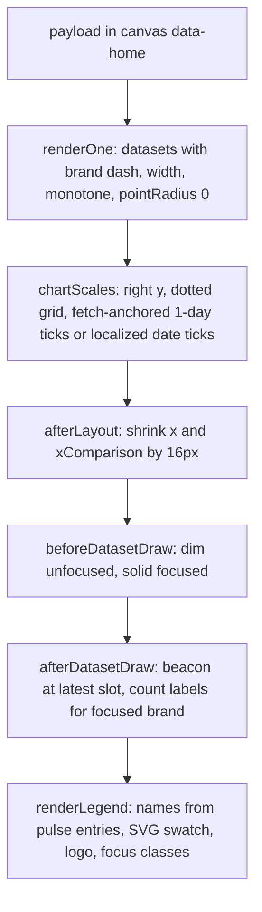

<!-- BEGIN OLLIJA DELIVERY GUIDE -->
## Ollija Delivery Guide

This block is generated guidance. Do not edit it directly. Correct durable facts in `.ollija/project.yaml` or this template, then rerun `ollija annotate-plan`. Current explicit owner instructions govern this task. Record exceptions below and reflect route changes in metadata; removed requirements must not return through another checklist.

### Resolved locations

- Authoritative host: `fuchitalee`
- Authoritative repository: `/Users/fuchitalee/development/pushin-weight-v2`
- Ollija release worktree area: `/Users/fuchitalee/development/pushin-weight-v2/.worktrees`
- Active worktree: `/Users/fuchitalee/development/pushin-weight-v2/.worktrees/feat/homepage-general-style-20261028`
- Plan: `/Users/fuchitalee/development/pushin-weight-v2/.worktrees/feat/homepage-general-style-20261028/docs/plans/2026-10-28-084339-feat-homepage-general-style-20261028-plan.md`
- Change: `feat-homepage-general-style-20261028-2026-10-28-084339`
- Branch: `feat/homepage-general-style-20261028`
- Staging branch and blueprint: `staging`, `/Users/fuchitalee/development/pushin-weight-v2/.worktrees/feat/homepage-general-style-20261028/render-staging.yaml`
- Production branch and blueprint: `main`, `/Users/fuchitalee/development/pushin-weight-v2/.worktrees/feat/homepage-general-style-20261028/render.yaml`
- Staging URL: `https://pushinweight-staging-web.onrender.com`
- Production URL: `https://pushinweight-web.onrender.com`

### Placement

This worktree is inside the Ollija release worktree area. Reuse it for the whole change. Do not create a second worktree or plan for this branch.

### Delivery scope

- Workflow: `plan`
- Delivery target: `on-request`
- Owner selection recorded: `false`

Target is not authorized until the owner selects it. Wait for a later explicit release request; do not commit, push, stage, or promote on this guide alone.

### Failure handling

- Complete applicable, unwaived checks for the selected route. A waived check is waived, never passed. Owner-selected direct production does not require staging.
- Product defects return to the parent implementation workflow; repeat only checks invalidated by the fix. Environment failures require repairing the environment, not a new source commit. Retry only after a relevant fact changes.
- SSH, shell, environment, or multi-machine failures use the repository infra/multi-machine skill first.
- The change ledger is advisory; do not validate or enforce it.
- Never force-remove a worktree. Retain staging-only, failed, dirty, locked,
  noncanonical, or candidate-mismatched worktrees for diagnosis or later
  delivery.
- Do not run an endless retry loop or start a persistent Ollija process.
<!-- END OLLIJA DELIVERY GUIDE -->

## Delivery Exceptions

- 2026-10-28 owner: "deployed commit is e5edf737, lfg with our updates to general, homepage, dashboard", then "actually /compound-engineering:lfg this". This LFG request authorizes local commits on `feat/homepage-general-style-20261028`, a push of that branch, an open pull request against `main`, and watching CI to a decided state. It does not authorize merge, staging, production deployment, production data writes (including `apply_homepage_brand_updates --commit`), provider calls or harvester changes. `delivery_target` stays `on-request`.

# Homepage, General and Dashboard in General Style - Plan

## Plain-English Summary

When this is done, the public homepage, the General page and `/dashboard/each` look and behave like the prototype the owner reviewed between October 22 and 27. That means a light gray page with white panels, a white masthead with the new line-drawn logo and the italic PUSHINWEIGHT wordmark, a left icon rail, Artificial Analysis brand colors with brand logos, and a reworked "Posts by brand" chart. On the chart, hovering, tapping or clicking a brand highlights it, every line has a small pulsing beacon at its newest point, and the time axes read naturally in English, Chinese and Japanese. The prototype only ran as a local relay over live data; this work puts the same result into the real templates, stylesheets and scripts so it can ship.

What changes: page templates, CSS, JavaScript, a few server-side copy strings, static image files (logo, favicon, brand logos), the footer version text, and the tests and Bridgewright records that pin the old look. What does not change: the database, the harvester, brand data, which brands count as "Giants", and the chart and feed data the server already sends. The brand colors and the "Meta" name live in the brand data and appear in production only after the already-shipped `apply_homepage_brand_updates --commit` command is run there; this work does not run it.

The approach is to add one General-theme stylesheet on top of the existing homepage stylesheet (reproducing exactly what the owner approved), render all new page chrome directly in the templates, and build the chart behavior into the existing chart script as small built-in plugins. Completion is proven by real-browser tests in all three languages and at desktop, tablet and phone widths, the full Bridgewright check plus a performance measurement on the exact final commit, side-by-side screenshots against the prototype for owner review, and green CI on the pull request.

Owner attention: the Chinese and Japanese wording for new labels and the shorter pending message was written by an agent and ships flagged for review. The flag shape uses the prototype's narrowed pixel flags (option B) until the owner picks between A, B and C. The screenshot reference images for visual regression are recaptured from the new design and need owner review in the pull request. The real-iPhone check is the owner's to do from the review link.

---

## Goal Capsule

- **Objective:** Visitors to the homepage, General and `/dashboard/each` see the owner-approved General-style design in English, Chinese and Japanese, and every feature that worked before still works.
- **Means:** port the prototype's final state into the production templates, a layered General-theme stylesheet and the existing chart/feed scripts (KTD1, KTD2, KTD3).
- **Authority, highest first:** the owner's current instructions in this session and the Delivery Exceptions above; the owner-requests record `docs/brainstorms/2026-10-22-184545-homepage-general-style-owner-requests.md` (verbatim items 1–43 and its "Resulting production change list"); the net-change list `docs/brainstorms/2026-10-24-210641-homepage-general-net-changes.html`; the prototype sources (read-only reference, see Sources); this plan; repository rules in `AGENTS.md` and `.claude/skills/fix-ui/SKILL.md`.
- **Stop conditions:** stop and report if a required test cannot run (skip, setup error, zero selector matches), if the Bridgewright candidate gate reports any failed, skipped, errored, missing or unknown obligation, if the beacon loop fails the performance budget, if any change would need a migration or production data write, or if the shared test database is busy beyond a bounded wait.
- **Execution profile:** inline implementation in this worktree; Playwright-first for every visible change; shared test database only through `~/.local/bin/pushinweight-test-db`.
- **Who finishes:** the LFG pipeline carries this through implementation, simplification, code review, browser tests, commit, push, PR and CI. The owner merges, reviews the flagged translations and recaptured screenshots, does the iPhone check and runs the production brand-data command.

---

## Product Contract

### Summary

Port the reviewed General-style prototype to production for the homepage, General and `/dashboard/each`. A new layered stylesheet carries the look, the templates render the new chrome, `pw-chart.js` gains the focus, pin, tap and beacon behavior, and `pw-each-chart.js` takes the shared chart styling. Adjacent defects on the same surfaces are fixed in the same change.

### Problem Frame

The owner restyled the public pages through a local prototype relay that injected CSS and JavaScript into live production pages and rewrote some server responses. Owner items 1–43 in the record are the result: a settled visual direction, a reworked chart interaction model and a set of copy, flag and version changes. The relay cannot ship. Several prototype effects were achieved by monkeypatching (wrapping the Chart.js constructor, replacing `Intl.DateTimeFormat`, rewriting HTML) that production must do properly in the owning source.

The backend prerequisites already shipped in deployed `e5edf737`: Meta display names and brand colors through `core/brand_presentation.py` and `apply_homepage_brand_updates`, Meta-first `_HOME_CHART_BRAND_PRIORITY`, the 1-day harvest-coverage cutoff (`monitor/harvest_coverage.py`, payload `harvest_coverage`), zh/ja follower formatting, the English pending copy, the `/dashboard/each` category color swap and capitalized labels, and the `public_app_version` context value. This work is the frontend half.

The prototype also surfaced live defects on these surfaces: scroll-loaded feed rows lose their flags because `pw-feed.js` rejects the hashed sprite name, the chart legend shows raw brand codes for most brands, Japanese chart text uses 12-hour English times, the chart canvas is squeezed by a forced height, and templates still say "Untracked Brand Promotions" after the label source changed.

### Key Decisions

- **Facebook gray page with white panels and a white full-width masthead** (owner items 2, 3, 6). (session-settled: user-directed — chosen over the LinkedIn gray with bronze glyphs variant: owner chose "the fb version"; no bronze anywhere.) Governs R1, R4.
- **Artificial Analysis brand colors, four brands from their own identities** (items 7, 8). (session-settled: user-directed — chosen over the current palette: AA keeps colors consistent sitewide.) Governs R6.
- **Brand logos in the chart legend, on each post and in General brand pills, never in the trending bar** (items 7, 25, 41). (session-settled: user-directed — chosen over logos in the trending bar.) Governs R7.
- **Ping beacons and brand focus replace the tooltip and glow** (items 10–18, 20, 37). (session-settled: user-directed — chosen over the glow effect, the Christmas-light animation and the automatic glow cycle: owner found them cheap-looking, "too busy and hectic", and stopped the cycle.) Governs R9, R10, R11.
- **Right-side y axis, monotone curves, dotted grid, no point markers** (items 19, 20). (session-settled: user-directed — chosen over the left axis and straight segments.) Governs R12.
- **Locked logo and wordmark** (items 39, 40). (session-settled: user-directed — chosen over the apostrophe spelling, the two-tone blue wordmark, Pushinweight/PushinWeight spellings and the stacked two-line caps.) Governs R5.
- **General's "Weights: Open | Closed" is not renamed** (item 41 record). Governs R20.
- **No Giants onboarding, no Meta regrouping, no default-selection change** (owner update 2026-10-27). (session-settled: user-directed — chosen over moving Meta to Giants now: Meta's group waits for a volume comparison.) Governs R24.
- **Bridgewright runs on the exact final commit, pointed at the new design, with the new controls declared** (owner 2026-10-28: "incorporate into plan"). (session-settled: user-approved — chosen over skipping the gate or running it against the v24 mockup: it is the repo's required stateful UI check for these controls.) Governs R25.

### Requirements

**Layout and chrome**

- R1. The homepage and `/dashboard/each` use General's visual system: DM Sans text, Newsreader editorial headlines, General tokens (`#4378ff`, ink `#18212d`, muted `#687589`, lines `#e6eaf1`, panel borders `#dce4fc`), 18px white panels on a `#f0f2f5` page, a white full-width masthead, a 1440px measure and General's 1320/1160/960/700px breakpoints (items 1–3, 6).
- R2. A left icon rail with black (`#1c1e21`) glyphs links to General, the Trending, Posts by brand, Trend summary and Latest anchors, and Pro (current); it expands on desktop and becomes a slide-out drawer at 700px and below (items 1, 6).
- R3. The masthead shows the logo lockup, then labelled Window, Clock and Language segmented controls with localized labels; the trending bar has no heading, the chart panel keeps "Posts by brand", the feed keeps its icon heading row, the filters row is labelled "Filters", the trend summary uses General's story style, the feed is a grid of white cards, and at 960px and below the order is chart, summary, feed (items 1, 6).
- R4. No bronze remains: formerly amber status labels (headline state, stale item state, California clock label, pending-language tag) are muted gray, and mixed-sentiment and official-role glyphs use `#d97706` (item 7).

**Brand identity**

- R5. The rounded-handle line logo (1px lines at every size) replaces the shared `#mark-quiet` symbol and the favicon sitewide; on the homepage, General and `/dashboard/each` the wordmark is PUSHINWEIGHT on one line in DM Sans italic capitals at 15px in ink, PUSHIN weight 500 with 0.06em tracking and WEIGHT weight 800 with 0 tracking, 走个量 is removed, and the tab title and rail drawer label read PUSHINWEIGHT (items 30–40).
- R6. Brand colors come only from brand data (`accent_color` via the existing projection) wherever a brand color appears; no brand color is hardcoded in the frontend (items 7, 8).
- R7. Brand logos appear in the chart legend (swatch, 14px logo, name), in a per-post logo row above the sentiment signals whose logos show the brand name on hover or tap, and before the name in General brand pills for tracked brands; brands without a logo keep text only (items 7, 25, 41).
- R8. The chart legend and post logo names use the brand's localized display name (so `llama` reads "Meta"), never the raw code (items 26, 28; live defect).

**Posts-by-brand chart (homepage)**

- R9. The chart has no tooltip; hovering or keyboard-focusing a legend entry, or hovering within 8px of any segment of a line, focuses that brand: its name turns bold, other lines dim to 24% and other legend entries to 56%, its post counts appear above its points as plain numbers in the line color (a label that would collide with the previous one is skipped), and its line draws solid end to end (items 10–14, 37).
- R10. On desktop a click on a line or legend entry pins focus, a click that hits no line or legend entry (blank chart area included) releases it, and hovering another brand previews it; keyboard users toggle the pin with Enter or Space on a legend entry and release it with Escape; on touch screens a single tap (16px reach) toggles focus and tapping elsewhere clears it; on the 1-day chart a click on a data point still narrows the feed to that 5-minute slot exactly as today (items 15, 16; record "Chart interaction").
- R11. Every visible brand line has a beacon at its latest time slot from page load, never stopping: a solid 4px shape in the brand's beacon shape plus a copy that grows from 1x to 4x while fading from 60% to 0 every 2.25s; on 1 day an empty latest bucket puts the beacon at 0 on the right edge; unfocused brands' beacons pulse at 24% while another brand is focused; the focused legend swatch pings in the same rhythm; viewers who prefer reduced motion see only still shapes, on the canvas and in the legend (items 17, 18, 20, 25).
- R12. The y axis sits on the right with no axis line, lines end 16px before it, every view uses monotone curves, horizontal gridlines are 1px dots with 3px gaps in `#dfe4ec`, lines have no point markers while clicks still hit within 8px, and the canvas sits in its own fixed-height box (300px desktop, 240px at 960px and below, 200px at 700px and below) (items 19, 20; live defect).
- R13. Each brand has a fixed line pattern (solid, dashed, dotted or dash-dot) and beacon shape (circle, square, triangle, diamond, star or cross) from the prototype's table, with a stable hash fallback for new brands; the legend dot becomes an SVG swatch of the pattern ending in the shape; 1-day lines are at least 1.75px wide; the "today is partial" dashed last segment on 7/30/365 days stays only for solid-pattern brands (item 25).
- R14. The 1-day axis ends at the last fully harvested bucket (the payload's `harvest_coverage`) and steps back whole hours from it, choosing a 1, 2, 3, 4 or 6 hour step so each step has at least 42px; buckets are drawn at their end time; the "Local" and comparison-zone row labels sit under the right axis; 7/30/365-day axes show localized dates (en "Oct 18" and "Dec 2025"; zh/ja "10月18日" and "2025年12月"), ending on the latest day and stepping back every day, every 5 days, or every other month start (items 25, 29).

**Times and copy by language**

- R15. English shows 12-hour lowercase times with no space ("5:36am") and Chinese and Japanese show 24-hour times ("05:36"), wherever a time is formatted: masthead clock, feed stamps, feed hover title, chart axis and the 1-day slot text shown in the feed title (item 19; Japanese 12-hour defect).
- R16. Filter dropdowns and labels change in English, Chinese and Japanese, identically in server-rendered HTML and after a client locale switch: options without a glyph keep a 16px glyph space; Geopolitical gains a "Geopolitical Framing" header and the two "National Stance" lines are capitalized with about 14px of space above each; the Geopolitical pill loses its globe help icon (the help trigger otherwise stays); "Untracked Brand Promotions" reads "3rd Party Brand Promotions"; the Brands tabs read "Others / Giant" with unchanged membership and stored values; the English "Lang" pill reads "Language"; inspection text reads "Audience Topic"; the clock pill reads "Local" (items 7, 9, 25).
- R17. The pending message uses the short form in every language: "Language, translation and analysis pending (5-15 min. est.)" with its retry variant, zh "语言、翻译和分析待处理（预计5-15分钟）" and ja "言語・翻訳・分析待ち（目安5〜15分）" with their retry variants, everywhere the server sends it (item 25).

**Feed and flags**

- R18. Feed account flags and dropdown flags get a faint hairline edge so white-field flags stay visible on white cards, and are drawn at 3:2 by narrowing the existing sprite drawing (option B) (items 21, 22, 24).
- R19. Feed rows loaded by scrolling or refetching show the same flags as server-rendered rows when static files carry collectstatic-hashed names (item 23).

**General page**

- R20. General's human view gets the gray page, white masthead, rail and panels; its Agent view keeps its dark palette; both views get the locked logo lockup, tab title and drawer label; tracked-brand pills show the brand logo; "Weights: Open | Closed" is unchanged (item 41).

**/dashboard/each**

- R21. `/dashboard/each` gets the homepage chrome and copy changes where it has the element, and its category chart sits in a white panel with General-style pill tabs ("Language" and "3rd Party Brand Promotions" labels), the shared right axis, dotted grid, monotone curves, no point markers, 1px area outlines, the same fixed-height box, and axes built from the payload's dates (1-day ending at the harvest cutoff and keeping the newest tick); the category colors (Unclassified and Undetected `#cbd5e1`; Neutral, Other, No assigned topic and No product signal `#000000`) and capitalized English labels already shipped in `c585995b` render unchanged; it keeps its category tooltip and takes none of the brand-line features (items 42, 43).

**Footer and version**

- R22. The footer reads "Made with ❤️ in Yokohama. v1.0.0b1 (0.2.0b1)." on every page that has it: the public version, then the internal package version in parentheses; no Beta badge is added (item 38).

**Preservation**

- R23. Every existing feature keeps working on all three pages: window, clock and locale switching; filters and their persistence; the 60-second chart refresh; the 1-day freeze that narrows the feed; infinite scroll; inspection popovers; headline disclosure; and the Pro routes; `/internal/` and `/brands/<brand>/` change only through the shared mark, favicon and footer (item 1).
- R24. Brand order (Meta first), Giants membership, default brand selection, payload fields and all server data paths are unchanged.
- R25. The Bridgewright stateful UI gate and a candidate performance measurement pass on the exact final product commit, with the new design recorded as the approved contract and the new chart and rail controls declared.

### Acceptance Examples

- AE1. Covers R10. **Given** a brand pinned on the 7-day chart, **when** the 60-second refresh replaces the chart, **then** the same brand is still pinned, its legend entry is still bold and the others are still dimmed.
- AE2. Covers R10. **Given** a pinned brand, **when** a filter change removes that brand from the chart, **then** the pin clears and no line stays dimmed.
- AE3. Covers R11. **Given** a 1-day chart whose latest bucket is 0 for a brand, **when** the page loads, **then** that brand's beacon sits on the zero line at the right edge.
- AE4. Covers R19. **Given** collectstatic-hashed static names, **when** the feed loads rows 51–100 by scrolling, **then** rows whose JSON carries flags render those flags.
- AE5. Covers R15. **Given** the English page, **when** the visitor switches to Japanese, **then** after the switch reloads the page, the masthead clock, feed stamps and chart axis show "05:36" style instead of "5:36am" style.
- AE6. Covers R10. **Given** a touch device, **when** the visitor taps a line, taps it again, then taps a legend entry, **then** focus turns on, off, then on for the legend brand, with no flash from a hover path.

### Scope Boundaries

**Deferred for later**

- Flag option C (accurate vector flags) or reverting to option A; the owner's choice is pending, and Vietnam still reads oversized under option B (owner item 24 is only partly addressed).
- Whether the "today is partial" dashed segment stays on solid-pattern brands, where it can be confused with a dashed brand; R13 keeps the current rule until the owner decides.
- The next internal package version; this change does not bump `0.2.0b1`.
- A "Beta" badge beside the masthead logo; wording unconfirmed.
- Giants measurement, onboarding and Meta grouping (handoff W9).
- Whether other product-named brands become maker-level (item 27 open part).
- A simplified 16/24px logo drawing.
- Phone-width x-axis label crowding (existing behavior).
- General Pulse chart items; they apply when that chart ships.
- An on-chart marker for the frozen 1-day slot (the prototype has none; the feed title carries the slot).

**Outside this change**

- Running `apply_homepage_brand_updates --commit` or any other production data write.
- Wordmark or title changes on `/internal/`, `/brands/<brand>/` and post detail pages (they receive only the shared mark, favicon and footer).
- Removing the now-unused dark-theme rules from `home-v20.css` and `pw-each-chart.css`.
- Automating the physical-iPhone proof environment.

### Dependencies

- Deployed `e5edf737` backend fields: `harvest_coverage` in 1-day payloads, `pulse.entries[]` display names and `accent_color`, row `brands` and `brand_nicknames`, `public_app_version`.
- Pinned Chart.js 4.4.0 from unpkg, intercepted by tests with pinned local copies; the version does not change.
- DM Sans (upright and italic), Newsreader and VT323 font files under the SIL Open Font License, served from `monitor/static/fonts/` (KTD17).

### Sources

- Owner record and net-change list: live copies in the root checkout at `docs/brainstorms/2026-10-22-184545-homepage-general-style-owner-requests.md` and `docs/brainstorms/2026-10-24-210641-homepage-general-net-changes.html` (untracked); U1 commits snapshots under distinct names (KTD15).
- Prototype, read-only and git-ignored in the authoritative root checkout: `.context/compound-engineering/ce-prototype/2026-10-22-homepage-general/01-general-skin/screens/` (`general-skin.css`, `general-shell.js`, `general-page-skin.css`, `general-page-shell.js`, `gx-brand.js`, `logos/`), relay `01-general-skin/proxy.py`, and `.context/compound-engineering/ce-prototype/2026-10-26-decagon-line-logo/assets/` (`logo-line.svg`, `logo-line-favicon.svg`). The relay at `http://100.102.74.50:8786/` serves the prototype while it runs.
- Backend handoff for what already shipped: `docs/handoffs/2026-10-27-152400-homepage-backend-prerequisites-handoff.md` (root checkout) and commits `a8c03e04`, `c585995b`, `8b146658`, `60474f2f`, `81e7dc54`.
- Prior chart contract being amended: `docs/iterations/2026-08-28-181416-chart-hover-freeze-bridgewright-target.md`.

Product Contract preservation: created from the origin record; R-IDs are new and cite the record's owner item numbers. The record's "Production implementation note" is carried as KTD1–KTD3.

---

## Planning Contract

### Key Technical Decisions

- KTD1. **A new layered stylesheet carries the General theme.** `monitor/static/pro-general.css` loads after `home-v20.css` (and `pw-each-chart.css`) on the homepage and `/dashboard/each`, scoped by a body class, and ports the prototype's final rules without its `.gx.gx` specificity doubling or LinkedIn variant. Targeted edits in `home-v20.css` and `pw-each-chart.css` remove only rules that fight the new layout (forced `!important` canvas heights, the flag `saturate/brightness` filter). (session-settled: user-approved — chosen over rewriting `home-v20.css` in place: reproduces the reviewed prototype exactly with less regression risk to the functional dropdown, feed and popover rules; dead dark rules are deferred cleanup.)
- KTD2. **All new chrome is server-rendered.** The rail, masthead labels, wordmark, panel headings, filters label, Geopolitical header and post logo rows are template markup (with matching `[data-i18n]` keys in `pw-locale-toggle.js`'s `CHROME` dict for locale switching), not JS DOM injection. JS owns only behavior. This keeps refresh swaps, no-JS rendering and real-template tests coherent; the prototype's `MutationObserver` decoration is not ported.
- KTD3. **Chart behavior lives in `pw-chart.js` as in-file Chart.js plugins.** Focus/pin/tap, data labels, beacons, the line-end gap and right-side row labels follow the existing `pwTimezoneRowLabels`/`pwHoverFreeze` pattern. No datalabels plugin or Chart.js version change, because tests intercept the exact pinned unpkg URL. The prototype's constructor wrapper and `Intl.DateTimeFormat` replacement are not ported.
- KTD4. **One locale clock formatter.** `pw-tz.js` exposes a clock-text helper on `window.__pwTz` that returns 12-hour lowercase-meridiem text for English and `h23` text for Chinese and Japanese from the current page locale at call time. The masthead clock, feed stamps and hover title (`pw-feed.js`), chart ticks and the hover-freeze slot title (`pw-chart.js`) all call it. This fixes the Japanese 12-hour defect at the source. The same file also exposes the 1-day tick selection and localized date-label helpers, so `pw-chart.js` and `pw-each-chart.js` share one implementation and one set of unit tests.
- KTD5. **Hover-freeze keeps its semantics; only the tooltip goes.** The homepage chart sets `plugins.tooltip.enabled` to false. A click on an exact 1-day data point still starts the freeze, pauses refresh, dispatches `pw:hover-freeze-start` and narrows the feed; a click elsewhere still ends it, as today. The brand pin is an independent layer: the same click also pins the hit line's brand, so a click between points pins without narrowing (prototype behavior). The feed title's `detail.title` text becomes the visible slot time and uses KTD4. Tooltip-based tests and Bridgewright hover-freeze obligations are rewritten under the new contract (U13).
- KTD6. **Focus state is module-scoped and survives refresh.** `pw-chart.js` holds `{hover, pinned}` brand nicknames outside the chart instance, uses delegated listeners on the stable `[data-pw-chart]` region, repaints after every `renderLegend` (including rollback), drops a hover or pin whose brand is absent from the new payload, and restores keyboard focus to the same brand's legend entry after a swap. Pointer type is recorded on `pointerdown`/`pointerup` so the compatibility `click` that iOS Safari sends after a tap (which has no `pointerType`) is treated as touch: it toggles focus and still reaches the existing freeze handler, as touch taps do today.
- KTD7. **One beacon animation loop per page.** A single `requestAnimationFrame` loop redraws visible homepage charts at about 30fps only while the chart region is in the viewport (IntersectionObserver) and the document is visible. It starts once at boot rather than per refresh, re-reads `prefers-reduced-motion` through a media-query listener, and skips hidden and stacked datasets and empty label arrays. The prototype measured about 1.6ms per redraw; the Bridgewright candidate performance run is the acceptance measure.
- KTD8. **Brand logos are static files with a server-provided URL map.** Logos go to `monitor/static/brand-logos/` named by brand nickname; a Python map in `core/brand_presentation.py` (next to the existing brand colors) lists the nicknames that have a logo. Views expose a `{nickname: hashed static URL}` JSON on a body data attribute (the `data-pw-country-flag-sprite-url` pattern) for JS, and templates use `` directly. No `Brand` column: logos are presentation assets with no writer or per-environment variation, so a schema field and migration would add storage nobody writes. Chosen over an SVG sprite because several marks are raster (jpg/png).
- KTD9. **Flags use option B in CSS.** Four half-pixel `drop-shadow`s at 22% ink plus `transform: scaleX(.844)` on `.account-country-flag` and dropdown `.country-flag`; the sprite file is unchanged, so its hash and the performance declaration entry stay stable. The scroll defect fix accepts `/country-flags(\.[0-9a-f]+)?\.svg(\?|#|$)/` in `countryFlagSpriteUrl()`. (session-settled: user-approved — chosen over keeping option A or adopting vector flags now: B is the prototype's final state; the owner's A/B/C choice stays open.)
- KTD10. **New Chinese and Japanese copy ships flagged.** The prototype's zh/ja strings for "Geopolitical Framing", "3rd Party Brand Promotions", "Others", "Giant", the masthead labels and the short pending message are implemented and listed in the PR for owner review. (session-settled: user-approved — chosen over keeping the old zh/ja text until review: the English change needs matching zh/ja to stay coherent, and nothing ships before the owner merges.)
- KTD11. **Logo assets are replaced globally; lettering changes stay on the three pages.** `monitor/static/favicon.svg` becomes the line favicon (with its dark-scheme stroke rule) and the `#mark-quiet` symbol in `_cyber_quan_sprite.html` becomes the line mark with `vector-effect: non-scaling-stroke`, so every page sharing them changes. Wordmark, title and drawer label change only on the homepage, `/dashboard/each` and General. (session-settled: user-approved — chosen over limiting the new mark to the three pages: the owner locked it as the only logo.)
- KTD12. **No production data writes.** Brand colors and "Meta" come from the existing projection; the PR body names the owner-run `apply_homepage_brand_updates --commit` step. Tests seed AA colors through fixtures. (session-settled: user-approved — chosen over hardcoding colors in the frontend as a fallback: brand data is the single source.)
- KTD13. **Footer shows both versions; no badge.** `_site_footer.html` renders `v{{ public_app_version }} ({{ app_version }})`. README line 3 follows. (session-settled: user-approved — chosen over adding an unconfirmed "Beta" badge.)
- KTD14. **Bridgewright records the new design as an approved delta.** A new `docs/iterations/2026-10-28-HHMMSS-general-style-bridgewright-target.md` (JST timestamp at write) names the protected baseline `e5edf737`, the owner record snapshot, the prototype and each approved delta, and supersedes only the tooltip part of the hover-freeze contract. `bridgewright.yaml` adds it and the record to `approved_product_intent`, adds a `production.home.general-style` semantic anchor and makes it `last_approved_contract`; `approved_mockup` stays `v24.html` as the base for unnamed surfaces. The UI declaration gains chart focus, pin, tap and rail controls with reducer, evidence and ordered-group coverage. The physical-iPhone proof environment is owner-manual through a private review link. (session-settled: user-approved — chosen over skipping the gate or judging against the v24 mockup.)
- KTD15. **Requirements snapshot in the branch, under distinct names.** U1 commits byte copies of the owner record and the net-change list as `docs/iterations/2026-10-28-HHMMSS-general-style-owner-requests-snapshot.md` and `docs/iterations/2026-10-28-HHMMSS-general-style-net-changes-snapshot.html` (JST time at write), as they stand at planning time (items 1–43). Both exist only untracked in the root checkout, and the PR's Bridgewright contract must cite files in the repository. Distinct names avoid committing over the untracked live copies, which would make later checkouts of `main` in the root checkout abort. The root copies stay live for the design session; nothing is added under `docs/brainstorms/`.
- KTD16. **Prototype parity is proven by measured style and geometry, plus owner-reviewed screenshots.** The prototype runs on live production data and tests use fixtures, so pixel comparison against it is impossible. Browser tests assert the prototype's computed values (colors, fonts, sizes, radii, axis position, gaps, dash arrays, beacon timing) on fixture pages; side-by-side screenshots of prototype and candidate at the same widths and locales go to the owner; the `test_cyber_quan_visual_regression.py` goldens are recaptured from the candidate for owner review.
- KTD17. **Fonts are served from the site's own static files on all three pages.** DM Sans (upright and italic, variable weight), Newsreader and VT323 (General's Agent view) go to `monitor/static/fonts/` as woff2 with `@font-face` rules (`font-display: swap`) in `pro-general.css` and `general.css`; General's Google Fonts link is removed. Two reasons: the local-only candidate performance profile (`tests/fixtures/performance_assurance/declaration.local-candidate.json`, `destination_scope: local-only`, no external asset origins) rejects any third-party request, and Google Fonts is reported blocked in mainland China, where a render-blocking stylesheet from a blocked domain can stall the page. The fonts are SIL Open Font License, which permits self-hosting; commit the license texts beside them. `Chart.defaults.font.family` is set to DM Sans so canvas text matches. Chosen over the Google Fonts link the prototype used.
- KTD18. **Legend names come from the payload.** `renderLegend` reads names from `payload.pulse.entries[]` (`display_name_zh_cn` for Chinese, `display_name_en` otherwise, falling back to `display_name`, then the nickname); the hardcoded `BRAND_NAMES` map is removed.
- KTD19. **Rail behavior is a small new script.** `monitor/static/pw-shell.js` handles rail expand, the mobile drawer, backdrop and Escape on the homepage and `/dashboard/each`; both toggles carry `aria-expanded`, focus moves to the first rail link when the drawer opens and returns to the toggle when it closes. General keeps `general.js`. No persistence, matching the prototype.
- KTD20. **Mockup-diff exemptions change deliberately.** `tests/golden/v22_shell_allowlist.json` and the `tests/shell_diff.py` chart-section exemptions gain the canvas box, the chart panel heading, the feed heading row and the rail, each citing the new Bridgewright target; the allowlist-count and negative unknown-child tests are updated, not removed. The v22 mockup HTML is not edited.

### High-Level Technical Design

Chart state and the existing freeze, after this change:

```mermaid
stateDiagram-v2
  [*] --> Idle
  Idle --> Hover: pointer over legend or within 8px of a line (mouse/pen)
  Hover --> Idle: pointer leaves
  Idle --> Pinned: desktop click on line or legend, or Enter/Space on a legend entry
  Hover --> Pinned: desktop click
  Pinned --> Pinned: click another line or legend (pin moves); hover previews
  Pinned --> Idle: click that hits no line or legend entry, Escape, or Enter/Space on the pinned entry
  Idle --> TouchFocus: tap line (16px) or legend
  TouchFocus --> Idle: tap same brand again, or tap outside
  TouchFocus --> TouchFocus: tap another brand
  Pinned --> Idle: refresh payload lacks the brand
  TouchFocus --> Idle: refresh payload lacks the brand
```

The freeze runs alongside, unchanged from production: an exact 1-day point click starts it (refresh paused, feed narrowed, feed title shows the slot); a click elsewhere ends it. While frozen no refresh swap occurs, so pin persistence across refresh matters for non-1-day windows and legend-only pins.

Render pipeline for one homepage chart draw:

### Assumptions

- The frozen 1-day slot keeps no on-chart marker; the feed title shows it (prototype behavior). A marker is deferred.
- When `harvest_coverage` is unknown and the 1-day series is empty, the chart keeps its existing empty-state behavior; beacons and ticks handle empty arrays without errors.
- The English retry variant already produced by `_processing_badges` is kept if it differs only in wording already approved in W5; zh/ja retry variants follow the prototype.
- The rail on `/dashboard/each` marks Pro as current, as the prototype did.
- The page DOM stays under the performance declaration's 6000-element budget with the rail and post logo rows; U13 measures it.
- On a frozen 1-day chart, a second tap on the same point clears brand focus but keeps the freeze, as touch taps behave today; a tap elsewhere ends the freeze.
- The internal package version stays `0.2.0b1`; the footer renders whatever the package reports.
- If the prototype relay at `100.102.74.50:8786` is not running when parity captures are needed, run a separate copy of the prototype's `proxy.py` on another loopback port for the capture (read-only use of the prototype files; the design session's relay is left alone).

### Implementation Constraints

- Follow `.claude/skills/fix-ui/SKILL.md`: reproduce in a real browser first, pin each change through the real URL, view and template in en, zh_hans and ja, prove static references resolve and JS executes, and keep product source free of agent or planning commentary.
- Never weaken a pinned test to pass: rewrite it to the new contract with the reason in the new Bridgewright target.
- Shared test database only through `~/.local/bin/pushinweight-test-db`; never against production; no migrations (`makemigrations --check` must stay clean).
- Do not edit prototype files, the v22/v24 mockups or other sessions' worktrees.
- Keep `data-lens="open|closed"`, stored lens values, filter keys, payload fields and endpoint contracts unchanged.

### Sequencing

U14 first, so the regression-net baseline is captured from unchanged `e5edf737` code. U1 next, so every later test cites an approved contract. U2–U6 are independent foundations (assets, chrome, theme, copy, clock). U7 depends on U2, U4 and U6; U8 depends on U7. U9 depends on U2 and U4. U10 depends on U4 and U6. U11 depends on U2. U12 is independent. U13 runs last and owns the full-gate pass, though each unit updates its own focused tests as it lands.

---

## Implementation Units

| U-ID | Title | Key files | Depends on |
|---|---|---|---|
| U14 | Regression-net baseline capture | `tests/fixtures/general_style_baseline/` | — |
| U1 | Approved-change record and requirements snapshot | `docs/iterations/*-general-style-*`, `bridgewright.yaml` | U14 |
| U2 | Logo, favicon and brand-logo assets | `monitor/static/favicon.svg`, `_cyber_quan_sprite.html`, `monitor/static/brand-logos/`, `core/brand_presentation.py` | U1 |
| U3 | Shared Pro chrome markup | `home.html`, `dashboard_each.html`, `_home_rail.html`, `pw-shell.js`, `pw-locale-toggle.js` | U1 |
| U4 | General-theme stylesheet | `monitor/static/pro-general.css`, `home-v20.css`, `pw-each-chart.css` | U3 |
| U5 | Copy and filter dropdown changes | `home.html`, `dashboard_each.html`, `pw-locale-toggle.js`, `monitor/views.py` | U3 |
| U6 | Locale clock formatting | `pw-tz.js`, `pw-feed.js`, `pw-chart.js` | — |
| U7 | Chart rendering, axes and legend | `pw-chart.js`, `_home_chart.html` | U2, U4, U6 |
| U8 | Chart focus, pin, tap, labels and beacons | `pw-chart.js` | U7 |
| U9 | Feed brand logos and flag fix | `_feed_initial_v22.html`, `pw-feed.js` | U2, U4 |
| U10 | /dashboard/each chart and tabs | `pw-each-chart.js`, `dashboard_each.html` | U4, U6 |
| U11 | General page restyle | `general.html`, `general.css`, `general/_navigation.html`, `general/_cards.html` | U2 |
| U12 | Footer public version | `_site_footer.html`, `README.md` | — |
| U13 | Assurance, declarations, goldens and regression net | `tests/fixtures/ui_assurance/`, `tests/ui_assurance/`, `tests/golden/` | U1–U12, U14 |

### U14. Regression-net baseline capture

- **Goal:** Record the server outputs this change must not alter, from unchanged `e5edf737` code, before any product edit.
- **Requirements:** R23, R24.
- **Dependencies:** none; runs before U2.
- **Files:** create `tests/fixtures/general_style_baseline/` (deterministic fixture renders of `/chart.html` payloads for 1/7/30/365 days, `/dashboard/each/chart/` payloads for every tab, `/feed/` first-page and second-page rows, in en, zh_hans and ja) and the capture helper beside the regression-net test U13 creates.
- **Approach:** render through the real URLs against the shared test database's deterministic fixture data, normalize volatile fields (computed times, request ids) and store keys and values.
- **Test expectation:** none -- this unit only records the baseline U13 compares against.
- **Verification:** the baseline files exist, are committed before the first product commit, and reproduce byte-identically on a second capture at `e5edf737`.

### U1. Approved-change record and requirements snapshot

- **Goal:** Record the owner-approved General-style delta as the latest Bridgewright contract and bring the requirements into the repository.
- **Requirements:** R25; KTD14, KTD15.
- **Dependencies:** U14.
- **Files:** create the two snapshots named in KTD15 and `docs/iterations/2026-10-28-HHMMSS-general-style-bridgewright-target.md`; modify `bridgewright.yaml`; modify `tests/test_bridgewright_v24_target.py`.
- **Approach:**
  1. Copy both owner documents byte-for-byte from the root checkout to the KTD15 snapshot names; record their SHA-256 values in the target doc.
  2. Write the target in the existing target-doc shape (approval status, approver, protected baseline `e5edf737`, prior contract, approved deltas table, protected behavior, required state model, evidence contract). The deltas table covers R1–R22; the state model covers the focus states in the High-Level Technical Design; the evidence contract names U13's checks and the owner-manual iPhone proof.
  3. State that the target supersedes only the tooltip display of `2026-08-28-181416-chart-hover-freeze-bridgewright-target.md`; freeze, feed narrowing and refresh pause stay protected.
  4. Update `bridgewright.yaml` per KTD14 and the target test's expectations (new `last_approved_contract`, new anchor, prior contracts still present).
- **Patterns to follow:** `docs/iterations/2026-09-21-155037-ui-glyphs-footer-filters-locale-chart-bridgewright-target.md`.
- **Test scenarios:**
  - `tests/test_bridgewright_v24_target.py` asserts the new target is `last_approved_contract`, every prior contract remains in `approved_product_intent`, and the semantic anchors list includes `production.home.general-style` in order.
  - The target doc names the protected baseline SHA and the record snapshot hash, and the snapshot file's hash matches.
- **Verification:** `bridgewright assurance-validate` and `assurance-prescribe` pass with the updated manifest.

### U2. Logo, favicon and brand-logo assets

- **Goal:** Ship the locked logo, favicon and brand logo files with a server-provided URL map.
- **Requirements:** R5, R7; KTD8, KTD11.
- **Dependencies:** U1.
- **Files:** modify `monitor/static/favicon.svg`, `monitor/templates/monitor/_cyber_quan_sprite.html`, `monitor/static/pw-icons.js` (only if the symbol allowlist needs a change), `core/brand_presentation.py`, `monitor/views.py` (logo URL map in home, each and General contexts), `core/context_processors.py` if a context processor is the cleaner carrier; create `monitor/static/brand-logos/<nickname>.<ext>` for the 21 tracked brands; modify tests `tests/test_favicon.py`, `tests/test_cyber_quan_icon_contract.py`; create `tests/test_brand_logos.py`.
- **Approach:**
  1. Favicon: the prototype `logo-line-favicon.svg` (stroke `#18212d`, dark-scheme `#e8eaed`, 1px non-scaling stroke).
  2. `#mark-quiet`: the curved-seam line path from `gx-brand.js` with viewBox `90.5 97.0 697.6 930.9`, `fill="none"`, `stroke="currentColor"`, `stroke-width="1"`, `vector-effect="non-scaling-stroke"`, round joins and caps.
  3. Brand logos: copy the prototype `logos/` files renamed by nickname per `gx-brand.js`'s map; add the nickname-to-file map beside `BRAND_ACCENT_COLORS`; expose hashed URLs via `static()` as one JSON body attribute plus template access.
- **Patterns to follow:** `data-pw-country-flag-sprite-url` in `home.html`; `BRAND_ACCENT_COLORS` in `core/brand_presentation.py`.
- **Test scenarios:**
  - Favicon test pins the new viewBox, stroke color, dark-scheme rule and that `/`, `/general/` and `/dashboard/each` link it.
  - Icon contract test pins the new `mark-quiet` viewBox and non-scaling stroke, and that the symbol renders with nonzero geometry in the masthead and General rail.
  - Every nickname in the logo map has a file that `staticfiles` finders resolve, and every tracked brand in the seed has a map entry; an unknown nickname yields no URL.
  - With manifest storage, the body logo map's URLs are hashed names that resolve.
- **Verification:** the masthead mark, rail icon and tab icon render the line logo on all three pages; `tests/test_static_refs_resolve.py` passes.

### U3. Shared Pro chrome markup

- **Goal:** Render the rail, masthead lockup and labels, panel headings and filters label in the homepage and `/dashboard/each` templates.
- **Requirements:** R2, R3, R5, R23; KTD2, KTD17, KTD19.
- **Dependencies:** U1.
- **Files:** modify `monitor/templates/monitor/home.html`, `monitor/templates/monitor/dashboard_each.html`, `monitor/static/pw-locale-toggle.js`, `monitor/views.py` (title constant for these pages); create `monitor/templates/monitor/_home_rail.html`, `monitor/static/pw-shell.js`; modify `tests/test_home_v22_topbar_layout.py`, `tests/test_home_v22_browser.py` (title, app-name children, drawer); create `tests/test_pro_shell_browser.py`.
- **Approach:**
  1. Masthead: mobile toggle, `h1.app-name` with the mark and `PushinWeight` (uppercased by CSS) with an accessible name PUSHINWEIGHT; labelled Window, Clock and Language groups; no prototype badge. The existing control elements, ids and `data-*` hooks stay.
  2. Rail partial: links and anchors per R2 with localized labels, General link carrying the page locale; the drawer label reads PUSHINWEIGHT.
  3. Headings: chart panel wrapper outside the refreshed `[data-pw-chart]` region with the "Posts by brand" heading; feed heading row around the existing title; "Filters" label; summary anchor; on `/dashboard/each` the chart panel has no heading row.
  4. Locale: add `CHROME` keys for every new label in `en`, `zh_cn` and `ja` with the prototype's COPY strings.
  5. `<title>` reads PUSHINWEIGHT on both pages; no external font link (fonts come from U4 per KTD17).
- **Patterns to follow:** `general/_navigation.html` rail markup; existing `[data-i18n]` usage in `home.html`.
- **Test scenarios:**
  - Topbar layout test pins the new structure: mark, wordmark, labelled Window/Clock/Language groups in that order, and the locale buttons `en`/`中文`/`日本語` unchanged.
  - In en, zh_hans and ja, the rail labels, masthead labels and headings render in the page language on first load and after a locale switch reloads the page, and the labels `applyChrome` writes on load match the server-rendered text.
  - Rail expands and collapses on desktop; at 390px the drawer opens from the toggle, closes on backdrop, Escape and link click, and the page has no horizontal overflow.
  - The toggles' `aria-expanded` follows the drawer state; opening moves focus to the first rail link and closing returns it to the toggle.
  - The tab title is PUSHINWEIGHT on `/` and `/dashboard/each`; `走个量` does not appear in either masthead.
  - Every existing control (window, clock, locale) still works after the markup change.
- **Verification:** both pages render the new chrome with nonzero geometry and no console errors in all three languages.

### U4. General-theme stylesheet

- **Goal:** Port the prototype's final visual rules into `pro-general.css` for the homepage and `/dashboard/each`.
- **Requirements:** R1, R3, R4, R12 (box), R18, R21 (panel and tabs); KTD1, KTD9, KTD17.
- **Dependencies:** U3.
- **Files:** create `monitor/static/pro-general.css`; create `monitor/static/fonts/` (DM Sans upright and italic variable woff2, Newsreader woff2, VT323 woff2, their OFL license texts); modify `monitor/static/home-v20.css` (remove forced canvas heights and the flag filter only), `monitor/static/pw-each-chart.css` (forced heights only), `home.html` and `dashboard_each.html` (stylesheet link and body class); create `tests/test_pro_general_style_browser.py`.
- **Approach:** start the stylesheet with `@font-face` rules for the self-hosted fonts (KTD17), then port `general-skin.css` sections in order (tokens, rail, masthead, segmented controls, clock pill, sections, panels, trending chips, filters and dropdowns, main grid, chart panel and canvas box, summary, feed cards, flags, popovers, footer, breakpoints, legend, swatch ping keyframes, post brand row, `/dashboard/each` rules), dropping the LinkedIn variant, the stacked-caps comment, `gx-proto` and anything superseded. Selectors target the KTD2 markup instead of prototype-injected classes.
- **Patterns to follow:** token naming in `monitor/static/monitor/general.css`.
- **Test scenarios:**
  - At 1440px in en: computed page background `rgb(240, 242, 245)`, masthead white and full-bleed, panel radius 18px with border `#dce4fc`, body font DM Sans, headline font Newsreader, wordmark italic with PUSHIN weight 500 and WEIGHT 800, letter spacing 0.06em and 0.
  - At 960px the order is chart, summary, feed; at 390px the rail is a drawer, the feed is one column and nothing overflows horizontally.
  - No element uses the bronze colors `#8b6a3e`/`#6e5130`; the stale headline state and California clock label are muted gray; mixed sentiment and official role glyphs are `#d97706`.
  - Flags: feed and dropdown flags have the hairline filter and `scaleX(.844)`; the Japan flag has nonzero visible edge pixels on a white card.
  - The canvas box measures 300px, 240px and 200px at the three breakpoints, and the canvas fills it.
  - Filter dropdowns still open with nonzero on-screen geometry, stay open after an interior click and close after an outside click.
  - The page makes no request to any origin other than its own (no `fonts.googleapis.com` or `fonts.gstatic.com`), and DM Sans italic renders from the self-hosted file.
- **Verification:** side-by-side captures against the prototype at 1440, 1100 and 390px in en, zh_hans and ja show the same layout and colors.

### U5. Copy and filter dropdown changes

- **Goal:** Apply the owner's copy and dropdown structure changes in all three languages, server and client alike.
- **Requirements:** R16, R17, R21 (tab labels); KTD10.
- **Dependencies:** U3.
- **Files:** modify `monitor/templates/monitor/home.html`, `monitor/templates/monitor/dashboard_each.html`, `monitor/static/pw-locale-toggle.js`, `monitor/static/pw-tz.js` (local label), `monitor/views.py` (`family_copy` "Audience Topic", `_processing_badges` zh/ja short forms, the `/brands/` "3rd Party" inspection string at the line that still reads "Untracked Brand Promotion"); modify `tests/test_home_v22_filter_pills.py`, `tests/test_dashboard_i18n.py`, `tests/test_views.py`, `tests/test_post_synthesis_api.py`; create `tests/test_general_style_copy.py`.
- **Approach:**
  1. Template and `CHROME` strings change together per locale; lens keys and stored values stay.
  2. Geopolitical: a `dd-subtitle` header before the mode grid; national-stance subtitles capitalized ("National Stance"; zh/ja keep their existing terms) with the 14px top margin; remove the help trigger's `pw-icon` child only.
  3. Glyph-less option spacing is CSS in U4; this unit confirms which options render an empty icon slot.
  4. Pending copy: replace the zh/ja long forms and add the short retry variants in `_processing_badges`; the English forms shipped in `c585995b` stay.
- **Test scenarios:**
  - For en, zh_hans and ja, server-rendered `/` and `/dashboard/each` show the new labels, and after a client switch to each other language the same labels appear (no stale English).
  - The Brands tabs read Others/Giant (其他/巨头; その他/大手) while `data-lens` values stay `open`/`closed` and a stored `closed` lens still restores.
  - The Geopolitical dropdown has the header first, two capitalized national-stance subtitles with the expected spacing, and no globe icon in the pill.
  - `/feed/` JSON and the post-synthesis status responses carry the short pending message in each language, including the retry variant.
  - In every dropdown, an option with no glyph has its text left edge aligned with options that have one (Sentiment "Unclassified" vs "Neutral").
- **Verification:** no rendered page or JSON response contains "Untracked Brand Promotions", "Lang" (as the English pill) or the long pending text.

### U6. Locale clock formatting

- **Goal:** One formatter produces 12-hour English and 24-hour Chinese and Japanese times everywhere.
- **Requirements:** R15; KTD4.
- **Dependencies:** none.
- **Files:** modify `monitor/static/pw-tz.js`, `monitor/static/pw-feed.js`, `monitor/static/pw-chart.js` (freeze title and tick text through the helper); modify `tests/test_pw_tz.js`, `tests/test_pw_feed_formatter.js`, `tests/test_pw_chart_filter.js`.
- **Approach:**
  1. The clock helper reads `document.body[data-pw-locale]` at call time; English formats with `en-US`, `hour12: true`, then lowercases and removes the space before am/pm; zh/ja format with `hourCycle: 'h23'` and 2-digit hours. Existing callers keep their time zone arguments.
  2. Add the shared axis helpers (KTD4): 1-day tick selection from bucket timestamps, an end instant and a pixel width (1/2/3/4/6-hour step with at least 42px per step, an optional tick cap), and localized date labels with the 7/30/365-day stepping rules of R14.
- **Test scenarios:**
  - `en` at 05:36 local gives `5:36am`, at 20:03 gives `8:03pm`; `zh_cn` and `ja` give `05:36` and `20:03`.
  - The comparison zone (California) uses the same rules with its own zone.
  - The feed hover title in Japanese uses 24-hour time (regression for the old English 12-hour output).
  - Covers AE5. After a locale switch reloads the page, the masthead clock and feed stamps use the new language's format.
  - Tick helper: for labels ending 21:18 at 840px, ticks every 2 hours ending at the last bucket's end; at a width giving at least 42px per hour, hourly; with a cap of 8, never more than 8 ticks and the newest kept; fewer than 2 labels gives no ticks and no exception.
  - Date helper: 7-day ticks every day ending on the latest day; 30-day every 5 days; 365-day every other month start counted back from the latest; English "Oct 18"/"Dec 2025", zh/ja "10月18日"/"2025年12月".
- **Verification:** Node unit tests and a browser check in all three languages.

### U7. Chart rendering, axes and legend

- **Goal:** Render the posts-by-brand chart with the new styling, axes, brand styles and legend.
- **Requirements:** R6, R7 (legend), R8, R12, R13, R14; KTD3, KTD17, KTD18.
- **Dependencies:** U2, U4, U6.
- **Files:** modify `monitor/static/pw-chart.js`, `monitor/templates/monitor/_home_chart.html` (canvas inside its fixed-height box, inside the swapped fragment); modify `tests/test_pw_chart_filter.js`, `tests/test_home_v22_browser.py` (axis, legend and tick assertions), `tests/test_home_chart_pulse.py` only if a payload assertion is touched; create `tests/test_home_chart_style_browser.py`.
- **Approach:**
  1. Datasets: monotone, `pointRadius` 0 with `pointHitRadius` 8, brand `borderDash` and round caps from the style table, 1.75px minimum width on 1 day, the partial-day segment rule per R13.
  2. Scales: y on the right without border; gridlines dotted `#dfe4ec`; tick and grid colors for a light surface; 1-day ticks from the U6 helper anchored at the end of the last harvested bucket (replaces `fixedHourlyTicks`), with `autoSkip` off; date ticks from the U6 helper; the row-label plugin draws under the right axis with capitalized "Local".
  3. `afterLayout` shrinks both horizontal scales by 16px.
  4. Legend: names per KTD18, SVG swatch per brand style, logo per KTD8; each entry is a focusable button whose `aria-pressed` reflects the pin (U8 adds the behavior).
  5. `Chart.defaults.font.family` set per KTD17.
- **Patterns to follow:** `pwTimezoneRowLabels` plugin; `oneDayScales`.
- **Test scenarios:**
  - JS unit: the style table returns the prototype pairs for all 21 brands, no two brands share a pair, and an unknown nickname gets a stable pair.
  - JS unit: the chart's 1-day and date scales take their ticks and labels from the U6 helpers (one implementation).
  - Browser: y scale position `right` with no border, gridline dash `[1, 3]`, every total-line dataset monotone with `pointRadius` 0, line end 16px left of the axis.
  - Browser: legend shows "Meta" (seeded display name) and localized names in zh_hans; every tracked brand has a swatch and a logo with nonzero geometry; no raw nickname text appears.
  - Browser: the solid-pattern brand's last 7-day segment is dashed and a dashed-pattern brand's is not.
  - Browser: the 1-day chart ends at the fixture's harvest coverage, not the request time.
- **Verification:** the chart matches the prototype's computed values at 1440 and 390px in all three languages, with no console errors across a refresh.

### U8. Chart focus, pin, tap, labels and beacons

- **Goal:** Add brand focus, pinning, touch taps, count labels and always-on beacons, with the tooltip removed and the freeze preserved.
- **Requirements:** R9, R10, R11, R23 (freeze); KTD5, KTD6, KTD7.
- **Dependencies:** U7.
- **Files:** modify `monitor/static/pw-chart.js`, `monitor/static/pro-general.css` (legend focus, dim and swatch ping); modify `tests/test_pw_chart_filter.js`, `tests/test_home_v22_browser.py` (tooltip and freeze assertions rewritten); create `tests/test_home_chart_focus_browser.py`.
- **Approach:**
  1. Focus controller per KTD6 with the hit test from the prototype's `lineAt` (8px mouse, 16px touch, first brand in legend order wins ties). A click that hits no line or legend entry releases the pin; Enter or Space on a legend entry toggles its pin, Escape releases it, and `aria-pressed` follows the pin.
  2. Draw hooks: dim unfocused datasets to 24%, force the focused line solid (clearing cached segments when focus flips), draw count labels with a 3px white stroke and collision skipping, draw beacons per R11 in each brand's shape.
  3. Tooltip disabled per KTD5; the freeze handler and events stay; the freeze title uses KTD4.
  4. Beacon loop per KTD7; the legend swatch ping uses a CSS animation whose delay keeps phase with the canvas loop and which a `prefers-reduced-motion` rule turns off.
- **Execution note:** write the touch and refresh-persistence browser scenarios first; they are the cases a polite Playwright click hides.
- **Test scenarios:**
  - Hovering a legend entry dims other lines to 24% and legend entries to 56%, bolds the name, draws that brand's counts in its color and makes its line solid; leaving restores everything.
  - Hovering within 8px of a segment between two points focuses that line; 12px away does not.
  - Keyboard Tab to a legend entry focuses it; Tab away clears it; Enter pins it (`aria-pressed="true"`), Space on the same entry unpins it, Escape releases a pin.
  - Desktop click pins; moving away keeps it; hovering another brand previews and returning restores the pin; a click on blank chart area releases it, and so does a click on blank page area.
  - Covers AE1. A pin on the 7-day chart survives the 60-second refresh (simulated by a forced refresh), including keyboard focus on the same entry.
  - Covers AE2. A pin clears when a filter change removes its brand.
  - Covers AE6. Touch: tap focuses, second tap clears, tap elsewhere clears; no hover flash; the compatibility click after a tap does not double-toggle.
  - A click on an exact 1-day point still freezes the chart, pauses refresh and narrows the feed to the half-open slot with only the brand filter, and the feed title shows "Local … / Beijing …" in the locale's clock format; a click elsewhere ends it.
  - The homepage chart has `options.plugins.tooltip.enabled === false`, and a canvas pixel probe at the hovered and frozen positions finds no tooltip box (Chart.js 4.4.0 still sets the tooltip object's opacity on active elements, which the freeze relies on, so opacity is not asserted).
  - Covers AE3. Every visible brand has one beacon at its latest slot on load in en, zh_hans and ja; a zero latest bucket puts the beacon at the zero line.
  - With reduced motion emulated, beacons are still shapes, no redraw loop runs and the legend swatch has no running animation; with the chart scrolled out of view or the tab hidden, the loop draws no frames.
  - Collision rule: on 1 day the count labels never overlap; on 7 days every point has a label.
- **Verification:** all focus, freeze and beacon scenarios pass in Chromium at desktop and 390px touch emulation. As soon as the beacon loop works, run the performance measurement in baseline mode on that commit (with a stated rationale) as an early signal on the 365-day and mobile-throttled scenarios; the candidate performance run at U13 remains the acceptance measure.

### U9. Feed brand logos and flag fix

- **Goal:** Show each post's brand logos above its sentiment signals and keep flags on scroll-loaded rows.
- **Requirements:** R7 (post row), R8, R18 (markup hooks), R19; KTD8, KTD9.
- **Dependencies:** U2, U4.
- **Files:** modify `monitor/templates/monitor/_feed_initial_v22.html`, `monitor/static/pw-feed.js` (`renderRowHtml`, `countryFlagSpriteUrl`); modify `tests/test_feed_geography.py`, `tests/test_home_v22_feed_row_shape.py`; create `tests/test_feed_brand_logos_browser.py`, `tests/test_feed_flags_hashed_static.py`.
- **Approach:**
  1. Both renderers emit a `.sig-row` logo row before `.sig-sentiment` from the row's `brands` (localized name, logo URL from the KTD8 map, text fallback), each logo a `pw-inspection-trigger` button whose inspection text and `aria-label` are the localized brand name, with an empty `alt` on the image.
  2. Replace the `indexOf` check with the KTD9 pattern.
- **Execution note:** write the hashed-static regression first and see it fail against the current `indexOf` check.
- **Test scenarios:**
  - Covers AE4. With `CompressedManifestStaticFilesStorage` and a hashed sprite URL, rows loaded by scrolling render flags for rows whose JSON carries them, matching server-rendered rows.
  - The sprite matcher accepts `/static/country-flags.svg`, `/static/country-flags.e1ef2c1d1cff.svg` and a `#flag-jp` suffix, and rejects `/static/other.svg`.
  - Server-rendered and scroll-loaded rows produce the same logo row markup for the same post.
  - Hovering or tapping a logo opens the inspection popup with "Meta" in en and the zh display name in zh_hans; focusing a logo with Tab and pressing Enter opens the same popup, and the button's accessible name is the brand name.
  - A post with no tracked brands has no logo row; a brand without a logo shows its name text.
- **Verification:** first-page and scroll-loaded rows show logos and flags in all three languages.

### U10. /dashboard/each chart and tabs

- **Goal:** Restyle the `/dashboard/each` category chart and its tabs without the brand-line features.
- **Requirements:** R21; KTD3, KTD4.
- **Dependencies:** U4, U6.
- **Files:** modify `monitor/static/pw-each-chart.js`, `monitor/templates/monitor/dashboard_each.html` (canvas box, tab labels); modify `tests/test_dashboard_each_browser.py`, `tests/test_dashboard_each.py` only where a label assertion moves.
- **Approach:** right y axis, dotted grid and light-surface colors, monotone, `pointRadius` 0, `borderWidth` 1; x ticks chosen explicitly from the payload's `days` through the U6 helpers (1-day hour ticks ending at the harvest-covered end with a cap of 8, date ticks localized and ending on the latest day) instead of `chartLabel()` text plus autoskip; tooltip and percent/count modes unchanged.
- **Test scenarios:**
  - Every tab renders with y on the right, dotted gridlines, monotone areas with 1px borders and no points.
  - On every tab with those categories, Unclassified and Undetected areas compute to `#cbd5e1`, Neutral, Other, No assigned topic and No product signal to `#000000`, and English legend labels start with a capital.
  - The newest tick is present on 1, 7, 30 and 365 days in en and zh_hans.
  - Percent mode keeps `y.max` 100 and count mode leaves it unset.
  - Tab labels read "Language" and "3rd Party Brand Promotions" (zh 第三方品牌推广, ja サードパーティのブランドプロモーション).
  - The category tooltip still appears on hover with category counts.
- **Verification:** `/dashboard/each` matches the prototype at 1440, 1100 and 390px in all three languages.

### U11. General page restyle

- **Goal:** Apply the homepage treatment to General's human view and the locked lockup to both views.
- **Requirements:** R5, R7 (pills), R20; KTD8, KTD11, KTD17.
- **Dependencies:** U2.
- **Files:** modify `monitor/templates/monitor/general.html`, `monitor/templates/monitor/general/_navigation.html`, `monitor/templates/monitor/general/_cards.html`, `monitor/static/monitor/general.css`, `monitor/general_readers.py` (pill logo URL); modify `tests/test_general_browser.py`, `tests/test_general_views.py`; regenerate `tests/fixtures/ui_assurance/general-declaration.json`; update `tests/fixtures/performance_assurance/declaration.general-candidate.json` only if it lists the Google Fonts origins.
- **Approach:**
  1. Human view only, scoped by an exact attribute match (`body.general-page[data-audience="human"]`, which `general_views.py` always sets) so post detail pages, which share `general.css` with no `data-audience`, are untouched: `#f0f2f5` page, white header band and rail per `general-page-skin.css`.
  2. Both views: the wordmark replaces `.zh`/`.en` lettering, title PUSHINWEIGHT, drawer label PUSHINWEIGHT; the Google Fonts link is replaced by the self-hosted `@font-face` rules (KTD17), including VT323 for the Agent view.
  3. Pills: the reader adds the logo URL for tracked brands; the Agent view greys pill logos.
- **Test scenarios:**
  - Human view in en, zh-cn and ja at 1440, 1100 and 390px: gray page, white masthead and panels, wordmark visible, old lettering absent, no horizontal overflow.
  - Agent view keeps its dark palette, renders VT323 from the self-hosted file and shows the wordmark.
  - General makes no request to `fonts.googleapis.com` or `fonts.gstatic.com`.
  - Tracked-brand pills show a logo with nonzero geometry and "#Meta"; an untracked organization pill shows text only; logos persist after a panel refresh.
  - Weights still reads Open | Closed and the Closed dialog still opens.
  - Rail geometry pins in `tests/test_general_browser.py` still hold (masthead y 0, height 48.5).
- **Verification:** the General declaration loads with its regenerated source revision.

### U12. Footer public version

- **Goal:** Show the public and internal versions in the footer.
- **Requirements:** R22; KTD13.
- **Dependencies:** none.
- **Files:** modify `monitor/templates/monitor/_site_footer.html`, `README.md` (line 3), `tests/test_home_v22_browser.py` (footer assertion).
- **Test scenarios:**
  - `/`, `/dashboard/each`, `/internal/` and a `/brands/<brand>/` page end with "Made with ❤️ in Yokohama. v1.0.0b1 (0.2.0b1)." in normal document flow.
  - The values come from `public_app_version` and the installed package version, not template literals.
- **Verification:** footer text matches on every page that includes it.

### U13. Assurance, declarations, goldens and regression net

- **Goal:** Bring every assurance artifact in line with the new contract and prove nothing unrelated changed.
- **Requirements:** R23, R24, R25; KTD14, KTD16, KTD20.
- **Dependencies:** U1–U12, U14.
- **Files:** modify `tests/fixtures/ui_assurance/declaration.json`, `tests/ui_assurance/reference.py`, `tests/ui_assurance/evidence.py`, `tests/ui_assurance/gate.py` (new focused tests), `tests/fixtures/ui_assurance/general-declaration.json`, `tests/fixtures/performance_assurance/declaration*.json` (only if logo requests or DOM counts need budget entries), `tests/golden/v22_shell_allowlist.json`, `tests/shell_diff.py`, `tests/test_home_v22_mockup_diff.py`, `tests/test_cyber_quan_visual_regression.py` and `tests/golden/bridgewright/cyber-quan/*`; create `tests/test_general_style_source_hygiene.py`, `tests/test_general_style_regression_net.py`.
- **Approach:**
  1. Declaration: add controls for chart focus (idle/hover/pinned/touch), focus brand and rail state; ordered groups for pin-refresh, pin-filter-removal and tap toggling; invariants that focus never survives an absent brand and that freeze feed narrowing still agrees; rewrite the hover-freeze tooltip obligations to the feed-title slot text.
  2. Update `reference.py` and `evidence.py` drivers for the new controls; add the new focused tests to the gate.
  3. Recapture the cyber-quan candidate goldens and masks from the candidate with `CYBER_QUAN_CAPTURE_ONLY=candidate`. Retire the prechange-to-candidate icon-delta assertion and its `prechange-*.png` references deliberately: a whole-page restyle changes pixels outside the icon and Release-A masks, and widening the masks to the whole page would be the broad allowlist fix-ui forbids. The new Bridgewright target records that the General-style delta supersedes the icon-only Cyber-Quan delta; the candidate-golden comparison stays as the visual regression check.
  4. Mockup diff per KTD20.
  5. Regression net against the U14 baseline: every key identical; every value identical except the intended changes, which are checked against their new expected strings instead (`processing_badges` and `language_pending_badge` text per R17, and the `signal_inspections` labels for Audience Topic and 3rd Party Brand Promotions per R16). Also pin brand order, lens values, and `/internal/`, `/brands/<brand>/` and a post detail page (`content/detail.html`) rendering apart from mark, favicon and footer.
  6. Source hygiene: no prototype class names (`gx-`), "Prototype" badge, relay paths (`/__proto/`), agent notes or planning text in templates, static files or rendered pages.
- **Test scenarios:**
  - The affected gate exercises every new control with zero skips, errors or zero-match selectors.
  - Each seeded regression added for focus (pin lost on refresh, pin kept after brand removal) fails when its fault is injected.
  - The regression net shows identical payload and feed JSON keys, and identical values outside the listed R16/R17 strings, against the U14 baseline.
  - A post detail page shows no gray page, masthead or wordmark change.
  - Hygiene test fails on an injected `gx-proto` class and passes on the real pages.
- **Verification:** the candidate gate on the final product SHA reports zero failed, skipped, errored, missing or unknown obligations, and the candidate performance run passes.

---

## Verification Contract

| Check | Command or method | When | Pass |
|---|---|---|---|
| JS units | `node tests/test_pw_chart_filter.js`, `node tests/test_pw_feed_formatter.js`, `node tests/test_pw_tz.js` | each JS unit; final | all pass |
| Focused Python and browser tests | `~/.local/bin/pushinweight-test-db pytest <unit test files> -q` | each unit | 0 failed, 0 required skips, 0 errors |
| Bridgewright structure | `uv run --extra dev bridgewright assurance-validate --project-root .` and `uv run --extra dev bridgewright assurance-prescribe --project-root .` | after U1 and U13 | clean |
| Affected gate | `uv run --extra dev python -m tests.ui_assurance.gate --scope affected --pytest-wrapper ~/.local/bin/pushinweight-test-db` | during U7–U13 | all obligations pass |
| Candidate gate and performance | `uv run --extra dev python -m tests.ui_assurance.gate --scope candidate --candidate-revision <final product SHA> --pytest-wrapper ~/.local/bin/pushinweight-test-db --performance-mode candidate` with the performance-run inputs from `.claude/skills/fix-ui/SKILL.md`, using `tests/fixtures/performance_assurance/declaration.local-candidate.json` for the fixture data source | before PR | zero failed, skipped, errored, missing or unknown obligations; sealed performance result for the same SHA |
| Django checks | `python manage.py check` and `python manage.py makemigrations --check --dry-run` (through the test-db wrapper's `run`) | final | no issues, no migrations |
| Lint | scoped `ruff check` on changed Python files compared with the base | final | no new findings |
| Prototype parity | Playwright captures of prototype (relay, or a separate loopback copy of `proxy.py` if the design session's relay is down) and candidate at 1440, 1100, 390px in en, zh_hans, ja for `/`, `/general/`, `/dashboard/each`; computed-style assertions in the new browser tests | U4, U7, U10, U11; final | owner-reviewable pairs; assertions pass |
| CI | GitHub "Homepage counts regression net" on the PR | after push | green |
| iPhone | owner opens the private review link on the iPhone | after PR | owner-reported; never claimed by the agent |

Report executed, skipped and errored counts for every run; a skip or error is never green.

---

## Definition of Done

- Every R1–R25 has a passing test or an owner-review artifact named above, and AE1–AE6 pass in a real browser.
- The candidate Bridgewright gate and performance measurement pass on the exact product SHA pushed to the PR, with declaration and control-model identities reported.
- CI is green on the PR; the PR body lists the flagged zh/ja strings, the recaptured goldens, the flag option B choice, the owner-run `apply_homepage_brand_updates --commit` step and the iPhone check.
- No migration, production data write, provider call, harvester change or prototype-file edit exists in the diff.
- No dead-end or experimental code from abandoned approaches remains in the diff; the prototype's monkeypatches are absent.
- The General Launch Index has an OFF line for `g5-homepage-general-production-20261028` with the PR URL.

---

## Execution Record (2026-10-28)

Decisions and deviations made while implementing, for the reviewer and the owner.

**Owner attention**

- The rail's General link (R2, owner record item 1) puts a link to `/general/` back on the public homepage. It supersedes the 2026-10-14 owner-requested removal of the masthead `data-general-link` anchor (`30ebc2ae`); that anchor stays removed and the rail is the only link. `tests/test_general_views.py::test_home_links_general_only_from_the_rail` replaces the removal test. Confirm before merge.
- At phone width the language buttons sit on the first masthead row. In the prototype the "Prototype" badge (intentionally not shipped) pushed them to the second row.
- The 1px masthead rule on General moved from `.masthead` to the full-width header in both Human and Agent views (the prototype applied it to Human only, which moved Human panels 1px against Agent and broke the existing equal-geometry invariant).

**Deliberate test changes**

- `tests/test_home_v22_browser.py`: tooltip-display assertions replaced by tooltip-disabled plus frozen feed-title slot text (KTD5); 12-hour English clock regexes; content-sized segmented buttons (heights and positions still pinned); clock pill on its own row at phone widths; feed below the chart at every width; the 1-day and Beijing axes now check the hour-stepped ticks ending at harvest coverage; muted pending language tag; short zh/ja pending copy; footer `v1.0.0b1 (0.2.0b1)`; signal selectors skip the new logo buttons; the empty Geopolitical help trigger has no popover visual. The 0.45 changed-pixel ceiling against the dark v22 mockup is retired (the approved target replaces that oracle); paired captures and structure/geometry checks remain.
- Six tests that already failed at `e5edf737` because their fixtures recorded no harvest (the 1-day chart ends at scheduled coverage since `8b146658`) now call `_record_current_harvest()`; StepFun's evidence post moved before the latest closed five-minute boundary. The Japanese processing test's place name is aligned with the shared places fixture (`米国`).
- Still failing at both `e5edf737` and this branch, untouched here: `test_activated_geopolitical_and_promotion_controls_round_trip_in_browser` (its untracked-brand post never reaches the feed) and seven `tests/test_dashboard_i18n.py` v1 dashboard tests. Neither is in the gate's test lists.
- `tests/test_cyber_quan_visual_regression.py`: goldens recaptured for the new design; the prechange-to-candidate icon comparison and its capture mode are retired (the old PNGs stay as the evidence the 2026-08-28 target records).
- Regression-net baseline recaptured from an untouched `e5edf737` copy. The feed's per-brand post-type, product-label, audience-topic and geopolitical-mode lists come from queries without ORDER BY at `e5edf737`, so their order follows test-database state (it flipped between runs); the net compares those lists, and the inspection JSON built from them, order-independently. Production ordering is unchanged and listed as a follow-up. Row-relative wall-clock text (`meta_text`, `ts_abs_text`) is excluded. The fixture exercises none of the R16/R17 strings, so `INTENDED_CHANGES` stays empty; `tests/test_views.py` and `tests/test_general_style_copy.py` cover them.

**Defects found and fixed by the new tests**

- Client-rendered feed rows had no brand-logo row (only official-job rows did).
- The phone drawer could not receive focus on open (visibility transition); a drawer link click returned focus to the toggle and scrolled back to the top.
- A frozen Chinese feed title overflowed at 320px (`flex: 0 0 auto`).
- Flags on scroll-loaded rows under hashed static names (AE4) — fixed and fault-injected.
- A selected trending chip's "NEW" and flat deltas rendered white on the light tint (the prototype styled only up/down) — now green and muted.

**Verification so far (this worktree, before review)**

- Affected gate: 422 focused tests passed (0 skipped, 0 errors); 5,191 Pro and 71 General obligations clean; performance declarations clean.
- Prototype parity: 27 candidate/prototype pairs (3 pages × en, zh_cn, ja × 1440, 1100, 390px) for owner review; no page errors or third-party requests on any candidate page.

**Structure**

- `monitor/static/home-v20.css` and `pw-each-chart.css` are unchanged; `pro-general.css` overrides the forced canvas height and flag filter under `body.pw-general`, so `/brands/` and `/internal/` keep their rules.
- UI assurance: controls `chart_focus`, `focus_brand` and `rail`, two coverage groups, four ordered groups, two invariants and two seeds (5,191 obligations); the new browser tests join the gate's focused list and the touched home browser tests its candidate list.

**Not done before the pull request**

- Candidate performance measurement (Verification table, "before PR"; Exit criteria) did not run. A fixture-backed local preview server is needed. The shared-test-database rule forbids initializing the separate disposable database that earlier runs used, and a long-running preview on the shared database would leave seeded rows behind. The candidate gate on product revision `2b164f6d` therefore ran with `--performance-mode not-required` and recorded `performance_status: not-run`. This is outstanding, not waived and not passed. The PR opens under the owner's LFG grant with this listed first under the items that need owner attention before merge. An owner-approved measurement environment and a candidate run on the final product SHA are still required before release handoff (`.claude/skills/fix-ui/SKILL.md`, step 4).
