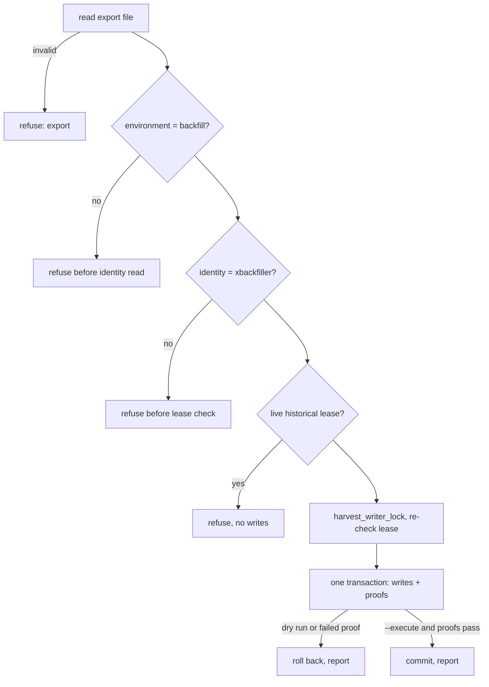

<!-- BEGIN OLLIJA DELIVERY GUIDE -->
## Ollija Delivery Guide

This block is generated guidance. Do not edit it directly. Correct durable facts in `.ollija/project.yaml` or this template, then rerun `ollija annotate-plan`. Current explicit owner instructions govern this task. Record exceptions below and reflect route changes in metadata; removed requirements must not return through another checklist.

### Resolved locations

- Authoritative host: `fuchitalee`
- Authoritative repository: `/Users/fuchitalee/development/pushin-weight-v2`
- Ollija release worktree area: `/Users/fuchitalee/development/pushin-weight-v2/.worktrees`
- Active worktree: `/Users/fuchitalee/development/pushin-weight-v2/.worktrees/fix/backfill-size-test-fixes-20261030`
- Plan: `/Users/fuchitalee/development/pushin-weight-v2/.worktrees/fix/backfill-size-test-fixes-20261030/docs/plans/2026-10-30-015749-fix-backfill-size-test-fixes-20261030-plan.md`
- Change: `fix-backfill-size-test-fixes-20261030-2026-10-30-015749`
- Branch: `fix/backfill-size-test-fixes-20261030`
- Staging branch and blueprint: `staging`, `/Users/fuchitalee/development/pushin-weight-v2/.worktrees/fix/backfill-size-test-fixes-20261030/render-staging.yaml`
- Production branch and blueprint: `main`, `/Users/fuchitalee/development/pushin-weight-v2/.worktrees/fix/backfill-size-test-fixes-20261030/render.yaml`
- Staging URL: `https://pushinweight-staging-web.onrender.com`
- Production URL: `https://pushinweight-web.onrender.com`

### Placement

This worktree is inside the Ollija release worktree area. Reuse it for the whole change. Do not create a second worktree or plan for this branch.

### Delivery scope

- Workflow: `plan`
- Delivery target: `on-request`
- Owner selection recorded: `false`

Target is not authorized until the owner selects it. Wait for a later explicit release request; do not commit, push, stage, or promote on this guide alone.

### Failure handling

- Complete applicable, unwaived checks for the selected route. A waived check is waived, never passed. Owner-selected direct production does not require staging.
- Product defects return to the parent implementation workflow; repeat only checks invalidated by the fix. Environment failures require repairing the environment, not a new source commit. Retry only after a relevant fact changes.
- SSH, shell, environment, or multi-machine failures use the repository infra/multi-machine skill first.
- The change ledger is advisory; do not validate or enforce it.
- Never force-remove a worktree. Retain staging-only, failed, dirty, locked,
  noncanonical, or candidate-mismatched worktrees for diagnosis or later
  delivery.
- Do not run an endless retry loop or start a persistent Ollija process.
<!-- END OLLIJA DELIVERY GUIDE -->

## Delivery Exceptions

- 2026-10-30 (JST): the owner asked to plan all seven backfiller fixes and build fixes 1–3 first ("Plan all 7, build 1–3 first").
- 2026-10-30 (JST): fixes target `ops/xbackfiller-db-20261026`, not `main` ("PR into the July branch").
- 2026-10-30 (JST): the owner said "merge pr 75". PR #75 (U1–U4) merged into `ops/xbackfiller-db-20261026` as `b4d5d8b7`.
- 2026-10-30 (JST): the owner invoked `/lfg` on fixes 4–7 (U5–U8). The endpoint is an open pull request with CI decided. No further merge, staging or production delivery without the owner's go.

# Backfiller fixes from the OpenAI/Anthropic size test - Plan

## Plain-English Summary

The OpenAI/Anthropic size test (PR #72, which never merges) pushed the backfiller harder than July has and exposed seven problems. Fixes 1–3 are merged (PR #75):
- an HTTP 520 now retries instead of stopping the run;
- a window can cap spending on actual cost;
- the backfill CI lint step passes.

This plan builds the other four:
- **Fix 4 (U5):** stop paying twice for search pages that arrive as a run ends. That was 15% of requests in the size test.
- **Fix 5 (U6):** give operators a recorded, one-request "final attempt" for posts that failed model validation three times. Today those posts can never finish.
- **Fix 6 (U7):** add a guarded command that copies production's list members and brand-account roles into the backfill database from a read-only export. Without them, new windows planned there know nothing about who is on each list.
- **Fix 7 (U8):** make a run whose final check fails exit with an error code instead of reporting success.

What stays the same:
- production's 15-minute harvester;
- July's saved windows and their frozen settings;
- the backfill database, until an operator explicitly runs the new commands. Building U6 and U7 writes nothing.

One timing note for the final-attempt tool: it only works before a campaign's frozen deadline, which is 2026-11-04 20:59 UTC for July. Posts still exhausted after that cannot be finished this way.

Two operational notes for whoever launches July next. First, July pins checksums of the files it runs, so launching from a revision with changed files needs July's existing runtime override, which supplies the new revision and checksums. Second, when to run the membership sync is an owner decision, because new roles change how July's later posts are classified.

Completion is shown by the new tests passing in the pull request's CI. The PostgreSQL tests can only run there, because the shared local test database is at a different schema.

---

## Goal Capsule

- **Objective:** historical X backfills can be run to completion without paying twice for the same search pages, without leaving posts permanently unclassifiable, with the same Call A list roles as production, and with a failed run visibly failing.
- **Means:** small fixes on the July branch line, reusing the shared backfill core and existing recovery and list-membership helpers (KTD1, KTD5–KTD8).
- **Authority:** owner decisions in Delivery Exceptions, then the Product Contract R-IDs, then KTDs, then units.
- **Stop conditions:**
  - stop if a change would alter production's scheduled harvester (R6), a July saved manifest or policy (R4), or Brand/BrandKeyword rows (R9);
  - stop if a fix needs a migration.
- **Execution profile:** code changes with unit and PostgreSQL tests. No provider calls, no database writes and no deploys while building.
- **Who ships:** the implementing session opens a PR into `ops/xbackfiller-db-20261026` and decides CI. Merging, running U6/U7 against xbackfiller, and launching July are owner or July-session actions.

---

## Product Contract

### Summary

Four backfiller fixes (U5–U8) join the three already merged (U1–U4) on the branch July runs from.

### Problem Frame

The size test, a six-hour window with 24,044 kept posts, showed four costs the backfiller imposes on every large window.
- **Paid twice:** 691 of 4,614 search requests were paid twice, because pages received in a run's last seconds were never committed.
- **Unfinishable:** 64 posts could not be classified after three invalid model replies, and 60 never finished targeted extraction. No tool can finish them without silently resetting their retry limits.
- **Missing roles:** the backfill database lacks production's list memberships and most of its roles, so a newly planned window freezes no Call A author roles.
- **False success:** the run's final check said `failed`, yet the job exited as a success.

### Requirements

Collection
- R1. A provider HTTP 520 retries at the same cursor (U2).
- R2. The backfill CI lint step passes, and the retry and spend-basis tests run in CI (U1, U4).
- R3. A campaign window can choose `spend_basis: "settled"` (U3).
- R4. July's saved windows keep byte-identical manifests and spending policies.
- R5. A search page the backfill already received is committed in the same run whenever the run's lease allows. When it cannot be committed safely, the outcome is no worse than today's paid re-fetch.
- R6. Production's scheduled and manual `run_cycle` behave exactly as today.

Enrichment
- R7. An operator can give a listed set of exhausted, still-incomplete posts exactly one more physical request each. The grant is recorded with actor and reason, stays inside the campaign's existing spend, request and deadline limits, and never resets earlier attempts.
- R8. A `run_backfill --execute --evaluate-at-end` run whose final assessment is not verified exits non-zero, after its receipts are saved.

Backfill database
- R9. An operator can sync production's main-list memberships and X brand-account roles into the dedicated backfill database from a saved read-only production export. The sync is idempotent, refuses any other database and any live historical lease, and never creates or edits Brand, BrandKeyword or Role rows or existing account handles.
- R10. The sync and the final-attempt grant write nothing unless the operator passes `--execute`. Building them changes no backfill data.

### Key Decisions

- **Fixes target the July branch line.** Governs R1–R10. See KTD1.
- **Exit code for "finished but not verified" is 3.** Governs R8. This is an assumption the owner can change; Render shows any non-zero code as a failed job.

### Scope Boundaries

- Not in scope:
  - changes to production's harvester or its enrichment budget windows;
  - archiving response bodies for replay;
  - raising per-run limits in saved windows.
- Running U6 or U7 against xbackfiller is an operator action, not part of this change.

### Deferred to Follow-Up Work

- **U9:** land the July branch, with these fixes, on `main`. It conflicts across 220 commits, and xbackfiller must move from schema 0183 to 0205.
- **Retry gap outside defer mode:** `backfill --enrich-direct`, and `run_backfill` without `--evaluate-at-end`, regroup exhausted classification members into new packets and quietly retry them. The per-post limit applies only in defer mode (`monitor/backfill_enrichment.py` around 1345–1351 and 1420). No test pins this.
- **Smaller packets for retried members during normal runs:** only if a ledger query shows failures depend on packet size.
- **Why about 9% of classification member results fail canonical validation:** a model or prompt investigation.
- **A guard in `manifest()`** that refuses a database-storage plan whose author scope is empty. It edits an attested runtime module, so it goes with U9.

### Sources

- Size-test plan `docs/plans/2026-10-27-113859-ops-oai-anthropic-size-20261027-plan.md` (U9 and U10 execution records) and report `docs/analysis/2026-10-30-095822-oai-anthropic-size-report.md`, both on branch `ops/oai-anthropic-size-20261027`.
- Machine-local receipts on fuchitalee in `~/.local/share/render-operations/2026-10-29-oai-anthropic-size-test/`: `final-phase-receipt.json`, `final-failures.json`, `cls-failures.json`, `collection-phase-summary.txt`, `seed-result.json`, `switch-off-result.json`.

---

## Planning Contract

### Key Technical Decisions

- KTD1. **Target `ops/xbackfiller-db-20261026`.** July launches one-off jobs from pinned archives of this branch against xbackfiller at schema 0183, while `main` is at 0205 and 220 commits ahead. (session-settled: user-directed — chosen over a branch from main with the dedicated-database branch folded in: main-based code cannot run against July's 0183 database.)
- KTD2. **U1–U3 carried proven commits** (`47f8b721`, `6df3bb4a`, `cef1168e`) and added the minimal `spend_basis` window plumbing.
- KTD3. **The July-shaped manifest regression net** (`tests/test_backfill_campaign.py::test_manifest_without_new_window_fields_keeps_its_july_shape`) guards R4 for every unit.
- KTD4. **PostgreSQL evidence comes from a fast CI step.**
  - The shared local test database holds migrations 0184–0186, which this branch lacks.
  - The backfill workflow's "Retry and spend-basis regressions" step runs before the long suite, which reaches the 15-minute limit at about 43%.
  - New PostgreSQL tests join that step, together with the existing suites of the code each unit changes, because those suites run in no workflow today: `tests/test_backfill_staging.py` for U5, and `tests/test_backfill_contract_recovery.py` plus `tests/test_backfill_cached_replay.py` for U6.
- KTD5. **Fix re-fetches by consuming captured pages, with tapering and a lease guard (U5).**
  - **Cause:** `StagingPrefetcher.pages` stops admitting new requests below 38 s (`monitor/backfill_staging.py`, the `can_start(38)` check), then yields buffered pages. But `CycleRunner._fetch_tweets` budgets each yielded page as a new HTTP call and returns `[], "truncated"` when under one request envelope remains (`monitor/cycle.py`, the non-scheduled `page_budget < 1` branch). It returns before reading `captured_pages`, so the receipt commits without its page and the next run marks it `body_lost` and pays again.
  - **Fix, three parts:**
    1. `_fetch_tweets` skips the page-budget early return only for pages captured by `StagingPrefetcher`, which `execute_job` marks on the backfill context. Archive-mode `Prefetcher` captures (`monitor/backfill_prefetch.py`) also arrive as `captured_pages`, but archive runs replay stored bodies instead of paying twice, so they keep today's budget check. Production passes `_backfill_context=None`, so it is unaffected (R6).
    2. The prefetcher reserves drain time at admission, using a measured per-page consume time times the buffered pages, so drains finish while normal budgets, including staff relevance checks, still apply.
    3. Before each yield, the prefetcher checks the run's lease margin. If it is too small, it stops and keeps today's receipt-only behavior, so a drain can never outrun the lease (`core/collection_state.py` sets it once, at claim time plus seconds plus 60) and strand requests as `pending`.
  - **Rejected:** archiving unconsumed bodies for replay, which breaks the pinned "no evidence archive in staging" invariant asserted by three staging tests; and raising per-run limits, which are frozen in saved windows (R4) and only reduce the frequency.
- KTD6. **Finish exhausted posts with a "final attempt grant" spec on the existing recovery executor (U6).**
  - `monitor/backfill_recovery.py::advance_contract_recovery` already builds single-member requests under the campaign's ceilings, preserves paid history, requires drained work, and is tested. It needs per-post correction feedback and allows 3 attempts per corrected request.
  - A new spec version, `final-attempt-grant-v1`:
    - requires actor and reason;
    - admits only posts currently deferred as `model_attempt_allowance_exhausted` and canonically incomplete;
    - rejects posts with an unknown provider outcome;
    - allows exactly one physical request per grant per request hash;
    - stores the grant in the new call's provenance and in a `save_campaign_report` receipt.
  - **Rejected:** raising `max_attempts`, which is frozen in the policy (`enrichment_policy_changed`) and affects every post; and a fresh job or policy, which is a silent reset.
  - An ambiguous call (`direct_outcome_unknown`) is closed first with the existing `close_unrecoverable_direct_imports`.
- KTD7. **Return exit code 3 from `run_backfill` when an `--evaluate-at-end` run's final assessment is not verified (U8).**
  - `_handle` currently drops the return of `run`/`run_phases`.
  - The two paths return different shapes. `run` (`scripts/backfill_campaign.py`) returns `assess_campaign`'s report, a dict whose `status` is `verified` only when every window is verified. `run_phases` (`scripts/backfill_month.py`, used by `--phase` and month recipes, July included) returns `phase_sequence`'s list of compact per-window rows, and drops the report's overall status.
  - Raise `CommandError(..., returncode=3)` after they return: for `run`, when the report's `status` is not `verified`; for `run_phases`, when any returned row's `status` is not `verified`.
  - The receipts are already saved at that point. Raising inside `run_phases` would instead trigger its failure handler, which pauses every campaign job.
- KTD8. **The membership sync is a new guarded command that reuses `monitor/list_membership.py` (U7).**
  - `sync_backfill_list_roles` reads a saved read-only export.
  - It reuses `_upsert_account`, `_upsert_membership`, `resolve_call_a_author_contexts`, `validate_staging` and `harvest_writer_lock`.
  - It ports and generalizes the size-test seed's main-list import (`scripts/backfill_size_seed.py` on `ops/oai-anthropic-size-20261027`).
  - Memberships alone leave the classifier catalog revision unchanged. Roles change it by design, since the catalog hashes each brand's account handles and roles. So the proof is: the catalog without handles is identical, and the handle/role delta equals the intended rows.
  - Tables added: 0, retired: 0. It adds one value, `production_export`, to the existing `TwitterListMembership.source` vocabulary.
- KTD9. **July runtime attestation.** U5 and U8 edit modules July attests (`scripts/backfill_month.py` `RUNTIME_MODULES`, plus `monitor/backfill_staging.py` for database storage). July adopts them through `selected_runtime`'s existing override (`runtime_revision` plus `source_sha256`). No recipe rewrite.

### Assumptions

- Exit code 3 for an unverified evaluate-at-end run (R8).
- U7 syncs all X roles from production (232 at the last export), reports xbackfiller-only roles without deleting them, and leaves the timing relative to July to the owner.
- A plain grant (no feedback) is allowed for classification, whose single-member request differs from earlier packets. Translation and targeted retries keep identical bodies, so they require feedback (corrected recovery), unless the post's failures include provider-side `failed` calls.

### Risks

- **A grant only works before its campaign's frozen deadline.** Each grant registers a provider batch under the campaign policy's `deadline`, and `fenced_batch` refuses new starts after it (`batch_deadline_exhausted`, `core/provider_batches.py`). July's recipes freeze `2026-11-04T20:59:34Z`, and the size test's manifest freezes `2026-10-31T22:15Z`. Exhausted posts left after those times stay unfinished.

### High-Level Technical Design

```mermaid
sequenceDiagram
    participant P as StagingPrefetcher.pages
    participant C as CycleRunner._fetch_tweets
    participant DB as Page checkpoint
    Note over P: admit while can_start(38 + est_consume × (buffered+1))
    P->>C: yield captured page
    C->>DB: commit page (no HTTP budget check for captured pages)
    Note over P: before each yield: lease margin ≥ 2 × est_consume + safety?
    P-->>P: if not, stop yielding; finally saves receipts (today's body_lost path)
```

U7's sync refuses before any write, in this order:



### Sequencing

U8 first (smallest, independent), then U5, U7 and U6. Each is independent of the others and lands as its own commit set.

---

## Implementation Units

### U1. CI lint fix

- **Goal:** the backfill workflow's ruff step passes (R2).
- **Files:** `tests/test_account_user_about_model.py`.
- **Approach:** cherry-pick `47f8b721`.
- **Verification:** the ruff step passes in CI.

### U2. HTTP 520 retries at the same cursor

- **Goal:** R1.
- **Files:** `monitor/backfill_retry.py`, `tests/test_backfill_retry_statuses.py`, `tests/test_backfill_staging_retry.py`.
- **Approach:** cherry-pick `6df3bb4a`.
- **Test scenarios:** 520 is transient; the staging prefetcher retries a 520 at the same cursor.
- **Verification:** the fast CI step passes.

### U3. Settled spend basis, reachable from a campaign window

- **Goal:** R3, R4.
- **Files:** `core/provider_batches.py`, `monitor/backfill_enrichment.py`, `scripts/backfill_campaign.py`, `monitor/management/commands/run_backfill.py`, `tests/test_backfill_spend_basis.py`, `tests/test_backfill_campaign.py`, `tests/test_run_backfill_command.py`, `tests/test_backfill_direct_enrichment.py`, `tests/test_backfill_native_enrichment.py`.
- **Approach:** cherry-pick `cef1168e`, then add the optional window field `spend_basis`. A plain window keeps today's tuple input.
- **Test scenarios:**
  - the basis reaches `policy_snapshot` only when present;
  - a window object's basis is frozen into the manifest;
  - an unknown window field is rejected before planning.
- **Verification:** the fast CI step passes.

### U4. Regression net and CI step

- **Goal:** R2, R4.
- **Files:** `tests/test_backfill_campaign.py`, `.github/workflows/backfill.yml`.
- **Approach:** port the July-shaped manifest test (KTD3). Add the fast CI step and the trigger paths (KTD4).
- **Verification:** the fast step ran 80 tests (36 PostgreSQL) with none skipped on PR #75.

### U8. Unverified evaluate-at-end runs exit non-zero

- **Goal:** R8.
- **Requirements:** R8, R4.
- **Dependencies:** none.
- **Files:** `monitor/management/commands/run_backfill.py`, `tests/test_run_backfill_command.py`, `.github/workflows/backfill.yml`.
- **Approach:**
  1. In `Command._handle`, keep the value returned by `run(...)` and `run_phases(...)`.
  2. When `evaluate_at_end` is set and the result is not verified, raise `CommandError` with `returncode=3`, naming the unverified window and pointing to the saved campaign receipt. A `run` result is unverified when its report's `status` is not `verified`; a `run_phases` result is unverified when any row's `status` is not `verified` (KTD7).
  3. Leave the non-evaluate path and dry-run planning output unchanged.
- **Patterns to follow:** existing `CommandError` handling in `run_backfill.py`; October operator wrappers raised `october_recovery_assessment_incomplete` on the same condition.
- **Test scenarios:**
  - `run` under evaluate-at-end returning a report with `status: incomplete` raises `CommandError` with return code 3, and the mocked receipt save still ran;
  - `run_phases` under `--phase all --evaluate-at-end` returning verified collection rows plus one `failed` assessment row raises `CommandError` with return code 3;
  - `run_phases` returning only `verified` rows, and `run` returning `status: verified`, both exit normally;
  - a run without `--evaluate-at-end` keeps today's behavior whatever its result;
  - the two existing command tests whose mocks return `None` under evaluate-at-end (around lines 88–105 and 128–147) return a verified result instead. Their other assertions are unchanged.
- **Verification:** the new and updated tests are added to the workflow's fast step and pass there.

### U5. Commit captured pages before a run ends

- **Goal:** R5, R6.
- **Requirements:** R5, R6, R4.
- **Dependencies:** none.
- **Files:** `monitor/cycle.py`, `monitor/backfill_staging.py`, `monitor/backfill_collection.py`, `monitor/backfill_resources.py`, `tests/test_cycle_search_caps.py`, `tests/test_backfill_staging.py`, `.github/workflows/backfill.yml`.
- **Approach:**
  1. Add a flag on `BackfillContext` that `execute_job` sets only when the capture comes from `StagingPrefetcher`. In `CycleRunner._fetch_tweets`, skip the non-scheduled `page_budget < 1` early return and the page-cap clamp only when that flag is set (KTD5).
  2. In `StagingPrefetcher.pages`, measure the consumer's time per yielded page (from yield to resume, a conservative running maximum with a small default). Admit new requests only while `can_start(38 + est × (buffered + 1))`.
  3. Before each yield, compare the run's lease expiry, read once through the fenced run, with now. Stop yielding when the margin is below about twice the estimate plus a safety margin, so `finally` saves the remaining receipts as today.
  4. Record `uncommitted_captures` in the prefetch metrics so a dropped page is visible in the same run.
- **Execution note:** start with a failing PostgreSQL test that reproduces a deadline crossing with buffered pages.
- **Patterns to follow:**
  - `staging_retry` state restoration (`StagingPrefetcher.__init__`);
  - the deadline tests in `tests/test_cycle_search_caps.py`;
  - the fixtures in `tests/test_backfill_staging.py` (`job_for_scopes`, fake HTTP pages).
- **Test scenarios:**
  - Covers R5: a run whose deadline passes the 38 s mark with several pages buffered commits every received page in that run, and the next run reports `lost_responses == 0`, with total HTTP requests equal to total pages.
  - Covers R5: with a lease margin too small for the next page, the prefetcher stops yielding and saves receipts; the next run re-fetches exactly those pages (today's behavior), and no request is left `pending`.
  - Admission tapering: with a slow consumer, the prefetcher stops admitting earlier than 38 s, proportionally to the buffered pages.
  - Covers R6: `_fetch_tweets` without a backfill context keeps the deadline page budget (`test_deadline_reduces_deep_page_budget_before_starting` unchanged), and the scheduled branch still checks time between pages.
  - Pure unit: `_fetch_tweets` with a staging-captured page and under one envelope remaining processes the page instead of returning `truncated`.
  - Pure unit: an archive-mode captured page (flag unset) with under one envelope remaining still returns `truncated`.
  - Existing staging tests keep passing unchanged: no evidence archive, 20 concurrent requests, error drain keeps cursors.
- **Verification:** `tests/test_cycle_search_caps.py` passes locally. The fast CI step runs the whole of `tests/test_backfill_staging.py`, new and existing tests, and it passes with none skipped.

### U7. Guarded sync of production list memberships and roles

- **Goal:** R9, R10.
- **Requirements:** R9, R10, R6.
- **Dependencies:** none.
- **Files:**
  - create `scripts/backfill_list_roles_production.sql`, `monitor/backfill_list_roles.py`, `monitor/management/commands/sync_backfill_list_roles.py`, `tests/test_backfill_list_roles.py` and `tests/fixtures/backfill_list_roles_export.json`;
  - modify `.github/workflows/backfill.yml`.
- **Approach:**
  1. The SQL, wrapped in `BEGIN TRANSACTION READ ONLY; … ROLLBACK;`, outputs format `x-backfill-list-roles/v1`: the database name, `generated_at`, the main `list_id`, active `members` (author_id, handle), and every X `brands_accounts` role (author_id, handle, brand_id, role_id).
  2. `monitor/backfill_list_roles.py` holds the logic.
     - `read_export` validates the production database name, the list id against config (`monitor.cycle._resolve_x_monitor_list_id`), a non-empty member list and decimal author ids.
     - Port `load_document` from the size branch's `scripts/backfill_size_report.py` and `_ensure_membership` from `scripts/backfill_size_seed.py`.
     - `apply_export` upserts memberships with source `production_export` and run id `production-export-sha256:<sha256>`. It deactivates main-list members absent from the export, creates role-only accounts from export handles, and creates or corrects roles whose brand and role exist. It reports skipped roles, xbackfiller-only roles and differing handles, and never edits handles or creates Brand/Role rows.
  3. Guard order, each before any write:
     1. validate the export;
     2. require `X_MONITOR_DEPLOYMENT_ENVIRONMENT == "backfill"`;
     3. pass `validate_staging` identity for xbackfiller;
     4. find no live historical lease;
     5. acquire `harvest_writer_lock`, then re-check the lease.
  4. One transaction: before-state, writes, then proofs.
     - The catalog projection without handles is unchanged.
     - The handle/role delta equals the written roles.
     - `resolve_call_a_author_contexts` returns one context per exported member with matching roles.
     - Historical `CollectionJob` definition checksums are unchanged.

     The transaction rolls back on dry run (the default) or on any failed proof. It prints one JSON report.
  5. The command: `--export PATH`, plus `--execute` to commit.
  6. Add the new files to the workflow's paths, ruff list and fast step, together with `tests/test_list_membership_reconciliation.py` and `tests/test_call_a_role_routing.py` as the helpers' regression net.
- **Patterns to follow:**
  - `monitor/management/commands/sync_twitter_list_members.py` and `monitor/list_membership.py`;
  - `transfer_backfill`'s read-only-unless-`--execute` convention;
  - the size-test seed's guard tests on `ops/oai-anthropic-size-20261027`.
- **Test scenarios:**
  - Pure:
    - export parsing from `render psql -o json` output;
    - refusal of a non-production database, another list id, empty members, a malformed role or a non-decimal author id;
    - guard order: a non-backfill environment is refused before identity is read, a wrong identity before the lease check, and a live lease before any write;
    - the projection digest keeps steady for a handle/role change and changes for a keyword change;
    - the SQL starts read-only, ends with `ROLLBACK;`, and contains no INSERT/UPDATE/DELETE/ALTER/CREATE/DROP.
  - PostgreSQL:
    - Covers R9: the first `--execute` creates memberships, missing accounts and roles, and a second run of the same export changes nothing;
    - a role is corrected from staff to official; an unknown brand or role key is skipped and reported with no Brand/Role row created;
    - Brand, BrandKeyword, BrandSearchTerm, BrandHashtag and Product rows are unchanged; a memberships-only export leaves the catalog revision byte-identical;
    - dropping a member from the export deactivates only that row;
    - an existing account handle is never edited and is reported as differing;
    - after sync, planning freezes one Call A context per exported member, and an existing historical job's definition checksum is unchanged;
    - Covers R10: a dry run leaves every row count unchanged and reports the would-be revision;
    - a live historical lease refuses with no writes.
- **Verification:** the pure tests pass locally; the PostgreSQL tests pass in the fast CI step.

### U6. Final-attempt grant for exhausted posts

- **Goal:** R7, R10.
- **Requirements:** R7, R10.
- **Dependencies:** none.
- **Files:** `monitor/backfill_recovery.py`, `x_monitor/corrected_inference.py`, `monitor/management/commands/backfill.py`, `scripts/backfill_campaign.py` (receipt only, through `save_campaign_report`), `tests/test_backfill_contract_recovery.py`, `tests/test_backfill_cached_replay.py`, `tests/test_backfill_direct_enrichment.py`, `.github/workflows/backfill.yml`.
- **Approach:**
  1. `_validate_spec` accepts version `final-attempt-grant-v1`.
     - Fields: `job_id`, `phase` (base or targeted; translation retries belong to base), up to 50 distinct posts with their `prior_call_ids` and `source_snapshot`, required `actor` and `reason`, and optional `feedback`.
     - It admits only posts deferred as `model_attempt_allowance_exhausted` by `deferred_enrichment_work` and still incomplete (`completion_facts` for base, `incomplete_roles` for targeted).
     - It rejects unknown-outcome posts, posts with an outstanding grant call, and chained recoveries (KTD6). Operators close an unknown-outcome call with `close_unrecoverable_direct_imports` as a separate earlier step; the grant never closes it.
  2. `advance_contract_recovery` chooses the attempt cap by version: 1 for a grant, the policy's `max_attempts` for corrected recovery. The grant enforces its cap itself; the frozen policy's `max_attempts` stays 3. It records actor, reason, the grant checksum and the prior call ids in the request context and returns per-post outcomes and spend.
  3. `x_monitor/corrected_inference.py` gains a tag-only mode. Without feedback, the request body is unchanged and the grant context is still attached.
  4. `backfill` gains `--enrichment-attempt-grant SPEC.json` with `--collection-job`.
     - Without `--execute`, it runs `prepare_only` and gives a zero-spend preview (R10). Only with `--execute` does it register and send requests.
     - Execution holds the campaign advisory lock.
     - The receipt goes through `save_campaign_report` under phase `attempt_grant:<sha12>`.
  5. Translation and targeted grants without feedback are refused unless the post's failures include provider-side `failed` calls (Assumptions).
- **Patterns to follow:** existing `canonical-contract-recovery-v1` specs and tests (`_rejected_packet`, `_paid_history` in `tests/test_backfill_contract_recovery.py`); `close_unrecoverable_direct_imports` audit fields.
- **Test scenarios:**
  - Covers R7: a grant on an exhausted base post sends exactly one single-member content and brand-interpretation pair and publishes it. Earlier paid calls are byte-for-byte unchanged.
  - A failing grant sends exactly one pair; a second invocation sends nothing and reports `final_attempt_grant_exhausted`.
  - Refusals: a complete post, a non-deferred post, a `provider_outcome_unknown` post, a changed source, missing actor or reason, more than 50 posts, or an outstanding grant call.
  - Hitting the campaign USD or request ceiling refuses with `model_campaign_allowance_exhausted` and registers nothing.
  - Every provider batch's frozen policy keeps `max_attempts == 3` and is otherwise unchanged; only the grant itself limits a granted request hash to one physical request.
  - A grant attempted after the campaign policy's deadline refuses with `batch_deadline_exhausted` and registers nothing.
  - A grant on one member leaves its siblings' allowance unchanged.
  - After a grant, `execute_enrichment(defer_failures=True)` still defers the non-granted exhausted posts.
  - Covers R10: the `backfill` flag without `--execute` reserves nothing; actor and reason are required.
  - Targeted and translation variants follow the feedback rule.
- **Verification:** the fast CI step runs the new tests and the whole of `tests/test_backfill_contract_recovery.py` and `tests/test_backfill_cached_replay.py`, and they pass with none skipped.

---

## Verification Contract

| Check | Command or source | Pass condition |
|---|---|---|
| Lint | `.venv/bin/ruff check` on changed files | clean |
| Pure tests | `scripts/pytest-local tests/test_cycle_search_caps.py tests/test_backfill_list_roles.py tests/test_backfill_campaign.py -q` | pass; skips reported |
| PostgreSQL tests | PR CI, backfill workflow fast step | the new U5–U8 tests, `tests/test_backfill_staging.py`, `tests/test_backfill_contract_recovery.py` and `tests/test_backfill_cached_replay.py` pass with none skipped |
| Other PR checks | Homepage counts, Official company discovery, Staff identity, Editorial | outcomes match the base branch (pre-existing failures unchanged) |
| July untouched | U4 regression net; U7 job-checksum proof | identical |
| Production untouched | `tests/test_cycle_search_caps.py` scheduled and manual branches | unchanged assertions pass |

## Definition of Done

- U5–U8 are committed with named files on a branch for a PR into `ops/xbackfiller-db-20261026`.
- The PR is open, and each CI check is decided and compared with the base branch.
- No production write, provider call, xbackfiller write or deploy happened.
- No abandoned-attempt code remains in the diff.
- U9 and the other deferred items stay recorded in Deferred to Follow-Up Work.
