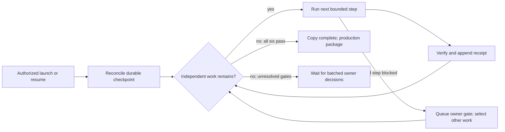

# Process table consolidation - Plan

## Plain-English Summary

Prevent each new workflow from adding its own run, call, budget and receipt tables, then consolidate existing families in separate, rehearsed changes. Preserve what the application knows, how spending is limited, and how interrupted work resumes. Existing person-name, affiliation and job-listing evidence stays separate because those records describe different facts and relationships.

The code checked out from `origin/main` has **221 physical application tables**, not 219. The existing staging production copy has **227**, including six tables from newer work. The recommended scope removes **25 net tables**: **221 → 196** on this branch's baseline, or **227 → 202** including the six staging additions. Against the original illustrative 219 baseline, the same reduction is **219 → 194**. Reaching exactly 190 would require more scope or unsafe conflation; this plan does neither.

The sequence is guardrails, budgets, classification vocabularies, provider calls, discovery runs, then event/opportunity dossiers. Each family gets its own branch and production-copy rehearsal. The budget phase keeps the request throttle separate. The call phase keeps the official-company business decision record and defers its operational decision JSON; it removes call envelopes and operational call JSON only after their typed replacements exist.

This session produces documentation only. Implementation and release require a later instruction. Staging is an existing populated rehearsal resource, but its newer migration history and current occupancy must be reconciled before any future write. No production connection, database write, R2 operation, implementation, deployment or merge is authorized here.

The later background run has a defined non-production endpoint: implement and rehearse all six phases, publish their branches, and prepare one production decision package. It continues through routine fixes and recoveries without asking at every phase. The “Autonomous run” section specifies its authority, five owner-wait reasons, durable checkpoints and proposed ceilings: 48 hours, 10 million metered tokens, and no application-provider spend or infrastructure purchases. Production remains separately authorized.

## Goal Capsule

- **Outcome:** fewer overlapping process tables, one documented default owner for each process record meaning, and continuous-integration checks preventing new accidental duplication.
- **Source revision:** `76834dba`, `docs/process-table-plan-20261101`, based on fetched `origin/main`; core migration files through `0205`.
- **Authority:** plan only; optionally commit and push this document on its docs branch. Future implementation remains `delivery_target: on-request`.
- **Execution:** seed a task integration branch from then-current `origin/main`; give each family its own branch and rehearsal, carrying completed predecessors through that integration branch. No merge to `main` is needed to finish the non-production run. Do not implement from this docs branch.
- **Stop conditions:** the five exhaustive owner-wait reasons in “Autonomous run.” Other failures trigger bounded recovery, a phase hold or independent work; they do not automatically end the session.
- **Readiness:** ready for a later implementation instruction with the stated defaults. That instruction activates the scoped non-production run contract; it does not approve production access or release.

## Product Contract

### Requirements

- R1. Name shared defaults for execution runs, provider/model calls, spend allowance windows, execution claims/leases, and raw evidence/receipts. Extensions must preserve the record's meaning and constraints.
- R2. Add a linked policy to `AGENTS.md`, extend M19 in `.agents/skills/avoiding-recurring-mistakes/SKILL.md`, and extend the canonical shared schema-walkthrough reference. Build on its existing reader-first and write-path consolidation rules.
- R3. Continuous integration rejects new process-shaped tables without demonstrated shared-table reuse/extension or a specific owner-approved exception in the selected plan.
- R4. Consolidate one family per branch and rehearsal, using additive storage, historical copy, writer/reader cutover, independent parity and guarded physical retirement.
- R5. Preserve limits, reservations, ambiguous spend, token/credit units, request identity, lease fencing, taxonomy meaning, historical evidence, source clocks and review state.
- R6. Keep name, affiliation, citizenship and job-listing evidence typed by domain. Keep RG5 `BusinessVocabularyCode` subclasses separate.
- R7. Measure application table counts using a declared denominator; include necessary new relationship/detail tables and retained tables in the arithmetic.
- R8. Reuse identified databases, object storage and services. Do not create another full local test database, fresh production restore, scheduler or service by inference.
- R9. Characterize current caller behavior before replacement; every family includes application-level regression coverage and realistic failure/restart proof.
- R10. Harvesting and other live collectors/workers continue throughout a future release. Use online copying, stale-row detection and bounded final delta checks; never stop collection to obtain a stable cohort.
- R11. Run U1–U6 unattended on fuchitalee using GPT-6-Astra with xhigh reasoning, within the “Autonomous run” authority, recovery, checkpoint and ceiling contract. Batch owner decisions and continue independent work.

### Boundaries and decisions from evidence

The requested six budget tables are not six interchangeable spending windows. `PostSynthesisRateLimitBucket` is a hashed caller throttle with two-day cleanup, unrelated to paid usage settlement. Retain it as a documented exception; consolidate the other five. This is the evidence-based scope adjustment allowed by the request.

`OfficialCompanyAttempt` also records owner attestations with no provider request. Keep it as the official-company decision journal; move only actual provider-call facts. Its `decision` document is consumed operationally by requalification. Removing that document safely requires a separate typed decision/citation design and is deferred here, rather than moving business state into an archive. Its `budget_keys` list is retired in U2.

The event family is a domain-identity consolidation, not a process-table merger. Its detail records remain typed. Discovery runs are a separate family and therefore a separate branch, even though the request grouped them with events.

## Planning Contract

### Evidence and denominator

Code and migrations were inspected without loading application settings or connecting to production. Read-only staging queries on **2026-11-01** verified `current_database() = pushinweight_staging` and `transaction_read_only = on`. Counts below are exact `count(*)` results from bounded read-only transactions; the two main inventory groups used repeatable-read, while supplemental shape/catalogue probes used read committed. Different inventory groups are separate snapshots and are not a global atomic census. Use new same-cohort counts for each rehearsal. Two initial broad count queries timed out read-only; the narrower inventory and index-oriented dependency inventory completed.

Staging is `dpg-d9vb8ds9v7es738lepsg-a`, with migration ledger through `0219_release_mapping_reconcile_index`. It has **243 public physical tables = 227 application + 16 Django/allauth tables**. The latter are the six `auth_*`, two `account_email*`, four `django_*`, and four `socialaccount_*` tables. Views, materialized views and aliases are excluded. `home_brand_time_counts` is not counted as a physical table; aliases such as `TrendNarrativeRun` do not add tables.

`core/models.py` at the source revision names 222 relations, of which 221 are physical application tables. The six additional staging tables are `discussion_window_counts`, `discussion_window_snapshots`, `event_dossier_claim_collection_jobs`, `event_dossier_discussion_windows`, `event_dossier_intake_decisions`, and `product_release_detection_states`. They are outside this plan's consolidation scope. Do not deploy this older checkout over that schema or infer compatibility from its migration ledger alone.

Local read-only cross-check: `test_pw_g3_timing_20261019`, `127.0.0.1:55436`, PostgreSQL 18.6, 243 physical public tables, migration ledger through `0213`; the inspected application tables were empty except two `data_sources` rows. It supplies no populated-family rehearsal evidence.

Historical RG6 evidence is in `docs/plans/2026-10-09-063417-feat-g3-round2-chart-engine-plan.md`, especially the October 27 staging parity/checkpoint entries, and RG7 decisions near its “Frozen RG7 storage decision” entry. The October 27 `serving-stage-0195-checkpoint-002.json` reference identifies **the staging copy**, not a separately verified local database. The current staging database is that reusable target, now advanced. Historical production-copy language elsewhere in the plan sometimes means copying rows inside production; it is not permission to connect there. RG6 pause/schedule practices are superseded by R10.

### KTD1. Canonical ownership map

This is the destination policy, with implementation maturity stated explicitly. U1 documents it; U2–U5 implement only their bounded extensions. It does not authorize rewriting every existing process family.

| Record meaning | Canonical table/model | Reader and reason | Extension boundary |
| --- | --- | --- | --- |
| Logical collection/discovery execution | `collection_runs` / `CollectionRun` | Collection status, recovery and coverage readers in `core/collection_state.py`; one logical execution, not one HTTP call | Reuse `CollectionJob` and `CollectionScopeRun` for instructions and scoped progress. Existing authored-content runs remain a named legacy/domain exception until separately reviewed; never invent a collection job for an editorial assessment. |
| One provider operation, including model inference | Generalize/rename `original_content_calls` to `provider_calls` / `ProviderCall` in U4 | Spend, response replay, provider batch importer, staff request recovery | Reuse current call identities/PKs and `ProviderBatch` for multi-call transport. Distinguish a billable logical operation from its physical transport attempts. |
| One spend allowance window | New `spend_budgets` / `SpendBudget` in U2 | Reservation/settlement and operator budget readers | Typed dimensions and counters; one row per allowance, not one row per provider. Retain throttle as a different record kind. |
| One execution claim/lease attempt | `collection_attempts` / `CollectionAttempt` | `core/collection_state.py` fences writes and accounts resumption | Default for collection/discovery. Reuse `CollectionRun`'s active token projection atomically. Existing provider-call/batch and work-item leases remain explicit compatibility exceptions; do not claim that they already share this table. A future non-collection lease requires a reviewed typed-owner extension here or owner exception, not a new per-feature lease table. |
| Immutable raw document | `collection_evidence_archives` / `CollectionEvidenceArchive` | Capture/replay, historical comparison, dossier evidence | Existing BinaryField archive with content hash, encoding and size. It is not a mutable state store. |
| Physical transport receipt, including no response | `collection_requests` / `CollectionRequest` | Capture and collection accounting readers | Existing required attempt/scope FKs must remain truthful. ProviderCall can reference a real captured request when it exists; do not fabricate collection scopes to fill them. |

The broad labels “runs” and “calls” conceal different grains. The table map is one shared default for each precise meaning, not permission to force authored-content decisions into collection execution records. U1 must list legacy exceptions by table and reason. A newly encountered workflow may not silently expand that list.

`ProviderBatch` remains one resumable group, with `ProviderCall` children. A group is not another individual call. No new generic run/lease table is proposed, and this work does not opportunistically centralize every existing lease implementation.

### KTD2. New-table accounting and schema shape

Six permanent tables are proposed across the entire program: `SpendBudget`, `SpendBudgetCharge`, `PostPromotionClassification`, `ProviderCallInput`, `ScheduledEventDetail`, and `OpportunityDetail`. `SpendBudget` replaces five tables; `SpendBudgetCharge` models a many-to-many reservation relationship previously hidden in JSON. `ProviderCallInput` models ordered Post inputs and per-input validation snapshots currently hidden in call JSON. The two detail tables represent event schedule/attendance facts and opportunity action/benefit facts, which cannot fit product-release details. U3 adds the typed Post-to-promotion-concept assignment hidden in existing JSON; U5 adds no permanent tables. U4 renames one existing call table and retires two. Temporary copy markers are columns, not permanent mapping tables.

Use existing `ServiceProvider`, `InferenceModel`, `DefinitionVersion`, `WorkflowStage`, `Language`, `Locale`, `TimeZone` and measurement/currency references where the definition really matches. Preserve unresolved historical names explicitly rather than silently assigning a convenient current model. Uniqueness, scope and nullable shapes must reflect the original counting unit. No new JSON/JSONB column is proposed. Raw archived bytes remain versioned, validated immutable evidence, never a way to disguise live mutable relationships.

### KTD3. Table arithmetic

These counts are the **end of each phase**, after physical retirement. Renames do not change totals. The six newer staging application tables are carried through unchanged. Temporary additive coexistence peaks are listed so a large intermediate schema is not mistaken for failure.

| Phase / branch suffix | Added | Retired | Net | Branch baseline | Staging baseline | Maximum temporary additions |
| --- | ---: | ---: | ---: | ---: | ---: | ---: |
| Start | 0 | 0 | 0 | 221 | 227 | 0 |
| U1 guardrails | 0 | 0 | 0 | 221 | 227 | 0 |
| U2 spend-budgets | 2 | 5 | -3 | 218 | 224 | +2 |
| U3 classification-vocabularies | 1 | 19 | -18 | 200 | 206 | +1, extend/rename existing three |
| U4 provider-calls | 1 | 2 | -1 | 199 | 205 | +1 |
| U5 discovery-runs | 0 | 2 | -2 | 197 | 203 | 0 |
| U6 event-opportunity-dossiers | 2 | 3 | -1 | **196** | **202** | +2 |
| Total | **6** | **31** | **-25** | | | |

The original “19 into 3” classification estimate understates the saving: the 19 old key/label tables are retired **in addition to** retaining/generalizing the three existing audience-topic tables. Thus the vocabulary tables alone go 22 → 3, net -19; the required promotion assignment table makes the complete phase net -18. Budget savings are reduced by the necessary charge relation and retained throttle. Official-company decisions remain a table, so four call-related source tables do not become one whole-table replacement. If U6 remains deferred, the delivered endpoint is 197/203. If a full official-decision JSON redesign adds tables later, recalculate the total; do not hide them.

## Resources

The following resource identities are specific, existing resources. This table is a future execution dependency list, not authorization to use write credentials now.

| Resource | Exact identity and access | Needed by |
| --- | --- | --- |
| Repository | Authoritative root on fuchitalee: `/Users/fuchitalee/development/pushin-weight-v2`; this plan worktree under `.worktrees/docs/process-table-plan-20261101` | All phases. Leave the main checkout's unrelated changes alone. |
| Populated rehearsal copy | Render `pushinweight-staging-db`, ID `dpg-d9vb8ds9v7es738lepsg-a`, database/role `pushinweight_staging`, port 5432. Target identity in `config/staging_refresh.yaml`. Current read-only counts above; earlier RG6 checkpoint dated Oct 27. | U2–U6, one owner/family at a time. U1 policy tests need no database. |
| Local test database | Existing `test_pw_g3_timing_20261019`, fuchitalee `127.0.0.1:55436`; state `/Users/fuchitalee/.local/share/pushinweight/test-db/`; private connection metadata `connection.json`; lock `use.lock` | U2–U6 regression tests through `~/.local/bin/pushinweight-test-db`. Read `/Users/fuchitalee/infra/docs/reference/pushinweight-shared-test-database.md`. Never restore or clone another database. |
| Eventual production target | Render `pushinweight-db-shadow`, ID `dpg-d9koekqjobas73fvjqng-a`, database `pushinweight_shadow`; service-managed `DATABASE_URL` | Later authorized production delivery only. This session did not connect. Do not use the retired database ID from older memory. |
| R2 evidence storage | **None required for this consolidation.** `CollectionEvidenceArchive.body` is PostgreSQL byte storage | U4/U6 archive copy and verification need database access, not R2 credentials. |
| Existing media buckets | `pushinweight-media-staging` and `pushinweight-media-production`; prefixes `staff/`, `editorial/` | Only existing media rendering smoke checks in a later authorized U4 release. No media copy, deletion, new bucket or new prefix required. |
| Staging execution services | `pushinweight-staging-jobs` (`crn-dain9moae00c73f7d73g`), `pushinweight-staging-web`, `pushinweight-staging-headlines`, `pushinweight-staging-synthesis`, `pushinweight-staging-enrichment`, `pushinweight-staging-harvest` | Jobs runs bounded copy/parity; web and affected worker images provide cutover proof. U2 touches synthesis/enrichment/harvest/headlines; U3 touches all classification/role readers and writers; U4 touches headlines/enrichment plus on-demand staff/official paths; U5/U6 touch harvest/enrichment/web/headlines and jobs. |
| Existing broker | `pushinweight-staging-headlines-broker`; production counterpart `pushinweight-headlines-broker`; existing queue URLs in service environment | Only worker smoke/recovery proof. No broker flush, new broker, beat or scheduler. |
| Production services | `pushinweight-web`, `pushinweight-jobs`, `pushinweight-headlines`, `pushinweight-synthesis`, `pushinweight-enrichment`, `pushinweight-harvest`, `pushinweight-home-counts`; existing broker above | Later release image/dependency census, following `render.yaml`. Do not reactivate legacy worker/beat. Actual services and deployed revisions must be rechecked then. |
| Background agent runtime | fuchitalee's existing `/Users/fuchitalee/.local/bin/codex`, tmux, Python 3 and `caffeinate`; GPT-6-Astra/xhigh; existing private Codex login under `/Users/fuchitalee/.codex/`; existing Git remote authentication | All U1–U6 after a later launch. No new API key, copied auth file, hosted agent service or environment-file edit. Task-private supervisor/receipts are specified below and do not exist yet. |

**Environment and credentials by phase:** U1 uses no environment file or provider key. U2–U6 local tests use the wrapper-supplied connection, not a copied repository `.env`. Runtime code currently loads repository `.env`; never source it for an audit or assume it targets local PostgreSQL. Candidate processes must receive an explicit validated target URL. Staging copies/parity use the existing staging jobs service's Render-managed `DATABASE_URL`; its role must have the required schema privileges before a future migration. The Render CLI's existing fuchitalee login was sufficient for this session's read-only staging query; no credential value was printed or copied.

No application-provider credentials are required for migration, stored-data parity or fixture tests in any phase. Disable provider sends in task-owned rehearsal processes and replace their network adapters with deterministic test replies; do not pause existing live workers to achieve that isolation. Do not use `TWITTERAPI_IO_SCHEDULED_API_KEY` for probes. An owner-selected live probe would be a separate extension using `TWITTERAPI_IO_ON_DEMAND_API_KEY`, and must load the X routing skill; it is unnecessary here. Likewise no application MiniMax, DeepInfra, OpenAI or Anthropic spend is required. The background agent uses its separately bounded existing Codex access. U4 staff/official replay must not trigger X list membership or owner OAuth actions.

If media smoke checks need existing files, Render already maps `R2_ACCOUNT_ID`, `R2_ACCESS_KEY_ID`, `R2_SECRET_ACCESS_KEY`; the operator store is `/Users/fuchitalee/.env.secrets`, using `R2_STAGING_ACCESS_KEY_ID` / `R2_STAGING_SECRET_ACCESS_KEY` or the corresponding `R2_PRODUCTION_*` variables. Do not copy production keys into staging. No secret file needs editing for this plan. `STAGING_REFRESH_SOURCE_DATABASE_URL` and `STAGING_DATA_REFRESH_ENABLED` belong only to staging jobs; **do not invoke staging refresh** as an automatic prerequisite because it connects to production and replaces data. Reuse the present copy.

**Resource gates:** identify the staging owner and current deployed SHA before rehearsal. It is ahead of this branch, so use a reconciled then-current candidate containing those migrations, not a fake ledger update or reversal. If occupied, schedule independent work under “Autonomous run”; do not create a substitute database. The staging refresh policy excludes some operational rows: zero official-company/staff rows do not establish production emptiness. Characterized fixtures permit copy-only retirement/rehearsal of empty families, with historical coverage explicitly unproved. Production retirement requires a later approved census and representative-shape verification. No new resource is proposed.

## Autonomous run

This section governs R11. **Nothing is launched by writing or approving this document.** A later explicit instruction to run this plan activates the following non-production contract, subject to any narrower instruction in that launch. Preserve that instruction and this plan's hash in the first run event. Do not repeatedly request authority already granted. The selected model is **GPT-6-Astra, xhigh**, as requested; unavailable model access is an access gate, not permission to substitute another model.

### Endpoint, branches and work scheduling

The unattended endpoint is `copy_complete`: U1–U6 implemented and rehearsed, required checks green, every planned old table dropped **on the existing copy**, family branches pushed and their remote SHAs verified, documentation updated, and one production decision package ready. `production_complete` is a different state requiring later explicit authority and observed production evidence. Preparing that package does not require a production connection. A blocked or deliberately deferred phase is reported as such; finishing the other phases is not full completion.



Global safety/ceiling stops interrupt this loop. An early agent exit returns to checkpoint reconciliation; it does not select either terminal state by itself.

At launch, create `refactor/process-tables-integration-<run-id>` in a new linked worktree from fetched `origin/main`, leaving this docs worktree and the dirty authoritative checkout alone. Carry this plan into the implementation branch and reannotate its branch identity; there remains one selected program plan per checkout, not a new competing specification. Create the U1–U6 named family branches from the current task integration tip; after a family passes, merge it into that **task branch**, never `main`. Keep each family's commit range, migration dependencies, evidence and remote branch. Future main integration can then follow the recorded order. Resolve ordinary conflicts and migration numbering from the actual graph without asking.

Default rehearsal order is U1 → U2 → U3 → U4 → U5 → U6. U4 needs U2's charge ownership; U3, U5 and U6 do not need U2 to finish source work. Reorder independent families when data, occupancy or failures justify it; log the revised dependencies and recompute cumulative counts. A family excluded because evidence disproves the merge gets an explicit deferred verdict and revised total, never a false completion. Required family scope cannot be silently abandoned merely to meet a time limit.

Only one family mutates the shared staging copy at a time; local schema preparation/tests separately require the existing wrapper's exclusive lock. While either resource is occupied, continue code, fixtures, static policy checks, documentation and review on other family branches. A branch waiting for its predecessor can be prepared against that predecessor's candidate, but cannot declare rehearsal complete until the prerequisite is verified. Never let two candidates race the same migration ledger.

At bootstrap, reconcile the staging ledger's newer migrations with the fetched source. Use an already integrated, compatible base when available; inspect the owning branch/docs for missing history. Do not steal another task's work, fake migration application, reverse the shared schema, or deploy the November 1 older image over it. An unresolved ownership/dependency is a phase gate under reason 1 below after read-only diagnosis; it is not a reason to stop unrelated source work.

### Pre-approved actions after the explicit launch

The launch approves these actions within this plan and its ceilings, with no per-phase permission request:

- Create isolated worktrees and the task/family branches; edit implementation, migrations, regression tests and reference docs; commit, push non-forcibly to those branches, and integrate them into the task branch. Fetch upstream and resolve task conflicts. Do not merge or push to `main`, move another task's branch, or discard unrelated edits.
- Make U1's scoped edits to the canonical shared schema-walkthrough skill, preserving unrelated changes and recording its owning repository/path and diff/hash. Publish that edit only to an owned task branch where such a repository exists; otherwise retain a reviewable patch and applied-file hash. An unrelated dirty skill repository is not permission to sweep its changes into a commit.
- Run local checks/tests using the permanent shared test database wrapper. Explicitly prepare its schema while holding the exclusive lock; never let pytest silently migrate, create another full database, or restore a production dump.
- Apply this plan's additive, copy, cutover and guarded retirement migrations to `pushinweight-staging-db` (`dpg-d9vb8ds9v7es738lepsg-a`, database `pushinweight_staging`), run bounded rehearsal jobs and test replay, and perform source-preserving corrections within the same scope.
- Deploy exact task commits to the **existing staging services** for rehearsal after occupancy and compatibility checks. Treat this future launch as selection of staging rehearsal with `staging_transport: commit`; record that selection in the implementation plan then. Do not move the shared staging branch, apply Blueprints, change schedules/plans/autosync settings, enable paid collectors, or deploy to production. Service-specific existing credential/feature settings remain authoritative.
- Retry and repair within the recovery table below; reduce batches, fix query plans, run scoped `ANALYZE` on changed staging tables when measurements justify it, adapt tests, reorder independent phases and reuse still-valid verification. Preserve immutable source receipts and every failed attempt.
- Start one task-owned tmux supervisor on fuchitalee, use process-scoped `caffeinate -i`, persist checkpoints and resume the exact Codex session. This is a task process, not a new hosted service, scheduler or Ollija daemon.

The six proposed permanent additions in KTD2 are the bounded design selected by a later instruction to execute this exact plan. Record that owner instruction as design authority, not as invented approval of code that does not exist yet. U1's protected approval check must authenticate the owner reference and compare the implemented declaration with that approved semantic scope. Any genuinely new process owner, new JSON column, changed retention behavior or scope expansion belongs in the owner queue. An agent-generated schema digest alone never proves approval.

No production connection (even read-only), production migration/write/deploy, production restore, R2 write, new resource/purchase, paid application-provider call, live collection pause, broad process kill or change to another task's resources is pre-approved. Existing Codex authentication is for the requested agent run only; it does not grant application-provider spend. A later explicit production instruction changes the applicable authority once, and survives restarts; do not request it again for already-covered operations.

### The only reasons to stop and wait for the owner

These are the exhaustive **owner-wait** reasons. A gate blocks only affected steps. The entire run waits only when no independent authorized work remains, or when a global ceiling/safety stop applies.

1. **Required authority or access is missing.** Examples: production access/write/deploy/main integration; an unplanned process table or JSON exception; essential credentials or an unavailable requested model; shared-resource ownership that cannot be resolved from records. Queue the exact missing scope, not a vague “confirm next step.”
2. **Preservation cannot be established.** An unexplained count/value/hash/relationship mismatch after a committed copy, possible data loss, an unaccounted writer, or a step that would interrupt live collection. Freeze retirement and destructive work on that resource; preserve source rows and evidence. Diagnose read-only and continue independent work. An explainable, safely repaired copy discrepancy can clear its technical hold after independent parity; it does not manufacture owner approval.
3. **The bounded recovery runbook is exhausted.** A failed rehearsal, migration, environment or required test still cannot be corrected safely after the applicable attempts below. Include the cause, attempted repairs and remaining options.
4. **A stated ceiling is reached.** Do not raise time, token, retry, wait or spend ceilings yourself. Checkpoint, report remaining work, and request only the required extension.
5. **The owner or controlling platform orders a stop or revokes access.** Honor the scope immediately. Preserve a checkpoint where permitted.

Everything else is **decide and continue**: routine implementation choices, discovered dependency order, empty copy tables, unrelated pre-existing health failures, missing optional dashboards/trackers, ordinary test defects, recoverable migration failures, a successful commit, a green phase, or the model reaching the end of a conversational turn. Never ask “continue?” after a phase. Safe technical recovery can remove a technical hold; only an actual owner instruction can resolve an authority gate.

### One progress log, checkpoints and the owner queue

Use one append-only file on fuchitalee:

`/Users/fuchitalee/development/pushin-weight-v2/.local/process-table-runs/<run-id>/run.jsonl`

This is a task-specific private artifact under the owning host, not an edit to the main checkout's tracked files. Every record has `seq`, `time_jst` (ISO 8601 with `+09:00`), `run_id`, `phase`, `step`, `status`, `decision` and `rationale`. Add applicable `branch`, `sha`, `plan_hash`, database identity, migration/source-code hashes, cohort bounds, source/target/mapped/missing/extra counts, value/hash mismatch counts, last **committed** copy cursor, command/exit code, receipt paths/hashes, runtime/session/job IDs, retry number, elapsed time and cumulative usage. Never log secrets or raw personal/provider bodies.

Use one serialized append writer with file locking and fsync at checkpoints. The supervisor appends a heartbeat every 60 seconds containing the active phase/step, child PID, last durable-progress time and usage; heartbeat alone is not progress. Append at step start/end, each committed copy batch, every decision/retry/gate and phase completion. Detailed stdout, CI reports and Codex event streams are evidence files referenced by this log, not competing status logs. A derived checkpoint cache may accelerate loading, but records its last log sequence/hash and cannot overrule the log plus actual Git/database/job state.

The same file holds an owner queue: `gate_open` events identify a stable gate ID, one of the five reasons, blocked units, evidence, choices, recommendation and exact requested authority/extension. Accumulate all outstanding decisions in one generated queue view; do not create separate per-phase approval threads. Continue other work while waiting. At a natural reporting boundary or when no work remains, present the whole queue once. No Slack/email message or external tracker write is implied. A response is recorded with its exact owner-authored reference and scope; `gate_resolved` cites that response, or a demonstrable technical recovery for non-authority gates. Never infer approval from elapsed time.

A transient log append failure gets one local retry; preserve the event in the running process's output and continue safe source/read-only work. Optional central logging never gates this run. Before any copy advancement, cutover or retirement, a recoverable durable checkpoint is mandatory: repair local logging or hold that database step under reason 2. Do not lose resumability merely to avoid a pause.

### Per-phase checklist and machine-checkable completion

Implement the following small run verifier during the later bootstrap, with fixtures for corrupted/missing receipts, stale SHAs, wrong database and false success. It must return nonzero for missing evidence; a narrative “done,” CLI exit zero or table total alone cannot pass. This is task tooling, not a new application table or service. Store commands and expected results before each phase's first mutation, so the agent cannot redefine success after a failure.

For every family U2–U6, require all of these receipts:

- **D0 — target and baseline:** exact approved database identity, candidate/base SHA, applied-migration graph, source relation/column/dependency inventory, same-cohort source counts and field-mapping manifest recorded. Current writers/readers in Appendix A/B are re-traced at that SHA; every touched table has a verdict and coverage state.
- **D1 — regression net:** characterization and family tests have exit code 0, zero failures/errors and zero required skips; schema drift check and required lint/policy checks pass. Record test names, relevant source/fixture hashes and test database identity. Reuse successful unaffected tests rather than re-running everything after a documentation edit.
- **D2 — copy parity:** terminal copy receipt exists; mapped source identities equal the frozen cohort, with zero unexplained missing/extra mappings, value/hash mismatches, duplicates or orphans. Exact grouped accounting and scheme/state checks pass. Concurrent edits below the cursor and late inserts have final-delta receipts. Target row totals can differ from source sums only under the explicit deduplication/grouping mapping.
- **D3 — caller cutover:** the writer/reader manifest has no unresolved entry; retained compatibility entry points have tests. Relevant staging images/jobs identify the verified candidate; no active old image/job can touch retired storage. Stored-data/fixture probes prove reader and writer behavior without paid calls. Retained migration history may mention old tables; an empty grep is not the criterion.
- **D4 — physical retirement on copy:** the planned old relations/columns are absent from PostgreSQL catalogs, retained relations remain, expected table delta matches, new constraints are validated, orphan/dependency checks are zero, and post-drop smoke/regression checks pass. A tested pre-drop rollback and post-drop forward-repair scenario have receipts; no fictitious reverse-migration data recovery.
- **D5 — publication:** task-only branch is clean, commit/push succeeded, remote SHA equals checked SHA, required CI is green at that SHA, reference/schema/refresh-policy docs match, and the phase verdict includes rehearsal coverage and remaining production gates. All required evidence is reachable from `run.jsonl`.

| Phase | Additional assertions required for `copy_complete` | Expected application-table delta |
| --- | --- | ---: |
| U1 | D0 source scope, D1 policy fixtures and D5 publication; all three rule locations updated, canonical shared map and exceptions match; forged/missing/stale approvals and raw-SQL/lease-column evasions fail, legitimate shared extensions/renames pass. External skill patch/hash recorded. No database mutation required. | 0 |
| U2 | D0–D5; five old spend tables absent; SpendBudget/Charge present; rate-limit bucket retained; `budget_keys` absent; per-scope/unit reserved/accounted/confirmed balances exactly match; day+cycle charge edges preserved and settlement replay changes balances zero times. Opening balances explicitly distinguish aggregate-only history. | -3 |
| U3 | D0–D5; 19 old vocab tables absent, generalized three retained; promotion assignment table present and old membership JSON absent; all assignments/labels/keys map exactly; raw/bulk wrong-scheme and half-NULL inserts fail. Frozen 11/75/242 catalogue totals apply only if the cohort is unchanged. | -18 |
| U4 | D0–D5; EditorialCall and StaffProviderRequest absent, original shared call renamed, ProviderCallInput present; all 23 observed mirrored editorial calls reuse identity, adding no duplicate charge; typed operational inputs/provenance and immutable body hashes match; enumerated raw call JSON columns absent; official decision journal/decision JSON intentionally retained. Attestations create zero paid calls. | -1 |
| U5 | D0–D5; both discovery run tables absent; old identities/counters/status/timestamps map to distinct kinds in existing CollectionRun; scope/attempt lease fencing and restart fixtures pass; no new run table. Record `synthetic_only` coverage for absent history, not “production empty.” | -2 |
| U6 | D0–D5; Event/EventEvidence/Opportunity absent, two detail tables present; source identities/evidence hashes, 29/29/35 frozen-cohort mappings and pending states preserved where unchanged; no fabricated reviews; opportunity links and source-only/dated/conflicting-state fixtures pass; current trigger/FK validation permits new kinds and rejects invalid ones. | -1 |

For empty families, characterize legal old shapes in deterministic fixtures and rehearse them on the shared local test DB; retain genuine copy counts of zero. This can establish `copy_complete` with limited historical coverage, but sets `production_eligible: false` until a later approved production census/representative mapping clears that gap. Do not block the entire copy run seeking forbidden production evidence, and do not claim that fixtures prove historical production compatibility.

The run verifier computes cumulative totals from the launch baseline and actual phase order, carrying unrelated tables unchanged. With the measured 227-table staging baseline, expected endpoints are 227, 224, 206, 205, 203, 202. If another task advances the baseline, record the new inventory and carry its explained delta; never delete extra tables to restore the old number. Reordering/deferment changes the trajectory and is logged. The final result is `copy_complete` only when every selected U1–U6 receipt passes; otherwise report `partial_waiting_owner` or `ceiling_hit` with exact remaining criteria.

### Retry and recovery

Retry limits are ceilings per incident, not quotas. Each retry cites a changed fact or a transient-error diagnosis. Preserve failed receipts; do not reset the counter by opening another session.

| Failure | Decide-and-continue recovery | Escalation boundary |
| --- | --- | --- |
| Test/product failure | Reproduce the smallest failing case, inspect cause, fix behavior and run affected checks; at most three cause-directed repair cycles for the same unresolved failure. Do not weaken assertions or turn required tests into skips. Pre-existing unrelated failures are recorded with baseline evidence and excluded only when the required behavior remains proved. | Third unsuccessful repair → reason 3 for that phase. |
| Flaky CI/network | Inspect the failing job; permit two reruns of the failed job at the same SHA only for evidenced infrastructure/flakiness. Deterministic failures go through code repair. Reuse passed jobs and retry exact candidate rather than making empty commits. | Persistent required failure → reason 3; proceed with independent phases. |
| Migration/copy failure | Read actual ledger/catalog/terminal job state. Keep committed batches, roll back only the failed transaction, repair cause, and resume from the last committed receipt with deterministic upserts. Reduce batch size, select only needed columns, split expensive steps, and inspect query plans/statistics. Three repair cycles maximum; no `--fake`, source deletion, wholesale restore or broad trigger disabling. | Unexplained loss/parity → reason 2 immediately; otherwise exhausted safe repairs → reason 3. |
| Lock timeout/deadlock | Use `lock_timeout=5s`; roll back the current batch and retry at most three times with 5/15/30-second backoff plus jitter. Start copy writes with `statement_timeout=30s` and batches of 100; tune downward from measured cost. A justified maintenance-only step may use up to 180 seconds outside the copy transaction. Inspect blockers and let live work drain; never terminate another task's backend. | After bounded retries, hold this step and do other work. Unresolved after the two-hour resource-wait ceiling → reason 4. |
| Memory or poor query plan | Project only needed columns, avoid repeatedly loading parent JSON, bound scanned as well as updated rows, reduce batches, use indexed key advancement; scoped staging statistics refresh is allowed. Preserve failed cohort for identical-range verification. | Three unsuccessful measured repairs → reason 3; no automatic hardware/plan upgrade. |
| Busy staging/local test DB | Record owner and active job; release unused task locks; do source/fixture work elsewhere. Recheck at most once per minute, for two hours cumulative per resource incident. Never steal occupancy or create another DB. | Reason 4 for that resource; other work continues within global ceilings. |
| Remote command returns early / build times out | Poll the recorded job/service ID and exact SHA; command transport failure is not proof the migration failed. Adopt still-running task-owned work; do not launch a second owner. A dependent service can retry after the migration is terminal and compatible. | Unsafe/unknown ownership → reason 1 or 2; persistent infrastructure failure → reason 3. |
| Agent exits successfully before endpoint | Verifier checks remaining criteria. If authorized work remains, supervisor resumes the **recorded session ID** with its next step and latest log sequence; exit 0 is not completion. | Overall continuation/usage/time ceilings only. |
| Crash/context reset/host reboot | Follow the restart procedure below. Up to three restart attempts for the same crash signature, with 10/30/60-second backoff; retain usage and attempts. A host reboot requires relaunching the task supervisor after the host is reachable; tmux alone cannot survive it. | Repeated crash → reason 3; never silently change model or lose authority/usage history. |

**Restart procedure:** acquire the single-run lock; read this selected plan, latest owner instruction/queue and `run.jsonl`; verify Git branch/SHA and dirty files without resetting them; verify target identity and ledger; reconcile every nonterminal job/PID against actual occupancy. A partial “processed N” message is not a committed cursor. Recover any terminal job receipt missed by the logger, then append a reconciliation event. Resume the last proven commit boundary, safely replaying its idempotent batch if necessary. Reject changed types/source hashes rather than trusting `IF NOT EXISTS`; an existing object can still be incompatible. Resume the recorded Codex session if readable; otherwise start one replacement session with this same run ID, plan/log/authority and remaining budget. Context compaction changes none of these.

### Budget, background launch and liveness

Proposed defaults apply to the later explicit launch unless the owner selects others then:

| Ceiling | Enforcement |
| --- | --- |
| 48 hours total wall time | Starts at bootstrap and includes waits/restarts. Supervisor checks elapsed time independently of model turns. |
| 12 hours useful execution per phase | Excludes time spent doing another phase; includes that phase's repair work. Hold only that phase at its ceiling; continue others within the 48-hour total. |
| 10,000,000 cumulative metered input + output tokens | Include cached input once, not twice. Persist usage per event/session; on resume add only new deltas, not repeated cumulative totals. This is a token ceiling, not a dollar estimate or promise about the account's billing. |
| 24 successful-but-incomplete continuations; three crash retries per signature | A bound against unattended looping; retain counters across session replacements. |
| Two hours cumulative wait per occupied resource; retries above | At expiry queue the affected dependency; do not spin or extend by renaming the incident. |
| $0 application-provider spend and $0 new infrastructure purchases | No paid live probes, service upgrades, new DB/bucket/broker or account top-up. Use existing Codex login; do not switch to a separately billed API key without owner authority. |
| Five-minute checkpoint grace after a global ceiling | No new work. Finish/roll back the bounded in-flight transaction, record remote job ownership and exit the model. Never kill a shared database backend to satisfy the timer. |

Token usage is visible at completed-turn/events, so a token threshold can overshoot by the in-flight turn; report that amount and launch no further turn. No unverified “hard dollar cap” is claimed. If usage cannot be recovered, do not start another unmetered model continuation: queue reason 4 and retain the wall-clock guard. An already-running remote job is recorded and brought to a safe task-owned checkpoint where supported; otherwise report it as still running, not stopped. Do not auto-extend ceilings because progress looks promising.

The following is a **future launch design**, not an installed command or an action to run in this planning session. At launch create task-private `supervise.py`, a log writer and the receipt verifier under the run directory above. This small supervisor is necessary because tmux keeps a process attached to a terminal but does not make a one-shot agent continue after it exits. Test supervisor transitions with fake child processes/receipts before giving it migration authority: early exit resumes, incomplete “done” fails, exact session ID is reused, gate with independent work continues, global ceiling prevents relaunch, usage survives restart, and two supervisors cannot own the same run.

Local read-only inspection on November 1 found `/Users/fuchitalee/.local/bin/codex` version **0.166.0**, tmux **3.6a**, and the installed model catalogue entry `gpt-6-astra` supporting `xhigh`. These are installation observations, not proof of live account access. Recheck at launch, preserve the exact requested model, and record the served model/settings when the runtime exposes them. Use existing private Codex auth; never copy or print `~/.codex/auth.json`.

Launch the later supervisor with `tmux new-session -d -s pw-process-tables-<run-id> -c <task-worktree>` and the session command `exec caffeinate -i python3 <run-directory>/supervise.py --plan <selected-plan> --run-log <run-directory>/run.jsonl`. Resolve placeholders and quote paths safely; this is the argument contract for the planned task-private helper, not an existing installed command. On restart, the same run-log path recovers the original run ID, deadline and counters. The supervisor invokes the following Codex argument contract, passing the generated current-scope prompt on stdin and capturing JSON events and stderr to private evidence files:

```text
codex exec -C <task-worktree>
  -m gpt-6-astra -c model_reasoning_effort="xhigh"
  -c approval_policy="never" -s danger-full-access
  --json --output-last-message <attempt-result> -
```

Supply arguments as an argv array: the config argument must actually contain `model_reasoning_effort="xhigh"`, without shell quote loss. The task needs the named shared databases and external skill path; broad filesystem capability does not enlarge its authority. Retain installed instruction/policy loading; do not use bypass, ignore-rules, ephemeral or skip-repository flags. Generate the prompt from this plan, the owner launch instruction, queue and current checkpoint; do not embed a stale copy of the whole run contract in a separate instruction document.

On continuation, set the subprocess working directory explicitly and use the installed CLI's `codex exec ... resume <recorded-session-id> -` form with the same model/reasoning and JSON capture. Confirm argument placement with installed help at launch. Never use `--last` on this multi-session host. Persist the `thread.started` ID before authorizing work. The final model message identifies `continue`, `copy_complete`, `waiting_owner` or `ceiling_hit`; the independent receipt verifier, remaining-work scheduler and budget ledger determine whether another turn runs.

Official documentation confirms non-interactive JSON events, saved authentication and explicit-session resume; it does not provide this task-specific persistence/ceiling controller. See [Codex non-interactive mode](https://developers.openai.com/codex/noninteractive). tmux supports detached terminal sessions; it is not a reboot recovery service. See the [tmux project documentation](https://github.com/tmux/tmux/wiki).

Supervisor checks run every 60 seconds. Twenty minutes without durable task progress triggers inspection of child events, pending tools and remote jobs, not automatic termination of healthy work. Cancel/restart only a proven stalled task-owned child under the retry policy, after reconciling any DB operation. A whole-host failure is outside a tmux process's durability: on return, rerun the same supervisor with the same run ID and original deadline. Do not install launchd or reboot/network-repair automation under this plan. The owner can inspect `tail -n 30 <run-directory>/run.jsonl` or `tmux attach -t pw-process-tables-<run-id>` without interrupting work.

When no authorized work remains, append a terminal summary containing phases, actual table trajectory, exact branches/SHAs, coverage gaps, owner queue, time/tokens and any still-running job. Leave the worktrees and receipts intact. A waiting-owner state parks without more paid model turns; resume under the same run when authority/access arrives, unless a ceiling requires a separately granted extension. Ollija only annotates/checks plans; it does not launch, supervise or resume this process.

### Lessons from RG4–RG7

The evidence distinguishes avoidable repetition from real defects and legitimate safety waits. The records do **not** establish that every pause was unnecessary, nor supply a defensible total “time wasted.” Apply the concrete changes below.

| Observed evidence | Effect on this run |
| --- | --- |
| RG4's “First staging cutover and statistics repair, October25” entry describes dependent web/headline builds timing out while migration 0150 was still working, and poor estimates on newly added columns. | Poll the actual migration job; do not start another migration because a dependent build timed out. Inspect query plans and scoped statistics, then retry only dependent checks at the same candidate. |
| RG4 recorded staging memory pressure, expensive repeated parent JSON, a 30-second timeout even for a small update, and separate select-for-update/update repair. RG6 recorded repeated sparse-parent JSON loading and a projection fix. | Start bounded, project necessary fields, bound scanned rows, split work inside safe transactions and retry the failed cohort. These are bounded implementation repairs, not new owner decisions or automatic hardware upgrades. |
| RG4's restart hardening found that unconditional `ALTER TABLE ... IF NOT EXISTS` still took locks, and that whole-row trigger work was too expensive. | Inspect the catalog before retrying DDL, check type/trigger compatibility, narrow invalidation and use short lock timeouts. Never fake migrations or retry identical lock-heavy DDL indefinitely. |
| RG5's saved drain progress shows an old harvest run ending at 03:52:11 UTC on October 25, before retirement; old-image one-offs also appear in the plan. | This was a legitimate retirement dependency. Track active job revision and let it finish naturally; do other work meanwhile. A service's current image alone is insufficient. |
| RG6 checkpoints separate terminal committed cursors from intermediate progress; the runner log says not to repeat completed unchanged ranges. The October 27 plan records reuse of sweep 2 plus a bounded final delta instead of another full sweep. | Resume only committed boundaries; preserve and reuse valid proofs, verifying changed rows/delta. Never restart the million-row history just because an agent context ended. |
| RG6 staging page probe ran on a jobs image without web-only flags; another plan entry records importing code from the wrong editable worktree. | Verify `core.__file__`, candidate SHA and process-local settings before diagnosis. Fix process context; do not change global service settings or make an empty source commit to repair an environment mismatch. |
| RG6 final closeout's newest-post acceptance was inconclusive because of `enrichment_budget_exhausted`, with its schema/copy evidence separately recorded. | Keep the schema acceptance set fixed. Record unrelated health/budget debt; no automatic provider spend or repeated schema sweep. A failure affecting the changed behavior remains a real required test failure. |
| The Oct 28 harvester-gap handoff/incident review attributes missed windows to October 27 schedule holds; Blueprint sync also reset runtime hold/settings. Restoring one healthy run did not recover missed windows. | Never pause collectors or apply a Blueprint for rehearsal/cutover convenience. Copy around live writes and verify deltas. Continuity/data-loss evidence triggers reason 2; do not silently treat resumed scheduling as recovered history. |
| RG7's ordinary kind rename conflicted with the existing kind-identity trigger; the migration used an atomic, narrowly scoped correction. | Rehearse actual triggers and constrained data, fix the exact migration and rerun affected checks. No broad “disable constraints” workaround and no routine approval request for a source-preserving tested repair. |
| RG6 runtime notes explicitly disclaimed persistence beyond that agent/runtime lifetime; the plan also records an owner-requested ownership transfer and previously granted schema approvals. | A task-owned tmux supervisor resumes early exits from durable receipts. Carry exact authority/runtime handles across restart; do not repeat prior approvals or mislabel an owner-requested handoff as a defect. |
| The Oct 28–29 follow-up bug-tracker session's final record says central logging is best effort and must not become a startup prerequisite. | One local task log, no mandatory external tracker/check-in. Repair local durable checkpoints before DB transitions, but missing optional integrations never stop independent work. |

**Evidence locations:** use the following existing files read-only; do not reconstruct them with production queries.

- `docs/plans/2026-10-09-063417-feat-g3-round2-chart-engine-plan.md`: RG4 recovery/closure entries around lines 1395–1496; RG5 closure/drain near 206–216; RG6 October 27 checkpoint/closeout near 25–56 and approved persistence decisions near 113–129; RG7 frozen decision and trigger correction near 1624–1640. Line numbers refer to the version inspected during this planning session; locate dated entries if the file moves.
- Owning historical worktree `/Users/fuchitalee/development/pushin-weight-v2/.worktrees/refactor/global-shared-vocabulary-20261021/.local/`: `rg6-20261026/runner-progress.md`, its referenced `runner-production-release-checkpoint.json`, `rg5-20261025/prod-cutover-drain-progress.json` and `prod-retirement-owner-progress.json`. These are existing local receipts, not permission to resume those old runs.
- Authoritative root's `docs/brainstorms/2026-10-28-070318-rg6-harvester-gap-handoff.md` and `docs/analysis/2026-10-28-070730-rg6-harvest-gap-incident-review.md`; read there if not yet integrated into the implementation base. Leave unrelated root edits alone.
- Existing follow-up session `/Users/fuchitalee/.codex/sessions/2026/10/28/rollout-2026-10-28T18-36-12-01a181de-025e-7b50-acd9-37a29525fe6c.jsonl`, `task_complete` record at `2026-10-29T05:56:09.457Z`, concerning best-effort central logging. This is a follow-up session, not a claimed transcript of the original RG4–RG7 runtime.

## Implementation Units

### U1. Install the shared-process policy and migration check

**Branch:** `chore/process-storage-guardrails-<date>`. No schema change. Covers R1–R3, R6–R8.

Extend the schema-first block in `AGENTS.md` with the KTD1 map and a link to its maintained policy owner. Extend M19 rather than adding a second schema-policy skill. Resolve `.agents`/`.claude` aliases before editing so one canonical skill is changed. In `/Users/fuchitalee/.agents/skills/show-locally/references/db-schema-walkthrough.md`, add a short process-storage check directly after “Consolidate decisions on the write path,” referring back to “First principle: name the reader before storing anything.” Keep it project-neutral; the PushinWeight map belongs in the repo. The external skill edit is its own tracked owner/review artifact in the skill's owning repository when implementation is authorized, not an untracked change silently bundled in a project commit.

Policy text must require the reader, record grain, selected shared owner, concrete mismatch if reuse fails, invariants, and table delta. A domain evidence record is not a process receipt merely because its name ends in Evidence. Preserve the existing JSON-specific approval rule.

Add a dedicated required workflow, proposed `.github/workflows/process-schema-policy.yml`, with no path filter that can skip a migration-bearing PR. Proposed checker `scripts/check_process_schema_policy.py` compares the PR merge-base migration state to head. Detect `CreateModel`, explicit `db_table`, multi-table inheritance and auto-created through tables, nested `SeparateDatabaseAndState`, table-creating `RunSQL`, and opaque `RunPython`/custom database operations. Unknown table-creating operations require explicit review; substring matching alone is insufficient. Supplement static detection with before/after catalog comparison in CI's existing ephemeral PostgreSQL service. Never execute untrusted migration code with deployment secrets.

Heuristics inspect model and physical names, case-insensitively: Run, Attempt, Call, Budget, Evidence, Receipt, Claim, Lease and plural/snake-case forms; inspect added tables for token/owner/fence/expiry/claim/lease column groups even under neutral names. A rename must preserve table identity to avoid false new-table findings. A new table with an FK to a shared table is **not automatically an extension**: require a typed detail/link with an independently justified record meaning and no duplicate lifecycle. In-place shared-table additions pass this gate but still receive schema review. An abstract base class does not exempt a concrete table.

Use a small structured block in the **existing branch plan**, not a second approval database: migration operation/table, shared owner or exception reason, reader, addition/retirement count, owner approval reference and exact schema-declaration digest. The initial registry names this plan's intended shared additions, but **does not mark the proposal owner-approved**. Missing, stale, blanket or self-authored “approved” claims fail. Bind the approval reference to an owner-authored review/comment or checked-in owner decision for that exact declaration; validate the actor against protected repository configuration. An attacker must not be able to edit both the allowlist and approver identity in one PR. Pure offline checking can validate shape/digest but cannot authenticate an owner, so a protected CI approval check supplies that part. Read-only GitHub permissions suffice; never run PR code under `pull_request_target` with secrets.

**Verification:** fixtures for innocent domain EventEvidence, legitimate typed budget charge, new `FooRun`, neutral table with lease fields, raw SQL creation, nested operations, autogenerated through table, rename, shared `AddField`, absent approval, changed digest, forged approval actor and modified checker/config. New semantic evidence tables still need a reviewed domain classification, not blanket suffix suppression. Existing baseline process tables are grandfathered by exact identity, with no retroactive migration edits. Update `docs/reference/db-schema.md` only to describe implemented policy/storage under the reference-doc skill.

### U2. Consolidate five spend owners and remove budget-key JSON

**Branch:** `refactor/shared-spend-budgets-<date>`. Depends on U1. Covers R4, R5, R7–R10. Net -3.

Add `SpendBudget` and `SpendBudgetCharge`. A budget row owns one allowance at a particular scope/window. A charge row links one reservation identity to each allowance it consumes; a single official-company call currently consumes both a day budget and a cycle budget. A single FK cannot replace `budget_keys`, and an archive would make settlement incorrect. Existing collection attempts represent executions, not these allowance relationships, so they cannot substitute for the charge relation.

Use UUID budget IDs; retain the exact original kind/key and map old UUID/day/string/integer keys deterministically. Window kind distinguishes fixed interval, UTC day, cycle and initial-total. Scope includes workflow, config/policy revision and provider/model where currently applicable. Fixed-window bounds are required; lifetime/initial scopes have an explicitly different checked nullable shape. Keep numeric units separate: request counts, media-call counts, input/output tokens, search credits, and USD. USD precision must preserve the existing official-company 10 decimal places and rare-type 9 places; choose a common decimal with sufficient integral range, never float or 6-place rounding. Store reserved, accounted, confirmed and observed amounts separately when meanings differ.

`SpendBudgetCharge` has budget FK, stable reservation identity, typed optional owner FKs to existing official attempt/shared call or collection execution as applicable, reservation/settlement state, reserved/actual amounts and source timestamps. Enforce one charge per reservation/budget, truthful owner shape, nonnegative amounts and exactly-once settlement. U2 initially needs official-attempt ownership; U4 switches its provider-call linkage without losing the decision association. Do not manufacture historical per-call charges from aggregate-only totals: preserve a typed opening balance and a counted historical-coverage state. Unknown cost remains reserved.

Characterize each policy before sharing its transaction primitive. Enrichment reserves a conservative bound without refund; editorial can refund down to actual; rare search distinguishes reserved/accounted/confirmed; synthesis counts per-demand reserved requests/tokens and observed tokens; official company releases reserved into spent only with valid usage. Keep each policy's admission decision while sharing locking, scope identity and accounting storage. Do not turn a schema refactor into a new budget algorithm.

Lock all applicable budget rows in deterministic order, reserve before network I/O, and settle idempotently. Preserve live old/new accounting through a transactional compatibility projection or an equivalent rehearsed protocol: never independently spend from two ledgers. Update old rows on new writes until old images drain; replay concurrent changes below the copy cursor. Keep `PostSynthesisRateLimitBucket` and its expiry cleanup unchanged.

Switch the U2 writers/readers in Appendix A and the three inbound FK owners in Appendix B. The observed five source tables contain 1,599 rows in total; preserve their distinct scope identities rather than merging equal dates across workflows. Copy and compare sums grouped by original scope/unit/state, not just row counts. Confirm limits cannot be reset by config change, clock rollover, worker restart or ambiguous reply. Retire five old budget tables and `OfficialCompanyAttempt.budget_keys` only after exact relationship parity and all-old-writer drain.

**Regression net:** simultaneous reservations at a cap; day/cycle dual charging; replayed settlement; lost provider reply; expired enrichment window; fingerprint conflict; 10-decimal spend; media cap; synthesis retry and stale publication; rare credit reconciliation; unchanged throttle response and cleanup. Include operator `enrichment_budget`, `enrichment_health`, `synthesis_status`, `editorial` and official requalification output parity.

### U3. Generalize the existing classification vocabulary

**Branch:** `refactor/shared-classification-vocabularies-<date>`. Depends on U1; default rehearsal order is after U2, with independent reordering allowed under “Autonomous run.” Net -18.

Extend and later rename `AudienceTopicScheme/Concept/Label` to `ClassificationScheme/Concept/Label`. Reuse their three physical tables during copy. Preserve existing concept IDs and audience-topic assignment behavior. Add schemes for the nine key/label pairs and UnsanctionedFlagKey. Preserve raw keys, case-insensitive identity, every locale label, legacy key, scheme manifest and revision; never merge equal text across schemes. Do not equate taxonomy-v2 and taxonomy-v3 categories.

Keep each existing assignment/entity table. Add scheme-qualified concept references beside old key FKs. One existing assignment is not yet relational: `PostUntrackedBrandPromotion.promotion_keys` is a JSON list, read by `monitor/views.py` containment filters and written by `monitor/classification_persistence.py`. Add `PostPromotionClassification` with promotion/Post FK, fixed promotion scheme and concept FK, unique per promotion/concept, plus ordinal if needed to preserve response order. Copy the list and switch those readers/writers before dropping `promotion_keys` and its index. Enforce no duplicates and the existing “general must be the only key” rule at the write boundary with a database constraint trigger for bulk/raw writes. Preserve the parent judgment and its subject evidence; neither can substitute for this membership relation. This extra table is necessary to make the requested scheme-safe assignment real; it is included in KTD3. An assignment with multiple axes carries a separate scheme/concept pair for each axis, including China/US nationalism and stance. Enforce a fixed scheme for single-purpose columns and a database composite FK `(scheme_id, concept_id)` to a unique `(scheme_id, id)` on concepts. For optional assignments both values must be NULL or both present. The existing audience-topic assignment also needs the database relation, not merely application `clean()` validation. A label's ordinary concept FK inherits scheme identity; labels remain revision/locale specific.

Django 5.2 cannot express all composite relations with ordinary `ForeignKey`. Retain a simple concept PK for ORM joins and add the composite database constraint through explicit migration SQL with aligned migration state. Do not rely on `ForeignObject` alone to create a constraint. PostgreSQL supports multi-column FKs; use a same-row fixed-scheme check plus the FK, not a CHECK that queries another table. See the official references below.

Inbound tables and exact counts are in Appendix B. Trace ORM relation traversals and SQL names in `core/classification_analysis.py`, `monitor/classification_persistence.py`, `monitor/views.py`, `monitor/trend_narrative_facts.py`, `monitor/general_readers.py`, the chart/dashboard queries, and seed/import commands. Preserve response keys and display labels. Role assignment means both `BrandAccount` and `CompanyAccount`; replacing only label lookups is incomplete. For this frozen vocabulary census, complete copying yields 11 schemes, 75 concepts and 242 labels, including the existing audience-topic rows, if no concurrent seed changes occur. Independently compare keys/revisions/locales as well as these counts. `UnsanctionedFlagKey` has no label table, so do not invent translations.

Keep all 19 source tables until the new composite constraints are validated, all assignments map exactly, old key writers drain and old-query dependencies are absent. Then drop the old tables and rename the three generalized tables with a compatible staged name transition.

**Regression net:** wrong-scheme insert through raw SQL and bulk writer fails; optional pair half-NULL fails; duplicate key within a scheme fails; same key in different schemes succeeds; all old labels and mixed-case identities survive; historical taxonomy queries, chart totals, account-role selection and EN/ZH-CN/JA surfaces match. Preserve the analysis contracts in `docs/analysis/2026-09-09-112957-classification-analysis-contract.md` and `docs/analysis/2026-09-10-203138-stage1c-contracts.md`.

### U4. Consolidate provider calls and remove operational call JSON safely

**Branch:** `refactor/shared-provider-calls-<date>`. Depends on U2. Net -1 with one required input relation.

Generalize `OriginalContentCall` into `ProviderCall`, preserving PKs and `OriginalContentText.producing_call`. Extend typed ownership for authored run, ProviderBatch, staff person/work and official-company attempt with database checks. Staff requests include search/media discovery; a model FK is optional for non-model providers. Keep the original staff identity `(person, provider, fingerprint)` and identity-merge lookup. Preserve `work` SET_NULL behavior and explicitly decide whether the historical person CASCADE policy should remain; this plan selects preservation, not an incidental retention change.

All 23 staging `EditorialCall` rows already map to `request_identity = legacy-editorial-call:<id>` in `OriginalContentCall`. Compare and reuse these rows; do not insert or charge again. Preserve the global media-stage deduplication, per-assessment text-stage uniqueness, ambiguous sends, response hashes and unknown historical completion times. Keep `ProviderBatch` as parent transport group with existing fencing, polling and import cursor semantics.

Move raw `request_packet`, `response_payload`, EditorialCall.response and staff parameters/response to immutable `CollectionEvidenceArchive` references. Staff fingerprint calculation still uses the exact canonical parameter encoding. Archive replay is allowed for the immutable captured response; operational selection and settlement query typed fields. Hash saved encodings without claiming that a JSONB reserialization is the original network bytes. Mark whether bytes are original or reconstructed. Retain request and response availability separately from successful completion.

`OriginalContentCall.provenance` and `import_evidence` are **not merely raw payloads**: `monitor/backfill_enrichment.py` uses operation, role, chunk index, source language, Post snapshots, revalidation and operator-closed-missing-import state to decide whether imports are safe. Add typed call columns for scalar operation/role/chunk/validation state and archive only immutable historical packets. Add `ProviderCallInput` with call FK, Post FK, ordinal, immutable input content/context hash, source/version references and per-input application/validation outcome as needed by the existing importer. Uniqueness is call/Post or call/ordinal as established by the batch manifest, with both checked for the currently bounded 1–20 members. Preserve enough named scalar snapshot fields to reproduce each existing freshness comparison; hash parity alone does not authorize dropping a field a reader needs. Its independent Post relationship and ordered per-input state cannot live in a scalar call row or collection archive. Enumerate every actual provenance/import key before migration; unknown keys stop copying until classified. Drop both JSON columns only when replay, stale-input rejection and recovery use typed owners.

For official company, create provider-call rows only for actual paid/model attempts. Owner-attestation rows remain business decisions with no invented provider request. Move call model/usage/cost/timing/error facts to the shared call and update admin/requalification readers through that relation. Preserve attempt status as the decision outcome, distinct from transport outcome. Replace attempt.evidence with an immutable evidence-archive FK after all its readers use the explicit saved snapshot. `budget_keys` was already replaced by U2.

**Deferred scope:** `OfficialCompanyAttempt.decision` and `OfficialCompanyAccountState.decision/evidence` remain existing business storage. Their nested claims, model types, offering categories and citations are operational inputs to account registration and requalification; copying them to opaque archive bytes would violate R5. A future full typed-decision refactor must name ownership and citation relationships before promising removal. U4 must explicitly report this retained JSON and must not claim “all four tables/JSON eliminated.” Also retain unrelated `ProviderBatch.policy/control_evidence` and staff work-context JSON; changing them is separate scope.

**Regression net:** duplicate editorial mirror; staff merged identity and request cap; owner attestation creates zero call rows; stale lease and late response; timeout with unknown cost; batch partial import/restart; missing archived body; changed Post snapshot; operator-closed missing import; repeated replay creates no duplicate artifacts or charge. Whole caller workflows must pass, including `core/provider_batches.py`, editorial service, backfill recovery and staff review command.

### U5. Fold discovery execution into shared collection runs

**Branch:** `refactor/shared-discovery-runs-<date>`. Depends on U1; default rehearsal order is after U4. Independent reordering is allowed, with serialized migration ownership. Net -2.

`JobDiscoveryRun` and `PersonnelDiscoveryRun` inherit the same `DiscoveryRunBase`; their only added fields are extracted-listing versus affiliation/evidence counts. Neither has rows in this staging copy. Reuse **CollectionRun** as the one run table with a constrained discovery kind; do not add a third DiscoveryRun table.

Use a truthful collection job definition for discovery and a scope for each query/window. The discovery logical identity must include kind and original run identity, so equal original identities in two source tables cannot collide. Preserve `run_id`, cycle linkage, query FK/text/hash/pack version, provider/tool boundary, language, window/cursors, reviewed/accepted/excluded counts, discovered organizations and subtype output counters. Store query/window facts on existing `CollectionScopeRun`, execution clocks/status on `CollectionRun`, credential/reservation/physical accounting on `CollectionAttempt`/`CollectionRequest` only when known. Use kind-qualified scalar counters rather than embedding totals in JSON.

Archive legacy diagnostic telemetry, capabilities and limitations as immutable evidence where only report/replay readers need them; any operational field used by discovery planning or reporting gets a typed owner first. No historical credit estimate may become a fabricated physical request. For discovery invoked within an existing collection run, link its scoped record to that run rather than inserting another logical execution. The future mapping census must distinguish those embedded cases from standalone runs.

Update `_RUN_MODELS`, run reservation/reporting in `core/discovery.py`, and per-run output counters in `core/targeted_extraction.py`; follow these into `monitor/cycle.py` and discovery reports. Zero staging rows mean there is **no populated historical-copy proof** for this family. Rehearse synthetic populated historical records plus both actual caller paths; obtain later authorized representative history before production retirement if production contains rows.

**Regression net:** jobs and personnel with identical old IDs remain distinct; one shared run with two query scopes; truncation and unknown coverage remain distinct from success; expired claim/restart; cursor preservation; zero accepted posts with provider usage; no network calls or false successful receipts. If the owner requires a literal new DiscoveryRun table instead, stop and revise the exception/counts: that alternative saves one table, not two.

### U6. Consolidate events and opportunities last

**Branch:** `refactor/event-opportunity-dossiers-<date>`. Depends on the shared archive and classification changes; requires resolving the existing staging migration boundary. Net -1, conditional on the checks below.

Reuse `EventDossier`, `EventDossierSource`, `EventDossierClaim`, `EventDossierReview` and review-claim links. Add `ScheduledEventDetail` and `OpportunityDetail`; preserve `ProductReleaseDetail` and `PersonnelChangeDetail`. A scheduled event has organizer, attendance, locations, schedule and source status. An opportunity has sponsor, action, benefit, eligibility, availability and optional related event. Neither is a product release and neither should be represented by a bag of optional product-release columns.

Preserve identities with kind-namespaced deterministic mapping. Do not merge records merely because titles, URLs or times match. Opportunity.related_event maps to the target event dossier. Preserve tracked versus discovery-candidate ownership with an exclusive typed shape. Old raw payloads and complete legacy row snapshots become immutable archives for historical comparison, with operational fields copied to typed columns.

All 29 staging Events, 29 EventEvidence rows and 35 Opportunities are pending. **Do not create a completed review during migration.** The two new detail tables each support a typed source-report owner OR a reviewed owner, with an exclusive FK check and uniqueness per owner. Source-report detail links to an EventDossierClaim; reviewed detail links to EventDossierReview, analogous to ProductReleaseDetail. A database trigger/constraint must enforce matching dossier kind and prevent cross-dossier owner linkage. Extend the active integrity functions introduced in `0097_event_dossier_integrity.py` and subsequently revised by RG5, plus `core/event_dossiers.py` review publication, to recognize the new kinds and require their proper detail shape. Do not edit applied migrations. Rehearse unchanged product/personnel review paths against those revised functions. A pending record becomes a source report and detail, with `current_review` left NULL. Later genuine review may create a separate reviewed detail. This explicitly separates source assertion from accepted result without adding a per-feature evidence table.

One source claim preserves each EventEvidence identity/hash/observed clock. Keep current Event row assertions as a separate current-source report if they contain facts not recoverable from its evidence rows. No evidence is discarded as “duplicate” solely because its source Post repeats. Staging rows all have source Posts; the model also permits URL-only records. Extend EventDossierSource with a checked archive-backed source alternative for such real legacy sources, preserving locator and captured provenance, rather than fabricating a Post or CollectionObservation. Reuse the existing archive; no new source table.

Keep original start/end/open/close values, precision and timezone links. Convert only values the existing parser can interpret unambiguously; unknown precision stays unknown, never midnight UTC. Preserve source schedule text, native IDs, normalized/canonical URL rules, confidence and first/last-seen clocks. Reader contracts must still distinguish pending from reviewed and event from opportunity. The existing typed claim schema's timestamp rules are not a license to invent dates for month/year/range values.

Switch targeted extraction upsert/deduplication and all readers in Appendix A. Preserve General candidate counts, intelligence report results, rare-type telemetry, editorial grounding and opportunity-to-event links. Use the RG7 invalidation/copy/parity/drop structure from `0202`–`0205`, with this family's own mapping and no assumption that RG7 release rules cover events. Retire Event, EventEvidence and Opportunity only after independently verifying every source field, pointer and downstream result.

**Regression net:** existing pending rows stay pending; URL-only source; changed schedule on existing identity; multiple conflicting evidence rows; month/year/range and missing timezone; opportunity linked to an event; malformed legacy payload; repeated copy after source edit below high-water; late insertion during copy; rejected/confirmed legacy review states. A populated current staging copy proves only the pending/Post-backed subset. Other legal states require characterized fixtures before retirement.

## Verification Contract

### Shared family rehearsal and release protocol

Apply once per family; do not repeat the entire program's checks on every intermediate commit. Reuse valid evidence tied to the same code/schema/fixtures.

1. Reconcile source revision, actual migration graph, schema catalog, staging occupancy, available disk, workload and credential purpose. Record exact family row counts and inbound FK/view/trigger/function/grant dependencies. `config/staging_refresh.yaml` and policy tests must reflect new/retired tables before that family closes.
2. Characterize current writers/readers and negative invariants on the permanent local test database through its wrapper. Adapt `isolated_migration_database` tests to the shared-database policy before running them; do not create extra test databases. Any explicit schema preparation requires exclusive ownership and future implementation authority. The pytest wrapper must not silently migrate.
3. Add the new/extended typed storage and compatibility bridge. Use bounded indexed copy batches, deterministic identities and restart checkpoints. Keep old writers live. Mirror transactional counters/FKs consistently; for immutable evidence use source-hash invalidation and retry on change. A once-only high-water copy is insufficient for updates below the cursor.
4. Independently verify per-source-row mapping, hashes and values, grouped counters/units, nullable states, duplicates and orphan links. Compare missing **and extra** targets. Record mapping counts rather than expecting naive source-count sums where rows were already mirrored. Budget parity requires balances; classification parity requires exact assignments; event parity requires evidence and state.
5. Switch all writers and readers, including SQL, admin, worker, one-off jobs, commands, offline import/replay, cached query projections and restricted serving views. Capture every relevant service's image SHA and active one-off revision. Drain old images through normal rolling replacement; never stop harvesting/collection to simplify it. Refuse physical retirement while any old image can still execute.
6. Run the final bounded delta and dependency check under short transactions with lock timeout. Add constraints with a rehearsed validation strategy, avoid long transactions over archived payloads, and fail without partial unsafe deletion if writers introduce unmatched rows. Run parity again after cutover.
7. Retire physical tables/columns with guarded migrations and RESTRICT, not CASCADE. Reconcile Django state, database catalog, retained grants, indexes, constraints and docs. Observe application and natural worker/collection outcomes under separately authorized release scope. A deployed page is not proof of accounting or worker health.

**Rollback:** before retirement, a reader switch can revert only if the compatibility bridge has preserved all new writes in the old shape. Prove this in staging. After retirement, do not claim reversing Django migrations restores deleted data. Prefer forward repair; recovery from a verified backup requires later explicit authority and a replay of subsequent writes. Keep immutable evidence and typed owner links sufficient for supported reconstruction, but do not claim the archive alone is a complete database backup. Never pause production to prepare a backup/copy. No production restore is part of this plan's automatic path.

**Concrete local commands for later execution:** use `~/.local/bin/pushinweight-test-db pytest <focused tests>`, `~/.local/bin/pushinweight-test-db run <explicit schema/check command>`, `python manage.py makemigrations --check --dry-run` with explicit safe connection context, and the repository's lint command. Run no tests in this planning session. Candidate required tests must produce zero required skips. Use existing suites such as `tests/test_collection_schema_regression_net.py`, `tests/test_taxonomy_compatibility_surfaces.py`, `tests/test_official_company_accounts.py`, staging-refresh policy tests and the relevant budget/provider/discovery/intelligence suites discovered from the changed callers. Add family-specific integration/concurrency tests where current suites do not exercise the differentiator.

### Acceptance examples

- AE1 (R3): a renamed `FooJournal` table with lease token/expiry columns fails CI without the exact shared-owner mapping or authenticated owner exception.
- AE2 (R5): two workers reserve against one remaining allowance; exactly one succeeds, and replayed settlement cannot free the allowance twice.
- AE3 (R5): a sentiment assignment pointing at an audience-topic concept fails at the database boundary, including a bulk insert.
- AE4 (R5): the 23 existing mirrored editorial rows retain 23 logical charges; consolidation adds zero duplicates.
- AE5 (R5): a timed-out provider request keeps unknown spend reserved; a later response is archived without permitting stale publication.
- AE6 (R5): pending event/opportunity records remain available under the same pending filters and do not acquire a fabricated confirmed review.
- AE7 (R9, R10): a live old writer changes a row below the copy cursor; invalidation/delta catches it and retirement refuses until parity is restored, without stopping the writer.

## Definition of Done

For this planning task: this single plan is written, internally reviewed, linked to exact source/count/resource evidence, reannotated by Ollija, and delivered for review. Only this plan is eligible for a docs commit/push. No implementation or release is implied.

For each future family, `copy_complete` requires the D0–D5 receipts and its specific assertions in “Autonomous run”: implemented mapping and caller changes, passing required tests/CI, verified copy parity, physical retirement on the copy, correct catalog/docs and a verified remote branch. Sparse historical coverage remains explicitly limited. All six passing families plus the batched production decision package finish the unattended non-production endpoint; no main merge or production connection is required. No family is complete merely because a new table exists or fixtures pass.

For later `production_complete`, separately granted production access and delivery must establish the real historical cohort, safe online copy/cutover/retirement, continuing collection and observed deployed revisions. Copy completion is never relabeled production completion. The production package lists exact candidates/order, unresolved history, count expectations, rollback limits and the remaining authority; it neither claims new production counts nor executes their queries.

**Document review:** this revision received sequential in-session coherence, feasibility, scope, security and adversarial review under `ce-doc-review`; the repository's Task/Subagent mapping precludes claiming independent reviewer coverage. Corrections reconcile branch sequencing, sparse-history acceptance, production authority and resumable runtime/ceilings. Confidence is sufficient for a later scoped launch; installation checks are not a live-model test and implementation/rehearsal receipts do not exist yet.

## Risks and open decisions

The first three items are recommended execution defaults, not three mandatory new approval questions. An explicit instruction to execute this plan adopts them unless the owner changes them. They are not claimed approved in this planning session.

1. **Target count:** accept the measured -25 reduction (196 code baseline / 202 current staging baseline). Reaching approximately 190 remains a possible follow-up with additional justified scope.
2. **Official-company decision JSON:** retain the operational decision journal and defer full decision/citation normalization. U4 closes with that declared boundary. No missing production data is assumed absent from staging zeroes.
3. **Shared run/lease boundary:** use KTD1's shared defaults and named existing exceptions. A universal process engine spanning authored/provider/collection work is outside this consolidation.
4. **Launch and ceilings:** the later instruction starts all U1–U6 toward `copy_complete`, with the stated 48-hour/10-million-token defaults, unless the owner narrows scope or changes ceilings. Occupancy is determined by the executor, not a routine question to the owner. No session is launched now.
5. **Production:** later access, census, main integration and release remain a batched owner decision. Empty-copy historical gaps must be resolved for that endpoint. They do not prevent completing honest copy-only rehearsals.

The design addresses budget precision/concurrency, already-mirrored calls, taxonomy wrong-scheme assignment, operational JSON masquerading as evidence, pending reviews, source-only events and active writers. Those protections still require implementation proof. Remaining execution risks are environment drift, sparse rehearsal families, long copy/constraint validation and old service images. Hold affected retirement at the five defined owner-wait conditions; continue independent work and never weaken preservation to meet a table count.

## Appendix

### A. Source-table inventory, exact staging counts and caller evidence

Counts are the November 1 read-only staging snapshot. “W” means code that creates/updates/deletes the records; “R” means reads, including related-object reads. A zero count confirms only this copy. Test and migration-only fixtures are additional verification paths, not production writers.

| Table/model | Rows | Writers | Readers | Merge verdict |
| --- | ---: | --- | --- | --- |
| `enrichment_budget_windows` / EnrichmentBudgetWindow | 3 | `monitor/enrichment_budget.py:78`, `monitor/management/commands/enrichment_budget.py:39` | Same reservation code; `enrichment_health.py:64` | Eligible with fixed interval, fingerprint conflict and nonrefundable bound preserved. |
| `post_synthesis_daily_budgets` / PostSynthesisDailyBudget | 0 | `monitor/post_synthesis.py:205,268` | Same; `monitor/management/commands/synthesis_status.py:46`; demand budget FK | Eligible with per-demand/token accounting; populated fixtures required. |
| `post_synthesis_rate_limit_buckets` / PostSynthesisRateLimitBucket | 382 | `monitor/views.py:5512`, cleanup `monitor/post_synthesis.py:181` | Request-admission check `monitor/views.py:5517` | Retain: short-lived caller throttle, not spend allowance. |
| `rare_type_search_daily_budgets` / RareTypeSearchDailyBudget | 1,592 | `core/rare_type_search.py:264,395,511,606,643`; `monitor/backfill_collection.py:637` | Same module reconciliation/reporting through lines 1188–1653; run/processing-cycle FKs | Eligible; distinguish credits, decision USD and confirmed/accounted/reserved amounts. |
| `editorial_budgets` / EditorialBudget | 4 | `monitor/editorial/persistence.py:146,213` | Same; `monitor/original_content_backfill.py:302`, `original_content_cutover.py:128`, command `editorial.py:51` | Eligible; reconcile external zero-send provenance and shared-call mirror before balances. |
| `official_company_budgets` / OfficialCompanyBudget | 0 | `core/official_company_accounts.py:569,639` | Same admission/settlement functions | Eligible with multi-budget links and decimal precision; staging has no representative history. |
| `original_content_calls` / OriginalContentCall | 3,610 | `monitor/original_content.py`, `monitor/original_content_backfill.py:102`, `monitor/backfill_enrichment.py`, `core/provider_batches.py` | Same; `monitor/backfill_recovery.py`, `monitor/editorial/persistence.py`, `scripts/backfill_campaign.py`, `scripts/backfill_targeted.py`; OriginalContentText FK | Shared base to generalize. 3,595 request bodies, 3,286 responses, 3,610 nonempty provenance and 3,270 nonempty import-evidence documents. Typed operational replacement is mandatory. |
| `editorial_calls` / EditorialCall | 23 | `monitor/editorial/persistence.py:184,209` | Same; `monitor/editorial/media.py:149`, `monitor/original_content_backfill.py:286` | Retire after mirror parity; all 23 already have shared calls. |
| `staff_provider_requests` / StaffProviderRequest | 0 | `core/staff_assets/queue.py:150` and `record_response` | Queue claim/reserve/recovery; `core/management/commands/review_staff_collection.py:86` | Eligible as provider operations, not all model inference. No populated-history proof. |
| `official_company_attempts` / OfficialCompanyAttempt | 0 | `core/official_company_accounts.py:488,587,614`, `core/official_company_induction.py:144` | `core/official_company_admin.py:75,86`, `core/official_company_requalification.py:78,214`; claim/completion | Retain decision owner; split model-call fields, archive evidence, remove budget_keys. Defer decision JSON. Owner attestations must never become paid calls. |
| `job_discovery_runs` / JobDiscoveryRun | 0 | `core/discovery.py` reserve/update path; `core/targeted_extraction.py:1797` counters | `_RUN_MODELS`, `core/discovery.py:271` and downstream discovery reports | Eligible for shared collection execution with kind; historical coverage unresolved by zero rows. |
| `personnel_discovery_runs` / PersonnelDiscoveryRun | 0 | Same discovery functions; `core/targeted_extraction.py:1807` | Same discovery report path | Same, preserving affiliation and evidence counts separately. |
| `events` / Event | 29 | `core/targeted_extraction.py:1297` and event upsert/dedup helpers | `core/intelligence_readers.py:166,516,563`, `monitor/general_readers.py:195`, `monitor/editorial/grounding.py`; bindings/contracts; related opportunities | Conditional: all pending, all source-Post-backed in this copy. Preserve identity and draft/source-report semantics. |
| `event_evidence` / EventEvidence | 29 | `core/targeted_extraction.py:1342` | `core/intelligence_readers.py:83`, `monitor/general_readers.py:205`, `monitor/rare_type_telemetry.py:157` | Eligible within dossier event family; retain one claim per evidence identity and its clocks/hash. |
| `opportunities` / Opportunity | 35 | `core/targeted_extraction.py:1487` | `core/intelligence_readers.py:171,540,598`, `monitor/general_readers.py:213`, `monitor/rare_type_telemetry.py:162,181`; editorial selection/grounding | Conditional: all pending/Post-backed. Preserve benefit/action meaning and related event. |

`Event` name occurrences in `monitor/enrichment_worker.py`, threading code and provider modules are not automatically ORM Event reads; distinguish imported threading Event from `core.models.Event`. The inventory above follows actual model use.

Classification seed W below is `core/management/commands/seed_i18n_labels.py`; it writes both the key and corresponding label table. Historical migration writers remain frozen migration history; update the current seed/import paths rather than editing applied migrations.

| Key table / label table | Key rows / label rows | Writers beyond seed | Readers and assignment owners | Verdict |
| --- | ---: | --- | --- | --- |
| `post_type_keys` / `post_type_labels` | 20 / 66 | `monitor/cycle.py:2122`; legacy port script | `PostBrandSignal`; `monitor/views.py:610`; classification analysis/facts | Eligible; preserve legacy and canonical keys, not just active taxonomy. |
| `product_label_keys` / `product_label_labels` | 7 / 21 | Seed | `PostBrandProductLabel`; views label map | Eligible with product-label scheme. |
| `geopolitical_mode_keys` / `geopolitical_mode_labels` | 3 / 9 | Seed | `PostBrandGeopoliticalMode`; views label map | Eligible with own scheme. |
| `national_stance_keys` / `national_stance_labels` | 6 / 18 | Seed | `PostBrandClassificationState` China/US stance; views label map | Eligible; both axes constrained to stance scheme. |
| `untracked_brand_promotion_keys` / `untracked_brand_promotion_labels` | 5 / 15 | Seed | Classification persistence and `posts_untracked_brand_promotions`/promotion evidence readers; views | Eligible vocabulary only; preserve independent promotion evidence. |
| `sentiment_keys` / `sentiment_labels` | 4 / 16 | `monitor/cycle.py:2123`; legacy port script | `PostBrandSignal`, `PostBrandClassificationState`; views filtered queries and label map | Eligible; no collision with stance/nationalism “neutral” meanings. |
| `discourse_keys` / `discourse_labels` | 10 / 40 | Seed and legacy port script | `PostBrandDiscourse`; classification/narrative/analytics readers | Eligible; retain all locale rows, including historical extras. |
| `nationalism_keys` / `nationalism_labels` | 6 / 24 | Seed and legacy port script | `PostBrandClassificationState`, `PostBrandDiscourse`, both China/US axes; views | Eligible; preserve shared scale but independent axes. |
| `roles` / `role_labels` | 3 / 12 | `core/official_company_accounts.py:810,904`, `core/publisher_accounts.py:71`, `monitor/management/commands/onboard_brand.py:727`, `load_seed.py:135,230`; import script | `BrandAccount`, `CompanyAccount`, official-company admin and `monitor/views.py:2898` | Eligible, but role meaning is account affiliation, not RG5 job-role AI relationship. |
| `unsanctioned_flag_keys` (no label table) | 4 / n/a | `monitor/unsanctioned_flags.py:127`, legacy port script | `PostUnsanctionedFlagAssignment`; legacy post flags and icon/report readers | Eligible with its own scheme; no invented labels. |
| `audience_topic_schemes` / `audience_topic_concepts` / `audience_topic_labels` | 1 / 7 / 21 | Seed; `monitor/classification_persistence.py:483,490` | `PostBrandAudienceTopic`; `monitor/views.py:612,718,727,2079,3183,4232` | Reuse/generalize the existing three, preserving original concept identities and revisions. |

Additional operational scripts such as `scripts/port_sqlite_to_django.py` retain explicit old table/model assumptions. Retire their old import route or adapt it to scheme-qualified storage with fixtures; do not execute the retired SQLite import on live data. Existing pilot scripts using Role must either keep a tested compatibility API or clearly refuse unsupported old input. A grep-clean runtime is not proof that replay/import paths are safe.

### B. Dependent and shared-table inventory

These are existing tables whose FKs, fields or related readers change, plus shared targets needed to establish fit. Counts are exact staging results. Tables identified as “unchanged” are counted for scope clarity and are not additions/retirements.

| Existing table | Rows | Writer/reader path and planned effect |
| --- | ---: | --- |
| `post_synthesis_demands` | 44 | `monitor/post_synthesis.py` claims/publishes; synthesis status/recovery. Replace budget FK with shared budget; preserve demand lease and artifact linkage. |
| `rare_type_search_runs` | 1,204 | `core/rare_type_search.py` and `monitor/backfill_collection.py`; budget/report readers. Replace daily-budget FK only. |
| `rare_type_decision_processing_cycles` | 392 | Rare-type decision reservation/reconciliation; `core/rare_type_search.py`. Replace budget FK only. |
| `brands_accounts` | 102 | Seed/onboard, publisher/official-company account writers; feed, classification, admin, query planners. U3 role FK/scheme pair. |
| `companies_accounts` | 33 | Publisher/official-company registration; company/admin joins. U3 role FK/scheme pair. |
| `posts_brands_signals` | 286,291 | `monitor/classification_persistence.py`, cycle writers; views and classification analysis. U3 post type/sentiment pairs. |
| `posts_brands_classification_states` | 63,060 | Classification persistence; views, analysis, narrative facts. U3 sentiment/nationalism/stance pairs. |
| `posts_brands_audience_topics` | 52,680 | Classification persistence; topic filters/analytics. Preserve IDs and validate scheme/concept FK. |
| `posts_brands_geopolitical_modes` | 5,952 | Classification persistence; geopolitical filters. U3 scheme/concept. |
| `posts_brands_product_labels` | 16,783 | Classification persistence; product label filters. U3 scheme/concept. |
| `posts_brands_discourse` | 120,287 | Classification persistence; discourse/nationalism analysis. U3 separate constrained pairs. |
| `post_unsanctioned_flag_assignments` | 16,560 | `monitor/unsanctioned_flags.py`, legacy-flag projection; feed/analysis readers. U3 flag scheme/concept. |
| `original_content_texts` | 5 | Shared authored-content publication/import; editorial serving/replay. Keep producing_call PK linkage while call table generalizes. |
| `provider_batches` | 54 | `core/provider_batches.py`, backfill runner/recovery; per-call import readers. Existing group remains; update relation to generalized calls. |
| `staff_collection_work` | 39 | `core/staff_assets/queue.py`, staff collection/review; expired-lease recovery. No schema merge; call existence/replay queries move to ProviderCall. |
| `official_company_account_states` | 0 | Official account claim/completion/registration and admin/requalification. Preserve business state; move model-call relation readers, defer its JSON. |
| `collection_jobs` | 3,958 | `core/collection_jobs.py` and `core/collection_instructions.py` writers and `core/collection_state.py`; job/report readers. Extend accepted discovery instructions; no new process table. |
| `collection_runs` | 4,112 | `core/collection_state.py`, collection cycle/adapters; status/coverage/metric/history readers. U5 discovery kind and truthful execution mapping. |
| `collection_scope_runs` | 226,343 | Collection state/capture/cycle; query/cursor/report readers. U5 discovery query/window and subtype counters. |
| `collection_attempts` | 218 | `core/collection_state.py`; capture/resumption/accounting. Existing canonical lease attempt; U5 reuse only when a real execution is represented. |
| `collection_requests` | 28,854 | `core/collection_capture.py` and collection adapters; replay/accounting. Reuse actual receipts; no fabricated call ownership. |
| `collection_evidence_archives` | 1,360,306 | `core/collection_capture.py`, existing RG6/RG7 capture/copy writers; replay/parity/dossier readers. U4/U6 new versioned capture kinds and FKs, same table. |
| `event_dossiers` | 4,431 | `core/event_dossiers.py`, `core/product_release_dossiers.py` and `core/targeted_extraction.py` release path; dossier/general/editorial readers. U6 new event/opportunity identities and kinds. |
| `event_dossier_sources` | 4,479 | Dossier capture/intake; claims/readers. U6 real Post/observation reuse plus checked archive-backed source. |
| `event_dossier_claims` | 8,314 | Dossier research and targeted extraction; review/parity/grounding. U6 report claims and typed detail links. |
| `event_dossier_reviews` | 52 | Dossier research/review publication; current-review readers. U6 only actual reviews, never fabricated by copy. |
| `event_dossier_review_claims` | 141 | Dossier review acceptance; grounding/evidence readers. U6 preserve accepted/rejected attribution through existing joins. |
| `product_release_details` | 52 | Dossier release review writer/readers. Unchanged; pattern reference for typed review detail. |
| `posts_untracked_brand_promotions` | 7,026 | `monitor/classification_persistence.py:546` writes; `monitor/views.py:2112,3384,3593,4305` reads JSON membership. U3 replaces promotion_keys with typed assignments, retaining the parent judgment. |
| `untracked_brand_promotion_evidence` | 7,646 | `monitor/classification_persistence.py:371,380,413`; classification/analysis readers. Unchanged evidence owner, vocabulary API adaptation only. |
| `role_ai_relationship_types` | 0 | `core/shared_vocabulary.py`; job classification consumers. Unchanged RG5 catalogue, distinct from account Role. |
| `job_role_ai_relationship_assignments` | 8 | Job extraction/classification; intelligence readers. Unchanged; not part of Role vocabulary consolidation. |

| `event_kinds` / `event_claim_kinds` | 2 / 11 | `core/shared_vocabulary.py` seeds; `core/event_dossiers.py` and database integrity functions read. U6 adds only reviewed event/opportunity/report codes; retain separate RG5 catalogues. |
| `service_providers` / `inference_models` / `workflow_stages` | 0 / 0 / 0 | Shared-definition seed/resolve paths and typed process readers. U2/U4 must preserve unknown historical identities; seed only justified mappings, never infer that empty staging catalogues mean no provider usage. |
| `definition_versions` | 1 | Shared-definition resolver and typed policy references. Reuse known revisions; preserve source hashes. |
| `locales` / `languages` / `time_zones` / `currencies` | 8,173 / 8,163 / 597 / 307 | Existing shared-reference seeds and resolvers; classification labels/discovery/detail readers. Reuse references, no merging or reseeding whole catalogues. |

For counts not shown for newly proposed tables, the source count is **not applicable: table does not exist**; they begin at zero only when an authorized migration creates them. Their target row count is derived from mapping multiplicity, not asserted in advance. The budget-charge and call-input tables can contain more rows than their parents without defeating consolidation.

### C. Why the exclusions matter

Person-name evidence records an assertion about a name, with name/language/source selection semantics. Affiliation evidence records a person's relationship with an organization and its temporal/review meaning. Job-listing evidence supports a particular listing and its source status. They have different parent identities, uniqueness, constraints, queries and retention relationships. A generic Evidence table would weaken foreign-key enforcement or accumulate mutually exclusive columns and make every reader reconstruct domain meaning. A shared immutable archive may hold raw bytes for all three without merging those typed evidence relationships.

RG5 `BusinessVocabularyCode` is an abstract implementation convenience, not one domain vocabulary. Its subclasses include employment type, workplace type, salary period, event kind, release maturity and opportunity type. Their separate FKs prevent one domain's code from being assigned to another. They are not the localized classification key/label families requested in U3. U3 earns consolidation by explicitly retaining scheme-qualified assignment constraints; repeating that broad conversion across RG5 would be extra scope and risk with no evidence of a reader benefit.

### D. Migration and research anchors

- `core/models.py` is schema authority at the named revision; `docs/reference/db-schema.md` and `CONCEPTS.md` are navigation/context, not substitutes for code.
- Original family definitions and later constraints: `core/migrations/0032_stage1c_people_jobs_events.py`, `0038_split_translation_synthesis_ja.py`, `0041_event_canonical_url_event_external_event_id_and_more.py`, `0043_audiencetopicconcept_audiencetopicscheme_and_more.py`, `0045_raretypedecision_raretypesearchdailybudget_and_more.py`, `0065_editorial_stories.py`, `0065_official_company_discovery.py`, and `0197_enrichment_budget_window.py`. Trace subsequent AlterField/RunSQL operations, not just CreateModel, before generating candidate migrations.
- Reuse release patterns from `core/migrations/0202_rg7_expand.py` through `0205_rg7_retire_model_release_storage.py`; their invalidation, hash/owner checks and guarded deletion are concrete precedents. `0201_rg6_remove_legacy_collection_json.py` demonstrates the earlier physical retirement boundary.
- Resource ownership: `config/staging_refresh.yaml`, `docs/operations/staging-data-refresh.md`, `docs/operations/r2-media-storage.md`, `render.yaml`, `render-staging.yaml`, and the Oct 27 RG6 entries in `docs/plans/2026-10-09-063417-feat-g3-round2-chart-engine-plan.md`.
- [Django 5.2 composite primary keys](https://docs.djangoproject.com/en/5.2/topics/composite-primary-key/) documents the relation limitations relevant to U3. [PostgreSQL 18 constraints](https://www.postgresql.org/docs/18/ddl-constraints.html) documents multi-column foreign keys and the limits of cross-row CHECK constraints. These support the explicit database composite-FK design, not a framework upgrade.

## Delivery Exceptions

The owner explicitly requested planning only, with no code, migration, database or R2 writes, no deployment, no merge and no production connection. A documentation-only commit and push on `docs/process-table-plan-20261101` are permitted. The main checkout's uncommitted work is excluded. Current permission does not carry through to a future background implementation or release. The policy/CI changes and shared skill edits described here are planned work, not changes made during this session. Do not present an implementation-start menu; return the requested summary and stop.

<!-- BEGIN OLLIJA DELIVERY GUIDE -->
## Ollija Delivery Guide

This block is generated guidance. Do not edit it directly. Correct durable facts in `.ollija/project.yaml` or this template, then rerun `ollija annotate-plan`. Current explicit owner instructions govern this task. Record exceptions below and reflect route changes in metadata; removed requirements must not return through another checklist.

### Resolved locations

- Authoritative host: `fuchitalee`
- Authoritative repository: `/Users/fuchitalee/development/pushin-weight-v2`
- Ollija release worktree area: `/Users/fuchitalee/development/pushin-weight-v2/.worktrees`
- Active worktree: `/Users/fuchitalee/development/pushin-weight-v2/.worktrees/docs/process-table-plan-20261101`
- Plan: `/Users/fuchitalee/development/pushin-weight-v2/.worktrees/docs/process-table-plan-20261101/docs/plans/2026-11-01-065419-docs-process-table-plan-20261101-plan.md`
- Change: `docs-process-table-plan-20261101-2026-11-01-065419`
- Branch: `docs/process-table-plan-20261101`
- Staging branch and blueprint: `staging`, `/Users/fuchitalee/development/pushin-weight-v2/.worktrees/docs/process-table-plan-20261101/render-staging.yaml`
- Production branch and blueprint: `main`, `/Users/fuchitalee/development/pushin-weight-v2/.worktrees/docs/process-table-plan-20261101/render.yaml`
- Staging URL: `https://pushinweight-staging-web.onrender.com`
- Production URL: `https://pushinweight-web.onrender.com`

### Placement

This worktree is inside the Ollija release worktree area. Reuse it for the whole change. Do not create a second worktree or plan for this branch.

### Delivery scope

- Workflow: `plan`
- Delivery target: `on-request`
- Owner selection recorded: `false`

Target is not authorized until the owner selects it. Wait for a later explicit release request; do not commit, push, stage, or promote on this guide alone.

### Failure handling

- Complete applicable, unwaived checks for the selected route. A waived check is waived, never passed. Owner-selected direct production does not require staging.
- Product defects return to the parent implementation workflow; repeat only checks invalidated by the fix. Environment failures require repairing the environment, not a new source commit. Retry only after a relevant fact changes.
- SSH, shell, environment, or multi-machine failures use the repository infra/multi-machine skill first.
- The change ledger is advisory; do not validate or enforce it.
- Never force-remove a worktree. Retain staging-only, failed, dirty, locked,
  noncanonical, or candidate-mismatched worktrees for diagnosis or later
  delivery.
- Do not run an endless retry loop or start a persistent Ollija process.
<!-- END OLLIJA DELIVERY GUIDE -->
