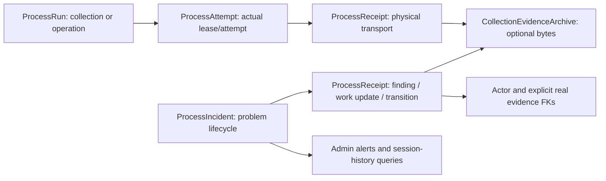
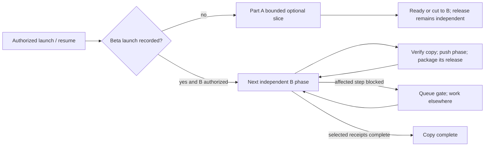

# Process table consolidation - Plan

## Plain-English Summary

**Ship the beta first:** product release, chart release, Pulse and Chatter. Predictions are not required. This refactor is optional before launch and must never become a prerequisite for those feature sessions.

Part A has one optional code slice: make the product-release branch's new detector table a reusable, typed post-processing queue without moving any existing queue into it. Allow 8–12 focused hours, inside a two-day/16-hour total pre-launch cap. Keep the two justified link tables. Record the continuity shared-storage contract now, but defer its populated-table changes. If the queue slice threatens launch, ship the release branch as-is and carry that slice to Part B. No other branch needs to wait or rebase.

The other proposed release-table mergers belong after beta: intake decisions need changes to populated dossier reviews, and discussion snapshots/counts need changes to populated ChartEngine measurement storage. Their source tables are new, but their destinations are not. Continuity's shared run/receipt implementation likewise touches populated storage. The pre-launch cut line therefore saves **zero tables immediately**; it prevents another per-feature queue pattern without forcing a risky consolidation into the beta.

Counts are projections, not a production census. Main has 221 application tables; the release branch contributes six already present on the 227-table staging copy. **After Part A: 227**, whether the queue cleanup lands or the fallback ships unchanged. **After all Part B phases: 190**, a net reduction of 37 from that release-inclusive baseline. Part B retains the previous 34-table reduction and adds three retirements: the intake-decision table and the two discussion-measurement tables. The shared queue still occupies one table; two many-to-many links remain. If the later measurement design cannot meet its typed invariants, retain those tables and report the higher count rather than forcing retirement.

Part B starts only after beta is recorded as launched. Each small phase has its own branch, copy rehearsal and independently reviewable release package. Feature work has first use of shared files/services; this run rebases or yields its own work. The existing five owner-wait reasons, recovery rules, resources, tmux/GPT-6-Astra xhigh runtime and 144-hour/30-million-token/72-continuation ceilings remain, with a smaller Part A cap inside that shared allowance. No full-program completion is required before a safe phase can be delivered under later release authority.

This session edits and publishes only this plan. No implementation, migration, database/R2 write, release/continuity-branch edit, deployment, main merge or production connection is authorized.

## Goal Capsule

- **Outcome:** launch the four beta features promptly, then reduce duplicate process storage without holding feature work hostage to a refactor.
- **Source revision:** main `76834dba`; release branch `feat/product-release-intake-20261027` at `78c46738`, rechecked November 2. Preserve their applied migration histories.
- **Authority:** plan only; commit and push only this document on `docs/process-table-plan-20261101`. Future implementation remains delivery_target: on-request.
- **Execution:** before beta, only the bounded Part A contract below; after beta, Part B's independent phase branches and existing production-copy rehearsal. Do not implement from this docs branch.
- **Endpoint:** Part A ends at `prelaunch_ready` or the authorized `prelaunch_cut_to_B`; neither waits for Part B. Part B produces `phase_copy_complete` receipts and release packages incrementally, then `copy_complete` when all selected post-beta phases pass. Production remains separate authority.
- **Launch priority:** an owner launch record or existing release receipt establishes beta completion; this task never connects to production merely to discover that fact. A later generic “run this plan” before beta selects Part A only. Start Part B only after the beta condition and implementation authority are both satisfied.

## Part A — Pre-launch slice

**KTD7 (session-settled: user-directed — chosen over completing the grand refactor before launch: beta speed takes priority).** Applies to all earlier KTDs and units. Only the six release-owned new tables and the still-unbuilt continuity proposals are considered here. Existing populated destinations, broad CI/policy rollout, shared process widening and cross-feature refactors are Part B. Reading existing Post/Actor identities or preserving an existing FK is allowed; altering their schema, reclassifying/copying their rows, changing their writer protocol or requiring another feature to rebase is not. Staging study rows in a new table still require preservation.

**Evidence:** the product-release session's November 1 recommendation is in its saved session `01a17137-3bd1-7f11-82b9-9cbccff9a110`, assistant entry `2026-11-01T04:50:58.206Z`. It recommends shared queue, reviews and measurements, and keeps both links. It explicitly says the review guards and numerical dimension/denominator design must change; these are not safe drop-in aliases. Code was re-read at `78c46738`. The owner's statement that these six have no production data is the scope assumption; no production query was made. Recheck release receipts at execution: if that assumption no longer holds, move the affected item to B without asking for production access.

Read-only staging snapshot **2026-11-02 06:56:57 JST**, `pushinweight_staging`, transaction_read_only=on: detector state **1**, intake decisions **4,342**, snapshots **3,911**, counts **47,412**, dossier-window links **5,580**, claim-job links **36**; existing review rows **52**, review-claim links **141**, MetricValue rows **2,057,227**. Table sizes including indexes are 64 KiB, 2.80 MiB, 2.70 MiB, 12.12 MiB, 1.84 MiB, 72 KiB, respectively; MetricValue is 771.26 MiB. These are preserved study data, not empty tables. Appendix G records callers and mappings.

| Item | Pre-launch decision / eventual change | Effort | Beta feature touched | Dev / prod score | Launch risk and cut line | Table delta in A |
| --- | --- | --- | --- | --- | --- | ---: |
| A1 / U16: product_release_detection_states | Optional: generalize this new table to PostProcessingWork keyed by `(Post, processing_kind)`; retain its generation/retry semantics and release-facing adapter. Move no existing PostEnrichmentState or TargetedExtractionState rows. | 8–12 focused h, at most 2 calendar days | Product release only; unchanged enqueue call contract used by its saved-Post paths | 3 / 2; one new model, models/queue module/applied graph | Medium; cut immediately for shared writer changes, schema ownership conflict, unavailable copy slot or release readiness overtaking the slice | 0: one table remains one |
| A2: event_dossier_intake_decisions | **Part B U17 now.** Merge into typed event_dossier_reviews; existing review guards/current-state consumers must change | 6–10 h after beta | Product release; Pulse/Chatter dossier readers | 4 / 4 | Already across the populated-table cut line; not a beta dependency | 0 |
| A3: discussion_window_snapshots + discussion_window_counts | **Part B U18/U19 now.** Use typed ChartEngine observations/values; preserve windows, populations, categories, denominators, coverage and calculation versions | 8–12 h additive/copy + 4–8 h reader/retirement | Product release + chart release; Pulse/Chatter numerical consumers | 5 / 5 | Already across the populated-table cut line; no ChartEngine prerequisite or rewrite before beta | 0 |
| A4: event_dossier_discussion_windows | **Keep.** True dossier↔measurement use with anchor claim, role and optional review; retarget only alongside U19 | 0–1 h boundary check; retarget included in U19 | Product release/Pulse | 2 / 2 before beta | No code change; never cut required many-to-many semantics to save a table | 0 |
| A5: event_dossier_claim_collection_jobs | **Keep.** True claim↔job many-to-many, unique pair for replay | 0–1 h boundary check | Product release acquisition | 2 / 2 before beta | No code change; no collector-contract rebase | 0 |
| A6: continuity incidents/alerts/gaps/session updates | Freeze KTD6's shared ProcessRun/Attempt/Receipt + one ProcessIncident design. **No pre-launch schema implementation**: U13–U15 widen populated tables. Do not create the three proposed operational_incident_* tables in the meantime | 1–2 h contract/handoff, no implementation | Operational visibility across beta; no product feature prerequisite | 1 / 1 for contract; implementation stays 5/5 and 3/3 in B | Low for contract. Cut all optional central-recording/UI implementation; existing continuity repairs and native logs continue independently | 0 |

**Hard cut line and fallback.** The whole optional Part A implementation gets **at most 16 focused hours / 48 elapsed hours / 2,000,000 tokens / 4 successful-incomplete continuations**, with U16 capped at 12 focused hours; the earliest limit wins. It also ends sooner if a named beta feature is ready to ship and would wait, the release owner identifies a blocking dependency, an edit escapes the six new-table surfaces, a test/copy resource would have to be reserved ahead of feature work, or the release would need a new deployment window. No minimum waiting period is implied. A missing fixed launch date is not permission to spend the entire allowance.

On any such condition, **cut U16**, preserve its source/receipts and publish any safe isolated draft, then ship the product-release candidate as-is under that feature's existing release authority. U17/U18/U19 and continuity U13–U15 are already below the line. Both link tables ship unchanged in either case. Record `prelaunch_cut_to_B` with exact branch/SHA and reason; do not ask for more pre-launch time or require the owner to approve this already-selected fallback. This planning/run contract itself does not deploy the release branch. No unfinished refactor commit is a requirement for beta.

**Branch isolation and resources.** Future U16 uses its own `refactor/release-queue-beta-slice-<date>` branch from the exact published release candidate, never rewrites that feature's branch/worktree, and offers a small optional commit range to its owner. No G1–G5, chart, Pulse or Chatter branch must merge this refactor, change its migration numbering or rebase for it. Do not merge unrelated dependencies into the release branch. U16 alone rebases to the release owner's next candidate; if that cannot fit the cap, cut it. Reuse the permanent local DB wrapper and the existing staging copy only in a free bounded slot. Before beta there is no broad service deployment by this task; the feature owner may include the optional verified patch in its existing release rehearsal. Busy infrastructure causes fallback, not a two-hour launch hold or new resource.

### U16. Optional shared post-processing queue from the new release table

Covers R4–R5, R9–R10 and R15–R17. Implements KTD7. Net 0. This definition applies in A when eligible, or as the first bounded Part B family after U1 if cut. Do not run it twice. It deliberately does **not** claim a five-worker-state consolidation or a table retirement.

Scope: only the ProductReleaseDetectionState definition, `core/product_release_detection_queue.py`, its feature-specific tests/reference/refresh-policy entries and a forward migration on the owning branch's applied graph. Keep `enqueue_saved_post`, `enqueue_posts` and `drain_posts` caller contracts unchanged; no edits to shared Post persistence or classification protocol. The new queue has a real Post FK plus checked processing kind, one unique row per pair, and the same requested/completed generation, attempts≤3, retry time and error semantics. Preserve the existing Post delete policy. Keep all release queries, raw SQL upserts and advisory-lock identity scoped to the release kind. A future kind requires its own reviewed handler and constraints; adding a discriminator alone is not evidence other queues have migrated.

Use a model/API name PostProcessingWork. Retain the physical `product_release_detection_states` name through beta to avoid a needless rename/cutover; document it as the physical shared queue. Declare the future `(post_id, processing_kind)` identity and add the checked release kind with a database default usable by old inserts. **Keep the existing Post primary key/one-to-one relation in A**: it supplies the temporary unique(post_id) needed by old ON CONFLICT(post_id) and pk=Post callers. No additional kind is activated in A. Before a later kind is implemented, replace the Post primary key with a stable independent key, retain the real Post FK and composite uniqueness, and switch all conflict targets/PK consumers; retain Post uniqueness until incompatible images drain. That later widening belongs to B or the later kind's scoped work, not to this beta slice. No external reverse-relation runtime reader appeared in the November 2 source census. Do not claim A proves a multi-worker cutover. The unchanged release candidate must continue to work against every A migration, so the fallback never requires reversing a shared schema. Keep the Post transaction's atomic enqueue, 250 ms lock/2 s statement limits, monotonic requested_at and completion compare-and-set. Do not attach it to a fabricated collection run. If the new model/API and discriminator cannot be made safe entirely inside the feature slice, fallback rather than widening the work.

Verification: preserve the one observed staging record's identity/generation exactly; source and release-kind target counts match on a fresh cohort. Re-enqueue during processing remains pending; retry/reset/max-attempt cases pass; empty due queue does no work; unknown-kind calls/inserts are rejected and release operations always include their kind; saved Post enqueue remains atomic and performs no provider call. Negative raw/bulk kind/identity tests and existing queue/replay tests pass. No schema/data/writer change to old queues, Posts, collection owners, dossiers, reviews or metrics. The inherited D0–D5 checks apply only to this bounded scope; D4 expects **zero** tables dropped. Publish the independent branch and SHA with `prelaunch_ready`, or the cut receipt. Never turn completing U16 into a beta readiness criterion.

## Part B — Post-beta background consolidation

All original U1–U15 are post-beta. Keep their relative least-disruption order and safety checks. Insert U17 after the dossier phase, and U18/U19 after the shared process extensions because a local calculation must not impersonate a collection run. U16 is first after U1 only if A did not finish it. Detailed order/counts/scores are in KTD3/KTD4.

Start only after beta launch is evidenced and this implementation run is authorized. Each unit produces a branch that can be reviewed/merged independently of later units; dependencies are only the named already-landed or exact published prerequisite changes. No all-refactor integration branch or final 190-table target gates feature work or earlier phase delivery. One short staging mutation at a time; checkpoint and release occupancy between batches/phases. Feature work takes priority. Rebase this run's branches, never require feature sessions to follow it. If a shared module/service is occupied, do unrelated preparation or hold that phase under the existing bounded recovery rules.

## Product Contract

### Requirements

- R1. Name shared defaults for execution runs, provider/model calls, spend allowance windows, execution claims/leases, and raw evidence/receipts. Extensions must preserve the record's meaning and constraints.
- R2. Add a linked policy to `AGENTS.md`, extend M19 in `.agents/skills/avoiding-recurring-mistakes/SKILL.md`, and extend the canonical shared schema-walkthrough reference. Build on its existing reader-first and write-path consolidation rules.
- R3. Continuous integration rejects new process-shaped tables without demonstrated shared-table reuse/extension or a specific owner-approved exception in the selected plan.
- R4. Consolidate one family per branch and rehearsal, using additive storage, historical copy, writer/reader cutover, independent parity and guarded physical retirement.
- R5. Preserve limits, reservations, ambiguous spend, token/credit units, request identity, lease fencing, taxonomy meaning, historical evidence, source clocks and review state.
- R6. Keep name, affiliation, citizenship and job-listing evidence typed by domain. Keep RG5 `BusinessVocabularyCode` subclasses separate.
- R7. Measure application table counts using a declared denominator; include necessary new relationship/detail tables and retained tables in the arithmetic.
- R8. Reuse identified databases, object storage and services. Do not create another full local test database, fresh production restore, scheduler or service by inference.
- R9. Characterize current caller behavior before replacement; every family includes application-level regression coverage and realistic failure/restart proof.
- R10. Harvesting and other live collectors/workers continue throughout a future release. Use online copying, stale-row detection and bounded final delta checks; never stop collection to obtain a stable cohort.
- R11. Run the selected part and its eligible units unattended on fuchitalee using GPT-6-Astra with xhigh reasoning, within the “Autonomous run” authority, recovery, checkpoint and ceiling contract. Batch owner decisions and continue independent work.
- R12. Verify every wave-2 candidate against real writers/readers and exact read-only copy counts; consolidate only compatible record meanings, record each rejected/deferred candidate, and preserve typed parent constraints for localized text. Count overlapping official-company retirements once.
- R13. Sequence both waves together by measured development overlap and production disruption; coordinate active G1–G5/other branches, migration identity and rebase/rehearsal dependencies without monopolizing shared resources.
- R14. After beta, implement continuity storage through shared ProcessRun/Attempt/Receipt, raw evidence and one shared ProcessIncident; build typed checker/admin/session adapters, preserve machine provenance and optional logging, and leave the continuity plan/branch and live activation untouched.

- R15. Beta ships product release, chart release, Pulse and Chatter; predictions and this refactor are not launch prerequisites.
- R16. Part A changes only new, pre-production table owners, stays branch-local and falls back to the unchanged release candidate whenever launch could slip; populated destinations belong in B.
- R17. Part B starts after beta and delivers independent phases on the existing copy, yielding resources and rebasing its own branches so feature work never waits for whole-program completion.

### Boundaries and decisions from evidence

The requested six budget tables are not six interchangeable spending windows. `PostSynthesisRateLimitBucket` is a hashed caller throttle with two-day cleanup, unrelated to paid usage settlement. Retain it as a documented exception; consolidate the other five. This is the evidence-based scope adjustment allowed by the request.

`OfficialCompanyAttempt` also records owner attestations with no provider request. Keep it as the official-company decision journal; move only actual provider-call facts. Its `decision` document is consumed operationally by requalification. Removing that document safely requires a separate typed decision/citation design and is deferred here, rather than moving business state into an archive. Its `budget_keys` list is retired in U2.

The event family is a domain-identity consolidation, not a process-table merger. Its detail records remain typed. Discovery runs are a separate family and therefore a separate branch, even though the request grouped them with events.

Continuity storage and its provider-free recorder/checker/admin/session adapters are in Part B U13–U15. Part A records their design contract only; the full U1 policy/CI rollout is also post-beta. The peer continuity plan/branch is read only; its cursor/debt behavior changes, new watchdog activation, notifications and live recovery dispatch remain separately authorized. No incident DB write or feature implementation occurs during this planning session.

## Planning Contract

### Evidence and denominator

Code and migrations were inspected without loading application settings or connecting to production. Read-only staging queries on **2026-11-01** verified `current_database() = pushinweight_staging` and `transaction_read_only = on`. Counts below are exact `count(*)` results from bounded read-only transactions; the two main inventory groups used repeatable-read, while supplemental shape/catalogue probes used read committed. Different inventory groups are separate snapshots and are not a global atomic census. Use new same-cohort counts for each rehearsal. Two initial broad count queries timed out read-only; the narrower inventory and index-oriented dependency inventory completed.

Staging is `dpg-d9vb8ds9v7es738lepsg-a`, with migration ledger through `0219_release_mapping_reconcile_index`. It has **243 public physical tables = 227 application + 16 Django/allauth tables**. The latter are the six `auth_*`, two `account_email*`, four `django_*`, and four `socialaccount_*` tables. Views, materialized views and aliases are excluded. `home_brand_time_counts` is not counted as a physical table; aliases such as `TrendNarrativeRun` do not add tables.

`core/models.py` at the source revision names 222 relations, of which 221 are physical application tables. The six additional staging tables are `discussion_window_counts`, `discussion_window_snapshots`, `event_dossier_claim_collection_jobs`, `event_dossier_discussion_windows`, `event_dossier_intake_decisions`, and `product_release_detection_states`. All six are included in the release-inclusive 227 baseline. U16 optionally generalizes the new queue with no count change; post-beta U17/U19 retire three of these six. Both links remain. The queue is not merged with existing populated worker states in A. Do not deploy this older checkout over that schema or infer compatibility from its migration ledger alone.

Local read-only cross-check: `test_pw_g3_timing_20261019`, `127.0.0.1:55436`, PostgreSQL 18.6, 243 physical public tables, migration ledger through `0213`; the inspected application tables were empty except two `data_sources` rows. It supplies no populated-family rehearsal evidence.

Historical RG6 evidence is in `docs/plans/2026-10-09-063417-feat-g3-round2-chart-engine-plan.md`, especially the October 27 staging parity/checkpoint entries, and RG7 decisions near its “Frozen RG7 storage decision” entry. The October 27 `serving-stage-0195-checkpoint-002.json` reference identifies **the staging copy**, not a separately verified local database. The current staging database is that reusable target, now advanced. Historical production-copy language elsewhere in the plan sometimes means copying rows inside production; it is not permission to connect there. RG6 pause/schedule practices are superseded by R10.

### KTD1. Canonical ownership map

This is the destination policy; Part B U1 records it and the eligible units implement bounded changes; Part A U16 is the explicitly bounded new-table exception. Existing model names remain compatibility interfaces until their assigned phase. Keep physical run/attempt/request names to avoid unnecessary relation-renaming locks.

| Record meaning | Canonical table/model | Reader and reason | Extension boundary |
| --- | --- | --- | --- |
| Actual execution | `collection_runs` / **ProcessRun**, generalized from CollectionRun in U13 | Status, recovery, coverage and operational execution history | Typed collection/operation family; collection requires real CollectionJob/ScopeRun. Operation requires actual invocation/Actor, never a fake job or run per note. Authored and rare-search domain runs remain named exceptions. |
| One provider operation, including inference | `provider_calls` / **ProviderCall**, renamed/generalized from original_content_calls in U4 | Spend, replay, batch importer and staff recovery | Preserve PKs; ProviderBatch owns grouped transport. Captured-request FK points only at a real transport ProcessReceipt. |
| Spend allowance window | `spend_budgets` / **SpendBudget**, U2 | Reservation, settlement and budget readers | Typed dimensions and units, separate from retained caller throttle. |
| Actual claim/lease attempt | `collection_attempts` / **ProcessAttempt**, generalized in U13 | Fenced resumption and claim accounting | One shared primitive with typed run owner. Preserve collection token projection. Existing provider/work-item lease exceptions remain; no unrelated queue redesign. |
| Pending processing of a Post generation | Existing new `product_release_detection_states` / **PostProcessingWork**, U16 | Release enqueue/drain and future explicitly implemented processing kinds | A adds the typed kind and shared API inside this new table only. A work item is not an execution/lease attempt; no old worker-state merger or additional active kind before beta. Preserve the old release image's Post-keyed identity until a later multi-kind migration. |
| Immutable raw bytes | `collection_evidence_archives` / **CollectionEvidenceArchive** | Capture/replay, comparison, dossier/incident diagnostics | Content hash/encoding/size; no mutable business state or fake body for a typed fact. |
| Attributed receipt | `collection_requests` / **ProcessReceipt**, generalized in U14 | Transport accounting and typed incident/session history | Disjoint physical/legacy transport, finding, work-update and transition shapes. CollectionRequest stays transport-only. Explicit FKs, no generic object IDs. |
| Operational problem/alert lifecycle | New `process_incidents` / **ProcessIncident**, U14 | Unresolved /admin alerts, acknowledgement and verified resolution | One shared owner across workloads, independent of any run. Children use ProcessReceipt; no feature-specific incident/evidence/work/session/alert tables. |

KTD6 defines the typed boundaries and migration proof. Generalization does not erase parent/child execution meaning or force domain judgments into process records. U1 lists existing exceptions by table and reason; new workflows cannot silently expand that list. ProviderBatch remains a resumable group with ProviderCall children. No new run/claim/receipt table is created.

### KTD2. New-table accounting and schema shape

Seven permanent tables are proposed across the entire program: `SpendBudget`, `SpendBudgetCharge`, `PostPromotionClassification`, `ProviderCallInput`, `ScheduledEventDetail`, `OpportunityDetail`, and `ProcessIncident`. `SpendBudget` replaces five tables; `SpendBudgetCharge` models a many-to-many reservation relationship previously hidden in JSON. `ProviderCallInput` models ordered Post inputs and per-input validation snapshots currently hidden in call JSON. The two detail tables represent event schedule/attendance facts and opportunity action/benefit facts, which cannot fit product-release details. U3 adds the typed Post-to-promotion-concept assignment hidden in existing JSON. ProcessIncident is the sole continuity addition; its finding/work/transition children extend the existing receipt table. U13/U15 add none. U5 and all wave-2 units add no permanent tables; U11 renames and extends the existing authored-text table. U4 renames one existing call table and retires two. Temporary copy markers are columns, not permanent mapping tables.

Use existing `ServiceProvider`, `InferenceModel`, `DefinitionVersion`, `WorkflowStage`, `Language`, `Locale`, `TimeZone` and measurement/currency references where the definition really matches. Preserve unresolved historical names explicitly rather than silently assigning a convenient current model. Uniqueness, scope and nullable shapes must reflect the original counting unit. No new JSON/JSONB column is proposed. Raw archived bytes remain versioned, validated immutable evidence, never a way to disguise live mutable relationships.

### KTD3. Part A / Part B count arithmetic and order

Use one **release-inclusive baseline** for launch planning: 221 main application tables + the release branch's six = **227**, also the observed staging count (16 framework tables excluded). This is a projection of the selected code scope, not an assertion about production. Other beta feature additions/retirements are an explicit delta carried through the ledger; never manufacture a production census or delete unrelated tables to reach 190.

| Boundary | Application tables | Explanation |
| --- | ---: | --- |
| Main source snapshot | 221 | November 2 fetched main 76834dba |
| Release-inclusive / measured copy | 227 | Six feature tables already present on staging |
| After Part A, queue slice accepted | **227** | Queue generalization 0; both links kept; no continuity table created yet |
| After Part A fallback, release as-is | **227** | Same six feature tables; U16 carried to B |
| After original U1–U15 scope within B | 193 | Seven additions, 41 retirements, net -34 |
| After all B including U17/U19 | **190** | Seven additions, 44 retirements, net -37; U16/U18 add no physical table |

Do not claim four release-table retirements: the new queue becomes the shared queue and remains one table. Only intake decisions and the two measurement tables disappear; their two links remain. Avoided incident-child proposals remain prevented growth, not counted retirements. If U17 cannot preserve review invariants, its -1 is withheld; if U18/U19 cannot preserve measurement semantics without an approved new owner, withhold -2 and revise the manifest before copying. The 193 original-scope endpoint is still available without these three additional retirements; none is a beta gate.

Stable U-IDs are preserved. U16 is defined in Part A and runs in B only if cut or no longer pre-production. U1–U15 retain their relative order; U17 follows U6, U18/U19 follow U13–U15 and U3. All B units start after beta. The conservative sequence below includes the U16 carryover row; omit it when its exact-SHA receipt is still valid.

| B order | Phase | Added | Retired | Net | Before → after | Cumulative reduction from 227 |
| ---: | --- | ---: | ---: | ---: | --- | ---: |
| 1 | U1 guardrails + continuity storage boundary | 0 | 0 | +0 | 227 → 227 | 0 |
| 2 | U16 new release queue, only if not completed in A | 0 | 0 | +0 | 227 → 227 | 0 |
| 3 | U7 job-source execution/state | 0 | 2 | -2 | 227 → 225 | 2 |
| 4 | U8 list-sync completion | 0 | 1 | -1 | 225 → 224 | 3 |
| 5 | U12 official-company scan/cohort bookkeeping | 0 | 1 | -1 | 224 → 223 | 4 |
| 6 | U11 localized text | 0 | 4 | -4 | 223 → 219 | 8 |
| 7 | U5 discovery runs | 0 | 2 | -2 | 219 → 217 | 10 |
| 8 | U6 event/opportunity dossiers | 2 | 3 | -1 | 217 → 216 | 11 |
| 9 | U17 intake decisions into reviews | 0 | 1 | -1 | 216 → 215 | 12 |
| 10 | U3 classification vocabularies | 1 | 19 | -18 | 215 → 197 | 30 |
| 11 | U2 spend budgets | 2 | 5 | -3 | 197 → 194 | 33 |
| 12 | U4 provider calls | 1 | 2 | -1 | 194 → 193 | 34 |
| 13 | U9 targeted-extraction call attempts | 0 | 1 | -1 | 193 → 192 | 35 |
| 14 | U10 rare-decision call attempts | 0 | 1 | -1 | 192 → 191 | 36 |
| 15 | U13 shared operational runs/claims | 0 | 0 | +0 | 191 → 191 | 36 |
| 16 | U14 shared receipts and incident owner | 1 | 0 | +1 | 191 → 192 | 35 |
| 17 | U15 continuity producers/readers | 0 | 0 | +0 | 192 → 192 | 35 |
| 18 | U18 typed discussion-measurement storage/copy | 0 | 0 | +0 | 192 → 192 | 35 |
| 19 | U19 measurement readers and source retirement | 0 | 2 | -2 | 192 → 190 | 37 |
| Total | | **7** | **44** | **-37** | **227 → 190** | **37** |

Part A never promises a count reduction. Part B is complete phase by phase; the final total is not a release dependency. Existing additive/coexistence accounting remains: +2 in U6/U2, +1 in U3/U4/U14; U18 mirrors calculated rows into extended existing tables while its two source tables remain, then U19 retires them. Views/proxies, temporary mapping columns and model renames are not physical tables. No new JSON column is selected.

### KTD4. Least-disruption ordering and current overlap

The owner will continue G1–G5 and all four beta features in parallel. Part A is optional and branch-local; this full matrix describes post-beta execution. The inventory below was read on **2026-11-01, approximately 17:05–17:20 JST**, after fetching `origin/main = 76834dba`. No peer branch, worktree, index or charter was edited. A registered worktree is not proof of an active runtime, and a stale ON entry is not permission to take a resource.

The file census compares each branch with its merge base, removes files already content-equivalent to main, and includes local dirty/untracked source files. “F/M” below is the number of directly overlapping implementation files / named model classes in the declared phase footprint. Model overlap compares class definitions, not merely the shared `core/models.py` filename. This is a conservative conflict signal, not a promise that uncommitted code will remain unchanged. Tests/docs are additional review surfaces. Recompute at every phase boundary.

| Parallel work observed | Concrete overlap and treatment |
| --- | --- |
| G1 `feat/g1-staff-identity-library`, `bf1f0fb2` | Six dirty paths; effective source changes in `core/staff_assets/manifest.py` and `project/settings.py`, no changed candidate model. Preserve staff identity/cast contracts in U4/U11; do not hold these phases merely because G1 is open. Recheck identity-correction and translation callers on the landing SHA. |
| G2 cast `feat/g2-round2-voices`, `818bcf3f` | 218 dirty paths, mostly evidence/docs/assets; seven effective source paths include staff downloads/media, editorial provider requests/providers, Chatter chain/rendering and the cast-cost ledger. No current migration/model change. U4 touches its provider-request contract; U11 preserves public editions, citations and pictures. Use adapters and exact contract tests; do not rebase or commit the cast worktree. |
| G3 `feat/g3-round2-chart-engine`, `7c426c3a` | HEAD is in main but 61 dirty paths remain, including eight source files: Pulse/chart readers, editorial service, URLs/settings. U6 and classification/localized readers need saved-output parity; no pending migration in this worktree. |
| G3 older `refactor/g3-collection-relational-json`, `64b95c26` | 93 dirty paths and 15 old draft migrations `0093–0107`; shared collection models/helpers overlap U5/U7/U8/U12 and provider/backfill code overlaps U4. The index explicitly holds its schema-dependent implementation pending the shared refactor. Treat it as preserved work requiring reconciliation, **not** as migration history to replay over current 0205/0219. |
| G2 Pulse `feat/g2-pulse`, `2daeb735` | Five dirty paths; old dossier model/functions and draft `0093/0094` differ from current main. U6 must reconcile the current dossier contract, not resurrect these historical definitions. |
| G4 `feat/g4-round2-sharing`, `b92618e3`; G5 `feat/g5-round2-readiness`, `f43b2904` | Each has five dirty paths, with no effective runtime/model/migration delta in this census. No blanket wait for either branch; refresh the census before reader/UI cutover. |
| Release intake `feat/product-release-intake-20261027`, PR #74, `78c46738` | 39 effective source paths, ten changed/new models, **14 migrations 0206–0219**, already represented in staging. Direct overlaps include collection instructions/state/capture, `CollectionScopeRun`, `core/targeted_extraction.py`, dossiers and `monitor/cycle.py`. Beta/product release proceeds independently; B waits for the beta launch boundary. After beta prefer its landed graph; if a later graph remains open, use the compatible published dependency route for this family only. ProductReleaseDetectionState remains owned by this branch. PR checks currently include failures/cancellations; no dependency-green claim is made. |
| `fix/live-operation-continuity-20261028`, `980bb5a4` | Only its plan is dirty; the committed branch delta contains the plan and incident review, with no runtime/migration implementation. The Oct 29 draft proposes three incident tables, admin/logging and cursor/checker work. KTD6 replaces their storage proposal within our plan. U13–U15 implement the shared contract on our branches. Current peer code is **not** a merge dependency; later cursor/checker changes need caller reconciliation, not three duplicate tables. |
| Open PR #76 `fix/backfill-size-test-fixes-20261030` and #72 `ops/oai-anthropic-size-20261027` | Both target `ops/xbackfiller-db-20261026`, not main. Provider batches, backfill collection/enrichment/recovery and cycle code overlap U4/U2/U5. Keep those runtime contracts in the regression net; do not merge these test/campaign branches into main or touch their database. |
| Open PR #77 `fix/account-profile-snapshot-dedup-20261030` | Effective source changes are already content-equivalent to main; one local plan is dirty. Preserve profile-affiliate semantics in U11, but do not invent a pending schema blocker. |

Scores are **1 low → 5 high**. Development score: 1 policy-only; 2 common-file/contract overlap without a changed candidate model; 3 shared helpers/graph with bounded caller changes; 4 several active shared models or runtime paths; 5 broad shared-owner changes with strict cross-kind constraints or unresolved incompatible ownership. Production score weighs configured live writers, copy volume, constraint/lock work and cutover scope: 1 no DB; 2 small isolated source with shared-target checks; 3 live but bounded/domain-specific; 4 broad/hot readers or substantial copying/validation; 5 spend/fencing correctness on active worker paths. Production observations were **not** collected: these are code/topology-based risk scores, not claims about current deployed activity.

Every schema phase shares the `core` migration graph: **zero new migration filenames have been allocated**, so there is no claimed literal filename collision yet. The concrete competing histories are release-intake's 14 deployed/unmerged files and G3/Pulse's 17 old preserved drafts. That coupling is included in the scores and handled by KTD5, not hidden inside F/M.

| Order | Phase | Physical tables retired (net saving) | Dev score; F/M | Prod risk | Effort estimate, focused agent hours | Dependencies / overlap handling |
| ---: | --- | --- | --- | ---: | --- | --- |
| 1 | U1 guardrails + continuity storage boundary | 0 (0) | 2; 1/0 | 1 | 2–3 | Preserve parallel AGENTS/M19 edits; establish KTD1/KTD6 ownership before migrations. Shared continuity storage/adapters follow in U13–U15. |
| 2 | U16 release queue, if cut from A | 0 (0) | 3; 2/1 | 3 after beta | 8–12 | U1 in B; same feature adapter, no pre-existing queue merger. Risk rises once live writers/data exist. |
| 3 | U7 job sources | 2 (-2) | 3; 3/4 | 2 | 3–5 | U1; shared collection dependency base; source adapter/runner isolated from X harvest. |
| 4 | U8 list completion | 1 (-1) | 3; 3/2 | 3 | 2–4 | U1; narrow list reconciliation adapter; preserve complete-empty and atomic deactivation semantics. |
| 5 | U12 official scans | 1 (-1) | 3; 3/4 | 3 | 6–10 | U1; typed collection targets/scopes and frozen cohort fixtures. No account decision/OAuth redesign. |
| 6 | U11 localized text | 4 (-4) | 2; 1/0 | 4 | 8–12 | U1; stable G1/G2 public/text interfaces. U4 is **not** required: preserve the producing-call FK and let U4 rename its target later. |
| 7 | U5 discovery | 2 (-2) | 4; 5/3 | 3 | 4–6 | U1; release-intake/collection helper reconciliation before shared caller edits. |
| 8 | U6 dossiers | 3 (-1) | 4; 3/2 | 3 | 6–10 | U1; release-intake current dossier/trigger contract, then U5's extraction counter change if already integrated. |
| 9 | U17 intake decisions | 1 (-1) | 4; 5/2 | 4 | 6–10 | U6; populated reviews, review/claim guards and Pulse/Chatter readers. Rebase this family to landed dossier changes. |
| 10 | U3 vocabularies | 19 (-18) | 3; 2/0 | 4 | 8–12 | U1; classification/role interface checks; no dependency on budgets. |
| 11 | U2 budgets | 5 (-3) | 3; 2/0 | 5 | 6–10 | U1; compare backfill callers against PR #76/#72 without taking campaign ownership. |
| 12 | U4 provider calls | 2 (-1) | 4; 5/0 | 4 | 8–12 | U2; G2 cast/provider and backfill contract reconciliation; operate on U11's renamed text relation. |
| 13 | U9 targeted attempts | 1 (-1) | 4; 2/0 | 3 | 3–5 | U4; release-intake targeted-extraction changes integrated/rebased before caller switch. |
| 14 | U10 rare-decision attempts | 1 (-1) | 2; 1/0 | 5 | 4–7 | U2 + U4; reserve/send/cancel/settle protocol remains atomic. RareTypeSearchRun stays. |
| 15 | U13 operational runs/claims | 0 (0) | 5; 17/5 | 5 | 8–12 | U1 + settled shared callers U5/U7/U12, compatible PR #74 graph; collection state/capture and broad benchmark/catalog/backfill readers need family filters. |
| 16 | U14 receipts/incident | 0 (+1 table) | 5; 7/2 | 5 | 8–12 | U13 + U4; prefer U9/U10 completed. Transport guards and incoming references must reject nontransport variants. |
| 17 | U15 continuity adapters/admin/session | 0 (0) | 3; 2/0 | 3 | 8–12 | U13/U14. Shared URLs/state adapter; reconcile separately landed cursor/checker work. Provider-free commands/custom admin; no watchdog activation. |
| 18 | U18 measurement storage/copy | 0 (0) | 5; 6/2 | 5 | 8–12 | U3 + U13–U15; additive typed local-calculation contract and copy only; old study readers remain. |
| 19 | U19 measurement reader switch/retirement | 2 (-2) | 5; 4/3 same family | 5 | 4–8 | U18 verified/landed or exact published dependency; change only affected readers and link target, then drop two old tables on copy. |

The order starts with small, isolated source families: job-source execution, then the narrow list checkpoint before the more involved official scan/cohort mapping. It takes localized text while its current conflict surface is small. It leaves the shared extraction/dossier code until the release-intake dependency can be reconciled, and defers broad classification updates and live spend accounting until smaller rehearsals have established the copy/recovery tooling. Provider calls must follow budgets even though their risk score is lower. The two newly admitted call-attempt families follow the shared call implementation. U17 follows U6 because it shares the dossier guards. U13/U14 remain late because they widen shared runtime; U15 connects their consumers. U18/U19 follow those shared types and U3, protecting chart/Pulse/Chatter serving with an additive phase before retirement. This balances developer disruption and production risk; sorting only by row count would put empty but security-critical state ahead of safer work.

The **direct overlap evidence behind F/M** is listed below. It is a minimum declared implementation footprint, not a count of every transitive reader or generated test. For example, G2 cast changes a provider adapter contract used by U4 without directly editing its persistence files; that risk raises the score even though it does not add a direct file intersection. All names are against the November 1 census; common `core/models.py` edits count once per phase, while model names count only changed classes.

| Unit | Overlapping implementation files | Overlapping model classes |
| --- | --- | --- |
| U1 | `AGENTS.md` | None in the declared footprint |
| U7 | `core/collection_instructions.py`, `core/collection_state.py`, `core/models.py` | `CollectionAttempt`, `CollectionJob`, `CollectionRun`, `CollectionScopeRun` |
| U8 | `core/collection_instructions.py`, `core/collection_state.py`, `core/models.py` | `CollectionJob`, `CollectionRun` |
| U12 | `core/collection_instructions.py`, `core/collection_state.py`, `core/models.py` | `CollectionJob`, `CollectionJobTarget`, `CollectionRun`, `CollectionScopeRun` |
| U11 | `core/models.py` | None in the declared footprint |
| U5 | `core/collection_instructions.py`, `core/collection_state.py`, `core/models.py`, `core/targeted_extraction.py`, `monitor/cycle.py` | `CollectionAttempt`, `CollectionRun`, `CollectionScopeRun` |
| U6 | `core/event_dossiers.py`, `core/models.py`, `core/targeted_extraction.py` | `EventDossier`, `EventDossierClaim` |
| U3 | `core/models.py`, `monitor/cycle.py` | None in the declared footprint |
| U2 | `core/models.py`, `monitor/backfill_collection.py` | None in the declared footprint |
| U4 | `core/models.py`, `core/provider_batches.py`, `monitor/backfill_enrichment.py`, `monitor/backfill_recovery.py`, `scripts/backfill_campaign.py` | None in the declared footprint |
| U9 | `core/models.py`, `core/targeted_extraction.py` | None in the declared footprint |
| U10 | `core/models.py` | None in the declared footprint |
| U13 | `core/models.py`, `core/collection_{capture,instructions,jobs,scheduling,state,storage_migration}.py`, `core/benchmark_metric_store.py`, `core/data_source_backfill.py`, `core/github_catalog.py`, `core/hf_catalog.py`, `core/model_{history_collection,inventory,native_history}.py`, `monitor/backfill_collection.py`, `monitor/backfill_enrichment.py`, `scripts/backfill_campaign.py` (17 paths) | `CollectionRun`, `CollectionAttempt`, `CollectionJob`, `CollectionScopeRun`, `CollectionObservation` |
| U14 | `core/models.py`, `core/collection_capture.py`, `core/collection_state.py`, `core/github_catalog.py`, `core/hf_catalog.py`, `core/model_inventory.py`, `monitor/backfill_collection.py` | `CollectionRequest`, `CollectionObservation` |
| U15 | `core/collection_state.py`, `monitor/urls.py`; shared instruction paths are additional policy overlap | No currently changed candidate model; new recorder/checker/admin integration is forecast work |

The November 2 release units use the same active-worktree comparison method. U16 intersects `core/models.py` and `core/product_release_detection_queue.py` (2 files / ProductReleaseDetectionState). U17 intersects models, event_dossiers, product_release_pipeline, product_release_report and product_release_study (5 files / EventDossier and EventDossierIntakeDecision). U18 intersects models, discussion_windows, benchmark_metric_store, collection_state, collection_reports and collection_resources (6 files / CollectionObservation and MetricValue). U19 intersects models, discussion_windows, product_release_report and product_release_study (4 files / DiscussionWindowSnapshot, DiscussionWindowCount and EventDossierDiscussionWindow). Migration-graph coupling is additional. These are current overlaps, not permission to make those feature branches wait; refresh them after beta.

**Size, copy-time and lock evidence:** exact source counts come from Appendix D and the wave-1 inventory. Relation sizes below include indexes/TOAST and are not raw transfer sizes.

| Phases | Observed copy workload | Live-writer / validation / release implication |
| --- | --- | --- |
| U7/U12/U8 | Source rows all zero on this copy; combined source relations under 0.1 MiB | Rehearse populated fixtures. Jobs cron, optional official discovery and harvest list reconciliation remain potential production writers; zero staging rows do not lower production risk to zero. Shared run/job indexes and FKs still need short-lock validation. |
| U11 | 142,496 text rows total; about 103.9 MiB across five source relations | Mostly immutable text, but translation/synthesis/publication writers remain active. Add nullable owner columns without a table rewrite, backfill in indexed batches and validate kind/owner uniqueness. Preserve five authored PKs plus public UUIDs and eight citation links. |
| U5/U6 | Discovery 0 rows / 80 KiB; event family 93 rows / 696 KiB | Low source volume, but U5 extends shared collection storage and U6 revises dossier integrity functions used by release intake. Rehearse those existing callers, not just the small copied cohort. |
| U3 | 19 small vocab tables, but **561,748** rows across the nine listed assignment/account-role relations, plus promotion memberships | Lookup size understates cost. Validate composite FKs/partial indexes against large assignment relations (about 246.6 MiB for those nine); phase this work with active classifier writes. |
| U2 | 1,599 budget rows / 584 KiB | Copy is small; concurrent reservation, rollover and settlement dominate risk. No independent old/new spending ledgers. |
| U4 | 3,610 shared calls + 23 already mirrored editorial calls; family about 30.5 MiB | Archiving bodies and rebuilding typed operational inputs dominate copying; leases/batch import and old images dominate cutover. |
| U9/U10 | 944 extraction attempts / 640 KiB; 1,888 decision attempts / 560 KiB | Targeted history includes 715 successes and 229 failures. All observed rare attempts are settled, so sent/reserved/retained/cancelled cases need fixtures. U10's small copy does not reduce financial race risk. |
| U13/U14/U15 | Runs 72.1 MiB; attempts 344 KiB; requests 34.6 MiB; inbound observations **1,636,296 rows / 3.51 GiB**, inputs 155,967 / 28.5 MiB, scope-request uses 213,982 / 36.0 MiB | Existing records stay in place; default-kind backfill and inbound constraint validation dominate cost. Add compatible columns/checks first, measure bounded validation, never rewrite the large observation history just to rename models. Collection/capture workers remain live. U15 creates bounded fixture incidents on the copy, not a scan-driven incident flood. |
| U16/U17/U18/U19 | November 2: 1 queue row; 4,342 intake rows; 3,911 snapshots / 47,412 category rows; 5,580 dossier-window links; destination 52 reviews and 2,057,227 values | U16 only changes its new table before beta. Review and measurement merges touch existing populated tables/guards and are B regardless of small source size. U18 preserves old study reads; U19 switches readers and retires sources separately. |
| Shared destinations | CollectionRun 4,112 / 72.1 MiB; CollectionScopeRun 226,343 / 276.4 MiB; CollectionJobTarget 18,574 / 7.6 MiB | Extending a shared target must not scan/rewrite it merely because the source is small. New checks/indexes need measured validation/lock plans and relevant restricted-role grants. |

No migration or copy was timed in this planning session. Before scheduling each copy, time a bounded 100-row candidate batch on the authorized copy, then a representative larger batch if safe; estimate total from committed rows/second plus index/validation/delta time and record a conservative range. An empty source has zero historical copy work, **not** a measured zero-duration phase. Effort ranges are planning estimates, not production duration promises.

U13/U14 footprints were measured against the same active-worktree census: 30 and 11 directly referenced/planned runtime paths. Their intersections are 17 files/5 classes and 7 files/2 classes. U15 has two current runtime intersections plus forecast custom-admin/template/locale/instruction work. Continuity itself has no runtime implementation today; if it starts independently, remeasure U11/U3 view conflicts and U5/U13 state/cycle contracts. Do not count its unbuilt proposals as an external +3.

All DB phases require a coordinated **rolling cutover interval**, not downtime: old/new images overlap through compatibility storage, and physical retirement waits for actual old-writer drain. No phase requires or permits a harvest stop. If measured locks make online validation unsafe, defer that step under the existing owner-gate rules and redesign it; do not request a routine maintenance outage.

### KTD5. Migration numbering and parallel-branch coordination

1. **Before implementation and again before each phase's migration is finalized**, fetch main; inspect registered worktrees, open PR bases, the authoritative G1–G5 index/charter and the applied copy ledger. Record the phase's bounded file/model ownership and migration intent in the existing coordination mechanism during execution, preserving peer entries. This plan-only session edits neither index nor charter. A closed or content-equivalent branch is not a prerequisite.
2. **Resolve the release-intake base first for any staging mutation.** Prefer main after PR #74 lands. Otherwise a later implementation run may incorporate the exact published, schema-compatible dependency commit into its own dependent family candidate for copy-only work, without changing PR #74 or its worktree. Verify every already-applied 0206–0219 file hash and required compatibility tests. Current failing PR checks must be diagnosed: unaffected baseline failures remain recorded; any relevant unresolved migration/caller failure holds the dependent phase. Do not deploy a 0205-only candidate over 0219, cherry-pick a model without its migration graph, or claim this route authorizes main/production delivery.
3. **Do not reserve a numerical range for the program.** Generate only the next family's migrations against the reconciled graph. Use the next available prefix with a descriptive phase suffix; migration identity is the full app/name and dependency graph, not just the four digits. Keep one task-owned family mutation at a time. Refresh the reservation/ownership note before publishing, and recheck main immediately before applying.
4. **If another branch lands first and this phase's migrations have never been applied anywhere**, rebase only the task family branch, regenerate/rename its unapplied migration files and dependencies, resolve model conflicts, and rerun affected graph/schema/rehearsal checks. Log the changed schema digest and invalidate only evidence it changes. Never rewrite a peer branch or use force push as the default; use a new task candidate branch if preserving a published branch requires it.
5. **Once applied to any shared copy, migration names and contents are immutable.** Retain both branch histories. Where operations commute, create a forward merge migration after inspecting actual schema and state; where they conflict, write a source-preserving forward reconciliation migration. Verify both supported history paths. Never rename an applied migration, use `--fake`, edit its checksum away, or reverse a peer's deployed work to reclaim a number.
6. Use the existing local-test exclusive lock and staging ownership to serialize **application**, not all G1–G5 development. Run graph conflict/leaf checks and `makemigrations --check --dry-run` in the explicitly safe DB context before each copy. A new independent main commit is a rebase/checkpoint event, not an automatic owner question or full-program retest.
7. High-overlap source work may proceed in isolated commits while its dependency is unresolved. Before rehearsal/cutover, rebase/integrate the final dependency SHA and compare the affected functions/models again. Record the exact delta and rerun relevant tests. If semantics are incompatible and cannot be resolved within this plan, queue that specific decision and work elsewhere; do not park the whole run waiting for every G1–G5 session to finish.

### KTD6. Integrate continuity storage into the shared process family

**Scope decision (session-settled: user-directed — chosen over a separate continuity schema review: continuity storage must be implemented by this grand refactor).** Covers R14. U13–U15 extend existing execution and receipt owners, add one shared incident owner, and build continuity recording/read adapters on them. This replaces the prior three-table proposal in our design; the peer plan and branch remain untouched. Their live cursor/debt recovery changes and watchdog activation remain separate delivery work, with this shared storage as their dependency.

**Selected design:** generalize CollectionRun → **ProcessRun**, CollectionAttempt → **ProcessAttempt**, and CollectionRequest → **ProcessReceipt**, retaining their physical tables `collection_runs`, `collection_attempts`, `collection_requests`. Add **ProcessIncident / `process_incidents`** only. Keep CollectionEvidenceArchive for raw immutable bytes and Actor for actual performers. The continuity contribution is **+1 added / 0 retired, net +1**, avoiding two proposed child tables. Within original U1–U15 this is **+7 / -41, net -34**. KTD3 adds the post-beta release-history mergers for the full **227 → 190** projection. All U13–U15 implementation is post-beta under KTD7; Part A only records this contract. Absent proposals are never counted as retired tables.

**Evidence and authority.** Read the actual dirty plan under the authoritative repository root, in `.worktrees/fix/live-operation-continuity-20261028/docs/plans/2026-10-28-002739-fix-live-operation-continuity-20261028-plan.md`, not just the older committed version. Its branch HEAD is `980bb5a42d4a1e97bdf59fd249d73ecbe478dd03`; reviewed plan SHA-256 is `ba9a9b31b960ed9a1952f2a68c0ed5ab80e2600961c2e8b13031592a8cdc179a`. Its committed diff from merge-base `b0d53904` contains two documents and no runtime or migration changes; its later Oct 29 amendment is uncommitted. No model, migration, recorder, continuity checker or watchdog declaration was found for the proposed incident feature in main or that branch. `origin/main` remains `76834dba` after refetch. This review edits neither the continuity plan nor its branch.

The saved session `01a181de-025e-7b50-acd9-37a29525fe6c` on fuchitalee corroborates the amendments: October 28 requests for persistent `/admin` alerts and cross-run/session work history; October 29 **14:29 JST** requests for prominent five-tool instructions and an explicit storage-machine column; **14:47 JST** correction that logging must never hold up a session, goal or other process. Its **14:56 JST** completion records that correction. The authoritative plan's R56–R61, KTD21–24 and U44/U45 contain it. Earlier mandatory-check-in wording is superseded. The transcript is the existing file cited in “Lessons from RG4–RG7”; no production log inspection was used.

Read-only staging inspection at **2026-11-01 17:39:11 JST**, database `pushinweight_staging`, transaction read-only `on`, found all three proposed relations **absent**, not empty. Physical table count remains **243 = 227 application + 16 framework**. The first count batch failed because Django's admin-log relation is absent; a corrected read-only transaction checked presence before counting existing relations. No writes occurred. Main's `/admin` is the custom `monitor.urls → views.product_review` route, not evidence of a Django admin-log implementation.

A further read-only snapshot at **2026-11-01 17:57:58 JST** confirmed 4,112 runs, 218 attempts, 28,854 requests, 213,982 scope-request uses and 155,967 observation inputs. The follow-up bounded query counted **1,636,296 observations**. Catalog inspection confirms all four names (`process_incidents` and the three `operational_incident_*` proposals) are absent. These are separate read-only snapshots, not a frozen launch cohort. The staging FK inventory also found **CollectionRun.continuation_of**, from newer release-intake history; U13 must constrain it as well as the source-checkout FKs.

| Proposed meaning | Destination in this refactor | Writer / reader and preserved semantics |
| --- | --- | --- |
| Incident episode (`operational_incidents` proposal) | **One new shared ProcessIncident**; no separate operational_incidents table | Proposed detector/operator recorder writes; custom `/admin` severity/history and recovery verification read. One problem may exist with no run and span many runs; acknowledgement and resolution are independent of execution success. |
| Finding (`operational_incident_evidence` proposal) | **ProcessReceipt, kind `incident_finding`**, optional archive FK | Recorder/checker writes typed rule, observation clock, affected bounds and real evidence references; incident detail and resolution read. Archive only actual diagnostic bytes. No fake attempt/scope/run for an absent execution. |
| Session contribution (`operational_incident_work_entries` proposal) | **ProcessReceipt, kind `work_update`**, Actor FK | Best-effort command/adapter appends action/outcome, actual session storage location and optional real run/incident context; admin/history/continuation reads. No session registry or JSON session array. |
| Acknowledge/resolve/accept-loss history | **ProcessReceipt, kind `incident_transition`**, plus ProcessIncident state | Authorized recorder atomically appends transition and updates episode state. Acknowledgement cannot clear debt. Recovery requires coverage evidence; accepted loss requires recorded owner authority. |
| Detector/investigation/recovery execution | **ProcessRun, family `operation`**, actual typed operation kind | Real invoked work may record execution clocks/status/Actor. Read-only health calculation and optional logging do not require successful run persistence. No run is fabricated per note or missing-window finding. |
| Actual exclusion claim / lease | **ProcessAttempt** on the real ProcessRun | Shared fenced-claim primitive, when work genuinely needs exclusion. A human note or unleased read-only check does not manufacture an attempt. |
| Alerts, errors, gap reports | **Queries on ProcessIncident and typed ProcessReceipt findings**, using existing coverage facts | `/admin` lists unresolved episodes; checker reads terminal scope/request/window facts. Healthy empty search and transient error recovered normally are not new incidents. No Alert, ErrorEvent, DetectorRun, GapDetectionState or outbox table. |
| Immutable request/response and diagnostic bodies | **CollectionEvidenceArchive** with ProcessReceipt provenance | Existing capture helper validates bytes/hash/encoding; replay/incident readers retrieve only authorized bodies. Ordinary missing-window findings need no archive row or R2 access. |

Existing tables retained/reused, with real callers and read-only counts:

| Record/table | Status/count and actual writers/readers | Decision |
| --- | --- | --- |
| `actors` | **2 rows / 40 KiB.** W: `core/collection_corrections.py:62`, `core/collection_timing_import.py:167–173` resolve actual performers. R: correction history/reporting; proposed incident authorship. | **Reuse.** Human/agent/system identity already has checked kinds and unique kind/key. A watchdog's actual system Actor is setup work; restricted recorder may read it, not create performers on the fly. A session ID or storage host is not another Actor. |
| `harvest_backlog_windows` | **0 rows / 48 KiB.** W: manager normalization/claim in `core/models.py:3873,4082`, `monitor/backlog.py:92,132,151`. R: `monitor/cycle.py:4685` replay, `monitor/trend_narrative_facts.py:2201`, backfill status. | **Keep and reuse as bounded pending recall debt.** It already has claim/retry/quarantine/waiver semantics and deletes completed claims. Do not replace it with an incident table or block its deletion with a protected evidence FK. Preserve typed completed bounds on existing collection execution before deletion. Zero copy rows require fixtures, not an empty-production assertion. |
| `call_state` | **0 rows** in the earlier wave-2 census; code W/R in Appendix D. Continuity U38 proposes changing cursor acknowledgement logic, not a new table. | **Keep**, as already decided for wave 2. Its composite live cursor and atomic debt transfer are not incident state. U38/U39 may extend behavior; no parallel recovery ledger and no merger scheduled in this program. |
| `collection_runs`, `collection_scope_runs`, `collection_requests`, `collection_scope_cursor_receipts` | Earlier counts **4,112 / 226,343 / 28,854** for the first three; current cursor receipts **39,543 / 11.6 MiB**. W/R: `core/collection_state.py`, `core/x_cycle_lineage.py`, `core/collection_capture.py`, `core/collection_cursors.py:6,41`, collection reports and scope readers. | **Extend run/request owners in U13/U14; retain typed scopes and cursor receipts.** Parent/child and transport cardinality stays intact. Retain existing scope query bounds, stop/outcome states and replay identity; a checker may read these without creating new run records. Existing receipts prove actual work, not an incident that prevented it from starting. |
| `collection_evidence_archives` | Earlier census **1,360,306 rows**. W: capture/storage-copy helpers; R: replay, comparison and dossier evidence (Appendix B). | **Reuse raw-document storage** for selected diagnostic artifacts, with content hash, encoding, capture version and provenance link. An ordinary typed missing-window finding requires no blob. Do not store full private transcripts, secrets or credential-bearing URLs. No R2 archive copy is needed. |
| `collection_metric_gaps` | **0 rows / 40 KiB.** W: `core/collection_resources.py:383–521` projects a selected missing counter. R: the same projection replaces existing gap rows; no separate direct runtime reporting reader was found in the searched core/monitor paths. The model requires real observation/source-metric ownership. | **Keep; do not merge with operational gaps.** Missing numeric value versus real zero is different from an unsearched time interval or absent run. Reusing it for incidents would invent observations/metrics. |
| `collection_corrections` | **1,159,834 rows / 471.1 MiB.** W: `core/collection_corrections.py:97,145`, timing import near 234–248. R: `core/collection_reports.py:89` and historical attribution/timing readers. | **Keep; not a general session/work log.** Requires a real observation and typed before/after attribution/timing changes. A failed investigation or code review has neither; merging would weaken existing correction constraints and scan a large unrelated history. |
| Agent transcripts / task `run.jsonl` | Existing host files, **not database tables**. Native tools/supervisor write them; authorized session recovery/owner reads them. | **Keep file ownership; summarize into ProcessReceipt work-update rows only when practical.** No transcript mirror, central session registry or extra process-log table. One local process-table run log remains the progress view; the optional incident contribution is not a second authority for phase completion. |
| `django_session`; `django_admin_log` | Framework session table **27 rows / 104 KiB**; admin-log relation **absent**. Django session backend/auth middleware own browser sessions. | **Keep browser-session storage outside application count; do not reuse for agent history.** Login expiry is not session-work retention. Do not install Django admin logging to implement the custom `/admin` incident list. |

**Why one new table is necessary.** An incident is an independently acknowledged problem, possibly caused by a run that never started; it can encompass multiple failed and successful executions. Putting it in ProcessRun would invent execution, while EventDossier represents public domain events rather than operational problems. Raw archives have byte identity, not incident lifecycle. One shared incident owner preserves these constraints. Findings, transitions and work entries are immutable attributed receipts, so typed variants of the existing receipt owner provide a real common write/read boundary. They retain different required fields; this is not a generic object-id log. Do not save the final table by weakening incident identity, nor add separate child tables to preserve feature-specific naming.

**High-level storage design — directional contract.**



The lifecycle is `open → acknowledged → resolved`, with acknowledgement distinct from coverage recovery; recurring problems create a new episode after resolution. Resolution outcomes distinguish `recovered` from owner-authorized `accepted_loss`. The write protocol is validate typed record → apply idempotent append and any matching incident transition atomically → return bounded result. Optional capture runs outside the parent business transaction; its failure cannot undo the underlying work.

**U13: typed runs and claims without collection impersonation.** Add an immutable `execution_family` discriminant, defaulting existing rows to `collection`. Collection requires the existing job/source/dataset contract. Operation requires a bounded `operation_kind`, Actor, actual execution identity and clocks; job/dataset and collection counters are inapplicable and have checked NULL/neutral shapes. The existing ingestion/idempotency key can retain its physical column and digest convention, but its API must describe an actual invocation rather than inventing ingestion. Preserve UUIDs, collection status/counters and lease tokens. An operation may use an actual ProcessAttempt; sessions and notes do not become fake runs.

Factor the existing fenced lease primitive in `core/collection_state.py` with a collection adapter. Do not implement a second claim engine. Preserve ordinal uniqueness, stale-token rejection and atomic run/attempt token projections. Existing `CollectionRun`/`CollectionAttempt` compatibility APIs must select only collection-family records; a plain class alias with an unrestricted manager is insufficient. Audit related managers, aggregate readers and direct SQL in addition to imports. No source/purpose property may dereference a NULL job for an operation.

Database guards must keep CollectionJob's active/last/success pointers and last-attempt pointer, CollectionScopeRun.run/result_run, CollectionObservation.run and physical request attempts collection-only, with existing job/scope agreement. `continuation_of` must preserve family and the relevant job/operation identity; a receipt's optional recording execution must agree with its attempt. Add forward migrations for active job-instruction, dataset, request-membership and RG5 reference guards; keep their collection branch strict. Do not edit historical applied migrations or disable the parent guards globally. Include newly landed inbound relationships from PR #74 in the launch manifest.

**Rolling compatibility sequence:** first deploy additive schema and collection-only compatibility readers to every relevant image while creation of operation runs/nontransport receipts is disabled. Prove all active readers, writers and one-off jobs use that bridge. Only then enable bounded new-kind writers and validate mixed-kind behavior. Old collection images must never encounter an unfiltered operation row. Keep a tested rollback to the bridge; rollback to an earlier unrestricted image is invalid after new variants exist. This is a rolling transition, not a collection pause. Retain physical names in Django migration state explicitly; a model rename must not generate an unintended physical RenameTable.

**U14: typed shared receipts and one incident owner.** Extend `receipt_kind` with `incident_finding`, `work_update`, `incident_transition`; keep existing `physical` / `legacy_receipt` values. Physical/legacy rows retain required attempt/scope/ordinal and the current response-body, selection/accounting and finalization rules. Their operational fields are NULL. Operational rows require typed recorded-at, Actor where attributable, action/finding/transition facts and bounded prose; transport attempt/scope/ordinal, HTTP and byte-accounting fields are NULL or checked neutral values. Require a finding/transition to name an incident; a work update names an incident or an actual process run. An unrelated session stays in its native log. Use explicit constraints per kind, with bulk/raw negative tests; no GenericForeignKey, generic object ID or operational JSON.

Use optional protected `process_run` / `process_attempt` for the recorder's actual execution, distinct from **affected evidence** FKs: job, run, scope_run, target, physical request, and a real ProviderCall when relevant. A missing-window finding has typed workload/rule/window facts with no run. Within each finding, validate any supplied references agree; findings for one incident may legitimately span different jobs. Never point durable history at a deletable backlog claim. Preserve observed clock versus affected-window clocks, uncertainty and exact stop/error facts. Receipt IDs are idempotent; kind is immutable. Operational entries append only; corrections reference the original same-kind/same-incident entry and do not overwrite authorship. Existing transport rows still finalize through their existing guarded lifecycle.

Keep raw-body identity in CollectionEvidenceArchive. Several receipts may reference the same archive without collapsing their different incident/actor/time contexts. A diagnostic locator stores an explicit storage host; private transcripts, credential-bearing URLs and secrets are excluded. Evidence and work are queried by their typed variants, not inferred from prose or JSON blobs.

ProcessIncident has typed rule key/version, workload/component, severity, first/last observed times, affected bounds where known, and acknowledgement/resolution Actor+time pairs. Reuse a real DefinitionVersion only when its domain matches; otherwise use explicit scalar rule revision/hash, not a false catalogue identity or new rule table. Open-episode uniqueness covers normalized rule/workload and an explicit scope variant: workload-wide, the current scheduled-call identity fields (`brand_id`, `call_id`, `call_kind`, `bucket`, `query_id`), or a real CollectionJobTarget FK. Enforce mutually exclusive shapes and NULL-safe uniqueness. A resolved episode releases the open key; repeated findings extend the current open episode idempotently. Acknowledgement/resolve transitions append a receipt and mutate state in one transaction with a concurrency fence. A resolution receipt must belong to the same incident. An actual fix can finish even if the optional tracker remains pending.

All incoming legacy request references must reject nontransport rows: CollectionObservation.request, CollectionScopeRequestUse.request, CollectionObservationInput.input_request, CollectionMetricGap.evidence_request, and U4's optional captured-request FK. The old CollectionRequest API is a transport-only compatibility proxy/manager; ProcessReceipt is the canonical all-kind API. Update `collection_request_membership`, `collection_request_archive_guard`, `collection_observation_request_membership`, `collection_input_membership` and affected RG5/dataset guards in forward migrations. Check actual catalog definitions at launch; tests must exercise bulk/raw insertion and changing kind/owner, not merely Model.clean(). Preserve the existing 28,854 physical/legacy records and their archive/accounting hashes exactly.

**Storage-machine columns and optional capture.** Work updates carry explicit `session_storage_kind`, `session_storage_host`, `session_tool`, `session_ref`, `session_locator`; separately `handoff_storage_host`/`handoff_locator`, `evidence_storage_host`/`evidence_locator`, and execution-host only if actually known. Local storage requires a host+locator; provider-managed/unavailable storage has an honest checked shape. Execution host, repository host and desktop are not substitutes. Derive session lists from host/tool/reference tuples; the same path on two hosts is not one session. No machine registry, five-tool prerequisite or forced discovery. Native transcripts and this run's local progress file remain authoritative for their own work.

The synchronous optional adapter receives **one attempt, two seconds total, no in-band retry or flush wait**, outside the parent business transaction. Missing tracker, credentials, host metadata or tool integration must not block sessions, goals, collection or release. Actual missing coverage remains unhealthy even if recording fails. Atomic transition persistence may leave the incident unresolved; it must not roll back a successful underlying repair or pretend the transition was saved.

**Least privilege.** Reusing transport storage must not give an optional logger arbitrary access to collection receipts. Prefer a narrow typed recorder database function with fixed safe search_path, qualified names, nonlogin owner and EXECUTE-only caller privileges; no dynamic SQL or caller-selected function names. Validate Actor authority and allowed receipt kinds inside it. Prove a restricted recorder cannot update transport/run/backlog/Actor records, create a run by implication, resolve without evidence/authority, or read private archive bodies. Normal findings require no archive-body writes. A separately authorized sanitized diagnostic path may use the existing archive helper. No blanket INSERT/UPDATE grant on shared tables, no new credential assumed present and no broad row-security redesign.

**Peer-plan dependency contract (record here; do not edit that branch).** Its C44/C45 should consume U13/U14's shared models and U15's recorder/admin/session adapters; delete its planned CreateModel operations for operational_incidents/evidence/work_entries before publication. It should use actual ProcessRun/Attempt for real work, ProcessReceipt findings/updates for records, and ProcessIncident for the alert source. Its C38/C39 cursor/debt repair still uses retained CallState/HarvestBacklogWindow and may land independently; C40 checker behavior consumes the shared contract, while C41 watchdog activation remains separately authorized. No new scheduler, notification destination or live recovery dispatch is required for our copy endpoint. Do not delay a ready continuity repair merely to preserve our preferred order; rebase our callers and reconcile tests. If another branch has actually installed duplicate incident tables by launch, inventory counts/callers and revise a source-preserving mapping first; do not apply today's absent-table arithmetic blindly.

Part A records the intended ownership without a launch gate; Part B U1 installs the full policy/CI rule. **U13 → U14 → U15** implement it late in Part B because they touch hot shared helpers and typed inbound references after their narrower consumers have settled. Their KTD4 scores, resource rows, implementation units and D0–D5 criteria are part of this run, not external review slots. Ordinary phase completion never waits for optional central logging.

## Resources

The following resource identities are specific, existing resources. This table is a future execution dependency list, not authorization to use write credentials now.

| Resource | Exact identity and access | Needed by |
| --- | --- | --- |
| Repository | Authoritative root on fuchitalee: `/Users/fuchitalee/development/pushin-weight-v2`; this plan worktree under `.worktrees/docs/process-table-plan-20261101` | All phases. Leave the main checkout's unrelated changes alone. |
| Populated rehearsal copy | Render `pushinweight-staging-db`, ID `dpg-d9vb8ds9v7es738lepsg-a`, database/role `pushinweight_staging`, port 5432. Target identity in `config/staging_refresh.yaml`. Current read-only counts above; earlier RG6 checkpoint dated Oct 27. | Part B U2–U19 and optional A/U16, one bounded owner/family at a time. U1 policy tests need no database. |
| Local test database | Existing `test_pw_g3_timing_20261019`, fuchitalee `127.0.0.1:55436`; state `/Users/fuchitalee/.local/share/pushinweight/test-db/`; private connection metadata `connection.json`; lock `use.lock` | U2–U19 regression tests through `~/.local/bin/pushinweight-test-db`. Read `/Users/fuchitalee/infra/docs/reference/pushinweight-shared-test-database.md`. Never restore or clone another database. |
| Eventual production target | Render `pushinweight-db-shadow`, ID `dpg-d9koekqjobas73fvjqng-a`, database `pushinweight_shadow`; service-managed `DATABASE_URL` | Later authorized production delivery only. This session did not connect. Do not use the retired database ID from older memory. |
| R2 evidence storage | **None required for this consolidation.** `CollectionEvidenceArchive.body` is PostgreSQL byte storage | U4/U5/U6/U7/U9/U10/U12/U14 archive copy and verification need database access, not R2 credentials. |
| Existing media buckets | `pushinweight-media-staging` and `pushinweight-media-production`; prefixes `staff/`, `editorial/` | Only existing media rendering smoke checks in later authorized U4/U11 cutovers. No media copy, deletion, new bucket or new prefix required. |
| Staging execution services | `pushinweight-staging-jobs` (`crn-dain9moae00c73f7d73g`), `pushinweight-staging-web`, `pushinweight-staging-headlines`, `pushinweight-staging-synthesis`, `pushinweight-staging-enrichment`, `pushinweight-staging-harvest` | Use a bounded task-owned execution on the existing staging service for copy/parity; do not replace or reinterpret the existing jobs schedule. Web and affected worker images provide cutover proof. U2 touches synthesis/enrichment/harvest/headlines; U3 touches all classification/role readers and writers; U4 touches headlines/enrichment plus on-demand staff/official paths; U5/U6 touch harvest/enrichment/web/headlines and jobs. U13/U14 reach all collection/capture consumers, including bounded benchmark/catalog imports; U15 touches web and offline checker/recorder commands. |
| Existing broker | `pushinweight-staging-headlines-broker`; production counterpart `pushinweight-headlines-broker`; existing queue URLs in service environment | Only worker smoke/recovery proof. No broker flush, new broker, beat or scheduler. |
| Production services | `pushinweight-web`, `pushinweight-jobs`, `pushinweight-headlines`, `pushinweight-synthesis`, `pushinweight-enrichment`, `pushinweight-harvest`, `pushinweight-home-counts`; existing broker above | Later release image/dependency census, following `render.yaml`. Do not reactivate legacy worker/beat. Actual services and deployed revisions must be rechecked then. |
| Background agent runtime | fuchitalee's existing `/Users/fuchitalee/.local/bin/codex`, tmux, Python 3 and `caffeinate`; GPT-6-Astra/xhigh; existing private Codex login under `/Users/fuchitalee/.codex/`; existing Git remote authentication | The explicitly selected Part A or post-beta Part B units after a later launch. No new API key, copied auth file, hosted agent service or environment-file edit. Task-private supervisor/receipts are specified below and do not exist yet. |

**Environment and credentials by phase:** U1 uses no environment file or provider key. U2–U19 local tests use the wrapper-supplied connection, not a copied repository `.env`. Runtime code currently loads repository `.env`; never source it for an audit or assume it targets local PostgreSQL. Candidate processes must receive an explicit validated target URL. Staging copies/parity use the existing staging jobs service's Render-managed `DATABASE_URL`; its role must have the required schema privileges before a future migration. The Render CLI's existing fuchitalee login was sufficient for this session's read-only staging query; no credential value was printed or copied.

**Per-phase execution resources (same database, no new service):** all schema units use the exact staging database and permanent local test database above; every row below inherits their explicit target checks, wrapper lock and Render/Git credentials. These are required execution surfaces, not permission to deploy during this planning session.

| Unit | Existing staging services / offline entry points whose candidate must be verified | Env files, credentials and object storage |
| --- | --- | --- |
| U1 | Existing GitHub repository CI; fuchitalee shared skill checkout | Git authentication and existing CI read-only approval identity; no DB/R2/provider credentials or env file. |
| U7 | `pushinweight-staging-jobs`; offline `sync_job_sources` with fixture adapter | Render-managed staging `DATABASE_URL`, local wrapper connection; no job-site network or provider key required, no R2. Production counterpart `pushinweight-jobs` remains an active scheduled collector, not a migration-only host. |
| U8 | `pushinweight-staging-harvest`; list reconciliation fixture entry point | Same DB credentials; stored list snapshots/test replies, no X API key or list action; no R2. |
| U12 | `pushinweight-staging-web` plus bounded official discovery/requalification command execution on existing staging jobs service | Same DB credentials; frozen cohort/account fixtures, no owner OAuth credential read/refresh or provider key; no R2. |
| U11 | `pushinweight-staging-web`, `pushinweight-staging-synthesis`, `pushinweight-staging-enrichment`, `pushinweight-staging-headlines`; offline person/profile import and identity-correction fixtures | Same DB credentials; no translation/model calls. Existing `pushinweight-media-staging` read path only for authored picture smoke checks; use existing service R2 mapping only if that check needs private media. No production bucket access or R2 write. |
| U5 | `pushinweight-staging-harvest`, `pushinweight-staging-enrichment`; offline discovery command fixtures | Same DB credentials; no TwitterAPI/provider request, no R2. |
| U6 | `pushinweight-staging-web`, `pushinweight-staging-harvest`, `pushinweight-staging-enrichment`, `pushinweight-staging-headlines`; dossier/intelligence fixture readers | Same DB credentials and existing broker for worker replay; archive is PostgreSQL bytes, no R2 credential required. |
| U3 | `pushinweight-staging-web`, `pushinweight-staging-enrichment`, `pushinweight-staging-harvest`, `pushinweight-staging-headlines`; offline seed/import/role paths | Same DB credentials; existing catalogues/fixtures, no provider call/R2. |
| U2 | `pushinweight-staging-synthesis`, `pushinweight-staging-enrichment`, `pushinweight-staging-harvest`, `pushinweight-staging-headlines`; official/staff budget fixtures | Same DB credentials; controlled concurrent reservations with fake transports, no paid request or R2. |
| U4 | `pushinweight-staging-headlines`, `pushinweight-staging-enrichment`, `pushinweight-staging-web`; stored staff/official/backfill replay | Same DB/broker credentials; archive stays in PostgreSQL. Existing staging media read path only as above; no provider/OAuth action. |
| U9 | `pushinweight-staging-enrichment`, `pushinweight-staging-harvest`; targeted-extraction fixtures | Same DB credentials; dependency candidate includes release-intake caller changes; no provider/R2 credentials. |
| U10 | `pushinweight-staging-harvest`, `pushinweight-staging-enrichment`; rare decision/status/recovery fixtures | Same DB credentials; no paid rare-search/model request, no R2. |
| U13 | All existing staging collection consumers above: jobs, harvest, enrichment, headlines, web; bounded benchmark/HF/GitHub import fixtures | Same staging DATABASE_URL/local wrapper and Git/Render auth; stored inputs only. No catalogue fetch/provider key, R2 or new worker. |
| U14 | Same collection/capture consumers; web incident queries and restricted-recorder permission fixtures | Same DB credentials. Stage narrow function/role grants under authorized migrations; use existing service identity only if suitably restricted. No dedicated recorder secret is assumed present. Offline SET ROLE/privilege tests use the existing DB owner; production watchdog credential issuance is later activation work. Archive stays in PostgreSQL. |
| U15 | pushinweight-staging-web; provider-free checker/recorder commands on existing staging jobs execution surface; native session adapters on fuchitalee | Same explicit staging DB/local wrapper. Native transcripts and run log stay local. No cron/Blueprint change, notification destination, central tracker credential or R2. Optional tool integration is non-gating. |
| U16 / A1 | Existing release queue adapter/commands; local wrapper and the same staging copy in a free bounded slot. Product-release owner retains service rehearsal/release control before beta | No new env file. Explicit staging DATABASE_URL or wrapper connection only; no provider/OAuth/R2 credentials. No task-driven staging fleet deployment in A. |
| U17 | Existing staging-web/headlines and offline release review/report fixtures | Same DB/broker/Render/Git credentials; no model/provider call, R2 or new service. After beta only. |
| U18 | Existing staging jobs execution surface; ChartEngine collection/report fixture entry points | Same DB credentials and local wrapper; preserve existing schema/serving roles and verify grants. No new DB/full restore/provider batch; stored calculations only. After beta only. |
| U19 | Existing staging-web/headlines; product release report/study and affected numerical consumers | Same DB/broker credentials. Verify actual chart/Pulse/Chatter readers using stored results; no collection or model send. No new R2 or service. After beta only. |

KTD6/U1 uses the existing continuity worktree/session file read only. U13–U15 use the named shared databases and existing service images, with no new DB, bucket or hosted service. Least-privilege recorder functions/grants are future implementation objects, not discovered credentials. A dedicated remote watchdog and its restricted login/notification configuration are separately authorized activation resources; their absence does not prevent command, permission and admin rehearsal on this run's existing staging surfaces.

No unit needs a copied repository `.env`, an edited `/Users/fuchitalee/.env.secrets`, a new credential, or the separate xbackfiller database. The local wrapper alone supplies its connection metadata; existing Render service environment supplies staging runtime credentials. Verify nonempty presence and target identity without printing values. Reuse the named resources; if one is occupied, run other work and use the bounded wait policy instead of proposing a duplicate.

No application-provider credentials are required for migration, stored-data parity or fixture tests in any phase. Disable provider sends in task-owned rehearsal processes and replace their network adapters with deterministic test replies; do not pause existing live workers to achieve that isolation. Do not use `TWITTERAPI_IO_SCHEDULED_API_KEY` for probes. An owner-selected live probe would be a separate extension using `TWITTERAPI_IO_ON_DEMAND_API_KEY`, and must load the X routing skill; it is unnecessary here. Likewise no application MiniMax, DeepInfra, OpenAI or Anthropic spend is required. The background agent uses its separately bounded existing Codex access. U4 staff/official replay must not trigger X list membership or owner OAuth actions.

If media smoke checks need existing files, Render already maps `R2_ACCOUNT_ID`, `R2_ACCESS_KEY_ID`, `R2_SECRET_ACCESS_KEY`; the operator store is `/Users/fuchitalee/.env.secrets`, using `R2_STAGING_ACCESS_KEY_ID` / `R2_STAGING_SECRET_ACCESS_KEY` or the corresponding `R2_PRODUCTION_*` variables. Do not copy production keys into staging. No secret file needs editing for this plan. `STAGING_REFRESH_SOURCE_DATABASE_URL` and `STAGING_DATA_REFRESH_ENABLED` belong only to staging jobs; **do not invoke staging refresh** as an automatic prerequisite because it connects to production and replaces data. Reuse the present copy.

**Resource gates:** identify the staging owner and current deployed SHA before rehearsal. It is ahead of this branch, so use a reconciled then-current candidate containing those migrations, not a fake ledger update or reversal. If occupied, schedule independent work under “Autonomous run”; do not create a substitute database. The staging refresh policy excludes some operational rows: zero official-company/staff rows do not establish production emptiness. Characterized fixtures permit copy-only retirement/rehearsal of empty families, with historical coverage explicitly unproved. Production retirement requires a later approved census and representative-shape verification. No new resource is proposed.

## Autonomous run

This section governs R11. **Nothing is launched by writing or approving this document.** A later explicit instruction to run this plan activates the following non-production contract, subject to any narrower instruction in that launch. Preserve that instruction and this plan's hash in the first run event. Do not repeatedly request authority already granted. The selected model is **GPT-6-Astra, xhigh**, as requested; unavailable model access is an access gate, not permission to substitute another model.

### Endpoint, branches and work scheduling

The selected part determines the endpoint. **Part A** ends at prelaunch_ready or the owner-preapproved prelaunch_cut_to_B; the supervisor exits rather than keeping a launch-dependent session alive waiting for beta. **Part B** may start only after beta launch is evidenced and implementation is authorized. Each bounded phase ends at phase_copy_complete with D0–D5, a pushed branch and its own ready-for-release package; continue to other independent eligible work. Final copy_complete means all selected B receipts pass, not that earlier phases must wait to ship. Production_complete remains a separate, explicitly authorized state. No production connection is needed to establish the non-production endpoint.



Global safety/ceiling stops interrupt this loop. An early agent exit returns to checkpoint reconciliation; it does not select either terminal state by itself.

For Part A use U16's isolated release-based branch only. For Part B create each named family branch in a new worktree from current origin/main after beta, leaving this docs worktree and dirty peers alone. Carry this selected plan with its phase scope and reannotate branch identity. Depend only on the named prerequisite phase: prefer it already landed; if still pending, make a clearly labeled exact-commit dependent candidate that can be rebased independently. A scratch integration branch is optional for cross-phase verification and is never the sole delivery branch or a gate for feature work. Do not merge every completed family into one mandatory long-lived stack. Each phase's release package is available immediately; main/production mutation still needs separately granted authority. Preserve commit ranges, migration hashes and remote SHAs. Resolve ordinary conflicts on our branches.

**Post-beta order:** U1 → U16 only if carried from A → U7 → U8 → U12 → U11 → U5 → U6 → U17 → U3 → U2 → U4 → U9 → U10 → U13 → U14 → U15 → U18 → U19. This preserves all original U1–U15 relative ordering. U17 depends on U6's dossier guards; U18 depends on U3's vocabulary identities and U13's actual operation-run type, and follows U14/U15 for settled shared readers; U19 depends only on the verified U18 contract plus its existing dossier link. Original budget/call and release-intake dependencies remain as specified in their units. U16 completed in A is reused only at a still-valid SHA; never repeat its mutation. Log reordering, exact dependencies and counts. Phase deferral changes its verdict, not beta eligibility. Rebase only this run's candidates when feature branches move.

Only one bounded family step mutates the shared staging copy at a time; release occupancy at each safe checkpoint and give feature work first use. Never reserve the copy for the whole program; local schema preparation/tests separately require the existing wrapper's exclusive lock. While either resource is occupied, continue code, fixtures, static policy checks, documentation and review on other family branches. A branch waiting for its predecessor can be prepared against that predecessor's candidate, but cannot declare rehearsal complete until the prerequisite is verified. Never let two candidates race the same migration ledger.

At bootstrap, follow KTD5 to reconcile the staging ledger's newer migrations with the fetched source. Use an already integrated, compatible base when available; inspect the owning branch/docs for missing history. Do not steal another task's work, fake migration application, reverse the shared schema, or deploy the November 1 older image over it. Prefer the dependency after it lands, or incorporate its exact published compatible commit into the affected family candidate under KTD5 without moving the owning branch. Routine ancestry/number collisions are decide-and-continue. Only an essential unresolved ownership/access issue is an owner gate under reason 1 after diagnosis; independent work continues.

### Pre-approved actions after the explicit launch

A later launch approves only the selected part within its limits. Before beta, Part A's narrower branch/table/resource rules override the following Part B capabilities; no B implementation starts early. After beta, no repetitive per-phase permission is required for:

- Create isolated worktrees and the task/family branches; edit implementation, migrations, regression tests and reference docs; commit, push non-forcibly to those branches, and prepare independent phase release packages. An optional task integration branch is for verification only. Fetch upstream and resolve task conflicts. Do not merge or push to `main`, move another task's branch, or discard unrelated edits.
- Make U1's scoped edits to the canonical shared schema-walkthrough skill, preserving unrelated changes and recording its owning repository/path and diff/hash. Publish that edit only to an owned task branch where such a repository exists; otherwise retain a reviewable patch and applied-file hash. An unrelated dirty skill repository is not permission to sweep its changes into a commit.
- Run local checks/tests using the permanent shared test database wrapper. Explicitly prepare its schema while holding the exclusive lock; never let pytest silently migrate, create another full database, or restore a production dump.
- Apply the selected post-beta phase's additive, copy, cutover and guarded retirement migrations to `pushinweight-staging-db` (`dpg-d9vb8ds9v7es738lepsg-a`, database `pushinweight_staging`), run bounded rehearsal jobs and test replay, and perform source-preserving corrections within the same scope.
- In Part B, deploy exact phase commits to the **existing staging services** for rehearsal after occupancy and compatibility checks. Treat this future launch as selection of staging rehearsal with `staging_transport: commit`; record that selection in the implementation plan then. Do not move the shared staging branch, apply Blueprints, change schedules/plans/autosync settings, enable paid collectors, or deploy to production. Service-specific existing credential/feature settings remain authoritative.
- Retry and repair within the recovery table below; reduce batches, fix query plans, run scoped `ANALYZE` on changed staging tables when measurements justify it, adapt tests, reorder independent phases and reuse still-valid verification. Preserve immutable source receipts and every failed attempt.
- Start one task-owned tmux supervisor on fuchitalee, use process-scoped `caffeinate -i`, persist checkpoints and resume the exact Codex session. This is a task process, not a new hosted service, scheduler or Ollija daemon.

The seven permanent additions in KTD2 and all populated-table extensions are Part B designs. A pre-beta launch selects only U16’s zero-table-addition slice and the Part A contract; it does not approve those later mutations. A post-beta instruction to execute Part B selects its scoped designs, including U17–U19 without extra permanent tables. That launch does not adopt the peer plan wholesale or authorize watchdog activation. Record it as owner design authority. U1’s protected check authenticates that instruction and compares the implemented declaration with its semantic scope; an agent-generated digest alone is not approval. New process owners, JSON columns, retention changes or scope expansion enter the owner queue.

No production connection (even read-only), production migration/write/deploy, production restore, R2 write, new resource/purchase, paid application-provider call, live collection pause, broad process kill or change to another task's resources is pre-approved. Existing Codex authentication is for the requested agent run only; it does not grant application-provider spend. A later explicit production instruction changes the applicable authority once, and survives restarts; do not request it again for already-covered operations.

### The only reasons to stop and wait for the owner

These are the exhaustive **owner-wait** reasons. A gate blocks only affected steps. The entire run waits only when no independent authorized work remains, or when a global ceiling/safety stop applies.

1. **Required authority or access is missing.** Examples: production access/write/deploy/main integration; an unplanned process table or JSON exception; essential credentials or an unavailable requested model; shared-resource ownership that cannot be resolved from records. Queue the exact missing scope, not a vague “confirm next step.”
2. **Preservation cannot be established.** An unexplained count/value/hash/relationship mismatch after a committed copy, possible data loss, an unaccounted writer, or a step that would interrupt live collection. Freeze retirement and destructive work on that resource; preserve source rows and evidence. Diagnose read-only and continue independent work. An explainable, safely repaired copy discrepancy can clear its technical hold after independent parity; it does not manufacture owner approval.
3. **The bounded recovery runbook is exhausted.** A failed rehearsal, migration, environment or required test still cannot be corrected safely after the applicable attempts below. Include the cause, attempted repairs and remaining options.
4. **A stated ceiling is reached.** Do not raise time, token, retry, wait or spend ceilings yourself. Checkpoint, report remaining work, and request only the required extension.
5. **The owner or controlling platform orders a stop or revokes access.** Honor the scope immediately. Preserve a checkpoint where permitted.

Part A's launch-risk cut is an already-authorized scope outcome, **not a sixth owner-wait reason**. Record the cut and exit successfully with its carried items; do not request an extension or spin until beta. Lack of beta-launch evidence keeps B unstarted and does not create a new mandatory production probe. The five reasons above govern real authority/preservation/recovery/ceiling issues; harmless inability to finish optional A in time invokes its fallback.

Everything else is **decide and continue**: routine implementation choices, discovered dependency order, empty copy tables, unrelated pre-existing health failures, missing optional dashboards/trackers, ordinary test defects, recoverable migration failures, a successful commit, a green phase, or the model reaching the end of a conversational turn. Never ask “continue?” after a phase. Safe technical recovery can remove a technical hold; only an actual owner instruction can resolve an authority gate.

### One progress log, checkpoints and the owner queue

Use one append-only file on fuchitalee:

`/Users/fuchitalee/development/pushin-weight-v2/.local/process-table-runs/<run-id>/run.jsonl`

This is a task-specific private artifact under the owning host, not an edit to the main checkout's tracked files. Every record has `part` (A/B), `beta_launch_reference` when applicable, `selected_endpoint`, `seq`, `time_jst` (ISO 8601 with `+09:00`), `run_id`, `phase`, `step`, `status`, `decision` and `rationale`. Add applicable `branch`, `sha`, `plan_hash`, database identity, selected order/dependency SHAs, applied migration-name/content hashes, rebase decisions and affected-test receipts, cohort bounds, source/target/mapped/missing/extra counts, value/hash mismatch counts, last **committed** copy cursor, command/exit code, receipt paths/hashes, runtime/session/job IDs, retry number, elapsed time and cumulative usage. Never log secrets or raw personal/provider bodies.

Use one serialized append writer with file locking and fsync at checkpoints. The supervisor appends a heartbeat every 60 seconds containing the active phase/step, child PID, last durable-progress time and usage; heartbeat alone is not progress. Append at step start/end, each committed copy batch, every decision/retry/gate and phase completion. Detailed stdout, CI reports and Codex event streams are evidence files referenced by this log, not competing status logs. A derived checkpoint cache may accelerate loading, but records its last log sequence/hash and cannot overrule the log plus actual Git/database/job state.

The same file holds an owner queue: `gate_open` events identify a stable gate ID, one of the five reasons, blocked units, evidence, choices, recommendation and exact requested authority/extension. Accumulate all outstanding decisions in one generated queue view; do not create separate per-phase approval threads. Continue other work while waiting. At a natural reporting boundary or when no independent work remains, present the whole queue once. Publish each safe phase package as it completes; do not withhold it until the final phase. Queue only actual owner gates, not routine launch-risk fallback or a speculative request to halt feature work. No Slack/email message or external tracker write is implied. A response is recorded with its exact owner-authored reference and scope; `gate_resolved` cites that response, or a demonstrable technical recovery for non-authority gates. Never infer approval from elapsed time.

The local progress view and optional central incident contributions are different. If `run.jsonl` cannot append, retain the event in an existing task receipt/output when readily possible and reconcile the log later; logger availability is not a new stop reason. The supervisor can recover from actual migration ledger/job state and last committed copy receipts. Before advancing or retiring data, verify that committed state and preservation can actually be reconstructed; only loss of that evidence triggers reason 2, not failure to write a status note. Never roll back or fail a successful parent operation merely because a log write failed. Optional incident capture follows KTD6/R61: at most one two-second attempt outside the business transaction, no retry/flush/startup gate. An unavailable tracker, host field or tool integration does not delay a session, goal or authorized phase completion.

### Per-phase checklist and machine-checkable completion

Implement the following small run verifier during the later bootstrap, with fixtures for corrupted/missing receipts, stale SHAs, wrong database and false success. It must return nonzero for missing evidence; a narrative “done,” CLI exit zero or table total alone cannot pass. This is task tooling, not a new application table or service. Store commands and expected results before each phase's first mutation, so the agent cannot redefine success after a failure. Missing/corrupt preservation or test receipts fail verification; an unavailable progress-log append or optional incident recorder does not, when the required receipts can be independently recovered and verified.

For each eligible schema unit U2–U14/U16–U19 and the U15 consumer integration, require all of these receipts:

- **D0 — target and baseline:** exact approved database identity, candidate/base SHA, applied-migration graph, source relation/column/dependency inventory, same-cohort source counts and field-mapping manifest recorded. Current writers/readers in Appendix A/B/D are re-traced at that SHA; every touched table has a verdict and coverage state.
- **D1 — regression net:** characterization and family tests have exit code 0, zero failures/errors and zero required skips; schema drift check and required lint/policy checks pass. Record test names, relevant source/fixture hashes and test database identity. Reuse successful unaffected tests rather than re-running everything after a documentation edit.
- **D2 — copy parity:** terminal copy receipt exists; mapped source identities equal the frozen cohort, with zero unexplained missing/extra mappings, value/hash mismatches, duplicates or orphans. Exact grouped accounting and scheme/state checks pass. Concurrent edits below the cursor and late inserts have final-delta receipts. Target row totals can differ from source sums only under the explicit deduplication/grouping mapping.
- **D3 — caller cutover:** the writer/reader manifest has no unresolved entry; retained compatibility entry points have tests. Relevant staging images/jobs identify the verified candidate; no active old image/job can touch retired storage. Stored-data/fixture probes prove reader and writer behavior without paid calls. Retained migration history may mention old tables; an empty grep is not the criterion.
- **D4 — physical retirement on copy:** the planned old relations/columns are absent from PostgreSQL catalogs, retained relations remain, expected table delta matches, new constraints are validated, orphan/dependency checks are zero, and post-drop smoke/regression checks pass. A tested pre-drop rollback and post-drop forward-repair scenario have receipts; no fictitious reverse-migration data recovery.
- **D5 — publication:** task-only branch is clean, commit/push succeeded, remote SHA equals checked SHA, required CI is green at that SHA, reference/schema/refresh-policy docs match, and the phase verdict includes rehearsal coverage and remaining production gates. All required preservation/test evidence has verifiable receipts. Link them from `run.jsonl` when available; if logging fails, provide their existing locators in the phase result and reconcile the progress view later. A failed status/incident append alone cannot fail D5 or hold publication.

| Phase | Additional assertions required for `phase_copy_complete` (or A ready/cut) | Expected application-table delta |
| --- | --- | ---: |
| U1 | D0 source scope, D1 policy fixtures and D5 publication; all three rule locations updated, canonical shared map and exceptions match; forged/missing/stale approvals and raw-SQL/lease-column evasions fail, legitimate shared extensions/renames pass. External skill patch/hash recorded; KTD6 shared run/claim/receipt variants, sole ProcessIncident addition and duplicate incident/alert/session/detector policy fixtures pass; U13–U15 are required units, not skipped peer implementation. No database mutation required. | 0 |
| U7 | D0–D5; JobSourceSyncRun and JobSourceState absent; typed source job/run/attempt mappings, snapshot-complete flag, two totals and five mutation counts and original CLI run IDs reconcile; stale tokens fail renew/release; complete/partial/no-close/empty snapshots preserve listing/evidence behavior. Zero source rows are marked synthetic-only historical coverage. | -2 |
| U8 | D0–D5; TwitterListSyncState absent; one correctly typed source/list job checkpoint per original identity; complete-empty snapshots remain rate limited; partial snapshots cannot deactivate members; marker and member changes roll back together. No fabricated historical run or physical request. | -1 |
| U12 | D0–D5; OfficialCompanyScan absent and initial_scan FK targets only correct shared kind; all three cursor shapes and frozen-member ordering/hash/outcomes reconcile; queued/excluded status is typed; sealed cohort membership unchanged by retry; no operational cohort JSON remains in cursor/archive reads; decision, credential and list-intent tables retained. | -1 |
| U11 | D0–D5; four old text relations absent, authored relation renamed, all 142,496 frozen-cohort texts map one-to-one if unchanged; five authored PKs/public UUIDs and eight citation links preserved; no orphan/wrong-kind parent, selection, citation or picture; bulk/raw wrong-owner/half-shape inserts fail; all legacy cache uniqueness/language/retention semantics pass; authored JSON excluded from other kinds. | -4 |
| U5 | D0–D5; both discovery run tables absent; old identities/counters/status/timestamps map to distinct kinds in existing CollectionRun; scope/attempt lease fencing and restart fixtures pass; no new run table. Record `synthetic_only` coverage for absent history, not “production empty.” | -2 |
| U6 | D0–D5; Event/EventEvidence/Opportunity absent, two detail tables present; source identities/evidence hashes, 29/29/35 frozen-cohort mappings and pending states preserved where unchanged; no fabricated reviews; opportunity links and source-only/dated/conflicting-state fixtures pass; current trigger/FK validation permits new kinds and rejects invalid ones. | -1 |
| U3 | D0–D5; 19 old vocab tables absent, generalized three retained; promotion assignment table present and old membership JSON absent; all assignments/labels/keys map exactly; raw/bulk wrong-scheme and half-NULL inserts fail. Frozen 11/75/242 catalogue totals apply only if the cohort is unchanged. | -18 |
| U2 | D0–D5; five old spend tables absent; SpendBudget/Charge present; rate-limit bucket retained; `budget_keys` absent; per-scope/unit reserved/accounted/confirmed balances exactly match; day+cycle charge edges preserved and settlement replay changes balances zero times. Opening balances explicitly distinguish aggregate-only history. | -3 |
| U4 | D0–D5; EditorialCall and StaffProviderRequest absent, original shared call renamed, ProviderCallInput present; all 23 observed mirrored editorial calls reuse identity, adding no duplicate charge; typed operational inputs/provenance and immutable body hashes match; enumerated raw call JSON columns absent; official decision journal/decision JSON intentionally retained. Attestations create zero paid calls. | -1 |
| U9 | D0–D5; TargetedExtractionAttempt absent; all 944 frozen-cohort source identities map to shared calls with typed state owner and exact application/transport outcomes; parent content-cache behavior unchanged; failures/timeouts are not relabeled successful delivery; replay duplicates zero calls. | -1 |
| U10 | D0–D5; RareTypeDecisionAttempt absent; all 1,888 frozen-cohort calls map with decision/cycle/fence uniqueness and exact balances; reserve/send/cancel/unknown/late-settle fixtures pass; cancellation refunds only provably unsent work, replay settles once; decisions, cycles, search runs/hits remain. | -1 |
| U13 | D0–D5; physical run/attempt names and source identities/counts/counters preserved; old rows all collection-family. Operation without job works; collection without job fails. Job/scope/observation/continuation pointers reject wrong family under raw/bulk writes. Collection aggregates unchanged with operation fixtures present; stale-token/restart/null-job-reader tests pass. No new run/lease table. | 0 |
| U14 | D0–D5; ProcessIncident present, all three operational_incident_* proposals absent; physical request identity/archive/accounting preserved. Observation/input/use/gap/provider-call references reject operational receipts; nontransport variants reject HTTP ownership fields. Open-episode dedup, idempotent append, same-incident transition/correction, wrong Actor/role and no-run/cross-run findings pass. Restricted recorder cannot mutate collection owners. No child incident/session/evidence table or JSON added. | +1 |
| U15 | D0–D5 adapted to no historical copy/drop: baseline counts unchanged except tagged fixture rows, shared stores/readers verified, no new relation. Empty successful search healthy; missing windows/inspection failure unhealthy; logger timeout changes neither. Concurrent append once, same path on two hosts distinct, native logs retained. Actual custom /admin auth/locales/readers pass; unavailable tracker cannot block parent success. No new scheduler or live recovery call. | 0 |
| U16 | Part A ready/cut or B D0–D5. One table remains one; no old queue/Post/collection/dossier/metric schema or writer change. Release generation/retry/atomic enqueue and raw-SQL compatibility pass; unknown kind rejected. A failure to fit the cut line records carryover, not a beta blocker. | 0 |
| U17 | D0–D5. Intake source absent; every source UUID/hash/actor/outcome/claim/recorded clock mapped; existing assessment history/current pointers and typed detail constraints unchanged. Wrong-kind supersession/current pointers fail; report precedence/conflict behavior explicit. | -1 |
| U18 | Additive D0–D5 as scoped in unit. Source snapshots/counts and link target remain; each category maps once; totals use the existing volume value plus explicit account/empty-zero values (52,318 physical values for the unchanged cohort). Existing collection data/serving unaffected; typed calculation kind, integer denominators, coordinate uniqueness and genuine run provenance proved. | 0 |
| U19 | Full D0–D5. Two old measurement tables absent, both link tables retained; same-cohort values, coordinates, cutoffs, fingerprints and links match; old UUID lookup works, wrong-kind link fails, actual report readers pass after drop. | -2 |

For empty families, characterize legal old shapes in deterministic fixtures and rehearse them on the shared local test DB; retain genuine copy counts of zero. This can establish `phase_copy_complete` with limited historical coverage, but sets `production_eligible: false` until a later approved production census/representative mapping clears that gap. Do not block the entire copy run seeking forbidden production evidence, and do not claim that fixtures prove historical production compatibility.

Use KTD3's single release-inclusive ledger: A ends at **227** with or without fallback. For B (including the optional carried U16 row), endpoints are **227, 227, 225, 224, 223, 219, 217, 216, 215, 197, 194, 193, 192, 191, 191, 192, 192, 192, 190**. Carry unrelated beta changes as an explicit baseline delta. Count additions and retirements separately. U16/U18 have no physical retirement; U17 retires one and U19 two. Record each phase_copy_complete immediately; full copy_complete requires all selected B receipts, while A has its separate ready/cut terminal result. Deferred units remain visible with withheld savings, not false completions. Never keep beta waiting for a lower table count.

### Retry and recovery

Retry limits are ceilings per incident, not quotas. In Part A, a repair/wait that threatens launch invokes the immediate cut instead of consuming the longer B retry/wait allowance. Each retry cites a changed fact or a transient-error diagnosis. Preserve failed receipts; do not reset the counter by opening another session.

| Failure | Decide-and-continue recovery | Escalation boundary |
| --- | --- | --- |
| Test/product failure | Reproduce the smallest failing case, inspect cause, fix behavior and run affected checks; at most three cause-directed repair cycles for the same unresolved failure. Do not weaken assertions or turn required tests into skips. Pre-existing unrelated failures are recorded with baseline evidence and excluded only when the required behavior remains proved. | Third unsuccessful repair → reason 3 for that phase. |
| Flaky CI/network | Inspect the failing job; permit two reruns of the failed job at the same SHA only for evidenced infrastructure/flakiness. Deterministic failures go through code repair. Reuse passed jobs and retry exact candidate rather than making empty commits. | Persistent required failure → reason 3; proceed with independent phases. |
| Migration/copy failure | Read actual ledger/catalog/terminal job state. Keep committed batches, roll back only the failed transaction, repair cause, and resume from the last committed receipt with deterministic upserts. Reduce batch size, select only needed columns, split expensive steps, and inspect query plans/statistics. Three repair cycles maximum; no `--fake`, source deletion, wholesale restore or broad trigger disabling. | Unexplained loss/parity → reason 2 immediately; otherwise exhausted safe repairs → reason 3. |
| Lock timeout/deadlock | Use `lock_timeout=5s`; roll back the current batch and retry at most three times with 5/15/30-second backoff plus jitter. Start copy writes with `statement_timeout=30s` and batches of 100; tune downward from measured cost. A justified maintenance-only step may use up to 180 seconds outside the copy transaction. Inspect blockers and let live work drain; never terminate another task's backend. | After bounded retries, hold this step and do other work. Unresolved after the two-hour resource-wait ceiling → reason 4. |
| Memory or poor query plan | Project only needed columns, avoid repeatedly loading parent JSON, bound scanned as well as updated rows, reduce batches, use indexed key advancement; scoped staging statistics refresh is allowed. Preserve failed cohort for identical-range verification. | Three unsuccessful measured repairs → reason 3; no automatic hardware/plan upgrade. |
| Busy staging/local test DB | Record owner and active job; release unused task locks; do source/fixture work elsewhere. Recheck at most once per minute, for two hours cumulative per resource incident. Never steal occupancy or create another DB. | Reason 4 for that resource; other work continues within global ceilings. |
| Remote command returns early / build times out | Poll the recorded job/service ID and exact SHA; command transport failure is not proof the migration failed. Adopt still-running task-owned work; do not launch a second owner. A dependent service can retry after the migration is terminal and compatible. | Unsafe/unknown ownership → reason 1 or 2; persistent infrastructure failure → reason 3. |
| Agent exits successfully before endpoint | Verifier checks remaining criteria. If authorized work remains within the selected part, supervisor resumes the **recorded session ID** with its next step and latest log sequence; exit 0 is not completion. | Overall continuation/usage/time ceilings only. |
| Crash/context reset/host reboot | Follow the restart procedure below. Up to three restart attempts for the same crash signature, with 10/30/60-second backoff; retain usage and attempts. A host reboot requires relaunching the task supervisor after the host is reachable; tmux alone cannot survive it. | Repeated crash → reason 3; never silently change model or lose authority/usage history. |

**Restart procedure:** acquire the single-run lock; read this selected plan, latest owner instruction/queue and `run.jsonl`; verify Git branch/SHA and dirty files without resetting them; verify target identity and ledger; compare fetched dependency/migration hashes under KTD5, regenerate only unapplied task migrations and forward-reconcile applied ones; reconcile every nonterminal job/PID against actual occupancy. A partial “processed N” message is not a committed cursor. Recover any terminal job receipt missed by the logger, then append a reconciliation event. Resume the last proven commit boundary, safely replaying its idempotent batch if necessary. Reject changed types/source hashes rather than trusting `IF NOT EXISTS`; an existing object can still be incompatible. Resume the recorded Codex session if readable; otherwise start one replacement session with this same run ID, plan/log/authority and remaining budget. Context compaction changes none of these.

### Budget, background launch and liveness

The program retains **144 elapsed execution hours / 30 million tokens / 72 continuations across A+B**, 12 useful hours per phase, and existing retry/resource-wait ceilings. A has a stricter nested 48-hour/16-focused-hour/2-million-token/4-continuation cap and immediate launch-risk fallback; its usage is deducted from B’s remaining allowance, not added to the totals. A ends before the unlaunched beta interval. B starts a new wall-clock segment only at its authorized post-beta bootstrap; that inter-part interval is excluded, but all waits/crashes/restarts within a launched part count. Persist both segments and cumulative usage in the same program run log. Never reset a ceiling by changing part, session or run directory. Added release-history work increases estimated B effort; 144 hours is a ceiling, not a promise that every high estimate fits. At exhaustion use the existing batched extension gate after preserving completed independent phase packages. Nothing is launched now:

| Ceiling | Enforcement |
| --- | --- |
| 144 hours total wall time | Sum the launched A and B wall-clock segments, including their waits/restarts. Only the explicit unlaunched A→beta→B interval is excluded; A’s usage reduces B’s remaining time. Supervisor checks elapsed time independently of model turns. |
| 12 hours useful execution per phase | Excludes time spent doing another phase; includes that phase's repair work. Hold only that phase at its ceiling; continue others within the shared remaining 144-hour total. |
| 30,000,000 cumulative metered input + output tokens | Include cached input once, not twice. Persist usage per event/session; on resume add only new deltas, not repeated cumulative totals. This is a token ceiling, not a dollar estimate or promise about the account's billing. |
| 72 successful-but-incomplete continuations; three crash retries per signature | A bound against unattended looping; retain counters across session replacements. |
| In B, two hours cumulative wait per occupied resource; retries above | At expiry queue the affected dependency; do not spin or extend by renaming the incident. A instead cuts immediately if its resource use would make feature work wait. |
| $0 application-provider spend and $0 new infrastructure purchases | No paid live probes, service upgrades, new DB/bucket/broker or account top-up. Use existing Codex login; do not switch to a separately billed API key without owner authority. |
| Five-minute checkpoint grace after a global ceiling | No new work. Finish/roll back the bounded in-flight transaction, record remote job ownership and exit the model. Never kill a shared database backend to satisfy the timer. |

Token usage is visible at completed-turn/events, so a token threshold can overshoot by the in-flight turn; report that amount and launch no further turn. No unverified “hard dollar cap” is claimed. If usage cannot be recovered, do not start another unmetered model continuation: queue reason 4 and retain the wall-clock guard. An already-running remote job is recorded and brought to a safe task-owned checkpoint where supported; otherwise report it as still running, not stopped. Do not auto-extend ceilings because progress looks promising.

The following is a **future launch design**, not an installed command or an action to run in this planning session. At launch create task-private `supervise.py`, a log writer and the receipt verifier under the run directory above. The supervisor records part and selected endpoint, and must exit on A ready/cut without automatically entering B. It is necessary because tmux keeps a process attached to a terminal but does not make a one-shot agent continue after it exits. Test supervisor transitions with fake child processes/receipts before giving it migration authority: pre-beta B rejected, A cut terminal, completed phase package available while later work remains, feature occupancy yields safely, early exit resumes, incomplete “done” fails, exact session ID is reused, gate with independent work continues, global ceiling prevents relaunch, usage survives restart, and two supervisors cannot own the same run.

Local read-only inspection on November 1 found `/Users/fuchitalee/.local/bin/codex` version **0.166.0**, tmux **3.6a**, and the installed model catalogue entry `gpt-6-astra` supporting `xhigh`. These are installation observations, not proof of live account access. Recheck at launch, preserve the exact requested model, and record the served model/settings when the runtime exposes them. Use existing private Codex auth; never copy or print `~/.codex/auth.json`.

Launch the later supervisor with `tmux new-session -d -s pw-process-tables-<run-id> -c <task-worktree>` and the session command `exec caffeinate -i python3 <run-directory>/supervise.py --plan <selected-plan> --run-log <run-directory>/run.jsonl`. Resolve placeholders and quote paths safely; this is the argument contract for the planned task-private helper, not an existing installed command. On restart, the same run-log path recovers the original program run ID, selected part, segment deadline and cumulative counters. A→B changes the selected part only after a verified beta-launch reference; preserve A’s charged usage and use the remaining program ceilings. The supervisor invokes the following Codex argument contract, passing the generated current-scope prompt on stdin and capturing JSON events and stderr to private evidence files:

```text
codex exec -C <task-worktree>
  -m gpt-6-astra -c model_reasoning_effort="xhigh"
  -c approval_policy="never" -s danger-full-access
  --json --output-last-message <attempt-result> -
```

Supply arguments as an argv array: the config argument must actually contain `model_reasoning_effort="xhigh"`, without shell quote loss. The task needs the named shared databases and external skill path; broad filesystem capability does not enlarge its authority. Retain installed instruction/policy loading; do not use bypass, ignore-rules, ephemeral or skip-repository flags. Generate the prompt from this plan, the owner launch instruction, queue and current checkpoint; do not embed a stale copy of the whole run contract in a separate instruction document.

On continuation, set the subprocess working directory explicitly and use the installed CLI's `codex exec ... resume <recorded-session-id> -` form with the same model/reasoning and JSON capture. Confirm argument placement with installed help at launch. Never use `--last` on this multi-session host. Persist the `thread.started` ID before authorizing work. The final model message identifies `continue`, `prelaunch_ready`, `prelaunch_cut_to_B`, `phase_copy_complete`, `copy_complete`, `waiting_owner` or `ceiling_hit`. The independent receipt verifier, remaining-work scheduler and budget ledger determine whether another turn runs: both prelaunch results terminate A, whereas phase_copy_complete publishes that B phase and continues eligible independent work. Neither state authorizes a production action or starts B before its launch boundary.

Official documentation confirms non-interactive JSON events, saved authentication and explicit-session resume; it does not provide this task-specific persistence/ceiling controller. See [Codex non-interactive mode](https://developers.openai.com/codex/noninteractive). tmux supports detached terminal sessions; it is not a reboot recovery service. See the [tmux project documentation](https://github.com/tmux/tmux/wiki).

Supervisor checks run every 60 seconds. Twenty minutes without durable task progress triggers inspection of child events, pending tools and remote jobs, not automatic termination of healthy work. Cancel/restart only a proven stalled task-owned child under the retry policy, after reconciling any DB operation. A whole-host failure is outside a tmux process's durability: on return, rerun the same supervisor with the same run ID and original deadline. Do not install launchd or reboot/network-repair automation under this plan. The owner can inspect `tail -n 30 <run-directory>/run.jsonl` or `tmux attach -t pw-process-tables-<run-id>` without interrupting work.

When no authorized work remains, produce a terminal summary containing phases, actual table trajectory, exact branches/SHAs, coverage gaps, owner queue, time/tokens and any still-running job; append it to the progress view when available, otherwise return it with the existing receipt locators without waiting for logging repair. Leave the worktrees and receipts intact. A waiting-owner state parks without more paid model turns; resume under the same run when authority/access arrives, unless a ceiling requires a separately granted extension. Ollija only annotates/checks plans; it does not launch, supervise or resume this process.

### Lessons from RG4–RG7

The evidence distinguishes avoidable repetition from real defects and legitimate safety waits. The records do **not** establish that every pause was unnecessary, nor supply a defensible total “time wasted.” Apply the concrete changes below.

| Observed evidence | Effect on this run |
| --- | --- |
| RG4's “First staging cutover and statistics repair, October25” entry describes dependent web/headline builds timing out while migration 0150 was still working, and poor estimates on newly added columns. | Poll the actual migration job; do not start another migration because a dependent build timed out. Inspect query plans and scoped statistics, then retry only dependent checks at the same candidate. |
| RG4 recorded staging memory pressure, expensive repeated parent JSON, a 30-second timeout even for a small update, and separate select-for-update/update repair. RG6 recorded repeated sparse-parent JSON loading and a projection fix. | Start bounded, project necessary fields, bound scanned rows, split work inside safe transactions and retry the failed cohort. These are bounded implementation repairs, not new owner decisions or automatic hardware upgrades. |
| RG4's restart hardening found that unconditional `ALTER TABLE ... IF NOT EXISTS` still took locks, and that whole-row trigger work was too expensive. | Inspect the catalog before retrying DDL, check type/trigger compatibility, narrow invalidation and use short lock timeouts. Never fake migrations or retry identical lock-heavy DDL indefinitely. |
| RG5's saved drain progress shows an old harvest run ending at 03:52:11 UTC on October 25, before retirement; old-image one-offs also appear in the plan. | This was a legitimate retirement dependency. Track active job revision and let it finish naturally; do other work meanwhile. A service's current image alone is insufficient. |
| RG6 checkpoints separate terminal committed cursors from intermediate progress; the runner log says not to repeat completed unchanged ranges. The October 27 plan records reuse of sweep 2 plus a bounded final delta instead of another full sweep. | Resume only committed boundaries; preserve and reuse valid proofs, verifying changed rows/delta. Never restart the million-row history just because an agent context ended. |
| RG6 staging page probe ran on a jobs image without web-only flags; another plan entry records importing code from the wrong editable worktree. | Verify `core.__file__`, candidate SHA and process-local settings before diagnosis. Fix process context; do not change global service settings or make an empty source commit to repair an environment mismatch. |
| RG6 final closeout's newest-post acceptance was inconclusive because of `enrichment_budget_exhausted`, with its schema/copy evidence separately recorded. | Keep the schema acceptance set fixed. Record unrelated health/budget debt; no automatic provider spend or repeated schema sweep. A failure affecting the changed behavior remains a real required test failure. |
| The Oct 28 harvester-gap handoff/incident review attributes missed windows to October 27 schedule holds; Blueprint sync also reset runtime hold/settings. Restoring one healthy run did not recover missed windows. | Never pause collectors or apply a Blueprint for rehearsal/cutover convenience. Copy around live writes and verify deltas. Continuity/data-loss evidence triggers reason 2; do not silently treat resumed scheduling as recovered history. |
| RG7's ordinary kind rename conflicted with the existing kind-identity trigger; the migration used an atomic, narrowly scoped correction. | Rehearse actual triggers and constrained data, fix the exact migration and rerun affected checks. No broad “disable constraints” workaround and no routine approval request for a source-preserving tested repair. |
| RG6 runtime notes explicitly disclaimed persistence beyond that agent/runtime lifetime; the plan also records an owner-requested ownership transfer and previously granted schema approvals. | A task-owned tmux supervisor resumes early exits from durable receipts. Carry exact authority/runtime handles across restart; do not repeat prior approvals or mislabel an owner-requested handoff as a defect. |
| The Oct 28–29 follow-up bug-tracker session's final record says central logging is best effort and must not become a startup prerequisite. | One local task progress view, no mandatory external tracker/check-in. Recover actual committed copy/job evidence before DB transitions; a failed status append never becomes a new prerequisite. KTD6 retains the owner's explicit nonblocking rule and separate storage-host fields. |

**Evidence locations:** use the following existing files read-only; do not reconstruct them with production queries.

- `docs/plans/2026-10-09-063417-feat-g3-round2-chart-engine-plan.md`: RG4 recovery/closure entries around lines 1395–1496; RG5 closure/drain near 206–216; RG6 October 27 checkpoint/closeout near 25–56 and approved persistence decisions near 113–129; RG7 frozen decision and trigger correction near 1624–1640. Line numbers refer to the version inspected during this planning session; locate dated entries if the file moves.
- Owning historical worktree `/Users/fuchitalee/development/pushin-weight-v2/.worktrees/refactor/global-shared-vocabulary-20261021/.local/`: `rg6-20261026/runner-progress.md`, its referenced `runner-production-release-checkpoint.json`, `rg5-20261025/prod-cutover-drain-progress.json` and `prod-retirement-owner-progress.json`. These are existing local receipts, not permission to resume those old runs.
- Authoritative root's `docs/brainstorms/2026-10-28-070318-rg6-harvester-gap-handoff.md` and `docs/analysis/2026-10-28-070730-rg6-harvest-gap-incident-review.md`; read there if not yet integrated into the implementation base. Leave unrelated root edits alone.
- Existing follow-up session `/Users/fuchitalee/.codex/sessions/2026/10/28/rollout-2026-10-28T18-36-12-01a181de-025e-7b50-acd9-37a29525fe6c.jsonl`, `task_complete` record at `2026-10-29T05:56:09.457Z`, concerning best-effort central logging. This is a follow-up session, not a claimed transcript of the original RG4–RG7 runtime.

## Part B implementation units

### U1. Install the shared-process policy and migration check

**Branch:** `chore/process-storage-guardrails-<date>`. Part B only; no schema change. Covers R1–R3, R6–R8 and R14. After beta, first complete the canonical process policy, then KTD6's continuity-storage/approval boundary on this same branch before any Part B family migration; Part A does not wait for this global rollout. Do not edit the continuity plan/branch. Implement shared storage and bounded adapters later in our U13–U15.

Extend the schema-first block in `AGENTS.md` with the KTD1 map and a link to its maintained policy owner. Extend M19 rather than adding a second schema-policy skill. Resolve `.agents`/`.claude` aliases before editing so one canonical skill is changed. In `/Users/fuchitalee/.agents/skills/show-locally/references/db-schema-walkthrough.md`, add a short process-storage check directly after “Consolidate decisions on the write path,” referring back to “First principle: name the reader before storing anything.” Keep it project-neutral; the PushinWeight map belongs in the repo. The external skill edit is its own tracked owner/review artifact in the skill's owning repository when implementation is authorized, not an untracked change silently bundled in a project commit.

Policy text must require the reader, record grain, selected shared owner, concrete mismatch if reuse fails, invariants, and table delta. A domain evidence record is not a process receipt merely because its name ends in Evidence. Preserve the existing JSON-specific approval rule.

Add a dedicated required workflow, proposed `.github/workflows/process-schema-policy.yml`, with no path filter that can skip a migration-bearing PR. Proposed checker `scripts/check_process_schema_policy.py` compares the PR merge-base migration state to head. Detect `CreateModel`, explicit `db_table`, multi-table inheritance and auto-created through tables, nested `SeparateDatabaseAndState`, table-creating `RunSQL`, and opaque `RunPython`/custom database operations. Unknown table-creating operations require explicit review; substring matching alone is insufficient. Supplement static detection with before/after catalog comparison in CI's existing ephemeral PostgreSQL service. Never execute untrusted migration code with deployment secrets.

Heuristics inspect model and physical names, case-insensitively: Run, Attempt, Call, Budget, Evidence, Receipt, Claim, Lease, Incident, Alert, DetectorRun, ErrorEvent, SessionLog, WorkEntry and plural/snake-case forms; inspect added tables for token/owner/fence/expiry/claim/lease column groups even under neutral names. A rename must preserve table identity to avoid false new-table findings. A new table with an FK to a shared table is **not automatically an extension**: require a typed detail/link with an independently justified record meaning and no duplicate lifecycle. In-place shared-table additions pass this gate but still receive schema review. An abstract base class does not exempt a concrete table.

Use a small structured block in the **existing branch plan**, not a second approval database: migration operation/table, shared owner or exception reason, reader, addition/retirement count, owner approval reference and exact schema-declaration digest. The initial registry names this plan's intended shared additions, but **does not mark the proposal owner-approved**. Missing, stale, blanket or self-authored “approved” claims fail. Bind the approval reference to an owner-authored review/comment or checked-in owner decision for that exact declaration; validate the actor against protected repository configuration. An attacker must not be able to edit both the allowlist and approver identity in one PR. Pure offline checking can validate shape/digest but cannot authenticate an owner, so a protected CI approval check supplies that part. Read-only GitHub permissions suffice; never run PR code under `pull_request_target` with secrets.

**Verification:** fixtures for innocent domain EventEvidence, legitimate typed budget charge, new `FooRun`, neutral table with lease fields, raw SQL creation, nested operations, autogenerated through table, rename, shared `AddField`, absent approval, changed digest, forged approval actor and modified checker/config. New semantic evidence tables still need a reviewed domain classification, not blanket suffix suppression. Existing baseline process tables are grandfathered by exact identity, with no retroactive migration edits. Add KTD6 fixtures: the sole ProcessIncident addition requires genuine owner authority; typed in-place ProcessRun/Attempt/Receipt extensions and Actor/archive references remain reuse; a separate Alert/SessionLog/DetectorRun or copied body store without justified ownership fails. No automatic allowlist is created by the continuity plan's proposal alone. Preserve the peer's non-gating best-effort instruction when editing shared policy pointers. Update `docs/reference/db-schema.md` only to describe implemented policy/storage under the reference-doc skill.

### U7. Move job-source sync runs and their lease state to collection storage

**Branch:** `refactor/shared-job-source-execution-<date>`. Wave 2, order 2. Depends on U1 and KTD5's compatible collection base. Net -2; no new table. Covers R4–R10 and R12.

`core/job_sources/runner.py` claims one source, renews a 30-minute lease, marks an expired predecessor failed and releases only its own token. `core/job_sources/sync.py` persists complete snapshots and created/updated/unchanged/reopened/closed counters; incomplete snapshots must not close listings, and a complete zero snapshot after a nonzero success is held as anomalous. These are collection execution semantics, unlike publication/review state.

Use one sealed CollectionJob per source definition, CollectionRun kind `job_source_sync` per actual invocation, and CollectionAttempt for the lease/token/fence. Keep the job's active/last-success links; add typed last-complete snapshot count/error projection where existing shared fields do not carry their meaning. Preserve the old source key without truncation and resolve the real career-site DataSource. The current writer generates 32-hex UUID lease tokens; normalize those losslessly for shared UUID fencing, but preserve an unexpected legal historical string as typed legacy-token data until it drains instead of discarding it. Extend relational instruction validation/columns for source identity, leaving no new mutable scheduling or membership document in definition/options JSON. Keep the source's prior lease protocol through a transactional bridge until old jobs drain.

Copy each run's exact timestamps, status and snapshot_complete, declared_total, observed_total and the five mutation counts to typed run/scope columns with kind checks. Archive only immutable diagnostic snapshot metadata; fields used by anomaly/reconciliation decisions remain typed. A skipped run is a skipped execution record, never a successful captured request. Keep the old integer run number as a typed compatibility identity (and preserve its sequence semantics for callers), distinct from CollectionRun's UUID. Update `SyncResult`, command output and any saved receipt lookups without changing exposed historical run IDs. Do not manufacture HTTP receipts absent from old history.

Switch runner/sync and `sync_job_sources` callers; retain JobListing/JobListingEvidence and their source-owned-field/closure rules. Both source process tables are empty on staging, so use populated historical fixtures and explicitly report that production history remains unknown. Existing production topology names `pushinweight-jobs` running this command every six hours; do not treat it as an idle migration-only service.

**Regression net / done:** claim conflict; expired predecessor; stale token cannot renew/release; complete/partial/empty-after-nonempty snapshot; `no_close`; evidence and five listing mutation counts; restart after a committed listing batch; unchanged CLI identity. All D0–D5 checks pass, two old process tables are absent on the copy, and typed job/run/attempt identities plus snapshot counters reconcile exactly. No extra collection request or listing evidence is invented.

### U8. Move list-sync completion into its shared collection job

**Branch:** `refactor/shared-list-sync-completion-<date>`. Wave 2, order 3. Depends on U1. Net -1; no new table. Covers R4–R10 and R12.

`TwitterListSyncState` is a three-field completion marker, **not a membership table**. `monitor/list_membership.py:166` uses its last-complete clock for scheduling; the writer at 284 updates it atomically with membership reconciliation, including a successfully fetched empty list. Move that marker to a CollectionJob of operation `x_list_membership_sync`, with an explicit BigInteger list identity, exact last-complete timestamp and snapshot identifier. The unique list/operation key must be typed/constrained; do not infer a real Brand from the list.

A historical marker proves completion but has no start time or physical request record. Preserve it as a job checkpoint; do not fabricate a CollectionRun to populate `last_success`. Future real invocations may use a real shared run/attempt and set its success link. Keep scheduling's interval-hours rule and the exact supplied snapshot ID, including legacy strings. Job completion is committed in the same transaction as membership activation/deactivation; incomplete fetches advance neither marker nor removals.

Use an operation-specific adapter over the shared job storage; do not replace the overall harvester scheduler. Extend instruction validation narrowly, leaving sealed selection targets unchanged. Retain TwitterListMembership and any official-company desired-list intent: observed complete membership and desired membership are different facts.

**Regression net / done:** complete nonempty and complete empty snapshots advance once; partial/paged failure leaves prior marker/membership intact; duplicate completion is idempotent; failed transaction advances neither; same list cannot get two jobs; due-time boundary is unchanged; no provider call is made by the copy. D0–D5 pass; `twitter_list_sync_state` is absent, exact marker values are on shared jobs, and list membership counts/identities are unchanged.

### U12. Fold official scan bookkeeping into shared runs, scopes and targets

**Branch:** `refactor/shared-official-scan-bookkeeping-<date>`. Wave 2, order 4. Depends on U1 and the compatible collection base. Net -1; no new table. Covers R4–R10 and R12.

OfficialCompanyScan contains **three source shapes**: initial/gold/rotating native-ID inventory cursors; observation-time + PK cursors; and a frozen requalification cohort whose JSON is hidden inside the TextField `cursor`. `core/official_company_requalification.py:35–64` seals members, evidence hashes, baseline outcomes and policy; its later queued/excluded entries are mutable control state. Merely copying that string to another cursor or an evidence archive is not an acceptable merger.

Use CollectionRun kind `official_company_scan` for the logical scan/cohort, preserving scan key, original start time, frozen population, enumerated count and completion meaning. Use CollectionScopeRun for each inventory/observation lane, with a typed cursor variant: native ID; or timestamp plus typed UUID/numeric/text tie-breaker appropriate to the source. Preserve the old native-ID boundary-replay rule after the Account UUID transition. A yielded logical scan need not hold an active execution lease forever; real execution batches get actual CollectionAttempts. Imported history never invents an active lease or physical request.

For a requalification cohort, use one sealed job/instruction identity per cohort/policy hash and CollectionJobTarget's frozen-selection meaning: add explicit OfficialCompanyAccountState/Account ownership with enforced agreement, old state identity, frozen evidence hash and baseline outcome. Store cohort identity/policy/frozen-at on the shared instruction/run fields. Use linked per-target CollectionScopeRun execution state for queued/excluded status and a typed exclusion reason; do not mutate sealed membership when the live review queue changes. Preserve at most 2,000 members, original ordering/identity hash and the policy-mismatch refusal. Retain an immutable archive of the old cursor only as comparison evidence; runtime reporting reads typed members and progress.

Switch discovery coverage, initial/gold/observation/rotation writes, requalification initialize/report/batch functions, admin scan reads and OfficialCompanyAccountState.initial_scan to a kind-constrained shared run FK. The same account decisions, attempts, registration links, list intents, owner credentials and credential-revision block remain in their current domain/security owners. Wave 1 already handles their overlapping spend/call portions; do not count those retirements twice.

All official-company source process tables are empty in this copy. Characterize all three cursor shapes from code and frozen fixtures, including the full mutable cohort case; record no populated-production-history proof. If an unmodeled source shape appears later, retain its source and hold U12 only. Do not hide it as arbitrary JSON or add an unapproved side table to preserve the -1 claim.

**Regression net / done:** initial/gold counts without double counting; empty inventory; rotating reset; equal observation timestamps; historical numeric Account tie-breaker; cohort duplicate/mismatched identity refusal; evidence changed after freeze; settled/owner-attested exclusions; bounded partial batch and restart; cohort report totals/spend unchanged without making calls. D0–D5 pass, exact source-to-run/scope/target mapping and typed cursor round trips pass, and `official_company_scans` is absent.

### U11. Generalize localized text with explicit typed parents

**Branch:** `refactor/shared-localized-text-<date>`. Wave 2, order 5. Depends on U1; independent of U2/U4. Net -4; no new physical table. Covers R4–R10, R12 and R13.

Rename/generalize OriginalContentText to **LocalizedText**, retaining its existing five primary keys, public UUIDs, producing-call linkage, citations, selections and pictures. Add a checked `kind` and explicit nullable FKs for the other owners: PostTranslationArtifact, PostSynthesisArtifact, PersonText and Account. Keep the existing narrative/OriginalContent FK as the authored owner. The account-profile variant also carries its optional AccountProfileSnapshot FK, source text role/hash and DefinitionVersion; these supplement its Account owner, not a sixth untyped owner.

A database shape check requires **exactly one of those five owner alternatives** and the matching kind. Preserve each FK's existing CASCADE/PROTECT behavior. For account-profile rows, verify that a non-null snapshot belongs to the same Account using an enforced composite relation or constraint trigger. Citation/selection/picture links must be constrained to the authored kind, so they cannot point to an arbitrary person/post translation after generalization. Do not use GenericForeignKey, ContentType/object-ID pairs or a universal `owner_id` string.

Use `body` for each plain translation/synthesis text. Authored editions retain headline, secondary/byline and body as one row; do not split the bundle and break its UUID/citation identity. Non-authored shapes require empty headline/secondary and no public UUID; authored shape keeps its current nonempty headline/byline requirements. Preserve `is_source` only for post translation and the original creation timestamps. Existing authored provenance JSON stays an existing, authored-only column through the rename; this phase creates no JSON column and does not extend that document to store other kinds' metadata.

Preserve locale and cache identity rather than normalizing by convenience. Existing post/authored variants permit en/zh-cn/ja; PersonTextTranslation's database field permits longer language codes even though the current writer requests en/ja. Widen the shared locale code capacity and apply kind-specific validity; resolve AccountProfileTextTranslation's Locale FK to its exact code while retaining a constrained reference. Keep person provider/model/prompt-version dimensions as typed scalar/referenced fields with their exact historical values; do not collapse variants by original+locale. Preserve account-profile uniqueness with NULLs treated as equal across account, snapshot, source role/hash, locale and definition version. New columns must not silently change any existing cache key.

Copy the four retiring tables into the existing shared target using a kind-qualified legacy row identity and explicit parent FKs; independent source integer PKs can collide, so allocate new target IDs for those four while preserving authored IDs. Counts are **129,492 + 12,999 + 0 + 0 + 5 = 142,496**. Compare text bytes, exact cache keys and owner links, not just totals. Parent artifacts/PersonText/profile snapshots stay separate. Preserve the public edition projections, English fallback, signed cursor behavior and identity-merge translation copying in `core/person_identity_corrections.py:232`.

Switch `monitor/post_artifacts.py`, person-text cache/identity correction, account-profile candidate/legacy import, authored publication/backfill/cutover/readers and reverse related managers. Existing OriginalContentText/BrandTrendNarrativeText aliases must not expose all other kinds through unfiltered queries; use kind-scoped compatibility APIs and serving views where needed. Every authored-serving query, including raw SQL and restricted-role views, must filter the authored kind so a translation/person/profile row cannot enter a story response merely because it now shares storage. Verify `OriginalContentSource`, `OriginalContentSelection`, `ContentPicture` and the `editorial_pictures` compatibility view. U4 later changes the producing-call target name while preserving its PK, on this already-generalized table.

**Regression net / done:** five correct owner shapes; zero/two/mismatched owners rejected through raw/bulk writes; wrong-kind citation/picture rejected; account/snapshot mismatch rejected; duplicate per-kind cache keys including NULLs; identical keys in distinct kinds remain distinct; locale/translation-cache variants preserved; person identity collision retains original text; publication still atomically creates complete required locales and citations; legacy public UUID/story links and media references unchanged. D0–D5 pass, all rows in the frozen cohort (142,496 at this census) reconcile, and the four old translation/synthesis tables are absent. No translation/model request or R2 write is part of verification.

### U5. Fold discovery execution into shared collection runs

**Branch:** `refactor/shared-discovery-runs-<date>`. Depends on U1 and KTD5's compatible collection base. Wave 1, order 6; it does not depend on U4. Rebase the shared extraction/cycle surface after release-intake changes, with serialized migration ownership. Net -2.

`JobDiscoveryRun` and `PersonnelDiscoveryRun` inherit the same `DiscoveryRunBase`; their only added fields are extracted-listing versus affiliation/evidence counts. Neither has rows in this staging copy. Reuse **CollectionRun** as the one run table with a constrained discovery kind; do not add a third DiscoveryRun table.

Use a truthful collection job definition for discovery and a scope for each query/window. The discovery logical identity must include kind and original run identity, so equal original identities in two source tables cannot collide. Preserve `run_id`, cycle linkage, query FK/text/hash/pack version, provider/tool boundary, language, window/cursors, reviewed/accepted/excluded counts, discovered organizations and subtype output counters. Store query/window facts on existing `CollectionScopeRun`, execution clocks/status on `CollectionRun`, credential/reservation/physical accounting on `CollectionAttempt`/`CollectionRequest` only when known. Use kind-qualified scalar counters rather than embedding totals in JSON.

Archive legacy diagnostic telemetry, capabilities and limitations as immutable evidence where only report/replay readers need them; any operational field used by discovery planning or reporting gets a typed owner first. No historical credit estimate may become a fabricated physical request. For discovery invoked within an existing collection run, link its scoped record to that run rather than inserting another logical execution. The future mapping census must distinguish those embedded cases from standalone runs.

Update `_RUN_MODELS`, run reservation/reporting in `core/discovery.py`, and per-run output counters in `core/targeted_extraction.py`; follow these into `monitor/cycle.py` and discovery reports. Zero staging rows mean there is **no populated historical-copy proof** for this family. Rehearse synthetic populated historical records plus both actual caller paths; obtain later authorized representative history before production retirement if production contains rows.

**Regression net:** jobs and personnel with identical old IDs remain distinct; one shared run with two query scopes; truncation and unknown coverage remain distinct from success; expired claim/restart; cursor preservation; zero accepted posts with provider usage; no network calls or false successful receipts. If the owner requires a literal new DiscoveryRun table instead, stop and revise the exception/counts: that alternative saves one table, not two.

### U6. Consolidate events and opportunities into typed dossiers

**Branch:** `refactor/event-opportunity-dossiers-<date>`. Depends on U1, the existing shared archive and the compatible dossier/trigger base in KTD5. Wave 1, order 7; U3's classification renaming is independent and need not precede it. Net -1, conditional on the checks below.

Reuse `EventDossier`, `EventDossierSource`, `EventDossierClaim`, `EventDossierReview` and review-claim links. Add `ScheduledEventDetail` and `OpportunityDetail`; preserve `ProductReleaseDetail` and `PersonnelChangeDetail`. A scheduled event has organizer, attendance, locations, schedule and source status. An opportunity has sponsor, action, benefit, eligibility, availability and optional related event. Neither is a product release and neither should be represented by a bag of optional product-release columns.

Preserve identities with kind-namespaced deterministic mapping. Do not merge records merely because titles, URLs or times match. Opportunity.related_event maps to the target event dossier. Preserve tracked versus discovery-candidate ownership with an exclusive typed shape. Old raw payloads and complete legacy row snapshots become immutable archives for historical comparison, with operational fields copied to typed columns.

All 29 staging Events, 29 EventEvidence rows and 35 Opportunities are pending. **Do not create a completed review during migration.** The two new detail tables each support a typed source-report owner OR a reviewed owner, with an exclusive FK check and uniqueness per owner. Source-report detail links to an EventDossierClaim; reviewed detail links to EventDossierReview, analogous to ProductReleaseDetail. A database trigger/constraint must enforce matching dossier kind and prevent cross-dossier owner linkage. Extend the active integrity functions introduced in `0097_event_dossier_integrity.py` and subsequently revised by RG5, plus `core/event_dossiers.py` review publication, to recognize the new kinds and require their proper detail shape. Do not edit applied migrations. Rehearse unchanged product/personnel review paths against those revised functions. A pending record becomes a source report and detail, with `current_review` left NULL. Later genuine review may create a separate reviewed detail. This explicitly separates source assertion from accepted result without adding a per-feature evidence table.

One source claim preserves each EventEvidence identity/hash/observed clock. Keep current Event row assertions as a separate current-source report if they contain facts not recoverable from its evidence rows. No evidence is discarded as “duplicate” solely because its source Post repeats. Staging rows all have source Posts; the model also permits URL-only records. Extend EventDossierSource with a checked archive-backed source alternative for such real legacy sources, preserving locator and captured provenance, rather than fabricating a Post or CollectionObservation. Reuse the existing archive; no new source table.

Keep original start/end/open/close values, precision and timezone links. Convert only values the existing parser can interpret unambiguously; unknown precision stays unknown, never midnight UTC. Preserve source schedule text, native IDs, normalized/canonical URL rules, confidence and first/last-seen clocks. Reader contracts must still distinguish pending from reviewed and event from opportunity. The existing typed claim schema's timestamp rules are not a license to invent dates for month/year/range values.

Switch targeted extraction upsert/deduplication and all readers in Appendix A. Preserve General candidate counts, intelligence report results, rare-type telemetry, editorial grounding and opportunity-to-event links. Use the RG7 invalidation/copy/parity/drop structure from `0202`–`0205`, with this family's own mapping and no assumption that RG7 release rules cover events. Retire Event, EventEvidence and Opportunity only after independently verifying every source field, pointer and downstream result.

**Regression net:** existing pending rows stay pending; URL-only source; changed schedule on existing identity; multiple conflicting evidence rows; month/year/range and missing timezone; opportunity linked to an event; malformed legacy payload; repeated copy after source edit below high-water; late insertion during copy; rejected/confirmed legacy review states. A populated current staging copy proves only the pending/Post-backed subset. Other legal states require characterized fixtures before retirement.

### U17. Move intake decisions into typed dossier reviews after beta

**Branch:** `refactor/shared-dossier-intake-reviews-<date>`. Part B only, after U6; net -1. Covers R4–R5, R9–R10 and R15–R17. Source: 4,342 intake rows; destination: 52 reviews and 141 review-claim links in the November 2 copy. These are the November 2 planning counts; refresh them at launch. They are not production counts. Touches populated dossier guards/readers, so excluded from A even if implementation is quick.

**Mapping:** add a checked review kind distinguishing existing substantive assessments from intake dispositions. Existing assessment IDs, revision/supersession chains, current-review pointers, clocks, required detail type and accepted-claim relationships remain unchanged. Intake preserves source UUID, dossier, supporting claim, outcome, actor, reason, method/version, input hash and recorded_at; use the existing review-claim relation with a checked `intake_support` disposition for its truthful supporting claim. This new disposition is allowed only for intake reviews; do not relabel a mere supporting claim as accepted/rejected/uncertain assessment evidence. It is not a completed release review and requires no fabricated ProductReleaseDetail/name. Allow reviewed/evidence-cutoff clocks and display title to be absent only for intake where the source did not record them; do not infer review time from insertion time. Intake carries no score, ranking, authored run or reviewed-product assertion.

Scope revision/input-hash uniqueness and supersession to `(dossier, review_kind)` with protected same-dossier/kind predecessor guards. Build intake's deterministic chronological chain from the saved recorded_at and UUID order; preserve the separate existing assessment chain verbatim. Reconcile UUID/input-hash collisions before copy rather than overwriting a review. Current-review selection remains assessment-only; reproduce existing assessment-precedence behavior in release reporting, but expose the latest intake disposition and any disagreement explicitly from this one history owner. A pending/non-release signal cannot silently become confirmed or replace a protected substantive review. Future policy changes are not smuggled into this storage migration.

**Callers/files:** `core/product_release_pipeline.py:record_intake_decision`, review matching near its line 412, `core/product_release_report.py`, `core/product_release_study.py`, `core/event_dossiers.py`, models and forward dossier-integrity migrations. Related history/status readers, Pulse/Chatter and product review views must select a deliberate review kind. Preserve present source/name confirmation constraints for actual release assessments. Retarget code before dropping only event_dossier_intake_decisions; keep both feature link tables.

**Proof:** no-name non-release/scam/pending/superseded records migrate with exactly one matching supporting claim, all actor/hash/time facts preserved; real release reviews still fail without their required detail/claims. Replayed input adds zero rows, raw/bulk wrong-kind/detail/current-pointer/supersession changes fail, existing 52 reviews and their 141 links compare unchanged. Compare saved report decisions and make conflicts visible without inventing reviews. Rehearse concurrent incoming intake, below-cursor updates, final delta, reader switch and guarded drop. D0–D5 and independent phase release package are required; later measurement work is not a dependency.

### U3. Generalize the existing classification vocabulary

**Branch:** `refactor/shared-classification-vocabularies-<date>`. Depends on U1. Wave 1, order 8, after isolated text/discovery work and the dossier branch coordination in KTD5; no budget dependency. Net -18.

Extend and later rename `AudienceTopicScheme/Concept/Label` to `ClassificationScheme/Concept/Label`. Reuse their three physical tables during copy. Preserve existing concept IDs and audience-topic assignment behavior. Add schemes for the nine key/label pairs and UnsanctionedFlagKey. Preserve raw keys, case-insensitive identity, every locale label, legacy key, scheme manifest and revision; never merge equal text across schemes. Do not equate taxonomy-v2 and taxonomy-v3 categories.

Keep each existing assignment/entity table. Add scheme-qualified concept references beside old key FKs. One existing assignment is not yet relational: `PostUntrackedBrandPromotion.promotion_keys` is a JSON list, read by `monitor/views.py` containment filters and written by `monitor/classification_persistence.py`. Add `PostPromotionClassification` with promotion/Post FK, fixed promotion scheme and concept FK, unique per promotion/concept, plus ordinal if needed to preserve response order. Copy the list and switch those readers/writers before dropping `promotion_keys` and its index. Enforce no duplicates and the existing “general must be the only key” rule at the write boundary with a database constraint trigger for bulk/raw writes. Preserve the parent judgment and its subject evidence; neither can substitute for this membership relation. This extra table is necessary to make the requested scheme-safe assignment real; it is included in KTD3. An assignment with multiple axes carries a separate scheme/concept pair for each axis, including China/US nationalism and stance. Enforce a fixed scheme for single-purpose columns and a database composite FK `(scheme_id, concept_id)` to a unique `(scheme_id, id)` on concepts. For optional assignments both values must be NULL or both present. The existing audience-topic assignment also needs the database relation, not merely application `clean()` validation. A label's ordinary concept FK inherits scheme identity; labels remain revision/locale specific.

Django 5.2 cannot express all composite relations with ordinary `ForeignKey`. Retain a simple concept PK for ORM joins and add the composite database constraint through explicit migration SQL with aligned migration state. Do not rely on `ForeignObject` alone to create a constraint. PostgreSQL supports multi-column FKs; use a same-row fixed-scheme check plus the FK, not a CHECK that queries another table. See the official references below.

Inbound tables and exact counts are in Appendix B. Trace ORM relation traversals and SQL names in `core/classification_analysis.py`, `monitor/classification_persistence.py`, `monitor/views.py`, `monitor/trend_narrative_facts.py`, `monitor/general_readers.py`, the chart/dashboard queries, and seed/import commands. Preserve response keys and display labels. Role assignment means both `BrandAccount` and `CompanyAccount`; replacing only label lookups is incomplete. For this frozen vocabulary census, complete copying yields 11 schemes, 75 concepts and 242 labels, including the existing audience-topic rows, if no concurrent seed changes occur. Independently compare keys/revisions/locales as well as these counts. `UnsanctionedFlagKey` has no label table, so do not invent translations.

Keep all 19 source tables until the new composite constraints are validated, all assignments map exactly, old key writers drain and old-query dependencies are absent. Then drop the old tables and rename the three generalized tables with a compatible staged name transition.

**Regression net:** wrong-scheme insert through raw SQL and bulk writer fails; optional pair half-NULL fails; duplicate key within a scheme fails; same key in different schemes succeeds; all old labels and mixed-case identities survive; historical taxonomy queries, chart totals, account-role selection and EN/ZH-CN/JA surfaces match. Preserve the analysis contracts in `docs/analysis/2026-09-09-112957-classification-analysis-contract.md` and `docs/analysis/2026-09-10-203138-stage1c-contracts.md`.

### U2. Consolidate five spend owners and remove budget-key JSON

**Branch:** `refactor/shared-spend-budgets-<date>`. Depends on U1. Covers R4, R5, R7–R10. Net -3.

Add `SpendBudget` and `SpendBudgetCharge`. A budget row owns one allowance at a particular scope/window. A charge row links one reservation identity to each allowance it consumes; a single official-company call currently consumes both a day budget and a cycle budget. A single FK cannot replace `budget_keys`, and an archive would make settlement incorrect. Existing collection attempts represent executions, not these allowance relationships, so they cannot substitute for the charge relation.

Use UUID budget IDs; retain the exact original kind/key and map old UUID/day/string/integer keys deterministically. Window kind distinguishes fixed interval, UTC day, cycle and initial-total. Scope includes workflow, config/policy revision and provider/model where currently applicable. Fixed-window bounds are required; lifetime/initial scopes have an explicitly different checked nullable shape. Keep numeric units separate: request counts, media-call counts, input/output tokens, search credits, and USD. USD precision must preserve the existing official-company 10 decimal places and rare-type 9 places; choose a common decimal with sufficient integral range, never float or 6-place rounding. Store reserved, accounted, confirmed and observed amounts separately when meanings differ.

`SpendBudgetCharge` has budget FK, stable reservation identity, typed optional owner FKs to existing official attempt/shared call or collection execution as applicable, reservation/settlement state, reserved/actual amounts and source timestamps. Enforce one charge per reservation/budget, truthful owner shape, nonnegative amounts and exactly-once settlement. U2 initially needs official-attempt ownership; U4 switches its provider-call linkage without losing the decision association. Do not manufacture historical per-call charges from aggregate-only totals: preserve a typed opening balance and a counted historical-coverage state. Unknown cost remains reserved.

Characterize each policy before sharing its transaction primitive. Enrichment reserves a conservative bound without refund; editorial can refund down to actual; rare search distinguishes reserved/accounted/confirmed; synthesis counts per-demand reserved requests/tokens and observed tokens; official company releases reserved into spent only with valid usage. Keep each policy's admission decision while sharing locking, scope identity and accounting storage. Do not turn a schema refactor into a new budget algorithm.

Lock all applicable budget rows in deterministic order, reserve before network I/O, and settle idempotently. Preserve live old/new accounting through a transactional compatibility projection or an equivalent rehearsed protocol: never independently spend from two ledgers. Update old rows on new writes until old images drain; replay concurrent changes below the copy cursor. Keep `PostSynthesisRateLimitBucket` and its expiry cleanup unchanged.

Switch the U2 writers/readers in Appendix A and the three inbound FK owners in Appendix B. The observed five source tables contain 1,599 rows in total; preserve their distinct scope identities rather than merging equal dates across workflows. Copy and compare sums grouped by original scope/unit/state, not just row counts. Confirm limits cannot be reset by config change, clock rollover, worker restart or ambiguous reply. Retire five old budget tables and `OfficialCompanyAttempt.budget_keys` only after exact relationship parity and all-old-writer drain.

**Regression net:** simultaneous reservations at a cap; day/cycle dual charging; replayed settlement; lost provider reply; expired enrichment window; fingerprint conflict; 10-decimal spend; media cap; synthesis retry and stale publication; rare credit reconciliation; unchanged throttle response and cleanup. Include operator `enrichment_budget`, `enrichment_health`, `synthesis_status`, `editorial` and official requalification output parity.

### U4. Consolidate provider calls and remove operational call JSON safely

**Branch:** `refactor/shared-provider-calls-<date>`. Depends on U2. Net -1 with one required input relation.

Generalize `OriginalContentCall` into `ProviderCall`, preserving PKs and the authored-text `producing_call` linkage (on `LocalizedText` when U11 has landed). Extend typed ownership for authored run, ProviderBatch, staff person/work and official-company attempt with database checks. Staff requests include search/media discovery; a model FK is optional for non-model providers. Keep the original staff identity `(person, provider, fingerprint)` and identity-merge lookup. Preserve `work` SET_NULL behavior and explicitly decide whether the historical person CASCADE policy should remain; this plan selects preservation, not an incidental retention change.

All 23 staging `EditorialCall` rows already map to `request_identity = legacy-editorial-call:<id>` in `OriginalContentCall`. Compare and reuse these rows; do not insert or charge again. Preserve the global media-stage deduplication, per-assessment text-stage uniqueness, ambiguous sends, response hashes and unknown historical completion times. Keep `ProviderBatch` as parent transport group with existing fencing, polling and import cursor semantics.

Move raw `request_packet`, `response_payload`, EditorialCall.response and staff parameters/response to immutable `CollectionEvidenceArchive` references. Staff fingerprint calculation still uses the exact canonical parameter encoding. Archive replay is allowed for the immutable captured response; operational selection and settlement query typed fields. Hash saved encodings without claiming that a JSONB reserialization is the original network bytes. Mark whether bytes are original or reconstructed. Retain request and response availability separately from successful completion.

`OriginalContentCall.provenance` and `import_evidence` are **not merely raw payloads**: `monitor/backfill_enrichment.py` uses operation, role, chunk index, source language, Post snapshots, revalidation and operator-closed-missing-import state to decide whether imports are safe. Add typed call columns for scalar operation/role/chunk/validation state and archive only immutable historical packets. Add `ProviderCallInput` with call FK, Post FK, ordinal, immutable input content/context hash, source/version references and per-input application/validation outcome as needed by the existing importer. Uniqueness is call/Post or call/ordinal as established by the batch manifest, with both checked for the currently bounded 1–20 members. Preserve enough named scalar snapshot fields to reproduce each existing freshness comparison; hash parity alone does not authorize dropping a field a reader needs. Its independent Post relationship and ordered per-input state cannot live in a scalar call row or collection archive. Enumerate every actual provenance/import key before migration; unknown keys stop copying until classified. Drop both JSON columns only when replay, stale-input rejection and recovery use typed owners.

For official company, create provider-call rows only for actual paid/model attempts. Owner-attestation rows remain business decisions with no invented provider request. Move call model/usage/cost/timing/error facts to the shared call and update admin/requalification readers through that relation. Preserve attempt status as the decision outcome, distinct from transport outcome. Replace attempt.evidence with an immutable evidence-archive FK after all its readers use the explicit saved snapshot. `budget_keys` was already replaced by U2.

**Deferred scope:** `OfficialCompanyAttempt.decision` and `OfficialCompanyAccountState.decision/evidence` remain existing business storage. Their nested claims, model types, offering categories and citations are operational inputs to account registration and requalification; copying them to opaque archive bytes would violate R5. A future full typed-decision refactor must name ownership and citation relationships before promising removal. U4 must explicitly report this retained JSON and must not claim “all four tables/JSON eliminated.” Also retain unrelated `ProviderBatch.policy/control_evidence` and staff work-context JSON; changing them is separate scope.

**Regression net:** duplicate editorial mirror; staff merged identity and request cap; owner attestation creates zero call rows; stale lease and late response; timeout with unknown cost; batch partial import/restart; missing archived body; changed Post snapshot; operator-closed missing import; repeated replay creates no duplicate artifacts or charge. Whole caller workflows must pass, including `core/provider_batches.py`, editorial service, backfill recovery and staff review command.

### U9. Move targeted-extraction call receipts into ProviderCall

**Branch:** `refactor/shared-targeted-call-attempts-<date>`. Wave 2, order 11. Depends on U4 and release-intake caller reconciliation under KTD5. Net -1; no new table. Covers R4, R5, R7–R10 and R12.

`TargetedExtractionAttempt` records a model invocation's outcome, model/prompt, tokens and latency after `core/targeted_extraction.py:1941`; it is not a lease attempt. Extend ProviderCall with an explicit TargetedExtractionState FK and typed attempt identity/application outcome. Preserve its CASCADE ownership, unique attempt hash, attempted timestamp, usage and latency. Keep TargetedExtractionState: its successful content-identity cache determines whether extraction must rerun.

Copy 944 rows independently by the old attempt identity. The 715 succeeded / 229 failed split is an application outcome, not proof of transport success/failure. Preserve unknown transport/body availability where the old receipt does not establish it. Do not invent request/response bodies or costs. A new live call can use U4's archive/call lifecycle, but a parse/persistence failure remains distinct from a provider transport error.

Switch the extraction writer and reverse `attempt_events` consumers; the current direct runtime references contain no standalone attempt-table reader outside this writer, but the telemetry/status readers of parent state and the tests still require parity. Preserve source state counts/retry identity, subtype evidence and discovery counters. Reject a call with conflicting authored/staff/official/targeted owner columns, and ensure parent deletion cannot affect another call kind. No generic owner key or fabricated CollectionRun is introduced.

**Regression net / done:** saved success, malformed response, provider exception, persistence error, repeated import, changed content identity, parent deletion and concurrent/replayed attempt identity. D0–D5 pass; 944 source identities map once, outcome/usage/latency values match, TargetedExtractionState remains, and `targeted_extraction_attempts` is absent.

### U10. Move funded rare-decision attempts into ProviderCall

**Branch:** `refactor/shared-rare-decision-calls-<date>`. Wave 2, order 12. Depends on U2 and U4. Net -1; no new table. Covers R4, R5, R7–R10 and R12.

`RareTypeDecisionAttempt` is the reserve/send/settle journal for a paid decision. Give ProviderCall explicit PROTECT FKs to RareTypeDecision and RareTypeDecisionProcessingCycle, a decision fence and unique `(decision, fence)` identity. Preserve reserved/accounted/confirmed decimal amounts, response ID, token counts and clocks. Link shared SpendBudgetCharge to the same reservation identity; do not count the copied amount again.

Keep the exact transaction/lock order in `core/rare_type_search.py`: daily budget → processing cycle → decision → attempt/call → hit. Reservation, in-flight count, owner/fence and hit publication must still change together. Cancellation before send currently deletes the reserved attempt and refunds/decrements its allocation; preserve that observable behavior (or a tested semantically identical tombstone excluded from charge/history counts), without leaving a charge that can settle later. Sent-but-unknown attempts remain charged/retained. Late replies cannot publish after a stale decision fence.

This phase does **not** retire RareTypeSearchRun, RareTypeDecision, processing cycles or hit membership. The requested run-table merger was rejected on lineage evidence in Appendix D. All 1,888 staging attempts are settled; reserved/sent/retained/cancelled and rollover behavior require fixtures. Switch telemetry, `rare_type_search_status`, cancellation, completion and unknown-reply reconciliation, not only model-call creation.

**Regression net / done:** same-fence duplicate, two concurrent reservations at the cap, pre-send cancellation, sent unknown cost, late fenced reply, replayed settlement, changed daily/processing slot, and decimal preservation. D0–D5 pass; the 1,888 identities and grouped amounts match, in-flight counters and charges reconcile, all required negative fixtures pass, and `rare_type_decision_attempts` is absent. No fresh Jev/provider call is needed.

### U13. Generalize actual operational runs and claims in place

**Branch:** `refactor/shared-operational-runs-<date>`. Order 13; depends on U1, U5/U7/U12 shared-run changes and KTD5's compatible PR #74 graph. Net 0, no new physical table. Covers R1, R4–R5, R9–R11, R13–R14; implements KTD6's user-directed integration.

**Execution:** characterize existing run/attempt behavior first, then add typed ProcessRun/Attempt APIs and collection-only compatibility interfaces over the same physical tables. Add collection-default discriminants and guarded operation shapes; preserve all historical UUIDs, ingestion keys, status, counters, job pointers, dataset ownership, continuation chains and token projections. Factor the existing lease primitive, with explicit collection and operation adapters. No mandatory persisted execution for a session update or read-only health calculation.

**Files/readers:** `core/models.py`, `core/collection_state.py`, `core/collection_jobs.py`, `core/collection_instructions.py`; audit the 26 direct CollectionRun and nine direct CollectionAttempt runtime files in Appendix E, related managers and raw SQL. Keep collection-only predicates in coverage, inventory, benchmark/catalogue and backfill readers. Audit `.source`/`.purpose`/dataset properties for NULL job access. Forward migrations update active job/dataset/reference guards, CollectionJob pointers, CollectionScopeRun and CollectionObservation run links, and staging's continuation_of relation. Preserve historical migration files.

**Copy/rehearsal:** default existing rows to collection without rewriting large inbound history. Use indexed bounded backfill where needed, staged constraint validation and measured lock timeouts. Compare frozen run/attempt rows and collection aggregates before and after adding operation fixtures; exact parity includes the 1.64 million inbound observation identities. Do not count added fixture operations as unexpected copied rows. Retire obsolete unrestricted APIs only after every caller is accounted for; no physical run/attempt drop or rename.

**Test scenarios:** a valid operation run has no CollectionJob and records actual Actor/clocks; a collection run without job fails; job/scope/observation/continuation references to the wrong family fail via ORM, bulk and raw SQL. Normal collection start/renew/finish and crash-resume retain counters and fencing; stale tokens fail. A note creates zero runs/attempts. Collection aggregates are byte/value-equivalent with operation rows present. Rollback to old readers is allowed only through the tested collection-filtering bridge; no old image may read unrestricted new variants.

**Done:** U13's D0–D5 row passes; no table delta, old collection rows all classified, every inbound FK/trigger has proof, remote branch verified. Failed classification/validation holds the affected extension, not other safe work.

### U14. Generalize receipts and add the shared incident owner

**Branch:** `refactor/shared-process-receipts-incidents-<date>`. Order 14; depends on U13 and U4, preferably U9/U10 already complete. Net +1: only process_incidents is new. Covers R1, R4–R5, R7–R11, R13–R14; implements KTD6.

**Execution:** characterize current receipt creation/finalization first. Add ProcessReceipt over collection_requests, preserving IDs and transport kinds; add strict finding/work-update/transition variants and ProcessIncident as specified in KTD6. Add explicit typed session storage-host columns, actual Actor/execution/evidence links, correction identity and concurrency-safe incident open-key/transition rules. Keep the old CollectionRequest interface transport-only. Raw request/response/diagnostic bytes reuse CollectionEvidenceArchive; do not add operational JSON or separate child tables.

**Files/readers:** `core/models.py`, `core/collection_capture.py`, `core/collection_state.py`, `core/collection_staging.py`, receipt consumers in Appendix E, plus U4's captured-request relation. Introduce a shared typed recorder service, proposed `core/process_incidents.py`; continuity adapters consume it. Forward migrations conditionalize request/archive/membership guards while retaining existing transport obligations. Add wrong-kind guards on observation, scope-request-use, observation-input, metric-gap and provider-call links. Immutable kind and append-only operational receipt rules cover bulk/background writers.

**Rehearsal and access:** compare every frozen transport receipt identity/body hash/accounting field, then append explicitly tagged incident fixtures on the copy. New fields are checked neutral on old rows. Validate the large inbound observation/use/input relations without table rewrite. Implement the narrow recorder interface and test a restricted role's permitted/forbidden actions on the existing test DB under its exclusive lock; no new watchdog login or production credential is required. Function ownership, safe search path, qualified names, Actor authorization and inability to modify transport are part of the migration review.

**Test scenarios:** incident with no run; one episode with findings from two real jobs; repeated/concurrent detection creates one open incident; resolved recurrence creates a new episode; invalid evidence links fail. The same bytes can serve two attributed receipts. Raw/bulk attempts to pass a work update as an observation request fail. Work update without incident or actual run fails; two identical paths on different storage hosts remain distinct. Replay appends once; correction cannot target another incident/kind; ack does not resolve debt; recover needs coverage proof and accept-loss needs owner authority. The restricted logger cannot update old transport, create Actors, mutate runs/backlog or fetch private archive bodies. Parent work succeeds when recorder is unavailable.

**Done:** U14 D0–D5 passes. ProcessIncident exists; all three peer operational_incident_* names remain absent; source counts/identities and transport semantics match; +1 table is explicitly counted and owner launch scope recorded by U1's gate. This is additive storage, so no fictional legacy incident copy/drop.

### U15. Connect continuity detection, admin alerts and session updates

**Branch:** `feat/continuity-shared-process-storage-<date>`. Order 15; depends on U13/U14. Net 0. Covers R9–R11 and R14; implements KTD6's shared-storage consumer contract on our branches, without editing or adopting the peer plan wholesale.

**Execution:** implement provider-free checker/recorder commands and bounded adapters to the shared service. Proposed `monitor/harvest_continuity.py` remains database-read-only and reads existing CallState, backlog and terminal scope/request evidence. A separate bounded wrapper may pass results to the restricted recorder; the checker itself never gains write credentials. Preserve the continuity contract's 20-minute overdue threshold and five-minute observation expectation as explicit tested configuration. A successful empty search is covered, ordinary retries that recover do not create a new episode, and inability to inspect is unhealthy independently of tracker availability. Do not turn this into the peer plan's live cursor repair, automatic recovery dispatcher or new watchdog scheduler.

Use ProcessRun/Attempt only for actual detector/investigation/recovery invocations needing execution tracking/exclusion, never as a prerequisite for a note or health result. Expose bounded list/show/append/finding/ack/resolve commands on shared storage. Add incident listing/detail, alerts and derived contributing-session history to the actual custom `/admin` route (`monitor/urls.py` → `views.product_review`, `monitor/templates/monitor/product_review.html`) and existing locales. Preserve `_can_review_products` owner/staff authorization; require authenticated, CSRF-protected mutation requests and separately verified owner authority for accepted loss. GET list/detail views cause no writes. Load fix-ui before future UI implementation and verify that route in the browser. Place unresolved severity/counts prominently with an Operations view for episode history and contributing sessions. Distinguish no incidents from unavailable inspection, and acknowledged from recovered/accepted loss. A failed widget must not break the parent admin page; render the storage machine as a separate column from its locator.

Update the existing shared instruction entry points for Grok, Claude Code, Codex, OpenClaw and Grokbot where those entry points actually exist, pointing to this one best-effort recorder contract. Reuse native transcripts and this program's run.jsonl. Resolve canonical instruction/skill aliases before editing; do not clone policy into five divergent copies. Missing integration or unavailable host metadata is recorded honestly and never blocks the session or completion. Capture host/tool/reference explicitly when known, outside the parent transaction, with one attempt and two-second cap. Keep a five-row advisory capability matrix with the actual startup source, storage host, tested version and available/unperformed result. Include reachable OpenClaw agents/scheduled entry points; do not assume its default workspace covers all agents. No provider-backed fresh-session probe, full transcript ingestion, new session table or mandatory startup check-in.

**Test scenarios:** valid terminal empty window stays healthy; real gap remains unhealthy with tracker down; replayed report adds no duplicate episode; logging timeout cannot change parent exit/result. Test concurrent agent work updates, idempotent replay, storage-host correction, handoff and evidence on different machines, and no metadata without invented host. Verify admin auth/locales/filter/detail/session derivation, independent widget failure and bounded queries. Use frozen local/staging fixtures only, no paid provider request or natural live gap creation. Deterministic adapter timeout/failure tests are required even when a real optional tool is absent.

**Done:** U15's D0–D5 row passes using shared storage and tagged fixtures. No new table, service, cron, bucket or notification destination; no live recovery dispatch. Publish integration docs describing how the untouched continuity branch should depend on these commits. Production activation remains in the batched owner package, not a reason to stop completing the copy run.

### U18. Add typed local calculations to shared ChartEngine storage

**Branch:** `refactor/shared-discussion-measurements-additive-<date>`. Part B, after U3 and U13–U15; 8–12 focused hours; net 0. Covers R4–R5, R9–R10 and R15–R17. This is a bounded additive schema/copy phase, independently mergeable with old report readers still operating. U19 owns retirement. There is no requirement for the chart-release session to wait or rebase.

**Selected destination design:** extend existing CollectionObservation and MetricValue with an explicit typed local-calculation shape, using MeasurementSubject and SourceMetric/MetricType/MeasurementUnit. Keep collection observations' required run/source/dataset/request constraints in their own branch. A `discussion_calculation` observation has a real measurement-subject FK, retained calculation UUID (the old snapshot UUID, independently unique), exact half-open window, knowledge cutoff, observed_at, method revision, history policy, input fingerprint and coverage/note. It has no fabricated HTTP receipt, source mapping, collection job or collection run. Its legacy `run` FK is NULL only for this checked calculation kind; optional `calculation_run` points only to a real ProcessRun operation for a known invocation. Historical snapshots with no invocation record do not get invented runs. U13's rule that every non-NULL CollectionObservation.run targets collection family remains intact.

Preserve old collection-kind defaults, constraints and source-only serving filters before enabling calculations. Update actual dataset/request/reference guards and raw-SQL/query assumptions; merely allowing NULL run globally would break readers such as `core/benchmark_metric_store.py:724` and `core/collection_reports.py`. Add explicit calculation readers for the release report. Existing provider/benchmark series must not acquire local-discussion values by accident. This is why the phase is post-beta and late in the order.

Post/account totals are read from integer MetricValues. Reuse the existing all/volume/stored-posts-v1/posts category value as the post total where present; emit an explicit zero post-total value only for an actually zero-count snapshot with no category row. Each former DiscussionWindowCount row becomes one typed count value with nonnegative integer denominator, population (`all`, `exact`, `legacy`, `excluded`), dimension, original definition identity and category. Preserve the original strings as explicit historical identifiers where no exact catalogue identity exists; use known classification scheme/concept FKs where verified, without remapping old definitions to today's convenient labels. No JSON dimension packet or generic foreign key. Preserve exact integer arithmetic, zero-versus-missing and count≤denominator. Keep source-metric identity/units for genuinely local calculated counts; a source registration describes local computation and never launches a provider collector.

Carry a checked origin discriminator on MetricValue, enforced against its observation kind by composite FK or equivalent trigger. Keep existing collector uniqueness `(observation, source_metric)` for collector values; add a conditional calculation uniqueness over observation, metric and its typed population/dimension/definition/category coordinates. Enforce kind agreement at the database boundary, including updates/bulk writers. Retain original category-row IDs in unique typed migration identity columns, and the old snapshot UUID as the calculation identity; do not overload the observation's integer primary key. Each unchanged source snapshot maps to one calculation; each category row maps once, plus one account-total value per snapshot and zero-post total values only where absent. A further November 2 read-only query found **995 empty / 2,916 nonempty snapshots**, exactly **2,916 volume rows** and **zero count/denominator mismatches** against snapshot post_count. Thus the unchanged cohort maps to **47,412 + 3,911 + 995 = 52,318** values, separately from the existing **2,057,227** MetricValues. The post total and its existing volume category reference the same canonical value, not two stored copies. Preserve original count_rows metadata for audit; do not claim a naive one-to-one total-value count.

**Provenance and write path:** capture_windows remains a deterministic calculation over saved Posts, not a network call. Preserve its same-brand serialization, immutable input fingerprint, changed-input recalculation and exact cutoff/coverage. Characterize historical-input limitations: old snapshots do not retain a Post-by-Post input list, so preserve their actual hash and provenance statement without fabricating CollectionObservationInput rows or replay completeness. New calculations use the same frozen input cohort for count values and fingerprint. Mirror new old-format calculation writes into the new typed projection transactionally during coexistence; no independent calculation with a later cutoff. Do not drop either source table or retarget the dossier link in this phase.

**Files:** models/forward migration, `core/discussion_windows.py`, explicit shared measurement writer/reader helpers, affected collection report/benchmark/resource guards and fixtures. Reuse existing roles, archive and staging copy. No new physical table, JSON column, data-source collector, bucket or service. If the checked shape needs another permanent owner, stop that semantic expansion under the existing owner queue, retain source tables and withhold the -2 saving; do not disguise metadata in blobs to meet the target.

**Done:** D0/D1/D2/D5, D3 for mirrored writers and compatibility readers, D4 confirming sources still present and zero table delta. One-to-one snapshot/category mapping, exact totals/denominators/population/hash/clock equality; old source observations/values unchanged; missing/zero/recalculated/multiple-dossier fixtures pass; raw/bulk cross-kind values and fabricated run links fail. Publish this additive phase without waiting for U19 or any other feature.

### U19. Switch discussion readers and retire the duplicate measurement tables

**Branch:** `refactor/shared-discussion-measurements-cutover-<date>`. Part B, after verified U18; 4–8 focused hours; net -2. Covers R4–R5, R9–R10 and R15–R17. Its only required new prerequisite is U18's exact contract; no full-program merge gate.

Update `core/product_release_report.py` (totals near 113, disposition precedence near 140), `core/product_release_study.py`, discussion-window APIs and associated saved-report/chart consumers to the typed calculation/value owner. Retain EventDossierDiscussionWindow; replace its snapshot FK with a guarded FK to the matching calculation kind, preserving every dossier, anchor claim, before/after/context role, optional review and replay uniqueness. Retain EventDossierClaimCollectionJob unchanged. Compatibility lookup by original snapshot UUID must still resolve saved study identities.

Compare all 3,911 calculations, 47,412 category rows and 5,580 link identities on a fresh cohort. Compare stored report totals/ranking inputs and affected ChartEngine/Pulse/Chatter outputs against the **same** saved population and cutoffs; the earlier 38 direct-Post checks alone are not cross-system reconciliation. Repeated study runs reuse the same calculation; changed input or method creates a distinct revision without overwriting history. Missing history never becomes zero or complete coverage. Switch every writer/reader, observe old-image drain through normal rolling replacement, final-delta verify, then drop only discussion_window_snapshots and discussion_window_counts with guarded RESTRICT. No change to unrelated chart-release work, ranking policy, model prompts or predictions.

**Done:** all D0–D5, source relations absent on copy, both link tables retained, typed FK rejects a non-calculation observation, exact value/relationship parity and post-drop report smoke tests pass. Publish its independent release package. If this phase holds, U18 remains a valid additive phase and feature work continues; do not roll back other owners or insist they wait.

## Verification Contract

### Shared family rehearsal and release protocol

Apply once per family; do not repeat the entire program's checks on every intermediate commit. Reuse valid evidence tied to the same code/schema/fixtures.

1. Reconcile source revision, actual migration graph, schema catalog, staging occupancy, available disk, workload and credential purpose. Record exact family row counts and inbound FK/view/trigger/function/grant dependencies. `config/staging_refresh.yaml` and policy tests must reflect new/retired tables before that family closes.
2. Characterize current writers/readers and negative invariants on the permanent local test database through its wrapper. Adapt `isolated_migration_database` tests to the shared-database policy before running them; do not create extra test databases. Any explicit schema preparation requires exclusive ownership and future implementation authority. The pytest wrapper must not silently migrate.
3. Add the new/extended typed storage and compatibility bridge. Use bounded indexed copy batches, deterministic identities and restart checkpoints. Keep old writers live. Mirror transactional counters/FKs consistently; for immutable evidence use source-hash invalidation and retry on change. A once-only high-water copy is insufficient for updates below the cursor.
4. Independently verify per-source-row mapping, hashes and values, grouped counters/units, nullable states, duplicates and orphan links. Compare missing **and extra** targets. Record mapping counts rather than expecting naive source-count sums where rows were already mirrored. Budget parity requires balances; classification parity requires exact assignments; event parity requires evidence and state.
5. Switch all writers and readers, including SQL, admin, worker, one-off jobs, commands, offline import/replay, cached query projections and restricted serving views. Capture every relevant service's image SHA and active one-off revision. Drain old images through normal rolling replacement; never stop harvesting/collection to simplify it. Refuse physical retirement while any old image can still execute.
6. Run the final bounded delta and dependency check under short transactions with lock timeout. Add constraints with a rehearsed validation strategy, avoid long transactions over archived payloads, and fail without partial unsafe deletion if writers introduce unmatched rows. Run parity again after cutover.
7. Retire physical tables/columns with guarded migrations and RESTRICT, not CASCADE. Reconcile Django state, database catalog, retained grants, indexes, constraints and docs. Observe application and natural worker/collection outcomes under separately authorized release scope. A deployed page is not proof of accounting or worker health.

**Rollback:** before retirement, a reader switch can revert only if the compatibility bridge has preserved all new writes in the old shape. Prove this in staging. After retirement, do not claim reversing Django migrations restores deleted data. Prefer forward repair; recovery from a verified backup requires later explicit authority and a replay of subsequent writes. Keep immutable evidence and typed owner links sufficient for supported reconstruction, but do not claim the archive alone is a complete database backup. Never pause production to prepare a backup/copy. No production restore is part of this plan's automatic path.

**Concrete local commands for later execution:** use `~/.local/bin/pushinweight-test-db pytest <focused tests>`, `~/.local/bin/pushinweight-test-db run <explicit schema/check command>`, `python manage.py makemigrations --check --dry-run` with explicit safe connection context, and the repository's lint command. Run no tests in this planning session. Candidate required tests must produce zero required skips. Use existing suites such as `tests/test_collection_schema_regression_net.py`, `tests/test_taxonomy_compatibility_surfaces.py`, `tests/test_official_company_accounts.py`, staging-refresh policy tests and the relevant budget/provider/discovery/intelligence suites discovered from the changed callers. Add family-specific integration/concurrency tests where current suites do not exercise the differentiator.

### Acceptance examples

- AE1 (R3): a renamed `FooJournal` table with lease token/expiry columns fails CI without the exact shared-owner mapping or authenticated owner exception.
- AE2 (R5): two workers reserve against one remaining allowance; exactly one succeeds, and replayed settlement cannot free the allowance twice.
- AE3 (R5): a sentiment assignment pointing at an audience-topic concept fails at the database boundary, including a bulk insert.
- AE4 (R5): the 23 existing mirrored editorial rows retain 23 logical charges; consolidation adds zero duplicates.
- AE5 (R5): a timed-out provider request keeps unknown spend reserved; a later response is archived without permitting stale publication.
- AE6 (R5): pending event/opportunity records remain available under the same pending filters and do not acquire a fabricated confirmed review.
- AE7 (R9, R10): a live old writer changes a row below the copy cursor; invalidation/delta catches it and retirement refuses until parity is restored, without stopping the writer.
- AE8 (R12): a localized person translation cannot be selected as an authored edition or cited as an authored body; raw/bulk writes fail while existing authored IDs and URLs still resolve.
- AE9 (R12): a rare-search run whose hits belong to multiple scopes remains intact; the planner does not select a convenient scope to achieve another table reduction.
- AE10 (R11, R13): release-intake remains open while another phase is ready; the run records the dependency SHA/hold, works the ready phase, and reconciles only its own unapplied migration numbers after main advances. It never asks the owner to resolve an ordinary number collision.
- AE11 (R14): an incident may exist with no execution; its finding references real evidence without inventing a CollectionRun, while a provider body uses the existing archive. ProcessReceipt holds its typed finding; no incident-child, per-tool AlertRun or SessionLog table is added.
- AE12 (R11, R14): the incident tracker times out or session_storage_host is unavailable; the parent operation and authorized phase still finish. Real missing coverage stays unhealthy independently of whether a diagnostic was saved.

- AE13 (R14): a work-update receipt cannot become CollectionObservation.request through raw SQL; a ProcessRun operation cannot become a CollectionJob active run. Existing collection counts remain unchanged with operational fixtures present.
- AE14 (R14): an incident spans two runs and has a no-run missing-window finding; its shared receipts retain distinct actors/times even when they cite identical archived bytes. Its admin session list distinguishes the same path on two machines.

- AE15 (R15–R17): the release candidate becomes ready while U16 still has failing queue tests. The run records prelaunch_cut_to_B, preserves source/compatible schema and publishes the optional draft; the feature ships its original candidate without a refactor prerequisite or extension question.
- AE16 (R17): U7 passes while U17 is blocked on a dossier conflict. U7’s independent branch/release package is available immediately; the run yields the shared DB to chart work and rebases only its own affected candidate. No feature waits for all B units or an integration branch.
- AE17 (R16): a proposed intake merger requires relaxing populated review guards. Its small source size does not qualify it for A; it stays in B. An unrecorded beta launch never triggers a production probe or automatic B execution.

## Definition of Done

For this planning task: this single plan is written, internally reviewed, linked to exact source/count/resource evidence, reannotated by Ollija, and delivered for review. Only this plan is committed and pushed on `docs/process-table-plan-20261101`, with the remote SHA verified. No implementation or release is implied.

For each future family, `phase_copy_complete` requires the D0–D5 receipts and its specific assertions in “Autonomous run”: implemented mapping and caller changes, passing required tests/CI, verified copy parity, any planned physical retirement on the copy, correct catalog/docs and a verified remote branch. Sparse historical coverage remains explicitly limited. Each selected post-beta unit can publish its package independently. All selected Part B receipts finish copy_complete; Part A instead ends ready or cut without waiting for B; no main merge or production connection is required. No family is complete merely because a new table exists or fixtures pass. Beta readiness never depends on the refactor reaching its final table count.

For later `production_complete`, separately granted production access and delivery must establish the real historical cohort, safe online copy/cutover/retirement, continuing collection and observed deployed revisions. Copy completion is never relabeled production completion. The production package lists exact candidates/order, unresolved history, count expectations, rollback limits and the remaining authority; it neither claims new production counts nor executes their queries.

**Document review:** this revision received sequential in-session coherence, feasibility, scope, security, admin-design and adversarial review under `ce-doc-review`; the repository's Task/Subagent mapping precludes claiming independent reviewer coverage. The revision review corrected stale six-unit totals/dependencies, added the original fifteen completion/resource rows and the four newly scoped units, checked source paths, included U7's shared-scope overlap, and made authored-only serving and official cohort ownership explicit. The November 2 revision separates the bounded A slice from post-beta B, verifies zero pre-launch savings and full 227→190 arithmetic, preserves continuity’s typed/nonblocking contract, and makes every B phase independently deliverable. It defers populated review/measurement owners and updates exact release-table counts and callers. No independent or cross-model reviewer coverage is claimed; the repository's sequential tool mapping governs this review. Confidence is sufficient for a later scoped launch; installation checks are not a live-model test and implementation/rehearsal receipts do not exist yet.

## Risks and open decisions

The non-production items below are recommended execution defaults, not mandatory new approval questions. An explicit instruction to execute this plan adopts them unless the owner changes them. They are not claimed approved in this planning session.

1. **Counts and launch priority:** after A 227 whether accepted or cut; full B projects 190 including three newly scoped release-table retirements. Preserve typed review/measurement semantics; withheld retirements raise the count rather than delaying beta.
2. **Official-company decision JSON:** retain the operational decision journal and defer full decision/citation normalization. U4 closes with that declared boundary. No missing production data is assumed absent from staging zeroes.
3. **Shared execution/receipt risk:** U13/U14 broaden hot shared owners with typed operations and filtered legacy interfaces. They do not merge domain runs or all queues. The 1.64 million observations make validation and reader filtering material risks; late scheduling and wrong-kind tests are required.
4. **Launch and ceilings:** A ends within 48 elapsed/16 focused hours, 2 million tokens and 4 continuations, sooner for any launch risk. B starts only after beta and retains 144 hours/30 million tokens/72 continuations across A+B, deducting any A usage. Additional release-history work may consume that limit; any extension is post-beta and never a launch condition.
5. **Feature coordination:** no feature branch must rebase for this program. A forks only the release candidate; B uses then-current landed code and narrowly declared prerequisite SHAs, rebasing its own work. All schema rehearsals yield shared resources at safe checkpoints. The typed localized-text design and exclusions remain unchanged.
6. **Continuity timing:** KTD6’s shared run/receipt/incident design remains, but all populated-table implementation is B. No duplicate incident/evidence/work/session tables are added before beta; native logs and independently ready continuity repairs remain available. Dedicated watchdog activation stays separately authorized.
7. **Production:** later access, census, main integration and release remain a batched owner decision. Empty-copy historical gaps must be resolved for that endpoint. They do not prevent completing honest copy-only rehearsals.

The design addresses budget precision/concurrency, already-mirrored calls, taxonomy wrong-scheme assignment, operational JSON masquerading as evidence, pending reviews, source-only events and active writers. Those protections still require implementation proof. Remaining execution risks are active branch drift and migration collisions, sparse rehearsal families, 142,496 localized-text rows, large classification assignments, long constraint validation and old service images. Copy durations are unmeasured; KTD4 requires measured pilots before selecting batch sizes. Rejected rare-run lineage and mutable queue merges need separate designs. Hold affected retirement at the five defined owner-wait conditions; continue independent work and never weaken preservation to meet a table count.

## Appendix

### A. Source-table inventory, exact staging counts and caller evidence

Counts are the November 1 read-only staging snapshot. “W” means code that creates/updates/deletes the records; “R” means reads, including related-object reads. A zero count confirms only this copy. Test and migration-only fixtures are additional verification paths, not production writers.

| Table/model | Rows | Writers | Readers | Merge verdict |
| --- | ---: | --- | --- | --- |
| `enrichment_budget_windows` / EnrichmentBudgetWindow | 3 | `monitor/enrichment_budget.py:78`, `monitor/management/commands/enrichment_budget.py:39` | Same reservation code; `enrichment_health.py:64` | Eligible with fixed interval, fingerprint conflict and nonrefundable bound preserved. |
| `post_synthesis_daily_budgets` / PostSynthesisDailyBudget | 0 | `monitor/post_synthesis.py:205,268` | Same; `monitor/management/commands/synthesis_status.py:46`; demand budget FK | Eligible with per-demand/token accounting; populated fixtures required. |
| `post_synthesis_rate_limit_buckets` / PostSynthesisRateLimitBucket | 382 | `monitor/views.py:5512`, cleanup `monitor/post_synthesis.py:181` | Request-admission check `monitor/views.py:5517` | Retain: short-lived caller throttle, not spend allowance. |
| `rare_type_search_daily_budgets` / RareTypeSearchDailyBudget | 1,592 | `core/rare_type_search.py:264,395,511,606,643`; `monitor/backfill_collection.py:637` | Same module reconciliation/reporting through lines 1188–1653; run/processing-cycle FKs | Eligible; distinguish credits, decision USD and confirmed/accounted/reserved amounts. |
| `editorial_budgets` / EditorialBudget | 4 | `monitor/editorial/persistence.py:146,213` | Same; `monitor/original_content_backfill.py:302`, `original_content_cutover.py:128`, command `editorial.py:51` | Eligible; reconcile external zero-send provenance and shared-call mirror before balances. |
| `official_company_budgets` / OfficialCompanyBudget | 0 | `core/official_company_accounts.py:569,639` | Same admission/settlement functions | Eligible with multi-budget links and decimal precision; staging has no representative history. |
| `original_content_calls` / OriginalContentCall | 3,610 | `monitor/original_content.py`, `monitor/original_content_backfill.py:102`, `monitor/backfill_enrichment.py`, `core/provider_batches.py` | Same; `monitor/backfill_recovery.py`, `monitor/editorial/persistence.py`, `scripts/backfill_campaign.py`, `scripts/backfill_targeted.py`; OriginalContentText FK | Shared base to generalize. 3,595 request bodies, 3,286 responses, 3,610 nonempty provenance and 3,270 nonempty import-evidence documents. Typed operational replacement is mandatory. |
| `editorial_calls` / EditorialCall | 23 | `monitor/editorial/persistence.py:184,209` | Same; `monitor/editorial/media.py:149`, `monitor/original_content_backfill.py:286` | Retire after mirror parity; all 23 already have shared calls. |
| `staff_provider_requests` / StaffProviderRequest | 0 | `core/staff_assets/queue.py:150` and `record_response` | Queue claim/reserve/recovery; `core/management/commands/review_staff_collection.py:86` | Eligible as provider operations, not all model inference. No populated-history proof. |
| `official_company_attempts` / OfficialCompanyAttempt | 0 | `core/official_company_accounts.py:488,587,614`, `core/official_company_induction.py:144` | `core/official_company_admin.py:75,86`, `core/official_company_requalification.py:78,214`; claim/completion | Retain decision owner; split model-call fields, archive evidence, remove budget_keys. Defer decision JSON. Owner attestations must never become paid calls. |
| `job_discovery_runs` / JobDiscoveryRun | 0 | `core/discovery.py` reserve/update path; `core/targeted_extraction.py:1797` counters | `_RUN_MODELS`, `core/discovery.py:271` and downstream discovery reports | Eligible for shared collection execution with kind; historical coverage unresolved by zero rows. |
| `personnel_discovery_runs` / PersonnelDiscoveryRun | 0 | Same discovery functions; `core/targeted_extraction.py:1807` | Same discovery report path | Same, preserving affiliation and evidence counts separately. |
| `events` / Event | 29 | `core/targeted_extraction.py:1297` and event upsert/dedup helpers | `core/intelligence_readers.py:166,516,563`, `monitor/general_readers.py:195`, `monitor/editorial/grounding.py`; bindings/contracts; related opportunities | Conditional: all pending, all source-Post-backed in this copy. Preserve identity and draft/source-report semantics. |
| `event_evidence` / EventEvidence | 29 | `core/targeted_extraction.py:1342` | `core/intelligence_readers.py:83`, `monitor/general_readers.py:205`, `monitor/rare_type_telemetry.py:157` | Eligible within dossier event family; retain one claim per evidence identity and its clocks/hash. |
| `opportunities` / Opportunity | 35 | `core/targeted_extraction.py:1487` | `core/intelligence_readers.py:171,540,598`, `monitor/general_readers.py:213`, `monitor/rare_type_telemetry.py:162,181`; editorial selection/grounding | Conditional: all pending/Post-backed. Preserve benefit/action meaning and related event. |

`Event` name occurrences in `monitor/enrichment_worker.py`, threading code and provider modules are not automatically ORM Event reads; distinguish imported threading Event from `core.models.Event`. The inventory above follows actual model use.

Classification seed W below is `core/management/commands/seed_i18n_labels.py`; it writes both the key and corresponding label table. Historical migration writers remain frozen migration history; update the current seed/import paths rather than editing applied migrations.

| Key table / label table | Key rows / label rows | Writers beyond seed | Readers and assignment owners | Verdict |
| --- | ---: | --- | --- | --- |
| `post_type_keys` / `post_type_labels` | 20 / 66 | `monitor/cycle.py:2122`; legacy port script | `PostBrandSignal`; `monitor/views.py:610`; classification analysis/facts | Eligible; preserve legacy and canonical keys, not just active taxonomy. |
| `product_label_keys` / `product_label_labels` | 7 / 21 | Seed | `PostBrandProductLabel`; views label map | Eligible with product-label scheme. |
| `geopolitical_mode_keys` / `geopolitical_mode_labels` | 3 / 9 | Seed | `PostBrandGeopoliticalMode`; views label map | Eligible with own scheme. |
| `national_stance_keys` / `national_stance_labels` | 6 / 18 | Seed | `PostBrandClassificationState` China/US stance; views label map | Eligible; both axes constrained to stance scheme. |
| `untracked_brand_promotion_keys` / `untracked_brand_promotion_labels` | 5 / 15 | Seed | Classification persistence and `posts_untracked_brand_promotions`/promotion evidence readers; views | Eligible vocabulary only; preserve independent promotion evidence. |
| `sentiment_keys` / `sentiment_labels` | 4 / 16 | `monitor/cycle.py:2123`; legacy port script | `PostBrandSignal`, `PostBrandClassificationState`; views filtered queries and label map | Eligible; no collision with stance/nationalism “neutral” meanings. |
| `discourse_keys` / `discourse_labels` | 10 / 40 | Seed and legacy port script | `PostBrandDiscourse`; classification/narrative/analytics readers | Eligible; retain all locale rows, including historical extras. |
| `nationalism_keys` / `nationalism_labels` | 6 / 24 | Seed and legacy port script | `PostBrandClassificationState`, `PostBrandDiscourse`, both China/US axes; views | Eligible; preserve shared scale but independent axes. |
| `roles` / `role_labels` | 3 / 12 | `core/official_company_accounts.py:810,904`, `core/publisher_accounts.py:71`, `monitor/management/commands/onboard_brand.py:727`, `load_seed.py:135,230`; import script | `BrandAccount`, `CompanyAccount`, official-company admin and `monitor/views.py:2898` | Eligible, but role meaning is account affiliation, not RG5 job-role AI relationship. |
| `unsanctioned_flag_keys` (no label table) | 4 / n/a | `monitor/unsanctioned_flags.py:127`, legacy port script | `PostUnsanctionedFlagAssignment`; legacy post flags and icon/report readers | Eligible with its own scheme; no invented labels. |
| `audience_topic_schemes` / `audience_topic_concepts` / `audience_topic_labels` | 1 / 7 / 21 | Seed; `monitor/classification_persistence.py:483,490` | `PostBrandAudienceTopic`; `monitor/views.py:612,718,727,2079,3183,4232` | Reuse/generalize the existing three, preserving original concept identities and revisions. |

Additional operational scripts such as `scripts/port_sqlite_to_django.py` retain explicit old table/model assumptions. Retire their old import route or adapt it to scheme-qualified storage with fixtures; do not execute the retired SQLite import on live data. Existing pilot scripts using Role must either keep a tested compatibility API or clearly refuse unsupported old input. A grep-clean runtime is not proof that replay/import paths are safe.

### B. Dependent and shared-table inventory

These are existing tables whose FKs, fields or related readers change, plus shared targets needed to establish fit. Counts are exact staging results. Tables identified as “unchanged” are counted for scope clarity and are not additions/retirements.

| Existing table | Rows | Writer/reader path and planned effect |
| --- | ---: | --- |
| `post_synthesis_demands` | 44 | `monitor/post_synthesis.py` claims/publishes; synthesis status/recovery. Replace budget FK with shared budget; preserve demand lease and artifact linkage. |
| `rare_type_search_runs` | 1,204 | `core/rare_type_search.py` and `monitor/backfill_collection.py`; budget/report readers. Replace daily-budget FK only. |
| `rare_type_decision_processing_cycles` | 392 | Rare-type decision reservation/reconciliation; `core/rare_type_search.py`. Replace budget FK only. |
| `brands_accounts` | 102 | Seed/onboard, publisher/official-company account writers; feed, classification, admin, query planners. U3 role FK/scheme pair. |
| `companies_accounts` | 33 | Publisher/official-company registration; company/admin joins. U3 role FK/scheme pair. |
| `posts_brands_signals` | 286,291 | `monitor/classification_persistence.py`, cycle writers; views and classification analysis. U3 post type/sentiment pairs. |
| `posts_brands_classification_states` | 63,060 | Classification persistence; views, analysis, narrative facts. U3 sentiment/nationalism/stance pairs. |
| `posts_brands_audience_topics` | 52,680 | Classification persistence; topic filters/analytics. Preserve IDs and validate scheme/concept FK. |
| `posts_brands_geopolitical_modes` | 5,952 | Classification persistence; geopolitical filters. U3 scheme/concept. |
| `posts_brands_product_labels` | 16,783 | Classification persistence; product label filters. U3 scheme/concept. |
| `posts_brands_discourse` | 120,287 | Classification persistence; discourse/nationalism analysis. U3 separate constrained pairs. |
| `post_unsanctioned_flag_assignments` | 16,560 | `monitor/unsanctioned_flags.py`, legacy-flag projection; feed/analysis readers. U3 flag scheme/concept. |
| `original_content_texts` | 5 | Shared authored-content publication/import; editorial serving/replay. U11 generalizes/renames with typed owners; U4 preserves its producing_call PK linkage. |
| `provider_batches` | 54 | `core/provider_batches.py`, backfill runner/recovery; per-call import readers. Existing group remains; update relation to generalized calls. |
| `staff_collection_work` | 39 | `core/staff_assets/queue.py`, staff collection/review; expired-lease recovery. No schema merge; call existence/replay queries move to ProviderCall. |
| `official_company_account_states` | 0 | Official account claim/completion/registration and admin/requalification. Preserve business state; U12 changes initial-scan FK, U4 moves model-call relation readers; defer its business JSON. |
| `collection_jobs` | 3,958 | `core/collection_jobs.py` and `core/collection_instructions.py` writers and `core/collection_state.py`; job/report readers. U5/U7/U8/U12 extend typed discovery/source/list/cohort instructions; no new process table. |
| `collection_runs` | 4,112 | `core/collection_state.py`, collection cycle/adapters; status/coverage/metric/history readers. U5/U7/U12 truthful execution mapping; U13 generalizes to ProcessRun with collection/operation boundary. |
| `collection_scope_runs` | 226,343 | Collection state/capture/cycle; query/cursor/report readers. U5/U7/U12 query/source/cohort scope, typed progress and subtype counters. |
| `collection_attempts` | 218 | `core/collection_state.py`; capture/resumption/accounting. Existing lease owner; U5/U7/U12 reuse truthful collection executions; U13 generalizes to ProcessAttempt, preserving fencing. |
| `collection_requests` | 28,854 | `core/collection_capture.py` and collection adapters; replay/accounting. U14 generalizes to ProcessReceipt with transport-only compatibility interface; no fabricated ownership. |
| `collection_observations` | 1,636,296 | W: core/collection_capture.py, collection_state.py and collection resource/selection projectors; R: model inventory, benchmark/history reports, core/collection_reports.py and monitor/harvest_coverage.py. U13/U14 add family/kind boundary guards; preserve observation identity and collection-only serving. |
| `collection_scope_request_uses` | 213,982 | W: core/collection_pages.py:128 and core/collection_state.py:743–748 scoped reuse; R: collection state/page/accounting readers. U14 restricts request FK to real transport and keeps scope agreement. |
| `collection_observation_inputs` | 155,967 | W: core/collection_capture.py:525,717, collection_pages.py:109,133, collection_resources.py:517 and collection_matching.py:969,1012; R: core/collection_reports.py:96, collection_resources.py:534 and collection_state.py:1268. U14 enforces transport-only input request; preserve causal ordering/identity. |
| `collection_evidence_archives` | 1,360,306 | `core/collection_capture.py`, existing RG6/RG7 capture/copy writers; replay/parity/dossier readers. U4/U6 new versioned capture kinds and FKs, same table. |
| `event_dossiers` | 4,431 | `core/event_dossiers.py`, `core/product_release_dossiers.py` and `core/targeted_extraction.py` release path; dossier/general/editorial readers. U6 new event/opportunity identities and kinds. |
| `event_dossier_sources` | 4,479 | Dossier capture/intake; claims/readers. U6 real Post/observation reuse plus checked archive-backed source. |
| `event_dossier_claims` | 8,314 | Dossier research and targeted extraction; review/parity/grounding. U6 report claims and typed detail links. |
| `event_dossier_reviews` | 52 | Dossier research/review publication; current-review readers. U6 only actual reviews, never fabricated by copy. |
| `event_dossier_review_claims` | 141 | Dossier review acceptance; grounding/evidence readers. U6 preserve accepted/rejected attribution through existing joins. |
| `product_release_details` | 52 | Dossier release review writer/readers. Unchanged; pattern reference for typed review detail. |
| `posts_untracked_brand_promotions` | 7,026 | `monitor/classification_persistence.py:546` writes; `monitor/views.py:2112,3384,3593,4305` reads JSON membership. U3 replaces promotion_keys with typed assignments, retaining the parent judgment. |
| `untracked_brand_promotion_evidence` | 7,646 | `monitor/classification_persistence.py:371,380,413`; classification/analysis readers. Unchanged evidence owner, vocabulary API adaptation only. |
| `role_ai_relationship_types` | 0 | `core/shared_vocabulary.py`; job classification consumers. Unchanged RG5 catalogue, distinct from account Role. |
| `job_role_ai_relationship_assignments` | 8 | Job extraction/classification; intelligence readers. Unchanged; not part of Role vocabulary consolidation. |
| `event_kinds` / `event_claim_kinds` | 2 / 11 | `core/shared_vocabulary.py` seeds; `core/event_dossiers.py` and database integrity functions read. U6 adds only reviewed event/opportunity/report codes; retain separate RG5 catalogues. |
| `service_providers` / `inference_models` / `workflow_stages` | 0 / 0 / 0 | Shared-definition seed/resolve paths and typed process readers. U2/U4 must preserve unknown historical identities; seed only justified mappings, never infer that empty staging catalogues mean no provider usage. |
| `definition_versions` | 1 | Shared-definition resolver and typed policy references. Reuse known revisions; preserve source hashes. |
| `locales` / `languages` / `time_zones` / `currencies` | 8,173 / 8,163 / 597 / 307 | Existing shared-reference seeds and resolvers; classification labels/discovery/detail readers. Reuse references, no merging or reseeding whole catalogues. |

For counts not shown for newly proposed tables, the source count is **not applicable: table does not exist**; they begin at zero only when an authorized migration creates them. Their target row count is derived from mapping multiplicity, not asserted in advance. The budget-charge and call-input tables can contain more rows than their parents without defeating consolidation.

### C. Why the exclusions matter

Person-name evidence records an assertion about a name, with name/language/source selection semantics. Affiliation evidence records a person's relationship with an organization and its temporal/review meaning. Job-listing evidence supports a particular listing and its source status. They have different parent identities, uniqueness, constraints, queries and retention relationships. A generic Evidence table would weaken foreign-key enforcement or accumulate mutually exclusive columns and make every reader reconstruct domain meaning. A shared immutable archive may hold raw bytes for all three without merging those typed evidence relationships.

RG5 `BusinessVocabularyCode` is an abstract implementation convenience, not one domain vocabulary. Its subclasses include employment type, workplace type, salary period, event kind, release maturity and opportunity type. Their separate FKs prevent one domain's code from being assigned to another. They are not the localized classification key/label families requested in U3. U3 earns consolidation by explicitly retaining scheme-qualified assignment constraints; repeating that broad conversion across RG5 would be extra scope and risk with no evidence of a reader benefit.

### D. Wave-2 verification: candidates, dependencies and rejected mergers

These exact counts come from the existing staging copy, not production. Candidate counts/sizes share the **2026-11-01 17:07:28 JST** repeatable-read snapshot; dependent-table counts share **17:15:58 JST**. Lineage probes at approximately **17:16 JST** and the later promotion-parent cross-check were separate read-only snapshots. Each connection reported `pushinweight_staging` and transaction read-only `on`. No migration, application boot, write or provider request was used. PostgreSQL statistics estimates were not substituted for `count(*)`.

Source evidence is `core/models.py` plus the named caller functions at `76834dba`; the ProductReleaseDetectionState row uses PR #74's `78c46738` model/migration/callers. W = actual write paths, R = actual reads, including related-object and recovery reads. A zero count means no historical copy examples in this staging snapshot, never proof that production is empty. Retained candidates are deliberate scope decisions with zero savings.

| Candidate / physical table | Exact rows | Verified writers and readers | Verdict and reason |
| --- | ---: | --- | --- |
| OriginalContentRun / `original_content_runs` | 18 | W: `monitor/trend_narrative_tasks.py` preparation/completion, `monitor/original_content_backfill.py`, `monitor/original_content.py`, `monitor/trend_narrative_demand.py`. R: `monitor/management/commands/headline_status.py`, `monitor/trend_narrative_replay.py`, editorial evidence/picture readers and publication fencing. | **Retain.** Owns authored snapshot/config, selection, publication/supersession and outcome, not collection execution. TrendNarrativeRun is an alias to this same table. Defer its domain lifecycle review. |
| RareTypeSearchRun / `rare_type_search_runs` | 1,204 | W: `core/rare_type_search.py` reservations/search settlement; `monitor/backfill_collection.py` historical page import. R: rare-search coverage/budget reconciliation and `monitor/management/commands/rare_type_search_status.py`; hit/scope lineage readers. | **Drop proposed merger from this run.** 1,203 rows have historical `bf:%` lanes; their hits link to multiple distinct scope runs, while the remaining run has no scope-membership link. No observed one-to-one scope mapping exists. Keep page/reservation/funding history and change only its U2 budget FK. A later lineage design must preserve many-to-many membership and residual run grain. |
| JobSourceSyncRun / `job_source_sync_runs` | 0 | W: `core/job_sources/runner.py:120` start/finish and `core/job_sources/sync.py:131,272` counters. R: those runner/result paths and `sync_job_sources` command output. | **U7 retires.** Typed collection execution can preserve original integer identity, source and all completeness/count facts. Fixtures must cover history absent here. |
| OfficialCompanyScan / `official_company_scans` | 0 | W: `core/official_company_discovery.py:98,163,247`; `core/official_company_requalification.py:55,184,245,255`. R: `core/official_company_discovery.py:56,68`, official admin and requalification report/batch. | **U12 retires, with typed cohort work.** Inventory/observation progress fits scopes; frozen membership fits targets. Embedded mutable cohort JSON must become typed state, not merely move to another cursor string. |
| CollectionScopeRun / `collection_scope_runs` | 226,343 | W/R: `core/collection_state.py` scope begin/finish/recovery, `core/collection_capture.py`, `core/collection_cursors.py`, collection adapters and cycle metric projection. | **Retain and extend.** Child query/resource scopes, prerequisites and cursor coverage under 4,112 parent runs are a different grain. Flattening parent and child loses cardinality and truthful receipt FKs. |
| CollectionRun / `collection_runs` | 4,112 | W/R: `core/collection_state.py:269,406`, `core/x_cycle_lineage.py:64`, collection runners/adapters, status/history/coverage readers. | **Retain as canonical logical run.** U5/U7/U12 reuse it; a rename or kind extension is not another table retirement. |
| CollectionAttempt / `collection_attempts` | 218 | W/R: `core/collection_state.py:65,72,118` claim/fence/recovery, `core/collection_capture.py:416,474`, accounting/status. | **Retain.** An execution lease/ordinal can contain multiple physical requests; it is not a single provider call. U7 reuses this meaning. |
| TargetedExtractionAttempt / `targeted_extraction_attempts` | 944 | W: `core/targeted_extraction.py:1941` saves each extraction result/exception. R: state-related history/tests; no separate direct production reader found by the class-reference scan. `monitor/rare_type_telemetry.py:273` reads the parent state's outcome. | **U9 retires.** A bounded model operation with typed extraction-state owner fits ProviderCall. Preserve all 715 successful and 229 failed application outcomes separately from transport outcome. |
| RareTypeDecisionAttempt / `rare_type_decision_attempts` | 1,888 | W/R: `core/rare_type_search.py:1387,1429,1449,1531,1647` reserve/send/cancel/settle/unknown; rare-type telemetry/status readers. | **U10 retires after U2/U4.** Every observed row is settled; reserve/cancel/sent/unknown races need fixtures. Keep decision + cycle + fence typed ownership, pending cost and exactly-once charge settlement. |
| OfficialCompanyAttempt / `official_company_attempts` | 0 | W: `core/official_company_accounts.py:488,587,614`; `core/official_company_induction.py:144`. R: official admin/requalification, including owner attestation and decision outcomes. | **Keep remainder.** U2 replaces budget keys and U4 moves genuine provider facts once. Remaining journal records decisions/attestations that can exist without a provider operation; cannot truthfully become CollectionAttempt or ProviderCall. |
| PostEnrichmentState / `post_enrichment_states` | 17,253 | W/R: `monitor/enrichment_queue.py` enqueue/claim/retry; `core/provider_batches.py`; `monitor/backfill_enrichment.py`; `monitor/post_artifacts.py`; cycle and enrichment health/status readers. | **Drop state merger.** Two independent translation/classification outcomes and retry clocks share a claim, with live/backfill priority and in-flight batch linkage. Per-run scope or frozen target storage does not represent a mutable per-Post work queue. A safe queue redesign is separate scope. |
| TargetedExtractionState / `targeted_extraction_states` | 943 | W/R: `core/targeted_extraction.py:1883–1963` checks role/content fingerprint and prior success, then updates it; rare-type telemetry/status. | **Retain.** A per-Post/role content memoization record, not merely a claim or scheduling row. U9 preserves its parent relation. |
| JobSourceState / `job_source_states` | 0 | W/R: `core/job_sources/runner.py:31,64,80` claim/renew/release, last-run/current-run reporting; sync caller. | **U7 retires.** One source job identity plus truthful fenced attempts replaces its single source lease. Preserve stale-token rejection and source completion clocks. |
| TwitterListSyncState / `twitter_list_sync_state` | 0 | W: `monitor/list_membership.py:284` commits complete snapshot marker. R: `monitor/list_membership.py:166,304` due determination and sync entry point. | **U8 retires.** Typed list job checkpoint preserves complete-empty throttling and atomic member deactivation. Do not invent a successful run from a marker lacking run history. |
| OfficialCompanyProviderState / `official_company_provider_states` | 0 | W/R: `core/official_company_accounts.py:708,745` provider block/reset keyed by credential revision; official command's resume path. | **Retain.** Credential-revision circuit breaker shared across accounts, not per-job next-run state. Moving it into scopes could reset a provider-wide block or leak credential ownership. |
| CallState / `call_state` | 0 | W: `monitor/cycle.py:1575`, `monitor/backlog.py:81`, legacy port. R: cycle cursor planning near 1497 and backlog reconciliation. | **Retain.** Cross-cycle five-part cursor, overlap/backlog rules and planner placeholder brand keys (`*`/first-brand semantics) do not map to one truthful typed CollectionScopeRun. Requires separate online-cursor redesign under live-operation-continuity rules. |
| ProductReleaseDetectionState / `product_release_detection_states` | 1 | PR #74 W: `core/product_release_detection_queue.py:49` enqueues inside Post transaction; cycle/targeted-extraction callers. W/R: drain near 111/131/159 with requested-generation compare-and-set, 250 ms lock/2 s statement limits, three attempts/six-hour retry. | **U16: optional A generalization, else B carryover; net 0.** Keep this new table as the shared PostProcessingWork owner; move no old queue rows. Frozen CollectionJobTarget is not this outbox. Retain applied 0212 history and original-release compatibility; do not force feature rebases. |
| PostTranslationText / `post_translation_texts` | 129,492 | W: `monitor/post_artifacts.py:232` artifact translation store. R: same module's load/coverage paths and feed/detail through artifact texts. | **U11 retires.** Explicit translation-artifact FK and kind/locale uniqueness preserve ownership; artifact parent remains. |
| PostSynthesisText / `post_synthesis_texts` | 12,999 | W: `monitor/post_artifacts.py:408` synthesis artifact store. R: artifact load/cache readers near 368/496/506 and synthesis/feed output. | **U11 retires.** Separate synthesis-artifact FK preserves version/cache ownership; not interchangeable with Post translation. |
| PersonTextTranslation / `people_text_translations` | 0 | W/R: `core/person_text.py:89,99` translation cache; `core/person_identity_corrections.py:232` identity merge/copy. | **U11 retires.** Typed PersonText FK, exact source hash/language/provider/model/prompt dimensions; do not replace an empty cache with invented translations. |
| AccountProfileTextTranslation / `account_profile_text_translations` | 0 | W: `scripts/port_sqlite_to_django.py:472`. R: `core/official_company_candidates.py:187` profile translation selection. | **U11 retires.** Account FK plus optional agreeing profile snapshot FK; preserve locale, role/hash/version and NULL uniqueness semantics. Historical importer is still a writer to switch. |
| OriginalContentText / `original_content_texts` | 5 | W: `monitor/original_content.py:180`, `monitor/original_content_backfill.py:254,559`; publication/cutover. R: `monitor/original_content_readers.py`, cutover, editorial source/picture serving. | **U11 retains/renames as LocalizedText.** Preserve authored PK/public UUID, headline/secondary/body bundle, language, narrative owner and producing-call FK. This is the shared table, not a fifth retirement. |
| OfficialCompanyAccountState / `official_company_account_states` | 0 | W: `core/official_company_accounts.py:312,325,381,442,513`, induction and HF-account registration paths. R: official admin/discovery/requalification and command status. | **Retain.** Registration links, business review/evidence and decision state belong here. U12 changes only initial-scan linkage; U4 adapts provider-fact readers. Not a generic queue row. |
| OfficialCompanyListIntent / `official_company_list_intents` | 0 | W: `core/official_company_accounts.py:920` desired intent; `core/official_company_lists.py` claim/send/ack/readback. R: those reconciliation paths, official admin/command. | **Retain.** Desired external membership and its evidence/reconciliation fence differ from observed membership and a transport receipt. No external list action occurs during rehearsal. |
| OfficialCompanyOwnerCredential / `official_company_owner_credentials` | 0 | W/R: `core/official_company_credentials.py:69,84,98,106,152` load/refresh/revoke under revision/refresh mutex. | **Retain.** Encrypted OAuth material and owner/revocation lifecycle are a security boundary. Never move to a collection job or archive. No credential values were queried. |
| OfficialCompanyBudget / `official_company_budgets` | 0 | Official budget reservation/settlement helpers and account worker/admin, as Appendix A. | **Already U2.** Fold shared allowance/charge meaning once. No extra wave-2 retirement. |

**Additional touched relations and shape evidence.** These are preserved targets/parents or inbound FK owners, not extra savings. Appendix B covers the remaining shared archives, requests, budget relations, providers and reference catalogues.

| Relation / exact rows | Writer and reader evidence | Required preservation |
| --- | --- | --- |
| `collection_jobs` 3,958 | `core/collection_jobs.py`, `core/collection_instructions.py`, state/runners; status/planning | U7/U8/U12 kind-specific source/list/cohort identity and scalar checkpoints. Do not weaken existing collection instruction validation. |
| `collection_job_targets` 18,574 | Collection instruction/selection helpers seal target membership; collection state/capture consumes it | U12 adds typed account-state/account membership with agreement checks; frozen membership stays immutable. This does not create a general mutable queue. |
| `twitter_list_memberships` 0 | `monitor/list_membership.py` snapshot writes/deactivation; tracked-account/list readers | U8 leaves relation/identity intact; marker and membership completion must share one transaction. |
| `post_translation_artifacts` 43,970 | `monitor/post_artifacts.py` translation version/hash store and load | U11 changes reverse text reads only; no artifact retirement or source-hash conflation. |
| `post_synthesis_artifacts` 5,096 | `monitor/post_artifacts.py`, `monitor/post_synthesis.py` artifact creation/publication and load | U11 preserves artifact cache identity and publication state. |
| `people_texts` 82 | Person text/identity capture and `core/person_text.py` translation lookup; staff identity correction | U11 keeps source fact, exact language length and translation-cache identity. |
| `account_profile_snapshots` 30,346 | Account/profile ingestion and legacy import; profile/official candidate readers | U11 does not merge snapshots; text's optional snapshot must belong to its account. Preserve latest selection behavior. |
| `original_content_sources` 8 | Authored content/backfill citation store; editorial/readers/replay | U11 retains authored text PK; database relation must reject citing a translation/synthesis row as authored text. |
| `original_content_selections` 3 | `monitor/original_content.py` and cutover; current edition/feed readers | Authored-only selection FK and publication meaning survive U11. |
| `content_pictures` 3 | `monitor/editorial/pictures.py` attachment/publication; editorial image rendering | U11 preserves authored-only linkage/media URLs. `editorial_pictures` is a compatibility **view**, also three rows; it is not an extra physical table. |
| `job_listings` 691; `job_listing_evidence` 691 | `core/job_sources/sync.py` field updates/closure/evidence; job intelligence readers | U7 changes execution ownership only; complete/partial/no-close rules and separate typed evidence remain. |
| `rare_type_decisions` 1,888 | `core/rare_type_search.py` decision planning/settlement; rare telemetry/status | U10 keeps decision row and typed call ownership; no business-decision retirement. |
| `rare_type_decision_processing_cycles` 392 | Same module's reservation/accounting; cycle/rare telemetry | U2 shared budget FK and U10 typed attempt/call cycle relationship; no cycle merger. |
| `rare_type_search_hits` 1,888; `collection_scope_rare_hits` 7,318 | Rare search/backfill hit and scope-membership writes; rare coverage/backfill lineage readers | Retain multi-scope provenance. None of 1,204 observed runs maps to exactly one scope through these memberships: 1,203 map to multiple, one to none. |

**Why the retained worker states do not fit an existing shared queue:** CollectionJob defines work, CollectionJobTarget seals a selection, CollectionRun owns one logical execution, and CollectionScopeRun records one execution's scoped coverage. None currently provides all of per-Post re-enqueue generation, dual-stage retry/priority, cross-cycle cursors and credential-revision blocking. Creating one new universal queue would be another architecture project and new process owner, not an evidence-backed extension of this scope. U7 and U8 are admitted because their much narrower lease/completion semantics do fit typed extensions with a rehearsable mapping.

**Separate later domain review, not this run:** compare TrendNarrative* and OriginalContent* by physical table identity first (several are aliases), then trace authored lifecycle, serving, retention and publication readers. Inventory retired-feature tables with actual readers/writers and owner-selected retention before proposing deletion. Neither label alone proves duplication or unused data. These reviews add no migration, table saving, agent phase or hidden gate to this program.

### E. Continuity integration evidence

KTD6 contains continuity callers/counts, source-plan hash and Oct 28–29 decisions. U13–U15 implement its shared-storage contract in this program. Source evidence is main 76834dba plus PR #74 staging FKs; proposed incident names are absent. The continuity worktree/dirty plan remain unchanged. There is no external three-table offset.


**Direct runtime reference census for shared-owner widening:** AST/source search at 76834dba excluded models, tests and historical migrations. Counts below are file counts, not writer counts; each phase classifies read/write use and also traces related managers/raw SQL. KTD4 measures intersections with active worktrees separately.

| Current class | Runtime files referencing it directly |
| --- | --- |
| CollectionRun (26) | `core/collection_jobs.py`, `core/x_cycle_lineage.py`, `core/github_catalog.py`, `core/benchmark_metric_series.py`, `core/collection_storage_migration.py`, `core/benchmark_metric_store.py`, `core/hf_catalog.py`, `core/collection_state.py`, `core/model_history_collection.py`, `core/model_native_history.py`, `core/model_inventory.py`, `core/collection_numeric_selection.py`, `core/data_source_backfill.py`, `core/collection_groups.py`, `core/benchmark_opencode.py`, `core/benchmark_metric_operations.py`, `core/collection_scheduling.py`, `monitor/backfill_collection.py`, `monitor/backfill_staging.py`, `monitor/harvest_coverage.py`, `monitor/backfill_enrichment.py`, `monitor/management/commands/import_hf_product_catalog.py`, `monitor/management/commands/collect_benchmark_due.py`, `monitor/management/commands/project_x_backfill_results.py`, `scripts/backfill_campaign.py`, `scripts/backfill_month.py` |
| CollectionAttempt (9) | `core/collection_capture.py`, `core/collection_jobs.py`, `core/collection_storage_migration.py`, `core/collection_state.py`, `core/model_inventory.py`, `core/data_source_backfill.py`, `monitor/backfill_prefetch.py`, `monitor/backfill_staging.py`, `monitor/harvest_coverage.py` |
| CollectionRequest (10) | `core/collection_capture.py`, `core/github_catalog.py`, `core/collection_pages.py`, `core/hf_catalog.py`, `core/collection_state.py`, `core/model_inventory.py`, `core/collection_staging.py`, `monitor/backfill_prefetch.py`, `monitor/backfill_collection.py`, `monitor/backfill_staging.py` |

The live staging FK census adds CollectionRun.continuation_of to the source AST's incoming paths. Other direct incoming paths are CollectionJob.active_run/last_attempt/last_success/last_attempt_attempt; CollectionScopeRun.run/result_run; CollectionObservation.run/request; CollectionAttempt.run; CollectionRequest.attempt; CollectionScopeRequestUse.request; CollectionObservationInput.input_request; CollectionMetricGap.evidence_request. U4 adds its real captured-request link. KTD6 requires family/kind enforcement for each, including raw/bulk writes.

The inspected staging custom triggers are collection_run_dataset_membership, collection_run_job_instructions, pw_rg5_reference_parent_guard, collection_observation_dataset_membership, collection_observation_request_membership, collection_request_archive_guard, collection_request_membership and collection_input_membership. Their source anchors include 0089_job_owned_run_instructions, 0104_collection_selection_guards, 0114_collection_latest_attempt_pointer, 0186_source_datasets, 0190_x_staging_receipts and the later RG5/RG6 helper definitions; use actual applied definitions, not the earliest migration's version. No live trigger was changed in planning.

### F. Migration and research anchors

- `core/models.py` is schema authority at the named revision; `docs/reference/db-schema.md` and `CONCEPTS.md` are navigation/context, not substitutes for code.
- Original family definitions and later constraints: `core/migrations/0032_stage1c_people_jobs_events.py`, `0038_split_translation_synthesis_ja.py`, `0041_event_canonical_url_event_external_event_id_and_more.py`, `0043_audiencetopicconcept_audiencetopicscheme_and_more.py`, `0045_raretypedecision_raretypesearchdailybudget_and_more.py`, `0065_editorial_stories.py`, `0065_official_company_discovery.py`, and `0197_enrichment_budget_window.py`. Trace subsequent AlterField/RunSQL operations, not just CreateModel, before generating candidate migrations.
- Reuse release patterns from `core/migrations/0202_rg7_expand.py` through `0205_rg7_retire_model_release_storage.py`; their invalidation, hash/owner checks and guarded deletion are concrete precedents. `0201_rg6_remove_legacy_collection_json.py` demonstrates the earlier physical retirement boundary.
- Resource ownership: `config/staging_refresh.yaml`, `docs/operations/staging-data-refresh.md`, `docs/operations/r2-media-storage.md`, `render.yaml`, `render-staging.yaml`, and the Oct 27 RG6 entries in `docs/plans/2026-10-09-063417-feat-g3-round2-chart-engine-plan.md`.
- [Django 5.2 composite primary keys](https://docs.djangoproject.com/en/5.2/topics/composite-primary-key/) documents the relation limitations relevant to U3. [PostgreSQL 18 constraints](https://www.postgresql.org/docs/18/ddl-constraints.html) documents multi-column foreign keys and the limits of cross-row CHECK constraints. These support the explicit database composite-FK design, not a framework upgrade.

### G. November 2 beta-slice and release-history census

The latest owner direction supersedes the prior decision to leave all six release tables outside consolidation. Their production-empty status is owner-provided and must be rechecked from available release evidence before A; the counts below are **staging**, not production. The release-session recommendation is archived on fuchitalee at `/Users/fuchitalee/.codex/sessions/2026/10/25/rollout-2026-10-25T13-00-07-01a17137-3bd1-7f11-82b9-9cbccff9a110.jsonl`, entry `2026-11-01T04:50:58.206Z`. Actual branch code, not the recommendation alone, governs these mappings.

| Table / rows on copy | Actual writers | Actual readers | Safety verdict and selected owner |
| --- | --- | --- | --- |
| product_release_detection_states / **1** | `core/product_release_detection_queue.py:enqueue_saved_post`, enqueue_posts; saved-Post callbacks retain the same transaction boundary | Same module drain_posts; feature queue command/cycle callers | A/U16 admissible only inside this new model/adapter. Preserve generation and old ON CONFLICT(post_id) compatibility. One table remains the shared PostProcessingWork owner; existing populated queues are untouched. |
| event_dossier_intake_decisions / **4,342** | `core/product_release_pipeline.py:record_intake_decision` (around 67) | Pipeline reuse around 412; `core/product_release_report.py:45,140`; study reports | B/U17 after typed review kind/guards. Current review schema is **not** a drop-in destination; source dispositions lack real release details/review clocks. Retire only after explicit mapping and preserved assessment precedence. |
| discussion_window_snapshots / **3,911** | `core/discussion_windows.py:capture_windows`, snapshot get_or_create around 246 | Same module snapshot loaders around 295/339; product_release_report around 113 and product_release_study | B/U18/U19 into typed local-calculation observations. Preserve exact subject/window/cutoff/method/fingerprint/coverage; no fake source run. |
| discussion_window_counts / **47,412** | `core/discussion_windows.py:_calculate`, bulk_create around 264 | Same module numerical document/category loader; study/ranking/report consumers | B/U18/U19 into typed MetricValues. Preserve population, definition, category, numerator/denominator and real zeros. Existing uniqueness must be extended per kind, not bypassed. |
| event_dossier_discussion_windows / **5,580** | `core/product_release_study.py` get_or_create around 490 | `core/product_release_report.py:132`, study reuse/linked calculations | Keep relationship; U19 retargets its snapshot FK only after typed calculations pass. Many dossiers share windows; one dossier has many anchored roles/reviews. No single endpoint FK can replace this information. |
| event_dossier_claim_collection_jobs / **36** | `core/product_release_acquisition.py` registration/get_or_create around 1805 | Same module follow-up/reuse around 1689; acquisition status | Keep unique claim/job pair. Many claims can share a job and one claim can create several acquisitions. No same-meaning generic claim association was found in inspected schema; no forced merger. |
| event_dossier_reviews / **52**; event_dossier_review_claims / **141** | `core/event_dossiers.py` review writer/claim decisions; release verification | Current-review/report/admin/Pulse/Chatter dossier readers; integrity functions | Existing populated targets → B, never A. U17 must keep original UUIDs/chains/claims/detail checks and restrict new intake_support evidence to its kind. |
| collection_observations / **1,636,296** (Nov 1); metric_values / **2,057,227** (Nov 2) | `core/benchmark_metric_store.py:704,747,833`, collection capture/resource projectors | `core/collection_reports.py:78`, model inventory and benchmark/chart readers | Existing populated targets → B/U18. New calculation variant needs conditional shape/ownership checks and source-only compatibility reads before writes. No global nullability/guard weakening or table rewrite. |
| measurement_subjects / **21**; metrics / **18**; metric_types / **12**; measurement_units / **26**; data_sources / **8** | Measurement taxonomy/definition resolvers, shared catalogue seeds; benchmark ingestion resolves definitions | Shared numeric writers/readers and existing discussion subject links | Reuse exact identities and units; a genuine local calculated source is explicitly identified, not a provider invocation. U18 adds only justified definition rows, no replacement reference tables or new operational JSON. |
| collection_observation_metric_selections / **0** | `core/collection_numeric_selection.py` explicit captured-selection projection | Benchmark/catalogue/resource numeric selection paths | Keep collection-selection meaning. Locally computed counts do not fabricate a provider's selected-field receipt. No schema merger or new selection rows required for the historical snapshot mapping. |

The November 2 supplemental read-only catalog count remains **243 public physical tables = 227 application + 16 framework**. Separate count batches are not one atomic global census. Preserve the earlier source-family inventories as dated evidence; execution refreshes only its affected cohort. The release plan hash at this revision is `6c1f442ff276d25a1d58736f4a96b79ecd51abfb28a20b68f2f41296ee29d860`; the continuity plan hash remains the KTD6 value. Both peer plans/worktrees were read only. No production evidence or rehearsal timing was collected here.

## Delivery Exceptions

The owner explicitly requested planning only, with no code, migration, database or R2 writes, no deployment, no merge and no production connection. A documentation-only commit and push on `docs/process-table-plan-20261101` are permitted. The main checkout's uncommitted work is excluded. Current permission does not carry through to a future background implementation or release. The November 2 owner priority makes A optional and B post-beta only; beta includes product release, chart release, Pulse and Chatter, with predictions deferred. No shared coordination document or feature branch is edited by this planning task. The policy/CI changes and shared skill edits described here are planned work, not changes made during this session. Do not present an implementation-start menu; return the requested summary and stop.

<!-- BEGIN OLLIJA DELIVERY GUIDE -->
## Ollija Delivery Guide

This block is generated guidance. Do not edit it directly. Correct durable facts in `.ollija/project.yaml` or this template, then rerun `ollija annotate-plan`. Current explicit owner instructions govern this task. Record exceptions below and reflect route changes in metadata; removed requirements must not return through another checklist.

### Resolved locations

- Authoritative host: `fuchitalee`
- Authoritative repository: `/Users/fuchitalee/development/pushin-weight-v2`
- Ollija release worktree area: `/Users/fuchitalee/development/pushin-weight-v2/.worktrees`
- Active worktree: `/Users/fuchitalee/development/pushin-weight-v2/.worktrees/docs/process-table-plan-20261101`
- Plan: `/Users/fuchitalee/development/pushin-weight-v2/.worktrees/docs/process-table-plan-20261101/docs/plans/2026-11-01-065419-docs-process-table-plan-20261101-plan.md`
- Change: `docs-process-table-plan-20261101-2026-11-01-065419`
- Branch: `docs/process-table-plan-20261101`
- Staging branch and blueprint: `staging`, `/Users/fuchitalee/development/pushin-weight-v2/.worktrees/docs/process-table-plan-20261101/render-staging.yaml`
- Production branch and blueprint: `main`, `/Users/fuchitalee/development/pushin-weight-v2/.worktrees/docs/process-table-plan-20261101/render.yaml`
- Staging URL: `https://pushinweight-staging-web.onrender.com`
- Production URL: `https://pushinweight-web.onrender.com`

### Placement

This worktree is inside the Ollija release worktree area. Reuse it for the whole change. Do not create a second worktree or plan for this branch.

### Delivery scope

- Workflow: `plan`
- Delivery target: `on-request`
- Owner selection recorded: `false`

Target is not authorized until the owner selects it. Wait for a later explicit release request; do not commit, push, stage, or promote on this guide alone.

### Failure handling

- Complete applicable, unwaived checks for the selected route. A waived check is waived, never passed. Owner-selected direct production does not require staging.
- Product defects return to the parent implementation workflow; repeat only checks invalidated by the fix. Environment failures require repairing the environment, not a new source commit. Retry only after a relevant fact changes.
- SSH, shell, environment, or multi-machine failures use the repository infra/multi-machine skill first.
- The change ledger is advisory; do not validate or enforce it.
- Never force-remove a worktree. Retain staging-only, failed, dirty, locked,
  noncanonical, or candidate-mismatched worktrees for diagnosis or later
  delivery.
- Do not run an endless retry loop or start a persistent Ollija process.
<!-- END OLLIJA DELIVERY GUIDE -->
