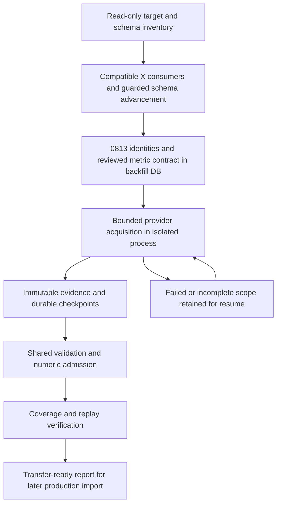
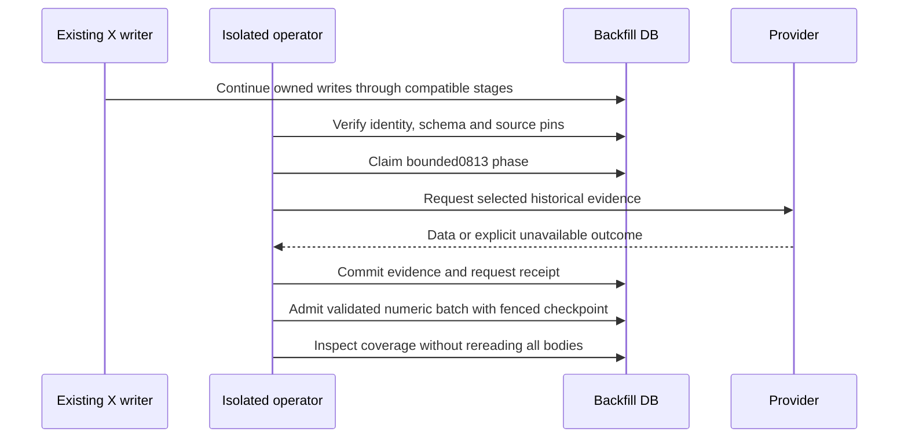
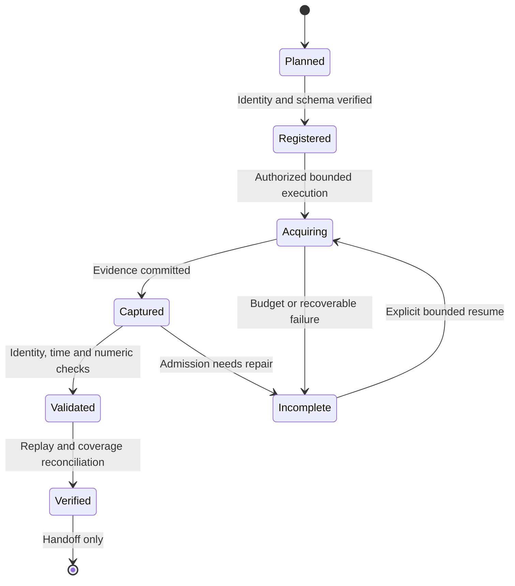
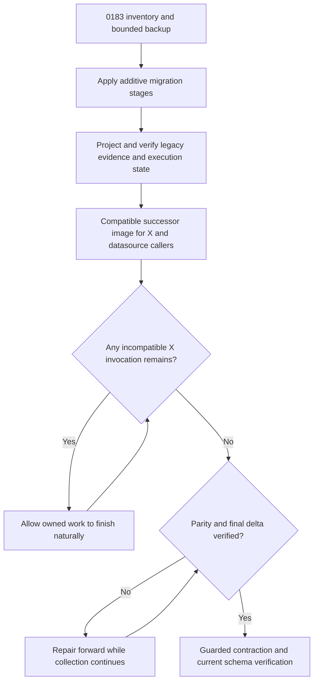

# DataBackfiller current schema and 0813 backfill DB collection - Plan

## Plain-English Summary

Make DataBackfiller collect the missing DeepSeek V4 Pro 0813 measurements into the existing backfill database, where we can inspect them before a later production import. Completion means the available historical measurements are stored, attributed to the right product and dates, and accompanied by a clear explanation of any history the providers cannot supply.

The existing backfill DB is still on schema 0183 and contains X-post backfill work. Production is on 0221. Upgrade the backfill environment and its consumers together, preserving existing X data, request receipts and progress. Use separate execution resources for datasource work so it does not borrow memory from the live web service or headline worker.

The first campaign targets missing HF download/like history, HF trending score, OpenCode tokens/users/sessions and additional available Arena snapshots. Reuse existing collectors and measurement storage. Verification covers safe resume, correct dates, repeat imports, database targeting, existing X compatibility, and a before/after coverage report. Unknown historical values stay missing. This plan does not promise that every provider has retained the requested history.

The owner selected LFG execution on November 4. This authorizes implementation, the default reviewed pull-request endpoint, and the bounded 0813 campaign in the existing backfill DB. Production application deployment and production data transfer remain outside this execution authority.

---
## Goal Capsule

- Objective: Operators can inspect the recoverable 0813 measurements and remaining source-backed gaps in the backfill DB before using them in production charts.
- Means: Upgrade the existing backfill environment through the repository migration graph, reuse shared ingestion and add bounded datasource campaign orchestration (KTD1–KTD6).
- Authority: Current owner decisions and AGENTS.md govern this plan. Historical datasource/X deployment permissions do not authorize this campaign.
- Endpoint: A verified 0813 campaign in `xbackfiller`, with a reproducible transfer-ready evidence inventory. The parent execution workflow owns completion; no automatic production promotion.
- Stop conditions: Wrong database identity, unsafe schema contraction with an incompatible X writer, changed product identity, unaccounted physical requests, exhausted campaign limits, or an attempted production write.

---
## Product Contract

### Summary

Update DataBackfiller for the current shared schema and use the existing backfill DB as its historical collection destination. DeepSeek V4 Pro 0813 is the required first acceptance case, including OpenCode.

### Problem Frame

The chart has missing 0813 observations that its renderer correctly leaves blank. The older datasource campaign workflow no longer matches all current execution requirements, and its database differs from the dedicated X-backfill environment. A collector that merely starts or captures current metadata would leave the historical chart gaps unresolved.

### Key Decisions

- Collect into the existing backfill DB before a later reviewed production transfer. Governs R1, R2. (session-settled: user-directed — chosen over direct production ingestion: the owner selected reuse after discussing validation and transfer tradeoffs.)
- Make 0813 gaps the first concrete outcome. Governs R4–R7. (session-settled: user-directed — chosen over a schema-only refresh: the owner explicitly requires this plan to enable collection of those gaps.)

### Requirements

**Destination and continuity**

- R1. All datasource campaign writes target the existing `xbackfiller` database, resource `dpg-dbfemu2vcj2c73fsafe0-a`, through an explicitly pinned writable login.
- R2. Preview and inspection are read-only; collection never silently falls back to the production database or promotes its results there.
- R3. Preserve existing X-post records, jobs, evidence, receipts, leases and progress throughout schema and consumer upgrades; keep live collection operating.

**0813 collection outcome**

- R4. Select only product `20d66250-db05-40bf-8fda-94b610bed0c7` and the exact reviewed provider identities in the gap matrix.
- R5. Acquire and ingest available observations for each missing metric/window in that matrix, including the separate OpenCode path.
- R6. Report each requested metric/date as already present, newly stored, source-confirmed unavailable, identity-inapplicable, failed or incomplete; failed/unfinished work cannot be called unavailable. Unavailable claims name the examined source/revision range; they do not claim that no other archive could exist.
- R7. Preserve native units, timestamp precision, timezone and half-open daily windows; absent observations remain missing and observed zero remains zero.

**Recovery and inspection**

- R8. Registration, acquire/resume, saved-evidence replay and reports use committed database state and immutable source artifacts; restarting does not depend on local checkpoint files.
- R9. Repeat capture/import is safe, interrupted requests retain their actual or unknown accounting, and conflicting evidence is reported without overwriting old observations.
- R10. Isolated execution, finite per-attempt/campaign budgets and bounded inspection protect active services and prevent unbounded archive loading.
- R11. Honor the owner's internal-analysis use decision while preserving actual recorded source-use evidence and statuses; do not invent new policy rejection gates or rewrite unknown findings as approvals.
- R12. Deliver before/after coverage, exact source identities, dates, artifact hashes, run/observation/value references and remaining gaps sufficient for a later reviewed import.
- R13. After schema compatibility is established, datasource backfill and X-post backfill can execute concurrently against the same backfill DB with separate date windows, processes, jobs, claims, checkpoints and request accounting; neither may overwrite, pause or reclaim the other's work.

### Required 0813 Gap Matrix

Release anchor: August 13, 2026. Historical chart context is July 30–September 10, inclusive. All requested daily intervals below use UTC, with September 11 00:00 UTC as the exclusive outer end. Post-release recovery is the required acquisition scope; pre-release blanks are not automatically provider failures.

| Datasource / exact identity | Metric target | Required missing history | Baseline and acceptance detail |
| --- | --- | --- | --- |
| HF `deepseek-ai/DeepSeek-V4-Pro-0813` | Rolling 30-day downloads, cumulative downloads, likes | August 13–26 | Existing chart response has August 27–September 10. Recover earlier archived observations where they exist. |
| Same HF identity | Net download-counter change | Derive August 14–27 from adjacent counters | Acquire August 13–26 inputs and reuse August 27. An August 13 difference additionally needs a genuine August 12 counter; classify absent pre-release evidence rather than inventing it. This is not daily new downloads. |
| Same HF identity | Trending score | August 13–September 10 | Current API observations outside this period cannot be backdated. Check archived field availability, not just collector selection. |
| OpenCode `deepseek/deepseek-v4-pro-0813` | Daily tokens, unique users, sessions | August 13–September 10 | All three are empty in the retained response. Use the reviewed endpoint `/data/deepseek/deepseek-v4-pro-0813.json`. The endpoint exposes its available history rather than accepting a requested historical date range. |
| Arena `deepseek-v4-pro-high-20260813`, `text/overall` | High rating, rank, lower/upper bounds, variance, votes | Inspect available publication snapshots August 13–September 10 | Five dates already appear: August 19,21,27 and September 1,2. Import additional actual publications only; no requirement for a fabricated daily series. Rank remains lower-is-better. |

OpenRouter `deepseek/deepseek-v4-pro-20260813` already has August 13–September 10 daily tokens. Reuse or copy its existing evidence when needed for complete validation; no fresh collection unless a new baseline check shows a gap. Brand-post counts are present throughout the chart window; this campaign does not acquire X posts. GitHub is excluded because no release-specific repository is confirmed; shared `deepseek-recipe` counts must not be substituted.

The matrix baseline comes from the November 4 retained read-only chart response, not a promise that either database remains unchanged. U4 must refresh both inventories before acquiring data.

### Acceptance Examples

- AE1. A run configured with the production host/database instead of `xbackfiller` fails before registration, provider access or measurement writes. Covers R1, R2.
- AE2. HF has an August 20 snapshot containing downloads and likes but no trending field. Those two values are stored, while the trending cell retains an explicit source-field gap. Covers R5–R7.
- AE3. OpenCode returns zero tokens on August 18, omits August 19 and returns a partial August 20 window. Zero is stored; the absent and partial days are not presented as complete daily values. Covers R7.
- AE4. An attempt loses its response acknowledgement after evidence commit. Resume reuses committed evidence and preserves uncertain request accounting without duplicate values. Covers R8–R10.
- AE5. A currently valid X page completes while datasource setup advances. Its receipt, Post memberships and cursor survive unchanged, and its next invocation uses a compatible consumer. Covers R3.
- AE6. An X-post backfill for July runs alongside the0813 datasource campaign in August–September in the same database. Both advance durable progress; interrupting and resuming either preserves the other's ownership, receipts, values and counters. Covers R3, R8–R10, R13.

### Scope Boundaries

In scope: compatibility work needed to use current models in the existing backfill environment, 0813 campaign orchestration, HF/OpenCode/Arena historical acquisition and ingestion, inspection, and the validation handoff.

Deferred to Follow-Up Work: production promotion implementation/execution, broad publisher inventory refresh, other products/release comparisons, and permanent recurring-schedule activation. Existing production campaigns are inspected only as source evidence; their 176 legacy jobs are not mass-repaired by this plan.

Outside this work: chart UI changes, saved-chart persistence, rebuilding X-post collection, source-rights policy design, and new permanent Render services.

---
## Planning Contract

### Verified Baseline

Planning source revision: `b0d0307bc7e3c001e0c2ad48160bded6edf9cd14`, Django `>=5.2,<5.3`.

Read-only database checks on November 4 found:

- Backfill DB: migration leaf `0183_rg6_typed_statistics_identity`; 41 X-backfill jobs:39 completed,1 paused,1 ready. One job has an active-run pointer; this is not proof that the lease is healthy or that its process is currently executing. Treat it as owned until inspected.
- Production: migration `0221_affiliation_trigger_column_permissions` is applied. Production-only schema and current reference evidence must not be assumed present in backfill DB.
- The exact 0813 product had no `SourceSubjectMapping` rows at the targeted read. Catalog crosswalks in other identity storage do not establish metric eligibility or a pinned metric contract.
- Earlier diagnostics found176 old datasource campaign jobs in production with no typed campaign owners. New typed claims reject that shape. This is a compatibility example, not authority to mutate those jobs.
- Legacy campaign reports read full archived run documents in `campaign_usage`. An earlier live-worker probe restarted the headline worker during archive inspection; the cause was not conclusively established. Avoid that execution pattern entirely.

No collector, migration, application test or provider-acquisition batch ran during planning. The earlier89 passed tests cover their recorded source snapshot only; they are not verification of this proposed change.

### Key Technical Decisions

- KTD1. Bind datasource execution to the existing backfill identity using a dedicated process connection and explicit expected host/database/login. Extend existing database-identity checking patterns in `monitor/staging_acceptance.py` and `monitor/backfill_promotion.py`; keep source/target roles separate. Inspection uses a read-only transaction, collection uses a write-enabled backfill login. Governs R1, R2.
- KTD2. Upgrade the existing database in place through the canonical migration graph, with additive changes, backfill/projection checks and compatible consumers before destructive contraction. Do not run a blanket migration from0183 to the latest leaf or fake migration records. The guarded0196/0201 collection-document retirement and0202–0205 release-storage cutover need their existing parity prerequisites, not a global bypass. Advance old X invocations at their natural completion boundaries and launch compatible successors; never introduce a planned collection stop. Governs R3. [Django migrations guidance](https://docs.djangoproject.com/en/5.2/topics/migrations/#data-migrations) supports using the migration history rather than manually manufacturing its end state.
- KTD3. Reuse `CollectionCampaign`, `CollectionJob`, attempts, scopes, archives, measurement subjects, source mappings, contracts, observations and `MetricValue`. Add0 feature tables, retire0 feature tables, add0 new JSON columns. Applying the already-approved migration graph will add/remove physical objects in backfill DB. Comparing physical table names across the existing 0183→0221 graph gives11 introduced names and3 removed names (10 new tables,2 retired tables and1 rename from model_release_details to product_release_details), independently of this feature: additions are collection_observation_metric_selections, collection_scope_cursor_receipts, discussion_window_counts, discussion_window_snapshots, enrichment_budget_windows, event_dossier_claim_collection_jobs, event_dossier_discussion_windows, event_dossier_intake_decisions, product_release_details, product_release_detection_states and source_datasets; retirements are model_release_details, model_release_evidence and model_releases. Verify the physical before/after inventory in U2. Existing evidence and execution records already express the required identities and progress, so no second campaign or checkpoint store is justified. New fields are not planned. Governs R8, R9.
- KTD4. Extend `backfiller_data_source` with explicit backfill-target preflight and source-specific historical phases, including OpenCode. Reuse existing provider clients/parsers and shared numeric writers; do not rewrite X transfer logic for metrics. Bridge file-producing legacy collectors by committing reviewed instructions, retained artifact references, checksums and continuation into existing database owners before calling a phase complete. Files may be transport/cache only. Governs R4–R9.
- KTD5. Preserve source semantics at admission. HF archival column selection may include `trendingScore` only when present in the pinned snapshot; absent trending cannot be reconstructed from today's score. Select adjacent rolling counters for derived net change without calling it a daily flow. OpenCode periods require an explicit year and timezone; ambiguous date codes never infer the current year. Match full UTC inclusive-start/exclusive-end days before chart eligibility. Governs R5–R7. [HF metric definitions](https://huggingface.co/docs/huggingface_hub/en/package_reference/hf_api#huggingface_hub.hf_api.ModelInfo) and [download methodology](https://huggingface.co/docs/hub/en/models-download-stats) constrain those meanings.
- KTD6. Use one isolated execution process with provider concurrency1 initially. Pilot ceiling:100 physical requests,64MiB received,300 seconds; aggregate0813 ceiling:1,000 physical requests,1GiB received,3,600 seconds, counting retries and uncertain interrupted requests. These are ceilings to register for a later authorized execution, not permission to spend during planning. Stream bounded archive selections and report pages; inspect counters without loading all archive bodies. On exhaustion record incomplete coverage and stop. Governs R10.
- KTD8. Share the database through independent jobs and short record/campaign-scoped transactions, not a database-wide datasource writer lock. Datasource jobs must not acquire X's harvest-writer lock or alter its yield controls. Both processes share database CPU, I/O and connections, so impose bounded concurrency and tolerate brief contention on shared reference rows without holding provider requests inside transactions. Disjoint dates are not an isolation mechanism; ownership and natural-key constraints remain decisive. Governs R13.
- KTD7. Preserve captured evidence before validated measurements and produce a verification inventory before any later publication. A separate full production database clone is unnecessary. Use actual artifact/record content hashes and stable subject/provider identifiers across environments; never equate auto-increment IDs across databases. Governs R9, R12. The [Databricks raw-to-validated pattern](https://docs.databricks.com/aws/en/lakehouse/medallion) informs this separation; [Airflow replay guidance](https://airflow.apache.org/docs/apache-airflow/stable/best-practices.html) informs repeatable inputs and writes.

### High-Level Technical Design

### Execution Prerequisites and Assumptions

There are no unresolved product choices. U1 and U2 contain runtime gates, not permission to skip compatibility work. U2 must map every existing data-adoption prerequisite, including legacy campaign reservation projection and X run/scope/request lineage, before removing any legacy column. An unarchived or unprojected old row is an upgrade blocker, not permission to label it completed. The exact historical availability of each provider metric is execution-time evidence to collect and report under R6.

No second backfill DB, new full local test database, new permanent scheduler, or persistent web/worker process is selected. The existing dedicated backfill DB remains authoritative for its X work. A current, bounded backup and verified forward-repair path precede destructive migration stages; rollback must not discard X writes committed after the backup.

Minimal reference seeding is a read-only export from production and a reviewed import into backfill DB: Product, brand/publisher ownership, MeasurementSubject, namespaces, metric definitions, reviewed provider identity and exact contract dependencies. Preserve stable UUIDs when content matches; validate hashes when reconstructing contracts. Conflicting identities fail without overwriting existing X-owned records. Do not copy all production jobs or enable recurring authority.

Preserve the owner's internal-use override per R11. Keep actual policy evidence unchanged; this work does not infer publication rights from successful internal collection.

---
## Implementation Units

### U1. Explicit backfill destination and bounded inventory

**Goal:** Make all datasource actions refuse an unintended database before they can acquire or mutate data.

**Requirements:** R1, R2, R10; KTD1. **Dependencies:** None.

**Files:** `core/management/commands/backfiller_data_source.py`, proposed `core/data_source_backfill_target.py`, `monitor/staging_acceptance.py` as a pattern, `tests/test_backfill_database_role.py`, proposed `tests/test_data_source_backfill_target.py`.

**Approach:** Add inspectable target/schema preflight using authenticated connection identity. Keep migration-owner and collection-login responsibilities explicit. Report the migration graph, active X ownership, reference-record availability and physical schema differences using bounded queries.

**Test scenarios:**
1. Covers AE1. Wrong production database or login fails before provider requests, job registration or writes.
2. A read-only inspection succeeds without writable credentials and reports0183 as incompatible with the selected current image.
3. A missing backfill credential fails rather than using default `DATABASE_URL`; tests never expose connection secrets.

**Verification:** Actual CLI preview and simulated execution share the same preflight; no acquisition bypass exists.

### U2. Bring the existing backfill DB and X consumers to the selected schema

**Goal:** Reach a current supported schema without losing or interrupting existing X backfill work.

**Requirements:** R3; KTD2, KTD3. **Dependencies:** U1.

**Files:** existing `core/migrations/0184*` through the selected current migration leaves; retirement helpers including `core/migrations/_rg6_retirement_v1.py`; `monitor/backfill_staging.py`, `monitor/backfill_transfer.py`, `monitor/management/commands/run_backfill.py`; existing projection/compatibility commands discovered from the global schema plan; proposed `tests/test_data_source_backfill_upgrade.py`, existing `tests/test_backfill_staging.py`, `tests/test_backfill_verify.py`.

**Approach:** Inventory the full dependency graph and produce an object-level migration map: additive fields/tables, data adoption, parity checks, indexes, retired columns/tables and affected consumers. Follow `docs/plans/2026-10-09-063417-feat-g3-round2-chart-engine-plan.md` for existing schema cutover obligations. Carry a bounded0183 X cohort through the same graph in the permanent test DB's migration-rehearsal schemas, including page receipts, partial runs and active leases. Update the isolated X execution image for the required transition before contraction. Let old invocations finish naturally; verify no incompatible writer remains before irreversible stages. Respect short lock timeouts and repair invalid concurrent indexes rather than blindly retrying DDL. Never weaken existing migration guards or repoint production services.

**Observed archive-worker prerequisite (November4 execution):** The normal Render image omits the existing optional `[benchmark]` dependency. Keep pure commit selection importable without PyArrow; acquire Parquet only in an isolated worker with the locked decoder installed. The operator uses lockfile wheel hashes and an ephemeral dependency directory. No serving-service build or environment is changed, and package setup is separate from datasource request/byte accounting.

**Observed reference bootstrap (November4 execution):** The backfill DB has no `UTC` lookup row, although the installed OpenCode metric definitions explicitly reference it. Extend shared `register_definitions` to ensure its declared timezone identities before metric inserts, alongside its existing unit/type registration. Remove the redundant UTC primer from the shared test fixture and verify an unseeded registry plus existing callers. This creates a reference row, not a field or table, and does not infer a timezone for observations.

**Observed compatibility extension (November4 execution):**108 existing runs retain `staging-get-retry/v2`, which current main rejects. Extend the existing `collection_runs.staging_retry_version` constraint to admit versions1 and2; preserve each version's error/recovery behavior. Add migration0222 as an additive branch from0195 so v2 can be projected before0201, then merge with0221 in0223. This adds0 tables and0 columns (two migration files), and does not change the default v1 policy or authorize X sends. The existing nullable retry-version field belongs to the logical run: exactly one recorded policy drives its resume, HTTP-error handling and cooldown queries. Extend that typed field and its checked versions; another table or JSON record is unsuitable. The guarded additive `expand` command selects this0222 branch without traversing the retirement branch. The backfill collection schema floor becomes0223. Verify both versions through the historical migration rehearsal and retain the v1 request-ceiling/auth-stop regression tests.

**Execution note:** Characterize0183 X state and readers before altering the upgrade route. A migration ledger alone is insufficient proof of parity.

**Test scenarios:**
1. Covers AE5. X page completion during the additive phase survives adoption and is included in the final delta/parity check.
2. Preserve canonical Post IDs, memberships, query windows, receipts, cursor progress, terminal states and recoverable partial state across0183→selected current graph.
3. An incompatible old writer or missing archive/parity evidence blocks contraction without pausing its collection or discarding writes.
4. A lock timeout leaves the prior supported stage usable; forward repair preserves writes made since the backup.

**Verification:** Both current datasource preflight and the X caller/verification/transfer paths work against the upgraded backfill schema; record exact code revision and schema leaves. Physical object additions/retirements are enumerated. No runtime advancement occurs until its prior stage's verification passes.

### U3. Current durable campaigns and bounded reports

**Goal:** Register and resume new datasource campaigns with current typed ownership and safe inspection.

**Requirements:** R8–R10, R13; KTD3, KTD4, KTD6, KTD8. **Dependencies:** U1; U2 before live registration.

**Files:** `core/data_source_backfill.py`, `core/collection_reports.py`, `core/collection_capture.py`, `core/management/commands/backfiller_data_source.py`, `core/management/commands/project_collection_campaigns.py`, `tests/test_data_source_backfill.py`, proposed `tests/test_data_source_backfill_reporting.py`, proposed `tests/test_data_source_backfill_concurrency.py`; inspect `monitor/run_lock.py` and `monitor/backfill_staging.py` as X lock-boundary references.

**Approach:** Use existing typed campaign registration and receipts. Keep the legacy execution guard intact. Scope adoption to records actually needed in backfill DB; do not run the production-wide adoption helper. Make report/usage paths consume stored counters or bounded streamed receipts instead of ORM-caching every archived payload. Commit file-collector transport artifacts into existing evidence owners before advancing checkpoints.

**Test scenarios:**
1. A fresh campaign creates the typed owner and executes through the real command into a shared adapter using mocked provider transport.
2. A legacy campaign without adoption receives an actionable preflight error; verified adoption preserves its reservation ceiling and attempts.
3. Reporting a145-run campaign does not fetch every archive body; bounded pages reconcile to stored counters.
4. Covers AE4. Crash/reclaim and stale lease fencing preserve evidence, uncertain request accounting and resume progress.
5. Covers AE6. Use two independent PostgreSQL connections against the same test database to interleave real X-page and datasource numeric commits for disjoint periods; both advance without cross-job claim or checkpoint mutation.
6. Fail and resume either side while the other progresses; verify independent budgets/receipts, no X yield request from the datasource job, no database-wide lock, and bounded handling of contention on shared reference rows.

**Verification:** CLI register/inspect/execute/resume/replay paths are covered together, including no-network/no-write preview behavior.

### U4. Seed the reviewed0813 cohort and refresh its gap inventory

**Goal:** Produce one executable, narrow campaign with exact provider pins and a fresh baseline.

**Requirements:** R4–R7, R11, R12; KTD4, KTD7. **Dependencies:** U2, U3.

**Files:** `core/model_history_cohort.py`, `core/benchmark_metric_identity.py`, `core/management/commands/backfiller_data_source.py`, `core/models.py` for inspection only, proposed `core/data_source_backfill_cohort.py`, proposed `tests/test_data_source_backfill_cohort.py`, `tests/test_benchmark_download_db_identity.py`.

**Approach:** Read the confirmed source crosswalk evidence, including the independently reviewed OpenCode endpoint path; import only required reference records. Explicitly establish metric-purpose mappings and the compatible contract in backfill DB. For chart verification and adjacent-counter inputs, re-admit only needed retained production captures through the shared writer into backfill DB: HF August27 onward, existing Arena dates and OpenRouter complete days as required. Preserve origin references/hashes without treating production numeric IDs as local IDs; never copy the whole production database. Recompute production/backfill metric/date coverage, reuse existing evidence before provider requests, and pin source identity, metrics, interval, contract hash and aggregate ceilings. Permit a one-product explicit cohort instead of requiring the older21-brand inventory campaign. Preserve any pre-existing historical unassigned observations as such.

**Test scenarios:**
1. The four provider identifiers resolve to the same0813 Product, while preview/Flash/shared-toolkit substitutions fail.
2. Catalog-only identity does not pass metric admission until the reviewed metric mapping and contract exist.
3. A conflicting UUID/hash/reference fails atomically; unrelated X records and routine source authority remain untouched.
4. A newly populated source/date is removed from acquisition needs; a genuine missing date stays requested.

**Verification:** The reviewed preview identifies one product and the gap matrix's metric/windows, including OpenCode, with0 provider calls.

### U5. Recover HF historical counters and optional trending

**Goal:** Collect and ingest the available HF observations needed by the first chart.

**Requirements:** R5–R9; KTD4, KTD5. **Dependencies:** U4.

**Files:** `monitor/management/commands/backfill_hf_archive.py`, `monitor/management/commands/import_hf_backfill.py`, `scripts/benchmark_download_collector/hf_archive.py`, `core/model_history_archives.py`, `core/benchmark_metric_history.py`, `core/benchmark_metric_store.py`, `tests/test_benchmark_history_acquisition.py`, `tests/test_benchmark_download_history.py`, proposed `tests/test_data_source_backfill_hf.py`.

**Approach:** Reuse range-based selection from immutable HF archive revisions and the shared importer. Include optional cumulative/like/trending fields only when supplied by the chosen snapshot. Route campaign progress and evidence through U3 rather than relying on legacy output-directory checkpoints. Reuse current counters already stored elsewhere without confusing their retrieval/as-of clocks with historical dates. Derive net change from adjacent observed counters for verification; keep that calculation separate from provider measurements.

**Test scenarios:**
1. Covers AE2. An archive containing `trendingScore` selects and stores it; an archive without it still stores downloads/likes and reports an explicit field gap.
2. A model absent before its first archive appearance yields no synthetic zero or current-value backdating.
3. Adjacent counters yield the expected net change; a missing preceding day yields a gap, including August13 without August12 evidence.
4. A range cap, unavailable revision or interrupted capture produces distinct incomplete/unavailable outcomes and resumes from committed evidence.

**Verification:** Requested post-release dates have stored observations or evidence-backed gap outcomes; the importer and replay preserve original dates and hashes.

### U6. Integrate OpenCode and sparse Arena history

**Goal:** Fill available OpenCode daily metrics and additional actual Arena publications through the campaign interface.

**Requirements:** R5–R9; KTD4, KTD5. **Dependencies:** U4.

**Files:** `core/model_history_cohort.py`, `core/collection_scheduling.py`, `core/collection_jobs.py`, `core/collection_instructions.py`, `core/collection_state.py`, `core/collection_capture.py`, `core/data_source_backfill.py`, `monitor/management/commands/backfill_opencode_history.py`, `monitor/management/commands/backfill_arena_history.py`, `scripts/benchmark_download_collector/sources.py`, `core/benchmark_metric_history.py`, `core/benchmark_metric_store.py`, `tests/test_benchmark_opencode.py`, `tests/test_model_history_collection.py`, proposed `tests/test_data_source_backfill_opencode.py`.

**Approach:** Add a narrowly validated metric-purpose OpenCode historical operation with a pinned contract to the existing capability/dispatch contract. Carry it through sealed-instruction validation, typed claim admission, fenced completion and the report projection, not only the command dispatcher. Do not merely append OpenCode to every global `HISTORY_SOURCES` loop, which would change older cohort cardinality and hashes. Reuse its provider adapter, reviewed endpoint path and shared numeric writer while moving durable execution into U3. Capture the currently exposed export once and select the requested interval from its unchanged contents. Earlier retained captures had stale `updatedAt` and a 2025 date among2026 rows; do not repair source bytes or substitute a generic Pro endpoint. Only inspect an independently identified retained dated export when the live export lacks the interval. Validate explicit historical day/year/UTC boundaries before admission. Limit Arena to the exact High variant and `text/overall` publications; reuse existing five dates and record absence of further publications honestly.

**Test scenarios:**
1. Covers AE3. Tokens/users/sessions share their real daily interval, including an observed zero and a missing day.
2. A year-ambiguous date code, non-UTC period or partial-day end never becomes a complete dated value; the evidence and reason remain inspectable.
3. OpenCode current API history that excludes August produces explicit unavailable/incomplete outcomes according to actual evidence, not an empty-success claim.
4. Arena Max/preview/other-category rows fail selection; repeat ingestion of the same five High snapshots adds no duplicates.
5. Legacy four-source campaign hashes and memberships remain unchanged after adding the explicit OpenCode operation.
6. The OpenCode export contains a stray2025 date among2026 rows: retain the original payload and report the invalid/ambiguous interval without silently changing its year.

**Verification:** Real command dispatch reaches shared provider/numeric paths under controlled transport; all requested OpenCode metrics are accounted for and only genuine Arena dates are plotted as eligible.

### U7. Run bounded0813 collection and deliver the validation handoff

**Goal:** Leave the requested recoverable data in backfill DB with an auditable gap report.

**Requirements:** R1–R13; KTD6–KTD8. **Dependencies:** U5, U6.

**Files:** `core/management/commands/backfiller_data_source.py`, `core/collection_reports.py`, `tests/test_data_source_backfill.py`, proposed `tests/test_data_source_backfill_0813.py`, `docs/reference/collection-jobs.md`, `scripts/benchmark_download_collector/README.md`.

**Approach:** After execution authorization, launch the verified code image in an isolated, appropriately sized job on fuchitalee or an existing Render one-off execution facility, with only the selected backfill DB connection. Prove the pilot before continuing within the frozen aggregate budget. Reconcile each requested matrix cell, retry/replay only as permitted by its recorded outcome, and stop at KTD6 ceilings. Compare against a fresh production inventory using read-only access. Export a validation report and a bounded inventory of retained evidence/record dependencies for a later transfer; do not implement or execute production promotion here. Update operator documentation through the reference-doc skill.

**Test scenarios:**
1. An end-to-end0813 fixture passes through preflight, provider capture, canonical measurements, coverage report and replay with expected nulls and zeros.
2. Target identity drift, exhausted limits and invalid numeric/time evidence stop at the relevant boundary without production writes.
3. Replaying the same campaign adds no duplicate values, changes no immutable numbers and performs0 provider requests.
4. Every reported newly filled cell resolves to retained source evidence; errors cannot be relabeled as unavailable to complete the report.

**Verification:** Exact code/schema/target identity, acquired/reused counts, request/byte/time usage, replay result and remaining source gaps are retained alongside before/after coverage. Existing X state remains healthy and reconciled. Runtime tests are not run inside live services.

---
## Verification Contract

Use the permanent shared local PostgreSQL test database through `pushinweight-test-db`, with a compatible checkout and exclusive ownership for tests and migration rehearsals. Use its existing migration-rehearsal schemas for the0183 fixture; create no additional full test database or production restore. Never run tests against production or the live X-backfill database.

| Area | Evidence required | Unit |
| --- | --- | --- |
| Targeting | Real command refuses production/missing/wrong credentials before HTTP or writes | U1 |
| Upgrade and continuity |0183→selected graph parity plus interleaved X writes and current caller compatibility | U2 |
| Campaign recovery | Typed owner, preserved reservations, lease fencing, restart without local checkpoints | U3 |
| Concurrent backfills | Real independent connections prove X and datasource progress in one DB, with failure/resume and budget isolation | U3, U7 |
| Identity | One0813 Product, exact reviewed IDs/endpoint, correct metric contract | U4 |
| HF | Immutable archive selection, missing fields, rolling-counter semantics and replay | U5 |
| OpenCode/Arena | Explicit dated UTC windows, zero/null separation, exact variant and sparse publications | U6 |
| Operational outcome | Stored recoverable gaps, evidence-backed unavailable cells, bounded usage and transfer-ready report | U7 |

Regression net: extend the named test suites and exercise actual CLI→dispatch→provider adapter→numeric writer paths with controlled transports. Retain existing X staging/verification/transfer and four-source campaign tests. The prior89-test result is context only; report newly executed, deselected, skipped and failed counts for the implemented revision. Live smoke proof is a separate bounded run against the backfill DB and must report partial/unavailable outcomes accurately.

---
## Definition of Done

1. Backfill DB reaches the selected current schema with every applied stage's prerequisite verified and X data/progress preserved under R3.
2. The operator can inspect, register, acquire/resume and replay one0813 campaign with the explicit target, including OpenCode, while an independent X backfill can advance under R13.
3. Every required metric/date is accounted for under R6; all recoverable values are stored and every claimed unavailable cell has source evidence.
4. Correct identities, units, UTC intervals, original clocks, zeros, missing values and duplicate handling are proven through the real caller paths.
5. The parent delivers the R12 handoff and the isolated job's actual resource/accounting record; no production transfer or routine activation occurred.
6. Named regression checks pass for the implemented revision; unperformed or waived checks are not reported as passes.
7. Abandoned experimental code and task-owned temporary launchers are removed; the permanent test DB, X campaign resources and accepted chart template are retained.

---
## Risks and Boundaries of Completion

Historical availability is uncertain: a correctly working collector can establish that an archive lacks an0813 row or trending field. That is different from successfully filling that metric; the final report must show both outcomes distinctly.

Schema contraction is the largest operational risk. The active X pointer means the legacy183 image must not be treated as drained. U2 owns compatible consumer sequencing and bounded delta checks; if uninterrupted compatibility cannot be proven, stop runtime advancement and redesign that stage while existing work continues.

Backfill schema advancement may require extensive existing data projections. Use the canonical migration plan and existing guards; do not treat the selected0221 leaf as permission to skip intermediate data adoption. Recheck origin/main and all active consumers at execution time rather than pulling in unmerged Chatter migration branches merely because the local test DB has them.

The chosen isolated job may incur normal provider/network/Render usage. This planning turn grants no runtime spend. A required budget increase or an additional resource beyond KTD6 is an owner decision, never an automatic retry.

---
## Sources and Research

- `core/models.py`, the0183–0221 migration graph and `core/migrations/_rg6_retirement_v1.py`: existing storage and guarded compatibility boundaries.
- `core/data_source_backfill.py`, `core/collection_state.py`, `core/collection_reports.py`: typed execution and the legacy archive-reporting hazard.
- `monitor/management/commands/backfill_hf_archive.py`, `import_hf_backfill.py`, `backfill_opencode_history.py`, `backfill_arena_history.py`: current acquisition/import entry points to reuse.
- `docs/plans/2026-10-16-003629-feat-g3-backfiller-data-source-plan.md`: predecessor broad datasource campaign contract; this plan adds a focused new endpoint rather than reopening completed publisher campaigns.
- `docs/brainstorms/2026-10-27-163458-backfill-testing-handoff.md` in the authoritative coordination checkout: dedicated X DB/image ownership and its historical0183 baseline.
- `docs/solutions/architecture-patterns/backfiller-and-llm-classifier-pipeline-wiring.md`: reuse shared ingestion and bounded recovery; its old scheduler/file-state descriptions are historical, not current authority.
- `.context/compound-engineering/ce-prototype/2026-11-03-chartengine-pulse/01-pulse-chart/state/2026-11-04-132657-0813-coverage-response.json` and adjacent diagnostic receipts in the authoritative checkout: dated chart baseline and previous compatibility findings.
- The earlier operational collection unit in the ChartEngine plan under `.worktrees/docs/chartengine-plan-20261102/docs/plans/2026-11-02-072542-docs-chartengine-plan-20261102-plan.md` identifies the reviewed OpenCode endpoint, its stale/inconsistent capture and its lack of a historical-date request option.
- Official framework/provider references are bound to KTD2, KTD5 and KTD7 where they change this plan.

## Delivery Exceptions

### Execution checkpoint — November 4

Review follow-up: preserve immutable revision identities but combine all `0813:` durable attempt/request reservations at admission, with revision-owner locks acquired before the job lock. Normalize HF send/stream errors into the existing partial-finalization path, retaining delivered chunks before interruption. Both defects were reproduced by regression tests before the fixes;31 focused and129 existing-regression tests pass, including a simultaneous last-reservation race and exact Arena/OpenRouter saved-import assignment. These changes add0tables/columns and make0provider calls.

U1–U7 implementation and the bounded campaign are complete. The [validation report](../analysis/2026-11-04-200654-databackfiller-0813-validation.md) and its linked CSV identify216 corrected-contract records/171 distinct cells. HF has28 of29 requested dates (all four metrics), OpenRouter29 of29, and Arena retains five publication dates. Further Arena acquisition reached the historical API and received threeHTTP500 responses; OpenCode failed validation of inconsistent source dates. These remain explicit failed/incomplete cells. Neither is called unavailable, and no values were synthesized. Across the two contract/campaign revisions,33 attempts consumed519 physical requests/100,665,418 received bytes; conservative request reservations total815. All519 datasource request outcomes have complete accounting. Public replay of29HF jobs changed no value count and made0provider calls. Code review and the default PR/CI endpoint follow this implementation checkpoint.

The actual backfill DB reached `0223_merge_backfill_retry_policy`. The guarded retirement removed all13 legacy collection JSON columns after archive/page/runtime/report parity; all49,274 original Posts match across all81 original columns, and all41 X job states/pointers match the pre-upgrade inventory. Five pre-existing pending transport outcomes remain unknown and untouched. Current public X readers work after contraction. No production scheduler was interrupted.

The HF discovery pilot completed with11 physical requests and154,972 received bytes. It identified28 daily model-file snapshots in the examined immutable history; August26 has none. Seventeen retained captures were imported without provider calls. The current OpenCode response was retained but rejected: `updatedAt=2026-10-02T22:29:06Z` conflicts with a2026-10-03 daily row. Its requested cells remain failed source validation, not confirmed unavailable.

The first Arena definition completed with0 requests because a model with empty `provider_pins` enters the existing unmapped branch. A regression now proves the real campaign dispatch reaches `_publication_evidence`. Use its existing native-publication branch (`models: []`, exact pinned native identifier and numeric contract) under a new `arena-native` job key; preserve the previous immutable definition. Arena's shared publication window captures the population before selecting the model, so its finite item cap is100,000 source rows; other phases retain100. The25MiB/80-second/100-request ceilings and one-product numeric admission remain unchanged. The new job shares the corrected campaign's aggregate reservation owner.

Actual verification exposed an identity-scope defect in the new cohort builder: non-HF adapters emit the empty identifier scope, whereas the builder selected `model`. HF alone requires `model`. The source strings and product UUID were correct, but retained Arena/OpenRouter observations were unassigned. Correct the builder, test real adapter-to-mapping admission for all three non-HF sources, create a new immutable contract, and re-admit the saved captures through the shared writer. Preserve the original contract/evidence; do not rewrite those observations or repeat provider requests. Record both contract/campaign revisions and combine their actual spending against the single authorized0813 ceiling. Only the Arena job needs a new acquisition definition; do not reactivate the old one or start another HF discovery/OpenCode fetch.

Owner-selected LFG execution on November 4 supersedes the earlier planning-only restriction. Complete implementation and a reviewed pull request, plus the verified bounded 0813 campaign in the existing backfill DB. `delivery_target: on-request` remains correct for application deployment: staging, production deployment and production promotion are not selected. Use existing isolated one-off execution; preserve live collection and the existing X campaign state.

The implementation freezes at most 40 campaign attempts, each at most 25 MiB and 80 seconds, using existing typed reservation fields. This conservatively reserves 1,000 MiB and 3,200 seconds, below KTD6's aggregate ceilings. The existing shared campaign limit separately caps requests and uncertain reservations at 1,000. Provider concurrency is 1; the HF range reader has an explicit serial mode. Successful, fully accounted attempts release unused request reservations through the existing campaign accounting.

<!-- BEGIN OLLIJA DELIVERY GUIDE -->
## Ollija Delivery Guide

This block is generated guidance. Do not edit it directly. Correct durable facts in `.ollija/project.yaml` or this template, then rerun `ollija annotate-plan`. Current explicit owner instructions govern this task. Record exceptions below and reflect route changes in metadata; removed requirements must not return through another checklist.

### Resolved locations

- Authoritative host: `fuchitalee`
- Authoritative repository: `/Users/fuchitalee/development/pushin-weight-v2`
- Ollija release worktree area: `/Users/fuchitalee/development/pushin-weight-v2/.worktrees`
- Active worktree: `/Users/fuchitalee/development/pushin-weight-v2/.worktrees/docs/databackfiller-schema-0813-20261104`
- Plan: `/Users/fuchitalee/development/pushin-weight-v2/.worktrees/docs/databackfiller-schema-0813-20261104/docs/plans/2026-11-04-045719-docs-databackfiller-schema-0813-20261104-plan.md`
- Change: `docs-databackfiller-schema-0813-20261104-2026-11-04-045719`
- Branch: `docs/databackfiller-schema-0813-20261104`
- Staging branch and blueprint: `staging`, `/Users/fuchitalee/development/pushin-weight-v2/.worktrees/docs/databackfiller-schema-0813-20261104/render-staging.yaml`
- Production branch and blueprint: `main`, `/Users/fuchitalee/development/pushin-weight-v2/.worktrees/docs/databackfiller-schema-0813-20261104/render.yaml`
- Staging URL: `https://pushinweight-staging-web.onrender.com`
- Production URL: `https://pushinweight-web.onrender.com`

### Placement

This worktree is inside the Ollija release worktree area. Reuse it for the whole change. Do not create a second worktree or plan for this branch.

### Delivery scope

- Workflow: `plan`
- Delivery target: `on-request`
- Owner selection recorded: `false`

Target is not authorized until the owner selects it. Wait for a later explicit release request; do not commit, push, stage, or promote on this guide alone.

### Failure handling

- Complete applicable, unwaived checks for the selected route. A waived check is waived, never passed. Owner-selected direct production does not require staging.
- Product defects return to the parent implementation workflow; repeat only checks invalidated by the fix. Environment failures require repairing the environment, not a new source commit. Retry only after a relevant fact changes.
- SSH, shell, environment, or multi-machine failures use the repository infra/multi-machine skill first.
- The change ledger is advisory; do not validate or enforce it.
- Never force-remove a worktree. Retain staging-only, failed, dirty, locked,
  noncanonical, or candidate-mismatched worktrees for diagnosis or later
  delivery.
- Do not run an endless retry loop or start a persistent Ollija process.
<!-- END OLLIJA DELIVERY GUIDE -->
