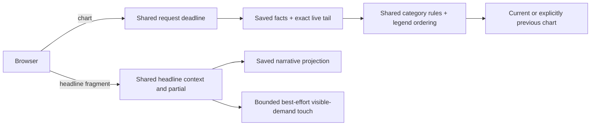
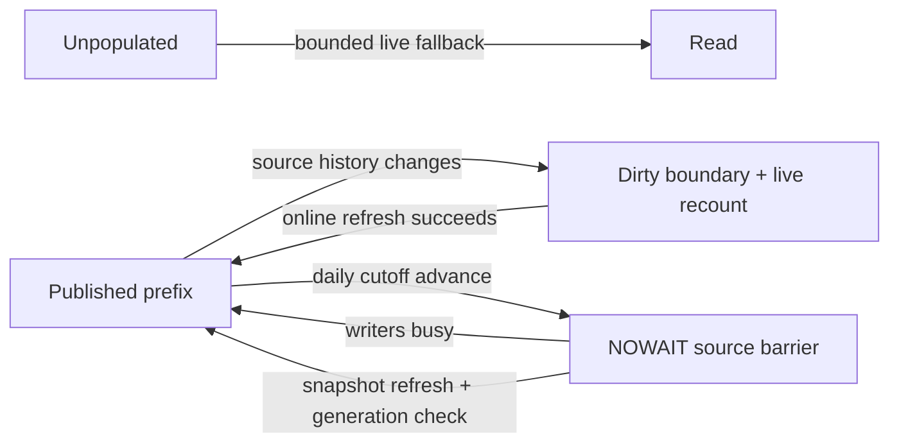

<!-- BEGIN OLLIJA DELIVERY GUIDE -->
## Ollija Delivery Guide

Generated by `ollija annotate-plan`; do not edit between the markers. Delivery policy lives in `AGENTS.md` under "Plans and delivery". Project facts (host, repository, branches, environments, URLs and blueprints) live in `.ollija/project.yaml`. Record owner exceptions under Delivery Exceptions below.

- Plan: `/Users/fuchitalee/development/pushin-weight-v2/.worktrees/fix/dashboard-each-chart-production/docs/plans/2026-11-13-005731-fix-dashboard-each-saved-counts-plan.md`
- Branch: `fix/dashboard-each-chart-production`
- Change: `fix-dashboard-each-saved-counts-2026-11-13-005731`
- Active worktree: `/Users/fuchitalee/development/pushin-weight-v2/.worktrees/fix/dashboard-each-chart-production`
- Workflow: `plan`
- Delivery target: `production`
- Route: `staged`
- Owner selection recorded: `true`

### Placement

This worktree is inside the Ollija release worktree area. Reuse it for the whole change. Do not create a second worktree or plan for this branch.

### Delivery steps

1. Complete implementation and the plan's verification contract.
2. Run the configured focused checks:
   - `pytest tests/ollija`
3. The parent workflow commits only this plan's changes, pushes the feature branch, and records the candidate SHA.
4. Fetch the remote staging lane: `git fetch origin refs/heads/staging`.
5. Require the unchanged candidate SHA to be a fast-forward of that fetched remote ref, then push the exact candidate SHA to `refs/heads/staging` with the server-enforced fast-forward command `git push origin <candidate-sha>:refs/heads/staging`.
6. Verify the remote staging ref resolves to the candidate SHA and the deployment for `pushinweight-staging-web` reports that same SHA.
7. Run staging checks. Stop here if they fail.
8. Only after staging passes, fetch the remote production lane: `git fetch origin refs/heads/main`.
9. Require the same unchanged candidate SHA to be a fast-forward of that fetched remote ref, then push the exact candidate SHA to `refs/heads/main` with the server-enforced fast-forward command `git push origin <candidate-sha>:refs/heads/main`.
10. Verify the remote production ref resolves to the candidate SHA and the deployment for `pushinweight-web` reports that same SHA before reporting completion.
11. After step 10 succeeds, perform worktree cleanup as the final filesystem action:
    - From `/Users/fuchitalee/development/pushin-weight-v2`, require `/Users/fuchitalee/development/pushin-weight-v2/.worktrees/fix/dashboard-each-chart-production` to remain registered, clean, unlocked, and at the verified candidate SHA. If any guard fails, retain it and report the reason.
    - Run `git -C /Users/fuchitalee/development/pushin-weight-v2 worktree remove /Users/fuchitalee/development/pushin-weight-v2/.worktrees/fix/dashboard-each-chart-production` without `--force`.
    - Preserve the local and remote feature branches. Continue final reporting from the authoritative repository root.

Occupied staging: if a staged route finds `staging` in use by an unrelated release while production is authorized, follow the occupied-staging default in `AGENTS.md`.
<!-- END OLLIJA DELIVERY GUIDE -->

## Delivery Exceptions

None.

# Each dashboard saved counts, request isolation and chart presentation

## Current execution status — 2026-11-20 10:36 JST

Staging revision `d98472b66394c0b9578cb4bd25a468719ab62350` is deployed on all
seven active services, preserving G2 Chatter `f898b119`. The independently
requested chart correction is complete:420px fixed plots, justified left
legends, hourly1-day areas, exact counts and six live locale/width/tab cases.
Full676tests+371subtests and exact-candidate fixture performance pass.

**Original U8 backend validation remains failed.** The published388,692-row
saved view remains in use. Prior actual concurrent refresh hit its90sstatement
limit, and144chart responses measuredp95=4.214s/max=8.909s versus≤1.5s/<5s.
Full source parity was incomplete after the prior database recovery event;
the bounded all-live matrix was unperformed. These were not rerun, waived or
passed by the new visual correction. Do not promote this plan as complete or
production-ready. Owner now requests production; the release scope is awaiting
clarification because staging also includes unrelated Chatter/schema work.

## Plain-English Summary

**Current production release: chart changes only.** Bring the approved colors, translucent areas, top-to-bottom left legend, hover/click emphasis, fixed420px height and one-day hourly display onto production’s existing code. Raw counts, server queries, headline refresh, schema, schedules and other pages keep their existing behavior. This release does not contain the saved-facts or Chatter changes described in the historical plan below.

The three product files are Each JavaScript, Each template markup and Each-scoped CSS. Use the production migration history for real-route browser tests, preserve category order and exact count totals, replay the full UI assurance model and measure the exact candidate. Finish only after the production revision and actual chart are observed. The earlier database performance failures remain open.

**Historical broader plan, deferred from production:**

**End state.** The `/dashboard/each` chart for any tracked model opens in about
a second for every tab and every window, including DeepSeek and Meta (database key `llama`) at 30 and
365 days. Production logs confirm that Sentiment, Language and Post Types have run past the web server's 30-second limit. All eight Meta tabs exceeded the November 19 audit's two-second SQL or five-second component limits; those conservative limits do not establish a 30-second failure for every tab. When
that happens the server kills its only worker, the whole site can stop answering, followed by a burst of "502" errors. The timeout and worker restart are confirmed; the proxy's continued rejection of some requests after restart is not fully explained.

**Approach.** Copy the homepage's proven pattern. Once a day, a scheduled job
saves a compact copy of each brand's post facts into a materialized view: the
post time, its language, its author, and the post's classification and category
keys. The copy stops at the start of the previous UTC day, because the
classifier and translator routinely finish posts up to 24 hours late. The chart
reads that saved copy and counts the last day or two, plus any recently corrected history, live. The old10,000-post estimate was observed on November13, not a continuing volume cap; repeated busy refreshes can lengthen the live tail. The rules that decide
which category a post belongs to stay in the existing Python code, so the saved
copy cannot drift from them when the classification vocabulary changes.
Database triggers note when an older post's facts change, so corrected history
is recounted live until the next refresh, as the homepage already does. A shared 15-second request budget covers the chart, including any DeepSeek calculation used to order its legend. Each SQL statement receives only the remaining time, with short lock waits. An expired request returns a controlled error before Gunicorn kills the worker; the browser keeps the last successful chart clearly labelled as a previous result.

Brand switches also fetch a small headline fragment rather than rebuilding the whole dashboard. The initial page and that fragment reuse the same headline presentation. Recording visible headline demand is best effort with a short lock limit; the saved headline can still display if another process holds the demand row.

**What changes and what does not.** Added: one materialized view, one ordinary
(non-materialized) view that defines the facts, invalidation triggers on the
tables the chart reads, and one dataset row in the existing
`materialization_state` table. The existing 15-minute `pushinweight-home-counts`
cron refreshes both datasets, so no new Render service is needed. No new
ordinary tables are added and none are retired. The chart adopts the accepted homepage palette with stronger translucent fills, a vertical left legend, and hover/click emphasis. Its existing category and stack order, tabs, units and numerical rules are preserved, except that the Role tab fixes official and staff posts incorrectly counted as "other". Legend and tooltip lists follow the rendered stack from top to bottom. Separately, NVIDIA moves immediately after Meta in the shared brand display order; every other brand retains its relative position. Headline refresh, loading/error handling and request budgets change as described above; feed pagination and synthesis behavior remain intact. Harvesting, the
classifier and the translator keep their code and behavior. They only pass
through new triggers that do one quick lookup and nothing else for today's
and yesterday's posts.

**How completion is verified.** Tests first assert that the new reader returns
exactly what the current chart returns for every tab, window, time zone and edge
case, then pin the saved-plus-live split, the time limit and the browser error
message. The accepted chart design is checked in a real browser at desktop and mobile sizes, including legend geometry, category order and hover/click/keyboard emphasis without changing totals or making requests. Shared brand controls must place NVIDIA immediately after Meta. Speed is measured on the production-sized shared test database before
release. After any later authorized release, production checks are DeepSeek and
Llama at 30 and 365 days on every tab, no `WORKER TIMEOUT` in the logs, a
successful daily refresh, and healthy harvest cycles.

**Implementation constraints.** (1) The Role tab fix changes visible counts. Official and
staff posts move out of "other"; the November13 DeepSeek30d example contained4 affected posts, not a current count. (2)
The saved copy stores some category keys as PostgreSQL text arrays inside a
rebuildable, derived view. It adds no JSON column. (3) The triggers only act when a
write touches a post older than the start of yesterday (UTC). The classifier
and translator write posts one at a time and mostly within a day, so their
normal writes do one quick lookup and nothing else. To advance the saved copy
safely each day, the refresh needs a moment when no writes are in flight. It
tries an instant, non-waiting lock a few times. If writers are busy, it gives up
and retries15minutes later without queueing a lock ahead of harvesting or classification. A granted barrier is released immediately; a writer arriving during those milliseconds can briefly wait, which U6 measures. The alternative, the homepage's "every write updates the state row"
design, would make the classifier's writes queue behind one another.
(4) The web service runs a single gunicorn worker with the default 30-second
timeout, so any slow request freezes the whole site. That is outside this fix
and is listed as a follow-up.

## Incident evidence (read-only, 2026-11-13)

Times are JST; UTC is given where it identifies a log query.

- 09:38:48 JST (00:38:48 UTC): `POST /window/30/` from `/dashboard/each?brand=deepseek&tab=post_types`.
  The chart request `GET /dashboard/each/chart/?brand=deepseek&tab=post_types&window=30&locale=en&tz=Asia/Tokyo`
  ran 30,951 ms. Then gunicorn logged `[CRITICAL] WORKER TIMEOUT (pid:40)` with
  the traceback ending in `monitor/views.py:4236 _each_chart_payload` →
  `while batch := list(islice(rows, 5000))` → psycopg server-cursor
  `fetchmany`, followed by a 500. The same request at 7 days had taken 11,795 ms
  at 09:38:24.
- While that worker ran, Render's `/accounts/login/` health checks queued with
  no responses (00:38:49 → 00:39:22 UTC), then 8 were answered at once. So the
  service runs one sync worker and the whole site stalled.
- 09:39:37–09:41:37 JST: 10 requests from the owner returned 502 in 0–16 ms
  with a 223,158-byte body and never reached gunicorn. They included
  `/chart.html`, `/feed/`, `/api/v2/post-synthesis-demands/` and both
  `POST /window/7/`. A worker had already rebooted at 00:39:21 UTC, health checks
  returned 200 throughout, and one POST at 00:41:07 UTC succeeded. The logs do
  not show why Render's proxy returned 502 for those two minutes.
- 2026-11-10 11:21:01 and 11:22:48 JST: the same timeout for
  `brand=deepseek&tab=lang&window=30` and `tab=post_types&window=30`. 11 of
  that day's 12 production 502s followed those two timeouts. In the week of
  logs inspected, 502s appeared only next to worker timeouts.
- Production volume: DeepSeek has 31,024 posts in 7 days, 114,715 in 30 days and
  278k in total. Llama has 49,867, 128,627, and more.
- Read-only database timings:
  - The current row query, with `enable_nestloop=off` and
    `cursor_tuple_fraction=1.0`, exceeded a 25 s statement timeout. Selecting
    `posts.lang_detected` defeats the covering index
    `idx_posts_created_cover (created_at) INCLUDE (tweet_id, author_account_key)`,
    so about 390k heap rows of the 1.36 GB `posts` table are read.
  - A post-id/time-only count took 3.4 s.
  - A full SQL-side 30-day post-type aggregate took 7.0 s, 4.3 s of it on the
    posts index.
- History: this is the third Each timeout.
  - 2026-10-21 U8 of `docs/plans/2026-10-16-075859-fix-homepage-query-performance-plan.md`
    moved Sentiment into SQL and explicitly excluded materialized views.
  - `docs/plans/2026-10-24-213812-fix-dashboard-each-timeout-plan.md` tuned
    planner settings. It measured at about 13k Moonshot posts.
- Classification write recency, last 24 h: 1,056–1,556 state writes per hour.
  Only 89 writes, all near UTC midnight, touched posts older than the current
  UTC day, and none touched posts older than 2 days. Closed-day history is
  therefore rarely invalidated.
- Writer shapes (code read at `3f1621b2`):
  - Classification publishes run one transaction per post
    (`monitor/cycle.py:1122`, `1141`).
  - Each publish `update_or_create`s the state (always an UPDATE, because
    `classified_at` is `auto_now`, `cycle.py:1267`) and deletes then
    re-inserts the post's signal rows (`cycle.py:1233`, `1273`) and product
    label rows (`1236`, `1280`).
  - Audience topic and geopolitical mode rows are deleted then re-created one
    by one, with `evidence` JSONB (`monitor/classification_persistence.py:493-513`).
    Promotions are deleted then `update_or_create`d (`:540-546`).
  - `posts.lang_detected` is never set at insert. The translator updates it
    later: one UPDATE per post (`cycle.py:4203-4237`), or inside the publish
    transaction (`post_artifacts.py:197`, `261-265`).
  - Catch-up classification and translation reach up to 24 h back
    (`cycle.py:1013`, `config.yaml:301`).
  - Cron and the `pushinweight-enrichment` worker can publish concurrently
    (`run_cycle.py:248`, `enrichment_worker.py:60-85`).
  - `backfill_enrichment.py:665-672` wraps up to 100 old posts in one
    transaction.
  - Account role changes (`onboard_brand.py:749-765`), account merges and
    brand renames re-label all history.
  - `audience_topic_schemes.revision` is only ever seeded as 1.
- Confirmed Role-tab defect: `_each_chart_payload` builds `authors` from
  `post__author_id`, which is `posts.author_account_key` (an account UUID). It
  then filters `BrandAccount` by `account__author_id__in=authors`, which is
  `accounts.author_id`, the native X id. The generated SQL compares the native
  id with UUIDs, so no post ever matches. Production DeepSeek has 4 posts in 30
  days by its official account (matched by `account_key`), and the chart counts
  them as "other". The feed's `role_map` (`monitor/views.py:2166`) and the
  homepage role filter (`monitor/views.py:3347`) correctly use
  `account_id` / `account_key`.

## Scope

- **TOUCH:**
  - `monitor/views.py` (`_each_chart_payload`, `_each_reference_counts`,
    `dashboard_each_chart_json`; retire `_each_full_result_plan`).
  - New `monitor/each_chart_facts.py`.
  - `core/materializations.py`: a per-definition refresh timeout and an
    optional advance barrier.
  - `core/classification_readers.py`: retire `aggregate_brand_sentiment_counts`,
    whose only caller is the Each chart.
  - One new migration after the execution base's actual leaf (`0227` at the November 19 source audit), plus an unmanaged model in
    `core/models.py` if Django state needs one.
  - `core/geolocation_access.py` (`SERVING_VIEWS`).
  - The maintenance command(s) in `monitor/management/commands/`.
  - `render.yaml`: only the `pushinweight-home-counts` `startCommand`.
  - `monitor/static/pw-each-chart.js`, scoped Each rules in `monitor/static/pro-general.css`, `monitor/templates/monitor/dashboard_each.html`, a shared headline partial, `monitor/urls.py`, and the request/headline helpers in `monitor/views.py`.
  - `monitor/trend_narrative_demand.py`: an optional bounded visible-demand entry path used by Each, preserving other callers and worker/operator behavior.
  - `monitor/views.py`: the shared `_HOME_CHART_BRAND_PRIORITY` presentation list, moving only `nemo_megatron` immediately after `llama`; preserve eligibility and all other relative positions.
  - The canonical en/zh_Hans/ja translation catalogs only where required by the existing label mechanism.
  - The tests named below.
  - Docs: `docs/deploy/render.md`, `docs/operations/staging-data-refresh.md`
    and `docs/reference/db-schema.md` (following the updating-reference-docs
    skill), plus this plan.
- **PRESERVE:**
  - The Each payload shape and values: keys `brand`, `tab`, `window_days`,
    `bucket_timezone`, `granularity`, `days`, `series`, `totals`, `entries`
    (key/label/color), `counting_unit`, `computed_at` and `harvest_coverage`.
  - Tab list, fixed-bottom category/stack order and DeepSeek 3-day ranking, payload color fields, locales,
    5-minute 1-day buckets ending at harvest coverage, and IANA daily buckets.
  - Feed contents, cursor paging, filters, Pulse values, narrative selection and provider activation. Each composition additionally changes for the accepted chart presentation. Shared homepage/feed readers retain their semantics; only consumers of the shared brand presentation order move NVIDIA immediately after Meta.
  - Homepage dataset `home.brand_time_counts.v1`: its view, triggers, reader,
    lock id `726_514_093` and status JSON.
  - Classification semantics in `core/classification_contract.py` and the
    vocabulary constants in `monitor/views.py`.
  - All writers' code: harvest, classifier, translator, backfills.
  - The Render service inventory (no new service).
  - Staging refresh policy lists in `config/staging_refresh.yaml`.
- **ASK FIRST:**
  - Any change to a writer's code or transaction shape.
  - Gunicorn worker count or timeout.
  - A Render plan or memory change.
  - Deleting or rewriting any production data.
  - Any trigger design other than the one recorded here.
  - Pausing or rescheduling harvest. This is never part of this change; see
    "Live-operation continuity" in `AGENTS.md`.

## Storage review (M19)

- **Existing storage reused:**
  - The `materialization_state` row (`core/models.py` `MaterializationState`),
    keyed `each.brand_post_facts.v1`.
  - `refresh_materialization` and its advisory-lock, generation and publication
    lifecycle (`core/materializations.py`).
  - The `pushinweight-home-counts` cron.
  - The serving-view allowlist.
  - The staging rule that keeps materialized views out of classification lists
    and excludes `materialization_state` data.
- **Why the homepage view is unsuitable:** `home_brand_time_counts` holds only
  brand × 15-minute × eligibility post counts. It has no language, author,
  classification state or category keys, which the Each tabs need. A second
  view keeps each dataset's invalidation and refresh independent, as
  `docs/analysis/2026-10-18-063708-shared-materialization-state-walkthrough.html`
  recommends.
- **Why a covering index is not enough:** the facts span `posts`,
  `posts_brands` and six classification tables. An index cannot cover a
  multi-table join, and the measured floor with the best existing index is
  3.4–7.0 s per request.
- **Relations added:**
  - Ordinary view `each_brand_post_facts_source`: the single definition of
    "one brand-post's chart facts".
  - Materialized view `each_brand_post_facts`: the saved closed-day copy of
    that view.
  - Ordinary tables added: 0. Retired: 0. Source columns added: 0.
  - Dataset state rows added: 1.
- **Record meaning:** one row per (`brand_id`, `post_id`) for a post created
  before the published UTC cutoff. It is a derived, rebuildable projection. The
  source tables stay authoritative, and nothing writes to the view except
  `REFRESH`.
- **Columns:**

  | Column | Type | Meaning |
  | --- | --- | --- |
  | `brand_id` | varchar, `case_insensitive` collation like the homepage | The brand |
  | `post_id` | text | The post |
  | `created_at` | timestamptz | When the post was created |
  | `lang_detected`, `lang` | text, raw, nullable | Detected language and source language used by the current effective-language fallback |
  | `author_account_key` | uuid, raw | The post's author account |
  | `state_present` | boolean | Whether a case-insensitively associated classification state exists; other tabs preserve that matching |
  | `state_brand_id` | text, raw literal value | Stored state brand spelling; Sentiment applies it only on exact binary match to the requested brand |
  | `state_contract_version`, `state_taxonomy_version`, `state_outcome`, `state_sentiment` | text, nullable | Classification state, raw |
  | `legacy_sentiment_brand_ids`, `legacy_sentiment_values` | paired text[], values may contain NULL | One binary-distinct raw signal-brand spelling and its single distinct nonempty literal sentiment, or NULL on conflict/absence. Stable binary sort and equal array lengths; Sentiment selects the requested literal spelling |
  | `post_type_keys`, `product_label_keys` | text[], sorted distinct raw keys | Post type and product label edges |
  | `audience_topic_edges` | text[] of `'<scheme_revision>:<concept_id>'` | Existing typed concept identity; resolve its current key at read time, scheme `ai_audience_topics/v1` only |
  | `geopolitical_mode_versions`, `geopolitical_mode_keys` | text[], paired in stable sorted edge order | Raw geopolitical taxonomy/version and mode key; equal cardinality |
  | `promotion_keys` | text[] | From the `posts_untracked_brand_promotions.promotion_keys` JSON when it is an array of strings, else empty |

- **Field-type test (owner policy):**
  - No `json`/`jsonb` column is added. The new headline response is transient JSON/HTML, not new persistence.
  - Each array is a grouping signature of rows that already live in typed edge
    tables. It is not an unmodeled entity: the typed rows stay the source of
    truth.
  - The reader uses arrays only to group posts with identical raw facts, so
    the existing Python rules decide categories exactly once per distinct
    signature.
  - Sentiment identity is deliberately tab-specific. The association row still uses existing case-insensitive brand membership, but sentiment current-state ownership and historical-signal selection use binary brand identity. Include `state_brand_id` and the paired raw legacy-brand/sentiment arrays in the Sentiment signature. Compare the requested literal brand with `COLLATE "C"`; an exact current state owns even NULL/unrecognized values, otherwise use only that literal signal-brand's aggregate. Other tabs retain their current case-insensitive state/edge association. A single shared `state_present` or legacy scalar cannot represent both rules.
  - Typed alternatives considered:
    - Per-tab aggregate views with the vocabulary frozen in SQL: rejected,
      because the vocabulary depends on `u18a_enabled(...)` and
      `COMPATIBLE_TAXONOMY_VERSIONS` and would drift.
    - Joining the edge tables at read time: measured 2–7 s per request.
  - Signature encodings must be unambiguous for actual stored keys and taxonomy versions. Use `split(":", 1)` for the audience revision/typed-concept identity, parse the concept identity using its real model type, and validate it. For geopolitical edges use the two separate typed arrays paired by a stable index, with equal-length and deterministic-order tests; do not assume all historical taxonomy values match `stage1-taxonomy-vN`. No JSON field is introduced.
- **Roles and the scheme revision are not stored:**
  - Role is resolved at read time by joining `brands_accounts` → `accounts`
    (`data_source_id = 'x'`) on `account_key`, which is the bug fix.
  - The current audience revision is read at request time, as today.
  - So account role changes and scheme revisions need no invalidation.
- **Indexes:**
  - Unique `(brand_id, post_id)`, required by `REFRESH ... CONCURRENTLY`.
  - `(brand_id, created_at)` for windowed reads.
- **Size:** about 920k rows (919,426 brand-post pairs on 2026-11-13). Expected
  well under 0.5 GB against a 23 GB database. U2 measures it before release.

## Key technical decisions

- **KTD1. Per-post facts, Python semantics.**
  - The saved copy holds raw per-post facts, not category counts. For Language, reuse the effective-language rule from `_post_language_expression`: nonempty detected language wins; otherwise use only the current trusted normalized source-language set. Keep that set defined once for both old consumers and Each; do not freeze a stale copy into SQL or the oracle.
  - The reader groups by (bucket, raw facts for the selected tab) in SQL and
    applies the existing per-post rules once per group, multiplying by the
    group count. This is exact: every post with identical raw facts gets the
    identical key set.
  - Saved rows carry exact `created_at`, so any IANA zone and the 1-day
    5-minute buckets work without the homepage's 15-minute alignment rule.
- **KTD2. One SQL definition of the facts.**
  - The migration creates `each_brand_post_facts_source`. The materialized view
    is `SELECT <explicit columns> FROM each_brand_post_facts_source WHERE
    created_at < date_trunc('day', transaction_timestamp(), 'UTC') - interval '1 day'`,
    created `WITH NO DATA`.
  - The cutoff is the start of the previous UTC day. Catch-up classification
    and translation within 24 h therefore stay in the live tail and never
    invalidate history.
  - The live tail reads the same ordinary view, restricted by brand and time.
  - Edge columns are built with correlated `LATERAL` aggregates keyed by
    (`post_id`, `brand_id`), so brand and time predicates reach the base join
    for the live tail.
  - Never use `SELECT *`: the serving-access validator rejects views that
    depend on `posts.author_location`.
  - If either the initial full refresh or a subsequent concurrent refresh exceeds90s on the compatible production-sized shared test database, switch only the materialized view to a grouped-join build and add same-snapshot row parity against the ordinary source view. Repeat both refresh measurements; the concurrent refresh still must finish within90s. This is the one planned build alternative, not permission to change chart semantics or add storage.
- **KTD3. Reader split.**
  - Inside one `READ ONLY, REPEATABLE READ` transaction with
    a shared remaining-time query guard (KTD10), read the dataset health. A plain 15-second `statement_timeout` for every statement is insufficient because sequential queries and legend ranking could total more than 30 seconds.
  - `boundary = least(published cutoff, request UTC midnight - 1 day, dirty_since)`.
    `dirty_since` counts only when the generations differ. Use
    `HISTORY_CLEAN_SQL` semantics.
  - The saved rows keep exact `created_at`, so `dirty_since` is used exactly,
    with no quarter-hour rounding. The 1-day window therefore reads live,
    which is fine at about 5k posts per day.
  - Saved rows cover `[start, min(boundary, end))`. Live rows cover
    `[max(start, boundary), end)`. Combine them with `UNION ALL` and group
    once.
  - With a missing, unpopulated or unhealthy publication, use live for the
    whole window. Catch `42P01`/`55000` within an inner savepoint and degrade to live under the same remaining budget. Treat `55P03` as controlled unavailable; do not turn a held relation lock into an unbounded fallback/retry.
  - On `57014` (statement timeout), raise `EachChartUnavailable`.
  - For a fixed review or test clock, the split uses the earlier of the
    published cutoff and that clock's UTC midnight minus one day (homepage
    KTD6 with this dataset's lag).
- **KTD4. Invalidation: historical-only bump plus a non-waiting daily advance
  barrier.**
  - Triggers update the dataset row only when an affected post's `created_at`
    is before `date_trunc('day', clock_timestamp(), 'UTC') - interval '1 day'`.
    The update increments `source_generation` and sets
    `dirty_since = least(dirty_since, min affected created_at)`.
  - Normal classifier and translator traffic (current day, plus catch-up
    within 24 h) never touches the state row, so concurrent cron, worker and
    backfill writers do not serialize on it.
  - Why the homepage's always-bump design is rejected: per-post publish
    transactions from cron and the enrichment worker would lock one shared row
    until commit, and the 100-post `backfill_enrichment` transaction would hold
    it throughout.
  - The midnight race (a write whose trigger runs before UTC midnight and
    commits after the refresh snapshot) is closed by a barrier:
    1. Only when a refresh would advance `cutoff`, `refresh_materialization`
       first runs a separate short transaction: `LOCK TABLE <source tables>
       IN SHARE MODE NOWAIT`, retried up to 10 times at 200 ms intervals,
       then committed immediately.
    2. NOWAIT never queues ahead of writers, so a failed attempt delays no
       harvest or classifier write. A granted barrier holds SHARE locks only
       until its immediate commit (milliseconds); a writer arriving in that
       instant waits only that long.
    3. A granted lock proves no write transaction on those tables is in
       flight. Every later write runs its trigger after midnight and therefore
       bumps when it touches pre-cutoff posts.
    4. If the lock is never free, the status is `busy`. The previous
       publication stays valid and correct, the live tail is one day longer,
       and the next 15-minute tick retries.
  - Never hold source locks during counting.
  - This extends the shared lifecycle by a per-definition flag
    (`advance_barrier=True`) and leaves the homepage definition unchanged.
- **KTD5. Trigger shapes** (lesson from
  `docs/plans/2026-10-09-063417-feat-g3-round2-chart-engine-plan.md:1427`:
  never add a transition-table UPDATE trigger on `posts`):
  - `posts`: one row-level `AFTER UPDATE` trigger with
    `WHEN` covering changes to `tweet_id`, `created_at`, `lang_detected`, `lang`, or `author_account_key`. Both language inputs are required by the current `_post_language_expression`; omitting `lang` would leave saved Language counts stale.
    The function bumps only when `least(OLD.created_at, NEW.created_at)` is before
    the start of yesterday (UTC).
    Posts INSERT needs no trigger: a post without a brand relation has no facts.
  - `posts_brands`, `posts_brands_classification_states`,
    `posts_brands_signals`, `posts_brands_product_labels`,
    `posts_brands_audience_topics`, `posts_brands_geopolitical_modes` and
    `posts_untracked_brand_promotions`: row-level `AFTER INSERT OR UPDATE OR DELETE`
    triggers, not transition tables.
    - Writers touch one post per transaction, so statement-level triggers
      would fire per row anyway, and transition tables would copy the
      `evidence` JSONB.
    - UPDATE triggers carry a `WHEN` that lists only the columns the facts read (verify database columns in `core/models.py`), so `classified_at`, evidence, model and prompt updates do not fire. For text facts whose literal spelling is retained, compare old/new with binary `COLLATE "C"` before `IS DISTINCT FROM`; a case-insensitive FK collation must not hide case-only brand or sentiment changes. Include both post/brand identities on edge updates:
      - states: `contract_version`, `taxonomy_version`, `outcome`,
        `sentiment`, `post_id`, `brand_id`;
      - signals: `post_id`, `brand_id`, `post_type_key`, `sentiment`;
      - product labels: `post_id`, `brand_id`, `product_label_key`;
      - audience topics: `post_id`, `brand_id`, `concept_id`, `scheme_key`, `scheme_revision`;
      - geopolitical modes: `post_id`, `brand_id`, `geopolitical_mode_key`, `taxonomy_version`;
      - promotions: `post_id`, `promotion_keys`;
      - `posts_brands`: `post_id`, `brand_id`.
    - The function looks up `posts.created_at` for `OLD.post_id`/`NEW.post_id`
      by primary key. If it is current or recent, it returns.
  - A statement-level `TRUNCATE` trigger on each source table, and a
    statement-level `brands` identity trigger with binary identity-change comparisons, mirroring
    `home_counts_brand_identity`, invalidate with sentinel `0001-01-01`.
  - When the parent post is missing during a cascade, use the sentinel, as in
    0093.
  - No triggers on `brands_accounts`, `accounts` or `audience_topic_schemes`: role and revision are resolved at read time (Storage review). The source projects audience `concept_id`, not mutable concept wording; join that existing typed concept to its current key when reading. This avoids an untracked concept-rename dependency. Return the same current-key semantics as the existing chart; changing a key must not require a materialization refresh.
  - All functions are invoker-rights. `core/geolocation_access.py:151-153`
    refuses SECURITY DEFINER.
  - Install with `SET LOCAL lock_timeout = '2s'` in a transactional migration.
    On lock failure the deploy's migrate fails with no partial state and is
    retried. Harvest is never paused to make it pass.
- **KTD6. Refresh.**
  - Add `MaterializationDefinition.refresh_timeout`, defaulting to `'120s'` so
    the homepage is unchanged, and `advance_barrier`.
  - Define `EACH_FACTS` in `monitor/each_chart_facts.py`:
    - `dataset_key="each.brand_post_facts.v1"`
    - `relation="each_brand_post_facts"`
    - `source_tables`: `posts`, `posts_brands`, the six classification and
      promotion tables, and `brands` (used by the initialize and advance
      barriers)
    - new `lock_id=726_514_095` (distinct from `726_514_093`, `726_514_094`
      and `8_675_309`)
    - `cutoff_sql="date_trunc('day', transaction_timestamp(), 'UTC') - interval '1 day'"`,
      which must match the view definition
  - First population is an ordinary `REFRESH` while readers use live. After
    that, refreshes run `CONCURRENTLY`.
- **KTD7. One maintenance command.**
  - New `refresh_materializations` refreshes the registered definitions in
    order (homepage, then Each). Each runs independently: one failure does not
    skip the other.
  - It prints one JSON object keyed by `dataset_key`, with the existing status
    vocabulary (`refreshed`, `skipped`, `busy`, `changed`, `unavailable`). It
    exits non-zero if any dataset raised.
  - `render.yaml` `pushinweight-home-counts.startCommand` becomes
    `python manage.py refresh_materializations`. Keep the schedule and env.
  - Retire `refresh_home_counts` and update its tests and runbooks in the
    same change.
- **KTD8. The time limit.**
  - `dashboard_each_chart_json` returns HTTP 503
    `{"error": "chart_timeout"}` with `Retry-After: 60` on
    `EachChartUnavailable`.
  - The client shows localized copy, for example "This chart took too long to
    load. Try a shorter window or try again in a minute." (zh/ja via
    `is_zh_chrome`/`is_ja_chrome` data attributes, like the current
    error copy). Any other non-200 keeps the existing "Chart refresh failed"
    copy.
  - The gunicorn worker is never killed by this endpoint.
- **KTD9. Retire the replaced path.** Remove the per-post Python batch loop,
  `_each_full_result_plan` (the planner-setting overrides) and
  `aggregate_brand_sentiment_counts`. Move today's per-post algorithm,
  unchanged except for the Role fix, into a test-only reference oracle at
  `tests/each_reference.py`.

- **KTD10. Request deadlines include all work.**
  - A request-scoped monotonic deadline owns 15 seconds for the chart endpoint and initial Each page. Nested work, including the three-day DeepSeek ranking and all-live fallback, receives the same deadline. Before each database statement, set the transaction-local statement limit to the smaller of its caller limit and remaining time; use 250 ms or the remaining time for lock waits. Check the deadline between bounded reduction batches and before returning. This is not a new 15 seconds per statement.
  - Put the narrow reusable guard next to the Each request helpers rather than adding global middleware or duplicating it per tab. A guarded operation owns its transaction or cooperates with an already compatible read-only snapshot. Do not issue isolation/access-mode changes after a caller's transaction has begun querying. Save and restore relevant settings, or unwind the transaction on failure; never leak settings into the next request.
  - Initial page reads/rendering are bounded too. Its deliberate visible-demand write runs in a separate short best-effort transaction, not inside the chart's read-only snapshot. A parent deadline still caps the overall composition. If the page budget is exhausted before first render, return a small localized HTTP503 page with `Retry-After`, not a half-rendered500.
  - Keep the existing 300-second legend-order cache. Do not add a stale full-payload cache that hides new posts or corrections. On a cold ranking cache, use the same saved-facts reader/deadline; do not recursively create a fresh budget. Percent/volume is still a local browser redraw.
  - Browser chart deadline: 18 seconds, slightly beyond the server budget. Superseded fetch cancellation remains silent. Own deadline/503/network errors show explicit failure and previous-result state; they never destroy good data. No automatic retry loop and no claim that a browser abort cancels PostgreSQL.

- **KTD11. One narrow headline refresh and shared rendering.**
  - Add GET `/api/v2/dashboard/each/headline/`, query parameters `brand`, `window`, `locale`. Validate tracked-brand membership and the same supported windows/locales as the page; invalid brand/window returns400. Reuse current locale normalization and translated labels.
  - Return transient JSON `{brand, window_days, locale, computed_at, html}`, where `html` is a server-rendered shared headline partial extracted from `monitor/templates/monitor/dashboard_each.html`. Extract only this block; initial page and fragment use the same context/partial so copy, fallbacks, source links, interaction attributes and accessibility match. Preserve automatic template escaping; client input is never inserted as trusted HTML. No new table, column, provider call or public-data policy.
  - The narrow view must not call `dashboard_each`, `_feed_page_wire`, `_build_home_pulse_payload`, `_each_chart_payload`, or render the full dashboard. It reads the existing saved narrative projection with a three-second total budget (or parent time remaining). On expiry return503 `headline_timeout` with `Retry-After`; the browser retains its last good headline labelled for the committed brand while the new one is pending/failed.
  - Both initial Each page and fragment record reason=`visible` through the same bounded helper around `record_trend_narrative_demand`. Demand bookkeeping gets at most250 ms total and150 ms lock waiting, within the parent deadline. A held demand row or uniqueness conflict rolls back its inner transaction/savepoint and skips only this best-effort visible touch. Log a bounded outcome; do not make saved content unavailable. Preserve existing demand meaning and other callers' default behavior, especially operator requests and background scheduling. Never call a provider, enqueue an extra task or reset activation controls from the request.
  - Replace `refreshHeadline`'s full-page fetch with this route. Give it its own AbortController and four-second browser deadline. Validate brand/window/locale and generation before applying HTML or errors. A newer tab/brand/window/locale cancels an obsolete request; a later required refresh must supersede it rather than merely invalidating its response. Update chart and headline committed/requested identities explicitly; pending/error notices must describe old content accurately.
  - Anonymous production access matches the existing public dashboard. Staging remains owner-only under `StagingOwnerOnlyMiddleware`; do not add a public-prefix bypass. Response uses `Cache-Control: no-store` and no shared user/session cache key.

- **KTD12. Accepted area-chart presentation; preserve existing category order.**
  - `session-settled: user-approved` on November 19: use B from the retained prototype, with homepage hues, 34% area fill, opaque two-pixel boundaries, white plot and horizontal `#dfe4ec` gridlines. No appearance selector or prototype/context copy ships. Homepage chart styling remains unchanged.
  - Preserve the existing production category/stack order, including `_EACH_FIXED_BOTTOM` and the DeepSeek three-day variable-category ranking/cache. The owner explicitly requested “the one before”; the prototype's illustrative sequence must not replace production ordering. Do not reverse payload entries or datasets. Reverse only the displayed legend and tooltip list relative to the actual bottom-to-top dataset sequence; Unclassified stays at the bottom of its applicable stack/list.
  - Implement display hues in the Each browser renderer, keyed by stable entry keys rather than translated labels. Map `__unclassified__`/`undetected` to `#8290a7`; `neutral`/`other`/`__no_audience_topic__`/`__no_product_signal__` to `#25334b`; `mixed` to `#7c59f5`; `negative` to `#f32e02`; `positive` to `#0089f4`. Other categories retain their existing homepage-derived `entry.color`. Legend, strokes, areas and tooltip swatches use that same resolver. API color fields remain unchanged, preserving existing payload baselines.
  - Make room on the left for a vertical legend at desktop and mobile sizes. Align the first and last entry centers to Chart.js's actual `chartArea.top` and `chartArea.bottom`; evenly space intervening centers on layout/resize and category-count changes. One entry is centered. Do not align to outer canvas edges or revert to a bottom legend on mobile. Use scoped Each CSS and a chart layout hook, with wrapped labels, readable controls, visible keyboard focus and no horizontal overflow.
  - Hover/focus temporarily emphasizes one category; clicking or Enter/Space pins it, and activation again clears it. Hovering a second category temporarily overrides a pin; leaving restores it. Normal fill alpha is `.34`, emphasized `.48`, other fills `.055`; other stroke alpha `.17`, selected boundary `2.7px`. Keep every dataset visible and every value/stack total unchanged. No fetch, provider call, persistence or server preference for emphasis.
  - Key emphasis by category key and committed chart identity. Clear on a successfully committed brand/tab/window/locale change or absent category; retain across local percent/volume redraws for the same chart. A pending/failed request retains the old chart's identity, ordering and emphasis rather than attaching the new selection to old data. Dispose stale legend handlers/layout hooks when replacing the chart.
  - Retained oracle on the authoritative root: `.context/compound-engineering/ce-prototype/2026-11-19-each-chart-colors/01-homepage-palette/screens/2026-11-19-170653-each-chart-colors.html`, SHA256 `ca61956efe8a8c3fa65f661b24af756cf89c8febaaf048098678628a395e3687`. Corresponding `decisions.md`, `legend-verification.json` and screenshots record the accepted surface. Its fixture data and illustrative category sequence are not production requirements. U10 preserves access to these ignored artifacts; do not ship prototype HTML or embed the homepage screenshot in the app.

- **KTD13. NVIDIA immediately after Meta in shared brand presentation.**
  - `session-settled: user-directed` on November 19. In `_HOME_CHART_BRAND_PRIORITY`, move existing NVIDIA key `nemo_megatron` from after `hunyuan` to immediately after Meta key `llama`. Expected beginning: `llama, nemo_megatron, deepseek, qwen, minimax, ...`. Preserve the relative order of every other brand, existing tracked-brand eligibility, closed-model lens rules, colors, names and retained internal keys. Update the existing shared presentation path, not a separate dashboard-only order or database sort field. This affects shared homepage/dashboard brand presentation consumers; it does not affect classifier category order or harvesting.

## Owner request and authorization

**November20 production continuation:** owner explicitly requests “deploy to production.” Production delivery is now authorized; no second production permission is needed. Candidate scope is pending the async clarification below. This supersedes the earlier staging-only endpoint, while existing failed checks remain failed.

Owner request, 2026-11-13 09:57 JST: plan saved Each counts following the homepage pattern and bundle a live-query limit. On November 19, the owner joined the whole-dashboard audit, accepted the local chart prototype, retained the prior category order, and placed NVIDIA immediately after Meta. The earlier planning-only state is superseded by the owner's explicit `$compound-engineering:lfg the plan` followed by **“to staging.”** Implementation, necessary fixture migrations/checks, commit/push and staging deployment are authorized. Completion requires observing the intended revision on staging and verifying its activation. Production deployment, provider calls, new services, production-data copies and interruptions to live collection are excluded. Preserve G2's occupied staging trial and integrate its released descendant before moving staging. No additional approval is required for this granted scope.

## Goal Capsule

Update the current Each dashboard using saved per-post facts plus an exact live tail for every tracked brand and tab. Preserve all chart semantics except the confirmed Role correction. Add bounded chart/page/headline work and a narrow shared headline fragment. Apply the approved B palette, left legend and category emphasis while preserving existing category/stack ordering. Move NVIDIA immediately after Meta through the shared brand presentation path. Keep feed data, Pulse values, writers, service count and provider controls intact. Complete U1–U7/U9/U10/U11/U12 and the staging portion of U8. Verify the exact staging revision, actual view publication and serving grants, representative endpoint timings and the rendered chart. Production-only follow-up remains unperformed.

## November 19 audit incorporated

- Source audit: incident revision `b31446da`, subsequently observed live `32779533`; relevant dashboard implementation/settings were identical. Execution must integrate against fetched current main, not the old worktree base. Source inspected during this amendment: `9ed25df7`, migration leaf `0227_post_translation_requested`.
- Confirmed production worker timeouts: DeepSeek Language and Post Types on November10; DeepSeek Post Types on November13; Meta Sentiment on November19 at07:40 JST. Meta30d sentiment lasted30,751 ms. Runtime statement and lock timeouts were both0, with one sync Gunicorn worker.
- Separate-process read-only Meta30d probe covered all8tabs: Sentiment/PostTypes/Language hit a2sSQL cap; Role/AudienceTopics/GeopoliticalModes/ProductLabels/Promotions hit a5scomponent cap. These are conservative audit limits, not proof that the remaining5tabs would exceed30s.
- Other components in that same cold-process probe:50-rowfeed30/365d289/86ms;Pulse30/365d876/282ms;saved-headline projection265ms. The projection measurement excludes its demand-write path. Do not widen scope into these healthy readers merely because they share the page.
- Audit evidence: private operational receipt `dashboard-audit.json` and `component-probe.jsonlines` under the November19 Render-operations directory on fuchitalee. No provider/DB writes, application patch, worker/config change or release was performed by this audit.

## Execution order and technical shape

Active units retain stable IDs U1–U8. Added U9 is the headline request repair; U10 prepares the current execution base/database; U11 adds the approved chart presentation; U12 moves NVIDIA in the shared brand order. Work in this order: **U10 → U1 → U2 → U3 → U4 → U5/U9 → U11/U12 → U6 → U7 → staging U8**. Establish regression failures before the corresponding product change; do not run a second dashboard implementation in parallel.

## Implementation units

Each unit is test-first: write the failing test, then the change. For ordinary PostgreSQL regressions, create a small empty branch-specific test database from the execution branch's migrations on the existing local server and use fixture data only. Verify its unique name/connection before running and remove only this task-created database at completion. For scale checks requiring the permanent shared database, read its current operating note and use `~/.local/bin/pushinweight-test-db pytest ...`; respect its exclusive lock and migration compatibility checks. Do not copy production, fake migration history, disable foreign keys, or temporarily load another branch's migrations to force compatibility. If incompatible, complete fixture-based checks and resolve the specific shared-schema prerequisite before the scale gate; never call an unperformed scale gate passed. Required tests that are skipped or error
are failures, never green.

### U10. Refresh the execution base and pin verification targets

- This is a planning artifact in the old `fix/dashboard-each-saved-counts` checkout; its only current change is this untracked plan. On execution, first inspect status/worktree ownership, save a hash-verified private copy of this exact plan, fetch main and verify the branch contains no independent unpublished code. Fast-forward this existing branch/worktree to current main without force/reset/stash, then retain this same plan and branch identity. Stop only on an actual conflict with peer edits; never carry stale application files over main.
- Re-read current `core/models.py`, migration leaves, materialization lifecycle, serving grants, staging refresh policy, Each caller paths and active coordination claims. Record source/migration baseline. Select the actual next migration number then; `0226` and `0227` already exist. Preserve accepted independent changes.
- Preserve the ignored KTD12 prototype/oracle and its hash on the authoritative root; locate it there rather than assuming `.context` is copied into this worktree. The owner-approved prototype remains immutable during implementation.
- Capture a baseline diff/status and index before implementation; this planning amendment grants no commit/push/release. Choose a uniquely named empty branch test database with fixtures under current AGENTS. The permanent shared DB is only for an explicitly compatible scale check through its wrapper; do not recreate October's temporary foreign migration loader.
- Freeze scale acceptance workload: DeepSeek+Meta,8tabs,7/30/365d,Asia/Tokyo;3runs per combination on the same dataset/runtime, report cold/warm separately. Include1dfunctional/coverage and365dcoldheadline/ranking cases. Do not run an unbounded full-size HTTP workload on production. Synthetic fixture-scale checks may establish correctness; they do not substitute for the required realistic-scale performance proof.
- Validation: exact plan hash preserved, baseline/current-main ancestry recorded, no unrelated files/index entries moved, test connection explicitly names the task database, and no test can target production. No new product test is needed for this preparatory unit.

### U1. Reference oracle and parity net (no product change)

- Files: `tests/each_reference.py`, `tests/test_each_chart_facts.py`.
- Build the oracle: copy today's `_each_chart_payload` per-post algorithm
  from the refreshed execution base into a function, retaining effective-language fallback and current-state/legacy scalar semantics, changing only the Role lookup to match on `account_key`. Pin the source SHA. Do not copy the stale November 13 algorithm over later shipped behavior.
- Fixture matrix. Every case below must change at least one count:
  - States: valid, wrong contract, unknown taxonomy, `context_missing`,
    explicit NULL sentiment, and no state with one, conflicting, or empty
    legacy sentiments.
  - Post types: aliases (`performance_comparisons` + `results_evaluations` on
    one post → one `results_analysis`), `events_opportunities`, and unknown
    keys.
  - Product labels: `product_request` + `ideas_requests` on one post.
  - Audience topics: an old revision and the current revision, with and
    without a v4/u18a state.
  - Geopolitical modes: v3, v4 and u18a taxonomy edges.
  - Promotions: a list, a non-list, unknown keys and a missing row.
  - Language: `zh-Hans`, NULL, unknown, mixed case, detected language overriding source, trusted source fallback, untrusted/blank source, and source-only historical `lang` updates invalidating saved counts.
  - Audience concept rename after population resolves to the current key without changing persisted typed identity.
  - Role: official, staff, community, no account, and a non-`x` data source.
  - Another brand's rows (contamination), plus window-edge posts at
    `start - 1µs`, `start` and `end`.
  - Tracked-brand nickname case, literal uppercase state/signal brands and requests in both spellings from `tests/test_dashboard_each.py`'s existing Sentiment parity test. Deliberately case-varied state/signal identities must preserve the different Sentiment versus other-tab association rules in saved/live/dirty reads. A historical case-only state/signal brand or sentiment update must invalidate and change exactly the same counts as the source reader.
- Assert (red until U3/U4 land): the new reader's payload equals the oracle for
  8 tabs × windows 1/3/7/30/365 × zones UTC/Asia/Tokyo/America/Los_Angeles/Asia/Kolkata,
  with the materialization unpopulated (all live), populated with cutoff, and
  populated then dirtied.
- Separate explicit regression: production-shaped Role data, where official
  and staff posts are not "other". This is the intentional behavior change.

### U2. Migration and storage (measured)

- Before choosing the number, inspect the migration graph
  using `git` and Django migration graph reads. The November 19 source leaf is `0227_post_translation_requested`; never reserve `0226` or `0228` without checking the execution base. Keep graph/model changes from independent accepted work.
- In one migration: create the ordinary view, then the materialized view
  `WITH NO DATA`, then both indexes, then the trigger functions and triggers
  (KTD5), all under `SET LOCAL lock_timeout = '2s'`. Write explicit reverse
  SQL.
- Seed the `materialization_state` row `each.brand_post_facts.v1` with
  generation 0 in the same transaction as the triggers, so no write is ever
  untracked.
- Add an unmanaged model only if Django state needs one for grants or tests.
- Tests, extending `tests/test_home_count_summary_migrations.py` patterns into
  `tests/test_each_chart_facts_migrations.py`:
  - relkinds (`v`, `m`);
  - the key regex;
  - reverse then reapply;
  - the serving validator accepts the new views (add both to `SERVING_VIEWS`);
  - each source table's trigger bumps for a change to a post older than the
    start of yesterday (UTC);
  - the state row is not touched (`xmin` unchanged) for current-day and
    yesterday writes;
  - a `classified_at`-only or evidence-only update does not fire;
  - a publish-shaped transaction (state `update_or_create`, signal
    delete-then-insert, label delete-then-insert) on a historical post bumps
    exactly once per affected row, with the correct `dirty_since`;
  - case-only state/signal brand and sentiment updates invalidate despite case-insensitive column collations; paired legacy/geopolitical arrays have stable order and matching cardinalities;
  - `TRUNCATE`, cascades and brand renames use the sentinel;
  - the homepage dataset row is unchanged by Each triggers and the reverse.
- Measure on the production-sized shared test database:
  - full first `REFRESH` time;
  - `CONCURRENTLY` refresh time;
  - view size including indexes;
  - added latency of the real publish path, `_publish_stage1_classification`,
    for a current-day post, triggers on vs off, over 200 posts;
  - the same for a per-post `lang_detected` UPDATE.
  - Record the numbers here. Gates: `CONCURRENTLY` ≤ 90 s, or apply the KTD2
    switch; added publish latency for current-day posts ≤ 5% and ≤ 2 ms per
    post. If either gate fails, stop and report; do not ship.

### U3. Reader module

- File: `monitor/each_chart_facts.py`. It holds `EACH_FACTS`,
  `read_each_fact_groups(brand_id, tab, start, end, bucket, tz, at)`,
  `EachChartUnavailable`, and the per-tab signature column lists.
- Bucket SQL: `(created_at AT TIME ZONE %s)::date` for days and
  `floor(extract(epoch FROM created_at - %s::timestamptz) / 300)::int` for the
  1-day window, both parameterized.
- Role groups join `brands_accounts`/`accounts` in SQL by UUID; audience groups pass the current revision and resolve typed concept IDs to current concept keys.
- Tests:
  - U1 parity;
  - the fact reader uses exactly 2 data queries (health plus grouped read), excluding explicit transaction/deadline setup, independent of post count for the 1,005-post case. Cacheable vocabulary/role metadata queries must have a separately fixed bound; test both cold and warm calls;
  - `statement_timeout` is transaction-scoped: an outer `SET LOCAL` value is
    restored after both success and error;
  - a forced `57014` raises `EachChartUnavailable`;
  - `42P01`/`55000` degrade to live inside an inner savepoint so the failed probe does not poison the outer snapshot. Preserve the original deadline through fallback. A lock timeout is a controlled unavailable response; never reset its budget by retrying.

### U4. Chart payload

- Rewrite `_each_chart_payload` to compute windows and labels exactly as
  today, call the reader, and apply `assign_keys(tab, signature, context)`.
  Extract this from today's per-tab branches.
- `_each_reference_counts` uses the same reader. Keep its 300 s cache.
- Retire `_each_full_result_plan` and `aggregate_brand_sentiment_counts`.
- Retarget the stale tests in `tests/test_dashboard_each.py` to the same
  properties:
  - `:136`, `:170`, `:206` and `:232` pin planner settings; they become "the
    request leaves no transaction setting changed and reads all rows".
  - `:352` pins one classification query per batch; it becomes "a bounded,
    count-independent number of queries reads all 1,008 posts".
  - `:460` now compares the new reader against the scalar-reader per-row
    oracle.
  - Keep every count, payload entry/stack order and API color assertion unchanged. U11 changes browser presentation only; U12 changes shared brand display order only.
- `tests/test_general_style_regression_net.py` must still match all 96
  `tests/fixtures/general_style_baseline/each-*.json` baselines. Regenerate
  only role fixtures, and only if the Role fix changes them. Record the diff
  here, and never regenerate others.

### U5. Shared request budget and resilient chart state (fix-ui skill applies)

- Implement KTD10 for the complete chart request, its reference ranking and initial Each page reads; a scoped 15-second budget with 250 ms lock waits. All-live fallback and reference work consume the same deadline, never a fresh one. Unwind/restore transaction settings on success, timeout and cancellation.
- Chart endpoint returns 503 plus `Retry-After: 60` and `chart_timeout` without killing the worker. A browser request has an 18-second deadline; distinguish deadline expiry from a superseded fetch.
- Keep requested selection separate from committed chart data. On loading/error preserve the last good chart and explicitly identify its previous brand/window; retain its accessible label and totals. A first-load failure uses the empty error state. A new success clears stale/error state. Percent/volume toggles redraw locally without resetting a pending/error notice or issuing a query.
- Localize deadline, refresh-failure and previous-result copy in en/zh/ja using the existing catalog/data-attribute patterns. No agent/plan text in product source.
- Tests in existing `tests/test_dashboard_each.py` and `tests/test_dashboard_each_browser.py`:
  - Controlled slow SQL, a held relation/demand lock, sequential 9 s + 9 s queries and a cold DeepSeek ranking cannot reset the shared budget or exceed it; worker remains responsive. SQLSTATE `57014` and budget exhaustion return the expected status/body/header.
  - A nested caller's prior transaction settings are restored after success/error; the guard must use compatible transaction ownership, not attempt to change isolation inside an established transaction.
  - Browser en/zh_cn/ja: forced chart503, own18s deadline, supersession, request failure, recovery and rapid brand/tab/window changes. Last-good chart remains visible with nonzero geometry and explicit previous-state copy. A late response cannot change chart, headline or errors for a newer selection.
  - Existing feed, Pulse, timezone, locale, browser-history and keyboard-tab behavior remain correct; percent/volume switching performs no fetch.
- Run Bridgewright validate/prescribe and the affected UI assurance gate using the actual test-db route selected in U10. Report required executed/skipped/error counts and obligation results.

### U9. Narrow headline refresh and bounded demand bookkeeping

- Files: `monitor/views.py`, `monitor/urls.py`, `monitor/trend_narrative_demand.py`, `monitor/templates/monitor/dashboard_each.html`, new `monitor/templates/monitor/_each_headline.html`, `monitor/static/pw-each-chart.js`; extend existing Each view/browser and demand tests. Follow KTD11.
- Extract current headline context/partial for use by both initial Each render and the new fragment route. Keep homepage narrative selection behavior and existing worker/operator demand defaults. Reuse `project_trend_narrative` and `record_trend_narrative_demand`; avoid a second persistence/queue implementation.
- HTTP tests: tracked brand succeeds, invalid/unsupported inputs400, normalized locale output correct, stable partial source/links/labels, production anonymous access allowed and staging owner-only enforced. A narrow request must fail the test if full dashboard rendering, feed, Pulse, chart, provider or task-enqueue helpers are called.
- A real concurrent transaction holds the visible-demand row. The fragment still returns the saved headline within its bounded read+touch budget; the touch is skipped truthfully and the held row is unchanged. Test insert-uniqueness race, rollback/settings restoration, disabled demand shaping and preservation of existing operator/worker behavior. A slow projection returns controlled503, not partial success.
- Real browser: one brand switch issues one chart, the existing feed refresh and exactly one narrow headline request; no full-dashboard request for headline replacement. Race A→B→C, tab changes during a headline request, locale/window changes, history navigation, cancellation, timeout and recovery. Only the latest valid identity can commit. Previous content remains explicitly labelled while pending/failed; initial headline and fragment produce equivalent visible copy and working detail/source controls in en/zh/ja.
- Bind all mocks at real caller boundaries. Do not assert implementation text alone or weaken feed/interaction tests to accept missing requests.

### U11. Approved area-chart appearance and interactive left legend

- Files: `monitor/static/pw-each-chart.js`, `monitor/templates/monitor/dashboard_each.html`, Each-scoped `monitor/static/pro-general.css`, existing locale catalogs if new visible guidance is needed, and existing Each browser/JavaScript tests. Implement KTD12 in the current renderer; reuse its chart lifecycle and U5 state handling. No parallel chart implementation or change to server category ranking.
- First pin the reported differences through the real dashboard URL → view → template → chart payload → browser path with deterministic fixtures. Compare desktop/mobile screenshots with the immutable B oracle for the chart treatment only; fixtures and dashboard context must reflect the real product. Do not ship Current/A/B controls, illustrative headlines or reference captures.
- Assert actual dataset sequence equals existing response entries; legend and real tooltip entries equal its reverse for all eight tabs and both modes. Preserve fixed-bottom categories, DeepSeek ranking and counts. Use stable keys and verify en/zh_Hans/ja labels; do not infer identity from English display text.
- At 1440px and 390px, and after resizing/tab replacement, measure rendered first/last legend centers against actual plot bounds (within 1 CSS pixel) and intermediate equal spacing. Assert no page overflow, clipped labels or overlapping controls with the actual largest category group in every locale; adjust plot height for dense translated labels rather than changing order or moving the legend below.
- Drive hover, leave, click-pin, second-category hover, pin restoration, click-clear and Enter/Space. Assert actual dataset fill/stroke changes, all datasets visible, unchanged arrays/percentages/totals and zero extra requests. Pin survives percent/volume redraw and pending/failed requests for the same committed chart; a successful identity change clears it. Repeated renders must not duplicate legend handlers or apply old state to a new chart. Verify visible focus and `aria-pressed` truthfully reflect pin state.
- Extend the existing Bridgewright declaration/control model for legend emphasis and its inverse plus U5 race cases; run validate/prescribe and the affected gate. Prototype browser evidence establishes the accepted design only; it does not pre-pass application checks.

### U12. Shared brand display order: Meta then NVIDIA

- Files: `_HOME_CHART_BRAND_PRIORITY` in `monitor/views.py` and existing shared brand ordering/homepage/dashboard regression tests. Implement KTD13 with one shared priority-list move; no schema, key, harvesting configuration or eligibility change.
- Pin the real homepage and Each rendering paths: with both eligible, NVIDIA directly follows Meta. Remove `nemo_megatron` from before/after results and assert every other brand retains its original relative order. Also cover either brand absent, tracked/untracked eligibility and current open/closed lens behavior. Update only explicit expected brand-order assertions, never category-order fixtures or API numerical baselines.
- Browser checks cover visible pills and any chart/legend consumers of this shared order in en/zh_Hans/ja; stable keys/colors/links and selection survive the move. Include this existing-control change in the affected assurance scope.

### U6. Refresh command, cron and docs

- `core/materializations.py`: add `refresh_timeout` and `advance_barrier`.
  Tests extend `tests/test_refresh_home_counts.py` (renamed or retargeted to
  `refresh_materializations`):
  - the barrier runs only when the cutoff advances;
  - a held writer transaction yields `busy` after the bounded NOWAIT retries
    (about 2 s);
  - a concurrent writer started during the retries is never blocked, measured
    by its statement completing while the barrier loop runs;
  - no locks are held during counting;
  - a writer whose trigger ran before midnight is either committed before the
    barrier (visible to the refresh snapshot) or keeps the barrier `busy`;
  - a writer that starts after the barrier bumps for pre-cutoff posts;
  - the homepage definition is unaffected (no barrier);
  - one failing dataset does not skip the other.
- Retarget the command name in `tests/test_home_count_render_config.py`,
  `tests/test_render_headline_topology.py`, `docs/deploy/render.md` (runbook
  and JSON contract) and `docs/operations/staging-data-refresh.md` (run
  `refresh_materializations` after restore). The Each view stays out of
  `config/staging_refresh.yaml`.
- `docs/reference/db-schema.md`: add both views and the dataset row, following
  the updating-reference-docs skill, describing current state only.

### U7. Local verification

- Run the focused suites on PostgreSQL:
  `tests/test_each_chart_facts.py`, `tests/test_each_chart_facts_migrations.py`,
  `tests/test_dashboard_each.py`, `tests/test_dashboard_each_browser.py`,
  `tests/test_refresh_home_counts.py` (or its successor),
  `tests/test_home_count_summary_migrations.py`,
  `tests/test_home_chart_materialization.py`,
  `tests/test_general_style_regression_net.py`,
  `tests/test_chart_harvest_coverage.py`,
  `tests/test_staging_review_clock.py`, `tests/staging_refresh/test_policy.py`
  and `tests/test_geolocation_migrations.py`, plus the U5/U9 deadline/headline integration tests and U11/U12 presentation/ordering regressions.
- Run each actual `tests/test_pw_*.js` file with Node (a shell glob passed to one Node invocation executes only the first file). Also run
  `python manage.py makemigrations --check --dry-run`,
  `python manage.py check --deploy` and scoped Ruff.
- Production-sized latency on the shared test database: DeepSeek and Llama ×
  8 tabs × 7/30/365 days × Asia/Tokyo through the HTTP endpoint, with the view
  populated.
  - Target: p95 ≤ 1.5 s, and no request ≥ 5 s.
  - Also record the all-live fallback timings to show the 15 s limit is what
    bounds them.
- CI: add `tests/test_each_chart_facts*.py` to
  `.github/workflows/homepage-counts.yml` next to the Each suites.
- Include U11/U12 real-route browser, keyboard, layout, request-count and existing-order tests. Compare candidate rendering cost against the same performance workload so the new interactions do not undermine the speed target.
- Include U9 HTTP/browser/demand-lock tests and U5 query/lock/budget regressions. Record no required skips/errors. Run tests appropriate to newly shared helpers against old callers as well.
- Candidate gate before any release handoff:
  `uv run --extra dev python -m tests.ui_assurance.gate --scope candidate --candidate-revision <sha> --performance-mode candidate ...`,
  following the fix-ui skill. UI assurance wrapper commands must carry the supported `--pytest-wrapper` for the permanent shared DB, or an explicitly verified branch-test connection; do not nest a hidden pytest invocation under the wrapper's maintenance `run` mode.

### U8. Release verification (only after an explicit owner delivery request)

- Current selection is **staging only**. Verify `pushinweight-staging-web` and the existing staging workers at the candidate SHA, preserving the released G2 descendant and schema. Staging has no count-maintenance cron; explicitly bootstrap the candidate `refresh_materializations` command on the verified staging owner connection. Verify the serving role independently. Use the existing staging post cohort for scale checks without copying production. The production service/cron checks below remain conditional on a separate production request; do not activate them for staging.
- Confirm the exact SHA is deployed on `pushinweight-web` and
  `pushinweight-home-counts`.
- Confirm `django_migrations` has the new migration.
- Run `SELECT * FROM materialization_state WHERE dataset_key = 'each.brand_post_facts.v1'`.
  The first cron run should report `refreshed`. The view should be populated,
  with its size recorded.
- Check the live endpoint for DeepSeek and Llama, all tabs, 30 and 365 days,
  `tz=Asia/Tokyo`: all HTTP 200 and Render `responseTimeMS` recorded.
- Confirm no `WORKER TIMEOUT` and no 502 attributable to this release in `render logs` over the
  observed acceptance interval and following natural harvest boundaries; record the 24-hour follow-up separately without pretending that future observation has completed.
- Harvester continuity (triggers sit on classifier and translator write paths):
  `$harvester-latest-n-health-check` on the enrichment-relevant route. That
  means the literal latest-N cohort, a 30-minute grace period, then the same
  cohort by ID.
- Compare classification write throughput and harvest cycle durations for the
  4 cycles before and after (Render logs plus
  `posts_brands_classification_states.classified_at` counts).
- After the first 00:07 UTC (09:07 JST) run, confirm the barrier completed
  without `busy` or report how often it was `busy`.

## Definition of Done

- The U1 parity matrix is red before U3/U4 and green after. The Role regression
  shows the intended change.
- The HTTP call chain covers saved, live and split reads, shared total/SQL/lock budgets, same-request DeepSeek ranking and controlled503 (M18).
- Brand switches request one narrow headline fragment, never a full dashboard for headline replacement. The shared partial/context matches initial rendering, and locked visible-demand rows do not delay saved-headline display.
- Browser last-good/stale/error/recovery races pass for all locales; late chart/headline responses do not overwrite newer state.
- Accepted B treatment is rendered through the real page, with left legend and tooltip in physical stack order, exact plot-boundary spacing, accessible hover/click/keyboard emphasis and preserved data/request counts. Existing category order and ranking remain unchanged.
- Shared brand presentation places NVIDIA immediately after Meta and preserves all other relative order and eligibility.
- Required PostgreSQL tests: report executed, skipped and error counts. Zero
  skips and errors.
- Measured refresh time, view size, trigger overhead and endpoint latency are
  recorded in this plan with revision and environment.
- Every trigger column name in U2 is checked against the `db_column` values in
  `core/models.py`, not the Django attribute names. For example, use
  `scheme_key` and `geopolitical_mode_key`, not `scheme_id` and
  `geopolitical_mode_id`.
- UI assurance gate results reported. Waivers are recorded as waived, never
  passed.
- Production completion requires U8 evidence. Local or staging evidence is not
  production.

## Risks and implementation checkpoints

- **Connection startup boundary.** Each requests install a connection-local psycopg IO deadline before Django initialization and settings discovery, plus a scoped two-second connection timeout. All address attempts share the request deadline once resolution returns. Synchronous hostname resolution itself follows the host resolver and is outside this hard IO bound; no observed DNS incident is claimed. Tests exercise a real silent TCP endpoint, delayed initial settings SQL, ordinary SQL deadlines and restoration of shorter caller limits. No global writer timeout or background request thread is introduced.

- **Trigger write cost on hot paths.** The check is one primary-key lookup per
  changed row; recent posts return before any state-row update. U2 gates the
  overhead before release, and U8 compares harvest and classifier throughput
  after.
- **Barrier never acquired.** NOWAIT means writers never wait. But a long
  `backfill_enrichment` transaction, or continuous overlapping writes, can keep
  the daily advance `busy`. The publication stays correct; the live tail grows
  by a day per missed day and reads slow gradually. U8 records the busy
  frequency. If it is persistently busy, the owner decides between a short
  queued lock or another approach.
- **Dirty fallback cost.** A rare historical rewrite, such as a reclassification
  backfill or an X post backfill, makes the live tail start at the earliest
  changed post until the next refresh, at most about 15 minutes plus refresh
  time. Wide spans may hit the 15 s limit and show the timeout copy in that
  interval. This is accepted as rare and self-healing.
- **Unexplained 502 burst after a worker kill.** The chart/page budgets aim to prevent this request path from reaching the worker-kill threshold. The Render proxy behavior itself is not diagnosed, and unrelated requests can still block a single worker.
- **Follow-up, out of scope:** a single sync gunicorn worker with the default
  30 s timeout means any slow request stalls the whole site. Changing workers
  or threads is an owner decision because of web memory on the starter plan
  (see the 2026-11-03 OOM in project memory).

## Plan review record

- 2026-11-13: an independent read-only review checked the plan against
  `core/models.py`, `core/materializations.py`,
  `core/classification_readers.py`, `monitor/views.py`,
  `core/geolocation_access.py` and migration 0093.
  - It found one blocker, now corrected in KTD5: the trigger `WHEN` clauses
    named the Django attribute names `scheme_id` and `geopolitical_mode_id`
    instead of the database columns `scheme_key` and `geopolitical_mode_key`.
  - It found one minor wording overstatement, now corrected in KTD4 step 2.
  - It traced the midnight race and found no correctness defect in the
    barrier/refresh design.
  - It confirmed the Role-tab defect against the models, found no missed
    writers, and found no PostgreSQL feasibility blocker (3-argument
    `date_trunc`, `SHARE MODE NOWAIT` versus `ROW EXCLUSIVE`, the
    `REFRESH CONCURRENTLY` unique index, and serving-validator composition
    across the two views).
  - Reader SQL parity can only be proven by U1 once implemented.

## November 19 amendment review and execution handoff

The combined scope is implementation-ready after the November19 review below. This amendment does not claim that its schema, SQL parity, trigger overhead, real-size latency or browser races have been tested: U1–U7/U9/U10/U11/U12 own those checks during execution. Local implementation requires a later work instruction; deployment remains on-request. Any scale fixture/environment prerequisite that is not yet satisfied must be named with its actual blocking effect, while independent fixture-based work continues.

### November 19 resolved document review

- Six internal GPT leaf reviews covered coherence, feasibility, adversarial design, browser design, security and scope. All completed. No external Claude/provider review was used; no cross-model independence claim. Product scope and release boundary remain owner-selected.
- Applied three verified corrections: U5/U7 now point to the actual U10 database-preparation and U5/U9 verification units; both initial and concurrent refresh measurements consistently govern the90s grouped-build alternative; saved Sentiment facts now retain raw state/signal brand identities, with binary case-only invalidation and explicit parity tests. The latter is required by the current reader and existing uppercase-state/signal tests, not a new product behavior.
- Planning-source corrections also retain both language inputs/current trusted-source fallback, existing typed audience identities, actual migration leaf0227 and current branch-test database policy. No implementation test or runtime mutation occurred during this planning amendment. Confidence check is grounded in the current source and the recorded bounded audit; implementation-time parity/performance/continuity gates remain required, never pre-passed.
- Technical references checked November19: [PostgreSQL18 materialized-view refresh](https://www.postgresql.org/docs/18/sql-refreshmaterializedview.html) confirms the populated-view and full unique-index prerequisites for concurrent refresh; [PostgreSQL client timeouts](https://www.postgresql.org/docs/18/runtime-config-client.html) distinguishes statement and lock limits, motivating KTD10's shared remaining deadline; [Django query instrumentation](https://docs.djangoproject.com/en/5.2/topics/db/instrumentation/) supplies the scoped execute-wrapper pattern. These references support mechanisms, not a claim that the future implementation is already correct.

### Accepted presentation amendment — November 19

The owner approved the rendered B prototype and requested adding it to this existing plan. KTD12/U11 replace the previous appearance-preservation rule while retaining existing category/stack order and API numerical/color baselines. KTD13/U12 record the additional request to place NVIDIA immediately after Meta in shared brand presentation. The prior six-review receipt covers the earlier performance/headline scope, not this later amendment. At that historical planning checkpoint, implementation and browser/performance verification were pending; the current staging grant is recorded under Owner request and authorization.

## Execution evidence — November 19

The native session GPT route implemented the accepted scope on main revision
`9ed25df7`, retaining the offered plan checkpoint `9a35ed71`. No external Claude
route, provider call, production deployment or collection pause was used.
The canonical worktree and root coordination branch remain separate.

- Storage: one ordinary source view, one materialized view, indexes and
  invalidation triggers; one row in the existing lifecycle table. No ordinary
  tables added or retired and no persisted JSON column introduced.
- Backend parity/refresh/grants/policy: 121 passing checks plus the three repaired
  positive saved/live cohort cases, with no required skips. The new cases prove
  explicit positive labels, audience topics, promotions and UUID roles in both
  halves, other-brand isolation and exact window boundaries.
- Request/HTTP boundary: 28 passed, required PostgreSQL executed19/skipped0/errors0.
  Real cold TCP, delayed settings discovery, sequential SQL, savepoint recovery,
  tighter nested limits, locked HTTP headline demand, slow projection, localized
  page errors and GET-only admission are covered.
- Browser failures/races: four passed plus three locale subtests; latest valid
  headline survives obsolete success/failure, timeout and recovery; retained
  charts name their committed tab in the notice and accessible canvas label.
- Each presentation: real 96-case matrix (eight tabs × two modes × two widths ×
  three locales) passed. All38 normalized obligations passed, with zero failed,
  skipped, errored, missing or unknown. Every tuple uses real DOM/chart actions.
  Fully saved trilingual fixture commentary keeps independent feed polling out
  of the chart's strict zero-new-requests assertion without disabling observers.
- Harness/declarations: 62 stateless checks passed. Existing homepage5191 and
  General71 obligation sets remain intact; Each has its own declaration and
  measured browser packet.
- Current-day real v4 publisher, 200 posts × three samples per arm: disabled
  9.164ms/post, enabled9.297ms/post; +0.134ms/+1.46%, within the publish gate.
  Separate language UPDATE: 0.208→0.237ms/post (+0.029ms/+13.91%). These are
  fixture measurements, not representative-volume evidence. An earlier mixed
  synthetic SQL sample measured+6.57%; it did not exercise the real publisher
  required by U2 and is retained as diagnostic evidence rather than a pass.
- Permanent shared test database contains zero posts; no production restore was
  made. Representative refresh, storage size and endpoint timings remain for
  the existing approximately309,000-post staging cohort after G2 releases it.
- Formal review: fourteen lenses in run `20261119-215522-613f15bc`; confirmed
  startup-bound and committed-tab defects repaired. Independent follow-up also
  verified locale/GET repairs and reported no remaining findings in that scope.
  Artifacts: `/tmp/compound-engineering-501/ce-code-review/20261119-215522-613f15bc`.
  Its unvalidated audience-query-cost and maintenance-diagnostic suggestions
  remain follow-ups, not disproven findings or accepted production debt.
- Additional solution documentation was skipped: the implemented comments,
  regression tests and this plan retain the reasoning needed to avoid recurrence.

Detailed local command logs and private benchmark/harness records live at
`/Users/fuchitalee/development/pushin-weight-v2/.local/2026-11-19-each-saved-counts`.
The first broad run reported491passed and failed the subsequently repaired
feed-poll counter, mock-wrapper evidence isolation, and concurrently revised
performance fixture test. That run is not labelled green. The final combined
candidate gate, exact staging SHA, view publication, scale measurements and
staging browser proof are still pending; no deployment completion is claimed.

### Staging integration checkpoint

Local integration preserves G2 staging revision
`d4c8d0769e88bdff4efbbe2e41e5c9cb625a1239` and current main alongside Each
commit `7d15706e`. Empty migration `0231_merge_each_and_chatter` joins the
existing staging0230 graph with Each0228; no peer migration is reversed.
`makemigrations --check --dry-run` reports no changes. The combined backend
suite passed137checks (required PostgreSQL85/skipped0/errors0). Five additional
real caller tests passed for scheduled state-before-Post locking, repeated
profile observation, shared Chatter source ingestion/quotes, and nonblocking
cycle dispatch. All102X-client checks passed; relevant current-main functions
are AST-identical after conflict resolution. Main's retry/translation handling
and G2's credential/ingestion behavior are both retained. The merged gate keeps
G2's Chatter browser tests as well as Each's new coverage. Staging is still held
by G2 at this checkpoint; only the local feature branch has changed.

### Candidate verification and deterministic performance fixture

Candidate `e5eebd60` passed570tests and297subtests, with required PostgreSQL
executed279/skipped0/errors0. Each38 and homepage5191 normalized obligations
were clean. The subsequent performance attempt `c0e285dc4e5f9f2d5d9e6923` was
invalid: repeated homepage samples had919DOMelements but119,284 versus119,344
HTMLbytes. Both samples triggered independent synthesis-demand polling because
the base fixture's saved commentary lacked Japanese. This is not a passed
performance result or evidence of a latency regression.

The repaired test fixture uses one shared seeder, keeps the original base
English/Chinese commentary verbatim, and saves complete trilingual synthesis
before measurement. Normal feed observers remain active. Its captured Django
read clock is held fixed only in the local preview; browser performance clocks,
monotonic request deadlines, production settings and all measurement budgets
remain unchanged. The complete seed recipe, ten input hashes and this explicit
test-clock condition are in `tests/fixtures/performance_assurance/each-seed.json`.
Two PostgreSQL reader regressions passed, confirming ready content and unchanged
helper defaults. No invalid attempt is labelled clean; the exact final candidate
must still pass the unchanged repeated-shape and performance checks.

The second attempt `11c62a604f2a1cc551ffcee9` truthfully remained invalid:
polling stopped, but the homepage's existing live beacon serialized
`performance.now()%2250` into five variable-length inline CSS values. Actual DOM
captures isolated the remaining119,520→119,525byte difference to those values
(with equal-width CSRF values). This was not an application latency finding.

Independent review approved a declared, opt-in loopback fixture bootstrap that
pads only `--pw-ping-delay` numeric text to a fixed width. It preserves every
original digit/exponent and exact numeric value, including negative zero; it
does not round, alter production assets, freeze metric clocks or stop animation.
Other native CSS calls retain their receiver, priority and return. Unexpected
input removes the fixture document and throws, so declared interactions fail.
Two real-route browser tests plus six invalid-input subtests passed; computed
delays matched native CSS, real animation/performance clocks advanced, and added
visible text/elements still changed raw shape. Twenty-two stateless transport
and declaration checks passed. The inline bootstrap overhead remains in the
measurement. All twelve fixture input hashes and this condition are recorded;
the original budgets, workloads and exact repeated-shape guard remain intact.
The third repair attempt is the bounded final fixture repair round, not a pass
until its actual performance result is clean.

### First staging candidate and measured refresh fallback (November20 JST)

Candidate `aaa15a5f570ad34a131467088d6cbfc780d199af` includes G2 repair
`d8365419` and passed575tests plus303subtests; required PostgreSQL284,
skipped0/errors0. Each38 and homepage5191 obligations were clean. Sealed
performance attempt `d17d5c0b35a33f761d42c5cb` is clean for this exact candidate,
with the unchanged six workloads/budgets, two repetitions each, and fixture
digest `1bbef5ee292b5939aa673bef3de69a123c886b6fcc0528979bee3648effafc3f`.
The terminal translation-failure fixture is preview-only and preserves ready
synthesis/classification; it restores actual SVG/cache coverage without polls.
All three earlier invalid attempts remain invalid, including the third attempt
whose shape passed but whose expected sprite was absent.

All seven unsuspended staging app/jobs services reached this SHA. Owner and
serving connections independently confirmed `pushinweight_staging`, the correct
roles, Django5.2.19/psycopg3.3.9, and migrations0228/0231. Anonymous access still
redirects to login. Production main remains `9ed25df7`; no production service,
collection schedule, provider or G2 run26/credential/reservation was changed.

The first actual Each refresh hit the unchanged90-second SQL cap
(90.169794s); the MV remains unpopulated and its publication unavailable. This
is not a successful activation. The plan's U2 grouped-join build alternative is
now required: additive0232 will replace only the MV build, preserve the ordinary
source view/readers, physical values/indexes/grants and invalidation semantics,
and require same-snapshot row parity plus initial/concurrent refresh timing.
No ordinary table is added or retired. G2's lane is released during this local
repair; any new reviewed staging descendant must be merged before the next push.

The installed Render2.22 interactive SSH wrapper also buffered completed command
receipts and returned success for remote failure. A private checksum-verified
Render2.30 binary is used for scripted probes, without changing the shared CLI.
The retained90-second receipt establishes the database failure independently of
that transport issue. Staging completion remains pending the grouped build and
its reviewed, measured activation; no DONE claim is made here.

The grouped0232 build and focused tests are ready:52 PostgreSQL tests and37
subtests passed, required skips0/errors0; drift and Ruff checks pass. Physical
fixture parity covers all20column types/collations/nullability and10adversarial
historical rows, with bidirectional binary row differences0/0. Fixture refresh
0.00654s initial/0.00530s concurrent is not a scale result. The ordinary source
view/OID and source triggers remain unchanged. Both migration directions create
an unpublished empty copy; publication requires a successful native refresh.

Review found and repaired one grant-replay issue: PostgreSQL object GRANTED BY
requires the current role. Migration0232 now preflights owner and grantors before
DROP; unsupported foreign owners/delegated grants fail without changing the old
OID, access, rows or valid publication. Supported owner-issued table/column
rights and grant options are restored exactly, including removal of accidental
new creation-default grants. This is not a permission-normalization operation.
Actual staging compatibility must be checked before rollout. Independent scoped
review has no remaining findings; receipt is
`/tmp/compound-engineering-501/ce-code-review/20261119-215522-613f15bc/followup-grouped-build-review.json`.

### Staging driver compatibility repair

A provider-free serving-role all-live probe on G2 descendant `8a943b14`
confirmed bounded responses, including Meta tabs200at7.90–14.83s and a DeepSeek
Sentiment controlled503at15.002s. Its next cold connection exposed a real
compatibility bug: staging psycopg3.3.9 removed `_connect_gen`'s `timeout`
keyword, while local3.3.4 still accepts it. The deadline subclass injected that
old keyword, causing TypeError on initial/reopened connections. These partial
fallback measurements are not a completed timing matrix or performance pass.

The `4d170180` candidate gate was deliberately interrupted after this finding;
it is not green. A private dependency overlay uses exact staging versions
psycopg3.3.9/Django5.2.19 without changing the shared local3.3.4/5.2.16 environment.
The repair forwards native connect/wait arguments transparently, preserving the
shared monotonic deadline. Tests must cover old/new signatures, actual cold
connections and timeout-discard followed by a successful fresh connection on
both versions. The next complete candidate gate/preview must use the staging
version overlay, and staging activation remains pending.

The owner worker does not carry the web owner allowlist. Read the actual web
policy privately at the verified staging SHA before HTTPS/browser verification;
it currently contains one allowed owner. Reuse an existing active matching owner,
or create one temporary normal account with that configured email and an unusable
password, obtain a short normal Django session, then delete only the test
account/session created for this check. Preserve any
existing inactive owner; do not change the allowlist, OAuth configuration or
provider credentials. Record this as an authentication test fixture, not proof
of the external OAuth login flow. Cookie material stays private and untracked.

Driver repair verification is now green on both runtime combinations:31tests
per version, required PostgreSQL20executed/skipped0/errors0. The target overlay
run took66.66s including task-test schema creation; the old-version repeat took
16.63s. The actual3.3.9 cold-connect failure was captured red before repair;
the dual-signature regression was red1failed/1passed before repair. Both actual
cold SELECT1 and timed-out initial settings discovery followed by a fresh
budgeted SELECT1 pass. Evidence is `driver-compatibility-repair.json` under the
private task evidence root. No shared environment dependency was replaced.

### Narrow Post access paths after measured grouped refresh failure

The target-runtime619tests+303subtests/326requiredPG(0skips/errors) and sealed
performance attempt `3cf433c8542bfdf799cd6f27` passed for `32144e5b`. All seven
staging services reached that SHA, but its actual grouped Each refresh also hit
the unchanged90s cap (90.523620s). Home counts reported skipped at the current
cutoff. Each activation remains incomplete; the empty copy was not published.
The native grouped SELECT alone measured84.200614s/388,692rows; its actual plan
touched111,832Postheapblocks(about874MiB) and spilled22,036temporaryblocks.
This is not a successful REFRESH measurement.

Existing `idx_posts_created_cover` covers time, post ID and author but lacks both
language fields. Additive0233 adds two indexes and retires no index/table. Its
normal-row partial cover includes the five needed Post columns. A complementary
sparse date index retains exact access to rows with unusually wide raw text.
Each of the three text fields must be at most256bytes to enter the cover; wider
values take the second path without truncation, normalization or a new rejection.
This matters because provider `lang` is passed through without a length bound.
The grouped build joins an exhaustive short/wide UNION ALL of the same raw
projection. The ordinary source view/readers,20stored columns, classification,
category order and numerical semantics stay unchanged. No ordinary table/JSON
column/service or global memory setting is added. The smaller existing cover
remains useful for homepage/count-only queries.

Both new indexes build CONCURRENTLY, with a nonwaiting session guard,2slock wait
and5min/index build allowance, restoring session settings. All native properties
and frozen predicates are checked before adopting prebuilt objects; wrong or
invalid objects fail without deletion. Index preparation may precede app rollout
on the verified staging owner connection using the exact reviewed0233 source.
It creates/adopts only the two native indexes and does not change the MV or
Django migration recorder. The normal deployed migration adopts those verified
objects, then atomically swaps the MV to the short/wide projection and withdraws
publication. Reverse restores0232 before removing these two optional indexes.
No writer or collection process is paused.

Native target-version verification passed9tests plus an integrated61PostgreSQL
tests/37subtests, skips0/errors0, with clean drift and no new lint. Tests cover
wide/NULL/Unicode raw values, exact physical source parity, actual interrupted
CONCURRENTLY residue, conflict/adoption/reverse, timeout restoration and writer
continuity. Fixture VACUUM/forced-plan assertions prove path availability only;
real planner, visibility-map behavior, refresh/latency and write overhead must
still be measured. Independent scoped review found no remaining code issue:
`/tmp/compound-engineering-501/ce-code-review/20261119-215522-613f15bc/followup-cover-index-review.json`.

Index writer experiment (task-test fixtures,200posts,threeinterleaved samples per
arm; Each triggers enabled throughout): real v4 publisher9.269→9.210ms/post
(no measured slowdown; not a claimed speedup), source insert0.444→0.463ms
(+0.0192ms/+4.32%), language update0.237→0.263ms(+0.0269ms/+11.38%). The publish
and insert comparisons meet the5%/2ms limits; language's relative figure exceeds
5%, so this is not labelled a universal5% pass. Its measured absolute increase
is27microseconds. These fixture results do not certify production throughput.
Evidence: `cover-index-publish-overhead.json` in the private task evidence root.

### Signal aggregation after the indexed staging refresh (November20 JST)

Candidate `b86bcd6ab11e36224e58aa88ea9bc24869f8f2c2` passed628tests plus303subtests,
including335required PostgreSQL checks with zero skips/errors. Each38 and
homepage5191 browser obligations passed. Its exact sealed performance attempt
`ce78cbff83af62c6aec10a71` is clean, using psycopg3.3.9/Django5.2.19 and fixture
digest `1bbef5ee292b5939aa673bef3de69a123c886b6fcc0528979bee3648effafc3f`.
All seven staging services reached b86; the actual initial Each refresh still
expired at90.296959s. It rolled back and did not publish an empty copy.

Both source indexes built online beforehand: cover23,846,912bytes and sparse
wide8192bytes. At unchanged default memory the full indexed SELECT measured
72.765789s for388,692rows. A scoped8MiB diagnostic measured71.086118s, only2.31%
better, and was rejected; no product/global memory setting changed. No VACUUM,
writer pause, provider request, resource upgrade or production mutation occurred.

One further SQL variant was frozen before measurement, with acceptance requiring
at least20% improvement and exact source/physical parity. It combines three
signal aggregations and two joins into one grouped signal path. Singleton
post-type and uniform raw-brand cases use min/max facts; multiple post types or
mixed binary spellings retain the original ordered correlated logic. Blank,
NULL, conflicting sentiment, case-insensitive identity and Unicode semantics
remain exact. The ordinary authoritative source view and all other dimensions
are unchanged. Two adversarial native cohorts have0missing/0extra rows with all
20physical column attributes equal. At default memory and the natural planner,
the same full staging cohort measured38.599240s (about47% faster). This is a
SELECT measurement, not yet a successful REFRESH claim.

Additive0234 freezes accepted SQLSHA256
`44cc964d723f1224afb906288d2bbe92bc7ee209bf98c2d48179f17ee7435960` and uses0232's
reviewed atomic MV replacement, publication withdrawal, owner/ACL preservation
and two MV indexes. Reverse restores0233's exact body. No ordinary table, JSON
column, model, runtime reader, UI asset, dependency or fixture input changes.
Native migration/parity regressions and actual staging initial/concurrent90s
refresh, full source comparison, HTTP and browser checks must verify this revision.

Reuse b86's full UI and sealed performance evidence only while every named
source identity, asset, dependency and fixture input remains byte-identical.
That lab evidence remains explicitly measured at b86; do not relabel it with the
0234 commit SHA or claim another full candidate gate ran. Fresh native and live
staging evidence will bind the SQL migration and deployed revision. Evidence is
under `.local/2026-11-19-each-saved-counts/` (private, untracked), including
`staging-signal-variant.json`, `signal-variant-acceptance.json` and the native
fixture parity report. Final activation remains pending until observed.

0234 verification: the new native suite passed3/3 required PostgreSQL tests;
the integrated facts, migration, index, dashboard and evidence-binding suite
passed70tests plus37subtests, including64requiredPG with0skips/errors. The
40Ollija workflow tests also passed. Each/General/Chatter declarations validate
against unchanged source identities, and the performance fixture remains byte
identical to b86 with digest1bbef5ee...effafc3f. The new SQL regression is included
in both continuous-integration and the candidate gate's focused test list.

### Initial-fill budget interpretation and storage diagnosis (November20 JST)

0234 is observed on all seven staging services at1a842e821f0a0693f60a1f583faabdc9acdf9453.
Its initial REFRESH failed at90.395s; a second instrumented90.101s attempt also
rolled back. The stored MV body itself executes in37.791s/388,692rows; binary
serialization takes43.475s for about108MiB output. A transaction-local temporary
heap took41.448s/105,914,368bytes; a task-owned durable diagnostic heap took
68.781s/105,635,840bytes. Both diagnostic heap transactions were rolled back,
leaving no additional table or source writes. This demonstrates substantial
storage-path cost beyond SELECT; these sequential samples do not attribute
all remaining time to one component. Wait samples show execution and IO; no
index-progress samples were exposed, which alone does not prove index rebuild
was never reached. No further algorithm variant is justified by these results.

Contract correction: KTD2's initial-or-concurrent90s threshold triggers the
grouped-build alternative, already applied. After that it explicitly retains
CONCURRENTLY≤90s, as does U2. KTD6 uses a120sdefault; it does not impose a separate
90sinitial maximum. The later execution note requiring initial/concurrent90s
and the shared Each90sdefinition were stricter implementation assumptions, not
an owner-selected initial service limit. Independent plan-contract review
confirmed this reading. A staging-only operator call may therefore use120s
**only while the MV is unpopulated**, through the same dataclass definition,
advisory lock, source barrier, native REFRESH and atomic publication function.
No persisted setting or product definition changes: normal Each maintenance
remains90s. Measure actual initial duration, then execute actual concurrent
refresh under90s and exact snapshot parity. A skipped refresh cannot pass;
a concurrent timeout remains a failed gate and must be reported.

### Staging close-out — November20 JST: deployed, validation failed

Exact product revision **1a842e821f0a0693f60a1f583faabdc9acdf9453** is observed
live on all seven active staging services. The feature and staging branches were
both verified at that revision before this documentation-only close-out. The
combined candidate retains G2's reviewed8a943b14 descendant and held trial state.
This is a staging review deployment, **not completed U8 verification**. The plan's
stop-on-failed-gate rule applies; do not promote or mark this run DONE.

- Initial fill: **102.607570s**, within the separately bounded120s operator
  bootstrap. Normal product maintenance remains90s.388,692rows occupy
  138,665,984bytes including both indexes. Publication source/published generation
  is0/0, clean; cutoff2026-11-18 09:00JST. Both source indexes, both MV indexes,
  all32invalidation triggers and both serving SELECT grants were verified.
- Actual concurrent refresh: **failed**. The database log identifies
  `REFRESH MATERIALIZED VIEW CONCURRENTLY each_brand_post_facts` canceled by its
  statement timeout at03:02:41.704JST. The comparison after that statement never
  ran. No longer concurrent cap was attempted.
- Real HTTPS: **144/144chart responses200** over Meta/DeepSeek,8tabs,7/30/365days,
  Asia/Tokyo and3rounds. Median1.272s,p95=4.214s,max=8.909s; initial Meta page4.581s.
  These **fail** p95≤1.5s/max<5s. The largest DeepSeek windows dominate the slow
  cases. Cache/database state was not flushed; first-observed is not claimed to
  be a guaranteed cold database. Existing staging review-clock configuration was
  preserved. These are existing staging-data measurements, not production proof.
- Live browser: **6/6cases passed** at1440/390px ×en/zh_cn/ja. Physical stacks,
  exact payload values, colors, left legend, local pin/mode/unpin, no additional
  chart requests and tracked Meta→NVIDIA ordering passed. Screenshots contain
  chart/pills only. Background feed/demand requests were restricted, so this is
  not a complete background-feed or external OAuth-flow test. An earlier probe
  used unsupported`zh-cn`, causing locale mismatch; that failed artifact remains
  retained. Canonical`zh_cn` passed without changing product code/assertions.
- Authentication/recovery: existing owner reused, no account created. The short
  test session was deleted and local policy file removed. Anonymous Each returns
  302to`/accounts/login/`. Native web-role cold connection0.402s, forced timeout
  0.061s with discard, fresh connection0.532s passed before the later DB incident.
  No web WORKER TIMEOUT/Traceback matched03:03–03:10:42JST runtime logs; this
  limited observation is not a future stability guarantee.

**Staging database incident and remaining correctness evidence.** A separate
read-only comparison of the published MV and original source used full row text
and bidirectionalEXCEPTALL. At03:14:48.165JST PostgreSQL logged its backend3282239
killed bysignal9; log continuation identifies this exact comparison query. All
backend processes reinitialized, and the server accepted connections again at
03:14:52.062JST (observed recovery window about3.9s). The logs do not explicitly
report out-of-memory, so its cause remains unproven. No planned pause, manual
restart, restore or resource change was performed. Production collection was
not targeted. No further load test followed this incident.

A fresh web-serving-role SELECT1/metadata check succeeded in0.183s afterward,
with`pg_is_in_recovery=false`, MV populated and publication still0/0/clean.
The diagnostic durable heap is absent; both earlier diagnostic heap transactions
were rolled back. This proves readiness and persistence of the committed saved
copy; it does **not** establish full source parity. Full staging row parity is
**incomplete**, and the real all-live matrix is **unperformed** after the incident.
Native normal/adversarial source parity still passes, but is not relabeled as a
full388,692-row staging comparison.

Fresh SQL/migration verification is70tests+37subtests,64required PostgreSQL
executed/0skipped/0errors, with drift/lint/whitespace clean. The40Ollija tests
passed. b86's full628test/303subtest/335requiredPG result, Each38/home5191 browser
obligations and sealed performance attempt`ce78cbff83af62c6aec10a71` are reused
only for byte-identical source/assets/dependencies/fixtures. They remain measured
atb86, not at1a842e82. Target psycopg3.3.9/Django5.2.19 was used. The independent
0234review has zero actionable findings and exact source hashes in
`followup-signal-aggregation-review.json` beside the prior scoped receipts.

Before continuation, inspect the actual concurrent refresh phases and worst
365-day grouping queries with bounded measurements. Repair the failed refresh
and latency gates without changing chart semantics. Redesign the full-cohort
parity check to retain every row and20column attributes without repeating the
failed heavy comparison; inspect its plan/resource requirements before execution.
Then complete the serving-role all-live matrix and rerun affected acceptance
checks. No claim is made that a hardware upgrade is required or authorized.

Private evidence root:`.local/2026-11-19-each-saved-counts/`; authoritative aggregate
receipt:`staging-closeout.json`, with live timings, browser evidence, database
incident correlation and post-incident health. G2's run26/call3618, OAuth and held
reservation were not modified. Staging harvest and synthesis remain suspended
as found; no service, schedule or provider configuration changed. The owned
local preview stopped; branch-specific fixture databases and the canonical
staging worktree are retained for continuation. No production mutation occurred.

This close-out is a documentation-only feature-branch commit. Staging stays at
verified product revision1a842e82; failed acceptance checks do not authorize
promotion or another deployment.

### Owner-reported bar-like rendering investigation — 2026-11-20T09:02:46+09:00

No product change yet. Real staging revision1a842e82 was inspected in Chromium
through the actual Each URL/template/assets/chart endpoint at1440×1000,en.
Meta7/30 andKimi30 render continuous filled areas. DeepSeek1has288five-minute
buckets,34empty percentage buckets and28separate line segments; sparse
DeepSeek365has251empty days and14segments. Actual chart/dataset types are
`line`,with`fill:stack`,monotone curves and skipped NULL percentage points;
they are not configured as bars. Screenshots and runtime metadata are under
`.local/2026-11-20-each-area/`.

An in-memory browser hypothesis with`spanGaps:true` joined the1-day segments
without changing data arrays, but also painted through months without
observations in365days. It is rejected as a product fix; nothing deployed or
committed. The existing plan explicitly preserves5-minute one-day buckets, so
changing aggregation also cannot be smuggled in as styling. Await the owner's
brand/tab/window (and which visual effect matches) to pin the exact reported
case before choosing a convergent fix. Optional clarification requested in
chat; previous refresh/latency/parity failures remain unchanged. No DB load
probes, provider calls, schema/resource/worker changes or production action.

### Screenshot-confirmed one-day area correction — November20 JST

The09:06owner screenshots identify staging Meta,1day,percentage mode,Language
andPostType. The raw288five-minute buckets include169empty buckets for the
captured day. Thin separated100% samples cause the bar-like appearance.
A browser-only unlimited gap-joining experiment was rejected because it also
paints across unobserved months in365days.

For1day only, the renderer now sums twelve raw count buckets into each1-hour
display point, then computes weighted percentages. The rawAPI retains288
five-minute rows and the original cached payload is retained for redraws.
The day totals remain exact. Empty hours stayNULL forpercent/zero forvolume.
The localized1-hour note and tooltip start/end make this display interval
explicit. Existing axis logic keeps the exact latest harvest boundary.
7/30/365points, category ordering, colors, pills, focus/pin and all backend
contracts remain unchanged. This explicitly adjusts visual aggregation for
the reported defect while preserving the plan's raw five-minute API contract.

The before/after comparison opened in Chrome on allenwlee at
`/Users/allenwlee/Downloads/agents/2026-11-20/2026-11-20-091527-each-hourly-comparison.html`;
it preserves161language posts and190type assignments. Source evidence remains
on fuchitalee in`.local/2026-11-20-each-area/`. The new real-route sparse240-post
regression was red in all six locale/tab cases (288points versus24). The repaired
run and shared-style/latest-boundary checks pass3requiredPGtests+22subtests,
0skips/errors. Node22passes pin weighted percentages, exactcounts, emptyhours,
rawcache, redraws, no addedrequests, and tooltipranges. Simplification preserves
Chart.js's native daily tooltip title and improves the test payload-identity pin.

Each's source identity is refreshed; its controls/38obligations and all fixture
inputs remain unchanged. The additional hourly regression is mandatory in the
candidate suite; it does not replace the original96-case seven-day normalized
matrix. Full candidate verification/review and staging rollout remain pending.
This independently requested visual correction retains the staging endpoint.
Earlier backend refresh, latency and full-parity failures remain failed and
are not rerun or relabeled. No model/schema/backend/query/provider/resource or
schedule change is included; no production action is authorized.

### Fixed chart height and coverage boundary — November20 09:57 JST

Owner adds a fixed plot height and a left legend justified to that height.
Each canvas is now420px at desktop/mobile widths; category count no longer
changes it. Legend centers remain evenly distributed from the plot top to
bottom; compact11pxdesktop/10pxmobile labels and a110pxmobile column retain
wrapping without overlap. OnlyEach-scoped pro-general.css selectors change.
The old dynamic fitLegendHeight routine and resize hook are removed.

Adversarial review also found that286/287raw five-minute buckets produce a
partial last display hour. The axis now uses each aggregate actual bucket_end,
matching its tooltip instead of implying another5/10minutes of coverage.
The new real-route lag5/10 regression was red for all6mode/lag cases; it now
passes. Node23checks pass. Five selected browser tests pass, including all
48tab/width/locale fixed-height/legend-geometry cases;0required skips/errors.
Evidence: .local/2026-11-20-each-area/height-browser.log and Node output.

G2 Chatter candidate f898b119acb99f93d24eb91ac20f281702d64417 is coordinated
for integration before the final combined gate. Hold the staging push until
G2 observes its candidate and releases the lane; preserve its new archive and
shared declaration identities. Earlier backend staging failures stay failed.

### Final corrective review and metadata repair — November20 10:09 JST

The broad affected run completed560tests+305subtests with0required skips/errors
(268requiredPG); its sole failure was the expected immutable JavaScript asset
fingerprint in the performance declaration after changing that asset. This run
is failed, not passed. Update only the two Each cache_expectations JS paths to
the new ManifestStaticFilesStorage fingerprint; preserve cache requirements, all
workloads, budgets, profiles, run counts, metric engines and12fixture inputs.
The focused rerun passes4tests, including that exact declaration check and the
real-route hourly/partial-end/fixed-height tests; no required skips/errors.

The second adversarial finding is also repaired: exactly12raw covered buckets
now retain raw display points instead of collapsing to an invisible one-point
area. The boundary guard is<=12. New1/11/12/13bucket regression was red at12
(expected12, actual1), then all24Node tests passed in both modes and redraws.
No server coverage policy or data is changed. The final combined candidate
will replay the complete affected suite plus broader controls and fresh sealed
performance measurements; do not reuse the failed affected run as a pass.

### Combined candidate assembly — November20 10:11 JST

Each product correction is committed as9ad005a0. Integrated reviewed G2 Chatter
candidate f898b119 into this branch; the only conflict is the derived Each
source_revision. Both declarations are structurally identical excluding that
field, so regenerate it from the combined tree. Each/General/Chatter source
identity validators all pass; no page or control contract is discarded.

G2 reports its exact-f898 UI gate673tests+311subtests clean and is measuring
its corrected private preview. Hold our lab/staging push until its release.
Its initial private unlimited-thread preview can exceed existing media reader
slots and return503 despite clean budget scores. Our fresh private preview
therefore follows the checked bare sync Gunicorn serving model with one
synchronous WSGI request at a time; inspect actual responses as well as sealed
scores. This changes only a task-owned evidence helper, no deployed resource,
reader concurrency bound, fixture, metric, budget or runtime code.

Final focused correctness plus a separate native GPT adversarial recheck have
zero outstanding findings. Both partial-hour endpoint and12bucket guard P2s
are resolved. Receipt: /tmp/compound-engineering-501/ce-code-review/
20261120-093500-fa94f6cd/review.json. External cross-model review was not run
per owner direction; this is native-context corroboration, not cross-model.

### Corrective UI staging closeout — November20 10:36 JST

The product candidate d98472b66394c0b9578cb4bd25a468719ab62350 is observed live
on all7active Render targets after a non-forced fast-forward of G2 f898b119.
Both remote refs were verified at the candidate before the docs-only closeout.
G2 Chatter's24imported files and6Each source/test/performance files retain the
reviewed bytes; only the derived combined Each identity was regenerated.

Final gate:676tests+371subtests,375requiredPG,0skips/errors; Each Node24 and
Ollija40 pass. Normalized homepage5191/Each38 obligations are clean with
0failed/skipped/errored/missing/unknown. The declaration retains its38obligations
and unchanged control model/fixture. Final performance attempt
2f4719d4ac69a4e20d4ceda0 is sealed clean at the candidate SHA,6scenarios×2
runs using the original1bbef5ee...fixture and12unchanged inputs/budgets.
All8Each chart requests in measurement returned200. The unchanged fixture
lacks General's default DeepSeek-V4-Pro-0813 product, so10Generalchart404s
are explicitly retained as a fixture limitation, also observed in the prior
November19 preview. This does not establish populated General chart
performance; no fixture, source, criterion or budget was changed to hide it.
Optional Lighthouse robots/source-map404s are separately listed in the audit.

Actual staging proof:Meta1day Language/PostType at1440/390English plus390
Chinese Language/Japanese PostType; all6cases pass percent→volume→percent.
Plots are420px, legends match reversed dataset order and exact plot bounds
without overlap/clipping,24hourly points preserve161posts and190PostType
label assignments, localized interval notes render, served JS/CSS hashes
match the candidate, and no page JavaScript errors occur. RawAPI288rows
remain unchanged. The first probe incorrectly used unique posts as the
PostType percentage denominator; corrected the probe to sum label assignments
according to the existing chart contract, then all6cases passed without
changing product code. Both initial and corrected logs are retained.
The staging probe is limited to chart/headline/assets; unrelated feed/provider
traffic is blocked. Broad native tests cover the preserved surrounding flows.

The existing staging owner was reused;0users were created. Its temporary
session and private policy were deleted. The task-owned sync local preview
was stopped; task fixture databases and canonical worktree are retained.
No production, provider/model, schema, resource, schedule or live-worker
operation was changed. The original U8 backend failures remain open.
Source/receipts: `.local/2026-11-20-each-area/completion.json`,
`candidate-full.log`, `performance-result.json`, `performance-http-audit.json`,
`integration-proof.json`, `staging-ui-verification.json` and6live screenshots.
These source-scoped results remain valid through this docs-only closeout;
staging intentionally remains at the verified product SHA.

### Production request and scope preflight — November20 11:02 JST

Owner requests production after the corrective UI staging closeout. Change
delivery_target to production, retain the default staged route, and carry this
authority through continuation. No production push, migration, write or service
mutation has occurred in this preflight.

Production web/harvest/counts/headlines currently serve32779533f02ef6f26c483ff3fa27f69a7c034ffb;
origin/main is9ed25df7, its docs-only descendant. A bounded read-only schema
check confirms the actual pushinweight_shadow database, with core migration
0227_post_translation_requested most recently applied. Current candidate
ba49e8b7 differs from origin/main in213files and includes other sessions'
Chatter work plus new Each and Chatter database migrations through0234.
Promoting the entire branch is materially broader than publishing chart UI.

Async scope clarification is pending: Each chart changes only (keep unfinished
Each database/Chatter work on staging) versus entire staging branch including
the recorded failed DB refresh/speed checks. This is a release-content choice,
not another request for production permission. Continue independent read-only
preflight; do not silently choose a scope or relabel any failed acceptance.
Existing plan limits prohibit destructive data changes or pausing collection.
The current staged branch is unchanged. G2 is now using saved run26 evidence
for one staging example; preserve its workers, config, selector3618 and budget.

Evidence: .local/2026-11-20-each-area/production-preflight-deploys.json and
production-preflight-schema.log. Root coordination retains other sessions'
claims and records this bounded production preflight.

### Owner selects chart-only production port — 2026-11-20T11:18:30+09:00

Owner answer: “chart changes only.” Port presentation onto origin/main; exclude all new database/migration/readers, Chatter, workers, providers, schedules and brand ranking changes. Native GPT execution from this session retained. Reuse this checkout under a new production-only branch, preserving the full staged branch and history. Move this same plan/checkout to its new canonical branch path; no parallel implementation plan or second working tree is needed. Verify real production-baseline routes, raw counts, hourly/partial intervals, palette, legend geometry/emphasis and all locales. Production authority remains active. Delivery route still defaults staged; resolve deployment transport only after the concrete candidate and checks are ready, preserving G2 staging work.

### Chart-only implementation and regression contract — November20 11:25 JST

Active checkout/branch: `.worktrees/fix/dashboard-each-chart-production`,
`fix/dashboard-each-chart-production`, based on origin/main9ed25df7. Same
checkout and existing plan moved/reannotated; the original full staged work
remains on fix/dashboard-each-saved-counts at9aec2103 and stagingd98472b6.
The checkout hook briefly generated an empty on-request plan; remove only that
automatic duplicate and retain this exact established plan as authority.

PORT: visual/time-axis/legend/displayPayload/render functions from the accepted
staged renderer;420px Each-only CSS; chart legend markup and localized hourly
note; corresponding browser, Node, assurance and performance fixtures/checks.
EXCLUDE: saved-facts source/readers/migrations/refresh, role/count corrections,
brand-priority change, server/request budgets, narrow headline route/lifecycle,
Chatter and all other product paths. Original chartUrl, refresh, setSelected,
refreshHeadline, event handlers and server API/query behavior remain byte-for-
byte production code. Only3product files change.

The production-baseline regression was red in54live-route subcases (48fixed
height/legend cases,6hourly-area cases). The initial inherited wait helper
required a staging-only committed-tab attribute and was interrupted; it is not
passed proof. The corrected readiness helper accepts the original production
renderer lacking that attribute and still requires it to match when present;
selected tab, busy and turn-state conditions remain checked. Meaningful red
failures then observed actual old320px/288point output. The port passes5
focused browser tests and13visual-only Node tests (0required skips/errors).
Unselected staging lifecycle/error tests are not ported or claimed. Existing
production browser/caller tests remain mandatory.

Verification owns a new small empty fixture DB, pw_each_ui_prod_20261120 and
its pytest test_ database on127.0.0.1:55436, built from production0227history.
No production data copied. Existing accepted Each38-obligation/96-case
profile and12-input fixture are reused truthfully against the production API;
source identity excludes only absent/unported backend modules. Test-only
preview/bootstrap and helper extensions retain exact accepted fixture bytes
1bbef5ee292b5939aa673bef3de69a123c886b6fcc0528979bee3648effafc3f. Cache
fingerprints/source identities are refreshed; budgets/workloads/cache policies
are unchanged. Fresh full candidate gate replays all focused and additional
checks at the final port SHA with sealed candidate performance; do not relabel
older staged results as this candidate. Native GPT review checks extraction,
legacy callers, count semantics and verification guards. No external model.

Remaining sequence: finish source review/metadata, clean candidate commit,
exact-candidate full gate/performance, select an available authorized delivery
transport without disturbing G2, observe production revision and six live
chart cases, cleanup own fixture/session resources, final canonical cleanup.
The owner’s production permission and chart-only scope are already granted.

### Production port review closeout — November20 11:34 JST

Focused parent correctness plus separate native GPT adversarial review found
one imported-test assumption: production0227Role reports the authored cohort
asOther because UUID FK identity is compared with provider-ID text. This
backend bug is explicitly deferred under chart-only scope. Both browser and
adapter now enforce a stronger preserved-production baseline for Role: all4
keys,7days,postsunit,exact manifest total/Other counts and three all-zero
series. Other7tabs still require2positive categories every day. Keep every
API→render value, tooltip, geometry, emphasis, no-request trace,96cases and
38obligations. New negatives reject changedOther, nonzeroOfficial or missing
Role entries. This verifies compatibility, not Role classification correctness.

The review's corrective recheck has0outstanding findings. Source is exactly
3UIproduct files; original request/headline logic and all server/schema/worker
files are byte-identical to main.104Role/model/wrapper/Ollija tests pass,
79earlier contracts/fixture tests pass, focused5browser and13Node tests pass
with0requiredskips/errors. Fullcandidate/real96-case Role proof remains
pending. Original12fixture inputs and1bbef5ee...digest remain exact; only UI
source identities/cache path change. Native corroboration is not cross-model.
Review receipts: /tmp/compound-engineering-501/ce-code-review/
20261120-112700-each-ui-production/.
