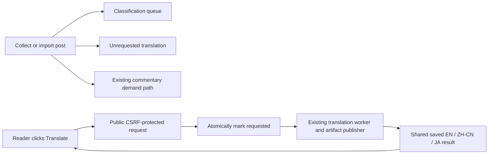

## Plain-English Summary

Exclude $META ticker posts and the phrase “meta analysis” only within the Meta search branch, while keeping routes for Llama models, Muse, official accounts and LG intact. Preserve attribution behavior for posts obtained through other searches. The owner accepts that much of the Meta AI business coverage lost by the earlier proposal is outside the priority.

New posts should be classified without automatically translating them. A reader can explicitly request a translation; the existing worker produces and saves it for reuse. Existing translations stay available. Commentary remains on its current request behavior and runs from original source context.

Verify both changes through the actual collection, worker, public feed and downstream reader paths, including concurrent requests and imported posts. About $4.34/day of translation spend was estimated over November 7–17, before any user requests; actual savings depend on usage and prices. The limited multilingual classifier trial is accepted by the owner, not proof of equal quality. The owner subsequently authorized implementation and testing on staging first; production deployment and production writes are not authorized.

<!-- BEGIN OLLIJA DELIVERY GUIDE -->
## Ollija Delivery Guide

Generated by `ollija annotate-plan`; do not edit between the markers. Delivery policy lives in `AGENTS.md` under "Plans and delivery". Project facts (host, repository, branches, environments, URLs and blueprints) live in `.ollija/project.yaml`. Record owner exceptions under Delivery Exceptions below.

- Plan: `/Users/fuchitalee/development/pushin-weight-v2/.worktrees/fix/meta-search-noise-20261118/docs/plans/2026-11-18-051700-fix-meta-search-noise-20261118-plan.md`
- Branch: `fix/meta-search-noise-20261118`
- Change: `fix-meta-search-noise-20261118-2026-11-18-051700`
- Active worktree: `/Users/fuchitalee/development/pushin-weight-v2/.worktrees/fix/meta-search-noise-20261118`
- Workflow: `plan`
- Delivery target: `staging`
- Route: `staged`
- Owner selection recorded: `true`

### Placement

This worktree is inside the Ollija release worktree area. Reuse it for the whole change. Do not create a second worktree or plan for this branch.

### Delivery steps

1. Complete implementation and the plan's verification contract.
2. Run the configured focused checks:
   - `pytest tests/ollija`
3. The parent workflow commits only this plan's changes, pushes the feature branch, and records the candidate SHA.
4. Fetch the remote staging lane: `git fetch origin refs/heads/staging`.
5. Require the unchanged candidate SHA to be a fast-forward of that fetched remote ref, then push the exact candidate SHA to `refs/heads/staging` with the server-enforced fast-forward command `git push origin <candidate-sha>:refs/heads/staging`.
6. Verify the remote staging ref resolves to the candidate SHA and the deployment for `pushinweight-staging-web` reports that same SHA.
7. Run staging checks. Stop here if they fail.

Occupied staging: if a staged route finds `staging` in use by an unrelated release while production is authorized, follow the occupied-staging default in `AGENTS.md`.
<!-- END OLLIJA DELIVERY GUIDE -->

## Delivery Exceptions

The owner clarified that this change has priority over the “Resume evaluator queue pass” session `01a1ec8e-e8d9-7ec2-b4c7-cdf0cf839337`. Proceed toward staging as soon as this candidate is ready, while preserving the other session's work and checking staging availability before use.

# Goal

Tighten the Meta branch with scoped $META and “meta analysis” exclusions, and make individual post translations explicit-user-request only. Preserve Muse and other call alternatives, attribution of posts collected elsewhere, classification, existing translations, and commentary behavior.

## Product Contract

- Touch the Meta search context, its search-specific policy wiring, and focused regression evidence. Preserve unrelated searches, attribution, schedule, credentials and historical records. No live provider call or deployment.
- Compare the production saved query inventory against the actual shared planner with complete Boolean expansion and UTF-8 request limits. Preserve independent account and Muse branches.
- Regression net: exercise policy loading, packing, cycle planner and backfill shared query path; check existing attribution contexts remain identical and other searches remain unchanged.
- Use the immediate latest-N production health check once; report its evidence as baseline, not post-deploy proof.
- Estimate sample recall/noise with clear sampling limitations; avoid declaring cost savings measured.
- P1 was notified of owner priority. Delivery is on request.
- R1. No additional model prompt or relevance-screening call for the Meta change; preserve the existing targeted query implementation and its measured limits.
- R2. With no explicit translation request, new or previously untranslated posts trigger zero literal-translation provider calls through scheduled, worker, replay, or backfill paths. Explicit operator-launched translation remains an explicit request; ordinary collection or a feed visit is not one.
- R3. An explicit reader action requests a shared translation for that post, displays pending/success/failure, and reuses an existing valid result across readers. Use the existing English, Simplified Chinese and Japanese bundle on demand; generating only one locale is not part of this change.
- R4. Classify without waiting for translation. The owner accepts the completed partial multilingual comparison as sufficient to proceed; do not add a classifier quality experiment or gate. Keep any available source language and source text; do not replace the removed translation with another paid language-detection call.
- R5. Keep existing commentary demand, prefetch, provider, prompt, display and storage behavior unchanged. Its source-context path must continue to work with no translated text. Preserve other downstream features and accurately surface any changed evidence availability.
- R6. Keep the endpoint and feed usable by the existing public audience, with CSRF protection, visibility checks, bounded requests and rate limiting. Test on staging first; do not deploy to or mutate production without separate authorization. Do not disrupt production harvesting.

## Key Technical Decisions

- KTD1 (session-settled: user-directed): change the existing Meta query only; the 72% noise / 18% loss result required a different attribution rule and is not a target claimed for this query.
- KTD2 (session-settled: user-directed): classify non-English source directly when translation is absent; the owner accepts the limited test and requests no further quality gate.
- KTD3: reuse the per-post `PostEnrichmentState`, existing translation artifacts, text/chunks, worker, and publication path. Add a typed `translation_requested` Boolean with application and persistent database defaults of false, owned by the post's enrichment state. This distinguishes explicit requests from pre-existing `pending` rows without a large synchronous rewrite or a second queue. Stage-aware eligibility and every dispatch/replay path must enforce the flag; pending but unrequested means intentionally not requested in projections. Preserve existing successes, failures and diagnostic history; first explicit requests atomically make the translation stage eligible, while repeated requests neither reset active attempts nor create duplicate work. No new table, retired table, or JSON column is planned.
- KTD4: use a separate, accessible Translate control, not feed visibility, polling, text expansion or commentary, as the request. Preserve the public feed and existing commentary interactions. Reuse the existing locale-complete translator; do not trigger translation during commentary.

## High-Level Technical Design

Translation lifecycle: unrequested → requested/pending → claimed → succeeded or failed. A request during a classification lease is retained and processed after the lease releases; a cached valid translation returns ready. Failure is visible and a deliberate retry follows bounded attempt rules. A stale result for changed source is not reused.

## Implementation Units

### U1. Preserve and verify the Meta search change

**Covers:** R1, KTD1. **Files:** `config/harvest_policy.yaml`, `x_monitor/harvest_policy.py`, `x_monitor/specs_from_policy.py`, `x_monitor/query_plan.py`, `x_monitor/query_packing.py`, `tests/test_meta_search_noise.py`, `tests/test_harvest_policy_regression_net.py`, `tests/fixtures/contextual_query_exhibit.json`.

Reuse the uncommitted implementation in this worktree. Review the complete before/after AND-alternative expansion, query byte limits, search-policy scope and author constraints. Preserve Muse, official accounts, Llama model routes, unrelated brands and all post-fetch attribution. The previous 148 passing tests and query diff are evidence for the then-current Meta code; rerun only if the relevant code, fixtures or assumptions change.

**Tests:** the real policy → planner → scheduled/backfill query path scopes both exclusions only to Meta; other alternatives and attribution are unchanged; request limits hold; representative retained Llama and excluded stock/meta-analysis examples match the frozen query comparison. No live X provider call is needed.

### U2. Add explicit translation request ownership and queue eligibility

**Covers:** R2–R4, KTD2–KTD3. **Files:** `core/models.py`, a new `core/migrations/` migration, `monitor/enrichment_queue.py`, `monitor/cycle.py`, `monitor/enrichment_worker.py` or the actual worker entry point, `monitor/backfill_collection.py`, `monitor/backfill_promotion.py`, `monitor/management/commands/`, and related tests.

Extend the existing one-to-one enrichment state with the Boolean described in KTD3; inspect all state creators, bulk writers, succeeded-artifact repair and stage dispatches before changing them. Default false for new and existing rows at migration time, without rewriting saved translation artifacts. The database default must remain in place while old application versions can insert rows, including bulk inserts; deploy the compatible schema before code that reads the field. Old workers do not enforce the flag, so the zero-automatic-call guarantee begins only after all active caller versions converge; verify convergence without interrupting live collection. New posts and historical collection jobs classify normally even if translation is unrequested. Keep scheduled and backfill claims scoped to their owners; allow a reader's requested translation on a post owned by a historical collection job to reach a live worker without stealing or executing that job's classification. Make requested translation independently eligible through the actual shared lease and attempt-budget path, including requests arriving while classification is in flight. Bound total anonymous-request translation work across clients and workers with an atomic, durable configurable budget or throughput reservation, reusing existing budget storage where its semantics fit; keep classification capacity independent and show deferred work honestly when the limit is reached. Handle worker death, source changes, retry limits and explicit retry without losing requests or multiplying provider calls. Continue serving historical saved translations, including legacy fallback.

**Tests:** production caller with fake provider proves new and replayed/imported unrequested posts cause zero translator calls and still classify; a click dispatches and publishes through the real worker path; multiple simultaneous requests coalesce; request during classification lease survives; historical-job-owned post completes without changing job ownership; existing pending/failed/succeeded and stale-source records behave as specified; crashes and retry exhaustion do not create a hot loop. Distinct clients and concurrent workers cannot exceed the configured aggregate reservation, and exhausted translation capacity does not block classification. Include PostgreSQL concurrency tests on an authorized test database and a production-call-chain regression, not only helper tests. Verify old-version ordinary and bulk inserts against the migrated schema and online mixed-version rollout with active writers; never pause harvesting.

### U3. Add public request and feed interaction

**Covers:** R2–R3, R5–R6, KTD3–KTD4. **Files:** `monitor/views.py`, `monitor/urls.py`, `monitor/post_artifacts.py`, `monitor/templates/monitor/_feed_initial_v22.html`, `monitor/static/pw-feed.js`, locale files and focused feed/API tests.

Add a bounded, idempotent POST request/status contract, applying the current public-home audience, CSRF, post visibility and per-client rate-limiting conventions. Polling is read-only and never starts work. Provide a distinct keyboard-accessible Translate control on both initial server-rendered and dynamically appended rows, with accurate not-requested, pending, ready and failure/retry states. Show the requested locale's literal translation when it becomes ready, unless the reader has since changed selection or navigated away; source text and existing translations remain usable while waiting. Do not make scrolling, changing locale, refreshing, text expansion, commentary, or a status poll initiate translation. Guard stale responses after filters, rows or locale change, and simultaneous commentary updates from overwriting literal results. Preserve the current commentary triggers and text-cycling behavior.

**Tests:** anonymous public user with CSRF can request; missing CSRF, out-of-scope/nonexistent IDs, excessive batches and rate limits are rejected; polling never creates work; two readers share one request/result; saved results require no provider call; first page and appended rows support pointer and keyboard; source fallback, locale switching, failure/retry and navigation races behave correctly. When commentary already exists, a successful request displays the literal translation without stealing keyboard focus; a late response does not override a newer user choice. Browser-test the real rendered feed and request path without paid provider calls.

### U4. Keep downstream readers and operational status correct

**Covers:** R3–R5, KTD2–KTD4. **Files:** `monitor/views.py`, `monitor/general_readers.py`, `monitor/post_enrichment.py`, `monitor/post_synthesis.py`, `monitor/trend_narrative_candidates.py`, `monitor/trend_narrative_packet.py`, `monitor/trend_narrative_generation.py`, `core/product_release_sources.py`, `core/product_release_intake.py`, health/backfill verification and related tests.

Report unrequested translation as normal, not pending or failure; update completion/health and backfill reporting without falsifying that a translation succeeded. Translation currently supplies `lang_detected` in some paths: retain trustworthy incoming language where present, normalize known upstream language for display/filtering where appropriate, and show unknown honestly without charging for language detection. Trace language filters and aggregate counts and document any unavoidable change in coverage. Commentary continues using original post, quote and parent context with its existing request policy. Characterize product-release and headline/trend readers with original non-English source and no saved translations: translations are optional inputs, but their absence can change release signals, headline evidence or language availability. Do not replace missing content with invented text or extra provider calls.

**Tests:** unrequested is neither stuck nor failed in feed/health/backfill; known and unknown languages are represented honestly; existing saved-language filters remain correct; commentary still requests and generates from source without translation; release and headline source packets remain valid and evidence-grounded for non-English untranslated posts; classification and existing saved artifacts remain readable. Assert both the expected source fallback and the known loss of optional translated evidence rather than declaring outputs identical.

## Verification Contract

- Run focused query, queue, translation, API, feed, classification, historical import and source-reader tests, including PostgreSQL lease/concurrency cases and at least one actual call-chain test per behavior. Run Django migration/system checks and relevant JavaScript and browser checks; use fakes for paid services. Check both server-rendered and appended feed rows.
- Reuse the existing Meta evidence only while its covered files/fixtures remain unchanged. Record failures, skips, exact test scope, revision and any pre-existing lint findings accurately.
- Verify no automatic translation provider request across new-post, carryover, replay, backfill, commentary, visibility and polling paths. Verify explicit requests produce one shared persisted result and the no-request path saves costs without blocking classification.
- During implementation, follow the harvester and UI skills, trace all status consumers and migrations, and preserve live operation. The existing latest-20 snapshot below is a baseline, not post-deployment proof. The owner requested staging testing first; verify the staging service and database are available, deploy the candidate there using the project's authorized route, and check the running revision and behavior without disrupting production. This does not authorize production deployment or production data writes.

## Definition of Done

The scoped Meta query is preserved and verified; an untranslated post is classified and displayed without automatic translation; a public reader can explicitly request and reuse a translation; commentary request behavior is unchanged; status, historical imports, concurrent workers and downstream source readers behave as specified; all relevant checks are recorded. No unsupported claim of classifier parity or realized dollar savings is made.

## Evidence

- Production query comparison (November 18): 16 calls before and after; 963 alternatives on each side, 949 equivalent and 14 intentionally narrowed. B1 request including author exclusion and time bounds: 390 to 416 UTF-8 bytes. Local parser comparison does not establish provider semantics.
- Historical sample replay in the November 11 handoff estimates the query-only change removes 23% of strict Meta-only noise and 4% of the relevant posts, saving approximately $0.24–0.34/day; these are historical estimates, not observed production savings. The 72% noise reduction and 18% signal loss also required a separate attribution change and do not apply to this query-only change.
- Immediate latest-20 production health baseline at 14:18 JST: healthy_with_pending, 0 complete / 20 pending / 0 unhealthy, regression inconclusive; acceptance failed because fresh pending posts had no language/commentary yet. This is not a post-deployment check. Cohort: 2122871582645424575, 2122871802250641734, 2122872020669272552, 2122872433585913868, 2122872572593496303, 2122872595016216609, 2122874811655577911, 2122864419348832473, 2122864428760850811, 2122864482330481020, 2122864825957265636, 2122865245148397598, 2122865642231800109, 2122866165802574147, 2122866290771755392, 2122866869799702607, 2122867029548159064, 2122867276139430018, 2122867475847274509, 2122867478107967909.

- Verification: 148 offline planner, policy, query-comparison and regression tests passed; zero skips/errors. Ruff passed on the other changed Python files; `specs_from_policy.py` retains two independently verified pre-existing lint findings on origin/main. The full comparison HTML was copied and opened locally with matching SHA-256.
- Local verification: 152 queue, API, backfill and browser tests passed (149 PostgreSQL-required); the saved-paid-reply worker path and rapid-click browser check passed separately after the review fixes. Migration 0227 timed out against a deliberately held table lock and applied after release. The affected UI gate failed its screenshot comparison; the exact same 7 desktop pixels and 3,713 mobile pixels failed on an untouched archive of starting revision `44a98074`, so this is pre-existing evidence, not a passed check.
- Open review concern: the legacy translator route does not produce Japanese. Current staging and production configuration use literal translation v2; the endpoint now reports a missing locale as failed instead of succeeded, but the legacy route still cannot satisfy a Japanese request. Resolve this before claiming full locale support under that configuration.
- Read-only production follow-up at 16:55 JST: the exact 20-post cohort checked after 16:24 is healthy, with 20 complete, zero pending and zero unhealthy. This is a baseline of the existing deployment, not evidence of this candidate in production.
- Incomplete or unresolved historical paid replies remain owned by their historical job and appear as deferred while the feed continues read-only polling. The reader replay does not issue provider requests or change the historical retry schedule; complete cached packets are reused. An inactive historical job with an incomplete packet still needs that job to resume or be reconciled before that translation can complete.
- Staging integration: both main-first and staging-first migration histories upgraded through `0228` in separate empty local databases. The merged harvester/translation suite passed 173 tests (154 PostgreSQL-required, no skips); the combined graphics/Chatter run passed 346 tests, with one stale UI fingerprint fixed and verified separately. The opt-in real graphics worker/broker test passed separately in its own database. The Chatter migration regression now restores every migration leaf and refuses rollback when newer data would be lost.
