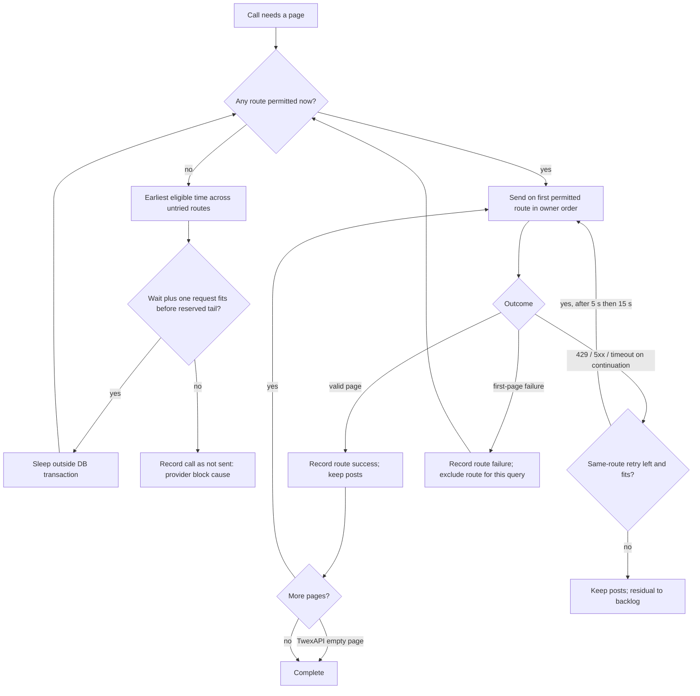
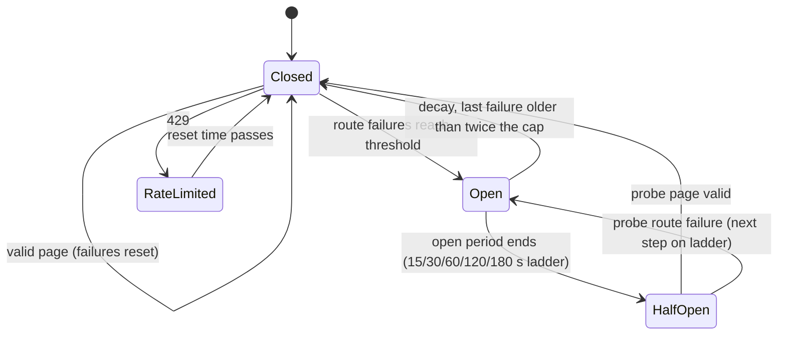
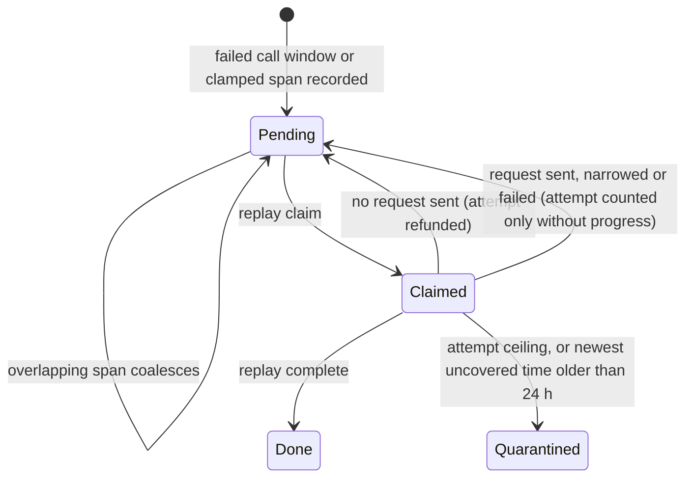

<!-- BEGIN OLLIJA DELIVERY GUIDE -->
## Ollija Delivery Guide

Generated by `ollija annotate-plan`; do not edit between the markers. Delivery policy lives in `AGENTS.md` under "Plans and delivery". Project facts (host, repository, branches, environments, URLs and blueprints) live in `.ollija/project.yaml`. Record owner exceptions under Delivery Exceptions below.

- Plan: `/Users/fuchitalee/development/pushin-weight-v2/.worktrees/fix/feed-collection-recovery-20261123/docs/plans/2026-11-24-012909-fix-feed-collection-recovery-20261123-plan.md`
- Branch: `fix/feed-collection-recovery-20261123`
- Change: `fix-feed-collection-recovery-20261123-2026-11-24-012909`
- Active worktree: `/Users/fuchitalee/development/pushin-weight-v2/.worktrees/fix/feed-collection-recovery-20261123`
- Workflow: `plan`
- Delivery target: `production`
- Route: `direct`
- Owner selection recorded: `true`

### Placement

This worktree is inside the Ollija release worktree area. Reuse it for the whole change. Do not create a second worktree or plan for this branch.

### Delivery steps

1. Complete implementation and the plan's verification contract.
2. Run the configured focused checks:
   - `pytest tests/ollija`
3. The parent workflow commits only this plan's changes, pushes the feature branch, and records the candidate SHA.
4. On the owner-selected direct route, fetch the remote production lane: `git fetch origin refs/heads/main`.
5. Require the same unchanged candidate SHA to be a fast-forward of that fetched remote ref, then push the exact candidate SHA to `refs/heads/main` with the server-enforced fast-forward command `git push origin <candidate-sha>:refs/heads/main`.
6. Verify the remote production ref resolves to the candidate SHA and the deployment for `pushinweight-web` reports that same SHA before reporting completion.
7. After step 6 succeeds, perform worktree cleanup as the final filesystem action:
    - From `/Users/fuchitalee/development/pushin-weight-v2`, require `/Users/fuchitalee/development/pushin-weight-v2/.worktrees/fix/feed-collection-recovery-20261123` to remain registered, clean, unlocked, and at the verified candidate SHA. If any guard fails, retain it and report the reason.
    - Run `git -C /Users/fuchitalee/development/pushin-weight-v2 worktree remove /Users/fuchitalee/development/pushin-weight-v2/.worktrees/fix/feed-collection-recovery-20261123` without `--force`.
    - Preserve the local and remote feature branches. Continue final reporting from the authoritative repository root.

Occupied staging: if a staged route finds `staging` in use by an unrelated release while production is authorized, follow the occupied-staging default in `AGENTS.md`.
<!-- END OLLIJA DELIVERY GUIDE -->

## Delivery Exceptions

- 2026-11-24 ~11:40 JST: owner asked to run this plan autonomously ("lfg to deployment"), selecting production as the endpoint. The owner chose no route, so the staged default applies, and the occupied-staging default in `AGENTS.md` still holds. KTD12's one-release-at-a-time sequence and four-cycle watch still apply.
- 2026-11-24 13:15 JST: `origin/staging` (`fa85d9d3`) holds unrelated Chatter release commits that are not on `main`, so a fast-forward to staging is impossible. The route switches to direct production under the occupied-staging default in `AGENTS.md` (owner default, 2026-11-09).
- The shared local test database lacks main's migration 0239. Applying it was blocked by the session's permission guard. Database-backed tests therefore run in the pull-request CI workflow (`backfill.yml`, PostgreSQL service) until the owner applies 0239 or approves it.

# Harvester Collection and Classification Recovery - Plan

## Plain-English Summary

The goal is to get new-post collection and classification back as close as possible to last Tuesday, November 17. That day the harvester saved 27,781 new posts and classified 100.0% of them. On November 24, through 10:00 JST, collection was running at roughly a third of the matching Tuesday slots, and about 6–7% of new posts were heading toward permanent classification failure. The owner's rule is that only a provider (TwitterAPI.io, TwexAPI or the classification model's host) refusing or limiting us may explain a remaining shortfall. Most of today's loss is our own code, not the providers.

The search job fails fast instead of waiting. TwitterAPI.io is genuinely degraded and TwexAPI occasionally refuses a request. When that happens, our code blocks every route at once and then skips the remaining keyword searches within a second. Two-thirds of today's scheduled searches never sent a request, while the job left most of its 13-minute budget unused. Missed time windows then pile up in a retry queue that charges attempts without sending anything. On the classification side, the largest failure today is a rule of ours: it throws away a valid, paid classification whenever a post promotes a name that two tracked brands share, such as `openai` or the shared Gemini and Gemma accounts.

The plan changes the search job so every keyword search really reaches a provider each run. It waits for a blocked route to reopen within the run's time budget, retries a refused page on the same provider, stops one hiccup from blocking a provider for three minutes, and treats a short TwexAPI page followed by an empty page as a finished search. That last rule applies to TwexAPI only, as the owner chose. Missed windows stay queued without being charged retries they never received. The classification change keeps valid classifications instead of discarding them, stops a re-check loop from turning good classifications into failures, and records the real cause of every failure, so a provider refusal can be told apart from our own rejection. Search keywords, the 15-minute schedule, translation and the classification model do not change. The plan does not recover posts lost before the fix, except the missed windows already in the automatic retry queue.

Completion is proved in production, not by "the job exited successfully." A read-only report compares every 15-minute slot with the same slot on November 18–20 for volume and November 17 for classification. It shows how many of the 16 keyword searches reached a provider, how many posts were saved, the classification success rate, and whether each shortfall was caused by a provider or by us. Each release goes through a pull request so the automated tests run. Each one is then watched for at least four production runs before the next.

Owner decisions already made: a TwexAPI search ends at its first empty page and counts as finished (TwexAPI only; no evidence exists that TwexAPI returns results after an empty page). The scheduled job stops using the on-demand TwitterAPI key and falls back straight to TwexAPI. Volume is judged against November 18–20, because the deliberate Meta search exclusion added on November 18 stays. Neither key can be removed from the harvest job. The TwexAPI account is pay-as-you-go, whose packs allow much faster requests than our current 6-second spacing; the plan shortens that spacing only after a measured check. Deployment is not authorized by this plan.

---

## Goal Capsule

- **Objective:** each 15-minute harvest saves as many new posts, and the classification worker classifies as large a share of them, as the baseline did (Nov 18–20 for volume, Nov 17 for classification). Any remaining shortfall is attributable, slot by slot, to a recorded provider refusal or limit.
- **Means:** search waits for and retries routes instead of skipping keyword searches (KTD1–KTD4), missed windows are covered without phantom attempts (KTD6), and classification stops discarding valid results and records causes (KTD8–KTD10).
- **Authority hierarchy:** the owner's current instructions, then `AGENTS.md` and the change-harvester and avoiding-recurring-mistakes skills, then this plan. The plan's research notes are evidence, not instructions.
- **Stop conditions:** stop and report if a unit cannot meet its call-chain proof without pausing the live harvest. Also stop if a change would need a schema migration, a production data rewrite, paid probes or a backfill. Stop, too, if evidence shows TwexAPI's end-of-results rule loses posts (U5 check), or if the on-demand key conflict blocks a unit.
- **Execution profile:** code change in the worktree `.worktrees/fix/feed-collection-recovery-20261123`, branch `fix/feed-collection-recovery-20261123`, base `b71090c1` (equal to `origin/main` at planning time). The live harvest keeps running throughout.
- **Who finishes:** implementation and local verification by `ce-work`. Commit, pull request, merge and deployment only on a later explicit owner request; `delivery_target` stays `on-request`.

---

## Product Contract

### Summary

Restore baseline collection by making every scheduled keyword search reach a provider each cycle. Keep missed windows recoverable without phantom retry charges. Keep valid classifications, and record a cause for every remaining shortfall so the owner can verify that only provider limits remain.

### Problem Frame

Verified from production, read-only, on 2026-11-24. All times are JST.

- **Volume.** New posts per day by `posts.fetched_at`: Nov 17 27,781; Nov 18 26,021; Nov 19 23,888; Nov 20 21,362; Nov 21 11,522; Nov 22 12,072; Nov 23 9,016; Nov 24 3,494 through 10:00. For the 07:15–09:30 slots, Nov 17 inserted 2,282 posts and Nov 24 inserted 815 (36%).
- **Provider events.** TwitterAPI.io began returning 503 on Nov 21 at 13:00, a real outage. Until Nov 23 around 12:00 the cron stayed on the single-provider path (60 s timeout, two retries, no circuits) and still sent 150–200 search requests per hour. Collection tracked provider health, recovering to 600–750 posts per hour on Nov 23 05:00–12:00 with about 15% 503s.
- **Our regression.** From Nov 23 around 12:00, scheduled requests began carrying `request_config` route labels. That marks the multi-route path (circuits, 15 s timeout, no retries). It is activated by credential presence: the TwexAPI key is not in `render.yaml` for any service, so it was most likely set in the Render dashboard. Requests sent fell to 27–70 per hour and never recovered.
- **Mechanism.** Since the 07:06 deploy of `b71090c1`, 7 of 9 cycles had 12–13 of their 16 calls send no request. Of today's 672 scheduled search scopes, 442 sent nothing, 178 were partial and 10 complete. The sequence repeats every cycle:
  1. Call A times out on both TwitterAPI.io credentials, so both circuits open for 180 s.
  2. TwexAPI serves A and B1.
  3. One TwexAPI 429 or 503 opens TwexAPI's circuit.
  4. `_choose_search_provider` raises "no configured search provider is available" for every remaining call.
  5. Cycles still run 390–760 s, mostly in backlog replay and metrics refresh against the failing provider.
- **Provider facts.** Since Nov 24 00:00 TwexAPI answered 476 of 523 requests with 200, 37 with 429 and 10 with 503. Requests are about 7.4 s apart. 429s are not pace-driven: 16 of 37 came on the first request of a burst, and none recorded a `Retry-After`. A retry within 10 s succeeded 6 of 9 times. Since Nov 23 14:30, TwitterAPI.io answered 134 requests with 200 and 21 with 503, and 172 hit our 15 s timeout.
- **Missed windows.** 96 `search_failed` windows are pending with zero attempts, spanning 36.1 hours since Nov 23 14:31. Replays today were charged attempts or quarantined after about 50 ms, with no request sent. Once a call has 8 pending windows, newly missed intervals are refused (`capacity_refused`) and silently lost. TwexAPI-served searches are always recorded partial: TwexAPI ends 196 of 287 searches with an empty page that still offers a cursor, and 192 of those 196 had a short page just before it.
- **Classification.** Success by fetch day in `post_enrichment_states`: Nov 17 100.0%; Nov 18 94.7%; Nov 19 98.4%; Nov 20 94.0%; Nov 21 85.0%; Nov 22 84.0%; Nov 23 87.5%; Nov 24 93.3% with 240 still pending. Today's pending reasons are:
  - `classification_promotion_identity_ambiguous` 146
  - `classification_content_response_invalid` 37
  - `classification_transport_error` 33
  - `classification_incomplete` 21

  The ambiguity rule fires because 57 catalog names belong to more than one tracked brand, for example `openai` (gpt, openai), `nvidia`, the Gemini/Gemma accounts and `chatglm`. Several of those duplicate owners are product-identity publisher brands (`publisher`, `publisher-<hash>`). 1,379 posts classified during the Pulse period were re-attempted after the Nov 23 21:40 switch back to `two_role`, and 249 of them are now `failed`.
- **Process.** 79 of 112 commits since Nov 18 went straight to `main`, and workflows run only on pull requests, so those pushes ran no automated tests. None of PRs #84–#92 had a review. The search fixes of Nov 23–24 were eleven fix-on-fix revisions in 58 hours, and none touched the line that skips searches when every circuit is open.

### Requirements

**Search reaches a provider**
- R1. Every scheduled call sends at least one physical request each cycle. The only exceptions are calls whose recorded cause is the existing query-length cap or credit ceiling, or a provider-imposed block: every route in provider-caused cooldown or rate limit until the search share of the cycle ended.
- R2. A transient provider refusal of one request (429, 5xx or timeout) does not block other calls or later cycles any longer than the provider's own condition requires.
- R3. Received posts are never discarded, and a continuation token is never moved to a different provider or credential.
- R4. Live searching never starves the rest of the cycle: the steps after search keep a reserved share of the 780 s deadline.

**Coverage and missed windows**
- R5. A TwexAPI search ends complete at its first empty page, whether or not that page offers a cursor and whether or not earlier pages returned posts. If evidence ever shows TwexAPI returning posts after an empty page, the rule becomes: stop at the second consecutive empty page. TwitterAPI.io end-of-results rules do not change.
- R6. A missed time interval is either searched or recorded in the backlog. Neither the lookback clamp nor capacity refusal may silently drop it.
- R7. A backlog replay consumes an attempt only when it sent a physical request.

**Classification**
- R8. A valid classification is published when a promoted subject matches a catalog term owned by more than one tracked brand. Only that subject is dropped, and the drop is recorded.
- R9. Re-checking a previously succeeded classification can never leave the post worse than before: a failed re-check keeps the prior success.
- R10. Every classification failure records a cause from a closed list. The list separates provider refusals (HTTP 402, 429, 5xx, provider timeout) from our own rejections (validation, deadline, merge, publication).

**Proof**
- R11. Each cycle records, per call, whether a request was sent and why not. A read-only report compares each 15-minute slot with the same slot on the baseline days (Nov 18–20 for volume, Nov 17 for classification), splitting each shortfall into provider causes and our causes.
- R12. The scheduled harvest can be switched between the multi-route and single-provider search paths by one explicit, recorded setting instead of by credential presence.

### Key Decisions

- **A TwexAPI search ends at its first empty page and counts as finished; TwexAPI only.** No evidence exists that TwexAPI returns posts after an empty page: 0 of 262 TwexAPI searches in production and none of the Oct 20 trial chains ever continued past one. If such evidence appears, stop at the second consecutive empty page instead. Governs R5. (session-settled: user-directed — chosen over "only a short page followed by an empty page counts as finished" and over "keep every TwexAPI search unfinished": the owner said TwexAPI is different, should have its own rules, and must not change TwitterAPI.io's)
- **The scheduled job does not use the on-demand TwitterAPI.io key.** Owner, 2026-11-24: both TwitterAPI.io keys are unreliable together ("either tapi is down or not"), and the earlier difference between them looked incidental. Scheduled order becomes `twitterapi:scheduled, twexapi`. TwexAPI stays wired in as the fallback. This matches the `AGENTS.md` credential-purposes rule, so no amendment is needed. Neither key may be removed from the harvest job. Governs R1, R2.
- **TwexAPI account is pay-as-you-go.** Owner, 2026-11-24. TwexAPI's pay-as-you-go options are one-time credit packs: Mini 1 request/s, Standard 5/s, Scale 20/s (`twexapi.io/pricing`, fetched 2026-11-24). All are faster than the 6 s pacing, which is the Starter trial figure. Governs R1 through KTD13.
- **Scope is live collection plus our own classification rejections.** Translation (on demand since Nov 18) and recovery of posts already lost outside the existing backlog are planned separately. Governs R1–R11. (session-settled: user-approved — chosen over adding a paid recovery backfill to this plan and over a search-only plan: the owner confirmed the recommended scope)
- **The owner's acceptance rule: only provider limitations explain a shortfall against the Nov 17 baseline.** Owner instruction, 2026-11-24. Governs R1, R10, R11.

### Success Criteria

- S1. Over 24 hours after the search release: all 16 calls send a request in at least 95% of cycles, and every miss has a provider-caused reason. Zero calls end without a request because of our own route selection or deadline policy.
- S2. In hours when either TwitterAPI.io answers at least 95% of requests with 200, or TwexAPI serves all calls with at least 90% 200s, posts per slot reach at least 85% of the average of the same slot on Nov 18, 19 and 20. That window is the owner's baseline, because the Meta search exclusion added on Nov 18 is intentional and stays. Every lower slot shows provider-caused receipts. The 85% anchor is day-to-day variation: daily totals within Nov 18–20 differ by up to 18%.
- S3. Zero backlog replays charged without a request, and zero `capacity_refused` transfers. The pending window count falls cycle over cycle while providers are healthy.
- S4. Posts fetched in the 24 hours after the classification releases (1 and 3), measured 12 hours later: zero `classification_promotion_identity_ambiguous`, zero previously succeeded posts turned `failed` by a re-check, and every failure carries a cause from the R10 list. Interim bar: at least 97.5% succeeded. On Nov 24, removing the 146 ambiguity rejections from about 3,494 posts leaves about 2.6% in other codes, of which transport errors may still succeed on retry. The 99.5% bar applies after the KTD11 follow-up.

### Scope Boundaries

- Search queries, keywords, brand set, the 16-call shape, the 15-minute schedule, provider order for non-scheduled callers, the classifier model and prompts, and translation do not change.
- No schema migration, new table or JSON column (0 tables added, 0 retired). Causes and markers use existing string columns.
- No cron pause, provider probe, backfill run, production data rewrite or deployment under this plan.
- The 15 s TwitterAPI.io search timeout stays (KTD5).

#### Deferred to Follow-Up Work

- Recovery of posts missed outside the existing backlog: Nov 21 13:00 onward, `capacity_refused` gaps and the 93 quarantined windows. This needs a paid X post backfill and owner authorization.
- Re-queuing the roughly 7,600 classifications already `failed` (`manage.py recover_enrichment`, a production write plus paid calls). Run it only after U7–U9 are live.
- Cleaning the 57 duplicate catalog names. The publisher brands come from Pulse product identity (P2); data ownership stays with P2.
- Classification fixes that depend on U9's cause data (KTD11): per-pair budget deferral, isolating posts with invalid responses, and the merge rule for "content classified, brand unknown."
- The 12,000-plus classifications pending with zero attempts from October 20–24. These are historical, outside the fresh lanes.

---

## Planning Contract

### Key Technical Decisions

- KTD1. **Wait for the earliest eligible route instead of failing.**
  - When no route is permitted, `XClient._iter_search_pages` asks each route not yet excluded for this query when it next becomes eligible (`open_until`, probe lease, rate-limit reset). It sleeps outside any database transaction until then, if the caller admits that wait plus one request, and selects again.
  - An open route is always used before any waiting.
  - Only a route failure (KTD2) excludes a route for the current call. A 429 or an unobtained TwexAPI pacing slot (`XClientRouteUnavailable`, no request sent) makes that route eligible again at a known time, instead of excluding it. Today one TwexAPI 429 can make a call wait up to 180 s for TwitterAPI.io.
  - Eligibility is read without claiming a probe. The probe lease is claimed only after the TwexAPI pacing slot is obtained, and is released on every outcome that is not a route result, including other 4xx and the deadline `TimeoutError`.
  - Waiting is charged to the search share (KTD3), not limited to once per client.
  - This replaces both earlier wait forms: the ≤30 s in-place wait of `93dcff1b` and the once-per-cycle wait after a 429 of `b71090c1`.
  - Rationale: the cascade comes from the immediate raise at `x_monitor/x_client.py:623` (from `12989590`), and no later revision touched it. Waiting inside `XClient` is required because the staging wrapper allows one `run_search` per cycle (`monitor/staging_acceptance.py:740-746`) and lineage requires the same window (`core/x_cycle_lineage.py:256-272`).
- KTD2. **Count only route-health failures against a route, and record success on every valid page.**
  - A route failure is a transport error, a 5xx, a timeout or a 401.
  - Query-content outcomes do not touch the route: an empty continuation, a repeated cursor, a duplicate-only page, or an empty page where the heuristic expected results. These outcomes only decide that query's completeness.
  - A 429 keeps its own rate-limit path (`record_rate_limit`).
  - With that split, recording success per page is safe. This answers why `e6a0dbc2` removed per-page success: a route failing only on continuations never opened. A test now pins that a route failing transport on every continuation still opens.
  - Threshold stays at the cron's configured 2. Add a startup log line printing the resolved threshold and cooldown, because the code default 1 differs from the cron's env value 2.
- KTD3. **Escalating cooldown with decay, capped at today's value.**
  - After the threshold, the open period follows 15, 30, 60, 120 and then 180 s as consecutive failures grow. This matches the providers' own retry guidance: TwitterAPI.io advises 5/15/30/60 s and TwexAPI 5/15/45/120 s (`docs.twexapi.io/guides/error-handling`). The 180 s cap means the worst case is never longer than today.
  - Consecutive failures decay to zero once the last failure is older than twice the cap, so yesterday's failures do not lengthen today's first cooldown.
  - Derived from `consecutive_failures` and `updated_at` on `search_provider_circuits`; no schema change.
  - Per-cycle failure budget: while another route is healthy, a TwitterAPI.io credential that has had 3 route failures in this cycle is skipped for the rest of the cycle. This is process-local; shared rows are unchanged. Without it, alternating successes and failures never open the circuit. At about 41% success and 15 s per timeout, the remaining TwitterAPI.io credential could still burn 10–20 timeouts and 150–300 s of a 540 s search share. Baseline volume on TwexAPI alone needs about 300–450 s at 7.4 s per request, so the budget must hold.
- KTD4. **Retry a refused page on the same route.**
  - A continuation page refused with 429, 5xx or timeout is retried on the same route and cursor, up to two more times, after 5 s and then 15 s, when the deadline admits it. This follows TwexAPI's "retry the same cursor, not the next page" guidance and restores part of the baseline's per-page retry (removed by `93dcff1b`).
  - A first-page failure keeps the existing failover to the next route.
  - A 429 without `Retry-After` uses the same 5/15 s steps instead of the 6 s default.
  - No cross-provider re-search of the remainder. The existing walk loop at `monitor/cycle.py:2992-3113` stays disabled under a deadline (since `84377b43`).
- KTD5. **Keep the 15 s TwitterAPI.io search timeout and zero first-page retries.** The observable latency is censored at 15 s, so a longer timeout cannot be justified from current data. Failover to TwexAPI is faster than waiting out a degraded provider. Recorded as a deliberate choice so it is no longer an unreasoned setting.
- KTD6. **Search admission envelope from the client's effective settings, plus a reserved tail.**
  - `_fetch_tweets` and `_replay_backlog` currently admit pages and replays on `api.timeout_s × (api.max_retries + 1) + 8 = 188 s` (`monitor/cycle.py:2917-2921`, `5404-5408`). The multi-route client never uses those settings.
  - The multi-route client exposes its own envelope: search timeout × attempts plus the TwexAPI pacing-slot wait (30 s) plus 8 s. The replay claim expiry (`monitor/cycle.py:5418-5419`) follows it.
  - The single-provider client keeps 188 s. `api.timeout_s`, `api.max_retries` and `run_deadline_seconds` do not change, because they feed the scheduled job identity (`monitor/cycle.py:5861-5875`), metrics refresh and list reconciliation.
  - Search waits and pages start only while more than a reserved tail remains. The tail is computed in code, not written as a literal: the rare-type drain allocation (`config.yaml` 60 s) plus one metrics-refresh chunk envelope (188 s), plus the 630 s inline enrichment gate when `harvest.enrichment.mode` is `inline`. Production runs worker mode: the cron claims 0 posts per cycle on both Nov 17 and Nov 24.
- KTD7. **TwexAPI end-of-results per the owner's rule, inferred from the request ledger.**
  - The rule (R5) is implemented only in the TwexAPI branch of `_iter_search_pages_once`: an empty page ends the walk with `has_more = False`, including an empty first page. For TwexAPI first pages, the expected-results heuristic (`observe_query`) no longer turns an empty page into a route failure; the owner accepted that tradeoff.
  - The evidence is the existing request rows (`returned_count`, `cursor_after`), so the report and later audits can recompute every inferred end without a new marker.
- KTD8. **Cover clamped intervals by recording them.**
  - When `_read_cursor_since` clamps a stale cursor to the lookback floor (`monitor/cycle.py:1840`), the cycle logs it. It records the clamped span as a pending backlog window through `HarvestBacklogWindow.objects.normalize_residual`, which coalesces it with the overlapping failed windows into one row per call.
  - This replaces widening the merge tolerance or refusing at the cap.
  - Spans older than `max_age_hours` (24) are logged and counted, not queued; they belong to the deferred recovery backfill.
  - This is load-bearing once calls can wait. A call reached 370 s later than in the previous cycle would otherwise silently lose 370 s of its window to the clamp, because a window ends when the call runs (`monitor/cycle.py:5970`).
  - When a failed call's window is accepted into the backlog, the cursor advances. Ownership has moved to the backlog row, which is the same hand-off the truncated path already uses. When the transfer is refused, the cursor is held as today. This keeps the "a provider failure must not drop a cursor" amendment and stops clamp spans re-queuing intervals the backlog already owns.
  - Age-based quarantine uses the window's newest uncovered time (`remaining_until`) instead of `first_seen_at`, so coalescing does not age out fresh spans.
- KTD9. **Replay attempts follow physical requests; replay count follows time.**
  - A claim that sent no request (no `on_exchange_start` for its scope) has its attempt refunded and is returned without counting toward quarantine.
  - A replay that narrowed its window does not count toward the attempt ceiling.
  - Replays run while the KTD6 tail allows, up to a ceiling of 8 per cycle (`replays_per_cycle` 2 → 8). That drains the current 96 windows in about 12 cycles without a burst.
  - The loop stops at the first replay that could not send, and skips windows already tried in this run (`claim_run_id`).
  - `replay_truncated` returns get the same +15 min delay as failed replays.
  - Claim expiry covers the replay envelope plus the longest admitted route wait.
  - The "expected results" heuristic (`search_provider_circuit.py:147-161`) is not applied to replays or narrowed windows, because it ignores window width.
  - Replay coverage is recorded under `x_query_replay` scopes. Chart Harvest coverage reads only `x_query`, so a recovered window does not retroactively complete an earlier cycle's coverage. That is accepted and documented.
- KTD10. **Explicit search-path switch.**
  - The provider list setting (for example `X_DATA_PROVIDER_ORDER` on the cron) is declared in `render.yaml` for `pushinweight-harvest` with its current dashboard value, read first, so activation no longer depends only on a dashboard secret and a Blueprint sync changes nothing.
  - A routing setting `single` selects the baseline single-provider client regardless of credentials. A test pins that `single` reproduces baseline request behavior: 60 s, two retries, no circuits.
  - Secret values stay out of git.
- KTD11. **Classification: keep valid results, bound re-checks, record causes; defer the rest until measured.**
  - Remove the legacy multi-owner raise at `monitor/classification_persistence.py:190-192`. The Pulse path already drops such subjects; see `tests/test_promotion_subject_matcher.py`, test `test_shared_company_term_discards_a_subject_with_multiple_owners`. The term and its owners are logged through the existing `discard_records`.
  - Bound the `ea9a0f44` revision re-check (`core/product_release_detection_queue.py:316-327`) to one re-run per post. A failed re-run restores the prior `succeeded` state and its publication.
  - Record causes from a closed list.
  - Batch isolation, deferral and merge-rule changes wait for one day of cause data. Earlier changes this week (Pulse capacity, `354c50be` input change) shipped without measurement, and the audit found D8c, D8d and D8e would repeat that.
- KTD12. **Release in small, separately verified steps through pull requests.** Releases are 1, U7 and U10 (classification worker; urgent, because pending posts become permanent failures 10.6 hours after their first attempt); 2, U1–U2 (no search behavior change); 3, U8–U9; 4, U3, U4 and U6 together (the wait depends on the envelope and the accounting); 5, U5. Each release adds its own new test files to the CI workflow (U10). Each goes through a pull request so CI runs; workflows trigger only on `pull_request` and `workflow_dispatch`. Each is watched for at least four production cycles with the U1 report before the next. Every push to `main` redeploys all services, including the classification worker, so fewer pushes also mean fewer interrupted worker batches.

- KTD13. **Raise TwexAPI throughput only on measured evidence.**
  - The 6 s pacing (`TWEXAPI_INTERVAL_SECONDS`) is the Starter trial limit, slower than any pay-as-you-go pack.
  - Our 429s arrive at about one request per 7 s, far below the published pack rates. TwexAPI says some failures come from upstream X rate limits, so faster pacing may not reduce them and could raise them.
  - Before changing pacing, read the account's tier and `rate_limit_per_minute` from TwexAPI's balance endpoint (`GET /api/balance`). It is free and returns no X data, but it is still a provider call, so it runs only with owner approval.
  - Then lower the interval in one step on the cron (for example to 2 s, within the pack limit). Watch four cycles with the U1 report and keep the change only if the 429 share stays at or under today's 7% and requests per cycle rise.
  - Ships after release 4, so the wait and retry logic absorbs any extra 429s.

### High-Level Technical Design

Route selection with waiting (KTD1, KTD2, KTD4, KTD6):

Circuit state per route (KTD2, KTD3):

Missed-window lifecycle (KTD8, KTD9):

### Assumptions

- The cron stays in worker enrichment mode. If it is switched to inline, KTD6's tail includes the 630 s gate and the search share shrinks to about 150 s.
- TwexAPI's ID coverage matches TwitterAPI.io for these queries, per the Oct 20 trial (`docs/external_vendors/twex/research/2026-10-20-163320-twexapi-historical-recall-quick-trial.md`). U1's per-call, per-provider counts expose any gap as a provider-caused shortfall.

### Sources and Research

- Production evidence scripts and outputs (machine-local, temporary): `/tmp/pw-harvest-resume-1124/` and the earlier `/tmp/pw-collection-volume-1124.MVp9bf/`. The durable sources are `posts`, `collection_requests`, `collection_scope_runs`, `harvest_backlog_windows`, `post_enrichment_states`, and the Render cron `crn-d9gv94o4n6ts739tqaug` `HARVEST_SUMMARY` lines.
- Prior plan and design intent: `docs/plans/2026-11-21-115344-feat-twexapi-search-fallback-20261121-plan.md` (owner amendment line 116; R4 "never certify an empty page … complete merely because a provider failed", which KTD7 narrows for TwexAPI on the owner's decision), `docs/operations/x-provider-observability.md`.
- Lessons: `docs/operations/cursor-vs-insert-gap-diagnosis.md` (separate recovery width from steady-state width), `docs/solutions/integration-issues/2026-11-21-065100-enrichment-reservations-and-reader-coverage.md` (count refused-before-dispatch separately from failed-after-dispatch), and M18 in `.claude/skills/avoiding-recurring-mistakes/SKILL.md`.
- Provider docs: TwexAPI pricing (Starter one request per 5 s), error-handling (429 backoff schedule 5/15/45/120 s, "retry the same cursor, not the next page", failed requests free); TwitterAPI.io pagination (`has_next_page`, `next_cursor`) and the 503 retry note. Fetched 2026-11-24.
- Breaker practice: Azure Architecture Center Circuit Breaker pattern (increasing open period), Fowler CircuitBreaker (success resets the count), AWS Builders' Library on timeouts (censored latency caveat).

---

## Implementation Units

### U1. Per-call reach, cause and baseline comparison report

**Goal:** make R1 and the owner's acceptance rule measurable before any behavior change, from the request ledger rather than the summary's own counters.

**Requirements:** R11.

**Dependencies:** none.

**Files:**
- `monitor/cycle.py` (call loop around `monitor/cycle.py:5904-6098`; synthetic page-1 receipt at `monitor/cycle.py:6014-6024`)
- `core/x_cycle_lineage.py` (`finish_call`)
- `monitor/harvest_summary.py` (allowlist)
- `x_monitor/x_client.py` (cause raised on no route)
- new read-only report script under `scripts/harvest_baseline/` (module and README)
- `tests/test_cycle_regression_net.py`, `tests/test_harvest_summary.py` (or the existing summary test file), new `tests/test_harvest_baseline_report.py`

**Approach:**
1. Give a never-sent call a cause on `CollectionScopeRun.error_code`, from a closed list: `no_route_provider_block`, `no_route_search_tail_reserved`, `deadline_before_dispatch`, `length_cap_exceeded`, `daily_credit_ceiling`. Carry the same value as per-call `not_sent_reason` in the summary.
2. Stop writing the synthetic page-1 receipt for calls that sent nothing.
3. Add `totals.n_calls_sent` and `totals.n_calls_not_sent` (by cause). Count them from request rows per scope, and reconcile them with `n_calls_run`, which is unchanged for compatibility. Bump the summary schema version.
4. The report reuses the read-only `render psql` transport from `.claude/skills/harvester-latest-n-health-check/scripts/check.py`: one read-only transaction, statement timeout, no writes. Per 15-minute slot it shows:
   - calls sent out of 16
   - posts by `fetched_at`
   - classification succeeded/pending/failed by fetch slot and cause
   - TwexAPI ends inferred from receipts (KTD7)
   - each shortfall split into provider and our causes

   Volume compares against the average of the same slot on Nov 18–20, the owner's baseline. Classification compares against Nov 17. It must accept rows with null provider labels (before Nov 23 14:30).

**Patterns to follow:** `tests/test_cycle_regression_net.py::test_scheduled_empty_and_failed_search_keep_distinct_scope_coverage`; the health-check helper's read-only transport.

**Test scenarios:**
- A scripted cycle where every route is closed until the tail: each unsent call has `error_code = no_route_provider_block`, no request rows, no page-1 receipt, and `n_calls_sent` equals the scopes with request rows.
- A call blocked by the length cap records `length_cap_exceeded` and is counted as ours, not the provider's.
- Summary allowlist: the new totals pass through, old keys are unchanged, and the schema version is bumped.
- Report on a fixture: a slot with 16/16 sent and fewer posts than baseline is labeled provider-explained only when its receipts show provider refusals; otherwise it is labeled our cause.
- The report handles null provider labels and the Nov 17 rows.

**Verification:** a call-chain test drives `CycleRunner.run()` for 16 calls, and its ledger-derived counts match the summary. The report runs read-only against production and reproduces today's 442-of-672 not-sent figure.

### U2. Explicit search-path switch and resolved-routing log

**Goal:** routing is chosen by a recorded setting, not by which secrets exist, and rollback is one setting.

**Requirements:** R12.

**Dependencies:** none.

**Files:** `x_monitor/x_client.py` (`XClient.from_env`), `x_monitor/x_data_provider.py`, `render.yaml` (`pushinweight-harvest` env), `.env.example`, `tests/test_x_provider_contract.py`, `tests/test_twexapi_breaker.py`.

**Approach:**
1. Add a routing setting with values `routed` (current behavior) and `single` (baseline single-provider client using the scheduled key).
2. Declare it in `render.yaml` for the harvest cron as `routed`, the current production state.
Also: the scheduled purpose builds only `twitterapi:scheduled` then `twexapi`; the on-demand key is never a scheduled route, even when present. Non-scheduled purposes keep their current order.
3. Log the resolved provider order, threshold, cooldown ladder, search timeout and pacing interval once per cycle.
4. Credential presence alone must not change the path when the setting is `single`.
5. The fail-fast check applies only to the scheduled harvest. Every other `from_env` caller defaults to `routed` when the setting is absent, so release 2 cannot break services outside this plan.
6. Before declaring provider settings in `render.yaml`, read the cron's current values with a read-only Render environment listing and declare exactly those values. A Blueprint sync must not change routing.

**Test scenarios:**
- With all three credentials present and `single`, `run_search` sends with a 60 s timeout and up to two retries, and creates no circuit rows.
- With `routed`, the scheduled order is `twitterapi:scheduled, twexapi` even with the on-demand key present, and the on-demand key is never sent by a scheduled cycle. Non-scheduled orders and other settings are unchanged; pinned with mismatched env values per M18.
- Scheduled harvest (`run_cycle --scheduled`) with a missing or unknown value fails at startup with a clear error. Every other `from_env` caller (Chatter sources, X post backfill, on-demand cycles, list sync, scripts) builds as today with the setting unset.

**Verification:** both paths are exercised through `from_env`, and the resolved-routing log line appears in a `CycleRunner.run()` test.

### U3. Route-health accounting and escalating cooldown

**Goal:** one hiccup no longer blocks a route for 180 s, and a route that answers is recognized as healthy.

**Requirements:** R2, R3.

**Dependencies:** U2.

**Files:** `x_monitor/search_provider_circuit.py`, `x_monitor/x_client.py` (`_iter_search_pages_once`, `_twex_guarded_search`, `run_search_page_with_raw`), `tests/test_twexapi_breaker.py`, `tests/test_x_provider_contract.py`.

**Approach:**
1. Apply KTD2's split of route failures and query outcomes in every branch that calls `record_failure` today. That includes the `continuation_invalid` and expected-nonempty branches, which stop touching the route.
2. Record success per valid page.
3. Apply KTD3's ladder and decay inside `record_failure` and in the eligibility check.
4. Expose a read-only `next_eligible_at` per route for U4.
5. Keep the backfill prefetch path's own accounting (`monitor/backfill_prefetch.py:255-272`) unchanged.

**Patterns to follow:** existing circuit tests that move `open_until` into the past to simulate cooldown expiry.

**Test scenarios:**
- Route failing transport on every continuation, with valid first pages, still opens. This is the re-added form of the test removed by `df0ce924`.
- One TwexAPI 503 between successful pages does not open the circuit at threshold 2.
- An empty continuation and a duplicate-only page leave `consecutive_failures` unchanged.
- The ladder gives 15, 30, 60, 120, 180 and stays at 180.
- Decay: a row whose last failure is older than 360 s opens for 15 s on the next threshold crossing.
- A 429 still uses `record_rate_limit` and never increments `consecutive_failures`.
- A probe page that succeeds closes the circuit. A probe that fails moves one ladder step.
- Regression: two processes sharing a row see the same `open_until`.

**Verification:** circuit tests on real rows (PostgreSQL) pass, and the new accounting is proven through `XClient.run_search` with real circuits, not only through circuit methods.

### U4. Wait for a route, same-route page retry, search envelope and tail

**Goal:** every call reaches a provider within the cycle's search share (R1), without starving later steps (R4).

**Requirements:** R1, R2, R3, R4.

**Dependencies:** U1, U3.

**Files:** `x_monitor/x_client.py` (`_choose_search_provider`, `_iter_search_pages`, `_twex_search_with_retry`), `monitor/cycle.py` (`_fetch_tweets` admission at `monitor/cycle.py:2916-2928`, `_replay_backlog` at `monitor/cycle.py:5404-5419`), `x_monitor/config.py` (tail derivation), `tests/test_cycle_search_caps.py`, `tests/test_twexapi_breaker.py`, new `tests/test_cycle_route_wait.py`.

**Approach:**
1. Implement KTD1 in `_iter_search_pages`, using U3's `next_eligible_at`.
2. Implement KTD4's continuation retry in the routed page loop.
3. Implement KTD6's envelope and tail. The client exposes its envelope, both admission sites and the claim expiry read it, and the tail is derived from existing settings.
4. Record per-call `route_wait_ms`.
5. First-page fairness: before admitting a continuation page or a wait, keep one request envelope plus pacing in reserve for each call not yet sent this cycle, so every call gets its first page before earlier calls walk deep.
5. Keep `tip_sweep_first_page_timeout` semantics unchanged and document that waits can raise it.

**Execution note:** start with the failing call-chain test that reproduces the Nov 24 07:30 sequence, then implement.

**Test scenarios:**
- Covers the 07:30 cascade. Run `CycleRunner.run()` with 16 calls, real circuit rows and an injected clock. Script: TwitterAPI.io times out, TwexAPI answers 200 except one 503 on B1's third page. All 16 calls send requests, posts from later calls are inserted, and no call records `no_route_provider_block`.
- All routes open for 200 s, then healthy: calls wait, then send. Total waits stay within the search share, and the steps after search still start.
- Routes stay broken past the tail: remaining calls record `no_route_provider_block`, the cycle ends before the deadline, and the tail steps run.
- An open route is used before waiting (keep `test_available_fallback_takes_priority_over_waiting`).
- A TwexAPI 429 on the first page while TwitterAPI.io is open: the call waits about 5 s for TwexAPI, not 180 s for TwitterAPI.io.
- TwitterAPI.io alternates success and timeout across calls: after 3 route failures in the cycle that credential is skipped, and total TwitterAPI.io timeout time stays at or under 45 s per credential.
- An unobtained pacing slot does not record a failure, exclude the route or hold a probe lease.
- TwexAPI-only cycle where B1 and C1 have 15 pages each: all 16 calls still send their first page, and the deep walks stop early with residuals in the backlog.
- With a same-page retry, lineage page receipts still link each saved post to the request that returned it, with no mislinking by response ordinal (`monitor/cycle.py:6226`).
- Continuation 429 with no `Retry-After`: retried on the same route and cursor after 5 s and succeeds. Two further failures stop retrying and keep the received posts.
- The cursor is never sent to another provider after a continuation failure (regression).
- The single-provider client still admits on 188 s. The multi-route client admits on its derived envelope (rewrite the 188 s pin in `tests/test_cycle_search_caps.py` for the routed client only).
- No sleep happens while a circuit row lock is held (assert via a fake sleep that checks `connection.in_atomic_block`).
- Staging acceptance wrapper: still one `run_search` per cycle.

**Verification:** the cascade test fails on `b71090c1` and passes after. M18 pins at `CycleRunner.run()` cover the 16-call cycle.

### U5. TwexAPI end-of-results rule

**Goal:** TwexAPI-served searches that really ended are recorded complete, so their windows stop filling the backlog.

**Requirements:** R5.

**Dependencies:** U3.

**Files:** `x_monitor/x_client.py` (TwexAPI branch of `_iter_search_pages_once`, `twex_empty_with_cursor` handling), `tests/test_twexapi_breaker.py`, `tests/test_twexapi_search.py`.

**Approach:** apply KTD7 in the TwexAPI branch only. Record on each walk whether it ended on an empty page, so the report can show any later evidence that would trigger the second-empty-page rule.
- An empty TwexAPI page ends the walk complete, first page included. TwitterAPI.io branches: unchanged.

The same iterator serves the X post backfill's serial path, so the rule applies there too; pin it with a backfill test. Before merging, re-run the U1 report on the latest saved receipts. Also check the 60 s cursor overlap: posts in the next cycle's overlap that the inferred-complete walk did not return would indicate loss. If any TwexAPI walk that ended on an empty page was later followed by TwitterAPI.io receipts holding older posts in the same window, stop and report.

**Test scenarios:**
- TwexAPI pages 20, 8, 0-with-cursor: complete, cursor advances, no backlog row.
- TwexAPI pages 20, 20, 0-with-cursor: complete as well (owner rule; no evidence of results after an empty page).
- TwexAPI first page 0-with-cursor: complete, no route failure, even when the expected-results heuristic expected posts.
- TwitterAPI.io pages 8, 0 with `has_next_page: true`: still incomplete. This keeps `test_routed_continuation_requires_explicit_end` for TwitterAPI.io.
- Rewrite the TwexAPI-only cases in `test_provider_rules_for_live_c2_page_sequence`, recording the owner decision in the test docstring.

**Verification:** through `CycleRunner.run()`, a TwexAPI-served call that ends on an empty page ends `coverage_state = complete`.

### U6. Missed-window coverage and replay accounting

**Goal:** missed intervals are recovered automatically without phantom attempts or silent loss.

**Requirements:** R6, R7.

**Dependencies:** U1, U4.

**Files:** `monitor/cycle.py` (`_read_cursor_since`, call loop transfer at `monitor/cycle.py:6074-6091`, `_replay_backlog`), `monitor/backlog.py` (`return_claim`), `core/models.py` (`HarvestBacklogWindowManager.claim_next` behavior only, no fields), `config.yaml` (`replays_per_cycle`), `tests/test_cycle_backlog_replay.py`, `tests/test_harvest_backlog_transfer.py`, `tests/test_harvester_state_models.py`, `tests/test_harvest_cursor_lifecycle.py`, `tests/test_harvester_config_contract.py`.

**Approach:**
1. Apply KTD8: log and record clamped spans through `normalize_residual`, and advance the cursor when the backlog accepts a failed window. Cap spans at 24 hours. Quarantine by `remaining_until` age.
2. Apply KTD9: refund the attempt when no exchange started for the replay scope, and do not count narrowing replays. The replay loop is bounded by time with a ceiling of 8, stops on the first unsendable replay, and skips windows already claimed in this run.
3. Make `capacity_refused` a counted summary event, not only an error string.
4. Do not also queue a window for a span the same cycle already covered.

**Test scenarios:**
- Multi-cycle (`tests/test_harvest_cursor_lifecycle.py` pattern): a call fails for three cycles with start-time jitter, then succeeds. One coalesced window covers the whole outage, and no seconds are left uncovered. Covers the B9 gap reproduced in the handoff.
- A replay with all routes blocked: attempts unchanged after the cycle, window still pending, no quarantine.
- A replay that narrowed its window: attempts unchanged. A replay that sent requests and made no progress: attempts increment.
- Eight replays in a cycle with time left: eight run. With the tail reached after three: three run.
- A window whose `remaining_until` is 25 hours old is quarantined. A coalesced window with a 25-hour-old `first_seen_at` but a fresh `remaining_until` is not.
- A stale cursor older than 24 hours: the span is logged and counted as uncovered, not queued.
- A failed call whose window was accepted into the backlog advances its cursor. A refused transfer holds it, and the next cycle records the clamped span.
- A `replay_truncated` return is not re-claimed in the same cycle.
- A replay of a narrow window on a busy call does not trip the expected-results failure.
- Regression: exact-interval duplicates still return `duplicate`.

**Verification:** call-chain tests through `CycleRunner.run()` and `_replay_backlog` on PostgreSQL. After release, the report shows pending windows draining and zero charged-without-request replays.

### U7. Publish valid classifications with shared-name subjects

**Goal:** stop discarding valid, paid classifications because two tracked brands share a name.

**Requirements:** R8.

**Dependencies:** none.

**Files:** `monitor/classification_persistence.py` (`discard_tracked_promotion_subjects`), `monitor/cycle.py` (publish result logging at `monitor/cycle.py:4604-4612` and `4656-4666`), `tests/test_enrichment_worker.py`, `tests/test_u18a_v4_classification_persistence.py`.

**Approach:**
1. Remove the legacy raise so the multi-owner subject is dropped from the untracked list, like a single-owner match.
2. Record the term and owners through `discard_records` and log them.
3. Keep the strict writer check that rejects any tracked subject reaching the writer, which applies to the published projection, unchanged.

**Patterns to follow:** `tests/test_enrichment_worker.py::test_real_classifier_and_publisher_preserve_labels_while_normalizing_tracked_subjects`.

**Test scenarios:**
- Through the real classifier and publisher chain with a fake transport: the content role names `openai` as a promoted subject, and the catalog has `openai` under gpt and openai. The post ends `succeeded`, its brand judgments are stored, the subject is absent, and the discard record names both owners.
- The `ambiguous` parameter of `test_invalid_promotion_retry_preserves_previous_publication` changes from "pending, attempts 2" to "succeeded"; the `malformed` parameter is unchanged.
- One owner is the post's own attributed brand: the subject is still dropped and judgments are unchanged.
- Regression: a subject owned by no tracked brand is kept, and a malformed subject still fails as today.

**Verification:** the call-chain test passes on PostgreSQL. Within 24 hours of release, the U1 report shows zero `classification_promotion_identity_ambiguous`.

### U8. Bound the revision re-check

**Goal:** a re-check of an already succeeded post can never turn it into a failure or loop.

**Requirements:** R9.

**Dependencies:** none.

**Files:** `core/product_release_detection_queue.py` (reset at `core/product_release_detection_queue.py:316-327`), `monitor/enrichment_queue.py` (finish path), `monitor/cycle.py` (publisher skip at `monitor/cycle.py:1316-1328`, `1489-1490`), `tests/test_post_enrichment_queue.py`, tests for the release detection queue.

**Approach:**
1. A post counts as a revision re-check when it has validated judgments from a non-`two_role` revision and no `two_role` judgment. That stored evidence survives every failed attempt, unlike `classification_error_code`, which each attempt rewrites. Allow one re-run per such post; no schema change.
2. On the final failed attempt of a re-check, restore `succeeded`, keep the prior publication, and record the re-run failure cause.
3. If the publisher keeps the old judgment unchanged, mark the re-check done so it is not reset again.

**Test scenarios:**
- A succeeded post with a non-`two_role` revision is reset once, and the re-run succeeds and is not reset again.
- The re-run fails eight times: the post returns to `succeeded` with the old publication, and the cause is recorded.
- The publisher keeps the old row: the post is not reset on the next 5-minute check.
- Regression: posts without a prior success follow the normal eight-attempt path.

**Verification:** a read-only count after release shows no new `failed` posts that were previously `succeeded`. That count was 249 on Nov 24.

### U9. Classification causes from a closed list

**Goal:** every failure states whether a provider or our code caused it, so S4 and the deferred fixes can be judged on data.

**Requirements:** R10.

**Dependencies:** none.

**Files:** `monitor/cycle.py` (exception-to-code mapping at `monitor/cycle.py:4570-4583`), `x_monitor/deepinfra.py` (error detail), `x_monitor/attribution.py` (silent merge rejection at `x_monitor/attribution.py:4624-4630`, parser rejections at `x_monitor/attribution.py:4020-4168`), `x_monitor/provider_telemetry.py`, `monitor/pulse_views.py` (prefix reader at line 168), `core/pulse_readers.py` (line 320), `tests/test_provider_telemetry_call_chain.py`, `tests/test_u18a_classifier_contract_v4.py`, `tests/test_enrichment_worker.py`.

**Approach:**
1. Keep each existing code as the prefix and add a suffix from a closed list:
   - provider causes: `http_402`, `http_429`, `http_5xx`, `provider_timeout`, `http_4xx`
   - our causes: `local_timeout_short_budget`, `response_not_json`, `response_incomplete`, `envelope_invalid`, `evidence_not_visible`, `value_invalid`, `merge_rejected_classified_unknown`, `publisher_none`, `local_exception`
2. Give silent paths their own codes.
3. Emit the same cause in telemetry.
4. Readers that match codes by `startswith` keep working. Check every reader with a repository-wide search for `classification_` codes.

**Test scenarios:**
- Fake HTTPS returns 429 three times: the code ends with `http_429`. Returns 402: `http_402`, distinct from 429.
- A request cut by a shortened stage budget: `local_timeout_short_budget`.
- The model returns text that is not JSON: `response_not_json`.
- Content role says classified and brand role says sentiment `unknown`: `merge_rejected_classified_unknown`, not the default `classification_incomplete`.
- One post's evidence is not a verbatim substring: its own code ends `evidence_not_visible`, and siblings that succeeded keep no code.
- Readers: the Pulse views still classify these as classification errors.

**Verification:** call-chain tests through real client factories with fake HTTPS. After one day in production, the U1 report splits classification failures into provider and our causes.

### U10. Put the harvest and classification suites in CI

**Goal:** the tests that guard these paths run on every pull request.

**Requirements:** supports all units (KTD12).

**Dependencies:** none.

**Files:** `.github/workflows/backfill.yml`.

**Approach:** add the following, following the precedent of `47350a89`:
- `tests/test_twexapi_breaker.py`, `tests/test_twexapi_search.py`
- `tests/test_cycle_backlog_replay.py`, `tests/test_harvest_backlog_transfer.py`
- `tests/test_cycle_tip_sweep.py`, `tests/test_harvester_state_models.py`
- `tests/test_enrichment_worker.py`, `tests/test_u18a_v4_classification_persistence.py`

New test files join the workflow in the release that creates them: `tests/test_harvest_baseline_report.py` with U1 (release 2), `tests/test_cycle_route_wait.py` with U4 (release 4). The workflow passes files explicitly, so listing a file that does not exist yet would fail collection. Also add to `pull_request.paths` the changed source files not covered today: `monitor/classification_persistence.py`, `core/product_release_detection_queue.py`, `monitor/enrichment_queue.py`, `x_monitor/provider_telemetry.py`, `monitor/pulse_views.py`, `core/pulse_readers.py` and `scripts/harvest_baseline/`.

**Test expectation:** none — CI configuration. Proof is a green workflow run listing the added files, with executed, skipped and error counts.

---

## Verification Contract

| Check | Command | Applies to |
|---|---|---|
| PostgreSQL suites | `~/.local/bin/pushinweight-test-db pytest tests/test_twexapi_breaker.py tests/test_twexapi_search.py tests/test_x_provider_contract.py tests/test_cycle_search_caps.py tests/test_cycle_tip_sweep.py tests/test_harvest_cursor_lifecycle.py tests/test_cycle_cursor_wiring.py tests/test_cycle_regression_net.py tests/test_cycle_backlog_replay.py tests/test_harvest_backlog_transfer.py tests/test_harvester_state_models.py tests/test_backfill_prefetch.py tests/test_backfill_staging.py tests/test_cycle_route_wait.py tests/test_enrichment_worker.py tests/test_post_enrichment_queue.py tests/test_u18a_v4_classification_persistence.py tests/test_provider_telemetry_call_chain.py` | U1–U9 |
| Non-database suites | `scripts/pytest-local tests/test_harvester_config_contract.py tests/test_promotion_subject_matcher.py tests/test_u18_runtime_0731.py tests/test_u18a_classifier_contract_v4.py tests/test_harvest_baseline_report.py` | U1, U6, U7, U9 |
| Django checks | `python manage.py check --deploy` | all |
| Ollija project tests | `pytest tests/ollija` | plan guide |
| Required-test status | the wrapper's `required tests: executed=N skipped=0 errors=0` line; skips are not passes | all |
| CI | `backfill.yml` green on the pull request | U10 and each release |
| Production proof (only after an authorized release) | U1 report for at least four consecutive cycles including one with TwitterAPI.io degraded; `harvester-latest-n-health-check` enrichment-relevant route for releases 2–4; `python -m scripts.harvest_cost` because call volume rises | S1–S4 |

If the shared test database refuses because of migrations from another branch, follow the detached-checkout procedure in `AGENTS.md`. Never migrate or reset the shared database.

---

## Definition of Done

- Every unit's call-chain test fails on `b71090c1` and passes after. Report the count of call-chain tests and unit tests in the final summary.
- Regression net unchanged:
  - query strings and the 16-call shape
  - provider order and credential labels
  - cursor binding to provider
  - cursor held on error unless the backlog accepted the window (KTD8)
  - lineage window identity
  - single-provider 188 s envelope
  - backfill prefetch accounting
  - staging one-`run_search` limit
  - eight-attempt classification rule and backoff
  - fair-queue lanes
  - strict writer rejection of tracked subjects
- No schema migration, no new JSON column, and no changed `api.timeout_s`, `api.max_retries` or `run_deadline_seconds`.
- Abandoned-attempt code removed; no dead flags.
- The index and charter entries for this work are current.
- On an authorized release: deployed SHA confirmed on the services that run the change: enrichment worker for release 1; cron for releases 2, 4 and 5; both the enrichment worker and the cron for release 3 (the release detection queue runs on the cron). S1–S4 are measured by the U1 report, and the evidence is saved under `docs/analysis/harvester/`. Render "successful" alone is not done.

---

## Documentation and Operational Notes

- **Coordination.** The General Launch Index row "Live harvest / Pulse P1 dependency" and its ON/OFF log entries track this work. Add a charter note under the P1–P3 sections: Pulse distinct-post counts inherit collection gaps, the Pulse recovery rule (master plan line 498) covers only cycles that reached processing, and the 57 duplicate catalog names include P2 publisher brands. Raise the duplicate names with the P2 owner without editing the Pulse master plan.
- **Runbook.** Document the routing switch (U2), the cooldown ladder and the report in `docs/operations/x-provider-observability.md`.
- **Metrics refresh.** Long route waits can shrink metrics refresh to one chunk per cycle, because `run_metrics_refresh` stops at the first chunk the deadline cannot admit. The U1 report should show metrics refreshed per cycle beside the Nov 17 figure of 200 per cycle.
- **Credits.** Waiting and same-route retries raise requests per cycle back toward the Nov 17 level, about 40 per cycle. TwexAPI does not charge failed requests. Draining the 96 queued windows costs a few thousand posts' worth of credits. Confirm with `scripts/harvest_cost`.
