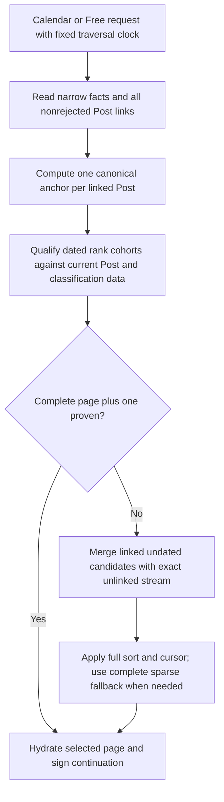
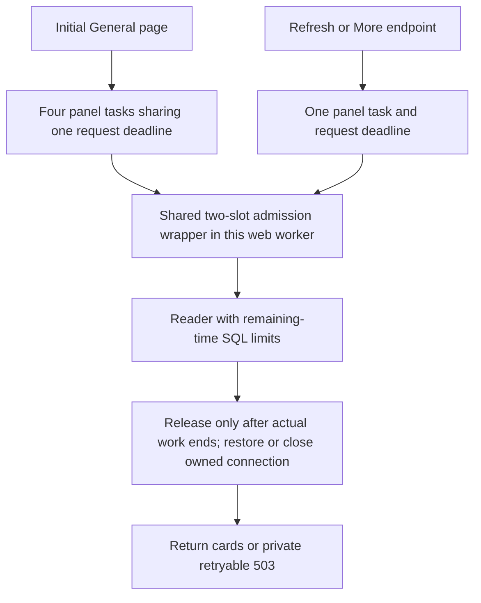
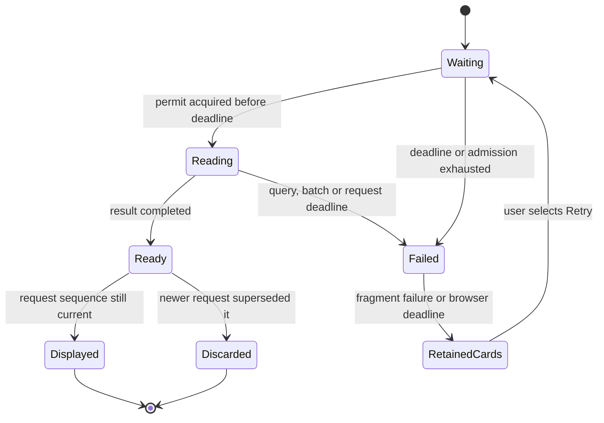

# General performance and shared UI fixes - Plan

## Plain-English Summary

General should open with its cards much sooner and finish Refresh, More and selection changes reliably. Jobs can use an existing lookup that examines far fewer posts. Calendar and Free will rank event/opportunity dates before checking post eligibility, so they can avoid work on cards that cannot appear on the page. Both page loads and panel updates will share the same reader limit and bounded failure handling.

The same plan includes the four desktop fixes: restore the Pulse bar's bottom scrollbar, place NVIDIA after Qwen, fill the brand dropdown down each column, and remove the grey marks beside right-side chart numbers. Existing content, brand identities, mobile scrolling and server-rendered cards remain intact. This approach adds no materialized views or other database structures.

Correctness will be checked against the complete existing reader, including every page and date boundary. Browser checks will cover real controls and replacements. Speed will be measured on matched requests while ordinary collection continues; the proposed targets are at least 50% lower median initial latency, sample p95 within 8 seconds for initial content and 3 seconds for panel updates. The temporal optimization has not been implemented or timed yet, so those targets are acceptance criteria rather than promises.

The owner selected autonomous goal execution on 2026-11-27. Implement and verify this follow-up; a new deployment remains on request. The earlier homepage/dashboard release is already deployed at `6a954b91`.

<!-- BEGIN OLLIJA DELIVERY GUIDE -->
## Ollija Delivery Guide

Generated by `ollija annotate-plan`; do not edit between the markers. Delivery policy lives in `AGENTS.md` under "Plans and delivery". Project facts (host, repository, branches, environments, URLs and blueprints) live in `.ollija/project.yaml`. Record owner exceptions under Delivery Exceptions below.

- Plan: `/Users/fuchitalee/development/pushin-weight-v2/.worktrees/fix/home-seven-day-refresh-20261126/docs/plans/2026-11-25-223009-fix-home-seven-day-refresh-20261126-plan.md`
- Branch: `fix/home-seven-day-refresh-20261126`
- Change: `fix-home-seven-day-refresh-20261126-2026-11-25-223009`
- Active worktree: `/Users/fuchitalee/development/pushin-weight-v2/.worktrees/fix/home-seven-day-refresh-20261126`
- Workflow: `plan`
- Delivery target: `production`
- Route: `direct`
- Owner selection recorded: `true`

### Placement

This worktree is inside the Ollija release worktree area. Reuse it for the whole change. Do not create a second worktree or plan for this branch.

### Delivery steps

1. Complete implementation and the plan's verification contract.
2. Run the configured focused checks:
   - `pytest tests/ollija`
3. The parent workflow commits only this plan's changes, pushes the feature branch, and records the candidate SHA.
4. On the owner-selected direct route, fetch the remote production lane: `git fetch origin refs/heads/main`.
5. Require the same unchanged candidate SHA to be a fast-forward of that fetched remote ref, then push the exact candidate SHA to `refs/heads/main` with the server-enforced fast-forward command `git push origin <candidate-sha>:refs/heads/main`.
6. Verify the remote production ref resolves to the candidate SHA and the deployment for `pushinweight-web` reports that same SHA before reporting completion.
7. After step 6 succeeds, perform worktree cleanup as the final filesystem action:
    - From `/Users/fuchitalee/development/pushin-weight-v2`, require `/Users/fuchitalee/development/pushin-weight-v2/.worktrees/fix/home-seven-day-refresh-20261126` to remain registered, clean, unlocked, and at the verified candidate SHA. If any guard fails, retain it and report the reason.
    - Run `git -C /Users/fuchitalee/development/pushin-weight-v2 worktree remove /Users/fuchitalee/development/pushin-weight-v2/.worktrees/fix/home-seven-day-refresh-20261126` without `--force`.
    - Preserve the local and remote feature branches. Continue final reporting from the authoritative repository root.

Occupied staging: if a staged route finds `staging` in use by an unrelated release while production is authorized, follow the occupied-staging default in `AGENTS.md`.
<!-- END OLLIJA DELIVERY GUIDE -->

## Delivery Exceptions

- The owner accepted the measured 38.8% median improvement (3.42s to 2.09s) for this release and requested production deployment. The original 50% threshold was missed. The absolute latency targets passed.
- Shared staging contains unrelated Chatter and Pulse releases. Use direct production under the occupied staging owner default in AGENTS.md.

The original release used direct production and completed at `6a954b91`. Its receipts remain in the Appendix. Current General and UI work is authorized for implementation and verification through the owner-selected autonomous goal, with delivery on request. No prior deployment instruction in the Appendix applies to this new candidate.

---

## Goal Capsule

- **Objective:** General opens with its actual cards promptly, and Refresh, More and selection changes finish reliably; the four requested desktop presentation fixes work on their shared surfaces.
- **Means:** Reduce qualification work before document hydration, reuse the existing Jobs lookup, and apply one bounded reader path to initial and fragment requests (KTD1–KTD4).
- **Authority:** The owner selected option 2 (autonomous goal) on 2026-11-27 to implement and verify General fixes together with UI1–UI4. Commit/push and a new deployment remain on request. The earlier production repair at `6a954b91` is complete and is retained as evidence in the Appendix.
- **Execution boundary:** Read the active contracts and U1–U9. Appendix instructions describe the prior release and do not add work to this follow-up. Preserve other sessions' files and all live collection.
- **Stop conditions:** Do not silently change membership, freshness, initial server-rendered cards or the frozen performance acceptance set to make the optimization pass. If the bounded implementation trials miss the target, report the measured residual and the storage/capacity decision needed.

---

## Product Contract

### Summary

Reduce General's work before it assembles Calendar, Free stuff, Jobs and Who's moving cards. Keep its current content, sorting and navigation. Restore the desktop Pulse scrollbar, put NVIDIA after Qwen, fill the brand dropdown down each column, and remove the short marks beside right-side chart labels.

### Problem Frame

At production revision `6a954b91`, one all-brand General browser load took 22.91 seconds. A matching application trace took 22.13 seconds: Calendar 9.51, Free 10.78, Jobs 10.63 and Moving 0.55 seconds. These panels overlap through two readers, so their times are not additive. Simultaneous English/Japanese requests took about 17.8 seconds each. A fast shell paint is insufficient because the requested content is the cards.

Calendar and Free spent most of the measured time checking whether linked posts had eligible classifications. Jobs searched 30,922 recent posts to find 21 results. Separate Refresh/More requests bypass the initial page's reader limit and statement timeout. The available evidence establishes these costs; it does not prove a new algorithm's cold-load performance or that materialized-view refreshes caused the delays.

### Requirements

**General content and navigation**

- R1. Successful initial General responses contain the four first-page feeds in HTML and remain usable without JavaScript.
- R2. Preserve exact eligible Post membership and rendered facts using `public_posts()` and same-Post/same-brand current v3/v4 classification state; eligible signal/state pairs do not require a PostBrand association.
- R3. Preserve ordering, distinct Post counting, the requested limit and signed continuation semantics, including the fixed traversal `as_of` and C-collated Post-ID ties.
- R4. Calendar and Free retain current lifecycle, date-precision, canonical/evidence-link and rejection behavior; ranking is evaluated against the traversal clock.
- R5. Preserve locale fallback, editorial access, preferences, private/no-store responses and atomic Post URLs. Fresh requests observe committed source changes without introducing a cache TTL.
- R6. Refresh/More failures retain displayed cards and provide a usable Retry action; superseded responses cannot replace a newer selection or append duplicate cards.

**Resource use and visible speed**

- R7. Initial page and fragment reads share the same bounded database admission path per web worker, with finite waits and cleanup after success, failure or timeout.
- R8. Meet the frozen performance criteria below while normal harvesting, enrichment and refresh remain active. A fixture-only result or HTTP 200 is insufficient proof.

**Owner-requested presentation**

- R9. Restore a usable bottom scrollbar on an overflowing desktop Pulse chip bar while preserving mobile touch scrolling (UI1).
- R10. Shared brand presentation begins Meta → DeepSeek → Qwen → NVIDIA, preserving the relative order and identities of remaining eligible brands (UI2).
- R11. Each brand-menu group fills vertically down its first column before moving right, with matching keyboard/DOM reading order (UI3).
- R12. Right-side chart labels retain numbers and gridlines but have no short grey tick strokes beside them (UI4).

### Success Criteria

These are proposed engineering acceptance targets for the implementation, not previously measured guarantees. Under the bounded paired workload in the Verification Contract, initial General card-ready latency must improve by at least 50% at the median, have sample p95 at or below 8 seconds, and produce no failed requests. Refresh/More must have sample p95 at or below 3 seconds for each tested panel operation. Report first-after-idle and concurrent samples separately, including their maxima. The finite sample cannot establish a population-wide latency guarantee.

The full result, ordering, facts and decoded cursor parity checks must pass. UI1–UI4 require actual browser evidence before and after replacement. The refreshed General performance workload must make the expected data requests; an unrelated click that makes zero chart requests cannot satisfy R8.

### Scope Boundaries

This work changes General's readers and request lifecycle, shared presentation, and their verification. It adds zero tables, columns, indexes or materialized views. It does not change collection schedules, source data, classification taxonomy, brand keys, authorization or editorial selection.

Deferred to follow-up: shared eligibility caching/materialization or database capacity changes if the measured live-reader approach misses the target; existing like-count homepage feed slowness; unrelated staging-copy defects. A new projection would require its own schema/source-dependency and freshness design before it could join the active units.

Product Contract preservation: the four UI requests retain their meaning and UI1–UI4 identifiers; R1–R8 add the General performance contract to the same artifact.

---

## Planning Contract

### Current evidence and dependencies

The implementation baseline is `6a954b9195cdacb291363b6d6d169a706b35ccaa`. Reconcile later relevant commits before execution. The dirty `fix/general-feed-performance-20261127` checkout starts at older `ddd41308`; its candidate and migration 0242 are not a ready patch. Production already contains that chronology index and later temporal-query changes. Preserve that checkout and do not replay its index migration.

The inspected storage is `Post`, `PostBrandSignal`, `PostBrandClassificationState`, `Event`, `EventEvidence` and `Opportunity` in `core/models.py`, with source relationships introduced in migrations 0032/0041 and chronology ordering in migration 0242. Existing keys and indexes support Post identity, same-brand classification and source links. This plan reuses those records. Classification replacements in `monitor/cycle.py` and fact/evidence writes in `core/targeted_extraction.py` remain live inputs; no derived storage or new writer path is introduced.

### Key Technical Decisions

- KTD1. **Use the direct classified-signal lookup for Jobs only.** The existing exact fallback examined about 1,251 signals and 10,745 buffers in the recorded probe, versus 139,807 buffers for the recent-post scan. Moving retains its current recent scan and exact sparse fallback. Warm timings support the candidate but do not establish loaded latency (R2–R3, R8).
- KTD2. **Rank narrow temporal facts before qualifying posts.** Select each linked Post's best anchor using the existing lifecycle rules at `as_of`, then qualify rank cohorts until the complete page plus one is established. Hydrate full documents and display facts for the selected page. Retain a complete reader as correctness reference and fallback (R2–R4).
- KTD3. **Preserve exact reads with no new cache or materialization.** Existing homepage masks differ in taxonomy eligibility, PostBrand dependence and created-time versus fetched-time semantics. Full-page caching would also mix private/editorial state and clock-dependent ranking. The chosen change reduces current work without a new freshness or invalidation contract (R5, R8).
- KTD4. **Use one ownership-aware admission wrapper for General HTTP reads.** Initial-page threads and the fragment endpoint acquire the existing two-per-worker permit exactly once per expensive panel call. Thread-owned connections close after work; reusable request connections restore their settings; caller-owned transactions remain caller-owned. This is a process-local bound, not a cluster-wide limit (R7).
- KTD5. **Bound failures as well as queries.** Start one monotonic 10-second server data-read budget at entry to the initial or fragment view. Initial selection/editorial reads and all four panels share that deadline; it must not start after editorial work finishes. Include permit wait and check remaining time between candidate batches and before every SQL statement; the statement timeout cannot exceed remaining time on both request-thread and panel-thread connections. The two-slot cap covers expensive panel readers, not every request-thread SQL query. Use a 12-second browser deadline for fragments. A deliberate deadline produces localized failure/Retry feedback; a superseded request's abort stays silent. Deadline or admission exhaustion returns a private/no-store 503 with `Retry-After: 1`, never an empty successful feed. Do not automatically fan out retries (R6–R7).
- KTD6. **Treat the independent General reader as the oracle.** Compare the full complete reader with the optimized reader in one database snapshot, following each one's own decoded continuation. A shared `as_of` fixes the ranking clock; it does not freeze the database across separate HTTP requests or across all initial panel connections (R2–R4).
- KTD7. **Keep UI changes in existing shared presentation paths.** UI1–UI4 retain their original history references and browser checks in U6–U9. Preserve brand keys and tracked eligibility; do not fork a separate brand-order list (R9–R12).
- KTD8. **Keep continuation URLs bounded without weakening filter binding.** The implementation baseline exposed HTTP 414 for General More: the actual default selection has 1,735 brands, all embedded in each signed cursor. Sign a stable digest of the canonical filter identity in new cursors, preserving section, locale, brand selection, version, traversal clock and ordering semantics. Continue accepting valid legacy cursors for their existing lifetime. Test large selections, changed filters, malformed/tampered cursors and real browser pagination. This is a representation change with no new storage or eligibility change (R3, R6).

### Temporal reader design

The new candidate uses the existing Python lifecycle rules, not a second SQL implementation. First read narrow nonrejected fact rows and canonical/evidence Post links in bounded batches, checking the deadline between batches. Include every field needed for lifecycle and anchor selection; inspect `_parse_temporal`, `event_lifecycle`, `opportunity_lifecycle`, `_fact_order` and `timing_anchor` before extracting a common helper. Do not fetch raw payloads or complete localized documents for this pass. Record retained anchor count and peak memory alongside source size; batching the SQL does not itself bound the accumulated anchor map. Do not truncate candidates to satisfy a resource target.

Compute an anchor for each distinct linked Post. Exclude Posts whose linked facts are all past, closed or cancelled from ranked results, but retain their links in the unlinked exclusion set. Rejected-only links permit the existing undated behavior. Evidence-only links and cross-brand facts keep their current meaning; brand eligibility comes from the matching signal/state, not the Event's brand.

Process live/open and upcoming cohorts in exact `(tier, anchor-start)` order. Within a cohort, qualify against public visibility, current signals, selected brands, `fetched_at <= as_of` and the cursor. Finish the full boundary cohort, or select its global top results through equivalent bounded queries, before stopping. Merge the best results across any SQL parameter batches using descending fetched time and ascending C-collated Post ID. Fact ID breaks ties when selecting an anchor; it is not an additional feed-order key.

Stop early only after `limit + 1` distinct eligible Posts and proof that all unvisited cohorts rank later. If dated results fill the page, do not run the undated recent-post scan. Otherwise merge the linked unknown/postponed cohort with the unlinked unknown stream before truncation. The unlinked stream excludes every nonrejected link, including terminal-only links, and retains the current complete sparse fallback. Apply the cursor to the exact full sort key. Keep all split reads for one temporal page inside the existing Repeatable Read snapshot; caller-managed transaction and non-PostgreSQL fallbacks retain their behavior.



### Request ownership and failure lifecycle





The diagrams describe request and candidate flow; KTD4–KTD6 own the resource and consistency rules. A disconnected browser does not prove database cancellation. An already-running task retains its permit until its SQL finishes or is cancelled and cleanup completes. A failed initial page returns a retryable error response rather than presenting missing panels as a completed page.

### Alternatives and execution-time unknowns

The rejected linked-ID JOIN and `ANY(array)` variants preserved membership but did not reliably reduce measured work. Increasing readers from two to three did not improve the recorded loaded samples. Neither is part of this candidate. A new eligibility projection has a different storage, writer and publication design; it is deferred because the lower-work exact reader can be tested reversibly first. No Bake-off is needed for this reversible choice.

Final batch sizes, exact SQL plans and cold performance are execution-time measurements. Start with existing query/parameter bounds and permit at most two evidence-driven revisions of U3's query/batching design. A failure to meet R8 remains an unmet outcome; do not replace it with a warm-only claim or silently select a cache TTL.

---

## Implementation Units

### U1. Pin General membership, pagination and measured work

**Goal:** Establish an independent correctness oracle and representative performance workload before changing the readers.

**Requirements:** R1–R8. **Dependencies:** none.

**Files:** `tests/test_general_readers.py`, `tests/test_general_timing.py`, `tests/test_general_jobs_people.py`, `tests/test_general_views.py`, `tests/general_helpers.py`, `tests/fixtures/general_feed_contract.json`, `tests/fixtures/performance_assurance/declaration.general-candidate.json`.

**Approach:** Reuse the complete reader as the reference and extend current fixtures. Use deterministic PostgreSQL data for semantic/race checks and the ordinary route's explicit open-brand list for representative measurements. Keep full-page evidence separate from individual SQL timings.

**Test scenarios:**

1. Unrestricted, actual default open-brand list, one/two/three brands, empty selection, invalid brand and sparse old matches yield the expected route behavior and exact reader results.
2. Zero, one, 20, 21 and multiple pages, duplicate brand signals, equal fetched timestamps and C-collation-sensitive IDs preserve order and continuation through the final page.
3. v3/v4 classified states qualify; legacy, failed/missing states and mismatched brands do not. A valid signal/state pair without PostBrand remains eligible.
4. Compare every displayed field and decoded cursor payload, not signed token bytes. Advance baseline and candidate through their own continuations.
5. Record current shape-dependent tests and adapt their observation hooks without weakening what they prove; avoid comparing the new Jobs branch to itself.

**Verification:** The fixtures distinguish the proposed implementation from the complete reader and catch the known sparse-brand omission. Capture baseline request/queue/query/hydration/card-ready timings before implementing U2–U4. No production clone or shared-database reset.

### U2. Use the existing direct Jobs lookup

**Goal:** Stop scanning tens of thousands of unrelated recent posts for a Jobs page.

**Requirements:** R2–R3, R8; KTD1 and KTD6. **Dependencies:** U1.

**Files:** `monitor/general_readers.py`, `tests/test_general_jobs_people.py`, `tests/test_general_readers.py`, `tests/test_general_views.py`.

**Approach:** Route Jobs directly through the current complete signal-first query with its `limit + 1`, deduplication and continuation logic. Retain Moving's current recent-post candidate and complete fallback. Reuse current document/job-evidence hydration.

Apply KTD8 to the shared continuation serializer/parser used by all four feeds. Keep new URLs safely within the observed request-line limit and retain legacy validation; never drop filter validation to reduce token length.

**Test scenarios:**

1. Jobs first and later pages match U1's reference for default, sparse and multibrand selections.
2. Duplicate signals do not duplicate a card; same-time ID ties stay ordered on all pages.
3. Job age labels remain correct immediately before and at 24 hours, across all locales and evidence variants.
4. Moving still uses its intended dense path, falls back for sparse results, and preserves person/affiliation evidence.
5. With 1,735 eligible brand keys, More uses a compact URL and reaches the next page; both cursor formats reject changed filters and tampering, and valid legacy cursors retain their original traversal clock.

**Verification:** Independent parity passes and recorded query work falls below the existing Jobs baseline on the same workload. Measure the whole page separately before claiming R8.

### U3. Rank temporal facts before qualifying and hydrating posts

**Goal:** Reduce Calendar/Free qualification work while preserving complete ordered pages.

**Requirements:** R2–R5, R8; KTD2, KTD3 and KTD6. **Dependencies:** U1.

**Files:** `monitor/general_readers.py`, `core/intelligence_readers.py` only if a shared timing helper is needed, `tests/test_general_timing.py`, `tests/test_general_readers.py`, `tests/test_intelligence_readers.py` if that existing module is changed.

**Approach:** Implement the temporal design above in the existing reader, sharing anchor/lifecycle logic with final card presentation. Retain the complete path for unsupported transaction/database conditions and sparse completion. Remove any replaced candidate-query code after its callers use the shared path; keep an independent reference in tests.

**Execution note:** Characterize lifecycle and cursor behavior before restructuring candidate reads. Extend the existing concurrent-evidence tests to observe the new query boundary rather than obsolete SQL text.

**Test scenarios:**

1. Enough eligible live/upcoming cards produce a full page without scanning undated posts; earlier ineligible candidates do not make the reader stop early.
2. A cohort crossing the page boundary is fully considered; qualifying Posts later in a parameter batch can displace earlier fetched-time results. Limit counts distinct Posts, not facts or signals.
3. One Post linked to several Events chooses the same anchor, including equal-rank fact-ID ties; direct and evidence-only links deduplicate correctly.
4. Past/closed/cancelled-only facts stay absent, rejected-only facts permit the undated case, and postponed/unknown facts merge with unlinked unknown rows in exact chronological order.
5. Upcoming-to-live and live-to-ended transitions, date-only/unknown precision and multiple facts match the canonical lifecycle at the cursor clock, even when wall time advances without writes.
6. A sparse brand with older matches and a cursor entering the unknown tier returns every eligible page, including fewer than a full final page.
7. Concurrent fact/link creation, parent rejection, source reassignment and deletion between reads cannot make one temporal page combine incompatible snapshots. A fresh request observes the committed change; a continuation keeps its clock without claiming a frozen cross-request database.
8. Caller-owned READ COMMITTED/Repeatable Read, disabled autocommit and non-PostgreSQL paths preserve current ownership and complete fallback behavior.

**Verification:** Same-snapshot item/fact/order/cursor parity passes. Measure qualification probe count, rows/bytes hydrated, buffers and full panel/card-ready duration. Retain U3 only if the fixed comparison shows useful work reduction without sparse-case regressions; the two-trial limit and R8 still apply.

### U4. Bound initial and fragment work and finish failed browser requests

**Goal:** Keep General request bursts within the existing reader capacity and recover visibly from deadlines.

**Requirements:** R1, R5–R7; KTD4–KTD5. **Dependencies:** U1; integrate with U2–U3 before final measurement.

**Files:** `monitor/general_views.py`, `monitor/general_readers.py` only for shared deadline/batch checks, `monitor/static/monitor/general.js`, `tests/test_general_concurrency.py`, `tests/test_general_views.py`, `tests/test_general_browser.py`.

**Approach:** Reuse one General HTTP read wrapper across the initial thread pool and fragment endpoint. Carry language, selection, shared clock and request deadline explicitly. Bound permit waits and SQL using remaining time. Restore reusable connection settings after errors; use a rollback/savepoint boundary where needed so timeout cleanup never commits, closes or leaves a caller-owned transaction unusable. Keep browser sequence validation and distinguish timeout cancellation from supersession.

Track the selection that produced each panel's displayed cards and continuation separately from the active page selection. When a selection change fails, retain those cards and show Retry for the active selection's first page. Hide More and block its request path while the displayed selection differs from the active selection. Restore pagination only after a matching successful response supplies a continuation; switching back to the displayed selection may reuse its valid continuation. Keep the server's signed filter validation intact.

**Test scenarios:**

1. Two initial pages mixed with Refresh/More and a four-panel weights change never exceed two active panel readers in one worker. Separate workers have separate caps, reported honestly.
2. A queued request reaches its deadline without issuing SQL; no nested permit acquisition or starvation occurs. A stalled running query times out, releases its slot after cleanup and does not prevent a later healthy request.
3. Failure in one initial panel cancels queued work, returns promptly and lets already-running siblings clean up. Caller-owned transactions and request connection settings survive handled failures.
4. A fragment deadline or 503 retains prior cards, clears `aria-busy` and pending state, and exposes localized Retry. Retry of More uses the same continuation only while its displayed selection still matches the active selection, and appends no duplicate cards.
5. Rapid open → none → open changes discard late results even when AbortController cannot cancel the network request. Deadline timers from older requests cannot abort or clear a newer request.
6. Initial server HTML still contains all feeds without JavaScript; successful locale/timezone/audience/navigation behavior and private response headers remain unchanged.
7. The existing countdown refresh throttle remains intact. Page exit cancels outstanding timers/requests, and returning through browser history restores working controls without duplicate refreshes or stale deadlines.
8. Slow selection or editorial reads consume the same initial deadline as panel work; request-thread timeouts restore connection state and return the same explicit retryable failure.
9. During a weights change, three panels succeed and one fails. The failed panel retains its previous cards and first-page Retry; More cannot send the old filter's cursor. Retry restores pagination only after the active selection's successful response provides a continuation. Switching back and superseding that Retry preserve the same selection/sequence rules.

**Verification:** Real PostgreSQL blocking/timeout tests and browser races prove KTD4–KTD5. Error responses are explicit failures and never counted as successful latency samples.

### U5. Verify the integrated General and shared UI candidate

**Goal:** Prove the complete candidate meets the content, interaction and measured-speed contract.

**Requirements:** R1–R12. **Dependencies:** U2–U4 and U6–U9.

**Files:** `tests/test_general_browser.py`, `tests/test_general_concurrency.py`, `tests/fixtures/ui_assurance/general-declaration.json`, `tests/fixtures/ui_assurance/each-declaration.json`, `tests/fixtures/performance_assurance/declaration.general-candidate.json`, `tests/ui_assurance/general.py`, `tests/ui_assurance/gate.py`; existing homepage/Each browser and JavaScript tests named in U6–U9.

**Approach:** Extend the existing declarations and test adapters with the actual General initial-load, Refresh, More and weights-change interactions. Preserve the existing homepage and Each obligations. Ensure changed temporal helpers remain in the product identity. Correct any stale checker to prove the same property against current code, then run the Verification Contract.

**Test scenarios:**

1. Fresh anonymous General HTML, all four rendered panels, Refresh and More pass in English, Japanese and Chinese; no-JavaScript pages retain content and links.
2. Actual default selection and sparse Meta/Qwen cases remain correct under paired concurrency and natural materialization/harvest activity.
3. Window/filter/brand changes still update homepage charts and Pulse on the first click; dashboard category switches retain area rendering and right-axis presentation.
4. Shared styles and assets load on homepage, General, Pulse, Chatter and dashboard; route exclusions are justified by component tracing, not page names.
5. Every required General/performance scenario executes real expected requests and visible-state assertions. Missing selectors, skipped checks and setup errors fail the assessment.

**Verification:** Record exact code/data/environment identities and the prescribed result set. Meet the Success Criteria and Definition of Done; retain failures and uncertainty rather than reporting a partial optimization as completion.

### U6. UI1 — Restore the desktop Pulse bar's bottom scrollbar

**Requirements:** R9; KTD7. **Dependencies:** none; verify together in U5.

**Files:** tests/test_home_v22_browser.py, tests/test_dashboard_each_browser.py; monitor/static/home-v20.css, monitor/static/pro-general.css; related shared templates if reproduction identifies a missing shell class.

**Approach and test scenarios:**

- Reproduce the missing scrollbar in the actual desktop homepage and any dashboard surface sharing `.pulse-bar`, recording route, locale, viewport, browser, shell classes, loaded stylesheet versions and revision before editing application code.
- Use historical commit `31c2cfbf69b62848813d6769548693a1b006aa4e` (`feat(home): polish pulse, timezones, and feed identity`) as the behavior reference. It added a bottom scrollbar for overflowing desktop Pulse chips in `monitor/static/home-v20.css`: desktop minimum width 900px, visible six-pixel WebKit scrollbar, thin scrollbar, bottom padding, track and thumb. These declarations still exist at `6a954b91`; establish why the live page no longer shows the control before choosing a repair. Trace the CSS cascade, current shell and overflow sizing, including `monitor/static/pro-general.css`, and account for browser/OS overlay-scrollbar behavior without changing user settings.
- Reinstate a usable bottom scrollbar under the overflowing chip row using the existing implementation and current palette. The last chip must be reachable by normal user scrolling. Preserve chip selection, counts, focus and narrow-screen touch scrolling.
- Strengthen `test_live_brand_pills_follow_chart_order_and_remain_accessible` and retain `test_mobile_pulse_remains_touch_scrollable_without_desktop_scrollbar` in `tests/test_home_v22_browser.py`. Existing computed-style and programmatic-scroll assertions alone do not prove a visible usable desktop scrollbar. Add actual user-scroll behavior and same-state visual/geometry evidence for the failing desktop shell, before and after Pulse replacement, at wide and near-breakpoint desktop widths. Include a non-overflowing case and a 390px mobile preservation case.

**Verification:** The reported visible outcome passes in the real browser before and after the relevant DOM/chart replacement, with adjacent behavior preserved.


### U7. UI2 — Move NVIDIA immediately after Qwen in shared brand presentation

**Requirements:** R10; KTD7. **Dependencies:** none; verify together in U5.

**Files:** monitor/views.py, tests/test_home_v22_browser.py, tests/test_dashboard_each_browser.py, tests/test_views.py.

**Approach and test scenarios:**

- Update the existing shared presentation priority in `monitor/views.py` (`_HOME_CHART_BRAND_PRIORITY`), keeping a single ordering source for its existing callers. The leading sequence becomes **Meta → DeepSeek → Qwen → NVIDIA**. Preserve the relative order of every other eligible brand.
- Retain existing identity keys: Meta is `llama`; NVIDIA is `nemo_megatron`. This is a display-order change, not a key rename, tracking-policy change, company/product change or schema migration.
- Verify all consumers of the shared ordering: Pulse chips, chart series/legend, brand dropdown and dashboard brand controls where applicable. Preserve tracked-brand eligibility, open/closed group boundaries, selected values, brand colors and chart values. Update explicit prior-order expectations to the owner-selected sequence; do not derive all expectations from the implementation being tested.
- Prove NVIDIA appears once immediately after Qwen on initial load and after refresh, brand changes and restored preferences. Exercise routes with NVIDIA present and absent from the eligible set.

**Verification:** The reported visible outcome passes in the real browser before and after the relevant DOM/chart replacement, with adjacent behavior preserved.


### U8. UI3 — Fill the brand dropdown vertically before moving right

**Requirements:** R11; KTD7. **Dependencies:** layout implementation can proceed independently; its literal full-list brand-order assertion requires U7 and runs in U5's integrated verification.

**Files:** monitor/templates/monitor/home.html and matching shared brand markup, monitor/static/home-v20.css, monitor/static/pw-filter-pills.js if needed; tests/test_home_v22_browser.py, tests/test_dashboard_each_browser.py.

**Approach and test scenarios:**

- Change only the brand menu's layout so each existing group fills top-to-bottom in the first column, then top-to-bottom in the next column. With the full open-brand set, the first column starts **Meta, DeepSeek, Qwen, NVIDIA, …**. Preserve the existing group separation and other filter menus' layouts.
- Trace `monitor/templates/monitor/home.html` brand `data-tier-grid` markup, matching shared templates, `.filter-dropdown .dd-grid` rules in `monitor/static/home-v20.css`, and the portaled dropdown behavior in `monitor/static/pw-filter-pills.js`. Choose a layout that handles changing item counts and viewport widths without clipping or introducing an extra horizontal scroller.
- Preserve canonical DOM and keyboard reading order, checkbox names/values, click behavior, select-all behavior, focus, menu positioning and saved selections. Avoid a visual-only reorder that leaves keyboard navigation jumping across columns.
- In a browser, open the actual portaled menu and assert bounding-box positions sorted by column then row, with literal expected leading brand keys. DOM array order alone cannot prove this requirement. Cover full and sparse lists, desktop resizing, mobile layout, `en`, `ja` and `zh_hans`, and one-click selection after reopening the menu and after a chart refresh.

**Verification:** The reported visible outcome passes in the real browser before and after the relevant DOM/chart replacement, with adjacent behavior preserved.


### U9. UI4 — Remove the short grey tick marks beside right-side Y-axis labels

**Requirements:** R12; KTD7. **Dependencies:** none; verify together in U5.

**Files:** monitor/static/pw-chart.js, monitor/static/pw-each-chart.js, tests/test_pw_chart_filter.js, tests/test_pw_each_chart.js, tests/test_home_v22_browser.py, tests/test_dashboard_each_browser.py.

**Approach and test scenarios:**

- Confirm the reported marks visually on the homepage chart and identify the matching shared dashboard rendering. Remove the short tick strokes immediately left of right-side numeric labels; retain the numbers, units, horizontal chart gridlines, scale, series colors and chart geometry.
- Inspect `chartScales()` in `monitor/static/pw-chart.js` and the right-axis configuration in `monitor/static/pw-each-chart.js`. At `6a954b91` both define grid colors and hide the axis border without explicitly disabling grid tick strokes. This is a source-based candidate cause, not a browser-confirmed diagnosis. Scope the correction to the right Y axis; preserve X-axis date and comparison marks.
- Verify rendered charts and resolved axis options after initial load, 1D/7D/30D/365D changes where supported, brand/filter changes, and dashboard category/count/percentage changes where supported. Use same-state screenshot or canvas-region evidence that the strokes are absent and labels/gridlines remain; configuration assertions alone are insufficient.

**Verification:** The reported visible outcome passes in the real browser before and after the relevant DOM/chart replacement, with adjacent behavior preserved.


---

## Verification Contract

### Correctness and interaction gates

Use a small branch-specific PostgreSQL database with deterministic fixtures. Preserve the permanent shared database and use its wrapper only when those existing data are required. Run the affected General tests named in U1–U5 and the UI tests named in U6–U9. The existing `tests/test_general_recent_index.py` checks the retained migration; do not invent a new migration or delete its proof.

Follow the project's `.claude/skills/fix-ui/SKILL.md` for Bridgewright validation, prescription, affected checks and exact-candidate assessment. The executable affected command is `uv run --extra dev python -m tests.ui_assurance.gate --scope affected`; candidate verification uses `--scope candidate --candidate-revision <sha>` with the skill's explicit candidate performance inputs. Required evidence covers actual General requests and all changed shared controls. Record zero failed, skipped, errored, missing or unknown obligations. Plan edits alone do not require executing these application tests.

### Frozen performance workload

Before changing product code, record the baseline SHA, actual default open-brand list, serving role, source cohort/time range, database/service topology and workload conditions. Run the same ordinary page/fragment paths for the candidate. Read-only SQL parity is separate from application timing because forcing an entire page into a read-only transaction can hide caught sidecar failures.

Use at most two concurrent client requests. Freeze these 40 requests for each measured revision before implementation:

- **20 full General loads:** 10 sequential default-selection loads (five English, five Japanese), then five simultaneous English/Japanese pairs: three default-selection pairs, one Meta-only pair and one Qwen-only pair.
- **20 fragment operations:** default-selection Refresh and More for each of four panels in both English and Japanese (16 requests), plus Calendar and Free Refresh and More with a preselected sparse brand (four requests, alternating English/Japanese). Obtain required continuation tokens from the same recorded initial workload; record an empty/final page as such and use the fixed fixture cohort to guarantee separate pagination correctness coverage. Run fragments sequentially except two fixed simultaneous pairs, one Refresh pair and one More pair; keep that schedule identical for baseline and candidate.

Compare the 16 default-selection full loads for the 50% median target; require the initial 8-second sample-p95 target for the full 20-load batch as well. Evaluate each default panel/operation cell for the 3-second target and report its count of two; the additional sparse observations must also meet 3 seconds and be reported separately. Cover all locales in correctness tests. At least one full-page pair and fragment group must overlap naturally occurring harvest/refresh. Do not pause jobs or flush production caches to manufacture a cold run. Label first-after-idle observations accurately, and never call them guaranteed cold-cache tests.

Record every duration and failure, sample counts, medians, nearest-rank sample p95, maxima, queue wait, per-panel SQL/qualification/hydration time and browser card-ready time. For each small panel/operation cell, report its p95 as a sample statistic with its small count, not a service guarantee. Preserve the exact batch composition across baseline/candidate. Prefer alternating paired baseline/candidate reads where the authorized environment supports this safely; otherwise state the unpaired confound and do not claim causal improvement from an incomparable run.

Stop the measurement batch on two consecutive timeout/5xx results or any observed collection regression. Preserve the failures. Allow at most two U3 design revisions, each evaluated against the same acceptance set; retries require a changed cause, not repeated warm-cache attempts. A missing representative baseline or natural-load interval leaves R8 unverified, while independent correctness work can continue.

The first implementation baseline stopped early after two consecutive HTTP 414 pagination failures. Preserve its 20 completed initial-load samples and fragment results; do not repeat the unchanged failing batch. The candidate retains the frozen workload, and unsuccessful or unperformed baseline fragment cells remain unavailable for comparative latency claims. The initial-load comparison and candidate's absolute fragment targets remain independently testable.

### Evidence and learning references

- `monitor/general_views.py`, `monitor/general_readers.py` and `monitor/static/monitor/general.js` establish the current route, reader and request-lifecycle behavior.
- `docs/solutions/workflow-issues/2026-10-27-214740-django-page-probe-read-only-lock-errors.md` governs interpretation of application probes.
- `docs/solutions/data-migration/2026-10-08-143200-original-content-cutover-checks.md` supports selecting bounded records before wide hydration and verifying displayed records.
- `docs/solutions/integration-issues/2026-11-21-065100-enrichment-reservations-and-reader-coverage.md` supports proving persisted changes reach the visible reader.
- The Appendix retains the dated production measurements and their original receipt locations. Those measurements justify the candidates and are not verification of this new work.

---

## Definition of Done

U1–U9 meet their verification criteria, the full General parity/race suite passes, and the measured workload meets R8 as qualified by the owner’s performance acceptance under Delivery Exceptions. All four UI requests have browser evidence on their actual shared surfaces. No new persistent data structures or live-operation interruptions were introduced. Remove experimental query branches and temporary product instrumentation that the selected implementation supersedes; retain only deliberate fallback behavior and useful bounded timing instrumentation.

Report implementation, checks, remote commits and deployment separately. The reviewed planning stage is complete; the owner-selected goal now covers implementation and verification. If a later request selects deployment, record its route and endpoint in Ollija metadata before release, verify the exact deployed revision and live interactions, and preserve the applicable rollback path. Historical production approval in the Appendix does not authorize this new release.

---

## Planning review record

The 2026-11-27 review covered coherence, feasibility, scope, design, adversarial assumptions and security using native session agents. It applied two corrections within the existing contract: make the dropdown's final order assertion depend on the shared brand reorder, and prevent a failed General selection change from reusing a different selection's continuation. The latter was confirmed from the browser request builder and the reader's signed-filter check. No review decisions or proposed corrections remain open.

The performance design remains an implementation-time hypothesis with the bounded measurements above. This planning run changed documents only; it did not run application tests, production probes or a deployment. The independent external-model pass was not started under the owner's instruction to use GPT within this session.

## Appendix

The following records describe the completed homepage/dashboard release and the observations that motivated this follow-up. They are historical evidence, not additional active implementation units or current release instructions.

### Implementation and regression checks

- Base revision `260a5c068d1da59ef78b36c5152de2a39f0487fd`. The observed production revision matched the base.
- In `monitor/home_count_summary.py`, use an explicit lower and upper bound for the unpublished tail and each partial quarter. Look up brand associations by the selected post's ID so a wider tail from historical corrections still avoids the full association table.
- In `tests/test_home_chart_materialization.py`, verify the real homepage and chart endpoints use only the three uncovered spans for rolling comparisons. Verify the corrected-history chart request looks up associations for the selected posts. Compare the generated values to direct source counts at exact boundaries and check aligned windows still read only the unpublished tail.
- Exercise the ordinary browser click and both chart and Pulse updates with `PublicTrackedBrandsBrowserTests.test_descending_windows_and_timeout_feedback_use_one_click` and `HomeV22BrowserTests.test_long_window_switches_commit_before_the_client_timeout`. Run the affected UI assurance suite using an empty task-specific database.
- Validate the candidate on production data using a read-only consistent snapshot. Use all 21 brands from the failing anonymous browser request and compare every returned bucket to source counts. The saved-history cutoff can move while background writes continue.

The shared selection rule lives in the repository’s `fix-ui` skill. The project’s `AGENTS.md` and recurring-mistakes M5 point to it for backend work. The affected page owns its expected result and timing assertions, including when the work runs outside Compound Engineering.

### Online homepage count publication

Production verification found the saved homepage counts can remain dirty when writers change the source during a refresh. The current publication transaction discards the rebuilt view on any generation change. A historical dirty boundary before the whole 7D comparison forces a full recount, which exceeded the browser deadline on production data. Keep collection and enrichment active throughout this work.

Extend the existing MaterializationState execution record with a nullable in-flight refresh generation and earliest in-flight invalidation timestamp. This adds zero tables and retires zero tables. The existing row already owns publication and invalidation state; the two typed fields distinguish changes occurring during a refresh from older changes represented by its snapshot. Update every homepage invalidation writer, including global invalidation and the post-date trigger. Preserve old code compatibility during rolling deployment.

Use a per-dataset session advisory lock and a short committed marker setup before the refresh snapshot. Leave the existing dirty marker visible to readers while the refresh runs. Atomically publish the view and replace the old dirty marker with the in-flight minimum while clearing the marker. Writers before the snapshot may be conservatively recounted. Writers after it must remain marked dirty, including transactions that commit around publication and global invalidations. On error, rollback the view and clear only the marker under the same advisory lock; a later lock owner can recover a marker left by a crashed process. Retain frozen cutoffs and existing online writer barrier semantics. Never hold a source-table lock while rebuilding.

Prove real concurrent recent and historical writes, an older correction after the refresh snapshot, global invalidation, writer nonblocking, independent datasets, second refresher exclusion, rollback, stale marker recovery, and the midnight boundary. Compare actual browser-visible results with direct counts. Verify migration and mixed-version compatibility. Measure the real 7D and longer-window candidate on representative production data while writes remain active.

Each chart facts have a separate 90-second refresh timeout, observed in production. Record its effect on the dashboard interaction checks and diagnose independently rather than claiming the homepage publication repair fixes it.

### Selected-brand classification performance follow-up

After the first production deployment, the Meta 7D and 30D chart with a sentiment selection timed out during overlapping chart/feed requests. The classification-aware chart and feed share the same filter semantics. An initial bounded selected-brand/time candidate subquery did not meet the production-data deadline and has been removed. Keep the shared classification rules and feed pagination path, remove irrelevant ordering inside the chart's post-ID subquery, and evaluate the guarded saved-facts reader below for the supported sentiment case. Verify current and historical classification, unclassified records, ambiguous legacy labels, multiple brands, feed/chart parity and the 7D, 30D and 365D selection sequence. Measure the actual candidate on production data with read-only access.

The first two scheduled homepage refresh attempts after deployment either timed out under competing reads or returned busy during harvest. The same code published successfully in a quiet gap. Extend the online barrier's bounded NOWAIT retries to cover a normal harvest write window, release all locks before each wait, and verify both eventual success and a bounded busy return. No harvest or enrichment operation is paused.

### Saved-facts sentiment candidate

Investigate a guarded daily chart reader for one explicitly selected brand and sentiment selection. Reuse the existing Each facts and their published/dirty cutoff; use the live source from that cutoff onward in the same consistent database snapshot. Preserve the existing legacy-sentiment, unclassified, promotion, and unsanctioned rules, and retain the existing queryset for unsupported filters, unavailable data, or an unusable saved prefix. Add caller-level parity tests across time windows, stale corrections, conflicting legacy values, exclusion modes, and fallback cases before considering the optimization. Measure the actual candidate under representative conditions; stale facts used for timing alone are not correctness evidence. This adds no tables or columns.

### First-page feed query

A filtered homepage deep link exceeded 20s; a read-only trace attributed the first 12s timeout to the feed's `SELECT DISTINCT` over full post rows. Test a shared brand-membership `EXISTS` filter and omit `DISTINCT` only for the feed's own base Post queryset, whose other joins are single-valued or existence checks. Preserve the default deduplication contract for callers supplying other querysets. Verify duplicate brand links, multiple selections, classification, both sort orders, and cursor pagination against the existing distinct reference; measure the actual endpoint under representative load.

### Broader interaction regression net

These checks are pending. Earlier receipts cover only the conditions described below.

- Trace changed readers and data writers to homepage, General, Pulse and dashboard consumers. Record affected routes and the reason for any exclusion, including for backend-only changes and direct releases.
- Reuse existing browser tests for supported time ranges, brand and product selections, and classification filters. Check combinations such as changing a range and then a brand or category while retaining other selections. Verify first-click selection, visible chart data, and Pulse agreement where present. Exercise overlapping requests and failure feedback where supported.
- Run existing Each dashboard browser tests for brand and tab changes, including Meta tab timing and failure feedback. Use tests/test_home_v22_browser.py and tests/test_home_chart_focus_browser.py for homepage cases. Identify General cases by tracing its route. Run the affected Bridgewright assurance gate and record the declarations actually assessed.
- Repeat relevant first clicks with an empty application cache and representative historical corrections or data volume. Measure time until the correct result is visible against the page target. Compare query results to direct source counts on a consistent read-only snapshot when applicable. Small fixtures alone cannot establish production-scale speed.
- Add existing range-switch browser cases to the homepage regression workflow and resolve hosted access to the private Bridgewright dependency through an available authorized installation path. Ensure the release procedure runs relevant checks for direct releases as well as pull requests. Verify triggers and dependencies with an executed run, retaining existing assertions.
- Add focused regression coverage only for identified gaps. Record commands, revision, data conditions, timing and results per route. Complete each affected interaction or record a specific evidenced unresolved issue.

### Verification record

The original browser request aborted after 12.01 seconds and retained the one-day chart. Its feed request returned in 0.77 seconds. The deployed worker reported a timeout in the Pulse count reader. The original database plan scanned the full post-brand association table.

The candidate's seven-day comparison and daily series matched respectively 42 and 146 nonempty groups in one read-only snapshot, covering 333,286 and 100,981 post-brand associations. The comparison took 1.34 seconds and the daily counts took 0.59 seconds with the publication boundary moved into older history.

Both regression checks failed before their respective fixes. The focused PostgreSQL and browser run passed 189 tests and 16 subtests. All 145 tests marked as requiring PostgreSQL executed with zero skipped or errored. The chart JavaScript suite passed 124 checks.

An anonymous Chrome session opened the production homepage at 1440 × 960 in the Tokyo timezone and clicked 7D once. Only the chart request was routed to the candidate, running in an isolated Render process with an empty application cache, a read-only database connection and a memory-backed diagnostic session. The actual request returned HTTP 200 with 7 days, 21 series and 7D Pulse in 4.15 seconds. The visible chart and Pulse switched in 9.28 seconds, including the diagnostic SSH connection and process startup. Production continued to serve the original revision.

The affected suite caught a moving-clock fixture in the Each dashboard's one-day browser test. When the system clock crossed a five-minute boundary between locales, the oldest fixture post expired and the last panel saw 239 of 240. The test now pins the dashboard clock for its full set of tabs and locales. All original count, layout and rendering assertions are retained. Refreshing the Each assurance declaration binds that test change to its evidence.

The final affected UI suite passed 534 tests and 314 subtests. All 228 tests marked as requiring PostgreSQL executed with zero skipped or errored. Its Each browser assessment passed all 38 obligations with zero failed, skipped, errored, missing or unknown. The affected run validates the homepage declaration with 5,215 prescribed obligations (declaration `041dbac8`, control model `c36092e9`). It assesses the Each declaration `3f4a8b88` and control model `267905c6`. There are no failure replay IDs from the final run.

Commands used with task-specific local PostgreSQL databases:

```sh
python -m pytest -q --reuse-db tests/test_home_chart_materialization.py tests/test_home_chart_pulse.py tests/test_home_chart.py tests/test_home_count_summary_migrations.py tests/test_home_v22_browser.py::PublicTrackedBrandsBrowserTests::test_descending_windows_and_timeout_feedback_use_one_click tests/test_home_v22_browser.py::HomeV22BrowserTests::test_long_window_switches_commit_before_the_client_timeout
python -m tests.ui_assurance.gate --scope affected
ruff check monitor/home_count_summary.py tests/test_home_chart_materialization.py tests/test_dashboard_each_browser.py
git diff --check
```

### Follow-up evidence and remaining work (2026-11-26 JST)

- The deployed 21:07 scheduled run refreshed homepage counts but the Each facts refresh failed. Each remained dirty from October 16 and its last publication was November 25 at 14:09 JST. A later historical write also dirtied homepage counts from November 24.
- The selected-brand sentiment chart still exceeded a 12-second production-data statement limit. The bounded selected-brand subquery has not solved this case; do not treat its local regression tests as performance evidence.
- Local Each online refresh tracking and write-during-refresh tests pass, but the 90-second full rebuild remains unresolved. An experimental set-based rebuild has only limited fixture parity and an estimated plan; it is not integrated or approved as a replacement.
- Follow-up verification: 135 homepage refresh/materialization tests, 44 Each fact/race tests, and 27 Each migration/race/grouped-build tests passed locally. These do not replace the required final revision, hosted browser, representative performance, or production checks.

A read-only 30-day Meta candidate count exceeded 10 seconds before classification. The post-brand table has a primary index on `(post_id, brand_id)` and two separate brand-only indexes, but no `(brand_id, post_id)` index. One duplicate brand-only index showed zero recorded scans and the other heavy use; these counters alone do not justify removal. A composite candidate requires measured read benefit, online build and writer-impact verification before inclusion. The set-based sentiment experiments exceeded 15 seconds and are not a release candidate.

Synthetic index experiment: task-owned local database `pw_home_index_synthetic_1126` contains only generated post/link rows. After vacuum, PostgreSQL used an index-only `(brand_id, post_id)` scan and measured 72.6ms versus 108.1ms without it in one local warm-cache comparison. This is not a production-scale disk/load or end-to-end chart result and does not authorize claiming the timeout fixed. Production currently reports 86.9% all-visible post-brand pages and 58.1% posts pages; the index is not in the application or production.

The local draft bounds dashboard barrier retries to 61 attempts at one-second intervals, separately from the homepage's 361 attempts. This avoids two sequential six-minute waits in the 15-minute job. The 37-test refresh/concurrency run passed with zero PostgreSQL skips; actual scheduled timing and the dashboard's 90-second rebuild remain unverified. The command also reports a database SQLSTATE on failure; a focused test passed. These changes are not deployed.

At 21:51 JST a fresh anonymous browser probe of Meta 7D Each timed out waiting for sentiment. Web logs show `/dashboard/each/chart/` returned HTTP 503 after 15.006s. This is a current product failure; the probe did not reach subsequent tab checks and must not be reported as passing them.

A separate direct production request for Mistral sentiment over 7 days returned HTTP 200 in 13.46s with the requested identity, seven daily totals and five series. This is one endpoint observation, not browser-rendering or distribution evidence; it shows another brand close to the 15s timeout.

At 2026-11-26 22:05 JST, a read-only production-data measurement evaluated every output field of the grouped Each rebuild alternative (count plus serialized-row byte lengths). PostgreSQL canceled it at the 55-second statement timeout (56.92 seconds including connection overhead). The earlier lower estimated cost therefore does not establish a viable refresh; this is not an exact refresh timing or a parity result. The concurrent brand-identity invalidation test passed separately (one PostgreSQL test, 64.82 seconds).

Read-only component measurements at 2026-11-26 22:06 JST: grouping all 1,319,153 signal rows by post and brand while calculating distinct types took 3.17s. Joining historical posts to post-brand rows and reading language fields took 10.70s, with 216,268 database pages read and temporary hash spill (10,279 pages read, 10,300 written). These are separate warm/cold-cache-sensitive observations, not additive timing or end-to-end proof; they identify the large posts scan and join as material costs.

Planner-estimation investigation at 2026-11-26 22:08 JST: the production-data posts covering index reports about 994,215 estimated entries (83 MB), while its wide-row counterpart reports zero (8 KB); the stored rebuild plan nevertheless estimates 38,483 covering rows and 731,176 wide rows. On an isolated 100,000-row synthetic table under PostgreSQL 17.9, statistics on the three individual length expressions changed the short-predicate estimate from 3,704 to 100,000 and the wide-predicate estimate to 1. This establishes a possible planner-statistics remedy, not production timing, PostgreSQL 18 compatibility, or permission to deploy it without further validation.

A second PostgreSQL 17.9 synthetic experiment used 250,000 generated posts with a 1 KB payload, matching partial covering/wide indexes and a post-brand join. With expression statistics, the planner estimated the wide branch at 4 rows rather than 175,903 and parallelized the covering scan; the single run measured 31ms after statistics versus 69ms before. The latter ran second with warmer cache and neither run includes classification joins or a real refresh, so this supports testing a statistics migration but is not release-grade timing evidence. All experiment tables were dropped from the task-owned synthetic database.

The same generated 250,000-row comparison was repeated in a task-owned temporary PostgreSQL 18.6 cluster, stopped and removed afterward. Estimated wide rows changed from 175,879 to 1 and the covering scan became parallel; the single elapsed measurements were 63.5ms before and 28.5ms afterward, with warmer cache in the second run. It confirms the planner effect on the production major version, not production performance or end-to-end refresh success.

At 2026-11-26 22:10–22:12 JST, a read-only `EXPLAIN (ANALYZE, BUFFERS, TIMING OFF)` of the full grouped Each alternative exceeded its 120s PostgreSQL statement timeout (121.81s including connection overhead); during execution the observed wait was `IO/DataFileRead`. No completed plan was returned, and this was not a materialized-view refresh or a parity comparison. The grouped alternative is not a viable 90s refresh candidate based on this observation.

At 2026-11-26 22:14 JST, a read-only homepage 30-day Meta candidate-only query with bitmap scans disabled selected a parallel sequential scan of post-brand links but still exceeded a 12s statement timeout. This planner setting does not resolve the candidate bottleneck and is not proposed for release.

An additional generated-data 30-day brand/day grouping comparison on 1 million posts and 1.2 million links measured warm baseline runs of 51.4ms and 49.8ms versus 43.5ms, 42.5ms, and 42.4ms with a `(brand_id, post_id)` index; the first baseline was 173.5ms. The temporary index was dropped. This modest local result does not show that adding the production index would fix the timeout or justify its write and storage costs.

At 2026-11-26 22:17–22:21 JST, read-only `EXPLAIN ANALYZE` of the current Each rebuild SELECT completed in 70.28s with 16MB `work_mem` and 83.00s with the currently configured 8MB; shared page reads were 230,748 and 266,165 respectively, and both spilled roughly 58MB for sorting. These are single runs with differing cache/load and do not include concurrent materialized-view diff, index updates, publication, or writer impact. They support investigating the 90s budget but do not establish a safe memory setting or successful full refresh.

The hosted regression workflow now triggers for matching direct pushes to `main` as well as pull requests and manual runs. Its candidate gate includes the existing Pulse-page and Pulse-pipeline browser suites. The focused configuration and mocked gate tests passed (12 tests); a full hosted run on the final exact candidate is still required.

Pulse gate addition: the local Pulse page suite passed its eight browser tests. The two pipeline browser tests initially failed because the local test database URL omitted the user required by the enrichment advisory-lock helper; both passed when rerun with an explicit local user (2 PostgreSQL-required tests, zero skips). The workflow supplies an explicit user. The mocked gate/configuration checks passed 12 tests. Bridgewright declaration validation was clean for homepage (5,215 declared obligations), General (71), and Each (38); validation alone is not execution or assessment of those obligations.

A task-owned synthetic visibility experiment updated 400,000 of 1 million generated posts and compared a 30-day brand/day grouping before and after local `VACUUM`; warm executions were roughly 50–53ms in both cases. PostgreSQL chose a sequential scan on the narrow synthetic posts table, unlike the production index-only scan, so this result does not test whether production vacuum would help. Autovacuum was restored on the synthetic table. No production maintenance was performed.

Operational investigation at 2026-11-26 22:28 JST: production `posts` reported 58.1% all-visible pages, 144,416 estimated dead tuples and last autovacuum at 2026-11-19 11:20 JST; no transactions older than three minutes were observed. In a task-owned wide-table synthetic test, index-only scans performed 100,002 heap fetches before vacuum and zero after, with warm timings 29.6ms and 5.5ms respectively. This demonstrates the mechanism, not a production speed claim. A normal, cost-throttled production `VACUUM` of `posts` was started with a 65-second statement timeout, 1-second lock timeout, `TRUNCATE OFF`, `PARALLEL 0`, and `SKIP_LOCKED`; readers and writers remain active. Record its terminal result and before/after performance separately.

The 22:28 JST production vacuum reached block 207,163 of 247,340 and was canceled by its planned 65-second statement timeout. It did not complete or report `last_vacuum`; catalog `relallvisible` remained 58.1%, which is not evidence that no visibility-map pages changed during the partial run. No vacuum remained active. The guarded Each refresh change now allows 180 seconds for bootstrap and concurrent refresh with unchanged 8MB work memory. Three focused PostgreSQL checks passed, including a real concurrent brand change and a check that the 3-minute timeout is active in the refresh; production refresh completion and effect remain unverified.

The same production-data 30-day Meta candidate-only count still exceeded its 10-second limit at 2026-11-26 22:30 JST after the partial vacuum, while harvesting was active. This does not measure a completed vacuum or the full filtered chart. A migration-model check then reported no changes against the task-owned local database, `git diff --check` passed, and Ruff passed on the newly changed assurance and Each files.

Saved-facts exploration at 2026-11-26 22:33–22:34 JST: a read-only query retrieved 171,462 Meta post IDs from 28 days of saved Each facts in 1.25s. Those rows were inside the current dirty range and the measurement is performance-only, not a correctness result. An approximate direct sentiment aggregation over the same stale facts completed in 1.74s but omitted the legacy-sentiment and some exclusion rules. A separate approximate plan that reused saved IDs but rejoined classification and the live two-day tail exceeded 15s. None is a release candidate; the evidence suggests that speed requires applying correct filtering to saved facts, not merely using them as IDs, and any future reader must respect the published/dirty boundary and all existing filter semantics.

Saved sentiment candidate evidence: 180 focused homepage/Each tests and 39 subtests passed before the latest additional race/fallback cases; the revised sentiment-specific set then passed five PostgreSQL tests with zero skips. In a read-only consistent production snapshot, the known-clean 2026-09-15 to 2026-10-15 UTC prefix matched the live facts for all 31 Tokyo calendar buckets (3,736 posts in each, zero different buckets), for the selected sentiment/unclassified and promotion-off case. An isolated production-data WSGI run of the actual candidate handler with an explicitly simulated 2026-11-24 cutoff returned the uncached 30D Meta chart and 30D Pulse in 6.427s. That cutoff intentionally included currently stale saved data: this is timing evidence only, not a correctness or fresh-publication claim, and it excludes browser/network time. Exact candidate browser, final revision, other combinations, full refresh and production checks remain.

The earlier bounded selected-brand query fence and its query-shape-only test were removed after the production-data timeout; unsupported combinations retain the original shared filtering path. A real Playwright test now publishes Each facts, exercises 7D, 30D and 365D with a selected brand and sentiment, verifies chart/feed totals, and asserts the saved reader ran. The updated targeted browser and sentiment tests passed seven PostgreSQL tests with zero skips.

Production-data browser simulation with a deliberately simulated fresh cutoff: a 7D selected-brand/sentiment switch rendered chart and Pulse in 10.74s including diagnostic SSH transport, and the failure indicator remained false. The subsequent 30D switch timed out in the new sentiment query after 12s while the feed request ran concurrently; 365D was not reached. The earlier isolated 30D timing therefore does not meet the representative interaction gate. The browser selected filters by setting the client store, so local Playwright remains the evidence for the actual selection clicks. A separately traced 7D WSGI run showed a brand-first Pulse plan scan and probe all post-brand links; the time-first lateral lookup returned the Pulse SQL in 2.20s and the complete candidate response in 4.79s under live load. The code now retains that time-first lookup for both short and long dirty tails.

A generated 1-million-row PostgreSQL 18 experiment compared a sentiment-covering index with the existing brand/time index. Warm baseline grouped-query time was 243ms; with a 109MB covering index and all-visible pages it was 170ms. After updating 10% of rows, the index-only plan performed 500,000 heap fetches and took 793ms, while a non-index-only plan took 314ms. The 30MB existing index and 109MB candidate sizes and times are synthetic, but the result rules out assuming a covering index is an unconditional improvement on this actively refreshed relation. No production index was created.

The filtered homepage initial-load trace identified the feed page query as the first timeout. In isolated production-data runs, using brand `EXISTS`, avoiding feed-only `DISTINCT`, and evaluating that brand membership before the sentiment predicates reduced the observed feed query from over 12s to 3.77s in one run; cache/load differed. A further candidate reused the existing exact count reader for the 1D Pulse comparison and returned the entire filtered homepage in 3.70s, including a 0.81s Pulse query and 0.91s feed query. This is one warm-cache server observation, not browser or final-revision proof. The 1D count-reader path is added with exact rolling-boundary coverage; production and concurrent interaction checks remain required.

The final candidate was exercised in Chrome against concurrent chart and feed handlers running in two persistent, read-only Render processes. With an explicitly simulated 2026-11-24 UTC saved-facts boundary and cleared chart caches, the 7D, 30D, and 365D switches rendered chart and Pulse in 9.03s, 6.94s, and 10.11s respectively; both endpoints returned 200 for each and the chart failure indicator stayed false. Filters were set in the browser store rather than by user clicks, and the saved boundary included stale rows, so this verifies interaction timing only. Local Playwright exercises the actual brand/sentiment clicks and equality to the feed; the clean-prefix query supplies bounded correctness evidence. A real completed production refresh and post-deployment browser checks remain required.

Review follow-up: the Each refresh rollback now takes the same advisory lock as the online refresher, removes a capability marker atomically, and makes newer workers refuse an unsafe refresh after reversal. A shared Pulse count deadline covers preliminary lookups, each saved-count statement, and any fallback; PostgreSQL regression tests cover consecutive slow statements, fallback time remaining, and restoration of the connection setting. These local checks do not establish production refresh completion or browser behavior.

Combined-suite correction: the Pulse legacy-product fixture reversed migrations through 0226 but restored only through 0234, silently removing the Each facts views introduced in 0235. This made later dashboard browser checks fail with a missing source view. The fixture now restores all current migration leaves; a regression checks both the applied leaves and the Each source view. The new check failed against the previous fixture before the repair. Full combined-suite and exact-candidate verification remain required.

The repaired affected gate passed 559 tests and 314 subtests on a fresh task-owned PostgreSQL database; all 253 PostgreSQL-required checks executed with zero skips or errors. The Each Bridgewright assessment passed all 38 required obligations with no failed, skipped, errored, missing, or unknown results. The targeted Pulse-to-dashboard order passed three tests, and the schema regression failed before its cleanup fix. The exact committed candidate, hosted run, representative candidate performance, and production behavior still require verification.

Exact-candidate follow-up: the full candidate suite exposed three stale total-query assertions after timeout bookkeeping was added; they now retain exact limits on actual data reads and the original count-query shape. A read-only production-data browser trial then found the selected-brand sentiment feed could exceed a 12s statement limit while the chart completed. The query plan showed PostgreSQL building whole-history hashes for correlated classification checks. For this feed path only, the `EXISTS` predicates retain their correlation with `OFFSET 0`; pagination parity covers four sentiment selections, both sort fields and directions, and the distinct-reference path. In one concurrent trial, Meta's 7D/30D/365D feed handlers took 0.61/0.21/0.53s and visible chart/Pulse updates took 4.61/6.70/9.85s. A separate Mistral positive-sentiment trial took 2.93/0.39/0.23s for feed and 5.38/2.61/2.98s for visible updates. Both trials used a simulated saved-facts boundary containing stale data, so these measurements prove timing only. The focused PostgreSQL run passed 153 tests and 16 subtests with no skips; exact-commit assurance and production checks remain required.

Production follow-up after deploying a8361345: the first unfiltered 7D browser switch returned in 5.43s. A later historical correction moved the homepage dirty boundary back to November 23, and a fresh 7D request exceeded 20s. A read-only trace on that actual boundary returned HTTP 200 in 12.89s, with Pulse and chart counts taking 8.33s and 2.62s sequentially. A read-only candidate that overlaps those counts returned HTTP 200 in 4.11s on a warm cache; this is one observation, not a latency guarantee. The 7D path now starts one bounded extra Pulse worker per web process only when no database transaction is active; a busy slot uses the existing synchronous path. Each worker owns and closes its Django connection, releases its slot even on errors, and the response waits for both results before committing them together. Tests must cover real overlap, both fallbacks, error propagation and cleanup. This adds at most one database connection per active web process and does not change tables or harvesting. The normal Each refresh at 01:07 JST is being observed independently; the parallel follow-up has not yet been deployed.

The bounded-parallel follow-up passed 172 focused tests and 16 subtests on a fresh PostgreSQL test database; all 160 PostgreSQL-required checks executed with no skips. These include real overlap and matching chart/Pulse counts, propagated worker failure, connection and slot cleanup, synchronous fallback inside transactions or when the slot is occupied, and recovery when the chart fails before Pulse finishes. Independent review found no remaining actionable issue. Exact-candidate and live verification are still required.

The 01:07 JST scheduled run completed both refreshes while harvesting remained active: homepage at 01:08:17 and Each at 01:10:29; the Each cutoff advanced to November 25 UTC with no dirty boundary. A live Meta 1D sentiment change then exceeded the browser deadline. A read-only trace of the actual request returned in 12.96s, including 10.87s in its post-ID aggregation. The chart now uses the bounded Post source without DISTINCT for its IN subquery, where duplicate IDs cannot multiply results, and shares the correlated selected-brand sentiment predicates. A production-data candidate returned the same request in 1.71s on a warm cache. Four caller-level 1D comparisons against the original distinct path and the broader PostgreSQL suite passed: 163 tests and 16 subtests, zero required skips. This trial and local parity do not replace exact-candidate, cold-cache or live verification.

After the successful Each refresh, the actual Meta 7D post-type tab returned HTTP 503 at its 15s budget. A live trace identified the live facts grouping as the expensive component. The live branch now starts from the half-open post time window and looks up each matching brand fact through a correlated lateral query; the saved branch and shared publication boundary are unchanged. Per-tab, window, timezone, dirty-state and concurrent-correction PostgreSQL comparisons passed (59 tests, 55 PostgreSQL-required, no skips). Independent review found no actionable correctness issue. Read-only production-data comparisons at one fixed request time returned identical post-type payloads for Meta, Mistral and Sakana: warm 7D timings were 4.29→1.84s, 0.57→0.69s and 1.02→0.93s respectively; Meta 365D matched at 9.30→6.74s. These are single warm observations, not cold-cache or fully dirty-history guarantees. Exact-candidate and post-deployment verification remain required.

Post-deployment continuation: at 01:51 JST a Meta sentiment 30D change returned HTTP 500. The traceback showed the Pulse deadline wrapper attempting timeout restoration while its transaction was broken. A PostgreSQL regression reproduced this when the wrapper attempted SQL before rolling back a failed savepoint; transaction-control statements now bypass the deadline wrapper, with tests for both a real SQL error and SQLSTATE 57014. The bounded one-worker overlap now applies to 7D, 30D, and 365D; test barriers verify each window actually overlaps. The original database error that triggered the live broken transaction is not established by the traceback. Separately, the 01:52 JST refresh succeeded for homepage but Each hit SQLSTATE 57014 at its 180-second budget. Its attempt budget is now 300 seconds. Home's 361-second barrier, 120-second rebuild, Each's 61-second barrier and 300-second rebuild total roughly 14 minutes before other overhead, so the separate materialization cron can overlap or miss its next scheduled interval; this is not a guarantee of completion, and harvesting is never paused.

The 30D Meta sentiment query remains sensitive to I/O when historical corrections dirty several days. One read-only candidate response took 13.79s and a cold EXPLAIN ANALYZE took 19.53s; the main costs were the live post scan and saved-fact heap reads. A time-first lateral rewrite exceeded 20s and was discarded. The rollback fix and longer refresh budget must not be represented as proof that this cold 30D latency is solved. Exact-candidate testing, a real successful longer refresh, and repeat live interaction checks remain required.

#### Production continuation — November 27, 02:42 JST

The exact `268515de09cf9efaa780e2307cd482e457e99898` candidate passed hosted `homepage-counts.yml` run 45864470371 and was pushed to main; web, harvest and counts services report that revision live. In an anonymous Tokyo Chrome session, selecting Meta and excluding positive sentiment then switching 7D, 30D and 365D returned chart/feed HTTP 200 and rendered without the failure marker in 4.96s, 10.38s and 8.06s, respectively. This single run does not prove cold or repeatedly dirty performance; 30D remains close to the client deadline. The subsequent Meta dashboard load returned chart HTTP 503 at 15s while the previous revision's scheduled Each rebuild was reading and eventually timed out at its 180s limit. At that time Each's dirty boundary was November 21 UTC. The new 300s refresh budget is live but has not yet completed a natural scheduled run. Preserve this failure and verify refresh completion and dashboard behavior during and after realistic rebuild contention.

The production General page loaded once in 25.3s and failed with HTTP 500 in a subsequent 30.7s attempt. The worker timed out in `general_feed` while obtaining eligible posts; a read-only production `EXPLAIN ANALYZE` of the calendar candidate query took 7.28s and read 18,733 shared pages. The page builds four sections sequentially; the opportunity category alone has 15,446 signals. A warm successful response is not evidence the cold-load failure is fixed. Investigate a bounded exact reader that preserves temporal ordering, unknown/no-fact entries, cursor consistency, filters and ongoing writes before claiming General verification. The shared General launch index records the active bounded investigation. No new production schema, index, schedule or worker configuration has been introduced for this finding.

A read-only dashboard investigation found the live sentiment source fetched the same Post twice and read legacy signals for every matching Post even when an exact current-state brand already determined sentiment. At the actual November 21 dirty boundary, one source-view `EXPLAIN ANALYZE` took 6.87s for 29,030 Meta rows; a direct candidate with conditional legacy lookup took 2.32s, but the cache differed. A same-snapshot comparison of the resulting daily sentiment counts matched all 29,030 rows with zero differing groups. These are exploratory timings, not final candidate, cold-cache, browser or rebuild-contention proof. Implement the live sentiment optimization only with fallback, legacy ambiguity, case-sensitive brand identity, mixed saved/live boundary and original-caller parity coverage; retain the existing source view and other tabs. No new storage is needed for this change.

A separate scratch PostgreSQL experiment with one million generated Posts and 15,385 opportunity signals showed that a `(fetched_at DESC, id)` index plus a correlated membership lookup can find the first 21 no-fact posts in 0.79ms locally versus 70ms to retrieve all candidates in the original synthetic query. Its extra index was 30MB and the test uses synthetic data; it does not establish production performance, write impact, sparse-brand behavior or exact temporal/cursor parity. No production index or General reader change is selected solely on that evidence.

At 02:56:30 JST the first scheduled refresh on `268515de` finished successfully: both home and Each reported refreshed, and Each's dirty boundary cleared. Harvesting remained active. A same-snapshot production comparison of the exact generated old and new sentiment-reader SQL, using the previously observed November 21 dirty boundary, returned 38,353 posts on both sides and zero different daily sentiment groups. The exact candidate query measured 8.26s during the scheduled home rebuild; cache and load prevent treating this as a controlled speedup. The candidate's targeted PostgreSQL suite passed 77 tests and 117 subtests, with the revision-bound browser obligation intentionally deferred to the committed-candidate assurance gate. Additional parity and real saved-relation disappearance tests passed; the latter verifies the live-only retry after PostgreSQL raises the actual missing-relation error. A simplification review strengthened the dirty-data fixture so its historical correction changes the resulting sentiment. Final source-bound assurance, final candidate performance and production checks remain.

At 02:57 JST the live dashboard sentiment chart loaded successfully after the natural rebuild. For the exact generated SQL with the earlier five-day dirty boundary in one read-only repeatable snapshot, an old/new/new/old timing sequence was 5.54s, 1.80s, 1.03s and 1.41s; cache warming and workload mean this does not prove a fixed speedup or a cold-cache guarantee. The exact-reader parity comparison above covers the same saved/live semantics. A scratch General lookup with one selected synthetic brand scanned 29,316 posts to find 21 no-fact rows, versus 1,431 with all brands. This illustrates why sparse selections and empty results need a fallback before relying on that proposed index path.

A separate read-only Meta 365D query with the same simulated five-day dirty boundary completed in 9.56s for the exact new reader and 10.83s for the old reader; the measurements were sequential and not cache-controlled. Both are close enough to the 15s dashboard budget that cold and concurrent load remain material risks.

Candidate `ddd41308` did not pass its exact-revision checks: the hosted run 45872653287 found a race in the per-brand narrative browser test, and the local assurance gate found the General, Chatter and Each source-identity declarations stale after the reader change. The hosted test awaited the chart response but inspected the old expanded card before JavaScript replaced it; the test now waits for that old card to disconnect before asserting the new card is collapsed. Refresh only the three declarations' source identities from their actual current source files, preserving their control models and fixtures, then rerun the required exact-candidate browser and performance checks. These earlier failures are not passed results.

#### General cold-load repair in progress

#### Dashboard historical-change precision (investigation and implementation)

Production observations show that roughly 51 historical source mutations between refreshes can move the existing timestamp boundary back several days, making a chart reread tens of thousands of unchanged posts. During a concurrent homepage materialization refresh, one chart timed out at 15 seconds. The timestamp boundary remains the safety fallback; do not treat the General fix as resolving this failure.

Evaluate bounded, exact dirty Post identities attached to the existing `materialization_state` publication record: two nullable typed text arrays for the published dataset and in-progress refresh, with a strict cardinality and per-identity byte bound. This adds zero tables and two fields. These arrays represent bounded invalidation metadata for one publication, not independent Post records; a standalone queue table would add per-write row/index churn and deletion coordination. Measure write overhead and read performance before choosing it. NULL, global invalidation, overflow, unsupported schema, or uncertain snapshot must retain the existing conservative live fallback. Preserve both old and new IDs for moves, deletions and identity changes, exact C-collated comparisons, all legacy/category semantics, and all writes during an online refresh. Promote the refresh array atomically with the materialized view; failed or old-version refreshes must never falsely mark stale facts clean. Rollback must coordinate with the existing refresh advisory lock. Migrations must not suspend harvesting.

Under a repeatable-read snapshot, eligible readers may use saved history through the published cutoff except for dirty IDs, union exact live facts for those IDs, and include the normal live tail. Cover Each tabs and homepage sentiment readers using the same publication contract. Verify against the existing per-post reference across time windows, filters, deletions, updates, cross-boundary date moves, multiple brands, ID collisions/collation, overflow, uninitialized and missing schema, concurrent refresh/writers and rollback. Run the existing candidate and hosted gates and measure representative production behavior while normal refreshes and harvesting remain active. This is a proposed route until measurements and tests show it is correct and materially faster.

Prototype evidence, 2026-11-27: a temporary-table write experiment with bounded-array validation measured median elapsed times for 50 updates of 2.82ms without arrays and 3.45ms with one array, and for 512 updates of 140.30ms without arrays and 194.96ms with two arrays. This is a local single-connection, temporary-table measurement; it omits production WAL, concurrency and real trigger work. On a separate generated database with 1,000,000 Posts and 333,334 links, after changing 50 historical Posts, actual sentiment chart payloads matched between timestamp fallback and tracked IDs. Alternating 7D runs were 3.42/1.16/1.16/3.36 seconds and 30D runs were 5.80/1.33/1.32/5.85 seconds; 365D runs also matched. These are warm synthetic-data timings, not production results. Intermediate raw fact groups differ because the optimized live reader omits legacy fields when the current classification already determines sentiment; compare final category counts, not unconsumed raw signatures. Race, overflow, failed-refresh and full release verification remain required.

The generated-data comparison subsequently matched all eight dashboard tab payloads at 30D; baseline reads were 5.27–6.45 seconds and tracked reads 1.01–1.37 seconds. A real-trigger local rollback-only benchmark measured median 50-post updates at 4.47ms before tracking versus 5.45ms with tracking, and 150-post updates at 12.83ms versus 18.01ms. This single-connection experiment does not establish production write latency. The initial dedicated concurrency, overflow, rollback and homepage sentiment checks passed 25 PostgreSQL tests with no skips; complete representative release and production checks remain.

General candidate `3cd072e8dd4fc94b9fc47aa7040040a62cd79965` passed exact-SHA hosted run 45879190695 and local candidate performance attempt `858c489a51c6be90046544d8`, then was pushed directly to main. The first harvest and refresh service builds failed because concurrent index creation hit the inherited two-second lock timeout. Production retained the previous live services. A guarded online repair checked the interrupted index identity and absence of an active build, held the existing index advisory lock, and used concurrent drop/create with a 30-second lock timeout; it completed without stopping collection. The resulting `idx_posts_fetched_id_c` is valid, ready and 49MB. Harvest redeployment of the same SHA is in progress; refresh and web still need exact-SHA verification and the live General interaction must be tested.

The web, refresh and harvest services subsequently reported `3cd072e8` live, and migration 0242 applied. One harvest retry encountered a separate permissions-update collision with the normal Each refresh; a later retry succeeded after that refresh finished, without pausing it. Three anonymous General requests, in English, Japanese and Simplified Chinese, still returned 500 after about 30 seconds. The worker trace points to the linked temporal-fact candidate lookup, which still let PostgreSQL scan a large classified set. A revised query starts from distinct linked Post IDs and uses indexed per-Post classification checks while retaining the existing queryset policies and snapshot. During refresh contention its real production SELECT took 4.61s for calendar and 4.95s for opportunities; an independent same-snapshot comparison returned identical Post IDs and fetch times (745 calendar and 948 opportunity Posts, zero set differences). The first prototype had duplicate opportunity links; the revised query deduplicates before lookups. It passed 62 existing focused PostgreSQL tests and a 24-test timing suite including both sections and duplicate facts. Full-page production-data timing and the final source-bound and hosted candidate checks remain open.

In the isolated `fix/general-feed-performance-20261127` checkout, the prototype preserves exact classified Post membership and lifecycle ordering by reading all posts linked to non-rejected events/opportunities, plus at most one page and one extra undated Post from a 5,000-row recent window. If that window is full but contains too few eligible Posts, it falls back to the existing complete reader, preserving sparse-brand and old-history results. A read-only repeatable snapshot keeps the window, linked facts and rendered page consistent while concurrent writers continue. A new concurrent `(fetched_at DESC, tweet_id COLLATE "C")` index on existing `posts` is proposed; it adds no table or persisted field. `Post.fetched_at` is the existing non-null collection timestamp owned by the Post, and the existing reader already orders undated results by that timestamp and exact C-collated ID. The index has per-write and storage cost, and online migration safety, realistic data-volume timings, sparse cases and candidate release checks remain to be proven. Do not treat the prototype as deployed or the synthetic timing as production evidence.

The red regression read all 62 candidates for every seven-item page; the prototype passes the bounded-page, dated-item, sparse 5,000-newer-post fallback, exact-brand and classification, and concurrent-event snapshot cases. On one local synthetic million-row table, building the proposed ordering index concurrently took 0.96s while 6,820 updates completed (median 0.09ms, maximum 9.76ms); this is a local concurrency exercise, not a production build-time or load guarantee. A read-only production query for the existing 963 opportunity-linked source Posts returned 948 matching classified Posts in 2.48s. Candidate, browser and migration checks remain open.

General review follow-up: the optimized reader now compiles the existing public-Post, classified-signal and temporal-link querysets rather than maintaining a second classification policy. It uses the bounded split only under repeatable-read or serializable isolation; a caller-owned READ COMMITTED transaction retains the complete reader. It also skips fact queries for posts proven unlinked in the same snapshot and applies the cursor timestamp as an index bound. The expanded 18-test PostgreSQL timing suite passes, including caller-owned transaction fallback. A warm old/new/new/old run against one million generated Posts using the real project schema returned identical pages in 0.414s, 0.051s, 0.060s and 0.209s respectively. Production cold-load behavior, index size/build impact, final browser identity and release review are still unverified.

The exact `2b0aa49497828cab3d47b4f4c02c6c605cd63f50` candidate passed 647 tests and 372 subtests, all 341 PostgreSQL-required checks, all 5,215 homepage and 38 Each assurance obligations, and candidate performance attempt `241ac6d859a05f644865089d`; hosted run 45875715075 also passed. It was pushed to main and Render rollout began. The previous revision's scheduled refreshes succeeded again at 03:10:58, 03:25:22 and 03:40:32 JST. Verify the new revision live and its actual dashboard interaction before treating that follow-up as delivered.

General prototype review initially identified an unsafe concurrent-index retry; migration 0242 now validates the exact native definition and key opclasses, adopts a valid index, refuses incompatible or actively building objects, and repairs an inactive matching invalid build under the existing non-waiting online-index lock. PostgreSQL tests cover a real interrupted build and successful retry, mismatched definitions including order/collation, a second index attempt while a matching build is active, a successful Post write during an actual build, and a caller-owned READ COMMITTED transaction. A fresh migrated database applied 0242 successfully. The reviewed prototype passed 81 General database/browser tests and nine subtests, plus the later targeted migration and snapshot tests; its final source-bound candidate gate remains open. On one million generated Posts with the real schema, the new ordered index occupied 39 MB and an old/new/new/old reader sequence returned identical pages in 0.512s, 0.053s, 0.061s and 0.231s. A rare-brand fallback preserved item and continuation contents; production build I/O and live page latency remain unmeasured. The combined homepage/General/Each performance fixture has been bootstrapped locally for the final integrated candidate.

Production-data timing exposed a missed access path: in a four-run simulated five-day dirty window, the first tracker implementation timed out twice at 15 seconds, as did two timestamp runs. The tracker query's historical-ID arm was scanning the Post fetched-time index to find 50 IDs. The revised arm deduplicates IDs and probes each Post through its native primary key, retaining a separate binary-exact equality check. A later production-data alternating run with 50 fabricated changed IDs measured timestamp/tracker/tracker/timestamp at 10.99/2.26/1.20/3.29 seconds. The IDs and cutoff were deliberately simulated: these are timing-only observations, affected by cache and concurrent activity, not proof of current production counts or a cold-load guarantee. Correctness remains covered by real PostgreSQL reference comparisons and must be verified again on the deployed tracker.

The other two General panels also scanned too much classified history. A bounded, fetched-time-ordered Post lookup with an exact classified-signal probe is limited to 100,000 recent candidates; when it cannot fill a page it falls back to the original complete query, preserving sparse-brand and continuation behavior. A production-data experiment of that query returned 21 Jobs and 21 Moving Posts in 0.85s and 0.07s respectively; an earlier unbounded version matched the original first-page IDs for all brands and Qwen in both panels. The final bounded code and sparse fallback need their own parity and browser checks. The prior complete-page prototype returned HTTP 200 in 8.73s against production data, compared with the observed 30-second failures. Two-way parallel panel loading took 10.37s during contention, so it was not adopted. All timings are single samples under different cache/load conditions.

The bounded General Jobs/Moving query now scans at most 5,000 recent Posts for one or two selected brands and at most 100,000 for broader selections, falling back to the complete reader whenever it cannot fill a page. A same-snapshot production comparison found 21/21 matching rows for Jobs all brands, Moving all brands and Moving Qwen. Jobs Qwen found only 18 of 21 inside the bound, confirming the fallback is necessary; dedicated sparse-brand tests exercise it. A complete General page using the resulting candidate source returned HTTP 200 against the production database in 10.39s in one read-only isolated process. This is improved over the observed 30-second failures but is still a slow initial load, and the timing excludes browser/network startup. Exact final-candidate and deployed browser checks remain required.

At 04:52 JST a read-only isolated production-data run of the revised 30D Meta sentiment reader completed in 5.90s with 50 simulated changed IDs. A simultaneous database activity sample showed both its grouped-facts query and the scheduled concurrent homepage materialization refresh actively reading disk. This verifies one contention timing, not live invalidation correctness; the IDs were fabricated and actual production counts must be checked after deployment. The 97-test integrated PostgreSQL run and 40 Ollija checks passed before the last sparse-brand cap and refresh-chart assertion; subsequent focused checks cover those changes, and final candidate checks remain open.

At 04:53 JST the same simulated-dirty 30D Meta reader completed in 8.57s while a database activity sample confirmed the grouped chart query and the scheduled concurrent `each_brand_post_facts` refresh were both active. This is one representative contention sample, not a sustained-load guarantee or production count-correctness proof. The direct chart-versus-source assertion after a historical write during an actual concurrent refresh passed. The three new tracker/race/rollback suites were added to the recurring focused UI assurance gate; its 12 configuration checks passed.

The combined change received a completed full Compound Engineering code review (`/tmp/compound-engineering-501/ce-code-review/20261127-rerun-045011`): no actionable findings. It covered the untracked migration and test, source-identity changes, and a separate review of the new assurance-gate entries; it used an in-session GPT adversarial reviewer. The review did not run database tests or prove deployment behavior. Exact-revision hosted, local browser/performance, migration and production verification remain release requirements.

#### Multi-brand sentiment regression found after deployment

The exact `e072a2bc` revision is deployed on web, harvest and refresh, with migration 0243 applied. Anonymous production browser checks showed first-click 7D, 30D, 365D and Meta deselection working, but excluding positive sentiment with all brands selected on 365D aborted at the 12-second client deadline and showed the retained-result failure. This is an open requirement, not successful completion. Reproduce and optimize the multi-brand sentiment path without narrowing selection semantics: the existing filter qualifies a Post when any selected-brand current or legacy classification matches, or when any selected Post-brand association is unclassified, then counts that Post for every selected associated brand. Classification-state and signal rows have separate Post and Brand foreign keys and are not guaranteed to have a corresponding PostBrand row, so orphan qualifying evidence must retain its existing effect; canonical brand spelling, mixed classification versions, legacy ambiguity, promotion/unsanctioned exclusions, all time windows, cross-brand associations and current dirty/live publication boundaries must also match the existing reader. Reuse the shared sentiment reader where it can preserve those semantics; keep fallback for unsupported combinations. Compare exact daily series and totals with the existing filter in PostgreSQL tests including cross-brand and orphan cases, and in a read-only consistent production snapshot. Measure the actual affected browser action against representative live data and during normal rebuild contention. Include the new regression in the existing direct-release/Bridgewright gate, repeat required review and exact-revision checks, deploy and verify the final revision. Do not stop or reschedule harvesting.

A compact-summary design is under evaluation; it is not yet selected for release. Existing storage was inspected: `home_brand_time_counts` loses classification and cross-brand evidence, `each_brand_post_facts` retains one association per row but does not retain orphan classification evidence and its full multi-brand aggregation measured 22–25s in saved-history-only trials, while raw classification and signal tables are independent of PostBrand. A possible extension is one new rebuildable, typed per-Post materialized view and one new row in existing `materialization_state`, with no new ordinary table or JSON field. Each saved Post record would contain its timestamp, output brand IDs, per-sentiment qualifying brand arrays, unclassified associated-brand IDs and the two existing exclusion flags. This distinct record answers arbitrary selected-brand sentiment queries without regrouping every raw classification; the existing per-brand fact view cannot guarantee orphan evidence or represent Post-level cross-brand eligibility. It must retain case-insensitive brand semantics, every supported historical contract/taxonomy, unique legacy ambiguity, orphan evidence and all flag modes; unknown future sentiment or contract versions must safely fall back until a compatible summary exists. The per-Post grain is necessary to subtract changed historical Posts exactly before joining live facts. Reuse the existing bounded dirty-ID publication machinery with a separate state identity and online writer barrier, so old and new worker versions can coexist safely. Only consider a throttled refresh policy if the summary remains exact through dirty IDs and rebuilds before tracking overflows; no extra worker or harvest pause is authorized by this design. Verify build cost, storage, per-write impact and 2–3x growth sensitivity before adopting it. A 1.2-million-row synthetic mask table occupied 214 MB and grouped in 1.24s locally, but lacks realistic production classification and flag distribution; it is feasibility evidence only.

The per-Post projection and bounded live overlay are implemented as one new materialized view, one source view and one existing-state row, with no new ordinary table or JSON. Fresh-migration and focused checks passed 90 tests, including 86 requiring PostgreSQL; the refresh-race test was strengthened to assert a nonzero 365D result. A synthetic database with one million Posts and 333,334 associations built 282,558 saved rows in 3.24s; a 365D multi-brand reader returned 328,205 counts in 1.82s, and the live source for 163,080 recent Posts took 1.60s. These local, warm, partly synthetic timings do not predict production or prove 2–3x capacity. Source changes were added to release identity binding and focused direct-release checks. Simplification review identified repeated boundary logic, unchecked migration SQL anchors and dirty-array membership scaling; the implementation is being updated and requires renewed tests and review. The production enrichment worker is active and processing classifications, while translations for recent records are ordinarily on-demand; a separate two-hour sample showed 1,214 classifications completed and 753 pending, including transport and invalid-response retries. The prior 20-post health result is inconclusive rather than proof that the chart deployment broke enrichment.

After simplification, the shared boundary calculation and checked migration anchors are in place. With 383 synthetic historical dirty IDs, the real reader preserved 328,205 counts in 2.03s; an EXPLAIN of that exact query used a hash anti-join, taking 2.19s under instrumentation. A separate 3.6-million-row generated projection occupied 667 MB and grouped 342,858 matching rows in 0.35s. This last experiment does not include realistic classification distribution, live tail, rebuild cost, write contention or production disk behavior; it is sensitivity evidence, not a 3x capacity guarantee. The revised multi-brand/refresh tests passed 51 PostgreSQL-required checks, and 63 identity/access tests passed, including 19 PostgreSQL-required checks. The broad exact-candidate, hosted and production checks still remain.

Formal review found that the all-brand control uses `__all__`, so a list-only fast path would miss the reported incident. The reader now supports unscoped matching across all brand evidence, including orphan or hidden-brand classifications, with source-parity tests and an anonymous browser assertion that the 365D interaction actually used the optimized reader. Review also identified older service grant reconciliation temporarily revoking the new views during rolling deployment. Permission error 42501 now falls back to the complete reader; a real restricted-login test reproduces the revoke. After all old owner builds have finished, verify the final serving grants, and reconcile them with the new release only if necessary. Review follow-up tests also cover case-insensitive brand spelling, duplicate and overflowed dirty IDs, and deleting an exclusion after a fresh publication.

The existing staging-refresh source-view inventory now includes the new ordinary chart view; previous source databases may omit it, while the migrated target must contain it. The source compatibility and target validation tests passed as part of 50 staging-refresh tests. The final focused browser/reader run passed 59 PostgreSQL-required tests, including the actual 365D all-brands browser path, hidden orphan evidence, case-insensitive brand IDs, dirty-ID overflow and refresh races. Formal review and exact-candidate release gates continue.

Full formal review completed at `/tmp/compound-engineering-501/ce-code-review/20261127-masks-formal/review.json`. It confirmed the release-owned grant risk: after older owner builds finish, prove the serving role can read both new views and reconcile grants with the current owner code if necessary; repeat after any stale-owner rollback. The reviewer retained production timing, count parity, combined refresh contention, and exact-candidate gates as unverified release work. Its earlier code and test findings were fixed and retested; the final focused sentiment suite passed 58 PostgreSQL-required tests.

#### Production follow-up: bound the live tail

Revision `dd882a19` passed 793 tests, 372 subtests, all 438 required PostgreSQL checks, 5,215 homepage and 38 Each assurance obligations, performance attempt `aebb1da01a1bbc5ba797e84d`, and hosted run 45897394691. It is live on web, harvest, enrichment and refresh, with migration 0244 and both serving grants present. The scheduled 06:52 JST job published all three summaries successfully at 06:58. Nevertheless, the all-brand 365D sentiment click still exceeded the client deadline; its summary query took 14.77s on live data. The 7D optimized and original counts matched in a single production snapshot. Grouping by date and identical brand arrays before expanding them preserved every 365D summary result in a production snapshot and ran in 7.44s on one warm run with 32MB transaction-local work memory; under concurrent materialization refresh it took 11.51s, too close to the deadline. A separate timing-only experiment limiting the live tail to two hours took 5.42s, but deliberately omitted intermediate data and is not correctness evidence.

Add one temporary parallel rebuildable sentiment materialized view and one row in the existing materialization state, using the same per-Post fields and source logic with a cutoff on two-hour boundaries, 15 minutes behind the boundary. No ordinary table, JSON column or new source-of-truth record is introduced. Keep the v1 view and its state while older images or rollback remain possible; the new reader falls back to v1 until v2 publishes and the new maintenance command refreshes v2, or v1 if v2 is unavailable. Retire v1 only in a later separately verified migration after old-image and rollback compatibility are no longer needed. The two-hour cutoff adds at most twelve full sentiment rebuilds daily, versus less frequent rebuilds now: monitor full job duration, disk I/O and harvest continuity, particularly at 2–3x volume. Preserve the existing Each cutoff and its invalidation behavior, but extend sentiment invalidation through the newer cutoff, including exclusion flags, post moves, refresh races, overflow and rollback. Keep old-image compatibility: the old reader may use the conservative older boundary on a new view; the new reader and refresher must require a new capability marker. Guard forward and reverse DDL against active refreshes and state-table readers; migration and grant windows must fall back to v1 safely, and verify final grants after old builds complete. Test source/summary parity at both boundaries, old/new reader/worker coexistence, current-day historical corrections, flags, races, overflow and reversal. Implement the grouped aggregation with bounded transaction-local work memory, then rerun focused and exact-candidate checks, hosted workflow, and live browser plus same-snapshot count and refresh-contention verification. Do not pause collection.

The v1 summary continues to track historical changes but is not rebuilt routinely while v2 is healthy, avoiding a second full rebuild on the normal schedule. If fallback is needed much later, accumulated changes can make v1 slower; the rollback maintenance path refreshes v1 when v2 is unavailable. When v2 tracking overflows, the reader chooses the later exact prefix between v1 and v2. PostgreSQL's 32MB setting is per sort/hash operation, not a cap on total database memory; verify memory and disk contention during production use on the 2GB database. A bounded recent production sample saw 30 classified Posts in one hour whose creation times were between 2h15m and 12h old; this excludes older Posts and other write types and is not a complete invalidation-rate forecast.

Follow-up full review completed at `/tmp/compound-engineering-501/ce-code-review/20261127-boundary-formal/review.json`, with no remaining code findings. The implemented dual-summary migration acquires a non-waiting state-table lock before changing triggers, uses one shared refresh advisory lock, and reserves publication rows in a fixed order for qualifying historical writes. Rehearsal tests use isolated schemas and cover active state readers, mixed-age transactions, both migration directions, older-worker fallback and a better v1 prefix after v2 overflow. The targeted fresh-schema suite passed 102 tests, with 98 PostgreSQL-required checks; later boundary and isolated rehearsal cases passed six more. The second 30-minute production health sample had 15 classifications succeeded and five pending, with no unhealthy rows; translation/commentary remain on-demand and the legacy completeness acceptance gate was not met. Exact final-candidate release checks and production verification remain.

#### Production follow-up: classification filters

On 2026-11-27, revision `1d3e336f` served the previously failing 365-day all-brand sentiment interaction in 4.63 seconds, but an anonymous 7-day all-brand post-type change timed out at the worker. Its existing query scans classification evidence far beyond the requested window. A read-only prototype combining the published per-Post sentiment facts with live post-type evidence returned grouped results in 3.82 seconds for 7 days but took 24.09 seconds for 365 days; these timings do not establish parity. Investigate set-based and other scalable paths for post type, product labels and combinations, preserving per-Post eligibility, scoped and orphan evidence, residual categories, flags, snapshot consistency and live updates. Reuse existing storage where feasible; do not introduce a schema change without evaluating its ownership, writer cost and online rollout. Compare complete results against the existing reader across windows, scopes, combinations, historical corrections and fallback modes. Exercise real anonymous chart and feed interactions and measure representative 7/30/365-day production cases, including normal refresh contention. Repeat the exact-candidate assurance and hosted checks and verify production before closing the task. Harvesting remains active throughout.

The fixed 30-minute health cohort retained all 20 IDs: 17 classification results succeeded and three remained pending; no rows were unhealthy. All 20 remained incomplete because translation was pending, so the checker reported an inconclusive regression gate and failed completeness gate, not a clean pass. A new PostgreSQL chart parity suite covers 7/30/365 days, post-type and product residuals, a combined sentiment/type/product selection and orphan classification evidence; the first optimized reader passes this suite and the existing multi-brand sentiment suite (66 tests, zero skips). Its long-window production performance remains unresolved. A timing-only historical Each-facts experiment took 6.95 seconds but excluded recent changes and orphan evidence and cannot establish correctness or release readiness. A complete trial including those cases exceeded the 40-second statement limit; continue optimization and do not deploy the intermediate reader as the finished fix.

A local temporary-table experiment on 333,334 synthetic associated Posts compared two exact ways to carry brand/category pairs: overlap against 357 encoded pair strings took 1.85s for a no-match scan, while two aligned typed text arrays tested together with `unnest` took 0.58s. These are local synthetic timings, not production evidence. Evaluate a v3 rebuildable Post-grain projection that extends the existing sentiment facts with paired brand/type and brand/product arrays and classified brands lacking product labels. It would add one temporary materialized view and one existing-state row, zero ordinary tables and zero JSON columns; v1/v2 remain available for rolling deployment and rollback. Preserve live source semantics, including orphan evidence, case-insensitive keys and independently matched axes. Require bounded dirty-ID tracking for type and label-only writes, exact same-snapshot saved/live overlay, online refresh and no interruption to harvest. Measure rebuild and query costs and prove parity and rollback before choosing this route; do not assume the local timing predicts production. If a safer existing-storage approach meets the same correctness and timing requirements, prefer it.

A local v3 implementation now carries aligned, ordered typed brand/category arrays and the classified-without-product brand set in a rebuildable materialized view. It retains the old v1/v2 projections, uses the same bounded dirty-ID publication protocol and exact live overlay, and expands invalidation to product-label and type-only changes. A 333,334-associated-Post synthetic benchmark built a realistic paired-array aggregate in 1.07s and evaluated the grouped chart query in 0.66s; a full v3 refresh on that local fixture took 5.34s. This fixture had substantially fewer signal rows than production, so it is not production capacity evidence. Upgrade/rollback rehearsal, positive restricted-role fallback, source parity, real-browser 365D filter interaction and post-publication corrections are being exercised. Verify the production build cost, time budget, granted views, dirty tracking, actual 7/30/365 results and fresh publication while harvesting remains active.

An expanded, non-gating staging-refresh scrub test exposed a pre-existing preservation problem: PostgreSQL `TRUNCATE ... CASCADE` can follow foreign keys from excluded content tables into shared collection and numeric records. A trial that deletes four roots passed the small numeric fixture, but review found copied search queries and dossier reviews can reference those roots, so the trial was removed. Fixing that separate staging-copy graph requires its own data-design work; this direct-production release does not run staging scrub. Preserve the failure as an open issue and run the required staging policy and target-validation checks for the new view.

Further production checks found that deselecting a 7D product label also stalled the feed past 16 seconds. A read-only 20-row feed probe using per-Post correlated checks completed in 0.10s versus more than 15s for the existing query; the targeted feed-only version completed in 0.10s for product labels and 0.02s for post types. These are warm single-run timings, not full browser or load proof. Apply the bounded lookup only to paginated feed queries, preserve chart/reference semantics and test complete membership, ordering and continuation across type, product and combined selections. The existing 1D production post-type interaction returned feed in 0.68s and chart in 3.57s. On actual production data, the full proposed rebuild SELECT exceeded a 75-second measurement limit; its post-type aggregation alone completed in 8.66s. The production build's complete runtime and effect on the existing five-minute refresh limit remain open.

The live feed's like-count sort with either 7D product or post-type selection exceeded 15 seconds under both the existing and proposed bounded query; it is a pre-existing latency issue. Restrict the new bounded optimization to chronological feeds with selected type/product filters, leaving the existing like-count query shape intact. Add membership, ordering and continuation coverage for both sorts and scoped/all-brand selections; do not present like-count performance as fixed. A longer, bounded production-data build measurement is needed to establish whether v3 can publish within the current five-minute limit.

A read-only `EXPLAIN ANALYZE` of the full v3 source SELECT on the actual `pushinweight_shadow` database (about 1.03 million Posts; 16MB per operation, no query parallelism) completed in 105.38s, under the 300s refresh timeout. This measures SELECT execution only, not creation of the materialized-view contents, concurrent refresh/index maintenance, harvest contention, or a loaded multi-user chart request. An initial similarly named `xbackfiller` database had only about 49,000 Posts and its timing is explicitly not production evidence. Verify the full v3 refresh duration, grants, disk and live chart latency after deployment; never stop collection.

Full code review receipt: `/tmp/compound-engineering-501/ce-code-review/20261127-classification-formal/review.json`; no code findings remain. The subsequently added last-label deletion race passed and confirms the Post moves into the no-product category. Review's live release gates remain open: exact-candidate tests, full refresh duration and contention, serving grants, and production browser/count parity. The 105.38s real-data SELECT measurement above supersedes the receipt's earlier 75s timeout; it is not a full refresh measurement.

A sparse-brand probe initially used the display name `meta`, but the retained database key is `llama`. With `llama`, the bounded feed returned 7D bug and release pages in 2.41s and 0.08s; the invalid `meta` value exposed a new slow empty-result scan. Keeping the original brand-membership `EXISTS` while bounding only classification checks returned the invalid-brand empty result in 0.10s/0.01s, the `llama` cases in 0.22s/0.03s, and all-brand product/type cases in 0.05s/0.03s in warm read-only single runs. The previous candidate's two local gates were stopped after 358/356 passing tests because this correction changed product code; they are not release evidence. Re-run all exact-revision checks and the hosted workflow for the corrected candidate.

#### Production follow-up: General and sentiment feeds

Revision `8c11159a` passed the exact-candidate local and hosted checks and is live on web, harvest, refresh and enrichment. Migration 0246 is applied and the v3 view was published in 3m12s without pausing harvesting. Live 7D classification combinations returned charts, but restoring the post-type selection left an all-brand sentiment feed taking 18.6s and the chart timing out. A read-only bounded sentiment-feed probe returned 50 rows in 0.25s; implement that bounded path for chronological sentiment feeds and verify membership and pagination, sparse brands and real interactions. The existing slow like-count sort is not covered by that timing.

The General page returned 500 during the initial full refresh and subsequently loaded in about 21s. A read-only two-reader trial of its four independent panels took 11.64s on production data, compared with 24.65s in a sequential trace; this is not a loaded-page or refresh-contention guarantee. Limit panel readers to two per worker, retain request language and common as-of time, close thread-local connections, and keep sequential reads inside caller-owned transactions and on non-PostgreSQL databases. Verify bounded concurrency, committed page output, atomic fallback, real browser behavior, and the normal scheduled full-refresh period without interrupting collection. Repeat the exact-revision candidate and hosted gates, production interaction and same-snapshot parity checks, and the existing 30-minute health cohort before closing.

During the scheduled 11:07 JST refresh, the two-reader production-data probe took 11.67s for all four feeds. This is a single query-level measurement, not a concurrent-user or full-page guarantee. The fixed health cohort after 30 minutes retained all 20 IDs, with eight classified and twelve still pending, none unhealthy; all 20 remained pending translation. The health checker returned an inconclusive regression gate and failed completeness gate, not a pass. Review also found that waiting for all reader threads on a failure could delay an immediate error behind a slow sibling; cancel queued reads and return the original error while already-running reads retain their bounded slots and close their own connections when finished. Verify prompt failure, eventual cleanup, transaction fallback and successful rendering before release.

Each parallel PostgreSQL reader sets a 25-second per-statement deadline on its own short-lived connection. This bounds an individual stalled SQL statement; it is not a 25-second total deadline for all statements in a panel. A PostgreSQL `pg_sleep` test verifies cancellation and eventual release of both slots. Slow active readers are allowed to finish or time out and clean up after a sibling's error; they are not abandoned without a resource cap.

Candidate `66be246c` passed the affected gate (790 tests, 314 subtests and 38 Each obligations), but its full gate failed one hover-size assertion after feed replacement: the inspection image had zero layout width when measured. The browser test passed three consecutive focused reruns after waiting for the image to be visible before measuring it. Retain its original text, placement and relative-size assertions; repeat the full candidate and hosted gates for the final revision. Live 7D and 30D all-brand source comparisons matched every returned bucket; 365D matched for the events post type across all 21 brands. The 365D comparison was read-only, so optional narrative sidecar writes failed and were caught; that does not prove sidecar behavior. A sparse Meta mixed-sentiment feed returned five pages, with pages four and five taking 14.34s and 12.14s. Its compiled SQL is identical before and after this follow-up, so treat this as an existing separate feed-latency limitation rather than claiming it is fixed.

#### Production verification and remaining latency — 2026-11-27

Revision `6a954b9195cdacb291363b6d6d169a706b35ccaa` is live on web, harvest, refresh and enrichment. Before the push, hosted `homepage-counts.yml` run `45929121900` succeeded for that exact revision. The local candidate gate passed 862 tests and 372 subtests, including 505 PostgreSQL-required checks with zero skips or errors; Bridgewright assessed all 5,215 homepage and 38 Each obligations cleanly. Candidate performance attempt `407dca8aede392c22336fbde` was clean on the declared fixture. The separate affected gate on product-equivalent revision `66be246c` passed 790 tests and 314 subtests; the later commit only added a visibility wait to a full-gate browser test and this plan record.

Production browser evidence: `/tmp/pw-v3-live-classification-verify-6a9-1127.log` passed 24 7D/30D/365D window, brand, sentiment, post-type and product interactions, including restoring the filters that previously timed out; actions took 0.51–9.26s in that run. `/tmp/pw-postdeploy-allbrand-6a9-1127.log` recorded homepage initial load 5.59s, 7D switch 7.56s, 30D switch 2.56s, 365D switch 2.03s, 365D sentiment change 4.79s and Meta removal 6.38s. The Meta dashboard initial sentiment load took 5.88s; post-type, sentiment and product tabs took 2.14s, 1.06s and 1.75s. These are single live measurements, not latency guarantees. Pulse and Chatter loaded their CSS and navigated to Japanese successfully in `/tmp/pw-pulse-chatter-live-6a9-1127.log`; their first loads took 1.81s and 6.89s respectively.

All-brand General remains slow under load despite returning HTTP 200: one browser load took 22.91s, while Qwen and Yi loads took 4.63s and 1.38s. Two simultaneous English/Japanese requests completed in 17.77s and 17.76s. The live traced all-brand request took 22.13s: Calendar 9.51s, Free 10.78s and Jobs 10.63s. A warm repeat of the Calendar linked-facts query took 18.6ms with about 9,000 shared-buffer hits, indicating cache and database read pressure can dominate; a different lookup order matched in a consistent snapshot but did not consistently improve warm performance. Reducing the Jobs scan also showed no reliable full-page gain once caches warmed. Do not call General instant or claim this release resolved its remaining cold/load latency. A follow-up should evaluate shared precomputation or caching with an explicit freshness contract, writer cost and representative concurrent-load measurements rather than guessing at an index or increasing connections.

The 30-minute enrichment cohort had 8 classified and 12 pending, no unhealthy posts, and all 20 pending translation; its regression result was inconclusive and completeness result failed. The worker subsequently logged successful post-deployment classification calls. The pre-existing sparse Meta mixed-sentiment fourth/fifth feed pages took 14.34s/12.14s; like-count filtered feeds and the unrelated staging-copy preservation issue remain outside this release. The 365D same-snapshot parity check covered events for all 21 brands, not every 365D category combination; its read-only narrative sidecar write attempts were rejected and caught. Preserve those limits when interpreting verification.

The first scheduled harvest started after the final deployment at 12:15 JST and finished successfully at 12:27 JST; web, harvest, refresh and enrichment still reported `6a954b9` live afterward. Collection was not intentionally paused.

General latency optimization continuation: In a production-data isolated WSGI probe during active collection, alternating reader limits 2, 3, 3, 2 produced full-page times 8.54s, 16.00s, 25.29s and 19.30s; individual Jobs queries took 6.07s, 14.79s, 24.17s and 13.25s. Workload and cache varied, but these samples do not support increasing the two-reader limit. A set-based linked-fact rewrite returned identical Calendar and Free IDs in a shared snapshot, but used 9,991 versus 9,364 and 13,513 versus 11,726 shared buffers in warmed explain plans; do not keep it. The `ANY(array)` linked-ID variant also matched, but warm query times were not better and savings were only 2.5–4% of buffers. Production activity included queries waiting on data-file reads. Existing classification masks are not a direct General substitute: General requires v3/v4 classifications, permits orphan evidence, and orders on fetched time rather than creation time.
