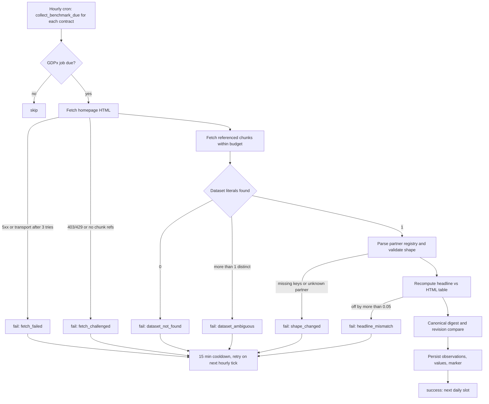
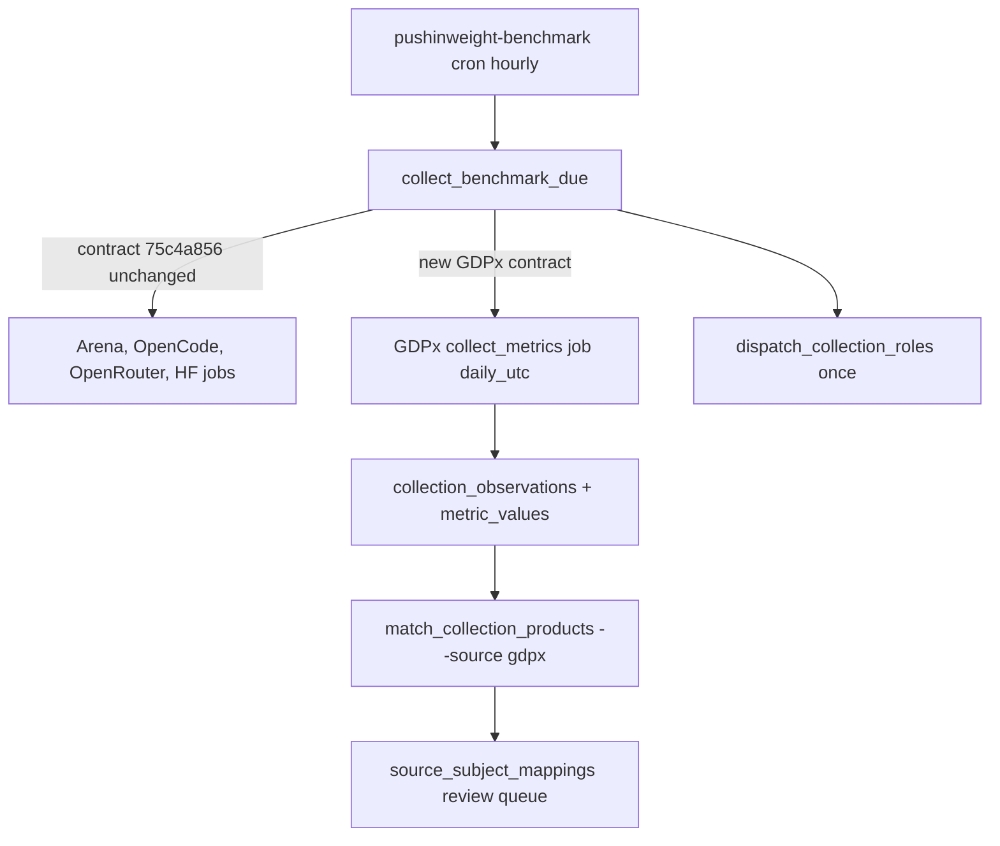

<!-- BEGIN OLLIJA DELIVERY GUIDE -->
## Ollija Delivery Guide

Generated by `ollija annotate-plan`; do not edit between the markers. Delivery policy lives in `AGENTS.md` under "Plans and delivery". Project facts (host, repository, branches, environments, URLs and blueprints) live in `.ollija/project.yaml`. Record owner exceptions under Delivery Exceptions below.

- Plan: `/Users/fuchitalee/development/pushin-weight-v2/.worktrees/docs/gdpx-source-plan-20261127/docs/plans/2026-11-27-011614-docs-gdpx-source-plan-20261127-plan.md`
- Branch: `docs/gdpx-source-plan-20261127`
- Change: `docs-gdpx-source-plan-20261127-2026-11-27-011614`
- Active worktree: `/Users/fuchitalee/development/pushin-weight-v2/.worktrees/docs/gdpx-source-plan-20261127`
- Workflow: `plan`
- Delivery target: `production`
- Route: `direct`
- Owner selection recorded: `true`

### Placement

This worktree is inside the Ollija release worktree area. Reuse it for the whole change. Do not create a second worktree or plan for this branch.

### Delivery steps

1. Complete implementation and the plan's verification contract.
2. Run the configured focused checks:
   - `pytest tests/ollija`
3. The parent workflow commits only this plan's changes, pushes the feature branch, and records the candidate SHA.
4. On the owner-selected direct route, fetch the remote production lane: `git fetch origin refs/heads/main`.
5. Require the same unchanged candidate SHA to be a fast-forward of that fetched remote ref, then push the exact candidate SHA to `refs/heads/main` with the server-enforced fast-forward command `git push origin <candidate-sha>:refs/heads/main`.
6. Verify the remote production ref resolves to the candidate SHA and the deployment for `pushinweight-web` reports that same SHA before reporting completion.
7. After step 6 succeeds, perform worktree cleanup as the final filesystem action:
    - From `/Users/fuchitalee/development/pushin-weight-v2`, require `/Users/fuchitalee/development/pushin-weight-v2/.worktrees/docs/gdpx-source-plan-20261127` to remain registered, clean, unlocked, and at the verified candidate SHA. If any guard fails, retain it and report the reason.
    - Run `git -C /Users/fuchitalee/development/pushin-weight-v2 worktree remove /Users/fuchitalee/development/pushin-weight-v2/.worktrees/docs/gdpx-source-plan-20261127` without `--force`.
    - Preserve the local and remote feature branches. Continue final reporting from the authoritative repository root.

Occupied staging: if a staged route finds `staging` in use by an unrelated release while production is authorized, follow the occupied-staging default in `AGENTS.md`.
<!-- END OLLIJA DELIVERY GUIDE -->

## Delivery Exceptions

- 2026-11-28 JST: owner selected production via staging. The remote `staging` branch carried 71 unrelated Chatter commits not on `main` (an unrelated release in progress), so the candidate could not fast-forward it. Per the AGENTS.md occupied-staging default (owner, 2026-11-09) this release goes direct to production without waiting or asking again.
- 2026-11-27 JST: owner directed using the Render API (full access) for the out-of-repo `pushinweight-benchmark` start-command edit in U8 instead of handing it back.
- Implementation added migration `0248_gdpx_match_candidate_namespace` (guard-function source list) beyond the plan's single-migration expectation; it adds no table, column or JSON field and was required for R12.

---

# GDPx Benchmark Data Source - Plan

**Target repo:** pushin-weight-v2 (this worktree, branched from `origin/main` at `1d3e336f`).

## Plain-English Summary

When this work is done, PushinWeight will collect SemiAnalysis's GDPx benchmark once a day, the same way it already collects Arena. Each day the collector reads the GDPx website. If SemiAnalysis has published new or corrected numbers, it saves the raw data file plus every score, partial score, cost per task and output-token figure, per model and per data partner. If nothing changed, it records "unchanged" and saves no duplicate numbers. GDPx's model names (for example "GPT 6.2 Astra") go into crosswalk so they can be linked to the project's existing model records. Unmatched or doubtful names wait for review instead of being guessed.

What changes: a new GDPx reader, one database rule widened so dollar amounts can be stored as numbers, a GDPx entry in the existing benchmark and crosswalk code, and a small change so the existing hourly benchmark job can run more than one contract. A contract here is the project's fixed record of what gets collected and how it's mapped. What does not change: no new tables, no new columns, no new JSON fields, no new Render service. Arena, OpenCode, OpenRouter and Hugging Face collection, live X harvesting, charts and the website are all untouched. Charts for GDPx, the public task transcripts ("rollouts"), and recovering scores from before the first poll are left for later.

The approach reuses the existing collection system. GDPx has no API, so the reader finds the site's current data file each day and checks it carefully: the data's shape, the list of partners, and a recomputed headline score compared with the number shown on the page. If anything doesn't match, it stops and saves no numbers. Completion is proven by automated tests built from a recorded copy of the real 2026-11-25 data, including one test through the real scheduler entry point, then by watching several days of production polls after release.

Decisions already made by you: daily polling; you take responsibility for GDPx's terms of use, so the plan records an "allowed" decision rather than adding a block; cost per task is stored as a number; GDPx names go into crosswalk. One thing needs your attention at release time: the live Render benchmark job's start command is set outside this repository, and it has to be edited once to add the GDPx contract. That is a production change and needs your release instruction.

---

## Goal Capsule

- **Objective:** PushinWeight holds a complete, dated, revision-aware history of GDPx scores, partial scores, cost per task and output tokens for every published model and partner, refreshed daily without manual work, with GDPx model names available for crosswalk review.
- **Means:** a GDPx adapter on the existing benchmark collection system, scheduled by the existing hourly `pushinweight-benchmark` cron through a daily job (KTD1, KTD2, KTD6).
- **Authority:** owner instructions in this plan's Key Decisions, then `AGENTS.md`, then the KTDs, then unit Approach text.
- **Stop conditions:** stop and report if implementation would need a new table, a new column, a JSON column, or a change to the harvest cron. Also stop if the live GDPx site stops embedding a parseable dataset, so that only scraping rendered page text would work.
- **Execution profile:** code + tests in this worktree; PostgreSQL tests through the shared test-database wrapper.
- **Finishing and shipping:** `delivery_target: on-request`. Implementation and verification finish locally. Commit, push, staging, production and the Render cron edit (U8) each need a later explicit owner instruction.

---

## Product Contract

### Summary

Add GDPx as a benchmark data source collected daily on the existing collection system. Store every published per-model, per-partner result and the reported per-model overall cost and token figures, with in-place revisions detected. Expose GDPx model names to crosswalk.

### Problem Frame

GDPx (https://gdpx.semianalysis.com/, launched 2026-11-02) is a frontier agentic benchmark: 206 tasks, 11 domains, 14 data partners. The owner wants it alongside Arena as an evidence source. It has no API: `/api`, `/api/leaderboard`, `/api/results`, `/data.json` and `/leaderboard.json` all return 404. The complete dataset is a JSON literal inside one hash-named Next.js JavaScript file, and that file's name changes with each site deploy. Updates are irregular and event-driven: launch on 2026-11-02, a revision of existing scores on 2026-11-17, five new models on 2026-11-25. The site changelog missed at least one model addition. Collection therefore has to rediscover the file, detect real data changes by content, and preserve revisions instead of appending duplicates.

### Requirements

**Collection**

- R1. The collector polls GDPx once per UTC day through the existing benchmark scheduler and retries a failed day without waiting for the next day.
- R2. Each poll fetches only `gdpx.semianalysis.com` pages and JavaScript files referenced by the homepage. It refuses redirects and other hosts.
- R3. The collector extracts the dataset object (`updatedAt`, `source`, `models`, `overall`, `results`) and the partner registry (partner id, name, domain) from the site's code. It stores nothing numeric when either is missing, ambiguous or malformed.
- R4. Before storing, the collector recomputes the headline score for each listed non-specialist model and compares it with the server-rendered homepage table. A mismatch fails the poll.
- R5. Failures are recorded with a cause that distinguishes an unreachable site, a bot challenge, a missing or ambiguous dataset, a shape change and a headline mismatch.

**Storage**

- R6. Every result row is stored as a provider observation, keyed by GDPx model id and partner, with `score`, `partialScore`, `tasks`, `tasksScored`, `tasksWithPartial`, `costPerTask`, `tasksWithCost`, `tokensPerTask` and `tasksWithTokens`. Each model's reported overall `costPerTask` and `tokensPerTask` is stored too.
- R7. Cost per task is stored as a number in US dollars, and a null cost is recorded as unavailable, never as zero.
- R8. Each stored row carries the dataset's `updatedAt` as its publication date (day precision) and keeps the model's `harness`, `reasoning`, `lab`, `openWeights` and `specialist` labels.
- R9. A poll whose dataset matches the latest stored revision writes no new value rows. A changed row writes a new observation linked to the one it supersedes, including when a score goes down.
- R10. A changed body under an unchanged `updatedAt` is stored and flagged as a revision conflict. A dataset older than the stored one never replaces it.
- R11. Rows for models with no crosswalk link are stored like linked ones.

**Crosswalk and use**

- R12. GDPx model ids and display names are available to the existing crosswalk matcher and its review queue under source `gdpx`. Matching follows the existing evidence rules: name-only matches need review, and prefix overlap alone never links.
- R13. Specialist models and abliterated (safety-removed) variants are never linked to their base models' products.
- R14. The GDPx source records attribution "GDPx by SemiAnalysis" and the terms URL as facts. Collection and retention are recorded as allowed by the owner.
- R15. A reader can compute the GDPx headline score from stored per-partner rows with the published method: equal weight per domain, equal weight per partner within a domain.

**Continuity**

- R16. Existing Arena, OpenCode, OpenRouter and Hugging Face collection behaves exactly as before, including when GDPx collection fails.

### Key Decisions

- **Daily polling.** (session-settled: user-directed — chosen over an unspecified cadence: data changes are irregular and roughly weekly at most.) Governs R1.
- **No usage gate; owner assumes terms-of-use responsibility.** (session-settled: user-directed — chosen over restricting GDPx to journalism use: the owner owns asset-use policy.) The terms restrict prediction-market, trading and resale use without a license; the plan records them as facts only. Governs R14.
- **Cost per task stored as numbers.** (session-settled: user-directed — chosen over keeping cost only inside the raw file as OpenCode does: cost against score is GDPx's headline comparison.) Governs R7.
- **GDPx names added to crosswalk.** (session-settled: user-directed — chosen over collecting without product links.) Governs R12, R13.
- **Render capacity no longer a constraint.** The owner reports the plan was upgraded after the 2026-11-09 audit. The plan still reuses the existing cron because the scheduler already supports per-source daily jobs, not because of capacity.

### Scope Boundaries

- Not included: charts, website or Pulse surfaces for GDPx.
- Not included: newsletter parsing.
- Not included: rollout transcripts and task text (`/rollouts/<slug>`).
- Not included: the "domain-specific models" toggle as a separate stored view; the specialist label on the stored rows supports it.

#### Deferred to Follow-Up Work

- Recovering pre-first-poll history (the 2026-11-02 launch values and the pre-2026-11-17 materials-science scores) from an archived copy such as the Wayback Machine.
- Linking reviewed crosswalk mappings into contract-scoped metric reads. Today metric mappings are frozen inside a contract (KTD3). This is the same open problem Arena and OpenCode have.
- Adding `opencode` to the matcher-evidence allowlist in `core/identifier_namespaces.py`. It is a pre-existing omission on the same line U6 edits. Recorded as a separate bug so this change doesn't silently alter OpenCode matching.
- A typed currency reference on metrics (the `currencies` table exists but metrics don't reference it).
- Persisting the derived headline score as its own stored value with input links.

### Sources

- GDPx site, sitemap, changelog and terms, read 2026-11-27 JST. The dataset was extracted from the hashed chunk `1p0q26iuw5iw2.js`; the 2026-11-25 sample has 29 models, 26 `overall` entries and 367 results. Recomputing the headline matched the site for GPT 6.2 Astra (19.3), Claude Fable 5.2 (16.4), Claude Opus 5.5 (11.9), DeepSeek 4.1 Flash (5.4) and GPT-6 Luna (5.1).
- SemiAnalysis newsletter, "GDPx: Measuring Frontier Model Capabilities Across the Most Valuable Domains" (2026-11-02), and "Evaluating Recent Model Releases on GDPx" (2026-11-26).
- Live Render read, 2026-11-27: cron `pushinweight-benchmark` (`crn-db3lm2ui0phs73amjs30`, `0 * * * *` UTC) runs `python manage.py collect_benchmark_due --contract 75c4a856-385b-429a-9b03-c7e023ea6f73 --apply`.
- `docs/solutions/` replay learning `2026-11-05-150150-replay-reviewed-backfill-measurements-into-production.md`, section 4: do not route around the use-policy check.
- Crosswalk identity rules: `docs/research/2026-11-04-095122-crosswalk-source-identity-rules.md`. It exists only as an uncommitted file in the `docs/chartengine-plan-20261102` worktree; rules G3, G6b, G9 and G15 apply here.

---

## Planning Contract

### Key Technical Decisions

- KTD1. **Reuse the existing benchmark collection system; GDPx is one more adapter.** No new tables, no new columns, no JSON columns. Tables added: 0. Tables retired: 0. Observations use `collection_observations` with typed `category_key`, `config_key` and `coordinate_key`. Values use `metric_values`. Raw bytes go to `collection_evidence_archives` through the existing request capture. The only schema change is KTD4's constraint widening. This follows `AGENTS.md` schema-first and M19. Governs R6, R8, R11.
- KTD2. **One link-free GDPx contract, collected by GDPx's own model ids.** Contracts can't be edited, and values under one contract are invisible to another (`CONCEPTS.md`, Measurement contract). `prepare_rows` stores unmapped rows with `mapping=None`. A contract with no frozen mappings therefore keeps the full published set in one unbroken series and never needs replacing when crosswalk admits a model. It changes only when metric definitions change, such as a new GDPx version that needs new metrics.
  - Today `prepare_collection` (`core/benchmark_metric_identity.py`) rejects an empty mapping list for `text-benchmark-v1`. The only exception is the `source-statistics-v1` policy for `openrouter`/`arena`, and that one projects saved evidence rather than fetching. U1 extends the empty-mapping exception to a `text-benchmark-v1` configuration whose only source is `gdpx`. Every other source keeps the existing rule.
  - Rejected: a linked contract like Arena's. Each newly admitted model, roughly weekly at GDPx's update rate, would need a new contract, break the series and need a scheduler pointer.
  - Rejected: adding GDPx to Arena's contract `75c4a856…`. That creates a new contract hash and strands Arena's readers.
  - The owner left this choice to the planner's judgment on 2026-11-27.

  Governs R6, R11.
- KTD3. **Crosswalk links are catalog mappings, kept separate from contract reads.** U6 makes GDPx names matchable and reviewable. Reading GDPx values through approved links is deferred (Scope Boundaries). Governs R12.
- KTD4. **Add a `monetary` quantity form by widening `ck_metric_quantity`; register units by definition.** The migration widens the CHECK constraint in place and adds no column. Units are registered at runtime by `definition_rows` and need no migration: `percent` (scores), `usd` (cost per task), `output_tokens_per_task` (`ratio` form; it's an average), plus the existing count unit for task counts. Only `score` is required. Every other GDPx metric is `required=False`, so the 17 null-cost rows in the sample don't fail a publication. Monetary values must be non-negative, checked in the adapter. (session-settled: user-directed — chosen over raw-file-only storage like OpenCode: cost against score is GDPx's headline comparison.) Governs R7.
- KTD5. **Dataset extraction scans every homepage-referenced chunk and expects exactly one dataset.** The reader fetches the homepage HTML. It collects `/_next/static/` chunk paths, both plain and escaped. It fetches them within the source budget and parses each `JSON.parse('…')` literal with JavaScript string-escape decoding. It keeps only objects with the five dataset keys. Zero matches means `dataset_not_found`; more than one distinct dataset means `dataset_ambiguous`. The partner registry is read from the `a("<id>","<name>","<domain>","/partners/…")` calls in the same chunk. Every `results.partnerId` must be in the registry. Rejected alternative: a hard-coded chunk name or hard-coded partner list, either of which breaks silently on the next deploy. Governs R2, R3.
- KTD6. **Schedule through a job-owned `daily_utc` `collect_metrics` job on a GDPx contract.** `collect_benchmark_due` learns to accept `--contract` more than once. Each contract runs in isolation: one contract's error is reported after the others finish. `dispatch_collection_roles` runs exactly once per invocation. The job-owned path supplies the 15-minute failure cooldown, so a failed day retries hourly on the cron ticks until it succeeds (R1). Rejected alternatives: a second Render cron, which duplicates the scheduler and was warned against in earlier plans; and the legacy `poll_seconds` due path, which has no same-day retry. Governs R1, R16.
- KTD7. **Change detection reuses OpenCode's revision model.** It reuses `prepare_revisions` and `row_semantic_hash` in `core/benchmark_opencode.py`. The revision identity is `updatedAt` plus a canonical body digest. Canonical means `models` sorted by id, `results` sorted by (`modelId`, `partnerId`), integers and integral floats normalized, and keys sorted. That way a redeploy that reorders arrays reads as unchanged. Equal row digests reference the prior observation. A changed row supersedes it. A changed body under an equal `updatedAt` sets `revision_conflict`. An older `updatedAt` is recorded as a check and never selected. One publication marker is written per distinct `updatedAt`. Shared helpers are generalized rather than copied. Today `record_endpoint_checks` and `prepare_revisions` find prior rows through the contract mapping and fail when a row has none (`require(mapping is not None, "endpoint mapping is missing")`). The generalized helper therefore keys prior-row lookup on the observation identity: source, `source_identifier`, `category_key` and `config_key`, within the contract. A missing mapping is the expected case for `gdpx`. OpenCode keeps its existing mapping and endpoint-path requirements unchanged, and its existing tests must pass unchanged. Governs R9, R10.
- KTD8. **Observation coordinates.**
  - `category_key` = partner id.
  - `coordinate_key` = partner domain slug.
  - `config_key` = `<harness>|<reasoning casefolded>`, so the published `XHigh`/`xHigh` spellings share a series while real configuration changes split it. The verbatim labels plus `lab`, `openWeights` and `specialist` stay in the archived payload and the model row.
  - Overall cost/token rows use category `overall`.
  - `published_date` = `updatedAt` with day precision and unknown timezone.
  - `source_record_date` is set through `dated_source`.
  - Store reported overall cost and tokens as published, never recomputed: three of 26 don't equal the task-weighted mean of partner rows.

  Governs R6, R8.
- KTD9. **Run success means a complete, validated publication was stored.** For `gdpx` the run's `selected_count` is the validated dataset's expected observation count from U2: one per result plus one per `overall` entry, 393 in the 2026-11-25 sample. Its `success_count` counts the observations stored or reused for that dataset. Run status is success only when the two are equal.
  - The current rule derives both counts from frozen mappings (`core/benchmark_metric_store.py`, `successful.add(observation.mapping_id)`), and the link-free contract has none, so it would read 0 = 0 and report success however little was stored.
  - It also does not require every previously seen model to appear. A model absent from a new publication becomes an absence fact, never a zero, so absence never makes a run partial or triggers endless cooldown re-polling.
  - Other sources keep the mapping-based rule.

  Governs R1, R9.
- KTD10. **Version probe without blocking.** The JSON has no version key. The reader records the homepage version label (`v1.0` today) and a fingerprint of per-partner task totals on the publication marker. A change in either is flagged as an anomaly in `collection_status` while collection continues. A definition change, if needed, becomes a new contract under KTD2. Governs R3, R5.
- KTD11. **Headline check against server-rendered HTML.** The homepage HTML contains the default leaderboard rows (11 of 26 models today, one decimal place). The reader recomputes those models' scores from `results` with the registry's domain weights and requires agreement to 0.05. It skips specialists and models not shown. A mismatch is `headline_mismatch`: request archives are kept, and no values are stored. Governs R4, R15.
- KTD12. **Use policy recorded, not bypassed.** `core/benchmark_attribution.py` gains a `gdpx` entry in `DEFAULTS` with credit "GDPx by SemiAnalysis" and the terms URL. The DataSource `metadata.use_policy` records `collection` and `retention` as `allowed`. Each carries reviewed_by = owner, reviewed_at = 2026-11-27, access_route = public website, evidence_url = `https://gdpx.semianalysis.com/terms`, and restrictions = the terms' commercial-use clauses as recorded facts. `enforce_source_collection` then passes with no new gate. Governs R14.
- KTD13. **Host-pinned text fetch mode with a declared User-Agent.**
  - `Budget.get` in `scripts/benchmark_download_collector/sources.py` gains a text mode limited to `https://gdpx.semianalysis.com/` and `/_next/static/` paths on that host.
  - It keeps the existing timeout, three attempts, `Retry-After` handling, refused redirects and byte caps (8 MiB source default; the homepage is about 230 KB and the data chunk about 90 KB).
  - It sends `User-Agent: PushinWeight-public-metadata`, matching the GitHub and HF clients.
  - A 403/429 response or an HTML body without chunk references is `fetch_challenged`.

  Governs R2, R5.
- KTD14. **Crosswalk matches on display name, not slug.** `name_key` keeps dots, so slug `gpt-6-2-astra` can never equal "GPT-6.2-Astra". The matcher's native label for GDPx is `models[].name` with `lab` as the publisher hint. The identifier is the GDPx id under scope `model_id`. Effort and mode labels (`reasoning`) don't create separate products (rule G6b). Rows with `specialist` set, or with an `-abliterated` id or name, are excluded from automatic candidates and always go to review (G15, R13). Governs R12, R13.
- KTD15. **No bake-off.** The open how-level choices (contract topology, scheduler path, change detection) each had one alternative ruled out by repository evidence. None needed competing prototypes to decide.

### High-Level Technical Design

Poll lifecycle (one daily job slot):

Revision outcomes for a validated dataset compared with the latest stored selection:

| Incoming dataset | Stored effect | Marker | Flag |
|---|---|---|---|
| Same `updatedAt`, same canonical digest | References prior observations; no new values | check only | none |
| Newer `updatedAt` | Changed rows supersede the prior ones; unchanged rows referenced; new models added | new publication | version anomaly if probe changed |
| Same `updatedAt`, different digest | Changed rows supersede the prior ones | check | `revision_conflict` |
| Older `updatedAt` | Nothing selected | check | stale |
| Model absent from newer dataset | Absence fact; prior rows retained | new publication | none |

Contract and scheduling topology:

### Assumptions

- The data chunk stays referenced from the homepage HTML. KTD5 fails loudly if it doesn't.
- The site serves the collector without a bot challenge. This is unobserved either way; KTD13 classifies a challenge distinctly.
- The single daily slot hour is 10:00 UTC (19:00 JST), matching the Hugging Face slot. Any hour works.

### Risks

| Risk | Mitigation |
|---|---|
| Site redesign moves the dataset or partner registry | Typed failures (R5) plus `collection_status` visibility. The archived homepage and chunks allow replay once the reader is fixed. |
| SemiAnalysis changes methodology without a version label | Task-total fingerprint (KTD10) and headline check (KTD11). |
| Multi-contract change breaks Arena scheduling | Regression net in U5: existing contract's due decisions and outputs pinned before the edit. |
| Render cron edit forgotten or mistyped | U8 checks the live start command read-only before and after the edit; GDPx has no other scheduler. |
| Terms-of-use exposure | Owner decision; recorded as facts (KTD12). |
| Constraint migration on a live table | `metrics` holds metric definitions (hundreds of rows), not values, so re-validating the widened CHECK is brief. Hourly benchmark writers only read it. The migration runs in the normal release migrate step, with no pause of harvesting or collection. |

---

## Implementation Units

### U1. GDPx metric definitions, monetary quantity form and use policy

- **Goal:** Register source `gdpx` with its metric definitions, attribution and recorded use policy, and allow monetary metrics.
- **Requirements:** R6, R7, R8, R14; KTD1, KTD2, KTD4, KTD12.
- **Dependencies:** none.
- **Files:**
  - `core/models.py` (`SourceMetric` CHECK `ck_metric_quantity`)
  - `core/migrations/0246_metric_monetary_quantity.py` (next free number at implementation time)
  - `core/benchmark_metric_identity.py` (`SOURCES`, `definition_rows`, `prepare_collection` GDPx defaults)
  - `core/benchmark_attribution.py` (`DEFAULTS`)
  - `core/benchmark_metric_operations.py` (only if GDPx defaults need validation entries)
  - `tests/test_benchmark_gdpx_definitions.py`
  - `tests/test_benchmark_download_db_identity.py` (register the new source in `setup_spec`)
- **Approach:**
  1. Widen `ck_metric_quantity` to add `monetary`. The migration only alters the constraint, with no data rewrite.
  2. Add `gdpx` to `SOURCES` with an adapter version, and give `definition_rows` GDPx metrics per KTD4.
  3. Add the `DEFAULTS["gdpx"]` attribution and document the owner use-policy values that `configure_benchmark_collection` writes into `DataSource.metadata` (U8 applies them).
  4. In `prepare_collection`, allow an empty mapping list when the configuration's only source is `gdpx` (KTD2). Leave every other source's rule unchanged.
- **Patterns to follow:** the OpenCode additions in commit `09c0708a` (`SOURCES`, `definition_rows`, `DEFAULTS`).
- **Test scenarios:**
  - `register_definitions` for `gdpx` creates units `percent`, `usd` and `output_tokens_per_task`, and metrics with the quantity forms and `required` flags in KTD4.
  - A metric with `quantity_form="monetary"` saves; an unknown form such as `currency` is rejected by the database.
  - The migration applies and reverses on PostgreSQL with no row changes.
  - `enforce_source_collection("gdpx")` raises `UseNotPermitted` without the recorded policy and passes with the KTD12 values.
  - `comparison_attributions` returns "GDPx by SemiAnalysis" for `gdpx`.
  - A `text-benchmark-v1` contract with only `gdpx` configured and no mappings is created. The same empty mapping list with `arena`, or with `gdpx` plus `arena`, is still rejected with "mapping budget exceeded or empty".
  - Configuring the identical GDPx spec twice returns the same contract (stable hash).
  - Existing sources' `definition_rows` output is byte-identical to before (regression net).
- **Verification:** the definition tests and the existing identity tests pass; `makemigrations --check` reports no drift.

### U2. GDPx reader: discovery, extraction and validation

- **Goal:** A pure reader that turns the live site into a validated dataset or a typed failure.
- **Requirements:** R2, R3, R4, R5, R15; KTD5, KTD10, KTD11, KTD13.
- **Dependencies:** none (U3 consumes its output).
- **Files:**
  - `scripts/benchmark_download_collector/sources.py` (`SOURCE_URLS`, host-pinned text mode in `Budget.get`, new `gdpx` reader)
  - `core/benchmark_gdpx.py` (extraction, partner registry, canonical digest, headline computation; shared with U7)
  - `tests/test_benchmark_gdpx.py`
  - `tests/fixtures/benchmark_download_collector/gdpx-2026-11-25/` (sanitized homepage HTML, the data chunk, one decoy chunk, extracted expected JSON)
  - `tests/test_benchmark_download_recorded_fixtures.py` (add the `gdpx` case)
- **Approach:**
  1. Fetch the homepage and collect chunk references.
  2. Fetch chunks and decode `JSON.parse` string literals with JavaScript escape rules (`\'`, `\\`, `\uXXXX`).
  3. Select the dataset per KTD5 and parse the partner registry calls.
  4. Validate the dataset: required keys and types; scores 0–100; non-negative cost and tokens; null cost only when `tasksWithCost` is 0; every result's model and partner known; specialists have no `overall` entry.
  5. Run the headline check per KTD11 and record the version label and task fingerprint per KTD10.
  6. Return the dataset, registry, canonical digest, version probe and per-request archive references, or a typed failure.
- **Patterns to follow:** `arena_latest` and `opencode` readers in `sources.py`; the `budget(handler)` MockTransport helper in `tests/test_benchmark_download_sources.py`.
- **Execution note:** Build the recorded fixture from the real 2026-11-25 homepage and chunk first, and write the extraction test against it before the parser.
- **Test scenarios:**
  - Recorded fixture yields 29 models, 26 `overall` entries, 367 results, 14 partners across 11 domains, and `updatedAt` 2026-11-25.
  - Headline recomputation equals the HTML table for all 11 shown models (19.3, 16.4, 11.9, 11.5, 10.1, 9.0, 8.2, 7.4, 6.3, 5.4, 5.1).
  - A decoy chunk with an unrelated `JSON.parse` is ignored; two chunks with different datasets give `dataset_ambiguous`; none gives `dataset_not_found`.
  - A model name containing an escaped apostrophe and `\u` escapes decodes exactly, and the digest is stable.
  - Reordered arrays and `95` versus `95.0` produce the same canonical digest.
  - A result with an unknown partner, a missing `results` key or a renamed field gives `shape_changed`.
  - A null cost with `tasksWithCost` > 0 gives `shape_changed`; a null cost with 0 passes.
  - One shown model's HTML value altered by 0.2 gives `headline_mismatch`.
  - Homepage 503 three times gives `fetch_failed` after retries; 429 with `Retry-After` is honored; 403, or 200 HTML with no chunk refs, gives `fetch_challenged`.
  - A 307 redirect or a chunk URL on another host is refused and recorded.
  - Requests carry the declared User-Agent and no cookies or credentials.
  - The version label changing from v1.0 to v2.0, or a change in task totals, returns success with the anomaly flag set.
- **Verification:** the reader tests pass without network or database; ruff is clean on the touched paths.

### U3. Persist GDPx observations with revision reuse

- **Goal:** Store a validated dataset as observations and values with KTD7 revision semantics and KTD9 success semantics.
- **Requirements:** R6–R11; KTD7, KTD8, KTD9.
- **Dependencies:** U1, U2.
- **Files:**
  - `core/benchmark_metric_store.py` (`native_rows` GDPx branch, `numeric_value` checks, `persist_source` GDPx block, success rule)
  - `core/benchmark_opencode.py` (generalize `prepare_revisions` and endpoint-check recording so both sources share one path)
  - `core/collection_resources.py` (`dated_source` includes `gdpx`)
  - `tests/test_benchmark_gdpx_store.py`
  - `tests/test_benchmark_opencode.py` (must pass unchanged)
- **Approach:**
  1. Map each result to one observation with KTD8 coordinates and its values; overall cost and tokens use category `overall`.
  2. Reuse the generalized revision helper for digest comparison, supersession, conflict flagging and the stale-older check.
  3. Write one publication marker per distinct `updatedAt`, carrying the version probe.
  4. Apply the KTD9 success rule to `gdpx` only: set `selected_count` from the U2 expected observation count before persistence, and count stored-or-reused GDPx observations toward `success_count`.
- **Patterns to follow:** the OpenCode revision block in `persist_source`; the Arena `record_arena_publications` marker shape.
- **Test scenarios:**
  - First poll stores 367 result observations and 26 overall observations, one marker dated 2026-11-25, unmapped rows with `mapping` null, and run status success.
  - Same dataset re-polled with a new chunk hash writes no new value rows, keeps original `observed_at` values, and records a check.
  - One score lowered under a new `updatedAt` writes a new observation for that cell with `supersedes_observation` set and references the others.
  - Same `updatedAt` with one changed row sets `revision_conflict` on the new observation.
  - An older `updatedAt` after a newer one stores a check and leaves the selection unchanged.
  - A model removed from a newer dataset keeps its prior rows, records absence rather than zero, and the run is still success.
  - A persistence fault that commits only part of a valid dataset (for example, 200 of 393 observations) marks the run partial, not success, even though the contract has no mappings.
  - The first poll reports `selected_count` = `success_count` = 393, and an unchanged re-poll reports 393 reused.
  - The generalized revision helper finds prior GDPx rows with no mapping, while an OpenCode row without its mapping still fails with "endpoint mapping is missing" (regression net).
  - The 17 null-cost rows store a metric gap marked unavailable and no zero value.
  - `XHigh` and `xHigh` reasoning labels produce the same `config_key`; a harness change produces a different one.
  - Specialist rows store with category `arithmetic` (their partner id, per KTD8) and no overall row.
  - OpenCode revision tests pass unchanged against the generalized helper (regression net).
- **Verification:** the store tests and the existing OpenCode tests pass on PostgreSQL through the shared test-database wrapper.

### U4. Collection command wiring

- **Goal:** `collect_benchmark_metrics --source gdpx` runs the reader and persistence through the claimed, captured request path.
- **Requirements:** R2, R5, R16.
- **Dependencies:** U2, U3.
- **Files:**
  - `monitor/management/commands/collect_benchmark_metrics.py` (`--source` choices; explicit `gdpx` branch in `fetch_source`; an unknown source raises instead of falling into the Arena branch)
  - `core/collection_reports.py` (`collection_status` source allowlist)
  - `tests/test_benchmark_gdpx_command.py`
- **Approach:**
  1. Add the explicit `gdpx` branch.
  2. Make the `else` branch raise for unknown sources, since today it silently runs Arena.
  3. Persist the typed failure code on the run so `collection_status` can show it.
- **Patterns to follow:** the OpenCode branch and the command-chain test in `tests/test_benchmark_opencode.py`, which patches `httpx.Client`.
- **Test scenarios:**
  - The command with MockTransport serving the fixture stores the U3 first-poll result, and every HTTP call is a `CollectionRequest` with an archived body.
  - Each U2 failure code is persisted on the run and shown by `collection_status --source gdpx`.
  - An unknown `--source` value is rejected, and the former Arena fallback no longer runs.
  - Arena, OpenCode, OpenRouter and HF command paths produce the same results as before (regression net).
- **Verification:** the command tests pass; the existing benchmark command tests pass unchanged.

### U5. Multi-contract scheduler and GDPx daily job

- **Goal:** The existing hourly cron can drive the GDPx contract's daily job without affecting the existing contract.
- **Requirements:** R1, R16; KTD6.
- **Dependencies:** U4.
- **Files:**
  - `monitor/management/commands/collect_benchmark_due.py` (repeatable `--contract`, per-contract isolation, single role dispatch, nonzero exit after all contracts if any failed)
  - `core/collection_scheduling.py` (only if the job-owned path needs `gdpx` admitted to source sets)
  - `core/collection_jobs.py` (only if `collect_metrics` validation needs a GDPx entry)
  - `tests/test_collection_scheduling.py`
  - `tests/test_source_collection_routine.py` (end-to-end case)
- **Approach:**
  1. Pin the current single-contract behavior with tests first.
  2. Generalize the contract loop and move role dispatch outside it.
  3. Confirm a `daily_utc` shared-driver `collect_metrics` job for `gdpx` follows the existing slot, cooldown and authority logic with no GDPx-specific scheduler code.
- **Execution note:** Write the regression-net tests for the existing single `--contract` invocation before changing the command.
- **Test scenarios:**
  - With one `--contract`, due decisions, batch ids, calls and exit code match the pre-change behavior (regression net).
  - With Arena's and GDPx's contracts, both run, `dispatch_collection_roles` is called exactly once, and batch ids are deterministic per slot.
  - The GDPx collection raising an error doesn't stop the Arena contract, and the command exits nonzero after both.
  - A GDPx failure at 10:00 UTC sets the 15-minute cooldown; the 11:00 tick retries and succeeds; the next slot is the following day's 10:00 UTC.
  - End to end through `collect_benchmark_due --contract <arena> --contract <gdpx> --apply` with MockTransport and a frozen clock stores the GDPx first-poll observations.
  - An interrupted run (lease expiry) followed by a retry in the same slot completes without duplicate observations.
- **Verification:** the scheduling and routine tests pass; the existing scheduling tests pass unchanged.

### U6. Crosswalk support for GDPx names

- **Goal:** GDPx models appear in crosswalk preview and review under source `gdpx`.
- **Requirements:** R12, R13; KTD3, KTD14.
- **Dependencies:** U3.
- **Files:**
  - `core/collection_matching.py` (`SOURCES`, native inventory label and publisher for `gdpx`, `_candidate` evidence URL `https://gdpx.semianalysis.com/`, specialist/abliterated exclusion)
  - `core/identifier_namespaces.py` (allow `gdpx` matcher evidence)
  - `core/collection_jobs.py` (`OPERATIONS["match_crosswalk"]` source set)
  - `core/management/commands/match_collection_products.py` (choices follow `SOURCES`)
  - `tests/test_collection_matching.py`
- **Approach:**
  1. Extend the existing matcher entry points for `gdpx`.
  2. Read evidence from freshly collected GDPx observations. If `observation_object_documents` cannot read observations without a legacy archive, add the typed-observation read path there rather than archiving GDPx evidence the old way.
- **Patterns to follow:** the Arena branches in `core/collection_matching.py`; crosswalk rules G3, G6b and G15 from the rules document cited in Sources.
- **Test scenarios:**
  - Preview on freshly collected GDPx observations, built through `persist_source` rather than `archive_legacy`, lists candidates without the namespace guard raising.
  - "Claude Opus 5.5" with lab Anthropic matching an existing product name is `needs_review`, not auto-linked.
  - The slug `gpt-6-2-astra` is never used as the match label; the display name is.
  - `kimi-k3-1-pro-abliterated` and `hinoki-ho1` are excluded from automatic candidates and not linked to Kimi K3.1 Pro.
  - Two GDPx models claiming one product make both unmatched.
  - The candidate evidence URL is the GDPx site.
  - Existing GitHub, OpenRouter, Arena and OpenCode preview outputs are unchanged (regression net).
- **Verification:** the matching tests pass; a dry-run preview command lists the 2026-11-25 fixture models.

### U7. Headline reader and documentation

- **Goal:** Readers can compute the GDPx headline from stored rows, and the source is documented.
- **Requirements:** R14, R15.
- **Dependencies:** U3.
- **Files:**
  - `core/benchmark_gdpx.py` (stored-row headline function sharing the U2 computation)
  - `tests/test_benchmark_gdpx_store.py` (headline-from-storage case)
  - `docs/external_vendors/semianalysis_gdpx/README.md` (vendor facts, dataset shape, discovery method, cadence evidence, terms summary and the owner decision)
  - `docs/reference/collection-jobs.md` (GDPx source, daily job and crosswalk source list)
  - `docs/reference/db-schema.md` (`ck_metric_quantity` value list)
  - `scripts/benchmark_download_collector/README.md` (GDPx reader)
  - `CONCEPTS.md` (only if a new domain term is used)
- **Approach:**
  1. Compute equal-weight-per-domain, equal-weight-per-partner averages from the latest selected revision.
  2. Follow `.claude/skills/updating-reference-docs/SKILL.md` for the reference-doc edits.
- **Test scenarios:**
  - The headline from stored 2026-11-25 rows equals the U2 computation and the site values.
  - The headline uses only the latest revision after a superseding poll.
  - A model with no stored rows returns no score, not zero.
- **Verification:** the reader test passes; the reference-doc skill's verification checks pass.

### U8. Activation runbook (release-time, owner-authorized)

- **Goal:** Turn on daily GDPx collection in production without touching harvesting.
- **Requirements:** R1, R14, R16.
- **Dependencies:** U1–U7 deployed by an owner-authorized release.
- **Files:**
  - `docs/operations/<YYYY-MM-DD-HHMMSS>-gdpx-collection-activation.md` (JST timestamp at creation)
  - `docs/deploy/render.md` (benchmark cron command note)
- **Approach:** The runbook records these steps:
  1. Run the migration.
  2. Run `configure_benchmark_collection --register-definitions --apply` with the GDPx use policy.
  3. Configure the GDPx contract and record its id.
  4. Register the paused `daily_utc` `collect_metrics` job, then make it ready with `--take-metric-authority`.
  5. Read the live cron start command, change it to add `--contract <gdpx-id>`, and read it back.
  6. Observe at least three consecutive daily GDPx runs.

  All one-off commands run as Render one-off jobs on the benchmark or harvest image, never in `pushinweight-web`.
- **Test expectation:** none (operational runbook). Proof is the post-release observation in the Definition of Done.
- **Verification:** the runbook names exact commands, the expected read-backs and a rollback: restore the previous start command and set the job to paused.

---

## Verification Contract

| Check | Command | Proves |
|---|---|---|
| Reader and non-database tests | `scripts/pytest-local tests/test_benchmark_gdpx.py tests/test_benchmark_gdpx_definitions.py tests/test_benchmark_download_sources.py tests/test_benchmark_download_recorded_fixtures.py` | U2, U1 definitions |
| PostgreSQL tests | `~/.local/bin/pushinweight-test-db pytest tests/test_benchmark_gdpx_store.py tests/test_benchmark_gdpx_command.py tests/test_benchmark_opencode.py tests/test_benchmark_download_db_identity.py tests/test_collection_scheduling.py tests/test_source_collection_routine.py tests/test_collection_matching.py` | U1, U3–U7 and the regression nets |
| Wider benchmark and collection suite | `~/.local/bin/pushinweight-test-db pytest tests/test_benchmark*.py tests/test_collection_*.py` (the same groups CI runs in `.github/workflows/benchmark-download-collector.yml`) | No regression in existing sources |
| Migration drift | `python manage.py makemigrations --check --dry-run` | U1 migration complete |
| Django checks | `python manage.py check` | Configuration valid |
| Lint | `ruff check core/benchmark*.py core/collection*.py core/identifier_namespaces.py scripts/benchmark_download_collector monitor/management/commands/collect_benchmark_*.py` | Style |

The shared test-database wrapper refuses pending migrations. Running U1's migration against the shared database needs exclusive use, per `AGENTS.md`. If the wrapper reports that the database is ahead because of another branch's migrations, follow the `AGENTS.md` disposable-checkout procedure; never reset the shared database.

---

## Definition of Done

- All units' test scenarios exist and pass. The Verification Contract commands pass at the candidate commit.
- Existing Arena, OpenCode, OpenRouter and HF tests pass unchanged, and the single-contract scheduler regression net passes.
- No new table, column or JSON field. The only migration widens `ck_metric_quantity`.
- No abandoned-attempt code, debugging output or unused helpers remain in the diff.
- Reference docs and the vendor doc are updated and pass the reference-doc skill checks.
- `ollija annotate-plan <plan-path> --check` passes.
- After an owner-authorized release (U8): the live cron start command includes the GDPx contract. Three consecutive daily GDPx runs show success or unchanged. The first run stores 367 result rows dated with the then-current `updatedAt`. `collection_status --source gdpx` shows no unexplained failure. Arena's hourly runs show no change in outcome over the same days.

---

## Appendix

Local evidence, untracked and never to be committed: `.local/2026-11-27-103500-gdpx-source-plan/` in this worktree. It holds the 2026-11-27 homepage HTML and data chunk (the source for U2's recorded fixture), the extracted 2026-11-25 dataset, the repository, learnings and edge-case research dossiers, and the resolved document-review record. The facts that shaped decisions are cited inline above.
