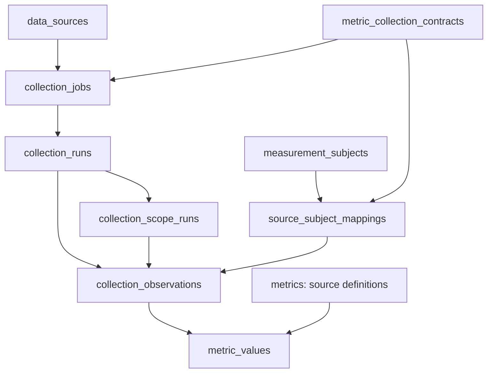

# Collection jobs, evidence and recovery

Last verified: 2026-10-13 22:52:02 JST. This describes the locally tested G3
implementation through migrations 0081–0082, not a deployed or activated batch.

A collection job stores what to collect, from which source, for which frozen
selection and within which limits. An execution run records what happened when
that instruction was attempted. Scoped progress makes a partial run resumable;
observations retain provider evidence, and metric values hold admitted numbers.
All authoritative business state lives in PostgreSQL. JSON input files and
optional exports are transport, not a second runtime database.

The arrows show references/ownership, not another set of tables. Scopes are flat
records under a run; an observation can omit a scope. A metric value references
an observation, which supplies the source identifier, mapping, dates and run.
Catalog mappings have no numeric contract; metric mappings require one. The
complete physical columns and constraints are in [Database schema](db-schema.md#measurements).

## Registration, claims and cancellation

`core.collection_jobs.register_job` accepts a unique job key, source, purpose,
operation, mode, versioned definition and optional numeric contract. Definitions
contain frozen `scope`, `schedule` and positive `budgets` for requests, seconds,
bytes and items. The SHA-256 covers the full instruction identity. Changed
instructions need a new job key; a later ownership/mapping edit cannot silently
change an old campaign. Registration creates a paused job and changes no source
or contract activation flags.

`claim_job` locks the job, validates its immutable definition and issues a run
and rotating lease token. Provider requests happen outside database transactions.
`checkpoint_scope` persists evidence and continuation together under that fence.
`finish_run` atomically updates the attempt result and job pointers. A paused,
cancelled, expired or replaced claim cannot write a late response. Catalog partial
runs retain a logical run across invocations; numeric and content attempts finish
individually. Success completes a finite historical job. An expired process has
an unknown actual finish time even though reconciliation happens later.

Content callers must pass explicit `manual_authorized=True`; the existing X
scheduler's authority belongs to its owning runtime. Content receipt persistence
does not depend on the separate metric-source `enabled` flag. Rejected content
invocations use `record_rejection`, which neither acquires nor replaces a claim.
Historical content continuation copies only the preceding attempt from the same
frozen job. Imported pilot checkpoints retain provenance without inventing old
attempt timestamps. The X runtime adapter is separately owned and not implemented
by the G3 branch; current JSON pilot persistence remains independent.

## Reviewed provider identities

`review_collection_mapping` inspects a bounded input by default; `--apply` invokes
the reviewed database service. GitHub identities use immutable numeric account
and repository IDs; repository full names are aliases. Official company/brand
relations qualify ownership. An employee relationship alone does not. Transfers
need explicit review and preserve the old snapshot.
The latest reviewed full name is kept separately from the sorted alias history,
so renaming a repository does not change its native identity or mapping hash.

Relations distinguish dedicated models, family repositories, implementation,
recipe and agent/harness evidence. Family repositories require a version selector
and can map to several products; their creation date does not date each version.
GitHub IDs, OpenRouter IDs/slugs and Arena names never overwrite Product's HF
`repo_id` or source SHA fields. OpenRouter catalog identity and rankings
`model_permaslug` require separate reviewed relations.

## Cohorts and history

`plan_model_history --brands <21-comma-separated-brand-ids>` inspects database
inventory without writes. `--freeze --cutoff <aware-ISO-timestamp>` stores the
same cohort/hash/ownership pins in eighty-four paused per-brand/source jobs.
Google is excluded from this historical cohort; NVIDIA uses the same company-wide
one-hundred-model cap. Confirmed LLM/other-model products are ordered by qualified
native creation date descending, with UUID ties. Reviewed first-party HF mirrors
collapse before the cap, using earliest supported creation. API-only OpenRouter
and dedicated GitHub models can use qualified native dates. Family, Arena,
first-seen and unknown dates cannot supply a model creation date. Reports retain
unranked/type/ownership gaps and never certify deleted/private inventory coverage.

`collect_model_inventory --job <uuid>` inspects; `--execute` performs bounded HF
or OpenRouter inventory acquisition. HF uses creation ordering here and preserves
the existing lastModified catalog path. `collect_github_catalog --job <uuid>`
likewise inspects unless explicitly executed. Public pagination, per-page ETags,
native events, commit/tree identities and pinned small metadata files are retained;
model weights and executable code are excluded.

`collect_model_history --job <uuid>` inspects; `--execute` performs one bounded
continuation. HF commit/tree metadata stays pinned to a recorded head; GitHub
history follows reviewed native repositories. Native evidence does not automatically
create a ModelRelease. Reviewed `cfahlgren1/hub-stats` immutable archive coordinates
in `scope.hf_archive` permit range acquisition. Selected JSON, range hashes,
publisher, revision, actual snapshot date and retrieval time persist before optional
numeric import. The reviewed weekly archive can be imported as a selected manifest;
there is no acquisition adapter for an unverified weekly binary layout.
GitHub catalog/history continuations recheck current repository visibility before
using cached public inventory. Draft/unpublished releases are omitted from saved
observations and page envelopes; their response items still consume the budget.

`core.model_history_collection` coordinates model/source coverage. Native repository
acquisition lives in `core.model_native_history`, sparse archive admission in
`core.model_history_archives`, and shared provider windows in
`core.model_history_publications`. Cohort and interval validation share
`core.model_history_cohort`; the collection module retains its public imports.

OpenRouter/Arena publication windows use shared jobs/evidence across model cells.
OpenRouter's supported history begins in 2025; top-50 absence and `other` remain
unknown model usage. Arena requires a frozen `text` or `text_style_control`
configuration and retains publication/full/latest limitations. Frozen
`numeric_contract_id` permits selected publication/archive numeric admission via
the existing reviewed history writer. Long campaigns split into bounded windows;
missing dates remain sparse and no values are interpolated.

One evaluated model/source cell can be observed, unmapped, inaccessible, outside
provider coverage, unavailable or partial. Completing its evaluation means the
bounded work ended, not that all historical data exists. Exact source publication,
creation, commit, snapshot and retrieval clocks remain separate.

Known numbers with unknown counting windows remain numeric values with unknown
time bounds. Missing numbers have no value row; explicit observed zero remains
zero. HF rolling thirty-day downloads are neither daily downloads nor unique
users. Since-origin counters retain unknown origins. State/rank values and
overlapping rolling periods cannot be summed as disjoint flows. Import time never
replaces historical effective time or supplies an unproved timezone/boundary.

## Scheduling and reports

`collect_jobs_due` is read-only by default. `--execute` uses one finite invocation
budget, numeric priority, UTC schedule slots and failed-attempt cooldowns.
Physical retries count against request ceilings; received bytes count against
global ceilings. `external_render_cron` X jobs are excluded from shared dispatch;
the existing fifteen-minute cron is unchanged.

For numeric recurring jobs, registration alone leaves legacy scheduling active.
`collection_job_state --job <uuid> --state ready --take-metric-authority --apply`
explicitly moves scheduling ownership into existing DataSource metadata. Source,
contract and environment activation must already permit it. The legacy benchmark
due command then uses that job, including its paused state; it cannot fall back
and duplicate collection. This command itself makes no provider request.
`collection_job_state --job <uuid> --state paused --apply` fences active work.

`collection_status --job <uuid>` and `collection_status --cohort <sha256>` expose
the same read-only services to humans and agents. Reports include separate attempt
and success clocks, active lease expiry, frozen identities, requested/covered
windows, gaps, evidence references, budget ceilings and remaining cells. They omit
lease tokens, raw provider bodies and credentials, and bound scope reports to one
thousand entries. Unknown usage remains unknown; an expired heartbeat differs
from a successful empty result.

Staging copies retain definitions and numeric references with jobs paused and
runtime pointers cleared. Catalog/content runs are excluded after pointers are
scrubbed in foreign-key order. See [Staging refresh](../operations/staging-data-refresh.md).
Production deployment, source activation and actual historical batches are
separate operations; none follows from registering or inspecting a job.
