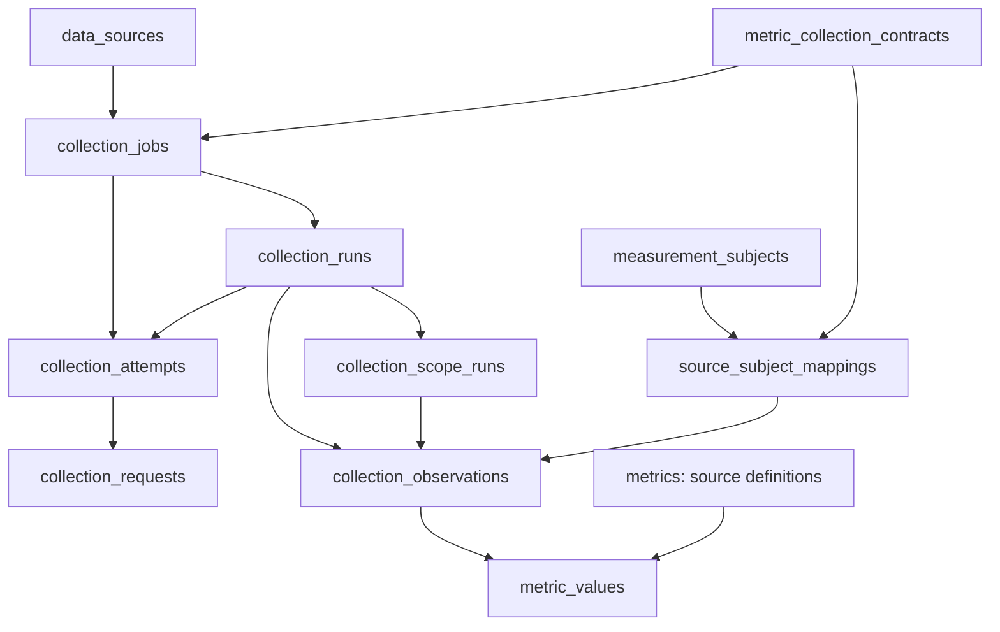

# Collection jobs, evidence and recovery

Last verified: 2026-10-21 10:25 JST, working repository candidate based on `215a9103` through migration `0115_shared_actors_and_correction_identity` on isolated PostgreSQL 18.6. Staging deployment `dep-dbc0q5ou01pc73codnhg` is verified through0114 on PostgreSQL18.4.

A collection job stores what to collect, from which source, for which frozen
selection and within which limits. An execution run records what happened when
that instruction was attempted. Scoped progress makes a partial run resumable;
observations retain provider evidence, and metric values hold admitted numbers.
All authoritative business state lives in PostgreSQL. JSON input files and
optional exports are transport, not a second runtime database.

Immutable correction records retain their exact recorded performer label and an
optional `actor_id` to the shared performer registry. The timing-repair command
records the known `benchmark_metric_timing_repair` system actor. Explicitly
registered performers may be supplied for attribution corrections; unverified
legacy labels remain unresolved. An actor identifies a performer and grants no
approval or access rights. Existing correction rows are never rewritten to infer
an actor, and staging refresh preserves actor/correction history while clearing
environment-local login accounts.



The arrows show references/ownership, not another set of tables. Scopes are flat
records under a run; an observation can omit a scope. A metric value references
an observation, which supplies the source identifier, mapping, dates and run.
Catalog mappings have no numeric contract; metric mappings require one. The
complete physical columns and constraints are in [Database schema](db-schema.md#measurements).

## Registration, claims and cancellation

`core.collection_jobs.register_job` accepts a unique job key, source, purpose,
operation, mode, versioned definition and optional numeric contract. Definitions
contain frozen `scope`, `schedule` and positive `budgets` for requests, seconds,
bytes and items. The SHA-256 covers the full instruction identity. Changed
instructions need a new job key; a later ownership/mapping edit cannot silently
change an old campaign. A database trigger prevents instruction changes, including before the first run; coordination state and run pointers remain mutable. Registration creates a paused job and changes no source or contract activation flags.

Every run requires a job. Source, purpose, contract and frozen scope belong to that job; run records retain attempt status, lease, clocks, counters, evidence and results. Python instance properties read instructions through the job, and database queries follow `job__` relations. Runs contain no physical copies of these four instructions. The database lifecycle trigger reads the immutable job, and compatibility views derive their instruction aliases through that same relationship. Old jobless runs receive inactive archival jobs preserving their recorded instructions without inventing budgets or finish times. Explicit direct drivers register completed, non-dispatchable receipt jobs and use a genuine bounded lease for each invocation.

`claim_job` locks the job, validates its immutable definition, claims or resumes a logical run, creates a separately identified `CollectionAttempt`, and issues a rotating lease token. Provider requests happen outside database transactions.
`checkpoint_scope` persists evidence and continuation together under that fence.
`finish_run` atomically updates the attempt result and job pointers. `collection_jobs.last_attempt_id` remains a compatibility pointer to a logical run; `last_attempt_attempt_id` points to the actual latest `CollectionAttempt`. A database trigger keeps both pointers aligned for legacy run-pointer writers and rejects pointers to another job. A paused,
cancelled, expired or replaced claim cannot write a late response. Catalog partial
runs retain a logical run across invocations; numeric and content attempts finish
individually. Success completes a finite historical job. An expired process has
an unknown actual finish time even though reconciliation happens later.

Content callers must pass explicit `manual_authorized=True`; the existing X
scheduler's authority belongs to its owning runtime. Content receipt persistence
does not depend on the separate metric-source `enabled` flag. Rejected content
invocations use `record_rejection`, which neither acquires nor replaces a claim.
Historical content continuation copies only the preceding attempt from the same
frozen job. Imported pilot checkpoints retain provenance without inventing old
attempt timestamps. The deployed X runtime uses the shared content persistence
interface under separate ownership. Source backfills do not replace its controller,
change its live cursors, or run inside its fifteen-minute cycle.

## Backfiller-data-source

`backfiller_data_source` exposes `inspect`, `register`, `execute`, `resume`, `pause`,
`replay` and `report`. The default is inspection. A mutation requires `--apply`;
execution also requires one explicit source `--job`. `--campaign` selects a group
for inspection, reporting or pausing. Registration accepts `--specifications` as
a reviewed JSON instruction, then saves the instruction in `collection_jobs`.
Deleting that input does not remove the job's recovery state.

Each definition pins a typed `backfiller-data-source-v1` campaign identity,
cohort hash, source role, acquisition/replay phase, contract partition and finite
invocation/request ceilings. Claiming locks campaign peers in a deterministic
order and reserves the invocation's physical request budget. A completed attempt
releases its known unused reservation. An interrupted attempt retains ambiguous
usage; recovery cannot erase requests whose outcome was never recorded.

The facade invokes the same adapters and run records as normal collection. It
adds no wrapper run or campaign/checkpoint table. Catalog continuation reuses the
logical run; partial numeric replay starts a new attempt with its saved cursor.
Reports keep written, reused, pending and rejected evidence separate.

## Reviewed provider identities

`review_collection_mapping` inspects a bounded input by default; `--apply` invokes
the reviewed database service. GitHub identities use immutable numeric account
and repository IDs; repository full names are aliases. Official company/brand
relations qualify ownership. An employee relationship alone does not. Transfers
need explicit review and preserve the old snapshot.
The latest reviewed full name is kept separately from the sorted alias history,
so renaming a repository does not change its native identity or mapping hash.

Relations distinguish dedicated models, family repositories, implementation,
recipe and agent/harness evidence. Family repositories require a version selector
and can map to several products; their creation date does not date each version.
GitHub IDs, OpenRouter IDs/slugs and Arena names never overwrite Product's HF
`repo_id` or source SHA fields. OpenRouter catalog identity and rankings
`model_permaslug` require separate reviewed relations.

## Product crosswalk matching

`match_collection_products --brand <nickname>` reads existing HF products and
stored GitHub, OpenRouter, Arena and OpenCode identities. Repeat `--brand` for
up to 21 tracked brands and `--source` to narrow the sources. The default is a
read-only JSON preview; `--format markdown` presents the same fields as a review
document. It makes no provider or model requests. Products sort by highest
evidence score, then repository creation time, with stable identity ties.
Percentages are uncalibrated evidence ranks. Existing mapping status,
identity evidence, database presence and admission decision are separate fields.

Preview returns an evidence cutoff, an `input_sha256` fingerprint and stable
candidate IDs. A spelling match needs human review. Apply uses the exact cutoff
and fingerprint, `--reviewed-by`, `--review-basis`, and one
`--review-candidate <candidate-id>` per confirmed candidate. An independently
qualified explicit HF/repository reference can be admitted without a spelling-only
review; conflicting ownership or native identities still block admission.

```sh
python manage.py match_collection_products --brand deepseek --source arena
python manage.py match_collection_products --brand deepseek --source arena \
  --cutoff <preview-cutoff> --input-sha256 <preview-fingerprint> \
  --reviewed-by <operator> --review-basis '<identity evidence or owner review>' \
  --review-candidate <confirmed-candidate-id> --apply
python manage.py match_collection_products --resume <job-uuid> --apply
python manage.py collection_status --job <job-uuid>
```

Apply freezes source-specific `match_crosswalk` instructions in `collection_jobs`.
Existing runs and `product_match` scope records retain decisions and recovery
state. Each invocation handles at most 50 candidates, has a 120-second work limit,
and records zero provider calls. A partial invocation resumes the same logical
run from the database; it needs no local manifest. A stale input, changed
publisher or expired lease cannot commit a link. A native identity conflict is
recorded separately from an admitted or unmatched result. The mapping and its
scope receipt commit together. Shared catalog admission takes a nonblocking
native-identity lock, then the subject lock, so manual reviews use the same guard.

The matcher adds no table, column or migration. It does not enable source polling,
change product type/brand, merge products, modify an earlier frozen contract, or
reattribute existing native metric histories. Verified publisher ownership can
qualify a catalog link for a product with no brand; numeric eligibility remains
subject to the existing stricter rules. A fresh collection selection can use an
admitted catalog mapping. Family and recipe relations retain their native metric
grain instead of duplicating repository counters across models.

## Cohorts and history

`plan_model_history --brands <21-comma-separated-brand-ids>` inspects database
inventory without writes. `--freeze --cutoff <aware-ISO-timestamp>` stores the
same cohort/hash/ownership pins in eighty-four paused per-brand/source jobs.
Google is excluded from this historical cohort; NVIDIA uses the same company-wide
one-hundred-model cap. Confirmed LLM/other-model products are ordered by qualified
native creation date descending, with UUID ties. Reviewed first-party HF mirrors
collapse before the cap, using earliest supported creation. API-only OpenRouter
and dedicated GitHub models can use qualified native dates. Family, Arena,
first-seen and unknown dates cannot supply a model creation date. Reports retain
unranked/type/ownership gaps and never certify deleted/private inventory coverage.

The opt-in `--qualification-policy hf-public-model-registry-v1` also admits an
untyped product when a saved first-party public HF model-registry response proves
its native kind. This pins the original observation, payload hash, publisher,
brand and creation evidence without assigning an LLM/other-model subtype. The
default cohort and text-benchmark eligibility remain unchanged. Execution checks
the frozen evidence and current ownership again; drift fails admission.

`collect_model_inventory --job <uuid>` inspects; `--execute` performs bounded HF
or OpenRouter inventory acquisition. HF uses creation ordering for historical
inventory. The explicit `watch_inventory` scope keeps Google/NVIDIA daily discovery
bounded to their company-wide newest hundred by last modification; that limit is
separate from the frozen historical cohort. `ingest_metadata` collects supported
detail/expanded groups, file-manifest changes and public publisher profiles.
Listing counters refresh even when the repository SHA stays unchanged; capture
time does not prove when a repository first became public.

`collect_github_catalog --job <uuid>`
likewise inspects unless explicitly executed. Public pagination, per-page ETags,
native events, commit/tree identities and pinned small metadata files are retained;
model weights and executable code are excluded.
GitHub's explicit `inventory`, `release_watch` and `full` roles separate fresh
account/repository statistics, release/asset metadata and deep commit/tag/file
continuation. Repository identity uses the numeric ID. Paginated release assets
remain metadata-only; the collector does not follow binary download URLs. A 304
cached listing keeps its original capture time instead of becoming fresh counters.

`collect_model_history --job <uuid>` inspects; `--execute` performs one bounded
continuation. HF commit/tree metadata stays pinned to a recorded head; GitHub
history follows reviewed native repositories. Native evidence does not automatically
create a ModelRelease. Reviewed `cfahlgren1/hub-stats` immutable archive coordinates
in `scope.hf_archive` permit range acquisition. Selected JSON, range hashes,
publisher, revision, actual snapshot date and retrieval time persist before
numeric projection. The reviewed weekly archive can be imported as a selected manifest;
there is no acquisition adapter for an unverified weekly binary layout.
GitHub catalog/history continuations recheck current repository visibility before
using cached public inventory. Draft/unpublished releases are omitted from saved
observations and page envelopes; their response items still consume the budget.

`core.model_history_collection` coordinates model/source coverage. Native repository
acquisition lives in `core.model_native_history`, sparse archive admission in
`core.model_history_archives`, and shared provider windows in
`core.model_history_publications`. Cohort and interval validation share
`core.model_history_cohort`; the collection module retains its public imports.

OpenRouter/Arena publication windows use shared jobs/evidence across model cells.
OpenRouter's supported history begins in 2025; top-50 absence and `other` remain
unknown model usage. Arena statistics support frozen `text`, `text_style_control`
and `agent` configurations. Agent IPS scores, observation counts and session counts
have distinct definitions; they are not text Elo or votes. Other configurations
retain an explicit unsupported-configuration gap.

`prepare_history_statistics_scope` prepares a draft scope with a pinned numeric
contract before job registration. Publication provenance and reviewed usage/score
crosswalks are separate from publisher accounts; no artificial OpenRouter/Arena
accounts are required. Statistics windows are bounded to one through ninety days
(default seven), with no synthetic Arena carry-in. Complete cached windows survive
restart; an incomplete window remains partial. Compatible saved OpenRouter daily
values retain their original value, observation, run and contract references.
Normal rolling collection rechecks completed days for revisions using a per-run
window saved separately from the frozen cohort. Sparse HF archives preserve their
actual source dates. Missing dates remain sparse and no values are interpolated.

## Numeric projection and native resources

Acquisition commits evidence and a `numeric_projection` scope together. The shared
drain writes a separate metric-purpose run through the existing numeric validator
and writer, then acknowledges committed evidence. A crash after numeric commit
can safely reuse the snapshot on restart. Item, byte and time ceilings apply to
the shared drain as well as acquisition; failures stay pending and inspectable.
`replay` reads saved evidence without constructing an HTTP client.

Source-statistics contracts are distinct from text-benchmark contracts. Account,
repository and release-asset counters may remain explicitly native-only when no
qualified canonical model mapping exists. A family repository's stars are stored
once at repository grain. They are not copied onto every supported model.
`uq_source_statistics_snapshot` prevents duplicate snapshots across jobs for the
same contract, definition set, native identity and source snapshot. Reuse preserves
the original observation clock and owning run. Changed source revisions remain
distinct observations. Existing benchmark definitions and contract hashes retain
their original admission rules.

One evaluated model/source cell can be observed, unmapped, inaccessible, outside
provider coverage, unavailable or partial. Completing its evaluation means the
bounded work ended, not that all historical data exists. Exact source publication,
creation, commit, snapshot and retrieval clocks remain separate.

Known numbers with unknown counting windows remain numeric values with unknown
time bounds. Missing numbers have no value row; explicit observed zero remains
zero. HF rolling thirty-day downloads are neither daily downloads nor unique
users. Since-origin counters retain unknown origins. State/rank values and
overlapping rolling periods cannot be summed as disjoint flows. Import time never
replaces historical effective time or supplies an unproved timezone/boundary.

## Scheduling and reports

`collect_jobs_due` is read-only by default. `--execute` uses one finite invocation
budget, numeric priority, UTC schedule slots and failed-attempt cooldowns.
Manual replay jobs are excluded from the default recurring dispatch, so they
cannot consume its job limit. Incomplete catalog work resumes its original slot;
provider cooldowns are preserved. Physical retries count against request ceilings; received bytes count against
global ceilings. `external_render_cron` X jobs are excluded from shared dispatch;
the existing fifteen-minute cron is unchanged.

For numeric recurring jobs, registration alone leaves legacy scheduling active.
`collection_job_state --job <uuid> --state ready --take-metric-authority --apply`
explicitly moves scheduling ownership into existing DataSource metadata. Source,
contract and environment activation must already permit it. The legacy benchmark
due command then uses that job, including its paused state; it cannot fall back
and duplicate collection. This command itself makes no provider request.
`collection_job_state --job <uuid> --state paused --apply` fences active work.

Fresh inventory and history roles use a separate explicit pointer in the same
DataSource metadata:
`collection_job_state --job <uuid> --state ready --take-collection-authority --apply`.
The job must pin `scope.routine_role`, recurring mode and the shared driver.
`collection_role_authorities` admits one job per role; registration alone cannot
activate it or replace a different live owner. The existing hourly Render runner's
`collect_benchmark_due --apply` invokes those roles through
`dispatch_collection_roles`, sharing finite per-provider requests/seconds/bytes
from `collection_role_dispatch_budget` (default 100/300/8 MiB). Source/environment
activation is still required. Daily HF slots remain 10:00 UTC. Deep history uses
separate jobs, so it cannot prevent a fresh inventory run.

`collection_status --job <uuid>` and `collection_status --cohort <sha256>` expose
the same read-only services to humans and agents. Reports include separate attempt
and success clocks, active lease expiry, frozen identities, requested/covered
windows, gaps, evidence references, budget ceilings and remaining cells. They omit
lease tokens, raw provider bodies and credentials, and bound scope reports to one
thousand entries. Unknown usage remains unknown; an expired heartbeat differs
from a successful empty result.

`collection_status --contract <uuid> --source <source> --identifier <native-id>`
reads the stored native statistics, including definitions, units, temporal
precision, source bounds, evidence references and native-only/canonical status.
It uses the same `resource_statistics` service available to agents; it makes no
provider requests and returns at most one thousand values.

Staging copies retain definitions and numeric references with jobs paused and
runtime pointers cleared. Catalog/content runs are excluded after pointers are
scrubbed in foreign-key order. See [Staging refresh](../operations/staging-data-refresh.md).
Production deployment, source activation and actual historical batches are
separate operations; none follows from registering or inspecting a job.
