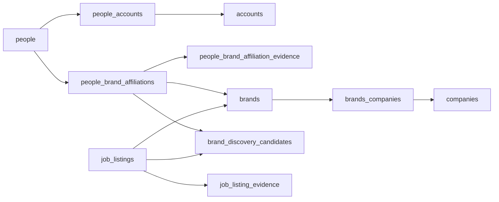

# Database schema reference

Verified October28,2026 against repository revision `8bb9a577` (documentation-only descendant of deployed `b0d53904`) and read-only production/staging catalogs through `0205_rg7_retire_model_release_storage`. Historical release and data-preservation evidence is recorded in the [global schema plan](../plans/2026-10-09-063417-feat-g3-round2-chart-engine-plan.md).

Scope: **221 physical core application tables**, **2516 physical table columns**, **221 managed models with2505 ordinary ORM columns**, nine compatibility views, three native benchmark views and one materialized view. Eleven additional physical source columns are represented through restricted unmanaged projections; these projections add no tables. Framework tables and view columns are excluded from the physical application-table count.

Canonical geography references use `geolocations.id`. Necessary source wording and existing payloads remain in restricted evidence columns on their existing owners. Ordinary models, webpages and APIs use canonical locations; unresolved claims return NULL without a raw-source fallback. Database guards re-resolve changed wording and preserve explicit canonical corrections when the wording is unchanged.

Use this guide to find where information lives and how records connect. Start
with a subject below, or use the [alphabetical table inventory](#table-inventory)
to jump directly to any table. Every inventory entry has a full column reference.

The schema is defined by [core/models.py](../../core/models.py) and the
[ordered Django migrations](../../core/migrations/). This snapshot describes
the current repository schema, checked against Django model/migration state and the read-only production catalog. Staging has the same public column inventory and migration boundary. The local test database reached0205 at the recorded RG7 acceptance; it was not reconnected or modified for this reference refresh. Django’s own
authentication, session, content-type, and migration-ledger tables are outside
this **application-table** count. `DiscoveryRunBase` is an abstract model, not
another table; its columns are included under both discovery-run tables.
The retired SQLite database and Graphviz image are not current schema sources.

## Find information by subject

| Subject | Tables | Start here when you need… |
| --- | ---: | --- |
| [Shared catalogues and performer identities](#shared-catalogues) | 10 | Canonical timezone, language-tag and unit values; internal performers; immutable definition, provider, model and workflow-stage identities. |
| [People and job history](#people) | 18 | A person, their optional X identity, roles, employment dates, and evidence. |
| [Companies, brands, and organization discovery](#organizations) | 12 | Company/brand identity, ownership, associated accounts, and unresolved organizations. |
| [Accounts, profiles, and lists](#accounts) | 13 | Shared source accounts, X detail profiles, observed history, list membership and post appearances. |
| [Shared geography](#geography) | 4 | Country/region names and interpretation of account geography. |
| [Posts and classification](#posts) | 14 | Source posts, brand attribution, classification, and supporting judgments. |
| [Homepage counts](#homepage-counts) | 1 | Historical count summaries and their publication validity. |
| [Classification vocabularies and translated labels](#vocabularies) | 23 | Allowed classification concepts and their translated display labels. |
| [Products, model releases, and Hugging Face catalog](#products) | 14 | Exact products, release claims, and catalog observations. |
| [Job listings and official career-site collection](#jobs) | 19 | Advertised roles, their sources, and career-site synchronization status. |
| [Events and opportunities](#events) | 5 | Attendable occurrences and action-for-benefit offers. |
| [Event dossiers and evidence](#event-dossiers) | 8 | Source-backed event identity, claims, review history and typed projections. |
| [Post translation and commentary](#translation) | 10 | Literal post translations, generated commentary, retries, and budgets. |
| [Authored content and trend publication](#headlines) | 13 | Prepared headline text, publication pointers, provider batches, work requests, and provider costs. |
| [Compatible editorial input storage and pictures](#editorial) | 7 | Story identities, accepted editions, quarter-hour decisions, spend and optional assets. |
| [Collection, extraction, and processing records](#processing) | 30 | Search cursors, coverage gaps, extraction attempts, and rare-type search accounting. |
| [Measurement subjects, metrics and observations](#measurements) | 13 | Sourced measurements and their collection state. |
| [Official-company collection](#official-companies) | 7 | Official-company account collection, attempts and spending. |

For staff records, begin with **[People and job history](#people)**. A person can
exist without an X account. Their employer/brand relationships and supporting
sources have their own tables. **[Job listings](#jobs)** describe advertised
positions; they are not a person’s employment history.



An affiliation or job listing is owned by exactly one known brand **or** one
organization awaiting review. The two arrows in the diagram are alternatives,
not two simultaneous owners. A company is reached through `brands_companies`;
there is no direct company column on the affiliation.

## Reading the table details

- A **primary key (PK)** uniquely identifies a row. Some tables use a natural
  identifier such as a provider ID or brand slug; others use a UUID or a
  generated integer. A **composite primary key** uses several existing columns
  together. Django’s `pk` attribute for those models is not a physical column.
- A **foreign key (FK)** links to another table. Column tables use actual SQL
  column names; a different Django attribute is shown as `model: …`. For example,
  `people_accounts.author_id` is the SQL column for the model’s `account` field.
- **NULL allowed** describes database nullability. It is separate from Django
  form validation (`blank=True`) and from an empty string. A non-null column may
  still accept `''` if its constraints allow it.
- **Default** means a Django/application default unless explicitly marked as a
  database identity. `uuid.uuid4`, `auto_now_add`, and `auto_now` are application
  behavior, not PostgreSQL defaults. Direct SQL writes must supply required
  values themselves. `auto_now` applies to normal model saves, not every bulk
  update or arbitrary SQL statement.
- PostgreSQL types are shown directly: `varchar(n)` is bounded text, `text` is
  unbounded text, `jsonb` is structured JSON, and `timestamp with time zone` is
  a timezone-aware timestamp. Positive integer Django fields also receive
  nonnegative database checks. Field choices are application validation;
  only listed database checks enforce their allowed values in SQL.
- `case_insensitive` is the ICU collation created in the initial migration
  (`und-u-ks-level2`, nondeterministic). Only fields explicitly marked with that
  collation use it; not every identifier does.
- FK deletion labels describe Django behavior: `CASCADE` deletes dependent
  records, `PROTECT` prevents deletion while referenced, and `SET_NULL` clears
  an optional link. These are not a claim that every SQL FK has that same
  `ON DELETE` clause. The migration-specific exceptions are documented below.
- Every table lists its named model indexes and constraints. PKs and unique
  fields provide uniqueness indexes; ordinary FK fields also receive indexes
  unless the field details say otherwise. These automatic indexes are not
  repeated as manually named indexes. Exact check expressions use SQL notation;
  the important meaning is explained in each subject’s introduction.

## Dates, evidence, and languages

Source facts and collection times answer different questions. `observed_at`,
`first_seen_at`, and `last_seen_at` say when PushinWeight saw a claim;
`created_at`/`updated_at` usually track the stored row. A source’s employment,
birth, release, event, or opportunity date stays in its dedicated value field.
For `posts`, `accounts`, and `products`, `created_at` is a source creation time;
the table notes identify those exceptions.

Reduced-precision dates pair a string value with a precision: `YYYY`/`year`,
`YYYY-MM`/`month`, `YYYY-MM-DD`/`day`, or NULL/`unknown`. Models that allow
`datetime` require a timezone-bearing ISO-style timestamp. Named checks express the expected string shapes and precision pairings;
application validation must also handle missing values and valid calendar dates.
As with PostgreSQL checks generally, an expression evaluating to SQL NULL does
not fail a check, so a nullable value plus a precision label is not by itself
proof of a complete or valid date. Comparable start/end values have additional ordering checks where
listed. Never substitute the date a page was crawled for an unknown joining date.

Evidence tables keep observations separate from interpreted facts. A stored
claim, confidence score, or record with `review_status='pending'` is not proof
of a confirmed identity. Do not count evidence rows as distinct people/jobs.
Several observations can support one record, and different claims can still
need reconciliation.

People select localized names from `people_names` through `person_name_selections`; the former fixed-language person name columns have been removed. `people_name_evidence` stores the sources.
Original professional prose and EN/JA translations live in `people_texts` and
`people_text_translations`. Media bytes and person/source attribution have their
own tables. Affiliation title/location originals and supporting evidence remain
in the existing job-history records; no company-headquarters location is inferred
for staff. Job listings retain their own source text and language fields.

<a id="table-inventory"></a>

## Alphabetical table inventory

Each of the 221 physical core application tables appears once in this inventory and once in
the detailed sections. All 221 have managed models; unmanaged source projections add no tables. The native view is
listed separately: [home_brand_time_counts](#view-home_brand_time_counts). The three [benchmark serving views](#benchmark-serving-views) are also outside the physical-table count.

| Table | Subject | What one row represents |
| --- | --- | --- |
| [_applied_config_snapshot](#table-_applied_config_snapshot) | [Collection, extraction, and processing records](#processing) | One configuration artifact’s last applied content hash. |
| [account_based_in_mappings](#table-account_based_in_mappings) | [Shared geography](#geography) | One reviewed mapping from an X “based in” string to a country or region. |
| [account_post_appearances](#table-account_post_appearances) | [Accounts, profiles, and lists](#accounts) | One account’s appearance in one collected post, with collection context. |
| [account_profile_snapshots](#table-account_profile_snapshots) | [Accounts, profiles, and lists](#accounts) | One consecutive observation period during which an account’s saved profile hash is unchanged. |
| [account_profile_text_translations](#table-account_profile_text_translations) | [Accounts, profiles, and lists](#accounts) | One localized translation of profile text, tied to account and source-text role. |
| [account_query_memberships](#table-account_query_memberships) | [Accounts, profiles, and lists](#accounts) | One search query associated with an account, optionally at a saved post appearance. |
| [account_verification_types](#table-account_verification_types) | [Accounts, profiles, and lists](#accounts) | One exact provider verification code. Current X details, observed profile snapshots and post-author observations share it. An explicit empty provider code is distinct from a missing reference. |
| [accounts](#table-accounts) | [Accounts, profiles, and lists](#accounts) | One source account with a UUID identity, source/native key and current saved profile. |
| [actors](#table-actors) | [Shared catalogues and performer identities](#shared-catalogues) | One stable internal human, agent or system performer identity. |
| [affiliation_types](#table-affiliation_types) | [People and job history](#people) | One allowed kind of relationship between a person and an organization; shared by affiliations and dossier personnel details. |
| [audience_topic_concepts](#table-audience_topic_concepts) | [Classification vocabularies and translated labels](#vocabularies) | One stable topic identity within an audience-topic scheme. |
| [audience_topic_labels](#table-audience_topic_labels) | [Classification vocabularies and translated labels](#vocabularies) | One translated topic label for a particular revision. |
| [audience_topic_schemes](#table-audience_topic_schemes) | [Classification vocabularies and translated labels](#vocabularies) | One versioned audience-topic scheme and its manifest identity. |
| [brand_discovery_candidate_token_evidence](#table-brand_discovery_candidate_token_evidence) | [Companies, brands, and organization discovery](#organizations) | One source observation supporting an organization token. |
| [brand_discovery_candidate_tokens](#table-brand_discovery_candidate_tokens) | [Companies, brands, and organization discovery](#organizations) | One exact observed spelling or handle for an unresolved organization. |
| [brand_discovery_candidates](#table-brand_discovery_candidates) | [Companies, brands, and organization discovery](#organizations) | One unresolved organization identity awaiting review against known brands. |
| [brand_hashtags](#table-brand_hashtags) | [Companies, brands, and organization discovery](#organizations) | One hashtag associated with a brand. |
| [brand_keywords](#table-brand_keywords) | [Companies, brands, and organization discovery](#organizations) | One literal or regular-expression matching pattern for a brand. |
| [brand_search_terms](#table-brand_search_terms) | [Companies, brands, and organization discovery](#organizations) | One search term associated with a brand. |
| [brands](#table-brands) | [Companies, brands, and organization discovery](#organizations) | One brand identity and its display metadata. |
| [brands_accounts](#table-brands_accounts) | [Companies, brands, and organization discovery](#organizations) | One account’s role for a brand, such as official or researcher. |
| [brands_companies](#table-brands_companies) | [Companies, brands, and organization discovery](#organizations) | One ownership relationship between a brand and a company. |
| [call_state](#table-call_state) | [Collection, extraction, and processing records](#processing) | One harvest cursor for a brand, call, bucket, and query combination. |
| [collection_attempts](#table-collection_attempts) | [Collection, extraction, and processing records](#processing) | One separately admitted execution attempt in a logical run. |
| [collection_campaigns](#table-collection_campaigns) | [Collection, extraction, and processing records](#processing) | One bounded campaign spanning related collection jobs. |
| [collection_corrections](#table-collection_corrections) | [Collection, extraction, and processing records](#processing) | One immutable correction to an observation or attribution. |
| [collection_evidence_archives](#table-collection_evidence_archives) | [Collection, extraction, and processing records](#processing) | One immutable content-addressed captured response body. |
| [collection_job_targets](#table-collection_job_targets) | [Collection, extraction, and processing records](#processing) | One frozen target or query attached to a collection job. |
| [collection_jobs](#table-collection_jobs) | [Measurement subjects, metrics and observations](#measurements) | One immutable instruction with mutable coordination pointers. |
| [collection_metric_gaps](#table-collection_metric_gaps) | [Collection, extraction, and processing records](#processing) | One selected counter missing from an observation, with a reason. |
| [collection_observation_inputs](#table-collection_observation_inputs) | [Collection, extraction, and processing records](#processing) | One provenance link from an observation to its request or prior observation. |
| [collection_observation_metric_selections](#table-collection_observation_metric_selections) | [Collection, extraction, and processing records](#processing) | One exact metric definition selected by a catalogue capture before projection. The observation and source metric form the selected identity, so later mapping changes cannot silently reinterpret that capture. |
| [collection_observations](#table-collection_observations) | [Measurement subjects, metrics and observations](#measurements) | One sourced, dated observation in a collection run. |
| [collection_requests](#table-collection_requests) | [Collection, extraction, and processing records](#processing) | One transport request and its outcome. |
| [collection_resource_snapshots](#table-collection_resource_snapshots) | [Collection, extraction, and processing records](#processing) | One nonnumeric historical snapshot of a collected resource. |
| [collection_runs](#table-collection_runs) | [Measurement subjects, metrics and observations](#measurements) | One source collection run, for numeric measurements or catalog discovery. |
| [collection_scope_cursor_receipts](#table-collection_scope_cursor_receipts) | [Collection, extraction, and processing records](#processing) | One ordered cursor checkpoint for a collection scope. Position preserves cursor order. A checkpoint does not establish that a physical HTTP request occurred; request evidence remains with collection requests and archives. |
| [collection_scope_rare_hits](#table-collection_scope_rare_hits) | [Collection, extraction, and processing records](#processing) | One saved association between a collection scope and a rare-type search hit. |
| [collection_scope_request_uses](#table-collection_scope_request_uses) | [Collection, extraction, and processing records](#processing) | One ordered use of a captured request by a collection scope, including later runs. |
| [collection_scope_runs](#table-collection_scope_runs) | [Measurement subjects, metrics and observations](#measurements) | One source scope’s pagination and ownership progress within a collection run. |
| [companies](#table-companies) | [Companies, brands, and organization discovery](#organizations) | One company identity, including its recorded headquarters country. |
| [companies_accounts](#table-companies_accounts) | [Companies, brands, and organization discovery](#organizations) | One account’s role and ownership-review state for a company. |
| [company_labels](#table-company_labels) | [Companies, brands, and organization discovery](#organizations) | One current company label for a registered locale. |
| [content_pictures](#table-content_pictures) | [Compatible editorial input storage and pictures](#editorial) | One optional source/derivative assignment for a content revision. |
| [currencies](#table-currencies) | [Shared catalogues and performer identities](#shared-catalogues) | One registered current or historical ISO 4217 currency code; it does not imply exchange-rate conversion. |
| [data_sources](#table-data_sources) | [Accounts, profiles, and lists](#accounts) | One stable collection-source identity, distinct from original authored content. |
| [definition_versions](#table-definition_versions) | [Shared catalogues and performer identities](#shared-catalogues) | One immutable identity and provenance record for a versioned software or policy definition. |
| [discourse_keys](#table-discourse_keys) | [Classification vocabularies and translated labels](#vocabularies) | One legacy pragmatic-register vocabulary key. |
| [discourse_labels](#table-discourse_labels) | [Classification vocabularies and translated labels](#vocabularies) | One translated legacy pragmatic-register label. |
| [editorial_assessments](#table-editorial_assessments) | [Compatible editorial input storage and pictures](#editorial) | One fenced quarter-hour editorial or content-picture assessment, with frozen evidence and outcome. |
| [editorial_budgets](#table-editorial_budgets) | [Compatible editorial input storage and pictures](#editorial) | One UTC day of conservative spend reservations and text/media call counts. |
| [editorial_calls](#table-editorial_calls) | [Compatible editorial input storage and pictures](#editorial) | One reserved provider stage and its saved response or uncertain-send outcome. |
| [editorial_editions](#table-editorial_editions) | [Compatible editorial input storage and pictures](#editorial) | One immutable accepted story edition for a track, locale and revision. |
| [editorial_heroes](#table-editorial_heroes) | [Compatible editorial input storage and pictures](#editorial) | One current hero pointer, or the shared provider-lock row. |
| [editorial_stories](#table-editorial_stories) | [Compatible editorial input storage and pictures](#editorial) | One permanent development identity with original-post anchors. |
| [employment_types](#table-employment_types) | [Job listings and official career-site collection](#jobs) | One reusable employment-arrangement classification. |
| [enrichment_budget_windows](#table-enrichment_budget_windows) | [Post translation and commentary](#translation) | One explicitly provisioned spending allowance shared by enrichment writers. The interval, request and dollar ceilings, reservations and configuration fingerprint bound admission. An expired allowance does not renew itself. |
| [event_claim_kinds](#table-event_claim_kinds) | [Event dossiers and evidence](#event-dossiers) | One allowed evidence-claim kind shared by dossier claims and scoped artifact, endpoint and host records. |
| [event_dossier_claims](#table-event_dossier_claims) | [Event dossiers and evidence](#event-dossiers) | One extracted assertion with evidence, scope and typed time precision. |
| [event_dossier_review_claims](#table-event_dossier_review_claims) | [Event dossiers and evidence](#event-dossiers) | One claim disposition included in a review revision. |
| [event_dossier_reviews](#table-event_dossier_reviews) | [Event dossiers and evidence](#event-dossiers) | One immutable dossier decision revision and evidence cutoff. |
| [event_dossier_sources](#table-event_dossier_sources) | [Event dossiers and evidence](#event-dossiers) | One captured source attached to one dossier. |
| [event_dossiers](#table-event_dossiers) | [Event dossiers and evidence](#event-dossiers) | One versioned event identity and its current review pointer. |
| [event_evidence](#table-event_evidence) | [Events and opportunities](#events) | One source observation supporting an event occurrence. |
| [event_kinds](#table-event_kinds) | [Events and opportunities](#events) | One allowed kind of event, referenced by the event rather than repeated as its canonical string. |
| [events](#table-events) | [Events and opportunities](#events) | One attendance-bearing occurrence, such as a conference or meetup. |
| [geolocation_alternate_names](#table-geolocation_alternate_names) | [Shared geography](#geography) | One attested wording in one locale for one place; includes localized preferred names and vetted aliases. |
| [geolocation_policies](#table-geolocation_policies) | [Shared geography](#geography) | One immutable local geography policy decision; the place selects its current decision while the supersedes chain preserves history. |
| [geolocations](#table-geolocations) | [Shared geography](#geography) | One shared geographic place with a local primary key, optional external GeoNames identity and provider-supported ancestry. |
| [geopolitical_mode_keys](#table-geopolitical_mode_keys) | [Classification vocabularies and translated labels](#vocabularies) | One geopolitical-mode vocabulary key. |
| [geopolitical_mode_labels](#table-geopolitical_mode_labels) | [Classification vocabularies and translated labels](#vocabularies) | One translated geopolitical-mode label. |
| [harvest_backlog_windows](#table-harvest_backlog_windows) | [Collection, extraction, and processing records](#processing) | One bounded time window still owed collection coverage. |
| [inference_models](#table-inference_models) | [Shared catalogues and performer identities](#shared-catalogues) | One provider-qualified native model identifier requested from an inference service. |
| [job_discovery_runs](#table-job_discovery_runs) | [Job listings and official career-site collection](#jobs) | One job-search query/window run, including coverage, cost, and extracted listing count. |
| [job_employment_type_assignments](#table-job_employment_type_assignments) | [Job listings and official career-site collection](#jobs) | One current, source-supported employment-type assignment on a listing. |
| [job_function_assignments](#table-job_function_assignments) | [Job listings and official career-site collection](#jobs) | One current, source-supported job-function assignment on a listing. |
| [job_functions](#table-job_functions) | [Job listings and official career-site collection](#jobs) | One reusable job-function classification. |
| [job_listing_evidence](#table-job_listing_evidence) | [Job listings and official career-site collection](#jobs) | One source observation supporting a job listing. |
| [job_listing_locations](#table-job_listing_locations) | [Job listings and official career-site collection](#jobs) | One ordered location occurrence in a job source observation, with preserved evidence and a nullable resolved shared place. |
| [job_listings](#table-job_listings) | [Job listings and official career-site collection](#jobs) | One advertised position/requisition, including its source identity and current saved details. |
| [job_organization_ai_relationship_assignments](#table-job_organization_ai_relationship_assignments) | [Job listings and official career-site collection](#jobs) | One current, source-supported organization-to-AI classification on a listing. |
| [job_role_ai_relationship_assignments](#table-job_role_ai_relationship_assignments) | [Job listings and official career-site collection](#jobs) | One current, source-supported role-to-AI classification on a listing. |
| [job_seniority_assignments](#table-job_seniority_assignments) | [Job listings and official career-site collection](#jobs) | One current, source-supported seniority assignment on a listing. |
| [job_source_states](#table-job_source_states) | [Job listings and official career-site collection](#jobs) | One career-site source’s active lease and last successful synchronization state. |
| [job_source_sync_runs](#table-job_source_sync_runs) | [Job listings and official career-site collection](#jobs) | One attempt to synchronize an official career-site source. |
| [job_workplace_type_assignments](#table-job_workplace_type_assignments) | [Job listings and official career-site collection](#jobs) | One current, source-supported workplace-type assignment on a listing. |
| [languages](#table-languages) | [Shared catalogues](#shared-catalogues) | One registered primary-language code. |
| [locales](#table-locales) | [Shared catalogues](#shared-catalogues) | One full language tag and its registered base language. |
| [materialization_state](#table-materialization_state) | [Homepage counts](#homepage-counts) | Current publication, coverage and source-change state for one versioned derived dataset in this environment. |
| [measurement_subjects](#table-measurement_subjects) | [Measurement subjects, metrics and observations](#measurements) | One identity that measurements describe, optionally linked to a product, group, brand or company. |
| [measurement_units](#table-measurement_units) | [Shared catalogues](#shared-catalogues) | One immutable measurement/window unit identity. |
| [metric_collection_contracts](#table-metric_collection_contracts) | [Measurement subjects, metrics and observations](#measurements) | One versioned collection contract for a data source. |
| [metric_types](#table-metric_types) | [Measurement subjects, metrics and observations](#measurements) | One allowed family of measurements and its interpretation. |
| [metric_values](#table-metric_values) | [Measurement subjects, metrics and observations](#measurements) | One value for a metric in an observation. |
| [metrics](#table-metrics) | [Measurement subjects, metrics and observations](#measurements) | One metric definition with units, scale and methodology. |
| [model_gating_states](#table-model_gating_states) | [Products, model releases, and Hugging Face catalog](#products) | One shared model-access gating state, used by products and resource snapshots. This is a business meaning rather than a provider-specific identity. |
| [model_tasks](#table-model_tasks) | [Products, model releases, and Hugging Face catalog](#products) | One exact source-qualified model-task code shared by current products and resource snapshots. Code spelling and case are preserved. |
| [national_stance_keys](#table-national_stance_keys) | [Classification vocabularies and translated labels](#vocabularies) | One China/US national-stance direction vocabulary key. |
| [national_stance_labels](#table-national_stance_labels) | [Classification vocabularies and translated labels](#vocabularies) | One translated national-stance label. |
| [nationalism_keys](#table-nationalism_keys) | [Classification vocabularies and translated labels](#vocabularies) | One legacy nationalism-scale vocabulary key shared by the China and US axes. |
| [nationalism_labels](#table-nationalism_labels) | [Classification vocabularies and translated labels](#vocabularies) | One translated legacy nationalism-scale label. |
| [official_company_account_states](#table-official_company_account_states) | [Official-company collection](#official-companies) | One official-company account collection state and cursor. |
| [official_company_attempts](#table-official_company_attempts) | [Official-company collection](#official-companies) | One official-company provider attempt with its budget charge and state. |
| [official_company_budgets](#table-official_company_budgets) | [Official-company collection](#official-companies) | One period of reserved official-company collection spend. |
| [official_company_list_intents](#table-official_company_list_intents) | [Official-company collection](#official-companies) | One desired official-company list membership action. |
| [official_company_owner_credentials](#table-official_company_owner_credentials) | [Official-company collection](#official-companies) | One owner-scoped credential reference; secret material is not documented here. |
| [official_company_provider_states](#table-official_company_provider_states) | [Official-company collection](#official-companies) | One provider lifecycle/control record for official-company collection. |
| [official_company_scans](#table-official_company_scans) | [Official-company collection](#official-companies) | One official-company account scan and its outcome. |
| [opportunities](#table-opportunities) | [Events and opportunities](#events) | One bounded offer in which an action can provide a benefit, optionally linked to an event. |
| [opportunity_types](#table-opportunity_types) | [Events and opportunities](#events) | One allowed kind of opportunity; action and benefit wording remain separate deferred fields. |
| [organization_ai_relationship_types](#table-organization_ai_relationship_types) | [Job listings and official career-site collection](#jobs) | One reusable classification of an organization's relationship to AI. |
| [original_content](#table-original_content) | [Authored content and trend publication](#headlines) | One prepared brand headline outcome within a run. |
| [original_content_calls](#table-original_content_calls) | [Authored content and trend publication](#headlines) | One physical model attempt owned by an authored run or provider batch. |
| [original_content_runs](#table-original_content_runs) | [Authored content and trend publication](#headlines) | One common evidence cutoff for an all-brand headline run and time window. |
| [original_content_selections](#table-original_content_selections) | [Authored content and trend publication](#headlines) | One currently visible run for a supported time window. |
| [original_content_sources](#table-original_content_sources) | [Authored content and trend publication](#headlines) | One distinct cited post supporting one saved locale/version, with immutable ordered URL/author/hash snapshots. |
| [original_content_subject_labels](#table-original_content_subject_labels) | [Authored content and trend publication](#headlines) | One immutable localized subject-label snapshot for saved content. |
| [original_content_texts](#table-original_content_texts) | [Authored content and trend publication](#headlines) | One locale’s headline and byline for a brand narrative. |
| [people](#table-people) | [People and job history](#people) | One person, whether or not they have an X account. |
| [people_accounts](#table-people_accounts) | [People and job history](#people) | One proposed or reviewed link between a person and an X account. |
| [people_brand_affiliation_evidence](#table-people_brand_affiliation_evidence) | [People and job history](#people) | One source observation supporting an affiliation claim. |
| [people_brand_affiliations](#table-people_brand_affiliations) | [People and job history](#people) | One claim about a person’s role or relationship with an organization. |
| [people_identity_corrections](#table-people_identity_corrections) | [People and job history](#people) | One append-only reviewed account confirmation, identity merge or selective split. |
| [people_media](#table-people_media) | [People and job history](#people) | One person-specific attribution of an image or video reference to a source. |
| [people_name_evidence](#table-people_name_evidence) | [People and job history](#people) | One observation supporting a name or explicitly supported name components. |
| [people_names](#table-people_names) | [People and job history](#people) | One sourced spelling of a person’s full name, with optional evidenced components. |
| [people_text_translations](#table-people_text_translations) | [People and job history](#people) | One cached translation of a specific original prose version and provider configuration. |
| [people_texts](#table-people_texts) | [People and job history](#people) | One immutable version of original biography, role, location or job-description prose. |
| [person_citizenship_evidence](#table-person_citizenship_evidence) | [People and job history](#people) | One link from a citizenship to an existing source-origin PersonText observation from the same person. |
| [person_citizenships](#table-person_citizenships) | [People and job history](#people) | One explicitly supported country or area citizenship for a person; multiple citizenships are allowed, with at most one primary. |
| [person_name_selections](#table-person_name_selections) | [People and job history](#people) | One selected person-name spelling for a display locale. |
| [personnel_change_details](#table-personnel_change_details) | [Event dossiers and evidence](#event-dossiers) | One typed personnel-change projection owned by a dossier review. |
| [personnel_change_types](#table-personnel_change_types) | [People and job history](#people) | One allowed kind of personnel change recorded in a dossier detail. |
| [personnel_discovery_runs](#table-personnel_discovery_runs) | [People and job history](#people) | One personnel-search query/window run, including coverage, cost, and extraction counts. |
| [post_enrichment_states](#table-post_enrichment_states) | [Post translation and commentary](#translation) | One post’s replayable translation/classification progress and diagnostics. |
| [post_subject_attributions](#table-post_subject_attributions) | [Measurement subjects, metrics and observations](#measurements) | One sourced post linked to a measurement subject. |
| [post_synthesis_artifacts](#table-post_synthesis_artifacts) | [Post translation and commentary](#translation) | One versioned commentary artifact for a post and its context. |
| [post_synthesis_daily_budgets](#table-post_synthesis_daily_budgets) | [Post translation and commentary](#translation) | One day’s commentary request/token budget accounting. |
| [post_synthesis_demands](#table-post_synthesis_demands) | [Post translation and commentary](#translation) | One coalesced request for post commentary, including its worker claim and retry state. |
| [post_synthesis_rate_limit_buckets](#table-post_synthesis_rate_limit_buckets) | [Post translation and commentary](#translation) | One request-throttle bucket keyed without storing a user ID or IP address. |
| [post_synthesis_texts](#table-post_synthesis_texts) | [Post translation and commentary](#translation) | One locale’s commentary text within a synthesis artifact. |
| [post_translation_artifacts](#table-post_translation_artifacts) | [Post translation and commentary](#translation) | One versioned literal-translation attempt/state for a post body. |
| [post_translation_chunks](#table-post_translation_chunks) | [Post translation and commentary](#translation) | One validated locale chunk retained for resuming a long post translation. |
| [post_translation_texts](#table-post_translation_texts) | [Post translation and commentary](#translation) | One locale’s validated literal text within a translation artifact. |
| [post_type_keys](#table-post_type_keys) | [Classification vocabularies and translated labels](#vocabularies) | One post-type vocabulary key, such as release or review. |
| [post_type_labels](#table-post_type_labels) | [Classification vocabularies and translated labels](#vocabularies) | One translated post-type label. |
| [post_unsanctioned_flag_assignments](#table-post_unsanctioned_flag_assignments) | [Posts and classification](#posts) | One known unsanctioned flag assigned to a post-level assessment. |
| [posts](#table-posts) | [Posts and classification](#posts) | One collected X post, its source text, metrics, and author snapshot. |
| [posts_brands](#table-posts_brands) | [Posts and classification](#posts) | One post-to-brand attribution and its relevance weight. |
| [posts_brands_audience_topics](#table-posts_brands_audience_topics) | [Posts and classification](#posts) | One audience-topic assignment for a post/brand pair. |
| [posts_brands_classification_judgments](#table-posts_brands_classification_judgments) | [Posts and classification](#posts) | One recorded stage of a classifier judgment, including inputs and validation. |
| [posts_brands_classification_states](#table-posts_brands_classification_states) | [Posts and classification](#posts) | One current versioned classification state for a post/brand pair. |
| [posts_brands_discourse](#table-posts_brands_discourse) | [Posts and classification](#posts) | One legacy pragmatic speech-act assignment for a post/brand pair. |
| [posts_brands_geopolitical_modes](#table-posts_brands_geopolitical_modes) | [Posts and classification](#posts) | One geopolitical-mode assignment for a post/brand pair. |
| [posts_brands_mentions](#table-posts_brands_mentions) | [Posts and classification](#posts) | One matching source that connected a post to a brand. |
| [posts_brands_product_labels](#table-posts_brands_product_labels) | [Posts and classification](#posts) | One independent product-feedback label for a post/brand pair. |
| [posts_brands_products](#table-posts_brands_products) | [Products, model releases, and Hugging Face catalog](#products) | One source-backed claim that a post names an exact product for a brand. |
| [posts_brands_signals](#table-posts_brands_signals) | [Posts and classification](#posts) | One post type and sentiment assignment for a post/brand pair. |
| [posts_unsanctioned_flags](#table-posts_unsanctioned_flags) | [Posts and classification](#posts) | One post’s legacy unsanctioned-flag assignment. |
| [posts_untracked_brand_promotions](#table-posts_untracked_brand_promotions) | [Posts and classification](#posts) | One current post-level judgment about promotion of an untracked brand. |
| [product_group_memberships](#table-product_group_memberships) | [Products, model releases, and Hugging Face catalog](#products) | One product belonging to a versioned group. |
| [product_groups](#table-product_groups) | [Products, model releases, and Hugging Face catalog](#products) | One stable grouping identity for related products. |
| [product_label_keys](#table-product_label_keys) | [Classification vocabularies and translated labels](#vocabularies) | One independent product-feedback vocabulary key. |
| [product_label_labels](#table-product_label_labels) | [Classification vocabularies and translated labels](#vocabularies) | One translated product-feedback label. |
| [product_relationship_types](#table-product_relationship_types) | [Products, model releases, and Hugging Face catalog](#products) | One shared meaning of a directed relationship between two products. Taxonomy-version relationships refer to this catalogue; the snapshot remains immutable. |
| [product_relationships](#table-product_relationships) | [Products, model releases, and Hugging Face catalog](#products) | One typed relationship between two products. |
| [product_release_details](#table-product_release_details) | [Event dossiers and evidence](#event-dossiers) | One typed model-release projection owned by a dossier review. |
| [product_types](#table-product_types) | [Products, model releases, and Hugging Face catalog](#products) | One shared product category. A product selects one category; categories may have one protected parent. Database guards reject cycles and changes to identity codes. |
| [product_verification_proposals](#table-product_verification_proposals) | [Products, model releases, and Hugging Face catalog](#products) | One reviewable proposal to resolve an observed product name to a product. |
| [products](#table-products) | [Products, model releases, and Hugging Face catalog](#products) | One model/product identity, with optional Hugging Face repository metadata. |
| [profile_movement_candidates](#table-profile_movement_candidates) | [People and job history](#people) | One observed profile change queued for personnel-movement interpretation. |
| [provider_batches](#table-provider_batches) | [Authored content and trend publication](#headlines) | One resumable provider group for a source collection job, with control and import progress. |
| [provider_label_display_types](#table-provider_label_display_types) | [Accounts, profiles, and lists](#accounts) | One exact provider label-display code shared by observed profile labels and current affiliate or identity labels. |
| [provider_label_types](#table-provider_label_types) | [Accounts, profiles, and lists](#accounts) | One exact provider label-kind code shared by observed profile labels and current affiliate or identity labels. |
| [provider_link_types](#table-provider_link_types) | [Accounts, profiles, and lists](#accounts) | One exact provider link-kind code shared by current affiliate and identity-profile labels. |
| [rare_type_category_assignments](#table-rare_type_category_assignments) | [Collection, extraction, and processing records](#processing) | One source-backed rare-category assignment for a post and organization. |
| [rare_type_decision_attempts](#table-rare_type_decision_attempts) | [Collection, extraction, and processing records](#processing) | One funded provider attempt for a relevance decision, with one settlement record. |
| [rare_type_decision_processing_cycles](#table-rare_type_decision_processing_cycles) | [Collection, extraction, and processing records](#processing) | One processing time slot that funds relevance-decision attempts. |
| [rare_type_decisions](#table-rare_type_decisions) | [Collection, extraction, and processing records](#processing) | One reusable, versioned relevance interpretation of a provider result. |
| [rare_type_search_daily_budgets](#table-rare_type_search_daily_budgets) | [Collection, extraction, and processing records](#processing) | One search lane’s budget accounting for a UTC day. |
| [rare_type_search_hits](#table-rare_type_search_hits) | [Collection, extraction, and processing records](#processing) | One durable inbox result from an already-paid rare-type search. |
| [rare_type_search_runs](#table-rare_type_search_runs) | [Collection, extraction, and processing records](#processing) | One paid rare-type search time slot and its coverage/cost record. |
| [release_access_channels](#table-release_access_channels) | [Products, model releases, and Hugging Face catalog](#products) | One access channel used by a dossier release endpoint; distinct from release maturity and availability. |
| [release_availability_states](#table-release_availability_states) | [Products, model releases, and Hugging Face catalog](#products) | One availability state for a dossier release detail; distinct from disclosure evidence. |
| [release_maturities](#table-release_maturities) | [Products, model releases, and Hugging Face catalog](#products) | One release maturity value shared by extracted releases and dossier release details. |
| [role_ai_relationship_types](#table-role_ai_relationship_types) | [Job listings and official career-site collection](#jobs) | One reusable classification of a job role's relationship to AI; no prose explanation is automatically promoted to a category. |
| [role_labels](#table-role_labels) | [Classification vocabularies and translated labels](#vocabularies) | One translated account-role label. |
| [roles](#table-roles) | [Classification vocabularies and translated labels](#vocabularies) | One account-role vocabulary key. |
| [salary_periods](#table-salary_periods) | [Job listings and official career-site collection](#jobs) | One canonical compensation period; amounts are not annualized or converted. |
| [search_queries](#table-search_queries) | [Collection, extraction, and processing records](#processing) | One saved collection/discovery query identity and associated brand/keywords. |
| [seniority_levels](#table-seniority_levels) | [Job listings and official career-site collection](#jobs) | One reusable job-seniority classification. |
| [sentiment_keys](#table-sentiment_keys) | [Classification vocabularies and translated labels](#vocabularies) | One sentiment vocabulary key. |
| [sentiment_labels](#table-sentiment_labels) | [Classification vocabularies and translated labels](#vocabularies) | One translated sentiment label. |
| [service_providers](#table-service_providers) | [Shared catalogues and performer identities](#shared-catalogues) | One identity for a service that receives a model request. |
| [software_libraries](#table-software_libraries) | [Products, model releases, and Hugging Face catalog](#products) | One exact source-qualified software-library code shared by current products and resource snapshots. Code spelling and case are preserved. |
| [source_datasets](#table-source_datasets) | [Collection, extraction, and processing records](#processing) | One feed or archive identity within a measurement data source. Its source-qualified code identifies a dataset, independently of publisher identity and hosting location. Jobs and captured resources reference this owner; it is not a replacement datasource. |
| [source_identifier_namespaces](#table-source_identifier_namespaces) | [Measurement subjects, metrics and observations](#measurements) | One source-and-resource-kind-qualified identifier namespace shared by source-subject mappings and collection job targets. The empty code is an explicit unscoped namespace; targets inherit source ownership from pinned mapping or evidence. |
| [source_subject_mappings](#table-source_subject_mappings) | [Measurement subjects, metrics and observations](#measurements) | One external source identifier mapped to a measurement subject. |
| [staff_collection_work](#table-staff_collection_work) | [Collection, extraction, and processing records](#processing) | One person/source-fingerprint/policy unit of resumable collection work. |
| [staff_intakes](#table-staff_intakes) | [Collection, extraction, and processing records](#processing) | One versioned staff-source observation, including eligibility and its input payload. |
| [staff_media_objects](#table-staff_media_objects) | [People and job history](#people) | One validated image file, addressed by its SHA-256 content hash. |
| [staff_provider_requests](#table-staff_provider_requests) | [Collection, extraction, and processing records](#processing) | One reserved provider request, its outcome and safe response evidence. |
| [subject_relationships](#table-subject_relationships) | [Measurement subjects, metrics and observations](#measurements) | One typed relationship between measurement subjects. |
| [targeted_extraction_attempts](#table-targeted_extraction_attempts) | [Collection, extraction, and processing records](#processing) | One recorded attempt to extract a role-specific fact from a post. |
| [targeted_extraction_states](#table-targeted_extraction_states) | [Collection, extraction, and processing records](#processing) | One post/role extraction state, used to avoid repeating the same work. |
| [taxonomy_versions](#table-taxonomy_versions) | [Classification vocabularies and translated labels](#vocabularies) | One versioned taxonomy identity and its manifest. |
| [time_zones](#table-time_zones) | [Shared catalogues](#shared-catalogues) | One accepted IANA timezone or Link identifier. |
| [trend_narrative_demands](#table-trend_narrative_demands) | [Authored content and trend publication](#headlines) | One coalesced brand/window headline request and its scheduling state. |
| [trend_narrative_subject_labels](#table-trend_narrative_subject_labels) | [Authored content and trend publication](#headlines) | One immutable localized name snapshot for a reported subject. |
| [trend_narrative_subjects](#table-trend_narrative_subjects) | [Authored content and trend publication](#headlines) | One reported subject attached to a headline publication. |
| [trend_narrative_work_slots](#table-trend_narrative_work_slots) | [Authored content and trend publication](#headlines) | One window’s active work claim and optional newer queued cutoff. |
| [trend_narratives](#table-trend_narratives) | [Authored content and trend publication](#headlines) | One durable attempt/version of a shared time-window headline. |
| [twitter_list_memberships](#table-twitter_list_memberships) | [Accounts, profiles, and lists](#accounts) | One account’s membership state in one X list. |
| [twitter_list_sync_state](#table-twitter_list_sync_state) | [Accounts, profiles, and lists](#accounts) | One X list’s last completed membership synchronization. |
| [unsanctioned_flag_keys](#table-unsanctioned_flag_keys) | [Classification vocabularies and translated labels](#vocabularies) | One legacy unsanctioned-flag vocabulary key; there is no paired label table. |
| [untracked_brand_promotion_evidence](#table-untracked_brand_promotion_evidence) | [Posts and classification](#posts) | One visible promoted subject supporting an untracked-brand judgment. |
| [untracked_brand_promotion_keys](#table-untracked_brand_promotion_keys) | [Classification vocabularies and translated labels](#vocabularies) | One current untracked-brand-promotion vocabulary key. |
| [untracked_brand_promotion_labels](#table-untracked_brand_promotion_labels) | [Classification vocabularies and translated labels](#vocabularies) | One translated untracked-brand-promotion label. |
| [workflow_stages](#table-workflow_stages) | [Shared catalogues and performer identities](#shared-catalogues) | One stable stage identity within a versioned workflow or contract. |
| [workplace_types](#table-workplace_types) | [Job listings and official career-site collection](#jobs) | One reusable on-site, remote or hybrid work-arrangement classification. |
| [x_account_details](#table-x_account_details) | [Accounts, profiles, and lists](#accounts) | One optional current X profile extension for one shared account. |

<a id="shared-catalogues"></a>

## Shared catalogues and performer identities

The timezone, language, locale and measurement-unit catalogues own shared values;
the provider, requested-model, definition-version and workflow-stage registries
own distinct identities. Existing request records and owning domain rows link to
these identities where implemented. There is no automatic locale URL change,
timezone fallback, unit conversion or measurement rewrite. The controlled seed
command validates every input hash before inserting missing catalogue rows and
rolls back on canonical identity conflicts. It never contacts a provider, prunes
additional valid catalogue rows or activates collection.

The actor registry identifies internal performers independently of authentication
accounts and the researched people/platform accounts elsewhere in the schema.
An actor record does not establish approval, login access or authorization.

`definition_versions` records exact version identity and available source/archive
provenance; `service_providers` identifies the service receiving a request;
`inference_models` stores the native model key qualified by that provider; and
`workflow_stages` gives a stable stage identity scoped to a workflow or contract
definition. These registries do not infer a served checkpoint or store packed
configuration bodies. Definition and stage identities are immutable in the
database. Model identity cannot be reassigned to another provider or native key.

The offline [manifest](../../data/shared_vocabulary_manifest.json) pins
IANA tzdata2026e and the language registry dated2026-09-17. The four CSV seeds
contain597timezone identifiers,8163language codes,8172locale tags and24units.
Language rows exclude deprecated aliases with preferred replacements and private
use ranges. Locale rows include each seeded base language plus reviewed script
and region variants. `und` is explicit undetermined language, not a fallback.
`Factory` is not a resolved timezone and is excluded from the seed.

`resolve_locale(reported, context="source")` resolves case/underscore aliases
against the catalogue while preserving a genuine `zh-CN` tag. The explicit
`app_edition` context maps the app's `zh-cn`/`zh_CN` edition alias to `zh-Hans`.
Bare `zh` remains `zh`. Timezone lookup preserves exact IANA Link identifiers;
unknown `CST` stays unresolved. Callers retain the original reported value.
A new reviewed locale is added as a row/seed entry, without a language-specific
column or a changed existing historical packet.

The command supports one additive migration boundary at a time:

```bash
python manage.py seed_shared_vocabulary --catalogue time_zones --dry-run
python manage.py seed_shared_vocabulary --catalogue time_zones
python manage.py seed_shared_vocabulary --catalogue languages --catalogue locales
python manage.py seed_shared_vocabulary --catalogue measurement_units
```

These examples require the corresponding tables in the explicitly selected
database. Running the command or these documentation changes grants no live
migration/seed authority. The [seed builder](../../scripts/build_shared_vocabulary_seeds.py)
reproduces the CSVs from archived, hash-checked registry bytes without network use.

<a id="table-actors"></a>

### `actors` — Actor

One stable identity for an internal human, agent or system performer. Model:
[Actor](../../core/models.py#L47). The registry has no login-account relationship.
Authenticated-user linkage is not part of this schema.

| SQL column | PostgreSQL type | NULL allowed | Meaning, relationships, and defaults |
| --- | --- | --- | --- |
| `id` | `uuid` | No | Primary key; Django supplies a UUID for explicit registrations. |
| `actor_kind` | `character varying(16)` | No | Checked choices: `human`, `agent`, `system`. |
| `actor_key` | `character varying(128)` | No | Registry-owned opaque identity within its kind; no blank or surrounding whitespace. |


`actors_pkey` protects the primary key, `uq_actor_kind_key` enforces unique
`(actor_kind, actor_key)`, `ck_actor_kind` checks the kind and `ck_actor_key`
rejects empty or surrounding-whitespace keys. The `guard_actor_identity` trigger
rejects changes to any of these three fields even through bulk/raw SQL. Referenced
actors cannot be deleted through their correction FK; Django uses `PROTECT`.

Migration0115 registers system `benchmark_metric_timing_repair` using a stable
UUID. The actual timing-repair path explicitly reuses/registers that known system;
arbitrary legacy text never creates a registry entry. Current correction rows
refer to the registered actor directly; the duplicated legacy actor-label column
has been removed. Actors are copied during staging refresh without carrying login
credentials or links into the excluded authentication graph.


**Current physical constraints, indexes and triggers:**

- `actors_actor_key_not_null` (constraint): `NOT NULL actor_key`.
- `actors_actor_kind_not_null` (constraint): `NOT NULL actor_kind`.
- `actors_id_not_null` (constraint): `NOT NULL id`.
- `actors_pkey` (constraint): `PRIMARY KEY (id)`.
- `ck_actor_key` (constraint): `CHECK ((NOT ((actor_key)::text ~ '^[[:space:]]\|[[:space:]]$\|^$'::text)))`.
- `ck_actor_kind` (constraint): `CHECK (((actor_kind)::text = ANY ((ARRAY['human'::character varying, 'agent'::character varying, 'system'::character varying])::text[])))`.
- `uq_actor_kind_key` (constraint): `UNIQUE (actor_kind, actor_key)`.
- `actors_pkey` (index): `CREATE UNIQUE INDEX actors_pkey ON public.actors USING btree (id)`.
- `uq_actor_kind_key` (index): `CREATE UNIQUE INDEX uq_actor_kind_key ON public.actors USING btree (actor_kind, actor_key)`.
- `guard_actor_identity` (trigger): `CREATE TRIGGER guard_actor_identity BEFORE UPDATE ON public.actors FOR EACH ROW EXECUTE FUNCTION guard_actor_identity()`.

[Back to table inventory](#table-inventory)

<a id="table-definition_versions"></a>

### `definition_versions` — DefinitionVersion

One immutable version identity for a workflow, policy, prompt, taxonomy,
normalizer or other named definition, with optional pinned-source or archived
content provenance. A row identifies a definition; it does not store an
unstructured configuration body.

Model: [DefinitionVersion](../../core/models.py#L430).

**Primary key:** `id`.

| SQL column | PostgreSQL type | NULL allowed | Meaning, relationships, and defaults |
| --- | --- | --- | --- |
| `id` | `uuid` | No | PK; Django generates a UUID. Primary key. |
| `definition_domain` | `character varying(64)` | No | Choice: adapter, normalizer, policy, workflow, contract, prompt, extraction, query_pack, query_family, provider_boundary, tool_boundary, taxonomy, selector, ranking_method, evidence_method, geography_scheme, membership_method, threshold or time_policy. Choices: `adapter` (Adapter), `normalizer` (Normalizer), `policy` (Policy), `workflow` (Workflow), `contract` (Contract), `prompt` (Prompt), `extraction` (Extraction), `query_pack` (Query pack), `query_family` (Query family), `provider_boundary` (Provider boundary), `tool_boundary` (Tool boundary), `taxonomy` (Taxonomy), `selector` (Selector), `ranking_method` (Ranking method), `evidence_method` (Evidence method), `geography_scheme` (Geography scheme), `membership_method` (Membership method), `threshold` (Threshold), `time_policy` (Time policy). |
| `definition_key` | `character varying(128)` | No | Stable owned name within its domain; nonempty and without surrounding whitespace. |
| `reported_version_token` | `character varying(256)` | No | Exact non-whitespace version token reported by the owner. |
| `identity_sha256` | `character varying(64)` | No | Unique lowercase SHA-256 identity for the definition version. |
| `content_sha256` | `character varying(64)` | Yes | Optional lowercase SHA-256 of available pinned definition content. |
| `source_git_commit` | `character varying(64)` | Yes | Optional 40- or 64-character lowercase Git commit. |
| `source_path` | `character varying(512)` | Yes | Optional relative repository path; absolute, blank, parent-traversal and newline paths are rejected. |
| `provenance_state` | `character varying(24)` | No | Choice: `identity_only`, `source_pinned` or `archive_pinned`; check enforces the required provenance shape. Choices: `identity_only` (Historical identity; body unavailable), `source_pinned` (Pinned source revision), `archive_pinned` (Pinned evidence archive). |
| `evidence_archive_id` | `uuid` | Yes | FK → [`collection_evidence_archives`](#table-collection_evidence_archives) (`id`); Django deletion: `PROTECT`; PostgreSQL FK is deferred NO ACTION. Model field: `evidence_archive`. |


**Named indexes:** `definition_versions_pkey` on `id`; `definition_versions_identity_sha256_key` unique on `identity_sha256`; `definition_versions_identity_sha256_2f2c84c1_like` pattern index on `identity_sha256`; `definition_versions_evidence_archive_id_92e943f7` on `evidence_archive_id`.

**Named constraints:** `ck_definition_domain` limits domains to the choices above; `ck_definition_identity_tokens` rejects blank/edge-whitespace keys and whitespace-only version tokens; `ck_definition_hashes` validates the identity hash and any content hash; `ck_definition_source_commit` validates commit shape; `ck_definition_source_path` rejects unsafe paths; `ck_definition_provenance_shape` enforces the field combination appropriate to each provenance state; `definition_versions_evidence_archive_id_92e943f7_fk_collectio` is the deferred archive FK.

`guard_definition_version_identity` rejects updates and deletes, preserving the registered identity and its provenance record.


**Current physical constraints, indexes and triggers:**

- `ck_definition_domain` (constraint): `CHECK (((definition_domain)::text = ANY ((ARRAY['adapter'::character varying, 'normalizer'::character varying, 'policy'::character varying, 'workflow'::character varying, 'contract'::character varying, 'prompt'::character varying, 'extraction'::character varying, 'query_pack'::character varying, 'query_family'::character varying, 'provider_boundary'::character varying, 'tool_boundary'::character varying, 'taxonomy'::character varying, 'selector'::character varying, 'ranking_method'::character varying, 'evidence_method'::character varying, 'geography_scheme'::character varying, 'membership_method'::character varying, 'threshold'::character varying, 'time_policy'::character varying])::text[])))`.
- `ck_definition_hashes` (constraint): `CHECK ((((identity_sha256)::text ~ '^[0-9a-f]{64}$'::text) AND ((content_sha256 IS NULL) OR ((content_sha256)::text ~ '^[0-9a-f]{64}$'::text))))`.
- `ck_definition_identity_tokens` (constraint): `CHECK (((NOT ((definition_key)::text ~ '^[[:space:]]\|[[:space:]]$\|^$'::text)) AND ((reported_version_token)::text ~ '[^[:space:]]'::text)))`.
- `ck_definition_provenance_shape` (constraint): `CHECK ((((content_sha256 IS NULL) AND (evidence_archive_id IS NULL) AND ((provenance_state)::text = 'identity_only'::text) AND (source_git_commit IS NULL) AND (source_path IS NULL)) OR ((content_sha256 IS NOT NULL) AND ((provenance_state)::text = 'source_pinned'::text) AND (source_git_commit IS NOT NULL) AND (source_path IS NOT NULL)) OR ((content_sha256 IS NOT NULL) AND (evidence_archive_id IS NOT NULL) AND ((provenance_state)::text = 'archive_pinned'::text))))`.
- `ck_definition_source_commit` (constraint): `CHECK (((source_git_commit IS NULL) OR ((source_git_commit)::text ~ '^([0-9a-f]{40}\|[0-9a-f]{64})$'::text)))`.
- `ck_definition_source_path` (constraint): `CHECK (((source_path IS NULL) OR ((NOT (((source_path)::text ~ '^[[:space:]/]\|[[:space:]]$\|^$'::text) AND (source_path IS NOT NULL))) AND (NOT (((source_path)::text ~ '(^\|/)\.\.(/\|$)\|[\r\n]'::text) AND (source_path IS NOT NULL))))))`.
- `definition_versions_definition_domain_not_null` (constraint): `NOT NULL definition_domain`.
- `definition_versions_definition_key_not_null` (constraint): `NOT NULL definition_key`.
- `definition_versions_evidence_archive_id_92e943f7_fk_collectio` (constraint): `FOREIGN KEY (evidence_archive_id) REFERENCES collection_evidence_archives(id) DEFERRABLE INITIALLY DEFERRED`.
- `definition_versions_id_not_null` (constraint): `NOT NULL id`.
- `definition_versions_identity_sha256_key` (constraint): `UNIQUE (identity_sha256)`.
- `definition_versions_identity_sha256_not_null` (constraint): `NOT NULL identity_sha256`.
- `definition_versions_pkey` (constraint): `PRIMARY KEY (id)`.
- `definition_versions_provenance_state_not_null` (constraint): `NOT NULL provenance_state`.
- `definition_versions_reported_version_token_not_null` (constraint): `NOT NULL reported_version_token`.
- `definition_versions_pkey` (index): `CREATE UNIQUE INDEX definition_versions_pkey ON public.definition_versions USING btree (id)`.
- `definition_versions_identity_sha256_key` (index): `CREATE UNIQUE INDEX definition_versions_identity_sha256_key ON public.definition_versions USING btree (identity_sha256)`.
- `definition_versions_identity_sha256_2f2c84c1_like` (index): `CREATE INDEX definition_versions_identity_sha256_2f2c84c1_like ON public.definition_versions USING btree (identity_sha256 varchar_pattern_ops)`.
- `definition_versions_evidence_archive_id_92e943f7` (index): `CREATE INDEX definition_versions_evidence_archive_id_92e943f7 ON public.definition_versions USING btree (evidence_archive_id)`.
- `guard_definition_version_identity` (trigger): `CREATE TRIGGER guard_definition_version_identity BEFORE DELETE OR UPDATE ON public.definition_versions FOR EACH ROW EXECUTE FUNCTION guard_shared_registry_identity()`.

[Back to table inventory](#table-inventory)

<a id="table-inference_models"></a>

### `inference_models` — InferenceModel

One native model key requested from one service provider. The provider-qualified
key records request identity; it does not prove which checkpoint the service
actually served.

Model: [InferenceModel](../../core/models.py#L379).

**Primary key:** `id`.

| SQL column | PostgreSQL type | NULL allowed | Meaning, relationships, and defaults |
| --- | --- | --- | --- |
| `id` | `uuid` | No | PK; Django generates a UUID. Primary key. |
| `native_model_key` | `character varying(512)` | No | Exact native API model key; must be nonempty and have no surrounding whitespace. |
| `service_provider_id` | `character varying(64)` | No | FK → [`service_providers`](#table-service_providers) (`code`); Django deletion: `PROTECT`; PostgreSQL FK is deferred NO ACTION. Model field: `service_provider`. |


**Named indexes:** `inference_models_pkey` on `id`; `uq_inference_model_service_key` unique on `(service_provider_id, native_model_key)`; `inference_models_service_provider_id_35e2269f` and its pattern index on `service_provider_id`.

**Named constraints:** `ck_inference_model_native_key` rejects blank or edge-whitespace keys; `inference_models_service_provider_id_35e2269f_fk_service_p` is the deferred provider FK.

`guard_inference_model_identity` prevents updates to the ID, provider or native key after registration.


**Current physical constraints, indexes and triggers:**

- `ck_inference_model_native_key` (constraint): `CHECK ((NOT ((native_model_key)::text ~ '^[[:space:]]\|[[:space:]]$\|^$'::text)))`.
- `inference_models_id_not_null` (constraint): `NOT NULL id`.
- `inference_models_native_model_key_not_null` (constraint): `NOT NULL native_model_key`.
- `inference_models_pkey` (constraint): `PRIMARY KEY (id)`.
- `inference_models_service_provider_id_35e2269f_fk_service_p` (constraint): `FOREIGN KEY (service_provider_id) REFERENCES service_providers(code) DEFERRABLE INITIALLY DEFERRED`.
- `inference_models_service_provider_id_not_null` (constraint): `NOT NULL service_provider_id`.
- `uq_inference_model_service_key` (constraint): `UNIQUE (service_provider_id, native_model_key)`.
- `inference_models_pkey` (index): `CREATE UNIQUE INDEX inference_models_pkey ON public.inference_models USING btree (id)`.
- `uq_inference_model_service_key` (index): `CREATE UNIQUE INDEX uq_inference_model_service_key ON public.inference_models USING btree (service_provider_id, native_model_key)`.
- `inference_models_service_provider_id_35e2269f` (index): `CREATE INDEX inference_models_service_provider_id_35e2269f ON public.inference_models USING btree (service_provider_id)`.
- `inference_models_service_provider_id_35e2269f_like` (index): `CREATE INDEX inference_models_service_provider_id_35e2269f_like ON public.inference_models USING btree (service_provider_id varchar_pattern_ops)`.
- `guard_inference_model_identity` (trigger): `CREATE TRIGGER guard_inference_model_identity BEFORE UPDATE ON public.inference_models FOR EACH ROW EXECUTE FUNCTION guard_shared_registry_identity()`.

[Back to table inventory](#table-inventory)

<a id="table-service_providers"></a>

### `service_providers` — ServiceProvider

One service identity used to qualify the native model key sent with an
inference request. It is distinct from a source that supplies collected facts.

Model: [ServiceProvider](../../core/models.py#L364).

**Primary key:** `code`.

| SQL column | PostgreSQL type | NULL allowed | Meaning, relationships, and defaults |
| --- | --- | --- | --- |
| `code` | `character varying(64)` | No | PK; lowercase provider code beginning with a letter and containing only lowercase letters, digits, underscore, dot or hyphen. Primary key. |


**Named indexes:** `service_providers_pkey` on `code`; `service_providers_code_8cf5f9bd_like` pattern index on `code`.

**Named constraints:** `ck_service_provider_code` enforces the code grammar.

`guard_service_provider_identity` rejects updates after a provider code is registered.


**Current physical constraints, indexes and triggers:**

- `ck_service_provider_code` (constraint): `CHECK (((code)::text ~ '^[a-z][a-z0-9_.-]*$'::text))`.
- `service_providers_code_not_null` (constraint): `NOT NULL code`.
- `service_providers_pkey` (constraint): `PRIMARY KEY (code)`.
- `service_providers_pkey` (index): `CREATE UNIQUE INDEX service_providers_pkey ON public.service_providers USING btree (code)`.
- `service_providers_code_8cf5f9bd_like` (index): `CREATE INDEX service_providers_code_8cf5f9bd_like ON public.service_providers USING btree (code varchar_pattern_ops)`.
- `guard_service_provider_identity` (trigger): `CREATE TRIGGER guard_service_provider_identity BEFORE UPDATE ON public.service_providers FOR EACH ROW EXECUTE FUNCTION guard_shared_registry_identity()`.

[Back to table inventory](#table-inventory)

<a id="table-workflow_stages"></a>

### `workflow_stages` — WorkflowStage

One stable stage key belonging to a workflow or contract definition version.
The referenced definition must have the `workflow` or `contract` domain.

Model: [WorkflowStage](../../core/models.py#L506).

**Primary key:** `id`.

| SQL column | PostgreSQL type | NULL allowed | Meaning, relationships, and defaults |
| --- | --- | --- | --- |
| `id` | `uuid` | No | PK; Django generates a UUID. Primary key. |
| `stage_key` | `character varying(200)` | No | Stable nonempty key within the referenced workflow/contract version; no surrounding whitespace. |
| `workflow_version_id` | `uuid` | No | FK → [`definition_versions`](#table-definition_versions) (`id`); Django deletion: `PROTECT`; PostgreSQL FK is deferred NO ACTION. Model field: `workflow_version`. |


**Named indexes:** `workflow_stages_pkey` on `id`; `workflow_stages_workflow_version_id_af5e4d2e` on `workflow_version_id`; `uq_workflow_version_stage` unique on `(workflow_version_id, stage_key)`.

**Named constraints:** `ck_workflow_stage_key` rejects blank or edge-whitespace keys; `workflow_stages_workflow_version_id_af5e4d2e_fk_definitio` is the deferred FK.

`guard_workflow_stage_definition` rejects a reference to a definition outside the workflow/contract domains. `guard_workflow_stage_identity` rejects updates and deletes after registration.


**Current physical constraints, indexes and triggers:**

- `ck_workflow_stage_key` (constraint): `CHECK ((NOT ((stage_key)::text ~ '^[[:space:]]\|[[:space:]]$\|^$'::text)))`.
- `uq_workflow_version_stage` (constraint): `UNIQUE (workflow_version_id, stage_key)`.
- `workflow_stages_id_not_null` (constraint): `NOT NULL id`.
- `workflow_stages_pkey` (constraint): `PRIMARY KEY (id)`.
- `workflow_stages_stage_key_not_null` (constraint): `NOT NULL stage_key`.
- `workflow_stages_workflow_version_id_af5e4d2e_fk_definitio` (constraint): `FOREIGN KEY (workflow_version_id) REFERENCES definition_versions(id) DEFERRABLE INITIALLY DEFERRED`.
- `workflow_stages_workflow_version_id_not_null` (constraint): `NOT NULL workflow_version_id`.
- `workflow_stages_pkey` (index): `CREATE UNIQUE INDEX workflow_stages_pkey ON public.workflow_stages USING btree (id)`.
- `uq_workflow_version_stage` (index): `CREATE UNIQUE INDEX uq_workflow_version_stage ON public.workflow_stages USING btree (workflow_version_id, stage_key)`.
- `workflow_stages_workflow_version_id_af5e4d2e` (index): `CREATE INDEX workflow_stages_workflow_version_id_af5e4d2e ON public.workflow_stages USING btree (workflow_version_id)`.
- `guard_workflow_stage_definition` (trigger): `CREATE TRIGGER guard_workflow_stage_definition BEFORE INSERT OR UPDATE ON public.workflow_stages FOR EACH ROW EXECUTE FUNCTION guard_workflow_stage_definition()`.
- `guard_workflow_stage_identity` (trigger): `CREATE TRIGGER guard_workflow_stage_identity BEFORE DELETE OR UPDATE ON public.workflow_stages FOR EACH ROW EXECUTE FUNCTION guard_shared_registry_identity()`.

[Back to table inventory](#table-inventory)

<a id="table-languages"></a>

### `languages` — Language

One registered canonical primary-language subtag. `und`, `mul` and `zxx` keep their
registered meanings; unknown reported strings do not become invented rows.

| Column | PostgreSQL type | NULL allowed | Default | Meaning |
| --- | --- | --- | --- | --- |
| `code` | varchar(8) | No | None | Primary key; canonical lowercase registry identifier. |

Constraint `ck_language_code_grammar` requires two to eight lowercase ASCII letters.
Locale's language reference is protected from deletion. Registry membership is
curated at the controlled seed-write boundary; the grammar check alone does not
establish that a manually supplied code is registered.

**Physical constraints:**


**Physical indexes:**


**Current physical constraints, indexes and triggers:**

- `ck_language_code_grammar` (constraint): `CHECK (((code)::text ~ '^[a-z]{2,8}$'::text))`.
- `languages_code_not_null` (constraint): `NOT NULL code`.
- `languages_pkey` (constraint): `PRIMARY KEY (code)`.
- `languages_pkey` (index): `CREATE UNIQUE INDEX languages_pkey ON public.languages USING btree (code)`.
- `languages_code_cb780636_like` (index): `CREATE INDEX languages_code_cb780636_like ON public.languages USING btree (code varchar_pattern_ops)`.

[Back to table inventory](#table-inventory)

| SQL column | PostgreSQL type | NULL allowed | Meaning, relationships, and defaults |
| --- | --- | --- | --- |
| `code` | `character varying(8)` | No | Primary key. |


<a id="table-locales"></a>

### `locales` — Locale

One full tag such as `ja`, `zh-Hans` or source `zh-CN`. These rows supply the script
or region distinction that a primary-language row alone cannot express.

| Column | PostgreSQL type | NULL allowed | Default | Meaning |
| --- | --- | --- | --- | --- |
| `code` | varchar(255) | No | None | Primary key; full reviewed language tag. |
| `language_id` | varchar(8) | No | None | FK to `languages.code`; Django PROTECT. |

`uq_locale_code_casefold` rejects tag duplicates differing only by case.
`ck_locale_code_grammar` checks the supported tag grammar;
`ck_locale_primary_language` requires the lowercased first subtag to equal the
parent language. These checks and the FK cover bulk/direct writes, not just model
forms. Django adds the ordinary FK index. The seed boundary verifies registry
membership and canonical spelling; raw unknown tags remain reported evidence.

**Physical constraints:**


**Physical indexes:**


**Current physical constraints, indexes and triggers:**

- `ck_locale_code_grammar` (constraint): `CHECK (((code)::text ~ '^[a-z]{2,8}(-[A-Za-z0-9]{1,8})*$'::text))`.
- `ck_locale_primary_language` (constraint): `CHECK (((language_id)::text = split_part(lower((code)::text), '-'::text, 1)))`.
- `locales_code_not_null` (constraint): `NOT NULL code`.
- `locales_language_id_351fdb75_fk_languages_code` (constraint): `FOREIGN KEY (language_id) REFERENCES languages(code) DEFERRABLE INITIALLY DEFERRED`.
- `locales_language_id_not_null` (constraint): `NOT NULL language_id`.
- `locales_pkey` (constraint): `PRIMARY KEY (code)`.
- `locales_pkey` (index): `CREATE UNIQUE INDEX locales_pkey ON public.locales USING btree (code)`.
- `uq_locale_code_casefold` (index): `CREATE UNIQUE INDEX uq_locale_code_casefold ON public.locales USING btree (lower((code)::text))`.
- `locales_code_8383aa7d_like` (index): `CREATE INDEX locales_code_8383aa7d_like ON public.locales USING btree (code varchar_pattern_ops)`.
- `locales_language_id_351fdb75` (index): `CREATE INDEX locales_language_id_351fdb75 ON public.locales USING btree (language_id)`.
- `locales_language_id_351fdb75_like` (index): `CREATE INDEX locales_language_id_351fdb75_like ON public.locales USING btree (language_id varchar_pattern_ops)`.

[Back to table inventory](#table-inventory)

| SQL column | PostgreSQL type | NULL allowed | Meaning, relationships, and defaults |
| --- | --- | --- | --- |
| `code` | `character varying(255)` | No | Primary key. |
| `language_id` | `character varying(8)` | No | FK → [languages.code](#table-languages); Django deletion: `PROTECT`. PostgreSQL action is recorded in the constraint list below. Model field: `language`. |


<a id="table-measurement_units"></a>

### `measurement_units` — MeasurementUnit

One immutable unit identity. `arena_points` and `hf_trending_points` remain
separate; a shared `day` unit does not equate a calendar day to86400elapsed seconds.
The existing metric definition retains its duration basis, window and scale.

| Column | PostgreSQL type | NULL allowed | Default | Meaning |
| --- | --- | --- | --- | --- |
| `code` | varchar(64) | No | None | Primary key; owned unit identifier. |

`ck_measurement_unit_code_grammar` allows lowercase letters, digits and underscores,
starting with a letter. Seeds derive from the pinned source-metric definitions
plus `day`/`second`; no conversion factor or universal count unit is inferred.

**Physical constraints:**


**Physical indexes:**


**Current physical constraints, indexes and triggers:**

- `ck_measurement_unit_code_grammar` (constraint): `CHECK (((code)::text ~ '^[a-z][a-z0-9_]*$'::text))`.
- `measurement_units_code_not_null` (constraint): `NOT NULL code`.
- `measurement_units_pkey` (constraint): `PRIMARY KEY (code)`.
- `measurement_units_pkey` (index): `CREATE UNIQUE INDEX measurement_units_pkey ON public.measurement_units USING btree (code)`.
- `measurement_units_code_62324d37_like` (index): `CREATE INDEX measurement_units_code_62324d37_like ON public.measurement_units USING btree (code varchar_pattern_ops)`.

[Back to table inventory](#table-inventory)

| SQL column | PostgreSQL type | NULL allowed | Meaning, relationships, and defaults |
| --- | --- | --- | --- |
| `code` | `character varying(64)` | No | Primary key. |


<a id="table-currencies"></a>

### `currencies` — Currency

One registered current or historical ISO 4217 currency code; it does not imply exchange-rate conversion.

Model: [Currency](../../core/models.py#L156).

**Primary key:** `code`.

| SQL column | PostgreSQL type | NULL allowed | Meaning, relationships, and defaults |
| --- | --- | --- | --- |
| `code` | `character varying(3)` | No | Primary key. Registered canonical identity; database trigger prevents renaming. |


**Indexes and constraints:**

Primary, unique and ordinary FK indexes accompany the fields above. No additional named nonconstraint index is declared.


Catalogue codes are immutable. The controlled seed command verifies input digests; request writers resolve registered rows and never create a category from arbitrary source wording.

The database also checks membership in the pinned current/historical ISO registry. Source and input hashes are recorded in `data/shared_vocabulary_manifest.json`; registry source: [SIX ISO 4217 maintenance agency](https://www.six-group.com/en/products-services/financial-information/market-reference-data/data-standards.html).


**Current physical constraints, indexes and triggers:**

- `ck_currency_code` (constraint): `CHECK (((code)::text ~ '^[A-Z]{3}$'::text))`.
- `ck_currency_registry` (constraint): `CHECK (((code)::text = ANY ('{ADP,AED,AFA,AFN,ALK,ALL,AMD,ANG,AOA,AOK,AON,AOR,ARA,ARP,ARS,ARY,ATS,AUD,AWG,AYM,AZM,AZN,BAD,BAM,BBD,BDT,BEC,BEF,BEL,BGJ,BGK,BGL,BGN,BHD,BIF,BMD,BND,BOB,BOP,BOV,BRB,BRC,BRE,BRL,BRN,BRR,BSD,BTN,BUK,BWP,BYB,BYN,BYR,BZD,CAD,CDF,CHC,CHE,CHF,CHW,CLF,CLP,CNY,COP,COU,CRC,CSD,CSJ,CSK,CUC,CUP,CVE,CYP,CZK,DDM,DEM,DJF,DKK,DOP,DZD,ECS,ECV,EEK,EGP,ERN,ESA,ESB,ESP,ETB,EUR,FIM,FJD,FKP,FRF,GBP,GEK,GEL,GHC,GHP,GHS,GIP,GMD,GNE,GNF,GNS,GQE,GRD,GTQ,GWE,GWP,GYD,HKD,HNL,HRD,HRK,HTG,HUF,IDR,IEP,ILP,ILR,ILS,INR,IQD,IRR,ISJ,ISK,ITL,JMD,JOD,JPY,KES,KGS,KHR,KMF,KPW,KRW,KWD,KYD,KZT,LAJ,LAK,LBP,LKR,LRD,LSL,LSM,LTL,LTT,LUC,LUF,LUL,LVL,LVR,LYD,MAD,MDL,MGA,MGF,MKD,MLF,MMK,MNT,MOP,MRO,MRU,MTL,MTP,MUR,MVQ,MVR,MWK,MXN,MXP,MXV,MYR,MZE,MZM,MZN,NAD,NGN,NIC,NIO,NLG,NOK,NPR,NZD,OMR,PAB,PEH,PEI,PEN,PES,PGK,PHP,PKR,PLN,PLZ,PTE,PYG,QAR,RHD,ROK,ROL,RON,RSD,RUB,RUR,RWF,SAR,SBD,SCR,SDD,SDG,SDP,SEK,SGD,SHP,SIT,SKK,SLE,SLL,SOS,SRD,SRG,SSP,STD,STN,SUR,SVC,SYP,SZL,THB,TJR,TJS,TMM,TMT,TND,TOP,TPE,TRL,TRY,TTD,TWD,TZS,UAH,UAK,UGS,UGW,UGX,USD,USN,USS,UYI,UYN,UYP,UYU,UYW,UZS,VEB,VED,VEF,VES,VNC,VND,VUV,WST,XAD,XAF,XAG,XAU,XBA,XBB,XBC,XBD,XCD,XCG,XDR,XEU,XFO,XFU,XOF,XPD,XPF,XPT,XRE,XSU,XTS,XUA,XXX,YDD,YER,YUD,YUM,YUN,ZAL,ZAR,ZMK,ZMW,ZRN,ZRZ,ZWC,ZWD,ZWG,ZWL,ZWN,ZWR}'::text[])))`.
- `currencies_code_not_null` (constraint): `NOT NULL code`.
- `currencies_pkey` (constraint): `PRIMARY KEY (code)`.
- `currencies_pkey` (index): `CREATE UNIQUE INDEX currencies_pkey ON public.currencies USING btree (code)`.
- `currencies_code_169576e8_like` (index): `CREATE INDEX currencies_code_169576e8_like ON public.currencies USING btree (code varchar_pattern_ops)`.
- `pw_rg3_catalogue_identity` (trigger): `CREATE TRIGGER pw_rg3_catalogue_identity BEFORE UPDATE ON public.currencies FOR EACH ROW EXECUTE FUNCTION pw_rg3_catalogue_identity()`.

[Back to table inventory](#table-inventory)

<a id="table-time_zones"></a>

### `time_zones` — TimeZone

One accepted IANA identifier, including named Link aliases such as `US/Eastern`.
No current offset, guessed geographic equivalent or generic unknown row is seeded.

| Column | PostgreSQL type | NULL allowed | Default | Meaning |
| --- | --- | --- | --- | --- |
| `code` | varchar(64) | No | None | Primary key; exact registered timezone/Link identifier. |

`ck_time_zone_code_grammar` rejects empty or malformed identifier syntax. Membership
comes from the pinned registry seed; syntax alone is insufficient to register a
zone. Existing date precision and exact source spelling remain the owning fact's
responsibility. Metrics, events and opportunities have protected optional
`source_timezone_id` references to this catalogue. Event and opportunity reported
wording remains in their owned `raw_payload` evidence. Exact registered matches
resolve; unknown wording remains evidence with a NULL reference. Metric definitions
use the reference and frozen definition snapshots; no separate timezone string
column exists on `metrics`.

**Physical constraints:**


**Physical indexes:**


**Current physical constraints, indexes and triggers:**

- `ck_time_zone_code_grammar` (constraint): `CHECK (((code)::text ~ '^[A-Za-z0-9._+-]+(/[A-Za-z0-9._+-]+)*$'::text))`.
- `time_zones_code_not_null` (constraint): `NOT NULL code`.
- `time_zones_pkey` (constraint): `PRIMARY KEY (code)`.
- `time_zones_pkey` (index): `CREATE UNIQUE INDEX time_zones_pkey ON public.time_zones USING btree (code)`.
- `time_zones_code_4a255d1e_like` (index): `CREATE INDEX time_zones_code_4a255d1e_like ON public.time_zones USING btree (code varchar_pattern_ops)`.

[Back to table inventory](#table-inventory)

| SQL column | PostgreSQL type | NULL allowed | Meaning, relationships, and defaults |
| --- | --- | --- | --- |
| `code` | `character varying(64)` | No | Primary key. |


<a id="people"></a>

## People and job history

`people` holds identity. `people_accounts` supplies optional social-account
links, while `people_brand_affiliations` holds the career relationships. One
person can have several affiliations, including separate roles at the same
organization and relationships such as founder, advisor, or board member.
`people_brand_affiliation_evidence` holds the source text/URL/post/profile that
supports each claim. These are core person records, not an implementation-phase
appendix.

The uniqueness of `claim_identity` prevents the same claim identity from being
inserted twice; it does not by itself merge every duplicate person or resolve
conflicting career claims. Confirmed account links have stricter constraints:
an account has at most one confirmed person, and a person has at most one
confirmed primary account. Pending links can coexist during review.

`profile_movement_candidates` is a processing queue built from profile changes,
not a confirmed job-history record. `personnel_discovery_runs` measures searches,
not employment. The current [person reader](../../core/intelligence_readers.py)
returns all affiliations, but its `employment_history` subset includes only
`affiliation_type='employment'`.

Current person identity has 12 columns, including `sex` and two selected name
links. Full names and optional given/family components belong to `people_names`.
Primary selects a sourced professional/original representation; English selects
an established English representation. Both must belong to this person and be
confirmed. Readers use the explicit locale selection and fall back to the `und` selection when appropriate; an unreviewed legacy selection does not establish source verification. Its version-2 read
contract exposes `sex`. See [the extraction path](../../core/targeted_extraction.py)
and [profile observations](../../core/profile_snapshots.py) for identity creation.


<a id="table-people"></a>

### `people` — Person

One person, whether or not they have an X account.

Model: [Person](../../core/models.py#L5473).

**Primary key:** `id`.

| SQL column | PostgreSQL type | NULL allowed | Meaning, relationships, and defaults |
| --- | --- | --- | --- |
| `id` | `uuid` | No | PK component. Django default: `uuid4` (not an assumed SQL default). Primary key. |
| `date_of_birth` | `character varying(10)` | Yes | Source-supported date at the paired precision; not necessarily a full date. |
| `date_of_birth_precision` | `character varying(16)` | No | Django default: `'unknown'` (not an assumed SQL default). Choices: `day`, `month`, `year`, `unknown`. |
| `sex` | `text` | Yes | Source-supported sex value. |
| `ethnicity` | `text` | Yes | Stored value. |
| `primary_language` | `text` | Yes | Stored value. |
| `created_at` | `timestamp with time zone` | No | Set by Django on creation. Set by Django on creation. |
| `updated_at` | `timestamp with time zone` | No | Set by Django on model save. Set by Django on model save. |
| `english_name_id` | `bigint` | Yes | FK → [`people_names`](#table-people_names) (`id`). Django deletion: `SET_NULL`; PostgreSQL FK uses NO ACTION, normally deferred to transaction end. Model field: `english_name`. |
| `primary_name_id` | `bigint` | Yes | FK → [`people_names`](#table-people_names) (`id`). Django deletion: `SET_NULL`; PostgreSQL FK uses NO ACTION, normally deferred to transaction end. Model field: `primary_name`. |
| `merged_into_id` | `uuid` | Yes | Retired identity redirects to [people](#table-people); Django PROTECT. Original ID remains addressable. FK → [`people`](#table-people) (`id`). Django deletion: `PROTECT`; PostgreSQL FK uses NO ACTION, normally deferred to transaction end. Model field: `merged_into`. |


**Named indexes:**

None declared beyond field/FK/constraint indexes.

**Named constraints:**


**Physical constraints:**


**Physical indexes:**


**Physical triggers:**


**Current physical constraints, indexes and triggers:**

- `ck_people_dob_precision` (constraint): `CHECK ((((date_of_birth IS NULL) AND ((date_of_birth_precision)::text = 'unknown'::text)) OR (((date_of_birth)::text ~ '^[0-9]{4}-[0-9]{2}-[0-9]{2}$'::text) AND ((date_of_birth_precision)::text = 'day'::text)) OR (((date_of_birth)::text ~ '^[0-9]{4}-[0-9]{2}$'::text) AND ((date_of_birth_precision)::text = 'month'::text)) OR (((date_of_birth)::text ~ '^[0-9]{4}$'::text) AND ((date_of_birth_precision)::text = 'year'::text))))`.
- `ck_person_merge_not_self` (constraint): `CHECK ((NOT ((merged_into_id = id) AND (merged_into_id IS NOT NULL))))`.
- `people_created_at_not_null` (constraint): `NOT NULL created_at`.
- `people_date_of_birth_precision_not_null` (constraint): `NOT NULL date_of_birth_precision`.
- `people_english_name_id_b52fcd9d_fk_people_names_id` (constraint): `FOREIGN KEY (english_name_id) REFERENCES people_names(id) DEFERRABLE INITIALLY DEFERRED`.
- `people_id_not_null` (constraint): `NOT NULL id`.
- `people_merged_into_id_74aa37ea_fk_people_id` (constraint): `FOREIGN KEY (merged_into_id) REFERENCES people(id) DEFERRABLE INITIALLY DEFERRED`.
- `people_pkey` (constraint): `PRIMARY KEY (id)`.
- `people_primary_name_id_88af08fb_fk_people_names_id` (constraint): `FOREIGN KEY (primary_name_id) REFERENCES people_names(id) DEFERRABLE INITIALLY DEFERRED`.
- `people_updated_at_not_null` (constraint): `NOT NULL updated_at`.
- `people_pkey` (index): `CREATE UNIQUE INDEX people_pkey ON public.people USING btree (id)`.
- `people_english_name_id_b52fcd9d` (index): `CREATE INDEX people_english_name_id_b52fcd9d ON public.people USING btree (english_name_id)`.
- `people_primary_name_id_88af08fb` (index): `CREATE INDEX people_primary_name_id_88af08fb ON public.people USING btree (primary_name_id)`.
- `people_merged_into_id_74aa37ea` (index): `CREATE INDEX people_merged_into_id_74aa37ea ON public.people USING btree (merged_into_id)`.
- `g1_person_name_selection` (trigger): `CREATE TRIGGER g1_person_name_selection BEFORE INSERT OR UPDATE OF primary_name_id, english_name_id ON public.people FOR EACH ROW EXECUTE FUNCTION g1_check_person_name_selection()`.

[Back to table inventory](#table-inventory)

<a id="table-people_accounts"></a>

### `people_accounts` — PersonAccount

One proposed or reviewed link between a person and an X account.

Model: [PersonAccount](../../core/models.py#L5947).

**Primary key:** `person, account`.

| SQL column | PostgreSQL type | NULL allowed | Meaning, relationships, and defaults |
| --- | --- | --- | --- |
| `is_primary` | `boolean` | No | Django default: `False` (not an assumed SQL default). |
| `first_observed_at` | `timestamp with time zone` | No | Stored value. |
| `last_observed_at` | `timestamp with time zone` | No | Stored value. |
| `confidence` | `double precision` | Yes | Stored value. |
| `resolution_status` | `character varying(16)` | No | Django default: `'pending'` (not an assumed SQL default). Choices: `pending`, `confirmed`, `rejected`, `needs_review`. |
| `review_note` | `text` | No | Django default: `''` (not an assumed SQL default). |
| `reviewed_at` | `timestamp with time zone` | Yes | Stored value. |
| `author_id` | `text` | Yes | Model field: `native_account_id`. |
| `person_id` | `uuid` | No | FK → [`people`](#table-people) (`id`). Django deletion: `CASCADE`; PostgreSQL FK uses NO ACTION, normally deferred to transaction end. Model field: `person`. |
| `account_key` | `uuid` | No | FK → [`accounts`](#table-accounts) (`account_key`). Django deletion: `CASCADE`; PostgreSQL FK uses NO ACTION, normally deferred to transaction end. Model field: `account`. |


**Named indexes:**

None declared beyond field/FK/constraint indexes.

**Named constraints:**

- `ck_people_accounts_resolution`: `CONSTRAINT "ck_people_accounts_resolution" CHECK ("resolution_status" IN ('pending', 'confirmed', 'rejected', 'needs_review'))`.
- `ck_people_accounts_window`: `CONSTRAINT "ck_people_accounts_window" CHECK ("last_observed_at" >= ("first_observed_at"))`.
- `ck_people_accounts_conf`: `CONSTRAINT "ck_people_accounts_conf" CHECK (("confidence" IS NULL OR ("confidence" >= 0.0 AND "confidence" <= 1.0)))`.
- `uq_people_accounts_confirmed`: `None`.
- `uq_people_accounts_primary`: `None`.


**Current physical constraints, indexes and triggers:**

- `ck_people_accounts_conf` (constraint): `CHECK (((confidence IS NULL) OR ((confidence >= (0.0)::double precision) AND (confidence <= (1.0)::double precision))))`.
- `ck_people_accounts_resolution` (constraint): `CHECK (((resolution_status)::text = ANY ((ARRAY['pending'::character varying, 'confirmed'::character varying, 'rejected'::character varying, 'needs_review'::character varying])::text[])))`.
- `ck_people_accounts_window` (constraint): `CHECK ((last_observed_at >= first_observed_at))`.
- `compat_people_accounts_pkey` (constraint): `UNIQUE (person_id, author_id)`.
- `people_accounts_account_key_not_null` (constraint): `NOT NULL account_key`.
- `people_accounts_author_id_6dd686f6_fk_accounts_author_id` (constraint): `FOREIGN KEY (author_id) REFERENCES accounts(author_id) DEFERRABLE INITIALLY DEFERRED`.
- `people_accounts_first_observed_at_not_null` (constraint): `NOT NULL first_observed_at`.
- `people_accounts_generic_account_fk` (constraint): `FOREIGN KEY (account_key) REFERENCES accounts(account_key) DEFERRABLE INITIALLY DEFERRED`.
- `people_accounts_is_primary_not_null` (constraint): `NOT NULL is_primary`.
- `people_accounts_last_observed_at_not_null` (constraint): `NOT NULL last_observed_at`.
- `people_accounts_person_id_6d2a9e5a_fk_people_id` (constraint): `FOREIGN KEY (person_id) REFERENCES people(id) DEFERRABLE INITIALLY DEFERRED`.
- `people_accounts_person_id_not_null` (constraint): `NOT NULL person_id`.
- `people_accounts_pkey` (constraint): `PRIMARY KEY (person_id, account_key)`.
- `people_accounts_resolution_status_not_null` (constraint): `NOT NULL resolution_status`.
- `people_accounts_review_note_not_null` (constraint): `NOT NULL review_note`.
- `uq_people_accounts_primary` (index): `CREATE UNIQUE INDEX uq_people_accounts_primary ON public.people_accounts USING btree (person_id) WHERE (is_primary AND ((resolution_status)::text = 'confirmed'::text))`.
- `people_accounts_author_id_6dd686f6_like` (index): `CREATE INDEX people_accounts_author_id_6dd686f6_like ON public.people_accounts USING btree (author_id text_pattern_ops)`.
- `people_accounts_person_id_6d2a9e5a` (index): `CREATE INDEX people_accounts_person_id_6d2a9e5a ON public.people_accounts USING btree (person_id)`.
- `people_accounts_pkey` (index): `CREATE UNIQUE INDEX people_accounts_pkey ON public.people_accounts USING btree (person_id, account_key)`.
- `compat_people_accounts_pkey` (index): `CREATE UNIQUE INDEX compat_people_accounts_pkey ON public.people_accounts USING btree (person_id, author_id)`.
- `people_accounts_author_id_6dd686f6` (index): `CREATE INDEX people_accounts_author_id_6dd686f6 ON public.people_accounts USING btree (account_key)`.
- `uq_people_accounts_confirmed` (index): `CREATE UNIQUE INDEX uq_people_accounts_confirmed ON public.people_accounts USING btree (account_key) WHERE ((resolution_status)::text = 'confirmed'::text)`.
- `compat_uq_people_accounts_confirmed` (index): `CREATE UNIQUE INDEX compat_uq_people_accounts_confirmed ON public.people_accounts USING btree (author_id) WHERE ((resolution_status)::text = 'confirmed'::text)`.
- `people_accounts_generic_account_idx` (index): `CREATE INDEX people_accounts_generic_account_idx ON public.people_accounts USING btree (account_key)`.
- `benchmark_account_link` (trigger): `CREATE TRIGGER benchmark_account_link BEFORE INSERT OR UPDATE ON public.people_accounts FOR EACH ROW EXECUTE FUNCTION benchmark_account_link_compatibility('author_id', 'account_key', 'any')`.

[Back to table inventory](#table-inventory)

<a id="table-people_brand_affiliations"></a>

### `people_brand_affiliations` — PersonBrandAffiliation

One claim about a person’s role or relationship with an organization.

Model: [PersonBrandAffiliation](../../core/models.py#L6212).

**Primary key:** `id`.

| SQL column | PostgreSQL type | NULL allowed | Meaning, relationships, and defaults |
| --- | --- | --- | --- |
| `id` | `bigint` | No | PK; database-generated identity. Primary key. |
| `observed_organization_name` | `text` | No | Organization name as observed in the source. |
| `observed_organization_handle` | `character varying(64)` | Yes | Organization handle as observed in the source. |
| `title_raw` | `text` | Yes | Title wording retained from the source. |
| `title_normalized` | `text` | Yes | Standardized title; not a dedicated English-translation field. |
| `department` | `text` | Yes | Stored value. |
| `team` | `text` | Yes | Stored value. |
| `job_function` | `text` | Yes | Stored value. |
| `seniority` | `text` | Yes | Stored value. |
| `employment_type` | `text` | Yes | Stored value. |
| `status` | `character varying(16)` | No | Django default: `'unknown'` (not an assumed SQL default). Choices: `current`, `former`, `future`, `unknown`. |
| `start_date` | `character varying(10)` | Yes | Source-supported relationship start, paired with precision. |
| `start_date_precision` | `character varying(16)` | No | Django default: `'unknown'` (not an assumed SQL default). Choices: `day`, `month`, `year`, `unknown`. |
| `end_date` | `character varying(10)` | Yes | Source-supported relationship end, paired with precision. |
| `end_date_precision` | `character varying(16)` | No | Django default: `'unknown'` (not an assumed SQL default). Choices: `day`, `month`, `year`, `unknown`. |
| `workplace_type` | `text` | Yes | Stored value. |
| `description` | `text` | Yes | Relationship description; no language-specific sibling columns. |
| `confidence` | `double precision` | Yes | Stored value. |
| `review_status` | `character varying(16)` | No | Django default: `'pending'` (not an assumed SQL default). Choices: `pending`, `confirmed`, `rejected`, `needs_review`. |
| `review_note` | `text` | No | Django default: `''` (not an assumed SQL default). |
| `reviewed_at` | `timestamp with time zone` | Yes | Stored value. |
| `source_system` | `character varying(64)` | Yes | Stored value. |
| `external_id` | `text` | Yes | Stored value. |
| `claim_identity` | `character varying(64)` | No | Unique. Stable identity for this claim; uniqueness is not a person-matching algorithm. Field-level unique. |
| `created_at` | `timestamp with time zone` | No | Set by Django on creation. Set by Django on creation. |
| `updated_at` | `timestamp with time zone` | No | Set by Django on model save. Set by Django on model save. |
| `brand_id` | `character varying(64)` | Yes | FK → [`brands`](#table-brands) (`nickname`). Django deletion: `PROTECT`; PostgreSQL FK uses NO ACTION, normally deferred to transaction end. Model field: `brand`. |
| `person_id` | `uuid` | No | FK → [`people`](#table-people) (`id`). Django deletion: `CASCADE`; PostgreSQL FK uses NO ACTION, normally deferred to transaction end. Model field: `person`. |
| `brand_discovery_candidate_id` | `bigint` | Yes | FK → [`brand_discovery_candidates`](#table-brand_discovery_candidates) (`id`). Django deletion: `PROTECT`; PostgreSQL FK uses NO ACTION, normally deferred to transaction end. Model field: `brand_discovery_candidate`. |
| `superseded_at` | `timestamp with time zone` | Yes | When the replacement decision was recorded. |
| `superseded_by_id` | `bigint` | Yes | Reviewed replacement claim in this table; Django PROTECT. Distinct from current/former job status. FK → [`people_brand_affiliations`](#table-people_brand_affiliations) (`id`). Django deletion: `PROTECT`; PostgreSQL FK uses NO ACTION, normally deferred to transaction end. Model field: `superseded_by`. |
| `superseded_by_reviewer` | `text` | No | Reviewer; default empty before replacement. Django default: `''` (not an assumed SQL default). |
| `supersession_reason` | `text` | No | Decision reason; default empty before replacement. Django default: `''` (not an assumed SQL default). |
| `affiliation_type_id` | `bigint` | No | FK → [affiliation_types.id](#table-affiliation_types); Django deletion: `PROTECT`. PostgreSQL action is recorded in the constraint list below. Model field: `affiliation_type_reference`. |
| `geolocation_id` | `bigint` | Yes | FK → [geolocations.id](#table-geolocations); Django deletion: `PROTECT`. PostgreSQL action is recorded in the constraint list below. Model field: `geolocation`. |
| `reported_location` | `text` | Yes | Permanent source evidence, available only through the explicit unmanaged source projection; excluded from canonical ORM reads and serving privileges. |


**Named indexes:**


**Named constraints:**

- `ck_pba_affiliation_type`: `CONSTRAINT "ck_pba_affiliation_type" CHECK ("affiliation_type" IN ('employment', 'founder', 'advisor', 'board_member', 'contractor', 'ambassador', 'creator_partner', 'affiliate', 'investor', 'community', 'other'))`.

Migration 0063 enforces same-person/organization replacement, complete review metadata and acyclic chains. Recorded replacement decisions cannot be rewritten. Readers use `active_claims`; latest observation time alone never settles competing claims.

**Physical constraints:**

- `g1_affiliation_replacement`: `TRIGGER DEFERRABLE INITIALLY DEFERRED`.
- `g1_affiliation_text_owner`: `TRIGGER DEFERRABLE INITIALLY DEFERRED`.

**Physical indexes:**


**Physical triggers:**


**Current physical constraints, indexes and triggers:**

- `ck_pba_comparable_dates` (constraint): `CHECK (((start_date IS NULL) OR (end_date IS NULL) OR (NOT ((start_date_precision)::text = (end_date_precision)::text)) OR ((start_date)::text <= (end_date)::text)))`.
- `ck_pba_confidence` (constraint): `CHECK (((confidence IS NULL) OR ((confidence >= (0.0)::double precision) AND (confidence <= (1.0)::double precision))))`.
- `ck_pba_end_precision` (constraint): `CHECK ((((end_date IS NULL) AND ((end_date_precision)::text = 'unknown'::text)) OR (((end_date)::text ~ '^[0-9]{4}-[0-9]{2}-[0-9]{2}$'::text) AND ((end_date_precision)::text = 'day'::text)) OR (((end_date)::text ~ '^[0-9]{4}-[0-9]{2}$'::text) AND ((end_date_precision)::text = 'month'::text)) OR (((end_date)::text ~ '^[0-9]{4}$'::text) AND ((end_date_precision)::text = 'year'::text))))`.
- `ck_pba_one_organization` (constraint): `CHECK ((((brand_id IS NOT NULL) AND (brand_discovery_candidate_id IS NULL)) OR ((brand_id IS NULL) AND (brand_discovery_candidate_id IS NOT NULL))))`.
- `ck_pba_review_status` (constraint): `CHECK (((review_status)::text = ANY ((ARRAY['pending'::character varying, 'confirmed'::character varying, 'rejected'::character varying, 'needs_review'::character varying])::text[])))`.
- `ck_pba_start_precision` (constraint): `CHECK ((((start_date IS NULL) AND ((start_date_precision)::text = 'unknown'::text)) OR (((start_date)::text ~ '^[0-9]{4}-[0-9]{2}-[0-9]{2}$'::text) AND ((start_date_precision)::text = 'day'::text)) OR (((start_date)::text ~ '^[0-9]{4}-[0-9]{2}$'::text) AND ((start_date_precision)::text = 'month'::text)) OR (((start_date)::text ~ '^[0-9]{4}$'::text) AND ((start_date_precision)::text = 'year'::text))))`.
- `ck_pba_status` (constraint): `CHECK (((status)::text = ANY ((ARRAY['current'::character varying, 'former'::character varying, 'future'::character varying, 'unknown'::character varying])::text[])))`.
- `g1_affiliation_replacement` (constraint): `TRIGGER DEFERRABLE INITIALLY DEFERRED`.
- `g1_affiliation_text_owner` (constraint): `TRIGGER DEFERRABLE INITIALLY DEFERRED`.
- `people_brand_affilia_affiliation_type_id_61a04b3f_fk_affiliati` (constraint): `FOREIGN KEY (affiliation_type_id) REFERENCES affiliation_types(id) DEFERRABLE INITIALLY DEFERRED`.
- `people_brand_affilia_brand_discovery_cand_617a9f6f_fk_brand_dis` (constraint): `FOREIGN KEY (brand_discovery_candidate_id) REFERENCES brand_discovery_candidates(id) DEFERRABLE INITIALLY DEFERRED`.
- `people_brand_affilia_geolocation_id_d95a3746_fk_geolocati` (constraint): `FOREIGN KEY (geolocation_id) REFERENCES geolocations(id) DEFERRABLE INITIALLY DEFERRED`.
- `people_brand_affilia_superseded_by_id_c4eb0713_fk_people_br` (constraint): `FOREIGN KEY (superseded_by_id) REFERENCES people_brand_affiliations(id) DEFERRABLE INITIALLY DEFERRED`.
- `people_brand_affiliations_affiliation_type_id_not_null` (constraint): `NOT NULL affiliation_type_id`.
- `people_brand_affiliations_brand_id_8bd8e4b0_fk_brands_nickname` (constraint): `FOREIGN KEY (brand_id) REFERENCES brands(nickname) DEFERRABLE INITIALLY DEFERRED`.
- `people_brand_affiliations_claim_identity_key` (constraint): `UNIQUE (claim_identity)`.
- `people_brand_affiliations_claim_identity_not_null` (constraint): `NOT NULL claim_identity`.
- `people_brand_affiliations_created_at_not_null` (constraint): `NOT NULL created_at`.
- `people_brand_affiliations_end_date_precision_not_null` (constraint): `NOT NULL end_date_precision`.
- `people_brand_affiliations_id_not_null` (constraint): `NOT NULL id`.
- `people_brand_affiliations_observed_organization_name_not_null` (constraint): `NOT NULL observed_organization_name`.
- `people_brand_affiliations_person_id_5b5b388d_fk_people_id` (constraint): `FOREIGN KEY (person_id) REFERENCES people(id) DEFERRABLE INITIALLY DEFERRED`.
- `people_brand_affiliations_person_id_not_null` (constraint): `NOT NULL person_id`.
- `people_brand_affiliations_pkey` (constraint): `PRIMARY KEY (id)`.
- `people_brand_affiliations_review_note_not_null` (constraint): `NOT NULL review_note`.
- `people_brand_affiliations_review_status_not_null` (constraint): `NOT NULL review_status`.
- `people_brand_affiliations_start_date_precision_not_null` (constraint): `NOT NULL start_date_precision`.
- `people_brand_affiliations_status_not_null` (constraint): `NOT NULL status`.
- `people_brand_affiliations_superseded_by_reviewer_not_null` (constraint): `NOT NULL superseded_by_reviewer`.
- `people_brand_affiliations_supersession_reason_not_null` (constraint): `NOT NULL supersession_reason`.
- `people_brand_affiliations_updated_at_not_null` (constraint): `NOT NULL updated_at`.
- `people_brand_affiliations_pkey` (index): `CREATE UNIQUE INDEX people_brand_affiliations_pkey ON public.people_brand_affiliations USING btree (id)`.
- `people_brand_affiliations_claim_identity_key` (index): `CREATE UNIQUE INDEX people_brand_affiliations_claim_identity_key ON public.people_brand_affiliations USING btree (claim_identity)`.
- `people_brand_affiliations_claim_identity_50b4c22e_like` (index): `CREATE INDEX people_brand_affiliations_claim_identity_50b4c22e_like ON public.people_brand_affiliations USING btree (claim_identity varchar_pattern_ops)`.
- `people_brand_affiliations_brand_id_8bd8e4b0` (index): `CREATE INDEX people_brand_affiliations_brand_id_8bd8e4b0 ON public.people_brand_affiliations USING btree (brand_id)`.
- `people_brand_affiliations_person_id_5b5b388d` (index): `CREATE INDEX people_brand_affiliations_person_id_5b5b388d ON public.people_brand_affiliations USING btree (person_id)`.
- `people_brand_affiliations_brand_discovery_candidate_id_617a9f6f` (index): `CREATE INDEX people_brand_affiliations_brand_discovery_candidate_id_617a9f6f ON public.people_brand_affiliations USING btree (brand_discovery_candidate_id)`.
- `people_brand_affiliations_superseded_by_id_c4eb0713` (index): `CREATE INDEX people_brand_affiliations_superseded_by_id_c4eb0713 ON public.people_brand_affiliations USING btree (superseded_by_id)`.
- `idx_pba_brand_type_status` (index): `CREATE INDEX idx_pba_brand_type_status ON public.people_brand_affiliations USING btree (brand_id, affiliation_type_id, status)`.
- `idx_pba_person_type` (index): `CREATE INDEX idx_pba_person_type ON public.people_brand_affiliations USING btree (person_id, affiliation_type_id)`.
- `people_brand_affiliations_affiliation_type_id_61a04b3f` (index): `CREATE INDEX people_brand_affiliations_affiliation_type_id_61a04b3f ON public.people_brand_affiliations USING btree (affiliation_type_id)`.
- `people_brand_affiliations_geolocation_id_d95a3746` (index): `CREATE INDEX people_brand_affiliations_geolocation_id_d95a3746 ON public.people_brand_affiliations USING btree (geolocation_id)`.
- `g1_affiliation_replacement` (trigger): `CREATE CONSTRAINT TRIGGER g1_affiliation_replacement AFTER INSERT OR UPDATE ON public.people_brand_affiliations DEFERRABLE INITIALLY DEFERRED FOR EACH ROW EXECUTE FUNCTION g1_check_affiliation_replacement()`.
- `g1_affiliation_text_owner` (trigger): `CREATE CONSTRAINT TRIGGER g1_affiliation_text_owner AFTER UPDATE ON public.people_brand_affiliations DEFERRABLE INITIALLY DEFERRED FOR EACH ROW EXECUTE FUNCTION g1_check_affiliation_text_owner()`.
- `g1_preserve_affiliation_review` (trigger): `CREATE TRIGGER g1_preserve_affiliation_review BEFORE UPDATE ON public.people_brand_affiliations FOR EACH ROW EXECUTE FUNCTION g1_preserve_affiliation_review()`.
- `pw_geo_reported_source` (trigger): `CREATE TRIGGER pw_geo_reported_source BEFORE INSERT OR UPDATE OF reported_location ON public.people_brand_affiliations FOR EACH ROW EXECUTE FUNCTION pw_geo_reported_source()`.

[Back to table inventory](#table-inventory)

<a id="table-people_brand_affiliation_evidence"></a>

### `people_brand_affiliation_evidence` — PersonBrandAffiliationEvidence

One source observation supporting an affiliation claim.

Model: [PersonBrandAffiliationEvidence](../../core/models.py#L6377).

**Primary key:** `id`.

| SQL column | PostgreSQL type | NULL allowed | Meaning, relationships, and defaults |
| --- | --- | --- | --- |
| `id` | `bigint` | No | PK; database-generated identity. Primary key. |
| `source_url` | `character varying(2048)` | Yes | Stored value. |
| `evidence_text` | `text` | No | Django default: `''` (not an assumed SQL default). |
| `observed_at` | `timestamp with time zone` | No | When this evidence was observed, not the employment effective date. |
| `extracted_claim_data` | `jsonb` | No | Django default: `dict` (not an assumed SQL default). Permanent source evidence; excluded from ordinary ORM queries and the serving login. SQL default: `'{}'::jsonb`. |
| `extraction_method` | `character varying(64)` | No | Stored value. |
| `extraction_model` | `text` | Yes | Stored value. |
| `extraction_prompt_version` | `text` | Yes | Stored value. |
| `confidence` | `double precision` | Yes | Stored value. |
| `review_status` | `character varying(16)` | No | Django default: `'pending'` (not an assumed SQL default). Choices: `pending`, `confirmed`, `rejected`, `needs_review`. |
| `reviewer` | `text` | Yes | Stored value. |
| `review_note` | `text` | No | Django default: `''` (not an assumed SQL default). |
| `reviewed_at` | `timestamp with time zone` | Yes | Stored value. |
| `evidence_hash` | `character varying(64)` | No | Deduplication identity within an affiliation. |
| `created_at` | `timestamp with time zone` | No | Set by Django on creation. Set by Django on creation. |
| `affiliation_id` | `bigint` | No | FK → [`people_brand_affiliations`](#table-people_brand_affiliations) (`id`). Django deletion: `CASCADE`; PostgreSQL FK uses NO ACTION, normally deferred to transaction end. Model field: `affiliation`. |
| `source_post_id` | `text` | Yes | FK → [`posts`](#table-posts) (`tweet_id`). Django deletion: `SET_NULL`; PostgreSQL FK uses NO ACTION, normally deferred to transaction end. Model field: `source_post`. |
| `source_profile_snapshot_id` | `bigint` | Yes | FK → [`account_profile_snapshots`](#table-account_profile_snapshots) (`id`). Django deletion: `SET_NULL`; PostgreSQL FK uses NO ACTION, normally deferred to transaction end. Model field: `source_profile_snapshot`. |


**Named indexes:**

None declared beyond field/FK/constraint indexes.

**Named constraints:**


**Physical constraints:**


**Physical indexes:**


**Current physical constraints, indexes and triggers:**

- `ck_pbae_confidence` (constraint): `CHECK (((confidence IS NULL) OR ((confidence >= (0.0)::double precision) AND (confidence <= (1.0)::double precision))))`.
- `ck_pbae_has_source` (constraint): `CHECK (((source_post_id IS NOT NULL) OR (source_profile_snapshot_id IS NOT NULL) OR ((source_url IS NOT NULL) AND (NOT (((source_url)::text = ''::text) AND (source_url IS NOT NULL))))))`.
- `ck_pbae_review_status` (constraint): `CHECK (((review_status)::text = ANY ((ARRAY['pending'::character varying, 'confirmed'::character varying, 'rejected'::character varying, 'needs_review'::character varying])::text[])))`.
- `people_brand_affilia_affiliation_id_3849fbf7_fk_people_br` (constraint): `FOREIGN KEY (affiliation_id) REFERENCES people_brand_affiliations(id) DEFERRABLE INITIALLY DEFERRED`.
- `people_brand_affilia_source_post_id_453ab403_fk_posts_twe` (constraint): `FOREIGN KEY (source_post_id) REFERENCES posts(tweet_id) DEFERRABLE INITIALLY DEFERRED`.
- `people_brand_affilia_source_profile_snaps_d78b1bea_fk_account_p` (constraint): `FOREIGN KEY (source_profile_snapshot_id) REFERENCES account_profile_snapshots(id) DEFERRABLE INITIALLY DEFERRED`.
- `people_brand_affiliation_evidence_affiliation_id_not_null` (constraint): `NOT NULL affiliation_id`.
- `people_brand_affiliation_evidence_created_at_not_null` (constraint): `NOT NULL created_at`.
- `people_brand_affiliation_evidence_evidence_hash_not_null` (constraint): `NOT NULL evidence_hash`.
- `people_brand_affiliation_evidence_evidence_text_not_null` (constraint): `NOT NULL evidence_text`.
- `people_brand_affiliation_evidence_extracted_claim_data_not_null` (constraint): `NOT NULL extracted_claim_data`.
- `people_brand_affiliation_evidence_extraction_method_not_null` (constraint): `NOT NULL extraction_method`.
- `people_brand_affiliation_evidence_id_not_null` (constraint): `NOT NULL id`.
- `people_brand_affiliation_evidence_observed_at_not_null` (constraint): `NOT NULL observed_at`.
- `people_brand_affiliation_evidence_pkey` (constraint): `PRIMARY KEY (id)`.
- `people_brand_affiliation_evidence_review_note_not_null` (constraint): `NOT NULL review_note`.
- `people_brand_affiliation_evidence_review_status_not_null` (constraint): `NOT NULL review_status`.
- `uq_pbae_affiliation_hash` (constraint): `UNIQUE (affiliation_id, evidence_hash)`.
- `people_brand_affiliation_evidence_pkey` (index): `CREATE UNIQUE INDEX people_brand_affiliation_evidence_pkey ON public.people_brand_affiliation_evidence USING btree (id)`.
- `uq_pbae_affiliation_hash` (index): `CREATE UNIQUE INDEX uq_pbae_affiliation_hash ON public.people_brand_affiliation_evidence USING btree (affiliation_id, evidence_hash)`.
- `people_brand_affiliation_evidence_affiliation_id_3849fbf7` (index): `CREATE INDEX people_brand_affiliation_evidence_affiliation_id_3849fbf7 ON public.people_brand_affiliation_evidence USING btree (affiliation_id)`.
- `people_brand_affiliation_evidence_source_post_id_453ab403` (index): `CREATE INDEX people_brand_affiliation_evidence_source_post_id_453ab403 ON public.people_brand_affiliation_evidence USING btree (source_post_id)`.
- `people_brand_affiliation_evidence_source_post_id_453ab403_like` (index): `CREATE INDEX people_brand_affiliation_evidence_source_post_id_453ab403_like ON public.people_brand_affiliation_evidence USING btree (source_post_id text_pattern_ops)`.
- `people_brand_affiliation_e_source_profile_snapshot_id_d78b1bea` (index): `CREATE INDEX people_brand_affiliation_e_source_profile_snapshot_id_d78b1bea ON public.people_brand_affiliation_evidence USING btree (source_profile_snapshot_id)`.

[Back to table inventory](#table-inventory)

<a id="table-profile_movement_candidates"></a>

### `profile_movement_candidates` — ProfileMovementCandidate

One observed profile change queued for personnel-movement interpretation.

Model: [ProfileMovementCandidate](../../core/models.py#L6158).

**Primary key:** `id`.

| SQL column | PostgreSQL type | NULL allowed | Meaning, relationships, and defaults |
| --- | --- | --- | --- |
| `id` | `bigint` | No | PK; database-generated identity. Primary key. |
| `prior_description` | `text` | No | Stored value. |
| `new_description` | `text` | No | Stored value. |
| `observed_at` | `timestamp with time zone` | No | When the changed profile was observed. |
| `effective_date` | `character varying(10)` | Yes | Source-supported movement date, if known. |
| `effective_date_precision` | `character varying(16)` | No | Django default: `'unknown'` (not an assumed SQL default). Choices: `day`, `month`, `year`, `unknown`. |
| `movement_identity` | `character varying(64)` | No | Unique. Field-level unique. |
| `status` | `character varying(16)` | No | Django default: `'pending'` (not an assumed SQL default). Choices: `pending`, `succeeded`, `failed`. |
| `attempts` | `smallint` | No | Django default: `0` (not an assumed SQL default). |
| `last_error_code` | `character varying(128)` | No | Django default: `''` (not an assumed SQL default). |
| `created_at` | `timestamp with time zone` | No | Set by Django on creation. Set by Django on creation. |
| `updated_at` | `timestamp with time zone` | No | Set by Django on model save. Set by Django on model save. |
| `author_id` | `text` | Yes | Model field: `native_account_id`. |
| `new_snapshot_id` | `bigint` | No | FK → [`account_profile_snapshots`](#table-account_profile_snapshots) (`id`). Django deletion: `PROTECT`; PostgreSQL FK uses NO ACTION, normally deferred to transaction end. Model field: `new_snapshot`. |
| `prior_snapshot_id` | `bigint` | No | FK → [`account_profile_snapshots`](#table-account_profile_snapshots) (`id`). Django deletion: `PROTECT`; PostgreSQL FK uses NO ACTION, normally deferred to transaction end. Model field: `prior_snapshot`. |
| `source_post_id` | `text` | No | FK → [`posts`](#table-posts) (`tweet_id`). Django deletion: `PROTECT`; PostgreSQL FK uses NO ACTION, normally deferred to transaction end. Model field: `source_post`. |
| `account_key` | `uuid` | No | FK → [`accounts`](#table-accounts) (`account_key`). Django deletion: `CASCADE`; PostgreSQL FK uses NO ACTION, normally deferred to transaction end. Model field: `account`. |


**Named indexes:**

None declared beyond field/FK/constraint indexes.

**Named constraints:**

- `uq_profile_movement_transition`: `CONSTRAINT "uq_profile_movement_transition" UNIQUE ("account_key", "prior_snapshot_id", "new_snapshot_id")`.
- `ck_profile_movement_status`: `CONSTRAINT "ck_profile_movement_status" CHECK ("status" IN ('pending', 'succeeded', 'failed'))`.
- `ck_profile_movement_date_precision`: `CONSTRAINT "ck_profile_movement_date_precision" CHECK ((("effective_date" IS NULL AND "effective_date_precision" = 'unknown') OR ("effective_date"::text ~ '^[0-9]{4}-[0-9]{2}-[0-9]{2}$' AND "effective_date_precision" = 'day') OR ("effective_date"::text ~ '^[0-9]{4}-[0-9]{2}$' AND "effective_date_precision" = 'month') OR ("effective_date"::text ~ '^[0-9]{4}$' AND "effective_date_precision" = 'year')))`.


**Current physical constraints, indexes and triggers:**

- `ck_profile_movement_date_precision` (constraint): `CHECK ((((effective_date IS NULL) AND ((effective_date_precision)::text = 'unknown'::text)) OR (((effective_date)::text ~ '^[0-9]{4}-[0-9]{2}-[0-9]{2}$'::text) AND ((effective_date_precision)::text = 'day'::text)) OR (((effective_date)::text ~ '^[0-9]{4}-[0-9]{2}$'::text) AND ((effective_date_precision)::text = 'month'::text)) OR (((effective_date)::text ~ '^[0-9]{4}$'::text) AND ((effective_date_precision)::text = 'year'::text))))`.
- `ck_profile_movement_status` (constraint): `CHECK (((status)::text = ANY ((ARRAY['pending'::character varying, 'succeeded'::character varying, 'failed'::character varying])::text[])))`.
- `compat_uq_profile_movement_transition` (constraint): `UNIQUE (author_id, prior_snapshot_id, new_snapshot_id)`.
- `profile_movement_can_author_id_0f4a2197_fk_accounts_` (constraint): `FOREIGN KEY (author_id) REFERENCES accounts(author_id) DEFERRABLE INITIALLY DEFERRED`.
- `profile_movement_can_new_snapshot_id_b288f906_fk_account_p` (constraint): `FOREIGN KEY (new_snapshot_id) REFERENCES account_profile_snapshots(id) DEFERRABLE INITIALLY DEFERRED`.
- `profile_movement_can_prior_snapshot_id_56cfd356_fk_account_p` (constraint): `FOREIGN KEY (prior_snapshot_id) REFERENCES account_profile_snapshots(id) DEFERRABLE INITIALLY DEFERRED`.
- `profile_movement_can_source_post_id_7bb1be0b_fk_posts_twe` (constraint): `FOREIGN KEY (source_post_id) REFERENCES posts(tweet_id) DEFERRABLE INITIALLY DEFERRED`.
- `profile_movement_candidates_account_key_not_null` (constraint): `NOT NULL account_key`.
- `profile_movement_candidates_attempts_check` (constraint): `CHECK ((attempts >= 0))`.
- `profile_movement_candidates_attempts_not_null` (constraint): `NOT NULL attempts`.
- `profile_movement_candidates_created_at_not_null` (constraint): `NOT NULL created_at`.
- `profile_movement_candidates_effective_date_precision_not_null` (constraint): `NOT NULL effective_date_precision`.
- `profile_movement_candidates_generic_account_fk` (constraint): `FOREIGN KEY (account_key) REFERENCES accounts(account_key) DEFERRABLE INITIALLY DEFERRED`.
- `profile_movement_candidates_id_not_null` (constraint): `NOT NULL id`.
- `profile_movement_candidates_last_error_code_not_null` (constraint): `NOT NULL last_error_code`.
- `profile_movement_candidates_movement_identity_key` (constraint): `UNIQUE (movement_identity)`.
- `profile_movement_candidates_movement_identity_not_null` (constraint): `NOT NULL movement_identity`.
- `profile_movement_candidates_new_description_not_null` (constraint): `NOT NULL new_description`.
- `profile_movement_candidates_new_snapshot_id_not_null` (constraint): `NOT NULL new_snapshot_id`.
- `profile_movement_candidates_observed_at_not_null` (constraint): `NOT NULL observed_at`.
- `profile_movement_candidates_pkey` (constraint): `PRIMARY KEY (id)`.
- `profile_movement_candidates_prior_description_not_null` (constraint): `NOT NULL prior_description`.
- `profile_movement_candidates_prior_snapshot_id_not_null` (constraint): `NOT NULL prior_snapshot_id`.
- `profile_movement_candidates_source_post_id_not_null` (constraint): `NOT NULL source_post_id`.
- `profile_movement_candidates_status_not_null` (constraint): `NOT NULL status`.
- `profile_movement_candidates_updated_at_not_null` (constraint): `NOT NULL updated_at`.
- `uq_profile_movement_transition` (constraint): `UNIQUE (account_key, prior_snapshot_id, new_snapshot_id)`.
- `profile_movement_candidates_pkey` (index): `CREATE UNIQUE INDEX profile_movement_candidates_pkey ON public.profile_movement_candidates USING btree (id)`.
- `profile_movement_candidates_movement_identity_key` (index): `CREATE UNIQUE INDEX profile_movement_candidates_movement_identity_key ON public.profile_movement_candidates USING btree (movement_identity)`.
- `profile_movement_candidates_movement_identity_ac0321c8_like` (index): `CREATE INDEX profile_movement_candidates_movement_identity_ac0321c8_like ON public.profile_movement_candidates USING btree (movement_identity varchar_pattern_ops)`.
- `profile_movement_candidates_author_id_0f4a2197_like` (index): `CREATE INDEX profile_movement_candidates_author_id_0f4a2197_like ON public.profile_movement_candidates USING btree (author_id text_pattern_ops)`.
- `profile_movement_candidates_new_snapshot_id_b288f906` (index): `CREATE INDEX profile_movement_candidates_new_snapshot_id_b288f906 ON public.profile_movement_candidates USING btree (new_snapshot_id)`.
- `profile_movement_candidates_prior_snapshot_id_56cfd356` (index): `CREATE INDEX profile_movement_candidates_prior_snapshot_id_56cfd356 ON public.profile_movement_candidates USING btree (prior_snapshot_id)`.
- `profile_movement_candidates_source_post_id_7bb1be0b` (index): `CREATE INDEX profile_movement_candidates_source_post_id_7bb1be0b ON public.profile_movement_candidates USING btree (source_post_id)`.
- `profile_movement_candidates_source_post_id_7bb1be0b_like` (index): `CREATE INDEX profile_movement_candidates_source_post_id_7bb1be0b_like ON public.profile_movement_candidates USING btree (source_post_id text_pattern_ops)`.
- `uq_profile_movement_transition` (index): `CREATE UNIQUE INDEX uq_profile_movement_transition ON public.profile_movement_candidates USING btree (account_key, prior_snapshot_id, new_snapshot_id)`.
- `compat_uq_profile_movement_transition` (index): `CREATE UNIQUE INDEX compat_uq_profile_movement_transition ON public.profile_movement_candidates USING btree (author_id, prior_snapshot_id, new_snapshot_id)`.
- `profile_movement_candidates_author_id_0f4a2197` (index): `CREATE INDEX profile_movement_candidates_author_id_0f4a2197 ON public.profile_movement_candidates USING btree (account_key)`.
- `profile_movement_candidates_generic_account_idx` (index): `CREATE INDEX profile_movement_candidates_generic_account_idx ON public.profile_movement_candidates USING btree (account_key)`.
- `benchmark_account_link` (trigger): `CREATE TRIGGER benchmark_account_link BEFORE INSERT OR UPDATE ON public.profile_movement_candidates FOR EACH ROW EXECUTE FUNCTION benchmark_account_link_compatibility('author_id', 'account_key', 'x')`.

[Back to table inventory](#table-inventory)

<a id="table-personnel_discovery_runs"></a>

### `personnel_discovery_runs` — PersonnelDiscoveryRun

One personnel-search query/window run, including coverage, cost, and extraction counts.

Model: [PersonnelDiscoveryRun](../../core/models.py#L7229).

**Primary key:** `id`.

| SQL column | PostgreSQL type | NULL allowed | Meaning, relationships, and defaults |
| --- | --- | --- | --- |
| `id` | `bigint` | No | PK; database-generated identity. Primary key. |
| `run_identity` | `character varying(64)` | No | Unique. Field-level unique. |
| `run_id` | `text` | No | Stored value. |
| `cycle_id` | `text` | Yes | Stored value. |
| `query_text` | `text` | No | Stored value. |
| `query_hash` | `character varying(64)` | No | Stored value. |
| `query_pack_version` | `text` | No | Stored value. |
| `provider_boundary` | `text` | No | Stored value. |
| `tool_boundary` | `text` | Yes | Stored value. |
| `language` | `character varying(16)` | No | Stored value. |
| `query_family` | `character varying(32)` | No | Stored value. |
| `window_start` | `timestamp with time zone` | No | Stored value. |
| `window_end` | `timestamp with time zone` | No | Stored value. |
| `input_cursor` | `text` | Yes | Stored value. |
| `output_cursor` | `text` | Yes | Stored value. |
| `reviewed_post_count` | `integer` | No | Django default: `0` (not an assumed SQL default). |
| `accepted_post_count` | `integer` | No | Django default: `0` (not an assumed SQL default). |
| `excluded_count` | `integer` | No | Django default: `0` (not an assumed SQL default). |
| `exclusion_reasons` | `jsonb` | No | Django default: `dict` (not an assumed SQL default). |
| `discovered_organization_count` | `integer` | No | Django default: `0` (not an assumed SQL default). |
| `provider_capabilities` | `jsonb` | No | Django default: `dict` (not an assumed SQL default). |
| `provider_call_count` | `integer` | No | Django default: `0` (not an assumed SQL default). |
| `provider_credit_count` | `integer` | No | Django default: `0` (not an assumed SQL default). |
| `telemetry` | `jsonb` | No | Django default: `dict` (not an assumed SQL default). |
| `limitations` | `jsonb` | No | Django default: `list` (not an assumed SQL default). |
| `status` | `character varying(16)` | No | Django default: `'planned'` (not an assumed SQL default). Choices: `planned`, `running`, `completed`, `failed`, `truncated`, `blocked`. |
| `started_at` | `timestamp with time zone` | Yes | Stored value. |
| `completed_at` | `timestamp with time zone` | Yes | Stored value. |
| `completion_reason` | `text` | Yes | Stored value. |
| `created_at` | `timestamp with time zone` | No | Set by Django on creation. Set by Django on creation. |
| `updated_at` | `timestamp with time zone` | No | Set by Django on model save. Set by Django on model save. |
| `extracted_affiliation_count` | `integer` | No | Django default: `0` (not an assumed SQL default). |
| `extracted_evidence_count` | `integer` | No | Django default: `0` (not an assumed SQL default). |
| `query_id` | `bigint` | No | FK → [`search_queries`](#table-search_queries) (`id`). Django deletion: `PROTECT`; PostgreSQL FK uses NO ACTION, normally deferred to transaction end. Model field: `query`. |


**Named indexes:**

None declared beyond field/FK/constraint indexes.

**Named constraints:**

- `ck_personnel_runs_status`: `CONSTRAINT "ck_personnel_runs_status" CHECK ("status" IN ('planned', 'running', 'completed', 'failed', 'truncated', 'blocked'))`.
- `ck_personnel_runs_window`: `CONSTRAINT "ck_personnel_runs_window" CHECK ("window_end" > ("window_start"))`.


**Current physical constraints, indexes and triggers:**

- `ck_personnel_runs_status` (constraint): `CHECK (((status)::text = ANY ((ARRAY['planned'::character varying, 'running'::character varying, 'completed'::character varying, 'failed'::character varying, 'truncated'::character varying, 'blocked'::character varying])::text[])))`.
- `ck_personnel_runs_window` (constraint): `CHECK ((window_end > window_start))`.
- `personnel_discovery_runs_accepted_post_count_check` (constraint): `CHECK ((accepted_post_count >= 0))`.
- `personnel_discovery_runs_accepted_post_count_not_null` (constraint): `NOT NULL accepted_post_count`.
- `personnel_discovery_runs_created_at_not_null` (constraint): `NOT NULL created_at`.
- `personnel_discovery_runs_discovered_organization_count_check` (constraint): `CHECK ((discovered_organization_count >= 0))`.
- `personnel_discovery_runs_discovered_organization_count_not_null` (constraint): `NOT NULL discovered_organization_count`.
- `personnel_discovery_runs_excluded_count_check` (constraint): `CHECK ((excluded_count >= 0))`.
- `personnel_discovery_runs_excluded_count_not_null` (constraint): `NOT NULL excluded_count`.
- `personnel_discovery_runs_exclusion_reasons_not_null` (constraint): `NOT NULL exclusion_reasons`.
- `personnel_discovery_runs_extracted_affiliation_count_check` (constraint): `CHECK ((extracted_affiliation_count >= 0))`.
- `personnel_discovery_runs_extracted_affiliation_count_not_null` (constraint): `NOT NULL extracted_affiliation_count`.
- `personnel_discovery_runs_extracted_evidence_count_check` (constraint): `CHECK ((extracted_evidence_count >= 0))`.
- `personnel_discovery_runs_extracted_evidence_count_not_null` (constraint): `NOT NULL extracted_evidence_count`.
- `personnel_discovery_runs_id_not_null` (constraint): `NOT NULL id`.
- `personnel_discovery_runs_language_not_null` (constraint): `NOT NULL language`.
- `personnel_discovery_runs_limitations_not_null` (constraint): `NOT NULL limitations`.
- `personnel_discovery_runs_pkey` (constraint): `PRIMARY KEY (id)`.
- `personnel_discovery_runs_provider_boundary_not_null` (constraint): `NOT NULL provider_boundary`.
- `personnel_discovery_runs_provider_call_count_check` (constraint): `CHECK ((provider_call_count >= 0))`.
- `personnel_discovery_runs_provider_call_count_not_null` (constraint): `NOT NULL provider_call_count`.
- `personnel_discovery_runs_provider_capabilities_not_null` (constraint): `NOT NULL provider_capabilities`.
- `personnel_discovery_runs_provider_credit_count_check` (constraint): `CHECK ((provider_credit_count >= 0))`.
- `personnel_discovery_runs_provider_credit_count_not_null` (constraint): `NOT NULL provider_credit_count`.
- `personnel_discovery_runs_query_family_not_null` (constraint): `NOT NULL query_family`.
- `personnel_discovery_runs_query_hash_not_null` (constraint): `NOT NULL query_hash`.
- `personnel_discovery_runs_query_id_b16a4251_fk_search_queries_id` (constraint): `FOREIGN KEY (query_id) REFERENCES search_queries(id) DEFERRABLE INITIALLY DEFERRED`.
- `personnel_discovery_runs_query_id_not_null` (constraint): `NOT NULL query_id`.
- `personnel_discovery_runs_query_pack_version_not_null` (constraint): `NOT NULL query_pack_version`.
- `personnel_discovery_runs_query_text_not_null` (constraint): `NOT NULL query_text`.
- `personnel_discovery_runs_reviewed_post_count_check` (constraint): `CHECK ((reviewed_post_count >= 0))`.
- `personnel_discovery_runs_reviewed_post_count_not_null` (constraint): `NOT NULL reviewed_post_count`.
- `personnel_discovery_runs_run_id_not_null` (constraint): `NOT NULL run_id`.
- `personnel_discovery_runs_run_identity_key` (constraint): `UNIQUE (run_identity)`.
- `personnel_discovery_runs_run_identity_not_null` (constraint): `NOT NULL run_identity`.
- `personnel_discovery_runs_status_not_null` (constraint): `NOT NULL status`.
- `personnel_discovery_runs_telemetry_not_null` (constraint): `NOT NULL telemetry`.
- `personnel_discovery_runs_updated_at_not_null` (constraint): `NOT NULL updated_at`.
- `personnel_discovery_runs_window_end_not_null` (constraint): `NOT NULL window_end`.
- `personnel_discovery_runs_window_start_not_null` (constraint): `NOT NULL window_start`.
- `personnel_discovery_runs_pkey` (index): `CREATE UNIQUE INDEX personnel_discovery_runs_pkey ON public.personnel_discovery_runs USING btree (id)`.
- `personnel_discovery_runs_run_identity_key` (index): `CREATE UNIQUE INDEX personnel_discovery_runs_run_identity_key ON public.personnel_discovery_runs USING btree (run_identity)`.
- `personnel_discovery_runs_run_identity_d7f94251_like` (index): `CREATE INDEX personnel_discovery_runs_run_identity_d7f94251_like ON public.personnel_discovery_runs USING btree (run_identity varchar_pattern_ops)`.
- `personnel_discovery_runs_query_id_b16a4251` (index): `CREATE INDEX personnel_discovery_runs_query_id_b16a4251 ON public.personnel_discovery_runs USING btree (query_id)`.

[Back to table inventory](#table-inventory)

<a id="table-people_names"></a>

### `people_names` — PersonName

One sourced spelling of a person’s full name, with optional evidenced components.

Model: [PersonName](../../core/models.py#L5549).

**Primary key:** `id`.

| SQL column | PostgreSQL type | NULL allowed | Meaning, relationships, and defaults |
| --- | --- | --- | --- |
| `id` | `bigint` | No | PK. PK; database-generated identity. Primary key. |
| `full_name` | `text` | No | Stored value. |
| `given_name` | `text` | Yes | Stored value. |
| `family_name` | `text` | Yes | Stored value. |
| `name_type` | `character varying(32)` | No | Django default: `'professional'` (not an assumed SQL default). Choices: `professional` (professional), `romanized` (romanized). |
| `name_order` | `character varying(24)` | No | Django default: `'unknown'` (not an assumed SQL default). |
| `origin` | `character varying(24)` | No | Django default: `'source'` (not an assumed SQL default). |
| `review_status` | `character varying(16)` | No | Django default: `'pending'` (not an assumed SQL default). Choices: `pending`, `confirmed`, `rejected`. |
| `review_history` | `jsonb` | No | Django default: `list` (not an assumed SQL default). |
| `fingerprint` | `character varying(64)` | No | Stored value. |
| `created_at` | `timestamp with time zone` | No | Set by Django on creation. Set by Django on creation. |
| `updated_at` | `timestamp with time zone` | No | Set by Django on model save. Set by Django on model save. |
| `derived_from_id` | `bigint` | Yes | FK → [`people_names`](#table-people_names) (`id`). Django deletion: `PROTECT`; PostgreSQL FK uses NO ACTION, normally deferred to transaction end. Model field: `derived_from`. |
| `person_id` | `uuid` | No | FK → [`people`](#table-people) (`id`). Django deletion: `CASCADE`; PostgreSQL FK uses NO ACTION, normally deferred to transaction end. Model field: `person`. |
| `locale_id` | `character varying(255)` | No | FK → [`locales`](#table-locales) (`code`). Django deletion: `PROTECT`; registered language/script tag for this spelling. Model field: `locale`. |


**Named indexes:**

None declared beyond field/FK/constraint indexes.

**Named constraints:**


Original names stay authoritative. Language/script and origin are independent of the selected display locale. Generated or converted origins remain unchanged after corroboration. Names never identify or merge people. PostgreSQL triggers reject cross-person derivations and edits that would erase an original representation.

Migration 0060 installs `g1_person_name_guard` on this table and `g1_person_name_selection` on `people`. These PostgreSQL triggers enforce same-person derivation/selection, confirmed selections, immutable original representations, and clearing selections before rejecting a name.

**Physical constraints:**


**Physical indexes:**


**Physical triggers:**


**Current physical constraints, indexes and triggers:**

- `ck_person_name_nonempty` (constraint): `CHECK ((NOT (full_name = ''::text)))`.
- `ck_person_name_not_self` (constraint): `CHECK ((NOT ((derived_from_id = id) AND (derived_from_id IS NOT NULL))))`.
- `ck_person_name_origin` (constraint): `CHECK (((origin)::text = ANY ((ARRAY['source'::character varying, 'owner'::character varying, 'converted'::character varying, 'generated'::character varying, 'legacy'::character varying])::text[])))`.
- `ck_person_name_review` (constraint): `CHECK (((review_status)::text = ANY ((ARRAY['pending'::character varying, 'confirmed'::character varying, 'rejected'::character varying])::text[])))`.
- `ck_person_name_type` (constraint): `CHECK (((name_type)::text = ANY ((ARRAY['professional'::character varying, 'romanized'::character varying])::text[])))`.
- `people_names_created_at_not_null` (constraint): `NOT NULL created_at`.
- `people_names_derived_from_id_315929ce_fk_people_names_id` (constraint): `FOREIGN KEY (derived_from_id) REFERENCES people_names(id) DEFERRABLE INITIALLY DEFERRED`.
- `people_names_fingerprint_not_null` (constraint): `NOT NULL fingerprint`.
- `people_names_full_name_not_null` (constraint): `NOT NULL full_name`.
- `people_names_id_not_null` (constraint): `NOT NULL id`.
- `people_names_locale_id_2f878162_fk_locales_code` (constraint): `FOREIGN KEY (locale_id) REFERENCES locales(code) DEFERRABLE INITIALLY DEFERRED`.
- `people_names_locale_id_not_null` (constraint): `NOT NULL locale_id`.
- `people_names_name_order_not_null` (constraint): `NOT NULL name_order`.
- `people_names_name_type_not_null` (constraint): `NOT NULL name_type`.
- `people_names_origin_not_null` (constraint): `NOT NULL origin`.
- `people_names_person_id_3a3d5484_fk_people_id` (constraint): `FOREIGN KEY (person_id) REFERENCES people(id) DEFERRABLE INITIALLY DEFERRED`.
- `people_names_person_id_not_null` (constraint): `NOT NULL person_id`.
- `people_names_pkey` (constraint): `PRIMARY KEY (id)`.
- `people_names_review_history_not_null` (constraint): `NOT NULL review_history`.
- `people_names_review_status_not_null` (constraint): `NOT NULL review_status`.
- `people_names_updated_at_not_null` (constraint): `NOT NULL updated_at`.
- `uq_person_name_fingerprint` (constraint): `UNIQUE (person_id, fingerprint)`.
- `people_names_pkey` (index): `CREATE UNIQUE INDEX people_names_pkey ON public.people_names USING btree (id)`.
- `uq_person_name_fingerprint` (index): `CREATE UNIQUE INDEX uq_person_name_fingerprint ON public.people_names USING btree (person_id, fingerprint)`.
- `people_names_derived_from_id_315929ce` (index): `CREATE INDEX people_names_derived_from_id_315929ce ON public.people_names USING btree (derived_from_id)`.
- `people_names_person_id_3a3d5484` (index): `CREATE INDEX people_names_person_id_3a3d5484 ON public.people_names USING btree (person_id)`.
- `people_names_locale_id_2f878162` (index): `CREATE INDEX people_names_locale_id_2f878162 ON public.people_names USING btree (locale_id)`.
- `people_names_locale_id_2f878162_like` (index): `CREATE INDEX people_names_locale_id_2f878162_like ON public.people_names USING btree (locale_id varchar_pattern_ops)`.
- `g1_person_name_guard` (trigger): `CREATE TRIGGER g1_person_name_guard BEFORE INSERT OR UPDATE ON public.people_names FOR EACH ROW EXECUTE FUNCTION g1_check_person_name()`.
- `pw_person_name_type_immutable` (trigger): `CREATE TRIGGER pw_person_name_type_immutable BEFORE UPDATE ON public.people_names FOR EACH ROW EXECUTE FUNCTION pw_person_name_type_immutable()`.

[Back to table inventory](#table-inventory)

<a id="table-person_name_selections"></a>

### `person_name_selections` — PersonNameSelection

One selected name spelling for one person and display locale.

Model: [PersonNameSelection](../../core/models.py#L5615).

| SQL column | PostgreSQL type | NULL allowed | Meaning, relationships, and defaults |
| --- | --- | --- | --- |
| `id` | `bigint` | No | PK; database-generated identity. Primary key. |
| `display_locale_id` | `character varying(255)` | No | FK → [`locales`](#table-locales) (`code`); PROTECT. Model field: `display_locale`. |
| `name_id` | `bigint` | No | FK → [`people_names`](#table-people_names) (`id`); PROTECT. Model field: `name`. |
| `person_id` | `uuid` | No | FK → [`people`](#table-people) (`id`); CASCADE. Model field: `person`. |


**Named constraints:** `uq_person_name_selection_locale` (one selected name per person and display locale). A database trigger verifies the selected name belongs to that person.

**Physical constraints:**


**Physical indexes:**


**Physical triggers:**


**Current physical constraints, indexes and triggers:**

- `person_name_selectio_display_locale_id_de82eeba_fk_locales_c` (constraint): `FOREIGN KEY (display_locale_id) REFERENCES locales(code) DEFERRABLE INITIALLY DEFERRED`.
- `person_name_selections_display_locale_id_not_null` (constraint): `NOT NULL display_locale_id`.
- `person_name_selections_id_not_null` (constraint): `NOT NULL id`.
- `person_name_selections_name_id_5db2f4e8_fk_people_names_id` (constraint): `FOREIGN KEY (name_id) REFERENCES people_names(id) DEFERRABLE INITIALLY DEFERRED`.
- `person_name_selections_name_id_not_null` (constraint): `NOT NULL name_id`.
- `person_name_selections_person_id_4ec6b979_fk_people_id` (constraint): `FOREIGN KEY (person_id) REFERENCES people(id) DEFERRABLE INITIALLY DEFERRED`.
- `person_name_selections_person_id_not_null` (constraint): `NOT NULL person_id`.
- `person_name_selections_pkey` (constraint): `PRIMARY KEY (id)`.
- `uq_person_name_selection_locale` (constraint): `UNIQUE (person_id, display_locale_id)`.
- `person_name_selections_pkey` (index): `CREATE UNIQUE INDEX person_name_selections_pkey ON public.person_name_selections USING btree (id)`.
- `uq_person_name_selection_locale` (index): `CREATE UNIQUE INDEX uq_person_name_selection_locale ON public.person_name_selections USING btree (person_id, display_locale_id)`.
- `person_name_selections_display_locale_id_de82eeba` (index): `CREATE INDEX person_name_selections_display_locale_id_de82eeba ON public.person_name_selections USING btree (display_locale_id)`.
- `person_name_selections_display_locale_id_de82eeba_like` (index): `CREATE INDEX person_name_selections_display_locale_id_de82eeba_like ON public.person_name_selections USING btree (display_locale_id varchar_pattern_ops)`.
- `person_name_selections_name_id_5db2f4e8` (index): `CREATE INDEX person_name_selections_name_id_5db2f4e8 ON public.person_name_selections USING btree (name_id)`.
- `person_name_selections_person_id_4ec6b979` (index): `CREATE INDEX person_name_selections_person_id_4ec6b979 ON public.person_name_selections USING btree (person_id)`.
- `pw_person_name_selection_owner` (trigger): `CREATE TRIGGER pw_person_name_selection_owner BEFORE INSERT OR UPDATE ON public.person_name_selections FOR EACH ROW EXECUTE FUNCTION pw_check_person_name_selection_owner()`.

[Back to table inventory](#table-inventory)

<a id="table-people_name_evidence"></a>

### `people_name_evidence` — PersonNameEvidence

One observation supporting a name or explicitly supported name components.

Model: [PersonNameEvidence](../../core/models.py#L5638).

**Primary key:** `id`.

| SQL column | PostgreSQL type | NULL allowed | Meaning, relationships, and defaults |
| --- | --- | --- | --- |
| `id` | `bigint` | No | PK. PK; database-generated identity. Primary key. |
| `source_kind` | `character varying(40)` | No | Stored value. |
| `source_reference` | `text` | No | Stored value. |
| `source_text` | `text` | No | Django default: `''` (not an assumed SQL default). |
| `supports_fields` | `jsonb` | No | Django default: `list` (not an assumed SQL default). |
| `observed_at` | `timestamp with time zone` | No | Stored value. |
| `collection_method` | `character varying(64)` | No | Stored value. |
| `review_reason` | `text` | No | Django default: `''` (not an assumed SQL default). |
| `evidence_hash` | `character varying(64)` | No | Stored value. |
| `created_at` | `timestamp with time zone` | No | Set by Django on creation. Set by Django on creation. |
| `name_id` | `bigint` | No | FK → [`people_names`](#table-people_names) (`id`). Django deletion: `CASCADE`; PostgreSQL FK uses NO ACTION, normally deferred to transaction end. Model field: `name`. |


**Named indexes:**

None declared beyond field/FK/constraint indexes.

**Named constraints:**

- `uq_person_name_evidence`: `CONSTRAINT "uq_person_name_evidence" UNIQUE ("name_id", "evidence_hash")`.
- `ck_person_name_source`: `CONSTRAINT "ck_person_name_source" CHECK (NOT ("source_reference" = ''))`.

Several observations can corroborate the same representation. Source excerpts, observation time, collection method and review reason remain separate from the name’s review status. Legacy backfills explicitly record unknown provenance.


**Current physical constraints, indexes and triggers:**

- `ck_person_name_source` (constraint): `CHECK ((NOT (source_reference = ''::text)))`.
- `people_name_evidence_collection_method_not_null` (constraint): `NOT NULL collection_method`.
- `people_name_evidence_created_at_not_null` (constraint): `NOT NULL created_at`.
- `people_name_evidence_evidence_hash_not_null` (constraint): `NOT NULL evidence_hash`.
- `people_name_evidence_id_not_null` (constraint): `NOT NULL id`.
- `people_name_evidence_name_id_b90b440a_fk_people_names_id` (constraint): `FOREIGN KEY (name_id) REFERENCES people_names(id) DEFERRABLE INITIALLY DEFERRED`.
- `people_name_evidence_name_id_not_null` (constraint): `NOT NULL name_id`.
- `people_name_evidence_observed_at_not_null` (constraint): `NOT NULL observed_at`.
- `people_name_evidence_pkey` (constraint): `PRIMARY KEY (id)`.
- `people_name_evidence_review_reason_not_null` (constraint): `NOT NULL review_reason`.
- `people_name_evidence_source_kind_not_null` (constraint): `NOT NULL source_kind`.
- `people_name_evidence_source_reference_not_null` (constraint): `NOT NULL source_reference`.
- `people_name_evidence_source_text_not_null` (constraint): `NOT NULL source_text`.
- `people_name_evidence_supports_fields_not_null` (constraint): `NOT NULL supports_fields`.
- `uq_person_name_evidence` (constraint): `UNIQUE (name_id, evidence_hash)`.
- `people_name_evidence_pkey` (index): `CREATE UNIQUE INDEX people_name_evidence_pkey ON public.people_name_evidence USING btree (id)`.
- `uq_person_name_evidence` (index): `CREATE UNIQUE INDEX uq_person_name_evidence ON public.people_name_evidence USING btree (name_id, evidence_hash)`.
- `people_name_evidence_name_id_b90b440a` (index): `CREATE INDEX people_name_evidence_name_id_b90b440a ON public.people_name_evidence USING btree (name_id)`.

[Back to table inventory](#table-inventory)

<a id="table-people_texts"></a>

### `people_texts` — PersonText

One immutable source version of biography, role, title, location or job-description prose, with separately reviewed attribution.

Model: [PersonText](../../core/models.py#L5844).

**Primary key:** `id`.

| SQL column | PostgreSQL type | NULL allowed | Meaning, relationships, and defaults |
| --- | --- | --- | --- |
| `id` | `bigint` | No | PK. PK; database-generated identity. Primary key. |
| `kind` | `character varying(32)` | No | Stored value. |
| `language` | `character varying(35)` | No | Stored value. |
| `text` | `text` | No | Stored value. |
| `source_reference` | `text` | No | Stored value. |
| `version_hash` | `character varying(64)` | No | Stored value. |
| `observed_at` | `timestamp with time zone` | No | Stored value. |
| `created_at` | `timestamp with time zone` | No | Set by Django on creation. Set by Django on creation. |
| `person_id` | `uuid` | No | FK → [`people`](#table-people) (`id`). Django deletion: `CASCADE`; PostgreSQL FK uses NO ACTION, normally deferred to transaction end. Model field: `person`. |
| `affiliation_id` | `bigint` | Yes | [Job claim](#table-people_brand_affiliations); required for titles. Django PROTECT. FK → [`people_brand_affiliations`](#table-people_brand_affiliations) (`id`). Django deletion: `PROTECT`; PostgreSQL FK uses NO ACTION, normally deferred to transaction end. Model field: `affiliation`. |
| `derived_from_id` | `bigint` | Yes | Exact parent text in this table; Django PROTECT. FK → [`people_texts`](#table-people_texts) (`id`). Django deletion: `PROTECT`; PostgreSQL FK uses NO ACTION, normally deferred to transaction end. Model field: `derived_from`. |
| `origin` | `character varying(24)` | No | Default source; source, translation, summary or unknown. Django default: `'source'` (not an assumed SQL default). |
| `review_note` | `text` | No | Source audit or review explanation; default empty. Django default: `''` (not an assumed SQL default). |
| `review_status` | `character varying(16)` | No | Default pending; pending, confirmed or rejected. Django default: `'pending'` (not an assumed SQL default). Choices: `pending`, `confirmed`, `rejected`. |


**Named indexes:**

None declared beyond field/FK/constraint indexes.

**Named constraints:**

- `uq_person_text_version`: `None`.
- `ck_person_text_origin`: `CONSTRAINT "ck_person_text_origin" CHECK ("origin" IN ('source', 'translation', 'summary', 'unknown'))`.
- `ck_person_text_review`: `CONSTRAINT "ck_person_text_review" CHECK ("review_status" IN ('pending', 'confirmed', 'rejected'))`.
- `ck_person_title_affiliation`: `CONSTRAINT "ck_person_title_affiliation" CHECK ((NOT ("kind" = 'title') OR "affiliation_id" IS NOT NULL))`.

The version hash covers language and exact text, plus origin/derivation for translated or other derived representations. New source wording creates a new version; prior originals and translations remain available. Person names use the name tables instead.

Migration 0064 prevents changing captured wording, language, source, version, origin, derivation or affiliation. New wording creates a new row. Deferred database guards enforce the same person for text and job, matching person/affiliation for derived text and acyclic derivation. Identity corrections can move complete dependencies together.


**Current physical constraints, indexes and triggers:**

- `ck_person_text_origin` (constraint): `CHECK (((origin)::text = ANY ((ARRAY['source'::character varying, 'translation'::character varying, 'summary'::character varying, 'unknown'::character varying])::text[])))`.
- `ck_person_text_review` (constraint): `CHECK (((review_status)::text = ANY ((ARRAY['pending'::character varying, 'confirmed'::character varying, 'rejected'::character varying])::text[])))`.
- `ck_person_title_affiliation` (constraint): `CHECK (((NOT ((kind)::text = 'title'::text)) OR (affiliation_id IS NOT NULL)))`.
- `g1_text_links` (constraint): `TRIGGER DEFERRABLE INITIALLY DEFERRED`.
- `people_texts_affiliation_id_cb1c0f5b_fk_people_br` (constraint): `FOREIGN KEY (affiliation_id) REFERENCES people_brand_affiliations(id) DEFERRABLE INITIALLY DEFERRED`.
- `people_texts_created_at_not_null` (constraint): `NOT NULL created_at`.
- `people_texts_derived_from_id_da9b0a2e_fk_people_texts_id` (constraint): `FOREIGN KEY (derived_from_id) REFERENCES people_texts(id) DEFERRABLE INITIALLY DEFERRED`.
- `people_texts_id_not_null` (constraint): `NOT NULL id`.
- `people_texts_kind_not_null` (constraint): `NOT NULL kind`.
- `people_texts_language_not_null` (constraint): `NOT NULL language`.
- `people_texts_observed_at_not_null` (constraint): `NOT NULL observed_at`.
- `people_texts_origin_not_null` (constraint): `NOT NULL origin`.
- `people_texts_person_id_726717aa_fk_people_id` (constraint): `FOREIGN KEY (person_id) REFERENCES people(id) DEFERRABLE INITIALLY DEFERRED`.
- `people_texts_person_id_not_null` (constraint): `NOT NULL person_id`.
- `people_texts_pkey` (constraint): `PRIMARY KEY (id)`.
- `people_texts_review_note_not_null` (constraint): `NOT NULL review_note`.
- `people_texts_review_status_not_null` (constraint): `NOT NULL review_status`.
- `people_texts_source_reference_not_null` (constraint): `NOT NULL source_reference`.
- `people_texts_text_not_null` (constraint): `NOT NULL text`.
- `people_texts_version_hash_not_null` (constraint): `NOT NULL version_hash`.
- `uq_person_text_version` (constraint): `UNIQUE NULLS NOT DISTINCT (person_id, affiliation_id, kind, source_reference, version_hash)`.
- `people_texts_pkey` (index): `CREATE UNIQUE INDEX people_texts_pkey ON public.people_texts USING btree (id)`.
- `people_texts_person_id_726717aa` (index): `CREATE INDEX people_texts_person_id_726717aa ON public.people_texts USING btree (person_id)`.
- `uq_person_text_version` (index): `CREATE UNIQUE INDEX uq_person_text_version ON public.people_texts USING btree (person_id, affiliation_id, kind, source_reference, version_hash) NULLS NOT DISTINCT`.
- `people_texts_affiliation_id_cb1c0f5b` (index): `CREATE INDEX people_texts_affiliation_id_cb1c0f5b ON public.people_texts USING btree (affiliation_id)`.
- `people_texts_derived_from_id_da9b0a2e` (index): `CREATE INDEX people_texts_derived_from_id_da9b0a2e ON public.people_texts USING btree (derived_from_id)`.
- `g1_preserve_text` (trigger): `CREATE TRIGGER g1_preserve_text BEFORE UPDATE ON public.people_texts FOR EACH ROW EXECUTE FUNCTION g1_preserve_staff_source()`.
- `g1_text_links` (trigger): `CREATE CONSTRAINT TRIGGER g1_text_links AFTER INSERT OR UPDATE ON public.people_texts DEFERRABLE INITIALLY DEFERRED FOR EACH ROW EXECUTE FUNCTION g1_check_text_links()`.
- `pw_rg4_citizenship_source_text` (trigger): `CREATE TRIGGER pw_rg4_citizenship_source_text BEFORE UPDATE OF origin ON public.people_texts FOR EACH ROW EXECUTE FUNCTION pw_rg4_citizenship_source_guard()`.
- `pw_rg4_citizenship_text_owner` (trigger): `CREATE TRIGGER pw_rg4_citizenship_text_owner BEFORE UPDATE OF person_id ON public.people_texts FOR EACH ROW EXECUTE FUNCTION pw_rg4_citizenship_link_guard()`.

[Back to table inventory](#table-inventory)

<a id="table-people_text_translations"></a>

### `people_text_translations` — PersonTextTranslation

One cached translation of a specific original prose version and provider configuration.

Model: [PersonTextTranslation](../../core/models.py#L5881).

**Primary key:** `id`.

| SQL column | PostgreSQL type | NULL allowed | Meaning, relationships, and defaults |
| --- | --- | --- | --- |
| `id` | `bigint` | No | PK. PK; database-generated identity. Primary key. |
| `language` | `character varying(35)` | No | Stored value. |
| `text` | `text` | No | Stored value. |
| `provider` | `character varying(64)` | No | Stored value. |
| `model` | `character varying(128)` | No | Stored value. |
| `prompt_version` | `character varying(64)` | No | Stored value. |
| `created_at` | `timestamp with time zone` | No | Set by Django on creation. Set by Django on creation. |
| `original_id` | `bigint` | No | FK → [`people_texts`](#table-people_texts) (`id`). Django deletion: `CASCADE`; PostgreSQL FK uses NO ACTION, normally deferred to transaction end. Model field: `original`. |


**Named indexes:**

None declared beyond field/FK/constraint indexes.

**Named constraints:**

- `uq_person_text_translation`: `CONSTRAINT "uq_person_text_translation" UNIQUE ("original_id", "language", "provider", "model", "prompt_version")`.

English/Japanese display text stays linked to the exact original. Missing or failed translation does not replace the source or prevent staff intake. Translation runs explicitly outside source transactions.


**Current physical constraints, indexes and triggers:**

- `people_text_translat_original_id_7634ce3d_fk_people_te` (constraint): `FOREIGN KEY (original_id) REFERENCES people_texts(id) DEFERRABLE INITIALLY DEFERRED`.
- `people_text_translations_created_at_not_null` (constraint): `NOT NULL created_at`.
- `people_text_translations_id_not_null` (constraint): `NOT NULL id`.
- `people_text_translations_language_not_null` (constraint): `NOT NULL language`.
- `people_text_translations_model_not_null` (constraint): `NOT NULL model`.
- `people_text_translations_original_id_not_null` (constraint): `NOT NULL original_id`.
- `people_text_translations_pkey` (constraint): `PRIMARY KEY (id)`.
- `people_text_translations_prompt_version_not_null` (constraint): `NOT NULL prompt_version`.
- `people_text_translations_provider_not_null` (constraint): `NOT NULL provider`.
- `people_text_translations_text_not_null` (constraint): `NOT NULL text`.
- `uq_person_text_translation` (constraint): `UNIQUE (original_id, language, provider, model, prompt_version)`.
- `people_text_translations_pkey` (index): `CREATE UNIQUE INDEX people_text_translations_pkey ON public.people_text_translations USING btree (id)`.
- `uq_person_text_translation` (index): `CREATE UNIQUE INDEX uq_person_text_translation ON public.people_text_translations USING btree (original_id, language, provider, model, prompt_version)`.
- `people_text_translations_original_id_7634ce3d` (index): `CREATE INDEX people_text_translations_original_id_7634ce3d ON public.people_text_translations USING btree (original_id)`.

[Back to table inventory](#table-inventory)

<a id="table-people_identity_corrections"></a>

### `people_identity_corrections` — PersonIdentityCorrection

One operator's reviewed account confirmation, merge or selective split. This is

Model: [PersonIdentityCorrection](../../core/models.py#L5522).

**Primary key:** `id`.

| SQL column | PostgreSQL type | NULL allowed | Meaning, relationships, and defaults |
| --- | --- | --- | --- |
| `id` | `bigint` | No | Database-generated identity. PK; database-generated identity. Primary key. |
| `request_key` | `character varying(128)` | No | Unique operator request; reuse requires exactly the same request. Field-level unique. |
| `kind` | `character varying(24)` | No | merge, split or confirm_account. |
| `reviewer` | `text` | No | Operator identity. |
| `reason` | `text` | No | Explanation of the reviewed correction. |
| `request` | `jsonb` | No | Exact requested operation and selected row IDs; default dict. Django default: `dict` (not an assumed SQL default). |
| `changes` | `jsonb` | No | Source snapshots, mappings and resulting identity/account state; default dict. Django default: `dict` (not an assumed SQL default). |
| `created_at` | `timestamp with time zone` | No | Django creation timestamp. Set by Django on creation. |
| `source_id` | `uuid` | No | Original [person](#table-people); Django PROTECT. FK → [`people`](#table-people) (`id`). Django deletion: `PROTECT`; PostgreSQL FK uses NO ACTION, normally deferred to transaction end. Model field: `source`. |
| `target_id` | `uuid` | No | Destination [person](#table-people); Django PROTECT. FK → [`people`](#table-people) (`id`). Django deletion: `PROTECT`; PostgreSQL FK uses NO ACTION, normally deferred to transaction end. Model field: `target`. |


**Named indexes:**

None declared beyond field/FK/constraint indexes.

**Named constraints:**

- `ck_identity_correction_kind`: `CONSTRAINT "ck_identity_correction_kind" CHECK ("kind" IN ('merge', 'split', 'confirm_account'))`.
- `ck_identity_correction_review`: `CONSTRAINT "ck_identity_correction_review" CHECK ((NOT ("reviewer" = '') AND NOT ("reason" = '') AND NOT ("request_key" = '')))`.


**Current physical constraints, indexes and triggers:**

- `ck_identity_correction_kind` (constraint): `CHECK (((kind)::text = ANY ((ARRAY['merge'::character varying, 'split'::character varying, 'confirm_account'::character varying])::text[])))`.
- `ck_identity_correction_review` (constraint): `CHECK (((NOT (reviewer = ''::text)) AND (NOT (reason = ''::text)) AND (NOT ((request_key)::text = ''::text))))`.
- `people_identity_corrections_changes_not_null` (constraint): `NOT NULL changes`.
- `people_identity_corrections_created_at_not_null` (constraint): `NOT NULL created_at`.
- `people_identity_corrections_id_not_null` (constraint): `NOT NULL id`.
- `people_identity_corrections_kind_not_null` (constraint): `NOT NULL kind`.
- `people_identity_corrections_pkey` (constraint): `PRIMARY KEY (id)`.
- `people_identity_corrections_reason_not_null` (constraint): `NOT NULL reason`.
- `people_identity_corrections_request_key_key` (constraint): `UNIQUE (request_key)`.
- `people_identity_corrections_request_key_not_null` (constraint): `NOT NULL request_key`.
- `people_identity_corrections_request_not_null` (constraint): `NOT NULL request`.
- `people_identity_corrections_reviewer_not_null` (constraint): `NOT NULL reviewer`.
- `people_identity_corrections_source_id_c43214b1_fk_people_id` (constraint): `FOREIGN KEY (source_id) REFERENCES people(id) DEFERRABLE INITIALLY DEFERRED`.
- `people_identity_corrections_source_id_not_null` (constraint): `NOT NULL source_id`.
- `people_identity_corrections_target_id_6c87d967_fk_people_id` (constraint): `FOREIGN KEY (target_id) REFERENCES people(id) DEFERRABLE INITIALLY DEFERRED`.
- `people_identity_corrections_target_id_not_null` (constraint): `NOT NULL target_id`.
- `people_identity_corrections_pkey` (index): `CREATE UNIQUE INDEX people_identity_corrections_pkey ON public.people_identity_corrections USING btree (id)`.
- `people_identity_corrections_request_key_key` (index): `CREATE UNIQUE INDEX people_identity_corrections_request_key_key ON public.people_identity_corrections USING btree (request_key)`.
- `people_identity_corrections_request_key_b7af71e1_like` (index): `CREATE INDEX people_identity_corrections_request_key_b7af71e1_like ON public.people_identity_corrections USING btree (request_key varchar_pattern_ops)`.
- `people_identity_corrections_source_id_c43214b1` (index): `CREATE INDEX people_identity_corrections_source_id_c43214b1 ON public.people_identity_corrections USING btree (source_id)`.
- `people_identity_corrections_target_id_6c87d967` (index): `CREATE INDEX people_identity_corrections_target_id_6c87d967 ON public.people_identity_corrections USING btree (target_id)`.
- `protect_identity_correction` (trigger): `CREATE TRIGGER protect_identity_correction BEFORE DELETE OR UPDATE ON public.people_identity_corrections FOR EACH ROW EXECUTE FUNCTION protect_identity_correction()`.

[Back to table inventory](#table-inventory)

<a id="table-people_media"></a>

### `people_media` — PersonMedia

One person-specific attribution of an image or video reference to a source.

Model: [PersonMedia](../../core/models.py#L5793).

**Primary key:** `id`.

| SQL column | PostgreSQL type | NULL allowed | Meaning, relationships, and defaults |
| --- | --- | --- | --- |
| `id` | `bigint` | No | PK. PK; database-generated identity. Primary key. |
| `fingerprint` | `character varying(64)` | No | Stored value. |
| `source_url` | `character varying(4096)` | No | Stored value. |
| `original_url` | `character varying(4096)` | No | Django default: `''` (not an assumed SQL default). |
| `source_kind` | `character varying(40)` | No | Stored value. |
| `discovery_provider` | `character varying(64)` | No | Django default: `''` (not an assumed SQL default). |
| `kind` | `character varying(24)` | No | Django default: `'image'` (not an assumed SQL default). |
| `availability` | `character varying(24)` | No | Django default: `'unfetched'` (not an assumed SQL default). |
| `source_verified` | `boolean` | No | Django default: `False` (not an assumed SQL default). |
| `individual_portrait` | `boolean` | No | Django default: `False` (not an assumed SQL default). |
| `suitability` | `character varying(24)` | No | Django default: `'pending'` (not an assumed SQL default). |
| `reuse_status` | `character varying(24)` | No | Django default: `'unknown'` (not an assumed SQL default). |
| `verification_reason` | `text` | No | Django default: `''` (not an assumed SQL default). |
| `evidence` | `jsonb` | No | Django default: `dict` (not an assumed SQL default). |
| `review_history` | `jsonb` | No | Django default: `list` (not an assumed SQL default). |
| `observed_at` | `timestamp with time zone` | No | Stored value. |
| `created_at` | `timestamp with time zone` | No | Set by Django on creation. Set by Django on creation. |
| `person_id` | `uuid` | No | FK → [`people`](#table-people) (`id`). Django deletion: `CASCADE`; PostgreSQL FK uses NO ACTION, normally deferred to transaction end. Model field: `person`. |
| `media_id` | `character varying(64)` | Yes | FK → [`staff_media_objects`](#table-staff_media_objects) (`sha256`). Django deletion: `PROTECT`; PostgreSQL FK uses NO ACTION, normally deferred to transaction end. Model field: `media`. |


**Named indexes:**

None declared beyond field/FK/constraint indexes.

**Named constraints:**

- `uq_person_media_attribution`: `CONSTRAINT "uq_person_media_attribution" UNIQUE ("person_id", "fingerprint")`.
- `ck_media_verification_reason`: `CONSTRAINT "ck_media_verification_reason" CHECK ((NOT "source_verified" OR NOT ("verification_reason" = '')))`.
- `ck_media_suitability`: `CONSTRAINT "ck_media_suitability" CHECK ("suitability" IN ('pending', 'approved', 'rejected'))`.
- `ck_media_reuse`: `CONSTRAINT "ck_media_reuse" CHECK ("reuse_status" IN ('unknown', 'permitted', 'restricted'))`.

Multiple publisher attributions may point to identical media bytes. Source verification, individual-portrait suitability, availability and permission for reuse remain separate. An X avatar may be a logo; downloading it does not make it a verified portrait. Video-page references can exist without downloadable video bytes.


**Current physical constraints, indexes and triggers:**

- `ck_media_reuse` (constraint): `CHECK (((reuse_status)::text = ANY ((ARRAY['unknown'::character varying, 'permitted'::character varying, 'restricted'::character varying])::text[])))`.
- `ck_media_suitability` (constraint): `CHECK (((suitability)::text = ANY ((ARRAY['pending'::character varying, 'approved'::character varying, 'rejected'::character varying])::text[])))`.
- `ck_media_verification_reason` (constraint): `CHECK (((NOT source_verified) OR (NOT (verification_reason = ''::text))))`.
- `people_media_availability_not_null` (constraint): `NOT NULL availability`.
- `people_media_created_at_not_null` (constraint): `NOT NULL created_at`.
- `people_media_discovery_provider_not_null` (constraint): `NOT NULL discovery_provider`.
- `people_media_evidence_not_null` (constraint): `NOT NULL evidence`.
- `people_media_fingerprint_not_null` (constraint): `NOT NULL fingerprint`.
- `people_media_id_not_null` (constraint): `NOT NULL id`.
- `people_media_individual_portrait_not_null` (constraint): `NOT NULL individual_portrait`.
- `people_media_kind_not_null` (constraint): `NOT NULL kind`.
- `people_media_media_id_507aeb48_fk_staff_media_objects_sha256` (constraint): `FOREIGN KEY (media_id) REFERENCES staff_media_objects(sha256) DEFERRABLE INITIALLY DEFERRED`.
- `people_media_observed_at_not_null` (constraint): `NOT NULL observed_at`.
- `people_media_original_url_not_null` (constraint): `NOT NULL original_url`.
- `people_media_person_id_df711fb1_fk_people_id` (constraint): `FOREIGN KEY (person_id) REFERENCES people(id) DEFERRABLE INITIALLY DEFERRED`.
- `people_media_person_id_not_null` (constraint): `NOT NULL person_id`.
- `people_media_pkey` (constraint): `PRIMARY KEY (id)`.
- `people_media_reuse_status_not_null` (constraint): `NOT NULL reuse_status`.
- `people_media_review_history_not_null` (constraint): `NOT NULL review_history`.
- `people_media_source_kind_not_null` (constraint): `NOT NULL source_kind`.
- `people_media_source_url_not_null` (constraint): `NOT NULL source_url`.
- `people_media_source_verified_not_null` (constraint): `NOT NULL source_verified`.
- `people_media_suitability_not_null` (constraint): `NOT NULL suitability`.
- `people_media_verification_reason_not_null` (constraint): `NOT NULL verification_reason`.
- `uq_person_media_attribution` (constraint): `UNIQUE (person_id, fingerprint)`.
- `people_media_pkey` (index): `CREATE UNIQUE INDEX people_media_pkey ON public.people_media USING btree (id)`.
- `uq_person_media_attribution` (index): `CREATE UNIQUE INDEX uq_person_media_attribution ON public.people_media USING btree (person_id, fingerprint)`.
- `people_media_person_id_df711fb1` (index): `CREATE INDEX people_media_person_id_df711fb1 ON public.people_media USING btree (person_id)`.
- `people_media_media_id_507aeb48` (index): `CREATE INDEX people_media_media_id_507aeb48 ON public.people_media USING btree (media_id)`.
- `people_media_media_id_507aeb48_like` (index): `CREATE INDEX people_media_media_id_507aeb48_like ON public.people_media USING btree (media_id varchar_pattern_ops)`.

[Back to table inventory](#table-inventory)

<a id="table-staff_media_objects"></a>

### `staff_media_objects` — StaffMediaObject

One validated image file, addressed by its SHA-256 content hash.

Model: [StaffMediaObject](../../core/models.py#L5780).

**Primary key:** `sha256`.

| SQL column | PostgreSQL type | NULL allowed | Meaning, relationships, and defaults |
| --- | --- | --- | --- |
| `sha256` | `character varying(64)` | No | PK. PK component. Primary key. |
| `storage_name` | `text` | No | Stored value. |
| `media_type` | `character varying(64)` | No | Stored value. |
| `byte_size` | `bigint` | No | Stored value. |
| `width` | `integer` | Yes | Stored value. |
| `height` | `integer` | Yes | Stored value. |
| `created_at` | `timestamp with time zone` | No | Set by Django on creation. Set by Django on creation. |


**Named indexes:**

None declared beyond field/FK/constraint indexes.

**Named constraints:**

None declared beyond primary keys, field uniqueness and foreign keys.

Bytes live in the configured staff_media Django storage, outside PostgreSQL and Git. Records retain dimensions, type and byte size. File decoding and bounded public-network checks run before publication in a dossier.

None beyond field-level database rules.


**Current physical constraints, indexes and triggers:**

- `staff_media_objects_byte_size_check` (constraint): `CHECK ((byte_size >= 0))`.
- `staff_media_objects_byte_size_not_null` (constraint): `NOT NULL byte_size`.
- `staff_media_objects_created_at_not_null` (constraint): `NOT NULL created_at`.
- `staff_media_objects_height_check` (constraint): `CHECK ((height >= 0))`.
- `staff_media_objects_media_type_not_null` (constraint): `NOT NULL media_type`.
- `staff_media_objects_pkey` (constraint): `PRIMARY KEY (sha256)`.
- `staff_media_objects_sha256_not_null` (constraint): `NOT NULL sha256`.
- `staff_media_objects_storage_name_not_null` (constraint): `NOT NULL storage_name`.
- `staff_media_objects_width_check` (constraint): `CHECK ((width >= 0))`.
- `staff_media_objects_pkey` (index): `CREATE UNIQUE INDEX staff_media_objects_pkey ON public.staff_media_objects USING btree (sha256)`.
- `staff_media_objects_sha256_1b22f0a1_like` (index): `CREATE INDEX staff_media_objects_sha256_1b22f0a1_like ON public.staff_media_objects USING btree (sha256 varchar_pattern_ops)`.

[Back to table inventory](#table-inventory)

<a id="table-affiliation_types"></a>

### `affiliation_types` — AffiliationType

One allowed kind of relationship between a person and an organization; shared by affiliations and dossier personnel details.

Model: [AffiliationType](../../core/models.py#L221).

| SQL column | PostgreSQL type | NULL allowed | Meaning, relationships, and defaults |
| --- | --- | --- | --- |
| `id` | `bigint` | No | Primary key. Database-generated identity. |
| `code` | `character varying(128)` | No | Unique field. |


**Physical constraints:**


**Physical indexes:**


**Physical triggers:**


**Current physical constraints, indexes and triggers:**

- `affiliation_types_code_key` (constraint): `UNIQUE (code)`.
- `affiliation_types_code_not_null` (constraint): `NOT NULL code`.
- `affiliation_types_id_not_null` (constraint): `NOT NULL id`.
- `affiliation_types_pkey` (constraint): `PRIMARY KEY (id)`.
- `ck_affiliationtype_code` (constraint): `CHECK (((code)::text ~ '^[a-z][a-z0-9_]*$'::text))`.
- `affiliation_types_pkey` (index): `CREATE UNIQUE INDEX affiliation_types_pkey ON public.affiliation_types USING btree (id)`.
- `affiliation_types_code_key` (index): `CREATE UNIQUE INDEX affiliation_types_code_key ON public.affiliation_types USING btree (code)`.
- `affiliation_types_code_686ba6d6_like` (index): `CREATE INDEX affiliation_types_code_686ba6d6_like ON public.affiliation_types USING btree (code varchar_pattern_ops)`.
- `pw_rg4_catalogue_identity` (trigger): `CREATE TRIGGER pw_rg4_catalogue_identity BEFORE UPDATE ON public.affiliation_types FOR EACH ROW EXECUTE FUNCTION pw_rg4_catalogue_identity()`.

[Back to table inventory](#table-inventory)


<a id="table-personnel_change_types"></a>

### `personnel_change_types` — PersonnelChangeType

One allowed kind of personnel change recorded in a dossier detail.

Model: [PersonnelChangeType](../../core/models.py#L256).

| SQL column | PostgreSQL type | NULL allowed | Meaning, relationships, and defaults |
| --- | --- | --- | --- |
| `id` | `bigint` | No | Primary key. Database-generated identity. |
| `code` | `character varying(128)` | No | Unique field. |


**Physical constraints:**


**Physical indexes:**


**Physical triggers:**


**Current physical constraints, indexes and triggers:**

- `ck_personnelchangetype_code` (constraint): `CHECK (((code)::text ~ '^[a-z][a-z0-9_]*$'::text))`.
- `personnel_change_types_code_key` (constraint): `UNIQUE (code)`.
- `personnel_change_types_code_not_null` (constraint): `NOT NULL code`.
- `personnel_change_types_id_not_null` (constraint): `NOT NULL id`.
- `personnel_change_types_pkey` (constraint): `PRIMARY KEY (id)`.
- `personnel_change_types_pkey` (index): `CREATE UNIQUE INDEX personnel_change_types_pkey ON public.personnel_change_types USING btree (id)`.
- `personnel_change_types_code_key` (index): `CREATE UNIQUE INDEX personnel_change_types_code_key ON public.personnel_change_types USING btree (code)`.
- `personnel_change_types_code_6c57ce1e_like` (index): `CREATE INDEX personnel_change_types_code_6c57ce1e_like ON public.personnel_change_types USING btree (code varchar_pattern_ops)`.
- `pw_rg4_catalogue_identity` (trigger): `CREATE TRIGGER pw_rg4_catalogue_identity BEFORE UPDATE ON public.personnel_change_types FOR EACH ROW EXECUTE FUNCTION pw_rg4_catalogue_identity()`.

[Back to table inventory](#table-inventory)


<a id="table-person_citizenships"></a>

### `person_citizenships` — PersonCitizenship

One explicitly supported country or area citizenship for a person; multiple citizenships are allowed, with at most one primary.

Model: [PersonCitizenship](../../core/models.py#L5902).

Legacy nationality prose is retained as PersonText evidence with unknown origin and is not automatically interpreted as citizenship. Explicit citizenship assignments require source-origin text. A selected geolocation must be a country/area. The person/place pair and one-primary-per-person constraints protect independent citizenship claims; evidence must point to source text owned by that same person. The canonical person and a non-null place cannot be silently changed.

| SQL column | PostgreSQL type | NULL allowed | Meaning, relationships, and defaults |
| --- | --- | --- | --- |
| `id` | `uuid` | No | Primary key. Django default: `uuid.uuid4()`. |
| `is_primary` | `boolean` | No | Django default: `False`. |
| `person_id` | `uuid` | No | FK → [people.id](#table-people); Django deletion: `CASCADE`. PostgreSQL action is recorded in the constraint list below. Model field: `person`. |
| `geolocation_id` | `bigint` | Yes | FK → [geolocations.id](#table-geolocations); Django deletion: `PROTECT`. PostgreSQL action is recorded in the constraint list below. Model field: `geolocation`. |


**Physical constraints:**

- `pw_rg4_citizenship_supported`: `TRIGGER DEFERRABLE INITIALLY DEFERRED`.

**Physical indexes:**


**Physical triggers:**


**Current physical constraints, indexes and triggers:**

- `person_citizenships_geolocation_id_b1e2187b_fk_geolocations_id` (constraint): `FOREIGN KEY (geolocation_id) REFERENCES geolocations(id) DEFERRABLE INITIALLY DEFERRED`.
- `person_citizenships_id_not_null` (constraint): `NOT NULL id`.
- `person_citizenships_is_primary_not_null` (constraint): `NOT NULL is_primary`.
- `person_citizenships_person_id_bf30c54b_fk_people_id` (constraint): `FOREIGN KEY (person_id) REFERENCES people(id) DEFERRABLE INITIALLY DEFERRED`.
- `person_citizenships_person_id_not_null` (constraint): `NOT NULL person_id`.
- `person_citizenships_pkey` (constraint): `PRIMARY KEY (id)`.
- `pw_rg4_citizenship_supported` (constraint): `TRIGGER DEFERRABLE INITIALLY DEFERRED`.
- `uq_person_citizenship_geolocation` (constraint): `UNIQUE (person_id, geolocation_id)`.
- `person_citizenships_pkey` (index): `CREATE UNIQUE INDEX person_citizenships_pkey ON public.person_citizenships USING btree (id)`.
- `uq_person_primary_citizenship` (index): `CREATE UNIQUE INDEX uq_person_primary_citizenship ON public.person_citizenships USING btree (person_id) WHERE is_primary`.
- `person_citizenships_person_id_bf30c54b` (index): `CREATE INDEX person_citizenships_person_id_bf30c54b ON public.person_citizenships USING btree (person_id)`.
- `person_citizenships_geolocation_id_b1e2187b` (index): `CREATE INDEX person_citizenships_geolocation_id_b1e2187b ON public.person_citizenships USING btree (geolocation_id)`.
- `uq_person_citizenship_geolocation` (index): `CREATE UNIQUE INDEX uq_person_citizenship_geolocation ON public.person_citizenships USING btree (person_id, geolocation_id)`.
- `pw_citizenship_geolocation_kind` (trigger): `CREATE TRIGGER pw_citizenship_geolocation_kind BEFORE INSERT OR UPDATE OF geolocation_id ON public.person_citizenships FOR EACH ROW EXECUTE FUNCTION pw_citizenship_geolocation_kind()`.
- `pw_citizenship_geolocation_owner` (trigger): `CREATE TRIGGER pw_citizenship_geolocation_owner BEFORE UPDATE OF person_id, geolocation_id ON public.person_citizenships FOR EACH ROW EXECUTE FUNCTION pw_citizenship_geolocation_owner()`.
- `pw_rg4_citizenship_supported` (trigger): `CREATE CONSTRAINT TRIGGER pw_rg4_citizenship_supported AFTER INSERT ON public.person_citizenships DEFERRABLE INITIALLY DEFERRED FOR EACH ROW EXECUTE FUNCTION pw_rg4_citizenship_supported()`.

[Back to table inventory](#table-inventory)


<a id="table-person_citizenship_evidence"></a>

### `person_citizenship_evidence` — PersonCitizenshipEvidence

One link from a citizenship to an existing source-origin PersonText observation from the same person.

Model: [PersonCitizenshipEvidence](../../core/models.py#L5928).

This link reuses versioned PersonText rather than copying nationality wording. A deferred database guard requires each citizenship to have supporting source-origin text from its own person; the relationship can be assembled in one transaction. Removing or mutating the last support cannot leave an unsupported citizenship.

| SQL column | PostgreSQL type | NULL allowed | Meaning, relationships, and defaults |
| --- | --- | --- | --- |
| `id` | `bigint` | No | Primary key. Database-generated identity. |
| `citizenship_id` | `uuid` | No | FK → [person_citizenships.id](#table-person_citizenships); Django deletion: `CASCADE`. PostgreSQL action is recorded in the constraint list below. Model field: `citizenship`. |
| `person_text_id` | `bigint` | No | FK → [people_texts.id](#table-people_texts); Django deletion: `PROTECT`. PostgreSQL action is recorded in the constraint list below. Model field: `person_text`. |


**Physical constraints:**

- `pw_rg4_citizenship_evidence_retained`: `TRIGGER DEFERRABLE INITIALLY DEFERRED`.

**Physical indexes:**


**Physical triggers:**


**Current physical constraints, indexes and triggers:**

- `person_citizenship_e_citizenship_id_2454a592_fk_person_ci` (constraint): `FOREIGN KEY (citizenship_id) REFERENCES person_citizenships(id) DEFERRABLE INITIALLY DEFERRED`.
- `person_citizenship_e_person_text_id_c242bb6a_fk_people_te` (constraint): `FOREIGN KEY (person_text_id) REFERENCES people_texts(id) DEFERRABLE INITIALLY DEFERRED`.
- `person_citizenship_evidence_citizenship_id_not_null` (constraint): `NOT NULL citizenship_id`.
- `person_citizenship_evidence_id_not_null` (constraint): `NOT NULL id`.
- `person_citizenship_evidence_person_text_id_not_null` (constraint): `NOT NULL person_text_id`.
- `person_citizenship_evidence_pkey` (constraint): `PRIMARY KEY (id)`.
- `pw_rg4_citizenship_evidence_retained` (constraint): `TRIGGER DEFERRABLE INITIALLY DEFERRED`.
- `uq_person_citizenship_evidence` (constraint): `UNIQUE (citizenship_id, person_text_id)`.
- `person_citizenship_evidence_pkey` (index): `CREATE UNIQUE INDEX person_citizenship_evidence_pkey ON public.person_citizenship_evidence USING btree (id)`.
- `uq_person_citizenship_evidence` (index): `CREATE UNIQUE INDEX uq_person_citizenship_evidence ON public.person_citizenship_evidence USING btree (citizenship_id, person_text_id)`.
- `person_citizenship_evidence_citizenship_id_2454a592` (index): `CREATE INDEX person_citizenship_evidence_citizenship_id_2454a592 ON public.person_citizenship_evidence USING btree (citizenship_id)`.
- `person_citizenship_evidence_person_text_id_c242bb6a` (index): `CREATE INDEX person_citizenship_evidence_person_text_id_c242bb6a ON public.person_citizenship_evidence USING btree (person_text_id)`.
- `pw_rg4_citizenship_evidence_owner` (trigger): `CREATE TRIGGER pw_rg4_citizenship_evidence_owner BEFORE INSERT OR UPDATE ON public.person_citizenship_evidence FOR EACH ROW EXECUTE FUNCTION pw_rg4_citizenship_link_guard()`.
- `pw_rg4_citizenship_evidence_retained` (trigger): `CREATE CONSTRAINT TRIGGER pw_rg4_citizenship_evidence_retained AFTER DELETE ON public.person_citizenship_evidence DEFERRABLE INITIALLY DEFERRED FOR EACH ROW EXECUTE FUNCTION pw_rg4_citizenship_supported()`.
- `pw_rg4_citizenship_source_evidence` (trigger): `CREATE TRIGGER pw_rg4_citizenship_source_evidence BEFORE INSERT OR UPDATE ON public.person_citizenship_evidence FOR EACH ROW EXECUTE FUNCTION pw_rg4_citizenship_source_guard()`.

[Back to table inventory](#table-inventory)


<a id="organizations"></a>

## Companies, brands, and organization discovery

A company and a brand are separate identities: a company can own brands,
and ownership is recorded in `brands_companies`. Account-role links describe an
account’s association with a company/brand; they do not replace a person’s dated
affiliation history. `roles` labels those account relationships.

Organization candidates hold unresolved names instead of forcing them into a
known brand. Exact candidate tokens and their source evidence are separate,
reviewable records. Review can point the candidate at a known brand. Keywords,
search terms, and hashtags support matching/collection and do not establish
ownership or employment. See [organization extraction](../../core/targeted_extraction.py)
and the [lookup guide](lookup-tables.md).


<a id="table-companies"></a>

### `companies` — Company

One company identity, including its recorded headquarters country.

Model: [Company](../../core/models.py#L989).

**Primary key:** `nickname`.

| SQL column | PostgreSQL type | NULL allowed | Meaning, relationships, and defaults |
| --- | --- | --- | --- |
| `nickname` | `character varying(64)` | No | PK. Collation: `case_insensitive`. PK component. Primary key. |
| `accent_color` | `text` | Yes | Stored value. |
| `description` | `text` | Yes | Stored value. |
| `created_at` | `timestamp with time zone` | No | Set by Django on creation. Set by Django on creation. |
| `hq_geolocation_id` | `bigint` | Yes | FK → [geolocations.id](#table-geolocations); Django deletion: `PROTECT`. PostgreSQL action is recorded in the constraint list below. Model field: `hq_geolocation`. |


**Named indexes:**

None declared beyond field/FK/constraint indexes.

**Named constraints:**

None declared beyond primary keys, field uniqueness and foreign keys.

None beyond the column-level keys, uniqueness, nullability, and type checks described above.

Headquarters is a nullable single Country reference; a company cannot store several HQ countries in this field. Country spelling/labels remain owned by the geography catalogue.

**Physical constraints:**


**Physical indexes:**


**Physical triggers:**


**Current physical constraints, indexes and triggers:**

- `companies_created_at_not_null` (constraint): `NOT NULL created_at`.
- `companies_hq_geolocation_id_106d96ea_fk_geolocations_id` (constraint): `FOREIGN KEY (hq_geolocation_id) REFERENCES geolocations(id) DEFERRABLE INITIALLY DEFERRED`.
- `companies_nickname_not_null` (constraint): `NOT NULL nickname`.
- `companies_pkey` (constraint): `PRIMARY KEY (nickname)`.
- `companies_pkey` (index): `CREATE UNIQUE INDEX companies_pkey ON public.companies USING btree (nickname)`.
- `companies_hq_geolocation_id_106d96ea` (index): `CREATE INDEX companies_hq_geolocation_id_106d96ea ON public.companies USING btree (hq_geolocation_id)`.

[Back to table inventory](#table-inventory)

<a id="table-company_labels"></a>

### `company_labels` — CompanyLabel

One current company label for one registered locale.

Model: [CompanyLabel](../../core/models.py#L1017).

| SQL column | PostgreSQL type | NULL allowed | Meaning, relationships, and defaults |
| --- | --- | --- | --- |
| `id` | `bigint` | No | PK; database-generated identity. Primary key. |
| `label` | `text` | No | Current display label; cannot be empty. |
| `company_id` | `character varying(64)` | No | FK → [`companies`](#table-companies) (`nickname`); CASCADE. Model field: `company`. |
| `locale_id` | `character varying(255)` | No | FK → [`locales`](#table-locales) (`code`); PROTECT. Model field: `locale`. |


**Named constraints:** `uq_company_label_locale` (one label per company and locale); `ck_company_label_nonempty`.

**Physical constraints:**


**Physical indexes:**


**Current physical constraints, indexes and triggers:**

- `ck_company_label_nonempty` (constraint): `CHECK ((NOT (label = ''::text)))`.
- `company_labels_company_id_e40e7579_fk_companies_nickname` (constraint): `FOREIGN KEY (company_id) REFERENCES companies(nickname) DEFERRABLE INITIALLY DEFERRED`.
- `company_labels_company_id_not_null` (constraint): `NOT NULL company_id`.
- `company_labels_id_not_null` (constraint): `NOT NULL id`.
- `company_labels_label_not_null` (constraint): `NOT NULL label`.
- `company_labels_locale_id_8c321832_fk_locales_code` (constraint): `FOREIGN KEY (locale_id) REFERENCES locales(code) DEFERRABLE INITIALLY DEFERRED`.
- `company_labels_locale_id_not_null` (constraint): `NOT NULL locale_id`.
- `company_labels_pkey` (constraint): `PRIMARY KEY (id)`.
- `uq_company_label_locale` (constraint): `UNIQUE (company_id, locale_id)`.
- `company_labels_pkey` (index): `CREATE UNIQUE INDEX company_labels_pkey ON public.company_labels USING btree (id)`.
- `uq_company_label_locale` (index): `CREATE UNIQUE INDEX uq_company_label_locale ON public.company_labels USING btree (company_id, locale_id)`.
- `company_labels_company_id_e40e7579` (index): `CREATE INDEX company_labels_company_id_e40e7579 ON public.company_labels USING btree (company_id)`.
- `company_labels_locale_id_8c321832` (index): `CREATE INDEX company_labels_locale_id_8c321832 ON public.company_labels USING btree (locale_id)`.
- `company_labels_locale_id_8c321832_like` (index): `CREATE INDEX company_labels_locale_id_8c321832_like ON public.company_labels USING btree (locale_id varchar_pattern_ops)`.

[Back to table inventory](#table-inventory)

<a id="table-brands"></a>

### `brands` — Brand

One brand identity and its display metadata.

Model: [Brand](../../core/models.py#L910).

**Primary key:** `nickname`.

| SQL column | PostgreSQL type | NULL allowed | Meaning, relationships, and defaults |
| --- | --- | --- | --- |
| `nickname` | `character varying(64)` | No | PK. Collation: `case_insensitive`. PK component. Primary key. |
| `display_name` | `text` | Yes | Brand display label. |
| `accent_color` | `text` | Yes | Stored value. |
| `is_sentinel` | `boolean` | No | Django default: `False` (not an assumed SQL default). |
| `created_at` | `timestamp with time zone` | No | Set by Django on creation. Set by Django on creation. |
| `display_name_en` | `text` | Yes | English brand display label. |
| `display_name_zh_cn` | `text` | Yes | Simplified Chinese brand display label. |


**Named indexes:**

None declared beyond field/FK/constraint indexes.

**Named constraints:**

None declared beyond primary keys, field uniqueness and foreign keys.

None beyond the column-level keys, uniqueness, nullability, and type checks described above.


**Current physical constraints, indexes and triggers:**

- `brands_created_at_not_null` (constraint): `NOT NULL created_at`.
- `brands_is_sentinel_not_null` (constraint): `NOT NULL is_sentinel`.
- `brands_nickname_not_null` (constraint): `NOT NULL nickname`.
- `brands_pkey` (constraint): `PRIMARY KEY (nickname)`.
- `brands_pkey` (index): `CREATE UNIQUE INDEX brands_pkey ON public.brands USING btree (nickname)`.
- `home_counts_brand_identity` (trigger): `CREATE TRIGGER home_counts_brand_identity AFTER UPDATE ON public.brands REFERENCING OLD TABLE AS old_rows NEW TABLE AS new_rows FOR EACH STATEMENT EXECUTE FUNCTION home_counts_brand_identity()`.

[Back to table inventory](#table-inventory)

<a id="table-brands_companies"></a>

### `brands_companies` — BrandCompany

One ownership relationship between a brand and a company.

Model: [BrandCompany](../../core/models.py#L2616).

**Primary key:** `brand, company`.

| SQL column | PostgreSQL type | NULL allowed | Meaning, relationships, and defaults |
| --- | --- | --- | --- |
| `ownership_pct` | `double precision` | No | Django default: `1.0` (not an assumed SQL default). |
| `brand_id` | `character varying(64)` | No | FK → [`brands`](#table-brands) (`nickname`). Django deletion: `CASCADE`; PostgreSQL FK uses NO ACTION, normally deferred to transaction end. Model field: `brand`. |
| `company_id` | `character varying(64)` | No | FK → [`companies`](#table-companies) (`nickname`). Django deletion: `CASCADE`; PostgreSQL FK uses NO ACTION, normally deferred to transaction end. Model field: `company`. |


**Named indexes:**

None declared beyond field/FK/constraint indexes.

**Named constraints:**

None declared beyond primary keys, field uniqueness and foreign keys.

None beyond the column-level keys, uniqueness, nullability, and type checks described above.


**Current physical constraints, indexes and triggers:**

- `brands_companies_brand_id_163eabb8_fk_brands_nickname` (constraint): `FOREIGN KEY (brand_id) REFERENCES brands(nickname) DEFERRABLE INITIALLY DEFERRED`.
- `brands_companies_brand_id_not_null` (constraint): `NOT NULL brand_id`.
- `brands_companies_company_id_837ec4a1_fk_companies_nickname` (constraint): `FOREIGN KEY (company_id) REFERENCES companies(nickname) DEFERRABLE INITIALLY DEFERRED`.
- `brands_companies_company_id_not_null` (constraint): `NOT NULL company_id`.
- `brands_companies_ownership_pct_not_null` (constraint): `NOT NULL ownership_pct`.
- `brands_companies_pkey` (constraint): `PRIMARY KEY (brand_id, company_id)`.
- `brands_companies_pkey` (index): `CREATE UNIQUE INDEX brands_companies_pkey ON public.brands_companies USING btree (brand_id, company_id)`.
- `brands_companies_brand_id_163eabb8` (index): `CREATE INDEX brands_companies_brand_id_163eabb8 ON public.brands_companies USING btree (brand_id)`.
- `brands_companies_company_id_837ec4a1` (index): `CREATE INDEX brands_companies_company_id_837ec4a1 ON public.brands_companies USING btree (company_id)`.

[Back to table inventory](#table-inventory)

<a id="table-brands_accounts"></a>

### `brands_accounts` — BrandAccount

One account’s role for a brand, such as official or researcher.

Model: [BrandAccount](../../core/models.py#L2638).

**Primary key:** `brand, account`.

| SQL column | PostgreSQL type | NULL allowed | Meaning, relationships, and defaults |
| --- | --- | --- | --- |
| `added_at` | `timestamp with time zone` | No | Set by Django on creation. Set by Django on creation. |
| `accounts_id` | `text` | Yes | Model field: `native_account_id`. |
| `brand_id` | `character varying(64)` | No | FK → [`brands`](#table-brands) (`nickname`). Django deletion: `CASCADE`; PostgreSQL FK uses NO ACTION, normally deferred to transaction end. Model field: `brand`. |
| `role_id` | `character varying(64)` | No | FK → [`roles`](#table-roles) (`key`). Django deletion: `PROTECT`; PostgreSQL FK uses NO ACTION, normally deferred to transaction end. Model field: `role`. |
| `account_key` | `uuid` | No | FK → [`accounts`](#table-accounts) (`account_key`). Django deletion: `CASCADE`; PostgreSQL FK uses NO ACTION, normally deferred to transaction end. Model field: `account`. |


**Named indexes:**


**Named constraints:**

None declared beyond primary keys, field uniqueness and foreign keys.

None beyond the column-level keys, uniqueness, nullability, and type checks described above.


**Current physical constraints, indexes and triggers:**

- `brands_accounts_account_key_not_null` (constraint): `NOT NULL account_key`.
- `brands_accounts_accounts_id_46b6240f_fk_accounts_author_id` (constraint): `FOREIGN KEY (accounts_id) REFERENCES accounts(author_id) DEFERRABLE INITIALLY DEFERRED`.
- `brands_accounts_added_at_not_null` (constraint): `NOT NULL added_at`.
- `brands_accounts_brand_id_08190f10_fk_brands_nickname` (constraint): `FOREIGN KEY (brand_id) REFERENCES brands(nickname) DEFERRABLE INITIALLY DEFERRED`.
- `brands_accounts_brand_id_not_null` (constraint): `NOT NULL brand_id`.
- `brands_accounts_generic_account_fk` (constraint): `FOREIGN KEY (account_key) REFERENCES accounts(account_key) DEFERRABLE INITIALLY DEFERRED`.
- `brands_accounts_pkey` (constraint): `PRIMARY KEY (brand_id, account_key)`.
- `brands_accounts_role_id_59d13611_fk_roles_key` (constraint): `FOREIGN KEY (role_id) REFERENCES roles(key) DEFERRABLE INITIALLY DEFERRED`.
- `brands_accounts_role_id_not_null` (constraint): `NOT NULL role_id`.
- `compat_brands_accounts_pkey` (constraint): `UNIQUE (brand_id, accounts_id)`.
- `brands_accounts_accounts_id_46b6240f_like` (index): `CREATE INDEX brands_accounts_accounts_id_46b6240f_like ON public.brands_accounts USING btree (accounts_id text_pattern_ops)`.
- `brands_accounts_brand_id_08190f10` (index): `CREATE INDEX brands_accounts_brand_id_08190f10 ON public.brands_accounts USING btree (brand_id)`.
- `brands_accounts_role_id_59d13611` (index): `CREATE INDEX brands_accounts_role_id_59d13611 ON public.brands_accounts USING btree (role_id)`.
- `idx_brands_accounts_role_id` (index): `CREATE INDEX idx_brands_accounts_role_id ON public.brands_accounts USING btree (role_id)`.
- `brands_accounts_pkey` (index): `CREATE UNIQUE INDEX brands_accounts_pkey ON public.brands_accounts USING btree (brand_id, account_key)`.
- `compat_brands_accounts_pkey` (index): `CREATE UNIQUE INDEX compat_brands_accounts_pkey ON public.brands_accounts USING btree (brand_id, accounts_id)`.
- `brands_accounts_accounts_id_46b6240f` (index): `CREATE INDEX brands_accounts_accounts_id_46b6240f ON public.brands_accounts USING btree (account_key)`.
- `brands_accounts_generic_account_idx` (index): `CREATE INDEX brands_accounts_generic_account_idx ON public.brands_accounts USING btree (account_key)`.
- `benchmark_account_link` (trigger): `CREATE TRIGGER benchmark_account_link BEFORE INSERT OR UPDATE ON public.brands_accounts FOR EACH ROW EXECUTE FUNCTION benchmark_account_link_compatibility('accounts_id', 'account_key', 'any')`.

[Back to table inventory](#table-inventory)

<a id="table-companies_accounts"></a>

### `companies_accounts` — CompanyAccount

One account’s role and ownership-review state for a company.

Model: [CompanyAccount](../../core/models.py#L2671).

**Primary key:** `company, account`.

| SQL column | PostgreSQL type | NULL allowed | Meaning, relationships, and defaults |
| --- | --- | --- | --- |
| `added_at` | `timestamp with time zone` | No | Set by Django on creation. Set by Django on creation. |
| `author_id` | `text` | Yes | Model field: `native_account_id`. |
| `company_id` | `character varying(64)` | No | FK → [`companies`](#table-companies) (`nickname`). Django deletion: `CASCADE`; PostgreSQL FK uses NO ACTION, normally deferred to transaction end. Model field: `company`. |
| `role_id` | `character varying(64)` | No | FK → [`roles`](#table-roles) (`key`). Django deletion: `PROTECT`; PostgreSQL FK uses NO ACTION, normally deferred to transaction end. Model field: `role`. |
| `account_key` | `uuid` | No | FK → [`accounts`](#table-accounts) (`account_key`). Django deletion: `CASCADE`; PostgreSQL FK uses NO ACTION, normally deferred to transaction end. Model field: `account`. |
| `ownership_confirmed` | `boolean` | Yes | NULL: unknown review state; false: explicitly unconfirmed; true: confirmed. Django default None. Independent of provider badge verification and role. |


**Named indexes:**


**Named constraints:**

None declared beyond primary keys, field uniqueness and foreign keys.

None beyond the column-level keys, uniqueness, nullability, and type checks described above.

Publisher lookup/registration uses source-qualified accounts through
[shared publisher helpers](../../core/publisher_accounts.py). Ownership
confirmation is required for trusted HF catalog/metric/history admission.
Original namespace discovery dates and source provenance remain in the account's
provider_metadata; added_at describes the company-account relationship. Source
account creation dates remain unknown unless observed independently.


**Current physical constraints, indexes and triggers:**

- `companies_accounts_account_key_not_null` (constraint): `NOT NULL account_key`.
- `companies_accounts_added_at_not_null` (constraint): `NOT NULL added_at`.
- `companies_accounts_author_id_307592fe_fk_accounts_author_id` (constraint): `FOREIGN KEY (author_id) REFERENCES accounts(author_id) DEFERRABLE INITIALLY DEFERRED`.
- `companies_accounts_company_id_42f4f5a3_fk_companies_nickname` (constraint): `FOREIGN KEY (company_id) REFERENCES companies(nickname) DEFERRABLE INITIALLY DEFERRED`.
- `companies_accounts_company_id_not_null` (constraint): `NOT NULL company_id`.
- `companies_accounts_generic_account_fk` (constraint): `FOREIGN KEY (account_key) REFERENCES accounts(account_key) DEFERRABLE INITIALLY DEFERRED`.
- `companies_accounts_pkey` (constraint): `PRIMARY KEY (company_id, account_key)`.
- `companies_accounts_role_id_7e54e2b4_fk_roles_key` (constraint): `FOREIGN KEY (role_id) REFERENCES roles(key) DEFERRABLE INITIALLY DEFERRED`.
- `companies_accounts_role_id_not_null` (constraint): `NOT NULL role_id`.
- `compat_companies_accounts_pkey` (constraint): `UNIQUE (company_id, author_id)`.
- `companies_accounts_author_id_307592fe_like` (index): `CREATE INDEX companies_accounts_author_id_307592fe_like ON public.companies_accounts USING btree (author_id text_pattern_ops)`.
- `companies_accounts_company_id_42f4f5a3` (index): `CREATE INDEX companies_accounts_company_id_42f4f5a3 ON public.companies_accounts USING btree (company_id)`.
- `companies_accounts_role_id_7e54e2b4` (index): `CREATE INDEX companies_accounts_role_id_7e54e2b4 ON public.companies_accounts USING btree (role_id)`.
- `idx_companies_accounts_role_id` (index): `CREATE INDEX idx_companies_accounts_role_id ON public.companies_accounts USING btree (role_id)`.
- `companies_accounts_pkey` (index): `CREATE UNIQUE INDEX companies_accounts_pkey ON public.companies_accounts USING btree (company_id, account_key)`.
- `compat_companies_accounts_pkey` (index): `CREATE UNIQUE INDEX compat_companies_accounts_pkey ON public.companies_accounts USING btree (company_id, author_id)`.
- `companies_accounts_author_id_307592fe` (index): `CREATE INDEX companies_accounts_author_id_307592fe ON public.companies_accounts USING btree (account_key)`.
- `companies_accounts_generic_account_idx` (index): `CREATE INDEX companies_accounts_generic_account_idx ON public.companies_accounts USING btree (account_key)`.
- `benchmark_account_link` (trigger): `CREATE TRIGGER benchmark_account_link BEFORE INSERT OR UPDATE ON public.companies_accounts FOR EACH ROW EXECUTE FUNCTION benchmark_account_link_compatibility('author_id', 'account_key', 'any')`.

[Back to table inventory](#table-inventory)

<a id="table-brand_discovery_candidates"></a>

### `brand_discovery_candidates` — BrandDiscoveryCandidate

One unresolved organization identity awaiting review against known brands.

Model: [BrandDiscoveryCandidate](../../core/models.py#L6448).

**Primary key:** `id`.

| SQL column | PostgreSQL type | NULL allowed | Meaning, relationships, and defaults |
| --- | --- | --- | --- |
| `id` | `bigint` | No | PK; database-generated identity. Primary key. |
| `observed_name` | `text` | No | Stored value. |
| `aliases` | `jsonb` | No | Django default: `list` (not an assumed SQL default). |
| `candidate_handles` | `jsonb` | No | Django default: `list` (not an assumed SQL default). |
| `organization_ai_relationship` | `text` | Yes | Stored value. |
| `source_identities` | `jsonb` | No | Django default: `list` (not an assumed SQL default). |
| `confidence` | `double precision` | Yes | Stored value. |
| `verification_status` | `character varying(16)` | No | Django default: `'pending'` (not an assumed SQL default). Choices: `pending`, `confirmed`, `rejected`, `needs_review`. |
| `reviewer` | `text` | Yes | Stored value. |
| `review_note` | `text` | No | Django default: `''` (not an assumed SQL default). |
| `reviewed_at` | `timestamp with time zone` | Yes | Stored value. |
| `candidate_identity` | `character varying(64)` | No | Unique. Field-level unique. |
| `first_observed_at` | `timestamp with time zone` | No | Stored value. |
| `last_observed_at` | `timestamp with time zone` | No | Stored value. |
| `created_at` | `timestamp with time zone` | No | Set by Django on creation. Set by Django on creation. |
| `updated_at` | `timestamp with time zone` | No | Set by Django on model save. Set by Django on model save. |
| `reviewed_brand_id` | `character varying(64)` | Yes | FK → [`brands`](#table-brands) (`nickname`). Django deletion: `PROTECT`; PostgreSQL FK uses NO ACTION, normally deferred to transaction end. Model field: `reviewed_brand`. |
| `source_post_id` | `text` | Yes | FK → [`posts`](#table-posts) (`tweet_id`). Django deletion: `SET_NULL`; PostgreSQL FK uses NO ACTION, normally deferred to transaction end. Model field: `source_post`. |
| `source_query_id` | `bigint` | Yes | FK → [`search_queries`](#table-search_queries) (`id`). Django deletion: `SET_NULL`; PostgreSQL FK uses NO ACTION, normally deferred to transaction end. Model field: `source_query`. |


**Named indexes:**

None declared beyond field/FK/constraint indexes.

**Named constraints:**

- `ck_brand_candidate_review`: `CONSTRAINT "ck_brand_candidate_review" CHECK ("verification_status" IN ('pending', 'confirmed', 'rejected', 'needs_review'))`.
- `ck_brand_candidate_window`: `CONSTRAINT "ck_brand_candidate_window" CHECK ("last_observed_at" >= ("first_observed_at"))`.
- `ck_brand_candidate_conf`: `CONSTRAINT "ck_brand_candidate_conf" CHECK (("confidence" IS NULL OR ("confidence" >= 0.0 AND "confidence" <= 1.0)))`.


**Current physical constraints, indexes and triggers:**

- `brand_discovery_cand_reviewed_brand_id_f05f089e_fk_brands_ni` (constraint): `FOREIGN KEY (reviewed_brand_id) REFERENCES brands(nickname) DEFERRABLE INITIALLY DEFERRED`.
- `brand_discovery_cand_source_post_id_f771ef48_fk_posts_twe` (constraint): `FOREIGN KEY (source_post_id) REFERENCES posts(tweet_id) DEFERRABLE INITIALLY DEFERRED`.
- `brand_discovery_cand_source_query_id_f2883172_fk_search_qu` (constraint): `FOREIGN KEY (source_query_id) REFERENCES search_queries(id) DEFERRABLE INITIALLY DEFERRED`.
- `brand_discovery_candidates_aliases_not_null` (constraint): `NOT NULL aliases`.
- `brand_discovery_candidates_candidate_handles_not_null` (constraint): `NOT NULL candidate_handles`.
- `brand_discovery_candidates_candidate_identity_key` (constraint): `UNIQUE (candidate_identity)`.
- `brand_discovery_candidates_candidate_identity_not_null` (constraint): `NOT NULL candidate_identity`.
- `brand_discovery_candidates_created_at_not_null` (constraint): `NOT NULL created_at`.
- `brand_discovery_candidates_first_observed_at_not_null` (constraint): `NOT NULL first_observed_at`.
- `brand_discovery_candidates_id_not_null` (constraint): `NOT NULL id`.
- `brand_discovery_candidates_last_observed_at_not_null` (constraint): `NOT NULL last_observed_at`.
- `brand_discovery_candidates_observed_name_not_null` (constraint): `NOT NULL observed_name`.
- `brand_discovery_candidates_pkey` (constraint): `PRIMARY KEY (id)`.
- `brand_discovery_candidates_review_note_not_null` (constraint): `NOT NULL review_note`.
- `brand_discovery_candidates_source_identities_not_null` (constraint): `NOT NULL source_identities`.
- `brand_discovery_candidates_updated_at_not_null` (constraint): `NOT NULL updated_at`.
- `brand_discovery_candidates_verification_status_not_null` (constraint): `NOT NULL verification_status`.
- `ck_brand_candidate_conf` (constraint): `CHECK (((confidence IS NULL) OR ((confidence >= (0.0)::double precision) AND (confidence <= (1.0)::double precision))))`.
- `ck_brand_candidate_review` (constraint): `CHECK (((verification_status)::text = ANY ((ARRAY['pending'::character varying, 'confirmed'::character varying, 'rejected'::character varying, 'needs_review'::character varying])::text[])))`.
- `ck_brand_candidate_window` (constraint): `CHECK ((last_observed_at >= first_observed_at))`.
- `brand_discovery_candidates_pkey` (index): `CREATE UNIQUE INDEX brand_discovery_candidates_pkey ON public.brand_discovery_candidates USING btree (id)`.
- `brand_discovery_candidates_candidate_identity_key` (index): `CREATE UNIQUE INDEX brand_discovery_candidates_candidate_identity_key ON public.brand_discovery_candidates USING btree (candidate_identity)`.
- `brand_discovery_candidates_candidate_identity_f13b01c1_like` (index): `CREATE INDEX brand_discovery_candidates_candidate_identity_f13b01c1_like ON public.brand_discovery_candidates USING btree (candidate_identity varchar_pattern_ops)`.
- `brand_discovery_candidates_reviewed_brand_id_f05f089e` (index): `CREATE INDEX brand_discovery_candidates_reviewed_brand_id_f05f089e ON public.brand_discovery_candidates USING btree (reviewed_brand_id)`.
- `brand_discovery_candidates_source_post_id_f771ef48` (index): `CREATE INDEX brand_discovery_candidates_source_post_id_f771ef48 ON public.brand_discovery_candidates USING btree (source_post_id)`.
- `brand_discovery_candidates_source_post_id_f771ef48_like` (index): `CREATE INDEX brand_discovery_candidates_source_post_id_f771ef48_like ON public.brand_discovery_candidates USING btree (source_post_id text_pattern_ops)`.
- `brand_discovery_candidates_source_query_id_f2883172` (index): `CREATE INDEX brand_discovery_candidates_source_query_id_f2883172 ON public.brand_discovery_candidates USING btree (source_query_id)`.

[Back to table inventory](#table-inventory)

<a id="table-brand_discovery_candidate_tokens"></a>

### `brand_discovery_candidate_tokens` — BrandDiscoveryCandidateToken

One exact observed spelling or handle for an unresolved organization.

Model: [BrandDiscoveryCandidateToken](../../core/models.py#L6518).

**Primary key:** `id`.

| SQL column | PostgreSQL type | NULL allowed | Meaning, relationships, and defaults |
| --- | --- | --- | --- |
| `id` | `bigint` | No | PK; database-generated identity. Primary key. |
| `form` | `text` | No | Stored value. |
| `kind` | `character varying(16)` | No | Choices: `spelling`, `handle`, `nickname`. |
| `script` | `character varying(16)` | No | Stored value. |
| `first_observed_at` | `timestamp with time zone` | No | Stored value. |
| `last_observed_at` | `timestamp with time zone` | No | Stored value. |
| `created_at` | `timestamp with time zone` | No | Set by Django on creation. Set by Django on creation. |
| `updated_at` | `timestamp with time zone` | No | Set by Django on model save. Set by Django on model save. |
| `candidate_id` | `bigint` | No | FK → [`brand_discovery_candidates`](#table-brand_discovery_candidates) (`id`). Django deletion: `CASCADE`; PostgreSQL FK uses NO ACTION, normally deferred to transaction end. Model field: `candidate`. |


**Named indexes:**

None declared beyond field/FK/constraint indexes.

**Named constraints:**

- `uq_brand_candidate_token_exact`: `CONSTRAINT "uq_brand_candidate_token_exact" UNIQUE ("candidate_id", "form", "kind")`.
- `ck_brand_candidate_token_form`: `CONSTRAINT "ck_brand_candidate_token_form" CHECK (NOT ("form" = ''))`.
- `ck_brand_candidate_token_kind`: `CONSTRAINT "ck_brand_candidate_token_kind" CHECK ("kind" IN ('spelling', 'handle', 'nickname'))`.
- `ck_brand_candidate_token_window`: `CONSTRAINT "ck_brand_candidate_token_window" CHECK ("last_observed_at" >= ("first_observed_at"))`.


**Current physical constraints, indexes and triggers:**

- `brand_discovery_cand_candidate_id_4400367c_fk_brand_dis` (constraint): `FOREIGN KEY (candidate_id) REFERENCES brand_discovery_candidates(id) DEFERRABLE INITIALLY DEFERRED`.
- `brand_discovery_candidate_tokens_candidate_id_not_null` (constraint): `NOT NULL candidate_id`.
- `brand_discovery_candidate_tokens_created_at_not_null` (constraint): `NOT NULL created_at`.
- `brand_discovery_candidate_tokens_first_observed_at_not_null` (constraint): `NOT NULL first_observed_at`.
- `brand_discovery_candidate_tokens_form_not_null` (constraint): `NOT NULL form`.
- `brand_discovery_candidate_tokens_id_not_null` (constraint): `NOT NULL id`.
- `brand_discovery_candidate_tokens_kind_not_null` (constraint): `NOT NULL kind`.
- `brand_discovery_candidate_tokens_last_observed_at_not_null` (constraint): `NOT NULL last_observed_at`.
- `brand_discovery_candidate_tokens_pkey` (constraint): `PRIMARY KEY (id)`.
- `brand_discovery_candidate_tokens_script_not_null` (constraint): `NOT NULL script`.
- `brand_discovery_candidate_tokens_updated_at_not_null` (constraint): `NOT NULL updated_at`.
- `ck_brand_candidate_token_form` (constraint): `CHECK ((NOT (form = ''::text)))`.
- `ck_brand_candidate_token_kind` (constraint): `CHECK (((kind)::text = ANY ((ARRAY['spelling'::character varying, 'handle'::character varying, 'nickname'::character varying])::text[])))`.
- `ck_brand_candidate_token_window` (constraint): `CHECK ((last_observed_at >= first_observed_at))`.
- `uq_brand_candidate_token_exact` (constraint): `UNIQUE (candidate_id, form, kind)`.
- `brand_discovery_candidate_tokens_pkey` (index): `CREATE UNIQUE INDEX brand_discovery_candidate_tokens_pkey ON public.brand_discovery_candidate_tokens USING btree (id)`.
- `uq_brand_candidate_token_exact` (index): `CREATE UNIQUE INDEX uq_brand_candidate_token_exact ON public.brand_discovery_candidate_tokens USING btree (candidate_id, form, kind)`.
- `brand_discovery_candidate_tokens_candidate_id_4400367c` (index): `CREATE INDEX brand_discovery_candidate_tokens_candidate_id_4400367c ON public.brand_discovery_candidate_tokens USING btree (candidate_id)`.

[Back to table inventory](#table-inventory)

<a id="table-brand_discovery_candidate_token_evidence"></a>

### `brand_discovery_candidate_token_evidence` — BrandDiscoveryCandidateTokenEvidence

One source observation supporting an organization token.

Model: [BrandDiscoveryCandidateTokenEvidence](../../core/models.py#L6563).

**Primary key:** `id`.

| SQL column | PostgreSQL type | NULL allowed | Meaning, relationships, and defaults |
| --- | --- | --- | --- |
| `id` | `bigint` | No | PK; database-generated identity. Primary key. |
| `rare_type` | `character varying(32)` | No | Choices: `personnel_changes`, `job_listings`, `events`, `opportunities`, `event_dossiers`. |
| `observed_at` | `timestamp with time zone` | No | Stored value. |
| `created_at` | `timestamp with time zone` | No | Set by Django on creation. Set by Django on creation. |
| `source_hit_id` | `bigint` | Yes | FK → [`rare_type_search_hits`](#table-rare_type_search_hits) (`id`). Django deletion: `PROTECT`; PostgreSQL FK uses NO ACTION, normally deferred to transaction end. Model field: `source_hit`. |
| `source_post_id` | `text` | No | FK → [`posts`](#table-posts) (`tweet_id`). Django deletion: `PROTECT`; PostgreSQL FK uses NO ACTION, normally deferred to transaction end. Model field: `source_post`. |
| `token_id` | `bigint` | No | FK → [`brand_discovery_candidate_tokens`](#table-brand_discovery_candidate_tokens) (`id`). Django deletion: `CASCADE`; PostgreSQL FK uses NO ACTION, normally deferred to transaction end. Model field: `token`. |
| `source_profile_movement_id` | `bigint` | Yes | FK → [`profile_movement_candidates`](#table-profile_movement_candidates) (`id`). Django deletion: `PROTECT`; PostgreSQL FK uses NO ACTION, normally deferred to transaction end. Model field: `source_profile_movement`. |


**Named indexes:**

None declared beyond field/FK/constraint indexes.

**Named constraints:**

- `uq_candidate_token_hit_evidence`: `None`.
- `uq_candidate_token_movement_evidence`: `None`.
- `ck_candidate_token_one_source`: `CONSTRAINT "ck_candidate_token_one_source" CHECK ((("source_hit_id" IS NOT NULL AND "source_profile_movement_id" IS NULL) OR ("source_hit_id" IS NULL AND "source_profile_movement_id" IS NOT NULL)))`.
- `ck_brand_candidate_token_rare_type`: `CONSTRAINT "ck_brand_candidate_token_rare_type" CHECK ("rare_type" IN ('personnel_changes', 'job_listings', 'events', 'opportunities', 'model_releases'))`.


**Current physical constraints, indexes and triggers:**

- `brand_discovery_cand_source_hit_id_28f5ebe9_fk_rare_type` (constraint): `FOREIGN KEY (source_hit_id) REFERENCES rare_type_search_hits(id) DEFERRABLE INITIALLY DEFERRED`.
- `brand_discovery_cand_source_post_id_fdb4596d_fk_posts_twe` (constraint): `FOREIGN KEY (source_post_id) REFERENCES posts(tweet_id) DEFERRABLE INITIALLY DEFERRED`.
- `brand_discovery_cand_source_profile_movem_89444cb6_fk_profile_m` (constraint): `FOREIGN KEY (source_profile_movement_id) REFERENCES profile_movement_candidates(id) DEFERRABLE INITIALLY DEFERRED`.
- `brand_discovery_cand_token_id_6f8a3167_fk_brand_dis` (constraint): `FOREIGN KEY (token_id) REFERENCES brand_discovery_candidate_tokens(id) DEFERRABLE INITIALLY DEFERRED`.
- `brand_discovery_candidate_token_evidenc_source_post_id_not_null` (constraint): `NOT NULL source_post_id`.
- `brand_discovery_candidate_token_evidence_created_at_not_null` (constraint): `NOT NULL created_at`.
- `brand_discovery_candidate_token_evidence_id_not_null` (constraint): `NOT NULL id`.
- `brand_discovery_candidate_token_evidence_observed_at_not_null` (constraint): `NOT NULL observed_at`.
- `brand_discovery_candidate_token_evidence_pkey` (constraint): `PRIMARY KEY (id)`.
- `brand_discovery_candidate_token_evidence_rare_type_not_null` (constraint): `NOT NULL rare_type`.
- `brand_discovery_candidate_token_evidence_token_id_not_null` (constraint): `NOT NULL token_id`.
- `ck_brand_candidate_token_rare_type` (constraint): `CHECK (((rare_type)::text = ANY ((ARRAY['personnel_changes'::character varying, 'job_listings'::character varying, 'events'::character varying, 'opportunities'::character varying, 'model_releases'::character varying])::text[])))`.
- `ck_candidate_token_one_source` (constraint): `CHECK ((((source_hit_id IS NOT NULL) AND (source_profile_movement_id IS NULL)) OR ((source_hit_id IS NULL) AND (source_profile_movement_id IS NOT NULL))))`.
- `brand_discovery_candidate_token_evidence_pkey` (index): `CREATE UNIQUE INDEX brand_discovery_candidate_token_evidence_pkey ON public.brand_discovery_candidate_token_evidence USING btree (id)`.
- `brand_discovery_candidate_token_evidence_source_hit_id_28f5ebe9` (index): `CREATE INDEX brand_discovery_candidate_token_evidence_source_hit_id_28f5ebe9 ON public.brand_discovery_candidate_token_evidence USING btree (source_hit_id)`.
- `brand_discovery_candidate__source_post_id_fdb4596d` (index): `CREATE INDEX brand_discovery_candidate__source_post_id_fdb4596d ON public.brand_discovery_candidate_token_evidence USING btree (source_post_id)`.
- `brand_discovery_candidat_source_post_id_fdb4596d_like` (index): `CREATE INDEX brand_discovery_candidat_source_post_id_fdb4596d_like ON public.brand_discovery_candidate_token_evidence USING btree (source_post_id text_pattern_ops)`.
- `brand_discovery_candidate_token_evidence_token_id_6f8a3167` (index): `CREATE INDEX brand_discovery_candidate_token_evidence_token_id_6f8a3167 ON public.brand_discovery_candidate_token_evidence USING btree (token_id)`.
- `uq_candidate_token_hit_evidence` (index): `CREATE UNIQUE INDEX uq_candidate_token_hit_evidence ON public.brand_discovery_candidate_token_evidence USING btree (token_id, source_hit_id, source_post_id, rare_type) WHERE (source_hit_id IS NOT NULL)`.
- `uq_candidate_token_movement_evidence` (index): `CREATE UNIQUE INDEX uq_candidate_token_movement_evidence ON public.brand_discovery_candidate_token_evidence USING btree (token_id, source_profile_movement_id, source_post_id, rare_type) WHERE (source_profile_movement_id IS NOT NULL)`.
- `brand_discovery_candidate__source_profile_movement_id_89444cb6` (index): `CREATE INDEX brand_discovery_candidate__source_profile_movement_id_89444cb6 ON public.brand_discovery_candidate_token_evidence USING btree (source_profile_movement_id)`.

[Back to table inventory](#table-inventory)

<a id="table-brand_keywords"></a>

### `brand_keywords` — BrandKeyword

One literal or regular-expression matching pattern for a brand.

Model: [BrandKeyword](../../core/models.py#L3722).

**Primary key:** `brand, pattern`.

| SQL column | PostgreSQL type | NULL allowed | Meaning, relationships, and defaults |
| --- | --- | --- | --- |
| `pattern` | `text` | No | PK component. |
| `is_regex` | `boolean` | No | Django default: `False` (not an assumed SQL default). |
| `added_at` | `timestamp with time zone` | No | Set by Django on creation. Set by Django on creation. |
| `is_primary` | `boolean` | No | Django default: `False` (not an assumed SQL default). |
| `brand_id` | `character varying(64)` | No | FK → [`brands`](#table-brands) (`nickname`). Django deletion: `CASCADE`; PostgreSQL FK uses NO ACTION, normally deferred to transaction end. Model field: `brand`. |


**Named indexes:**


**Named constraints:**

None declared beyond primary keys, field uniqueness and foreign keys.

None beyond the column-level keys, uniqueness, nullability, and type checks described above.


**Current physical constraints, indexes and triggers:**

- `brand_keywords_added_at_not_null` (constraint): `NOT NULL added_at`.
- `brand_keywords_brand_id_06b129ff_fk_brands_nickname` (constraint): `FOREIGN KEY (brand_id) REFERENCES brands(nickname) DEFERRABLE INITIALLY DEFERRED`.
- `brand_keywords_brand_id_not_null` (constraint): `NOT NULL brand_id`.
- `brand_keywords_is_primary_not_null` (constraint): `NOT NULL is_primary`.
- `brand_keywords_is_regex_not_null` (constraint): `NOT NULL is_regex`.
- `brand_keywords_pattern_not_null` (constraint): `NOT NULL pattern`.
- `brand_keywords_pkey` (constraint): `PRIMARY KEY (brand_id, pattern)`.
- `brand_keywords_pkey` (index): `CREATE UNIQUE INDEX brand_keywords_pkey ON public.brand_keywords USING btree (brand_id, pattern)`.
- `brand_keywords_brand_id_06b129ff` (index): `CREATE INDEX brand_keywords_brand_id_06b129ff ON public.brand_keywords USING btree (brand_id)`.
- `idx_brand_keywords_brand_id` (index): `CREATE INDEX idx_brand_keywords_brand_id ON public.brand_keywords USING btree (brand_id)`.

[Back to table inventory](#table-inventory)

<a id="table-brand_search_terms"></a>

### `brand_search_terms` — BrandSearchTerm

One search term associated with a brand.

Model: [BrandSearchTerm](../../core/models.py#L3706).

**Primary key:** `brand, term`.

| SQL column | PostgreSQL type | NULL allowed | Meaning, relationships, and defaults |
| --- | --- | --- | --- |
| `term` | `text` | No | PK component. |
| `added_at` | `timestamp with time zone` | No | Set by Django on creation. Set by Django on creation. |
| `brand_id` | `character varying(64)` | No | FK → [`brands`](#table-brands) (`nickname`). Django deletion: `CASCADE`; PostgreSQL FK uses NO ACTION, normally deferred to transaction end. Model field: `brand`. |


**Named indexes:**

None declared beyond field/FK/constraint indexes.

**Named constraints:**

None declared beyond primary keys, field uniqueness and foreign keys.

None beyond the column-level keys, uniqueness, nullability, and type checks described above.


**Current physical constraints, indexes and triggers:**

- `brand_search_terms_added_at_not_null` (constraint): `NOT NULL added_at`.
- `brand_search_terms_brand_id_730b6582_fk_brands_nickname` (constraint): `FOREIGN KEY (brand_id) REFERENCES brands(nickname) DEFERRABLE INITIALLY DEFERRED`.
- `brand_search_terms_brand_id_not_null` (constraint): `NOT NULL brand_id`.
- `brand_search_terms_pkey` (constraint): `PRIMARY KEY (brand_id, term)`.
- `brand_search_terms_term_not_null` (constraint): `NOT NULL term`.
- `brand_search_terms_pkey` (index): `CREATE UNIQUE INDEX brand_search_terms_pkey ON public.brand_search_terms USING btree (brand_id, term)`.
- `brand_search_terms_brand_id_730b6582` (index): `CREATE INDEX brand_search_terms_brand_id_730b6582 ON public.brand_search_terms USING btree (brand_id)`.

[Back to table inventory](#table-inventory)

<a id="table-brand_hashtags"></a>

### `brand_hashtags` — BrandHashtag

One hashtag associated with a brand.

Model: [BrandHashtag](../../core/models.py#L3745).

**Primary key:** `brand, hashtag`.

| SQL column | PostgreSQL type | NULL allowed | Meaning, relationships, and defaults |
| --- | --- | --- | --- |
| `tag` | `text` | No | Model: `hashtag`. PK component. Tag string without the leading #. Model field: `hashtag`. |
| `added_at` | `timestamp with time zone` | No | Set by Django on creation. Set by Django on creation. |
| `brand_id` | `character varying(64)` | No | FK → [`brands`](#table-brands) (`nickname`). Django deletion: `CASCADE`; PostgreSQL FK uses NO ACTION, normally deferred to transaction end. Model field: `brand`. |


**Named indexes:**


**Named constraints:**

None declared beyond primary keys, field uniqueness and foreign keys.

None beyond the column-level keys, uniqueness, nullability, and type checks described above.


**Current physical constraints, indexes and triggers:**

- `brand_hashtags_added_at_not_null` (constraint): `NOT NULL added_at`.
- `brand_hashtags_brand_id_2974ac9c_fk_brands_nickname` (constraint): `FOREIGN KEY (brand_id) REFERENCES brands(nickname) DEFERRABLE INITIALLY DEFERRED`.
- `brand_hashtags_brand_id_not_null` (constraint): `NOT NULL brand_id`.
- `brand_hashtags_pkey` (constraint): `PRIMARY KEY (brand_id, tag)`.
- `brand_hashtags_tag_not_null` (constraint): `NOT NULL tag`.
- `brand_hashtags_pkey` (index): `CREATE UNIQUE INDEX brand_hashtags_pkey ON public.brand_hashtags USING btree (brand_id, tag)`.
- `brand_hashtags_brand_id_2974ac9c` (index): `CREATE INDEX brand_hashtags_brand_id_2974ac9c ON public.brand_hashtags USING btree (brand_id)`.
- `idx_brand_hashtags_brand_id` (index): `CREATE INDEX idx_brand_hashtags_brand_id ON public.brand_hashtags USING btree (brand_id)`.

[Back to table inventory](#table-inventory)

<a id="accounts"></a>


## Accounts, profiles, and lists

An account is a provider-qualified identity keyed by `account_key`, linked to
its data source and native identifier. It can represent a person, organization
or channel. `handle` can be absent or change. People without a known platform
account belong in `people`, rather than receiving fabricated provider IDs.

`accounts` contains shared current profile fields; `x_account_details` contains
X-specific current fields. `account_profile_snapshots`
preserves consecutive profile observations: another observation of the same
hash extends a period instead of creating an identical snapshot row. A profile
that later returns to an earlier value can begin a new observation period.
The author fields inside `posts` are per-post snapshots, a different record
from either account table. Missing profile values remain NULL; NULL does not
mean the account explicitly denied a fact.

List membership and list-sync completion are separate so a successfully
fetched empty list can still have a completion marker. See [profile handling](../../core/profile_snapshots.py)
and [collection behavior](twitterapi-io-calls.md).


<a id="table-accounts"></a>

### `accounts` — Account

One source account with a UUID identity, source/native key and current saved profile.

Model: [Account](../../core/models.py#L1549).

**Primary key:** `account_key`.

| SQL column | PostgreSQL type | NULL allowed | Meaning, relationships, and defaults |
| --- | --- | --- | --- |
| `author_id` | `text` | Yes | Legacy X native-ID alias, unique when supplied; NULL on non-X accounts. Shared identity is account_key. |
| `handle` | `text` | Yes | Collation: `C`. Provider username/alias; native identifier remains the source identity. Source-qualified normalized_handle enforces case-insensitive uniqueness when present. |
| `display_name` | `text` | Yes | Current source account display name. |
| `bio` | `text` | Yes | Saved biography text. |
| `bio_fetched_at` | `timestamp with time zone` | Yes | Stored value. |
| `verified` | `boolean` | No | Django default: `False` (not an assumed SQL default). |
| `bio_contains_brand` | `boolean` | Yes | Stored value. |
| `first_seen_at` | `timestamp with time zone` | No | Set by Django on creation. Set by Django on creation. |
| `last_seen_at` | `timestamp with time zone` | No | Set by Django on model save. Set by Django on model save. |
| `source_query_ids` | `text` | Yes | Stored value. |
| `notes` | `text` | Yes | Stored value. |
| `followers_count` | `integer` | Yes | Stored value. |
| `following_count` | `integer` | Yes | Stored value. |
| `profile_picture` | `text` | Yes | Saved profile-image URL; the image need not depict the account holder. |
| `description` | `text` | Yes | Provider author.description text. |
| `profile_bio_text` | `text` | Yes | Provider profile_bio.description text. |
| `followers_fetched_at` | `timestamp with time zone` | Yes | Observation/write timestamp for saved engagement/profile metadata. |
| `created_at` | `timestamp with time zone` | Yes | Source account-creation time. |
| `unavailable` | `boolean` | Yes | Stored value. |
| `unavailable_reason` | `text` | Yes | Stored value. |
| `account_key` | `uuid` | No | PK component. Django default: `uuid4` (not an assumed SQL default). Primary key. SQL default: `gen_random_uuid()`. |
| `data_source_id` | `character varying(32)` | No | FK → [`data_sources`](#table-data_sources) (`id`). Django deletion: `PROTECT`; PostgreSQL FK uses NO ACTION, normally deferred to transaction end. Model field: `data_source`. |
| `external_identifier` | `text` | No | Django default: `''` (not an assumed SQL default). |
| `normalized_identifier` | `text` | No | Django default: `''` (not an assumed SQL default). |
| `identifier_kind` | `character varying(32)` | No | Django default: `'provider_id'` (not an assumed SQL default). |
| `normalized_handle` | `text` | Yes | Stored value. |
| `account_kind` | `character varying(24)` | No | Django default: `'unknown'` (not an assumed SQL default). SQL default: `'unknown'::character varying`. |
| `provider_metadata` | `jsonb` | No | Django default: `dict` (not an assumed SQL default). SQL default: `'{}'::jsonb`. |
| `based_in_location_id` | `bigint` | Yes | FK → [geolocations.id](#table-geolocations); Django deletion: `PROTECT`. PostgreSQL action is recorded in the constraint list below. Model field: `based_in_location`. |
| `profile_location_id` | `bigint` | Yes | FK → [geolocations.id](#table-geolocations); Django deletion: `PROTECT`. PostgreSQL action is recorded in the constraint list below. Model field: `profile_location`. |
| `reported_profile_location` | `text` | Yes | Permanent source evidence, available only through the explicit unmanaged source projection; excluded from canonical ORM reads and serving privileges. |


**Named indexes:**


**Named constraints:**


The X current fields are optional [x_account_details](#table-x_account_details).
Python payload/profile access retains its established field names through
properties. ORM queries join `x_details`; these properties are not SQL columns.
Parent and explicitly supplied detail values save together in one transaction.
A database trigger prevents changing the source of an account with X details.
The source-qualified unique indexes are defined by
[migration0066](../../core/migrations/0066_account_source_identity.py).

Profile and provider based-in claims independently reference `geolocations.id`. Changing reported source wording re-resolves its reference, including clearing it for NULL or an unresolved value. A canonical correction survives saving the same wording again.

**Physical constraints:**


**Physical indexes:**


**Physical triggers:**


**Current physical constraints, indexes and triggers:**

- `accounts_account_key_not_null` (constraint): `NOT NULL account_key`.
- `accounts_account_kind_not_null` (constraint): `NOT NULL account_kind`.
- `accounts_author_id_key` (constraint): `UNIQUE (author_id)`.
- `accounts_based_in_location_id_4044dc6a_fk_geolocations_id` (constraint): `FOREIGN KEY (based_in_location_id) REFERENCES geolocations(id) DEFERRABLE INITIALLY DEFERRED`.
- `accounts_data_source_fk` (constraint): `FOREIGN KEY (data_source_id) REFERENCES data_sources(id) DEFERRABLE INITIALLY DEFERRED`.
- `accounts_data_source_id_not_null` (constraint): `NOT NULL data_source_id`.
- `accounts_external_identifier_not_null` (constraint): `NOT NULL external_identifier`.
- `accounts_first_seen_at_not_null` (constraint): `NOT NULL first_seen_at`.
- `accounts_identifier_kind_not_null` (constraint): `NOT NULL identifier_kind`.
- `accounts_last_seen_at_not_null` (constraint): `NOT NULL last_seen_at`.
- `accounts_normalized_identifier_not_null` (constraint): `NOT NULL normalized_identifier`.
- `accounts_pkey` (constraint): `PRIMARY KEY (account_key)`.
- `accounts_profile_location_id_c7efa9ab_fk_geolocations_id` (constraint): `FOREIGN KEY (profile_location_id) REFERENCES geolocations(id) DEFERRABLE INITIALLY DEFERRED`.
- `accounts_provider_metadata_not_null` (constraint): `NOT NULL provider_metadata`.
- `accounts_verified_not_null` (constraint): `NOT NULL verified`.
- `ck_account_identifier_kind` (constraint): `CHECK (((identifier_kind)::text = ANY ((ARRAY['provider_id'::character varying, 'namespace'::character varying])::text[])))`.
- `ck_account_identity_nonempty` (constraint): `CHECK (((external_identifier <> ''::text) AND (normalized_identifier <> ''::text)))`.
- `ck_account_kind` (constraint): `CHECK (((account_kind)::text = ANY ((ARRAY['organization'::character varying, 'individual'::character varying, 'channel'::character varying, 'unknown'::character varying])::text[])))`.
- `ck_account_native_x_id` (constraint): `CHECK (((((data_source_id)::text = 'x'::text) AND (author_id IS NOT NULL) AND (author_id = external_identifier)) OR (((data_source_id)::text <> 'x'::text) AND (author_id IS NULL))))`.
- `uq_account_source_identifier` (constraint): `UNIQUE (data_source_id, normalized_identifier)`.
- `accounts_author_id_c4807c00_like` (index): `CREATE INDEX accounts_author_id_c4807c00_like ON public.accounts USING btree (author_id text_pattern_ops)`.
- `idx_accounts_last_seen_at` (index): `CREATE INDEX idx_accounts_last_seen_at ON public.accounts USING btree (last_seen_at)`.
- `idx_accounts_handle` (index): `CREATE INDEX idx_accounts_handle ON public.accounts USING btree (handle)`.
- `accounts_pkey` (index): `CREATE UNIQUE INDEX accounts_pkey ON public.accounts USING btree (account_key)`.
- `accounts_author_id_key` (index): `CREATE UNIQUE INDEX accounts_author_id_key ON public.accounts USING btree (author_id)`.
- `uq_account_source_identifier` (index): `CREATE UNIQUE INDEX uq_account_source_identifier ON public.accounts USING btree (data_source_id, normalized_identifier)`.
- `uq_account_source_handle` (index): `CREATE UNIQUE INDEX uq_account_source_handle ON public.accounts USING btree (data_source_id, normalized_handle) WHERE (normalized_handle IS NOT NULL)`.
- `accounts_data_source_idx` (index): `CREATE INDEX accounts_data_source_idx ON public.accounts USING btree (data_source_id)`.
- `accounts_based_in_location_id_4044dc6a` (index): `CREATE INDEX accounts_based_in_location_id_4044dc6a ON public.accounts USING btree (based_in_location_id)`.
- `accounts_profile_location_id_c7efa9ab` (index): `CREATE INDEX accounts_profile_location_id_c7efa9ab ON public.accounts USING btree (profile_location_id)`.
- `benchmark_account_identity_defaults` (trigger): `CREATE TRIGGER benchmark_account_identity_defaults BEFORE INSERT OR UPDATE ON public.accounts FOR EACH ROW EXECUTE FUNCTION benchmark_account_identity_defaults()`.
- `pw_geo_reported_source` (trigger): `CREATE TRIGGER pw_geo_reported_source BEFORE INSERT OR UPDATE OF reported_profile_location ON public.accounts FOR EACH ROW EXECUTE FUNCTION pw_geo_reported_source()`.
- `pw_rg5_reference_parent_guard` (trigger): `CREATE TRIGGER pw_rg5_reference_parent_guard BEFORE UPDATE OF data_source_id ON public.accounts FOR EACH ROW EXECUTE FUNCTION pw_rg5_reference_parent_guard()`.
- `x_detail_parent_guard` (trigger): `CREATE TRIGGER x_detail_parent_guard BEFORE UPDATE OF data_source_id ON public.accounts FOR EACH ROW EXECUTE FUNCTION pw_x_detail_parent_guard()`.

[Back to table inventory](#table-inventory)


<a id="table-x_account_details"></a>

### `x_account_details` — XAccountDetail

One optional current X profile extension for one shared account. The account
link is also its primary key: a parent can have at most one detail row.
Badge/affiliation labels, X native counts, username-change evidence and raw
“based in” observations belong here; the canonical based-in place remains
on the account. Historical profiles remain in account_profile_snapshots.

Model: [XAccountDetail](../../core/models.py#L1467).

**Primary key:** `account_key`.

| SQL column | PostgreSQL type | NULL allowed | Meaning, relationships, and defaults |
| --- | --- | --- | --- |
| `account_key` | `uuid` | No | PK and one-to-one FK → [`accounts`](#table-accounts) (`account_key`). Django deletion: `CASCADE`; PostgreSQL FK fk_x_details_account uses ON DELETE CASCADE, deferred to transaction end. Model field: `account`. Primary key. |
| `favourites_count` | `integer` | Yes | Stored value. |
| `statuses_count` | `integer` | Yes | Stored value. |
| `media_count` | `integer` | Yes | Stored value. |
| `fast_followers_count` | `integer` | Yes | Stored value. |
| `is_blue_verified` | `boolean` | Yes | Stored value. |
| `protected` | `boolean` | Yes | Stored value. |
| `affiliate_label_badge_url` | `character varying(2048)` | Yes | Stored value. |
| `affiliate_label_description` | `text` | Yes | Stored value. |
| `affiliate_label_url` | `character varying(2048)` | Yes | Stored value. |
| `location_accurate` | `boolean` | Yes | Stored value. |
| `learn_more_url` | `character varying(2048)` | Yes | Stored value. |
| `affiliate_username` | `character varying(64)` | Yes | Stored value. |
| `source` | `character varying(128)` | Yes | Stored value. |
| `username_changes_count` | `integer` | Yes | Nonnegative. |
| `username_changes_last_changed_at_msec` | `bigint` | Yes | Nonnegative. |
| `created_country_accurate` | `boolean` | Yes | Stored value. |
| `verification_info_id` | `character varying(128)` | Yes | Stored value. |
| `verification_info_is_identity_verified` | `boolean` | Yes | Stored value. |
| `verification_info_reason_verified_since_msec` | `bigint` | Yes | Nonnegative. |
| `verification_info_reason_override_verified_year` | `smallint` | Yes | Nonnegative. |
| `identity_profile_label_badge_url` | `character varying(2048)` | Yes | Stored value. |
| `identity_profile_label_description` | `text` | Yes | Stored value. |
| `identity_profile_label_long_description` | `text` | Yes | Stored value. |
| `identity_profile_label_url` | `character varying(2048)` | Yes | Stored value. |
| `account_based_in_fetched_at` | `timestamp with time zone` | Yes | Freshness timestamp for the X geography observation. |
| `reported_based_in` | `text` | Yes | Permanent source evidence, available only through the explicit unmanaged source projection; excluded from canonical ORM reads and serving privileges. |
| `verified_type_id` | `bigint` | Yes | FK → [account_verification_types.id](#table-account_verification_types); Django deletion: `PROTECT`. PostgreSQL action appears in the constraints below. Model field: `verified_type`. |
| `affiliate_label_url_type_id` | `bigint` | Yes | FK → [provider_link_types.id](#table-provider_link_types); Django deletion: `PROTECT`. PostgreSQL action appears in the constraints below. Model field: `affiliate_label_url_type`. |
| `affiliate_label_user_label_display_type_id` | `bigint` | Yes | FK → [provider_label_display_types.id](#table-provider_label_display_types); Django deletion: `PROTECT`. PostgreSQL action appears in the constraints below. Model field: `affiliate_label_user_label_display_type`. |
| `affiliate_label_user_label_type_id` | `bigint` | Yes | FK → [provider_label_types.id](#table-provider_label_types); Django deletion: `PROTECT`. PostgreSQL action appears in the constraints below. Model field: `affiliate_label_user_label_type`. |
| `identity_profile_label_url_type_id` | `bigint` | Yes | FK → [provider_link_types.id](#table-provider_link_types); Django deletion: `PROTECT`. PostgreSQL action appears in the constraints below. Model field: `identity_profile_label_url_type`. |
| `identity_profile_label_user_label_display_type_id` | `bigint` | Yes | FK → [provider_label_display_types.id](#table-provider_label_display_types); Django deletion: `PROTECT`. PostgreSQL action appears in the constraints below. Model field: `identity_profile_label_user_label_display_type`. |
| `identity_profile_label_user_label_type_id` | `bigint` | Yes | FK → [provider_label_types.id](#table-provider_label_types); Django deletion: `PROTECT`. PostgreSQL action appears in the constraints below. Model field: `identity_profile_label_user_label_type`. |


**Named indexes:** the primary key enforces uniqueness; no extra lookup index.

**Constraints and source guards:**

- The primary key/foreign key enforce one-to-one identity and parent existence.
  fk_x_details_account cascades current details when the parent is deleted,
  matching the lifecycle of inline current fields for SQL and ORM writers.
  Existing historical snapshot deletion rules remain independent.
- Positive integer fields retain PostgreSQL nonnegative checks. NULL means
  unknown; zero and false are observed values, not missingness.
- `x_detail_source_guard` runs before insert/update, locks the parent and rejects
  any parent whose source is not `x` with SQLSTATE23514.
- `x_detail_parent_guard` runs before an account source change and rejects
  changing an account with details to another source. Both guards are defined in
  [migration0083](../../core/migrations/0083_account_extensions.py).
- Complete affiliate/identity label groups, valid dates/URLs/counts, absent-field
  handling and freshness remain governed by Account.apply_observation. These
  application rules supplement database integrity; they are not new evidence.

**Physical constraints:**


**Physical indexes:**


**Physical triggers:**


**Current physical constraints, indexes and triggers:**

- `fk_x_details_account` (constraint): `FOREIGN KEY (account_key) REFERENCES accounts(account_key) ON DELETE CASCADE DEFERRABLE INITIALLY DEFERRED`.
- `pw_rg5_ref_15451488b415_fk` (constraint): `FOREIGN KEY (affiliate_label_url_type_id) REFERENCES provider_link_types(id) DEFERRABLE INITIALLY DEFERRED`.
- `pw_rg5_ref_1ab3b40e71dc_fk` (constraint): `FOREIGN KEY (identity_profile_label_user_label_display_type_id) REFERENCES provider_label_display_types(id) DEFERRABLE INITIALLY DEFERRED`.
- `pw_rg5_ref_2473215a0ece_fk` (constraint): `FOREIGN KEY (verified_type_id) REFERENCES account_verification_types(id) DEFERRABLE INITIALLY DEFERRED`.
- `pw_rg5_ref_65ccfa0042c6_fk` (constraint): `FOREIGN KEY (affiliate_label_user_label_type_id) REFERENCES provider_label_types(id) DEFERRABLE INITIALLY DEFERRED`.
- `pw_rg5_ref_d344dc018fb4_fk` (constraint): `FOREIGN KEY (identity_profile_label_user_label_type_id) REFERENCES provider_label_types(id) DEFERRABLE INITIALLY DEFERRED`.
- `pw_rg5_ref_d7c5931441a4_fk` (constraint): `FOREIGN KEY (identity_profile_label_url_type_id) REFERENCES provider_link_types(id) DEFERRABLE INITIALLY DEFERRED`.
- `pw_rg5_ref_f525b57a2f5e_fk` (constraint): `FOREIGN KEY (affiliate_label_user_label_display_type_id) REFERENCES provider_label_display_types(id) DEFERRABLE INITIALLY DEFERRED`.
- `x_account_details_account_key_not_null` (constraint): `NOT NULL account_key`.
- `x_account_details_pkey` (constraint): `PRIMARY KEY (account_key)`.
- `x_account_details_username_changes_count_check` (constraint): `CHECK ((username_changes_count >= 0))`.
- `x_account_details_username_changes_last_changed_at_msec_check` (constraint): `CHECK ((username_changes_last_changed_at_msec >= 0))`.
- `x_account_details_verification_info_reason_override_verif_check` (constraint): `CHECK ((verification_info_reason_override_verified_year >= 0))`.
- `x_account_details_verification_info_reason_verified_since_check` (constraint): `CHECK ((verification_info_reason_verified_since_msec >= 0))`.
- `x_account_details_pkey` (index): `CREATE UNIQUE INDEX x_account_details_pkey ON public.x_account_details USING btree (account_key)`.
- `pw_rg5_ref_2473215a0ece_idx` (index): `CREATE INDEX pw_rg5_ref_2473215a0ece_idx ON public.x_account_details USING btree (verified_type_id)`.
- `pw_rg5_ref_15451488b415_idx` (index): `CREATE INDEX pw_rg5_ref_15451488b415_idx ON public.x_account_details USING btree (affiliate_label_url_type_id)`.
- `pw_rg5_ref_f525b57a2f5e_idx` (index): `CREATE INDEX pw_rg5_ref_f525b57a2f5e_idx ON public.x_account_details USING btree (affiliate_label_user_label_display_type_id)`.
- `pw_rg5_ref_65ccfa0042c6_idx` (index): `CREATE INDEX pw_rg5_ref_65ccfa0042c6_idx ON public.x_account_details USING btree (affiliate_label_user_label_type_id)`.
- `pw_rg5_ref_d7c5931441a4_idx` (index): `CREATE INDEX pw_rg5_ref_d7c5931441a4_idx ON public.x_account_details USING btree (identity_profile_label_url_type_id)`.
- `pw_rg5_ref_1ab3b40e71dc_idx` (index): `CREATE INDEX pw_rg5_ref_1ab3b40e71dc_idx ON public.x_account_details USING btree (identity_profile_label_user_label_display_type_id)`.
- `pw_rg5_ref_d344dc018fb4_idx` (index): `CREATE INDEX pw_rg5_ref_d344dc018fb4_idx ON public.x_account_details USING btree (identity_profile_label_user_label_type_id)`.
- `pw_geo_based_in_reference` (trigger): `CREATE TRIGGER pw_geo_based_in_reference AFTER INSERT OR UPDATE OF reported_based_in ON public.x_account_details FOR EACH ROW EXECUTE FUNCTION pw_geo_based_in_reference()`.
- `pw_rg5_source_x_account_details` (trigger): `CREATE TRIGGER pw_rg5_source_x_account_details BEFORE INSERT OR UPDATE ON public.x_account_details FOR EACH ROW EXECUTE FUNCTION pw_rg5_source_x_account_details()`.
- `x_detail_source_guard` (trigger): `CREATE TRIGGER x_detail_source_guard BEFORE INSERT OR UPDATE ON public.x_account_details FOR EACH ROW EXECUTE FUNCTION pw_x_detail_source_guard()`.

[Back to table inventory](#table-inventory)

<a id="table-account_profile_snapshots"></a>

### `account_profile_snapshots` — AccountProfileSnapshot

One consecutive observation period during which an account’s saved profile hash is unchanged.

Model: [AccountProfileSnapshot](../../core/models.py#L6013).

**Primary key:** `id`.

| SQL column | PostgreSQL type | NULL allowed | Meaning, relationships, and defaults |
| --- | --- | --- | --- |
| `id` | `bigint` | No | PK; database-generated identity. Primary key. |
| `profile_hash` | `character varying(64)` | No | Hash of the observed profile content used for consecutive compression. |
| `first_observed_at` | `timestamp with time zone` | No | Start of this consecutive observation period. |
| `last_observed_at` | `timestamp with time zone` | No | Latest observation of this same consecutive profile value. |
| `observation_count` | `integer` | No | Django default: `1` (not an assumed SQL default). |
| `first_source_kind` | `character varying(32)` | No | Stored value. |
| `first_source_run` | `text` | Yes | Stored value. |
| `handle` | `character varying(64)` | Yes | Stored value. |
| `display_name` | `text` | Yes | Source account display name observed during this profile period. |
| `description` | `text` | Yes | Stored value. |
| `profile_bio_text` | `text` | Yes | Stored value. |
| `profile_image_url` | `character varying(2048)` | Yes | Stored value. |
| `verified` | `boolean` | Yes | Stored value. |
| `is_blue_verified` | `boolean` | Yes | Stored value. |
| `affiliate_target_username` | `character varying(64)` | Yes | Stored value. |
| `affiliate_target_url` | `character varying(2048)` | Yes | Stored value. |
| `affiliate_label_description` | `text` | Yes | Stored value. |
| `affiliate_badge_image_url` | `character varying(2048)` | Yes | Stored value. |
| `present_fields` | `jsonb` | No | Django default: `list` (not an assumed SQL default). |
| `profile_data` | `jsonb` | No | Django default: `dict` (not an assumed SQL default). Permanent source evidence; excluded from ordinary ORM queries and the serving login. SQL default: `'{}'::jsonb`. |
| `raw_profile_payload` | `jsonb` | Yes | Stored value. Permanent source evidence; excluded from ordinary ORM queries and the serving login. |
| `recorded_at` | `timestamp with time zone` | No | Set by Django on creation. Set by Django on creation. |
| `author_id` | `text` | Yes | Model field: `native_account_id`. |
| `first_source_post_id` | `text` | Yes | FK → [`posts`](#table-posts) (`tweet_id`). Django deletion: `SET_NULL`; PostgreSQL FK uses NO ACTION, normally deferred to transaction end. Model field: `first_source_post`. |
| `account_key` | `uuid` | No | FK → [`accounts`](#table-accounts) (`account_key`). Django deletion: `CASCADE`; PostgreSQL FK uses NO ACTION, normally deferred to transaction end. Model field: `account`. |
| `geolocation_id` | `bigint` | Yes | FK → [geolocations.id](#table-geolocations); Django deletion: `PROTECT`. PostgreSQL action is recorded in the constraint list below. Model field: `geolocation`. |
| `reported_location` | `text` | Yes | Permanent source evidence, available only through the explicit unmanaged source projection; excluded from canonical ORM reads and serving privileges. |
| `verified_type_id` | `bigint` | Yes | FK → [account_verification_types.id](#table-account_verification_types); Django deletion: `PROTECT`. PostgreSQL action appears in the constraints below. Model field: `verified_type`. |
| `affiliate_label_type_id` | `bigint` | Yes | FK → [provider_label_types.id](#table-provider_label_types); Django deletion: `PROTECT`. PostgreSQL action appears in the constraints below. Model field: `affiliate_label_type`. |
| `affiliate_display_type_id` | `bigint` | Yes | FK → [provider_label_display_types.id](#table-provider_label_display_types); Django deletion: `PROTECT`. PostgreSQL action appears in the constraints below. Model field: `affiliate_display_type`. |


**Named indexes:**


**Named constraints:**


**Physical constraints:**


**Physical indexes:**


**Physical triggers:**


**Current physical constraints, indexes and triggers:**

- `account_profile_snap_author_id_a54a6e02_fk_accounts_` (constraint): `FOREIGN KEY (author_id) REFERENCES accounts(author_id) DEFERRABLE INITIALLY DEFERRED`.
- `account_profile_snap_first_source_post_id_5d676deb_fk_posts_twe` (constraint): `FOREIGN KEY (first_source_post_id) REFERENCES posts(tweet_id) DEFERRABLE INITIALLY DEFERRED`.
- `account_profile_snap_geolocation_id_f038326c_fk_geolocati` (constraint): `FOREIGN KEY (geolocation_id) REFERENCES geolocations(id) DEFERRABLE INITIALLY DEFERRED`.
- `account_profile_snapshots_account_key_not_null` (constraint): `NOT NULL account_key`.
- `account_profile_snapshots_first_observed_at_not_null` (constraint): `NOT NULL first_observed_at`.
- `account_profile_snapshots_first_source_kind_not_null` (constraint): `NOT NULL first_source_kind`.
- `account_profile_snapshots_generic_account_fk` (constraint): `FOREIGN KEY (account_key) REFERENCES accounts(account_key) DEFERRABLE INITIALLY DEFERRED`.
- `account_profile_snapshots_id_not_null` (constraint): `NOT NULL id`.
- `account_profile_snapshots_last_observed_at_not_null` (constraint): `NOT NULL last_observed_at`.
- `account_profile_snapshots_observation_count_check` (constraint): `CHECK ((observation_count >= 0))`.
- `account_profile_snapshots_observation_count_not_null` (constraint): `NOT NULL observation_count`.
- `account_profile_snapshots_pkey` (constraint): `PRIMARY KEY (id)`.
- `account_profile_snapshots_present_fields_not_null` (constraint): `NOT NULL present_fields`.
- `account_profile_snapshots_profile_data_not_null` (constraint): `NOT NULL profile_data`.
- `account_profile_snapshots_profile_hash_not_null` (constraint): `NOT NULL profile_hash`.
- `account_profile_snapshots_recorded_at_not_null` (constraint): `NOT NULL recorded_at`.
- `ck_profile_snap_count` (constraint): `CHECK ((observation_count >= 1))`.
- `ck_profile_snap_window` (constraint): `CHECK ((last_observed_at >= first_observed_at))`.
- `compat_uq_profile_snap_identity` (constraint): `UNIQUE (author_id, profile_hash, first_observed_at)`.
- `pw_rg5_ref_3fc71ddccf89_fk` (constraint): `FOREIGN KEY (affiliate_label_type_id) REFERENCES provider_label_types(id) DEFERRABLE INITIALLY DEFERRED`.
- `pw_rg5_ref_8385eab7f239_fk` (constraint): `FOREIGN KEY (affiliate_display_type_id) REFERENCES provider_label_display_types(id) DEFERRABLE INITIALLY DEFERRED`.
- `pw_rg5_ref_c1c2084fb9e1_fk` (constraint): `FOREIGN KEY (verified_type_id) REFERENCES account_verification_types(id) DEFERRABLE INITIALLY DEFERRED`.
- `uq_profile_snap_identity` (constraint): `UNIQUE (account_key, profile_hash, first_observed_at)`.
- `account_profile_snapshots_pkey` (index): `CREATE UNIQUE INDEX account_profile_snapshots_pkey ON public.account_profile_snapshots USING btree (id)`.
- `idx_profile_snap_hash` (index): `CREATE INDEX idx_profile_snap_hash ON public.account_profile_snapshots USING btree (profile_hash)`.
- `account_profile_snapshots_author_id_a54a6e02_like` (index): `CREATE INDEX account_profile_snapshots_author_id_a54a6e02_like ON public.account_profile_snapshots USING btree (author_id text_pattern_ops)`.
- `account_profile_snapshots_first_source_post_id_5d676deb` (index): `CREATE INDEX account_profile_snapshots_first_source_post_id_5d676deb ON public.account_profile_snapshots USING btree (first_source_post_id)`.
- `account_profile_snapshots_first_source_post_id_5d676deb_like` (index): `CREATE INDEX account_profile_snapshots_first_source_post_id_5d676deb_like ON public.account_profile_snapshots USING btree (first_source_post_id text_pattern_ops)`.
- `uq_profile_snap_identity` (index): `CREATE UNIQUE INDEX uq_profile_snap_identity ON public.account_profile_snapshots USING btree (account_key, profile_hash, first_observed_at)`.
- `compat_uq_profile_snap_identity` (index): `CREATE UNIQUE INDEX compat_uq_profile_snap_identity ON public.account_profile_snapshots USING btree (author_id, profile_hash, first_observed_at)`.
- `idx_profile_snap_account_last` (index): `CREATE INDEX idx_profile_snap_account_last ON public.account_profile_snapshots USING btree (account_key, last_observed_at DESC)`.
- `account_profile_snapshots_author_id_a54a6e02` (index): `CREATE INDEX account_profile_snapshots_author_id_a54a6e02 ON public.account_profile_snapshots USING btree (account_key)`.
- `account_profile_snapshots_generic_account_idx` (index): `CREATE INDEX account_profile_snapshots_generic_account_idx ON public.account_profile_snapshots USING btree (account_key)`.
- `account_profile_snapshots_geolocation_id_f038326c` (index): `CREATE INDEX account_profile_snapshots_geolocation_id_f038326c ON public.account_profile_snapshots USING btree (geolocation_id)`.
- `pw_rg5_ref_c1c2084fb9e1_idx` (index): `CREATE INDEX pw_rg5_ref_c1c2084fb9e1_idx ON public.account_profile_snapshots USING btree (verified_type_id)`.
- `pw_rg5_ref_3fc71ddccf89_idx` (index): `CREATE INDEX pw_rg5_ref_3fc71ddccf89_idx ON public.account_profile_snapshots USING btree (affiliate_label_type_id)`.
- `pw_rg5_ref_8385eab7f239_idx` (index): `CREATE INDEX pw_rg5_ref_8385eab7f239_idx ON public.account_profile_snapshots USING btree (affiliate_display_type_id)`.
- `benchmark_account_link` (trigger): `CREATE TRIGGER benchmark_account_link BEFORE INSERT OR UPDATE OF author_id, account_key ON public.account_profile_snapshots FOR EACH ROW EXECUTE FUNCTION benchmark_account_link_compatibility('author_id', 'account_key', 'any')`.
- `pw_geo_reported_source` (trigger): `CREATE TRIGGER pw_geo_reported_source BEFORE INSERT OR UPDATE OF reported_location ON public.account_profile_snapshots FOR EACH ROW EXECUTE FUNCTION pw_geo_reported_source()`.
- `pw_rg5_source_account_profile_snapshots` (trigger): `CREATE TRIGGER pw_rg5_source_account_profile_snapshots BEFORE INSERT OR UPDATE ON public.account_profile_snapshots FOR EACH ROW EXECUTE FUNCTION pw_rg5_source_account_profile_snapshots()`.

[Back to table inventory](#table-inventory)

<a id="table-account_profile_text_translations"></a>

### `account_profile_text_translations` — AccountProfileTextTranslation

One localized account-profile text value, retaining its account, source role, locale and optional source snapshot/version.

Model: [AccountProfileTextTranslation](../../core/models.py#L6083).

| SQL column | PostgreSQL type | NULL allowed | Meaning, relationships, and defaults |
| --- | --- | --- | --- |
| `id` | `bigint` | No | PK; database-generated identity. Primary key. |
| `source_text_role` | `character varying(24)` | No | Choices: `description`, `profile_bio_text`, `legacy_unknown`. |
| `source_text_sha256` | `character varying(64)` | Yes | Source text digest when known. |
| `text` | `text` | No | Nonempty localized text. |
| `created_at` | `timestamp with time zone` | No | Set by Django on creation. |
| `account_key` | `uuid` | No | FK → [`accounts`](#table-accounts) (`account_key`); CASCADE. Model field: `account`. |
| `definition_version_id` | `uuid` | Yes | FK → [`definition_versions`](#table-definition_versions) (`id`); PROTECT. Model field: `definition_version`. |
| `locale_id` | `character varying(255)` | No | FK → [`locales`](#table-locales) (`code`); PROTECT. Model field: `locale`. |
| `profile_snapshot_id` | `bigint` | Yes | FK → [`account_profile_snapshots`](#table-account_profile_snapshots) (`id`); PROTECT. Model field: `profile_snapshot`. |


**Named constraints:** one row per account/source role/source hash/locale/version; role, hash and nonempty-text checks. A database trigger ensures a linked snapshot belongs to the same account.

**Physical constraints:**


**Physical indexes:**


**Physical triggers:**


**Current physical constraints, indexes and triggers:**

- `account_profile_text_account_key_913ac809_fk_accounts_` (constraint): `FOREIGN KEY (account_key) REFERENCES accounts(account_key) DEFERRABLE INITIALLY DEFERRED`.
- `account_profile_text_definition_version_i_54842f35_fk_definitio` (constraint): `FOREIGN KEY (definition_version_id) REFERENCES definition_versions(id) DEFERRABLE INITIALLY DEFERRED`.
- `account_profile_text_locale_id_dfa6bcd2_fk_locales_c` (constraint): `FOREIGN KEY (locale_id) REFERENCES locales(code) DEFERRABLE INITIALLY DEFERRED`.
- `account_profile_text_profile_snapshot_id_cc7a3bc3_fk_account_p` (constraint): `FOREIGN KEY (profile_snapshot_id) REFERENCES account_profile_snapshots(id) DEFERRABLE INITIALLY DEFERRED`.
- `account_profile_text_translations_account_key_not_null` (constraint): `NOT NULL account_key`.
- `account_profile_text_translations_created_at_not_null` (constraint): `NOT NULL created_at`.
- `account_profile_text_translations_id_not_null` (constraint): `NOT NULL id`.
- `account_profile_text_translations_locale_id_not_null` (constraint): `NOT NULL locale_id`.
- `account_profile_text_translations_pkey` (constraint): `PRIMARY KEY (id)`.
- `account_profile_text_translations_source_text_role_not_null` (constraint): `NOT NULL source_text_role`.
- `account_profile_text_translations_text_not_null` (constraint): `NOT NULL text`.
- `ck_account_profile_translation_nonempty` (constraint): `CHECK ((NOT (text = ''::text)))`.
- `ck_account_profile_translation_role` (constraint): `CHECK (((source_text_role)::text = ANY ((ARRAY['description'::character varying, 'profile_bio_text'::character varying, 'legacy_unknown'::character varying])::text[])))`.
- `ck_account_profile_translation_source_hash` (constraint): `CHECK (((source_text_sha256 IS NULL) OR ((source_text_sha256)::text ~ '^[0-9a-f]{64}$'::text)))`.
- `uq_account_profile_text_translation` (constraint): `UNIQUE NULLS NOT DISTINCT (account_key, profile_snapshot_id, source_text_role, source_text_sha256, locale_id, definition_version_id)`.
- `account_profile_text_translations_pkey` (index): `CREATE UNIQUE INDEX account_profile_text_translations_pkey ON public.account_profile_text_translations USING btree (id)`.
- `uq_account_profile_text_translation` (index): `CREATE UNIQUE INDEX uq_account_profile_text_translation ON public.account_profile_text_translations USING btree (account_key, profile_snapshot_id, source_text_role, source_text_sha256, locale_id, definition_version_id) NULLS NOT DISTINCT`.
- `account_profile_text_translations_account_key_913ac809` (index): `CREATE INDEX account_profile_text_translations_account_key_913ac809 ON public.account_profile_text_translations USING btree (account_key)`.
- `account_profile_text_trans_definition_version_id_54842f35` (index): `CREATE INDEX account_profile_text_trans_definition_version_id_54842f35 ON public.account_profile_text_translations USING btree (definition_version_id)`.
- `account_profile_text_translations_locale_id_dfa6bcd2` (index): `CREATE INDEX account_profile_text_translations_locale_id_dfa6bcd2 ON public.account_profile_text_translations USING btree (locale_id)`.
- `account_profile_text_translations_locale_id_dfa6bcd2_like` (index): `CREATE INDEX account_profile_text_translations_locale_id_dfa6bcd2_like ON public.account_profile_text_translations USING btree (locale_id varchar_pattern_ops)`.
- `account_profile_text_translations_profile_snapshot_id_cc7a3bc3` (index): `CREATE INDEX account_profile_text_translations_profile_snapshot_id_cc7a3bc3 ON public.account_profile_text_translations USING btree (profile_snapshot_id)`.
- `pw_account_profile_translation_owner` (trigger): `CREATE TRIGGER pw_account_profile_translation_owner BEFORE INSERT OR UPDATE ON public.account_profile_text_translations FOR EACH ROW EXECUTE FUNCTION pw_check_account_profile_translation_owner()`.

[Back to table inventory](#table-inventory)

<a id="table-twitter_list_memberships"></a>

### `twitter_list_memberships` — TwitterListMembership

One account’s membership state in one X list.

Model: [TwitterListMembership](../../core/models.py#L1892).

**Primary key:** `id`.

| SQL column | PostgreSQL type | NULL allowed | Meaning, relationships, and defaults |
| --- | --- | --- | --- |
| `id` | `bigint` | No | PK; database-generated identity. Primary key. |
| `list_id` | `bigint` | No | Stored value. |
| `active` | `boolean` | No | Django default: `True` (not an assumed SQL default). |
| `first_seen_at` | `timestamp with time zone` | No | Django default: `now` (not an assumed SQL default). |
| `last_seen_at` | `timestamp with time zone` | No | Django default: `now` (not an assumed SQL default). |
| `last_complete_reconciliation_at` | `timestamp with time zone` | Yes | Stored value. |
| `source` | `character varying(32)` | No | Stored value. |
| `source_run_id` | `character varying(128)` | No | Django default: `''` (not an assumed SQL default). |
| `author_id` | `text` | Yes | Model field: `native_account_id`. |
| `account_key` | `uuid` | No | FK → [`accounts`](#table-accounts) (`account_key`). Django deletion: `CASCADE`; PostgreSQL FK uses NO ACTION, normally deferred to transaction end. Model field: `account`. |


**Named indexes:**


**Named constraints:**

- `uq_twitter_list_membership`: `CONSTRAINT "uq_twitter_list_membership" UNIQUE ("list_id", "account_key")`.
- `ck_tlm_seen_order`: `CONSTRAINT "ck_tlm_seen_order" CHECK ("last_seen_at" >= ("first_seen_at"))`.
- `ck_tlm_reconciled_order`: `CONSTRAINT "ck_tlm_reconciled_order" CHECK (("last_complete_reconciliation_at" IS NULL OR "last_complete_reconciliation_at" >= ("first_seen_at")))`.


**Current physical constraints, indexes and triggers:**

- `ck_tlm_reconciled_order` (constraint): `CHECK (((last_complete_reconciliation_at IS NULL) OR (last_complete_reconciliation_at >= first_seen_at)))`.
- `ck_tlm_seen_order` (constraint): `CHECK ((last_seen_at >= first_seen_at))`.
- `compat_uq_twitter_list_membership` (constraint): `UNIQUE (list_id, author_id)`.
- `twitter_list_members_author_id_270588ca_fk_accounts_` (constraint): `FOREIGN KEY (author_id) REFERENCES accounts(author_id) DEFERRABLE INITIALLY DEFERRED`.
- `twitter_list_memberships_account_key_not_null` (constraint): `NOT NULL account_key`.
- `twitter_list_memberships_active_not_null` (constraint): `NOT NULL active`.
- `twitter_list_memberships_first_seen_at_not_null` (constraint): `NOT NULL first_seen_at`.
- `twitter_list_memberships_generic_account_fk` (constraint): `FOREIGN KEY (account_key) REFERENCES accounts(account_key) DEFERRABLE INITIALLY DEFERRED`.
- `twitter_list_memberships_id_not_null` (constraint): `NOT NULL id`.
- `twitter_list_memberships_last_seen_at_not_null` (constraint): `NOT NULL last_seen_at`.
- `twitter_list_memberships_list_id_not_null` (constraint): `NOT NULL list_id`.
- `twitter_list_memberships_pkey` (constraint): `PRIMARY KEY (id)`.
- `twitter_list_memberships_source_not_null` (constraint): `NOT NULL source`.
- `twitter_list_memberships_source_run_id_not_null` (constraint): `NOT NULL source_run_id`.
- `uq_twitter_list_membership` (constraint): `UNIQUE (list_id, account_key)`.
- `twitter_list_memberships_pkey` (index): `CREATE UNIQUE INDEX twitter_list_memberships_pkey ON public.twitter_list_memberships USING btree (id)`.
- `twitter_list_memberships_author_id_270588ca_like` (index): `CREATE INDEX twitter_list_memberships_author_id_270588ca_like ON public.twitter_list_memberships USING btree (author_id text_pattern_ops)`.
- `idx_tlm_list_active` (index): `CREATE INDEX idx_tlm_list_active ON public.twitter_list_memberships USING btree (list_id, active)`.
- `uq_twitter_list_membership` (index): `CREATE UNIQUE INDEX uq_twitter_list_membership ON public.twitter_list_memberships USING btree (list_id, account_key)`.
- `compat_uq_twitter_list_membership` (index): `CREATE UNIQUE INDEX compat_uq_twitter_list_membership ON public.twitter_list_memberships USING btree (list_id, author_id)`.
- `twitter_list_memberships_author_id_270588ca` (index): `CREATE INDEX twitter_list_memberships_author_id_270588ca ON public.twitter_list_memberships USING btree (account_key)`.
- `twitter_list_memberships_generic_account_idx` (index): `CREATE INDEX twitter_list_memberships_generic_account_idx ON public.twitter_list_memberships USING btree (account_key)`.
- `benchmark_account_link` (trigger): `CREATE TRIGGER benchmark_account_link BEFORE INSERT OR UPDATE ON public.twitter_list_memberships FOR EACH ROW EXECUTE FUNCTION benchmark_account_link_compatibility('author_id', 'account_key', 'x')`.

[Back to table inventory](#table-inventory)

<a id="table-twitter_list_sync_state"></a>

### `twitter_list_sync_state` — TwitterListSyncState

One X list’s last completed membership synchronization.

Model: [TwitterListSyncState](../../core/models.py#L1941).

**Primary key:** `list_id`.

| SQL column | PostgreSQL type | NULL allowed | Meaning, relationships, and defaults |
| --- | --- | --- | --- |
| `list_id` | `bigint` | No | PK. PK component. Primary key. |
| `snapshot_id` | `character varying(128)` | No | Stored value. |
| `last_complete_at` | `timestamp with time zone` | No | Stored value. |


**Named indexes:**

None declared beyond field/FK/constraint indexes.

**Named constraints:**

None declared beyond primary keys, field uniqueness and foreign keys.

None beyond the column-level keys, uniqueness, nullability, and type checks described above.


**Current physical constraints, indexes and triggers:**

- `twitter_list_sync_state_last_complete_at_not_null` (constraint): `NOT NULL last_complete_at`.
- `twitter_list_sync_state_list_id_not_null` (constraint): `NOT NULL list_id`.
- `twitter_list_sync_state_pkey` (constraint): `PRIMARY KEY (list_id)`.
- `twitter_list_sync_state_snapshot_id_not_null` (constraint): `NOT NULL snapshot_id`.
- `twitter_list_sync_state_pkey` (index): `CREATE UNIQUE INDEX twitter_list_sync_state_pkey ON public.twitter_list_sync_state USING btree (list_id)`.

[Back to table inventory](#table-inventory)

<a id="table-account_post_appearances"></a>

### `account_post_appearances` — AccountPostAppearance

One account’s appearance in one collected post, with collection context.

Model: [AccountPostAppearance](../../core/models.py#L3375).

**Primary key:** `account, post`.

| SQL column | PostgreSQL type | NULL allowed | Meaning, relationships, and defaults |
| --- | --- | --- | --- |
| `role_at_time` | `text` | Yes | Stored value. |
| `source_query_ids` | `text` | Yes | Stored value. |
| `author_id` | `text` | Yes | Model field: `native_account_id`. |
| `tweet_id` | `text` | No | FK → [`posts`](#table-posts) (`tweet_id`). Django deletion: `CASCADE`; PostgreSQL FK uses NO ACTION, normally deferred to transaction end. Model field: `post`. |
| `account_key` | `uuid` | No | FK → [`accounts`](#table-accounts) (`account_key`). Django deletion: `CASCADE`; PostgreSQL FK uses NO ACTION, normally deferred to transaction end. Model field: `account`. |


**Named indexes:**


**Named constraints:**

None declared beyond primary keys, field uniqueness and foreign keys.

None beyond the column-level keys, uniqueness, nullability, and type checks described above.


**Current physical constraints, indexes and triggers:**

- `account_post_appeara_author_id_37c44606_fk_accounts_` (constraint): `FOREIGN KEY (author_id) REFERENCES accounts(author_id) DEFERRABLE INITIALLY DEFERRED`.
- `account_post_appearances_account_key_not_null` (constraint): `NOT NULL account_key`.
- `account_post_appearances_generic_account_fk` (constraint): `FOREIGN KEY (account_key) REFERENCES accounts(account_key) DEFERRABLE INITIALLY DEFERRED`.
- `account_post_appearances_pkey` (constraint): `PRIMARY KEY (account_key, tweet_id)`.
- `account_post_appearances_tweet_id_ca60f494_fk_posts_tweet_id` (constraint): `FOREIGN KEY (tweet_id) REFERENCES posts(tweet_id) DEFERRABLE INITIALLY DEFERRED`.
- `account_post_appearances_tweet_id_not_null` (constraint): `NOT NULL tweet_id`.
- `compat_account_post_appearances_pkey` (constraint): `UNIQUE (author_id, tweet_id)`.
- `account_post_appearances_author_id_37c44606_like` (index): `CREATE INDEX account_post_appearances_author_id_37c44606_like ON public.account_post_appearances USING btree (author_id text_pattern_ops)`.
- `account_post_appearances_tweet_id_ca60f494` (index): `CREATE INDEX account_post_appearances_tweet_id_ca60f494 ON public.account_post_appearances USING btree (tweet_id)`.
- `account_post_appearances_tweet_id_ca60f494_like` (index): `CREATE INDEX account_post_appearances_tweet_id_ca60f494_like ON public.account_post_appearances USING btree (tweet_id text_pattern_ops)`.
- `idx_acct_post_app_post_id` (index): `CREATE INDEX idx_acct_post_app_post_id ON public.account_post_appearances USING btree (tweet_id)`.
- `account_post_appearances_pkey` (index): `CREATE UNIQUE INDEX account_post_appearances_pkey ON public.account_post_appearances USING btree (account_key, tweet_id)`.
- `compat_account_post_appearances_pkey` (index): `CREATE UNIQUE INDEX compat_account_post_appearances_pkey ON public.account_post_appearances USING btree (author_id, tweet_id)`.
- `account_post_appearances_author_id_37c44606` (index): `CREATE INDEX account_post_appearances_author_id_37c44606 ON public.account_post_appearances USING btree (account_key)`.
- `account_post_appearances_generic_account_idx` (index): `CREATE INDEX account_post_appearances_generic_account_idx ON public.account_post_appearances USING btree (account_key)`.
- `benchmark_account_link` (trigger): `CREATE TRIGGER benchmark_account_link BEFORE INSERT OR UPDATE ON public.account_post_appearances FOR EACH ROW EXECUTE FUNCTION benchmark_account_link_compatibility('author_id', 'account_key', 'x')`.

[Back to table inventory](#table-inventory)

<a id="table-account_query_memberships"></a>

### `account_query_memberships` — AccountQueryMembership

One query associated with an account, optionally tied to the post appearance and saved collection observation that established that association. A query without a post is an account-level association. This is the local RG6 structure; current harvest readers and writers have not yet cut over from legacy `source_query_ids`.

Model: [AccountQueryMembership](../../core/models.py#L3797).

**Primary key:** `id`.

| SQL column | PostgreSQL type | NULL allowed | Meaning, relationships, and defaults |
| --- | --- | --- | --- |
| `id` | `bigint` | No | PK; database-generated identity. Primary key. |
| `imported_at` | `timestamp with time zone` | Yes | Time a historical association was imported, when known. |
| `account_key` | `uuid` | No | FK → [`accounts`](#table-accounts) (`account_key`); Django `CASCADE`, PostgreSQL deferred NO ACTION. Model field: `account`. |
| `observation_id` | `bigint` | Yes | FK → [`collection_observations`](#table-collection_observations) (`id`); Django `PROTECT`, PostgreSQL deferred NO ACTION. If present, its `post_id` must equal this row’s `post_id`. Model field: `observation`. |
| `post_id` | `text` | Yes | FK → [`posts`](#table-posts) (`tweet_id`); Django `CASCADE`, PostgreSQL deferred NO ACTION. With `account_key`, must match one [`account_post_appearances`](#table-account_post_appearances) row. Model field: `post`. |
| `search_query_id` | `bigint` | No | FK → [`search_queries`](#table-search_queries) (`id`); Django `PROTECT`, PostgreSQL deferred NO ACTION. Model field: `search_query`. |


**Named indexes:** `account_query_memberships_account_key_062acbe3`, `account_query_memberships_search_query_id_e95ec86c`, `account_query_memberships_post_id_93d1d493` (plus its pattern-operator index), `account_query_memberships_observation_id_35cfe157`, and `uq_account_query_membership` support the FKs and unique association.

**Named constraints:** `account_query_memberships_pkey`; `uq_account_query_membership` enforces one row per `(account_key, search_query_id, post_id)` including a NULL `post_id`; `ck_account_query_observation_post` requires a post when an observation is set; `fk_account_query_appearance` binds the account/post pair to the appearance table. A trigger named `account_query_membership_observation_guard` rejects an observation for a different post. Ordinary Django FKs retain their deferred PostgreSQL NO ACTION behavior.


**Current physical constraints, indexes and triggers:**

- `account_query_member_account_key_062acbe3_fk_accounts_` (constraint): `FOREIGN KEY (account_key) REFERENCES accounts(account_key) DEFERRABLE INITIALLY DEFERRED`.
- `account_query_member_observation_id_35cfe157_fk_collectio` (constraint): `FOREIGN KEY (observation_id) REFERENCES collection_observations(id) DEFERRABLE INITIALLY DEFERRED`.
- `account_query_member_search_query_id_e95ec86c_fk_search_qu` (constraint): `FOREIGN KEY (search_query_id) REFERENCES search_queries(id) DEFERRABLE INITIALLY DEFERRED`.
- `account_query_memberships_account_key_not_null` (constraint): `NOT NULL account_key`.
- `account_query_memberships_id_not_null` (constraint): `NOT NULL id`.
- `account_query_memberships_pkey` (constraint): `PRIMARY KEY (id)`.
- `account_query_memberships_post_id_93d1d493_fk_posts_tweet_id` (constraint): `FOREIGN KEY (post_id) REFERENCES posts(tweet_id) DEFERRABLE INITIALLY DEFERRED`.
- `account_query_memberships_search_query_id_not_null` (constraint): `NOT NULL search_query_id`.
- `ck_account_query_observation_post` (constraint): `CHECK (((observation_id IS NULL) OR (post_id IS NOT NULL)))`.
- `fk_account_query_appearance` (constraint): `FOREIGN KEY (account_key, post_id) REFERENCES account_post_appearances(account_key, tweet_id) DEFERRABLE INITIALLY DEFERRED`.
- `uq_account_query_membership` (constraint): `UNIQUE NULLS NOT DISTINCT (account_key, search_query_id, post_id)`.
- `account_query_memberships_pkey` (index): `CREATE UNIQUE INDEX account_query_memberships_pkey ON public.account_query_memberships USING btree (id)`.
- `uq_account_query_membership` (index): `CREATE UNIQUE INDEX uq_account_query_membership ON public.account_query_memberships USING btree (account_key, search_query_id, post_id) NULLS NOT DISTINCT`.
- `account_query_memberships_account_key_062acbe3` (index): `CREATE INDEX account_query_memberships_account_key_062acbe3 ON public.account_query_memberships USING btree (account_key)`.
- `account_query_memberships_observation_id_35cfe157` (index): `CREATE INDEX account_query_memberships_observation_id_35cfe157 ON public.account_query_memberships USING btree (observation_id)`.
- `account_query_memberships_post_id_93d1d493` (index): `CREATE INDEX account_query_memberships_post_id_93d1d493 ON public.account_query_memberships USING btree (post_id)`.
- `account_query_memberships_post_id_93d1d493_like` (index): `CREATE INDEX account_query_memberships_post_id_93d1d493_like ON public.account_query_memberships USING btree (post_id text_pattern_ops)`.
- `account_query_memberships_search_query_id_e95ec86c` (index): `CREATE INDEX account_query_memberships_search_query_id_e95ec86c ON public.account_query_memberships USING btree (search_query_id)`.
- `account_query_membership_observation_guard` (trigger): `CREATE TRIGGER account_query_membership_observation_guard BEFORE INSERT OR UPDATE OF observation_id, post_id ON public.account_query_memberships FOR EACH ROW EXECUTE FUNCTION account_query_membership_observation_guard()`.

[Back to table inventory](#table-inventory)

<a id="table-data_sources"></a>

### `data_sources` — DataSource

One stable collection-source identity, distinct from original authored content.

Model: [DataSource](../../core/models.py#L8399).

**Primary key:** `id`.

| SQL column | PostgreSQL type | NULL allowed | Meaning, relationships, and defaults |
| --- | --- | --- | --- |
| `id` | `character varying(32)` | No | PK component. Primary key. |
| `name` | `character varying(128)` | No | Stored value. |
| `source_type` | `character varying(32)` | No | Stored value. |
| `enabled` | `boolean` | No | Django default: `False` (not an assumed SQL default). |
| `metadata` | `jsonb` | No | Django default: `dict` (not an assumed SQL default). |
| `adapter_key` | `character varying(64)` | Yes | Stored value. |
| `created_at` | `timestamp with time zone` | No | Django default: `now` (not an assumed SQL default). |
| `identifier_normalizer` | `character varying(32)` | No | Django default: `'exact-v1'` (not an assumed SQL default). |
| `website_url` | `character varying(2048)` | No | Django default: `''` (not an assumed SQL default). |
| `dispatch_max_bytes` | `bigint` | No | Django default: `8388608` (not an assumed SQL default). SQL default: `8388608`. |
| `dispatch_max_requests` | `integer` | No | Django default: `100` (not an assumed SQL default). SQL default: `100`. |
| `dispatch_max_seconds` | `integer` | No | Django default: `300` (not an assumed SQL default). SQL default: `300`. |


**Named indexes:**


**Named constraints:**

- `ck_source_type`: `CONSTRAINT "ck_source_type" CHECK ("source_type" IN ('benchmark', 'model_adoption', 'social'))`.
- `ck_source_enabled_adapter`: `CONSTRAINT "ck_source_enabled_adapter" CHECK ((NOT "enabled" OR ("adapter_key" IS NOT NULL AND NOT ("adapter_key" = '' AND "adapter_key" IS NOT NULL))))`.


**Additional named indexes in the candidate schema at boundary `0114`:**


**Additional named constraints in the candidate schema at boundary `0114`:**


**Additional migration-level triggers in the candidate schema at boundary `0114`:**


**Current physical constraints, indexes and triggers:**

- `ck_source_dispatch_limits` (constraint): `CHECK (((dispatch_max_bytes >= 1) AND (dispatch_max_bytes <= 33554432) AND (dispatch_max_requests >= 1) AND (dispatch_max_requests <= 10000) AND (dispatch_max_seconds >= 1) AND (dispatch_max_seconds <= 3600)))`.
- `ck_source_enabled_adapter` (constraint): `CHECK (((NOT enabled) OR ((adapter_key IS NOT NULL) AND (NOT (((adapter_key)::text = ''::text) AND (adapter_key IS NOT NULL))))))`.
- `ck_source_type` (constraint): `CHECK (((source_type)::text = ANY ((ARRAY['benchmark'::character varying, 'model_adoption'::character varying, 'social'::character varying, 'career_site'::character varying])::text[])))`.
- `data_sources_created_at_not_null` (constraint): `NOT NULL created_at`.
- `data_sources_dispatch_max_bytes_check` (constraint): `CHECK ((dispatch_max_bytes >= 0))`.
- `data_sources_dispatch_max_bytes_not_null` (constraint): `NOT NULL dispatch_max_bytes`.
- `data_sources_dispatch_max_requests_check` (constraint): `CHECK ((dispatch_max_requests >= 0))`.
- `data_sources_dispatch_max_requests_not_null` (constraint): `NOT NULL dispatch_max_requests`.
- `data_sources_dispatch_max_seconds_check` (constraint): `CHECK ((dispatch_max_seconds >= 0))`.
- `data_sources_dispatch_max_seconds_not_null` (constraint): `NOT NULL dispatch_max_seconds`.
- `data_sources_enabled_not_null` (constraint): `NOT NULL enabled`.
- `data_sources_id_not_null` (constraint): `NOT NULL id`.
- `data_sources_identifier_normalizer_not_null` (constraint): `NOT NULL identifier_normalizer`.
- `data_sources_metadata_not_null` (constraint): `NOT NULL metadata`.
- `data_sources_name_not_null` (constraint): `NOT NULL name`.
- `data_sources_pkey` (constraint): `PRIMARY KEY (id)`.
- `data_sources_source_type_not_null` (constraint): `NOT NULL source_type`.
- `data_sources_website_url_not_null` (constraint): `NOT NULL website_url`.
- `data_sources_pkey` (index): `CREATE UNIQUE INDEX data_sources_pkey ON public.data_sources USING btree (id)`.
- `data_sources_id_67cb0f7d_like` (index): `CREATE INDEX data_sources_id_67cb0f7d_like ON public.data_sources USING btree (id varchar_pattern_ops)`.
- `idx_source_type` (index): `CREATE INDEX idx_source_type ON public.data_sources USING btree (source_type)`.
- `collection_previous_dispatch_bridge` (trigger): `CREATE TRIGGER collection_previous_dispatch_bridge BEFORE UPDATE ON public.data_sources FOR EACH ROW EXECUTE FUNCTION collection_previous_dispatch_bridge()`.

[Back to table inventory](#table-inventory)

<a id="table-account_verification_types"></a>

### `account_verification_types` — AccountVerificationType

One exact provider verification code. Current X details, observed profile snapshots and post-author observations share it. An explicit empty provider code is distinct from a missing reference.

Model: [AccountVerificationType](../../core/models.py#L315).

| SQL column | PostgreSQL type | NULL allowed | Meaning, relationships, and defaults |
| --- | --- | --- | --- |
| `id` | `bigint` | No | Primary key; database-generated identity. |
| `code` | `character varying(256)` | No | Stored code value. |
| `data_source_id` | `character varying(32)` | No | FK → [data_sources.id](#table-data_sources); Django deletion: `PROTECT`. PostgreSQL action appears in the constraints below. Model field: `data_source`. |


**Current physical constraints, indexes and triggers:**

- `account_verification_data_source_id_44214846_fk_data_sour` (constraint): `FOREIGN KEY (data_source_id) REFERENCES data_sources(id) DEFERRABLE INITIALLY DEFERRED`.
- `account_verification_types_code_not_null` (constraint): `NOT NULL code`.
- `account_verification_types_data_source_id_not_null` (constraint): `NOT NULL data_source_id`.
- `account_verification_types_id_not_null` (constraint): `NOT NULL id`.
- `account_verification_types_pkey` (constraint): `PRIMARY KEY (id)`.
- `ck_accountverificationtype_code` (constraint): `CHECK ((NOT ((code)::text ~ '^[[:space:]]\|[[:space:]]$\|[[:cntrl:]]'::text)))`.
- `uq_accountverificationtype_source_code` (constraint): `UNIQUE (data_source_id, code)`.
- `account_verification_types_pkey` (index): `CREATE UNIQUE INDEX account_verification_types_pkey ON public.account_verification_types USING btree (id)`.
- `uq_accountverificationtype_source_code` (index): `CREATE UNIQUE INDEX uq_accountverificationtype_source_code ON public.account_verification_types USING btree (data_source_id, code)`.
- `account_verification_types_data_source_id_44214846` (index): `CREATE INDEX account_verification_types_data_source_id_44214846 ON public.account_verification_types USING btree (data_source_id)`.
- `account_verification_types_data_source_id_44214846_like` (index): `CREATE INDEX account_verification_types_data_source_id_44214846_like ON public.account_verification_types USING btree (data_source_id varchar_pattern_ops)`.
- `pw_rg5_catalogue_identity` (trigger): `CREATE TRIGGER pw_rg5_catalogue_identity BEFORE UPDATE ON public.account_verification_types FOR EACH ROW EXECUTE FUNCTION pw_rg5_catalogue_identity()`.

[Back to table inventory](#table-inventory)

Identity is the exact code within its source (and resource kind for namespaces). Database guards prevent cross-source assignments and changes to a referenced parent's source ownership.


<a id="table-provider_label_types"></a>

### `provider_label_types` — ProviderLabelType

One exact provider label-kind code shared by observed profile labels and current affiliate or identity labels.

Model: [ProviderLabelType](../../core/models.py#L327).

| SQL column | PostgreSQL type | NULL allowed | Meaning, relationships, and defaults |
| --- | --- | --- | --- |
| `id` | `bigint` | No | Primary key; database-generated identity. |
| `code` | `character varying(256)` | No | Stored code value. |
| `data_source_id` | `character varying(32)` | No | FK → [data_sources.id](#table-data_sources); Django deletion: `PROTECT`. PostgreSQL action appears in the constraints below. Model field: `data_source`. |


**Current physical constraints, indexes and triggers:**

- `ck_providerlabeltype_code` (constraint): `CHECK ((NOT ((code)::text ~ '^[[:space:]]\|[[:space:]]$\|[[:cntrl:]]\|^$'::text)))`.
- `provider_label_types_code_not_null` (constraint): `NOT NULL code`.
- `provider_label_types_data_source_id_88ad1da8_fk_data_sources_id` (constraint): `FOREIGN KEY (data_source_id) REFERENCES data_sources(id) DEFERRABLE INITIALLY DEFERRED`.
- `provider_label_types_data_source_id_not_null` (constraint): `NOT NULL data_source_id`.
- `provider_label_types_id_not_null` (constraint): `NOT NULL id`.
- `provider_label_types_pkey` (constraint): `PRIMARY KEY (id)`.
- `uq_providerlabeltype_source_code` (constraint): `UNIQUE (data_source_id, code)`.
- `provider_label_types_pkey` (index): `CREATE UNIQUE INDEX provider_label_types_pkey ON public.provider_label_types USING btree (id)`.
- `uq_providerlabeltype_source_code` (index): `CREATE UNIQUE INDEX uq_providerlabeltype_source_code ON public.provider_label_types USING btree (data_source_id, code)`.
- `provider_label_types_data_source_id_88ad1da8` (index): `CREATE INDEX provider_label_types_data_source_id_88ad1da8 ON public.provider_label_types USING btree (data_source_id)`.
- `provider_label_types_data_source_id_88ad1da8_like` (index): `CREATE INDEX provider_label_types_data_source_id_88ad1da8_like ON public.provider_label_types USING btree (data_source_id varchar_pattern_ops)`.
- `pw_rg5_catalogue_identity` (trigger): `CREATE TRIGGER pw_rg5_catalogue_identity BEFORE UPDATE ON public.provider_label_types FOR EACH ROW EXECUTE FUNCTION pw_rg5_catalogue_identity()`.

[Back to table inventory](#table-inventory)

Identity is the exact code within its source (and resource kind for namespaces). Database guards prevent cross-source assignments and changes to a referenced parent's source ownership.


<a id="table-provider_label_display_types"></a>

### `provider_label_display_types` — ProviderLabelDisplayType

One exact provider label-display code shared by observed profile labels and current affiliate or identity labels.

Model: [ProviderLabelDisplayType](../../core/models.py#L332).

| SQL column | PostgreSQL type | NULL allowed | Meaning, relationships, and defaults |
| --- | --- | --- | --- |
| `id` | `bigint` | No | Primary key; database-generated identity. |
| `code` | `character varying(256)` | No | Stored code value. |
| `data_source_id` | `character varying(32)` | No | FK → [data_sources.id](#table-data_sources); Django deletion: `PROTECT`. PostgreSQL action appears in the constraints below. Model field: `data_source`. |


**Current physical constraints, indexes and triggers:**

- `ck_providerlabeldisplaytype_code` (constraint): `CHECK ((NOT ((code)::text ~ '^[[:space:]]\|[[:space:]]$\|[[:cntrl:]]\|^$'::text)))`.
- `provider_label_displ_data_source_id_6a4a75c9_fk_data_sour` (constraint): `FOREIGN KEY (data_source_id) REFERENCES data_sources(id) DEFERRABLE INITIALLY DEFERRED`.
- `provider_label_display_types_code_not_null` (constraint): `NOT NULL code`.
- `provider_label_display_types_data_source_id_not_null` (constraint): `NOT NULL data_source_id`.
- `provider_label_display_types_id_not_null` (constraint): `NOT NULL id`.
- `provider_label_display_types_pkey` (constraint): `PRIMARY KEY (id)`.
- `uq_providerlabeldisplaytype_source_code` (constraint): `UNIQUE (data_source_id, code)`.
- `provider_label_display_types_pkey` (index): `CREATE UNIQUE INDEX provider_label_display_types_pkey ON public.provider_label_display_types USING btree (id)`.
- `uq_providerlabeldisplaytype_source_code` (index): `CREATE UNIQUE INDEX uq_providerlabeldisplaytype_source_code ON public.provider_label_display_types USING btree (data_source_id, code)`.
- `provider_label_display_types_data_source_id_6a4a75c9` (index): `CREATE INDEX provider_label_display_types_data_source_id_6a4a75c9 ON public.provider_label_display_types USING btree (data_source_id)`.
- `provider_label_display_types_data_source_id_6a4a75c9_like` (index): `CREATE INDEX provider_label_display_types_data_source_id_6a4a75c9_like ON public.provider_label_display_types USING btree (data_source_id varchar_pattern_ops)`.
- `pw_rg5_catalogue_identity` (trigger): `CREATE TRIGGER pw_rg5_catalogue_identity BEFORE UPDATE ON public.provider_label_display_types FOR EACH ROW EXECUTE FUNCTION pw_rg5_catalogue_identity()`.

[Back to table inventory](#table-inventory)

Identity is the exact code within its source (and resource kind for namespaces). Database guards prevent cross-source assignments and changes to a referenced parent's source ownership.


<a id="table-provider_link_types"></a>

### `provider_link_types` — ProviderLinkType

One exact provider link-kind code shared by current affiliate and identity-profile labels.

Model: [ProviderLinkType](../../core/models.py#L337).

| SQL column | PostgreSQL type | NULL allowed | Meaning, relationships, and defaults |
| --- | --- | --- | --- |
| `id` | `bigint` | No | Primary key; database-generated identity. |
| `code` | `character varying(256)` | No | Stored code value. |
| `data_source_id` | `character varying(32)` | No | FK → [data_sources.id](#table-data_sources); Django deletion: `PROTECT`. PostgreSQL action appears in the constraints below. Model field: `data_source`. |


**Current physical constraints, indexes and triggers:**

- `ck_providerlinktype_code` (constraint): `CHECK ((NOT ((code)::text ~ '^[[:space:]]\|[[:space:]]$\|[[:cntrl:]]\|^$'::text)))`.
- `provider_link_types_code_not_null` (constraint): `NOT NULL code`.
- `provider_link_types_data_source_id_1c772d53_fk_data_sources_id` (constraint): `FOREIGN KEY (data_source_id) REFERENCES data_sources(id) DEFERRABLE INITIALLY DEFERRED`.
- `provider_link_types_data_source_id_not_null` (constraint): `NOT NULL data_source_id`.
- `provider_link_types_id_not_null` (constraint): `NOT NULL id`.
- `provider_link_types_pkey` (constraint): `PRIMARY KEY (id)`.
- `uq_providerlinktype_source_code` (constraint): `UNIQUE (data_source_id, code)`.
- `provider_link_types_pkey` (index): `CREATE UNIQUE INDEX provider_link_types_pkey ON public.provider_link_types USING btree (id)`.
- `uq_providerlinktype_source_code` (index): `CREATE UNIQUE INDEX uq_providerlinktype_source_code ON public.provider_link_types USING btree (data_source_id, code)`.
- `provider_link_types_data_source_id_1c772d53` (index): `CREATE INDEX provider_link_types_data_source_id_1c772d53 ON public.provider_link_types USING btree (data_source_id)`.
- `provider_link_types_data_source_id_1c772d53_like` (index): `CREATE INDEX provider_link_types_data_source_id_1c772d53_like ON public.provider_link_types USING btree (data_source_id varchar_pattern_ops)`.
- `pw_rg5_catalogue_identity` (trigger): `CREATE TRIGGER pw_rg5_catalogue_identity BEFORE UPDATE ON public.provider_link_types FOR EACH ROW EXECUTE FUNCTION pw_rg5_catalogue_identity()`.

[Back to table inventory](#table-inventory)

Identity is the exact code within its source (and resource kind for namespaces). Database guards prevent cross-source assignments and changes to a referenced parent's source ownership.


<a id="geography"></a>

## Shared geography

Shared places, localized names and local policy have separate owners. Accounts
use `profile_location_id` for their reported profile and `based_in_location_id`
for the provider's based-in claim. Both reference `geolocations.id`; neither
stores a GeoNames ID or joins through a country code. Jobs can reference several
places through ordered `job_listing_locations` evidence occurrences. Country-only
claims retain country precision. Ambiguous claims stay NULL, including when
changed wording invalidates an earlier match. Whole-value Korea and Congo use
the explicitly selected South Korea and Democratic Republic of the Congo defaults.

The bounded, pinned GeoNames import supplies the places currently used, relevant
ancestors and selected names; it does not import the entire gazetteer. Names can
use English, Japanese, Simplified Chinese and faithfully tagged existing Chinese
or unknown-language wording. New arbitrary user wording never creates an alias.
The importer and strict resolver are in [core/geolocations.py](../../core/geolocations.py)
and [core/geolocation_resolution.py](../../core/geolocation_resolution.py).

Administrative and geographical parent links express provider-supported ancestry;
the old country-to-statistical-region graph is not copied. Unknown or conflicting
ancestry stays absent. `iso2_country_code` is optional flag/integration metadata,
with partial uniqueness that cannot serve as a PostgreSQL FK target. Django's
`core.E041` also rejects geography relationships targeting non-primary fields.
Timezone references reuse the existing `time_zones` catalogue.

Local display/dispute/attribution decisions remain distinct from provider facts.
Taiwan keeps its own place identity and localized label; the first policy selects
the existing China flag/display context without silently assigning China's
country identity. Policy rows are immutable, same-place succession is enforced,
and provider refresh preserves the current local decision. A policy can explicitly
withhold country attribution or override it with another local place.

Necessary raw source columns are available through [explicit evidence projections](../../core/geolocation_evidence.py).
The dedicated web login cannot read those columns, archive bodies or equivalent
source payloads; normal model queries exclude the restricted columns. Ingestion
writes canonical references and source evidence in one owner transaction. Raw
source text never fills an unresolved location on a webpage or API. Source-only
updates avoid unrelated identity and homepage-count triggers. Country codes are
provider metadata on the selected place; they are not internal relationship keys.


<a id="table-account_based_in_mappings"></a>

### `account_based_in_mappings` — AccountBasedInMapping

One reviewed mapping from an X “based in” string to a canonical place. An
unresolved mapping has no geolocation reference.

Model: [AccountBasedInMapping](../../core/models.py#L1445).

**Primary key:** `value`.

| SQL column | PostgreSQL type | NULL allowed | Meaning, relationships, and defaults |
| --- | --- | --- | --- |
| `value` | `text` | No | PK. PK component. Primary key. |
| `review_note` | `text` | No | Stored value. |
| `geolocation_id` | `bigint` | Yes | FK → [geolocations.id](#table-geolocations); Django deletion: `PROTECT`. PostgreSQL action is recorded in the constraint list below. Model field: `geolocation`. |


**Named indexes:**

None declared beyond field/FK/constraint indexes.

**Named constraints:**

The geolocation foreign key is the single optional target.

**Physical constraints:**


**Physical indexes:**


**Physical triggers:**


**Current physical constraints, indexes and triggers:**

- `account_based_in_map_geolocation_id_9877ac03_fk_geolocati` (constraint): `FOREIGN KEY (geolocation_id) REFERENCES geolocations(id) DEFERRABLE INITIALLY DEFERRED`.
- `account_based_in_mappings_pkey` (constraint): `PRIMARY KEY (value)`.
- `account_based_in_mappings_review_note_not_null` (constraint): `NOT NULL review_note`.
- `account_based_in_mappings_value_not_null` (constraint): `NOT NULL value`.
- `account_based_in_mappings_pkey` (index): `CREATE UNIQUE INDEX account_based_in_mappings_pkey ON public.account_based_in_mappings USING btree (value)`.
- `account_based_in_mappings_value_ab652650_like` (index): `CREATE INDEX account_based_in_mappings_value_ab652650_like ON public.account_based_in_mappings USING btree (value text_pattern_ops)`.
- `account_based_in_mappings_geolocation_id_9877ac03` (index): `CREATE INDEX account_based_in_mappings_geolocation_id_9877ac03 ON public.account_based_in_mappings USING btree (geolocation_id)`.

[Back to table inventory](#table-inventory)

<a id="table-geolocations"></a>

### `geolocations` — Geolocation

One shared geographic place with a local primary key, optional external GeoNames identity and provider-supported ancestry.

Model: [Geolocation](../../core/models.py#L1272).

The external GeoNames ID identifies the provider feature; the local `id` is the only application relationship key. Coordinates are a nullable pair, within latitude/longitude bounds. `refreshed_at` is the import clock, not an observation about an account or job. `source_archive_id` retains the captured provider document; `current_policy_id` must belong to this same place. The provider country and each parent reference must have appropriate kind, and ancestry cycles are rejected.

| SQL column | PostgreSQL type | NULL allowed | Meaning, relationships, and defaults |
| --- | --- | --- | --- |
| `id` | `bigint` | No | Primary key. Database-generated identity. |
| `geonames_id` | `bigint` | Yes | Unique field. |
| `place_kind` | `smallint` | No | Choices: `1` (World), `2` (Continent), `3` (Geographic region), `4` (Country or area), `5` (Administrative subdivision), `6` (Populated place), `7` (Other geographic feature). |
| `iso2_country_code` | `character varying(2)` | Yes | Stored iso2 country code value. |
| `latitude` | `numeric(9,6)` | Yes | Stored latitude value. |
| `longitude` | `numeric(9,6)` | Yes | Stored longitude value. |
| `refreshed_at` | `timestamp with time zone` | No | Django default: `django.utils.timezone.now()`. |
| `administrative_parent_id` | `bigint` | Yes | FK → [geolocations.id](#table-geolocations); Django deletion: `PROTECT`. PostgreSQL action is recorded in the constraint list below. Model field: `administrative_parent`. |
| `country_id` | `bigint` | Yes | FK → [geolocations.id](#table-geolocations); Django deletion: `PROTECT`. PostgreSQL action is recorded in the constraint list below. Model field: `country`. |
| `geographical_parent_id` | `bigint` | Yes | FK → [geolocations.id](#table-geolocations); Django deletion: `PROTECT`. PostgreSQL action is recorded in the constraint list below. Model field: `geographical_parent`. |
| `source_archive_id` | `uuid` | No | FK → [collection_evidence_archives.id](#table-collection_evidence_archives); Django deletion: `PROTECT`. PostgreSQL action is recorded in the constraint list below. Model field: `source_archive`. |
| `time_zone_id` | `character varying(64)` | Yes | FK → [time_zones.code](#table-time_zones); Django deletion: `PROTECT`. PostgreSQL action is recorded in the constraint list below. Model field: `time_zone`. |
| `current_policy_id` | `bigint` | Yes | FK → [geolocation_policies.id](#table-geolocation_policies); Django deletion: `PROTECT`. PostgreSQL action is recorded in the constraint list below. Model field: `current_policy`. |


**Physical constraints:**


**Physical indexes:**


**Physical triggers:**


**Current physical constraints, indexes and triggers:**

- `ck_geolocation_admin_self` (constraint): `CHECK (((administrative_parent_id IS NULL) OR (NOT ((administrative_parent_id = id) AND (administrative_parent_id IS NOT NULL)))))`.
- `ck_geolocation_coordinates` (constraint): `CHECK ((((latitude IS NULL) AND (longitude IS NULL)) OR ((latitude IS NOT NULL) AND ((latitude >= ('-90'::integer)::numeric) AND (latitude <= (90)::numeric)) AND (longitude IS NOT NULL) AND ((longitude >= ('-180'::integer)::numeric) AND (longitude <= (180)::numeric)))))`.
- `ck_geolocation_country_self` (constraint): `CHECK (((country_id IS NULL) OR (NOT ((country_id = id) AND (country_id IS NOT NULL)))))`.
- `ck_geolocation_external_id` (constraint): `CHECK (((geonames_id IS NULL) OR (geonames_id > 0)))`.
- `ck_geolocation_geo_self` (constraint): `CHECK (((geographical_parent_id IS NULL) OR (NOT ((geographical_parent_id = id) AND (geographical_parent_id IS NOT NULL)))))`.
- `ck_geolocation_iso_metadata` (constraint): `CHECK (((iso2_country_code IS NULL) OR (((iso2_country_code)::text ~ '^[A-Z]{2}$'::text) AND (place_kind = 4))))`.
- `ck_geolocation_kind` (constraint): `CHECK ((place_kind = ANY (ARRAY[1, 2, 3, 4, 5, 6, 7])))`.
- `geolocations_administrative_paren_9cdb110b_fk_geolocati` (constraint): `FOREIGN KEY (administrative_parent_id) REFERENCES geolocations(id) DEFERRABLE INITIALLY DEFERRED`.
- `geolocations_country_id_cfe41240_fk_geolocations_id` (constraint): `FOREIGN KEY (country_id) REFERENCES geolocations(id) DEFERRABLE INITIALLY DEFERRED`.
- `geolocations_current_policy_id_1065d58c_fk_geolocati` (constraint): `FOREIGN KEY (current_policy_id) REFERENCES geolocation_policies(id) DEFERRABLE INITIALLY DEFERRED`.
- `geolocations_geographical_parent_id_1dd6e0e7_fk_geolocations_id` (constraint): `FOREIGN KEY (geographical_parent_id) REFERENCES geolocations(id) DEFERRABLE INITIALLY DEFERRED`.
- `geolocations_geonames_id_check` (constraint): `CHECK ((geonames_id >= 0))`.
- `geolocations_geonames_id_key` (constraint): `UNIQUE (geonames_id)`.
- `geolocations_id_not_null` (constraint): `NOT NULL id`.
- `geolocations_pkey` (constraint): `PRIMARY KEY (id)`.
- `geolocations_place_kind_check` (constraint): `CHECK ((place_kind >= 0))`.
- `geolocations_place_kind_not_null` (constraint): `NOT NULL place_kind`.
- `geolocations_refreshed_at_not_null` (constraint): `NOT NULL refreshed_at`.
- `geolocations_source_archive_id_6b3cb6a6_fk_collectio` (constraint): `FOREIGN KEY (source_archive_id) REFERENCES collection_evidence_archives(id) DEFERRABLE INITIALLY DEFERRED`.
- `geolocations_source_archive_id_not_null` (constraint): `NOT NULL source_archive_id`.
- `geolocations_time_zone_id_31d65b1f_fk_time_zones_code` (constraint): `FOREIGN KEY (time_zone_id) REFERENCES time_zones(code) DEFERRABLE INITIALLY DEFERRED`.
- `geolocations_pkey` (index): `CREATE UNIQUE INDEX geolocations_pkey ON public.geolocations USING btree (id)`.
- `geolocations_geonames_id_key` (index): `CREATE UNIQUE INDEX geolocations_geonames_id_key ON public.geolocations USING btree (geonames_id)`.
- `uq_geolocation_iso_metadata` (index): `CREATE UNIQUE INDEX uq_geolocation_iso_metadata ON public.geolocations USING btree (iso2_country_code) WHERE (iso2_country_code IS NOT NULL)`.
- `geolocations_administrative_parent_id_9cdb110b` (index): `CREATE INDEX geolocations_administrative_parent_id_9cdb110b ON public.geolocations USING btree (administrative_parent_id)`.
- `geolocations_country_id_cfe41240` (index): `CREATE INDEX geolocations_country_id_cfe41240 ON public.geolocations USING btree (country_id)`.
- `geolocations_geographical_parent_id_1dd6e0e7` (index): `CREATE INDEX geolocations_geographical_parent_id_1dd6e0e7 ON public.geolocations USING btree (geographical_parent_id)`.
- `geolocations_source_archive_id_6b3cb6a6` (index): `CREATE INDEX geolocations_source_archive_id_6b3cb6a6 ON public.geolocations USING btree (source_archive_id)`.
- `geolocations_time_zone_id_31d65b1f` (index): `CREATE INDEX geolocations_time_zone_id_31d65b1f ON public.geolocations USING btree (time_zone_id)`.
- `geolocations_time_zone_id_31d65b1f_like` (index): `CREATE INDEX geolocations_time_zone_id_31d65b1f_like ON public.geolocations USING btree (time_zone_id varchar_pattern_ops)`.
- `geolocations_current_policy_id_1065d58c` (index): `CREATE INDEX geolocations_current_policy_id_1065d58c ON public.geolocations USING btree (current_policy_id)`.
- `pw_citizenship_geolocation_target` (trigger): `CREATE TRIGGER pw_citizenship_geolocation_target BEFORE UPDATE OF place_kind ON public.geolocations FOR EACH ROW EXECUTE FUNCTION pw_citizenship_geolocation_kind()`.
- `pw_geolocation_guard` (trigger): `CREATE TRIGGER pw_geolocation_guard BEFORE INSERT OR UPDATE ON public.geolocations FOR EACH ROW EXECUTE FUNCTION pw_geolocation_guard()`.

[Back to table inventory](#table-inventory)


<a id="table-geolocation_alternate_names"></a>

### `geolocation_alternate_names` — GeolocationAlternateName

One attested wording in one locale for one place; includes localized preferred names and vetted aliases.

Model: [GeolocationAlternateName](../../core/models.py#L1341).

The Unicode `name` is actual wording, with a shared locale FK. Several names and languages may describe one place, while the same wording can legitimately describe different places. Preferred, short and historical flags describe the attested name. Provider alternate-name IDs are optional external metadata. Source provenance is required; importing a user profile does not create an alternate-name row.

| SQL column | PostgreSQL type | NULL allowed | Meaning, relationships, and defaults |
| --- | --- | --- | --- |
| `id` | `bigint` | No | Primary key. Database-generated identity. |
| `name` | `text` | No | Stored name value. |
| `geonames_alternate_name_id` | `bigint` | Yes | Unique field. |
| `is_preferred` | `boolean` | No | Django default: `False`. |
| `is_short` | `boolean` | No | Django default: `False`. |
| `is_historical` | `boolean` | No | Django default: `False`. |
| `geolocation_id` | `bigint` | No | FK → [geolocations.id](#table-geolocations); Django deletion: `PROTECT`. PostgreSQL action is recorded in the constraint list below. Model field: `geolocation`. |
| `locale_id` | `character varying(255)` | No | FK → [locales.code](#table-locales); Django deletion: `PROTECT`. PostgreSQL action is recorded in the constraint list below. Model field: `locale`. |
| `source_archive_id` | `uuid` | No | FK → [collection_evidence_archives.id](#table-collection_evidence_archives); Django deletion: `PROTECT`. PostgreSQL action is recorded in the constraint list below. Model field: `source_archive`. |


**Physical constraints:**


**Physical indexes:**


**Current physical constraints, indexes and triggers:**

- `ck_geolocation_name_external_id` (constraint): `CHECK (((geonames_alternate_name_id IS NULL) OR (geonames_alternate_name_id > 0)))`.
- `ck_geolocation_name_wording` (constraint): `CHECK ((NOT (name ~ '^\s*$'::text)))`.
- `geolocation_alternat_geolocation_id_095b290d_fk_geolocati` (constraint): `FOREIGN KEY (geolocation_id) REFERENCES geolocations(id) DEFERRABLE INITIALLY DEFERRED`.
- `geolocation_alternat_source_archive_id_37bf44e3_fk_collectio` (constraint): `FOREIGN KEY (source_archive_id) REFERENCES collection_evidence_archives(id) DEFERRABLE INITIALLY DEFERRED`.
- `geolocation_alternate_names_geolocation_id_not_null` (constraint): `NOT NULL geolocation_id`.
- `geolocation_alternate_names_geonames_alternate_name_id_check` (constraint): `CHECK ((geonames_alternate_name_id >= 0))`.
- `geolocation_alternate_names_geonames_alternate_name_id_key` (constraint): `UNIQUE (geonames_alternate_name_id)`.
- `geolocation_alternate_names_id_not_null` (constraint): `NOT NULL id`.
- `geolocation_alternate_names_is_historical_not_null` (constraint): `NOT NULL is_historical`.
- `geolocation_alternate_names_is_preferred_not_null` (constraint): `NOT NULL is_preferred`.
- `geolocation_alternate_names_is_short_not_null` (constraint): `NOT NULL is_short`.
- `geolocation_alternate_names_locale_id_66dd5fd8_fk_locales_code` (constraint): `FOREIGN KEY (locale_id) REFERENCES locales(code) DEFERRABLE INITIALLY DEFERRED`.
- `geolocation_alternate_names_locale_id_not_null` (constraint): `NOT NULL locale_id`.
- `geolocation_alternate_names_name_not_null` (constraint): `NOT NULL name`.
- `geolocation_alternate_names_pkey` (constraint): `PRIMARY KEY (id)`.
- `geolocation_alternate_names_source_archive_id_not_null` (constraint): `NOT NULL source_archive_id`.
- `uq_geolocation_name_locale` (constraint): `UNIQUE (geolocation_id, locale_id, name)`.
- `geolocation_alternate_names_pkey` (index): `CREATE UNIQUE INDEX geolocation_alternate_names_pkey ON public.geolocation_alternate_names USING btree (id)`.
- `geolocation_alternate_names_geonames_alternate_name_id_key` (index): `CREATE UNIQUE INDEX geolocation_alternate_names_geonames_alternate_name_id_key ON public.geolocation_alternate_names USING btree (geonames_alternate_name_id)`.
- `uq_geolocation_name_locale` (index): `CREATE UNIQUE INDEX uq_geolocation_name_locale ON public.geolocation_alternate_names USING btree (geolocation_id, locale_id, name)`.
- `geolocation_alternate_names_geolocation_id_095b290d` (index): `CREATE INDEX geolocation_alternate_names_geolocation_id_095b290d ON public.geolocation_alternate_names USING btree (geolocation_id)`.
- `geolocation_alternate_names_locale_id_66dd5fd8` (index): `CREATE INDEX geolocation_alternate_names_locale_id_66dd5fd8 ON public.geolocation_alternate_names USING btree (locale_id)`.
- `geolocation_alternate_names_locale_id_66dd5fd8_like` (index): `CREATE INDEX geolocation_alternate_names_locale_id_66dd5fd8_like ON public.geolocation_alternate_names USING btree (locale_id varchar_pattern_ops)`.
- `geolocation_alternate_names_source_archive_id_37bf44e3` (index): `CREATE INDEX geolocation_alternate_names_source_archive_id_37bf44e3 ON public.geolocation_alternate_names USING btree (source_archive_id)`.

[Back to table inventory](#table-inventory)


<a id="table-geolocation_policies"></a>

### `geolocation_policies` — GeolocationPolicy

One immutable local geography policy decision; the place selects its current decision while the supersedes chain preserves history.

Model: [GeolocationPolicy](../../core/models.py#L1365).

`decided_at` records the actual local decision time. `actor_id` reuses the shared performer registry; `source_archive_id` preserves the decision input. `supersedes_id` builds one same-place history with a single root and no rewriting of recorded decisions. Country attribution, display parent, flag and label behavior are separate decisions; an override requires its country reference, and a display relationship requires its display parent.

| SQL column | PostgreSQL type | NULL allowed | Meaning, relationships, and defaults |
| --- | --- | --- | --- |
| `id` | `bigint` | No | Primary key. Database-generated identity. |
| `decided_at` | `timestamp with time zone` | No | Stored decided at value. |
| `dispute_state` | `smallint` | No | Django default: `0`. Choices: `0` (Not assessed), `1` (Disputed), `2` (Not disputed). |
| `country_attribution` | `smallint` | No | Django default: `0`. Choices: `0` (Use provider attribution), `1` (Use explicit local country or area), `2` (Withhold country attribution). |
| `display_relationship` | `smallint` | No | Django default: `0`. Choices: `0` (No display parent), `1` (Special administrative region), `2` (Owner-selected display context), `3` (US insular area), `4` (French overseas arrangement), `5` (British Overseas Territory), `6` (Crown Dependency), `7` (Kingdom constituent country), `8` (Netherlands public body). |
| `flag_mode` | `smallint` | No | Django default: `0`. Choices: `0` (Place flag), `1` (Display parent flag), `2` (No flag). |
| `label_mode` | `smallint` | No | Django default: `0`. Choices: `0` (Localized name), `1` (Area code and localized name). |
| `actor_id` | `uuid` | No | FK → [actors.id](#table-actors); Django deletion: `PROTECT`. PostgreSQL action is recorded in the constraint list below. Model field: `actor`. |
| `country_id` | `bigint` | Yes | FK → [geolocations.id](#table-geolocations); Django deletion: `PROTECT`. PostgreSQL action is recorded in the constraint list below. Model field: `country`. |
| `display_parent_id` | `bigint` | Yes | FK → [geolocations.id](#table-geolocations); Django deletion: `PROTECT`. PostgreSQL action is recorded in the constraint list below. Model field: `display_parent`. |
| `geolocation_id` | `bigint` | No | FK → [geolocations.id](#table-geolocations); Django deletion: `PROTECT`. PostgreSQL action is recorded in the constraint list below. Model field: `geolocation`. |
| `source_archive_id` | `uuid` | No | FK → [collection_evidence_archives.id](#table-collection_evidence_archives); Django deletion: `PROTECT`. PostgreSQL action is recorded in the constraint list below. Model field: `source_archive`. |
| `supersedes_id` | `bigint` | Yes | FK → [geolocation_policies.id](#table-geolocation_policies); Django deletion: `PROTECT`. PostgreSQL action is recorded in the constraint list below. Model field: `supersedes`. Unique field. |


**Physical constraints:**


**Physical indexes:**


**Physical triggers:**


**Current physical constraints, indexes and triggers:**

- `ck_geolocation_attribution` (constraint): `CHECK ((country_attribution = ANY (ARRAY[0, 1, 2])))`.
- `ck_geolocation_display_relation` (constraint): `CHECK ((display_relationship = ANY (ARRAY[0, 1, 2, 3, 4, 5, 6, 7, 8])))`.
- `ck_geolocation_dispute_state` (constraint): `CHECK ((dispute_state = ANY (ARRAY[0, 1, 2])))`.
- `ck_geolocation_flag_mode` (constraint): `CHECK ((flag_mode = ANY (ARRAY[0, 1, 2])))`.
- `ck_geolocation_label_mode` (constraint): `CHECK ((label_mode = ANY (ARRAY[0, 1])))`.
- `ck_geolocation_parent_flag` (constraint): `CHECK (((NOT (flag_mode = 1)) OR (display_parent_id IS NOT NULL)))`.
- `ck_geolocation_policy_country` (constraint): `CHECK ((((country_id IS NOT NULL) AND (country_attribution = 1)) OR ((country_id IS NULL) AND (country_attribution = ANY (ARRAY[0, 2])))))`.
- `ck_geolocation_policy_parent` (constraint): `CHECK ((((display_parent_id IS NULL) AND (display_relationship = 0)) OR ((display_parent_id IS NOT NULL) AND (display_relationship > 0))))`.
- `ck_geolocation_policy_self` (constraint): `CHECK (((display_parent_id IS NULL) OR (NOT ((display_parent_id = geolocation_id) AND (display_parent_id IS NOT NULL)))))`.
- `geolocation_policies_actor_id_29d937e5_fk_actors_id` (constraint): `FOREIGN KEY (actor_id) REFERENCES actors(id) DEFERRABLE INITIALLY DEFERRED`.
- `geolocation_policies_actor_id_not_null` (constraint): `NOT NULL actor_id`.
- `geolocation_policies_country_attribution_check` (constraint): `CHECK ((country_attribution >= 0))`.
- `geolocation_policies_country_attribution_not_null` (constraint): `NOT NULL country_attribution`.
- `geolocation_policies_country_id_891eb989_fk_geolocations_id` (constraint): `FOREIGN KEY (country_id) REFERENCES geolocations(id) DEFERRABLE INITIALLY DEFERRED`.
- `geolocation_policies_decided_at_not_null` (constraint): `NOT NULL decided_at`.
- `geolocation_policies_display_parent_id_53c6c4d7_fk_geolocati` (constraint): `FOREIGN KEY (display_parent_id) REFERENCES geolocations(id) DEFERRABLE INITIALLY DEFERRED`.
- `geolocation_policies_display_relationship_check` (constraint): `CHECK ((display_relationship >= 0))`.
- `geolocation_policies_display_relationship_not_null` (constraint): `NOT NULL display_relationship`.
- `geolocation_policies_dispute_state_check` (constraint): `CHECK ((dispute_state >= 0))`.
- `geolocation_policies_dispute_state_not_null` (constraint): `NOT NULL dispute_state`.
- `geolocation_policies_flag_mode_check` (constraint): `CHECK ((flag_mode >= 0))`.
- `geolocation_policies_flag_mode_not_null` (constraint): `NOT NULL flag_mode`.
- `geolocation_policies_geolocation_id_b46321db_fk_geolocations_id` (constraint): `FOREIGN KEY (geolocation_id) REFERENCES geolocations(id) DEFERRABLE INITIALLY DEFERRED`.
- `geolocation_policies_geolocation_id_not_null` (constraint): `NOT NULL geolocation_id`.
- `geolocation_policies_id_not_null` (constraint): `NOT NULL id`.
- `geolocation_policies_label_mode_check` (constraint): `CHECK ((label_mode >= 0))`.
- `geolocation_policies_label_mode_not_null` (constraint): `NOT NULL label_mode`.
- `geolocation_policies_pkey` (constraint): `PRIMARY KEY (id)`.
- `geolocation_policies_source_archive_id_b264a9eb_fk_collectio` (constraint): `FOREIGN KEY (source_archive_id) REFERENCES collection_evidence_archives(id) DEFERRABLE INITIALLY DEFERRED`.
- `geolocation_policies_source_archive_id_not_null` (constraint): `NOT NULL source_archive_id`.
- `geolocation_policies_supersedes_id_23a3497f_fk_geolocati` (constraint): `FOREIGN KEY (supersedes_id) REFERENCES geolocation_policies(id) DEFERRABLE INITIALLY DEFERRED`.
- `geolocation_policies_supersedes_id_key` (constraint): `UNIQUE (supersedes_id)`.
- `geolocation_policies_pkey` (index): `CREATE UNIQUE INDEX geolocation_policies_pkey ON public.geolocation_policies USING btree (id)`.
- `geolocation_policies_supersedes_id_key` (index): `CREATE UNIQUE INDEX geolocation_policies_supersedes_id_key ON public.geolocation_policies USING btree (supersedes_id)`.
- `uq_geolocation_policy_root` (index): `CREATE UNIQUE INDEX uq_geolocation_policy_root ON public.geolocation_policies USING btree (geolocation_id) WHERE (supersedes_id IS NULL)`.
- `geolocation_policies_actor_id_29d937e5` (index): `CREATE INDEX geolocation_policies_actor_id_29d937e5 ON public.geolocation_policies USING btree (actor_id)`.
- `geolocation_policies_country_id_891eb989` (index): `CREATE INDEX geolocation_policies_country_id_891eb989 ON public.geolocation_policies USING btree (country_id)`.
- `geolocation_policies_display_parent_id_53c6c4d7` (index): `CREATE INDEX geolocation_policies_display_parent_id_53c6c4d7 ON public.geolocation_policies USING btree (display_parent_id)`.
- `geolocation_policies_geolocation_id_b46321db` (index): `CREATE INDEX geolocation_policies_geolocation_id_b46321db ON public.geolocation_policies USING btree (geolocation_id)`.
- `geolocation_policies_source_archive_id_b264a9eb` (index): `CREATE INDEX geolocation_policies_source_archive_id_b264a9eb ON public.geolocation_policies USING btree (source_archive_id)`.
- `pw_geolocation_policy_guard` (trigger): `CREATE TRIGGER pw_geolocation_policy_guard BEFORE INSERT OR DELETE OR UPDATE ON public.geolocation_policies FOR EACH ROW EXECUTE FUNCTION pw_geolocation_policy_guard()`.

[Back to table inventory](#table-inventory)


<a id="posts"></a>

## Posts and classification

`posts` stores source content and snapshots. The related tables answer
different questions: which brand the post concerns, which tokens matched,
which type/sentiment/topic was assigned, and what evidence/versions produced
the judgment. A post may concern several brands, so counting brand edges is
not the same as counting unique posts.

Current classification uses versioned state, Audience Topics, geopolitical
modes, national stance, and untracked-brand promotion records. Legacy discourse,
nationalism, and unsanctioned-flag tables remain queryable for compatibility;
their presence does not make them the current classifier’s output contract.
China/US national stance is separate from geopolitical mode and is meaningful
with the nationalism mode under the [classification contract](classifier-prompts.md).
The judgment ledger records provider/input/output lineage; it does not by itself
imply an additional runtime model call.

The post’s `created_at` is the source posting time, `created_at_raw` preserves
the provider’s timestamp string, and `fetched_at` is collection time. The
quoted-post link is NULL if its target is not stored; no placeholder post is
required. The top-level provider fields and `author_*` snapshots can be sparse,
especially for sources that did not supply those fields. `accounts` is the
current saved profile, not an automatic reconstruction from every post snapshot.


<a id="table-posts"></a>

### `posts` — Post

One collected X post, its source text, metrics, and author snapshot.

Model: [Post](../../core/models.py#L1957).

**Primary key:** `tweet_id`.

| SQL column | PostgreSQL type | NULL allowed | Meaning, relationships, and defaults |
| --- | --- | --- | --- |
| `tweet_id` | `text` | No | PK. X status/post ID as text. PK component. Primary key. |
| `author_handle` | `character varying(64)` | Yes | Collation: `case_insensitive`. Saved author handle for direct display. |
| `text` | `text` | Yes | Original source post text. |
| `lang` | `text` | Yes | Provider-declared language. |
| `created_at` | `timestamp with time zone` | Yes | Parsed source posting time. |
| `fetched_at` | `timestamp with time zone` | No | Set by Django on creation. Set by Django on creation. |
| `like_count` | `integer` | Yes | Stored value. |
| `retweet_count` | `integer` | Yes | Stored value. |
| `reply_count` | `integer` | Yes | Stored value. |
| `quote_count` | `integer` | Yes | Stored value. |
| `in_reply_to_user_id` | `text` | Yes | Stored value. |
| `quoted_status_id` | `text` | Yes | FK → [`posts`](#table-posts) (`tweet_id`). Django deletion: `SET_NULL`; PostgreSQL FK uses NO ACTION, normally deferred to transaction end. |
| `conversation_id` | `text` | Yes | Stored value. |
| `entities` | `jsonb` | Yes | Provider entity payload. |
| `source_query_id` | `text` | Yes | Stored value. |
| `headline` | `text` | Yes | Saved extracted headline text. |
| `headline_source` | `text` | Yes | Stored value. |
| `text_en` | `text` | Yes | English translation compatibility field. |
| `text_zh_cn` | `text` | Yes | Chinese translation compatibility field. |
| `lang_detected` | `text` | Yes | Detected source language. |
| `quoted_text` | `text` | Yes | Stored value. |
| `last_quote_count_seen` | `integer` | Yes | Stored value. |
| `last_quote_fetched_at` | `timestamp with time zone` | Yes | Stored value. |
| `created_at_epoch` | `bigint` | Yes | Posting time as epoch seconds for range queries. |
| `author_id` | `text` | Yes | Model field: `native_author_id`. |
| `article` | `jsonb` | Yes | X Article/long-form post object. |
| `author_affiliates_highlighted_label` | `jsonb` | Yes | Stored value. |
| `author_automated_by` | `text` | Yes | Stored value. |
| `author_can_dm` | `boolean` | Yes | Stored value. |
| `author_can_media_tag` | `boolean` | Yes | Stored value. |
| `author_cover_picture` | `text` | Yes | Stored value. |
| `author_created_at_raw` | `text` | Yes | Stored value. |
| `author_description` | `text` | Yes | Stored value. |
| `author_entities` | `jsonb` | Yes | Stored value. |
| `author_fast_followers_count` | `integer` | Yes | Stored value. |
| `author_favourites_count` | `integer` | Yes | Stored value. |
| `author_followers_count` | `integer` | Yes | Stored value. |
| `author_following_count` | `integer` | Yes | Stored value. |
| `author_has_custom_timelines` | `boolean` | Yes | Stored value. |
| `author_is_automated` | `boolean` | Yes | Stored value. |
| `author_is_blue_verified` | `boolean` | Yes | Stored value. |
| `author_is_translator` | `boolean` | Yes | Stored value. |
| `author_media_count` | `integer` | Yes | Stored value. |
| `author_name` | `text` | Yes | Stored value. |
| `author_pinned_tweet_ids` | `jsonb` | Yes | List of pinned post IDs in the author snapshot. |
| `author_possibly_sensitive` | `boolean` | Yes | Stored value. |
| `author_profile_bio` | `jsonb` | Yes | Full profile_bio object in this post’s author snapshot. |
| `author_profile_picture` | `text` | Yes | Profile-image URL in this post’s author snapshot. |
| `author_status` | `text` | Yes | Stored value. |
| `author_statuses_count` | `integer` | Yes | Stored value. |
| `author_twitter_url` | `text` | Yes | Stored value. |
| `author_type` | `text` | Yes | Provider account type, e.g. user or bot. |
| `author_url` | `text` | Yes | Author’s external URL from the snapshot. |
| `author_verified` | `boolean` | Yes | Stored value. |
| `author_withheld_in_countries` | `jsonb` | Yes | Country-code list in the author snapshot. |
| `bookmark_count` | `integer` | Yes | Stored value. |
| `card` | `jsonb` | Yes | Provider card object. |
| `client_source` | `text` | Yes | Source client application. |
| `community_info` | `jsonb` | Yes | Stored value. |
| `created_at_raw` | `text` | Yes | Provider’s unparsed posting timestamp. |
| `display_text_range` | `jsonb` | Yes | Display-text start/end indices. |
| `extended_entities` | `jsonb` | Yes | Full media/entity payload. |
| `in_reply_to_id` | `text` | Yes | Replied-to post/status ID; distinct from in_reply_to_user_id. |
| `in_reply_to_username` | `text` | Yes | Stored value. |
| `is_limited_reply` | `boolean` | Yes | Stored value. |
| `is_quote` | `boolean` | Yes | Stored value. |
| `is_reply` | `boolean` | Yes | Stored value. |
| `is_retweet` | `boolean` | Yes | Stored value. |
| `place` | `jsonb` | Yes | Provider geo-place object. |
| `quoted_author_handle` | `text` | Yes | Saved handle of the quoted post’s author. |
| `tweet_twitter_url` | `text` | Yes | Stored value. |
| `tweet_type` | `text` | Yes | Stored value. |
| `tweet_url` | `text` | Yes | Stored value. |
| `view_count` | `integer` | Yes | Stored value. |
| `metrics_refreshed_at` | `timestamp with time zone` | Yes | Completion timestamp for metrics refresh. |
| `commentary_en` | `text` | Yes | English commentary compatibility field. |
| `commentary_zh_cn` | `text` | Yes | Chinese commentary compatibility field. |
| `author_account_key` | `uuid` | Yes | FK → [`accounts`](#table-accounts) (`account_key`). Django deletion: `SET_NULL`; PostgreSQL FK uses NO ACTION, normally deferred to transaction end. Model field: `author`. |
| `author_geolocation_id` | `bigint` | Yes | FK → [geolocations.id](#table-geolocations); Django deletion: `PROTECT`. PostgreSQL action is recorded in the constraint list below. Model field: `author_geolocation`. |
| `reported_author_location` | `text` | Yes | Permanent source evidence, available only through the explicit unmanaged source projection; excluded from canonical ORM reads and serving privileges. |
| `author_verified_type_id` | `bigint` | Yes | FK → [account_verification_types.id](#table-account_verification_types); Django deletion: `PROTECT`. PostgreSQL action appears in the constraints below. Model field: `author_verified_type`. |


**Named indexes:**


**Named constraints:**

None declared beyond primary keys, field uniqueness and foreign keys.

None beyond the column-level keys, uniqueness, nullability, and type checks described above.

[Migration 0005](../../core/migrations/0005_fix_posts_fks_on_delete_set_null.py)
explicitly gives the SQL `author_id` and `quoted_status_id` foreign keys
`ON DELETE SET NULL`, `DEFERRABLE INITIALLY DEFERRED`. Do not generalize those
SQL clauses to every Django `on_delete=SET_NULL` field.

**Physical constraints:**


**Physical indexes:**


**Physical triggers:**


**Current physical constraints, indexes and triggers:**

- `posts_author_geolocation_id_e90f9750_fk_geolocations_id` (constraint): `FOREIGN KEY (author_geolocation_id) REFERENCES geolocations(id) DEFERRABLE INITIALLY DEFERRED`.
- `posts_author_id_099b8aca_fk_accounts_author_id` (constraint): `FOREIGN KEY (author_id) REFERENCES accounts(author_id) ON DELETE SET NULL DEFERRABLE INITIALLY DEFERRED`.
- `posts_fetched_at_not_null` (constraint): `NOT NULL fetched_at`.
- `posts_generic_account_fk` (constraint): `FOREIGN KEY (author_account_key) REFERENCES accounts(account_key) DEFERRABLE INITIALLY DEFERRED`.
- `posts_pkey` (constraint): `PRIMARY KEY (tweet_id)`.
- `posts_quoted_status_id_eccff4ad_fk_posts_tweet_id` (constraint): `FOREIGN KEY (quoted_status_id) REFERENCES posts(tweet_id) ON DELETE SET NULL DEFERRABLE INITIALLY DEFERRED`.
- `posts_tweet_id_not_null` (constraint): `NOT NULL tweet_id`.
- `pw_rg5_ref_06dbafbfa5b9_fk` (constraint): `FOREIGN KEY (author_verified_type_id) REFERENCES account_verification_types(id) DEFERRABLE INITIALLY DEFERRED`.
- `posts_pkey` (index): `CREATE UNIQUE INDEX posts_pkey ON public.posts USING btree (tweet_id)`.
- `idx_posts_created_at` (index): `CREATE INDEX idx_posts_created_at ON public.posts USING btree (created_at)`.
- `idx_posts_created_at_epoch` (index): `CREATE INDEX idx_posts_created_at_epoch ON public.posts USING btree (created_at_epoch)`.
- `idx_posts_lang` (index): `CREATE INDEX idx_posts_lang ON public.posts USING btree (lang)`.
- `idx_posts_lang_detected` (index): `CREATE INDEX idx_posts_lang_detected ON public.posts USING btree (lang_detected)`.
- `idx_posts_source_query_id` (index): `CREATE INDEX idx_posts_source_query_id ON public.posts USING btree (source_query_id)`.
- `posts_author_id_099b8aca_like` (index): `CREATE INDEX posts_author_id_099b8aca_like ON public.posts USING btree (author_id text_pattern_ops)`.
- `posts_tweet_id_2d4eb885_like` (index): `CREATE INDEX posts_tweet_id_2d4eb885_like ON public.posts USING btree (tweet_id text_pattern_ops)`.
- `posts_quoted_status_id_eccff4ad` (index): `CREATE INDEX posts_quoted_status_id_eccff4ad ON public.posts USING btree (quoted_status_id)`.
- `posts_quoted_status_id_eccff4ad_like` (index): `CREATE INDEX posts_quoted_status_id_eccff4ad_like ON public.posts USING btree (quoted_status_id text_pattern_ops)`.
- `idx_posts_editorial_context` (index): `CREATE INDEX idx_posts_editorial_context ON public.posts USING gin (upper(text) gin_trgm_ops, upper(quoted_text) gin_trgm_ops)`.
- `posts_author_id_099b8aca` (index): `CREATE INDEX posts_author_id_099b8aca ON public.posts USING btree (author_account_key)`.
- `idx_posts_author_id` (index): `CREATE INDEX idx_posts_author_id ON public.posts USING btree (author_account_key)`.
- `idx_posts_created_cover` (index): `CREATE INDEX idx_posts_created_cover ON public.posts USING btree (created_at) INCLUDE (tweet_id, author_account_key)`.
- `posts_generic_account_idx` (index): `CREATE INDEX posts_generic_account_idx ON public.posts USING btree (author_account_key)`.
- `posts_author_geolocation_id_e90f9750` (index): `CREATE INDEX posts_author_geolocation_id_e90f9750 ON public.posts USING btree (author_geolocation_id)`.
- `pw_rg5_ref_06dbafbfa5b9_idx` (index): `CREATE INDEX pw_rg5_ref_06dbafbfa5b9_idx ON public.posts USING btree (author_verified_type_id)`.
- `benchmark_account_link` (trigger): `CREATE TRIGGER benchmark_account_link BEFORE INSERT OR UPDATE OF author_id, author_account_key ON public.posts FOR EACH ROW EXECUTE FUNCTION benchmark_account_link_compatibility('author_id', 'author_account_key', 'x')`.
- `home_counts_delete` (trigger): `CREATE TRIGGER home_counts_delete AFTER DELETE ON public.posts REFERENCING OLD TABLE AS old_rows FOR EACH STATEMENT EXECUTE FUNCTION home_counts_invalidate()`.
- `home_counts_truncate` (trigger): `CREATE TRIGGER home_counts_truncate AFTER TRUNCATE ON public.posts FOR EACH STATEMENT EXECUTE FUNCTION home_counts_invalidate()`.
- `home_counts_update` (trigger): `CREATE TRIGGER home_counts_update AFTER UPDATE ON public.posts FOR EACH ROW WHEN (((old.tweet_id IS DISTINCT FROM new.tweet_id) OR (old.created_at IS DISTINCT FROM new.created_at))) EXECUTE FUNCTION home_counts_post_update()`.
- `pw_geo_reported_source` (trigger): `CREATE TRIGGER pw_geo_reported_source BEFORE INSERT OR UPDATE OF reported_author_location ON public.posts FOR EACH ROW EXECUTE FUNCTION pw_geo_reported_source()`.
- `pw_rg5_source_posts` (trigger): `CREATE TRIGGER pw_rg5_source_posts BEFORE INSERT OR UPDATE ON public.posts FOR EACH ROW EXECUTE FUNCTION pw_rg5_source_posts()`.

[Back to table inventory](#table-inventory)

<a id="table-posts_brands"></a>

### `posts_brands` — PostBrand

One post-to-brand attribution and its relevance weight.

Model: [PostBrand](../../core/models.py#L2705).

**Primary key:** `post, brand`.

| SQL column | PostgreSQL type | NULL allowed | Meaning, relationships, and defaults |
| --- | --- | --- | --- |
| `weight` | `double precision` | No | Django default: `1.0` (not an assumed SQL default). |
| `brand_id` | `character varying(64)` | No | FK → [`brands`](#table-brands) (`nickname`). Django deletion: `CASCADE`; PostgreSQL FK uses NO ACTION, normally deferred to transaction end. Model field: `brand`. |
| `post_id` | `text` | No | FK → [`posts`](#table-posts) (`tweet_id`). Django deletion: `CASCADE`; PostgreSQL FK uses NO ACTION, normally deferred to transaction end. Model field: `post`. |


**Named indexes:**


**Named constraints:**

None declared beyond primary keys, field uniqueness and foreign keys.

None beyond the column-level keys, uniqueness, nullability, and type checks described above.


**Current physical constraints, indexes and triggers:**

- `posts_brands_brand_id_011d218a_fk_brands_nickname` (constraint): `FOREIGN KEY (brand_id) REFERENCES brands(nickname) DEFERRABLE INITIALLY DEFERRED`.
- `posts_brands_brand_id_not_null` (constraint): `NOT NULL brand_id`.
- `posts_brands_pkey` (constraint): `PRIMARY KEY (post_id, brand_id)`.
- `posts_brands_post_id_35c974de_fk_posts_tweet_id` (constraint): `FOREIGN KEY (post_id) REFERENCES posts(tweet_id) DEFERRABLE INITIALLY DEFERRED`.
- `posts_brands_post_id_not_null` (constraint): `NOT NULL post_id`.
- `posts_brands_weight_not_null` (constraint): `NOT NULL weight`.
- `posts_brands_pkey` (index): `CREATE UNIQUE INDEX posts_brands_pkey ON public.posts_brands USING btree (post_id, brand_id)`.
- `idx_posts_brands_brand_id` (index): `CREATE INDEX idx_posts_brands_brand_id ON public.posts_brands USING btree (brand_id)`.
- `posts_brands_brand_id_011d218a` (index): `CREATE INDEX posts_brands_brand_id_011d218a ON public.posts_brands USING btree (brand_id)`.
- `posts_brands_post_id_35c974de` (index): `CREATE INDEX posts_brands_post_id_35c974de ON public.posts_brands USING btree (post_id)`.
- `posts_brands_post_id_35c974de_like` (index): `CREATE INDEX posts_brands_post_id_35c974de_like ON public.posts_brands USING btree (post_id text_pattern_ops)`.
- `home_counts_delete` (trigger): `CREATE TRIGGER home_counts_delete AFTER DELETE ON public.posts_brands REFERENCING OLD TABLE AS old_rows FOR EACH STATEMENT EXECUTE FUNCTION home_counts_invalidate()`.
- `home_counts_insert` (trigger): `CREATE TRIGGER home_counts_insert AFTER INSERT ON public.posts_brands REFERENCING NEW TABLE AS new_rows FOR EACH STATEMENT EXECUTE FUNCTION home_counts_invalidate()`.
- `home_counts_truncate` (trigger): `CREATE TRIGGER home_counts_truncate AFTER TRUNCATE ON public.posts_brands FOR EACH STATEMENT EXECUTE FUNCTION home_counts_invalidate()`.
- `home_counts_update` (trigger): `CREATE TRIGGER home_counts_update AFTER UPDATE ON public.posts_brands REFERENCING OLD TABLE AS old_rows NEW TABLE AS new_rows FOR EACH STATEMENT EXECUTE FUNCTION home_counts_invalidate()`.

[Back to table inventory](#table-inventory)

<a id="table-posts_brands_mentions"></a>

### `posts_brands_mentions` — PostBrandMention

One matching source that connected a post to a brand.

Model: [PostBrandMention](../../core/models.py#L2730).

**Primary key:** `post, brand, source`.

| SQL column | PostgreSQL type | NULL allowed | Meaning, relationships, and defaults |
| --- | --- | --- | --- |
| `source` | `text` | No | PK component. Match origin, e.g. keyword, hashtag, or handle. |
| `raw_token` | `text` | Yes | Exact token that matched. |
| `mentioned_at` | `timestamp with time zone` | No | Set by Django on creation. Set by Django on creation. |
| `brand_id` | `character varying(64)` | No | FK → [`brands`](#table-brands) (`nickname`). Django deletion: `PROTECT`; PostgreSQL FK uses NO ACTION, normally deferred to transaction end. Model field: `brand`. |
| `post_id` | `text` | No | FK → [`posts`](#table-posts) (`tweet_id`). Django deletion: `CASCADE`; PostgreSQL FK uses NO ACTION, normally deferred to transaction end. Model field: `post`. |


**Named indexes:**


**Named constraints:**

None declared beyond primary keys, field uniqueness and foreign keys.

None beyond the column-level keys, uniqueness, nullability, and type checks described above.


**Current physical constraints, indexes and triggers:**

- `posts_brands_mentions_brand_id_15fe829b_fk_brands_nickname` (constraint): `FOREIGN KEY (brand_id) REFERENCES brands(nickname) DEFERRABLE INITIALLY DEFERRED`.
- `posts_brands_mentions_brand_id_not_null` (constraint): `NOT NULL brand_id`.
- `posts_brands_mentions_mentioned_at_not_null` (constraint): `NOT NULL mentioned_at`.
- `posts_brands_mentions_pkey` (constraint): `PRIMARY KEY (post_id, brand_id, source)`.
- `posts_brands_mentions_post_id_1257f9e7_fk_posts_tweet_id` (constraint): `FOREIGN KEY (post_id) REFERENCES posts(tweet_id) DEFERRABLE INITIALLY DEFERRED`.
- `posts_brands_mentions_post_id_not_null` (constraint): `NOT NULL post_id`.
- `posts_brands_mentions_source_not_null` (constraint): `NOT NULL source`.
- `posts_brands_mentions_pkey` (index): `CREATE UNIQUE INDEX posts_brands_mentions_pkey ON public.posts_brands_mentions USING btree (post_id, brand_id, source)`.
- `idx_post_brand_mention_brand` (index): `CREATE INDEX idx_post_brand_mention_brand ON public.posts_brands_mentions USING btree (brand_id)`.
- `posts_brands_mentions_brand_id_15fe829b` (index): `CREATE INDEX posts_brands_mentions_brand_id_15fe829b ON public.posts_brands_mentions USING btree (brand_id)`.
- `posts_brands_mentions_post_id_1257f9e7` (index): `CREATE INDEX posts_brands_mentions_post_id_1257f9e7 ON public.posts_brands_mentions USING btree (post_id)`.
- `posts_brands_mentions_post_id_1257f9e7_like` (index): `CREATE INDEX posts_brands_mentions_post_id_1257f9e7_like ON public.posts_brands_mentions USING btree (post_id text_pattern_ops)`.

[Back to table inventory](#table-inventory)

<a id="table-posts_brands_signals"></a>

### `posts_brands_signals` — PostBrandSignal

One post type and sentiment assignment for a post/brand pair.

Model: [PostBrandSignal](../../core/models.py#L2759).

**Primary key:** `post, brand, post_type`.

| SQL column | PostgreSQL type | NULL allowed | Meaning, relationships, and defaults |
| --- | --- | --- | --- |
| `brand_id` | `character varying(64)` | No | FK → [`brands`](#table-brands) (`nickname`). Django deletion: `PROTECT`; PostgreSQL FK uses NO ACTION, normally deferred to transaction end. Model field: `brand`. |
| `post_id` | `text` | No | FK → [`posts`](#table-posts) (`tweet_id`). Django deletion: `CASCADE`; PostgreSQL FK uses NO ACTION, normally deferred to transaction end. Model field: `post`. |
| `post_type_key` | `character varying(64)` | No | FK → [`post_type_keys`](#table-post_type_keys) (`key`). Django deletion: `PROTECT`; PostgreSQL FK uses NO ACTION, normally deferred to transaction end. Model field: `post_type`. |
| `sentiment` | `character varying(64)` | No | FK → [`sentiment_keys`](#table-sentiment_keys) (`key`). Django deletion: `PROTECT`; PostgreSQL FK uses NO ACTION, normally deferred to transaction end. |


**Named indexes:**


**Named constraints:**

None declared beyond primary keys, field uniqueness and foreign keys.

None beyond the column-level keys, uniqueness, nullability, and type checks described above.


**Current physical constraints, indexes and triggers:**

- `posts_brands_signals_brand_id_d4f9c9ee_fk_brands_nickname` (constraint): `FOREIGN KEY (brand_id) REFERENCES brands(nickname) DEFERRABLE INITIALLY DEFERRED`.
- `posts_brands_signals_brand_id_not_null` (constraint): `NOT NULL brand_id`.
- `posts_brands_signals_pkey` (constraint): `PRIMARY KEY (post_id, brand_id, post_type_key)`.
- `posts_brands_signals_post_id_42aaab1f_fk_posts_tweet_id` (constraint): `FOREIGN KEY (post_id) REFERENCES posts(tweet_id) DEFERRABLE INITIALLY DEFERRED`.
- `posts_brands_signals_post_id_not_null` (constraint): `NOT NULL post_id`.
- `posts_brands_signals_post_type_key_af4470ee_fk_post_type` (constraint): `FOREIGN KEY (post_type_key) REFERENCES post_type_keys(key) DEFERRABLE INITIALLY DEFERRED`.
- `posts_brands_signals_post_type_key_not_null` (constraint): `NOT NULL post_type_key`.
- `posts_brands_signals_sentiment_c7c27c2e_fk_sentiment_keys_key` (constraint): `FOREIGN KEY (sentiment) REFERENCES sentiment_keys(key) DEFERRABLE INITIALLY DEFERRED`.
- `posts_brands_signals_sentiment_not_null` (constraint): `NOT NULL sentiment`.
- `posts_brands_signals_pkey` (index): `CREATE UNIQUE INDEX posts_brands_signals_pkey ON public.posts_brands_signals USING btree (post_id, brand_id, post_type_key)`.
- `idx_pb_sig_b_p_type` (index): `CREATE INDEX idx_pb_sig_b_p_type ON public.posts_brands_signals USING btree (brand_id, post_type_key)`.
- `idx_pb_sig_b_sent` (index): `CREATE INDEX idx_pb_sig_b_sent ON public.posts_brands_signals USING btree (brand_id, sentiment)`.
- `posts_brands_signals_brand_id_d4f9c9ee` (index): `CREATE INDEX posts_brands_signals_brand_id_d4f9c9ee ON public.posts_brands_signals USING btree (brand_id)`.
- `posts_brands_signals_post_id_42aaab1f` (index): `CREATE INDEX posts_brands_signals_post_id_42aaab1f ON public.posts_brands_signals USING btree (post_id)`.
- `posts_brands_signals_post_id_42aaab1f_like` (index): `CREATE INDEX posts_brands_signals_post_id_42aaab1f_like ON public.posts_brands_signals USING btree (post_id text_pattern_ops)`.
- `posts_brands_signals_post_type_key_af4470ee` (index): `CREATE INDEX posts_brands_signals_post_type_key_af4470ee ON public.posts_brands_signals USING btree (post_type_key)`.
- `posts_brands_signals_sentiment_c7c27c2e` (index): `CREATE INDEX posts_brands_signals_sentiment_c7c27c2e ON public.posts_brands_signals USING btree (sentiment)`.

[Back to table inventory](#table-inventory)

<a id="table-posts_brands_classification_states"></a>

### `posts_brands_classification_states` — PostBrandClassificationState

One current versioned classification state for a post/brand pair.

Model: [PostBrandClassificationState](../../core/models.py#L2804).

**Primary key:** `post, brand`.

| SQL column | PostgreSQL type | NULL allowed | Meaning, relationships, and defaults |
| --- | --- | --- | --- |
| `contract_version` | `character varying(64)` | No | Stored value. |
| `taxonomy_version` | `character varying(64)` | No | Stored value. |
| `prompt_version` | `character varying(64)` | No | Stored value. |
| `model` | `character varying(256)` | No | Stored value. |
| `source_language` | `character varying(64)` | No | Django default: `''` (not an assumed SQL default). |
| `input_context_fingerprint` | `character varying(64)` | No | Stored value. |
| `outcome` | `character varying(32)` | No | Choices: `classified`, `context_missing`. |
| `classified_at` | `timestamp with time zone` | No | Set by Django on model save. Set by Django on model save. |
| `brand_id` | `character varying(64)` | No | FK → [`brands`](#table-brands) (`nickname`). Django deletion: `PROTECT`; PostgreSQL FK uses NO ACTION, normally deferred to transaction end. Model field: `brand`. |
| `china_nationalism` | `character varying(64)` | Yes | FK → [`nationalism_keys`](#table-nationalism_keys) (`key`). Django deletion: `PROTECT`; PostgreSQL FK uses NO ACTION, normally deferred to transaction end. |
| `post_id` | `text` | No | FK → [`posts`](#table-posts) (`tweet_id`). Django deletion: `CASCADE`; PostgreSQL FK uses NO ACTION, normally deferred to transaction end. Model field: `post`. |
| `sentiment` | `character varying(64)` | Yes | FK → [`sentiment_keys`](#table-sentiment_keys) (`key`). Django deletion: `PROTECT`; PostgreSQL FK uses NO ACTION, normally deferred to transaction end. |
| `us_nationalism` | `character varying(64)` | Yes | FK → [`nationalism_keys`](#table-nationalism_keys) (`key`). Django deletion: `PROTECT`; PostgreSQL FK uses NO ACTION, normally deferred to transaction end. |
| `selected_final_judgment_id` | `bigint` | Yes | FK → [`posts_brands_classification_judgments`](#table-posts_brands_classification_judgments) (`id`). Django deletion: `SET_NULL`; PostgreSQL FK uses NO ACTION, normally deferred to transaction end. Model field: `selected_final_judgment`. |
| `china_national_stance` | `character varying(64)` | Yes | FK → [`national_stance_keys`](#table-national_stance_keys) (`key`). Django deletion: `PROTECT`; PostgreSQL FK uses NO ACTION, normally deferred to transaction end. |
| `us_national_stance` | `character varying(64)` | Yes | FK → [`national_stance_keys`](#table-national_stance_keys) (`key`). Django deletion: `PROTECT`; PostgreSQL FK uses NO ACTION, normally deferred to transaction end. |


**Named indexes:**


**Named constraints:**

None declared beyond primary keys, field uniqueness and foreign keys.

None beyond the column-level keys, uniqueness, nullability, and type checks described above.


**Current physical constraints, indexes and triggers:**

- `posts_brands_classif_brand_id_68244d5d_fk_brands_ni` (constraint): `FOREIGN KEY (brand_id) REFERENCES brands(nickname) DEFERRABLE INITIALLY DEFERRED`.
- `posts_brands_classif_china_national_stanc_ec22ec74_fk_national_` (constraint): `FOREIGN KEY (china_national_stance) REFERENCES national_stance_keys(key) DEFERRABLE INITIALLY DEFERRED`.
- `posts_brands_classif_china_nationalism_4acd724b_fk_nationali` (constraint): `FOREIGN KEY (china_nationalism) REFERENCES nationalism_keys(key) DEFERRABLE INITIALLY DEFERRED`.
- `posts_brands_classif_post_id_1fd33068_fk_posts_twe` (constraint): `FOREIGN KEY (post_id) REFERENCES posts(tweet_id) DEFERRABLE INITIALLY DEFERRED`.
- `posts_brands_classif_selected_final_judgm_b4b7d219_fk_posts_bra` (constraint): `FOREIGN KEY (selected_final_judgment_id) REFERENCES posts_brands_classification_judgments(id) DEFERRABLE INITIALLY DEFERRED`.
- `posts_brands_classif_sentiment_7865a224_fk_sentiment` (constraint): `FOREIGN KEY (sentiment) REFERENCES sentiment_keys(key) DEFERRABLE INITIALLY DEFERRED`.
- `posts_brands_classif_us_national_stance_5359eabb_fk_national_` (constraint): `FOREIGN KEY (us_national_stance) REFERENCES national_stance_keys(key) DEFERRABLE INITIALLY DEFERRED`.
- `posts_brands_classif_us_nationalism_807bb49c_fk_nationali` (constraint): `FOREIGN KEY (us_nationalism) REFERENCES nationalism_keys(key) DEFERRABLE INITIALLY DEFERRED`.
- `posts_brands_classification__input_context_fingerprint_not_null` (constraint): `NOT NULL input_context_fingerprint`.
- `posts_brands_classification_states_brand_id_not_null` (constraint): `NOT NULL brand_id`.
- `posts_brands_classification_states_classified_at_not_null` (constraint): `NOT NULL classified_at`.
- `posts_brands_classification_states_contract_version_not_null` (constraint): `NOT NULL contract_version`.
- `posts_brands_classification_states_model_not_null` (constraint): `NOT NULL model`.
- `posts_brands_classification_states_outcome_not_null` (constraint): `NOT NULL outcome`.
- `posts_brands_classification_states_pkey` (constraint): `PRIMARY KEY (post_id, brand_id)`.
- `posts_brands_classification_states_post_id_not_null` (constraint): `NOT NULL post_id`.
- `posts_brands_classification_states_prompt_version_not_null` (constraint): `NOT NULL prompt_version`.
- `posts_brands_classification_states_source_language_not_null` (constraint): `NOT NULL source_language`.
- `posts_brands_classification_states_taxonomy_version_not_null` (constraint): `NOT NULL taxonomy_version`.
- `posts_brands_classification_states_pkey` (index): `CREATE UNIQUE INDEX posts_brands_classification_states_pkey ON public.posts_brands_classification_states USING btree (post_id, brand_id)`.
- `posts_brands_classification_states_brand_id_68244d5d` (index): `CREATE INDEX posts_brands_classification_states_brand_id_68244d5d ON public.posts_brands_classification_states USING btree (brand_id)`.
- `posts_brands_classification_states_china_nationalism_4acd724b` (index): `CREATE INDEX posts_brands_classification_states_china_nationalism_4acd724b ON public.posts_brands_classification_states USING btree (china_nationalism)`.
- `posts_brands_classification_states_post_id_1fd33068` (index): `CREATE INDEX posts_brands_classification_states_post_id_1fd33068 ON public.posts_brands_classification_states USING btree (post_id)`.
- `posts_brands_classification_states_post_id_1fd33068_like` (index): `CREATE INDEX posts_brands_classification_states_post_id_1fd33068_like ON public.posts_brands_classification_states USING btree (post_id text_pattern_ops)`.
- `posts_brands_classification_states_sentiment_7865a224` (index): `CREATE INDEX posts_brands_classification_states_sentiment_7865a224 ON public.posts_brands_classification_states USING btree (sentiment)`.
- `posts_brands_classification_states_us_nationalism_807bb49c` (index): `CREATE INDEX posts_brands_classification_states_us_nationalism_807bb49c ON public.posts_brands_classification_states USING btree (us_nationalism)`.
- `idx_pb_cls_state_brand_outcome` (index): `CREATE INDEX idx_pb_cls_state_brand_outcome ON public.posts_brands_classification_states USING btree (brand_id, outcome)`.
- `idx_pb_cls_state_contract` (index): `CREATE INDEX idx_pb_cls_state_contract ON public.posts_brands_classification_states USING btree (contract_version)`.
- `posts_brands_classificatio_selected_final_judgment_id_b4b7d219` (index): `CREATE INDEX posts_brands_classificatio_selected_final_judgment_id_b4b7d219 ON public.posts_brands_classification_states USING btree (selected_final_judgment_id)`.
- `posts_brands_classificatio_china_national_stance_ec22ec74` (index): `CREATE INDEX posts_brands_classificatio_china_national_stance_ec22ec74 ON public.posts_brands_classification_states USING btree (china_national_stance)`.
- `posts_brands_classification_states_us_national_stance_5359eabb` (index): `CREATE INDEX posts_brands_classification_states_us_national_stance_5359eabb ON public.posts_brands_classification_states USING btree (us_national_stance)`.

[Back to table inventory](#table-inventory)

<a id="table-posts_brands_classification_judgments"></a>

### `posts_brands_classification_judgments` — PostBrandClassificationJudgment

One recorded stage of a classifier judgment, including inputs and validation.

Model: [PostBrandClassificationJudgment](../../core/models.py#L2989).

**Primary key:** `id`.

| SQL column | PostgreSQL type | NULL allowed | Meaning, relationships, and defaults |
| --- | --- | --- | --- |
| `id` | `bigint` | No | PK; database-generated identity. Primary key. |
| `revision_id` | `character varying(64)` | No | Stored value. |
| `stage` | `character varying(32)` | No | Choices: `primary`, `review`, `content`, `brand_interpretation`, `final`. |
| `canonical_judgment` | `jsonb` | No | Stored value. |
| `contract_version` | `character varying(64)` | No | Stored value. |
| `taxonomy_version` | `character varying(64)` | No | Stored value. |
| `prompt_version` | `character varying(64)` | No | Stored value. |
| `model` | `character varying(256)` | No | Stored value. |
| `provider_role` | `character varying(64)` | No | Stored value. |
| `input_context_fingerprint` | `character varying(64)` | No | Stored value. |
| `selector_version` | `character varying(64)` | No | Stored value. |
| `validation_state` | `character varying(32)` | No | Stored value. |
| `changes_json` | `jsonb` | No | Django default: `dict` (not an assumed SQL default). Database default: `{}`. SQL default: `'{}'::jsonb`. |
| `created_at` | `timestamp with time zone` | No | Set by Django on creation. Set by Django on creation. |
| `updated_at` | `timestamp with time zone` | No | Set by Django on model save. Set by Django on model save. |
| `brand_id` | `character varying(64)` | No | FK → [`brands`](#table-brands) (`nickname`). Django deletion: `PROTECT`; PostgreSQL FK uses NO ACTION, normally deferred to transaction end. Model field: `brand`. |
| `parent_judgment_id` | `bigint` | Yes | FK → [`posts_brands_classification_judgments`](#table-posts_brands_classification_judgments) (`id`). Django deletion: `CASCADE`; PostgreSQL FK uses NO ACTION, normally deferred to transaction end. Model field: `parent_judgment`. |
| `post_id` | `text` | No | FK → [`posts`](#table-posts) (`tweet_id`). Django deletion: `CASCADE`; PostgreSQL FK uses NO ACTION, normally deferred to transaction end. Model field: `post`. |
| `content_judgment_id` | `bigint` | Yes | FK → [`posts_brands_classification_judgments`](#table-posts_brands_classification_judgments) (`id`). Django deletion: `CASCADE`; PostgreSQL FK uses NO ACTION, normally deferred to transaction end. Model field: `content_judgment`. |
| `brand_interpretation_judgment_id` | `bigint` | Yes | FK → [`posts_brands_classification_judgments`](#table-posts_brands_classification_judgments) (`id`). Django deletion: `CASCADE`; PostgreSQL FK uses NO ACTION, normally deferred to transaction end. Model field: `brand_interpretation_judgment`. |


**Named indexes:**


**Named constraints:**

- `uq_pb_cls_judgment_revision_stage`: `CONSTRAINT "uq_pb_cls_judgment_revision_stage" UNIQUE ("post_id", "brand_id", "revision_id", "stage")`.
- `ck_pb_cls_judgment_parent`: `CONSTRAINT "ck_pb_cls_judgment_parent" CHECK ((("brand_interpretation_judgment_id" IS NULL AND "content_judgment_id" IS NULL AND "parent_judgment_id" IS NULL AND "stage" = 'primary') OR ("brand_interpretation_judgment_id" IS NULL AND "content_judgment_id" IS NULL AND "parent_judgment_id" IS NOT NULL AND "stage" = 'review') OR ("brand_interpretation_judgment_id" IS NULL AND "content_judgment_id" IS NULL AND "parent_judgment_id" IS NULL AND "stage" IN ('content', 'brand_interpretation')) OR ("brand_interpretation_judgment_id" IS NULL AND "content_judgment_id" IS NULL AND "parent_judgment_id" IS NOT NULL AND "stage" = 'final') OR ("brand_interpretation_judgment_id" IS NOT NULL AND "content_judgment_id" IS NOT NULL AND "parent_judgment_id" IS NULL AND "stage" = 'final')))`.


**Current physical constraints, indexes and triggers:**

- `ck_pb_cls_judgment_parent` (constraint): `CHECK ((((brand_interpretation_judgment_id IS NULL) AND (content_judgment_id IS NULL) AND (parent_judgment_id IS NULL) AND ((stage)::text = 'primary'::text)) OR ((brand_interpretation_judgment_id IS NULL) AND (content_judgment_id IS NULL) AND (parent_judgment_id IS NOT NULL) AND ((stage)::text = 'review'::text)) OR ((brand_interpretation_judgment_id IS NULL) AND (content_judgment_id IS NULL) AND (parent_judgment_id IS NULL) AND ((stage)::text = ANY ((ARRAY['content'::character varying, 'brand_interpretation'::character varying])::text[]))) OR ((brand_interpretation_judgment_id IS NULL) AND (content_judgment_id IS NULL) AND (parent_judgment_id IS NOT NULL) AND ((stage)::text = 'final'::text)) OR ((brand_interpretation_judgment_id IS NOT NULL) AND (content_judgment_id IS NOT NULL) AND (parent_judgment_id IS NULL) AND ((stage)::text = 'final'::text))))`.
- `posts_brands_classif_brand_id_fb381951_fk_brands_ni` (constraint): `FOREIGN KEY (brand_id) REFERENCES brands(nickname) DEFERRABLE INITIALLY DEFERRED`.
- `posts_brands_classif_brand_interpretation_232ce61d_fk_posts_bra` (constraint): `FOREIGN KEY (brand_interpretation_judgment_id) REFERENCES posts_brands_classification_judgments(id) DEFERRABLE INITIALLY DEFERRED`.
- `posts_brands_classif_content_judgment_id_87fef4e7_fk_posts_bra` (constraint): `FOREIGN KEY (content_judgment_id) REFERENCES posts_brands_classification_judgments(id) DEFERRABLE INITIALLY DEFERRED`.
- `posts_brands_classif_parent_judgment_id_45b9c34c_fk_posts_bra` (constraint): `FOREIGN KEY (parent_judgment_id) REFERENCES posts_brands_classification_judgments(id) DEFERRABLE INITIALLY DEFERRED`.
- `posts_brands_classif_post_id_0f5f1cea_fk_posts_twe` (constraint): `FOREIGN KEY (post_id) REFERENCES posts(tweet_id) DEFERRABLE INITIALLY DEFERRED`.
- `posts_brands_classification_input_context_fingerprint_not_null1` (constraint): `NOT NULL input_context_fingerprint`.
- `posts_brands_classification_judgmen_canonical_judgment_not_null` (constraint): `NOT NULL canonical_judgment`.
- `posts_brands_classification_judgments_brand_id_not_null` (constraint): `NOT NULL brand_id`.
- `posts_brands_classification_judgments_changes_json_not_null` (constraint): `NOT NULL changes_json`.
- `posts_brands_classification_judgments_contract_version_not_null` (constraint): `NOT NULL contract_version`.
- `posts_brands_classification_judgments_created_at_not_null` (constraint): `NOT NULL created_at`.
- `posts_brands_classification_judgments_id_not_null` (constraint): `NOT NULL id`.
- `posts_brands_classification_judgments_model_not_null` (constraint): `NOT NULL model`.
- `posts_brands_classification_judgments_pkey` (constraint): `PRIMARY KEY (id)`.
- `posts_brands_classification_judgments_post_id_not_null` (constraint): `NOT NULL post_id`.
- `posts_brands_classification_judgments_prompt_version_not_null` (constraint): `NOT NULL prompt_version`.
- `posts_brands_classification_judgments_provider_role_not_null` (constraint): `NOT NULL provider_role`.
- `posts_brands_classification_judgments_revision_id_not_null` (constraint): `NOT NULL revision_id`.
- `posts_brands_classification_judgments_selector_version_not_null` (constraint): `NOT NULL selector_version`.
- `posts_brands_classification_judgments_stage_not_null` (constraint): `NOT NULL stage`.
- `posts_brands_classification_judgments_taxonomy_version_not_null` (constraint): `NOT NULL taxonomy_version`.
- `posts_brands_classification_judgments_updated_at_not_null` (constraint): `NOT NULL updated_at`.
- `posts_brands_classification_judgments_validation_state_not_null` (constraint): `NOT NULL validation_state`.
- `uq_pb_cls_judgment_revision_stage` (constraint): `UNIQUE (post_id, brand_id, revision_id, stage)`.
- `posts_brands_classification_judgments_pkey` (index): `CREATE UNIQUE INDEX posts_brands_classification_judgments_pkey ON public.posts_brands_classification_judgments USING btree (id)`.
- `idx_pb_cls_judgment_history` (index): `CREATE INDEX idx_pb_cls_judgment_history ON public.posts_brands_classification_judgments USING btree (post_id, brand_id, created_at DESC)`.
- `posts_brands_classification_judgments_brand_id_fb381951` (index): `CREATE INDEX posts_brands_classification_judgments_brand_id_fb381951 ON public.posts_brands_classification_judgments USING btree (brand_id)`.
- `posts_brands_classificatio_parent_judgment_id_45b9c34c` (index): `CREATE INDEX posts_brands_classificatio_parent_judgment_id_45b9c34c ON public.posts_brands_classification_judgments USING btree (parent_judgment_id)`.
- `posts_brands_classification_judgments_post_id_0f5f1cea` (index): `CREATE INDEX posts_brands_classification_judgments_post_id_0f5f1cea ON public.posts_brands_classification_judgments USING btree (post_id)`.
- `posts_brands_classification_judgments_post_id_0f5f1cea_like` (index): `CREATE INDEX posts_brands_classification_judgments_post_id_0f5f1cea_like ON public.posts_brands_classification_judgments USING btree (post_id text_pattern_ops)`.
- `uq_pb_cls_judgment_revision_stage` (index): `CREATE UNIQUE INDEX uq_pb_cls_judgment_revision_stage ON public.posts_brands_classification_judgments USING btree (post_id, brand_id, revision_id, stage)`.
- `idx_pb_cls_judgment_revision` (index): `CREATE INDEX idx_pb_cls_judgment_revision ON public.posts_brands_classification_judgments USING btree (revision_id, stage)`.
- `posts_brands_classificatio_content_judgment_id_87fef4e7` (index): `CREATE INDEX posts_brands_classificatio_content_judgment_id_87fef4e7 ON public.posts_brands_classification_judgments USING btree (content_judgment_id)`.
- `posts_brands_classificatio_brand_interpretation_judgm_232ce61d` (index): `CREATE INDEX posts_brands_classificatio_brand_interpretation_judgm_232ce61d ON public.posts_brands_classification_judgments USING btree (brand_interpretation_judgment_id)`.

[Back to table inventory](#table-inventory)

<a id="table-posts_brands_audience_topics"></a>

### `posts_brands_audience_topics` — PostBrandAudienceTopic

One audience-topic assignment for a post/brand pair.

Model: [PostBrandAudienceTopic](../../core/models.py#L2877).

**Primary key:** `post, brand, concept`.

| SQL column | PostgreSQL type | NULL allowed | Meaning, relationships, and defaults |
| --- | --- | --- | --- |
| `scheme_revision` | `smallint` | No | Nonnegative. |
| `evidence` | `jsonb` | No | Django default: `dict` (not an assumed SQL default). |
| `prompt_version` | `character varying(64)` | No | Stored value. |
| `model` | `character varying(256)` | No | Stored value. |
| `provider_role` | `character varying(64)` | No | Stored value. |
| `assigned_at` | `timestamp with time zone` | No | Set by Django on model save. Set by Django on model save. |
| `brand_id` | `character varying(64)` | No | FK → [`brands`](#table-brands) (`nickname`). Django deletion: `PROTECT`; PostgreSQL FK uses NO ACTION, normally deferred to transaction end. Model field: `brand`. |
| `concept_id` | `bigint` | No | FK → [`audience_topic_concepts`](#table-audience_topic_concepts) (`id`). Django deletion: `PROTECT`; PostgreSQL FK uses NO ACTION, normally deferred to transaction end. Model field: `concept`. |
| `final_judgment_id` | `bigint` | Yes | FK → [`posts_brands_classification_judgments`](#table-posts_brands_classification_judgments) (`id`). Django deletion: `SET_NULL`; PostgreSQL FK uses NO ACTION, normally deferred to transaction end. Model field: `final_judgment`. |
| `post_id` | `text` | No | FK → [`posts`](#table-posts) (`tweet_id`). Django deletion: `CASCADE`; PostgreSQL FK uses NO ACTION, normally deferred to transaction end. Model field: `post`. |
| `scheme_key` | `character varying(128)` | No | FK → [`audience_topic_schemes`](#table-audience_topic_schemes) (`key`). Django deletion: `PROTECT`; PostgreSQL FK uses NO ACTION, normally deferred to transaction end. Model field: `scheme`. |


**Named indexes:**


**Named constraints:**

None declared beyond primary keys, field uniqueness and foreign keys.

None beyond the column-level keys, uniqueness, nullability, and type checks described above.


**Current physical constraints, indexes and triggers:**

- `posts_brands_audienc_brand_id_5cd8f540_fk_brands_ni` (constraint): `FOREIGN KEY (brand_id) REFERENCES brands(nickname) DEFERRABLE INITIALLY DEFERRED`.
- `posts_brands_audienc_concept_id_c78318f0_fk_audience_` (constraint): `FOREIGN KEY (concept_id) REFERENCES audience_topic_concepts(id) DEFERRABLE INITIALLY DEFERRED`.
- `posts_brands_audienc_final_judgment_id_fcd5772b_fk_posts_bra` (constraint): `FOREIGN KEY (final_judgment_id) REFERENCES posts_brands_classification_judgments(id) DEFERRABLE INITIALLY DEFERRED`.
- `posts_brands_audienc_scheme_key_b8b78261_fk_audience_` (constraint): `FOREIGN KEY (scheme_key) REFERENCES audience_topic_schemes(key) DEFERRABLE INITIALLY DEFERRED`.
- `posts_brands_audience_topics_assigned_at_not_null` (constraint): `NOT NULL assigned_at`.
- `posts_brands_audience_topics_brand_id_not_null` (constraint): `NOT NULL brand_id`.
- `posts_brands_audience_topics_concept_id_not_null` (constraint): `NOT NULL concept_id`.
- `posts_brands_audience_topics_evidence_not_null` (constraint): `NOT NULL evidence`.
- `posts_brands_audience_topics_model_not_null` (constraint): `NOT NULL model`.
- `posts_brands_audience_topics_pkey` (constraint): `PRIMARY KEY (post_id, brand_id, concept_id)`.
- `posts_brands_audience_topics_post_id_17226082_fk_posts_tweet_id` (constraint): `FOREIGN KEY (post_id) REFERENCES posts(tweet_id) DEFERRABLE INITIALLY DEFERRED`.
- `posts_brands_audience_topics_post_id_not_null` (constraint): `NOT NULL post_id`.
- `posts_brands_audience_topics_prompt_version_not_null` (constraint): `NOT NULL prompt_version`.
- `posts_brands_audience_topics_provider_role_not_null` (constraint): `NOT NULL provider_role`.
- `posts_brands_audience_topics_scheme_key_not_null` (constraint): `NOT NULL scheme_key`.
- `posts_brands_audience_topics_scheme_revision_check` (constraint): `CHECK ((scheme_revision >= 0))`.
- `posts_brands_audience_topics_scheme_revision_not_null` (constraint): `NOT NULL scheme_revision`.
- `posts_brands_audience_topics_pkey` (index): `CREATE UNIQUE INDEX posts_brands_audience_topics_pkey ON public.posts_brands_audience_topics USING btree (post_id, brand_id, concept_id)`.
- `idx_pb_aud_topic_brand_concept` (index): `CREATE INDEX idx_pb_aud_topic_brand_concept ON public.posts_brands_audience_topics USING btree (brand_id, concept_id)`.
- `idx_pb_aud_topic_scheme_rev` (index): `CREATE INDEX idx_pb_aud_topic_scheme_rev ON public.posts_brands_audience_topics USING btree (scheme_key, scheme_revision)`.
- `posts_brands_audience_topics_brand_id_5cd8f540` (index): `CREATE INDEX posts_brands_audience_topics_brand_id_5cd8f540 ON public.posts_brands_audience_topics USING btree (brand_id)`.
- `posts_brands_audience_topics_concept_id_c78318f0` (index): `CREATE INDEX posts_brands_audience_topics_concept_id_c78318f0 ON public.posts_brands_audience_topics USING btree (concept_id)`.
- `posts_brands_audience_topics_final_judgment_id_fcd5772b` (index): `CREATE INDEX posts_brands_audience_topics_final_judgment_id_fcd5772b ON public.posts_brands_audience_topics USING btree (final_judgment_id)`.
- `posts_brands_audience_topics_post_id_17226082` (index): `CREATE INDEX posts_brands_audience_topics_post_id_17226082 ON public.posts_brands_audience_topics USING btree (post_id)`.
- `posts_brands_audience_topics_post_id_17226082_like` (index): `CREATE INDEX posts_brands_audience_topics_post_id_17226082_like ON public.posts_brands_audience_topics USING btree (post_id text_pattern_ops)`.
- `posts_brands_audience_topics_scheme_key_b8b78261` (index): `CREATE INDEX posts_brands_audience_topics_scheme_key_b8b78261 ON public.posts_brands_audience_topics USING btree (scheme_key)`.

[Back to table inventory](#table-inventory)

<a id="table-posts_brands_geopolitical_modes"></a>

### `posts_brands_geopolitical_modes` — PostBrandGeopoliticalMode

One geopolitical-mode assignment for a post/brand pair.

Model: [PostBrandGeopoliticalMode](../../core/models.py#L2936).

**Primary key:** `post, brand, geopolitical_mode`.

| SQL column | PostgreSQL type | NULL allowed | Meaning, relationships, and defaults |
| --- | --- | --- | --- |
| `taxonomy_version` | `character varying(64)` | No | Stored value. |
| `evidence` | `jsonb` | No | Django default: `dict` (not an assumed SQL default). |
| `prompt_version` | `character varying(64)` | No | Stored value. |
| `model` | `character varying(256)` | No | Stored value. |
| `provider_role` | `character varying(64)` | No | Stored value. |
| `assigned_at` | `timestamp with time zone` | No | Set by Django on model save. Set by Django on model save. |
| `brand_id` | `character varying(64)` | No | FK → [`brands`](#table-brands) (`nickname`). Django deletion: `PROTECT`; PostgreSQL FK uses NO ACTION, normally deferred to transaction end. Model field: `brand`. |
| `final_judgment_id` | `bigint` | Yes | FK → [`posts_brands_classification_judgments`](#table-posts_brands_classification_judgments) (`id`). Django deletion: `SET_NULL`; PostgreSQL FK uses NO ACTION, normally deferred to transaction end. Model field: `final_judgment`. |
| `geopolitical_mode_key` | `character varying(64)` | No | FK → [`geopolitical_mode_keys`](#table-geopolitical_mode_keys) (`key`). Django deletion: `PROTECT`; PostgreSQL FK uses NO ACTION, normally deferred to transaction end. Model field: `geopolitical_mode`. |
| `post_id` | `text` | No | FK → [`posts`](#table-posts) (`tweet_id`). Django deletion: `CASCADE`; PostgreSQL FK uses NO ACTION, normally deferred to transaction end. Model field: `post`. |


**Named indexes:**


**Named constraints:**

None declared beyond primary keys, field uniqueness and foreign keys.

None beyond the column-level keys, uniqueness, nullability, and type checks described above.


**Current physical constraints, indexes and triggers:**

- `posts_brands_geopoli_brand_id_034cd225_fk_brands_ni` (constraint): `FOREIGN KEY (brand_id) REFERENCES brands(nickname) DEFERRABLE INITIALLY DEFERRED`.
- `posts_brands_geopoli_final_judgment_id_fb15768f_fk_posts_bra` (constraint): `FOREIGN KEY (final_judgment_id) REFERENCES posts_brands_classification_judgments(id) DEFERRABLE INITIALLY DEFERRED`.
- `posts_brands_geopoli_geopolitical_mode_ke_b061e99f_fk_geopoliti` (constraint): `FOREIGN KEY (geopolitical_mode_key) REFERENCES geopolitical_mode_keys(key) DEFERRABLE INITIALLY DEFERRED`.
- `posts_brands_geopoli_post_id_116954d1_fk_posts_twe` (constraint): `FOREIGN KEY (post_id) REFERENCES posts(tweet_id) DEFERRABLE INITIALLY DEFERRED`.
- `posts_brands_geopolitical_modes_assigned_at_not_null` (constraint): `NOT NULL assigned_at`.
- `posts_brands_geopolitical_modes_brand_id_not_null` (constraint): `NOT NULL brand_id`.
- `posts_brands_geopolitical_modes_evidence_not_null` (constraint): `NOT NULL evidence`.
- `posts_brands_geopolitical_modes_geopolitical_mode_key_not_null` (constraint): `NOT NULL geopolitical_mode_key`.
- `posts_brands_geopolitical_modes_model_not_null` (constraint): `NOT NULL model`.
- `posts_brands_geopolitical_modes_pkey` (constraint): `PRIMARY KEY (post_id, brand_id, geopolitical_mode_key)`.
- `posts_brands_geopolitical_modes_post_id_not_null` (constraint): `NOT NULL post_id`.
- `posts_brands_geopolitical_modes_prompt_version_not_null` (constraint): `NOT NULL prompt_version`.
- `posts_brands_geopolitical_modes_provider_role_not_null` (constraint): `NOT NULL provider_role`.
- `posts_brands_geopolitical_modes_taxonomy_version_not_null` (constraint): `NOT NULL taxonomy_version`.
- `posts_brands_geopolitical_modes_pkey` (index): `CREATE UNIQUE INDEX posts_brands_geopolitical_modes_pkey ON public.posts_brands_geopolitical_modes USING btree (post_id, brand_id, geopolitical_mode_key)`.
- `idx_pb_geo_mode_brand_mode` (index): `CREATE INDEX idx_pb_geo_mode_brand_mode ON public.posts_brands_geopolitical_modes USING btree (brand_id, geopolitical_mode_key)`.
- `idx_pb_geo_mode_taxonomy` (index): `CREATE INDEX idx_pb_geo_mode_taxonomy ON public.posts_brands_geopolitical_modes USING btree (taxonomy_version)`.
- `posts_brands_geopolitical_modes_brand_id_034cd225` (index): `CREATE INDEX posts_brands_geopolitical_modes_brand_id_034cd225 ON public.posts_brands_geopolitical_modes USING btree (brand_id)`.
- `posts_brands_geopolitical_modes_final_judgment_id_fb15768f` (index): `CREATE INDEX posts_brands_geopolitical_modes_final_judgment_id_fb15768f ON public.posts_brands_geopolitical_modes USING btree (final_judgment_id)`.
- `posts_brands_geopolitical_modes_geopolitical_mode_key_b061e99f` (index): `CREATE INDEX posts_brands_geopolitical_modes_geopolitical_mode_key_b061e99f ON public.posts_brands_geopolitical_modes USING btree (geopolitical_mode_key)`.
- `posts_brands_geopolitical_modes_post_id_116954d1` (index): `CREATE INDEX posts_brands_geopolitical_modes_post_id_116954d1 ON public.posts_brands_geopolitical_modes USING btree (post_id)`.
- `posts_brands_geopolitical_modes_post_id_116954d1_like` (index): `CREATE INDEX posts_brands_geopolitical_modes_post_id_116954d1_like ON public.posts_brands_geopolitical_modes USING btree (post_id text_pattern_ops)`.

[Back to table inventory](#table-inventory)

<a id="table-posts_brands_product_labels"></a>

### `posts_brands_product_labels` — PostBrandProductLabel

One independent product-feedback label for a post/brand pair.

Model: [PostBrandProductLabel](../../core/models.py#L3108).

**Primary key:** `post, brand, product_label`.

| SQL column | PostgreSQL type | NULL allowed | Meaning, relationships, and defaults |
| --- | --- | --- | --- |
| `brand_id` | `character varying(64)` | No | FK → [`brands`](#table-brands) (`nickname`). Django deletion: `PROTECT`; PostgreSQL FK uses NO ACTION, normally deferred to transaction end. Model field: `brand`. |
| `post_id` | `text` | No | FK → [`posts`](#table-posts) (`tweet_id`). Django deletion: `CASCADE`; PostgreSQL FK uses NO ACTION, normally deferred to transaction end. Model field: `post`. |
| `product_label_key` | `character varying(64)` | No | FK → [`product_label_keys`](#table-product_label_keys) (`key`). Django deletion: `PROTECT`; PostgreSQL FK uses NO ACTION, normally deferred to transaction end. Model field: `product_label`. |


**Named indexes:**


**Named constraints:**

None declared beyond primary keys, field uniqueness and foreign keys.

None beyond the column-level keys, uniqueness, nullability, and type checks described above.


**Current physical constraints, indexes and triggers:**

- `posts_brands_product_brand_id_d10f7b64_fk_brands_ni` (constraint): `FOREIGN KEY (brand_id) REFERENCES brands(nickname) DEFERRABLE INITIALLY DEFERRED`.
- `posts_brands_product_labels_brand_id_not_null` (constraint): `NOT NULL brand_id`.
- `posts_brands_product_labels_pkey` (constraint): `PRIMARY KEY (post_id, brand_id, product_label_key)`.
- `posts_brands_product_labels_post_id_22933ee6_fk_posts_tweet_id` (constraint): `FOREIGN KEY (post_id) REFERENCES posts(tweet_id) DEFERRABLE INITIALLY DEFERRED`.
- `posts_brands_product_labels_post_id_not_null` (constraint): `NOT NULL post_id`.
- `posts_brands_product_labels_product_label_key_not_null` (constraint): `NOT NULL product_label_key`.
- `posts_brands_product_product_label_key_cf378231_fk_product_l` (constraint): `FOREIGN KEY (product_label_key) REFERENCES product_label_keys(key) DEFERRABLE INITIALLY DEFERRED`.
- `posts_brands_product_labels_pkey` (index): `CREATE UNIQUE INDEX posts_brands_product_labels_pkey ON public.posts_brands_product_labels USING btree (post_id, brand_id, product_label_key)`.
- `posts_brands_product_labels_brand_id_d10f7b64` (index): `CREATE INDEX posts_brands_product_labels_brand_id_d10f7b64 ON public.posts_brands_product_labels USING btree (brand_id)`.
- `posts_brands_product_labels_post_id_22933ee6` (index): `CREATE INDEX posts_brands_product_labels_post_id_22933ee6 ON public.posts_brands_product_labels USING btree (post_id)`.
- `posts_brands_product_labels_post_id_22933ee6_like` (index): `CREATE INDEX posts_brands_product_labels_post_id_22933ee6_like ON public.posts_brands_product_labels USING btree (post_id text_pattern_ops)`.
- `posts_brands_product_labels_product_label_key_cf378231` (index): `CREATE INDEX posts_brands_product_labels_product_label_key_cf378231 ON public.posts_brands_product_labels USING btree (product_label_key)`.
- `idx_pb_product_brand_label` (index): `CREATE INDEX idx_pb_product_brand_label ON public.posts_brands_product_labels USING btree (brand_id, product_label_key)`.

[Back to table inventory](#table-inventory)

<a id="table-posts_brands_discourse"></a>

### `posts_brands_discourse` — PostBrandDiscourse

One legacy pragmatic speech-act assignment for a post/brand pair.

Model: [PostBrandDiscourse](../../core/models.py#L3135).

**Primary key:** `post, brand, discourse, act_id`.

| SQL column | PostgreSQL type | NULL allowed | Meaning, relationships, and defaults |
| --- | --- | --- | --- |
| `act_id` | `smallint` | No | PK component. Nonnegative. Distinguishes separate speech acts for a post/brand pair. |
| `brand_id` | `character varying(64)` | No | FK → [`brands`](#table-brands) (`nickname`). Django deletion: `PROTECT`; PostgreSQL FK uses NO ACTION, normally deferred to transaction end. Model field: `brand`. |
| `china_nationalism` | `character varying(64)` | Yes | FK → [`nationalism_keys`](#table-nationalism_keys) (`key`). Django deletion: `PROTECT`; PostgreSQL FK uses NO ACTION, normally deferred to transaction end. |
| `discourse_key` | `character varying(64)` | No | FK → [`discourse_keys`](#table-discourse_keys) (`key`). Django deletion: `PROTECT`; PostgreSQL FK uses NO ACTION, normally deferred to transaction end. Model field: `discourse`. |
| `post_id` | `text` | No | FK → [`posts`](#table-posts) (`tweet_id`). Django deletion: `CASCADE`; PostgreSQL FK uses NO ACTION, normally deferred to transaction end. Model field: `post`. |
| `us_nationalism` | `character varying(64)` | Yes | FK → [`nationalism_keys`](#table-nationalism_keys) (`key`). Django deletion: `PROTECT`; PostgreSQL FK uses NO ACTION, normally deferred to transaction end. |


**Named indexes:**


**Named constraints:**

None declared beyond primary keys, field uniqueness and foreign keys.

None beyond the column-level keys, uniqueness, nullability, and type checks described above.


**Current physical constraints, indexes and triggers:**

- `posts_brands_discour_china_nationalism_f7e7bdee_fk_nationali` (constraint): `FOREIGN KEY (china_nationalism) REFERENCES nationalism_keys(key) DEFERRABLE INITIALLY DEFERRED`.
- `posts_brands_discour_discourse_key_0dc53f8b_fk_discourse` (constraint): `FOREIGN KEY (discourse_key) REFERENCES discourse_keys(key) DEFERRABLE INITIALLY DEFERRED`.
- `posts_brands_discour_us_nationalism_a5b603a8_fk_nationali` (constraint): `FOREIGN KEY (us_nationalism) REFERENCES nationalism_keys(key) DEFERRABLE INITIALLY DEFERRED`.
- `posts_brands_discourse_act_id_check` (constraint): `CHECK ((act_id >= 0))`.
- `posts_brands_discourse_act_id_not_null` (constraint): `NOT NULL act_id`.
- `posts_brands_discourse_brand_id_3f1c92b4_fk_brands_nickname` (constraint): `FOREIGN KEY (brand_id) REFERENCES brands(nickname) DEFERRABLE INITIALLY DEFERRED`.
- `posts_brands_discourse_brand_id_not_null` (constraint): `NOT NULL brand_id`.
- `posts_brands_discourse_discourse_key_not_null` (constraint): `NOT NULL discourse_key`.
- `posts_brands_discourse_pkey` (constraint): `PRIMARY KEY (post_id, brand_id, discourse_key, act_id)`.
- `posts_brands_discourse_post_id_e2dfd9f0_fk_posts_tweet_id` (constraint): `FOREIGN KEY (post_id) REFERENCES posts(tweet_id) DEFERRABLE INITIALLY DEFERRED`.
- `posts_brands_discourse_post_id_not_null` (constraint): `NOT NULL post_id`.
- `posts_brands_discourse_pkey` (index): `CREATE UNIQUE INDEX posts_brands_discourse_pkey ON public.posts_brands_discourse USING btree (post_id, brand_id, discourse_key, act_id)`.
- `idx_post_brand_dis_b_cn_nat` (index): `CREATE INDEX idx_post_brand_dis_b_cn_nat ON public.posts_brands_discourse USING btree (brand_id, china_nationalism)`.
- `idx_post_brand_dis_b_dr` (index): `CREATE INDEX idx_post_brand_dis_b_dr ON public.posts_brands_discourse USING btree (brand_id, discourse_key)`.
- `idx_post_brand_dis_b_us_nat` (index): `CREATE INDEX idx_post_brand_dis_b_us_nat ON public.posts_brands_discourse USING btree (brand_id, us_nationalism)`.
- `posts_brands_discourse_brand_id_3f1c92b4` (index): `CREATE INDEX posts_brands_discourse_brand_id_3f1c92b4 ON public.posts_brands_discourse USING btree (brand_id)`.
- `posts_brands_discourse_china_nationalism_f7e7bdee` (index): `CREATE INDEX posts_brands_discourse_china_nationalism_f7e7bdee ON public.posts_brands_discourse USING btree (china_nationalism)`.
- `posts_brands_discourse_discourse_key_0dc53f8b` (index): `CREATE INDEX posts_brands_discourse_discourse_key_0dc53f8b ON public.posts_brands_discourse USING btree (discourse_key)`.
- `posts_brands_discourse_post_id_e2dfd9f0` (index): `CREATE INDEX posts_brands_discourse_post_id_e2dfd9f0 ON public.posts_brands_discourse USING btree (post_id)`.
- `posts_brands_discourse_post_id_e2dfd9f0_like` (index): `CREATE INDEX posts_brands_discourse_post_id_e2dfd9f0_like ON public.posts_brands_discourse USING btree (post_id text_pattern_ops)`.
- `posts_brands_discourse_us_nationalism_a5b603a8` (index): `CREATE INDEX posts_brands_discourse_us_nationalism_a5b603a8 ON public.posts_brands_discourse USING btree (us_nationalism)`.

[Back to table inventory](#table-inventory)

<a id="table-posts_untracked_brand_promotions"></a>

### `posts_untracked_brand_promotions` — PostUntrackedBrandPromotion

One current post-level judgment about promotion of an untracked brand.

Model: [PostUntrackedBrandPromotion](../../core/models.py#L3258).

**Primary key:** `post_id`.

| SQL column | PostgreSQL type | NULL allowed | Meaning, relationships, and defaults |
| --- | --- | --- | --- |
| `post_id` | `text` | No | PK component. FK → [`posts`](#table-posts) (`tweet_id`). Django deletion: `CASCADE`; PostgreSQL FK uses NO ACTION, normally deferred to transaction end. Model field: `post`. Primary key. |
| `promotion_keys` | `jsonb` | No | Django default: `list` (not an assumed SQL default). |
| `evidence` | `jsonb` | No | Django default: `dict` (not an assumed SQL default). |
| `contract_version` | `character varying(64)` | No | Stored value. |
| `taxonomy_version` | `character varying(64)` | No | Stored value. |
| `prompt_version` | `character varying(64)` | No | Stored value. |
| `model` | `character varying(256)` | No | Stored value. |
| `provider_role` | `character varying(64)` | No | Stored value. |
| `decided_at` | `timestamp with time zone` | No | Set by Django on model save. Set by Django on model save. |
| `final_judgment_id` | `bigint` | Yes | FK → [`posts_brands_classification_judgments`](#table-posts_brands_classification_judgments) (`id`). Django deletion: `SET_NULL`; PostgreSQL FK uses NO ACTION, normally deferred to transaction end. Model field: `final_judgment`. |


**Named indexes:**


**Named constraints:**

None declared beyond primary keys, field uniqueness and foreign keys.

None beyond the column-level keys, uniqueness, nullability, and type checks described above.


**Current physical constraints, indexes and triggers:**

- `posts_untracked_bran_final_judgment_id_231d8a96_fk_posts_bra` (constraint): `FOREIGN KEY (final_judgment_id) REFERENCES posts_brands_classification_judgments(id) DEFERRABLE INITIALLY DEFERRED`.
- `posts_untracked_bran_post_id_24860dba_fk_posts_twe` (constraint): `FOREIGN KEY (post_id) REFERENCES posts(tweet_id) DEFERRABLE INITIALLY DEFERRED`.
- `posts_untracked_brand_promotions_contract_version_not_null` (constraint): `NOT NULL contract_version`.
- `posts_untracked_brand_promotions_decided_at_not_null` (constraint): `NOT NULL decided_at`.
- `posts_untracked_brand_promotions_evidence_not_null` (constraint): `NOT NULL evidence`.
- `posts_untracked_brand_promotions_model_not_null` (constraint): `NOT NULL model`.
- `posts_untracked_brand_promotions_pkey` (constraint): `PRIMARY KEY (post_id)`.
- `posts_untracked_brand_promotions_post_id_not_null` (constraint): `NOT NULL post_id`.
- `posts_untracked_brand_promotions_promotion_keys_not_null` (constraint): `NOT NULL promotion_keys`.
- `posts_untracked_brand_promotions_prompt_version_not_null` (constraint): `NOT NULL prompt_version`.
- `posts_untracked_brand_promotions_provider_role_not_null` (constraint): `NOT NULL provider_role`.
- `posts_untracked_brand_promotions_taxonomy_version_not_null` (constraint): `NOT NULL taxonomy_version`.
- `posts_untracked_brand_promotions_pkey` (index): `CREATE UNIQUE INDEX posts_untracked_brand_promotions_pkey ON public.posts_untracked_brand_promotions USING btree (post_id)`.
- `idx_post_untracked_promo_keys` (index): `CREATE INDEX idx_post_untracked_promo_keys ON public.posts_untracked_brand_promotions USING btree (promotion_keys)`.
- `posts_untracked_brand_promotions_post_id_24860dba_like` (index): `CREATE INDEX posts_untracked_brand_promotions_post_id_24860dba_like ON public.posts_untracked_brand_promotions USING btree (post_id text_pattern_ops)`.
- `posts_untracked_brand_promotions_final_judgment_id_231d8a96` (index): `CREATE INDEX posts_untracked_brand_promotions_final_judgment_id_231d8a96 ON public.posts_untracked_brand_promotions USING btree (final_judgment_id)`.
- `home_counts_delete` (trigger): `CREATE TRIGGER home_counts_delete AFTER DELETE ON public.posts_untracked_brand_promotions REFERENCING OLD TABLE AS old_rows FOR EACH STATEMENT EXECUTE FUNCTION home_counts_invalidate()`.
- `home_counts_insert` (trigger): `CREATE TRIGGER home_counts_insert AFTER INSERT ON public.posts_untracked_brand_promotions REFERENCING NEW TABLE AS new_rows FOR EACH STATEMENT EXECUTE FUNCTION home_counts_invalidate()`.
- `home_counts_truncate` (trigger): `CREATE TRIGGER home_counts_truncate AFTER TRUNCATE ON public.posts_untracked_brand_promotions FOR EACH STATEMENT EXECUTE FUNCTION home_counts_invalidate()`.
- `home_counts_update` (trigger): `CREATE TRIGGER home_counts_update AFTER UPDATE ON public.posts_untracked_brand_promotions REFERENCING OLD TABLE AS old_rows NEW TABLE AS new_rows FOR EACH STATEMENT EXECUTE FUNCTION home_counts_invalidate()`.

[Back to table inventory](#table-inventory)

<a id="table-untracked_brand_promotion_evidence"></a>

### `untracked_brand_promotion_evidence` — UntrackedBrandPromotionEvidence

One visible promoted subject supporting an untracked-brand judgment.

Model: [UntrackedBrandPromotionEvidence](../../core/models.py#L3295).

**Primary key:** `id`.

| SQL column | PostgreSQL type | NULL allowed | Meaning, relationships, and defaults |
| --- | --- | --- | --- |
| `id` | `bigint` | No | PK; database-generated identity. Primary key. |
| `observed_name` | `text` | No | Stored value. |
| `aliases` | `jsonb` | No | Django default: `list` (not an assumed SQL default). |
| `handles` | `jsonb` | No | Django default: `list` (not an assumed SQL default). |
| `domains` | `jsonb` | No | Django default: `list` (not an assumed SQL default). |
| `products` | `jsonb` | No | Django default: `list` (not an assumed SQL default). |
| `hashtags` | `jsonb` | No | Django default: `list` (not an assumed SQL default). |
| `evidence_spans` | `jsonb` | No | Django default: `list` (not an assumed SQL default). |
| `subject_identity` | `character varying(64)` | No | Stored value. |
| `first_seen_at` | `timestamp with time zone` | No | Stored value. |
| `last_seen_at` | `timestamp with time zone` | No | Stored value. |
| `recurrence_count` | `integer` | No | Django default: `1` (not an assumed SQL default). |
| `created_at` | `timestamp with time zone` | No | Set by Django on creation. Set by Django on creation. |
| `updated_at` | `timestamp with time zone` | No | Set by Django on model save. Set by Django on model save. |
| `brand_discovery_candidate_id` | `bigint` | No | FK → [`brand_discovery_candidates`](#table-brand_discovery_candidates) (`id`). Django deletion: `PROTECT`; PostgreSQL FK uses NO ACTION, normally deferred to transaction end. Model field: `brand_discovery_candidate`. |
| `exact_matched_account_id` | `text` | Yes | Model field: `native_account_id`. |
| `promotion_post_id` | `text` | No | FK → [`posts_untracked_brand_promotions`](#table-posts_untracked_brand_promotions) (`post_id`). Django deletion: `CASCADE`; PostgreSQL FK uses NO ACTION, normally deferred to transaction end. Model field: `promotion`. |
| `source_post_id` | `text` | No | FK → [`posts`](#table-posts) (`tweet_id`). Django deletion: `PROTECT`; PostgreSQL FK uses NO ACTION, normally deferred to transaction end. Model field: `source_post`. |
| `matched_account_key` | `uuid` | Yes | FK → [`accounts`](#table-accounts) (`account_key`). Django deletion: `SET_NULL`; PostgreSQL FK uses NO ACTION, normally deferred to transaction end. Model field: `exact_matched_account`. |


**Named indexes:**


**Named constraints:**

- `uq_untracked_promo_subject_identity`: `CONSTRAINT "uq_untracked_promo_subject_identity" UNIQUE ("promotion_post_id", "subject_identity")`.
- `ck_untracked_promo_evidence_window`: `CONSTRAINT "ck_untracked_promo_evidence_window" CHECK ("last_seen_at" >= ("first_seen_at"))`.
- `ck_untracked_promo_evidence_recurrence`: `CONSTRAINT "ck_untracked_promo_evidence_recurrence" CHECK ("recurrence_count" >= 1)`.
- `ck_untracked_promo_evidence_source_post`: `CONSTRAINT "ck_untracked_promo_evidence_source_post" CHECK ("source_post_id" = ("promotion_post_id"))`.


**Current physical constraints, indexes and triggers:**

- `ck_untracked_promo_evidence_recurrence` (constraint): `CHECK ((recurrence_count >= 1))`.
- `ck_untracked_promo_evidence_source_post` (constraint): `CHECK ((source_post_id = promotion_post_id))`.
- `ck_untracked_promo_evidence_window` (constraint): `CHECK ((last_seen_at >= first_seen_at))`.
- `untracked_brand_prom_brand_discovery_cand_895143cc_fk_brand_dis` (constraint): `FOREIGN KEY (brand_discovery_candidate_id) REFERENCES brand_discovery_candidates(id) DEFERRABLE INITIALLY DEFERRED`.
- `untracked_brand_prom_exact_matched_accoun_08cdc95c_fk_accounts_` (constraint): `FOREIGN KEY (exact_matched_account_id) REFERENCES accounts(author_id) DEFERRABLE INITIALLY DEFERRED`.
- `untracked_brand_prom_promotion_post_id_60de931b_fk_posts_unt` (constraint): `FOREIGN KEY (promotion_post_id) REFERENCES posts_untracked_brand_promotions(post_id) DEFERRABLE INITIALLY DEFERRED`.
- `untracked_brand_prom_source_post_id_7e9c50e9_fk_posts_twe` (constraint): `FOREIGN KEY (source_post_id) REFERENCES posts(tweet_id) DEFERRABLE INITIALLY DEFERRED`.
- `untracked_brand_promotion_e_brand_discovery_candidate__not_null` (constraint): `NOT NULL brand_discovery_candidate_id`.
- `untracked_brand_promotion_evidence_aliases_not_null` (constraint): `NOT NULL aliases`.
- `untracked_brand_promotion_evidence_created_at_not_null` (constraint): `NOT NULL created_at`.
- `untracked_brand_promotion_evidence_domains_not_null` (constraint): `NOT NULL domains`.
- `untracked_brand_promotion_evidence_evidence_spans_not_null` (constraint): `NOT NULL evidence_spans`.
- `untracked_brand_promotion_evidence_first_seen_at_not_null` (constraint): `NOT NULL first_seen_at`.
- `untracked_brand_promotion_evidence_generic_account_fk` (constraint): `FOREIGN KEY (matched_account_key) REFERENCES accounts(account_key) DEFERRABLE INITIALLY DEFERRED`.
- `untracked_brand_promotion_evidence_handles_not_null` (constraint): `NOT NULL handles`.
- `untracked_brand_promotion_evidence_hashtags_not_null` (constraint): `NOT NULL hashtags`.
- `untracked_brand_promotion_evidence_id_not_null` (constraint): `NOT NULL id`.
- `untracked_brand_promotion_evidence_last_seen_at_not_null` (constraint): `NOT NULL last_seen_at`.
- `untracked_brand_promotion_evidence_observed_name_not_null` (constraint): `NOT NULL observed_name`.
- `untracked_brand_promotion_evidence_pkey` (constraint): `PRIMARY KEY (id)`.
- `untracked_brand_promotion_evidence_products_not_null` (constraint): `NOT NULL products`.
- `untracked_brand_promotion_evidence_promotion_post_id_not_null` (constraint): `NOT NULL promotion_post_id`.
- `untracked_brand_promotion_evidence_recurrence_count_check` (constraint): `CHECK ((recurrence_count >= 0))`.
- `untracked_brand_promotion_evidence_recurrence_count_not_null` (constraint): `NOT NULL recurrence_count`.
- `untracked_brand_promotion_evidence_source_post_id_not_null` (constraint): `NOT NULL source_post_id`.
- `untracked_brand_promotion_evidence_subject_identity_not_null` (constraint): `NOT NULL subject_identity`.
- `untracked_brand_promotion_evidence_updated_at_not_null` (constraint): `NOT NULL updated_at`.
- `uq_untracked_promo_subject_identity` (constraint): `UNIQUE (promotion_post_id, subject_identity)`.
- `untracked_brand_promotion_evidence_pkey` (index): `CREATE UNIQUE INDEX untracked_brand_promotion_evidence_pkey ON public.untracked_brand_promotion_evidence USING btree (id)`.
- `idx_untracked_promo_cand_last` (index): `CREATE INDEX idx_untracked_promo_cand_last ON public.untracked_brand_promotion_evidence USING btree (brand_discovery_candidate_id, last_seen_at DESC)`.
- `uq_untracked_promo_subject_identity` (index): `CREATE UNIQUE INDEX uq_untracked_promo_subject_identity ON public.untracked_brand_promotion_evidence USING btree (promotion_post_id, subject_identity)`.
- `untracked_brand_promotion__brand_discovery_candidate__895143cc` (index): `CREATE INDEX untracked_brand_promotion__brand_discovery_candidate__895143cc ON public.untracked_brand_promotion_evidence USING btree (brand_discovery_candidate_id)`.
- `untracked_brand_promotio_exact_matched_account_id_08cdc95c_like` (index): `CREATE INDEX untracked_brand_promotio_exact_matched_account_id_08cdc95c_like ON public.untracked_brand_promotion_evidence USING btree (exact_matched_account_id text_pattern_ops)`.
- `untracked_brand_promotion_evidence_promotion_post_id_60de931b` (index): `CREATE INDEX untracked_brand_promotion_evidence_promotion_post_id_60de931b ON public.untracked_brand_promotion_evidence USING btree (promotion_post_id)`.
- `untracked_brand_promotio_promotion_post_id_60de931b_like` (index): `CREATE INDEX untracked_brand_promotio_promotion_post_id_60de931b_like ON public.untracked_brand_promotion_evidence USING btree (promotion_post_id text_pattern_ops)`.
- `untracked_brand_promotion_evidence_source_post_id_7e9c50e9` (index): `CREATE INDEX untracked_brand_promotion_evidence_source_post_id_7e9c50e9 ON public.untracked_brand_promotion_evidence USING btree (source_post_id)`.
- `untracked_brand_promotion_evidence_source_post_id_7e9c50e9_like` (index): `CREATE INDEX untracked_brand_promotion_evidence_source_post_id_7e9c50e9_like ON public.untracked_brand_promotion_evidence USING btree (source_post_id text_pattern_ops)`.
- `untracked_brand_promotion__exact_matched_account_id_08cdc95c` (index): `CREATE INDEX untracked_brand_promotion__exact_matched_account_id_08cdc95c ON public.untracked_brand_promotion_evidence USING btree (matched_account_key)`.
- `idx_untracked_promo_acct_last` (index): `CREATE INDEX idx_untracked_promo_acct_last ON public.untracked_brand_promotion_evidence USING btree (matched_account_key, last_seen_at DESC)`.
- `untracked_brand_promotion_evidence_generic_account_idx` (index): `CREATE INDEX untracked_brand_promotion_evidence_generic_account_idx ON public.untracked_brand_promotion_evidence USING btree (matched_account_key)`.
- `benchmark_account_link` (trigger): `CREATE TRIGGER benchmark_account_link BEFORE INSERT OR UPDATE ON public.untracked_brand_promotion_evidence FOR EACH ROW EXECUTE FUNCTION benchmark_account_link_compatibility('exact_matched_account_id', 'matched_account_key', 'x')`.

[Back to table inventory](#table-inventory)

<a id="table-post_unsanctioned_flag_assignments"></a>

### `post_unsanctioned_flag_assignments` — PostUnsanctionedFlagAssignment

One allowed flag key assigned to an existing post-level flag assessment. Several rows may belong to one assessment; the same key appears only once per assessment. The local RG6 migration copies existing known keys, while current legacy parent fields remain until caller cutover and deletion.

Model: [PostUnsanctionedFlagAssignment](../../core/models.py#L3233).

**Primary key:** `id`.

| SQL column | PostgreSQL type | NULL allowed | Meaning, relationships, and defaults |
| --- | --- | --- | --- |
| `id` | `bigint` | No | PK; database-generated identity. Primary key. |
| `flag_key` | `character varying(64)` | No | FK → [`unsanctioned_flag_keys`](#table-unsanctioned_flag_keys) (`key`); Django `PROTECT`, PostgreSQL deferred NO ACTION. Model field: `flag`. |
| `post_id` | `text` | No | FK → [`posts_unsanctioned_flags`](#table-posts_unsanctioned_flags) (`post_id`); Django `CASCADE`, PostgreSQL deferred NO ACTION. Model field: `post_flag`. |


**Named indexes:** `post_unsanctioned_flag_assignments_post_id_97daa4e6` (plus its pattern-operator index), `post_unsanctioned_flag_assignments_flag_key_8b1bcda8`, and the unique index `uq_post_unsanctioned_flag_assignment`.

**Named constraints:** `post_unsanctioned_flag_assignments_pkey`, `uq_post_unsanctioned_flag_assignment` on `(post_id, flag_key)`, and the two deferred foreign keys.


**Current physical constraints, indexes and triggers:**

- `post_unsanctioned_fl_flag_key_8b1bcda8_fk_unsanctio` (constraint): `FOREIGN KEY (flag_key) REFERENCES unsanctioned_flag_keys(key) DEFERRABLE INITIALLY DEFERRED`.
- `post_unsanctioned_fl_post_id_97daa4e6_fk_posts_uns` (constraint): `FOREIGN KEY (post_id) REFERENCES posts_unsanctioned_flags(post_id) DEFERRABLE INITIALLY DEFERRED`.
- `post_unsanctioned_flag_assignments_flag_key_not_null` (constraint): `NOT NULL flag_key`.
- `post_unsanctioned_flag_assignments_id_not_null` (constraint): `NOT NULL id`.
- `post_unsanctioned_flag_assignments_pkey` (constraint): `PRIMARY KEY (id)`.
- `post_unsanctioned_flag_assignments_post_id_not_null` (constraint): `NOT NULL post_id`.
- `uq_post_unsanctioned_flag_assignment` (constraint): `UNIQUE (post_id, flag_key)`.
- `post_unsanctioned_flag_assignments_pkey` (index): `CREATE UNIQUE INDEX post_unsanctioned_flag_assignments_pkey ON public.post_unsanctioned_flag_assignments USING btree (id)`.
- `uq_post_unsanctioned_flag_assignment` (index): `CREATE UNIQUE INDEX uq_post_unsanctioned_flag_assignment ON public.post_unsanctioned_flag_assignments USING btree (post_id, flag_key)`.
- `post_unsanctioned_flag_assignments_flag_key_8b1bcda8` (index): `CREATE INDEX post_unsanctioned_flag_assignments_flag_key_8b1bcda8 ON public.post_unsanctioned_flag_assignments USING btree (flag_key)`.
- `post_unsanctioned_flag_assignments_post_id_97daa4e6` (index): `CREATE INDEX post_unsanctioned_flag_assignments_post_id_97daa4e6 ON public.post_unsanctioned_flag_assignments USING btree (post_id)`.
- `post_unsanctioned_flag_assignments_post_id_97daa4e6_like` (index): `CREATE INDEX post_unsanctioned_flag_assignments_post_id_97daa4e6_like ON public.post_unsanctioned_flag_assignments USING btree (post_id text_pattern_ops)`.

[Back to table inventory](#table-inventory)

<a id="table-posts_unsanctioned_flags"></a>

### `posts_unsanctioned_flags` — PostUnsanctionedFlag

One post’s legacy unsanctioned-flag assignment.

Model: [PostUnsanctionedFlag](../../core/models.py#L3203).

**Primary key:** `post_id`.

| SQL column | PostgreSQL type | NULL allowed | Meaning, relationships, and defaults |
| --- | --- | --- | --- |
| `post_id` | `text` | No | PK component. FK → [`posts`](#table-posts) (`tweet_id`). Django deletion: `CASCADE`; PostgreSQL FK uses NO ACTION, normally deferred to transaction end. Model field: `post`. Primary key. |
| `flags` | `text` | No | Legacy JSON array serialized as text. |
| `flag_set` | `jsonb` | Yes | Structured flag-key set; nullable, including older/unbackfilled rows. |
| `evidence` | `text` | Yes | Stored value. |
| `decided_at` | `timestamp with time zone` | No | Set by Django on creation. Set by Django on creation. |


**Named indexes:**


**Named constraints:**

None declared beyond primary keys, field uniqueness and foreign keys.

None beyond the column-level keys, uniqueness, nullability, and type checks described above.


**Current physical constraints, indexes and triggers:**

- `posts_unsanctioned_flags_decided_at_not_null` (constraint): `NOT NULL decided_at`.
- `posts_unsanctioned_flags_flags_not_null` (constraint): `NOT NULL flags`.
- `posts_unsanctioned_flags_pkey` (constraint): `PRIMARY KEY (post_id)`.
- `posts_unsanctioned_flags_post_id_e9f7c6bd_fk_posts_tweet_id` (constraint): `FOREIGN KEY (post_id) REFERENCES posts(tweet_id) DEFERRABLE INITIALLY DEFERRED`.
- `posts_unsanctioned_flags_post_id_not_null` (constraint): `NOT NULL post_id`.
- `posts_unsanctioned_flags_pkey` (index): `CREATE UNIQUE INDEX posts_unsanctioned_flags_pkey ON public.posts_unsanctioned_flags USING btree (post_id)`.
- `idx_unsanctioned_flag_set` (index): `CREATE INDEX idx_unsanctioned_flag_set ON public.posts_unsanctioned_flags USING btree (flag_set)`.
- `posts_unsanctioned_flags_post_id_e9f7c6bd_like` (index): `CREATE INDEX posts_unsanctioned_flags_post_id_e9f7c6bd_like ON public.posts_unsanctioned_flags USING btree (post_id text_pattern_ops)`.
- `home_counts_delete` (trigger): `CREATE TRIGGER home_counts_delete AFTER DELETE ON public.posts_unsanctioned_flags REFERENCING OLD TABLE AS old_rows FOR EACH STATEMENT EXECUTE FUNCTION home_counts_invalidate()`.
- `home_counts_insert` (trigger): `CREATE TRIGGER home_counts_insert AFTER INSERT ON public.posts_unsanctioned_flags REFERENCING NEW TABLE AS new_rows FOR EACH STATEMENT EXECUTE FUNCTION home_counts_invalidate()`.
- `home_counts_truncate` (trigger): `CREATE TRIGGER home_counts_truncate AFTER TRUNCATE ON public.posts_unsanctioned_flags FOR EACH STATEMENT EXECUTE FUNCTION home_counts_invalidate()`.
- `home_counts_update` (trigger): `CREATE TRIGGER home_counts_update AFTER UPDATE ON public.posts_unsanctioned_flags REFERENCING OLD TABLE AS old_rows NEW TABLE AS new_rows FOR EACH STATEMENT EXECUTE FUNCTION home_counts_invalidate()`.

[Back to table inventory](#table-inventory)

<a id="homepage-counts"></a>

## Homepage counts

The homepage reuses source posts and brand links. Its derived counts summarize
closed UTC days, while requests count the live day directly. These records are
rebuildable and contain no new source facts, collection credentials or author
rankings. Publication state belongs to one database, so staging copies exclude
and scrub it. See [count maintenance](../deploy/render.md#homepage-count-maintenance)
for refresh commands, the UTC schedule, fallback and rollback.

<a id="table-materialization_state"></a>

### `materialization_state` — MaterializationState

One row records which source generation a versioned derived dataset represents.
The homepage uses key `home.brand_time_counts.v1`; other code-defined datasets
use independent rows, locks, dependency invalidation and coverage policies.
This validity state cannot live in a post/brand row or collection execution:
source changes arrive through multiple writers, and publication must describe
one atomic view refresh. The table has no foreign keys or source identity role.

Model: [MaterializationState](../../core/models.py#L930). Lifecycle implementation:
[core/materializations.py](../../core/materializations.py). Native migrations:
[0093_homepage_count_materialization](../../core/migrations/0093_homepage_count_materialization.py)
and [0094_shared_materialization_state](../../core/migrations/0094_shared_materialization_state.py).

**Primary key:** `dataset_key`, a versioned code-definition identity under binary collation.

| SQL column | PostgreSQL type | NULL allowed | Meaning, relationships, and defaults |
| --- | --- | --- | --- |
| `dataset_key` | `character varying(160)` | No | Versioned code-owned dataset identity and PK, with `C` collation. No default or foreign key; it does not identify an article, provider measurement or mutable shared catalogue. Primary key. |
| `source_generation` | `bigint` | No | Nonnegative source-change counter for this dataset. Django default: `0`; no database default. Homepage statement triggers advance only its own key once per count-relevant statement. |
| `published_generation` | `bigint` | Yes | Source generation captured by the last committed refresh. NULL before publication. |
| `dirty_since` | `timestamp with time zone` | Yes | Earliest affected source-post timestamp since publication, not the write observation time. NULL after publication. A conservative year-0001 sentinel handles cascades/TRUNCATE when source timing cannot be recovered. |
| `cutoff` | `timestamp with time zone` | Yes | Exclusive coverage boundary represented by the dataset, published with its generation and refresh time. The homepage definition uses UTC midnight; other definitions own their clock. |
| `refreshed_at` | `timestamp with time zone` | Yes | Database clock time of the publication update, committed with the refreshed view; not a source event time. |


**Named indexes:** none beyond the primary-key index.

**Named constraints:**

- `ck_materialization_key`: key matches `^[a-z][a-z0-9_.-]*\.v[1-9][0-9]*$`; ordinary names without a definition version are rejected.
- `ck_materialization_generation`: published generation is NULL or no greater than the source generation.
- `ck_materialization_publication`: cutoff, published generation and refresh time are all NULL or all non-NULL.
- Positive-integer fields also have database nonnegative checks.

Count-relevant triggers cover post timestamps/deletes, post-brand relationships,
legacy/promotion eligibility presence and canonical brand spelling. Current-day
writes advance the generation while preserving valid closed history when
`dirty_since >= cutoff`. Historical changes mark the affected suffix dirty. The homepage reader reuses
only the prefix before the earliest dirty15minute bucket and counts that entire
bucket onward from exact sources. It supplies a concrete boundary for date-index
planning, then rechecks that boundary in the count statement; an earlier concurrent
correction forces full source fallback. Unknown or global invalidation also uses
full source queries. Refresh and conditional publication commit together; failed
or overlapping refreshes retain the previous committed publication. Both count
sources and the validity check share one SQL snapshot.


**Current physical constraints, indexes and triggers:**

- `ck_materialization_generation` (constraint): `CHECK (((published_generation IS NULL) OR (published_generation <= source_generation)))`.
- `ck_materialization_key` (constraint): `CHECK (((dataset_key)::text ~ '^[a-z][a-z0-9_.-]*\.v[1-9][0-9]*$'::text))`.
- `ck_materialization_publication` (constraint): `CHECK ((((cutoff IS NULL) AND (published_generation IS NULL) AND (refreshed_at IS NULL)) OR ((cutoff IS NOT NULL) AND (published_generation IS NOT NULL) AND (refreshed_at IS NOT NULL))))`.
- `home_count_snapshot_id_not_null` (constraint): `NOT NULL dataset_key`.
- `home_count_snapshot_pkey` (constraint): `PRIMARY KEY (dataset_key)`.
- `home_count_snapshot_published_generation_check` (constraint): `CHECK ((published_generation >= 0))`.
- `home_count_snapshot_source_generation_check` (constraint): `CHECK ((source_generation >= 0))`.
- `home_count_snapshot_source_generation_not_null` (constraint): `NOT NULL source_generation`.
- `home_count_snapshot_pkey` (index): `CREATE UNIQUE INDEX home_count_snapshot_pkey ON public.materialization_state USING btree (dataset_key)`.

[Back to table inventory](#table-inventory)

<a id="view-home_brand_time_counts"></a>

### Native materialized view: `home_brand_time_counts`

One row counts post-brand relationships in one UTC 15-minute interval for one
canonical brand and two eligibility-presence booleans. It includes all available
closed source history, permitting both adjacent 365-day comparison periods and
fixed historical request clocks. Refresh rebuilds this derived result from
`posts`, `posts_brands`, `brands`, `posts_unsanctioned_flags` and
`posts_untracked_brand_promotions`; it does not collect data.

Model: [HomeBrandTimeCount](../../core/models.py#L824), `managed = False`. Migration
SQL creates the native view with no data; maintenance performs its first refresh.
Django maps a composite key, but the view has no SQL PK or FK constraints.

| SQL column | PostgreSQL type | NULL allowed | Meaning |
| --- | --- | --- | --- |
| `brand_id` | `varchar(64)` | Yes physically; definition produces non-NULL | Canonical `brands.nickname`, with `case_insensitive` collation. Query relationship only, without an FK constraint. |
| `bucket_start` | `timestamp with time zone` | Yes physically; definition produces non-NULL | UTC 15-minute start, using `2000-01-01 00:00 UTC` as the `date_bin` origin. |
| `legacy_flag` | `boolean` | Yes physically; definition produces non-NULL | Whether the source post has a legacy unsanctioned-flag record. |
| `promotion_flag` | `boolean` | Yes physically; definition produces non-NULL | Whether the source post has an untracked-brand-promotion record. |
| `post_count` | `bigint` | Yes physically; definition produces non-NULL | Number of source post-brand relationships, without weight or engagement scoring. |

**Named index:** `home_brand_time_counts_key`, unique on
`(brand_id, bucket_start, legacy_flag, promotion_flag)` over all rows. It supports
concurrent refresh after initial population. No additional named constraints or
column defaults apply. The native view is separate from the application-table
inventory and the compatibility views below.

<a id="vocabularies"></a>


## Classification vocabularies and translated labels

Vocabulary tables store stable keys; their paired label tables store
language-specific display text. Labels do not change the underlying identity.
Audience Topics add a scheme and revision, so a label revision can change
without inventing a new concept. The primary keys prevent duplicate labels
for the same identity/locale (and revision where applicable).

`roles` describes account relationships such as official, researcher, executive,
or investor. A person’s actual job title is free/source text in an affiliation,
not a `roles` key. The legacy discourse vocabulary includes genuine hype,
sarcasm, and dunk registers; legacy nationalism keys cover the shared China/US
scale. Current runtime vocabulary and seed details are in [Lookup tables](lookup-tables.md).


<a id="table-roles"></a>

### `roles` — Role

One account-role vocabulary key.

Model: [Role](../../core/models.py#L854).

**Primary key:** `key`.

| SQL column | PostgreSQL type | NULL allowed | Meaning, relationships, and defaults |
| --- | --- | --- | --- |
| `key` | `character varying(64)` | No | PK. Collation: `case_insensitive`. PK component. Primary key. |
| `created_at` | `timestamp with time zone` | No | Set by Django on creation. Set by Django on creation. |


**Named indexes:**

None declared beyond field/FK/constraint indexes.

**Named constraints:**

None declared beyond primary keys, field uniqueness and foreign keys.

None beyond the column-level keys, uniqueness, nullability, and type checks described above.


**Current physical constraints, indexes and triggers:**

- `roles_created_at_not_null` (constraint): `NOT NULL created_at`.
- `roles_key_not_null` (constraint): `NOT NULL key`.
- `roles_pkey` (constraint): `PRIMARY KEY (key)`.
- `roles_pkey` (index): `CREATE UNIQUE INDEX roles_pkey ON public.roles USING btree (key)`.

[Back to table inventory](#table-inventory)

<a id="table-role_labels"></a>

### `role_labels` — RoleLabel

One translated account-role label.

Model: [RoleLabel](../../core/models.py#L872).

**Primary key:** `role, lang`.

| SQL column | PostgreSQL type | NULL allowed | Meaning, relationships, and defaults |
| --- | --- | --- | --- |
| `lang` | `text` | No | PK component. |
| `label` | `text` | No | Stored value. |
| `key` | `character varying(64)` | No | FK → [`roles`](#table-roles) (`key`). Django deletion: `CASCADE`; PostgreSQL FK uses NO ACTION, normally deferred to transaction end. Model field: `role`. |


**Named indexes:**

None declared beyond field/FK/constraint indexes.

**Named constraints:**

None declared beyond primary keys, field uniqueness and foreign keys.

None beyond the column-level keys, uniqueness, nullability, and type checks described above.


**Current physical constraints, indexes and triggers:**

- `role_labels_key_752b4c3f_fk_roles_key` (constraint): `FOREIGN KEY (key) REFERENCES roles(key) DEFERRABLE INITIALLY DEFERRED`.
- `role_labels_key_not_null` (constraint): `NOT NULL key`.
- `role_labels_label_not_null` (constraint): `NOT NULL label`.
- `role_labels_lang_not_null` (constraint): `NOT NULL lang`.
- `role_labels_pkey` (constraint): `PRIMARY KEY (key, lang)`.
- `role_labels_pkey` (index): `CREATE UNIQUE INDEX role_labels_pkey ON public.role_labels USING btree (key, lang)`.
- `role_labels_key_752b4c3f` (index): `CREATE INDEX role_labels_key_752b4c3f ON public.role_labels USING btree (key)`.

[Back to table inventory](#table-inventory)

<a id="table-post_type_keys"></a>

### `post_type_keys` — PostTypeKey

One post-type vocabulary key, such as release or review.

Model: [PostTypeKey](../../core/models.py#L531).

**Primary key:** `key`.

| SQL column | PostgreSQL type | NULL allowed | Meaning, relationships, and defaults |
| --- | --- | --- | --- |
| `key` | `character varying(64)` | No | PK. Collation: `case_insensitive`. PK component. Primary key. |
| `created_at` | `timestamp with time zone` | No | Set by Django on creation. Set by Django on creation. |


**Named indexes:**

None declared beyond field/FK/constraint indexes.

**Named constraints:**

None declared beyond primary keys, field uniqueness and foreign keys.

None beyond the column-level keys, uniqueness, nullability, and type checks described above.


**Current physical constraints, indexes and triggers:**

- `post_type_keys_created_at_not_null` (constraint): `NOT NULL created_at`.
- `post_type_keys_key_not_null` (constraint): `NOT NULL key`.
- `post_type_keys_pkey` (constraint): `PRIMARY KEY (key)`.
- `post_type_keys_pkey` (index): `CREATE UNIQUE INDEX post_type_keys_pkey ON public.post_type_keys USING btree (key)`.

[Back to table inventory](#table-inventory)

<a id="table-post_type_labels"></a>

### `post_type_labels` — PostTypeLabel

One translated post-type label.

Model: [PostTypeLabel](../../core/models.py#L549).

**Primary key:** `post_type, lang`.

| SQL column | PostgreSQL type | NULL allowed | Meaning, relationships, and defaults |
| --- | --- | --- | --- |
| `lang` | `text` | No | PK component. |
| `label` | `text` | No | Stored value. |
| `key` | `character varying(64)` | No | FK → [`post_type_keys`](#table-post_type_keys) (`key`). Django deletion: `CASCADE`; PostgreSQL FK uses NO ACTION, normally deferred to transaction end. Model field: `post_type`. |


**Named indexes:**

None declared beyond field/FK/constraint indexes.

**Named constraints:**

None declared beyond primary keys, field uniqueness and foreign keys.

None beyond the column-level keys, uniqueness, nullability, and type checks described above.


**Current physical constraints, indexes and triggers:**

- `post_type_labels_key_3845fce5_fk_post_type_keys_key` (constraint): `FOREIGN KEY (key) REFERENCES post_type_keys(key) DEFERRABLE INITIALLY DEFERRED`.
- `post_type_labels_key_not_null` (constraint): `NOT NULL key`.
- `post_type_labels_label_not_null` (constraint): `NOT NULL label`.
- `post_type_labels_lang_not_null` (constraint): `NOT NULL lang`.
- `post_type_labels_pkey` (constraint): `PRIMARY KEY (key, lang)`.
- `post_type_labels_pkey` (index): `CREATE UNIQUE INDEX post_type_labels_pkey ON public.post_type_labels USING btree (key, lang)`.
- `post_type_labels_key_3845fce5` (index): `CREATE INDEX post_type_labels_key_3845fce5 ON public.post_type_labels USING btree (key)`.

[Back to table inventory](#table-inventory)

<a id="table-sentiment_keys"></a>

### `sentiment_keys` — SentimentKey

One sentiment vocabulary key.

Model: [SentimentKey](../../core/models.py#L749).

**Primary key:** `key`.

| SQL column | PostgreSQL type | NULL allowed | Meaning, relationships, and defaults |
| --- | --- | --- | --- |
| `key` | `character varying(64)` | No | PK. Collation: `case_insensitive`. PK component. Primary key. |
| `created_at` | `timestamp with time zone` | No | Set by Django on creation. Set by Django on creation. |


**Named indexes:**

None declared beyond field/FK/constraint indexes.

**Named constraints:**

None declared beyond primary keys, field uniqueness and foreign keys.

None beyond the column-level keys, uniqueness, nullability, and type checks described above.


**Current physical constraints, indexes and triggers:**

- `sentiment_keys_created_at_not_null` (constraint): `NOT NULL created_at`.
- `sentiment_keys_key_not_null` (constraint): `NOT NULL key`.
- `sentiment_keys_pkey` (constraint): `PRIMARY KEY (key)`.
- `sentiment_keys_pkey` (index): `CREATE UNIQUE INDEX sentiment_keys_pkey ON public.sentiment_keys USING btree (key)`.

[Back to table inventory](#table-inventory)

<a id="table-sentiment_labels"></a>

### `sentiment_labels` — SentimentLabel

One translated sentiment label.

Model: [SentimentLabel](../../core/models.py#L767).

**Primary key:** `sentiment, lang`.

| SQL column | PostgreSQL type | NULL allowed | Meaning, relationships, and defaults |
| --- | --- | --- | --- |
| `lang` | `text` | No | PK component. |
| `label` | `text` | No | Stored value. |
| `key` | `character varying(64)` | No | FK → [`sentiment_keys`](#table-sentiment_keys) (`key`). Django deletion: `CASCADE`; PostgreSQL FK uses NO ACTION, normally deferred to transaction end. Model field: `sentiment`. |


**Named indexes:**

None declared beyond field/FK/constraint indexes.

**Named constraints:**

None declared beyond primary keys, field uniqueness and foreign keys.

None beyond the column-level keys, uniqueness, nullability, and type checks described above.


**Current physical constraints, indexes and triggers:**

- `sentiment_labels_key_a8181032_fk_sentiment_keys_key` (constraint): `FOREIGN KEY (key) REFERENCES sentiment_keys(key) DEFERRABLE INITIALLY DEFERRED`.
- `sentiment_labels_key_not_null` (constraint): `NOT NULL key`.
- `sentiment_labels_label_not_null` (constraint): `NOT NULL label`.
- `sentiment_labels_lang_not_null` (constraint): `NOT NULL lang`.
- `sentiment_labels_pkey` (constraint): `PRIMARY KEY (key, lang)`.
- `sentiment_labels_pkey` (index): `CREATE UNIQUE INDEX sentiment_labels_pkey ON public.sentiment_labels USING btree (key, lang)`.
- `sentiment_labels_key_a8181032` (index): `CREATE INDEX sentiment_labels_key_a8181032 ON public.sentiment_labels USING btree (key)`.

[Back to table inventory](#table-inventory)

<a id="table-product_label_keys"></a>

### `product_label_keys` — ProductLabelKey

One independent product-feedback vocabulary key.

Model: [ProductLabelKey](../../core/models.py#L565).

**Primary key:** `key`.

| SQL column | PostgreSQL type | NULL allowed | Meaning, relationships, and defaults |
| --- | --- | --- | --- |
| `key` | `character varying(64)` | No | PK. Collation: `case_insensitive`. PK component. Primary key. |
| `created_at` | `timestamp with time zone` | No | Set by Django on creation. Set by Django on creation. |


**Named indexes:**

None declared beyond field/FK/constraint indexes.

**Named constraints:**

None declared beyond primary keys, field uniqueness and foreign keys.

None beyond the column-level keys, uniqueness, nullability, and type checks described above.


**Current physical constraints, indexes and triggers:**

- `product_label_keys_created_at_not_null` (constraint): `NOT NULL created_at`.
- `product_label_keys_key_not_null` (constraint): `NOT NULL key`.
- `product_label_keys_pkey` (constraint): `PRIMARY KEY (key)`.
- `product_label_keys_pkey` (index): `CREATE UNIQUE INDEX product_label_keys_pkey ON public.product_label_keys USING btree (key)`.

[Back to table inventory](#table-inventory)

<a id="table-product_label_labels"></a>

### `product_label_labels` — ProductLabelLabel

One translated product-feedback label.

Model: [ProductLabelLabel](../../core/models.py#L580).

**Primary key:** `product_label, lang`.

| SQL column | PostgreSQL type | NULL allowed | Meaning, relationships, and defaults |
| --- | --- | --- | --- |
| `lang` | `text` | No | PK component. |
| `label` | `text` | No | Stored value. |
| `key` | `character varying(64)` | No | FK → [`product_label_keys`](#table-product_label_keys) (`key`). Django deletion: `CASCADE`; PostgreSQL FK uses NO ACTION, normally deferred to transaction end. Model field: `product_label`. |


**Named indexes:**

None declared beyond field/FK/constraint indexes.

**Named constraints:**

None declared beyond primary keys, field uniqueness and foreign keys.

None beyond the column-level keys, uniqueness, nullability, and type checks described above.


**Current physical constraints, indexes and triggers:**

- `product_label_labels_key_8a24bd21_fk_product_label_keys_key` (constraint): `FOREIGN KEY (key) REFERENCES product_label_keys(key) DEFERRABLE INITIALLY DEFERRED`.
- `product_label_labels_key_not_null` (constraint): `NOT NULL key`.
- `product_label_labels_label_not_null` (constraint): `NOT NULL label`.
- `product_label_labels_lang_not_null` (constraint): `NOT NULL lang`.
- `product_label_labels_pkey` (constraint): `PRIMARY KEY (key, lang)`.
- `product_label_labels_pkey` (index): `CREATE UNIQUE INDEX product_label_labels_pkey ON public.product_label_labels USING btree (key, lang)`.
- `product_label_labels_key_8a24bd21` (index): `CREATE INDEX product_label_labels_key_8a24bd21 ON public.product_label_labels USING btree (key)`.

[Back to table inventory](#table-inventory)

<a id="table-audience_topic_schemes"></a>

### `audience_topic_schemes` — AudienceTopicScheme

One versioned audience-topic scheme and its manifest identity.

Model: [AudienceTopicScheme](../../core/models.py#L596).

**Primary key:** `key`.

| SQL column | PostgreSQL type | NULL allowed | Meaning, relationships, and defaults |
| --- | --- | --- | --- |
| `key` | `character varying(128)` | No | PK. Collation: `case_insensitive`. PK component. Primary key. |
| `revision` | `smallint` | No | Django default: `1` (not an assumed SQL default). |
| `manifest_hash` | `character varying(64)` | No | Stored value. |
| `created_at` | `timestamp with time zone` | No | Set by Django on creation. Set by Django on creation. |


**Named indexes:**

None declared beyond field/FK/constraint indexes.

**Named constraints:**

None declared beyond primary keys, field uniqueness and foreign keys.

None beyond the column-level keys, uniqueness, nullability, and type checks described above.


**Current physical constraints, indexes and triggers:**

- `audience_topic_schemes_created_at_not_null` (constraint): `NOT NULL created_at`.
- `audience_topic_schemes_key_not_null` (constraint): `NOT NULL key`.
- `audience_topic_schemes_manifest_hash_not_null` (constraint): `NOT NULL manifest_hash`.
- `audience_topic_schemes_pkey` (constraint): `PRIMARY KEY (key)`.
- `audience_topic_schemes_revision_check` (constraint): `CHECK ((revision >= 0))`.
- `audience_topic_schemes_revision_not_null` (constraint): `NOT NULL revision`.
- `audience_topic_schemes_pkey` (index): `CREATE UNIQUE INDEX audience_topic_schemes_pkey ON public.audience_topic_schemes USING btree (key)`.

[Back to table inventory](#table-inventory)

<a id="table-audience_topic_concepts"></a>

### `audience_topic_concepts` — AudienceTopicConcept

One stable topic identity within an audience-topic scheme.

Model: [AudienceTopicConcept](../../core/models.py#L613).

**Primary key:** `id`.

| SQL column | PostgreSQL type | NULL allowed | Meaning, relationships, and defaults |
| --- | --- | --- | --- |
| `id` | `bigint` | No | PK; database-generated identity. Primary key. |
| `key` | `character varying(64)` | No | Collation: `case_insensitive`. |
| `created_at` | `timestamp with time zone` | No | Set by Django on creation. Set by Django on creation. |
| `scheme_key` | `character varying(128)` | No | FK → [`audience_topic_schemes`](#table-audience_topic_schemes) (`key`). Django deletion: `PROTECT`; PostgreSQL FK uses NO ACTION, normally deferred to transaction end. Model field: `scheme`. |


**Named indexes:**

None declared beyond field/FK/constraint indexes.

**Named constraints:**

- `uq_audience_topic_scheme_key`: `CONSTRAINT "uq_audience_topic_scheme_key" UNIQUE ("scheme_key", "key")`.


**Current physical constraints, indexes and triggers:**

- `audience_topic_conce_scheme_key_797c6ac0_fk_audience_` (constraint): `FOREIGN KEY (scheme_key) REFERENCES audience_topic_schemes(key) DEFERRABLE INITIALLY DEFERRED`.
- `audience_topic_concepts_created_at_not_null` (constraint): `NOT NULL created_at`.
- `audience_topic_concepts_id_not_null` (constraint): `NOT NULL id`.
- `audience_topic_concepts_key_not_null` (constraint): `NOT NULL key`.
- `audience_topic_concepts_pkey` (constraint): `PRIMARY KEY (id)`.
- `audience_topic_concepts_scheme_key_not_null` (constraint): `NOT NULL scheme_key`.
- `uq_audience_topic_scheme_key` (constraint): `UNIQUE (scheme_key, key)`.
- `audience_topic_concepts_pkey` (index): `CREATE UNIQUE INDEX audience_topic_concepts_pkey ON public.audience_topic_concepts USING btree (id)`.
- `uq_audience_topic_scheme_key` (index): `CREATE UNIQUE INDEX uq_audience_topic_scheme_key ON public.audience_topic_concepts USING btree (scheme_key, key)`.
- `audience_topic_concepts_scheme_key_797c6ac0` (index): `CREATE INDEX audience_topic_concepts_scheme_key_797c6ac0 ON public.audience_topic_concepts USING btree (scheme_key)`.

[Back to table inventory](#table-inventory)

<a id="table-audience_topic_labels"></a>

### `audience_topic_labels` — AudienceTopicLabel

One translated topic label for a particular revision.

Model: [AudienceTopicLabel](../../core/models.py#L638).

**Primary key:** `concept, revision, lang`.

| SQL column | PostgreSQL type | NULL allowed | Meaning, relationships, and defaults |
| --- | --- | --- | --- |
| `revision` | `smallint` | No | Django default: `1` (not an assumed SQL default). |
| `lang` | `character varying(16)` | No | PK component. |
| `label` | `text` | No | Stored value. |
| `concept_id` | `bigint` | No | FK → [`audience_topic_concepts`](#table-audience_topic_concepts) (`id`). Django deletion: `CASCADE`; PostgreSQL FK uses NO ACTION, normally deferred to transaction end. Model field: `concept`. |


**Named indexes:**

None declared beyond field/FK/constraint indexes.

**Named constraints:**

None declared beyond primary keys, field uniqueness and foreign keys.

None beyond the column-level keys, uniqueness, nullability, and type checks described above.


**Current physical constraints, indexes and triggers:**

- `audience_topic_label_concept_id_f51d16f4_fk_audience_` (constraint): `FOREIGN KEY (concept_id) REFERENCES audience_topic_concepts(id) DEFERRABLE INITIALLY DEFERRED`.
- `audience_topic_labels_concept_id_not_null` (constraint): `NOT NULL concept_id`.
- `audience_topic_labels_label_not_null` (constraint): `NOT NULL label`.
- `audience_topic_labels_lang_not_null` (constraint): `NOT NULL lang`.
- `audience_topic_labels_pkey` (constraint): `PRIMARY KEY (concept_id, revision, lang)`.
- `audience_topic_labels_revision_check` (constraint): `CHECK ((revision >= 0))`.
- `audience_topic_labels_revision_not_null` (constraint): `NOT NULL revision`.
- `audience_topic_labels_pkey` (index): `CREATE UNIQUE INDEX audience_topic_labels_pkey ON public.audience_topic_labels USING btree (concept_id, revision, lang)`.
- `audience_topic_labels_concept_id_f51d16f4` (index): `CREATE INDEX audience_topic_labels_concept_id_f51d16f4 ON public.audience_topic_labels USING btree (concept_id)`.

[Back to table inventory](#table-inventory)

<a id="table-geopolitical_mode_keys"></a>

### `geopolitical_mode_keys` — GeopoliticalModeKey

One geopolitical-mode vocabulary key.

Model: [GeopoliticalModeKey](../../core/models.py#L656).

**Primary key:** `key`.

| SQL column | PostgreSQL type | NULL allowed | Meaning, relationships, and defaults |
| --- | --- | --- | --- |
| `key` | `character varying(64)` | No | PK. Collation: `case_insensitive`. PK component. Primary key. |
| `created_at` | `timestamp with time zone` | No | Set by Django on creation. Set by Django on creation. |


**Named indexes:**

None declared beyond field/FK/constraint indexes.

**Named constraints:**

None declared beyond primary keys, field uniqueness and foreign keys.

None beyond the column-level keys, uniqueness, nullability, and type checks described above.


**Current physical constraints, indexes and triggers:**

- `geopolitical_mode_keys_created_at_not_null` (constraint): `NOT NULL created_at`.
- `geopolitical_mode_keys_key_not_null` (constraint): `NOT NULL key`.
- `geopolitical_mode_keys_pkey` (constraint): `PRIMARY KEY (key)`.
- `geopolitical_mode_keys_pkey` (index): `CREATE UNIQUE INDEX geopolitical_mode_keys_pkey ON public.geopolitical_mode_keys USING btree (key)`.

[Back to table inventory](#table-inventory)

<a id="table-geopolitical_mode_labels"></a>

### `geopolitical_mode_labels` — GeopoliticalModeLabel

One translated geopolitical-mode label.

Model: [GeopoliticalModeLabel](../../core/models.py#L671).

**Primary key:** `geopolitical_mode, lang`.

| SQL column | PostgreSQL type | NULL allowed | Meaning, relationships, and defaults |
| --- | --- | --- | --- |
| `lang` | `character varying(16)` | No | PK component. |
| `label` | `text` | No | Stored value. |
| `key` | `character varying(64)` | No | FK → [`geopolitical_mode_keys`](#table-geopolitical_mode_keys) (`key`). Django deletion: `CASCADE`; PostgreSQL FK uses NO ACTION, normally deferred to transaction end. Model field: `geopolitical_mode`. |


**Named indexes:**

None declared beyond field/FK/constraint indexes.

**Named constraints:**

None declared beyond primary keys, field uniqueness and foreign keys.

None beyond the column-level keys, uniqueness, nullability, and type checks described above.


**Current physical constraints, indexes and triggers:**

- `geopolitical_mode_la_key_6c1f7eaf_fk_geopoliti` (constraint): `FOREIGN KEY (key) REFERENCES geopolitical_mode_keys(key) DEFERRABLE INITIALLY DEFERRED`.
- `geopolitical_mode_labels_key_not_null` (constraint): `NOT NULL key`.
- `geopolitical_mode_labels_label_not_null` (constraint): `NOT NULL label`.
- `geopolitical_mode_labels_lang_not_null` (constraint): `NOT NULL lang`.
- `geopolitical_mode_labels_pkey` (constraint): `PRIMARY KEY (key, lang)`.
- `geopolitical_mode_labels_pkey` (index): `CREATE UNIQUE INDEX geopolitical_mode_labels_pkey ON public.geopolitical_mode_labels USING btree (key, lang)`.
- `geopolitical_mode_labels_key_6c1f7eaf` (index): `CREATE INDEX geopolitical_mode_labels_key_6c1f7eaf ON public.geopolitical_mode_labels USING btree (key)`.

[Back to table inventory](#table-inventory)

<a id="table-national_stance_keys"></a>

### `national_stance_keys` — NationalStanceKey

One China/US national-stance direction vocabulary key.

Model: [NationalStanceKey](../../core/models.py#L687).

**Primary key:** `key`.

| SQL column | PostgreSQL type | NULL allowed | Meaning, relationships, and defaults |
| --- | --- | --- | --- |
| `key` | `character varying(64)` | No | PK. Collation: `case_insensitive`. PK component. Primary key. |
| `created_at` | `timestamp with time zone` | No | Set by Django on creation. Set by Django on creation. |


**Named indexes:**

None declared beyond field/FK/constraint indexes.

**Named constraints:**

None declared beyond primary keys, field uniqueness and foreign keys.

None beyond the column-level keys, uniqueness, nullability, and type checks described above.


**Current physical constraints, indexes and triggers:**

- `national_stance_keys_created_at_not_null` (constraint): `NOT NULL created_at`.
- `national_stance_keys_key_not_null` (constraint): `NOT NULL key`.
- `national_stance_keys_pkey` (constraint): `PRIMARY KEY (key)`.
- `national_stance_keys_pkey` (index): `CREATE UNIQUE INDEX national_stance_keys_pkey ON public.national_stance_keys USING btree (key)`.

[Back to table inventory](#table-inventory)

<a id="table-national_stance_labels"></a>

### `national_stance_labels` — NationalStanceLabel

One translated national-stance label.

Model: [NationalStanceLabel](../../core/models.py#L702).

**Primary key:** `national_stance, lang`.

| SQL column | PostgreSQL type | NULL allowed | Meaning, relationships, and defaults |
| --- | --- | --- | --- |
| `lang` | `character varying(16)` | No | PK component. |
| `label` | `text` | No | Stored value. |
| `key` | `character varying(64)` | No | FK → [`national_stance_keys`](#table-national_stance_keys) (`key`). Django deletion: `CASCADE`; PostgreSQL FK uses NO ACTION, normally deferred to transaction end. Model field: `national_stance`. |


**Named indexes:**

None declared beyond field/FK/constraint indexes.

**Named constraints:**

None declared beyond primary keys, field uniqueness and foreign keys.

None beyond the column-level keys, uniqueness, nullability, and type checks described above.


**Current physical constraints, indexes and triggers:**

- `national_stance_labels_key_fdb3ee2c_fk_national_stance_keys_key` (constraint): `FOREIGN KEY (key) REFERENCES national_stance_keys(key) DEFERRABLE INITIALLY DEFERRED`.
- `national_stance_labels_key_not_null` (constraint): `NOT NULL key`.
- `national_stance_labels_label_not_null` (constraint): `NOT NULL label`.
- `national_stance_labels_lang_not_null` (constraint): `NOT NULL lang`.
- `national_stance_labels_pkey` (constraint): `PRIMARY KEY (key, lang)`.
- `national_stance_labels_pkey` (index): `CREATE UNIQUE INDEX national_stance_labels_pkey ON public.national_stance_labels USING btree (key, lang)`.
- `national_stance_labels_key_fdb3ee2c` (index): `CREATE INDEX national_stance_labels_key_fdb3ee2c ON public.national_stance_labels USING btree (key)`.

[Back to table inventory](#table-inventory)

<a id="table-untracked_brand_promotion_keys"></a>

### `untracked_brand_promotion_keys` — UntrackedBrandPromotionKey

One current untracked-brand-promotion vocabulary key.

Model: [UntrackedBrandPromotionKey](../../core/models.py#L718).

**Primary key:** `key`.

| SQL column | PostgreSQL type | NULL allowed | Meaning, relationships, and defaults |
| --- | --- | --- | --- |
| `key` | `character varying(64)` | No | PK. Collation: `case_insensitive`. PK component. Primary key. |
| `created_at` | `timestamp with time zone` | No | Set by Django on creation. Set by Django on creation. |


**Named indexes:**

None declared beyond field/FK/constraint indexes.

**Named constraints:**

None declared beyond primary keys, field uniqueness and foreign keys.

None beyond the column-level keys, uniqueness, nullability, and type checks described above.


**Current physical constraints, indexes and triggers:**

- `untracked_brand_promotion_keys_created_at_not_null` (constraint): `NOT NULL created_at`.
- `untracked_brand_promotion_keys_key_not_null` (constraint): `NOT NULL key`.
- `untracked_brand_promotion_keys_pkey` (constraint): `PRIMARY KEY (key)`.
- `untracked_brand_promotion_keys_pkey` (index): `CREATE UNIQUE INDEX untracked_brand_promotion_keys_pkey ON public.untracked_brand_promotion_keys USING btree (key)`.

[Back to table inventory](#table-inventory)

<a id="table-untracked_brand_promotion_labels"></a>

### `untracked_brand_promotion_labels` — UntrackedBrandPromotionLabel

One translated untracked-brand-promotion label.

Model: [UntrackedBrandPromotionLabel](../../core/models.py#L733).

**Primary key:** `untracked_brand_promotion, lang`.

| SQL column | PostgreSQL type | NULL allowed | Meaning, relationships, and defaults |
| --- | --- | --- | --- |
| `lang` | `character varying(16)` | No | PK component. |
| `label` | `text` | No | Stored value. |
| `key` | `character varying(64)` | No | FK → [`untracked_brand_promotion_keys`](#table-untracked_brand_promotion_keys) (`key`). Django deletion: `CASCADE`; PostgreSQL FK uses NO ACTION, normally deferred to transaction end. Model field: `untracked_brand_promotion`. |


**Named indexes:**

None declared beyond field/FK/constraint indexes.

**Named constraints:**

None declared beyond primary keys, field uniqueness and foreign keys.

None beyond the column-level keys, uniqueness, nullability, and type checks described above.


**Current physical constraints, indexes and triggers:**

- `untracked_brand_prom_key_b99487d1_fk_untracked` (constraint): `FOREIGN KEY (key) REFERENCES untracked_brand_promotion_keys(key) DEFERRABLE INITIALLY DEFERRED`.
- `untracked_brand_promotion_labels_key_not_null` (constraint): `NOT NULL key`.
- `untracked_brand_promotion_labels_label_not_null` (constraint): `NOT NULL label`.
- `untracked_brand_promotion_labels_lang_not_null` (constraint): `NOT NULL lang`.
- `untracked_brand_promotion_labels_pkey` (constraint): `PRIMARY KEY (key, lang)`.
- `untracked_brand_promotion_labels_pkey` (index): `CREATE UNIQUE INDEX untracked_brand_promotion_labels_pkey ON public.untracked_brand_promotion_labels USING btree (key, lang)`.
- `untracked_brand_promotion_labels_key_b99487d1` (index): `CREATE INDEX untracked_brand_promotion_labels_key_b99487d1 ON public.untracked_brand_promotion_labels USING btree (key)`.

[Back to table inventory](#table-inventory)

<a id="table-discourse_keys"></a>

### `discourse_keys` — DiscourseKey

One legacy pragmatic-register vocabulary key.

Model: [DiscourseKey](../../core/models.py#L783).

**Primary key:** `key`.

| SQL column | PostgreSQL type | NULL allowed | Meaning, relationships, and defaults |
| --- | --- | --- | --- |
| `key` | `character varying(64)` | No | PK. Collation: `case_insensitive`. PK component. Primary key. |
| `created_at` | `timestamp with time zone` | No | Set by Django on creation. Set by Django on creation. |


**Named indexes:**

None declared beyond field/FK/constraint indexes.

**Named constraints:**

None declared beyond primary keys, field uniqueness and foreign keys.

None beyond the column-level keys, uniqueness, nullability, and type checks described above.


**Current physical constraints, indexes and triggers:**

- `discourse_keys_created_at_not_null` (constraint): `NOT NULL created_at`.
- `discourse_keys_key_not_null` (constraint): `NOT NULL key`.
- `discourse_keys_pkey` (constraint): `PRIMARY KEY (key)`.
- `discourse_keys_pkey` (index): `CREATE UNIQUE INDEX discourse_keys_pkey ON public.discourse_keys USING btree (key)`.

[Back to table inventory](#table-inventory)

<a id="table-discourse_labels"></a>

### `discourse_labels` — DiscourseLabel

One translated legacy pragmatic-register label.

Model: [DiscourseLabel](../../core/models.py#L801).

**Primary key:** `discourse, lang`.

| SQL column | PostgreSQL type | NULL allowed | Meaning, relationships, and defaults |
| --- | --- | --- | --- |
| `lang` | `text` | No | PK component. |
| `label` | `text` | No | Stored value. |
| `key` | `character varying(64)` | No | FK → [`discourse_keys`](#table-discourse_keys) (`key`). Django deletion: `CASCADE`; PostgreSQL FK uses NO ACTION, normally deferred to transaction end. Model field: `discourse`. |


**Named indexes:**

None declared beyond field/FK/constraint indexes.

**Named constraints:**

None declared beyond primary keys, field uniqueness and foreign keys.

None beyond the column-level keys, uniqueness, nullability, and type checks described above.


**Current physical constraints, indexes and triggers:**

- `discourse_labels_key_de5a565a_fk_discourse_keys_key` (constraint): `FOREIGN KEY (key) REFERENCES discourse_keys(key) DEFERRABLE INITIALLY DEFERRED`.
- `discourse_labels_key_not_null` (constraint): `NOT NULL key`.
- `discourse_labels_label_not_null` (constraint): `NOT NULL label`.
- `discourse_labels_lang_not_null` (constraint): `NOT NULL lang`.
- `discourse_labels_pkey` (constraint): `PRIMARY KEY (key, lang)`.
- `discourse_labels_pkey` (index): `CREATE UNIQUE INDEX discourse_labels_pkey ON public.discourse_labels USING btree (key, lang)`.
- `discourse_labels_key_de5a565a` (index): `CREATE INDEX discourse_labels_key_de5a565a ON public.discourse_labels USING btree (key)`.

[Back to table inventory](#table-inventory)

<a id="table-nationalism_keys"></a>

### `nationalism_keys` — NationalismKey

One legacy nationalism-scale vocabulary key shared by the China and US axes.

Model: [NationalismKey](../../core/models.py#L817).

**Primary key:** `key`.

| SQL column | PostgreSQL type | NULL allowed | Meaning, relationships, and defaults |
| --- | --- | --- | --- |
| `key` | `character varying(64)` | No | PK. Collation: `case_insensitive`. PK component. Primary key. |
| `created_at` | `timestamp with time zone` | No | Set by Django on creation. Set by Django on creation. |


**Named indexes:**

None declared beyond field/FK/constraint indexes.

**Named constraints:**

None declared beyond primary keys, field uniqueness and foreign keys.

None beyond the column-level keys, uniqueness, nullability, and type checks described above.


**Current physical constraints, indexes and triggers:**

- `nationalism_keys_created_at_not_null` (constraint): `NOT NULL created_at`.
- `nationalism_keys_key_not_null` (constraint): `NOT NULL key`.
- `nationalism_keys_pkey` (constraint): `PRIMARY KEY (key)`.
- `nationalism_keys_pkey` (index): `CREATE UNIQUE INDEX nationalism_keys_pkey ON public.nationalism_keys USING btree (key)`.

[Back to table inventory](#table-inventory)

<a id="table-nationalism_labels"></a>

### `nationalism_labels` — NationalismLabel

One translated legacy nationalism-scale label.

Model: [NationalismLabel](../../core/models.py#L838).

**Primary key:** `nationalism, lang`.

| SQL column | PostgreSQL type | NULL allowed | Meaning, relationships, and defaults |
| --- | --- | --- | --- |
| `lang` | `text` | No | PK component. |
| `label` | `text` | No | Stored value. |
| `key` | `character varying(64)` | No | FK → [`nationalism_keys`](#table-nationalism_keys) (`key`). Django deletion: `CASCADE`; PostgreSQL FK uses NO ACTION, normally deferred to transaction end. Model field: `nationalism`. |


**Named indexes:**

None declared beyond field/FK/constraint indexes.

**Named constraints:**

None declared beyond primary keys, field uniqueness and foreign keys.

None beyond the column-level keys, uniqueness, nullability, and type checks described above.


**Current physical constraints, indexes and triggers:**

- `nationalism_labels_key_a50b2c64_fk_nationalism_keys_key` (constraint): `FOREIGN KEY (key) REFERENCES nationalism_keys(key) DEFERRABLE INITIALLY DEFERRED`.
- `nationalism_labels_key_not_null` (constraint): `NOT NULL key`.
- `nationalism_labels_label_not_null` (constraint): `NOT NULL label`.
- `nationalism_labels_lang_not_null` (constraint): `NOT NULL lang`.
- `nationalism_labels_pkey` (constraint): `PRIMARY KEY (key, lang)`.
- `nationalism_labels_pkey` (index): `CREATE UNIQUE INDEX nationalism_labels_pkey ON public.nationalism_labels USING btree (key, lang)`.
- `nationalism_labels_key_a50b2c64` (index): `CREATE INDEX nationalism_labels_key_a50b2c64 ON public.nationalism_labels USING btree (key)`.

[Back to table inventory](#table-inventory)

<a id="table-unsanctioned_flag_keys"></a>

### `unsanctioned_flag_keys` — UnsanctionedFlagKey

One legacy unsanctioned-flag vocabulary key; there is no paired label table.

Model: [UnsanctionedFlagKey](../../core/models.py#L888).

**Primary key:** `key`.

| SQL column | PostgreSQL type | NULL allowed | Meaning, relationships, and defaults |
| --- | --- | --- | --- |
| `key` | `character varying(64)` | No | PK. Collation: `case_insensitive`. PK component. Primary key. |


**Named indexes:**

None declared beyond field/FK/constraint indexes.

**Named constraints:**

None declared beyond primary keys, field uniqueness and foreign keys.

None beyond the column-level keys, uniqueness, nullability, and type checks described above.


**Current physical constraints, indexes and triggers:**

- `unsanctioned_flag_keys_key_not_null` (constraint): `NOT NULL key`.
- `unsanctioned_flag_keys_pkey` (constraint): `PRIMARY KEY (key)`.
- `unsanctioned_flag_keys_pkey` (index): `CREATE UNIQUE INDEX unsanctioned_flag_keys_pkey ON public.unsanctioned_flag_keys USING btree (key)`.

[Back to table inventory](#table-inventory)

<a id="table-taxonomy_versions"></a>

### `taxonomy_versions` — TaxonomyVersion

One versioned taxonomy identity and its manifest.

Model: [TaxonomyVersion](../../core/models.py#L8444).

**Primary key:** `id`.

| SQL column | PostgreSQL type | NULL allowed | Meaning, relationships, and defaults |
| --- | --- | --- | --- |
| `id` | `uuid` | No | PK component. Django default: `uuid4` (not an assumed SQL default). Primary key. |
| `version_hash` | `character varying(64)` | No | Field-level unique. |
| `snapshot` | `jsonb` | No | Stored value. |
| `reviewed_by` | `text` | No | Stored value. |
| `created_at` | `timestamp with time zone` | No | Django default: `now` (not an assumed SQL default). |
| `reviewed_at` | `timestamp with time zone` | No | Django default: `now` (not an assumed SQL default). |


**Named indexes:**

None declared beyond field/FK/constraint indexes.

**Named constraints:**

- `ck_taxonomy_hash`: `CONSTRAINT "ck_taxonomy_hash" CHECK ("version_hash"::text ~ '^[0-9a-f]{64}$')`.


**Current physical constraints, indexes and triggers:**

- `ck_taxonomy_hash` (constraint): `CHECK (((version_hash)::text ~ '^[0-9a-f]{64}$'::text))`.
- `taxonomy_versions_created_at_not_null` (constraint): `NOT NULL created_at`.
- `taxonomy_versions_id_not_null` (constraint): `NOT NULL id`.
- `taxonomy_versions_pkey` (constraint): `PRIMARY KEY (id)`.
- `taxonomy_versions_reviewed_at_not_null` (constraint): `NOT NULL reviewed_at`.
- `taxonomy_versions_reviewed_by_not_null` (constraint): `NOT NULL reviewed_by`.
- `taxonomy_versions_snapshot_not_null` (constraint): `NOT NULL snapshot`.
- `taxonomy_versions_version_hash_key` (constraint): `UNIQUE (version_hash)`.
- `taxonomy_versions_version_hash_not_null` (constraint): `NOT NULL version_hash`.
- `taxonomy_versions_pkey` (index): `CREATE UNIQUE INDEX taxonomy_versions_pkey ON public.taxonomy_versions USING btree (id)`.
- `taxonomy_versions_version_hash_key` (index): `CREATE UNIQUE INDEX taxonomy_versions_version_hash_key ON public.taxonomy_versions USING btree (version_hash)`.
- `taxonomy_versions_version_hash_b871aef7_like` (index): `CREATE INDEX taxonomy_versions_version_hash_b871aef7_like ON public.taxonomy_versions USING btree (version_hash varchar_pattern_ops)`.

[Back to table inventory](#table-inventory)

<a id="products"></a>


## Products, model releases, and Hugging Face catalog

A product has its own stable `product_key`; a Hugging Face `repo_id` is
optional. This lets a product exist without a Hugging Face repository. The
publisher_account link resolves a shared source account; companies_accounts
records its company and ownership review. The product’s brand link identifies its
tracked brand. Product verification proposals preserve an observed name and
the evidence used to resolve it. `posts_brands_products` records a specific,
source-backed product mention.

`event_dossiers` describes a release claim/occurrence; it is not the catalog
row itself. The release’s evidence may remain pending review. Catalog run,
namespace-run, and observation tables separate overall execution, pagination
coverage, and individual repository observations. Repository `created_at` and
`last_modified` are source dates; `collected_at` and `updated_at` track local
collection. Raw JSON columns remain separate from selected searchable fields.


<a id="table-products"></a>

### `products` — Product

One model/product identity, with optional Hugging Face repository metadata.

Model: [Product](../../core/models.py#L3407).

**Primary key:** `id`.

| SQL column | PostgreSQL type | NULL allowed | Meaning, relationships, and defaults |
| --- | --- | --- | --- |
| `id` | `bigint` | No | PK; database-generated identity. Primary key. |
| `repo_id` | `character varying(256)` | Yes | Unique. Collation: `case_insensitive`. Optional Hugging Face repository slug; unique when supplied. Field-level unique. |
| `hf_type` | `text` | No | Django default: `'model'` (not an assumed SQL default). |
| `display_name` | `text` | Yes | Product display name. |
| `author` | `text` | Yes | Stored value. |
| `sha` | `text` | Yes | Stored value. |
| `private` | `boolean` | Yes | Stored value. |
| `disabled` | `boolean` | Yes | Stored value. |
| `downloads` | `bigint` | Yes | Recent source download count. |
| `downloads_all_time` | `bigint` | Yes | Source all-time download count when supplied. |
| `download_velocity` | `double precision` | Yes | Stored value. |
| `likes` | `bigint` | Yes | Stored value. |
| `trending_score` | `double precision` | Yes | Stored value. |
| `paperswithcode_id` | `text` | Yes | Stored value. |
| `created_at` | `timestamp with time zone` | Yes | Source repository/product creation time. |
| `last_modified` | `timestamp with time zone` | Yes | Source repository last-modified time. |
| `tags_json` | `jsonb` | Yes | Model: `tags`. Repository tags. Model field: `tags`. |
| `siblings_json` | `jsonb` | Yes | Model: `siblings`. Repository file listing. Model field: `siblings`. |
| `card_data_json` | `jsonb` | Yes | Model: `card_data`. Model-card metadata. Model field: `card_data`. |
| `config_json` | `jsonb` | Yes | Model: `config`. Repository configuration metadata. Model field: `config`. |
| `spaces_json` | `jsonb` | Yes | Model: `spaces`. Associated Spaces metadata. Model field: `spaces`. |
| `raw_json` | `jsonb` | Yes | Model: `raw`. Saved raw source metadata. Model field: `raw`. |
| `collected_at` | `timestamp with time zone` | No | Set by Django on creation. Set by Django on creation. |
| `updated_at` | `timestamp with time zone` | No | Set by Django on model save. Set by Django on model save. |
| `brand_id` | `character varying(64)` | Yes | FK → [`brands`](#table-brands) (`nickname`). Django deletion: `SET_NULL`; PostgreSQL FK uses NO ACTION, normally deferred to transaction end. Model field: `brand`. |
| `hf_metadata` | `jsonb` | No | Django default: `dict` (not an assumed SQL default). |
| `product_key` | `uuid` | No | Field-level unique. Django default: `uuid4` (not an assumed SQL default). |
| `publisher_account_key` | `uuid` | Yes | FK → [`accounts`](#table-accounts) (`account_key`). Django deletion: `PROTECT`; PostgreSQL FK uses NO ACTION, normally deferred to transaction end. Model field: `publisher_account`. Publisher trust is reviewed through companies_accounts. |
| `product_type_id` | `bigint` | Yes | FK → [product_types.id](#table-product_types); Django deletion: `PROTECT`. PostgreSQL action appears in the constraints below. Model field: `product_type`. |
| `gating_state_id` | `bigint` | Yes | FK → [model_gating_states.id](#table-model_gating_states); Django deletion: `PROTECT`. PostgreSQL action appears in the constraints below. Model field: `gating_state`. |
| `library_name_id` | `bigint` | Yes | FK → [software_libraries.id](#table-software_libraries); Django deletion: `PROTECT`. PostgreSQL action appears in the constraints below. Model field: `library_name`. |
| `pipeline_tag_id` | `bigint` | Yes | FK → [model_tasks.id](#table-model_tasks); Django deletion: `PROTECT`. PostgreSQL action appears in the constraints below. Model field: `pipeline_tag`. |


**Named indexes:**


**Named constraints:**


**Current physical constraints, indexes and triggers:**

- `products_brand_id_7e90a5c4_fk_brands_nickname` (constraint): `FOREIGN KEY (brand_id) REFERENCES brands(nickname) DEFERRABLE INITIALLY DEFERRED`.
- `products_collected_at_not_null` (constraint): `NOT NULL collected_at`.
- `products_hf_metadata_not_null` (constraint): `NOT NULL hf_metadata`.
- `products_hf_type_not_null` (constraint): `NOT NULL hf_type`.
- `products_id_not_null` (constraint): `NOT NULL id`.
- `products_pkey` (constraint): `PRIMARY KEY (id)`.
- `products_product_key_800ed00b_uniq` (constraint): `UNIQUE (product_key)`.
- `products_product_key_not_null` (constraint): `NOT NULL product_key`.
- `products_publisher_account_key_4708b3de_fk_accounts_account_key` (constraint): `FOREIGN KEY (publisher_account_key) REFERENCES accounts(account_key) DEFERRABLE INITIALLY DEFERRED`.
- `products_repo_id_key` (constraint): `UNIQUE (repo_id)`.
- `products_updated_at_not_null` (constraint): `NOT NULL updated_at`.
- `pw_rg5_ref_6ea9022d2000_fk` (constraint): `FOREIGN KEY (product_type_id) REFERENCES product_types(id) DEFERRABLE INITIALLY DEFERRED`.
- `pw_rg5_ref_6f173ed01e3a_fk` (constraint): `FOREIGN KEY (gating_state_id) REFERENCES model_gating_states(id) DEFERRABLE INITIALLY DEFERRED`.
- `pw_rg5_ref_869799c05cff_fk` (constraint): `FOREIGN KEY (library_name_id) REFERENCES software_libraries(id) DEFERRABLE INITIALLY DEFERRED`.
- `pw_rg5_ref_d1c305819077_fk` (constraint): `FOREIGN KEY (pipeline_tag_id) REFERENCES model_tasks(id) DEFERRABLE INITIALLY DEFERRED`.
- `products_pkey` (index): `CREATE UNIQUE INDEX products_pkey ON public.products USING btree (id)`.
- `products_repo_id_key` (index): `CREATE UNIQUE INDEX products_repo_id_key ON public.products USING btree (repo_id)`.
- `idx_products_brand` (index): `CREATE INDEX idx_products_brand ON public.products USING btree (brand_id)`.
- `idx_products_collected_at` (index): `CREATE INDEX idx_products_collected_at ON public.products USING btree (collected_at)`.
- `products_brand_id_7e90a5c4` (index): `CREATE INDEX products_brand_id_7e90a5c4 ON public.products USING btree (brand_id)`.
- `products_product_key_800ed00b_uniq` (index): `CREATE UNIQUE INDEX products_product_key_800ed00b_uniq ON public.products USING btree (product_key)`.
- `idx_products_publisher_account` (index): `CREATE INDEX idx_products_publisher_account ON public.products USING btree (publisher_account_key)`.
- `products_publisher_account_key_4708b3de` (index): `CREATE INDEX products_publisher_account_key_4708b3de ON public.products USING btree (publisher_account_key)`.
- `pw_rg5_ref_6ea9022d2000_idx` (index): `CREATE INDEX pw_rg5_ref_6ea9022d2000_idx ON public.products USING btree (product_type_id)`.
- `pw_rg5_ref_6f173ed01e3a_idx` (index): `CREATE INDEX pw_rg5_ref_6f173ed01e3a_idx ON public.products USING btree (gating_state_id)`.
- `pw_rg5_ref_869799c05cff_idx` (index): `CREATE INDEX pw_rg5_ref_869799c05cff_idx ON public.products USING btree (library_name_id)`.
- `pw_rg5_ref_d1c305819077_idx` (index): `CREATE INDEX pw_rg5_ref_d1c305819077_idx ON public.products USING btree (pipeline_tag_id)`.
- `pw_rg5_source_products` (trigger): `CREATE TRIGGER pw_rg5_source_products BEFORE INSERT OR UPDATE ON public.products FOR EACH ROW EXECUTE FUNCTION pw_rg5_source_products()`.

[Back to table inventory](#table-inventory)

<a id="table-posts_brands_products"></a>

### `posts_brands_products` — PostBrandProduct

One source-backed claim that a post names an exact product for a brand.

Model: [PostBrandProduct](../../core/models.py#L3498).

**Primary key:** `post, brand, product`.

| SQL column | PostgreSQL type | NULL allowed | Meaning, relationships, and defaults |
| --- | --- | --- | --- |
| `observed_name` | `text` | No | Stored value. |
| `source_evidence` | `jsonb` | No | Django default: `dict` (not an assumed SQL default). |
| `verification_policy_version` | `character varying(128)` | No | Stored value. |
| `created_at` | `timestamp with time zone` | No | Set by Django on creation. Set by Django on creation. |
| `brand_id` | `character varying(64)` | No | FK → [`brands`](#table-brands) (`nickname`). Django deletion: `PROTECT`; PostgreSQL FK uses NO ACTION, normally deferred to transaction end. Model field: `brand`. |
| `post_id` | `text` | No | FK → [`posts`](#table-posts) (`tweet_id`). Django deletion: `CASCADE`; PostgreSQL FK uses NO ACTION, normally deferred to transaction end. Model field: `post`. |
| `product_id` | `bigint` | No | FK → [`products`](#table-products) (`id`). Django deletion: `PROTECT`; PostgreSQL FK uses NO ACTION, normally deferred to transaction end. Model field: `product`. |


**Named indexes:**


**Named constraints:**

None declared beyond primary keys, field uniqueness and foreign keys.

None beyond the column-level keys, uniqueness, nullability, and type checks described above.


**Current physical constraints, indexes and triggers:**

- `posts_brands_products_brand_id_f67813d4_fk_brands_nickname` (constraint): `FOREIGN KEY (brand_id) REFERENCES brands(nickname) DEFERRABLE INITIALLY DEFERRED`.
- `posts_brands_products_brand_id_not_null` (constraint): `NOT NULL brand_id`.
- `posts_brands_products_created_at_not_null` (constraint): `NOT NULL created_at`.
- `posts_brands_products_observed_name_not_null` (constraint): `NOT NULL observed_name`.
- `posts_brands_products_pkey` (constraint): `PRIMARY KEY (post_id, brand_id, product_id)`.
- `posts_brands_products_post_id_60bb66a0_fk_posts_tweet_id` (constraint): `FOREIGN KEY (post_id) REFERENCES posts(tweet_id) DEFERRABLE INITIALLY DEFERRED`.
- `posts_brands_products_post_id_not_null` (constraint): `NOT NULL post_id`.
- `posts_brands_products_product_id_edc653c7_fk_products_id` (constraint): `FOREIGN KEY (product_id) REFERENCES products(id) DEFERRABLE INITIALLY DEFERRED`.
- `posts_brands_products_product_id_not_null` (constraint): `NOT NULL product_id`.
- `posts_brands_products_source_evidence_not_null` (constraint): `NOT NULL source_evidence`.
- `posts_brands_products_verification_policy_version_not_null` (constraint): `NOT NULL verification_policy_version`.
- `posts_brands_products_pkey` (index): `CREATE UNIQUE INDEX posts_brands_products_pkey ON public.posts_brands_products USING btree (post_id, brand_id, product_id)`.
- `posts_brands_products_brand_id_f67813d4` (index): `CREATE INDEX posts_brands_products_brand_id_f67813d4 ON public.posts_brands_products USING btree (brand_id)`.
- `posts_brands_products_post_id_60bb66a0` (index): `CREATE INDEX posts_brands_products_post_id_60bb66a0 ON public.posts_brands_products USING btree (post_id)`.
- `posts_brands_products_post_id_60bb66a0_like` (index): `CREATE INDEX posts_brands_products_post_id_60bb66a0_like ON public.posts_brands_products USING btree (post_id text_pattern_ops)`.
- `posts_brands_products_product_id_edc653c7` (index): `CREATE INDEX posts_brands_products_product_id_edc653c7 ON public.posts_brands_products USING btree (product_id)`.
- `idx_pbp_product_post` (index): `CREATE INDEX idx_pbp_product_post ON public.posts_brands_products USING btree (product_id, post_id)`.

[Back to table inventory](#table-inventory)

<a id="table-product_verification_proposals"></a>

### `product_verification_proposals` — ProductVerificationProposal

One reviewable proposal to resolve an observed product name to a product.

Model: [ProductVerificationProposal](../../core/models.py#L3533).

**Primary key:** `id`.

| SQL column | PostgreSQL type | NULL allowed | Meaning, relationships, and defaults |
| --- | --- | --- | --- |
| `id` | `bigint` | No | PK; database-generated identity. Primary key. |
| `proposal_key` | `character varying(64)` | No | Unique. Field-level unique. |
| `account_handle_snapshot` | `character varying(64)` | No | Django default: `''` (not an assumed SQL default). |
| `observed_name` | `text` | No | Stored value. |
| `candidate_repo_id` | `character varying(256)` | No | Django default: `''` (not an assumed SQL default). |
| `account_evidence` | `jsonb` | No | Django default: `dict` (not an assumed SQL default). |
| `hf_evidence` | `jsonb` | No | Django default: `dict` (not an assumed SQL default). |
| `hf_outcome` | `character varying(16)` | No | Django default: `ProductVerificationProposal.HFOutcome.PENDING` (not an assumed SQL default). Choices: `pending`, `matched`, `missing`, `private`, `timeout`, `throttled`, `error`, `malformed`, `deferred`. |
| `policy_version` | `character varying(128)` | No | Stored value. |
| `rule_trace` | `jsonb` | No | Django default: `list` (not an assumed SQL default). |
| `review_status` | `character varying(16)` | No | Django default: `'pending'` (not an assumed SQL default). Choices: `pending`, `approved`, `rejected`. |
| `attempted_at` | `timestamp with time zone` | Yes | Stored value. |
| `next_attempt_at` | `timestamp with time zone` | Yes | Stored value. |
| `reviewer` | `text` | Yes | Stored value. |
| `review_reason` | `text` | No | Django default: `''` (not an assumed SQL default). |
| `reviewed_at` | `timestamp with time zone` | Yes | Stored value. |
| `created_at` | `timestamp with time zone` | No | Set by Django on creation. Set by Django on creation. |
| `updated_at` | `timestamp with time zone` | No | Set by Django on model save. Set by Django on model save. |
| `author_id` | `text` | Yes | Model field: `native_account_id`. |
| `proposed_brand_id` | `character varying(64)` | Yes | FK → [`brands`](#table-brands) (`nickname`). Django deletion: `PROTECT`; PostgreSQL FK uses NO ACTION, normally deferred to transaction end. Model field: `proposed_brand`. |
| `proposed_candidate_id` | `bigint` | Yes | FK → [`brand_discovery_candidates`](#table-brand_discovery_candidates) (`id`). Django deletion: `PROTECT`; PostgreSQL FK uses NO ACTION, normally deferred to transaction end. Model field: `proposed_candidate`. |
| `resolved_product_id` | `bigint` | Yes | FK → [`products`](#table-products) (`id`). Django deletion: `PROTECT`; PostgreSQL FK uses NO ACTION, normally deferred to transaction end. Model field: `resolved_product`. |
| `source_post_id` | `text` | No | FK → [`posts`](#table-posts) (`tweet_id`). Django deletion: `PROTECT`; PostgreSQL FK uses NO ACTION, normally deferred to transaction end. Model field: `source_post`. |
| `verification_claim_expires_at` | `timestamp with time zone` | Yes | Stored value. |
| `verification_claim_token` | `uuid` | Yes | Stored value. |
| `account_key` | `uuid` | No | FK → [`accounts`](#table-accounts) (`account_key`). Django deletion: `PROTECT`; PostgreSQL FK uses NO ACTION, normally deferred to transaction end. Model field: `account`. |
| `source_dossier_id` | `uuid` | Yes | Stored source dossier value. FK → [event_dossiers.id](#table-event_dossiers); Django deletion: `PROTECT`. SQL clauses are listed below. Model field: `source_dossier`. |


**Named indexes:**


**Named constraints:**

- `ck_product_proposal_one_owner`: `CONSTRAINT "ck_product_proposal_one_owner" CHECK ((("proposed_brand_id" IS NOT NULL AND "proposed_candidate_id" IS NULL) OR ("proposed_brand_id" IS NULL AND "proposed_candidate_id" IS NOT NULL)))`.


**Current physical constraints, indexes and triggers:**

- `ck_product_proposal_one_owner` (constraint): `CHECK ((((proposed_brand_id IS NOT NULL) AND (proposed_candidate_id IS NULL)) OR ((proposed_brand_id IS NULL) AND (proposed_candidate_id IS NOT NULL))))`.
- `product_verification_author_id_7e9bbc58_fk_accounts_` (constraint): `FOREIGN KEY (author_id) REFERENCES accounts(author_id) DEFERRABLE INITIALLY DEFERRED`.
- `product_verification_proposals_account_evidence_not_null` (constraint): `NOT NULL account_evidence`.
- `product_verification_proposals_account_handle_snapshot_not_null` (constraint): `NOT NULL account_handle_snapshot`.
- `product_verification_proposals_account_key_not_null` (constraint): `NOT NULL account_key`.
- `product_verification_proposals_candidate_repo_id_not_null` (constraint): `NOT NULL candidate_repo_id`.
- `product_verification_proposals_created_at_not_null` (constraint): `NOT NULL created_at`.
- `product_verification_proposals_generic_account_fk` (constraint): `FOREIGN KEY (account_key) REFERENCES accounts(account_key) DEFERRABLE INITIALLY DEFERRED`.
- `product_verification_proposals_hf_evidence_not_null` (constraint): `NOT NULL hf_evidence`.
- `product_verification_proposals_hf_outcome_not_null` (constraint): `NOT NULL hf_outcome`.
- `product_verification_proposals_id_not_null` (constraint): `NOT NULL id`.
- `product_verification_proposals_observed_name_not_null` (constraint): `NOT NULL observed_name`.
- `product_verification_proposals_pkey` (constraint): `PRIMARY KEY (id)`.
- `product_verification_proposals_policy_version_not_null` (constraint): `NOT NULL policy_version`.
- `product_verification_proposals_proposal_key_key` (constraint): `UNIQUE (proposal_key)`.
- `product_verification_proposals_proposal_key_not_null` (constraint): `NOT NULL proposal_key`.
- `product_verification_proposals_review_reason_not_null` (constraint): `NOT NULL review_reason`.
- `product_verification_proposals_review_status_not_null` (constraint): `NOT NULL review_status`.
- `product_verification_proposals_rule_trace_not_null` (constraint): `NOT NULL rule_trace`.
- `product_verification_proposals_source_post_id_not_null` (constraint): `NOT NULL source_post_id`.
- `product_verification_proposals_updated_at_not_null` (constraint): `NOT NULL updated_at`.
- `product_verification_proposed_brand_id_cce6557d_fk_brands_ni` (constraint): `FOREIGN KEY (proposed_brand_id) REFERENCES brands(nickname) DEFERRABLE INITIALLY DEFERRED`.
- `product_verification_proposed_candidate_i_84a55ac0_fk_brand_dis` (constraint): `FOREIGN KEY (proposed_candidate_id) REFERENCES brand_discovery_candidates(id) DEFERRABLE INITIALLY DEFERRED`.
- `product_verification_resolved_product_id_1d0f2eb0_fk_products_` (constraint): `FOREIGN KEY (resolved_product_id) REFERENCES products(id) DEFERRABLE INITIALLY DEFERRED`.
- `product_verification_source_dossier_id_dd7aa016_fk_event_dos` (constraint): `FOREIGN KEY (source_dossier_id) REFERENCES event_dossiers(id) DEFERRABLE INITIALLY DEFERRED`.
- `product_verification_source_post_id_5a2212cd_fk_posts_twe` (constraint): `FOREIGN KEY (source_post_id) REFERENCES posts(tweet_id) DEFERRABLE INITIALLY DEFERRED`.
- `product_verification_proposals_pkey` (index): `CREATE UNIQUE INDEX product_verification_proposals_pkey ON public.product_verification_proposals USING btree (id)`.
- `product_verification_proposals_proposal_key_key` (index): `CREATE UNIQUE INDEX product_verification_proposals_proposal_key_key ON public.product_verification_proposals USING btree (proposal_key)`.
- `product_verification_proposals_proposal_key_e2b99321_like` (index): `CREATE INDEX product_verification_proposals_proposal_key_e2b99321_like ON public.product_verification_proposals USING btree (proposal_key varchar_pattern_ops)`.
- `product_verification_proposals_author_id_7e9bbc58_like` (index): `CREATE INDEX product_verification_proposals_author_id_7e9bbc58_like ON public.product_verification_proposals USING btree (author_id text_pattern_ops)`.
- `product_verification_proposals_proposed_brand_id_cce6557d` (index): `CREATE INDEX product_verification_proposals_proposed_brand_id_cce6557d ON public.product_verification_proposals USING btree (proposed_brand_id)`.
- `product_verification_proposals_proposed_candidate_id_84a55ac0` (index): `CREATE INDEX product_verification_proposals_proposed_candidate_id_84a55ac0 ON public.product_verification_proposals USING btree (proposed_candidate_id)`.
- `product_verification_proposals_resolved_product_id_1d0f2eb0` (index): `CREATE INDEX product_verification_proposals_resolved_product_id_1d0f2eb0 ON public.product_verification_proposals USING btree (resolved_product_id)`.
- `product_verification_proposals_source_post_id_5a2212cd` (index): `CREATE INDEX product_verification_proposals_source_post_id_5a2212cd ON public.product_verification_proposals USING btree (source_post_id)`.
- `product_verification_proposals_source_post_id_5a2212cd_like` (index): `CREATE INDEX product_verification_proposals_source_post_id_5a2212cd_like ON public.product_verification_proposals USING btree (source_post_id text_pattern_ops)`.
- `idx_product_proposal_due` (index): `CREATE INDEX idx_product_proposal_due ON public.product_verification_proposals USING btree (hf_outcome, next_attempt_at)`.
- `product_verification_proposals_author_id_7e9bbc58` (index): `CREATE INDEX product_verification_proposals_author_id_7e9bbc58 ON public.product_verification_proposals USING btree (account_key)`.
- `product_verification_proposals_generic_account_idx` (index): `CREATE INDEX product_verification_proposals_generic_account_idx ON public.product_verification_proposals USING btree (account_key)`.
- `product_verification_proposals_source_dossier_id_dd7aa016` (index): `CREATE INDEX product_verification_proposals_source_dossier_id_dd7aa016 ON public.product_verification_proposals USING btree (source_dossier_id)`.
- `benchmark_account_link` (trigger): `CREATE TRIGGER benchmark_account_link BEFORE INSERT OR UPDATE ON public.product_verification_proposals FOR EACH ROW EXECUTE FUNCTION benchmark_account_link_compatibility('author_id', 'account_key', 'x')`.

[Back to table inventory](#table-inventory)


<a id="table-product_groups"></a>

### `product_groups` — ProductGroup

One stable grouping identity for related products.

Model: [ProductGroup](../../core/models.py#L8457).

**Primary key:** `id`.

| SQL column | PostgreSQL type | NULL allowed | Meaning, relationships, and defaults |
| --- | --- | --- | --- |
| `id` | `uuid` | No | PK component. Django default: `uuid4` (not an assumed SQL default). Primary key. |
| `group_key` | `character varying(128)` | No | Field-level unique. |
| `name` | `text` | No | Stored value. |
| `description` | `text` | No | Django default: `''` (not an assumed SQL default). |
| `group_kind` | `character varying(32)` | No | Django default: `'series'` (not an assumed SQL default). |
| `rule_kind` | `character varying(32)` | No | Django default: `'manual'` (not an assumed SQL default). |
| `rule_version` | `smallint` | No | Django default: `1` (not an assumed SQL default). |
| `rule_configuration` | `jsonb` | No | Django default: `dict` (not an assumed SQL default). |
| `created_at` | `timestamp with time zone` | No | Django default: `now` (not an assumed SQL default). |
| `updated_at` | `timestamp with time zone` | No | Set by Django on model save. |
| `root_product_key` | `uuid` | Yes | FK → [`products`](#table-products) (`product_key`). Django deletion: `PROTECT`; PostgreSQL FK uses NO ACTION, normally deferred to transaction end. Model field: `root_product`. |
| `rule_taxonomy_version_id` | `uuid` | No | FK → [`taxonomy_versions`](#table-taxonomy_versions) (`id`). Django deletion: `PROTECT`; PostgreSQL FK uses NO ACTION, normally deferred to transaction end. Model field: `rule_taxonomy_version`. |


**Named indexes:**

None declared beyond field/FK/constraint indexes.

**Named constraints:**

- `ck_product_group_kind`: `CONSTRAINT "ck_product_group_kind" CHECK ("group_kind" IN ('series', 'family', 'collection'))`.
- `ck_product_group_rule_version`: `CONSTRAINT "ck_product_group_rule_version" CHECK ("rule_version" > 0)`.
- `ck_product_group_rule_root`: `CONSTRAINT "ck_product_group_rule_root" CHECK ((("root_product_key" IS NULL AND "rule_kind" = 'manual') OR ("root_product_key" IS NOT NULL AND "rule_kind" = 'new_version_chain')))`.


**Current physical constraints, indexes and triggers:**

- `ck_product_group_kind` (constraint): `CHECK (((group_kind)::text = ANY ((ARRAY['series'::character varying, 'family'::character varying, 'collection'::character varying])::text[])))`.
- `ck_product_group_rule_root` (constraint): `CHECK ((((root_product_key IS NULL) AND ((rule_kind)::text = 'manual'::text)) OR ((root_product_key IS NOT NULL) AND ((rule_kind)::text = 'new_version_chain'::text))))`.
- `ck_product_group_rule_version` (constraint): `CHECK ((rule_version > 0))`.
- `product_groups_created_at_not_null` (constraint): `NOT NULL created_at`.
- `product_groups_description_not_null` (constraint): `NOT NULL description`.
- `product_groups_group_key_key` (constraint): `UNIQUE (group_key)`.
- `product_groups_group_key_not_null` (constraint): `NOT NULL group_key`.
- `product_groups_group_kind_not_null` (constraint): `NOT NULL group_kind`.
- `product_groups_id_not_null` (constraint): `NOT NULL id`.
- `product_groups_name_not_null` (constraint): `NOT NULL name`.
- `product_groups_pkey` (constraint): `PRIMARY KEY (id)`.
- `product_groups_root_product_key_e55cca17_fk_products_` (constraint): `FOREIGN KEY (root_product_key) REFERENCES products(product_key) DEFERRABLE INITIALLY DEFERRED`.
- `product_groups_rule_configuration_not_null` (constraint): `NOT NULL rule_configuration`.
- `product_groups_rule_kind_not_null` (constraint): `NOT NULL rule_kind`.
- `product_groups_rule_taxonomy_versio_db66d4f3_fk_taxonomy_` (constraint): `FOREIGN KEY (rule_taxonomy_version_id) REFERENCES taxonomy_versions(id) DEFERRABLE INITIALLY DEFERRED`.
- `product_groups_rule_taxonomy_version_id_not_null` (constraint): `NOT NULL rule_taxonomy_version_id`.
- `product_groups_rule_version_check` (constraint): `CHECK ((rule_version >= 0))`.
- `product_groups_rule_version_not_null` (constraint): `NOT NULL rule_version`.
- `product_groups_updated_at_not_null` (constraint): `NOT NULL updated_at`.
- `product_groups_pkey` (index): `CREATE UNIQUE INDEX product_groups_pkey ON public.product_groups USING btree (id)`.
- `product_groups_group_key_key` (index): `CREATE UNIQUE INDEX product_groups_group_key_key ON public.product_groups USING btree (group_key)`.
- `product_groups_group_key_6ef84bf9_like` (index): `CREATE INDEX product_groups_group_key_6ef84bf9_like ON public.product_groups USING btree (group_key varchar_pattern_ops)`.
- `product_groups_root_product_key_e55cca17` (index): `CREATE INDEX product_groups_root_product_key_e55cca17 ON public.product_groups USING btree (root_product_key)`.
- `product_groups_rule_taxonomy_version_id_db66d4f3` (index): `CREATE INDEX product_groups_rule_taxonomy_version_id_db66d4f3 ON public.product_groups USING btree (rule_taxonomy_version_id)`.

[Back to table inventory](#table-inventory)

<a id="table-product_group_memberships"></a>

### `product_group_memberships` — ProductGroupMembership

One product belonging to a versioned group.

Model: [ProductGroupMembership](../../core/models.py#L8503).

**Primary key:** `id`.

| SQL column | PostgreSQL type | NULL allowed | Meaning, relationships, and defaults |
| --- | --- | --- | --- |
| `id` | `uuid` | No | PK component. Django default: `uuid4` (not an assumed SQL default). Primary key. |
| `membership_status` | `character varying(16)` | No | Stored value. |
| `membership_method` | `character varying(24)` | No | Stored value. |
| `rule_version` | `smallint` | Yes | Stored value. |
| `evidence` | `jsonb` | No | Django default: `dict` (not an assumed SQL default). |
| `created_at` | `timestamp with time zone` | No | Django default: `now` (not an assumed SQL default). |
| `group_id` | `uuid` | No | FK → [`product_groups`](#table-product_groups) (`id`). Django deletion: `PROTECT`; PostgreSQL FK uses NO ACTION, normally deferred to transaction end. Model field: `group`. |
| `product_key` | `uuid` | No | FK → [`products`](#table-products) (`product_key`). Django deletion: `PROTECT`; PostgreSQL FK uses NO ACTION, normally deferred to transaction end. Model field: `product`. |
| `taxonomy_version_id` | `uuid` | No | FK → [`taxonomy_versions`](#table-taxonomy_versions) (`id`). Django deletion: `PROTECT`; PostgreSQL FK uses NO ACTION, normally deferred to transaction end. Model field: `taxonomy_version`. |


**Named indexes:**


**Named constraints:**

- `uq_product_group_membership`: `CONSTRAINT "uq_product_group_membership" UNIQUE ("taxonomy_version_id", "group_id", "product_key")`.
- `ck_product_group_membership`: `CONSTRAINT "ck_product_group_membership" CHECK ((("membership_method" = 'manual_include' AND "membership_status" = 'included' AND "rule_version" IS NULL) OR ("membership_method" = 'manual_exclude' AND "membership_status" = 'excluded' AND "rule_version" IS NULL) OR ("membership_method" = 'rule_generated' AND "membership_status" = 'included' AND "rule_version" > 0)))`.


**Current physical constraints, indexes and triggers:**

- `ck_product_group_membership` (constraint): `CHECK (((((membership_method)::text = 'manual_include'::text) AND ((membership_status)::text = 'included'::text) AND (rule_version IS NULL)) OR (((membership_method)::text = 'manual_exclude'::text) AND ((membership_status)::text = 'excluded'::text) AND (rule_version IS NULL)) OR (((membership_method)::text = 'rule_generated'::text) AND ((membership_status)::text = 'included'::text) AND (rule_version > 0))))`.
- `product_group_member_group_id_67ce4c32_fk_product_g` (constraint): `FOREIGN KEY (group_id) REFERENCES product_groups(id) DEFERRABLE INITIALLY DEFERRED`.
- `product_group_member_product_key_77e339e3_fk_products_` (constraint): `FOREIGN KEY (product_key) REFERENCES products(product_key) DEFERRABLE INITIALLY DEFERRED`.
- `product_group_member_taxonomy_version_id_70397c83_fk_taxonomy_` (constraint): `FOREIGN KEY (taxonomy_version_id) REFERENCES taxonomy_versions(id) DEFERRABLE INITIALLY DEFERRED`.
- `product_group_memberships_created_at_not_null` (constraint): `NOT NULL created_at`.
- `product_group_memberships_evidence_not_null` (constraint): `NOT NULL evidence`.
- `product_group_memberships_group_id_not_null` (constraint): `NOT NULL group_id`.
- `product_group_memberships_id_not_null` (constraint): `NOT NULL id`.
- `product_group_memberships_membership_method_not_null` (constraint): `NOT NULL membership_method`.
- `product_group_memberships_membership_status_not_null` (constraint): `NOT NULL membership_status`.
- `product_group_memberships_pkey` (constraint): `PRIMARY KEY (id)`.
- `product_group_memberships_product_key_not_null` (constraint): `NOT NULL product_key`.
- `product_group_memberships_rule_version_check` (constraint): `CHECK ((rule_version >= 0))`.
- `product_group_memberships_taxonomy_version_id_not_null` (constraint): `NOT NULL taxonomy_version_id`.
- `uq_product_group_membership` (constraint): `UNIQUE (taxonomy_version_id, group_id, product_key)`.
- `product_group_memberships_pkey` (index): `CREATE UNIQUE INDEX product_group_memberships_pkey ON public.product_group_memberships USING btree (id)`.
- `product_gro_taxonom_67bbbc_idx` (index): `CREATE INDEX product_gro_taxonom_67bbbc_idx ON public.product_group_memberships USING btree (taxonomy_version_id, group_id, membership_status)`.
- `uq_product_group_membership` (index): `CREATE UNIQUE INDEX uq_product_group_membership ON public.product_group_memberships USING btree (taxonomy_version_id, group_id, product_key)`.
- `product_group_memberships_group_id_67ce4c32` (index): `CREATE INDEX product_group_memberships_group_id_67ce4c32 ON public.product_group_memberships USING btree (group_id)`.
- `product_group_memberships_product_key_77e339e3` (index): `CREATE INDEX product_group_memberships_product_key_77e339e3 ON public.product_group_memberships USING btree (product_key)`.
- `product_group_memberships_taxonomy_version_id_70397c83` (index): `CREATE INDEX product_group_memberships_taxonomy_version_id_70397c83 ON public.product_group_memberships USING btree (taxonomy_version_id)`.

[Back to table inventory](#table-inventory)

<a id="table-product_relationships"></a>

### `product_relationships` — ProductRelationship

One typed relationship between two products.

Model: [ProductRelationship](../../core/models.py#L8480).

**Primary key:** `id`.

| SQL column | PostgreSQL type | NULL allowed | Meaning, relationships, and defaults |
| --- | --- | --- | --- |
| `id` | `uuid` | No | PK component. Django default: `uuid4` (not an assumed SQL default). Primary key. |
| `evidence_method` | `character varying(32)` | No | Django default: `'source_reported'` (not an assumed SQL default). |
| `evidence` | `jsonb` | No | Stored value. |
| `observed_at` | `timestamp with time zone` | No | Django default: `now` (not an assumed SQL default). |
| `reviewed_by` | `text` | No | Stored value. |
| `reviewed_at` | `timestamp with time zone` | No | Django default: `now` (not an assumed SQL default). |
| `child_product_key` | `uuid` | No | FK → [`products`](#table-products) (`product_key`). Django deletion: `PROTECT`; PostgreSQL FK uses NO ACTION, normally deferred to transaction end. Model field: `child_product`. |
| `parent_product_key` | `uuid` | No | FK → [`products`](#table-products) (`product_key`). Django deletion: `PROTECT`; PostgreSQL FK uses NO ACTION, normally deferred to transaction end. Model field: `parent_product`. |
| `source_id` | `character varying(32)` | Yes | FK → [`data_sources`](#table-data_sources) (`id`). Django deletion: `PROTECT`; PostgreSQL FK uses NO ACTION, normally deferred to transaction end. Model field: `source`. |
| `taxonomy_version_id` | `uuid` | No | FK → [`taxonomy_versions`](#table-taxonomy_versions) (`id`). Django deletion: `PROTECT`; PostgreSQL FK uses NO ACTION, normally deferred to transaction end. Model field: `taxonomy_version`. |
| `product_relationship_type_id` | `bigint` | No | FK → [product_relationship_types.id](#table-product_relationship_types); Django deletion: `PROTECT`. PostgreSQL action appears in the constraints below. Model field: `product_relationship_type`. |


**Named indexes:**


**Named constraints:**

- `ck_product_relationship_self`: `CONSTRAINT "ck_product_relationship_self" CHECK (NOT ("parent_product_key" = ("child_product_key")))`.
- `ck_product_relationship_method`: `CONSTRAINT "ck_product_relationship_method" CHECK ("evidence_method" IN ('source_reported', 'publisher_declared', 'provider_inferred', 'artifact_verified', 'our_inference'))`.


**Current physical constraints, indexes and triggers:**

- `ck_product_relationship_method` (constraint): `CHECK (((evidence_method)::text = ANY ((ARRAY['source_reported'::character varying, 'publisher_declared'::character varying, 'provider_inferred'::character varying, 'artifact_verified'::character varying, 'our_inference'::character varying])::text[])))`.
- `ck_product_relationship_self` (constraint): `CHECK ((NOT (parent_product_key = child_product_key)))`.
- `product_relationship_child_product_key_883e06ee_fk_products_` (constraint): `FOREIGN KEY (child_product_key) REFERENCES products(product_key) DEFERRABLE INITIALLY DEFERRED`.
- `product_relationship_parent_product_key_2255fcd5_fk_products_` (constraint): `FOREIGN KEY (parent_product_key) REFERENCES products(product_key) DEFERRABLE INITIALLY DEFERRED`.
- `product_relationship_taxonomy_version_id_8b0d0f8e_fk_taxonomy_` (constraint): `FOREIGN KEY (taxonomy_version_id) REFERENCES taxonomy_versions(id) DEFERRABLE INITIALLY DEFERRED`.
- `product_relationships_child_product_key_not_null` (constraint): `NOT NULL child_product_key`.
- `product_relationships_evidence_method_not_null` (constraint): `NOT NULL evidence_method`.
- `product_relationships_evidence_not_null` (constraint): `NOT NULL evidence`.
- `product_relationships_id_not_null` (constraint): `NOT NULL id`.
- `product_relationships_observed_at_not_null` (constraint): `NOT NULL observed_at`.
- `product_relationships_parent_product_key_not_null` (constraint): `NOT NULL parent_product_key`.
- `product_relationships_pkey` (constraint): `PRIMARY KEY (id)`.
- `product_relationships_product_relationship_type_id_not_null` (constraint): `NOT NULL product_relationship_type_id`.
- `product_relationships_reviewed_at_not_null` (constraint): `NOT NULL reviewed_at`.
- `product_relationships_reviewed_by_not_null` (constraint): `NOT NULL reviewed_by`.
- `product_relationships_source_id_7fdc29eb_fk_data_sources_id` (constraint): `FOREIGN KEY (source_id) REFERENCES data_sources(id) DEFERRABLE INITIALLY DEFERRED`.
- `product_relationships_taxonomy_version_id_not_null` (constraint): `NOT NULL taxonomy_version_id`.
- `pw_rg5_ref_2681859b40eb_fk` (constraint): `FOREIGN KEY (product_relationship_type_id) REFERENCES product_relationship_types(id) DEFERRABLE INITIALLY DEFERRED`.
- `uq_product_relationship` (constraint): `UNIQUE (taxonomy_version_id, parent_product_key, child_product_key, product_relationship_type_id)`.
- `product_relationships_pkey` (index): `CREATE UNIQUE INDEX product_relationships_pkey ON public.product_relationships USING btree (id)`.
- `product_relationships_child_product_key_883e06ee` (index): `CREATE INDEX product_relationships_child_product_key_883e06ee ON public.product_relationships USING btree (child_product_key)`.
- `product_relationships_parent_product_key_2255fcd5` (index): `CREATE INDEX product_relationships_parent_product_key_2255fcd5 ON public.product_relationships USING btree (parent_product_key)`.
- `product_relationships_source_id_7fdc29eb` (index): `CREATE INDEX product_relationships_source_id_7fdc29eb ON public.product_relationships USING btree (source_id)`.
- `product_relationships_source_id_7fdc29eb_like` (index): `CREATE INDEX product_relationships_source_id_7fdc29eb_like ON public.product_relationships USING btree (source_id varchar_pattern_ops)`.
- `product_relationships_taxonomy_version_id_8b0d0f8e` (index): `CREATE INDEX product_relationships_taxonomy_version_id_8b0d0f8e ON public.product_relationships USING btree (taxonomy_version_id)`.
- `pw_rg5_ref_2681859b40eb_idx` (index): `CREATE INDEX pw_rg5_ref_2681859b40eb_idx ON public.product_relationships USING btree (product_relationship_type_id)`.
- `uq_product_relationship` (index): `CREATE UNIQUE INDEX uq_product_relationship ON public.product_relationships USING btree (taxonomy_version_id, parent_product_key, child_product_key, product_relationship_type_id)`.
- `product_rel_taxonom_4b2890_idx` (index): `CREATE INDEX product_rel_taxonom_4b2890_idx ON public.product_relationships USING btree (taxonomy_version_id, parent_product_key, product_relationship_type_id)`.
- `product_rel_taxonom_cca085_idx` (index): `CREATE INDEX product_rel_taxonom_cca085_idx ON public.product_relationships USING btree (taxonomy_version_id, child_product_key, product_relationship_type_id)`.

[Back to table inventory](#table-inventory)


<a id="table-release_maturities"></a>

### `release_maturities` — ReleaseMaturity

One release maturity value shared by extracted releases and dossier release details.

Model: [ReleaseMaturity](../../core/models.py#L241).

| SQL column | PostgreSQL type | NULL allowed | Meaning, relationships, and defaults |
| --- | --- | --- | --- |
| `id` | `bigint` | No | Primary key. Database-generated identity. |
| `code` | `character varying(128)` | No | Unique field. |


**Physical constraints:**


**Physical indexes:**


**Physical triggers:**


**Current physical constraints, indexes and triggers:**

- `ck_releasematurity_code` (constraint): `CHECK (((code)::text ~ '^[a-z][a-z0-9_]*$'::text))`.
- `release_maturities_code_key` (constraint): `UNIQUE (code)`.
- `release_maturities_code_not_null` (constraint): `NOT NULL code`.
- `release_maturities_id_not_null` (constraint): `NOT NULL id`.
- `release_maturities_pkey` (constraint): `PRIMARY KEY (id)`.
- `release_maturities_pkey` (index): `CREATE UNIQUE INDEX release_maturities_pkey ON public.release_maturities USING btree (id)`.
- `release_maturities_code_key` (index): `CREATE UNIQUE INDEX release_maturities_code_key ON public.release_maturities USING btree (code)`.
- `release_maturities_code_76ab9771_like` (index): `CREATE INDEX release_maturities_code_76ab9771_like ON public.release_maturities USING btree (code varchar_pattern_ops)`.
- `pw_rg4_catalogue_identity` (trigger): `CREATE TRIGGER pw_rg4_catalogue_identity BEFORE UPDATE ON public.release_maturities FOR EACH ROW EXECUTE FUNCTION pw_rg4_catalogue_identity()`.

[Back to table inventory](#table-inventory)


<a id="table-release_access_channels"></a>

### `release_access_channels` — ReleaseAccessChannel

One access channel used by a dossier release endpoint; distinct from release maturity and availability.

Model: [ReleaseAccessChannel](../../core/models.py#L246).

| SQL column | PostgreSQL type | NULL allowed | Meaning, relationships, and defaults |
| --- | --- | --- | --- |
| `id` | `bigint` | No | Primary key. Database-generated identity. |
| `code` | `character varying(128)` | No | Unique field. |


**Physical constraints:**


**Physical indexes:**


**Physical triggers:**


**Current physical constraints, indexes and triggers:**

- `ck_releaseaccesschannel_code` (constraint): `CHECK (((code)::text ~ '^[a-z][a-z0-9_]*$'::text))`.
- `release_access_channels_code_key` (constraint): `UNIQUE (code)`.
- `release_access_channels_code_not_null` (constraint): `NOT NULL code`.
- `release_access_channels_id_not_null` (constraint): `NOT NULL id`.
- `release_access_channels_pkey` (constraint): `PRIMARY KEY (id)`.
- `release_access_channels_pkey` (index): `CREATE UNIQUE INDEX release_access_channels_pkey ON public.release_access_channels USING btree (id)`.
- `release_access_channels_code_key` (index): `CREATE UNIQUE INDEX release_access_channels_code_key ON public.release_access_channels USING btree (code)`.
- `release_access_channels_code_78808d42_like` (index): `CREATE INDEX release_access_channels_code_78808d42_like ON public.release_access_channels USING btree (code varchar_pattern_ops)`.
- `pw_rg4_catalogue_identity` (trigger): `CREATE TRIGGER pw_rg4_catalogue_identity BEFORE UPDATE ON public.release_access_channels FOR EACH ROW EXECUTE FUNCTION pw_rg4_catalogue_identity()`.

[Back to table inventory](#table-inventory)


<a id="table-release_availability_states"></a>

### `release_availability_states` — ReleaseAvailabilityState

One availability state for a dossier release detail; distinct from disclosure evidence.

Model: [ReleaseAvailabilityState](../../core/models.py#L251).

| SQL column | PostgreSQL type | NULL allowed | Meaning, relationships, and defaults |
| --- | --- | --- | --- |
| `id` | `bigint` | No | Primary key. Database-generated identity. |
| `code` | `character varying(128)` | No | Unique field. |


**Physical constraints:**


**Physical indexes:**


**Physical triggers:**


**Current physical constraints, indexes and triggers:**

- `ck_releaseavailabilitystate_code` (constraint): `CHECK (((code)::text ~ '^[a-z][a-z0-9_]*$'::text))`.
- `release_availability_states_code_key` (constraint): `UNIQUE (code)`.
- `release_availability_states_code_not_null` (constraint): `NOT NULL code`.
- `release_availability_states_id_not_null` (constraint): `NOT NULL id`.
- `release_availability_states_pkey` (constraint): `PRIMARY KEY (id)`.
- `release_availability_states_pkey` (index): `CREATE UNIQUE INDEX release_availability_states_pkey ON public.release_availability_states USING btree (id)`.
- `release_availability_states_code_key` (index): `CREATE UNIQUE INDEX release_availability_states_code_key ON public.release_availability_states USING btree (code)`.
- `release_availability_states_code_d3355fa1_like` (index): `CREATE INDEX release_availability_states_code_d3355fa1_like ON public.release_availability_states USING btree (code varchar_pattern_ops)`.
- `pw_rg4_catalogue_identity` (trigger): `CREATE TRIGGER pw_rg4_catalogue_identity BEFORE UPDATE ON public.release_availability_states FOR EACH ROW EXECUTE FUNCTION pw_rg4_catalogue_identity()`.

[Back to table inventory](#table-inventory)


<a id="table-product_types"></a>

### `product_types` — ProductType

One shared product category. A product selects one category; categories may have one protected parent. Database guards reject cycles and changes to identity codes.

Model: [ProductType](../../core/models.py#L261).

| SQL column | PostgreSQL type | NULL allowed | Meaning, relationships, and defaults |
| --- | --- | --- | --- |
| `id` | `bigint` | No | Primary key; database-generated identity. |
| `code` | `character varying(128)` | No | Unique field. |
| `parent_id` | `bigint` | Yes | FK → [product_types.id](#table-product_types); Django deletion: `PROTECT`. PostgreSQL action appears in the constraints below. Model field: `parent`. |


**Current physical constraints, indexes and triggers:**

- `ck_producttype_code` (constraint): `CHECK (((code)::text ~ '^[a-z][a-z0-9_-]*$'::text))`.
- `ck_producttype_parent_not_self` (constraint): `CHECK ((NOT ((parent_id = id) AND (parent_id IS NOT NULL))))`.
- `product_types_code_key` (constraint): `UNIQUE (code)`.
- `product_types_code_not_null` (constraint): `NOT NULL code`.
- `product_types_id_not_null` (constraint): `NOT NULL id`.
- `product_types_parent_id_4be0bc5d_fk_product_types_id` (constraint): `FOREIGN KEY (parent_id) REFERENCES product_types(id) DEFERRABLE INITIALLY DEFERRED`.
- `product_types_pkey` (constraint): `PRIMARY KEY (id)`.
- `product_types_pkey` (index): `CREATE UNIQUE INDEX product_types_pkey ON public.product_types USING btree (id)`.
- `product_types_code_key` (index): `CREATE UNIQUE INDEX product_types_code_key ON public.product_types USING btree (code)`.
- `product_types_code_5576b476_like` (index): `CREATE INDEX product_types_code_5576b476_like ON public.product_types USING btree (code varchar_pattern_ops)`.
- `product_types_parent_id_4be0bc5d` (index): `CREATE INDEX product_types_parent_id_4be0bc5d ON public.product_types USING btree (parent_id)`.
- `pw_rg5_catalogue_identity` (trigger): `CREATE TRIGGER pw_rg5_catalogue_identity BEFORE UPDATE ON public.product_types FOR EACH ROW EXECUTE FUNCTION pw_rg5_catalogue_identity()`.
- `pw_rg5_product_type_ancestry` (trigger): `CREATE TRIGGER pw_rg5_product_type_ancestry BEFORE INSERT OR UPDATE ON public.product_types FOR EACH ROW EXECUTE FUNCTION pw_rg5_product_type_ancestry()`.
- `pw_rg5_product_type_lock` (trigger): `CREATE TRIGGER pw_rg5_product_type_lock BEFORE INSERT OR UPDATE ON public.product_types FOR EACH STATEMENT EXECUTE FUNCTION pw_rg5_product_type_lock()`.

[Back to table inventory](#table-inventory)


<a id="table-product_relationship_types"></a>

### `product_relationship_types` — ProductRelationshipType

One shared meaning of a directed relationship between two products. Taxonomy-version relationships refer to this catalogue; the snapshot remains immutable.

Model: [ProductRelationshipType](../../core/models.py#L277).

| SQL column | PostgreSQL type | NULL allowed | Meaning, relationships, and defaults |
| --- | --- | --- | --- |
| `id` | `bigint` | No | Primary key; database-generated identity. |
| `code` | `character varying(128)` | No | Unique field. |


**Current physical constraints, indexes and triggers:**

- `ck_productrelationshiptype_code` (constraint): `CHECK (((code)::text ~ '^[a-z][a-z0-9_]*$'::text))`.
- `product_relationship_types_code_key` (constraint): `UNIQUE (code)`.
- `product_relationship_types_code_not_null` (constraint): `NOT NULL code`.
- `product_relationship_types_id_not_null` (constraint): `NOT NULL id`.
- `product_relationship_types_pkey` (constraint): `PRIMARY KEY (id)`.
- `product_relationship_types_pkey` (index): `CREATE UNIQUE INDEX product_relationship_types_pkey ON public.product_relationship_types USING btree (id)`.
- `product_relationship_types_code_key` (index): `CREATE UNIQUE INDEX product_relationship_types_code_key ON public.product_relationship_types USING btree (code)`.
- `product_relationship_types_code_0468faf4_like` (index): `CREATE INDEX product_relationship_types_code_0468faf4_like ON public.product_relationship_types USING btree (code varchar_pattern_ops)`.
- `pw_rg5_catalogue_identity` (trigger): `CREATE TRIGGER pw_rg5_catalogue_identity BEFORE UPDATE ON public.product_relationship_types FOR EACH ROW EXECUTE FUNCTION pw_rg5_catalogue_identity()`.

[Back to table inventory](#table-inventory)


<a id="table-model_gating_states"></a>

### `model_gating_states` — ModelGatingState

One shared model-access gating state, used by products and resource snapshots. This is a business meaning rather than a provider-specific identity.

Model: [ModelGatingState](../../core/models.py#L282).

| SQL column | PostgreSQL type | NULL allowed | Meaning, relationships, and defaults |
| --- | --- | --- | --- |
| `id` | `bigint` | No | Primary key; database-generated identity. |
| `code` | `character varying(128)` | No | Unique field. |


**Current physical constraints, indexes and triggers:**

- `ck_modelgatingstate_code` (constraint): `CHECK (((code)::text ~ '^[a-z][a-z0-9_]*$'::text))`.
- `model_gating_states_code_key` (constraint): `UNIQUE (code)`.
- `model_gating_states_code_not_null` (constraint): `NOT NULL code`.
- `model_gating_states_id_not_null` (constraint): `NOT NULL id`.
- `model_gating_states_pkey` (constraint): `PRIMARY KEY (id)`.
- `model_gating_states_pkey` (index): `CREATE UNIQUE INDEX model_gating_states_pkey ON public.model_gating_states USING btree (id)`.
- `model_gating_states_code_key` (index): `CREATE UNIQUE INDEX model_gating_states_code_key ON public.model_gating_states USING btree (code)`.
- `model_gating_states_code_f6f8b824_like` (index): `CREATE INDEX model_gating_states_code_f6f8b824_like ON public.model_gating_states USING btree (code varchar_pattern_ops)`.
- `pw_rg5_catalogue_identity` (trigger): `CREATE TRIGGER pw_rg5_catalogue_identity BEFORE UPDATE ON public.model_gating_states FOR EACH ROW EXECUTE FUNCTION pw_rg5_catalogue_identity()`.

[Back to table inventory](#table-inventory)


<a id="table-software_libraries"></a>

### `software_libraries` — SoftwareLibrary

One exact source-qualified software-library code shared by current products and resource snapshots. Code spelling and case are preserved.

Model: [SoftwareLibrary](../../core/models.py#L305).

| SQL column | PostgreSQL type | NULL allowed | Meaning, relationships, and defaults |
| --- | --- | --- | --- |
| `id` | `bigint` | No | Primary key; database-generated identity. |
| `code` | `character varying(256)` | No | Stored code value. |
| `data_source_id` | `character varying(32)` | No | FK → [data_sources.id](#table-data_sources); Django deletion: `PROTECT`. PostgreSQL action appears in the constraints below. Model field: `data_source`. |


**Current physical constraints, indexes and triggers:**

- `ck_softwarelibrary_code` (constraint): `CHECK ((NOT ((code)::text ~ '^[[:space:]]\|[[:space:]]$\|[[:cntrl:]]\|^$'::text)))`.
- `software_libraries_code_not_null` (constraint): `NOT NULL code`.
- `software_libraries_data_source_id_67c2864e_fk_data_sources_id` (constraint): `FOREIGN KEY (data_source_id) REFERENCES data_sources(id) DEFERRABLE INITIALLY DEFERRED`.
- `software_libraries_data_source_id_not_null` (constraint): `NOT NULL data_source_id`.
- `software_libraries_id_not_null` (constraint): `NOT NULL id`.
- `software_libraries_pkey` (constraint): `PRIMARY KEY (id)`.
- `uq_softwarelibrary_source_code` (constraint): `UNIQUE (data_source_id, code)`.
- `software_libraries_pkey` (index): `CREATE UNIQUE INDEX software_libraries_pkey ON public.software_libraries USING btree (id)`.
- `uq_softwarelibrary_source_code` (index): `CREATE UNIQUE INDEX uq_softwarelibrary_source_code ON public.software_libraries USING btree (data_source_id, code)`.
- `software_libraries_data_source_id_67c2864e` (index): `CREATE INDEX software_libraries_data_source_id_67c2864e ON public.software_libraries USING btree (data_source_id)`.
- `software_libraries_data_source_id_67c2864e_like` (index): `CREATE INDEX software_libraries_data_source_id_67c2864e_like ON public.software_libraries USING btree (data_source_id varchar_pattern_ops)`.
- `pw_rg5_catalogue_identity` (trigger): `CREATE TRIGGER pw_rg5_catalogue_identity BEFORE UPDATE ON public.software_libraries FOR EACH ROW EXECUTE FUNCTION pw_rg5_catalogue_identity()`.

[Back to table inventory](#table-inventory)

Identity is the exact code within its source (and resource kind for namespaces). Database guards prevent cross-source assignments and changes to a referenced parent's source ownership.


<a id="table-model_tasks"></a>

### `model_tasks` — ModelTask

One exact source-qualified model-task code shared by current products and resource snapshots. Code spelling and case are preserved.

Model: [ModelTask](../../core/models.py#L310).

| SQL column | PostgreSQL type | NULL allowed | Meaning, relationships, and defaults |
| --- | --- | --- | --- |
| `id` | `bigint` | No | Primary key; database-generated identity. |
| `code` | `character varying(256)` | No | Stored code value. |
| `data_source_id` | `character varying(32)` | No | FK → [data_sources.id](#table-data_sources); Django deletion: `PROTECT`. PostgreSQL action appears in the constraints below. Model field: `data_source`. |


**Current physical constraints, indexes and triggers:**

- `ck_modeltask_code` (constraint): `CHECK ((NOT ((code)::text ~ '^[[:space:]]\|[[:space:]]$\|[[:cntrl:]]\|^$'::text)))`.
- `model_tasks_code_not_null` (constraint): `NOT NULL code`.
- `model_tasks_data_source_id_6434e9e1_fk_data_sources_id` (constraint): `FOREIGN KEY (data_source_id) REFERENCES data_sources(id) DEFERRABLE INITIALLY DEFERRED`.
- `model_tasks_data_source_id_not_null` (constraint): `NOT NULL data_source_id`.
- `model_tasks_id_not_null` (constraint): `NOT NULL id`.
- `model_tasks_pkey` (constraint): `PRIMARY KEY (id)`.
- `uq_modeltask_source_code` (constraint): `UNIQUE (data_source_id, code)`.
- `model_tasks_pkey` (index): `CREATE UNIQUE INDEX model_tasks_pkey ON public.model_tasks USING btree (id)`.
- `uq_modeltask_source_code` (index): `CREATE UNIQUE INDEX uq_modeltask_source_code ON public.model_tasks USING btree (data_source_id, code)`.
- `model_tasks_data_source_id_6434e9e1` (index): `CREATE INDEX model_tasks_data_source_id_6434e9e1 ON public.model_tasks USING btree (data_source_id)`.
- `model_tasks_data_source_id_6434e9e1_like` (index): `CREATE INDEX model_tasks_data_source_id_6434e9e1_like ON public.model_tasks USING btree (data_source_id varchar_pattern_ops)`.
- `pw_rg5_catalogue_identity` (trigger): `CREATE TRIGGER pw_rg5_catalogue_identity BEFORE UPDATE ON public.model_tasks FOR EACH ROW EXECUTE FUNCTION pw_rg5_catalogue_identity()`.

[Back to table inventory](#table-inventory)

Identity is the exact code within its source (and resource kind for namespaces). Database guards prevent cross-source assignments and changes to a referenced parent's source ownership.


<a id="jobs"></a>

## Job listings and official career-site collection

`job_listings` represents advertised positions, not people currently doing
those jobs. A listing belongs to a known brand or an unresolved organization,
and evidence can come from posts, web pages, or media observations. Source
identity, application route, salary, workplace, eligibility, and observation
dates are separate fields. A listing’s first collection date does not establish
when it was originally posted.

The official career-site adapters use `job_source_sync_runs` and
`job_source_states` for bounded runs, leases, counts, and complete-snapshot
tracking. `job_discovery_runs` instead records query/window searches. These are
different collection paths. A failed/incomplete source snapshot is not evidence
that every missing job has closed; closure behavior belongs to the sync logic.

The current [official-source sync](../../core/job_sources/sync.py) saves source
title, description, and raw payload and assigns `source_language='zh-CN'` for
its five registered sources. That is an adapter assignment, not automatic
language detection. The current schema has no saved EN/JA job translations.
Current official-source evidence is updated in place by the sync path, so it
is not an immutable archive of every page revision. See the [source registry](../../core/job_sources/registry.py)
and [official jobs runbook](../deploy/render.md#official-ai-lab-jobs-sync).


<a id="table-salary_periods"></a>

### `salary_periods` — SalaryPeriod

One canonical compensation period; amounts are not annualized or converted.

Model: [SalaryPeriod](../../core/models.py#L186).

**Primary key:** `id`.

| SQL column | PostgreSQL type | NULL allowed | Meaning, relationships, and defaults |
| --- | --- | --- | --- |
| `id` | `bigint` | No | Primary key; database-generated identity. |
| `code` | `character varying(128)` | No | Unique canonical code. Registered canonical identity; database trigger prevents renaming. |


**Indexes and constraints:**

Primary, unique and ordinary FK indexes accompany the fields above. No additional named nonconstraint index is declared.


Catalogue codes are immutable. The controlled seed command verifies input digests; request writers resolve registered rows and never create a category from arbitrary source wording.


**Current physical constraints, indexes and triggers:**

- `ck_salaryperiod_code` (constraint): `CHECK (((code)::text ~ '^[a-z][a-z0-9_]*$'::text))`.
- `salary_periods_code_key` (constraint): `UNIQUE (code)`.
- `salary_periods_code_not_null` (constraint): `NOT NULL code`.
- `salary_periods_id_not_null` (constraint): `NOT NULL id`.
- `salary_periods_pkey` (constraint): `PRIMARY KEY (id)`.
- `salary_periods_pkey` (index): `CREATE UNIQUE INDEX salary_periods_pkey ON public.salary_periods USING btree (id)`.
- `salary_periods_code_key` (index): `CREATE UNIQUE INDEX salary_periods_code_key ON public.salary_periods USING btree (code)`.
- `salary_periods_code_3d9e595c_like` (index): `CREATE INDEX salary_periods_code_3d9e595c_like ON public.salary_periods USING btree (code varchar_pattern_ops)`.
- `pw_rg3_catalogue_identity` (trigger): `CREATE TRIGGER pw_rg3_catalogue_identity BEFORE UPDATE ON public.salary_periods FOR EACH ROW EXECUTE FUNCTION pw_rg3_catalogue_identity()`.

[Back to table inventory](#table-inventory)

<a id="table-job_functions"></a>

### `job_functions` — JobFunction

One reusable job-function classification.

Model: [JobFunction](../../core/models.py#L191).

**Primary key:** `id`.

| SQL column | PostgreSQL type | NULL allowed | Meaning, relationships, and defaults |
| --- | --- | --- | --- |
| `id` | `bigint` | No | Primary key; database-generated identity. |
| `code` | `character varying(128)` | No | Unique canonical code. Registered canonical identity; database trigger prevents renaming. |


**Indexes and constraints:**

Primary, unique and ordinary FK indexes accompany the fields above. No additional named nonconstraint index is declared.


Catalogue codes are immutable. The controlled seed command verifies input digests; request writers resolve registered rows and never create a category from arbitrary source wording.


**Current physical constraints, indexes and triggers:**

- `ck_jobfunction_code` (constraint): `CHECK (((code)::text ~ '^[a-z][a-z0-9_]*$'::text))`.
- `job_functions_code_key` (constraint): `UNIQUE (code)`.
- `job_functions_code_not_null` (constraint): `NOT NULL code`.
- `job_functions_id_not_null` (constraint): `NOT NULL id`.
- `job_functions_pkey` (constraint): `PRIMARY KEY (id)`.
- `job_functions_pkey` (index): `CREATE UNIQUE INDEX job_functions_pkey ON public.job_functions USING btree (id)`.
- `job_functions_code_key` (index): `CREATE UNIQUE INDEX job_functions_code_key ON public.job_functions USING btree (code)`.
- `job_functions_code_3b9faa01_like` (index): `CREATE INDEX job_functions_code_3b9faa01_like ON public.job_functions USING btree (code varchar_pattern_ops)`.
- `pw_rg3_catalogue_identity` (trigger): `CREATE TRIGGER pw_rg3_catalogue_identity BEFORE UPDATE ON public.job_functions FOR EACH ROW EXECUTE FUNCTION pw_rg3_catalogue_identity()`.

[Back to table inventory](#table-inventory)

<a id="table-seniority_levels"></a>

### `seniority_levels` — SeniorityLevel

One reusable job-seniority classification.

Model: [SeniorityLevel](../../core/models.py#L196).

**Primary key:** `id`.

| SQL column | PostgreSQL type | NULL allowed | Meaning, relationships, and defaults |
| --- | --- | --- | --- |
| `id` | `bigint` | No | Primary key; database-generated identity. |
| `code` | `character varying(128)` | No | Unique canonical code. Registered canonical identity; database trigger prevents renaming. |


**Indexes and constraints:**

Primary, unique and ordinary FK indexes accompany the fields above. No additional named nonconstraint index is declared.


Catalogue codes are immutable. The controlled seed command verifies input digests; request writers resolve registered rows and never create a category from arbitrary source wording.


**Current physical constraints, indexes and triggers:**

- `ck_senioritylevel_code` (constraint): `CHECK (((code)::text ~ '^[a-z][a-z0-9_]*$'::text))`.
- `seniority_levels_code_key` (constraint): `UNIQUE (code)`.
- `seniority_levels_code_not_null` (constraint): `NOT NULL code`.
- `seniority_levels_id_not_null` (constraint): `NOT NULL id`.
- `seniority_levels_pkey` (constraint): `PRIMARY KEY (id)`.
- `seniority_levels_pkey` (index): `CREATE UNIQUE INDEX seniority_levels_pkey ON public.seniority_levels USING btree (id)`.
- `seniority_levels_code_key` (index): `CREATE UNIQUE INDEX seniority_levels_code_key ON public.seniority_levels USING btree (code)`.
- `seniority_levels_code_ec6b6872_like` (index): `CREATE INDEX seniority_levels_code_ec6b6872_like ON public.seniority_levels USING btree (code varchar_pattern_ops)`.
- `pw_rg3_catalogue_identity` (trigger): `CREATE TRIGGER pw_rg3_catalogue_identity BEFORE UPDATE ON public.seniority_levels FOR EACH ROW EXECUTE FUNCTION pw_rg3_catalogue_identity()`.

[Back to table inventory](#table-inventory)

<a id="table-employment_types"></a>

### `employment_types` — EmploymentType

One reusable employment-arrangement classification.

Model: [EmploymentType](../../core/models.py#L201).

**Primary key:** `id`.

| SQL column | PostgreSQL type | NULL allowed | Meaning, relationships, and defaults |
| --- | --- | --- | --- |
| `id` | `bigint` | No | Primary key; database-generated identity. |
| `code` | `character varying(128)` | No | Unique canonical code. Registered canonical identity; database trigger prevents renaming. |


**Indexes and constraints:**

Primary, unique and ordinary FK indexes accompany the fields above. No additional named nonconstraint index is declared.


Catalogue codes are immutable. The controlled seed command verifies input digests; request writers resolve registered rows and never create a category from arbitrary source wording.


**Current physical constraints, indexes and triggers:**

- `ck_employmenttype_code` (constraint): `CHECK (((code)::text ~ '^[a-z][a-z0-9_]*$'::text))`.
- `employment_types_code_key` (constraint): `UNIQUE (code)`.
- `employment_types_code_not_null` (constraint): `NOT NULL code`.
- `employment_types_id_not_null` (constraint): `NOT NULL id`.
- `employment_types_pkey` (constraint): `PRIMARY KEY (id)`.
- `employment_types_pkey` (index): `CREATE UNIQUE INDEX employment_types_pkey ON public.employment_types USING btree (id)`.
- `employment_types_code_key` (index): `CREATE UNIQUE INDEX employment_types_code_key ON public.employment_types USING btree (code)`.
- `employment_types_code_1222f7bd_like` (index): `CREATE INDEX employment_types_code_1222f7bd_like ON public.employment_types USING btree (code varchar_pattern_ops)`.
- `pw_rg3_catalogue_identity` (trigger): `CREATE TRIGGER pw_rg3_catalogue_identity BEFORE UPDATE ON public.employment_types FOR EACH ROW EXECUTE FUNCTION pw_rg3_catalogue_identity()`.

[Back to table inventory](#table-inventory)

<a id="table-workplace_types"></a>

### `workplace_types` — WorkplaceType

One reusable on-site, remote or hybrid work-arrangement classification.

Model: [WorkplaceType](../../core/models.py#L206).

**Primary key:** `id`.

| SQL column | PostgreSQL type | NULL allowed | Meaning, relationships, and defaults |
| --- | --- | --- | --- |
| `id` | `bigint` | No | Primary key; database-generated identity. |
| `code` | `character varying(128)` | No | Unique canonical code. Registered canonical identity; database trigger prevents renaming. |


**Indexes and constraints:**

Primary, unique and ordinary FK indexes accompany the fields above. No additional named nonconstraint index is declared.


Catalogue codes are immutable. The controlled seed command verifies input digests; request writers resolve registered rows and never create a category from arbitrary source wording.


**Current physical constraints, indexes and triggers:**

- `ck_workplacetype_code` (constraint): `CHECK (((code)::text ~ '^[a-z][a-z0-9_]*$'::text))`.
- `workplace_types_code_key` (constraint): `UNIQUE (code)`.
- `workplace_types_code_not_null` (constraint): `NOT NULL code`.
- `workplace_types_id_not_null` (constraint): `NOT NULL id`.
- `workplace_types_pkey` (constraint): `PRIMARY KEY (id)`.
- `workplace_types_pkey` (index): `CREATE UNIQUE INDEX workplace_types_pkey ON public.workplace_types USING btree (id)`.
- `workplace_types_code_key` (index): `CREATE UNIQUE INDEX workplace_types_code_key ON public.workplace_types USING btree (code)`.
- `workplace_types_code_0d80278b_like` (index): `CREATE INDEX workplace_types_code_0d80278b_like ON public.workplace_types USING btree (code varchar_pattern_ops)`.
- `pw_rg3_catalogue_identity` (trigger): `CREATE TRIGGER pw_rg3_catalogue_identity BEFORE UPDATE ON public.workplace_types FOR EACH ROW EXECUTE FUNCTION pw_rg3_catalogue_identity()`.

[Back to table inventory](#table-inventory)

<a id="table-organization_ai_relationship_types"></a>

### `organization_ai_relationship_types` — OrganizationAIRelationshipType

One reusable classification of an organization's relationship to AI.

Model: [OrganizationAIRelationshipType](../../core/models.py#L211).

**Primary key:** `id`.

| SQL column | PostgreSQL type | NULL allowed | Meaning, relationships, and defaults |
| --- | --- | --- | --- |
| `id` | `bigint` | No | Primary key; database-generated identity. |
| `code` | `character varying(128)` | No | Unique canonical code. Registered canonical identity; database trigger prevents renaming. |


**Indexes and constraints:**

Primary, unique and ordinary FK indexes accompany the fields above. No additional named nonconstraint index is declared.


Catalogue codes are immutable. The controlled seed command verifies input digests; request writers resolve registered rows and never create a category from arbitrary source wording.


**Current physical constraints, indexes and triggers:**

- `ck_organizationairelationshiptype_code` (constraint): `CHECK (((code)::text ~ '^[a-z][a-z0-9_]*$'::text))`.
- `organization_ai_relationship_types_code_key` (constraint): `UNIQUE (code)`.
- `organization_ai_relationship_types_code_not_null` (constraint): `NOT NULL code`.
- `organization_ai_relationship_types_id_not_null` (constraint): `NOT NULL id`.
- `organization_ai_relationship_types_pkey` (constraint): `PRIMARY KEY (id)`.
- `organization_ai_relationship_types_pkey` (index): `CREATE UNIQUE INDEX organization_ai_relationship_types_pkey ON public.organization_ai_relationship_types USING btree (id)`.
- `organization_ai_relationship_types_code_key` (index): `CREATE UNIQUE INDEX organization_ai_relationship_types_code_key ON public.organization_ai_relationship_types USING btree (code)`.
- `organization_ai_relationship_types_code_4833e972_like` (index): `CREATE INDEX organization_ai_relationship_types_code_4833e972_like ON public.organization_ai_relationship_types USING btree (code varchar_pattern_ops)`.
- `pw_rg3_catalogue_identity` (trigger): `CREATE TRIGGER pw_rg3_catalogue_identity BEFORE UPDATE ON public.organization_ai_relationship_types FOR EACH ROW EXECUTE FUNCTION pw_rg3_catalogue_identity()`.

[Back to table inventory](#table-inventory)

<a id="table-role_ai_relationship_types"></a>

### `role_ai_relationship_types` — RoleAIRelationshipType

One reusable classification of a job role's relationship to AI; no prose explanation is automatically promoted to a category.

Model: [RoleAIRelationshipType](../../core/models.py#L216).

**Primary key:** `id`.

| SQL column | PostgreSQL type | NULL allowed | Meaning, relationships, and defaults |
| --- | --- | --- | --- |
| `id` | `bigint` | No | Primary key; database-generated identity. |
| `code` | `character varying(128)` | No | Unique canonical code. Registered canonical identity; database trigger prevents renaming. |


**Indexes and constraints:**

Primary, unique and ordinary FK indexes accompany the fields above. No additional named nonconstraint index is declared.


Catalogue codes are immutable. The controlled seed command verifies input digests; request writers resolve registered rows and never create a category from arbitrary source wording.


**Current physical constraints, indexes and triggers:**

- `ck_roleairelationshiptype_code` (constraint): `CHECK (((code)::text ~ '^[a-z][a-z0-9_]*$'::text))`.
- `role_ai_relationship_types_code_key` (constraint): `UNIQUE (code)`.
- `role_ai_relationship_types_code_not_null` (constraint): `NOT NULL code`.
- `role_ai_relationship_types_id_not_null` (constraint): `NOT NULL id`.
- `role_ai_relationship_types_pkey` (constraint): `PRIMARY KEY (id)`.
- `role_ai_relationship_types_pkey` (index): `CREATE UNIQUE INDEX role_ai_relationship_types_pkey ON public.role_ai_relationship_types USING btree (id)`.
- `role_ai_relationship_types_code_key` (index): `CREATE UNIQUE INDEX role_ai_relationship_types_code_key ON public.role_ai_relationship_types USING btree (code)`.
- `role_ai_relationship_types_code_2f0cfa53_like` (index): `CREATE INDEX role_ai_relationship_types_code_2f0cfa53_like ON public.role_ai_relationship_types USING btree (code varchar_pattern_ops)`.
- `pw_rg3_catalogue_identity` (trigger): `CREATE TRIGGER pw_rg3_catalogue_identity BEFORE UPDATE ON public.role_ai_relationship_types FOR EACH ROW EXECUTE FUNCTION pw_rg3_catalogue_identity()`.

[Back to table inventory](#table-inventory)

<a id="table-job_function_assignments"></a>

### `job_function_assignments` — JobFunctionAssignment

One current, source-supported job-function assignment on a listing.

Model: [JobFunctionAssignment](../../core/models.py#L7109).

**Primary key:** `id`.

| SQL column | PostgreSQL type | NULL allowed | Meaning, relationships, and defaults |
| --- | --- | --- | --- |
| `id` | `bigint` | No | Primary key; database-generated identity. |
| `reported_value` | `text` | Yes | Exact source wording for this assignment; required and nonblank while unresolved. |
| `source_value_sha256` | `character varying(64)` | No | SHA-256 of the UTF-8 reported value; checked by a database trigger when wording is present. |
| `resolution_state` | `character varying(16)` | No | Checked states: resolved, unresolved. No human-review workflow is implied. Choices: `resolved` (Resolved), `unresolved` (Unresolved). |
| `category_id` | `bigint` | Yes | FK → [`job_functions`](#table-job_functions) (`id`). Django deletion: `PROTECT`. Model field: `category`. PostgreSQL uses NO ACTION, normally deferred to transaction end. This dimension's canonical category; present exactly when resolved. |
| `evidence_id` | `bigint` | Yes | FK → [`job_listing_evidence`](#table-job_listing_evidence) (`id`). Django deletion: `RESTRICT`. Model field: `evidence`. The SQL composite FK also includes job_listing_id, so evidence must belong to this listing; DEFERRABLE, initially immediate, NO ACTION. |
| `job_listing_id` | `bigint` | No | FK → [`job_listings`](#table-job_listings) (`id`). Django deletion: `CASCADE`. Model field: `job_listing`. PostgreSQL uses NO ACTION, normally deferred to transaction end. |
| `normalizer_version_id` | `uuid` | Yes | FK → [`definition_versions`](#table-definition_versions) (`id`). Django deletion: `PROTECT`. Model field: `normalizer_version`. PostgreSQL uses NO ACTION, normally deferred to transaction end. Must reference the normalizer domain; NULL records missing legacy method provenance. |


**Indexes and constraints:**

Primary, unique and ordinary FK indexes accompany the fields above. No additional named nonconstraint index is declared.


The same-listing evidence FK, source hash guard and normalizer-domain guard apply to direct SQL and bulk writers. Unresolved wording remains available without inventing a category. Count distinct listings when joining multiple assignments. The official-source writer replaces its current dimension set; extracted observations fill absent dimensions. Existing source evidence and listing identity remain on their owners.


**Current physical constraints, indexes and triggers:**

- `ck_jobfunctionassignment_hash` (constraint): `CHECK (((source_value_sha256)::text ~ '^[0-9a-f]{64}$'::text))`.
- `ck_jobfunctionassignment_resolution` (constraint): `CHECK ((((category_id IS NOT NULL) AND ((resolution_state)::text = 'resolved'::text)) OR ((category_id IS NULL) AND (reported_value IS NOT NULL) AND ((resolution_state)::text = 'unresolved'::text) AND (NOT ((reported_value ~ '^[[:space:]]*$'::text) AND (reported_value IS NOT NULL))))))`.
- `fk_job_function_assignments_evidence_owner` (constraint): `FOREIGN KEY (evidence_id, job_listing_id) REFERENCES job_listing_evidence(id, listing_id) DEFERRABLE`.
- `job_function_assignm_category_id_4f1664b5_fk_job_funct` (constraint): `FOREIGN KEY (category_id) REFERENCES job_functions(id) DEFERRABLE INITIALLY DEFERRED`.
- `job_function_assignm_job_listing_id_248f8fcf_fk_job_listi` (constraint): `FOREIGN KEY (job_listing_id) REFERENCES job_listings(id) DEFERRABLE INITIALLY DEFERRED`.
- `job_function_assignm_normalizer_version_i_cd561d2b_fk_definitio` (constraint): `FOREIGN KEY (normalizer_version_id) REFERENCES definition_versions(id) DEFERRABLE INITIALLY DEFERRED`.
- `job_function_assignments_id_not_null` (constraint): `NOT NULL id`.
- `job_function_assignments_job_listing_id_not_null` (constraint): `NOT NULL job_listing_id`.
- `job_function_assignments_pkey` (constraint): `PRIMARY KEY (id)`.
- `job_function_assignments_resolution_state_not_null` (constraint): `NOT NULL resolution_state`.
- `job_function_assignments_source_value_sha256_not_null` (constraint): `NOT NULL source_value_sha256`.
- `uq_jobfunctionassignment_source` (constraint): `UNIQUE NULLS NOT DISTINCT (job_listing_id, evidence_id, source_value_sha256, normalizer_version_id)`.
- `job_function_assignments_pkey` (index): `CREATE UNIQUE INDEX job_function_assignments_pkey ON public.job_function_assignments USING btree (id)`.
- `uq_jobfunctionassignment_source` (index): `CREATE UNIQUE INDEX uq_jobfunctionassignment_source ON public.job_function_assignments USING btree (job_listing_id, evidence_id, source_value_sha256, normalizer_version_id) NULLS NOT DISTINCT`.
- `job_function_assignments_category_id_4f1664b5` (index): `CREATE INDEX job_function_assignments_category_id_4f1664b5 ON public.job_function_assignments USING btree (category_id)`.
- `job_function_assignments_evidence_id_7b47fe9d` (index): `CREATE INDEX job_function_assignments_evidence_id_7b47fe9d ON public.job_function_assignments USING btree (evidence_id)`.
- `job_function_assignments_job_listing_id_248f8fcf` (index): `CREATE INDEX job_function_assignments_job_listing_id_248f8fcf ON public.job_function_assignments USING btree (job_listing_id)`.
- `job_function_assignments_normalizer_version_id_cd561d2b` (index): `CREATE INDEX job_function_assignments_normalizer_version_id_cd561d2b ON public.job_function_assignments USING btree (normalizer_version_id)`.
- `pw_rg3_assignment_guard` (trigger): `CREATE TRIGGER pw_rg3_assignment_guard BEFORE INSERT OR UPDATE ON public.job_function_assignments FOR EACH ROW EXECUTE FUNCTION pw_rg3_assignment_guard()`.

[Back to table inventory](#table-inventory)

<a id="table-job_seniority_assignments"></a>

### `job_seniority_assignments` — JobSeniorityAssignment

One current, source-supported seniority assignment on a listing.

Model: [JobSeniorityAssignment](../../core/models.py#L7117).

**Primary key:** `id`.

| SQL column | PostgreSQL type | NULL allowed | Meaning, relationships, and defaults |
| --- | --- | --- | --- |
| `id` | `bigint` | No | Primary key; database-generated identity. |
| `reported_value` | `text` | Yes | Exact source wording for this assignment; required and nonblank while unresolved. |
| `source_value_sha256` | `character varying(64)` | No | SHA-256 of the UTF-8 reported value; checked by a database trigger when wording is present. |
| `resolution_state` | `character varying(16)` | No | Checked states: resolved, unresolved. No human-review workflow is implied. Choices: `resolved` (Resolved), `unresolved` (Unresolved). |
| `evidence_id` | `bigint` | Yes | FK → [`job_listing_evidence`](#table-job_listing_evidence) (`id`). Django deletion: `RESTRICT`. Model field: `evidence`. The SQL composite FK also includes job_listing_id, so evidence must belong to this listing; DEFERRABLE, initially immediate, NO ACTION. |
| `job_listing_id` | `bigint` | No | FK → [`job_listings`](#table-job_listings) (`id`). Django deletion: `CASCADE`. Model field: `job_listing`. PostgreSQL uses NO ACTION, normally deferred to transaction end. |
| `normalizer_version_id` | `uuid` | Yes | FK → [`definition_versions`](#table-definition_versions) (`id`). Django deletion: `PROTECT`. Model field: `normalizer_version`. PostgreSQL uses NO ACTION, normally deferred to transaction end. Must reference the normalizer domain; NULL records missing legacy method provenance. |
| `category_id` | `bigint` | Yes | FK → [`seniority_levels`](#table-seniority_levels) (`id`). Django deletion: `PROTECT`. Model field: `category`. PostgreSQL uses NO ACTION, normally deferred to transaction end. This dimension's canonical category; present exactly when resolved. |


**Indexes and constraints:**

Primary, unique and ordinary FK indexes accompany the fields above. No additional named nonconstraint index is declared.


The same-listing evidence FK, source hash guard and normalizer-domain guard apply to direct SQL and bulk writers. Unresolved wording remains available without inventing a category. Count distinct listings when joining multiple assignments. The official-source writer replaces its current dimension set; extracted observations fill absent dimensions. Existing source evidence and listing identity remain on their owners.


**Current physical constraints, indexes and triggers:**

- `ck_jobseniorityassignment_hash` (constraint): `CHECK (((source_value_sha256)::text ~ '^[0-9a-f]{64}$'::text))`.
- `ck_jobseniorityassignment_resolution` (constraint): `CHECK ((((category_id IS NOT NULL) AND ((resolution_state)::text = 'resolved'::text)) OR ((category_id IS NULL) AND (reported_value IS NOT NULL) AND ((resolution_state)::text = 'unresolved'::text) AND (NOT ((reported_value ~ '^[[:space:]]*$'::text) AND (reported_value IS NOT NULL))))))`.
- `fk_job_seniority_assignments_evidence_owner` (constraint): `FOREIGN KEY (evidence_id, job_listing_id) REFERENCES job_listing_evidence(id, listing_id) DEFERRABLE`.
- `job_seniority_assign_category_id_2fcb16d7_fk_seniority` (constraint): `FOREIGN KEY (category_id) REFERENCES seniority_levels(id) DEFERRABLE INITIALLY DEFERRED`.
- `job_seniority_assign_job_listing_id_61304169_fk_job_listi` (constraint): `FOREIGN KEY (job_listing_id) REFERENCES job_listings(id) DEFERRABLE INITIALLY DEFERRED`.
- `job_seniority_assign_normalizer_version_i_94d3c76a_fk_definitio` (constraint): `FOREIGN KEY (normalizer_version_id) REFERENCES definition_versions(id) DEFERRABLE INITIALLY DEFERRED`.
- `job_seniority_assignments_id_not_null` (constraint): `NOT NULL id`.
- `job_seniority_assignments_job_listing_id_not_null` (constraint): `NOT NULL job_listing_id`.
- `job_seniority_assignments_pkey` (constraint): `PRIMARY KEY (id)`.
- `job_seniority_assignments_resolution_state_not_null` (constraint): `NOT NULL resolution_state`.
- `job_seniority_assignments_source_value_sha256_not_null` (constraint): `NOT NULL source_value_sha256`.
- `uq_jobseniorityassignment_source` (constraint): `UNIQUE NULLS NOT DISTINCT (job_listing_id, evidence_id, source_value_sha256, normalizer_version_id)`.
- `job_seniority_assignments_pkey` (index): `CREATE UNIQUE INDEX job_seniority_assignments_pkey ON public.job_seniority_assignments USING btree (id)`.
- `uq_jobseniorityassignment_source` (index): `CREATE UNIQUE INDEX uq_jobseniorityassignment_source ON public.job_seniority_assignments USING btree (job_listing_id, evidence_id, source_value_sha256, normalizer_version_id) NULLS NOT DISTINCT`.
- `job_seniority_assignments_evidence_id_64a41b52` (index): `CREATE INDEX job_seniority_assignments_evidence_id_64a41b52 ON public.job_seniority_assignments USING btree (evidence_id)`.
- `job_seniority_assignments_job_listing_id_61304169` (index): `CREATE INDEX job_seniority_assignments_job_listing_id_61304169 ON public.job_seniority_assignments USING btree (job_listing_id)`.
- `job_seniority_assignments_normalizer_version_id_94d3c76a` (index): `CREATE INDEX job_seniority_assignments_normalizer_version_id_94d3c76a ON public.job_seniority_assignments USING btree (normalizer_version_id)`.
- `job_seniority_assignments_category_id_2fcb16d7` (index): `CREATE INDEX job_seniority_assignments_category_id_2fcb16d7 ON public.job_seniority_assignments USING btree (category_id)`.
- `pw_rg3_assignment_guard` (trigger): `CREATE TRIGGER pw_rg3_assignment_guard BEFORE INSERT OR UPDATE ON public.job_seniority_assignments FOR EACH ROW EXECUTE FUNCTION pw_rg3_assignment_guard()`.

[Back to table inventory](#table-inventory)

<a id="table-job_employment_type_assignments"></a>

### `job_employment_type_assignments` — JobEmploymentTypeAssignment

One current, source-supported employment-type assignment on a listing.

Model: [JobEmploymentTypeAssignment](../../core/models.py#L7125).

**Primary key:** `id`.

| SQL column | PostgreSQL type | NULL allowed | Meaning, relationships, and defaults |
| --- | --- | --- | --- |
| `id` | `bigint` | No | Primary key; database-generated identity. |
| `reported_value` | `text` | Yes | Exact source wording for this assignment; required and nonblank while unresolved. |
| `source_value_sha256` | `character varying(64)` | No | SHA-256 of the UTF-8 reported value; checked by a database trigger when wording is present. |
| `resolution_state` | `character varying(16)` | No | Checked states: resolved, unresolved. No human-review workflow is implied. Choices: `resolved` (Resolved), `unresolved` (Unresolved). |
| `category_id` | `bigint` | Yes | FK → [`employment_types`](#table-employment_types) (`id`). Django deletion: `PROTECT`. Model field: `category`. PostgreSQL uses NO ACTION, normally deferred to transaction end. This dimension's canonical category; present exactly when resolved. |
| `evidence_id` | `bigint` | Yes | FK → [`job_listing_evidence`](#table-job_listing_evidence) (`id`). Django deletion: `RESTRICT`. Model field: `evidence`. The SQL composite FK also includes job_listing_id, so evidence must belong to this listing; DEFERRABLE, initially immediate, NO ACTION. |
| `job_listing_id` | `bigint` | No | FK → [`job_listings`](#table-job_listings) (`id`). Django deletion: `CASCADE`. Model field: `job_listing`. PostgreSQL uses NO ACTION, normally deferred to transaction end. |
| `normalizer_version_id` | `uuid` | Yes | FK → [`definition_versions`](#table-definition_versions) (`id`). Django deletion: `PROTECT`. Model field: `normalizer_version`. PostgreSQL uses NO ACTION, normally deferred to transaction end. Must reference the normalizer domain; NULL records missing legacy method provenance. |


**Indexes and constraints:**

Primary, unique and ordinary FK indexes accompany the fields above. No additional named nonconstraint index is declared.


The same-listing evidence FK, source hash guard and normalizer-domain guard apply to direct SQL and bulk writers. Unresolved wording remains available without inventing a category. Count distinct listings when joining multiple assignments. The official-source writer replaces its current dimension set; extracted observations fill absent dimensions. Existing source evidence and listing identity remain on their owners.


**Current physical constraints, indexes and triggers:**

- `ck_jobemploymenttypeassignment_hash` (constraint): `CHECK (((source_value_sha256)::text ~ '^[0-9a-f]{64}$'::text))`.
- `ck_jobemploymenttypeassignment_resolution` (constraint): `CHECK ((((category_id IS NOT NULL) AND ((resolution_state)::text = 'resolved'::text)) OR ((category_id IS NULL) AND (reported_value IS NOT NULL) AND ((resolution_state)::text = 'unresolved'::text) AND (NOT ((reported_value ~ '^[[:space:]]*$'::text) AND (reported_value IS NOT NULL))))))`.
- `fk_job_employment_type_assignments_evidence_owner` (constraint): `FOREIGN KEY (evidence_id, job_listing_id) REFERENCES job_listing_evidence(id, listing_id) DEFERRABLE`.
- `job_employment_type__category_id_0b9c6b84_fk_employmen` (constraint): `FOREIGN KEY (category_id) REFERENCES employment_types(id) DEFERRABLE INITIALLY DEFERRED`.
- `job_employment_type__job_listing_id_1c8fde4a_fk_job_listi` (constraint): `FOREIGN KEY (job_listing_id) REFERENCES job_listings(id) DEFERRABLE INITIALLY DEFERRED`.
- `job_employment_type__normalizer_version_i_a5110496_fk_definitio` (constraint): `FOREIGN KEY (normalizer_version_id) REFERENCES definition_versions(id) DEFERRABLE INITIALLY DEFERRED`.
- `job_employment_type_assignments_id_not_null` (constraint): `NOT NULL id`.
- `job_employment_type_assignments_job_listing_id_not_null` (constraint): `NOT NULL job_listing_id`.
- `job_employment_type_assignments_pkey` (constraint): `PRIMARY KEY (id)`.
- `job_employment_type_assignments_resolution_state_not_null` (constraint): `NOT NULL resolution_state`.
- `job_employment_type_assignments_source_value_sha256_not_null` (constraint): `NOT NULL source_value_sha256`.
- `uq_jobemploymenttypeassignment_source` (constraint): `UNIQUE NULLS NOT DISTINCT (job_listing_id, evidence_id, source_value_sha256, normalizer_version_id)`.
- `job_employment_type_assignments_pkey` (index): `CREATE UNIQUE INDEX job_employment_type_assignments_pkey ON public.job_employment_type_assignments USING btree (id)`.
- `uq_jobemploymenttypeassignment_source` (index): `CREATE UNIQUE INDEX uq_jobemploymenttypeassignment_source ON public.job_employment_type_assignments USING btree (job_listing_id, evidence_id, source_value_sha256, normalizer_version_id) NULLS NOT DISTINCT`.
- `job_employment_type_assignments_category_id_0b9c6b84` (index): `CREATE INDEX job_employment_type_assignments_category_id_0b9c6b84 ON public.job_employment_type_assignments USING btree (category_id)`.
- `job_employment_type_assignments_evidence_id_ef9e891b` (index): `CREATE INDEX job_employment_type_assignments_evidence_id_ef9e891b ON public.job_employment_type_assignments USING btree (evidence_id)`.
- `job_employment_type_assignments_job_listing_id_1c8fde4a` (index): `CREATE INDEX job_employment_type_assignments_job_listing_id_1c8fde4a ON public.job_employment_type_assignments USING btree (job_listing_id)`.
- `job_employment_type_assignments_normalizer_version_id_a5110496` (index): `CREATE INDEX job_employment_type_assignments_normalizer_version_id_a5110496 ON public.job_employment_type_assignments USING btree (normalizer_version_id)`.
- `pw_rg3_assignment_guard` (trigger): `CREATE TRIGGER pw_rg3_assignment_guard BEFORE INSERT OR UPDATE ON public.job_employment_type_assignments FOR EACH ROW EXECUTE FUNCTION pw_rg3_assignment_guard()`.

[Back to table inventory](#table-inventory)

<a id="table-job_workplace_type_assignments"></a>

### `job_workplace_type_assignments` — JobWorkplaceTypeAssignment

One current, source-supported workplace-type assignment on a listing.

Model: [JobWorkplaceTypeAssignment](../../core/models.py#L7133).

**Primary key:** `id`.

| SQL column | PostgreSQL type | NULL allowed | Meaning, relationships, and defaults |
| --- | --- | --- | --- |
| `id` | `bigint` | No | Primary key; database-generated identity. |
| `reported_value` | `text` | Yes | Exact source wording for this assignment; required and nonblank while unresolved. |
| `source_value_sha256` | `character varying(64)` | No | SHA-256 of the UTF-8 reported value; checked by a database trigger when wording is present. |
| `resolution_state` | `character varying(16)` | No | Checked states: resolved, unresolved. No human-review workflow is implied. Choices: `resolved` (Resolved), `unresolved` (Unresolved). |
| `evidence_id` | `bigint` | Yes | FK → [`job_listing_evidence`](#table-job_listing_evidence) (`id`). Django deletion: `RESTRICT`. Model field: `evidence`. The SQL composite FK also includes job_listing_id, so evidence must belong to this listing; DEFERRABLE, initially immediate, NO ACTION. |
| `job_listing_id` | `bigint` | No | FK → [`job_listings`](#table-job_listings) (`id`). Django deletion: `CASCADE`. Model field: `job_listing`. PostgreSQL uses NO ACTION, normally deferred to transaction end. |
| `normalizer_version_id` | `uuid` | Yes | FK → [`definition_versions`](#table-definition_versions) (`id`). Django deletion: `PROTECT`. Model field: `normalizer_version`. PostgreSQL uses NO ACTION, normally deferred to transaction end. Must reference the normalizer domain; NULL records missing legacy method provenance. |
| `category_id` | `bigint` | Yes | FK → [`workplace_types`](#table-workplace_types) (`id`). Django deletion: `PROTECT`. Model field: `category`. PostgreSQL uses NO ACTION, normally deferred to transaction end. This dimension's canonical category; present exactly when resolved. |


**Indexes and constraints:**

Primary, unique and ordinary FK indexes accompany the fields above. No additional named nonconstraint index is declared.


The same-listing evidence FK, source hash guard and normalizer-domain guard apply to direct SQL and bulk writers. Unresolved wording remains available without inventing a category. Count distinct listings when joining multiple assignments. The official-source writer replaces its current dimension set; extracted observations fill absent dimensions. Existing source evidence and listing identity remain on their owners.


**Current physical constraints, indexes and triggers:**

- `ck_jobworkplacetypeassignment_hash` (constraint): `CHECK (((source_value_sha256)::text ~ '^[0-9a-f]{64}$'::text))`.
- `ck_jobworkplacetypeassignment_resolution` (constraint): `CHECK ((((category_id IS NOT NULL) AND ((resolution_state)::text = 'resolved'::text)) OR ((category_id IS NULL) AND (reported_value IS NOT NULL) AND ((resolution_state)::text = 'unresolved'::text) AND (NOT ((reported_value ~ '^[[:space:]]*$'::text) AND (reported_value IS NOT NULL))))))`.
- `fk_job_workplace_type_assignments_evidence_owner` (constraint): `FOREIGN KEY (evidence_id, job_listing_id) REFERENCES job_listing_evidence(id, listing_id) DEFERRABLE`.
- `job_workplace_type_a_category_id_5976f08a_fk_workplace` (constraint): `FOREIGN KEY (category_id) REFERENCES workplace_types(id) DEFERRABLE INITIALLY DEFERRED`.
- `job_workplace_type_a_job_listing_id_49249082_fk_job_listi` (constraint): `FOREIGN KEY (job_listing_id) REFERENCES job_listings(id) DEFERRABLE INITIALLY DEFERRED`.
- `job_workplace_type_a_normalizer_version_i_c1766105_fk_definitio` (constraint): `FOREIGN KEY (normalizer_version_id) REFERENCES definition_versions(id) DEFERRABLE INITIALLY DEFERRED`.
- `job_workplace_type_assignments_id_not_null` (constraint): `NOT NULL id`.
- `job_workplace_type_assignments_job_listing_id_not_null` (constraint): `NOT NULL job_listing_id`.
- `job_workplace_type_assignments_pkey` (constraint): `PRIMARY KEY (id)`.
- `job_workplace_type_assignments_resolution_state_not_null` (constraint): `NOT NULL resolution_state`.
- `job_workplace_type_assignments_source_value_sha256_not_null` (constraint): `NOT NULL source_value_sha256`.
- `uq_jobworkplacetypeassignment_source` (constraint): `UNIQUE NULLS NOT DISTINCT (job_listing_id, evidence_id, source_value_sha256, normalizer_version_id)`.
- `job_workplace_type_assignments_pkey` (index): `CREATE UNIQUE INDEX job_workplace_type_assignments_pkey ON public.job_workplace_type_assignments USING btree (id)`.
- `uq_jobworkplacetypeassignment_source` (index): `CREATE UNIQUE INDEX uq_jobworkplacetypeassignment_source ON public.job_workplace_type_assignments USING btree (job_listing_id, evidence_id, source_value_sha256, normalizer_version_id) NULLS NOT DISTINCT`.
- `job_workplace_type_assignments_evidence_id_fe6f4245` (index): `CREATE INDEX job_workplace_type_assignments_evidence_id_fe6f4245 ON public.job_workplace_type_assignments USING btree (evidence_id)`.
- `job_workplace_type_assignments_job_listing_id_49249082` (index): `CREATE INDEX job_workplace_type_assignments_job_listing_id_49249082 ON public.job_workplace_type_assignments USING btree (job_listing_id)`.
- `job_workplace_type_assignments_normalizer_version_id_c1766105` (index): `CREATE INDEX job_workplace_type_assignments_normalizer_version_id_c1766105 ON public.job_workplace_type_assignments USING btree (normalizer_version_id)`.
- `job_workplace_type_assignments_category_id_5976f08a` (index): `CREATE INDEX job_workplace_type_assignments_category_id_5976f08a ON public.job_workplace_type_assignments USING btree (category_id)`.
- `pw_rg3_assignment_guard` (trigger): `CREATE TRIGGER pw_rg3_assignment_guard BEFORE INSERT OR UPDATE ON public.job_workplace_type_assignments FOR EACH ROW EXECUTE FUNCTION pw_rg3_assignment_guard()`.

[Back to table inventory](#table-inventory)

<a id="table-job_organization_ai_relationship_assignments"></a>

### `job_organization_ai_relationship_assignments` — JobOrganizationAIRelationshipAssignment

One current, source-supported organization-to-AI classification on a listing.

Model: [JobOrganizationAIRelationshipAssignment](../../core/models.py#L7141).

**Primary key:** `id`.

| SQL column | PostgreSQL type | NULL allowed | Meaning, relationships, and defaults |
| --- | --- | --- | --- |
| `id` | `bigint` | No | Primary key; database-generated identity. |
| `reported_value` | `text` | Yes | Exact source wording for this assignment; required and nonblank while unresolved. |
| `source_value_sha256` | `character varying(64)` | No | SHA-256 of the UTF-8 reported value; checked by a database trigger when wording is present. |
| `resolution_state` | `character varying(16)` | No | Checked states: resolved, unresolved. No human-review workflow is implied. Choices: `resolved` (Resolved), `unresolved` (Unresolved). |
| `evidence_id` | `bigint` | Yes | FK → [`job_listing_evidence`](#table-job_listing_evidence) (`id`). Django deletion: `RESTRICT`. Model field: `evidence`. The SQL composite FK also includes job_listing_id, so evidence must belong to this listing; DEFERRABLE, initially immediate, NO ACTION. |
| `job_listing_id` | `bigint` | No | FK → [`job_listings`](#table-job_listings) (`id`). Django deletion: `CASCADE`. Model field: `job_listing`. PostgreSQL uses NO ACTION, normally deferred to transaction end. |
| `normalizer_version_id` | `uuid` | Yes | FK → [`definition_versions`](#table-definition_versions) (`id`). Django deletion: `PROTECT`. Model field: `normalizer_version`. PostgreSQL uses NO ACTION, normally deferred to transaction end. Must reference the normalizer domain; NULL records missing legacy method provenance. |
| `category_id` | `bigint` | Yes | FK → [`organization_ai_relationship_types`](#table-organization_ai_relationship_types) (`id`). Django deletion: `PROTECT`. Model field: `category`. PostgreSQL uses NO ACTION, normally deferred to transaction end. This dimension's canonical category; present exactly when resolved. |


**Indexes and constraints:**

Primary, unique and ordinary FK indexes accompany the fields above. No additional named nonconstraint index is declared.


The same-listing evidence FK, source hash guard and normalizer-domain guard apply to direct SQL and bulk writers. Unresolved wording remains available without inventing a category. Count distinct listings when joining multiple assignments. The official-source writer replaces its current dimension set; extracted observations fill absent dimensions. Existing source evidence and listing identity remain on their owners.


**Current physical constraints, indexes and triggers:**

- `ck_joborganizationairelationshipassignment_hash` (constraint): `CHECK (((source_value_sha256)::text ~ '^[0-9a-f]{64}$'::text))`.
- `ck_joborganizationairelationshipassignment_resolution` (constraint): `CHECK ((((category_id IS NOT NULL) AND ((resolution_state)::text = 'resolved'::text)) OR ((category_id IS NULL) AND (reported_value IS NOT NULL) AND ((resolution_state)::text = 'unresolved'::text) AND (NOT ((reported_value ~ '^[[:space:]]*$'::text) AND (reported_value IS NOT NULL))))))`.
- `fk_job_organization_ai_relationship_assignments_evidence_owner` (constraint): `FOREIGN KEY (evidence_id, job_listing_id) REFERENCES job_listing_evidence(id, listing_id) DEFERRABLE`.
- `job_organization_ai__category_id_88ec18c3_fk_organizat` (constraint): `FOREIGN KEY (category_id) REFERENCES organization_ai_relationship_types(id) DEFERRABLE INITIALLY DEFERRED`.
- `job_organization_ai__job_listing_id_98261993_fk_job_listi` (constraint): `FOREIGN KEY (job_listing_id) REFERENCES job_listings(id) DEFERRABLE INITIALLY DEFERRED`.
- `job_organization_ai__normalizer_version_i_9a53f6c7_fk_definitio` (constraint): `FOREIGN KEY (normalizer_version_id) REFERENCES definition_versions(id) DEFERRABLE INITIALLY DEFERRED`.
- `job_organization_ai_relationship_a_source_value_sha256_not_null` (constraint): `NOT NULL source_value_sha256`.
- `job_organization_ai_relationship_assi_resolution_state_not_null` (constraint): `NOT NULL resolution_state`.
- `job_organization_ai_relationship_assign_job_listing_id_not_null` (constraint): `NOT NULL job_listing_id`.
- `job_organization_ai_relationship_assignments_id_not_null` (constraint): `NOT NULL id`.
- `job_organization_ai_relationship_assignments_pkey` (constraint): `PRIMARY KEY (id)`.
- `uq_joborganizationairelationshipassignment_source` (constraint): `UNIQUE NULLS NOT DISTINCT (job_listing_id, evidence_id, source_value_sha256, normalizer_version_id)`.
- `job_organization_ai_relationship_assignments_pkey` (index): `CREATE UNIQUE INDEX job_organization_ai_relationship_assignments_pkey ON public.job_organization_ai_relationship_assignments USING btree (id)`.
- `uq_joborganizationairelationshipassignment_source` (index): `CREATE UNIQUE INDEX uq_joborganizationairelationshipassignment_source ON public.job_organization_ai_relationship_assignments USING btree (job_listing_id, evidence_id, source_value_sha256, normalizer_version_id) NULLS NOT DISTINCT`.
- `job_organization_ai_relati_evidence_id_3fd2fda4` (index): `CREATE INDEX job_organization_ai_relati_evidence_id_3fd2fda4 ON public.job_organization_ai_relationship_assignments USING btree (evidence_id)`.
- `job_organization_ai_relati_job_listing_id_98261993` (index): `CREATE INDEX job_organization_ai_relati_job_listing_id_98261993 ON public.job_organization_ai_relationship_assignments USING btree (job_listing_id)`.
- `job_organization_ai_relati_normalizer_version_id_9a53f6c7` (index): `CREATE INDEX job_organization_ai_relati_normalizer_version_id_9a53f6c7 ON public.job_organization_ai_relationship_assignments USING btree (normalizer_version_id)`.
- `job_organization_ai_relati_category_id_88ec18c3` (index): `CREATE INDEX job_organization_ai_relati_category_id_88ec18c3 ON public.job_organization_ai_relationship_assignments USING btree (category_id)`.
- `pw_rg3_assignment_guard` (trigger): `CREATE TRIGGER pw_rg3_assignment_guard BEFORE INSERT OR UPDATE ON public.job_organization_ai_relationship_assignments FOR EACH ROW EXECUTE FUNCTION pw_rg3_assignment_guard()`.

[Back to table inventory](#table-inventory)

<a id="table-job_role_ai_relationship_assignments"></a>

### `job_role_ai_relationship_assignments` — JobRoleAIRelationshipAssignment

One current, source-supported role-to-AI classification on a listing.

Model: [JobRoleAIRelationshipAssignment](../../core/models.py#L7149).

**Primary key:** `id`.

| SQL column | PostgreSQL type | NULL allowed | Meaning, relationships, and defaults |
| --- | --- | --- | --- |
| `id` | `bigint` | No | Primary key; database-generated identity. |
| `reported_value` | `text` | Yes | Exact source wording for this assignment; required and nonblank while unresolved. |
| `source_value_sha256` | `character varying(64)` | No | SHA-256 of the UTF-8 reported value; checked by a database trigger when wording is present. |
| `resolution_state` | `character varying(16)` | No | Checked states: resolved, unresolved. No human-review workflow is implied. Choices: `resolved` (Resolved), `unresolved` (Unresolved). |
| `evidence_id` | `bigint` | Yes | FK → [`job_listing_evidence`](#table-job_listing_evidence) (`id`). Django deletion: `RESTRICT`. Model field: `evidence`. The SQL composite FK also includes job_listing_id, so evidence must belong to this listing; DEFERRABLE, initially immediate, NO ACTION. |
| `job_listing_id` | `bigint` | No | FK → [`job_listings`](#table-job_listings) (`id`). Django deletion: `CASCADE`. Model field: `job_listing`. PostgreSQL uses NO ACTION, normally deferred to transaction end. |
| `normalizer_version_id` | `uuid` | Yes | FK → [`definition_versions`](#table-definition_versions) (`id`). Django deletion: `PROTECT`. Model field: `normalizer_version`. PostgreSQL uses NO ACTION, normally deferred to transaction end. Must reference the normalizer domain; NULL records missing legacy method provenance. |
| `category_id` | `bigint` | Yes | FK → [`role_ai_relationship_types`](#table-role_ai_relationship_types) (`id`). Django deletion: `PROTECT`. Model field: `category`. PostgreSQL uses NO ACTION, normally deferred to transaction end. This dimension's canonical category; present exactly when resolved. |


**Indexes and constraints:**

Primary, unique and ordinary FK indexes accompany the fields above. No additional named nonconstraint index is declared.


The same-listing evidence FK, source hash guard and normalizer-domain guard apply to direct SQL and bulk writers. Unresolved wording remains available without inventing a category. Count distinct listings when joining multiple assignments. The official-source writer replaces its current dimension set; extracted observations fill absent dimensions. Existing source evidence and listing identity remain on their owners.


**Current physical constraints, indexes and triggers:**

- `ck_jobroleairelationshipassignment_hash` (constraint): `CHECK (((source_value_sha256)::text ~ '^[0-9a-f]{64}$'::text))`.
- `ck_jobroleairelationshipassignment_resolution` (constraint): `CHECK ((((category_id IS NOT NULL) AND ((resolution_state)::text = 'resolved'::text)) OR ((category_id IS NULL) AND (reported_value IS NOT NULL) AND ((resolution_state)::text = 'unresolved'::text) AND (NOT ((reported_value ~ '^[[:space:]]*$'::text) AND (reported_value IS NOT NULL))))))`.
- `fk_job_role_ai_relationship_assignments_evidence_owner` (constraint): `FOREIGN KEY (evidence_id, job_listing_id) REFERENCES job_listing_evidence(id, listing_id) DEFERRABLE`.
- `job_role_ai_relation_category_id_9247bc5f_fk_role_ai_r` (constraint): `FOREIGN KEY (category_id) REFERENCES role_ai_relationship_types(id) DEFERRABLE INITIALLY DEFERRED`.
- `job_role_ai_relation_job_listing_id_e4b79822_fk_job_listi` (constraint): `FOREIGN KEY (job_listing_id) REFERENCES job_listings(id) DEFERRABLE INITIALLY DEFERRED`.
- `job_role_ai_relation_normalizer_version_i_56469f66_fk_definitio` (constraint): `FOREIGN KEY (normalizer_version_id) REFERENCES definition_versions(id) DEFERRABLE INITIALLY DEFERRED`.
- `job_role_ai_relationship_assignmen_source_value_sha256_not_null` (constraint): `NOT NULL source_value_sha256`.
- `job_role_ai_relationship_assignments_id_not_null` (constraint): `NOT NULL id`.
- `job_role_ai_relationship_assignments_job_listing_id_not_null` (constraint): `NOT NULL job_listing_id`.
- `job_role_ai_relationship_assignments_pkey` (constraint): `PRIMARY KEY (id)`.
- `job_role_ai_relationship_assignments_resolution_state_not_null` (constraint): `NOT NULL resolution_state`.
- `uq_jobroleairelationshipassignment_source` (constraint): `UNIQUE NULLS NOT DISTINCT (job_listing_id, evidence_id, source_value_sha256, normalizer_version_id)`.
- `job_role_ai_relationship_assignments_pkey` (index): `CREATE UNIQUE INDEX job_role_ai_relationship_assignments_pkey ON public.job_role_ai_relationship_assignments USING btree (id)`.
- `uq_jobroleairelationshipassignment_source` (index): `CREATE UNIQUE INDEX uq_jobroleairelationshipassignment_source ON public.job_role_ai_relationship_assignments USING btree (job_listing_id, evidence_id, source_value_sha256, normalizer_version_id) NULLS NOT DISTINCT`.
- `job_role_ai_relationship_assignments_evidence_id_65a51e24` (index): `CREATE INDEX job_role_ai_relationship_assignments_evidence_id_65a51e24 ON public.job_role_ai_relationship_assignments USING btree (evidence_id)`.
- `job_role_ai_relationship_assignments_job_listing_id_e4b79822` (index): `CREATE INDEX job_role_ai_relationship_assignments_job_listing_id_e4b79822 ON public.job_role_ai_relationship_assignments USING btree (job_listing_id)`.
- `job_role_ai_relationship_a_normalizer_version_id_56469f66` (index): `CREATE INDEX job_role_ai_relationship_a_normalizer_version_id_56469f66 ON public.job_role_ai_relationship_assignments USING btree (normalizer_version_id)`.
- `job_role_ai_relationship_assignments_category_id_9247bc5f` (index): `CREATE INDEX job_role_ai_relationship_assignments_category_id_9247bc5f ON public.job_role_ai_relationship_assignments USING btree (category_id)`.
- `pw_rg3_assignment_guard` (trigger): `CREATE TRIGGER pw_rg3_assignment_guard BEFORE INSERT OR UPDATE ON public.job_role_ai_relationship_assignments FOR EACH ROW EXECUTE FUNCTION pw_rg3_assignment_guard()`.

[Back to table inventory](#table-inventory)

<a id="table-job_listings"></a>

### `job_listings` — JobListing

One advertised position/requisition, including its source identity and current saved details.

Model: [JobListing](../../core/models.py#L6641).

**Primary key:** `id`.

| SQL column | PostgreSQL type | NULL allowed | Meaning, relationships, and defaults |
| --- | --- | --- | --- |
| `id` | `bigint` | No | PK; database-generated identity. Primary key. |
| `hiring_organization` | `text` | No | Stored value. |
| `source_name` | `text` | Yes | Stored value. |
| `source_listing_id` | `text` | Yes | Stored value. |
| `canonical_url` | `character varying(2048)` | Yes | Stored value. |
| `application_url` | `character varying(2048)` | Yes | Stored value. |
| `application_route_kind` | `character varying(32)` | No | Django default: `'unresolved'` (not an assumed SQL default). Choices: `direct_url`, `careers_page`, `email`, `qr`, `direct_message`, `other`, `unresolved`. |
| `application_contact` | `text` | Yes | Stored value. |
| `application_resolution_status` | `character varying(32)` | Yes | Stored value. |
| `title` | `text` | No | Saved source job title. |
| `description_html` | `text` | Yes | Saved source description HTML. |
| `description_text` | `text` | Yes | Saved source description text. |
| `department` | `text` | Yes | Stored value. |
| `team` | `text` | Yes | Stored value. |
| `remote_applicant_restrictions` | `text` | Yes | Stored value. |
| `salary_text` | `text` | Yes | Stored value. |
| `salary_min` | `numeric(18,2)` | Yes | Stored value. |
| `salary_max` | `numeric(18,2)` | Yes | Stored value. |
| `posted_at` | `timestamp with time zone` | Yes | Source posting time, when supplied. |
| `updated_source_at` | `timestamp with time zone` | Yes | Source-side last update, when supplied. |
| `first_seen_at` | `timestamp with time zone` | No | First observation of this listing. |
| `last_seen_at` | `timestamp with time zone` | No | Latest observation of this listing. |
| `expires_at` | `timestamp with time zone` | Yes | Stored value. |
| `closed_at` | `timestamp with time zone` | Yes | Stored value. |
| `status` | `character varying(16)` | No | Django default: `'unknown'` (not an assumed SQL default). Choices: `open`, `closed`, `future`, `unknown`. |
| `campaign_openings` | `integer` | Yes | Nonnegative. |
| `role_openings` | `integer` | Yes | Nonnegative. |
| `skills` | `jsonb` | No | Django default: `list` (not an assumed SQL default). |
| `responsibilities` | `jsonb` | No | Django default: `list` (not an assumed SQL default). |
| `qualifications` | `jsonb` | No | Django default: `list` (not an assumed SQL default). |
| `education_requirements` | `text` | Yes | Stored value. |
| `experience_requirements` | `text` | Yes | Stored value. |
| `benefits` | `jsonb` | No | Django default: `list` (not an assumed SQL default). |
| `eligibility` | `text` | Yes | Stored value. |
| `source_language` | `character varying(32)` | Yes | Source language tag; official-source sync currently assigns zh-CN. |
| `listing_identity` | `character varying(64)` | No | Unique. Stable listing/requisition deduplication identity. Field-level unique. |
| `content_hash` | `character varying(64)` | Yes | Stored value. |
| `extraction_version` | `text` | Yes | Stored value. |
| `extraction_confidence` | `double precision` | Yes | Stored value. |
| `raw_payload` | `jsonb` | Yes | Saved structured source payload; no dedicated translation bundle. Permanent source evidence; excluded from ordinary ORM queries and the serving login. |
| `created_at` | `timestamp with time zone` | No | Set by Django on creation. Set by Django on creation. |
| `updated_at` | `timestamp with time zone` | No | Set by Django on model save. Set by Django on model save. |
| `brand_id` | `character varying(64)` | Yes | FK → [`brands`](#table-brands) (`nickname`). Django deletion: `PROTECT`; PostgreSQL FK uses NO ACTION, normally deferred to transaction end. Model field: `brand`. |
| `brand_discovery_candidate_id` | `bigint` | Yes | FK → [`brand_discovery_candidates`](#table-brand_discovery_candidates) (`id`). Django deletion: `PROTECT`; PostgreSQL FK uses NO ACTION, normally deferred to transaction end. Model field: `brand_discovery_candidate`. |
| `consecutive_missing_snapshots` | `smallint` | No | Django default: `0` (not an assumed SQL default). |
| `last_complete_source_sync_at` | `timestamp with time zone` | Yes | Last complete career-site snapshot that observed this listing. |
| `source_key` | `character varying(64)` | Yes | Field index. |
| `salary_currency_id` | `character varying(3)` | Yes | FK → [`currencies`](#table-currencies) (`code`). Django deletion: `PROTECT`. Model field: `salary_currency_reference`. PostgreSQL uses NO ACTION, normally deferred to transaction end. |
| `salary_period_id` | `bigint` | Yes | FK → [`salary_periods`](#table-salary_periods) (`id`). Django deletion: `PROTECT`. Model field: `salary_period_reference`. PostgreSQL uses NO ACTION, normally deferred to transaction end. |
| `geolocation_source_archive_id` | `uuid` | Yes | FK → [collection_evidence_archives.id](#table-collection_evidence_archives); Django deletion: `PROTECT`. PostgreSQL action is recorded in the constraint list below. Model field: `geolocation_source_archive`. |


**Named indexes:**


**Named constraints:**


Six typed assignment owners store plural classifications and unresolved source wording. Compensation references canonical currency/period rows; captured source payloads/evidence retain unresolved values. Listing IDs, source links, content hashes and location wording remain on their existing owners.

**Physical constraints:**

- `pw_job_location_source_selection`: `TRIGGER DEFERRABLE INITIALLY DEFERRED`.

**Physical indexes:**


**Physical triggers:**


**Current physical constraints, indexes and triggers:**

- `ck_jobs_application_route` (constraint): `CHECK (((application_route_kind)::text = ANY ((ARRAY['direct_url'::character varying, 'careers_page'::character varying, 'email'::character varying, 'qr'::character varying, 'direct_message'::character varying, 'other'::character varying, 'unresolved'::character varying])::text[])))`.
- `ck_jobs_campaign_openings` (constraint): `CHECK (((campaign_openings IS NULL) OR (campaign_openings >= 1)))`.
- `ck_jobs_extraction_conf` (constraint): `CHECK (((extraction_confidence IS NULL) OR ((extraction_confidence >= (0.0)::double precision) AND (extraction_confidence <= (1.0)::double precision))))`.
- `ck_jobs_one_organization` (constraint): `CHECK ((((brand_id IS NOT NULL) AND (brand_discovery_candidate_id IS NULL)) OR ((brand_id IS NULL) AND (brand_discovery_candidate_id IS NOT NULL))))`.
- `ck_jobs_role_openings` (constraint): `CHECK (((role_openings IS NULL) OR (role_openings >= 1)))`.
- `ck_jobs_salary_nonnegative` (constraint): `CHECK ((((salary_min IS NULL) OR (salary_min >= (0)::numeric)) AND ((salary_max IS NULL) OR (salary_max >= (0)::numeric))))`.
- `ck_jobs_salary_range` (constraint): `CHECK (((salary_min IS NULL) OR (salary_max IS NULL) OR (salary_max >= salary_min)))`.
- `ck_jobs_seen_window` (constraint): `CHECK ((last_seen_at >= first_seen_at))`.
- `ck_jobs_status` (constraint): `CHECK (((status)::text = ANY ((ARRAY['open'::character varying, 'closed'::character varying, 'future'::character varying, 'unknown'::character varying])::text[])))`.
- `job_listings_application_route_kind_not_null` (constraint): `NOT NULL application_route_kind`.
- `job_listings_benefits_not_null` (constraint): `NOT NULL benefits`.
- `job_listings_brand_discovery_cand_c4db876d_fk_brand_dis` (constraint): `FOREIGN KEY (brand_discovery_candidate_id) REFERENCES brand_discovery_candidates(id) DEFERRABLE INITIALLY DEFERRED`.
- `job_listings_brand_id_46ce89b5_fk_brands_nickname` (constraint): `FOREIGN KEY (brand_id) REFERENCES brands(nickname) DEFERRABLE INITIALLY DEFERRED`.
- `job_listings_campaign_openings_check` (constraint): `CHECK ((campaign_openings >= 0))`.
- `job_listings_consecutive_missing_snapshots_check` (constraint): `CHECK ((consecutive_missing_snapshots >= 0))`.
- `job_listings_consecutive_missing_snapshots_not_null` (constraint): `NOT NULL consecutive_missing_snapshots`.
- `job_listings_created_at_not_null` (constraint): `NOT NULL created_at`.
- `job_listings_first_seen_at_not_null` (constraint): `NOT NULL first_seen_at`.
- `job_listings_geolocation_source_a_1524c939_fk_collectio` (constraint): `FOREIGN KEY (geolocation_source_archive_id) REFERENCES collection_evidence_archives(id) DEFERRABLE INITIALLY DEFERRED`.
- `job_listings_hiring_organization_not_null` (constraint): `NOT NULL hiring_organization`.
- `job_listings_id_not_null` (constraint): `NOT NULL id`.
- `job_listings_last_seen_at_not_null` (constraint): `NOT NULL last_seen_at`.
- `job_listings_listing_identity_key` (constraint): `UNIQUE (listing_identity)`.
- `job_listings_listing_identity_not_null` (constraint): `NOT NULL listing_identity`.
- `job_listings_pkey` (constraint): `PRIMARY KEY (id)`.
- `job_listings_qualifications_not_null` (constraint): `NOT NULL qualifications`.
- `job_listings_responsibilities_not_null` (constraint): `NOT NULL responsibilities`.
- `job_listings_role_openings_check` (constraint): `CHECK ((role_openings >= 0))`.
- `job_listings_salary_currency_id_7fb0b3ce_fk_currencies_code` (constraint): `FOREIGN KEY (salary_currency_id) REFERENCES currencies(code) DEFERRABLE INITIALLY DEFERRED`.
- `job_listings_salary_period_id_4abaaa61_fk_salary_periods_id` (constraint): `FOREIGN KEY (salary_period_id) REFERENCES salary_periods(id) DEFERRABLE INITIALLY DEFERRED`.
- `job_listings_skills_not_null` (constraint): `NOT NULL skills`.
- `job_listings_status_not_null` (constraint): `NOT NULL status`.
- `job_listings_title_not_null` (constraint): `NOT NULL title`.
- `job_listings_updated_at_not_null` (constraint): `NOT NULL updated_at`.
- `pw_job_location_source_selection` (constraint): `TRIGGER DEFERRABLE INITIALLY DEFERRED`.
- `job_listings_pkey` (index): `CREATE UNIQUE INDEX job_listings_pkey ON public.job_listings USING btree (id)`.
- `job_listings_listing_identity_key` (index): `CREATE UNIQUE INDEX job_listings_listing_identity_key ON public.job_listings USING btree (listing_identity)`.
- `idx_jobs_brand_status` (index): `CREATE INDEX idx_jobs_brand_status ON public.job_listings USING btree (brand_id, status)`.
- `idx_jobs_status_expiry` (index): `CREATE INDEX idx_jobs_status_expiry ON public.job_listings USING btree (status, expires_at)`.
- `job_listings_listing_identity_0d6b2b8e_like` (index): `CREATE INDEX job_listings_listing_identity_0d6b2b8e_like ON public.job_listings USING btree (listing_identity varchar_pattern_ops)`.
- `job_listings_brand_id_46ce89b5` (index): `CREATE INDEX job_listings_brand_id_46ce89b5 ON public.job_listings USING btree (brand_id)`.
- `job_listings_brand_discovery_candidate_id_c4db876d` (index): `CREATE INDEX job_listings_brand_discovery_candidate_id_c4db876d ON public.job_listings USING btree (brand_discovery_candidate_id)`.
- `idx_jobs_source_status` (index): `CREATE INDEX idx_jobs_source_status ON public.job_listings USING btree (source_key, status)`.
- `job_listings_source_key_fa3e2024` (index): `CREATE INDEX job_listings_source_key_fa3e2024 ON public.job_listings USING btree (source_key)`.
- `job_listings_source_key_fa3e2024_like` (index): `CREATE INDEX job_listings_source_key_fa3e2024_like ON public.job_listings USING btree (source_key varchar_pattern_ops)`.
- `job_listings_salary_currency_id_7fb0b3ce` (index): `CREATE INDEX job_listings_salary_currency_id_7fb0b3ce ON public.job_listings USING btree (salary_currency_id)`.
- `job_listings_salary_currency_id_7fb0b3ce_like` (index): `CREATE INDEX job_listings_salary_currency_id_7fb0b3ce_like ON public.job_listings USING btree (salary_currency_id varchar_pattern_ops)`.
- `job_listings_salary_period_id_4abaaa61` (index): `CREATE INDEX job_listings_salary_period_id_4abaaa61 ON public.job_listings USING btree (salary_period_id)`.
- `job_listings_geolocation_source_archive_id_1524c939` (index): `CREATE INDEX job_listings_geolocation_source_archive_id_1524c939 ON public.job_listings USING btree (geolocation_source_archive_id)`.
- `pw_job_location_source_selection` (trigger): `CREATE CONSTRAINT TRIGGER pw_job_location_source_selection AFTER INSERT OR UPDATE ON public.job_listings DEFERRABLE INITIALLY DEFERRED FOR EACH ROW EXECUTE FUNCTION pw_job_location_current_source()`.

[Back to table inventory](#table-inventory)

<a id="table-job_listing_evidence"></a>

### `job_listing_evidence` — JobListingEvidence

One source observation supporting a job listing.

Model: [JobListingEvidence](../../core/models.py#L6970).

**Primary key:** `id`.

| SQL column | PostgreSQL type | NULL allowed | Meaning, relationships, and defaults |
| --- | --- | --- | --- |
| `id` | `bigint` | No | PK; database-generated identity. Primary key. |
| `source_url` | `character varying(2048)` | Yes | Stored value. |
| `observed_author_handle` | `character varying(64)` | Yes | Stored value. |
| `observed_author_display_name` | `text` | Yes | Stored value. |
| `source_relationship` | `character varying(16)` | No | Choices: `official`, `staff`, `third_party`. |
| `evidence_text` | `text` | No | Django default: `''` (not an assumed SQL default). |
| `linked_urls` | `jsonb` | No | Django default: `list` (not an assumed SQL default). |
| `observed_at` | `timestamp with time zone` | No | Stored value. |
| `media_url` | `character varying(2048)` | Yes | Stored value. |
| `media_hash` | `character varying(64)` | Yes | Stored value. |
| `extraction_method` | `character varying(32)` | No | Choices: `structured_text`, `ocr`, `vision`, `manual`. |
| `image_derived_fields` | `jsonb` | No | Django default: `list` (not an assumed SQL default). |
| `confidence` | `double precision` | Yes | Stored value. |
| `raw_evidence` | `jsonb` | Yes | Stored value. Permanent source evidence; excluded from ordinary ORM queries and the serving login. |
| `extraction_identity` | `character varying(64)` | No | Stored value. |
| `evidence_hash` | `character varying(64)` | No | Stored value. |
| `created_at` | `timestamp with time zone` | No | Set by Django on creation. Set by Django on creation. |
| `listing_id` | `bigint` | No | FK → [`job_listings`](#table-job_listings) (`id`). Django deletion: `CASCADE`; PostgreSQL FK uses NO ACTION, normally deferred to transaction end. Model field: `listing`. |
| `source_post_id` | `text` | Yes | FK → [`posts`](#table-posts) (`tweet_id`). Django deletion: `SET_NULL`; PostgreSQL FK uses NO ACTION, normally deferred to transaction end. Model field: `source_post`. |


**Named indexes:**

None declared beyond field/FK/constraint indexes.

**Named constraints:**


`uq_job_evidence_owner` uniquely identifies `(id, listing_id)` as the target of the six assignment owners' same-listing composite foreign keys. Reassigning referenced evidence to a different listing is rejected.

**Physical constraints:**


**Physical indexes:**


**Current physical constraints, indexes and triggers:**

- `ck_job_evidence_conf` (constraint): `CHECK (((confidence IS NULL) OR ((confidence >= (0.0)::double precision) AND (confidence <= (1.0)::double precision))))`.
- `ck_job_evidence_has_source` (constraint): `CHECK (((source_post_id IS NOT NULL) OR ((source_url IS NOT NULL) AND (NOT (((source_url)::text = ''::text) AND (source_url IS NOT NULL)))) OR ((media_url IS NOT NULL) AND (NOT (((media_url)::text = ''::text) AND (media_url IS NOT NULL))))))`.
- `ck_job_evidence_method` (constraint): `CHECK (((extraction_method)::text = ANY ((ARRAY['structured_text'::character varying, 'ocr'::character varying, 'vision'::character varying, 'manual'::character varying])::text[])))`.
- `ck_job_evidence_relationship` (constraint): `CHECK (((source_relationship)::text = ANY ((ARRAY['official'::character varying, 'staff'::character varying, 'third_party'::character varying])::text[])))`.
- `job_listing_evidence_created_at_not_null` (constraint): `NOT NULL created_at`.
- `job_listing_evidence_evidence_hash_not_null` (constraint): `NOT NULL evidence_hash`.
- `job_listing_evidence_evidence_text_not_null` (constraint): `NOT NULL evidence_text`.
- `job_listing_evidence_extraction_identity_not_null` (constraint): `NOT NULL extraction_identity`.
- `job_listing_evidence_extraction_method_not_null` (constraint): `NOT NULL extraction_method`.
- `job_listing_evidence_id_not_null` (constraint): `NOT NULL id`.
- `job_listing_evidence_image_derived_fields_not_null` (constraint): `NOT NULL image_derived_fields`.
- `job_listing_evidence_linked_urls_not_null` (constraint): `NOT NULL linked_urls`.
- `job_listing_evidence_listing_id_0145017f_fk_job_listings_id` (constraint): `FOREIGN KEY (listing_id) REFERENCES job_listings(id) DEFERRABLE INITIALLY DEFERRED`.
- `job_listing_evidence_listing_id_not_null` (constraint): `NOT NULL listing_id`.
- `job_listing_evidence_observed_at_not_null` (constraint): `NOT NULL observed_at`.
- `job_listing_evidence_pkey` (constraint): `PRIMARY KEY (id)`.
- `job_listing_evidence_source_post_id_c17146df_fk_posts_tweet_id` (constraint): `FOREIGN KEY (source_post_id) REFERENCES posts(tweet_id) DEFERRABLE INITIALLY DEFERRED`.
- `job_listing_evidence_source_relationship_not_null` (constraint): `NOT NULL source_relationship`.
- `uq_job_evidence_hash` (constraint): `UNIQUE (listing_id, evidence_hash)`.
- `uq_job_evidence_owner` (constraint): `UNIQUE (id, listing_id)`.
- `job_listing_evidence_pkey` (index): `CREATE UNIQUE INDEX job_listing_evidence_pkey ON public.job_listing_evidence USING btree (id)`.
- `uq_job_evidence_hash` (index): `CREATE UNIQUE INDEX uq_job_evidence_hash ON public.job_listing_evidence USING btree (listing_id, evidence_hash)`.
- `job_listing_evidence_listing_id_0145017f` (index): `CREATE INDEX job_listing_evidence_listing_id_0145017f ON public.job_listing_evidence USING btree (listing_id)`.
- `job_listing_evidence_source_post_id_c17146df` (index): `CREATE INDEX job_listing_evidence_source_post_id_c17146df ON public.job_listing_evidence USING btree (source_post_id)`.
- `job_listing_evidence_source_post_id_c17146df_like` (index): `CREATE INDEX job_listing_evidence_source_post_id_c17146df_like ON public.job_listing_evidence USING btree (source_post_id text_pattern_ops)`.
- `uq_job_evidence_owner` (index): `CREATE UNIQUE INDEX uq_job_evidence_owner ON public.job_listing_evidence USING btree (id, listing_id)`.

[Back to table inventory](#table-inventory)

<a id="table-job_source_sync_runs"></a>

### `job_source_sync_runs` — JobSourceSyncRun

One attempt to synchronize an official career-site source.

Model: [JobSourceSyncRun](../../core/models.py#L6887).

**Primary key:** `id`.

| SQL column | PostgreSQL type | NULL allowed | Meaning, relationships, and defaults |
| --- | --- | --- | --- |
| `id` | `bigint` | No | PK; database-generated identity. Primary key. |
| `source_key` | `character varying(64)` | No | Stored value. |
| `status` | `character varying(16)` | No | Django default: `'running'` (not an assumed SQL default). Choices: `running`, `succeeded`, `partial`, `failed`, `skipped`. |
| `started_at` | `timestamp with time zone` | No | Django default: `now` (not an assumed SQL default). |
| `finished_at` | `timestamp with time zone` | Yes | Stored value. |
| `snapshot_complete` | `boolean` | No | Django default: `False` (not an assumed SQL default). |
| `declared_total` | `integer` | Yes | Nonnegative. |
| `observed_total` | `integer` | Yes | Nonnegative. |
| `created_count` | `integer` | No | Django default: `0` (not an assumed SQL default). |
| `updated_count` | `integer` | No | Django default: `0` (not an assumed SQL default). |
| `unchanged_count` | `integer` | No | Django default: `0` (not an assumed SQL default). |
| `reopened_count` | `integer` | No | Django default: `0` (not an assumed SQL default). |
| `closed_count` | `integer` | No | Django default: `0` (not an assumed SQL default). |
| `error_summary` | `text` | No | Django default: `''` (not an assumed SQL default). |
| `metadata` | `jsonb` | No | Django default: `dict` (not an assumed SQL default). |


**Named indexes:**


**Named constraints:**

- `ck_job_sync_run_status`: `CONSTRAINT "ck_job_sync_run_status" CHECK ("status" IN ('running', 'succeeded', 'partial', 'failed', 'skipped'))`.


**Current physical constraints, indexes and triggers:**

- `ck_job_sync_run_status` (constraint): `CHECK (((status)::text = ANY ((ARRAY['running'::character varying, 'succeeded'::character varying, 'partial'::character varying, 'failed'::character varying, 'skipped'::character varying])::text[])))`.
- `job_source_sync_runs_closed_count_check` (constraint): `CHECK ((closed_count >= 0))`.
- `job_source_sync_runs_closed_count_not_null` (constraint): `NOT NULL closed_count`.
- `job_source_sync_runs_created_count_check` (constraint): `CHECK ((created_count >= 0))`.
- `job_source_sync_runs_created_count_not_null` (constraint): `NOT NULL created_count`.
- `job_source_sync_runs_declared_total_check` (constraint): `CHECK ((declared_total >= 0))`.
- `job_source_sync_runs_error_summary_not_null` (constraint): `NOT NULL error_summary`.
- `job_source_sync_runs_id_not_null` (constraint): `NOT NULL id`.
- `job_source_sync_runs_metadata_not_null` (constraint): `NOT NULL metadata`.
- `job_source_sync_runs_observed_total_check` (constraint): `CHECK ((observed_total >= 0))`.
- `job_source_sync_runs_pkey` (constraint): `PRIMARY KEY (id)`.
- `job_source_sync_runs_reopened_count_check` (constraint): `CHECK ((reopened_count >= 0))`.
- `job_source_sync_runs_reopened_count_not_null` (constraint): `NOT NULL reopened_count`.
- `job_source_sync_runs_snapshot_complete_not_null` (constraint): `NOT NULL snapshot_complete`.
- `job_source_sync_runs_source_key_not_null` (constraint): `NOT NULL source_key`.
- `job_source_sync_runs_started_at_not_null` (constraint): `NOT NULL started_at`.
- `job_source_sync_runs_status_not_null` (constraint): `NOT NULL status`.
- `job_source_sync_runs_unchanged_count_check` (constraint): `CHECK ((unchanged_count >= 0))`.
- `job_source_sync_runs_unchanged_count_not_null` (constraint): `NOT NULL unchanged_count`.
- `job_source_sync_runs_updated_count_check` (constraint): `CHECK ((updated_count >= 0))`.
- `job_source_sync_runs_updated_count_not_null` (constraint): `NOT NULL updated_count`.
- `job_source_sync_runs_pkey` (index): `CREATE UNIQUE INDEX job_source_sync_runs_pkey ON public.job_source_sync_runs USING btree (id)`.
- `idx_job_sync_source_started` (index): `CREATE INDEX idx_job_sync_source_started ON public.job_source_sync_runs USING btree (source_key, started_at)`.

[Back to table inventory](#table-inventory)

<a id="table-job_source_states"></a>

### `job_source_states` — JobSourceState

One career-site source’s active lease and last successful synchronization state.

Model: [JobSourceState](../../core/models.py#L6931).

**Primary key:** `source_key`.

| SQL column | PostgreSQL type | NULL allowed | Meaning, relationships, and defaults |
| --- | --- | --- | --- |
| `source_key` | `character varying(64)` | No | PK. PK component. Primary key. |
| `lease_token` | `character varying(64)` | Yes | Stored value. |
| `lease_expires_at` | `timestamp with time zone` | Yes | Stored value. |
| `last_successful_at` | `timestamp with time zone` | Yes | Stored value. |
| `last_snapshot_count` | `integer` | Yes | Nonnegative. |
| `last_error` | `text` | No | Django default: `''` (not an assumed SQL default). |
| `updated_at` | `timestamp with time zone` | No | Set by Django on model save. Set by Django on model save. |
| `active_run_id` | `bigint` | Yes | FK → [`job_source_sync_runs`](#table-job_source_sync_runs) (`id`). Django deletion: `SET_NULL`; PostgreSQL FK uses NO ACTION, normally deferred to transaction end. Model field: `active_run`. |


**Named indexes:**

None declared beyond field/FK/constraint indexes.

**Named constraints:**

- `ck_job_source_lease_complete`: `CONSTRAINT "ck_job_source_lease_complete" CHECK ((("lease_expires_at" IS NULL AND "lease_token" IS NULL) OR ("lease_expires_at" IS NOT NULL AND "lease_token" IS NOT NULL)))`.


**Current physical constraints, indexes and triggers:**

- `ck_job_source_lease_complete` (constraint): `CHECK ((((lease_expires_at IS NULL) AND (lease_token IS NULL)) OR ((lease_expires_at IS NOT NULL) AND (lease_token IS NOT NULL))))`.
- `job_source_states_active_run_id_4a2afb2a_fk_job_sourc` (constraint): `FOREIGN KEY (active_run_id) REFERENCES job_source_sync_runs(id) DEFERRABLE INITIALLY DEFERRED`.
- `job_source_states_last_error_not_null` (constraint): `NOT NULL last_error`.
- `job_source_states_last_snapshot_count_check` (constraint): `CHECK ((last_snapshot_count >= 0))`.
- `job_source_states_pkey` (constraint): `PRIMARY KEY (source_key)`.
- `job_source_states_source_key_not_null` (constraint): `NOT NULL source_key`.
- `job_source_states_updated_at_not_null` (constraint): `NOT NULL updated_at`.
- `job_source_states_pkey` (index): `CREATE UNIQUE INDEX job_source_states_pkey ON public.job_source_states USING btree (source_key)`.
- `job_source_states_source_key_ffe06432_like` (index): `CREATE INDEX job_source_states_source_key_ffe06432_like ON public.job_source_states USING btree (source_key varchar_pattern_ops)`.
- `job_source_states_active_run_id_4a2afb2a` (index): `CREATE INDEX job_source_states_active_run_id_4a2afb2a ON public.job_source_states USING btree (active_run_id)`.

[Back to table inventory](#table-inventory)

<a id="table-job_discovery_runs"></a>

### `job_discovery_runs` — JobDiscoveryRun

One job-search query/window run, including coverage, cost, and extracted listing count.

Model: [JobDiscoveryRun](../../core/models.py#L7207).

**Primary key:** `id`.

| SQL column | PostgreSQL type | NULL allowed | Meaning, relationships, and defaults |
| --- | --- | --- | --- |
| `id` | `bigint` | No | PK; database-generated identity. Primary key. |
| `run_identity` | `character varying(64)` | No | Unique. Field-level unique. |
| `run_id` | `text` | No | Stored value. |
| `cycle_id` | `text` | Yes | Stored value. |
| `query_text` | `text` | No | Stored value. |
| `query_hash` | `character varying(64)` | No | Stored value. |
| `query_pack_version` | `text` | No | Stored value. |
| `provider_boundary` | `text` | No | Stored value. |
| `tool_boundary` | `text` | Yes | Stored value. |
| `language` | `character varying(16)` | No | Stored value. |
| `query_family` | `character varying(32)` | No | Stored value. |
| `window_start` | `timestamp with time zone` | No | Stored value. |
| `window_end` | `timestamp with time zone` | No | Stored value. |
| `input_cursor` | `text` | Yes | Stored value. |
| `output_cursor` | `text` | Yes | Stored value. |
| `reviewed_post_count` | `integer` | No | Django default: `0` (not an assumed SQL default). |
| `accepted_post_count` | `integer` | No | Django default: `0` (not an assumed SQL default). |
| `excluded_count` | `integer` | No | Django default: `0` (not an assumed SQL default). |
| `exclusion_reasons` | `jsonb` | No | Django default: `dict` (not an assumed SQL default). |
| `discovered_organization_count` | `integer` | No | Django default: `0` (not an assumed SQL default). |
| `provider_capabilities` | `jsonb` | No | Django default: `dict` (not an assumed SQL default). |
| `provider_call_count` | `integer` | No | Django default: `0` (not an assumed SQL default). |
| `provider_credit_count` | `integer` | No | Django default: `0` (not an assumed SQL default). |
| `telemetry` | `jsonb` | No | Django default: `dict` (not an assumed SQL default). |
| `limitations` | `jsonb` | No | Django default: `list` (not an assumed SQL default). |
| `status` | `character varying(16)` | No | Django default: `'planned'` (not an assumed SQL default). Choices: `planned`, `running`, `completed`, `failed`, `truncated`, `blocked`. |
| `started_at` | `timestamp with time zone` | Yes | Stored value. |
| `completed_at` | `timestamp with time zone` | Yes | Stored value. |
| `completion_reason` | `text` | Yes | Stored value. |
| `created_at` | `timestamp with time zone` | No | Set by Django on creation. Set by Django on creation. |
| `updated_at` | `timestamp with time zone` | No | Set by Django on model save. Set by Django on model save. |
| `extracted_listing_count` | `integer` | No | Django default: `0` (not an assumed SQL default). |
| `query_id` | `bigint` | No | FK → [`search_queries`](#table-search_queries) (`id`). Django deletion: `PROTECT`; PostgreSQL FK uses NO ACTION, normally deferred to transaction end. Model field: `query`. |


**Named indexes:**

None declared beyond field/FK/constraint indexes.

**Named constraints:**

- `ck_job_runs_status`: `CONSTRAINT "ck_job_runs_status" CHECK ("status" IN ('planned', 'running', 'completed', 'failed', 'truncated', 'blocked'))`.
- `ck_job_runs_window`: `CONSTRAINT "ck_job_runs_window" CHECK ("window_end" > ("window_start"))`.


**Current physical constraints, indexes and triggers:**

- `ck_job_runs_status` (constraint): `CHECK (((status)::text = ANY ((ARRAY['planned'::character varying, 'running'::character varying, 'completed'::character varying, 'failed'::character varying, 'truncated'::character varying, 'blocked'::character varying])::text[])))`.
- `ck_job_runs_window` (constraint): `CHECK ((window_end > window_start))`.
- `job_discovery_runs_accepted_post_count_check` (constraint): `CHECK ((accepted_post_count >= 0))`.
- `job_discovery_runs_accepted_post_count_not_null` (constraint): `NOT NULL accepted_post_count`.
- `job_discovery_runs_created_at_not_null` (constraint): `NOT NULL created_at`.
- `job_discovery_runs_discovered_organization_count_check` (constraint): `CHECK ((discovered_organization_count >= 0))`.
- `job_discovery_runs_discovered_organization_count_not_null` (constraint): `NOT NULL discovered_organization_count`.
- `job_discovery_runs_excluded_count_check` (constraint): `CHECK ((excluded_count >= 0))`.
- `job_discovery_runs_excluded_count_not_null` (constraint): `NOT NULL excluded_count`.
- `job_discovery_runs_exclusion_reasons_not_null` (constraint): `NOT NULL exclusion_reasons`.
- `job_discovery_runs_extracted_listing_count_check` (constraint): `CHECK ((extracted_listing_count >= 0))`.
- `job_discovery_runs_extracted_listing_count_not_null` (constraint): `NOT NULL extracted_listing_count`.
- `job_discovery_runs_id_not_null` (constraint): `NOT NULL id`.
- `job_discovery_runs_language_not_null` (constraint): `NOT NULL language`.
- `job_discovery_runs_limitations_not_null` (constraint): `NOT NULL limitations`.
- `job_discovery_runs_pkey` (constraint): `PRIMARY KEY (id)`.
- `job_discovery_runs_provider_boundary_not_null` (constraint): `NOT NULL provider_boundary`.
- `job_discovery_runs_provider_call_count_check` (constraint): `CHECK ((provider_call_count >= 0))`.
- `job_discovery_runs_provider_call_count_not_null` (constraint): `NOT NULL provider_call_count`.
- `job_discovery_runs_provider_capabilities_not_null` (constraint): `NOT NULL provider_capabilities`.
- `job_discovery_runs_provider_credit_count_check` (constraint): `CHECK ((provider_credit_count >= 0))`.
- `job_discovery_runs_provider_credit_count_not_null` (constraint): `NOT NULL provider_credit_count`.
- `job_discovery_runs_query_family_not_null` (constraint): `NOT NULL query_family`.
- `job_discovery_runs_query_hash_not_null` (constraint): `NOT NULL query_hash`.
- `job_discovery_runs_query_id_bc51fc50_fk_search_queries_id` (constraint): `FOREIGN KEY (query_id) REFERENCES search_queries(id) DEFERRABLE INITIALLY DEFERRED`.
- `job_discovery_runs_query_id_not_null` (constraint): `NOT NULL query_id`.
- `job_discovery_runs_query_pack_version_not_null` (constraint): `NOT NULL query_pack_version`.
- `job_discovery_runs_query_text_not_null` (constraint): `NOT NULL query_text`.
- `job_discovery_runs_reviewed_post_count_check` (constraint): `CHECK ((reviewed_post_count >= 0))`.
- `job_discovery_runs_reviewed_post_count_not_null` (constraint): `NOT NULL reviewed_post_count`.
- `job_discovery_runs_run_id_not_null` (constraint): `NOT NULL run_id`.
- `job_discovery_runs_run_identity_key` (constraint): `UNIQUE (run_identity)`.
- `job_discovery_runs_run_identity_not_null` (constraint): `NOT NULL run_identity`.
- `job_discovery_runs_status_not_null` (constraint): `NOT NULL status`.
- `job_discovery_runs_telemetry_not_null` (constraint): `NOT NULL telemetry`.
- `job_discovery_runs_updated_at_not_null` (constraint): `NOT NULL updated_at`.
- `job_discovery_runs_window_end_not_null` (constraint): `NOT NULL window_end`.
- `job_discovery_runs_window_start_not_null` (constraint): `NOT NULL window_start`.
- `job_discovery_runs_pkey` (index): `CREATE UNIQUE INDEX job_discovery_runs_pkey ON public.job_discovery_runs USING btree (id)`.
- `job_discovery_runs_run_identity_key` (index): `CREATE UNIQUE INDEX job_discovery_runs_run_identity_key ON public.job_discovery_runs USING btree (run_identity)`.
- `job_discovery_runs_run_identity_9b69d6f4_like` (index): `CREATE INDEX job_discovery_runs_run_identity_9b69d6f4_like ON public.job_discovery_runs USING btree (run_identity varchar_pattern_ops)`.
- `job_discovery_runs_query_id_bc51fc50` (index): `CREATE INDEX job_discovery_runs_query_id_bc51fc50 ON public.job_discovery_runs USING btree (query_id)`.

[Back to table inventory](#table-inventory)

<a id="table-job_listing_locations"></a>

### `job_listing_locations` — JobListingLocation

One ordered location occurrence in a job source observation, with preserved evidence and a nullable resolved shared place.

Model: [JobListingLocation](../../core/models.py#L6840).

`ordinal` is the zero-based position in the captured source array. `observed_at` is the source observation clock and remains NULL when unknown; `recorded_at` is the actual insertion clock. `superseded_at` closes a current occurrence without deleting it. Source archive, listing, ordinal, source wording and clocks are immutable. Evidence must belong to the same listing. One current row per listing/ordinal is allowed, and all current rows must match the listing selected source archive. Known-time replay uses observed time; unknown-time A→B→A creates a new occurrence using recorded time. Readers deduplicate resolved places while preserving all original occurrences.

| SQL column | PostgreSQL type | NULL allowed | Meaning, relationships, and defaults |
| --- | --- | --- | --- |
| `id` | `bigint` | No | Primary key. Database-generated identity. |
| `ordinal` | `integer` | No | Stored ordinal value. |
| `observed_at` | `timestamp with time zone` | Yes | Stored observed at value. |
| `recorded_at` | `timestamp with time zone` | No | Django default: `django.utils.timezone.now()`. |
| `superseded_at` | `timestamp with time zone` | Yes | Stored superseded at value. |
| `reported_value` | `text` | Yes | Permanent source evidence, available only through the explicit unmanaged source projection; excluded from canonical ORM reads and serving privileges. |
| `evidence_id` | `bigint` | Yes | FK → [job_listing_evidence.id](#table-job_listing_evidence); Django deletion: `PROTECT`. PostgreSQL action is recorded in the constraint list below. Model field: `evidence`. |
| `geolocation_id` | `bigint` | Yes | FK → [geolocations.id](#table-geolocations); Django deletion: `PROTECT`. PostgreSQL action is recorded in the constraint list below. Model field: `geolocation`. |
| `listing_id` | `bigint` | No | FK → [job_listings.id](#table-job_listings); Django deletion: `PROTECT`. PostgreSQL action is recorded in the constraint list below. Model field: `listing`. |
| `source_archive_id` | `uuid` | No | FK → [collection_evidence_archives.id](#table-collection_evidence_archives); Django deletion: `PROTECT`. PostgreSQL action is recorded in the constraint list below. Model field: `source_archive`. |


**Physical constraints:**

- `pw_job_location_current_source`: `TRIGGER DEFERRABLE INITIALLY DEFERRED`.

**Physical indexes:**


**Physical triggers:**


**Current physical constraints, indexes and triggers:**

- `ck_job_location_recorded_window` (constraint): `CHECK (((superseded_at IS NULL) OR (superseded_at >= recorded_at)))`.
- `fk_job_location_evidence_owner` (constraint): `FOREIGN KEY (evidence_id, listing_id) REFERENCES job_listing_evidence(id, listing_id)`.
- `job_listing_location_evidence_id_1330ae09_fk_job_listi` (constraint): `FOREIGN KEY (evidence_id) REFERENCES job_listing_evidence(id) DEFERRABLE INITIALLY DEFERRED`.
- `job_listing_location_geolocation_id_3aaba11f_fk_geolocati` (constraint): `FOREIGN KEY (geolocation_id) REFERENCES geolocations(id) DEFERRABLE INITIALLY DEFERRED`.
- `job_listing_location_source_archive_id_3b95aab4_fk_collectio` (constraint): `FOREIGN KEY (source_archive_id) REFERENCES collection_evidence_archives(id) DEFERRABLE INITIALLY DEFERRED`.
- `job_listing_locations_id_not_null` (constraint): `NOT NULL id`.
- `job_listing_locations_listing_id_f0e10016_fk_job_listings_id` (constraint): `FOREIGN KEY (listing_id) REFERENCES job_listings(id) DEFERRABLE INITIALLY DEFERRED`.
- `job_listing_locations_listing_id_not_null` (constraint): `NOT NULL listing_id`.
- `job_listing_locations_ordinal_check` (constraint): `CHECK ((ordinal >= 0))`.
- `job_listing_locations_ordinal_not_null` (constraint): `NOT NULL ordinal`.
- `job_listing_locations_pkey` (constraint): `PRIMARY KEY (id)`.
- `job_listing_locations_recorded_at_not_null` (constraint): `NOT NULL recorded_at`.
- `job_listing_locations_source_archive_id_not_null` (constraint): `NOT NULL source_archive_id`.
- `pw_job_location_current_source` (constraint): `TRIGGER DEFERRABLE INITIALLY DEFERRED`.
- `job_listing_locations_pkey` (index): `CREATE UNIQUE INDEX job_listing_locations_pkey ON public.job_listing_locations USING btree (id)`.
- `uq_job_location_current_ordinal` (index): `CREATE UNIQUE INDEX uq_job_location_current_ordinal ON public.job_listing_locations USING btree (listing_id, ordinal) WHERE (superseded_at IS NULL)`.
- `job_listing_locations_evidence_id_1330ae09` (index): `CREATE INDEX job_listing_locations_evidence_id_1330ae09 ON public.job_listing_locations USING btree (evidence_id)`.
- `job_listing_locations_geolocation_id_3aaba11f` (index): `CREATE INDEX job_listing_locations_geolocation_id_3aaba11f ON public.job_listing_locations USING btree (geolocation_id)`.
- `job_listing_locations_listing_id_f0e10016` (index): `CREATE INDEX job_listing_locations_listing_id_f0e10016 ON public.job_listing_locations USING btree (listing_id)`.
- `job_listing_locations_source_archive_id_3b95aab4` (index): `CREATE INDEX job_listing_locations_source_archive_id_3b95aab4 ON public.job_listing_locations USING btree (source_archive_id)`.
- `uq_job_location_source_occurrence` (index): `CREATE UNIQUE INDEX uq_job_location_source_occurrence ON public.job_listing_locations USING btree (listing_id, source_archive_id, ordinal, observed_at) WHERE (observed_at IS NOT NULL)`.
- `uq_job_location_recorded_occurrence` (index): `CREATE UNIQUE INDEX uq_job_location_recorded_occurrence ON public.job_listing_locations USING btree (listing_id, source_archive_id, ordinal, recorded_at) WHERE (observed_at IS NULL)`.
- `pw_job_location_current_source` (trigger): `CREATE CONSTRAINT TRIGGER pw_job_location_current_source AFTER INSERT OR UPDATE ON public.job_listing_locations DEFERRABLE INITIALLY DEFERRED FOR EACH ROW EXECUTE FUNCTION pw_job_location_current_source()`.
- `pw_job_location_source_guard` (trigger): `CREATE TRIGGER pw_job_location_source_guard BEFORE INSERT OR DELETE OR UPDATE ON public.job_listing_locations FOR EACH ROW EXECUTE FUNCTION pw_job_location_source_guard()`.

[Back to table inventory](#table-inventory)


<a id="events"></a>

## Events and opportunities

An event is an occurrence people can attend. An opportunity is an offer
with an action and a benefit, such as a program or giveaway; it may reference
an event but is not interchangeable with it. Neither table is a generic
identity for every news story or headline topic.

Keep the source’s schedule/availability wording, timezone, precision, and
status alongside normalized values. `event_evidence` preserves multiple source
observations about one occurrence. Opportunities currently store their source
post/URL and raw payload on the main row; there is no separate
`opportunity_evidence` table. Organization ownership, source presence, review
state, nonnegative benefit values, and comparable date order are constrained
where shown. See [rare-type readers and extraction](rare-types.md).


Known event/opportunity timezone codes also reference the shared catalogue.
Preserve source wording beside those optional relationships; date-only or partial
dates do not become instants. After explicit catalogue seeding, operators can
preview or apply bounded exact mapping for one owner:

```bash
python manage.py map_intelligence_time_zones --owner events --batch-size 500 --max-batches 1
python manage.py map_intelligence_time_zones --owner opportunities --batch-size 500 --max-batches 1 --apply
```

The command defaults to preview and accepts an explicit database and `--after-id`
resume cursor. It reports examined/updated rows, remaining exact matches,
nonempty unmatched values and NULL/empty absent values separately. Concurrent
raw changes are rechecked before updating only the reference; invalid limits,
unknown owners and conflicting apply/preview controls fail before writing.


<a id="table-opportunity_types"></a>

### `opportunity_types` — OpportunityType

One allowed kind of opportunity; action and benefit wording remain separate deferred fields.

Model: [OpportunityType](../../core/models.py#L226).

| SQL column | PostgreSQL type | NULL allowed | Meaning, relationships, and defaults |
| --- | --- | --- | --- |
| `id` | `bigint` | No | Primary key. Database-generated identity. |
| `code` | `character varying(128)` | No | Unique field. |


**Physical constraints:**


**Physical indexes:**


**Physical triggers:**


**Current physical constraints, indexes and triggers:**

- `ck_opportunitytype_code` (constraint): `CHECK (((code)::text ~ '^[a-z][a-z0-9_]*$'::text))`.
- `opportunity_types_code_key` (constraint): `UNIQUE (code)`.
- `opportunity_types_code_not_null` (constraint): `NOT NULL code`.
- `opportunity_types_id_not_null` (constraint): `NOT NULL id`.
- `opportunity_types_pkey` (constraint): `PRIMARY KEY (id)`.
- `opportunity_types_pkey` (index): `CREATE UNIQUE INDEX opportunity_types_pkey ON public.opportunity_types USING btree (id)`.
- `opportunity_types_code_key` (index): `CREATE UNIQUE INDEX opportunity_types_code_key ON public.opportunity_types USING btree (code)`.
- `opportunity_types_code_c944cc82_like` (index): `CREATE INDEX opportunity_types_code_c944cc82_like ON public.opportunity_types USING btree (code varchar_pattern_ops)`.
- `pw_rg4_catalogue_identity` (trigger): `CREATE TRIGGER pw_rg4_catalogue_identity BEFORE UPDATE ON public.opportunity_types FOR EACH ROW EXECUTE FUNCTION pw_rg4_catalogue_identity()`.

[Back to table inventory](#table-inventory)


<a id="table-event_kinds"></a>

### `event_kinds` — EventKind

One allowed kind of event, referenced by the event rather than repeated as its canonical string.

Model: [EventKind](../../core/models.py#L231).

| SQL column | PostgreSQL type | NULL allowed | Meaning, relationships, and defaults |
| --- | --- | --- | --- |
| `id` | `bigint` | No | Primary key. Database-generated identity. |
| `code` | `character varying(128)` | No | Unique field. |


**Physical constraints:**


**Physical indexes:**


**Physical triggers:**


**Current physical constraints, indexes and triggers:**

- `ck_eventkind_code` (constraint): `CHECK (((code)::text ~ '^[a-z][a-z0-9_]*$'::text))`.
- `event_kinds_code_key` (constraint): `UNIQUE (code)`.
- `event_kinds_code_not_null` (constraint): `NOT NULL code`.
- `event_kinds_id_not_null` (constraint): `NOT NULL id`.
- `event_kinds_pkey` (constraint): `PRIMARY KEY (id)`.
- `event_kinds_pkey` (index): `CREATE UNIQUE INDEX event_kinds_pkey ON public.event_kinds USING btree (id)`.
- `event_kinds_code_key` (index): `CREATE UNIQUE INDEX event_kinds_code_key ON public.event_kinds USING btree (code)`.
- `event_kinds_code_ededa2ba_like` (index): `CREATE INDEX event_kinds_code_ededa2ba_like ON public.event_kinds USING btree (code varchar_pattern_ops)`.
- `pw_rg4_catalogue_identity` (trigger): `CREATE TRIGGER pw_rg4_catalogue_identity BEFORE UPDATE ON public.event_kinds FOR EACH ROW EXECUTE FUNCTION pw_rg4_catalogue_identity()`.

[Back to table inventory](#table-inventory)


<a id="event-dossiers"></a>

## Event dossiers and evidence

An EventDossier owns one source-backed event or change identity. Sources, claims and successive reviews have separate rows so evidence remains fixed while interpretation changes. Reviews can own typed model-release or personnel-change detail. A source may retain a link to a collection observation without becoming a Post. One chart belongs to one dossier; comparisons relate that atomic chart to other dossiers.

<a id="table-events"></a>

### `events` — Event

One attendance-bearing occurrence, such as a conference or meetup.

Model: [Event](../../core/models.py#L7252).

**Primary key:** `id`.

| SQL column | PostgreSQL type | NULL allowed | Meaning, relationships, and defaults |
| --- | --- | --- | --- |
| `id` | `bigint` | No | PK; database-generated identity. Primary key. |
| `source_url` | `character varying(2048)` | Yes | Stored value. |
| `title` | `text` | No | Stored value. |
| `organizer_name` | `text` | No | Stored value. |
| `organizer_handle` | `character varying(64)` | Yes | Stored value. |
| `attendance_mode` | `character varying(16)` | No | Django default: `'unknown'` (not an assumed SQL default). Choices: `in_person`, `online_live`, `hybrid`, `unknown`. |
| `physical_location` | `text` | Yes | Stored value. |
| `virtual_location` | `text` | Yes | Stored value. |
| `attendance_url` | `character varying(2048)` | Yes | Stored value. |
| `start_value` | `character varying(64)` | Yes | Stored value. |
| `start_precision` | `character varying(16)` | No | Django default: `'unknown'` (not an assumed SQL default). Choices: `datetime`, `day`, `month`, `year`, `unknown`. |
| `end_value` | `character varying(64)` | Yes | Stored value. |
| `end_precision` | `character varying(16)` | No | Django default: `'unknown'` (not an assumed SQL default). Choices: `datetime`, `day`, `month`, `year`, `unknown`. |
| `source_schedule_text` | `text` | Yes | Stored value. |
| `source_status` | `character varying(16)` | No | Django default: `'unknown'` (not an assumed SQL default). Choices: `scheduled`, `live`, `completed`, `cancelled`, `postponed`, `unknown`. |
| `first_seen_at` | `timestamp with time zone` | No | Stored value. |
| `last_seen_at` | `timestamp with time zone` | No | Stored value. |
| `event_identity` | `character varying(64)` | No | Unique. Field-level unique. |
| `content_hash` | `character varying(64)` | Yes | Stored value. |
| `extraction_version` | `text` | Yes | Stored value. |
| `extraction_confidence` | `double precision` | Yes | Stored value. |
| `review_status` | `character varying(16)` | No | Django default: `'pending'` (not an assumed SQL default). Choices: `pending`, `confirmed`, `rejected`, `needs_review`. |
| `raw_payload` | `jsonb` | Yes | Stored value. |
| `created_at` | `timestamp with time zone` | No | Set by Django on creation. Set by Django on creation. |
| `updated_at` | `timestamp with time zone` | No | Set by Django on model save. Set by Django on model save. |
| `brand_id` | `character varying(64)` | Yes | FK → [`brands`](#table-brands) (`nickname`). Django deletion: `PROTECT`; PostgreSQL FK uses NO ACTION, normally deferred to transaction end. Model field: `brand`. |
| `source_post_id` | `text` | Yes | FK → [`posts`](#table-posts) (`tweet_id`). Django deletion: `PROTECT`; PostgreSQL FK uses NO ACTION, normally deferred to transaction end. Model field: `source_post`. |
| `canonical_url` | `character varying(2048)` | Yes | Stored value. |
| `external_event_source` | `text` | Yes | Stored value. |
| `external_event_id` | `text` | Yes | Stored value. |
| `normalized_title` | `text` | Yes | Stored value. |
| `brand_discovery_candidate_id` | `bigint` | Yes | FK → [`brand_discovery_candidates`](#table-brand_discovery_candidates) (`id`). Django deletion: `PROTECT`; PostgreSQL FK uses NO ACTION, normally deferred to transaction end. Model field: `brand_discovery_candidate`. |
| `source_timezone_id` | `character varying(64)` | Yes | FK → [`time_zones`](#table-time_zones) (`code`); Django deletion: `PROTECT`, PostgreSQL NO ACTION/deferred. Model field: `source_timezone_reference`. Exact registered code or unresolved NULL. |


**Named indexes:**

- `events_source_timezone_id_e372622e`: index on `source_timezone_id`.
- `events_source_timezone_id_e372622e_like`: varchar-pattern index on `source_timezone_id`.

**Named constraints:**

- `events_source_timezone_id_e372622e_fk_time_zones_code`: deferred FK from `source_timezone_id` to `time_zones(code)`.

- `ck_events_one_organization`: `CONSTRAINT "ck_events_one_organization" CHECK ((("brand_id" IS NOT NULL AND "brand_discovery_candidate_id" IS NULL) OR ("brand_id" IS NULL AND "brand_discovery_candidate_id" IS NOT NULL)))`.
- `ck_events_attendance_mode`: `CONSTRAINT "ck_events_attendance_mode" CHECK ("attendance_mode" IN ('in_person', 'online_live', 'hybrid', 'unknown'))`.
- `ck_events_source_status`: `CONSTRAINT "ck_events_source_status" CHECK ("source_status" IN ('scheduled', 'live', 'completed', 'cancelled', 'postponed', 'unknown'))`.
- `ck_events_review_status`: `CONSTRAINT "ck_events_review_status" CHECK ("review_status" IN ('pending', 'confirmed', 'rejected', 'needs_review'))`.
- `ck_events_has_source`: `CONSTRAINT "ck_events_has_source" CHECK (("source_post_id" IS NOT NULL OR ("source_url" IS NOT NULL AND NOT ("source_url" = '' AND "source_url" IS NOT NULL))))`.
- `ck_events_seen_window`: `CONSTRAINT "ck_events_seen_window" CHECK ("last_seen_at" >= ("first_seen_at"))`.
- `ck_events_start_precision`: `CONSTRAINT "ck_events_start_precision" CHECK ((("start_precision" = 'unknown' AND "start_value" IS NULL) OR ("start_precision" = 'day' AND "start_value"::text ~ '^[0-9]{4}-[0-9]{2}-[0-9]{2}$') OR ("start_precision" = 'month' AND "start_value"::text ~ '^[0-9]{4}-[0-9]{2}$') OR ("start_precision" = 'year' AND "start_value"::text ~ '^[0-9]{4}$') OR ("start_precision" = 'datetime' AND "start_value"::text ~  E'^[0-9]{4}-[0-9]{2}-[0-9]{2}T[0-9]{2}:[0-9]{2}(:[0-9]{2}(\\.[0-9]+)?)?(Z\|[+-][0-9]{2}:[0-9]{2})$')))`.
- `ck_events_end_precision`: `CONSTRAINT "ck_events_end_precision" CHECK ((("end_precision" = 'unknown' AND "end_value" IS NULL) OR ("end_precision" = 'day' AND "end_value"::text ~ '^[0-9]{4}-[0-9]{2}-[0-9]{2}$') OR ("end_precision" = 'month' AND "end_value"::text ~ '^[0-9]{4}-[0-9]{2}$') OR ("end_precision" = 'year' AND "end_value"::text ~ '^[0-9]{4}$') OR ("end_precision" = 'datetime' AND "end_value"::text ~  E'^[0-9]{4}-[0-9]{2}-[0-9]{2}T[0-9]{2}:[0-9]{2}(:[0-9]{2}(\\.[0-9]+)?)?(Z\|[+-][0-9]{2}:[0-9]{2})$')))`.
- `ck_events_extraction_conf`: `CONSTRAINT "ck_events_extraction_conf" CHECK (("extraction_confidence" IS NULL OR ("extraction_confidence" >= 0.0 AND "extraction_confidence" <= 1.0)))`.

Application writers resolve exact registered timezone codes to the protected
reference. Original reported wording remains in `raw_payload`; readers preserve
explicit null evidence and unmatched wording, falling back to the reference only
when the evidence has no timezone key. No timezone synchronization trigger or
legacy string column is present. Date precision, source evidence, content hashes
and observation timestamps keep their existing meaning.


**Current physical constraints, indexes and triggers:**

- `ck_events_attendance_mode` (constraint): `CHECK (((attendance_mode)::text = ANY ((ARRAY['in_person'::character varying, 'online_live'::character varying, 'hybrid'::character varying, 'unknown'::character varying])::text[])))`.
- `ck_events_end_precision` (constraint): `CHECK (((((end_precision)::text = 'unknown'::text) AND (end_value IS NULL)) OR (((end_precision)::text = 'day'::text) AND ((end_value)::text ~ '^[0-9]{4}-[0-9]{2}-[0-9]{2}$'::text)) OR (((end_precision)::text = 'month'::text) AND ((end_value)::text ~ '^[0-9]{4}-[0-9]{2}$'::text)) OR (((end_precision)::text = 'year'::text) AND ((end_value)::text ~ '^[0-9]{4}$'::text)) OR (((end_precision)::text = 'datetime'::text) AND ((end_value)::text ~ '^[0-9]{4}-[0-9]{2}-[0-9]{2}T[0-9]{2}:[0-9]{2}(:[0-9]{2}(\.[0-9]+)?)?(Z\|[+-][0-9]{2}:[0-9]{2})$'::text))))`.
- `ck_events_extraction_conf` (constraint): `CHECK (((extraction_confidence IS NULL) OR ((extraction_confidence >= (0.0)::double precision) AND (extraction_confidence <= (1.0)::double precision))))`.
- `ck_events_has_source` (constraint): `CHECK (((source_post_id IS NOT NULL) OR ((source_url IS NOT NULL) AND (NOT (((source_url)::text = ''::text) AND (source_url IS NOT NULL))))))`.
- `ck_events_one_organization` (constraint): `CHECK ((((brand_id IS NOT NULL) AND (brand_discovery_candidate_id IS NULL)) OR ((brand_id IS NULL) AND (brand_discovery_candidate_id IS NOT NULL))))`.
- `ck_events_review_status` (constraint): `CHECK (((review_status)::text = ANY ((ARRAY['pending'::character varying, 'confirmed'::character varying, 'rejected'::character varying, 'needs_review'::character varying])::text[])))`.
- `ck_events_seen_window` (constraint): `CHECK ((last_seen_at >= first_seen_at))`.
- `ck_events_source_status` (constraint): `CHECK (((source_status)::text = ANY ((ARRAY['scheduled'::character varying, 'live'::character varying, 'completed'::character varying, 'cancelled'::character varying, 'postponed'::character varying, 'unknown'::character varying])::text[])))`.
- `ck_events_start_precision` (constraint): `CHECK (((((start_precision)::text = 'unknown'::text) AND (start_value IS NULL)) OR (((start_precision)::text = 'day'::text) AND ((start_value)::text ~ '^[0-9]{4}-[0-9]{2}-[0-9]{2}$'::text)) OR (((start_precision)::text = 'month'::text) AND ((start_value)::text ~ '^[0-9]{4}-[0-9]{2}$'::text)) OR (((start_precision)::text = 'year'::text) AND ((start_value)::text ~ '^[0-9]{4}$'::text)) OR (((start_precision)::text = 'datetime'::text) AND ((start_value)::text ~ '^[0-9]{4}-[0-9]{2}-[0-9]{2}T[0-9]{2}:[0-9]{2}(:[0-9]{2}(\.[0-9]+)?)?(Z\|[+-][0-9]{2}:[0-9]{2})$'::text))))`.
- `events_attendance_mode_not_null` (constraint): `NOT NULL attendance_mode`.
- `events_brand_discovery_cand_07d04320_fk_brand_dis` (constraint): `FOREIGN KEY (brand_discovery_candidate_id) REFERENCES brand_discovery_candidates(id) DEFERRABLE INITIALLY DEFERRED`.
- `events_brand_id_27ff08d7_fk_brands_nickname` (constraint): `FOREIGN KEY (brand_id) REFERENCES brands(nickname) DEFERRABLE INITIALLY DEFERRED`.
- `events_created_at_not_null` (constraint): `NOT NULL created_at`.
- `events_end_precision_not_null` (constraint): `NOT NULL end_precision`.
- `events_event_identity_key` (constraint): `UNIQUE (event_identity)`.
- `events_event_identity_not_null` (constraint): `NOT NULL event_identity`.
- `events_first_seen_at_not_null` (constraint): `NOT NULL first_seen_at`.
- `events_id_not_null` (constraint): `NOT NULL id`.
- `events_last_seen_at_not_null` (constraint): `NOT NULL last_seen_at`.
- `events_organizer_name_not_null` (constraint): `NOT NULL organizer_name`.
- `events_pkey` (constraint): `PRIMARY KEY (id)`.
- `events_review_status_not_null` (constraint): `NOT NULL review_status`.
- `events_source_post_id_b885a0d0_fk_posts_tweet_id` (constraint): `FOREIGN KEY (source_post_id) REFERENCES posts(tweet_id) DEFERRABLE INITIALLY DEFERRED`.
- `events_source_status_not_null` (constraint): `NOT NULL source_status`.
- `events_source_timezone_id_e372622e_fk_time_zones_code` (constraint): `FOREIGN KEY (source_timezone_id) REFERENCES time_zones(code) DEFERRABLE INITIALLY DEFERRED`.
- `events_start_precision_not_null` (constraint): `NOT NULL start_precision`.
- `events_title_not_null` (constraint): `NOT NULL title`.
- `events_updated_at_not_null` (constraint): `NOT NULL updated_at`.
- `events_pkey` (index): `CREATE UNIQUE INDEX events_pkey ON public.events USING btree (id)`.
- `events_event_identity_key` (index): `CREATE UNIQUE INDEX events_event_identity_key ON public.events USING btree (event_identity)`.
- `events_event_identity_145d4524_like` (index): `CREATE INDEX events_event_identity_145d4524_like ON public.events USING btree (event_identity varchar_pattern_ops)`.
- `events_brand_id_27ff08d7` (index): `CREATE INDEX events_brand_id_27ff08d7 ON public.events USING btree (brand_id)`.
- `events_source_post_id_b885a0d0` (index): `CREATE INDEX events_source_post_id_b885a0d0 ON public.events USING btree (source_post_id)`.
- `events_source_post_id_b885a0d0_like` (index): `CREATE INDEX events_source_post_id_b885a0d0_like ON public.events USING btree (source_post_id text_pattern_ops)`.
- `events_brand_discovery_candidate_id_07d04320` (index): `CREATE INDEX events_brand_discovery_candidate_id_07d04320 ON public.events USING btree (brand_discovery_candidate_id)`.
- `events_source_timezone_id_e372622e` (index): `CREATE INDEX events_source_timezone_id_e372622e ON public.events USING btree (source_timezone_id)`.
- `events_source_timezone_id_e372622e_like` (index): `CREATE INDEX events_source_timezone_id_e372622e_like ON public.events USING btree (source_timezone_id varchar_pattern_ops)`.

[Back to table inventory](#table-inventory)

<a id="table-event_evidence"></a>

### `event_evidence` — EventEvidence

One source observation supporting an event occurrence.

Model: [EventEvidence](../../core/models.py#L7420).

**Primary key:** `id`.

| SQL column | PostgreSQL type | NULL allowed | Meaning, relationships, and defaults |
| --- | --- | --- | --- |
| `id` | `bigint` | No | PK; database-generated identity. Primary key. |
| `source_url` | `character varying(2048)` | Yes | Stored value. |
| `observed_title` | `text` | No | Stored value. |
| `observed_organizer_name` | `text` | No | Django default: `''` (not an assumed SQL default). |
| `observed_start_value` | `character varying(64)` | Yes | Stored value. |
| `observed_start_precision` | `character varying(16)` | No | Django default: `'unknown'` (not an assumed SQL default). Choices: `datetime`, `day`, `month`, `year`, `unknown`. |
| `observed_end_value` | `character varying(64)` | Yes | Stored value. |
| `observed_end_precision` | `character varying(16)` | No | Django default: `'unknown'` (not an assumed SQL default). Choices: `datetime`, `day`, `month`, `year`, `unknown`. |
| `observed_at` | `timestamp with time zone` | No | Stored value. |
| `extraction_version` | `text` | Yes | Stored value. |
| `extraction_confidence` | `double precision` | Yes | Stored value. |
| `raw_payload` | `jsonb` | Yes | Stored value. |
| `evidence_hash` | `character varying(64)` | No | Stored value. |
| `created_at` | `timestamp with time zone` | No | Set by Django on creation. Set by Django on creation. |
| `event_id` | `bigint` | No | FK → [`events`](#table-events) (`id`). Django deletion: `CASCADE`; PostgreSQL FK uses NO ACTION, normally deferred to transaction end. Model field: `event`. |
| `source_post_id` | `text` | Yes | FK → [`posts`](#table-posts) (`tweet_id`). Django deletion: `PROTECT`; PostgreSQL FK uses NO ACTION, normally deferred to transaction end. Model field: `source_post`. |


**Named indexes:**

None declared beyond field/FK/constraint indexes.

**Named constraints:**

- `uq_event_evidence_observation`: `CONSTRAINT "uq_event_evidence_observation" UNIQUE ("event_id", "source_post_id", "evidence_hash")`.
- `ck_event_evidence_has_source`: `CONSTRAINT "ck_event_evidence_has_source" CHECK (("source_post_id" IS NOT NULL OR ("source_url" IS NOT NULL AND NOT ("source_url" = '' AND "source_url" IS NOT NULL))))`.
- `ck_event_evidence_start_precision`: `CONSTRAINT "ck_event_evidence_start_precision" CHECK ((("observed_start_precision" = 'unknown' AND "observed_start_value" IS NULL) OR ("observed_start_precision" = 'day' AND "observed_start_value"::text ~ '^[0-9]{4}-[0-9]{2}-[0-9]{2}$') OR ("observed_start_precision" = 'month' AND "observed_start_value"::text ~ '^[0-9]{4}-[0-9]{2}$') OR ("observed_start_precision" = 'year' AND "observed_start_value"::text ~ '^[0-9]{4}$') OR ("observed_start_precision" = 'datetime' AND "observed_start_value"::text ~  E'^[0-9]{4}-[0-9]{2}-[0-9]{2}T[0-9]{2}:[0-9]{2}(:[0-9]{2}(\\.[0-9]+)?)?(Z\|[+-][0-9]{2}:[0-9]{2})$')))`.
- `ck_event_evidence_end_precision`: `CONSTRAINT "ck_event_evidence_end_precision" CHECK ((("observed_end_precision" = 'unknown' AND "observed_end_value" IS NULL) OR ("observed_end_precision" = 'day' AND "observed_end_value"::text ~ '^[0-9]{4}-[0-9]{2}-[0-9]{2}$') OR ("observed_end_precision" = 'month' AND "observed_end_value"::text ~ '^[0-9]{4}-[0-9]{2}$') OR ("observed_end_precision" = 'year' AND "observed_end_value"::text ~ '^[0-9]{4}$') OR ("observed_end_precision" = 'datetime' AND "observed_end_value"::text ~  E'^[0-9]{4}-[0-9]{2}-[0-9]{2}T[0-9]{2}:[0-9]{2}(:[0-9]{2}(\\.[0-9]+)?)?(Z\|[+-][0-9]{2}:[0-9]{2})$')))`.


**Current physical constraints, indexes and triggers:**

- `ck_event_evidence_end_precision` (constraint): `CHECK (((((observed_end_precision)::text = 'unknown'::text) AND (observed_end_value IS NULL)) OR (((observed_end_precision)::text = 'day'::text) AND ((observed_end_value)::text ~ '^[0-9]{4}-[0-9]{2}-[0-9]{2}$'::text)) OR (((observed_end_precision)::text = 'month'::text) AND ((observed_end_value)::text ~ '^[0-9]{4}-[0-9]{2}$'::text)) OR (((observed_end_precision)::text = 'year'::text) AND ((observed_end_value)::text ~ '^[0-9]{4}$'::text)) OR (((observed_end_precision)::text = 'datetime'::text) AND ((observed_end_value)::text ~ '^[0-9]{4}-[0-9]{2}-[0-9]{2}T[0-9]{2}:[0-9]{2}(:[0-9]{2}(\.[0-9]+)?)?(Z\|[+-][0-9]{2}:[0-9]{2})$'::text))))`.
- `ck_event_evidence_has_source` (constraint): `CHECK (((source_post_id IS NOT NULL) OR ((source_url IS NOT NULL) AND (NOT (((source_url)::text = ''::text) AND (source_url IS NOT NULL))))))`.
- `ck_event_evidence_start_precision` (constraint): `CHECK (((((observed_start_precision)::text = 'unknown'::text) AND (observed_start_value IS NULL)) OR (((observed_start_precision)::text = 'day'::text) AND ((observed_start_value)::text ~ '^[0-9]{4}-[0-9]{2}-[0-9]{2}$'::text)) OR (((observed_start_precision)::text = 'month'::text) AND ((observed_start_value)::text ~ '^[0-9]{4}-[0-9]{2}$'::text)) OR (((observed_start_precision)::text = 'year'::text) AND ((observed_start_value)::text ~ '^[0-9]{4}$'::text)) OR (((observed_start_precision)::text = 'datetime'::text) AND ((observed_start_value)::text ~ '^[0-9]{4}-[0-9]{2}-[0-9]{2}T[0-9]{2}:[0-9]{2}(:[0-9]{2}(\.[0-9]+)?)?(Z\|[+-][0-9]{2}:[0-9]{2})$'::text))))`.
- `event_evidence_created_at_not_null` (constraint): `NOT NULL created_at`.
- `event_evidence_event_id_8ae17b0c_fk_events_id` (constraint): `FOREIGN KEY (event_id) REFERENCES events(id) DEFERRABLE INITIALLY DEFERRED`.
- `event_evidence_event_id_not_null` (constraint): `NOT NULL event_id`.
- `event_evidence_evidence_hash_not_null` (constraint): `NOT NULL evidence_hash`.
- `event_evidence_id_not_null` (constraint): `NOT NULL id`.
- `event_evidence_observed_at_not_null` (constraint): `NOT NULL observed_at`.
- `event_evidence_observed_end_precision_not_null` (constraint): `NOT NULL observed_end_precision`.
- `event_evidence_observed_organizer_name_not_null` (constraint): `NOT NULL observed_organizer_name`.
- `event_evidence_observed_start_precision_not_null` (constraint): `NOT NULL observed_start_precision`.
- `event_evidence_observed_title_not_null` (constraint): `NOT NULL observed_title`.
- `event_evidence_pkey` (constraint): `PRIMARY KEY (id)`.
- `event_evidence_source_post_id_cc63a7dc_fk_posts_tweet_id` (constraint): `FOREIGN KEY (source_post_id) REFERENCES posts(tweet_id) DEFERRABLE INITIALLY DEFERRED`.
- `uq_event_evidence_observation` (constraint): `UNIQUE (event_id, source_post_id, evidence_hash)`.
- `event_evidence_pkey` (index): `CREATE UNIQUE INDEX event_evidence_pkey ON public.event_evidence USING btree (id)`.
- `uq_event_evidence_observation` (index): `CREATE UNIQUE INDEX uq_event_evidence_observation ON public.event_evidence USING btree (event_id, source_post_id, evidence_hash)`.
- `event_evidence_event_id_8ae17b0c` (index): `CREATE INDEX event_evidence_event_id_8ae17b0c ON public.event_evidence USING btree (event_id)`.
- `event_evidence_source_post_id_cc63a7dc` (index): `CREATE INDEX event_evidence_source_post_id_cc63a7dc ON public.event_evidence USING btree (source_post_id)`.
- `event_evidence_source_post_id_cc63a7dc_like` (index): `CREATE INDEX event_evidence_source_post_id_cc63a7dc_like ON public.event_evidence USING btree (source_post_id text_pattern_ops)`.

[Back to table inventory](#table-inventory)

<a id="table-opportunities"></a>

### `opportunities` — Opportunity

One bounded offer in which an action can provide a benefit, optionally linked to an event.

Model: [Opportunity](../../core/models.py#L7488).

**Primary key:** `id`.

| SQL column | PostgreSQL type | NULL allowed | Meaning, relationships, and defaults |
| --- | --- | --- | --- |
| `id` | `bigint` | No | PK; database-generated identity. Primary key. |
| `source_url` | `character varying(2048)` | Yes | Stored value. |
| `sponsor_name` | `text` | No | Stored value. |
| `sponsor_handle` | `character varying(64)` | Yes | Stored value. |
| `action_type` | `text` | No | Stored value. |
| `action_url` | `character varying(2048)` | Yes | Stored value. |
| `benefit_type` | `text` | No | Stored value. |
| `benefit_value` | `numeric(18,2)` | Yes | Stored value. |
| `benefit_currency` | `character varying(8)` | Yes | Stored value. |
| `benefit_text` | `text` | Yes | Stored value. |
| `eligibility` | `text` | Yes | Stored value. |
| `geographic_restrictions` | `text` | Yes | Stored value. |
| `open_value` | `character varying(64)` | Yes | Stored value. |
| `open_precision` | `character varying(16)` | No | Django default: `'unknown'` (not an assumed SQL default). Choices: `datetime`, `day`, `month`, `year`, `unknown`. |
| `close_value` | `character varying(64)` | Yes | Stored value. |
| `close_precision` | `character varying(16)` | No | Django default: `'unknown'` (not an assumed SQL default). Choices: `datetime`, `day`, `month`, `year`, `unknown`. |
| `source_availability_text` | `text` | Yes | Stored value. |
| `source_status` | `character varying(16)` | No | Django default: `'unknown'` (not an assumed SQL default). Choices: `upcoming`, `open`, `closed`, `cancelled`, `unknown`. |
| `first_seen_at` | `timestamp with time zone` | No | Stored value. |
| `last_seen_at` | `timestamp with time zone` | No | Stored value. |
| `opportunity_identity` | `character varying(64)` | No | Unique. Field-level unique. |
| `content_hash` | `character varying(64)` | Yes | Stored value. |
| `extraction_version` | `text` | Yes | Stored value. |
| `extraction_confidence` | `double precision` | Yes | Stored value. |
| `review_status` | `character varying(16)` | No | Django default: `'pending'` (not an assumed SQL default). Choices: `pending`, `confirmed`, `rejected`, `needs_review`. |
| `raw_payload` | `jsonb` | Yes | Stored value. |
| `created_at` | `timestamp with time zone` | No | Set by Django on creation. Set by Django on creation. |
| `updated_at` | `timestamp with time zone` | No | Set by Django on model save. Set by Django on model save. |
| `brand_id` | `character varying(64)` | Yes | FK → [`brands`](#table-brands) (`nickname`). Django deletion: `PROTECT`; PostgreSQL FK uses NO ACTION, normally deferred to transaction end. Model field: `brand`. |
| `related_event_id` | `bigint` | Yes | FK → [`events`](#table-events) (`id`). Django deletion: `SET_NULL`; PostgreSQL FK uses NO ACTION, normally deferred to transaction end. Model field: `related_event`. |
| `source_post_id` | `text` | Yes | FK → [`posts`](#table-posts) (`tweet_id`). Django deletion: `SET_NULL`; PostgreSQL FK uses NO ACTION, normally deferred to transaction end. Model field: `source_post`. |
| `brand_discovery_candidate_id` | `bigint` | Yes | FK → [`brand_discovery_candidates`](#table-brand_discovery_candidates) (`id`). Django deletion: `PROTECT`; PostgreSQL FK uses NO ACTION, normally deferred to transaction end. Model field: `brand_discovery_candidate`. |
| `source_timezone_id` | `character varying(64)` | Yes | FK → [`time_zones`](#table-time_zones) (`code`); Django deletion: `PROTECT`, PostgreSQL NO ACTION/deferred. Model field: `source_timezone_reference`. Exact registered code or unresolved NULL. |
| `opportunity_type_id` | `bigint` | No | FK → [opportunity_types.id](#table-opportunity_types); Django deletion: `PROTECT`. PostgreSQL action is recorded in the constraint list below. Model field: `opportunity_type_reference`. |


**Named indexes:**


**Named constraints:**


- `ck_opportunities_type`: `CONSTRAINT "ck_opportunities_type" CHECK ("opportunity_type" IN ('giveaway', 'discount', 'free_credits', 'beta_access', 'grant', 'bounty', 'contest', 'referral', 'collaboration', 'other'))`.

Application writers resolve exact registered timezone codes to the protected
reference. Original reported wording remains in `raw_payload`; readers preserve
explicit null evidence and unmatched wording, falling back to the reference only
when the evidence has no timezone key. No timezone synchronization trigger or
legacy string column is present. Date precision, source evidence, content hashes
and observation timestamps keep their existing meaning.

**Physical constraints:**


**Physical indexes:**


**Physical triggers:**


**Current physical constraints, indexes and triggers:**

- `ck_opportunities_close_precision` (constraint): `CHECK (((((close_precision)::text = 'unknown'::text) AND (close_value IS NULL)) OR (((close_precision)::text = 'day'::text) AND ((close_value)::text ~ '^[0-9]{4}-[0-9]{2}-[0-9]{2}$'::text)) OR (((close_precision)::text = 'month'::text) AND ((close_value)::text ~ '^[0-9]{4}-[0-9]{2}$'::text)) OR (((close_precision)::text = 'year'::text) AND ((close_value)::text ~ '^[0-9]{4}$'::text)) OR (((close_precision)::text = 'datetime'::text) AND ((close_value)::text ~ '^[0-9]{4}-[0-9]{2}-[0-9]{2}T[0-9]{2}:[0-9]{2}(:[0-9]{2}(\.[0-9]+)?)?(Z\|[+-][0-9]{2}:[0-9]{2})$'::text))))`.
- `ck_opportunities_extraction_conf` (constraint): `CHECK (((extraction_confidence IS NULL) OR ((extraction_confidence >= (0.0)::double precision) AND (extraction_confidence <= (1.0)::double precision))))`.
- `ck_opportunities_has_source` (constraint): `CHECK (((source_post_id IS NOT NULL) OR ((source_url IS NOT NULL) AND (NOT (((source_url)::text = ''::text) AND (source_url IS NOT NULL))))))`.
- `ck_opportunities_one_organization` (constraint): `CHECK ((((brand_id IS NOT NULL) AND (brand_discovery_candidate_id IS NULL)) OR ((brand_id IS NULL) AND (brand_discovery_candidate_id IS NOT NULL))))`.
- `ck_opportunities_open_precision` (constraint): `CHECK (((((open_precision)::text = 'unknown'::text) AND (open_value IS NULL)) OR (((open_precision)::text = 'day'::text) AND ((open_value)::text ~ '^[0-9]{4}-[0-9]{2}-[0-9]{2}$'::text)) OR (((open_precision)::text = 'month'::text) AND ((open_value)::text ~ '^[0-9]{4}-[0-9]{2}$'::text)) OR (((open_precision)::text = 'year'::text) AND ((open_value)::text ~ '^[0-9]{4}$'::text)) OR (((open_precision)::text = 'datetime'::text) AND ((open_value)::text ~ '^[0-9]{4}-[0-9]{2}-[0-9]{2}T[0-9]{2}:[0-9]{2}(:[0-9]{2}(\.[0-9]+)?)?(Z\|[+-][0-9]{2}:[0-9]{2})$'::text))))`.
- `ck_opportunities_review_status` (constraint): `CHECK (((review_status)::text = ANY ((ARRAY['pending'::character varying, 'confirmed'::character varying, 'rejected'::character varying, 'needs_review'::character varying])::text[])))`.
- `ck_opportunities_seen_window` (constraint): `CHECK ((last_seen_at >= first_seen_at))`.
- `ck_opportunities_source_status` (constraint): `CHECK (((source_status)::text = ANY ((ARRAY['upcoming'::character varying, 'open'::character varying, 'closed'::character varying, 'cancelled'::character varying, 'unknown'::character varying])::text[])))`.
- `opportunities_action_type_not_null` (constraint): `NOT NULL action_type`.
- `opportunities_benefit_type_not_null` (constraint): `NOT NULL benefit_type`.
- `opportunities_brand_discovery_cand_714ffc54_fk_brand_dis` (constraint): `FOREIGN KEY (brand_discovery_candidate_id) REFERENCES brand_discovery_candidates(id) DEFERRABLE INITIALLY DEFERRED`.
- `opportunities_brand_id_a0045d91_fk_brands_nickname` (constraint): `FOREIGN KEY (brand_id) REFERENCES brands(nickname) DEFERRABLE INITIALLY DEFERRED`.
- `opportunities_close_precision_not_null` (constraint): `NOT NULL close_precision`.
- `opportunities_created_at_not_null` (constraint): `NOT NULL created_at`.
- `opportunities_first_seen_at_not_null` (constraint): `NOT NULL first_seen_at`.
- `opportunities_id_not_null` (constraint): `NOT NULL id`.
- `opportunities_last_seen_at_not_null` (constraint): `NOT NULL last_seen_at`.
- `opportunities_open_precision_not_null` (constraint): `NOT NULL open_precision`.
- `opportunities_opportunity_identity_key` (constraint): `UNIQUE (opportunity_identity)`.
- `opportunities_opportunity_identity_not_null` (constraint): `NOT NULL opportunity_identity`.
- `opportunities_opportunity_type_id_94cb48ea_fk_opportuni` (constraint): `FOREIGN KEY (opportunity_type_id) REFERENCES opportunity_types(id) DEFERRABLE INITIALLY DEFERRED`.
- `opportunities_opportunity_type_id_not_null` (constraint): `NOT NULL opportunity_type_id`.
- `opportunities_pkey` (constraint): `PRIMARY KEY (id)`.
- `opportunities_related_event_id_4d67a399_fk_events_id` (constraint): `FOREIGN KEY (related_event_id) REFERENCES events(id) DEFERRABLE INITIALLY DEFERRED`.
- `opportunities_review_status_not_null` (constraint): `NOT NULL review_status`.
- `opportunities_source_post_id_5bc14489_fk_posts_tweet_id` (constraint): `FOREIGN KEY (source_post_id) REFERENCES posts(tweet_id) DEFERRABLE INITIALLY DEFERRED`.
- `opportunities_source_status_not_null` (constraint): `NOT NULL source_status`.
- `opportunities_source_timezone_id_1eaf0cd8_fk_time_zones_code` (constraint): `FOREIGN KEY (source_timezone_id) REFERENCES time_zones(code) DEFERRABLE INITIALLY DEFERRED`.
- `opportunities_sponsor_name_not_null` (constraint): `NOT NULL sponsor_name`.
- `opportunities_updated_at_not_null` (constraint): `NOT NULL updated_at`.
- `opportunities_pkey` (index): `CREATE UNIQUE INDEX opportunities_pkey ON public.opportunities USING btree (id)`.
- `opportunities_opportunity_identity_key` (index): `CREATE UNIQUE INDEX opportunities_opportunity_identity_key ON public.opportunities USING btree (opportunity_identity)`.
- `opportunities_opportunity_identity_e65c0182_like` (index): `CREATE INDEX opportunities_opportunity_identity_e65c0182_like ON public.opportunities USING btree (opportunity_identity varchar_pattern_ops)`.
- `opportunities_brand_id_a0045d91` (index): `CREATE INDEX opportunities_brand_id_a0045d91 ON public.opportunities USING btree (brand_id)`.
- `opportunities_related_event_id_4d67a399` (index): `CREATE INDEX opportunities_related_event_id_4d67a399 ON public.opportunities USING btree (related_event_id)`.
- `opportunities_source_post_id_5bc14489` (index): `CREATE INDEX opportunities_source_post_id_5bc14489 ON public.opportunities USING btree (source_post_id)`.
- `opportunities_source_post_id_5bc14489_like` (index): `CREATE INDEX opportunities_source_post_id_5bc14489_like ON public.opportunities USING btree (source_post_id text_pattern_ops)`.
- `opportunities_brand_discovery_candidate_id_714ffc54` (index): `CREATE INDEX opportunities_brand_discovery_candidate_id_714ffc54 ON public.opportunities USING btree (brand_discovery_candidate_id)`.
- `opportunities_source_timezone_id_1eaf0cd8` (index): `CREATE INDEX opportunities_source_timezone_id_1eaf0cd8 ON public.opportunities USING btree (source_timezone_id)`.
- `opportunities_source_timezone_id_1eaf0cd8_like` (index): `CREATE INDEX opportunities_source_timezone_id_1eaf0cd8_like ON public.opportunities USING btree (source_timezone_id varchar_pattern_ops)`.
- `opportunities_opportunity_type_id_94cb48ea` (index): `CREATE INDEX opportunities_opportunity_type_id_94cb48ea ON public.opportunities USING btree (opportunity_type_id)`.

[Back to table inventory](#table-inventory)

<a id="table-event_dossier_claims"></a>

### `event_dossier_claims` — EventDossierClaim

One extracted assertion from an attached source, with its scope, excerpt, method version and date precision.

Model: [EventDossierClaim](../../core/models.py#L10290).

**Primary key:** `id`.

| SQL column | PostgreSQL type | NULL allowed | Meaning, relationships, and defaults |
| --- | --- | --- | --- |
| `id` | `uuid` | No | Primary key. |
| `not_before` | `timestamp with time zone` | Yes | Not before. |
| `not_after` | `timestamp with time zone` | Yes | Not after. |
| `scope_key` | `text` | No | Scope key. |
| `claim_hash` | `character varying(64)` | No | Unique. |
| `extraction_version` | `text` | No | Extraction version. |
| `recorded_at` | `timestamp with time zone` | No | Recorded at. |
| `assertion_text` | `text` | No | Assertion text. |
| `source_excerpt` | `text` | No | Source excerpt. |
| `source_locator` | `text` | Yes | Source locator. |
| `source_hash` | `character varying(64)` | No | Source hash. |
| `effective_at` | `timestamp with time zone` | Yes | Effective at. |
| `effective_date` | `date` | Yes | Effective date. |
| `effective_year` | `smallint` | Yes | Effective year. |
| `effective_month` | `smallint` | Yes | Effective month. |
| `effective_precision` | `character varying(16)` | No | Django default: `unknown` (not an assumed SQL default). |
| `event_dossier_source_id` | `bigint` | No | FK → [`event_dossier_sources`](#table-event_dossier_sources) (`id`); Django deletion: `PROTECT`. Model field: `event_dossier_source`. |
| `claim_kind_id` | `bigint` | No | FK → [event_claim_kinds.id](#table-event_claim_kinds); Django deletion: `PROTECT`. PostgreSQL action is recorded in the constraint list below. Model field: `claim_kind_reference`. |
| `event_timezone_id` | `character varying(64)` | Yes | FK → [time_zones.code](#table-time_zones); Django deletion: `PROTECT`. PostgreSQL action is recorded in the constraint list below. Model field: `event_timezone_reference`. |
| `access_channel_id` | `bigint` | Yes | FK → [release_access_channels.id](#table-release_access_channels); Django deletion: `PROTECT`. PostgreSQL action is recorded in the constraint list below. Model field: `release_access_channel_reference`. |
| `reported_brand_id` | `character varying(64)` | Yes | Stored reported brand value. FK → [brands.nickname](#table-brands); Django deletion: `PROTECT`. SQL clauses are listed below. Model field: `reported_brand`. |
| `reported_brand_discovery_candidate_id` | `bigint` | Yes | Stored reported brand discovery candidate value. FK → [brand_discovery_candidates.id](#table-brand_discovery_candidates); Django deletion: `PROTECT`. SQL clauses are listed below. Model field: `reported_brand_discovery_candidate`. |
| `source_archive_id` | `uuid` | Yes | Stored source archive value. FK → [collection_evidence_archives.id](#table-collection_evidence_archives); Django deletion: `PROTECT`. SQL clauses are listed below. Model field: `source_archive`. |
| `release_maturity_id` | `bigint` | Yes | Stored release maturity reference value. FK → [release_maturities.id](#table-release_maturities); Django deletion: `PROTECT`. SQL clauses are listed below. Model field: `release_maturity_reference`. |


**Named indexes:**


**Named constraints:**


**Migration-level triggers:**


**Physical constraints:**


**Physical indexes:**


**Physical triggers:**


**Current physical constraints, indexes and triggers:**

- `ck_ed_claim_hashes` (constraint): `CHECK ((((claim_hash)::text ~ '^[0-9a-f]{64}$'::text) AND ((source_hash)::text ~ '^[0-9a-f]{64}$'::text)))`.
- `ck_ed_claim_month` (constraint): `CHECK (((effective_month IS NULL) OR ((effective_month >= 1) AND (effective_month <= 12))))`.
- `ck_ed_claim_one_owner` (constraint): `CHECK (((reported_brand_id IS NULL) OR (reported_brand_discovery_candidate_id IS NULL)))`.
- `ck_ed_claim_range` (constraint): `CHECK (((not_before IS NULL) OR (not_after IS NULL) OR (not_after >= not_before)))`.
- `ck_ed_claim_text` (constraint): `CHECK (((NOT (scope_key = ''::text)) AND (NOT (extraction_version = ''::text)) AND (NOT (assertion_text = ''::text)) AND (NOT (source_excerpt = ''::text))))`.
- `ck_ed_claim_time_shape` (constraint): `CHECK ((((effective_at IS NOT NULL) AND (effective_date IS NULL) AND (effective_month IS NULL) AND ((effective_precision)::text = 'datetime'::text) AND (effective_year IS NULL) AND (not_after IS NULL) AND (not_before IS NULL)) OR ((effective_at IS NULL) AND (effective_date IS NOT NULL) AND (effective_month IS NULL) AND ((effective_precision)::text = 'day'::text) AND (effective_year IS NULL) AND (not_after IS NULL) AND (not_before IS NULL)) OR ((effective_at IS NULL) AND (effective_date IS NULL) AND (effective_month IS NOT NULL) AND ((effective_precision)::text = 'month'::text) AND (effective_year IS NOT NULL) AND (not_after IS NULL) AND (not_before IS NULL)) OR ((effective_at IS NULL) AND (effective_date IS NULL) AND (effective_month IS NULL) AND ((effective_precision)::text = 'year'::text) AND (effective_year IS NOT NULL) AND (not_after IS NULL) AND (not_before IS NULL)) OR ((effective_at IS NULL) AND (effective_date IS NULL) AND (effective_month IS NULL) AND ((effective_precision)::text = 'unknown'::text) AND (effective_year IS NULL) AND (not_after IS NULL) AND (not_before IS NULL)) OR ((effective_at IS NULL) AND (effective_date IS NULL) AND (effective_month IS NULL) AND ((effective_precision)::text = 'range'::text) AND (effective_year IS NULL) AND ((not_before IS NOT NULL) OR (not_after IS NOT NULL)))))`.
- `ck_ed_claim_year` (constraint): `CHECK (((effective_year IS NULL) OR ((effective_year >= 1) AND (effective_year <= 9999))))`.
- `event_dossier_claims_access_channel_id_de8e3f9b_fk_release_a` (constraint): `FOREIGN KEY (access_channel_id) REFERENCES release_access_channels(id) DEFERRABLE INITIALLY DEFERRED`.
- `event_dossier_claims_assertion_text_not_null` (constraint): `NOT NULL assertion_text`.
- `event_dossier_claims_claim_hash_key` (constraint): `UNIQUE (claim_hash)`.
- `event_dossier_claims_claim_hash_not_null` (constraint): `NOT NULL claim_hash`.
- `event_dossier_claims_claim_kind_id_198af767_fk_event_cla` (constraint): `FOREIGN KEY (claim_kind_id) REFERENCES event_claim_kinds(id) DEFERRABLE INITIALLY DEFERRED`.
- `event_dossier_claims_claim_kind_id_not_null` (constraint): `NOT NULL claim_kind_id`.
- `event_dossier_claims_effective_month_check` (constraint): `CHECK ((effective_month >= 0))`.
- `event_dossier_claims_effective_precision_not_null` (constraint): `NOT NULL effective_precision`.
- `event_dossier_claims_effective_year_check` (constraint): `CHECK ((effective_year >= 0))`.
- `event_dossier_claims_event_dossier_source_bbd7477c_fk_event_dos` (constraint): `FOREIGN KEY (event_dossier_source_id) REFERENCES event_dossier_sources(id) DEFERRABLE INITIALLY DEFERRED`.
- `event_dossier_claims_event_dossier_source_id_not_null` (constraint): `NOT NULL event_dossier_source_id`.
- `event_dossier_claims_event_timezone_id_47bbea4d_fk_time_zone` (constraint): `FOREIGN KEY (event_timezone_id) REFERENCES time_zones(code) DEFERRABLE INITIALLY DEFERRED`.
- `event_dossier_claims_extraction_version_not_null` (constraint): `NOT NULL extraction_version`.
- `event_dossier_claims_id_not_null` (constraint): `NOT NULL id`.
- `event_dossier_claims_pkey` (constraint): `PRIMARY KEY (id)`.
- `event_dossier_claims_recorded_at_not_null` (constraint): `NOT NULL recorded_at`.
- `event_dossier_claims_release_maturity_id_1da21062_fk_release_m` (constraint): `FOREIGN KEY (release_maturity_id) REFERENCES release_maturities(id) DEFERRABLE INITIALLY DEFERRED`.
- `event_dossier_claims_reported_brand_disco_de4ba15a_fk_brand_dis` (constraint): `FOREIGN KEY (reported_brand_discovery_candidate_id) REFERENCES brand_discovery_candidates(id) DEFERRABLE INITIALLY DEFERRED`.
- `event_dossier_claims_reported_brand_id_f7eed566_fk_brands_ni` (constraint): `FOREIGN KEY (reported_brand_id) REFERENCES brands(nickname) DEFERRABLE INITIALLY DEFERRED`.
- `event_dossier_claims_scope_key_not_null` (constraint): `NOT NULL scope_key`.
- `event_dossier_claims_source_archive_id_d9077e15_fk_collectio` (constraint): `FOREIGN KEY (source_archive_id) REFERENCES collection_evidence_archives(id) DEFERRABLE INITIALLY DEFERRED`.
- `event_dossier_claims_source_excerpt_not_null` (constraint): `NOT NULL source_excerpt`.
- `event_dossier_claims_source_hash_not_null` (constraint): `NOT NULL source_hash`.
- `event_dossier_claims_pkey` (index): `CREATE UNIQUE INDEX event_dossier_claims_pkey ON public.event_dossier_claims USING btree (id)`.
- `event_dossier_claims_claim_hash_key` (index): `CREATE UNIQUE INDEX event_dossier_claims_claim_hash_key ON public.event_dossier_claims USING btree (claim_hash)`.
- `event_dossier_claims_claim_hash_974506f2_like` (index): `CREATE INDEX event_dossier_claims_claim_hash_974506f2_like ON public.event_dossier_claims USING btree (claim_hash varchar_pattern_ops)`.
- `event_dossier_claims_event_dossier_source_id_bbd7477c` (index): `CREATE INDEX event_dossier_claims_event_dossier_source_id_bbd7477c ON public.event_dossier_claims USING btree (event_dossier_source_id)`.
- `event_dossier_claims_claim_kind_id_198af767` (index): `CREATE INDEX event_dossier_claims_claim_kind_id_198af767 ON public.event_dossier_claims USING btree (claim_kind_id)`.
- `event_dossier_claims_event_timezone_id_47bbea4d` (index): `CREATE INDEX event_dossier_claims_event_timezone_id_47bbea4d ON public.event_dossier_claims USING btree (event_timezone_id)`.
- `event_dossier_claims_event_timezone_id_47bbea4d_like` (index): `CREATE INDEX event_dossier_claims_event_timezone_id_47bbea4d_like ON public.event_dossier_claims USING btree (event_timezone_id varchar_pattern_ops)`.
- `event_dossier_claims_access_channel_id_de8e3f9b` (index): `CREATE INDEX event_dossier_claims_access_channel_id_de8e3f9b ON public.event_dossier_claims USING btree (access_channel_id)`.
- `event_dossier_claims_brand_id_d0a280f5` (index): `CREATE INDEX event_dossier_claims_brand_id_d0a280f5 ON public.event_dossier_claims USING btree (reported_brand_id)`.
- `event_dossier_claims_brand_discovery_candidate_id_3db9a5d6` (index): `CREATE INDEX event_dossier_claims_brand_discovery_candidate_id_3db9a5d6 ON public.event_dossier_claims USING btree (reported_brand_discovery_candidate_id)`.
- `event_dossier_claims_source_archive_id_d9077e15` (index): `CREATE INDEX event_dossier_claims_source_archive_id_d9077e15 ON public.event_dossier_claims USING btree (source_archive_id)`.
- `event_dossier_claims_release_maturity_id_1da21062` (index): `CREATE INDEX event_dossier_claims_release_maturity_id_1da21062 ON public.event_dossier_claims USING btree (release_maturity_id)`.
- `ed_frozen` (trigger): `CREATE TRIGGER ed_frozen BEFORE DELETE OR UPDATE ON public.event_dossier_claims FOR EACH ROW EXECUTE FUNCTION ed_frozen_v1()`.
- `pw_rg7_release_claim_owner` (trigger): `CREATE TRIGGER pw_rg7_release_claim_owner BEFORE INSERT ON public.event_dossier_claims FOR EACH ROW EXECUTE FUNCTION pw_rg7_release_claim_owner()`.

[Back to table inventory](#table-inventory)

<a id="table-event_dossier_review_claims"></a>

### `event_dossier_review_claims` — EventDossierReviewClaim

One claim and its disposition within a review revision.

Model: [EventDossierReviewClaim](../../core/models.py#L10485).

**Primary key:** `id`.

| SQL column | PostgreSQL type | NULL allowed | Meaning, relationships, and defaults |
| --- | --- | --- | --- |
| `id` | `bigint` | No | Primary key. |
| `disposition` | `character varying(16)` | No | Disposition. |
| `reason` | `text` | No | Reason. |
| `claim_id` | `uuid` | No | FK → [`event_dossier_claims`](#table-event_dossier_claims) (`id`); Django deletion: `PROTECT`. Model field: `claim`. |
| `review_id` | `uuid` | No | FK → [`event_dossier_reviews`](#table-event_dossier_reviews) (`id`); Django deletion: `PROTECT`. Model field: `review`. |


**Named indexes:**


**Named constraints:**


**Migration-level triggers:**


**Current physical constraints, indexes and triggers:**

- `ck_ed_claim_disposition` (constraint): `CHECK (((disposition)::text = ANY ((ARRAY['accepted'::character varying, 'rejected'::character varying, 'uncertain'::character varying])::text[])))`.
- `ck_ed_disposition_reason` (constraint): `CHECK ((NOT (reason = ''::text)))`.
- `event_dossier_review_claim_id_18066bdf_fk_event_dos` (constraint): `FOREIGN KEY (claim_id) REFERENCES event_dossier_claims(id) DEFERRABLE INITIALLY DEFERRED`.
- `event_dossier_review_claims_claim_id_not_null` (constraint): `NOT NULL claim_id`.
- `event_dossier_review_claims_disposition_not_null` (constraint): `NOT NULL disposition`.
- `event_dossier_review_claims_id_not_null` (constraint): `NOT NULL id`.
- `event_dossier_review_claims_pkey` (constraint): `PRIMARY KEY (id)`.
- `event_dossier_review_claims_reason_not_null` (constraint): `NOT NULL reason`.
- `event_dossier_review_claims_review_id_not_null` (constraint): `NOT NULL review_id`.
- `event_dossier_review_review_id_ec39bbe5_fk_event_dos` (constraint): `FOREIGN KEY (review_id) REFERENCES event_dossier_reviews(id) DEFERRABLE INITIALLY DEFERRED`.
- `uq_ed_review_claim` (constraint): `UNIQUE (review_id, claim_id)`.
- `event_dossier_review_claims_pkey` (index): `CREATE UNIQUE INDEX event_dossier_review_claims_pkey ON public.event_dossier_review_claims USING btree (id)`.
- `uq_ed_review_claim` (index): `CREATE UNIQUE INDEX uq_ed_review_claim ON public.event_dossier_review_claims USING btree (review_id, claim_id)`.
- `event_dossier_review_claims_claim_id_18066bdf` (index): `CREATE INDEX event_dossier_review_claims_claim_id_18066bdf ON public.event_dossier_review_claims USING btree (claim_id)`.
- `event_dossier_review_claims_review_id_ec39bbe5` (index): `CREATE INDEX event_dossier_review_claims_review_id_ec39bbe5 ON public.event_dossier_review_claims USING btree (review_id)`.
- `ed_child` (trigger): `CREATE TRIGGER ed_child BEFORE INSERT ON public.event_dossier_review_claims FOR EACH ROW EXECUTE FUNCTION ed_child_v1()`.
- `ed_frozen` (trigger): `CREATE TRIGGER ed_frozen BEFORE DELETE OR UPDATE ON public.event_dossier_review_claims FOR EACH ROW EXECUTE FUNCTION ed_frozen_v1()`.

[Back to table inventory](#table-inventory)

<a id="table-event_dossier_reviews"></a>

### `event_dossier_reviews` — EventDossierReview

One immutable revision that records a decision about the dossier at a stated evidence cutoff.

Model: [EventDossierReview](../../core/models.py#L10392).

**Primary key:** `id`.

| SQL column | PostgreSQL type | NULL allowed | Meaning, relationships, and defaults |
| --- | --- | --- | --- |
| `id` | `uuid` | No | Primary key. |
| `revision` | `integer` | No | Revision. |
| `reviewed_at` | `timestamp with time zone` | No | Reviewed at. |
| `recorded_at` | `timestamp with time zone` | No | Recorded at. |
| `evidence_cutoff_at` | `timestamp with time zone` | No | Evidence cutoff at. |
| `method_version` | `text` | No | Method version. |
| `actor` | `text` | No | Actor. |
| `reason` | `text` | No | Reason. |
| `input_hash` | `character varying(64)` | No | Input hash. |
| `display_title` | `text` | No | Display title. |
| `review_state` | `character varying(16)` | No | Review state. |
| `significance_score` | `numeric(8,4)` | Yes | Significance score. |
| `ranking_method` | `text` | No | Django default: `` (not an assumed SQL default). |
| `event_dossier_id` | `uuid` | No | FK → [`event_dossiers`](#table-event_dossiers) (`id`); Django deletion: `PROTECT`. Model field: `event_dossier`. |
| `run_id` | `bigint` | Yes | FK → [`original_content_runs`](#table-original_content_runs) (`id`); Django deletion: `PROTECT`. Model field: `run`. |
| `supersedes_id` | `uuid` | Yes | FK → [`event_dossier_reviews`](#table-event_dossier_reviews) (`id`); Django deletion: `PROTECT`. Model field: `supersedes`. |


**Named indexes:**


**Named constraints:**


**Migration-level triggers:**


**Current physical constraints, indexes and triggers:**

- `ck_ed_review_clocks` (constraint): `CHECK (((evidence_cutoff_at <= reviewed_at) AND (reviewed_at <= recorded_at)))`.
- `ck_ed_review_hash` (constraint): `CHECK (((input_hash)::text ~ '^[0-9a-f]{64}$'::text))`.
- `ck_ed_review_prior` (constraint): `CHECK ((((revision = 1) AND (supersedes_id IS NULL)) OR ((revision > 1) AND (supersedes_id IS NOT NULL))))`.
- `ck_ed_review_ranking` (constraint): `CHECK ((((ranking_method = ''::text) AND (significance_score IS NULL)) OR (((significance_score >= '-9999.9999'::numeric) AND (significance_score <= 9999.9999)) AND (NOT (ranking_method = ''::text)))))`.
- `ck_ed_review_revision` (constraint): `CHECK ((revision >= 1))`.
- `ck_ed_review_state` (constraint): `CHECK (((review_state)::text = ANY ((ARRAY['provisional'::character varying, 'confirmed'::character varying, 'unresolved'::character varying, 'retired'::character varying])::text[])))`.
- `ck_ed_review_text` (constraint): `CHECK (((NOT (method_version = ''::text)) AND (NOT (actor = ''::text)) AND (NOT (reason = ''::text)) AND (NOT (display_title = ''::text))))`.
- `ed_review_complete` (constraint): `TRIGGER DEFERRABLE INITIALLY DEFERRED`.
- `event_dossier_review_event_dossier_id_4378325d_fk_event_dos` (constraint): `FOREIGN KEY (event_dossier_id) REFERENCES event_dossiers(id) DEFERRABLE INITIALLY DEFERRED`.
- `event_dossier_review_run_id_a6411d15_fk_original_` (constraint): `FOREIGN KEY (run_id) REFERENCES original_content_runs(id) DEFERRABLE INITIALLY DEFERRED`.
- `event_dossier_review_supersedes_id_40158ad9_fk_event_dos` (constraint): `FOREIGN KEY (supersedes_id) REFERENCES event_dossier_reviews(id) DEFERRABLE INITIALLY DEFERRED`.
- `event_dossier_reviews_actor_not_null` (constraint): `NOT NULL actor`.
- `event_dossier_reviews_display_title_not_null` (constraint): `NOT NULL display_title`.
- `event_dossier_reviews_event_dossier_id_not_null` (constraint): `NOT NULL event_dossier_id`.
- `event_dossier_reviews_evidence_cutoff_at_not_null` (constraint): `NOT NULL evidence_cutoff_at`.
- `event_dossier_reviews_id_not_null` (constraint): `NOT NULL id`.
- `event_dossier_reviews_input_hash_not_null` (constraint): `NOT NULL input_hash`.
- `event_dossier_reviews_method_version_not_null` (constraint): `NOT NULL method_version`.
- `event_dossier_reviews_pkey` (constraint): `PRIMARY KEY (id)`.
- `event_dossier_reviews_ranking_method_not_null` (constraint): `NOT NULL ranking_method`.
- `event_dossier_reviews_reason_not_null` (constraint): `NOT NULL reason`.
- `event_dossier_reviews_recorded_at_not_null` (constraint): `NOT NULL recorded_at`.
- `event_dossier_reviews_review_state_not_null` (constraint): `NOT NULL review_state`.
- `event_dossier_reviews_reviewed_at_not_null` (constraint): `NOT NULL reviewed_at`.
- `event_dossier_reviews_revision_check` (constraint): `CHECK ((revision >= 0))`.
- `event_dossier_reviews_revision_not_null` (constraint): `NOT NULL revision`.
- `event_dossier_reviews_supersedes_id_key` (constraint): `UNIQUE (supersedes_id)`.
- `uq_ed_review_replay` (constraint): `UNIQUE (event_dossier_id, input_hash)`.
- `uq_ed_review_revision` (constraint): `UNIQUE (event_dossier_id, revision)`.
- `event_dossier_reviews_pkey` (index): `CREATE UNIQUE INDEX event_dossier_reviews_pkey ON public.event_dossier_reviews USING btree (id)`.
- `event_dossier_reviews_supersedes_id_key` (index): `CREATE UNIQUE INDEX event_dossier_reviews_supersedes_id_key ON public.event_dossier_reviews USING btree (supersedes_id)`.
- `uq_ed_review_revision` (index): `CREATE UNIQUE INDEX uq_ed_review_revision ON public.event_dossier_reviews USING btree (event_dossier_id, revision)`.
- `uq_ed_review_replay` (index): `CREATE UNIQUE INDEX uq_ed_review_replay ON public.event_dossier_reviews USING btree (event_dossier_id, input_hash)`.
- `event_dossier_reviews_event_dossier_id_4378325d` (index): `CREATE INDEX event_dossier_reviews_event_dossier_id_4378325d ON public.event_dossier_reviews USING btree (event_dossier_id)`.
- `event_dossier_reviews_run_id_a6411d15` (index): `CREATE INDEX event_dossier_reviews_run_id_a6411d15 ON public.event_dossier_reviews USING btree (run_id)`.
- `ed_frozen` (trigger): `CREATE TRIGGER ed_frozen BEFORE DELETE OR UPDATE ON public.event_dossier_reviews FOR EACH ROW EXECUTE FUNCTION ed_frozen_v1()`.
- `ed_review_complete` (trigger): `CREATE CONSTRAINT TRIGGER ed_review_complete AFTER INSERT ON public.event_dossier_reviews DEFERRABLE INITIALLY DEFERRED FOR EACH ROW EXECUTE FUNCTION ed_complete_v1()`.

[Back to table inventory](#table-inventory)

<a id="table-event_dossier_sources"></a>

### `event_dossier_sources` — EventDossierSource

One source document attached to a dossier, preserving either a Post or collection observation as evidence.

Model: [EventDossierSource](../../core/models.py#L10220).

**Primary key:** `id`.

| SQL column | PostgreSQL type | NULL allowed | Meaning, relationships, and defaults |
| --- | --- | --- | --- |
| `id` | `bigint` | No | Primary key. |
| `linked_at` | `timestamp with time zone` | No | Linked at. |
| `collection_observation_id` | `bigint` | Yes | FK → [`collection_observations`](#table-collection_observations) (`id`); Django deletion: `PROTECT`. Model field: `collection_observation`. |
| `event_dossier_id` | `uuid` | No | FK → [`event_dossiers`](#table-event_dossiers) (`id`); Django deletion: `PROTECT`. Model field: `event_dossier`. |
| `post_id` | `text` | Yes | FK → [`posts`](#table-posts) (`tweet_id`); Django deletion: `PROTECT`. Model field: `post`. |


**Named indexes:**


**Named constraints:**


**Migration-level triggers:**


**Current physical constraints, indexes and triggers:**

- `ck_ed_source_xor` (constraint): `CHECK ((((collection_observation_id IS NULL) AND (post_id IS NOT NULL)) OR ((collection_observation_id IS NOT NULL) AND (post_id IS NULL))))`.
- `event_dossier_source_collection_observati_abbb8fe8_fk_collectio` (constraint): `FOREIGN KEY (collection_observation_id) REFERENCES collection_observations(id) DEFERRABLE INITIALLY DEFERRED`.
- `event_dossier_source_event_dossier_id_53b3b124_fk_event_dos` (constraint): `FOREIGN KEY (event_dossier_id) REFERENCES event_dossiers(id) DEFERRABLE INITIALLY DEFERRED`.
- `event_dossier_sources_event_dossier_id_not_null` (constraint): `NOT NULL event_dossier_id`.
- `event_dossier_sources_id_not_null` (constraint): `NOT NULL id`.
- `event_dossier_sources_linked_at_not_null` (constraint): `NOT NULL linked_at`.
- `event_dossier_sources_pkey` (constraint): `PRIMARY KEY (id)`.
- `event_dossier_sources_post_id_5fa717ac_fk_posts_tweet_id` (constraint): `FOREIGN KEY (post_id) REFERENCES posts(tweet_id) DEFERRABLE INITIALLY DEFERRED`.
- `event_dossier_sources_pkey` (index): `CREATE UNIQUE INDEX event_dossier_sources_pkey ON public.event_dossier_sources USING btree (id)`.
- `uq_ed_source_post` (index): `CREATE UNIQUE INDEX uq_ed_source_post ON public.event_dossier_sources USING btree (event_dossier_id, post_id) WHERE (post_id IS NOT NULL)`.
- `uq_ed_source_observation` (index): `CREATE UNIQUE INDEX uq_ed_source_observation ON public.event_dossier_sources USING btree (event_dossier_id, collection_observation_id) WHERE (collection_observation_id IS NOT NULL)`.
- `event_dossier_sources_collection_observation_id_abbb8fe8` (index): `CREATE INDEX event_dossier_sources_collection_observation_id_abbb8fe8 ON public.event_dossier_sources USING btree (collection_observation_id)`.
- `event_dossier_sources_event_dossier_id_53b3b124` (index): `CREATE INDEX event_dossier_sources_event_dossier_id_53b3b124 ON public.event_dossier_sources USING btree (event_dossier_id)`.
- `event_dossier_sources_post_id_5fa717ac` (index): `CREATE INDEX event_dossier_sources_post_id_5fa717ac ON public.event_dossier_sources USING btree (post_id)`.
- `event_dossier_sources_post_id_5fa717ac_like` (index): `CREATE INDEX event_dossier_sources_post_id_5fa717ac_like ON public.event_dossier_sources USING btree (post_id text_pattern_ops)`.
- `ed_frozen` (trigger): `CREATE TRIGGER ed_frozen BEFORE DELETE OR UPDATE ON public.event_dossier_sources FOR EACH ROW EXECUTE FUNCTION ed_frozen_v1()`.
- `ed_source_canonical` (trigger): `CREATE TRIGGER ed_source_canonical BEFORE INSERT ON public.event_dossier_sources FOR EACH ROW EXECUTE FUNCTION ed_source_v1()`.

[Back to table inventory](#table-inventory)

<a id="table-event_dossiers"></a>

### `event_dossiers` — EventDossier

One stable identity for a source-backed event or personnel change, with first/last seen dates and a pointer to its current review.

Model: [EventDossier](../../core/models.py#L10173).

**Primary key:** `id`.

| SQL column | PostgreSQL type | NULL allowed | Meaning, relationships, and defaults |
| --- | --- | --- | --- |
| `id` | `uuid` | No | Primary key. |
| `identity_key` | `character varying(64)` | No | Unique. |
| `first_seen_at` | `timestamp with time zone` | No | First seen at. |
| `last_seen_at` | `timestamp with time zone` | No | Last seen at. |
| `next_review_at` | `timestamp with time zone` | Yes | Next review at. |
| `created_at` | `timestamp with time zone` | No | Created at. |
| `merged_into_id` | `uuid` | Yes | FK → [`event_dossiers`](#table-event_dossiers) (`id`); Django deletion: `PROTECT`. Model field: `merged_into`. |
| `current_review_id` | `uuid` | Yes | FK → [`event_dossier_reviews`](#table-event_dossier_reviews) (`id`); Django deletion: `PROTECT`. Model field: `current_review`. |
| `event_kind_id` | `bigint` | No | FK → [event_kinds.id](#table-event_kinds); Django deletion: `PROTECT`. PostgreSQL action is recorded in the constraint list below. Model field: `event_kind_reference`. |


**Named indexes:**


**Named constraints:**


**Migration-level triggers:**


**Physical constraints:**


**Physical indexes:**


**Physical triggers:**


**Current physical constraints, indexes and triggers:**

- `ck_ed_identity` (constraint): `CHECK (((identity_key)::text ~ '^[0-9a-f]{64}$'::text))`.
- `ck_ed_merge_not_self` (constraint): `CHECK ((NOT ((merged_into_id = id) AND (merged_into_id IS NOT NULL))))`.
- `ck_ed_seen_order` (constraint): `CHECK ((last_seen_at >= first_seen_at))`.
- `ed_dossier_complete` (constraint): `TRIGGER DEFERRABLE INITIALLY DEFERRED`.
- `event_dossiers_created_at_not_null` (constraint): `NOT NULL created_at`.
- `event_dossiers_current_review_id_de7fc66c_fk_event_dos` (constraint): `FOREIGN KEY (current_review_id) REFERENCES event_dossier_reviews(id) DEFERRABLE INITIALLY DEFERRED`.
- `event_dossiers_event_kind_id_51af7923_fk_event_kinds_id` (constraint): `FOREIGN KEY (event_kind_id) REFERENCES event_kinds(id) DEFERRABLE INITIALLY DEFERRED`.
- `event_dossiers_event_kind_id_not_null` (constraint): `NOT NULL event_kind_id`.
- `event_dossiers_first_seen_at_not_null` (constraint): `NOT NULL first_seen_at`.
- `event_dossiers_id_not_null` (constraint): `NOT NULL id`.
- `event_dossiers_identity_key_key` (constraint): `UNIQUE (identity_key)`.
- `event_dossiers_identity_key_not_null` (constraint): `NOT NULL identity_key`.
- `event_dossiers_last_seen_at_not_null` (constraint): `NOT NULL last_seen_at`.
- `event_dossiers_merged_into_id_fcf699f6_fk_event_dossiers_id` (constraint): `FOREIGN KEY (merged_into_id) REFERENCES event_dossiers(id) DEFERRABLE INITIALLY DEFERRED`.
- `event_dossiers_pkey` (constraint): `PRIMARY KEY (id)`.
- `event_dossiers_pkey` (index): `CREATE UNIQUE INDEX event_dossiers_pkey ON public.event_dossiers USING btree (id)`.
- `event_dossiers_identity_key_key` (index): `CREATE UNIQUE INDEX event_dossiers_identity_key_key ON public.event_dossiers USING btree (identity_key)`.
- `idx_ed_review_due` (index): `CREATE INDEX idx_ed_review_due ON public.event_dossiers USING btree (next_review_at)`.
- `event_dossiers_identity_key_faadbe87_like` (index): `CREATE INDEX event_dossiers_identity_key_faadbe87_like ON public.event_dossiers USING btree (identity_key varchar_pattern_ops)`.
- `event_dossiers_merged_into_id_fcf699f6` (index): `CREATE INDEX event_dossiers_merged_into_id_fcf699f6 ON public.event_dossiers USING btree (merged_into_id)`.
- `event_dossiers_current_review_id_de7fc66c` (index): `CREATE INDEX event_dossiers_current_review_id_de7fc66c ON public.event_dossiers USING btree (current_review_id)`.
- `event_dossiers_event_kind_id_51af7923` (index): `CREATE INDEX event_dossiers_event_kind_id_51af7923 ON public.event_dossiers USING btree (event_kind_id)`.
- `ed_dossier_complete` (trigger): `CREATE CONSTRAINT TRIGGER ed_dossier_complete AFTER INSERT OR UPDATE ON public.event_dossiers DEFERRABLE INITIALLY DEFERRED FOR EACH ROW EXECUTE FUNCTION ed_complete_v1()`.
- `ed_identity_frozen` (trigger): `CREATE TRIGGER ed_identity_frozen BEFORE UPDATE ON public.event_dossiers FOR EACH ROW EXECUTE FUNCTION ed_identity_v1()`.
- `pw_rg4_dossier_kind_identity` (trigger): `CREATE TRIGGER pw_rg4_dossier_kind_identity BEFORE UPDATE ON public.event_dossiers FOR EACH ROW EXECUTE FUNCTION pw_rg4_dossier_kind_identity()`.

[Back to table inventory](#table-inventory)

<a id="table-product_release_details"></a>

### `product_release_details` — ProductReleaseDetail

One typed model release projection owned by a particular dossier review.

Model: [ProductReleaseDetail](../../core/models.py#L10513).

**Primary key:** `review_id`.

| SQL column | PostgreSQL type | NULL allowed | Meaning, relationships, and defaults |
| --- | --- | --- | --- |
| `review_id` | `uuid` | No | Primary key. FK → [event_dossier_reviews.id](#table-event_dossier_reviews); Django deletion: `PROTECT`. SQL clauses are listed below. Model field: `review`. |
| `observed_name` | `text` | No | Observed name. |
| `native_identifier` | `text` | Yes | Native identifier. |
| `version_label` | `text` | Yes | Version label. |
| `variant` | `text` | Yes | Variant. |
| `disclosure_state` | `character varying(16)` | No | Django default: `unknown` (not an assumed SQL default). Choices: `unknown` (unknown), `unannounced` (unannounced), `announced` (announced). |
| `product_key` | `uuid` | Yes | FK → [`products`](#table-products) (`product_key`); Django deletion: `PROTECT`. Model field: `product`. |
| `release_issuer_company_id` | `character varying(64)` | Yes | FK → [`companies`](#table-companies) (`nickname`); Django deletion: `PROTECT`. Model field: `release_issuer_company`. |
| `release_maturity_id` | `bigint` | No | FK → [release_maturities.id](#table-release_maturities); Django deletion: `PROTECT`. PostgreSQL action is recorded in the constraint list below. Model field: `release_maturity_reference`. |
| `availability_state_id` | `bigint` | No | FK → [release_availability_states.id](#table-release_availability_states); Django deletion: `PROTECT`. PostgreSQL action is recorded in the constraint list below. Model field: `release_availability_reference`. |


**Named indexes:**


**Named constraints:**


**Migration-level triggers:**


**Physical constraints:**


**Physical indexes:**


**Physical triggers:**


**Current physical constraints, indexes and triggers:**

- `ck_ed_release_disclosure` (constraint): `CHECK (((disclosure_state)::text = ANY ((ARRAY['unknown'::character varying, 'unannounced'::character varying, 'announced'::character varying])::text[])))`.
- `ck_ed_release_identity` (constraint): `CHECK (((NOT (observed_name = ''::text)) AND ((native_identifier IS NULL) OR (NOT ((native_identifier = ''::text) AND (native_identifier IS NOT NULL))))))`.
- `model_release_detail_availability_state_i_c3f83b43_fk_release_a` (constraint): `FOREIGN KEY (availability_state_id) REFERENCES release_availability_states(id) DEFERRABLE INITIALLY DEFERRED`.
- `model_release_detail_product_key_985a0e29_fk_products_` (constraint): `FOREIGN KEY (product_key) REFERENCES products(product_key) DEFERRABLE INITIALLY DEFERRED`.
- `model_release_detail_release_issuer_compa_ccfc1783_fk_companies` (constraint): `FOREIGN KEY (release_issuer_company_id) REFERENCES companies(nickname) DEFERRABLE INITIALLY DEFERRED`.
- `model_release_detail_release_maturity_id_2f9a616e_fk_release_m` (constraint): `FOREIGN KEY (release_maturity_id) REFERENCES release_maturities(id) DEFERRABLE INITIALLY DEFERRED`.
- `model_release_detail_review_id_4b1ee480_fk_event_dos` (constraint): `FOREIGN KEY (review_id) REFERENCES event_dossier_reviews(id) DEFERRABLE INITIALLY DEFERRED`.
- `model_release_details_availability_state_id_not_null` (constraint): `NOT NULL availability_state_id`.
- `model_release_details_disclosure_state_not_null` (constraint): `NOT NULL disclosure_state`.
- `model_release_details_observed_name_not_null` (constraint): `NOT NULL observed_name`.
- `model_release_details_pkey` (constraint): `PRIMARY KEY (review_id)`.
- `model_release_details_release_maturity_id_not_null` (constraint): `NOT NULL release_maturity_id`.
- `model_release_details_review_id_not_null` (constraint): `NOT NULL review_id`.
- `model_release_details_product_key_985a0e29` (index): `CREATE INDEX model_release_details_product_key_985a0e29 ON public.product_release_details USING btree (product_key)`.
- `model_release_details_release_issuer_company_id_ccfc1783` (index): `CREATE INDEX model_release_details_release_issuer_company_id_ccfc1783 ON public.product_release_details USING btree (release_issuer_company_id)`.
- `model_release_details_pkey` (index): `CREATE UNIQUE INDEX model_release_details_pkey ON public.product_release_details USING btree (review_id)`.
- `model_release_details_release_maturity_id_2f9a616e` (index): `CREATE INDEX model_release_details_release_maturity_id_2f9a616e ON public.product_release_details USING btree (release_maturity_id)`.
- `model_release_details_availability_state_id_c3f83b43` (index): `CREATE INDEX model_release_details_availability_state_id_c3f83b43 ON public.product_release_details USING btree (availability_state_id)`.
- `ed_child` (trigger): `CREATE TRIGGER ed_child BEFORE INSERT ON public.product_release_details FOR EACH ROW EXECUTE FUNCTION ed_child_v1()`.
- `ed_frozen` (trigger): `CREATE TRIGGER ed_frozen BEFORE DELETE OR UPDATE ON public.product_release_details FOR EACH ROW EXECUTE FUNCTION ed_frozen_v1()`.

[Back to table inventory](#table-inventory)

<a id="table-personnel_change_details"></a>

### `personnel_change_details` — PersonnelChangeDetail

One typed personnel change projection owned by a particular dossier review.

Model: [PersonnelChangeDetail](../../core/models.py#L10571).

**Primary key:** `review_id`.

| SQL column | PostgreSQL type | NULL allowed | Meaning, relationships, and defaults |
| --- | --- | --- | --- |
| `review_id` | `uuid` | No | Primary key. FK → [event_dossier_reviews.id](#table-event_dossier_reviews); Django deletion: `PROTECT`. SQL clauses are listed below. Model field: `review`. |
| `observed_person_name` | `text` | No | Observed person name. |
| `from_organization_name` | `text` | Yes | From organization name. |
| `to_organization_name` | `text` | Yes | To organization name. |
| `from_title` | `text` | Yes | From title. |
| `to_title` | `text` | Yes | To title. |
| `from_affiliation_id` | `bigint` | Yes | FK → [`people_brand_affiliations`](#table-people_brand_affiliations) (`id`); Django deletion: `PROTECT`. Model field: `from_affiliation`. |
| `person_id` | `uuid` | Yes | FK → [`people`](#table-people) (`id`); Django deletion: `PROTECT`. Model field: `person`. |
| `to_affiliation_id` | `bigint` | Yes | FK → [`people_brand_affiliations`](#table-people_brand_affiliations) (`id`); Django deletion: `PROTECT`. Model field: `to_affiliation`. |
| `change_kind_id` | `bigint` | No | FK → [personnel_change_types.id](#table-personnel_change_types); Django deletion: `PROTECT`. PostgreSQL action is recorded in the constraint list below. Model field: `change_type_reference`. |


**Named indexes:**


**Named constraints:**


**Migration-level triggers:**


**Physical constraints:**


**Physical indexes:**


**Physical triggers:**


**Current physical constraints, indexes and triggers:**

- `ck_ed_person_name` (constraint): `CHECK ((NOT (observed_person_name = ''::text)))`.
- `ck_ed_person_role_owner` (constraint): `CHECK (((person_id IS NOT NULL) OR ((from_affiliation_id IS NULL) AND (to_affiliation_id IS NULL))))`.
- `personnel_change_det_change_kind_id_a6f2228e_fk_personnel` (constraint): `FOREIGN KEY (change_kind_id) REFERENCES personnel_change_types(id) DEFERRABLE INITIALLY DEFERRED`.
- `personnel_change_det_from_affiliation_id_113dac1d_fk_people_br` (constraint): `FOREIGN KEY (from_affiliation_id) REFERENCES people_brand_affiliations(id) DEFERRABLE INITIALLY DEFERRED`.
- `personnel_change_det_review_id_4314be91_fk_event_dos` (constraint): `FOREIGN KEY (review_id) REFERENCES event_dossier_reviews(id) DEFERRABLE INITIALLY DEFERRED`.
- `personnel_change_det_to_affiliation_id_93cf285e_fk_people_br` (constraint): `FOREIGN KEY (to_affiliation_id) REFERENCES people_brand_affiliations(id) DEFERRABLE INITIALLY DEFERRED`.
- `personnel_change_details_change_kind_id_not_null` (constraint): `NOT NULL change_kind_id`.
- `personnel_change_details_observed_person_name_not_null` (constraint): `NOT NULL observed_person_name`.
- `personnel_change_details_person_id_835848de_fk_people_id` (constraint): `FOREIGN KEY (person_id) REFERENCES people(id) DEFERRABLE INITIALLY DEFERRED`.
- `personnel_change_details_pkey` (constraint): `PRIMARY KEY (review_id)`.
- `personnel_change_details_review_id_not_null` (constraint): `NOT NULL review_id`.
- `personnel_change_details_from_affiliation_id_113dac1d` (index): `CREATE INDEX personnel_change_details_from_affiliation_id_113dac1d ON public.personnel_change_details USING btree (from_affiliation_id)`.
- `personnel_change_details_pkey` (index): `CREATE UNIQUE INDEX personnel_change_details_pkey ON public.personnel_change_details USING btree (review_id)`.
- `personnel_change_details_person_id_835848de` (index): `CREATE INDEX personnel_change_details_person_id_835848de ON public.personnel_change_details USING btree (person_id)`.
- `personnel_change_details_to_affiliation_id_93cf285e` (index): `CREATE INDEX personnel_change_details_to_affiliation_id_93cf285e ON public.personnel_change_details USING btree (to_affiliation_id)`.
- `personnel_change_details_change_kind_id_a6f2228e` (index): `CREATE INDEX personnel_change_details_change_kind_id_a6f2228e ON public.personnel_change_details USING btree (change_kind_id)`.
- `ed_child` (trigger): `CREATE TRIGGER ed_child BEFORE INSERT ON public.personnel_change_details FOR EACH ROW EXECUTE FUNCTION ed_child_v1()`.
- `ed_frozen` (trigger): `CREATE TRIGGER ed_frozen BEFORE DELETE OR UPDATE ON public.personnel_change_details FOR EACH ROW EXECUTE FUNCTION ed_frozen_v1()`.

[Back to table inventory](#table-inventory)


<a id="table-event_claim_kinds"></a>

### `event_claim_kinds` — EventClaimKind

One allowed evidence-claim kind shared by dossier claims and scoped artifact, endpoint and host records.

Model: [EventClaimKind](../../core/models.py#L236).

| SQL column | PostgreSQL type | NULL allowed | Meaning, relationships, and defaults |
| --- | --- | --- | --- |
| `id` | `bigint` | No | Primary key. Database-generated identity. |
| `code` | `character varying(128)` | No | Unique field. |


**Physical constraints:**


**Physical indexes:**


**Physical triggers:**


**Current physical constraints, indexes and triggers:**

- `ck_eventclaimkind_code` (constraint): `CHECK (((code)::text ~ '^[a-z][a-z0-9_]*$'::text))`.
- `event_claim_kinds_code_key` (constraint): `UNIQUE (code)`.
- `event_claim_kinds_code_not_null` (constraint): `NOT NULL code`.
- `event_claim_kinds_id_not_null` (constraint): `NOT NULL id`.
- `event_claim_kinds_pkey` (constraint): `PRIMARY KEY (id)`.
- `event_claim_kinds_pkey` (index): `CREATE UNIQUE INDEX event_claim_kinds_pkey ON public.event_claim_kinds USING btree (id)`.
- `event_claim_kinds_code_key` (index): `CREATE UNIQUE INDEX event_claim_kinds_code_key ON public.event_claim_kinds USING btree (code)`.
- `event_claim_kinds_code_69a48368_like` (index): `CREATE INDEX event_claim_kinds_code_69a48368_like ON public.event_claim_kinds USING btree (code varchar_pattern_ops)`.
- `pw_rg4_catalogue_identity` (trigger): `CREATE TRIGGER pw_rg4_catalogue_identity BEFORE UPDATE ON public.event_claim_kinds FOR EACH ROW EXECUTE FUNCTION pw_rg4_catalogue_identity()`.

[Back to table inventory](#table-inventory)


<a id="translation"></a>

## Post translation and commentary

Literal translation preserves what a post says; commentary interprets it.
Their artifacts and localized texts are stored separately. An artifact records
which source/version/provider work produced a set of texts; the text table holds
one locale per artifact. Translation chunks preserve validated partial work for
long posts. `post_enrichment_states` holds progress, retries, and diagnostics,
not a second copy of provider payloads.

Commentary demand rows combine repeated requests, claim work for one worker,
and track retry timing. Daily budgets account for requests/tokens, and throttle
buckets limit cross-process demand without storing user IDs or IP addresses.
These tables are explicitly linked to posts and do not currently provide
translations for people, affiliations, or job listings. Details: [literal
translation](translator-output.md) and [post commentary](commenter.md).


<a id="table-post_enrichment_states"></a>

### `post_enrichment_states` — PostEnrichmentState

One post’s replayable translation/classification progress and diagnostics.

Model: [PostEnrichmentState](../../core/models.py#L2098).

**Primary key:** `post_id`.

| SQL column | PostgreSQL type | NULL allowed | Meaning, relationships, and defaults |
| --- | --- | --- | --- |
| `post_id` | `text` | No | PK component. FK → [`posts`](#table-posts) (`tweet_id`). Django deletion: `CASCADE`; PostgreSQL FK uses NO ACTION, normally deferred to transaction end. Model field: `post`. Primary key. |
| `translation_status` | `character varying(16)` | No | Django default: `PostEnrichmentState.Status.PENDING` (not an assumed SQL default). Choices: `pending`, `succeeded`, `failed`. |
| `translation_attempts` | `smallint` | No | Django default: `0` (not an assumed SQL default). |
| `translation_first_attempt_at` | `timestamp with time zone` | Yes | Stored value. |
| `translation_last_attempt_at` | `timestamp with time zone` | Yes | Stored value. |
| `translation_next_attempt_at` | `timestamp with time zone` | Yes | Stored value. |
| `translation_error_code` | `character varying(128)` | No | Django default: `''` (not an assumed SQL default). |
| `classification_status` | `character varying(16)` | No | Django default: `PostEnrichmentState.Status.PENDING` (not an assumed SQL default). Choices: `pending`, `succeeded`, `failed`. |
| `classification_attempts` | `smallint` | No | Django default: `0` (not an assumed SQL default). |
| `classification_first_attempt_at` | `timestamp with time zone` | Yes | Stored value. |
| `classification_last_attempt_at` | `timestamp with time zone` | Yes | Stored value. |
| `classification_next_attempt_at` | `timestamp with time zone` | Yes | Stored value. |
| `classification_error_code` | `character varying(128)` | No | Django default: `''` (not an assumed SQL default). |
| `claim_owner` | `character varying(128)` | No | Django default: `''` (not an assumed SQL default). |
| `claim_run_id` | `character varying(128)` | No | Django default: `''` (not an assumed SQL default). |
| `claimed_at` | `timestamp with time zone` | Yes | Stored value. |
| `claim_expires_at` | `timestamp with time zone` | Yes | Stored value. |
| `created_at` | `timestamp with time zone` | No | Set by Django on creation. Set by Django on creation. |
| `updated_at` | `timestamp with time zone` | No | Set by Django on model save. Set by Django on model save. |
| `translation_diagnostics` | `jsonb` | No | Django default: `dict` (not an assumed SQL default). Database default: `{}`. SQL default: `'{}'::jsonb`. |
| `source_collection_job_id` | `uuid` | Yes | Current historical enrichment owner → [`collection_jobs`](#table-collection_jobs) (`id`), validated against typed membership before use. Django deletion: `PROTECT`; PostgreSQL NO ACTION, deferred. NULL belongs to the ordinary queue. This pointer is not all collection history. FK → [collection_jobs.id](#table-collection_jobs); Django deletion: `PROTECT`. SQL clauses are listed below. Model field: `source_collection_job`. |


**Named indexes:**


**Named constraints:**

None declared beyond primary keys, field uniqueness and foreign keys.

None beyond the column-level keys, uniqueness, nullability, and type checks described above.

Historical ownership keeps this work out of the scheduled post-fetch queue.
Completeness is checked against persisted literal artifacts and each current
brand's final judgment; a succeeded flag alone is insufficient.


**Current physical constraints, indexes and triggers:**

- `post_enrichment_stat_source_collection_jo_8f7a554f_fk_collectio` (constraint): `FOREIGN KEY (source_collection_job_id) REFERENCES collection_jobs(id) DEFERRABLE INITIALLY DEFERRED`.
- `post_enrichment_states_claim_owner_not_null` (constraint): `NOT NULL claim_owner`.
- `post_enrichment_states_claim_run_id_not_null` (constraint): `NOT NULL claim_run_id`.
- `post_enrichment_states_classification_attempts_check` (constraint): `CHECK ((classification_attempts >= 0))`.
- `post_enrichment_states_classification_attempts_not_null` (constraint): `NOT NULL classification_attempts`.
- `post_enrichment_states_classification_error_code_not_null` (constraint): `NOT NULL classification_error_code`.
- `post_enrichment_states_classification_status_not_null` (constraint): `NOT NULL classification_status`.
- `post_enrichment_states_created_at_not_null` (constraint): `NOT NULL created_at`.
- `post_enrichment_states_pkey` (constraint): `PRIMARY KEY (post_id)`.
- `post_enrichment_states_post_id_ef331753_fk_posts_tweet_id` (constraint): `FOREIGN KEY (post_id) REFERENCES posts(tweet_id) DEFERRABLE INITIALLY DEFERRED`.
- `post_enrichment_states_post_id_not_null` (constraint): `NOT NULL post_id`.
- `post_enrichment_states_translation_attempts_check` (constraint): `CHECK ((translation_attempts >= 0))`.
- `post_enrichment_states_translation_attempts_not_null` (constraint): `NOT NULL translation_attempts`.
- `post_enrichment_states_translation_diagnostics_not_null` (constraint): `NOT NULL translation_diagnostics`.
- `post_enrichment_states_translation_error_code_not_null` (constraint): `NOT NULL translation_error_code`.
- `post_enrichment_states_translation_status_not_null` (constraint): `NOT NULL translation_status`.
- `post_enrichment_states_updated_at_not_null` (constraint): `NOT NULL updated_at`.
- `post_enrichment_states_pkey` (index): `CREATE UNIQUE INDEX post_enrichment_states_pkey ON public.post_enrichment_states USING btree (post_id)`.
- `post_enrichment_states_post_id_ef331753_like` (index): `CREATE INDEX post_enrichment_states_post_id_ef331753_like ON public.post_enrichment_states USING btree (post_id text_pattern_ops)`.
- `idx_pes_translation_due` (index): `CREATE INDEX idx_pes_translation_due ON public.post_enrichment_states USING btree (translation_status, translation_next_attempt_at)`.
- `idx_pes_classify_due` (index): `CREATE INDEX idx_pes_classify_due ON public.post_enrichment_states USING btree (classification_status, classification_next_attempt_at)`.
- `idx_pes_claim_expiry` (index): `CREATE INDEX idx_pes_claim_expiry ON public.post_enrichment_states USING btree (claim_expires_at)`.
- `post_enrichment_states_source_collection_job_id_8f7a554f` (index): `CREATE INDEX post_enrichment_states_source_collection_job_id_8f7a554f ON public.post_enrichment_states USING btree (source_collection_job_id)`.

[Back to table inventory](#table-inventory)

<a id="table-post_translation_artifacts"></a>

### `post_translation_artifacts` — PostTranslationArtifact

One versioned literal-translation attempt/state for a post body.

Model: [PostTranslationArtifact](../../core/models.py#L2190).

**Primary key:** `id`.

| SQL column | PostgreSQL type | NULL allowed | Meaning, relationships, and defaults |
| --- | --- | --- | --- |
| `id` | `bigint` | No | PK; database-generated identity. Primary key. |
| `source_content_fingerprint` | `character varying(64)` | No | Stored value. |
| `source_language` | `character varying(16)` | No | Stored value. |
| `prompt_version` | `character varying(64)` | No | Stored value. |
| `model` | `character varying(128)` | No | Stored value. |
| `provider_role` | `character varying(64)` | No | Stored value. |
| `state` | `character varying(16)` | No | Choices: `generating`, `succeeded`, `failed`. |
| `attempts` | `smallint` | No | Django default: `1` (not an assumed SQL default). |
| `input_tokens` | `integer` | No | Django default: `0` (not an assumed SQL default). |
| `output_tokens` | `integer` | No | Django default: `0` (not an assumed SQL default). |
| `latency_ms` | `integer` | Yes | Nonnegative. |
| `error_code` | `character varying(128)` | No | Django default: `''` (not an assumed SQL default). |
| `is_current` | `boolean` | No | Django default: `False` (not an assumed SQL default). |
| `started_at` | `timestamp with time zone` | No | Stored value. |
| `completed_at` | `timestamp with time zone` | Yes | Stored value. |
| `created_at` | `timestamp with time zone` | No | Set by Django on creation. Set by Django on creation. |
| `updated_at` | `timestamp with time zone` | No | Set by Django on model save. Set by Django on model save. |
| `post_id` | `text` | No | FK → [`posts`](#table-posts) (`tweet_id`). Django deletion: `CASCADE`; PostgreSQL FK uses NO ACTION, normally deferred to transaction end. Model field: `post`. |


**Named indexes:**


**Named constraints:**

- `uq_post_translation_identity`: `CONSTRAINT "uq_post_translation_identity" UNIQUE ("post_id", "source_content_fingerprint", "source_language", "prompt_version", "model", "provider_role")`.
- `uq_post_translation_current`: `None`.
- `ck_post_translation_state`: `CONSTRAINT "ck_post_translation_state" CHECK ((("completed_at" IS NULL AND NOT "is_current" AND "state" = 'generating') OR ("completed_at" IS NOT NULL AND "error_code" = '' AND "state" = 'succeeded') OR ("completed_at" IS NOT NULL AND "error_code" > '' AND NOT "is_current" AND "state" = 'failed')))`.


**Current physical constraints, indexes and triggers:**

- `ck_post_translation_state` (constraint): `CHECK ((((completed_at IS NULL) AND (NOT is_current) AND ((state)::text = 'generating'::text)) OR ((completed_at IS NOT NULL) AND ((error_code)::text = ''::text) AND ((state)::text = 'succeeded'::text)) OR ((completed_at IS NOT NULL) AND ((error_code)::text > ''::text) AND (NOT is_current) AND ((state)::text = 'failed'::text))))`.
- `post_translation_artifacts_attempts_check` (constraint): `CHECK ((attempts >= 0))`.
- `post_translation_artifacts_attempts_not_null` (constraint): `NOT NULL attempts`.
- `post_translation_artifacts_created_at_not_null` (constraint): `NOT NULL created_at`.
- `post_translation_artifacts_error_code_not_null` (constraint): `NOT NULL error_code`.
- `post_translation_artifacts_id_not_null` (constraint): `NOT NULL id`.
- `post_translation_artifacts_input_tokens_check` (constraint): `CHECK ((input_tokens >= 0))`.
- `post_translation_artifacts_input_tokens_not_null` (constraint): `NOT NULL input_tokens`.
- `post_translation_artifacts_is_current_not_null` (constraint): `NOT NULL is_current`.
- `post_translation_artifacts_latency_ms_check` (constraint): `CHECK ((latency_ms >= 0))`.
- `post_translation_artifacts_model_not_null` (constraint): `NOT NULL model`.
- `post_translation_artifacts_output_tokens_check` (constraint): `CHECK ((output_tokens >= 0))`.
- `post_translation_artifacts_output_tokens_not_null` (constraint): `NOT NULL output_tokens`.
- `post_translation_artifacts_pkey` (constraint): `PRIMARY KEY (id)`.
- `post_translation_artifacts_post_id_febf0c55_fk_posts_tweet_id` (constraint): `FOREIGN KEY (post_id) REFERENCES posts(tweet_id) DEFERRABLE INITIALLY DEFERRED`.
- `post_translation_artifacts_post_id_not_null` (constraint): `NOT NULL post_id`.
- `post_translation_artifacts_prompt_version_not_null` (constraint): `NOT NULL prompt_version`.
- `post_translation_artifacts_provider_role_not_null` (constraint): `NOT NULL provider_role`.
- `post_translation_artifacts_source_content_fingerprint_not_null` (constraint): `NOT NULL source_content_fingerprint`.
- `post_translation_artifacts_source_language_not_null` (constraint): `NOT NULL source_language`.
- `post_translation_artifacts_started_at_not_null` (constraint): `NOT NULL started_at`.
- `post_translation_artifacts_state_not_null` (constraint): `NOT NULL state`.
- `post_translation_artifacts_updated_at_not_null` (constraint): `NOT NULL updated_at`.
- `uq_post_translation_identity` (constraint): `UNIQUE (post_id, source_content_fingerprint, source_language, prompt_version, model, provider_role)`.
- `post_translation_artifacts_pkey` (index): `CREATE UNIQUE INDEX post_translation_artifacts_pkey ON public.post_translation_artifacts USING btree (id)`.
- `idx_post_translation_post` (index): `CREATE INDEX idx_post_translation_post ON public.post_translation_artifacts USING btree (post_id, created_at DESC)`.
- `idx_post_translation_state` (index): `CREATE INDEX idx_post_translation_state ON public.post_translation_artifacts USING btree (state, updated_at)`.
- `uq_post_translation_identity` (index): `CREATE UNIQUE INDEX uq_post_translation_identity ON public.post_translation_artifacts USING btree (post_id, source_content_fingerprint, source_language, prompt_version, model, provider_role)`.
- `uq_post_translation_current` (index): `CREATE UNIQUE INDEX uq_post_translation_current ON public.post_translation_artifacts USING btree (post_id) WHERE is_current`.
- `post_translation_artifacts_post_id_febf0c55` (index): `CREATE INDEX post_translation_artifacts_post_id_febf0c55 ON public.post_translation_artifacts USING btree (post_id)`.
- `post_translation_artifacts_post_id_febf0c55_like` (index): `CREATE INDEX post_translation_artifacts_post_id_febf0c55_like ON public.post_translation_artifacts USING btree (post_id text_pattern_ops)`.

[Back to table inventory](#table-inventory)

<a id="table-post_translation_texts"></a>

### `post_translation_texts` — PostTranslationText

One locale’s validated literal text within a translation artifact.

Model: [PostTranslationText](../../core/models.py#L2271).

**Primary key:** `id`.

| SQL column | PostgreSQL type | NULL allowed | Meaning, relationships, and defaults |
| --- | --- | --- | --- |
| `id` | `bigint` | No | PK; database-generated identity. Primary key. |
| `locale` | `character varying(8)` | No | Stored value. |
| `text` | `text` | No | Stored value. |
| `is_source` | `boolean` | No | Django default: `False` (not an assumed SQL default). |
| `created_at` | `timestamp with time zone` | No | Set by Django on creation. Set by Django on creation. |
| `artifact_id` | `bigint` | No | FK → [`post_translation_artifacts`](#table-post_translation_artifacts) (`id`). Django deletion: `CASCADE`; PostgreSQL FK uses NO ACTION, normally deferred to transaction end. Model field: `artifact`. |


**Named indexes:**

None declared beyond field/FK/constraint indexes.

**Named constraints:**

- `uq_post_translation_locale`: `CONSTRAINT "uq_post_translation_locale" UNIQUE ("artifact_id", "locale")`.
- `ck_post_translation_locale`: `CONSTRAINT "ck_post_translation_locale" CHECK ("locale" IN ('en', 'zh-cn', 'ja'))`.
- `ck_post_translation_text`: `CONSTRAINT "ck_post_translation_text" CHECK (NOT ("text" = ''))`.


**Current physical constraints, indexes and triggers:**

- `ck_post_translation_locale` (constraint): `CHECK (((locale)::text = ANY ((ARRAY['en'::character varying, 'zh-cn'::character varying, 'ja'::character varying])::text[])))`.
- `ck_post_translation_text` (constraint): `CHECK ((NOT (text = ''::text)))`.
- `post_translation_tex_artifact_id_879effd0_fk_post_tran` (constraint): `FOREIGN KEY (artifact_id) REFERENCES post_translation_artifacts(id) DEFERRABLE INITIALLY DEFERRED`.
- `post_translation_texts_artifact_id_not_null` (constraint): `NOT NULL artifact_id`.
- `post_translation_texts_created_at_not_null` (constraint): `NOT NULL created_at`.
- `post_translation_texts_id_not_null` (constraint): `NOT NULL id`.
- `post_translation_texts_is_source_not_null` (constraint): `NOT NULL is_source`.
- `post_translation_texts_locale_not_null` (constraint): `NOT NULL locale`.
- `post_translation_texts_pkey` (constraint): `PRIMARY KEY (id)`.
- `post_translation_texts_text_not_null` (constraint): `NOT NULL text`.
- `uq_post_translation_locale` (constraint): `UNIQUE (artifact_id, locale)`.
- `post_translation_texts_pkey` (index): `CREATE UNIQUE INDEX post_translation_texts_pkey ON public.post_translation_texts USING btree (id)`.
- `uq_post_translation_locale` (index): `CREATE UNIQUE INDEX uq_post_translation_locale ON public.post_translation_texts USING btree (artifact_id, locale)`.
- `post_translation_texts_artifact_id_879effd0` (index): `CREATE INDEX post_translation_texts_artifact_id_879effd0 ON public.post_translation_texts USING btree (artifact_id)`.

[Back to table inventory](#table-inventory)

<a id="table-post_translation_chunks"></a>

### `post_translation_chunks` — PostTranslationChunk

One validated locale chunk retained for resuming a long post translation.

Model: [PostTranslationChunk](../../core/models.py#L2298).

**Primary key:** `id`.

| SQL column | PostgreSQL type | NULL allowed | Meaning, relationships, and defaults |
| --- | --- | --- | --- |
| `id` | `bigint` | No | PK; database-generated identity. Primary key. |
| `source_content_fingerprint` | `character varying(64)` | No | Stored value. |
| `source_chunk_fingerprint` | `character varying(64)` | No | Stored value. |
| `source_language` | `character varying(16)` | No | Stored value. |
| `prompt_version` | `character varying(64)` | No | Stored value. |
| `model` | `character varying(128)` | No | Stored value. |
| `target_language` | `character varying(8)` | No | Stored value. |
| `chunk_index` | `smallint` | No | Nonnegative. |
| `translated_text` | `text` | No | Stored value. |
| `input_tokens` | `integer` | No | Django default: `0` (not an assumed SQL default). |
| `output_tokens` | `integer` | No | Django default: `0` (not an assumed SQL default). |
| `created_at` | `timestamp with time zone` | No | Set by Django on creation. Set by Django on creation. |
| `post_id` | `text` | No | FK → [`posts`](#table-posts) (`tweet_id`). Django deletion: `CASCADE`; PostgreSQL FK uses NO ACTION, normally deferred to transaction end. Model field: `post`. |


**Named indexes:**

None declared beyond field/FK/constraint indexes.

**Named constraints:**

- `uq_post_translation_chunk_identity`: `CONSTRAINT "uq_post_translation_chunk_identity" UNIQUE ("post_id", "source_content_fingerprint", "source_language", "prompt_version", "model", "target_language", "chunk_index")`.
- `ck_post_translation_chunk_target`: `CONSTRAINT "ck_post_translation_chunk_target" CHECK ("target_language" IN ('en', 'zh-Hans', 'ja'))`.
- `ck_post_translation_chunk_text`: `CONSTRAINT "ck_post_translation_chunk_text" CHECK (NOT ("translated_text" = ''))`.


**Current physical constraints, indexes and triggers:**

- `ck_post_translation_chunk_target` (constraint): `CHECK (((target_language)::text = ANY ((ARRAY['en'::character varying, 'zh-Hans'::character varying, 'ja'::character varying])::text[])))`.
- `ck_post_translation_chunk_text` (constraint): `CHECK ((NOT (translated_text = ''::text)))`.
- `post_translation_chunks_chunk_index_check` (constraint): `CHECK ((chunk_index >= 0))`.
- `post_translation_chunks_chunk_index_not_null` (constraint): `NOT NULL chunk_index`.
- `post_translation_chunks_created_at_not_null` (constraint): `NOT NULL created_at`.
- `post_translation_chunks_id_not_null` (constraint): `NOT NULL id`.
- `post_translation_chunks_input_tokens_check` (constraint): `CHECK ((input_tokens >= 0))`.
- `post_translation_chunks_input_tokens_not_null` (constraint): `NOT NULL input_tokens`.
- `post_translation_chunks_model_not_null` (constraint): `NOT NULL model`.
- `post_translation_chunks_output_tokens_check` (constraint): `CHECK ((output_tokens >= 0))`.
- `post_translation_chunks_output_tokens_not_null` (constraint): `NOT NULL output_tokens`.
- `post_translation_chunks_pkey` (constraint): `PRIMARY KEY (id)`.
- `post_translation_chunks_post_id_f15c2388_fk_posts_tweet_id` (constraint): `FOREIGN KEY (post_id) REFERENCES posts(tweet_id) DEFERRABLE INITIALLY DEFERRED`.
- `post_translation_chunks_post_id_not_null` (constraint): `NOT NULL post_id`.
- `post_translation_chunks_prompt_version_not_null` (constraint): `NOT NULL prompt_version`.
- `post_translation_chunks_source_chunk_fingerprint_not_null` (constraint): `NOT NULL source_chunk_fingerprint`.
- `post_translation_chunks_source_content_fingerprint_not_null` (constraint): `NOT NULL source_content_fingerprint`.
- `post_translation_chunks_source_language_not_null` (constraint): `NOT NULL source_language`.
- `post_translation_chunks_target_language_not_null` (constraint): `NOT NULL target_language`.
- `post_translation_chunks_translated_text_not_null` (constraint): `NOT NULL translated_text`.
- `uq_post_translation_chunk_identity` (constraint): `UNIQUE (post_id, source_content_fingerprint, source_language, prompt_version, model, target_language, chunk_index)`.
- `post_translation_chunks_pkey` (index): `CREATE UNIQUE INDEX post_translation_chunks_pkey ON public.post_translation_chunks USING btree (id)`.
- `uq_post_translation_chunk_identity` (index): `CREATE UNIQUE INDEX uq_post_translation_chunk_identity ON public.post_translation_chunks USING btree (post_id, source_content_fingerprint, source_language, prompt_version, model, target_language, chunk_index)`.
- `post_translation_chunks_post_id_f15c2388` (index): `CREATE INDEX post_translation_chunks_post_id_f15c2388 ON public.post_translation_chunks USING btree (post_id)`.
- `post_translation_chunks_post_id_f15c2388_like` (index): `CREATE INDEX post_translation_chunks_post_id_f15c2388_like ON public.post_translation_chunks USING btree (post_id text_pattern_ops)`.

[Back to table inventory](#table-inventory)

<a id="table-post_synthesis_artifacts"></a>

### `post_synthesis_artifacts` — PostSynthesisArtifact

One versioned commentary artifact for a post and its context.

Model: [PostSynthesisArtifact](../../core/models.py#L2342).

**Primary key:** `id`.

| SQL column | PostgreSQL type | NULL allowed | Meaning, relationships, and defaults |
| --- | --- | --- | --- |
| `id` | `bigint` | No | PK; database-generated identity. Primary key. |
| `input_context_fingerprint` | `character varying(64)` | No | Stored value. |
| `prompt_version` | `character varying(64)` | No | Stored value. |
| `model` | `character varying(128)` | No | Stored value. |
| `provider_role` | `character varying(64)` | No | Stored value. |
| `output_schema_version` | `smallint` | No | Django default: `1` (not an assumed SQL default). |
| `state` | `character varying(16)` | No | Choices: `generating`, `succeeded`, `failed`. |
| `attempts` | `smallint` | No | Django default: `1` (not an assumed SQL default). |
| `input_tokens` | `integer` | No | Django default: `0` (not an assumed SQL default). |
| `output_tokens` | `integer` | No | Django default: `0` (not an assumed SQL default). |
| `latency_ms` | `integer` | Yes | Nonnegative. |
| `error_code` | `character varying(128)` | No | Django default: `''` (not an assumed SQL default). |
| `evidence_provenance` | `jsonb` | No | Django default: `list` (not an assumed SQL default). Database default: `[]`. SQL default: `'[]'::jsonb`. |
| `review_state` | `character varying(32)` | No | Django default: `''` (not an assumed SQL default). |
| `is_current` | `boolean` | No | Django default: `False` (not an assumed SQL default). |
| `started_at` | `timestamp with time zone` | No | Stored value. |
| `completed_at` | `timestamp with time zone` | Yes | Stored value. |
| `created_at` | `timestamp with time zone` | No | Set by Django on creation. Set by Django on creation. |
| `updated_at` | `timestamp with time zone` | No | Set by Django on model save. Set by Django on model save. |
| `post_id` | `text` | No | FK → [`posts`](#table-posts) (`tweet_id`). Django deletion: `CASCADE`; PostgreSQL FK uses NO ACTION, normally deferred to transaction end. Model field: `post`. |


**Named indexes:**


**Named constraints:**

- `uq_post_synthesis_identity`: `CONSTRAINT "uq_post_synthesis_identity" UNIQUE ("post_id", "input_context_fingerprint", "prompt_version", "model", "provider_role", "output_schema_version")`.
- `uq_post_synthesis_current`: `None`.
- `ck_post_synthesis_state`: `CONSTRAINT "ck_post_synthesis_state" CHECK ((("completed_at" IS NULL AND NOT "is_current" AND "state" = 'generating') OR ("completed_at" IS NOT NULL AND "error_code" = '' AND "state" = 'succeeded') OR ("completed_at" IS NOT NULL AND "error_code" > '' AND NOT "is_current" AND "state" = 'failed')))`.


**Current physical constraints, indexes and triggers:**

- `ck_post_synthesis_state` (constraint): `CHECK ((((completed_at IS NULL) AND (NOT is_current) AND ((state)::text = 'generating'::text)) OR ((completed_at IS NOT NULL) AND ((error_code)::text = ''::text) AND ((state)::text = 'succeeded'::text)) OR ((completed_at IS NOT NULL) AND ((error_code)::text > ''::text) AND (NOT is_current) AND ((state)::text = 'failed'::text))))`.
- `post_synthesis_artifacts_attempts_check` (constraint): `CHECK ((attempts >= 0))`.
- `post_synthesis_artifacts_attempts_not_null` (constraint): `NOT NULL attempts`.
- `post_synthesis_artifacts_created_at_not_null` (constraint): `NOT NULL created_at`.
- `post_synthesis_artifacts_error_code_not_null` (constraint): `NOT NULL error_code`.
- `post_synthesis_artifacts_evidence_provenance_not_null` (constraint): `NOT NULL evidence_provenance`.
- `post_synthesis_artifacts_id_not_null` (constraint): `NOT NULL id`.
- `post_synthesis_artifacts_input_context_fingerprint_not_null` (constraint): `NOT NULL input_context_fingerprint`.
- `post_synthesis_artifacts_input_tokens_check` (constraint): `CHECK ((input_tokens >= 0))`.
- `post_synthesis_artifacts_input_tokens_not_null` (constraint): `NOT NULL input_tokens`.
- `post_synthesis_artifacts_is_current_not_null` (constraint): `NOT NULL is_current`.
- `post_synthesis_artifacts_latency_ms_check` (constraint): `CHECK ((latency_ms >= 0))`.
- `post_synthesis_artifacts_model_not_null` (constraint): `NOT NULL model`.
- `post_synthesis_artifacts_output_schema_version_check` (constraint): `CHECK ((output_schema_version >= 0))`.
- `post_synthesis_artifacts_output_schema_version_not_null` (constraint): `NOT NULL output_schema_version`.
- `post_synthesis_artifacts_output_tokens_check` (constraint): `CHECK ((output_tokens >= 0))`.
- `post_synthesis_artifacts_output_tokens_not_null` (constraint): `NOT NULL output_tokens`.
- `post_synthesis_artifacts_pkey` (constraint): `PRIMARY KEY (id)`.
- `post_synthesis_artifacts_post_id_e4dc5737_fk_posts_tweet_id` (constraint): `FOREIGN KEY (post_id) REFERENCES posts(tweet_id) DEFERRABLE INITIALLY DEFERRED`.
- `post_synthesis_artifacts_post_id_not_null` (constraint): `NOT NULL post_id`.
- `post_synthesis_artifacts_prompt_version_not_null` (constraint): `NOT NULL prompt_version`.
- `post_synthesis_artifacts_provider_role_not_null` (constraint): `NOT NULL provider_role`.
- `post_synthesis_artifacts_review_state_not_null` (constraint): `NOT NULL review_state`.
- `post_synthesis_artifacts_started_at_not_null` (constraint): `NOT NULL started_at`.
- `post_synthesis_artifacts_state_not_null` (constraint): `NOT NULL state`.
- `post_synthesis_artifacts_updated_at_not_null` (constraint): `NOT NULL updated_at`.
- `uq_post_synthesis_identity` (constraint): `UNIQUE (post_id, input_context_fingerprint, prompt_version, model, provider_role, output_schema_version)`.
- `post_synthesis_artifacts_pkey` (index): `CREATE UNIQUE INDEX post_synthesis_artifacts_pkey ON public.post_synthesis_artifacts USING btree (id)`.
- `idx_post_synthesis_post` (index): `CREATE INDEX idx_post_synthesis_post ON public.post_synthesis_artifacts USING btree (post_id, created_at DESC)`.
- `idx_post_synthesis_state` (index): `CREATE INDEX idx_post_synthesis_state ON public.post_synthesis_artifacts USING btree (state, updated_at)`.
- `uq_post_synthesis_identity` (index): `CREATE UNIQUE INDEX uq_post_synthesis_identity ON public.post_synthesis_artifacts USING btree (post_id, input_context_fingerprint, prompt_version, model, provider_role, output_schema_version)`.
- `uq_post_synthesis_current` (index): `CREATE UNIQUE INDEX uq_post_synthesis_current ON public.post_synthesis_artifacts USING btree (post_id) WHERE is_current`.
- `post_synthesis_artifacts_post_id_e4dc5737` (index): `CREATE INDEX post_synthesis_artifacts_post_id_e4dc5737 ON public.post_synthesis_artifacts USING btree (post_id)`.
- `post_synthesis_artifacts_post_id_e4dc5737_like` (index): `CREATE INDEX post_synthesis_artifacts_post_id_e4dc5737_like ON public.post_synthesis_artifacts USING btree (post_id text_pattern_ops)`.

[Back to table inventory](#table-inventory)

<a id="table-post_synthesis_texts"></a>

### `post_synthesis_texts` — PostSynthesisText

One locale’s commentary text within a synthesis artifact.

Model: [PostSynthesisText](../../core/models.py#L2425).

**Primary key:** `id`.

| SQL column | PostgreSQL type | NULL allowed | Meaning, relationships, and defaults |
| --- | --- | --- | --- |
| `id` | `bigint` | No | PK; database-generated identity. Primary key. |
| `locale` | `character varying(8)` | No | Stored value. |
| `text` | `text` | No | Stored value. |
| `created_at` | `timestamp with time zone` | No | Set by Django on creation. Set by Django on creation. |
| `artifact_id` | `bigint` | No | FK → [`post_synthesis_artifacts`](#table-post_synthesis_artifacts) (`id`). Django deletion: `CASCADE`; PostgreSQL FK uses NO ACTION, normally deferred to transaction end. Model field: `artifact`. |


**Named indexes:**

None declared beyond field/FK/constraint indexes.

**Named constraints:**

- `uq_post_synthesis_locale`: `CONSTRAINT "uq_post_synthesis_locale" UNIQUE ("artifact_id", "locale")`.
- `ck_post_synthesis_locale`: `CONSTRAINT "ck_post_synthesis_locale" CHECK ("locale" IN ('en', 'zh-cn', 'ja'))`.
- `ck_post_synthesis_text`: `CONSTRAINT "ck_post_synthesis_text" CHECK (NOT ("text" = ''))`.


**Current physical constraints, indexes and triggers:**

- `ck_post_synthesis_locale` (constraint): `CHECK (((locale)::text = ANY ((ARRAY['en'::character varying, 'zh-cn'::character varying, 'ja'::character varying])::text[])))`.
- `ck_post_synthesis_text` (constraint): `CHECK ((NOT (text = ''::text)))`.
- `post_synthesis_texts_artifact_id_35c6b921_fk_post_synt` (constraint): `FOREIGN KEY (artifact_id) REFERENCES post_synthesis_artifacts(id) DEFERRABLE INITIALLY DEFERRED`.
- `post_synthesis_texts_artifact_id_not_null` (constraint): `NOT NULL artifact_id`.
- `post_synthesis_texts_created_at_not_null` (constraint): `NOT NULL created_at`.
- `post_synthesis_texts_id_not_null` (constraint): `NOT NULL id`.
- `post_synthesis_texts_locale_not_null` (constraint): `NOT NULL locale`.
- `post_synthesis_texts_pkey` (constraint): `PRIMARY KEY (id)`.
- `post_synthesis_texts_text_not_null` (constraint): `NOT NULL text`.
- `uq_post_synthesis_locale` (constraint): `UNIQUE (artifact_id, locale)`.
- `post_synthesis_texts_pkey` (index): `CREATE UNIQUE INDEX post_synthesis_texts_pkey ON public.post_synthesis_texts USING btree (id)`.
- `uq_post_synthesis_locale` (index): `CREATE UNIQUE INDEX uq_post_synthesis_locale ON public.post_synthesis_texts USING btree (artifact_id, locale)`.
- `post_synthesis_texts_artifact_id_35c6b921` (index): `CREATE INDEX post_synthesis_texts_artifact_id_35c6b921 ON public.post_synthesis_texts USING btree (artifact_id)`.

[Back to table inventory](#table-inventory)

<a id="table-post_synthesis_demands"></a>

### `post_synthesis_demands` — PostSynthesisDemand

One coalesced request for post commentary, including its worker claim and retry state.

Model: [PostSynthesisDemand](../../core/models.py#L2451).

**Primary key:** `id`.

| SQL column | PostgreSQL type | NULL allowed | Meaning, relationships, and defaults |
| --- | --- | --- | --- |
| `id` | `bigint` | No | PK; database-generated identity. Primary key. |
| `input_context_fingerprint` | `character varying(64)` | No | Stored value. |
| `prompt_version` | `character varying(64)` | No | Stored value. |
| `model` | `character varying(128)` | No | Stored value. |
| `output_schema_version` | `smallint` | No | Django default: `1` (not an assumed SQL default). |
| `reason` | `character varying(16)` | No | Choices: `prewarm`, `lookahead`, `visible`, `expanded`, `operator`. |
| `priority` | `smallint` | No | Nonnegative. |
| `request_count` | `integer` | No | Django default: `1` (not an assumed SQL default). |
| `first_requested_at` | `timestamp with time zone` | No | Stored value. |
| `last_requested_at` | `timestamp with time zone` | No | Stored value. |
| `not_before` | `timestamp with time zone` | No | Stored value. |
| `expires_at` | `timestamp with time zone` | Yes | Stored value. |
| `state` | `character varying(16)` | No | Django default: `PostSynthesisDemand.State.PENDING` (not an assumed SQL default). Choices: `pending`, `processing`, `succeeded`, `failed`, `cancelled`. |
| `lease_owner` | `character varying(128)` | No | Django default: `''` (not an assumed SQL default). |
| `lease_expires_at` | `timestamp with time zone` | Yes | Stored value. |
| `lease_fence` | `integer` | No | Django default: `0` (not an assumed SQL default). |
| `attempts` | `smallint` | No | Django default: `0` (not an assumed SQL default). |
| `last_error` | `character varying(128)` | No | Django default: `''` (not an assumed SQL default). |
| `created_at` | `timestamp with time zone` | No | Set by Django on creation. Set by Django on creation. |
| `updated_at` | `timestamp with time zone` | No | Set by Django on model save. Set by Django on model save. |
| `artifact_id` | `bigint` | Yes | FK → [`post_synthesis_artifacts`](#table-post_synthesis_artifacts) (`id`). Django deletion: `SET_NULL`; PostgreSQL FK uses NO ACTION, normally deferred to transaction end. Model field: `artifact`. |
| `budget_id` | `bigint` | Yes | FK → [`post_synthesis_daily_budgets`](#table-post_synthesis_daily_budgets) (`id`). Django deletion: `PROTECT`; PostgreSQL FK uses NO ACTION, normally deferred to transaction end. Model field: `budget`. |
| `post_id` | `text` | No | FK → [`posts`](#table-posts) (`tweet_id`). Django deletion: `CASCADE`; PostgreSQL FK uses NO ACTION, normally deferred to transaction end. Model field: `post`. |


**Named indexes:**


**Named constraints:**

- `uq_post_synthesis_demand_identity`: `CONSTRAINT "uq_post_synthesis_demand_identity" UNIQUE ("post_id", "input_context_fingerprint", "prompt_version", "model", "output_schema_version")`.
- `ck_post_synth_demand_priority`: `CONSTRAINT "ck_post_synth_demand_priority" CHECK (("priority" >= 1 AND "priority" <= 100))`.
- `ck_post_synth_request_order`: `CONSTRAINT "ck_post_synth_request_order" CHECK ("last_requested_at" >= ("first_requested_at"))`.
- `ck_post_synth_demand_lease`: `CONSTRAINT "ck_post_synth_demand_lease" CHECK ((("lease_expires_at" IS NOT NULL AND "lease_fence" > 0 AND "lease_owner" > '' AND "state" = 'processing') OR (NOT ("state" = 'processing') AND "lease_expires_at" IS NULL AND "lease_owner" = '')))`.


**Current physical constraints, indexes and triggers:**

- `ck_post_synth_demand_lease` (constraint): `CHECK ((((lease_expires_at IS NOT NULL) AND (lease_fence > 0) AND ((lease_owner)::text > ''::text) AND ((state)::text = 'processing'::text)) OR ((NOT ((state)::text = 'processing'::text)) AND (lease_expires_at IS NULL) AND ((lease_owner)::text = ''::text))))`.
- `ck_post_synth_demand_priority` (constraint): `CHECK (((priority >= 1) AND (priority <= 100)))`.
- `ck_post_synth_request_order` (constraint): `CHECK ((last_requested_at >= first_requested_at))`.
- `post_synthesis_deman_artifact_id_bb33e368_fk_post_synt` (constraint): `FOREIGN KEY (artifact_id) REFERENCES post_synthesis_artifacts(id) DEFERRABLE INITIALLY DEFERRED`.
- `post_synthesis_deman_budget_id_3c0e7731_fk_post_synt` (constraint): `FOREIGN KEY (budget_id) REFERENCES post_synthesis_daily_budgets(id) DEFERRABLE INITIALLY DEFERRED`.
- `post_synthesis_demands_attempts_check` (constraint): `CHECK ((attempts >= 0))`.
- `post_synthesis_demands_attempts_not_null` (constraint): `NOT NULL attempts`.
- `post_synthesis_demands_created_at_not_null` (constraint): `NOT NULL created_at`.
- `post_synthesis_demands_first_requested_at_not_null` (constraint): `NOT NULL first_requested_at`.
- `post_synthesis_demands_id_not_null` (constraint): `NOT NULL id`.
- `post_synthesis_demands_input_context_fingerprint_not_null` (constraint): `NOT NULL input_context_fingerprint`.
- `post_synthesis_demands_last_error_not_null` (constraint): `NOT NULL last_error`.
- `post_synthesis_demands_last_requested_at_not_null` (constraint): `NOT NULL last_requested_at`.
- `post_synthesis_demands_lease_fence_check` (constraint): `CHECK ((lease_fence >= 0))`.
- `post_synthesis_demands_lease_fence_not_null` (constraint): `NOT NULL lease_fence`.
- `post_synthesis_demands_lease_owner_not_null` (constraint): `NOT NULL lease_owner`.
- `post_synthesis_demands_model_not_null` (constraint): `NOT NULL model`.
- `post_synthesis_demands_not_before_not_null` (constraint): `NOT NULL not_before`.
- `post_synthesis_demands_output_schema_version_check` (constraint): `CHECK ((output_schema_version >= 0))`.
- `post_synthesis_demands_output_schema_version_not_null` (constraint): `NOT NULL output_schema_version`.
- `post_synthesis_demands_pkey` (constraint): `PRIMARY KEY (id)`.
- `post_synthesis_demands_post_id_6c5e6a1e_fk_posts_tweet_id` (constraint): `FOREIGN KEY (post_id) REFERENCES posts(tweet_id) DEFERRABLE INITIALLY DEFERRED`.
- `post_synthesis_demands_post_id_not_null` (constraint): `NOT NULL post_id`.
- `post_synthesis_demands_priority_check` (constraint): `CHECK ((priority >= 0))`.
- `post_synthesis_demands_priority_not_null` (constraint): `NOT NULL priority`.
- `post_synthesis_demands_prompt_version_not_null` (constraint): `NOT NULL prompt_version`.
- `post_synthesis_demands_reason_not_null` (constraint): `NOT NULL reason`.
- `post_synthesis_demands_request_count_check` (constraint): `CHECK ((request_count >= 0))`.
- `post_synthesis_demands_request_count_not_null` (constraint): `NOT NULL request_count`.
- `post_synthesis_demands_state_not_null` (constraint): `NOT NULL state`.
- `post_synthesis_demands_updated_at_not_null` (constraint): `NOT NULL updated_at`.
- `uq_post_synthesis_demand_identity` (constraint): `UNIQUE (post_id, input_context_fingerprint, prompt_version, model, output_schema_version)`.
- `post_synthesis_demands_pkey` (index): `CREATE UNIQUE INDEX post_synthesis_demands_pkey ON public.post_synthesis_demands USING btree (id)`.
- `idx_post_synth_demand_due` (index): `CREATE INDEX idx_post_synth_demand_due ON public.post_synthesis_demands USING btree (state, not_before, priority DESC)`.
- `idx_post_synth_lease_expiry` (index): `CREATE INDEX idx_post_synth_lease_expiry ON public.post_synthesis_demands USING btree (lease_expires_at)`.
- `uq_post_synthesis_demand_identity` (index): `CREATE UNIQUE INDEX uq_post_synthesis_demand_identity ON public.post_synthesis_demands USING btree (post_id, input_context_fingerprint, prompt_version, model, output_schema_version)`.
- `post_synthesis_demands_artifact_id_bb33e368` (index): `CREATE INDEX post_synthesis_demands_artifact_id_bb33e368 ON public.post_synthesis_demands USING btree (artifact_id)`.
- `post_synthesis_demands_budget_id_3c0e7731` (index): `CREATE INDEX post_synthesis_demands_budget_id_3c0e7731 ON public.post_synthesis_demands USING btree (budget_id)`.
- `post_synthesis_demands_post_id_6c5e6a1e` (index): `CREATE INDEX post_synthesis_demands_post_id_6c5e6a1e ON public.post_synthesis_demands USING btree (post_id)`.
- `post_synthesis_demands_post_id_6c5e6a1e_like` (index): `CREATE INDEX post_synthesis_demands_post_id_6c5e6a1e_like ON public.post_synthesis_demands USING btree (post_id text_pattern_ops)`.

[Back to table inventory](#table-inventory)

<a id="table-post_synthesis_daily_budgets"></a>

### `post_synthesis_daily_budgets` — PostSynthesisDailyBudget

One day’s commentary request/token budget accounting.

Model: [PostSynthesisDailyBudget](../../core/models.py#L2562).

**Primary key:** `id`.

| SQL column | PostgreSQL type | NULL allowed | Meaning, relationships, and defaults |
| --- | --- | --- | --- |
| `id` | `bigint` | No | PK; database-generated identity. Primary key. |
| `usage_date` | `date` | No | Stored value. |
| `control_revision` | `character varying(64)` | No | Stored value. |
| `provider` | `character varying(32)` | No | Stored value. |
| `model` | `character varying(128)` | No | Stored value. |
| `reserved_requests` | `integer` | No | Django default: `0` (not an assumed SQL default). |
| `reserved_input_tokens` | `bigint` | No | Django default: `0` (not an assumed SQL default). |
| `reserved_output_tokens` | `bigint` | No | Django default: `0` (not an assumed SQL default). |
| `observed_input_tokens` | `bigint` | No | Django default: `0` (not an assumed SQL default). |
| `observed_output_tokens` | `bigint` | No | Django default: `0` (not an assumed SQL default). |
| `created_at` | `timestamp with time zone` | No | Set by Django on creation. Set by Django on creation. |
| `updated_at` | `timestamp with time zone` | No | Set by Django on model save. Set by Django on model save. |


**Named indexes:**

None declared beyond field/FK/constraint indexes.

**Named constraints:**

- `uq_post_synth_daily_budget`: `CONSTRAINT "uq_post_synth_daily_budget" UNIQUE ("usage_date", "control_revision", "provider", "model")`.


**Current physical constraints, indexes and triggers:**

- `post_synthesis_daily_budgets_control_revision_not_null` (constraint): `NOT NULL control_revision`.
- `post_synthesis_daily_budgets_created_at_not_null` (constraint): `NOT NULL created_at`.
- `post_synthesis_daily_budgets_id_not_null` (constraint): `NOT NULL id`.
- `post_synthesis_daily_budgets_model_not_null` (constraint): `NOT NULL model`.
- `post_synthesis_daily_budgets_observed_input_tokens_check` (constraint): `CHECK ((observed_input_tokens >= 0))`.
- `post_synthesis_daily_budgets_observed_input_tokens_not_null` (constraint): `NOT NULL observed_input_tokens`.
- `post_synthesis_daily_budgets_observed_output_tokens_check` (constraint): `CHECK ((observed_output_tokens >= 0))`.
- `post_synthesis_daily_budgets_observed_output_tokens_not_null` (constraint): `NOT NULL observed_output_tokens`.
- `post_synthesis_daily_budgets_pkey` (constraint): `PRIMARY KEY (id)`.
- `post_synthesis_daily_budgets_provider_not_null` (constraint): `NOT NULL provider`.
- `post_synthesis_daily_budgets_reserved_input_tokens_check` (constraint): `CHECK ((reserved_input_tokens >= 0))`.
- `post_synthesis_daily_budgets_reserved_input_tokens_not_null` (constraint): `NOT NULL reserved_input_tokens`.
- `post_synthesis_daily_budgets_reserved_output_tokens_check` (constraint): `CHECK ((reserved_output_tokens >= 0))`.
- `post_synthesis_daily_budgets_reserved_output_tokens_not_null` (constraint): `NOT NULL reserved_output_tokens`.
- `post_synthesis_daily_budgets_reserved_requests_check` (constraint): `CHECK ((reserved_requests >= 0))`.
- `post_synthesis_daily_budgets_reserved_requests_not_null` (constraint): `NOT NULL reserved_requests`.
- `post_synthesis_daily_budgets_updated_at_not_null` (constraint): `NOT NULL updated_at`.
- `post_synthesis_daily_budgets_usage_date_not_null` (constraint): `NOT NULL usage_date`.
- `uq_post_synth_daily_budget` (constraint): `UNIQUE (usage_date, control_revision, provider, model)`.
- `post_synthesis_daily_budgets_pkey` (index): `CREATE UNIQUE INDEX post_synthesis_daily_budgets_pkey ON public.post_synthesis_daily_budgets USING btree (id)`.
- `uq_post_synth_daily_budget` (index): `CREATE UNIQUE INDEX uq_post_synth_daily_budget ON public.post_synthesis_daily_budgets USING btree (usage_date, control_revision, provider, model)`.

[Back to table inventory](#table-inventory)

<a id="table-post_synthesis_rate_limit_buckets"></a>

### `post_synthesis_rate_limit_buckets` — PostSynthesisRateLimitBucket

One request-throttle bucket keyed without storing a user ID or IP address.

Model: [PostSynthesisRateLimitBucket](../../core/models.py#L2587).

**Primary key:** `id`.

| SQL column | PostgreSQL type | NULL allowed | Meaning, relationships, and defaults |
| --- | --- | --- | --- |
| `id` | `bigint` | No | PK; database-generated identity. Primary key. |
| `bucket_start` | `timestamp with time zone` | No | Stored value. |
| `scope_hash` | `character varying(64)` | No | Stored value. |
| `count` | `integer` | No | Django default: `0` (not an assumed SQL default). |
| `created_at` | `timestamp with time zone` | No | Set by Django on creation. Set by Django on creation. |
| `updated_at` | `timestamp with time zone` | No | Set by Django on model save. Set by Django on model save. |


**Named indexes:**


**Named constraints:**

- `uq_post_synth_rate_bucket`: `CONSTRAINT "uq_post_synth_rate_bucket" UNIQUE ("bucket_start", "scope_hash")`.


**Current physical constraints, indexes and triggers:**

- `post_synthesis_rate_limit_buckets_bucket_start_not_null` (constraint): `NOT NULL bucket_start`.
- `post_synthesis_rate_limit_buckets_count_check` (constraint): `CHECK ((count >= 0))`.
- `post_synthesis_rate_limit_buckets_count_not_null` (constraint): `NOT NULL count`.
- `post_synthesis_rate_limit_buckets_created_at_not_null` (constraint): `NOT NULL created_at`.
- `post_synthesis_rate_limit_buckets_id_not_null` (constraint): `NOT NULL id`.
- `post_synthesis_rate_limit_buckets_pkey` (constraint): `PRIMARY KEY (id)`.
- `post_synthesis_rate_limit_buckets_scope_hash_not_null` (constraint): `NOT NULL scope_hash`.
- `post_synthesis_rate_limit_buckets_updated_at_not_null` (constraint): `NOT NULL updated_at`.
- `uq_post_synth_rate_bucket` (constraint): `UNIQUE (bucket_start, scope_hash)`.
- `post_synthesis_rate_limit_buckets_pkey` (index): `CREATE UNIQUE INDEX post_synthesis_rate_limit_buckets_pkey ON public.post_synthesis_rate_limit_buckets USING btree (id)`.
- `uq_post_synth_rate_bucket` (index): `CREATE UNIQUE INDEX uq_post_synth_rate_bucket ON public.post_synthesis_rate_limit_buckets USING btree (bucket_start, scope_hash)`.
- `idx_psynth_rate_time` (index): `CREATE INDEX idx_psynth_rate_time ON public.post_synthesis_rate_limit_buckets USING btree (bucket_start)`.

[Back to table inventory](#table-inventory)

<a id="headlines"></a>


## Authored content and trend publication

Headline content, published selection, work ownership, and provider attempts
are different records. `original_content_runs` fixes a shared facts cutoff;
`original_content` and their locale text rows hold prepared brand outcomes.
`original_content_selections` points readers at the visible run for a window.
Work slots and demands coordinate preparation; provider-call rows record bounded
attempts and costs. Existence of a prepared row alone does not prove it is
currently visible.

`trend_narratives` and its subjects also represent the shared-window publication
path. Version/identity columns and constraints preserve the relationship between
evidence cutoff, generated text, and publication. JSON evidence and measurement
fields are not free-form replacements for their versioned contract. See [Trend
narrative contract](headline-trend-narratives.md) for exact serving and generation
behavior. The SQL view `trend_narrative_versions` is listed separately below.


<a id="table-trend_narratives"></a>

### `trend_narratives` — TrendNarrative

One durable attempt/version of a shared time-window headline.

Model: [TrendNarrative](../../core/models.py#L4176).

**Primary key:** `id`.

| SQL column | PostgreSQL type | NULL allowed | Meaning, relationships, and defaults |
| --- | --- | --- | --- |
| `id` | `bigint` | No | PK; database-generated identity. Primary key. |
| `source_cycle_id` | `character varying(128)` | No | Stored value. |
| `window_days` | `smallint` | No | Nonnegative. |
| `status` | `character varying(16)` | No | Choices: `checked`, `suppressed`, `generating`, `abandoned`, `failed`, `published`, `superseded`. |
| `semantic_fingerprint` | `character varying(64)` | No | Django default: `''` (not an assumed SQL default). |
| `publication_epoch` | `integer` | No | Django default: `1` (not an assumed SQL default). |
| `is_current` | `boolean` | No | Django default: `False` (not an assumed SQL default). |
| `facts_as_of` | `timestamp with time zone` | No | Stored value. |
| `generation_facts` | `jsonb` | Yes | Stored value. |
| `latest_checked_source_cycle_id` | `character varying(128)` | No | Django default: `''` (not an assumed SQL default). |
| `latest_checked_as_of` | `timestamp with time zone` | Yes | Stored value. |
| `latest_checked_at` | `timestamp with time zone` | Yes | Stored value. |
| `latest_checked_facts` | `jsonb` | Yes | Stored value. |
| `narrative_type` | `character varying(32)` | No | Django default: `''` (not an assumed SQL default). |
| `coverage_state` | `character varying(32)` | No | Django default: `''` (not an assumed SQL default). |
| `primary_brand_key` | `character varying(64)` | No | Django default: `''` (not an assumed SQL default). |
| `primary_brand_name_en` | `text` | No | Django default: `''` (not an assumed SQL default). |
| `primary_brand_name_zh_hans` | `text` | No | Django default: `''` (not an assumed SQL default). |
| `secondary_brand_key` | `character varying(64)` | No | Django default: `''` (not an assumed SQL default). |
| `secondary_brand_name_en` | `text` | No | Django default: `''` (not an assumed SQL default). |
| `secondary_brand_name_zh_hans` | `text` | No | Django default: `''` (not an assumed SQL default). |
| `body_en` | `text` | No | Django default: `''` (not an assumed SQL default). |
| `body_zh_hans` | `text` | No | Django default: `''` (not an assumed SQL default). |
| `output_hash` | `character varying(64)` | No | Django default: `''` (not an assumed SQL default). |
| `prompt_version` | `character varying(64)` | No | Django default: `''` (not an assumed SQL default). |
| `provider` | `character varying(32)` | No | Django default: `''` (not an assumed SQL default). |
| `provider_host` | `character varying(255)` | No | Django default: `''` (not an assumed SQL default). |
| `model_name` | `character varying(128)` | No | Django default: `''` (not an assumed SQL default). |
| `call_slot_consumed` | `boolean` | No | Django default: `False` (not an assumed SQL default). |
| `claim_owner` | `character varying(128)` | No | Django default: `''` (not an assumed SQL default). |
| `claim_fence` | `integer` | No | Django default: `0` (not an assumed SQL default). |
| `claimed_at` | `timestamp with time zone` | Yes | Stored value. |
| `claim_expires_at` | `timestamp with time zone` | Yes | Stored value. |
| `transport_started_at` | `timestamp with time zone` | Yes | Stored value. |
| `transport_completed_at` | `timestamp with time zone` | Yes | Stored value. |
| `generated_at` | `timestamp with time zone` | Yes | Stored value. |
| `published_at` | `timestamp with time zone` | Yes | Stored value. |
| `next_attempt_at` | `timestamp with time zone` | Yes | Stored value. |
| `error_code` | `character varying(64)` | No | Django default: `''` (not an assumed SQL default). |
| `input_tokens` | `integer` | No | Django default: `0` (not an assumed SQL default). |
| `output_tokens` | `integer` | No | Django default: `0` (not an assumed SQL default). |
| `latency_ms` | `integer` | Yes | Nonnegative. |
| `created_at` | `timestamp with time zone` | No | Set by Django on creation. Set by Django on creation. |
| `updated_at` | `timestamp with time zone` | No | Set by Django on model save. Set by Django on model save. |
| `primary_brand_id` | `character varying(64)` | Yes | FK → [`brands`](#table-brands) (`nickname`). Django deletion: `SET_NULL`; PostgreSQL FK uses NO ACTION, normally deferred to transaction end. Model field: `primary_brand`. |
| `secondary_brand_id` | `character varying(64)` | Yes | FK → [`brands`](#table-brands) (`nickname`). Django deletion: `SET_NULL`; PostgreSQL FK uses NO ACTION, normally deferred to transaction end. Model field: `secondary_brand`. |
| `output_schema_version` | `smallint` | No | Django default: `1` (not an assumed SQL default). Database default: `1`. SQL default: `1`. |
| `observations_en` | `jsonb` | No | Django default: `list` (not an assumed SQL default). Database default: `[]`. SQL default: `'[]'::jsonb`. |
| `observations_zh_cn` | `jsonb` | No | Django default: `list` (not an assumed SQL default). Database default: `[]`. SQL default: `'[]'::jsonb`. |
| `selected_candidate_ids` | `jsonb` | No | Django default: `list` (not an assumed SQL default). Database default: `[]`. SQL default: `'[]'::jsonb`. |
| `claims` | `jsonb` | No | Django default: `list` (not an assumed SQL default). Database default: `[]`. SQL default: `'[]'::jsonb`. |
| `body_zh_cn` | `text` | Yes | Stored value. |
| `llm_model_name` | `character varying(128)` | Yes | Stored value. |
| `consecutive_failures` | `integer` | No | Django default: `0` (not an assumed SQL default). Database default: `0`. SQL default: `0`. |


**Named indexes:**


**Named constraints:**

- `uq_tnv_source_window`: `CONSTRAINT "uq_tnv_source_window" UNIQUE ("source_cycle_id", "window_days")`.
- `uq_tnv_current_window`: `None`.
- `ck_tnv_window`: `CONSTRAINT "ck_tnv_window" CHECK ("window_days" IN (1, 7, 30, 365))`.
- `ck_tnv_status`: `CONSTRAINT "ck_tnv_status" CHECK ("status" IN ('checked', 'suppressed', 'generating', 'abandoned', 'failed', 'published', 'superseded'))`.
- `ck_tnv_current_published`: `CONSTRAINT "ck_tnv_current_published" CHECK ((NOT "is_current" OR "status" = 'published'))`.
- `ck_tnv_slot_status`: `CONSTRAINT "ck_tnv_slot_status" CHECK (((NOT "call_slot_consumed" AND "status" IN ('checked', 'suppressed')) OR ("call_slot_consumed" AND "status" IN ('generating', 'abandoned', 'failed', 'published', 'superseded'))))`.
- `ck_tnv_claim_shape`: `CONSTRAINT "ck_tnv_claim_shape" CHECK (((NOT "call_slot_consumed" AND "claim_expires_at" IS NULL AND "claim_fence" = 0 AND "claim_owner" = '' AND "claimed_at" IS NULL) OR ("call_slot_consumed" AND "claim_expires_at" IS NOT NULL AND "claim_fence" > 0 AND "claim_owner" > '' AND "claimed_at" IS NOT NULL)))`.
- `ck_tnv_claim_order`: `CONSTRAINT "ck_tnv_claim_order" CHECK (("claimed_at" IS NULL OR "claim_expires_at" > ("claimed_at")))`.
- `ck_tnv_terminal_error`: `CONSTRAINT "ck_tnv_terminal_error" CHECK ((NOT ("status" IN ('failed', 'abandoned')) OR "error_code" > ''))`.
- `ck_tnv_output_shape`: `CONSTRAINT "ck_tnv_output_shape" CHECK ((("body_en" > '' AND "body_zh_hans" > '' AND "generated_at" IS NOT NULL AND "output_hash" > '' AND "primary_brand_key" > '' AND "primary_brand_name_en" > '' AND "primary_brand_name_zh_hans" > '' AND "published_at" IS NOT NULL AND "status" IN ('published', 'superseded')) OR ("body_en" = '' AND "body_zh_hans" = '' AND "generated_at" IS NULL AND "output_hash" = '' AND "published_at" IS NULL AND "status" IN ('checked', 'suppressed', 'generating', 'abandoned', 'failed'))))`.
- `ck_tnv_transport_start`: `CONSTRAINT "ck_tnv_transport_start" CHECK (("transport_started_at" IS NULL OR ("call_slot_consumed" AND "transport_started_at" >= ("claimed_at"))))`.
- `ck_tnv_transport_finish`: `CONSTRAINT "ck_tnv_transport_finish" CHECK (("transport_completed_at" IS NULL OR ("transport_completed_at" >= ("transport_started_at") AND "transport_started_at" IS NOT NULL)))`.
- `ck_tnv_generated_order`: `CONSTRAINT "ck_tnv_generated_order" CHECK (("generated_at" IS NULL OR ("generated_at" >= ("transport_completed_at") AND "transport_completed_at" IS NOT NULL)))`.
- `ck_tnv_published_order`: `CONSTRAINT "ck_tnv_published_order" CHECK (("published_at" IS NULL OR "published_at" >= ("generated_at")))`.
- `ck_tnv_check_shape`: `CONSTRAINT "ck_tnv_check_shape" CHECK ((("latest_checked_as_of" IS NULL AND "latest_checked_at" IS NULL AND "latest_checked_facts" IS NULL AND "latest_checked_source_cycle_id" = '') OR ("latest_checked_as_of" IS NOT NULL AND "latest_checked_at" IS NOT NULL AND "latest_checked_facts" IS NOT NULL AND "latest_checked_source_cycle_id" > '')))`.


**Current physical constraints, indexes and triggers:**

- `ck_tnv_check_shape` (constraint): `CHECK ((((latest_checked_as_of IS NULL) AND (latest_checked_at IS NULL) AND (latest_checked_facts IS NULL) AND ((latest_checked_source_cycle_id)::text = ''::text)) OR ((latest_checked_as_of IS NOT NULL) AND (latest_checked_at IS NOT NULL) AND (latest_checked_facts IS NOT NULL) AND ((latest_checked_source_cycle_id)::text > ''::text))))`.
- `ck_tnv_claim_order` (constraint): `CHECK (((claimed_at IS NULL) OR (claim_expires_at > claimed_at)))`.
- `ck_tnv_claim_shape` (constraint): `CHECK ((((NOT call_slot_consumed) AND (claim_expires_at IS NULL) AND (claim_fence = 0) AND ((claim_owner)::text = ''::text) AND (claimed_at IS NULL)) OR (call_slot_consumed AND (claim_expires_at IS NOT NULL) AND (claim_fence > 0) AND ((claim_owner)::text > ''::text) AND (claimed_at IS NOT NULL))))`.
- `ck_tnv_current_published` (constraint): `CHECK (((NOT is_current) OR ((status)::text = 'published'::text)))`.
- `ck_tnv_generated_order` (constraint): `CHECK (((generated_at IS NULL) OR ((generated_at >= transport_completed_at) AND (transport_completed_at IS NOT NULL))))`.
- `ck_tnv_output_shape` (constraint): `CHECK ((((body_en > ''::text) AND (body_zh_hans > ''::text) AND (generated_at IS NOT NULL) AND ((output_hash)::text > ''::text) AND ((primary_brand_key)::text > ''::text) AND (primary_brand_name_en > ''::text) AND (primary_brand_name_zh_hans > ''::text) AND (published_at IS NOT NULL) AND ((status)::text = ANY ((ARRAY['published'::character varying, 'superseded'::character varying])::text[]))) OR ((body_en = ''::text) AND (body_zh_hans = ''::text) AND (generated_at IS NULL) AND ((output_hash)::text = ''::text) AND (published_at IS NULL) AND ((status)::text = ANY ((ARRAY['checked'::character varying, 'suppressed'::character varying, 'generating'::character varying, 'abandoned'::character varying, 'failed'::character varying])::text[])))))`.
- `ck_tnv_published_order` (constraint): `CHECK (((published_at IS NULL) OR (published_at >= generated_at)))`.
- `ck_tnv_slot_status` (constraint): `CHECK ((((NOT call_slot_consumed) AND ((status)::text = ANY ((ARRAY['checked'::character varying, 'suppressed'::character varying])::text[]))) OR (call_slot_consumed AND ((status)::text = ANY ((ARRAY['generating'::character varying, 'abandoned'::character varying, 'failed'::character varying, 'published'::character varying, 'superseded'::character varying])::text[])))))`.
- `ck_tnv_status` (constraint): `CHECK (((status)::text = ANY ((ARRAY['checked'::character varying, 'suppressed'::character varying, 'generating'::character varying, 'abandoned'::character varying, 'failed'::character varying, 'published'::character varying, 'superseded'::character varying])::text[])))`.
- `ck_tnv_terminal_error` (constraint): `CHECK (((NOT ((status)::text = ANY ((ARRAY['failed'::character varying, 'abandoned'::character varying])::text[]))) OR ((error_code)::text > ''::text)))`.
- `ck_tnv_transport_finish` (constraint): `CHECK (((transport_completed_at IS NULL) OR ((transport_completed_at >= transport_started_at) AND (transport_started_at IS NOT NULL))))`.
- `ck_tnv_transport_start` (constraint): `CHECK (((transport_started_at IS NULL) OR (call_slot_consumed AND (transport_started_at >= claimed_at))))`.
- `ck_tnv_window` (constraint): `CHECK ((window_days = ANY (ARRAY[1, 7, 30, 365])))`.
- `trend_narrative_vers_primary_brand_id_e158105a_fk_brands_ni` (constraint): `FOREIGN KEY (primary_brand_id) REFERENCES brands(nickname) DEFERRABLE INITIALLY DEFERRED`.
- `trend_narrative_vers_secondary_brand_id_297c4d51_fk_brands_ni` (constraint): `FOREIGN KEY (secondary_brand_id) REFERENCES brands(nickname) DEFERRABLE INITIALLY DEFERRED`.
- `trend_narrative_versions_body_en_not_null` (constraint): `NOT NULL body_en`.
- `trend_narrative_versions_body_zh_hans_not_null` (constraint): `NOT NULL body_zh_hans`.
- `trend_narrative_versions_call_slot_consumed_not_null` (constraint): `NOT NULL call_slot_consumed`.
- `trend_narrative_versions_claim_fence_check` (constraint): `CHECK ((claim_fence >= 0))`.
- `trend_narrative_versions_claim_fence_not_null` (constraint): `NOT NULL claim_fence`.
- `trend_narrative_versions_claim_owner_not_null` (constraint): `NOT NULL claim_owner`.
- `trend_narrative_versions_coverage_state_not_null` (constraint): `NOT NULL coverage_state`.
- `trend_narrative_versions_created_at_not_null` (constraint): `NOT NULL created_at`.
- `trend_narrative_versions_error_code_not_null` (constraint): `NOT NULL error_code`.
- `trend_narrative_versions_facts_as_of_not_null` (constraint): `NOT NULL facts_as_of`.
- `trend_narrative_versions_id_not_null` (constraint): `NOT NULL id`.
- `trend_narrative_versions_input_tokens_check` (constraint): `CHECK ((input_tokens >= 0))`.
- `trend_narrative_versions_input_tokens_not_null` (constraint): `NOT NULL input_tokens`.
- `trend_narrative_versions_is_current_not_null` (constraint): `NOT NULL is_current`.
- `trend_narrative_versions_latency_ms_check` (constraint): `CHECK ((latency_ms >= 0))`.
- `trend_narrative_versions_latest_checked_source_cycle_i_not_null` (constraint): `NOT NULL latest_checked_source_cycle_id`.
- `trend_narrative_versions_model_name_not_null` (constraint): `NOT NULL model_name`.
- `trend_narrative_versions_narrative_type_not_null` (constraint): `NOT NULL narrative_type`.
- `trend_narrative_versions_output_hash_not_null` (constraint): `NOT NULL output_hash`.
- `trend_narrative_versions_output_tokens_check` (constraint): `CHECK ((output_tokens >= 0))`.
- `trend_narrative_versions_output_tokens_not_null` (constraint): `NOT NULL output_tokens`.
- `trend_narrative_versions_pkey` (constraint): `PRIMARY KEY (id)`.
- `trend_narrative_versions_primary_brand_key_not_null` (constraint): `NOT NULL primary_brand_key`.
- `trend_narrative_versions_primary_brand_name_en_not_null` (constraint): `NOT NULL primary_brand_name_en`.
- `trend_narrative_versions_primary_brand_name_zh_hans_not_null` (constraint): `NOT NULL primary_brand_name_zh_hans`.
- `trend_narrative_versions_prompt_version_not_null` (constraint): `NOT NULL prompt_version`.
- `trend_narrative_versions_provider_host_not_null` (constraint): `NOT NULL provider_host`.
- `trend_narrative_versions_provider_not_null` (constraint): `NOT NULL provider`.
- `trend_narrative_versions_publication_epoch_check` (constraint): `CHECK ((publication_epoch >= 0))`.
- `trend_narrative_versions_publication_epoch_not_null` (constraint): `NOT NULL publication_epoch`.
- `trend_narrative_versions_secondary_brand_key_not_null` (constraint): `NOT NULL secondary_brand_key`.
- `trend_narrative_versions_secondary_brand_name_en_not_null` (constraint): `NOT NULL secondary_brand_name_en`.
- `trend_narrative_versions_secondary_brand_name_zh_hans_not_null` (constraint): `NOT NULL secondary_brand_name_zh_hans`.
- `trend_narrative_versions_semantic_fingerprint_not_null` (constraint): `NOT NULL semantic_fingerprint`.
- `trend_narrative_versions_source_cycle_id_not_null` (constraint): `NOT NULL source_cycle_id`.
- `trend_narrative_versions_status_not_null` (constraint): `NOT NULL status`.
- `trend_narrative_versions_updated_at_not_null` (constraint): `NOT NULL updated_at`.
- `trend_narrative_versions_window_days_check` (constraint): `CHECK ((window_days >= 0))`.
- `trend_narrative_versions_window_days_not_null` (constraint): `NOT NULL window_days`.
- `trend_narratives_claims_not_null` (constraint): `NOT NULL claims`.
- `trend_narratives_consecutive_failures_check` (constraint): `CHECK ((consecutive_failures >= 0))`.
- `trend_narratives_consecutive_failures_not_null` (constraint): `NOT NULL consecutive_failures`.
- `trend_narratives_observations_en_not_null` (constraint): `NOT NULL observations_en`.
- `trend_narratives_observations_zh_cn_not_null` (constraint): `NOT NULL observations_zh_cn`.
- `trend_narratives_output_schema_version_check` (constraint): `CHECK ((output_schema_version >= 0))`.
- `trend_narratives_output_schema_version_not_null` (constraint): `NOT NULL output_schema_version`.
- `trend_narratives_selected_candidate_ids_not_null` (constraint): `NOT NULL selected_candidate_ids`.
- `uq_tnv_source_window` (constraint): `UNIQUE (source_cycle_id, window_days)`.
- `trend_narrative_versions_pkey` (index): `CREATE UNIQUE INDEX trend_narrative_versions_pkey ON public.trend_narratives USING btree (id)`.
- `uq_tnv_source_window` (index): `CREATE UNIQUE INDEX uq_tnv_source_window ON public.trend_narratives USING btree (source_cycle_id, window_days)`.
- `uq_tnv_current_window` (index): `CREATE UNIQUE INDEX uq_tnv_current_window ON public.trend_narratives USING btree (window_days) WHERE is_current`.
- `trend_narrative_versions_primary_brand_id_e158105a` (index): `CREATE INDEX trend_narrative_versions_primary_brand_id_e158105a ON public.trend_narratives USING btree (primary_brand_id)`.
- `trend_narrative_versions_secondary_brand_id_297c4d51` (index): `CREATE INDEX trend_narrative_versions_secondary_brand_id_297c4d51 ON public.trend_narratives USING btree (secondary_brand_id)`.
- `idx_tnv_window_fingerprint` (index): `CREATE INDEX idx_tnv_window_fingerprint ON public.trend_narratives USING btree (window_days, semantic_fingerprint)`.
- `idx_tnv_window_facts` (index): `CREATE INDEX idx_tnv_window_facts ON public.trend_narratives USING btree (window_days, facts_as_of)`.
- `idx_tnv_status_retry` (index): `CREATE INDEX idx_tnv_status_retry ON public.trend_narratives USING btree (status, next_attempt_at)`.
- `idx_tnv_window_created` (index): `CREATE INDEX idx_tnv_window_created ON public.trend_narratives USING btree (window_days, created_at DESC)`.

[Back to table inventory](#table-inventory)

<a id="table-trend_narrative_subjects"></a>

### `trend_narrative_subjects` — TrendNarrativeSubject

One reported subject attached to a headline publication.

Model: [TrendNarrativeSubject](../../core/models.py#L5208).

**Primary key:** `id`.

| SQL column | PostgreSQL type | NULL allowed | Meaning, relationships, and defaults |
| --- | --- | --- | --- |
| `id` | `bigint` | No | PK; database-generated identity. Primary key. |
| `position` | `smallint` | No | Choices: `0`, `1`. |
| `support_type` | `character varying(32)` | No | Choices: `measured_candidate`, `evidence_only`. |
| `entity_type` | `character varying(16)` | No | Choices: `company`, `brand`, `product`, `model`, `organization`. |
| `identity_type` | `character varying(16)` | No | Choices: `brand`, `product`, `unresolved`. |
| `observed_name` | `text` | No | Django default: `''` (not an assumed SQL default). |
| `canonical_key_snapshot` | `text` | No | Django default: `''` (not an assumed SQL default). |
| `candidate_id` | `character varying(192)` | No | Django default: `''` (not an assumed SQL default). |
| `evidence_ids` | `jsonb` | No | Django default: `list` (not an assumed SQL default). |
| `created_at` | `timestamp with time zone` | No | Set by Django on creation. Set by Django on creation. |
| `brand_id` | `character varying(64)` | Yes | FK → [`brands`](#table-brands) (`nickname`). Django deletion: `SET_NULL`; PostgreSQL FK uses NO ACTION, normally deferred to transaction end. Model field: `brand`. |
| `product_id` | `bigint` | Yes | FK → [`products`](#table-products) (`id`). Django deletion: `SET_NULL`; PostgreSQL FK uses NO ACTION, normally deferred to transaction end. Model field: `product`. |
| `trend_narrative_id` | `bigint` | No | FK → [`trend_narratives`](#table-trend_narratives) (`id`). Django deletion: `CASCADE`; PostgreSQL FK uses NO ACTION, normally deferred to transaction end. Model field: `trend_narrative`. |


**Named indexes:**

None declared beyond field/FK/constraint indexes.

**Named constraints:**

- `uq_tns_narrative_position`: `CONSTRAINT "uq_tns_narrative_position" UNIQUE ("trend_narrative_id", "position")`.
- `ck_tns_position`: `CONSTRAINT "ck_tns_position" CHECK ("position" IN (0, 1))`.
- `ck_tns_entity_type`: `CONSTRAINT "ck_tns_entity_type" CHECK ("entity_type" IN ('company', 'brand', 'product', 'model', 'organization'))`.
- `ck_tns_identity_shape`: enforces a canonical key and matching brand/product ownership for resolved identities; unresolved identities retain an observed name and no product. Localized labels now live in `trend_narrative_subject_labels`.
- `ck_tns_support_shape`: `CONSTRAINT "ck_tns_support_shape" CHECK ((("candidate_id" > '' AND "evidence_ids" = '[]'::jsonb AND "support_type" = 'measured_candidate') OR ("candidate_id" = '' AND "support_type" = 'evidence_only' AND NOT ("evidence_ids" = '[]'::jsonb))))`.
- `ck_tns_evidence_pos`: `CONSTRAINT "ck_tns_evidence_pos" CHECK (("support_type" = 'measured_candidate' OR "position" = 1))`.


**Current physical constraints, indexes and triggers:**

- `ck_tns_entity_type` (constraint): `CHECK (((entity_type)::text = ANY ((ARRAY['company'::character varying, 'brand'::character varying, 'product'::character varying, 'model'::character varying, 'organization'::character varying])::text[])))`.
- `ck_tns_evidence_pos` (constraint): `CHECK ((((support_type)::text = 'measured_candidate'::text) OR ("position" = 1)))`.
- `ck_tns_identity_shape` (constraint): `CHECK ((((canonical_key_snapshot > ''::text) AND ((identity_type)::text = 'brand'::text) AND (observed_name = ''::text) AND (product_id IS NULL)) OR ((brand_id IS NULL) AND (canonical_key_snapshot > ''::text) AND ((identity_type)::text = 'product'::text) AND (observed_name = ''::text)) OR ((brand_id IS NULL) AND (canonical_key_snapshot = ''::text) AND ((identity_type)::text = 'unresolved'::text) AND (observed_name > ''::text) AND (product_id IS NULL))))`.
- `ck_tns_position` (constraint): `CHECK (("position" = ANY (ARRAY[0, 1])))`.
- `ck_tns_support_shape` (constraint): `CHECK (((((candidate_id)::text > ''::text) AND (evidence_ids = '[]'::jsonb) AND ((support_type)::text = 'measured_candidate'::text)) OR (((candidate_id)::text = ''::text) AND ((support_type)::text = 'evidence_only'::text) AND (NOT (evidence_ids = '[]'::jsonb)))))`.
- `pw_require_trend_subject_labels` (constraint): `TRIGGER DEFERRABLE INITIALLY DEFERRED`.
- `trend_narrative_subj_trend_narrative_id_a41baf57_fk_trend_nar` (constraint): `FOREIGN KEY (trend_narrative_id) REFERENCES trend_narratives(id) DEFERRABLE INITIALLY DEFERRED`.
- `trend_narrative_subjects_brand_id_fc712f0d_fk_brands_nickname` (constraint): `FOREIGN KEY (brand_id) REFERENCES brands(nickname) DEFERRABLE INITIALLY DEFERRED`.
- `trend_narrative_subjects_candidate_id_not_null` (constraint): `NOT NULL candidate_id`.
- `trend_narrative_subjects_canonical_key_snapshot_not_null` (constraint): `NOT NULL canonical_key_snapshot`.
- `trend_narrative_subjects_created_at_not_null` (constraint): `NOT NULL created_at`.
- `trend_narrative_subjects_entity_type_not_null` (constraint): `NOT NULL entity_type`.
- `trend_narrative_subjects_evidence_ids_not_null` (constraint): `NOT NULL evidence_ids`.
- `trend_narrative_subjects_id_not_null` (constraint): `NOT NULL id`.
- `trend_narrative_subjects_identity_type_not_null` (constraint): `NOT NULL identity_type`.
- `trend_narrative_subjects_observed_name_not_null` (constraint): `NOT NULL observed_name`.
- `trend_narrative_subjects_pkey` (constraint): `PRIMARY KEY (id)`.
- `trend_narrative_subjects_position_check` (constraint): `CHECK (("position" >= 0))`.
- `trend_narrative_subjects_position_not_null` (constraint): `NOT NULL "position"`.
- `trend_narrative_subjects_product_id_10ddaaaf_fk_products_id` (constraint): `FOREIGN KEY (product_id) REFERENCES products(id) DEFERRABLE INITIALLY DEFERRED`.
- `trend_narrative_subjects_support_type_not_null` (constraint): `NOT NULL support_type`.
- `trend_narrative_subjects_trend_narrative_id_not_null` (constraint): `NOT NULL trend_narrative_id`.
- `uq_tns_narrative_position` (constraint): `UNIQUE (trend_narrative_id, "position")`.
- `trend_narrative_subjects_pkey` (index): `CREATE UNIQUE INDEX trend_narrative_subjects_pkey ON public.trend_narrative_subjects USING btree (id)`.
- `uq_tns_narrative_position` (index): `CREATE UNIQUE INDEX uq_tns_narrative_position ON public.trend_narrative_subjects USING btree (trend_narrative_id, "position")`.
- `trend_narrative_subjects_brand_id_fc712f0d` (index): `CREATE INDEX trend_narrative_subjects_brand_id_fc712f0d ON public.trend_narrative_subjects USING btree (brand_id)`.
- `trend_narrative_subjects_product_id_10ddaaaf` (index): `CREATE INDEX trend_narrative_subjects_product_id_10ddaaaf ON public.trend_narrative_subjects USING btree (product_id)`.
- `trend_narrative_subjects_trend_narrative_id_a41baf57` (index): `CREATE INDEX trend_narrative_subjects_trend_narrative_id_a41baf57 ON public.trend_narrative_subjects USING btree (trend_narrative_id)`.
- `pw_require_trend_subject_labels` (trigger): `CREATE CONSTRAINT TRIGGER pw_require_trend_subject_labels AFTER INSERT OR UPDATE ON public.trend_narrative_subjects DEFERRABLE INITIALLY DEFERRED FOR EACH ROW EXECUTE FUNCTION pw_require_trend_subject_labels()`.

[Back to table inventory](#table-inventory)

<a id="table-trend_narrative_subject_labels"></a>

### `trend_narrative_subject_labels` — TrendNarrativeSubjectLabel

One immutable localized name snapshot for a reported subject.

Model: [TrendNarrativeSubjectLabel](../../core/models.py#L5342).

| SQL column | PostgreSQL type | NULL allowed | Meaning, relationships, and defaults |
| --- | --- | --- | --- |
| `id` | `bigint` | No | PK; database-generated identity. Primary key. |
| `label_snapshot` | `text` | No | Immutable localized label snapshot; cannot be empty. |
| `locale_id` | `character varying(255)` | No | FK → [`locales`](#table-locales) (`code`); PROTECT. Model field: `locale`. |
| `subject_id` | `bigint` | No | FK → [`trend_narrative_subjects`](#table-trend_narrative_subjects) (`id`); PROTECT. Model field: `subject`. |


**Named constraints:** `uq_tns_label_locale` (one label per subject and locale); `ck_tns_label_nonempty`. A deferred database trigger requires English and Simplified Chinese labels for each subject.

**Physical constraints:**

- `pw_trend_subject_label_delete`: `TRIGGER DEFERRABLE INITIALLY DEFERRED`.

**Physical indexes:**


**Physical triggers:**


**Current physical constraints, indexes and triggers:**

- `ck_tns_label_nonempty` (constraint): `CHECK ((NOT (label_snapshot = ''::text)))`.
- `pw_trend_subject_label_delete` (constraint): `TRIGGER DEFERRABLE INITIALLY DEFERRED`.
- `trend_narrative_subj_locale_id_65f8d9f8_fk_locales_c` (constraint): `FOREIGN KEY (locale_id) REFERENCES locales(code) DEFERRABLE INITIALLY DEFERRED`.
- `trend_narrative_subj_subject_id_436e5154_fk_trend_nar` (constraint): `FOREIGN KEY (subject_id) REFERENCES trend_narrative_subjects(id) DEFERRABLE INITIALLY DEFERRED`.
- `trend_narrative_subject_labels_id_not_null` (constraint): `NOT NULL id`.
- `trend_narrative_subject_labels_label_snapshot_not_null` (constraint): `NOT NULL label_snapshot`.
- `trend_narrative_subject_labels_locale_id_not_null` (constraint): `NOT NULL locale_id`.
- `trend_narrative_subject_labels_pkey` (constraint): `PRIMARY KEY (id)`.
- `trend_narrative_subject_labels_subject_id_not_null` (constraint): `NOT NULL subject_id`.
- `uq_tns_label_locale` (constraint): `UNIQUE (subject_id, locale_id)`.
- `trend_narrative_subject_labels_pkey` (index): `CREATE UNIQUE INDEX trend_narrative_subject_labels_pkey ON public.trend_narrative_subject_labels USING btree (id)`.
- `uq_tns_label_locale` (index): `CREATE UNIQUE INDEX uq_tns_label_locale ON public.trend_narrative_subject_labels USING btree (subject_id, locale_id)`.
- `trend_narrative_subject_labels_locale_id_65f8d9f8` (index): `CREATE INDEX trend_narrative_subject_labels_locale_id_65f8d9f8 ON public.trend_narrative_subject_labels USING btree (locale_id)`.
- `trend_narrative_subject_labels_locale_id_65f8d9f8_like` (index): `CREATE INDEX trend_narrative_subject_labels_locale_id_65f8d9f8_like ON public.trend_narrative_subject_labels USING btree (locale_id varchar_pattern_ops)`.
- `trend_narrative_subject_labels_subject_id_436e5154` (index): `CREATE INDEX trend_narrative_subject_labels_subject_id_436e5154 ON public.trend_narrative_subject_labels USING btree (subject_id)`.
- `pw_trend_subject_label_delete` (trigger): `CREATE CONSTRAINT TRIGGER pw_trend_subject_label_delete AFTER DELETE ON public.trend_narrative_subject_labels DEFERRABLE INITIALLY DEFERRED FOR EACH ROW EXECUTE FUNCTION pw_check_localized_snapshot_deletion()`.
- `pw_trend_subject_label_immutable` (trigger): `CREATE TRIGGER pw_trend_subject_label_immutable BEFORE UPDATE ON public.trend_narrative_subject_labels FOR EACH ROW EXECUTE FUNCTION pw_immutable_localized_snapshot()`.

[Back to table inventory](#table-inventory)

<a id="table-trend_narrative_runs"></a>
<a id="table-original_content_runs"></a>

### `original_content_runs` — OriginalContentRun

One evidence preparation/dispatch execution and its immutable cutoff/configuration snapshot.

Model: [OriginalContentRun](../../core/models.py#L4491).

**Primary key:** `id`.

| SQL column | PostgreSQL type | NULL allowed | Meaning, relationships, and defaults |
| --- | --- | --- | --- |
| `id` | `bigint` | No | PK; database-generated identity. Primary key. |
| `source_cycle_id` | `character varying(128)` | No | Stored value. |
| `window_days` | `smallint` | Yes | Nonnegative. |
| `facts_as_of` | `timestamp with time zone` | No | Stored value. |
| `packet_schema_version` | `smallint` | No | Nonnegative. |
| `snapshot` | `jsonb` | No | Stored value. |
| `brand_manifest` | `jsonb` | No | Django default: `list` (not an assumed SQL default). Database default: `[]`. SQL default: `'[]'::jsonb`. |
| `batch_manifest` | `jsonb` | No | Django default: `list` (not an assumed SQL default). Database default: `[]`. SQL default: `'[]'::jsonb`. |
| `internal_order` | `jsonb` | No | Django default: `list` (not an assumed SQL default). Database default: `[]`. SQL default: `'[]'::jsonb`. |
| `status` | `character varying(16)` | No | Django default: `OriginalContentRun.Status.PREPARING` (not an assumed SQL default). Choices: `preparing`, `suspended`, `terminal`, `active`, `superseded`. |
| `activated_at` | `timestamp with time zone` | Yes | Stored value. |
| `created_at` | `timestamp with time zone` | No | Set by Django on creation. Set by Django on creation. |
| `updated_at` | `timestamp with time zone` | No | Set by Django on model save. Set by Django on model save. |
| `suspension_reason` | `character varying(64)` | No | Django default: `''` (not an assumed SQL default). |
| `claim_owner` | `character varying(128)` | No | Django default: `''` (not an assumed SQL default). |
| `config_snapshot` | `jsonb` | No | Django default: `dict` (not an assumed SQL default). |
| `decisions` | `jsonb` | No | Django default: `dict` (not an assumed SQL default). |
| `execution_state` | `character varying(16)` | No | Django default: `'preparing'` (not an assumed SQL default). |
| `fence` | `integer` | No | Django default: `1` (not an assumed SQL default). |
| `interval` | `timestamp with time zone` | Yes | Stored value. |
| `lease_until` | `timestamp with time zone` | Yes | Stored value. |
| `outcome` | `jsonb` | No | Django default: `dict` (not an assumed SQL default). |
| `scope_key` | `character varying(160)` | Yes | Stored value. |
| `workflow_key` | `character varying(80)` | Yes | Stored value. |
| `workflow_version` | `character varying(64)` | No | Django default: `''` (not an assumed SQL default). |


**Named indexes:**


**Named constraints:**

- `uq_tnr_source_window`: `CONSTRAINT "uq_tnr_source_window" UNIQUE ("source_cycle_id", "window_days")`.
- `uq_oc_run_cycle_scope`: `CONSTRAINT "uq_oc_run_cycle_scope" UNIQUE ("source_cycle_id", "scope_key", "workflow_key")`.
- `uq_oc_run_interval`: `None`.
- `uq_oc_carryforward`: `None`.
- `ck_tnr_window`: `CONSTRAINT "ck_tnr_window" CHECK ("window_days" IN (1, 7, 30, 365))`.
- `ck_tnr_status`: `CONSTRAINT "ck_tnr_status" CHECK ("status" IN ('preparing', 'suspended', 'terminal', 'active', 'superseded'))`.
- `ck_tnr_activation_shape`: `CONSTRAINT "ck_tnr_activation_shape" CHECK ((("activated_at" IS NOT NULL AND "status" IN ('active', 'superseded')) OR ("activated_at" IS NULL AND "status" IN ('preparing', 'suspended', 'terminal'))))`.
- `ck_tnr_suspension_reason`: `CONSTRAINT "ck_tnr_suspension_reason" CHECK ((("status" = 'suspended' AND "suspension_reason" > '') OR NOT ("status" = 'suspended')))`.


**Current physical constraints, indexes and triggers:**

- `ck_tnr_activation_shape` (constraint): `CHECK ((((activated_at IS NOT NULL) AND ((status)::text = ANY ((ARRAY['active'::character varying, 'superseded'::character varying])::text[]))) OR ((activated_at IS NULL) AND ((status)::text = ANY ((ARRAY['preparing'::character varying, 'suspended'::character varying, 'terminal'::character varying])::text[])))))`.
- `ck_tnr_status` (constraint): `CHECK (((status)::text = ANY ((ARRAY['preparing'::character varying, 'suspended'::character varying, 'terminal'::character varying, 'active'::character varying, 'superseded'::character varying])::text[])))`.
- `ck_tnr_suspension_reason` (constraint): `CHECK (((((status)::text = 'suspended'::text) AND ((suspension_reason)::text > ''::text)) OR (NOT ((status)::text = 'suspended'::text))))`.
- `ck_tnr_window` (constraint): `CHECK ((window_days = ANY (ARRAY[1, 7, 30, 365])))`.
- `trend_narrative_runs_batch_manifest_not_null` (constraint): `NOT NULL batch_manifest`.
- `trend_narrative_runs_brand_manifest_not_null` (constraint): `NOT NULL brand_manifest`.
- `trend_narrative_runs_claim_owner_not_null` (constraint): `NOT NULL claim_owner`.
- `trend_narrative_runs_config_snapshot_not_null` (constraint): `NOT NULL config_snapshot`.
- `trend_narrative_runs_created_at_not_null` (constraint): `NOT NULL created_at`.
- `trend_narrative_runs_decisions_not_null` (constraint): `NOT NULL decisions`.
- `trend_narrative_runs_execution_state_not_null` (constraint): `NOT NULL execution_state`.
- `trend_narrative_runs_facts_as_of_not_null` (constraint): `NOT NULL facts_as_of`.
- `trend_narrative_runs_fence_check` (constraint): `CHECK ((fence >= 0))`.
- `trend_narrative_runs_fence_not_null` (constraint): `NOT NULL fence`.
- `trend_narrative_runs_id_not_null` (constraint): `NOT NULL id`.
- `trend_narrative_runs_internal_order_not_null` (constraint): `NOT NULL internal_order`.
- `trend_narrative_runs_outcome_not_null` (constraint): `NOT NULL outcome`.
- `trend_narrative_runs_packet_schema_version_check` (constraint): `CHECK ((packet_schema_version >= 0))`.
- `trend_narrative_runs_packet_schema_version_not_null` (constraint): `NOT NULL packet_schema_version`.
- `trend_narrative_runs_pkey` (constraint): `PRIMARY KEY (id)`.
- `trend_narrative_runs_snapshot_not_null` (constraint): `NOT NULL snapshot`.
- `trend_narrative_runs_source_cycle_id_not_null` (constraint): `NOT NULL source_cycle_id`.
- `trend_narrative_runs_status_not_null` (constraint): `NOT NULL status`.
- `trend_narrative_runs_suspension_reason_not_null` (constraint): `NOT NULL suspension_reason`.
- `trend_narrative_runs_updated_at_not_null` (constraint): `NOT NULL updated_at`.
- `trend_narrative_runs_window_days_check` (constraint): `CHECK ((window_days >= 0))`.
- `trend_narrative_runs_workflow_version_not_null` (constraint): `NOT NULL workflow_version`.
- `uq_oc_run_cycle_scope` (constraint): `UNIQUE (source_cycle_id, scope_key, workflow_key)`.
- `uq_tnr_source_window` (constraint): `UNIQUE (source_cycle_id, window_days)`.
- `trend_narrative_runs_pkey` (index): `CREATE UNIQUE INDEX trend_narrative_runs_pkey ON public.original_content_runs USING btree (id)`.
- `uq_tnr_source_window` (index): `CREATE UNIQUE INDEX uq_tnr_source_window ON public.original_content_runs USING btree (source_cycle_id, window_days)`.
- `idx_tnr_window_facts` (index): `CREATE INDEX idx_tnr_window_facts ON public.original_content_runs USING btree (window_days, facts_as_of)`.
- `idx_tnr_status_created` (index): `CREATE INDEX idx_tnr_status_created ON public.original_content_runs USING btree (status, created_at)`.
- `uq_oc_run_cycle_scope` (index): `CREATE UNIQUE INDEX uq_oc_run_cycle_scope ON public.original_content_runs USING btree (source_cycle_id, scope_key, workflow_key)`.
- `uq_oc_run_interval` (index): `CREATE UNIQUE INDEX uq_oc_run_interval ON public.original_content_runs USING btree (scope_key, "interval") WHERE ("interval" IS NOT NULL)`.
- `uq_oc_carryforward` (index): `CREATE UNIQUE INDEX uq_oc_carryforward ON public.original_content_runs USING btree (scope_key, workflow_key) WHERE ((workflow_key)::text = 'reservation-carryforward'::text)`.

[Back to table inventory](#table-inventory)

<a id="table-brand_trend_narratives"></a>
<a id="table-original_content"></a>

### `original_content` — OriginalContent

One authored output version or held headline outcome, grouped by its producing workflow.

Model: [OriginalContent](../../core/models.py#L4977).

**Primary key:** `id`.

| SQL column | PostgreSQL type | NULL allowed | Meaning, relationships, and defaults |
| --- | --- | --- | --- |
| `id` | `bigint` | No | PK; database-generated identity. Primary key. |
| `brand_key_snapshot` | `character varying(64)` | No | Stored value. |
| `status` | `character varying(32)` | No | Choices: `prepared`, `approved`, `held`, `unavailable`, `no_content`, `data_quality_unavailable`. |
| `headline_en` | `text` | No | Django default: `''` (not an assumed SQL default). |
| `headline_zh_cn` | `text` | No | Django default: `''` (not an assumed SQL default). |
| `secondary_en` | `text` | No | Django default: `''` (not an assumed SQL default). |
| `secondary_zh_cn` | `text` | No | Django default: `''` (not an assumed SQL default). |
| `critic_decision` | `character varying(16)` | No | Django default: `''` (not an assumed SQL default). Choices: `approve`, `repair`, `hold`. |
| `narrative_kind` | `character varying(32)` | No | Django default: `''` (not an assumed SQL default). Choices: `event_led`, `content_shift`, `mix_shift`, `quiet_context`. |
| `confidence` | `character varying(16)` | No | Django default: `''` (not an assumed SQL default). Choices: `high`, `medium`, `low`. |
| `propositions` | `jsonb` | No | Django default: `list` (not an assumed SQL default). Database default: `[]`. SQL default: `'[]'::jsonb`. |
| `events` | `jsonb` | No | Django default: `list` (not an assumed SQL default). Database default: `[]`. SQL default: `'[]'::jsonb`. |
| `cited_fact_ids` | `jsonb` | No | Django default: `list` (not an assumed SQL default). Database default: `[]`. SQL default: `'[]'::jsonb`. |
| `cited_evidence_ids` | `jsonb` | No | Django default: `list` (not an assumed SQL default). Database default: `[]`. SQL default: `'[]'::jsonb`. |
| `selected_evidence_packet` | `jsonb` | Yes | Stored value. |
| `final_critic_payload` | `jsonb` | Yes | Stored value. |
| `verified_at` | `timestamp with time zone` | Yes | Stored value. |
| `attempted_at` | `timestamp with time zone` | No | Stored value. |
| `error_code` | `character varying(64)` | No | Django default: `''` (not an assumed SQL default). |
| `created_at` | `timestamp with time zone` | No | Set by Django on creation. Set by Django on creation. |
| `brand_id` | `character varying(64)` | Yes | FK → [`brands`](#table-brands) (`nickname`). Django deletion: `SET_NULL`; PostgreSQL FK uses NO ACTION, normally deferred to transaction end. Model field: `brand`. |
| `last_good_id` | `bigint` | Yes | FK → [`original_content`](#table-original_content) (`id`). Django deletion: `PROTECT`; PostgreSQL FK uses NO ACTION, normally deferred to transaction end. Model field: `last_good`. |
| `run_id` | `bigint` | No | FK → [`original_content_runs`](#table-original_content_runs) (`id`). Django deletion: `PROTECT`; PostgreSQL FK uses NO ACTION, normally deferred to transaction end. Model field: `run`. |
| `critic_audit_eligible` | `boolean` | No | Django default: `False` (not an assumed SQL default). |
| `critic_reason_codes` | `jsonb` | No | Django default: `list` (not an assumed SQL default). Database default: `[]`. SQL default: `'[]'::jsonb`. |
| `critic_review_state` | `character varying(16)` | No | Django default: `''` (not an assumed SQL default). |
| `fingerprint` | `character varying(64)` | No | Django default: `''` (not an assumed SQL default). |
| `importance` | `double precision` | Yes | Stored value. |
| `occurred_at` | `timestamp with time zone` | Yes | Stored value. |
| `output_key` | `character varying(200)` | Yes | Stored value. |
| `provenance` | `jsonb` | No | Django default: `dict` (not an assumed SQL default). |
| `published_at` | `timestamp with time zone` | Yes | Stored value. |
| `revision` | `integer` | No | Django default: `1` (not an assumed SQL default). |
| `selection` | `jsonb` | No | Django default: `dict` (not an assumed SQL default). |
| `story_id` | `uuid` | Yes | Stored value. |
| `subject_key` | `character varying(200)` | No | Django default: `''` (not an assumed SQL default). |
| `workflow_key` | `character varying(80)` | Yes | Stored value. |


**Named indexes:**


**Named constraints:**

- `uq_oc_run_output`: `CONSTRAINT "uq_oc_run_output" UNIQUE ("run_id", "workflow_key", "output_key")`.
- `uq_oc_trend_brand`: `None`.
- `ck_oc_importance`: `CONSTRAINT "ck_oc_importance" CHECK (("importance" IS NULL OR ("importance" >= 0.0 AND "importance" <= 100.0)))`.
- `ck_btn_status`: `CONSTRAINT "ck_btn_status" CHECK ("status" IN ('prepared', 'approved', 'held', 'unavailable', 'no_content', 'data_quality_unavailable'))`.
- `ck_btn_output_shape`: `CONSTRAINT "ck_btn_output_shape" CHECK ((("status" = 'prepared' AND "verified_at" IS NULL) OR ("status" = 'approved' AND "verified_at" IS NOT NULL AND ((("workflow_key" IS NULL OR "workflow_key" = 'brand-window') AND "headline_en" > '' AND "headline_zh_cn" > '' AND "secondary_en" > '' AND "secondary_zh_cn" > '') OR ("workflow_key" > '' AND "workflow_key" IS NOT NULL AND NOT ("workflow_key" = 'brand-window' AND "workflow_key" IS NOT NULL)))) OR "status" IN ('held', 'unavailable', 'no_content', 'data_quality_unavailable')))`.
- `ck_btn_held_last_good`: `CONSTRAINT "ck_btn_held_last_good" CHECK ((("last_good_id" IS NOT NULL AND "status" = 'held') OR NOT ("status" = 'held')))`.
- `ck_btn_critic_decision`: `CONSTRAINT "ck_btn_critic_decision" CHECK ("critic_decision" IN ('', 'approve', 'repair', 'hold'))`.
- `ck_btn_critic_review_state`: `CONSTRAINT "ck_btn_critic_review_state" CHECK ("critic_review_state" IN ('', 'bypassed', 'reviewed'))`.
- `ck_btn_narrative_kind`: `CONSTRAINT "ck_btn_narrative_kind" CHECK ("narrative_kind" IN ('', 'event_led', 'content_shift', 'mix_shift', 'quiet_context'))`.
- `ck_btn_confidence`: `CONSTRAINT "ck_btn_confidence" CHECK ("confidence" IN ('', 'high', 'medium', 'low'))`.


**Current physical constraints, indexes and triggers:**

- `brand_trend_narrativ_last_good_id_64f2c6e6_fk_brand_tre` (constraint): `FOREIGN KEY (last_good_id) REFERENCES original_content(id) DEFERRABLE INITIALLY DEFERRED`.
- `brand_trend_narrativ_run_id_540f99c7_fk_trend_nar` (constraint): `FOREIGN KEY (run_id) REFERENCES original_content_runs(id) DEFERRABLE INITIALLY DEFERRED`.
- `brand_trend_narratives_attempted_at_not_null` (constraint): `NOT NULL attempted_at`.
- `brand_trend_narratives_brand_id_a86fce7c_fk_brands_nickname` (constraint): `FOREIGN KEY (brand_id) REFERENCES brands(nickname) DEFERRABLE INITIALLY DEFERRED`.
- `brand_trend_narratives_brand_key_snapshot_not_null` (constraint): `NOT NULL brand_key_snapshot`.
- `brand_trend_narratives_cited_evidence_ids_not_null` (constraint): `NOT NULL cited_evidence_ids`.
- `brand_trend_narratives_cited_fact_ids_not_null` (constraint): `NOT NULL cited_fact_ids`.
- `brand_trend_narratives_confidence_not_null` (constraint): `NOT NULL confidence`.
- `brand_trend_narratives_created_at_not_null` (constraint): `NOT NULL created_at`.
- `brand_trend_narratives_critic_audit_eligible_not_null` (constraint): `NOT NULL critic_audit_eligible`.
- `brand_trend_narratives_critic_decision_not_null` (constraint): `NOT NULL critic_decision`.
- `brand_trend_narratives_critic_reason_codes_not_null` (constraint): `NOT NULL critic_reason_codes`.
- `brand_trend_narratives_critic_review_state_not_null` (constraint): `NOT NULL critic_review_state`.
- `brand_trend_narratives_error_code_not_null` (constraint): `NOT NULL error_code`.
- `brand_trend_narratives_events_not_null` (constraint): `NOT NULL events`.
- `brand_trend_narratives_fingerprint_not_null` (constraint): `NOT NULL fingerprint`.
- `brand_trend_narratives_headline_en_not_null` (constraint): `NOT NULL headline_en`.
- `brand_trend_narratives_headline_zh_cn_not_null` (constraint): `NOT NULL headline_zh_cn`.
- `brand_trend_narratives_id_not_null` (constraint): `NOT NULL id`.
- `brand_trend_narratives_narrative_kind_not_null` (constraint): `NOT NULL narrative_kind`.
- `brand_trend_narratives_pkey` (constraint): `PRIMARY KEY (id)`.
- `brand_trend_narratives_propositions_not_null` (constraint): `NOT NULL propositions`.
- `brand_trend_narratives_provenance_not_null` (constraint): `NOT NULL provenance`.
- `brand_trend_narratives_revision_check` (constraint): `CHECK ((revision >= 0))`.
- `brand_trend_narratives_revision_not_null` (constraint): `NOT NULL revision`.
- `brand_trend_narratives_run_id_not_null` (constraint): `NOT NULL run_id`.
- `brand_trend_narratives_secondary_en_not_null` (constraint): `NOT NULL secondary_en`.
- `brand_trend_narratives_secondary_zh_cn_not_null` (constraint): `NOT NULL secondary_zh_cn`.
- `brand_trend_narratives_selection_not_null` (constraint): `NOT NULL selection`.
- `brand_trend_narratives_status_not_null` (constraint): `NOT NULL status`.
- `brand_trend_narratives_subject_key_not_null` (constraint): `NOT NULL subject_key`.
- `ck_btn_confidence` (constraint): `CHECK (((confidence)::text = ANY ((ARRAY[''::character varying, 'high'::character varying, 'medium'::character varying, 'low'::character varying])::text[])))`.
- `ck_btn_critic_decision` (constraint): `CHECK (((critic_decision)::text = ANY ((ARRAY[''::character varying, 'approve'::character varying, 'repair'::character varying, 'hold'::character varying])::text[])))`.
- `ck_btn_critic_review_state` (constraint): `CHECK (((critic_review_state)::text = ANY ((ARRAY[''::character varying, 'bypassed'::character varying, 'reviewed'::character varying])::text[])))`.
- `ck_btn_held_last_good` (constraint): `CHECK ((((last_good_id IS NOT NULL) AND ((status)::text = 'held'::text)) OR (NOT ((status)::text = 'held'::text))))`.
- `ck_btn_narrative_kind` (constraint): `CHECK (((narrative_kind)::text = ANY ((ARRAY[''::character varying, 'event_led'::character varying, 'content_shift'::character varying, 'mix_shift'::character varying, 'quiet_context'::character varying])::text[])))`.
- `ck_btn_output_shape` (constraint): `CHECK (((((status)::text = 'prepared'::text) AND (verified_at IS NULL)) OR (((status)::text = 'approved'::text) AND (verified_at IS NOT NULL) AND ((((workflow_key IS NULL) OR ((workflow_key)::text = 'brand-window'::text)) AND (headline_en > ''::text) AND (headline_zh_cn > ''::text) AND (secondary_en > ''::text) AND (secondary_zh_cn > ''::text)) OR (((workflow_key)::text > ''::text) AND (workflow_key IS NOT NULL) AND (NOT (((workflow_key)::text = 'brand-window'::text) AND (workflow_key IS NOT NULL)))))) OR ((status)::text = ANY ((ARRAY['held'::character varying, 'unavailable'::character varying, 'no_content'::character varying, 'data_quality_unavailable'::character varying])::text[]))))`.
- `ck_btn_status` (constraint): `CHECK (((status)::text = ANY ((ARRAY['prepared'::character varying, 'approved'::character varying, 'held'::character varying, 'unavailable'::character varying, 'no_content'::character varying, 'data_quality_unavailable'::character varying])::text[])))`.
- `ck_oc_importance` (constraint): `CHECK (((importance IS NULL) OR ((importance >= (0.0)::double precision) AND (importance <= (100.0)::double precision))))`.
- `uq_oc_run_output` (constraint): `UNIQUE (run_id, workflow_key, output_key)`.
- `brand_trend_narratives_pkey` (index): `CREATE UNIQUE INDEX brand_trend_narratives_pkey ON public.original_content USING btree (id)`.
- `brand_trend_narratives_brand_id_a86fce7c` (index): `CREATE INDEX brand_trend_narratives_brand_id_a86fce7c ON public.original_content USING btree (brand_id)`.
- `brand_trend_narratives_last_good_id_64f2c6e6` (index): `CREATE INDEX brand_trend_narratives_last_good_id_64f2c6e6 ON public.original_content USING btree (last_good_id)`.
- `brand_trend_narratives_run_id_540f99c7` (index): `CREATE INDEX brand_trend_narratives_run_id_540f99c7 ON public.original_content USING btree (run_id)`.
- `idx_btn_brand_attempt` (index): `CREATE INDEX idx_btn_brand_attempt ON public.original_content USING btree (brand_key_snapshot, attempted_at DESC)`.
- `idx_btn_run_status` (index): `CREATE INDEX idx_btn_run_status ON public.original_content USING btree (run_id, status)`.
- `idx_oc_subject_history` (index): `CREATE INDEX idx_oc_subject_history ON public.original_content USING btree (subject_key, workflow_key, published_at DESC, id)`.
- `idx_oc_workflow_feed` (index): `CREATE INDEX idx_oc_workflow_feed ON public.original_content USING btree (workflow_key, published_at DESC)`.
- `uq_oc_run_output` (index): `CREATE UNIQUE INDEX uq_oc_run_output ON public.original_content USING btree (run_id, workflow_key, output_key)`.
- `uq_oc_trend_brand` (index): `CREATE UNIQUE INDEX uq_oc_trend_brand ON public.original_content USING btree (run_id, brand_key_snapshot) WHERE ((workflow_key IS NULL) OR ((workflow_key)::text = 'brand-window'::text))`.
- `brand_trend_narratives_story_id_f4267b77` (index): `CREATE INDEX brand_trend_narratives_story_id_f4267b77 ON public.original_content USING btree (story_id)`.

[Back to table inventory](#table-inventory)

<a id="table-brand_trend_narrative_texts"></a>
<a id="table-original_content_subject_labels"></a>

### `original_content_subject_labels` — OriginalContentSubjectLabel

One immutable localized subject-label snapshot for saved authored content.

Model: [OriginalContentSubjectLabel](../../core/models.py#L5368).

| SQL column | PostgreSQL type | NULL allowed | Meaning, relationships, and defaults |
| --- | --- | --- | --- |
| `id` | `bigint` | No | PK; database-generated identity. Primary key. |
| `label_snapshot` | `text` | No | Immutable localized label snapshot; cannot be empty. |
| `content_id` | `bigint` | No | FK → [`original_content`](#table-original_content) (`id`); PROTECT. Model field: `content`. |
| `locale_id` | `character varying(255)` | No | FK → [`locales`](#table-locales) (`code`); PROTECT. Model field: `locale`. |


**Named constraints:** `uq_ocs_label_locale` (one label per content row and locale); `ck_ocs_label_nonempty`.

**Physical constraints:**

- `pw_original_content_subject_label_delete`: `TRIGGER DEFERRABLE INITIALLY DEFERRED`.

**Physical indexes:**


**Physical triggers:**


**Current physical constraints, indexes and triggers:**

- `ck_ocs_label_nonempty` (constraint): `CHECK ((NOT (label_snapshot = ''::text)))`.
- `original_content_sub_content_id_25e4c0f6_fk_original_` (constraint): `FOREIGN KEY (content_id) REFERENCES original_content(id) DEFERRABLE INITIALLY DEFERRED`.
- `original_content_sub_locale_id_6ca65936_fk_locales_c` (constraint): `FOREIGN KEY (locale_id) REFERENCES locales(code) DEFERRABLE INITIALLY DEFERRED`.
- `original_content_subject_labels_content_id_not_null` (constraint): `NOT NULL content_id`.
- `original_content_subject_labels_id_not_null` (constraint): `NOT NULL id`.
- `original_content_subject_labels_label_snapshot_not_null` (constraint): `NOT NULL label_snapshot`.
- `original_content_subject_labels_locale_id_not_null` (constraint): `NOT NULL locale_id`.
- `original_content_subject_labels_pkey` (constraint): `PRIMARY KEY (id)`.
- `pw_original_content_subject_label_delete` (constraint): `TRIGGER DEFERRABLE INITIALLY DEFERRED`.
- `uq_ocs_label_locale` (constraint): `UNIQUE (content_id, locale_id)`.
- `original_content_subject_labels_pkey` (index): `CREATE UNIQUE INDEX original_content_subject_labels_pkey ON public.original_content_subject_labels USING btree (id)`.
- `uq_ocs_label_locale` (index): `CREATE UNIQUE INDEX uq_ocs_label_locale ON public.original_content_subject_labels USING btree (content_id, locale_id)`.
- `original_content_subject_labels_content_id_25e4c0f6` (index): `CREATE INDEX original_content_subject_labels_content_id_25e4c0f6 ON public.original_content_subject_labels USING btree (content_id)`.
- `original_content_subject_labels_locale_id_6ca65936` (index): `CREATE INDEX original_content_subject_labels_locale_id_6ca65936 ON public.original_content_subject_labels USING btree (locale_id)`.
- `original_content_subject_labels_locale_id_6ca65936_like` (index): `CREATE INDEX original_content_subject_labels_locale_id_6ca65936_like ON public.original_content_subject_labels USING btree (locale_id varchar_pattern_ops)`.
- `pw_original_content_subject_label_delete` (trigger): `CREATE CONSTRAINT TRIGGER pw_original_content_subject_label_delete AFTER DELETE ON public.original_content_subject_labels DEFERRABLE INITIALLY DEFERRED FOR EACH ROW EXECUTE FUNCTION pw_check_localized_snapshot_deletion()`.
- `pw_original_content_subject_label_immutable` (trigger): `CREATE TRIGGER pw_original_content_subject_label_immutable BEFORE UPDATE ON public.original_content_subject_labels FOR EACH ROW EXECUTE FUNCTION pw_immutable_localized_snapshot()`.

[Back to table inventory](#table-inventory)

<a id="table-original_content_texts"></a>

### `original_content_texts` — OriginalContentText

One saved language/version with exact copy, a public UUID and producing-call provenance.

Model: [OriginalContentText](../../core/models.py#L5138).

**Primary key:** `id`.

| SQL column | PostgreSQL type | NULL allowed | Meaning, relationships, and defaults |
| --- | --- | --- | --- |
| `id` | `bigint` | No | PK; database-generated identity. Primary key. |
| `locale` | `character varying(8)` | No | Stored value. |
| `headline` | `text` | No | Stored value. |
| `secondary` | `text` | No | Stored value. |
| `created_at` | `timestamp with time zone` | No | Set by Django on creation. Set by Django on creation. |
| `narrative_id` | `bigint` | No | FK → [`original_content`](#table-original_content) (`id`). Django deletion: `CASCADE`; PostgreSQL FK uses NO ACTION, normally deferred to transaction end. Model field: `narrative`. |
| `body` | `text` | No | Django default: `''` (not an assumed SQL default). |
| `producing_call_id` | `bigint` | Yes | FK → [`original_content_calls`](#table-original_content_calls) (`id`). Django deletion: `PROTECT`; PostgreSQL FK uses NO ACTION, normally deferred to transaction end. Model field: `producing_call`. |
| `provenance` | `jsonb` | No | Django default: `dict` (not an assumed SQL default). |
| `public_id` | `uuid` | Yes | Field-level unique. |


**Named indexes:**

None declared beyond field/FK/constraint indexes.

**Named constraints:**

- `uq_brand_trend_narrative_locale`: `CONSTRAINT "uq_brand_trend_narrative_locale" UNIQUE ("narrative_id", "locale")`.
- `ck_brand_trend_narrative_locale`: `CONSTRAINT "ck_brand_trend_narrative_locale" CHECK ("locale" IN ('en', 'zh-cn', 'ja'))`.
- `ck_brand_trend_narrative_text`: `CONSTRAINT "ck_brand_trend_narrative_text" CHECK ((NOT ("headline" = '') AND NOT ("secondary" = '')))`.


**Current physical constraints, indexes and triggers:**

- `brand_trend_narrativ_narrative_id_8f3d35cb_fk_brand_tre` (constraint): `FOREIGN KEY (narrative_id) REFERENCES original_content(id) DEFERRABLE INITIALLY DEFERRED`.
- `brand_trend_narrativ_producing_call_id_7a106e50_fk_trend_nar` (constraint): `FOREIGN KEY (producing_call_id) REFERENCES original_content_calls(id) DEFERRABLE INITIALLY DEFERRED`.
- `brand_trend_narrative_texts_body_not_null` (constraint): `NOT NULL body`.
- `brand_trend_narrative_texts_created_at_not_null` (constraint): `NOT NULL created_at`.
- `brand_trend_narrative_texts_headline_not_null` (constraint): `NOT NULL headline`.
- `brand_trend_narrative_texts_id_not_null` (constraint): `NOT NULL id`.
- `brand_trend_narrative_texts_locale_not_null` (constraint): `NOT NULL locale`.
- `brand_trend_narrative_texts_narrative_id_not_null` (constraint): `NOT NULL narrative_id`.
- `brand_trend_narrative_texts_pkey` (constraint): `PRIMARY KEY (id)`.
- `brand_trend_narrative_texts_provenance_not_null` (constraint): `NOT NULL provenance`.
- `brand_trend_narrative_texts_public_id_key` (constraint): `UNIQUE (public_id)`.
- `brand_trend_narrative_texts_secondary_not_null` (constraint): `NOT NULL secondary`.
- `ck_brand_trend_narrative_locale` (constraint): `CHECK (((locale)::text = ANY ((ARRAY['en'::character varying, 'zh-cn'::character varying, 'ja'::character varying])::text[])))`.
- `ck_brand_trend_narrative_text` (constraint): `CHECK (((NOT (headline = ''::text)) AND (NOT (secondary = ''::text))))`.
- `uq_brand_trend_narrative_locale` (constraint): `UNIQUE (narrative_id, locale)`.
- `brand_trend_narrative_texts_pkey` (index): `CREATE UNIQUE INDEX brand_trend_narrative_texts_pkey ON public.original_content_texts USING btree (id)`.
- `uq_brand_trend_narrative_locale` (index): `CREATE UNIQUE INDEX uq_brand_trend_narrative_locale ON public.original_content_texts USING btree (narrative_id, locale)`.
- `brand_trend_narrative_texts_narrative_id_8f3d35cb` (index): `CREATE INDEX brand_trend_narrative_texts_narrative_id_8f3d35cb ON public.original_content_texts USING btree (narrative_id)`.
- `brand_trend_narrative_texts_public_id_key` (index): `CREATE UNIQUE INDEX brand_trend_narrative_texts_public_id_key ON public.original_content_texts USING btree (public_id)`.
- `brand_trend_narrative_texts_producing_call_id_7a106e50` (index): `CREATE INDEX brand_trend_narrative_texts_producing_call_id_7a106e50 ON public.original_content_texts USING btree (producing_call_id)`.

[Back to table inventory](#table-inventory)

<a id="table-trend_narrative_visible_runs"></a>
<a id="table-original_content_selections"></a>

### `original_content_selections` — OriginalContentSelection

One selected all-brand window run or exact featured locale/version.

Model: [OriginalContentSelection](../../core/models.py#L4664).

**Primary key:** `id`.

| SQL column | PostgreSQL type | NULL allowed | Meaning, relationships, and defaults |
| --- | --- | --- | --- |
| `window_days` | `smallint` | Yes | PK. Nonnegative. Field-level unique. |
| `facts_as_of` | `timestamp with time zone` | No | Stored value. |
| `activated_at` | `timestamp with time zone` | No | Stored value. |
| `updated_at` | `timestamp with time zone` | No | Set by Django on model save. Set by Django on model save. |
| `run_id` | `bigint` | Yes | FK → [`original_content_runs`](#table-original_content_runs) (`id`). Django deletion: `PROTECT`; PostgreSQL FK uses NO ACTION, normally deferred to transaction end. Model field: `run`. |
| `id` | `bigint` | No | PK; database-generated identity. Primary key. |
| `scope_key` | `character varying(160)` | Yes | Field-level unique. |
| `text_id` | `bigint` | Yes | FK → [`original_content_texts`](#table-original_content_texts) (`id`). Django deletion: `PROTECT`; PostgreSQL FK uses NO ACTION, normally deferred to transaction end. Model field: `text`. |


**Named indexes:**

None declared beyond field/FK/constraint indexes.

**Named constraints:**

- `ck_tnvr_window`: `CONSTRAINT "ck_tnvr_window" CHECK ("window_days" IN (1, 7, 30, 365))`.
- `ck_oc_selection_shape`: `CONSTRAINT "ck_oc_selection_shape" CHECK ((("run_id" IS NOT NULL AND "text_id" IS NULL AND "window_days" IS NOT NULL) OR ("run_id" IS NULL AND "text_id" IS NOT NULL AND "window_days" IS NULL)))`.


**Current physical constraints, indexes and triggers:**

- `ck_oc_selection_shape` (constraint): `CHECK ((((run_id IS NOT NULL) AND (text_id IS NULL) AND (window_days IS NOT NULL)) OR ((run_id IS NULL) AND (text_id IS NOT NULL) AND (window_days IS NULL))))`.
- `ck_tnvr_window` (constraint): `CHECK ((window_days = ANY (ARRAY[1, 7, 30, 365])))`.
- `oc_selection_window_unique` (constraint): `UNIQUE (window_days)`.
- `trend_narrative_visi_run_id_ea0f40ce_fk_trend_nar` (constraint): `FOREIGN KEY (run_id) REFERENCES original_content_runs(id) DEFERRABLE INITIALLY DEFERRED`.
- `trend_narrative_visi_text_id_d9541ba2_fk_brand_tre` (constraint): `FOREIGN KEY (text_id) REFERENCES original_content_texts(id) DEFERRABLE INITIALLY DEFERRED`.
- `trend_narrative_visible_runs_activated_at_not_null` (constraint): `NOT NULL activated_at`.
- `trend_narrative_visible_runs_facts_as_of_not_null` (constraint): `NOT NULL facts_as_of`.
- `trend_narrative_visible_runs_id_not_null` (constraint): `NOT NULL id`.
- `trend_narrative_visible_runs_pkey` (constraint): `PRIMARY KEY (id)`.
- `trend_narrative_visible_runs_scope_key_key` (constraint): `UNIQUE (scope_key)`.
- `trend_narrative_visible_runs_updated_at_not_null` (constraint): `NOT NULL updated_at`.
- `trend_narrative_visible_runs_window_days_check` (constraint): `CHECK ((window_days >= 0))`.
- `trend_narrative_visible_runs_run_id_ea0f40ce` (index): `CREATE INDEX trend_narrative_visible_runs_run_id_ea0f40ce ON public.original_content_selections USING btree (run_id)`.
- `oc_selection_window_unique` (index): `CREATE UNIQUE INDEX oc_selection_window_unique ON public.original_content_selections USING btree (window_days)`.
- `trend_narrative_visible_runs_pkey` (index): `CREATE UNIQUE INDEX trend_narrative_visible_runs_pkey ON public.original_content_selections USING btree (id)`.
- `trend_narrative_visible_runs_scope_key_key` (index): `CREATE UNIQUE INDEX trend_narrative_visible_runs_scope_key_key ON public.original_content_selections USING btree (scope_key)`.
- `trend_narrative_visible_runs_scope_key_0437635c_like` (index): `CREATE INDEX trend_narrative_visible_runs_scope_key_0437635c_like ON public.original_content_selections USING btree (scope_key varchar_pattern_ops)`.
- `trend_narrative_visible_runs_text_id_d9541ba2` (index): `CREATE INDEX trend_narrative_visible_runs_text_id_d9541ba2 ON public.original_content_selections USING btree (text_id)`.

[Back to table inventory](#table-inventory)

<a id="table-trend_narrative_work_slots"></a>

### `trend_narrative_work_slots` — TrendNarrativeWorkSlot

One window’s active work claim and optional newer queued cutoff.

Model: [TrendNarrativeWorkSlot](../../core/models.py#L4584).

**Primary key:** `window_days`.

| SQL column | PostgreSQL type | NULL allowed | Meaning, relationships, and defaults |
| --- | --- | --- | --- |
| `window_days` | `smallint` | No | PK. Nonnegative. PK component. Primary key. |
| `active_source_cycle_id` | `character varying(128)` | No | Django default: `''` (not an assumed SQL default). |
| `active_facts_as_of` | `timestamp with time zone` | Yes | Stored value. |
| `snapshot_claim_owner` | `character varying(128)` | No | Django default: `''` (not an assumed SQL default). |
| `snapshot_claim_fence` | `integer` | No | Django default: `0` (not an assumed SQL default). |
| `snapshot_claimed_at` | `timestamp with time zone` | Yes | Stored value. |
| `snapshot_claim_expires_at` | `timestamp with time zone` | Yes | Stored value. |
| `queued_source_cycle_id` | `character varying(128)` | No | Django default: `''` (not an assumed SQL default). |
| `queued_facts_as_of` | `timestamp with time zone` | Yes | Stored value. |
| `updated_at` | `timestamp with time zone` | No | Set by Django on model save. Set by Django on model save. |
| `active_run_id` | `bigint` | Yes | FK → [`original_content_runs`](#table-original_content_runs) (`id`). Django deletion: `SET_NULL`; PostgreSQL FK uses NO ACTION, normally deferred to transaction end. Model field: `active_run`. |


**Named indexes:**

None declared beyond field/FK/constraint indexes.

**Named constraints:**

- `ck_tnws_window`: `CONSTRAINT "ck_tnws_window" CHECK ("window_days" IN (1, 7, 30, 365))`.
- `ck_tnws_active_shape`: `CONSTRAINT "ck_tnws_active_shape" CHECK ((("active_facts_as_of" IS NULL AND "active_run_id" IS NULL AND "active_source_cycle_id" = '' AND "snapshot_claim_expires_at" IS NULL AND "snapshot_claim_fence" = 0 AND "snapshot_claim_owner" = '' AND "snapshot_claimed_at" IS NULL) OR ("active_facts_as_of" IS NOT NULL AND "active_source_cycle_id" > '')))`.
- `ck_tnws_snapshot_claim`: `CONSTRAINT "ck_tnws_snapshot_claim" CHECK ((("snapshot_claim_expires_at" IS NULL AND "snapshot_claim_fence" = 0 AND "snapshot_claim_owner" = '' AND "snapshot_claimed_at" IS NULL) OR ("snapshot_claim_expires_at" > ("snapshot_claimed_at") AND "snapshot_claim_fence" > 0 AND "snapshot_claim_owner" > '' AND "snapshot_claimed_at" IS NOT NULL)))`.
- `ck_tnws_queued_shape`: `CONSTRAINT "ck_tnws_queued_shape" CHECK ((("queued_facts_as_of" IS NULL AND "queued_source_cycle_id" = '') OR ("queued_facts_as_of" IS NOT NULL AND "queued_source_cycle_id" > '')))`.


**Current physical constraints, indexes and triggers:**

- `ck_tnws_active_shape` (constraint): `CHECK ((((active_facts_as_of IS NULL) AND (active_run_id IS NULL) AND ((active_source_cycle_id)::text = ''::text) AND (snapshot_claim_expires_at IS NULL) AND (snapshot_claim_fence = 0) AND ((snapshot_claim_owner)::text = ''::text) AND (snapshot_claimed_at IS NULL)) OR ((active_facts_as_of IS NOT NULL) AND ((active_source_cycle_id)::text > ''::text))))`.
- `ck_tnws_queued_shape` (constraint): `CHECK ((((queued_facts_as_of IS NULL) AND ((queued_source_cycle_id)::text = ''::text)) OR ((queued_facts_as_of IS NOT NULL) AND ((queued_source_cycle_id)::text > ''::text))))`.
- `ck_tnws_snapshot_claim` (constraint): `CHECK ((((snapshot_claim_expires_at IS NULL) AND (snapshot_claim_fence = 0) AND ((snapshot_claim_owner)::text = ''::text) AND (snapshot_claimed_at IS NULL)) OR ((snapshot_claim_expires_at > snapshot_claimed_at) AND (snapshot_claim_fence > 0) AND ((snapshot_claim_owner)::text > ''::text) AND (snapshot_claimed_at IS NOT NULL))))`.
- `ck_tnws_window` (constraint): `CHECK ((window_days = ANY (ARRAY[1, 7, 30, 365])))`.
- `trend_narrative_work_active_run_id_11a91dcd_fk_trend_nar` (constraint): `FOREIGN KEY (active_run_id) REFERENCES original_content_runs(id) DEFERRABLE INITIALLY DEFERRED`.
- `trend_narrative_work_slots_active_source_cycle_id_not_null` (constraint): `NOT NULL active_source_cycle_id`.
- `trend_narrative_work_slots_pkey` (constraint): `PRIMARY KEY (window_days)`.
- `trend_narrative_work_slots_queued_source_cycle_id_not_null` (constraint): `NOT NULL queued_source_cycle_id`.
- `trend_narrative_work_slots_snapshot_claim_fence_check` (constraint): `CHECK ((snapshot_claim_fence >= 0))`.
- `trend_narrative_work_slots_snapshot_claim_fence_not_null` (constraint): `NOT NULL snapshot_claim_fence`.
- `trend_narrative_work_slots_snapshot_claim_owner_not_null` (constraint): `NOT NULL snapshot_claim_owner`.
- `trend_narrative_work_slots_updated_at_not_null` (constraint): `NOT NULL updated_at`.
- `trend_narrative_work_slots_window_days_check` (constraint): `CHECK ((window_days >= 0))`.
- `trend_narrative_work_slots_window_days_not_null` (constraint): `NOT NULL window_days`.
- `trend_narrative_work_slots_active_run_id_11a91dcd` (index): `CREATE INDEX trend_narrative_work_slots_active_run_id_11a91dcd ON public.trend_narrative_work_slots USING btree (active_run_id)`.
- `trend_narrative_work_slots_pkey` (index): `CREATE UNIQUE INDEX trend_narrative_work_slots_pkey ON public.trend_narrative_work_slots USING btree (window_days)`.

[Back to table inventory](#table-inventory)

<a id="table-trend_narrative_demands"></a>

### `trend_narrative_demands` — TrendNarrativeDemand

One coalesced brand/window headline request and its scheduling state.

Model: [TrendNarrativeDemand](../../core/models.py#L4699).

**Primary key:** `id`.

| SQL column | PostgreSQL type | NULL allowed | Meaning, relationships, and defaults |
| --- | --- | --- | --- |
| `id` | `bigint` | No | PK; database-generated identity. Primary key. |
| `window_days` | `smallint` | No | Nonnegative. |
| `target_contract_version` | `character varying(64)` | No | Stored value. |
| `target_prompt_version` | `character varying(255)` | No | Stored value. |
| `target_model` | `character varying(128)` | No | Stored value. |
| `demand_reason` | `character varying(16)` | No | Choices: `visible`, `prewarm`, `operator`. |
| `priority` | `smallint` | No | Django default: `10` (not an assumed SQL default). |
| `request_count` | `integer` | No | Django default: `1` (not an assumed SQL default). |
| `last_enqueued_request_count` | `integer` | No | Django default: `0` (not an assumed SQL default). |
| `operator_request_count` | `integer` | No | Django default: `0` (not an assumed SQL default). |
| `last_enqueued_operator_request_count` | `integer` | No | Django default: `0` (not an assumed SQL default). |
| `first_requested_at` | `timestamp with time zone` | No | Stored value. |
| `last_requested_at` | `timestamp with time zone` | No | Stored value. |
| `hot_until` | `timestamp with time zone` | No | Stored value. |
| `is_pinned` | `boolean` | No | Django default: `False` (not an assumed SQL default). |
| `last_material_input_fingerprint` | `character varying(64)` | No | Django default: `''` (not an assumed SQL default). |
| `last_enqueued_at` | `timestamp with time zone` | Yes | Stored value. |
| `last_satisfied_at` | `timestamp with time zone` | Yes | Stored value. |
| `last_decision_reason` | `character varying(64)` | No | Django default: `''` (not an assumed SQL default). |
| `suppression_count` | `integer` | No | Django default: `0` (not an assumed SQL default). |
| `state` | `character varying(16)` | No | Django default: `TrendNarrativeDemand.State.PENDING` (not an assumed SQL default). Choices: `pending`, `scheduled`, `satisfied`, `suppressed`, `failed`. |
| `created_at` | `timestamp with time zone` | No | Set by Django on creation. Set by Django on creation. |
| `updated_at` | `timestamp with time zone` | No | Set by Django on model save. Set by Django on model save. |
| `brand_id` | `character varying(64)` | No | FK → [`brands`](#table-brands) (`nickname`). Django deletion: `CASCADE`; PostgreSQL FK uses NO ACTION, normally deferred to transaction end. Model field: `brand`. |


**Named indexes:**


**Named constraints:**

- `uq_tnd_brand_window`: `CONSTRAINT "uq_tnd_brand_window" UNIQUE ("brand_id", "window_days")`.
- `ck_tnd_window`: `CONSTRAINT "ck_tnd_window" CHECK ("window_days" IN (1, 7, 30, 365))`.
- `ck_tnd_priority`: `CONSTRAINT "ck_tnd_priority" CHECK (("priority" >= 1 AND "priority" <= 100))`.
- `ck_tnd_request_order`: `CONSTRAINT "ck_tnd_request_order" CHECK ("last_requested_at" >= ("first_requested_at"))`.
- `ck_tnd_hot_order`: `CONSTRAINT "ck_tnd_hot_order" CHECK ("hot_until" >= ("last_requested_at"))`.
- `ck_tnd_enqueued_count`: `CONSTRAINT "ck_tnd_enqueued_count" CHECK ("last_enqueued_request_count" <= ("request_count"))`.
- `ck_tnd_operator_count`: `CONSTRAINT "ck_tnd_operator_count" CHECK ("last_enqueued_operator_request_count" <= ("operator_request_count"))`.


**Current physical constraints, indexes and triggers:**

- `ck_tnd_enqueued_count` (constraint): `CHECK ((last_enqueued_request_count <= request_count))`.
- `ck_tnd_hot_order` (constraint): `CHECK ((hot_until >= last_requested_at))`.
- `ck_tnd_operator_count` (constraint): `CHECK ((last_enqueued_operator_request_count <= operator_request_count))`.
- `ck_tnd_priority` (constraint): `CHECK (((priority >= 1) AND (priority <= 100)))`.
- `ck_tnd_request_order` (constraint): `CHECK ((last_requested_at >= first_requested_at))`.
- `ck_tnd_window` (constraint): `CHECK ((window_days = ANY (ARRAY[1, 7, 30, 365])))`.
- `trend_narrative_demands_brand_id_67616c3e_fk_brands_nickname` (constraint): `FOREIGN KEY (brand_id) REFERENCES brands(nickname) DEFERRABLE INITIALLY DEFERRED`.
- `trend_narrative_demands_brand_id_not_null` (constraint): `NOT NULL brand_id`.
- `trend_narrative_demands_created_at_not_null` (constraint): `NOT NULL created_at`.
- `trend_narrative_demands_demand_reason_not_null` (constraint): `NOT NULL demand_reason`.
- `trend_narrative_demands_first_requested_at_not_null` (constraint): `NOT NULL first_requested_at`.
- `trend_narrative_demands_hot_until_not_null` (constraint): `NOT NULL hot_until`.
- `trend_narrative_demands_id_not_null` (constraint): `NOT NULL id`.
- `trend_narrative_demands_is_pinned_not_null` (constraint): `NOT NULL is_pinned`.
- `trend_narrative_demands_last_decision_reason_not_null` (constraint): `NOT NULL last_decision_reason`.
- `trend_narrative_demands_last_enqueued_operator_request_co_check` (constraint): `CHECK ((last_enqueued_operator_request_count >= 0))`.
- `trend_narrative_demands_last_enqueued_operator_request_not_null` (constraint): `NOT NULL last_enqueued_operator_request_count`.
- `trend_narrative_demands_last_enqueued_request_count_check` (constraint): `CHECK ((last_enqueued_request_count >= 0))`.
- `trend_narrative_demands_last_enqueued_request_count_not_null` (constraint): `NOT NULL last_enqueued_request_count`.
- `trend_narrative_demands_last_material_input_fingerprin_not_null` (constraint): `NOT NULL last_material_input_fingerprint`.
- `trend_narrative_demands_last_requested_at_not_null` (constraint): `NOT NULL last_requested_at`.
- `trend_narrative_demands_operator_request_count_check` (constraint): `CHECK ((operator_request_count >= 0))`.
- `trend_narrative_demands_operator_request_count_not_null` (constraint): `NOT NULL operator_request_count`.
- `trend_narrative_demands_pkey` (constraint): `PRIMARY KEY (id)`.
- `trend_narrative_demands_priority_check` (constraint): `CHECK ((priority >= 0))`.
- `trend_narrative_demands_priority_not_null` (constraint): `NOT NULL priority`.
- `trend_narrative_demands_request_count_check` (constraint): `CHECK ((request_count >= 0))`.
- `trend_narrative_demands_request_count_not_null` (constraint): `NOT NULL request_count`.
- `trend_narrative_demands_state_not_null` (constraint): `NOT NULL state`.
- `trend_narrative_demands_suppression_count_check` (constraint): `CHECK ((suppression_count >= 0))`.
- `trend_narrative_demands_suppression_count_not_null` (constraint): `NOT NULL suppression_count`.
- `trend_narrative_demands_target_contract_version_not_null` (constraint): `NOT NULL target_contract_version`.
- `trend_narrative_demands_target_model_not_null` (constraint): `NOT NULL target_model`.
- `trend_narrative_demands_target_prompt_version_not_null` (constraint): `NOT NULL target_prompt_version`.
- `trend_narrative_demands_updated_at_not_null` (constraint): `NOT NULL updated_at`.
- `trend_narrative_demands_window_days_check` (constraint): `CHECK ((window_days >= 0))`.
- `trend_narrative_demands_window_days_not_null` (constraint): `NOT NULL window_days`.
- `uq_tnd_brand_window` (constraint): `UNIQUE (brand_id, window_days)`.
- `trend_narrative_demands_pkey` (index): `CREATE UNIQUE INDEX trend_narrative_demands_pkey ON public.trend_narrative_demands USING btree (id)`.
- `idx_tnd_window_due` (index): `CREATE INDEX idx_tnd_window_due ON public.trend_narrative_demands USING btree (window_days, state, hot_until)`.
- `idx_tnd_state_priority` (index): `CREATE INDEX idx_tnd_state_priority ON public.trend_narrative_demands USING btree (state, priority DESC)`.
- `uq_tnd_brand_window` (index): `CREATE UNIQUE INDEX uq_tnd_brand_window ON public.trend_narrative_demands USING btree (brand_id, window_days)`.
- `trend_narrative_demands_brand_id_67616c3e` (index): `CREATE INDEX trend_narrative_demands_brand_id_67616c3e ON public.trend_narrative_demands USING btree (brand_id)`.

[Back to table inventory](#table-inventory)

<a id="table-trend_narrative_provider_calls"></a>
<a id="table-original_content_calls"></a>

### `original_content_calls` — OriginalContentCall

One physical provider attempt with its actual request identity, pessimistic reservation and completion/uncertainty state. Its owner is exactly one authored-content run or provider batch.

Model: [OriginalContentCall](../../core/models.py#L4856).

**Primary key:** `id`.

| SQL column | PostgreSQL type | NULL allowed | Meaning, relationships, and defaults |
| --- | --- | --- | --- |
| `id` | `bigint` | No | PK; database-generated identity. Primary key. |
| `stage` | `character varying(200)` | No | Stored value. |
| `batch_key` | `character varying(200)` | No | Django default: `''` (not an assumed SQL default). |
| `request_identity` | `character varying(128)` | No | Stored value. |
| `request_hash` | `character varying(64)` | Yes | Stored value. |
| `response_hash` | `character varying(64)` | No | Django default: `''` (not an assumed SQL default). |
| `request_packet` | `jsonb` | Yes | Stored value. |
| `response_payload` | `jsonb` | Yes | Stored value. |
| `state` | `character varying(16)` | No | Django default: `OriginalContentCall.State.RESERVED` (not an assumed SQL default). Choices: `reserved`, `sent`, `completed`, `ambiguous`, `failed`. |
| `claim_owner` | `character varying(128)` | No | Django default: `''` (not an assumed SQL default). |
| `claim_fence` | `integer` | No | Django default: `0` (not an assumed SQL default). |
| `claimed_at` | `timestamp with time zone` | Yes | Stored value. |
| `claim_expires_at` | `timestamp with time zone` | Yes | Stored value. |
| `reserved_at` | `timestamp with time zone` | No | Stored value. |
| `sent_at` | `timestamp with time zone` | Yes | Stored value. |
| `completed_at` | `timestamp with time zone` | Yes | Stored value. |
| `error_code` | `character varying(64)` | No | Django default: `''` (not an assumed SQL default). |
| `input_tokens` | `integer` | No | Django default: `0` (not an assumed SQL default). |
| `output_tokens` | `integer` | No | Django default: `0` (not an assumed SQL default). |
| `latency_ms` | `integer` | Yes | Nonnegative. |
| `created_at` | `timestamp with time zone` | No | Set by Django on creation. Set by Django on creation. |
| `updated_at` | `timestamp with time zone` | No | Set by Django on model save. Set by Django on model save. |
| `run_id` | `bigint` | Yes | Authored owner → [`original_content_runs`](#table-original_content_runs) (`id`). Exactly one owner must be set. Django deletion: `PROTECT`; PostgreSQL NO ACTION, deferred. Model field: `run`. FK → [original_content_runs.id](#table-original_content_runs); Django deletion: `PROTECT`. SQL clauses are listed below. |
| `actual_usd` | `numeric(12,6)` | Yes | Stored value. |
| `budget_day` | `date` | Yes | Stored value. |
| `budget_scope` | `character varying(80)` | No | Django default: `'headlines'` (not an assumed SQL default). |
| `kind` | `character varying(16)` | No | Django default: `'text'` (not an assumed SQL default). |
| `legacy_import` | `boolean` | No | Django default: `False` (not an assumed SQL default). |
| `model` | `character varying(160)` | No | Django default: `''` (not an assumed SQL default). |
| `provenance` | `jsonb` | No | Django default: `dict` (not an assumed SQL default). |
| `provider` | `character varying(80)` | No | Django default: `''` (not an assumed SQL default). |
| `reserved_usd` | `numeric(12,6)` | No | Django default: `0` (not an assumed SQL default). |
| `workflow_key` | `character varying(80)` | Yes | Stored value. |
| `workflow_version` | `character varying(64)` | No | Django default: `''` (not an assumed SQL default). |
| `import_evidence` | `jsonb` | No | Django and Bounded source snapshots, role lineage and validation/import evidence. SQL default: `'{}'::jsonb`. |
| `import_state` | `character varying(24)` | No | Django and Authored calls require that value; batch calls use `pending`, `applied`, `stale`, or `error`. Provider completion and validated application import are separate. SQL default: `'not_applicable'::character varying`. |
| `member_post_ids` | `character varying(128)[]` | No | Exact bounded Post identifiers used by this model request, indexed for overlapping outstanding work. Django and Authored calls require empty; batch calls require 1–20 members. PostgreSQL's array size declaration alone does not enforce this bound; the check below does. SQL default: `'{}'::character varying(128)[]`. |
| `provider_batch_id` | `uuid` | Yes | Batch owner → [`provider_batches`](#table-provider_batches) (`id`). Django deletion: `PROTECT`; PostgreSQL NO ACTION, deferred. Model field: `provider_batch`. FK → [provider_batches.id](#table-provider_batches); Django deletion: `PROTECT`. SQL clauses are listed below. |


**Named indexes:**


**Named constraints:**

- `uq_tnpc_run_stage_batch`: `CONSTRAINT "uq_tnpc_run_stage_batch" UNIQUE ("run_id", "stage", "batch_key")`.
- `ck_oc_call_owner`: exactly one of `run_id` and `provider_batch_id` is non-NULL.
- `ck_oc_call_members`: authored calls have zero members and `not_applicable` import state; batch calls have text kind, 1–20 members and one of the four batch import states above.
- `uq_oc_batch_stage_request`: unique `(provider_batch_id, stage, batch_key)` where the batch owner is non-NULL.
- `uq_tnpc_request_identity`: `CONSTRAINT "uq_tnpc_request_identity" UNIQUE ("request_identity")`.
- `ck_oc_call_stage`: `CONSTRAINT "ck_oc_call_stage" CHECK ("stage" > '')`.
- `ck_oc_reservation`: `CONSTRAINT "ck_oc_reservation" CHECK ("reserved_usd" >= 0)`.
- `ck_oc_call_kind`: `CONSTRAINT "ck_oc_call_kind" CHECK ("kind" IN ('text', 'media'))`.
- `uq_oc_media_stage`: `None`.
- `ck_oc_request_hash`: `CONSTRAINT "ck_oc_request_hash" CHECK (("legacy_import" OR ("request_hash" > '' AND "request_hash" IS NOT NULL)))`.
- `ck_tnpc_state`: `CONSTRAINT "ck_tnpc_state" CHECK ("state" IN ('reserved', 'sent', 'completed', 'ambiguous', 'failed'))`.
- `ck_tnpc_claim_shape`: `CONSTRAINT "ck_tnpc_claim_shape" CHECK ((("claim_expires_at" IS NULL AND "claim_fence" = 0 AND "claim_owner" = '' AND "claimed_at" IS NULL) OR ("claim_expires_at" > ("claimed_at") AND "claim_fence" > 0 AND "claim_owner" > '' AND "claimed_at" IS NOT NULL)))`.
- `ck_tnpc_sent_shape`: `CONSTRAINT "ck_tnpc_sent_shape" CHECK (("legacy_import" OR ("sent_at" IS NULL AND "state" = 'reserved') OR ("error_code"::text LIKE  E'pre\\_send:%' AND "sent_at" IS NULL AND "state" = 'failed') OR ("sent_at" IS NOT NULL AND "state" IN ('sent', 'completed', 'ambiguous', 'failed'))))`.
- `ck_tnpc_completed_shape`: `CONSTRAINT "ck_tnpc_completed_shape" CHECK (("legacy_import" OR ("completed_at" IS NULL AND "state" IN ('reserved', 'sent', 'ambiguous', 'failed')) OR ("completed_at" IS NOT NULL AND "response_hash" > '' AND "state" = 'completed')))`.

Model charges occur only on these child attempts. Batch control HTTP starts are
counted on their parent and never inserted as charged model calls. Unknown
actual cost remains NULL with its reservation retained. SQL defaults on the
three import/member fields allow older authored writers during additive rollout.


**Additional named indexes in the candidate schema at boundary `0114`:**


**Additional named constraints in the candidate schema at boundary `0114`:**


**Current physical constraints, indexes and triggers:**

- `ck_oc_call_kind` (constraint): `CHECK (((kind)::text = ANY ((ARRAY['text'::character varying, 'media'::character varying])::text[])))`.
- `ck_oc_call_members` (constraint): `CHECK (((((import_state)::text = 'not_applicable'::text) AND ( CASE     WHEN (member_post_ids IS NULL) THEN NULL::integer     ELSE COALESCE(array_length(member_post_ids, 1), 0) END = 0) AND (provider_batch_id IS NULL)) OR (((import_state)::text = ANY ((ARRAY['pending'::character varying, 'applied'::character varying, 'stale'::character varying, 'error'::character varying])::text[])) AND ((kind)::text = 'text'::text) AND ( CASE     WHEN (member_post_ids IS NULL) THEN NULL::integer     ELSE COALESCE(array_length(member_post_ids, 1), 0) END >= 1) AND ( CASE     WHEN (member_post_ids IS NULL) THEN NULL::integer     ELSE COALESCE(array_length(member_post_ids, 1), 0) END <= 20) AND (provider_batch_id IS NOT NULL))))`.
- `ck_oc_call_owner` (constraint): `CHECK ((((provider_batch_id IS NULL) AND (run_id IS NOT NULL)) OR ((provider_batch_id IS NOT NULL) AND (run_id IS NULL))))`.
- `ck_oc_call_stage` (constraint): `CHECK (((stage)::text > ''::text))`.
- `ck_oc_request_hash` (constraint): `CHECK ((legacy_import OR (((request_hash)::text > ''::text) AND (request_hash IS NOT NULL))))`.
- `ck_oc_reservation` (constraint): `CHECK ((reserved_usd >= (0)::numeric))`.
- `ck_tnpc_claim_shape` (constraint): `CHECK ((((claim_expires_at IS NULL) AND (claim_fence = 0) AND ((claim_owner)::text = ''::text) AND (claimed_at IS NULL)) OR ((claim_expires_at > claimed_at) AND (claim_fence > 0) AND ((claim_owner)::text > ''::text) AND (claimed_at IS NOT NULL))))`.
- `ck_tnpc_completed_shape` (constraint): `CHECK ((legacy_import OR ((completed_at IS NULL) AND ((state)::text = ANY ((ARRAY['reserved'::character varying, 'sent'::character varying, 'ambiguous'::character varying, 'failed'::character varying])::text[]))) OR ((completed_at IS NOT NULL) AND ((response_hash)::text > ''::text) AND ((state)::text = 'completed'::text))))`.
- `ck_tnpc_sent_shape` (constraint): `CHECK ((legacy_import OR ((sent_at IS NULL) AND ((state)::text = 'reserved'::text)) OR (((error_code)::text ~~ 'pre\_send:%'::text) AND (sent_at IS NULL) AND ((state)::text = 'failed'::text)) OR ((sent_at IS NOT NULL) AND ((state)::text = ANY ((ARRAY['sent'::character varying, 'completed'::character varying, 'ambiguous'::character varying, 'failed'::character varying])::text[])))))`.
- `ck_tnpc_state` (constraint): `CHECK (((state)::text = ANY ((ARRAY['reserved'::character varying, 'sent'::character varying, 'completed'::character varying, 'ambiguous'::character varying, 'failed'::character varying])::text[])))`.
- `original_content_cal_provider_batch_id_e7638c84_fk_provider_` (constraint): `FOREIGN KEY (provider_batch_id) REFERENCES provider_batches(id) DEFERRABLE INITIALLY DEFERRED`.
- `original_content_cal_run_id_a224ecf0_fk_original_` (constraint): `FOREIGN KEY (run_id) REFERENCES original_content_runs(id) DEFERRABLE INITIALLY DEFERRED`.
- `original_content_calls_import_evidence_not_null` (constraint): `NOT NULL import_evidence`.
- `original_content_calls_import_state_not_null` (constraint): `NOT NULL import_state`.
- `original_content_calls_member_post_ids_not_null` (constraint): `NOT NULL member_post_ids`.
- `trend_narrative_provider_calls_batch_key_not_null` (constraint): `NOT NULL batch_key`.
- `trend_narrative_provider_calls_budget_scope_not_null` (constraint): `NOT NULL budget_scope`.
- `trend_narrative_provider_calls_claim_fence_check` (constraint): `CHECK ((claim_fence >= 0))`.
- `trend_narrative_provider_calls_claim_fence_not_null` (constraint): `NOT NULL claim_fence`.
- `trend_narrative_provider_calls_claim_owner_not_null` (constraint): `NOT NULL claim_owner`.
- `trend_narrative_provider_calls_created_at_not_null` (constraint): `NOT NULL created_at`.
- `trend_narrative_provider_calls_error_code_not_null` (constraint): `NOT NULL error_code`.
- `trend_narrative_provider_calls_id_not_null` (constraint): `NOT NULL id`.
- `trend_narrative_provider_calls_input_tokens_check` (constraint): `CHECK ((input_tokens >= 0))`.
- `trend_narrative_provider_calls_input_tokens_not_null` (constraint): `NOT NULL input_tokens`.
- `trend_narrative_provider_calls_kind_not_null` (constraint): `NOT NULL kind`.
- `trend_narrative_provider_calls_latency_ms_check` (constraint): `CHECK ((latency_ms >= 0))`.
- `trend_narrative_provider_calls_legacy_import_not_null` (constraint): `NOT NULL legacy_import`.
- `trend_narrative_provider_calls_model_not_null` (constraint): `NOT NULL model`.
- `trend_narrative_provider_calls_output_tokens_check` (constraint): `CHECK ((output_tokens >= 0))`.
- `trend_narrative_provider_calls_output_tokens_not_null` (constraint): `NOT NULL output_tokens`.
- `trend_narrative_provider_calls_pkey` (constraint): `PRIMARY KEY (id)`.
- `trend_narrative_provider_calls_provenance_not_null` (constraint): `NOT NULL provenance`.
- `trend_narrative_provider_calls_provider_not_null` (constraint): `NOT NULL provider`.
- `trend_narrative_provider_calls_request_identity_not_null` (constraint): `NOT NULL request_identity`.
- `trend_narrative_provider_calls_reserved_at_not_null` (constraint): `NOT NULL reserved_at`.
- `trend_narrative_provider_calls_reserved_usd_not_null` (constraint): `NOT NULL reserved_usd`.
- `trend_narrative_provider_calls_response_hash_not_null` (constraint): `NOT NULL response_hash`.
- `trend_narrative_provider_calls_stage_not_null` (constraint): `NOT NULL stage`.
- `trend_narrative_provider_calls_state_not_null` (constraint): `NOT NULL state`.
- `trend_narrative_provider_calls_updated_at_not_null` (constraint): `NOT NULL updated_at`.
- `trend_narrative_provider_calls_workflow_version_not_null` (constraint): `NOT NULL workflow_version`.
- `uq_tnpc_request_identity` (constraint): `UNIQUE (request_identity)`.
- `uq_tnpc_run_stage_batch` (constraint): `UNIQUE (run_id, stage, batch_key)`.
- `trend_narrative_provider_calls_pkey` (index): `CREATE UNIQUE INDEX trend_narrative_provider_calls_pkey ON public.original_content_calls USING btree (id)`.
- `uq_tnpc_request_identity` (index): `CREATE UNIQUE INDEX uq_tnpc_request_identity ON public.original_content_calls USING btree (request_identity)`.
- `trend_narrative_provider_calls_run_id_2b76c94a` (index): `CREATE INDEX trend_narrative_provider_calls_run_id_2b76c94a ON public.original_content_calls USING btree (run_id)`.
- `idx_tnpc_claim_due` (index): `CREATE INDEX idx_tnpc_claim_due ON public.original_content_calls USING btree (state, claim_expires_at)`.
- `uq_tnpc_run_stage_batch` (index): `CREATE UNIQUE INDEX uq_tnpc_run_stage_batch ON public.original_content_calls USING btree (run_id, stage, batch_key)`.
- `idx_tnpc_run_stage` (index): `CREATE INDEX idx_tnpc_run_stage ON public.original_content_calls USING btree (run_id, stage)`.
- `idx_oc_call_budget` (index): `CREATE INDEX idx_oc_call_budget ON public.original_content_calls USING btree (budget_scope, budget_day)`.
- `uq_oc_media_stage` (index): `CREATE UNIQUE INDEX uq_oc_media_stage ON public.original_content_calls USING btree (stage) WHERE ((kind)::text = 'media'::text)`.
- `idx_oc_call_post_members` (index): `CREATE INDEX idx_oc_call_post_members ON public.original_content_calls USING gin (member_post_ids)`.
- `uq_oc_batch_stage_request` (index): `CREATE UNIQUE INDEX uq_oc_batch_stage_request ON public.original_content_calls USING btree (provider_batch_id, stage, batch_key) WHERE (provider_batch_id IS NOT NULL)`.
- `original_content_calls_provider_batch_id_e7638c84` (index): `CREATE INDEX original_content_calls_provider_batch_id_e7638c84 ON public.original_content_calls USING btree (provider_batch_id)`.

[Back to table inventory](#table-inventory)

<a id="table-provider_batches"></a>

### `provider_batches` — ProviderBatch

One resumable group of provider requests for a real source CollectionJob.
The group owns external file/submission/poll/import progress; child
OriginalContentCall rows own each physical model attempt and its cost.

Model: [ProviderBatch](../../core/models.py#L4798).
Migration: [0085_provider_batch_enrichment](../../core/migrations/0085_provider_batch_enrichment.py).

**Primary key:** `id` (UUID; no generated-ID sequence).

| SQL column | PostgreSQL type | NULL allowed | Meaning, relationships, and defaults |
| --- | --- | --- | --- |
| `id` | `uuid` | No | PK; Django-generated UUID4. Primary key. |
| `group_key` | `character varying(128)` | No | Stable group identity within the source job. |
| `transport` | `character varying(16)` | No | `batch` or `direct`; direct groups have no remote batch/file identifiers. |
| `stage` | `character varying(64)` | No | Processing stage; Django default: `enrichment`. |
| `source_definition_hash` | `character varying(64)` | No | SHA-256 of the pinned source collection definition. |
| `cohort_hash` | `character varying(64)` | No | SHA-256 of the exact selected Post cohort. |
| `manifest_hash` | `character varying(64)` | No | SHA-256 of the admitted request manifest. |
| `provider` | `character varying(80)` | No | Actual provider identity. |
| `model` | `character varying(160)` | No | Homogeneous model for the group. |
| `endpoint` | `character varying(128)` | No | Provider inference endpoint. |
| `request_profile` | `character varying(80)` | No | Pinned request/prompt profile. |
| `policy` | `jsonb` | No | Frozen models, prompts, cohort, database pins and finite campaign allowances. Django default: `{}`. |
| `state` | `character varying(24)` | No | Durable group lifecycle; Django default: `registered`. Allowed values are listed in `ck_batch_state`. |
| `input_file_id` | `character varying(256)` | No | Real uploaded provider file ID; Django default: empty string. |
| `output_file_id` | `character varying(256)` | No | Real provider result file ID; Django default: empty string. |
| `error_file_id` | `character varying(256)` | No | Real provider error file ID; Django default: empty string. |
| `provider_batch_id` | `character varying(256)` | No | Real accepted provider batch ID; Django default: empty string. |
| `provider_status` | `character varying(32)` | No | Last observed provider lifecycle status; Django default: empty string. |
| `control_requests` | `integer` | No | Nonnegative control HTTP starts, including unsuccessful attempts; Django default: `0`. |
| `control_evidence` | `jsonb` | No | Bounded recent control-call evidence; Django default: `[]`. |
| `request_count` | `integer` | No | Nonnegative admitted physical model request count; Django default: `0`. |
| `imported_count` | `integer` | No | Nonnegative count of reconciled model results; Django default: `0`. |
| `import_cursor` | `character varying(256)` | No | Import progress identity; Django default: empty string. |
| `error_code` | `character varying(64)` | No | Last bounded operational error; Django default: empty string. |
| `deadline_at` | `timestamp with time zone` | No | Campaign admission deadline, retained across restarts. |
| `next_poll_at` | `timestamp with time zone` | Yes | Earliest next provider check, honoring retry delay. |
| `claim_owner` | `character varying(128)` | No | Short execution lease owner; Django default: empty string. |
| `claim_fence` | `integer` | No | Nonnegative fencing counter rejecting stale writers; Django default: `0`. |
| `claimed_at` | `timestamp with time zone` | Yes | Last lease acquisition time. |
| `claim_expires_at` | `timestamp with time zone` | Yes | Short lease expiry; provider wait holds no Post or collection-run lease. |
| `completed_at` | `timestamp with time zone` | Yes | Terminal group completion time. |
| `created_at` | `timestamp with time zone` | No | Set by Django on creation. |
| `updated_at` | `timestamp with time zone` | No | Set by Django on save. |
| `source_collection_job_id` | `uuid` | No | Source instruction → [`collection_jobs`](#table-collection_jobs) (`id`). Django deletion: `PROTECT`; PostgreSQL NO ACTION, deferred. FK → [collection_jobs.id](#table-collection_jobs); Django deletion: `PROTECT`. SQL clauses are listed below. Model field: `source_collection_job`. |


Defaults above belong to Django, without permanent SQL defaults, unless explicitly
stated otherwise. Positive integer fields additionally have PostgreSQL checks
requiring values greater than or equal to zero. The source-job FK has its
automatic B-tree index.

**Named indexes:**

- `idx_batch_job_state`: B-tree on `(source_collection_job_id, state)`.
- `idx_batch_poll_due`: B-tree on `(state, next_poll_at)`.

**Named constraints:**

- `uq_batch_job_group`: unique `(source_collection_job_id, group_key)`.
- `uq_batch_active_job_model`: partial unique `(source_collection_job_id, model)` for batch transport in the seven active states below; prevents a second outstanding file for that model/campaign.
- `uq_batch_remote_identity`: partial unique `(provider, provider_batch_id)` when the remote ID is nonempty.
- `ck_batch_transport`: transport is `batch` or `direct`.
- `ck_batch_direct_ids`: direct transport requires empty input/output/error file IDs and provider batch ID.
- `ck_batch_state`: `registered`, `uploading`, `uploaded`, `submitting`, `waiting`, `ambiguous`, `importing`, `completed`, `failed`, or `cancelled`; the first seven are active.
- `ck_batch_hashes`: all three hash fields contain exactly 64 lowercase hexadecimal characters.
- `ck_batch_claim_shape`: either no lease (empty owner, zero fence, NULL timestamps) or a nonempty owner, positive fence and expiry later than acquisition. Released leases retain the fencing generation and satisfy the latter shape with an already expired interval.

Physical model requests are reserved before sending. Ambiguous acceptance is
reconciled using the real file and group identity before another submission;
expired local leases do not make outstanding remote work eligible again.
Result validation rechecks source snapshots before using the shared publishers.
This execution history never changes source CollectionRun success. Staging
refresh excludes and clears batches with the call ledger and enrichment queue.
Migration reversal refuses existing batch, typed Post or historical ownership
evidence rather than silently discarding it.


**Current physical constraints, indexes and triggers:**

- `ck_batch_claim_shape` (constraint): `CHECK ((((claim_expires_at IS NULL) AND (claim_fence = 0) AND ((claim_owner)::text = ''::text) AND (claimed_at IS NULL)) OR ((claim_expires_at > claimed_at) AND (claim_fence > 0) AND ((claim_owner)::text > ''::text) AND (claimed_at IS NOT NULL))))`.
- `ck_batch_direct_ids` (constraint): `CHECK ((((transport)::text = 'batch'::text) OR (((error_file_id)::text = ''::text) AND ((input_file_id)::text = ''::text) AND ((output_file_id)::text = ''::text) AND ((provider_batch_id)::text = ''::text))))`.
- `ck_batch_hashes` (constraint): `CHECK ((((cohort_hash)::text ~ '^[0-9a-f]{64}$'::text) AND ((manifest_hash)::text ~ '^[0-9a-f]{64}$'::text) AND ((source_definition_hash)::text ~ '^[0-9a-f]{64}$'::text)))`.
- `ck_batch_state` (constraint): `CHECK (((state)::text = ANY ((ARRAY['registered'::character varying, 'uploading'::character varying, 'uploaded'::character varying, 'submitting'::character varying, 'waiting'::character varying, 'ambiguous'::character varying, 'importing'::character varying, 'completed'::character varying, 'failed'::character varying, 'cancelled'::character varying])::text[])))`.
- `ck_batch_transport` (constraint): `CHECK (((transport)::text = ANY ((ARRAY['batch'::character varying, 'direct'::character varying])::text[])))`.
- `provider_batches_claim_fence_check` (constraint): `CHECK ((claim_fence >= 0))`.
- `provider_batches_claim_fence_not_null` (constraint): `NOT NULL claim_fence`.
- `provider_batches_claim_owner_not_null` (constraint): `NOT NULL claim_owner`.
- `provider_batches_cohort_hash_not_null` (constraint): `NOT NULL cohort_hash`.
- `provider_batches_control_evidence_not_null` (constraint): `NOT NULL control_evidence`.
- `provider_batches_control_requests_check` (constraint): `CHECK ((control_requests >= 0))`.
- `provider_batches_control_requests_not_null` (constraint): `NOT NULL control_requests`.
- `provider_batches_created_at_not_null` (constraint): `NOT NULL created_at`.
- `provider_batches_deadline_at_not_null` (constraint): `NOT NULL deadline_at`.
- `provider_batches_endpoint_not_null` (constraint): `NOT NULL endpoint`.
- `provider_batches_error_code_not_null` (constraint): `NOT NULL error_code`.
- `provider_batches_error_file_id_not_null` (constraint): `NOT NULL error_file_id`.
- `provider_batches_group_key_not_null` (constraint): `NOT NULL group_key`.
- `provider_batches_id_not_null` (constraint): `NOT NULL id`.
- `provider_batches_import_cursor_not_null` (constraint): `NOT NULL import_cursor`.
- `provider_batches_imported_count_check` (constraint): `CHECK ((imported_count >= 0))`.
- `provider_batches_imported_count_not_null` (constraint): `NOT NULL imported_count`.
- `provider_batches_input_file_id_not_null` (constraint): `NOT NULL input_file_id`.
- `provider_batches_manifest_hash_not_null` (constraint): `NOT NULL manifest_hash`.
- `provider_batches_model_not_null` (constraint): `NOT NULL model`.
- `provider_batches_output_file_id_not_null` (constraint): `NOT NULL output_file_id`.
- `provider_batches_pkey` (constraint): `PRIMARY KEY (id)`.
- `provider_batches_policy_not_null` (constraint): `NOT NULL policy`.
- `provider_batches_provider_batch_id_not_null` (constraint): `NOT NULL provider_batch_id`.
- `provider_batches_provider_not_null` (constraint): `NOT NULL provider`.
- `provider_batches_provider_status_not_null` (constraint): `NOT NULL provider_status`.
- `provider_batches_request_count_check` (constraint): `CHECK ((request_count >= 0))`.
- `provider_batches_request_count_not_null` (constraint): `NOT NULL request_count`.
- `provider_batches_request_profile_not_null` (constraint): `NOT NULL request_profile`.
- `provider_batches_source_collection_jo_f7fcfa4b_fk_collectio` (constraint): `FOREIGN KEY (source_collection_job_id) REFERENCES collection_jobs(id) DEFERRABLE INITIALLY DEFERRED`.
- `provider_batches_source_collection_job_id_not_null` (constraint): `NOT NULL source_collection_job_id`.
- `provider_batches_source_definition_hash_not_null` (constraint): `NOT NULL source_definition_hash`.
- `provider_batches_stage_not_null` (constraint): `NOT NULL stage`.
- `provider_batches_state_not_null` (constraint): `NOT NULL state`.
- `provider_batches_transport_not_null` (constraint): `NOT NULL transport`.
- `provider_batches_updated_at_not_null` (constraint): `NOT NULL updated_at`.
- `uq_batch_job_group` (constraint): `UNIQUE (source_collection_job_id, group_key)`.
- `provider_batches_pkey` (index): `CREATE UNIQUE INDEX provider_batches_pkey ON public.provider_batches USING btree (id)`.
- `idx_batch_job_state` (index): `CREATE INDEX idx_batch_job_state ON public.provider_batches USING btree (source_collection_job_id, state)`.
- `idx_batch_poll_due` (index): `CREATE INDEX idx_batch_poll_due ON public.provider_batches USING btree (state, next_poll_at)`.
- `uq_batch_job_group` (index): `CREATE UNIQUE INDEX uq_batch_job_group ON public.provider_batches USING btree (source_collection_job_id, group_key)`.
- `uq_batch_active_job_model` (index): `CREATE UNIQUE INDEX uq_batch_active_job_model ON public.provider_batches USING btree (source_collection_job_id, model) WHERE (((state)::text = ANY ((ARRAY['registered'::character varying, 'uploading'::character varying, 'uploaded'::character varying, 'submitting'::character varying, 'waiting'::character varying, 'ambiguous'::character varying, 'importing'::character varying])::text[])) AND ((transport)::text = 'batch'::text))`.
- `uq_batch_remote_identity` (index): `CREATE UNIQUE INDEX uq_batch_remote_identity ON public.provider_batches USING btree (provider, provider_batch_id) WHERE ((provider_batch_id)::text > ''::text)`.
- `provider_batches_source_collection_job_id_f7fcfa4b` (index): `CREATE INDEX provider_batches_source_collection_job_id_f7fcfa4b ON public.provider_batches USING btree (source_collection_job_id)`.

[Back to table inventory](#table-inventory)

<a id="table-original_content_sources"></a>

### `original_content_sources` — OriginalContentSource

One distinct cited post supporting one saved locale/version, with immutable ordered URL/author/hash snapshots.

Model: [OriginalContentSource](../../core/models.py#L5184).

**Primary key:** `id`.

| SQL column | PostgreSQL type | NULL allowed | Meaning, relationships, and defaults |
| --- | --- | --- | --- |
| `id` | `bigint` | No | PK; database-generated identity. Primary key. |
| `position` | `smallint` | No | Stored value. |
| `url_snapshot` | `character varying(4096)` | No | Stored value. |
| `author_label_snapshot` | `text` | No | Django default: `''` (not an assumed SQL default). |
| `source_hash` | `character varying(64)` | Yes | Stored value. |
| `hash_basis` | `character varying(24)` | No | Stored value. |
| `created_at` | `timestamp with time zone` | No | Set by Django on creation. |
| `post_id` | `text` | No | FK → [`posts`](#table-posts) (`tweet_id`). Django deletion: `PROTECT`; PostgreSQL FK uses NO ACTION, normally deferred to transaction end. Model field: `post`. |
| `text_id` | `bigint` | No | FK → [`original_content_texts`](#table-original_content_texts) (`id`). Django deletion: `CASCADE`; PostgreSQL FK uses NO ACTION, normally deferred to transaction end. Model field: `text`. |


**Named indexes:**

None declared beyond field/FK/constraint indexes.

**Named constraints:**

- `uq_oc_source_post`: `CONSTRAINT "uq_oc_source_post" UNIQUE ("text_id", "post_id")`.
- `uq_oc_source_position`: `CONSTRAINT "uq_oc_source_position" UNIQUE ("text_id", "position")`.
- `ck_oc_source_url`: `CONSTRAINT "ck_oc_source_url" CHECK (NOT ("url_snapshot" = ''))`.
- `ck_oc_source_hash`: `CONSTRAINT "ck_oc_source_hash" CHECK ((("hash_basis" = 'legacy_unavailable' AND "source_hash" IS NULL) OR ("hash_basis" IN ('writing_packet', 'legacy_packet') AND "source_hash" > '' AND "source_hash" IS NOT NULL)))`.


**Current physical constraints, indexes and triggers:**

- `ck_oc_source_hash` (constraint): `CHECK (((((hash_basis)::text = 'legacy_unavailable'::text) AND (source_hash IS NULL)) OR (((hash_basis)::text = ANY ((ARRAY['writing_packet'::character varying, 'legacy_packet'::character varying])::text[])) AND ((source_hash)::text > ''::text) AND (source_hash IS NOT NULL))))`.
- `ck_oc_source_url` (constraint): `CHECK ((NOT ((url_snapshot)::text = ''::text)))`.
- `original_content_sou_text_id_98a0ca7a_fk_brand_tre` (constraint): `FOREIGN KEY (text_id) REFERENCES original_content_texts(id) DEFERRABLE INITIALLY DEFERRED`.
- `original_content_sources_author_label_snapshot_not_null` (constraint): `NOT NULL author_label_snapshot`.
- `original_content_sources_created_at_not_null` (constraint): `NOT NULL created_at`.
- `original_content_sources_hash_basis_not_null` (constraint): `NOT NULL hash_basis`.
- `original_content_sources_id_not_null` (constraint): `NOT NULL id`.
- `original_content_sources_pkey` (constraint): `PRIMARY KEY (id)`.
- `original_content_sources_position_check` (constraint): `CHECK (("position" >= 0))`.
- `original_content_sources_position_not_null` (constraint): `NOT NULL "position"`.
- `original_content_sources_post_id_d6620e0e_fk_posts_tweet_id` (constraint): `FOREIGN KEY (post_id) REFERENCES posts(tweet_id) DEFERRABLE INITIALLY DEFERRED`.
- `original_content_sources_post_id_not_null` (constraint): `NOT NULL post_id`.
- `original_content_sources_text_id_not_null` (constraint): `NOT NULL text_id`.
- `original_content_sources_url_snapshot_not_null` (constraint): `NOT NULL url_snapshot`.
- `uq_oc_source_position` (constraint): `UNIQUE (text_id, "position")`.
- `uq_oc_source_post` (constraint): `UNIQUE (text_id, post_id)`.
- `original_content_sources_pkey` (index): `CREATE UNIQUE INDEX original_content_sources_pkey ON public.original_content_sources USING btree (id)`.
- `uq_oc_source_post` (index): `CREATE UNIQUE INDEX uq_oc_source_post ON public.original_content_sources USING btree (text_id, post_id)`.
- `uq_oc_source_position` (index): `CREATE UNIQUE INDEX uq_oc_source_position ON public.original_content_sources USING btree (text_id, "position")`.
- `original_content_sources_post_id_d6620e0e` (index): `CREATE INDEX original_content_sources_post_id_d6620e0e ON public.original_content_sources USING btree (post_id)`.
- `original_content_sources_post_id_d6620e0e_like` (index): `CREATE INDEX original_content_sources_post_id_d6620e0e_like ON public.original_content_sources USING btree (post_id text_pattern_ops)`.
- `original_content_sources_text_id_98a0ca7a` (index): `CREATE INDEX original_content_sources_text_id_98a0ca7a ON public.original_content_sources USING btree (text_id)`.

[Back to table inventory](#table-inventory)

<a id="table-enrichment_budget_windows"></a>

### `enrichment_budget_windows` — EnrichmentBudgetWindow

One explicitly provisioned spending allowance shared by enrichment writers. The interval, request and dollar ceilings, reservations and configuration fingerprint bound admission. An expired allowance does not renew itself. Model: [EnrichmentBudgetWindow](../../core/models.py#L2159).

| SQL column | PostgreSQL type | NULL allowed | Meaning, relationships, and defaults |
| --- | --- | --- | --- |
| `id` | `uuid` | No | Stored id value. Primary key. |
| `enrichment_window_kind` | `character varying(16)` | No | Stored enrichment window kind value. Choices: `pilot` (Pilot), `scheduled` (Scheduled). |
| `starts_at` | `timestamp with time zone` | No | Stored starts at value. |
| `ends_at` | `timestamp with time zone` | No | Stored ends at value. |
| `request_limit` | `integer` | No | Stored request limit value. |
| `usd_limit` | `numeric(12,6)` | No | Stored usd limit value. |
| `reserved_requests` | `integer` | No | Stored reserved requests value. |
| `reserved_usd` | `numeric(12,6)` | No | Stored reserved usd value. |
| `config_fingerprint` | `character varying(64)` | No | Stored config fingerprint value. |
| `created_at` | `timestamp with time zone` | No | Stored created at value. |


**Current physical constraints, indexes and triggers:**

- `ck_enrich_budget_fingerprint` (constraint): `CHECK (((config_fingerprint)::text ~ '^[0-9a-f]{64}$'::text))`.
- `ck_enrich_budget_interval` (constraint): `CHECK ((ends_at > starts_at))`.
- `ck_enrich_budget_positive` (constraint): `CHECK (((request_limit > 0) AND (usd_limit > (0)::numeric)))`.
- `ck_enrich_budget_requests` (constraint): `CHECK ((reserved_requests <= request_limit))`.
- `ck_enrich_budget_usd` (constraint): `CHECK (((reserved_usd >= (0)::numeric) AND (reserved_usd <= usd_limit)))`.
- `ck_enrich_budget_window_kind` (constraint): `CHECK (((enrichment_window_kind)::text = ANY ((ARRAY['pilot'::character varying, 'scheduled'::character varying])::text[])))`.
- `enrichment_budget_windows_config_fingerprint_not_null` (constraint): `NOT NULL config_fingerprint`.
- `enrichment_budget_windows_created_at_not_null` (constraint): `NOT NULL created_at`.
- `enrichment_budget_windows_ends_at_not_null` (constraint): `NOT NULL ends_at`.
- `enrichment_budget_windows_id_not_null` (constraint): `NOT NULL id`.
- `enrichment_budget_windows_pkey` (constraint): `PRIMARY KEY (id)`.
- `enrichment_budget_windows_request_limit_check` (constraint): `CHECK ((request_limit >= 0))`.
- `enrichment_budget_windows_request_limit_not_null` (constraint): `NOT NULL request_limit`.
- `enrichment_budget_windows_reserved_requests_check` (constraint): `CHECK ((reserved_requests >= 0))`.
- `enrichment_budget_windows_reserved_requests_not_null` (constraint): `NOT NULL reserved_requests`.
- `enrichment_budget_windows_reserved_usd_not_null` (constraint): `NOT NULL reserved_usd`.
- `enrichment_budget_windows_scope_not_null` (constraint): `NOT NULL enrichment_window_kind`.
- `enrichment_budget_windows_starts_at_not_null` (constraint): `NOT NULL starts_at`.
- `enrichment_budget_windows_usd_limit_not_null` (constraint): `NOT NULL usd_limit`.
- `uq_enrich_budget_start` (constraint): `UNIQUE (enrichment_window_kind, starts_at)`.
- `enrichment_budget_windows_pkey` (index): `CREATE UNIQUE INDEX enrichment_budget_windows_pkey ON public.enrichment_budget_windows USING btree (id)`.
- `uq_enrich_budget_start` (index): `CREATE UNIQUE INDEX uq_enrich_budget_start ON public.enrichment_budget_windows USING btree (enrichment_window_kind, starts_at)`.

[Back to table inventory](#table-inventory)

<a id="editorial"></a>

## Compatible editorial input storage and pictures

These seven tables preserve editorial decisions, shareable editions, spend and
optional picture assignments. They do not replace atomic source posts or the
existing brand/window headlines. See [editorial operation](editorial-stories.md).

Application services publish editions once and never edit their accepted copy.
This is a writer convention, not a database immutability trigger. Picture rows
can progress while a video task is collected.


<a id="table-editorial_assessments"></a>

### `editorial_assessments` — EditorialAssessment

One fenced quarter-hour editorial or content-picture assessment, with frozen evidence and outcome.

Model: [EditorialAssessment](../../core/models.py#L9747).

**Primary key:** `id`.

| SQL column | PostgreSQL type | NULL allowed | Meaning, relationships, and defaults |
| --- | --- | --- | --- |
| `id` | `bigint` | No | Primary key. Database-generated identity. PK; database-generated identity. |
| `interval` | `timestamp with time zone` | No | Stored value. |
| `cutoff` | `timestamp with time zone` | No | Stored value. |
| `source_cycle_id` | `text` | No | Stored value. |
| `state` | `character varying(24)` | No | Django default: `'running'` (not an assumed SQL default). |
| `fence` | `integer` | No | Django default: `1` (not an assumed SQL default). |
| `lease_until` | `timestamp with time zone` | No | Stored value. |
| `packet` | `jsonb` | No | Django default: `dict` (not an assumed SQL default). |
| `decisions` | `jsonb` | No | Django default: `dict` (not an assumed SQL default). |
| `outcome` | `jsonb` | No | Django default: `dict` (not an assumed SQL default). |
| `created_at` | `timestamp with time zone` | No | Set by Django on creation. Set by Django on creation. |
| `scope` | `character varying(80)` | No | Django default: `'editorial'` (not an assumed SQL default). |


**Named indexes:**


**Named constraints:**

- `uq_editorial_scope_interval`: `CONSTRAINT "uq_editorial_scope_interval" UNIQUE ("scope", "interval")`.


**Current physical constraints, indexes and triggers:**

- `editorial_assessments_created_at_not_null` (constraint): `NOT NULL created_at`.
- `editorial_assessments_cutoff_not_null` (constraint): `NOT NULL cutoff`.
- `editorial_assessments_decisions_not_null` (constraint): `NOT NULL decisions`.
- `editorial_assessments_fence_check` (constraint): `CHECK ((fence >= 0))`.
- `editorial_assessments_fence_not_null` (constraint): `NOT NULL fence`.
- `editorial_assessments_id_not_null` (constraint): `NOT NULL id`.
- `editorial_assessments_interval_not_null` (constraint): `NOT NULL "interval"`.
- `editorial_assessments_lease_until_not_null` (constraint): `NOT NULL lease_until`.
- `editorial_assessments_outcome_not_null` (constraint): `NOT NULL outcome`.
- `editorial_assessments_packet_not_null` (constraint): `NOT NULL packet`.
- `editorial_assessments_pkey` (constraint): `PRIMARY KEY (id)`.
- `editorial_assessments_scope_not_null` (constraint): `NOT NULL scope`.
- `editorial_assessments_source_cycle_id_not_null` (constraint): `NOT NULL source_cycle_id`.
- `editorial_assessments_state_not_null` (constraint): `NOT NULL state`.
- `uq_editorial_scope_interval` (constraint): `UNIQUE (scope, "interval")`.
- `editorial_assessments_pkey` (index): `CREATE UNIQUE INDEX editorial_assessments_pkey ON public.editorial_assessments USING btree (id)`.
- `idx_editorial_assessment_state` (index): `CREATE INDEX idx_editorial_assessment_state ON public.editorial_assessments USING btree (state, "interval")`.
- `uq_editorial_scope_interval` (index): `CREATE UNIQUE INDEX uq_editorial_scope_interval ON public.editorial_assessments USING btree (scope, "interval")`.

[Back to table inventory](#table-inventory)

<a id="table-editorial_budgets"></a>

### `editorial_budgets` — EditorialBudget

One UTC day of conservative spend reservations and text/media call counts.

Model: [EditorialBudget](../../core/models.py#L9776).

**Primary key:** `day`.

| SQL column | PostgreSQL type | NULL allowed | Meaning, relationships, and defaults |
| --- | --- | --- | --- |
| `day` | `date` | No | Primary key. PK component. |
| `reserved_usd` | `numeric(12,6)` | No | Django default: `0` (not an assumed SQL default). |
| `calls` | `integer` | No | Django default: `0` (not an assumed SQL default). |
| `media_calls` | `integer` | No | Django default: `0` (not an assumed SQL default). |


**Named indexes:**

None declared beyond field/FK/constraint indexes.

**Named constraints:**


None beyond primary-key, unique-field and automatic FK indexes.

**Physical constraints:**


**Physical indexes:**


**Current physical constraints, indexes and triggers:**

- `ck_editorial_budget_positive` (constraint): `CHECK ((reserved_usd >= (0)::numeric))`.
- `editorial_budgets_calls_check` (constraint): `CHECK ((calls >= 0))`.
- `editorial_budgets_calls_not_null` (constraint): `NOT NULL calls`.
- `editorial_budgets_day_not_null` (constraint): `NOT NULL day`.
- `editorial_budgets_media_calls_check` (constraint): `CHECK ((media_calls >= 0))`.
- `editorial_budgets_media_calls_not_null` (constraint): `NOT NULL media_calls`.
- `editorial_budgets_pkey` (constraint): `PRIMARY KEY (day)`.
- `editorial_budgets_reserved_usd_not_null` (constraint): `NOT NULL reserved_usd`.
- `editorial_budgets_pkey` (index): `CREATE UNIQUE INDEX editorial_budgets_pkey ON public.editorial_budgets USING btree (day)`.

[Back to table inventory](#table-inventory)

<a id="table-editorial_calls"></a>

### `editorial_calls` — EditorialCall

One reserved provider stage and its saved response or uncertain-send outcome.

Model: [EditorialCall](../../core/models.py#L9792).

**Primary key:** `id`.

| SQL column | PostgreSQL type | NULL allowed | Meaning, relationships, and defaults |
| --- | --- | --- | --- |
| `id` | `bigint` | No | Primary key. Database-generated identity. PK; database-generated identity. |
| `stage` | `character varying(200)` | No | Stored value. |
| `kind` | `character varying(16)` | No | Stored value. |
| `state` | `character varying(24)` | No | Django default: `'sent'` (not an assumed SQL default). |
| `reserved_usd` | `numeric(12,6)` | No | Stored value. |
| `budget_day` | `date` | No | Stored value. |
| `response` | `jsonb` | No | Django default: `dict` (not an assumed SQL default). |
| `error_code` | `character varying(80)` | No | Django default: `''` (not an assumed SQL default). |
| `created_at` | `timestamp with time zone` | No | Set by Django on creation. Set by Django on creation. |
| `assessment_id` | `bigint` | No | FK → [`editorial_assessments`](#table-editorial_assessments) (`id`). Django deletion: `PROTECT`; PostgreSQL FK uses NO ACTION, normally deferred to transaction end. Model field: `assessment`. |


**Named indexes:**


**Named constraints:**


**Physical constraints:**


**Physical indexes:**


**Current physical constraints, indexes and triggers:**

- `editorial_calls_assessment_id_e6259232_fk_editorial` (constraint): `FOREIGN KEY (assessment_id) REFERENCES editorial_assessments(id) DEFERRABLE INITIALLY DEFERRED`.
- `editorial_calls_assessment_id_not_null` (constraint): `NOT NULL assessment_id`.
- `editorial_calls_budget_day_not_null` (constraint): `NOT NULL budget_day`.
- `editorial_calls_created_at_not_null` (constraint): `NOT NULL created_at`.
- `editorial_calls_error_code_not_null` (constraint): `NOT NULL error_code`.
- `editorial_calls_id_not_null` (constraint): `NOT NULL id`.
- `editorial_calls_kind_not_null` (constraint): `NOT NULL kind`.
- `editorial_calls_pkey` (constraint): `PRIMARY KEY (id)`.
- `editorial_calls_reserved_usd_not_null` (constraint): `NOT NULL reserved_usd`.
- `editorial_calls_response_not_null` (constraint): `NOT NULL response`.
- `editorial_calls_stage_not_null` (constraint): `NOT NULL stage`.
- `editorial_calls_state_not_null` (constraint): `NOT NULL state`.
- `uq_editorial_call_stage` (constraint): `UNIQUE (assessment_id, stage)`.
- `editorial_calls_pkey` (index): `CREATE UNIQUE INDEX editorial_calls_pkey ON public.editorial_calls USING btree (id)`.
- `uq_editorial_call_stage` (index): `CREATE UNIQUE INDEX uq_editorial_call_stage ON public.editorial_calls USING btree (assessment_id, stage)`.
- `editorial_calls_assessment_id_e6259232` (index): `CREATE INDEX editorial_calls_assessment_id_e6259232 ON public.editorial_calls USING btree (assessment_id)`.
- `idx_editorial_call_state` (index): `CREATE INDEX idx_editorial_call_state ON public.editorial_calls USING btree (state, created_at)`.
- `uq_editorial_media_stage` (index): `CREATE UNIQUE INDEX uq_editorial_media_stage ON public.editorial_calls USING btree (stage) WHERE ((kind)::text = 'media'::text)`.

[Back to table inventory](#table-inventory)

<a id="table-editorial_stories"></a>

### `editorial_stories` — EditorialStory

One permanent development identity with original-post anchors.

Model: [EditorialStory](../../core/models.py#L9824).

**Primary key:** `id`.

| SQL column | PostgreSQL type | NULL allowed | Meaning, relationships, and defaults |
| --- | --- | --- | --- |
| `id` | `uuid` | No | PK component. Django default: `uuid4` (not an assumed SQL default). Primary key. |
| `development_key` | `character varying(160)` | No | Unique. Field-level unique. |
| `anchor_ids` | `jsonb` | No | Django default: `list` (not an assumed SQL default). |
| `created_at` | `timestamp with time zone` | No | Set by Django on creation. Set by Django on creation. |


**Named indexes:**


**Named constraints:**

None declared beyond primary keys, field uniqueness and foreign keys.

None beyond the keys and field checks described above.


**Current physical constraints, indexes and triggers:**

- `editorial_stories_anchor_ids_not_null` (constraint): `NOT NULL anchor_ids`.
- `editorial_stories_created_at_not_null` (constraint): `NOT NULL created_at`.
- `editorial_stories_development_key_key` (constraint): `UNIQUE (development_key)`.
- `editorial_stories_development_key_not_null` (constraint): `NOT NULL development_key`.
- `editorial_stories_id_not_null` (constraint): `NOT NULL id`.
- `editorial_stories_pkey` (constraint): `PRIMARY KEY (id)`.
- `editorial_stories_pkey` (index): `CREATE UNIQUE INDEX editorial_stories_pkey ON public.editorial_stories USING btree (id)`.
- `editorial_stories_development_key_key` (index): `CREATE UNIQUE INDEX editorial_stories_development_key_key ON public.editorial_stories USING btree (development_key)`.
- `editorial_stories_development_key_b2f56037_like` (index): `CREATE INDEX editorial_stories_development_key_b2f56037_like ON public.editorial_stories USING btree (development_key varchar_pattern_ops)`.
- `idx_editorial_story_anchors` (index): `CREATE INDEX idx_editorial_story_anchors ON public.editorial_stories USING gin (anchor_ids)`.

[Back to table inventory](#table-inventory)

<a id="table-editorial_editions"></a>

### `editorial_editions` — EditorialEdition

One immutable accepted story edition for a track, locale and revision.

Model: [EditorialEdition](../../core/models.py#L9835).

**Primary key:** `id`.

| SQL column | PostgreSQL type | NULL allowed | Meaning, relationships, and defaults |
| --- | --- | --- | --- |
| `id` | `uuid` | No | PK component. Django default: `uuid4` (not an assumed SQL default). Primary key. |
| `track` | `character varying(16)` | No | Stored value. |
| `locale` | `character varying(12)` | No | Stored value. |
| `revision` | `integer` | No | Stored value. |
| `headline` | `character varying(160)` | No | Stored value. |
| `byline` | `character varying(500)` | No | Stored value. |
| `article` | `text` | No | Stored value. |
| `importance` | `double precision` | No | Stored value. |
| `occurred_at` | `timestamp with time zone` | No | Stored value. |
| `fingerprint` | `character varying(64)` | No | Stored value. |
| `voice` | `jsonb` | No | Django default: `dict` (not an assumed SQL default). |
| `model` | `character varying(160)` | No | Stored value. |
| `evidence` | `jsonb` | No | Django default: `dict` (not an assumed SQL default). |
| `selection` | `jsonb` | No | Django default: `dict` (not an assumed SQL default). |
| `published_at` | `timestamp with time zone` | No | Set by Django on creation. Set by Django on creation. |
| `assessment_id` | `bigint` | No | FK → [`editorial_assessments`](#table-editorial_assessments) (`id`). Django deletion: `PROTECT`; PostgreSQL FK uses NO ACTION, normally deferred to transaction end. Model field: `assessment`. |
| `story_id` | `uuid` | No | FK → [`editorial_stories`](#table-editorial_stories) (`id`). Django deletion: `PROTECT`; PostgreSQL FK uses NO ACTION, normally deferred to transaction end. Model field: `story`. |


**Named indexes:**


**Named constraints:**

- `uq_editorial_edition_revision`: `CONSTRAINT "uq_editorial_edition_revision" UNIQUE ("story_id", "track", "locale", "revision")`.
- `uq_editorial_edition_evidence`: `CONSTRAINT "uq_editorial_edition_evidence" UNIQUE ("story_id", "track", "locale", "fingerprint")`.
- `uq_editorial_chatter_interval`: `None`.
- `ck_editorial_edition_track`: `CONSTRAINT "ck_editorial_edition_track" CHECK ("track" IN ('chatter', 'pulse'))`.
- `ck_editorial_importance`: `CONSTRAINT "ck_editorial_importance" CHECK (("importance" >= 0.0 AND "importance" <= 100.0))`.


**Current physical constraints, indexes and triggers:**

- `ck_editorial_edition_track` (constraint): `CHECK (((track)::text = ANY ((ARRAY['chatter'::character varying, 'pulse'::character varying])::text[])))`.
- `ck_editorial_importance` (constraint): `CHECK (((importance >= (0.0)::double precision) AND (importance <= (100.0)::double precision)))`.
- `editorial_editions_article_not_null` (constraint): `NOT NULL article`.
- `editorial_editions_assessment_id_a7342722_fk_editorial` (constraint): `FOREIGN KEY (assessment_id) REFERENCES editorial_assessments(id) DEFERRABLE INITIALLY DEFERRED`.
- `editorial_editions_assessment_id_not_null` (constraint): `NOT NULL assessment_id`.
- `editorial_editions_byline_not_null` (constraint): `NOT NULL byline`.
- `editorial_editions_evidence_not_null` (constraint): `NOT NULL evidence`.
- `editorial_editions_fingerprint_not_null` (constraint): `NOT NULL fingerprint`.
- `editorial_editions_headline_not_null` (constraint): `NOT NULL headline`.
- `editorial_editions_id_not_null` (constraint): `NOT NULL id`.
- `editorial_editions_importance_not_null` (constraint): `NOT NULL importance`.
- `editorial_editions_locale_not_null` (constraint): `NOT NULL locale`.
- `editorial_editions_model_not_null` (constraint): `NOT NULL model`.
- `editorial_editions_occurred_at_not_null` (constraint): `NOT NULL occurred_at`.
- `editorial_editions_pkey` (constraint): `PRIMARY KEY (id)`.
- `editorial_editions_published_at_not_null` (constraint): `NOT NULL published_at`.
- `editorial_editions_revision_check` (constraint): `CHECK ((revision >= 0))`.
- `editorial_editions_revision_not_null` (constraint): `NOT NULL revision`.
- `editorial_editions_selection_not_null` (constraint): `NOT NULL selection`.
- `editorial_editions_story_id_554caf4d_fk_editorial_stories_id` (constraint): `FOREIGN KEY (story_id) REFERENCES editorial_stories(id) DEFERRABLE INITIALLY DEFERRED`.
- `editorial_editions_story_id_not_null` (constraint): `NOT NULL story_id`.
- `editorial_editions_track_not_null` (constraint): `NOT NULL track`.
- `editorial_editions_voice_not_null` (constraint): `NOT NULL voice`.
- `uq_editorial_edition_evidence` (constraint): `UNIQUE (story_id, track, locale, fingerprint)`.
- `uq_editorial_edition_revision` (constraint): `UNIQUE (story_id, track, locale, revision)`.
- `editorial_editions_pkey` (index): `CREATE UNIQUE INDEX editorial_editions_pkey ON public.editorial_editions USING btree (id)`.
- `idx_editorial_feed` (index): `CREATE INDEX idx_editorial_feed ON public.editorial_editions USING btree (track, locale, published_at DESC, id DESC)`.
- `uq_editorial_edition_revision` (index): `CREATE UNIQUE INDEX uq_editorial_edition_revision ON public.editorial_editions USING btree (story_id, track, locale, revision)`.
- `uq_editorial_edition_evidence` (index): `CREATE UNIQUE INDEX uq_editorial_edition_evidence ON public.editorial_editions USING btree (story_id, track, locale, fingerprint)`.
- `uq_editorial_chatter_interval` (index): `CREATE UNIQUE INDEX uq_editorial_chatter_interval ON public.editorial_editions USING btree (assessment_id, locale) WHERE ((track)::text = 'chatter'::text)`.
- `editorial_editions_assessment_id_a7342722` (index): `CREATE INDEX editorial_editions_assessment_id_a7342722 ON public.editorial_editions USING btree (assessment_id)`.
- `editorial_editions_story_id_554caf4d` (index): `CREATE INDEX editorial_editions_story_id_554caf4d ON public.editorial_editions USING btree (story_id)`.

[Back to table inventory](#table-inventory)

<a id="table-editorial_heroes"></a>

### `editorial_heroes` — EditorialHero

One current hero pointer, or the shared provider-lock row.

Model: [EditorialHero](../../core/models.py#L9891).

**Primary key:** `key`.

| SQL column | PostgreSQL type | NULL allowed | Meaning, relationships, and defaults |
| --- | --- | --- | --- |
| `key` | `character varying(40)` | No | Primary key. PK component. |
| `edition_id` | `uuid` | Yes | FK → [`editorial_editions`](#table-editorial_editions) (`id`). Django deletion: `PROTECT`; PostgreSQL FK uses NO ACTION, normally deferred to transaction end. Model field: `edition`. |


**Named indexes:**

None declared beyond field/FK/constraint indexes.

**Named constraints:**

None declared beyond primary keys, field uniqueness and foreign keys.

None beyond primary-key, unique-field and automatic FK indexes.

None beyond the keys and field checks described above.


**Current physical constraints, indexes and triggers:**

- `editorial_heroes_edition_id_03aa9d36_fk_editorial_editions_id` (constraint): `FOREIGN KEY (edition_id) REFERENCES editorial_editions(id) DEFERRABLE INITIALLY DEFERRED`.
- `editorial_heroes_key_not_null` (constraint): `NOT NULL key`.
- `editorial_heroes_pkey` (constraint): `PRIMARY KEY (key)`.
- `editorial_heroes_pkey` (index): `CREATE UNIQUE INDEX editorial_heroes_pkey ON public.editorial_heroes USING btree (key)`.
- `editorial_heroes_key_b8760186_like` (index): `CREATE INDEX editorial_heroes_key_b8760186_like ON public.editorial_heroes USING btree (key varchar_pattern_ops)`.
- `editorial_heroes_edition_id_03aa9d36` (index): `CREATE INDEX editorial_heroes_edition_id_03aa9d36 ON public.editorial_heroes USING btree (edition_id)`.

[Back to table inventory](#table-inventory)

<a id="table-editorial_pictures"></a>
<a id="table-content_pictures"></a>

### `content_pictures` — ContentPicture

One optional generic source/derivative attachment, with protected optional shared text/run relationships.

Model: [ContentPicture](../../core/models.py#L9899).

**Primary key:** `id`.

| SQL column | PostgreSQL type | NULL allowed | Meaning, relationships, and defaults |
| --- | --- | --- | --- |
| `id` | `uuid` | No | PK component. Django default: `uuid4` (not an assumed SQL default). Primary key. |
| `content_kind` | `character varying(24)` | No | Stored value. |
| `content_id` | `character varying(160)` | No | Stored value. |
| `source_platform` | `character varying(24)` | No | Django default: `'x'` (not an assumed SQL default). |
| `revision_hash` | `character varying(64)` | No | Stored value. |
| `provenance` | `jsonb` | No | Django default: `dict` (not an assumed SQL default). |
| `treatment` | `text` | No | Django default: `''` (not an assumed SQL default). |
| `mode` | `character varying(16)` | No | Stored value. |
| `state` | `character varying(24)` | No | Django default: `'selected'` (not an assumed SQL default). |
| `provider_task_id` | `character varying(160)` | No | Django default: `''` (not an assumed SQL default). |
| `poll_count` | `integer` | No | Django default: `0` (not an assumed SQL default). |
| `next_poll_at` | `timestamp with time zone` | Yes | Stored value. |
| `poll_lease_until` | `timestamp with time zone` | Yes | Stored value. |
| `generated_storage_name` | `text` | No | Django default: `''` (not an assumed SQL default). |
| `generated_sha256` | `character varying(64)` | No | Django default: `''` (not an assumed SQL default). |
| `created_at` | `timestamp with time zone` | No | Set by Django on creation. Set by Django on creation. |
| `assessment_id` | `bigint` | Yes | FK → [`editorial_assessments`](#table-editorial_assessments) (`id`). Django deletion: `PROTECT`; PostgreSQL FK uses NO ACTION, normally deferred to transaction end. Model field: `assessment`. |
| `person_media_id` | `bigint` | Yes | FK → [`people_media`](#table-people_media) (`id`). Django deletion: `PROTECT`; PostgreSQL FK uses NO ACTION, normally deferred to transaction end. Model field: `person_media`. |
| `source_media_id` | `character varying(64)` | Yes | FK → [`staff_media_objects`](#table-staff_media_objects) (`sha256`). Django deletion: `PROTECT`; PostgreSQL FK uses NO ACTION, normally deferred to transaction end. Model field: `source_media`. |
| `run_id` | `bigint` | Yes | FK → [`original_content_runs`](#table-original_content_runs) (`id`). Django deletion: `PROTECT`; PostgreSQL FK uses NO ACTION, normally deferred to transaction end. Model field: `run`. |
| `text_id` | `bigint` | Yes | FK → [`original_content_texts`](#table-original_content_texts) (`id`). Django deletion: `PROTECT`; PostgreSQL FK uses NO ACTION, normally deferred to transaction end. Model field: `text`. |


**Named indexes:**


**Named constraints:**

- `uq_editorial_picture_revision`: `CONSTRAINT "uq_editorial_picture_revision" UNIQUE ("content_kind", "content_id", "revision_hash")`.


**Current physical constraints, indexes and triggers:**

- `editorial_pictures_assessment_id_de883c9d_fk_editorial` (constraint): `FOREIGN KEY (assessment_id) REFERENCES editorial_assessments(id) DEFERRABLE INITIALLY DEFERRED`.
- `editorial_pictures_content_id_not_null` (constraint): `NOT NULL content_id`.
- `editorial_pictures_content_kind_not_null` (constraint): `NOT NULL content_kind`.
- `editorial_pictures_created_at_not_null` (constraint): `NOT NULL created_at`.
- `editorial_pictures_generated_sha256_not_null` (constraint): `NOT NULL generated_sha256`.
- `editorial_pictures_generated_storage_name_not_null` (constraint): `NOT NULL generated_storage_name`.
- `editorial_pictures_id_not_null` (constraint): `NOT NULL id`.
- `editorial_pictures_mode_not_null` (constraint): `NOT NULL mode`.
- `editorial_pictures_person_media_id_93693e52_fk_people_media_id` (constraint): `FOREIGN KEY (person_media_id) REFERENCES people_media(id) DEFERRABLE INITIALLY DEFERRED`.
- `editorial_pictures_pkey` (constraint): `PRIMARY KEY (id)`.
- `editorial_pictures_poll_count_check` (constraint): `CHECK ((poll_count >= 0))`.
- `editorial_pictures_poll_count_not_null` (constraint): `NOT NULL poll_count`.
- `editorial_pictures_provenance_not_null` (constraint): `NOT NULL provenance`.
- `editorial_pictures_provider_task_id_not_null` (constraint): `NOT NULL provider_task_id`.
- `editorial_pictures_revision_hash_not_null` (constraint): `NOT NULL revision_hash`.
- `editorial_pictures_run_id_ae87053f_fk_trend_narrative_runs_id` (constraint): `FOREIGN KEY (run_id) REFERENCES original_content_runs(id) DEFERRABLE INITIALLY DEFERRED`.
- `editorial_pictures_source_media_id_f1d652af_fk_staff_med` (constraint): `FOREIGN KEY (source_media_id) REFERENCES staff_media_objects(sha256) DEFERRABLE INITIALLY DEFERRED`.
- `editorial_pictures_source_platform_not_null` (constraint): `NOT NULL source_platform`.
- `editorial_pictures_state_not_null` (constraint): `NOT NULL state`.
- `editorial_pictures_text_id_a43eb481_fk_brand_tre` (constraint): `FOREIGN KEY (text_id) REFERENCES original_content_texts(id) DEFERRABLE INITIALLY DEFERRED`.
- `editorial_pictures_treatment_not_null` (constraint): `NOT NULL treatment`.
- `uq_editorial_picture_revision` (constraint): `UNIQUE (content_kind, content_id, revision_hash)`.
- `editorial_pictures_pkey` (index): `CREATE UNIQUE INDEX editorial_pictures_pkey ON public.content_pictures USING btree (id)`.
- `uq_editorial_picture_revision` (index): `CREATE UNIQUE INDEX uq_editorial_picture_revision ON public.content_pictures USING btree (content_kind, content_id, revision_hash)`.
- `editorial_pictures_assessment_id_de883c9d` (index): `CREATE INDEX editorial_pictures_assessment_id_de883c9d ON public.content_pictures USING btree (assessment_id)`.
- `editorial_pictures_person_media_id_93693e52` (index): `CREATE INDEX editorial_pictures_person_media_id_93693e52 ON public.content_pictures USING btree (person_media_id)`.
- `editorial_pictures_source_media_id_f1d652af` (index): `CREATE INDEX editorial_pictures_source_media_id_f1d652af ON public.content_pictures USING btree (source_media_id)`.
- `editorial_pictures_source_media_id_f1d652af_like` (index): `CREATE INDEX editorial_pictures_source_media_id_f1d652af_like ON public.content_pictures USING btree (source_media_id varchar_pattern_ops)`.
- `idx_editorial_picture_poll` (index): `CREATE INDEX idx_editorial_picture_poll ON public.content_pictures USING btree (state, next_poll_at)`.
- `editorial_pictures_run_id_ae87053f` (index): `CREATE INDEX editorial_pictures_run_id_ae87053f ON public.content_pictures USING btree (run_id)`.
- `editorial_pictures_text_id_a43eb481` (index): `CREATE INDEX editorial_pictures_text_id_a43eb481 ON public.content_pictures USING btree (text_id)`.

[Back to table inventory](#table-inventory)

<a id="processing"></a>

## Collection, extraction, and processing records

These tables describe collection instructions, execution attempts, physical requests, immutable evidence, resource observations and interpretation work. A query identity, a logical run, an individual attempt, a missing coverage window, a paid search result and an accepted domain fact are different units. `call_state` advances completed
collection progress; `harvest_backlog_windows` records bounded coverage still
owed without storing tweet/provider payloads. The cursor’s text `brand_id`
is not a foreign key and can use `'*'` for a combined query.

Targeted extraction state prevents repeating the same role-specific work;
attempts record sanitized outcomes and resource use. Rare-type search runs
record paid time slots and coverage; hits retain results for later decisions.
A decision can be reused for the same content and model/question/threshold
versions. Separate processing-cycle and attempt records reserve and settle
decision spending. Reserved, accounted, and confirmed costs are not synonyms.
See [Rare-type intelligence](rare-types.md) and [collection calls](twitterapi-io-calls.md).


<a id="table-search_queries"></a>

### `search_queries` — SearchQuery

One saved collection/discovery query identity and associated brand/keywords.

Model: [SearchQuery](../../core/models.py#L3771).

**Primary key:** `id`.

| SQL column | PostgreSQL type | NULL allowed | Meaning, relationships, and defaults |
| --- | --- | --- | --- |
| `id` | `bigint` | No | PK; database-generated identity. Primary key. |
| `query_id` | `text` | No | Unique. Field-level unique. |
| `keywords_json` | `jsonb` | Yes | Model: `keywords`. Model field: `keywords`. |
| `plan_calls_run_id` | `text` | Yes | Stored value. |
| `created_at` | `timestamp with time zone` | No | Set by Django on creation. Set by Django on creation. |
| `brand_id` | `character varying(64)` | Yes | FK → [`brands`](#table-brands) (`nickname`). Django deletion: `SET_NULL`; PostgreSQL FK uses NO ACTION, normally deferred to transaction end. Model field: `brand`. |
| `query_text` | `text` | Yes | Query text. |


**Named indexes:**


**Named constraints:**

None declared beyond primary keys, field uniqueness and foreign keys.

None beyond the column-level keys, uniqueness, nullability, and type checks described above.


**Additional named indexes in the candidate schema at boundary `0114`:**


**Additional named constraints in the candidate schema at boundary `0114`:**


**Additional migration-level triggers in the candidate schema at boundary `0114`:**


**Current physical constraints, indexes and triggers:**

- `search_queries_brand_id_f9525644_fk_brands_nickname` (constraint): `FOREIGN KEY (brand_id) REFERENCES brands(nickname) DEFERRABLE INITIALLY DEFERRED`.
- `search_queries_created_at_not_null` (constraint): `NOT NULL created_at`.
- `search_queries_id_not_null` (constraint): `NOT NULL id`.
- `search_queries_pkey` (constraint): `PRIMARY KEY (id)`.
- `search_queries_query_id_key` (constraint): `UNIQUE (query_id)`.
- `search_queries_query_id_not_null` (constraint): `NOT NULL query_id`.
- `search_queries_pkey` (index): `CREATE UNIQUE INDEX search_queries_pkey ON public.search_queries USING btree (id)`.
- `search_queries_query_id_key` (index): `CREATE UNIQUE INDEX search_queries_query_id_key ON public.search_queries USING btree (query_id)`.
- `idx_search_queries_brand_id` (index): `CREATE INDEX idx_search_queries_brand_id ON public.search_queries USING btree (brand_id)`.
- `search_queries_brand_id_f9525644` (index): `CREATE INDEX search_queries_brand_id_f9525644 ON public.search_queries USING btree (brand_id)`.
- `search_queries_query_id_f17f82e2_like` (index): `CREATE INDEX search_queries_query_id_f17f82e2_like ON public.search_queries USING btree (query_id text_pattern_ops)`.
- `collection_frozen_query_guard` (trigger): `CREATE TRIGGER collection_frozen_query_guard BEFORE UPDATE ON public.search_queries FOR EACH ROW EXECUTE FUNCTION collection_frozen_query_guard()`.

[Back to table inventory](#table-inventory)

<a id="table-call_state"></a>

### `call_state` — CallState

One harvest cursor for a brand, call, bucket, and query combination.

Model: [CallState](../../core/models.py#L3833).

**Primary key:** `brand_id, call_id, call_kind, bucket, query_id`.

| SQL column | PostgreSQL type | NULL allowed | Meaning, relationships, and defaults |
| --- | --- | --- | --- |
| `brand_id` | `text` | No | Stored value. |
| `call_id` | `text` | No | PK component. |
| `call_kind` | `text` | No | PK component. |
| `bucket` | `text` | No | Django default: `''` (not an assumed SQL default). |
| `query_id` | `text` | No | PK component. |
| `last_completed_at` | `timestamp with time zone` | Yes | Completed collection cursor; query planning applies its configured overlap. |
| `updated_at` | `timestamp with time zone` | No | Set by Django on model save. Set by Django on model save. |


**Named indexes:**


**Named constraints:**

None declared beyond primary keys, field uniqueness and foreign keys.

None beyond the column-level keys, uniqueness, nullability, and type checks described above.


**Current physical constraints, indexes and triggers:**

- `call_state_brand_id_not_null` (constraint): `NOT NULL brand_id`.
- `call_state_bucket_not_null` (constraint): `NOT NULL bucket`.
- `call_state_call_id_not_null` (constraint): `NOT NULL call_id`.
- `call_state_call_kind_not_null` (constraint): `NOT NULL call_kind`.
- `call_state_pkey` (constraint): `PRIMARY KEY (brand_id, call_id, call_kind, bucket, query_id)`.
- `call_state_query_id_not_null` (constraint): `NOT NULL query_id`.
- `call_state_updated_at_not_null` (constraint): `NOT NULL updated_at`.
- `call_state_pkey` (index): `CREATE UNIQUE INDEX call_state_pkey ON public.call_state USING btree (brand_id, call_id, call_kind, bucket, query_id)`.
- `idx_call_state_completed_at` (index): `CREATE INDEX idx_call_state_completed_at ON public.call_state USING btree (last_completed_at)`.

[Back to table inventory](#table-inventory)

<a id="table-harvest_backlog_windows"></a>

### `harvest_backlog_windows` — HarvestBacklogWindow

One bounded time window still owed collection coverage.

Model: [HarvestBacklogWindow](../../core/models.py#L4082).

**Primary key:** `id`.

| SQL column | PostgreSQL type | NULL allowed | Meaning, relationships, and defaults |
| --- | --- | --- | --- |
| `id` | `bigint` | No | PK; database-generated identity. Primary key. |
| `brand_id` | `text` | No | Stored value. |
| `call_id` | `text` | No | Stored value. |
| `call_kind` | `text` | No | Stored value. |
| `bucket` | `text` | No | Django default: `''` (not an assumed SQL default). |
| `query_id` | `text` | No | Stored value. |
| `original_since` | `timestamp with time zone` | No | Stored value. |
| `original_until` | `timestamp with time zone` | No | Stored value. |
| `remaining_since` | `timestamp with time zone` | No | Stored value. |
| `remaining_until` | `timestamp with time zone` | No | Stored value. |
| `state` | `character varying(16)` | No | Django default: `HarvestBacklogWindow.State.PENDING` (not an assumed SQL default). Choices: `pending`, `claimed`, `quarantined`, `waived`. |
| `reason_code` | `character varying(64)` | No | Stored value. |
| `attempts` | `smallint` | No | Django default: `0` (not an assumed SQL default). |
| `first_seen_at` | `timestamp with time zone` | No | Set by Django on creation. Set by Django on creation. |
| `last_seen_at` | `timestamp with time zone` | No | Set by Django on model save. Set by Django on model save. |
| `next_attempt_at` | `timestamp with time zone` | Yes | Stored value. |
| `claim_owner` | `character varying(128)` | No | Django default: `''` (not an assumed SQL default). |
| `claim_run_id` | `character varying(128)` | No | Django default: `''` (not an assumed SQL default). |
| `claimed_at` | `timestamp with time zone` | Yes | Stored value. |
| `claim_expires_at` | `timestamp with time zone` | Yes | Stored value. |
| `quarantine_reason` | `character varying(128)` | No | Django default: `''` (not an assumed SQL default). |
| `quarantined_at` | `timestamp with time zone` | Yes | Stored value. |
| `waiver_reason` | `character varying(128)` | No | Django default: `''` (not an assumed SQL default). |
| `waived_at` | `timestamp with time zone` | Yes | Stored value. |


**Named indexes:**


**Named constraints:**

- `ck_hbw_original_interval`: `CONSTRAINT "ck_hbw_original_interval" CHECK ("original_since" < ("original_until"))`.
- `ck_hbw_remaining_interval`: `CONSTRAINT "ck_hbw_remaining_interval" CHECK ("remaining_since" < ("remaining_until"))`.
- `ck_hbw_remaining_start`: `CONSTRAINT "ck_hbw_remaining_start" CHECK ("remaining_since" >= ("original_since"))`.
- `ck_hbw_remaining_end`: `CONSTRAINT "ck_hbw_remaining_end" CHECK ("remaining_until" <= ("original_until"))`.
- `uq_hbw_call_remaining`: `CONSTRAINT "uq_hbw_call_remaining" UNIQUE ("brand_id", "call_id", "call_kind", "bucket", "query_id", "remaining_since", "remaining_until")`.


**Current physical constraints, indexes and triggers:**

- `ck_hbw_original_interval` (constraint): `CHECK ((original_since < original_until))`.
- `ck_hbw_remaining_end` (constraint): `CHECK ((remaining_until <= original_until))`.
- `ck_hbw_remaining_interval` (constraint): `CHECK ((remaining_since < remaining_until))`.
- `ck_hbw_remaining_start` (constraint): `CHECK ((remaining_since >= original_since))`.
- `harvest_backlog_windows_attempts_check` (constraint): `CHECK ((attempts >= 0))`.
- `harvest_backlog_windows_attempts_not_null` (constraint): `NOT NULL attempts`.
- `harvest_backlog_windows_brand_id_not_null` (constraint): `NOT NULL brand_id`.
- `harvest_backlog_windows_bucket_not_null` (constraint): `NOT NULL bucket`.
- `harvest_backlog_windows_call_id_not_null` (constraint): `NOT NULL call_id`.
- `harvest_backlog_windows_call_kind_not_null` (constraint): `NOT NULL call_kind`.
- `harvest_backlog_windows_claim_owner_not_null` (constraint): `NOT NULL claim_owner`.
- `harvest_backlog_windows_claim_run_id_not_null` (constraint): `NOT NULL claim_run_id`.
- `harvest_backlog_windows_first_seen_at_not_null` (constraint): `NOT NULL first_seen_at`.
- `harvest_backlog_windows_id_not_null` (constraint): `NOT NULL id`.
- `harvest_backlog_windows_last_seen_at_not_null` (constraint): `NOT NULL last_seen_at`.
- `harvest_backlog_windows_original_since_not_null` (constraint): `NOT NULL original_since`.
- `harvest_backlog_windows_original_until_not_null` (constraint): `NOT NULL original_until`.
- `harvest_backlog_windows_pkey` (constraint): `PRIMARY KEY (id)`.
- `harvest_backlog_windows_quarantine_reason_not_null` (constraint): `NOT NULL quarantine_reason`.
- `harvest_backlog_windows_query_id_not_null` (constraint): `NOT NULL query_id`.
- `harvest_backlog_windows_reason_code_not_null` (constraint): `NOT NULL reason_code`.
- `harvest_backlog_windows_remaining_since_not_null` (constraint): `NOT NULL remaining_since`.
- `harvest_backlog_windows_remaining_until_not_null` (constraint): `NOT NULL remaining_until`.
- `harvest_backlog_windows_state_not_null` (constraint): `NOT NULL state`.
- `harvest_backlog_windows_waiver_reason_not_null` (constraint): `NOT NULL waiver_reason`.
- `uq_hbw_call_remaining` (constraint): `UNIQUE (brand_id, call_id, call_kind, bucket, query_id, remaining_since, remaining_until)`.
- `harvest_backlog_windows_pkey` (index): `CREATE UNIQUE INDEX harvest_backlog_windows_pkey ON public.harvest_backlog_windows USING btree (id)`.
- `uq_hbw_call_remaining` (index): `CREATE UNIQUE INDEX uq_hbw_call_remaining ON public.harvest_backlog_windows USING btree (brand_id, call_id, call_kind, bucket, query_id, remaining_since, remaining_until)`.
- `idx_hbw_call_state_since` (index): `CREATE INDEX idx_hbw_call_state_since ON public.harvest_backlog_windows USING btree (brand_id, call_id, call_kind, bucket, query_id, state, remaining_since)`.
- `idx_hbw_state_due` (index): `CREATE INDEX idx_hbw_state_due ON public.harvest_backlog_windows USING btree (state, next_attempt_at)`.
- `idx_hbw_claim_expiry` (index): `CREATE INDEX idx_hbw_claim_expiry ON public.harvest_backlog_windows USING btree (claim_expires_at)`.

[Back to table inventory](#table-inventory)

<a id="table-_applied_config_snapshot"></a>

### `_applied_config_snapshot` — AppliedConfigSnapshot

One configuration artifact’s last applied content hash.

Model: [AppliedConfigSnapshot](../../core/models.py#L5396).

**Primary key:** `artifact`.

| SQL column | PostgreSQL type | NULL allowed | Meaning, relationships, and defaults |
| --- | --- | --- | --- |
| `artifact` | `text` | No | PK. PK component. Primary key. |
| `content_hash` | `text` | No | Stored value. |
| `written_at` | `timestamp with time zone` | No | Set by Django on creation. Set by Django on creation. |


**Named indexes:**

None declared beyond field/FK/constraint indexes.

**Named constraints:**

None declared beyond primary keys, field uniqueness and foreign keys.

None beyond the column-level keys, uniqueness, nullability, and type checks described above.


**Current physical constraints, indexes and triggers:**

- `_applied_config_snapshot_artifact_not_null` (constraint): `NOT NULL artifact`.
- `_applied_config_snapshot_content_hash_not_null` (constraint): `NOT NULL content_hash`.
- `_applied_config_snapshot_pkey` (constraint): `PRIMARY KEY (artifact)`.
- `_applied_config_snapshot_written_at_not_null` (constraint): `NOT NULL written_at`.
- `_applied_config_snapshot_pkey` (index): `CREATE UNIQUE INDEX _applied_config_snapshot_pkey ON public._applied_config_snapshot USING btree (artifact)`.
- `_applied_config_snapshot_artifact_145b0931_like` (index): `CREATE INDEX _applied_config_snapshot_artifact_145b0931_like ON public._applied_config_snapshot USING btree (artifact text_pattern_ops)`.

[Back to table inventory](#table-inventory)

<a id="table-targeted_extraction_states"></a>

### `targeted_extraction_states` — TargetedExtractionState

One post/role extraction state, used to avoid repeating the same work.

Model: [TargetedExtractionState](../../core/models.py#L7702).

**Primary key:** `id`.

| SQL column | PostgreSQL type | NULL allowed | Meaning, relationships, and defaults |
| --- | --- | --- | --- |
| `id` | `bigint` | No | PK; database-generated identity. Primary key. |
| `role` | `character varying(64)` | No | Stored value. |
| `status` | `character varying(16)` | No | Django default: `'pending'` (not an assumed SQL default). Choices: `pending`, `succeeded`, `failed`. |
| `content_identity` | `character varying(64)` | No | Stored value. |
| `model` | `text` | No | Stored value. |
| `prompt_version` | `character varying(64)` | No | Stored value. |
| `attempts` | `integer` | No | Django default: `0` (not an assumed SQL default). |
| `result_hash` | `character varying(64)` | Yes | Stored value. |
| `last_error_code` | `character varying(128)` | No | Django default: `''` (not an assumed SQL default). |
| `last_attempted_at` | `timestamp with time zone` | Yes | Stored value. |
| `completed_at` | `timestamp with time zone` | Yes | Stored value. |
| `created_at` | `timestamp with time zone` | No | Set by Django on creation. Set by Django on creation. |
| `updated_at` | `timestamp with time zone` | No | Set by Django on model save. Set by Django on model save. |
| `post_id` | `text` | No | FK → [`posts`](#table-posts) (`tweet_id`). Django deletion: `CASCADE`; PostgreSQL FK uses NO ACTION, normally deferred to transaction end. Model field: `post`. |


**Named indexes:**


**Named constraints:**

- `ck_target_extract_status`: `CONSTRAINT "ck_target_extract_status" CHECK ("status" IN ('pending', 'succeeded', 'failed'))`.
- `ck_target_extract_role`: `CONSTRAINT "ck_target_extract_role" CHECK ("role" IN ('event_extraction', 'opportunity_extraction', 'job_listing_extraction', 'personnel_change_extraction', 'profile_affiliation_extraction', 'model_release_extraction'))`.
- `uq_target_extract_post_role`: `CONSTRAINT "uq_target_extract_post_role" UNIQUE ("post_id", "role")`.


**Current physical constraints, indexes and triggers:**

- `ck_target_extract_role` (constraint): `CHECK (((role)::text = ANY ((ARRAY['event_extraction'::character varying, 'opportunity_extraction'::character varying, 'job_listing_extraction'::character varying, 'personnel_change_extraction'::character varying, 'profile_affiliation_extraction'::character varying, 'model_release_extraction'::character varying])::text[])))`.
- `ck_target_extract_status` (constraint): `CHECK (((status)::text = ANY ((ARRAY['pending'::character varying, 'succeeded'::character varying, 'failed'::character varying])::text[])))`.
- `targeted_extraction_states_attempts_check` (constraint): `CHECK ((attempts >= 0))`.
- `targeted_extraction_states_attempts_not_null` (constraint): `NOT NULL attempts`.
- `targeted_extraction_states_content_identity_not_null` (constraint): `NOT NULL content_identity`.
- `targeted_extraction_states_created_at_not_null` (constraint): `NOT NULL created_at`.
- `targeted_extraction_states_id_not_null` (constraint): `NOT NULL id`.
- `targeted_extraction_states_last_error_code_not_null` (constraint): `NOT NULL last_error_code`.
- `targeted_extraction_states_model_not_null` (constraint): `NOT NULL model`.
- `targeted_extraction_states_pkey` (constraint): `PRIMARY KEY (id)`.
- `targeted_extraction_states_post_id_cbfdc157_fk_posts_tweet_id` (constraint): `FOREIGN KEY (post_id) REFERENCES posts(tweet_id) DEFERRABLE INITIALLY DEFERRED`.
- `targeted_extraction_states_post_id_not_null` (constraint): `NOT NULL post_id`.
- `targeted_extraction_states_prompt_version_not_null` (constraint): `NOT NULL prompt_version`.
- `targeted_extraction_states_role_not_null` (constraint): `NOT NULL role`.
- `targeted_extraction_states_status_not_null` (constraint): `NOT NULL status`.
- `targeted_extraction_states_updated_at_not_null` (constraint): `NOT NULL updated_at`.
- `uq_target_extract_post_role` (constraint): `UNIQUE (post_id, role)`.
- `targeted_extraction_states_pkey` (index): `CREATE UNIQUE INDEX targeted_extraction_states_pkey ON public.targeted_extraction_states USING btree (id)`.
- `idx_target_extract_due` (index): `CREATE INDEX idx_target_extract_due ON public.targeted_extraction_states USING btree (status, role)`.
- `uq_target_extract_post_role` (index): `CREATE UNIQUE INDEX uq_target_extract_post_role ON public.targeted_extraction_states USING btree (post_id, role)`.
- `targeted_extraction_states_post_id_cbfdc157` (index): `CREATE INDEX targeted_extraction_states_post_id_cbfdc157 ON public.targeted_extraction_states USING btree (post_id)`.
- `targeted_extraction_states_post_id_cbfdc157_like` (index): `CREATE INDEX targeted_extraction_states_post_id_cbfdc157_like ON public.targeted_extraction_states USING btree (post_id text_pattern_ops)`.

[Back to table inventory](#table-inventory)

<a id="table-targeted_extraction_attempts"></a>

### `targeted_extraction_attempts` — TargetedExtractionAttempt

One recorded attempt to extract a role-specific fact from a post.

Model: [TargetedExtractionAttempt](../../core/models.py#L7759).

**Primary key:** `id`.

| SQL column | PostgreSQL type | NULL allowed | Meaning, relationships, and defaults |
| --- | --- | --- | --- |
| `id` | `bigint` | No | PK; database-generated identity. Primary key. |
| `attempt_identity` | `character varying(64)` | No | Unique. Field-level unique. |
| `attempted_at` | `timestamp with time zone` | No | Stored value. |
| `outcome` | `character varying(16)` | No | Choices: `succeeded`, `failed`. |
| `model` | `text` | No | Stored value. |
| `prompt_version` | `character varying(64)` | No | Stored value. |
| `input_tokens` | `integer` | No | Django default: `0` (not an assumed SQL default). |
| `output_tokens` | `integer` | No | Django default: `0` (not an assumed SQL default). |
| `latency_ms` | `integer` | No | Django default: `0` (not an assumed SQL default). |
| `error_code` | `character varying(128)` | No | Django default: `''` (not an assumed SQL default). |
| `state_id` | `bigint` | No | FK → [`targeted_extraction_states`](#table-targeted_extraction_states) (`id`). Django deletion: `CASCADE`; PostgreSQL FK uses NO ACTION, normally deferred to transaction end. Model field: `state`. |


**Named indexes:**

None declared beyond field/FK/constraint indexes.

**Named constraints:**

- `ck_target_attempt_outcome`: `CONSTRAINT "ck_target_attempt_outcome" CHECK ("outcome" IN ('succeeded', 'failed'))`.


**Current physical constraints, indexes and triggers:**

- `ck_target_attempt_outcome` (constraint): `CHECK (((outcome)::text = ANY ((ARRAY['succeeded'::character varying, 'failed'::character varying])::text[])))`.
- `targeted_extraction__state_id_84ca4844_fk_targeted_` (constraint): `FOREIGN KEY (state_id) REFERENCES targeted_extraction_states(id) DEFERRABLE INITIALLY DEFERRED`.
- `targeted_extraction_attempts_attempt_identity_key` (constraint): `UNIQUE (attempt_identity)`.
- `targeted_extraction_attempts_attempt_identity_not_null` (constraint): `NOT NULL attempt_identity`.
- `targeted_extraction_attempts_attempted_at_not_null` (constraint): `NOT NULL attempted_at`.
- `targeted_extraction_attempts_error_code_not_null` (constraint): `NOT NULL error_code`.
- `targeted_extraction_attempts_id_not_null` (constraint): `NOT NULL id`.
- `targeted_extraction_attempts_input_tokens_check` (constraint): `CHECK ((input_tokens >= 0))`.
- `targeted_extraction_attempts_input_tokens_not_null` (constraint): `NOT NULL input_tokens`.
- `targeted_extraction_attempts_latency_ms_check` (constraint): `CHECK ((latency_ms >= 0))`.
- `targeted_extraction_attempts_latency_ms_not_null` (constraint): `NOT NULL latency_ms`.
- `targeted_extraction_attempts_model_not_null` (constraint): `NOT NULL model`.
- `targeted_extraction_attempts_outcome_not_null` (constraint): `NOT NULL outcome`.
- `targeted_extraction_attempts_output_tokens_check` (constraint): `CHECK ((output_tokens >= 0))`.
- `targeted_extraction_attempts_output_tokens_not_null` (constraint): `NOT NULL output_tokens`.
- `targeted_extraction_attempts_pkey` (constraint): `PRIMARY KEY (id)`.
- `targeted_extraction_attempts_prompt_version_not_null` (constraint): `NOT NULL prompt_version`.
- `targeted_extraction_attempts_state_id_not_null` (constraint): `NOT NULL state_id`.
- `targeted_extraction_attempts_pkey` (index): `CREATE UNIQUE INDEX targeted_extraction_attempts_pkey ON public.targeted_extraction_attempts USING btree (id)`.
- `targeted_extraction_attempts_attempt_identity_key` (index): `CREATE UNIQUE INDEX targeted_extraction_attempts_attempt_identity_key ON public.targeted_extraction_attempts USING btree (attempt_identity)`.
- `targeted_extraction_attempts_attempt_identity_277e0642_like` (index): `CREATE INDEX targeted_extraction_attempts_attempt_identity_277e0642_like ON public.targeted_extraction_attempts USING btree (attempt_identity varchar_pattern_ops)`.
- `targeted_extraction_attempts_state_id_84ca4844` (index): `CREATE INDEX targeted_extraction_attempts_state_id_84ca4844 ON public.targeted_extraction_attempts USING btree (state_id)`.

[Back to table inventory](#table-inventory)

<a id="table-rare_type_category_assignments"></a>

### `rare_type_category_assignments` — RareTypeCategoryAssignment

One source-backed rare-category assignment for a post and organization.

Model: [RareTypeCategoryAssignment](../../core/models.py#L7659).

**Primary key:** `id`.

| SQL column | PostgreSQL type | NULL allowed | Meaning, relationships, and defaults |
| --- | --- | --- | --- |
| `id` | `bigint` | No | PK; database-generated identity. Primary key. |
| `category` | `character varying(32)` | No | Choices: `llm-model`, `other-ai-model`, `agent-harness`. |
| `source_evidence` | `jsonb` | No | Django default: `dict` (not an assumed SQL default). |
| `classification_version` | `text` | No | Stored value. |
| `created_at` | `timestamp with time zone` | No | Set by Django on creation. Set by Django on creation. |
| `brand_id` | `character varying(64)` | Yes | FK → [`brands`](#table-brands) (`nickname`). Django deletion: `PROTECT`; PostgreSQL FK uses NO ACTION, normally deferred to transaction end. Model field: `brand`. |
| `brand_discovery_candidate_id` | `bigint` | Yes | FK → [`brand_discovery_candidates`](#table-brand_discovery_candidates) (`id`). Django deletion: `PROTECT`; PostgreSQL FK uses NO ACTION, normally deferred to transaction end. Model field: `brand_discovery_candidate`. |
| `post_id` | `text` | No | FK → [`posts`](#table-posts) (`tweet_id`). Django deletion: `CASCADE`; PostgreSQL FK uses NO ACTION, normally deferred to transaction end. Model field: `post`. |


**Named indexes:**

None declared beyond field/FK/constraint indexes.

**Named constraints:**

- `ck_rare_category_one_owner`: `CONSTRAINT "ck_rare_category_one_owner" CHECK ((("brand_id" IS NOT NULL AND "brand_discovery_candidate_id" IS NULL) OR ("brand_id" IS NULL AND "brand_discovery_candidate_id" IS NOT NULL)))`.
- `uq_rare_category_post_brand`: `None`.
- `uq_rare_category_post_candidate`: `None`.


**Current physical constraints, indexes and triggers:**

- `ck_rare_category_one_owner` (constraint): `CHECK ((((brand_id IS NOT NULL) AND (brand_discovery_candidate_id IS NULL)) OR ((brand_id IS NULL) AND (brand_discovery_candidate_id IS NOT NULL))))`.
- `rare_type_category_a_brand_discovery_cand_f9e4f316_fk_brand_dis` (constraint): `FOREIGN KEY (brand_discovery_candidate_id) REFERENCES brand_discovery_candidates(id) DEFERRABLE INITIALLY DEFERRED`.
- `rare_type_category_a_brand_id_f609ccef_fk_brands_ni` (constraint): `FOREIGN KEY (brand_id) REFERENCES brands(nickname) DEFERRABLE INITIALLY DEFERRED`.
- `rare_type_category_a_post_id_6008647f_fk_posts_twe` (constraint): `FOREIGN KEY (post_id) REFERENCES posts(tweet_id) DEFERRABLE INITIALLY DEFERRED`.
- `rare_type_category_assignments_category_not_null` (constraint): `NOT NULL category`.
- `rare_type_category_assignments_classification_version_not_null` (constraint): `NOT NULL classification_version`.
- `rare_type_category_assignments_created_at_not_null` (constraint): `NOT NULL created_at`.
- `rare_type_category_assignments_id_not_null` (constraint): `NOT NULL id`.
- `rare_type_category_assignments_pkey` (constraint): `PRIMARY KEY (id)`.
- `rare_type_category_assignments_post_id_not_null` (constraint): `NOT NULL post_id`.
- `rare_type_category_assignments_source_evidence_not_null` (constraint): `NOT NULL source_evidence`.
- `rare_type_category_assignments_pkey` (index): `CREATE UNIQUE INDEX rare_type_category_assignments_pkey ON public.rare_type_category_assignments USING btree (id)`.
- `uq_rare_category_post_brand` (index): `CREATE UNIQUE INDEX uq_rare_category_post_brand ON public.rare_type_category_assignments USING btree (post_id, brand_id, category) WHERE (brand_id IS NOT NULL)`.
- `uq_rare_category_post_candidate` (index): `CREATE UNIQUE INDEX uq_rare_category_post_candidate ON public.rare_type_category_assignments USING btree (post_id, brand_discovery_candidate_id, category) WHERE (brand_discovery_candidate_id IS NOT NULL)`.
- `rare_type_category_assignments_brand_id_f609ccef` (index): `CREATE INDEX rare_type_category_assignments_brand_id_f609ccef ON public.rare_type_category_assignments USING btree (brand_id)`.
- `rare_type_category_assignm_brand_discovery_candidate__f9e4f316` (index): `CREATE INDEX rare_type_category_assignm_brand_discovery_candidate__f9e4f316 ON public.rare_type_category_assignments USING btree (brand_discovery_candidate_id)`.
- `rare_type_category_assignments_post_id_6008647f` (index): `CREATE INDEX rare_type_category_assignments_post_id_6008647f ON public.rare_type_category_assignments USING btree (post_id)`.
- `rare_type_category_assignments_post_id_6008647f_like` (index): `CREATE INDEX rare_type_category_assignments_post_id_6008647f_like ON public.rare_type_category_assignments USING btree (post_id text_pattern_ops)`.

[Back to table inventory](#table-inventory)

<a id="table-rare_type_search_daily_budgets"></a>

### `rare_type_search_daily_budgets` — RareTypeSearchDailyBudget

One search lane’s budget accounting for a UTC day.

Model: [RareTypeSearchDailyBudget](../../core/models.py#L7797).

**Primary key:** `id`.

| SQL column | PostgreSQL type | NULL allowed | Meaning, relationships, and defaults |
| --- | --- | --- | --- |
| `id` | `bigint` | No | PK; database-generated identity. Primary key. |
| `usage_date` | `date` | No | Stored value. |
| `lane` | `character varying(64)` | No | Stored value. |
| `search_credits_reserved` | `integer` | No | Django default: `0` (not an assumed SQL default). |
| `search_credits_accounted` | `integer` | No | Django default: `0` (not an assumed SQL default). |
| `decision_usd_reserved` | `numeric(16,9)` | No | Django default: `0` (not an assumed SQL default). |
| `decision_usd_accounted` | `numeric(16,9)` | No | Django default: `0` (not an assumed SQL default). |
| `decision_usd_confirmed` | `numeric(16,9)` | No | Django default: `0` (not an assumed SQL default). |
| `created_at` | `timestamp with time zone` | No | Set by Django on creation. Set by Django on creation. |
| `updated_at` | `timestamp with time zone` | No | Set by Django on model save. Set by Django on model save. |


**Named indexes:**

None declared beyond field/FK/constraint indexes.

**Named constraints:**


**Physical constraints:**


**Physical indexes:**


**Current physical constraints, indexes and triggers:**

- `ck_rare_budget_dec_accounted` (constraint): `CHECK ((decision_usd_accounted >= (0)::numeric))`.
- `ck_rare_budget_dec_confirmed` (constraint): `CHECK ((decision_usd_confirmed >= (0)::numeric))`.
- `ck_rare_budget_dec_reserved` (constraint): `CHECK ((decision_usd_reserved >= (0)::numeric))`.
- `rare_type_search_daily_budget_search_credits_accounted_not_null` (constraint): `NOT NULL search_credits_accounted`.
- `rare_type_search_daily_budgets_created_at_not_null` (constraint): `NOT NULL created_at`.
- `rare_type_search_daily_budgets_decision_usd_accounted_not_null` (constraint): `NOT NULL decision_usd_accounted`.
- `rare_type_search_daily_budgets_decision_usd_confirmed_not_null` (constraint): `NOT NULL decision_usd_confirmed`.
- `rare_type_search_daily_budgets_decision_usd_reserved_not_null` (constraint): `NOT NULL decision_usd_reserved`.
- `rare_type_search_daily_budgets_id_not_null` (constraint): `NOT NULL id`.
- `rare_type_search_daily_budgets_lane_not_null` (constraint): `NOT NULL lane`.
- `rare_type_search_daily_budgets_pkey` (constraint): `PRIMARY KEY (id)`.
- `rare_type_search_daily_budgets_search_credits_accounted_check` (constraint): `CHECK ((search_credits_accounted >= 0))`.
- `rare_type_search_daily_budgets_search_credits_reserved_check` (constraint): `CHECK ((search_credits_reserved >= 0))`.
- `rare_type_search_daily_budgets_search_credits_reserved_not_null` (constraint): `NOT NULL search_credits_reserved`.
- `rare_type_search_daily_budgets_updated_at_not_null` (constraint): `NOT NULL updated_at`.
- `rare_type_search_daily_budgets_usage_date_not_null` (constraint): `NOT NULL usage_date`.
- `uq_rare_budget_day_lane` (constraint): `UNIQUE (usage_date, lane)`.
- `rare_type_search_daily_budgets_pkey` (index): `CREATE UNIQUE INDEX rare_type_search_daily_budgets_pkey ON public.rare_type_search_daily_budgets USING btree (id)`.
- `uq_rare_budget_day_lane` (index): `CREATE UNIQUE INDEX uq_rare_budget_day_lane ON public.rare_type_search_daily_budgets USING btree (usage_date, lane)`.

[Back to table inventory](#table-inventory)

<a id="table-rare_type_search_runs"></a>

### `rare_type_search_runs` — RareTypeSearchRun

One paid rare-type search time slot and its coverage/cost record.

Model: [RareTypeSearchRun](../../core/models.py#L7837).

**Primary key:** `id`.

| SQL column | PostgreSQL type | NULL allowed | Meaning, relationships, and defaults |
| --- | --- | --- | --- |
| `id` | `bigint` | No | PK; database-generated identity. Primary key. |
| `lane` | `character varying(64)` | No | Stored value. |
| `slot_start` | `timestamp with time zone` | No | Stored value. |
| `query_string` | `text` | No | Stored value. |
| `query_hash` | `character varying(64)` | No | Stored value. |
| `query_version` | `character varying(128)` | No | Stored value. |
| `window_start` | `timestamp with time zone` | No | Stored value. |
| `window_end` | `timestamp with time zone` | No | Stored value. |
| `attempted_start` | `timestamp with time zone` | No | Stored value. |
| `attempted_end` | `timestamp with time zone` | No | Stored value. |
| `complete_start` | `timestamp with time zone` | Yes | Stored value. |
| `complete_end` | `timestamp with time zone` | Yes | Stored value. |
| `status` | `character varying(16)` | No | Django default: `RareTypeSearchRun.Status.RESERVED` (not an assumed SQL default). Choices: `reserved`, `dispatched`, `returned`, `empty`, `failed`, `usage_unknown`. |
| `request_count` | `smallint` | No | Django default: `0` (not an assumed SQL default). |
| `raw_result_count` | `integer` | Yes | Nonnegative. |
| `normalized_result_count` | `integer` | Yes | Nonnegative. |
| `reserved_credits` | `integer` | No | Django default: `300` (not an assumed SQL default). |
| `estimated_credits` | `integer` | Yes | Nonnegative. |
| `confirmed_credits` | `integer` | Yes | Nonnegative. |
| `decision_usd_reserved` | `numeric(16,9)` | No | Django default: `0` (not an assumed SQL default). |
| `decision_usd_accounted` | `numeric(16,9)` | No | Django default: `0` (not an assumed SQL default). |
| `decision_usd_confirmed` | `numeric(16,9)` | No | Django default: `0` (not an assumed SQL default). |
| `has_coverage_gap` | `boolean` | No | Django default: `False` (not an assumed SQL default). |
| `gap_start` | `timestamp with time zone` | Yes | Stored value. |
| `gap_end` | `timestamp with time zone` | Yes | Stored value. |
| `gap_reason` | `character varying(128)` | No | Django default: `''` (not an assumed SQL default). |
| `truncated` | `boolean` | No | Django default: `False` (not an assumed SQL default). |
| `error_code` | `character varying(128)` | No | Django default: `''` (not an assumed SQL default). |
| `error_detail` | `text` | No | Django default: `''` (not an assumed SQL default). |
| `environment` | `character varying(64)` | No | Stored value. |
| `release_sha` | `character varying(64)` | No | Stored value. |
| `reserved_at` | `timestamp with time zone` | No | Stored value. |
| `dispatched_at` | `timestamp with time zone` | Yes | Stored value. |
| `returned_at` | `timestamp with time zone` | Yes | Stored value. |
| `finished_at` | `timestamp with time zone` | Yes | Stored value. |
| `created_at` | `timestamp with time zone` | No | Set by Django on creation. Set by Django on creation. |
| `updated_at` | `timestamp with time zone` | No | Set by Django on model save. Set by Django on model save. |
| `daily_budget_id` | `bigint` | No | FK → [`rare_type_search_daily_budgets`](#table-rare_type_search_daily_budgets) (`id`). Django deletion: `PROTECT`; PostgreSQL FK uses NO ACTION, normally deferred to transaction end. Model field: `daily_budget`. |
| `source_query_id` | `bigint` | No | FK → [`search_queries`](#table-search_queries) (`id`). Django deletion: `PROTECT`; PostgreSQL FK uses NO ACTION, normally deferred to transaction end. Model field: `source_query`. |


**Named indexes:**


**Named constraints:**


**Physical constraints:**


**Physical indexes:**


**Current physical constraints, indexes and triggers:**

- `ck_rare_run_attempted_window` (constraint): `CHECK ((attempted_end > attempted_start))`.
- `ck_rare_run_complete_window` (constraint): `CHECK ((((complete_end IS NULL) AND (complete_start IS NULL)) OR ((complete_end > complete_start) AND (complete_end IS NOT NULL) AND (complete_start IS NOT NULL))))`.
- `ck_rare_run_dec_accounted` (constraint): `CHECK ((decision_usd_accounted >= (0)::numeric))`.
- `ck_rare_run_dec_confirmed` (constraint): `CHECK ((decision_usd_confirmed >= (0)::numeric))`.
- `ck_rare_run_dec_reserved` (constraint): `CHECK ((decision_usd_reserved >= (0)::numeric))`.
- `ck_rare_run_dispatch_shape` (constraint): `CHECK ((((dispatched_at IS NULL) AND (request_count = 0) AND ((status)::text = 'reserved'::text)) OR ((dispatched_at IS NOT NULL) AND (request_count = 1) AND ((status)::text = ANY ((ARRAY['dispatched'::character varying, 'returned'::character varying, 'empty'::character varying, 'usage_unknown'::character varying])::text[]))) OR ((request_count = ANY (ARRAY[0, 1])) AND ((status)::text = 'failed'::text))))`.
- `ck_rare_run_gap_shape` (constraint): `CHECK ((((gap_end IS NULL) AND ((gap_reason)::text = ''::text) AND (gap_start IS NULL) AND (NOT has_coverage_gap)) OR ((gap_end > gap_start) AND (gap_end IS NOT NULL) AND ((gap_reason)::text > ''::text) AND (gap_start IS NOT NULL) AND has_coverage_gap)))`.
- `ck_rare_run_result_shape` (constraint): `CHECK ((((confirmed_credits IS NULL) AND (estimated_credits IS NULL) AND (normalized_result_count IS NULL) AND (raw_result_count IS NULL) AND (returned_at IS NULL) AND ((status)::text = ANY ((ARRAY['reserved'::character varying, 'dispatched'::character varying])::text[]))) OR ((estimated_credits IS NOT NULL) AND (normalized_result_count IS NOT NULL) AND (normalized_result_count <= raw_result_count) AND (raw_result_count > 0) AND (raw_result_count IS NOT NULL) AND (returned_at IS NOT NULL) AND ((status)::text = 'returned'::text)) OR ((estimated_credits IS NOT NULL) AND (normalized_result_count = 0) AND (normalized_result_count IS NOT NULL) AND (raw_result_count = 0) AND (raw_result_count IS NOT NULL) AND (returned_at IS NOT NULL) AND ((status)::text = 'empty'::text)) OR ((status)::text = ANY ((ARRAY['failed'::character varying, 'usage_unknown'::character varying])::text[]))))`.
- `ck_rare_run_status` (constraint): `CHECK (((status)::text = ANY ((ARRAY['reserved'::character varying, 'dispatched'::character varying, 'returned'::character varying, 'empty'::character varying, 'failed'::character varying, 'usage_unknown'::character varying])::text[])))`.
- `ck_rare_run_window` (constraint): `CHECK ((window_end > window_start))`.
- `rare_type_search_run_daily_budget_id_48619df1_fk_rare_type` (constraint): `FOREIGN KEY (daily_budget_id) REFERENCES rare_type_search_daily_budgets(id) DEFERRABLE INITIALLY DEFERRED`.
- `rare_type_search_run_source_query_id_9e5c72ef_fk_search_qu` (constraint): `FOREIGN KEY (source_query_id) REFERENCES search_queries(id) DEFERRABLE INITIALLY DEFERRED`.
- `rare_type_search_runs_attempted_end_not_null` (constraint): `NOT NULL attempted_end`.
- `rare_type_search_runs_attempted_start_not_null` (constraint): `NOT NULL attempted_start`.
- `rare_type_search_runs_confirmed_credits_check` (constraint): `CHECK ((confirmed_credits >= 0))`.
- `rare_type_search_runs_created_at_not_null` (constraint): `NOT NULL created_at`.
- `rare_type_search_runs_daily_budget_id_not_null` (constraint): `NOT NULL daily_budget_id`.
- `rare_type_search_runs_decision_usd_accounted_not_null` (constraint): `NOT NULL decision_usd_accounted`.
- `rare_type_search_runs_decision_usd_confirmed_not_null` (constraint): `NOT NULL decision_usd_confirmed`.
- `rare_type_search_runs_decision_usd_reserved_not_null` (constraint): `NOT NULL decision_usd_reserved`.
- `rare_type_search_runs_environment_not_null` (constraint): `NOT NULL environment`.
- `rare_type_search_runs_error_code_not_null` (constraint): `NOT NULL error_code`.
- `rare_type_search_runs_error_detail_not_null` (constraint): `NOT NULL error_detail`.
- `rare_type_search_runs_estimated_credits_check` (constraint): `CHECK ((estimated_credits >= 0))`.
- `rare_type_search_runs_gap_reason_not_null` (constraint): `NOT NULL gap_reason`.
- `rare_type_search_runs_has_coverage_gap_not_null` (constraint): `NOT NULL has_coverage_gap`.
- `rare_type_search_runs_id_not_null` (constraint): `NOT NULL id`.
- `rare_type_search_runs_lane_not_null` (constraint): `NOT NULL lane`.
- `rare_type_search_runs_normalized_result_count_check` (constraint): `CHECK ((normalized_result_count >= 0))`.
- `rare_type_search_runs_pkey` (constraint): `PRIMARY KEY (id)`.
- `rare_type_search_runs_query_hash_not_null` (constraint): `NOT NULL query_hash`.
- `rare_type_search_runs_query_string_not_null` (constraint): `NOT NULL query_string`.
- `rare_type_search_runs_query_version_not_null` (constraint): `NOT NULL query_version`.
- `rare_type_search_runs_raw_result_count_check` (constraint): `CHECK ((raw_result_count >= 0))`.
- `rare_type_search_runs_release_sha_not_null` (constraint): `NOT NULL release_sha`.
- `rare_type_search_runs_request_count_check` (constraint): `CHECK ((request_count >= 0))`.
- `rare_type_search_runs_request_count_not_null` (constraint): `NOT NULL request_count`.
- `rare_type_search_runs_reserved_at_not_null` (constraint): `NOT NULL reserved_at`.
- `rare_type_search_runs_reserved_credits_check` (constraint): `CHECK ((reserved_credits >= 0))`.
- `rare_type_search_runs_reserved_credits_not_null` (constraint): `NOT NULL reserved_credits`.
- `rare_type_search_runs_slot_start_not_null` (constraint): `NOT NULL slot_start`.
- `rare_type_search_runs_source_query_id_not_null` (constraint): `NOT NULL source_query_id`.
- `rare_type_search_runs_status_not_null` (constraint): `NOT NULL status`.
- `rare_type_search_runs_truncated_not_null` (constraint): `NOT NULL truncated`.
- `rare_type_search_runs_updated_at_not_null` (constraint): `NOT NULL updated_at`.
- `rare_type_search_runs_window_end_not_null` (constraint): `NOT NULL window_end`.
- `rare_type_search_runs_window_start_not_null` (constraint): `NOT NULL window_start`.
- `uq_rare_run_lane_slot` (constraint): `UNIQUE (lane, slot_start)`.
- `rare_type_search_runs_pkey` (index): `CREATE UNIQUE INDEX rare_type_search_runs_pkey ON public.rare_type_search_runs USING btree (id)`.
- `idx_rare_run_attempted` (index): `CREATE INDEX idx_rare_run_attempted ON public.rare_type_search_runs USING btree (lane, attempted_end DESC)`.
- `idx_rare_run_status_slot` (index): `CREATE INDEX idx_rare_run_status_slot ON public.rare_type_search_runs USING btree (status, slot_start)`.
- `uq_rare_run_lane_slot` (index): `CREATE UNIQUE INDEX uq_rare_run_lane_slot ON public.rare_type_search_runs USING btree (lane, slot_start)`.
- `rare_type_search_runs_daily_budget_id_48619df1` (index): `CREATE INDEX rare_type_search_runs_daily_budget_id_48619df1 ON public.rare_type_search_runs USING btree (daily_budget_id)`.
- `rare_type_search_runs_source_query_id_9e5c72ef` (index): `CREATE INDEX rare_type_search_runs_source_query_id_9e5c72ef ON public.rare_type_search_runs USING btree (source_query_id)`.

[Back to table inventory](#table-inventory)

<a id="table-collection_scope_rare_hits"></a>

### `collection_scope_rare_hits` — CollectionScopeRareHit

One saved association between an X collection scope and a rare-type search hit. A hit can appear in more than one scope when saved evidence is reused or a collection continues, so neither owner can hold a single foreign key to the other. The source scope and hit remain separate records. The local RG6 writer records this link alongside the compatibility receipt; historical links are copied from saved scope evidence before that receipt is retired.

Model: [CollectionScopeRareHit](../../core/models.py#L8381).

**Primary key:** (`scope_run_id`, `rare_hit_id`).

| SQL column | PostgreSQL type | NULL allowed | Meaning, relationships, and defaults |
| --- | --- | --- | --- |
| `rare_hit_id` | `bigint` | No | PK component. FK → [`rare_type_search_hits`](#table-rare_type_search_hits) (`id`). Django deletion: `PROTECT`; PostgreSQL FK uses NO ACTION, normally deferred to transaction end. Model field: `rare_hit`. |
| `scope_run_id` | `bigint` | No | PK component. FK → [`collection_scope_runs`](#table-collection_scope_runs) (`id`). Django deletion: `PROTECT`; PostgreSQL FK uses NO ACTION, normally deferred to transaction end. Model field: `scope_run`. |


**Physical indexes:**


**Named constraints:**

None beyond the composite primary key, non-null columns and foreign keys described above.


**Current physical constraints, indexes and triggers:**

- `collection_scope_rar_rare_hit_id_a19d53aa_fk_rare_type` (constraint): `FOREIGN KEY (rare_hit_id) REFERENCES rare_type_search_hits(id) DEFERRABLE INITIALLY DEFERRED`.
- `collection_scope_rar_scope_run_id_ee38e33d_fk_collectio` (constraint): `FOREIGN KEY (scope_run_id) REFERENCES collection_scope_runs(id) DEFERRABLE INITIALLY DEFERRED`.
- `collection_scope_rare_hits_pkey` (constraint): `PRIMARY KEY (scope_run_id, rare_hit_id)`.
- `collection_scope_rare_hits_rare_hit_id_not_null` (constraint): `NOT NULL rare_hit_id`.
- `collection_scope_rare_hits_scope_run_id_not_null` (constraint): `NOT NULL scope_run_id`.
- `collection_scope_rare_hits_pkey` (index): `CREATE UNIQUE INDEX collection_scope_rare_hits_pkey ON public.collection_scope_rare_hits USING btree (scope_run_id, rare_hit_id)`.
- `collection_scope_rare_hits_rare_hit_id_a19d53aa` (index): `CREATE INDEX collection_scope_rare_hits_rare_hit_id_a19d53aa ON public.collection_scope_rare_hits USING btree (rare_hit_id)`.
- `collection_scope_rare_hits_scope_run_id_ee38e33d` (index): `CREATE INDEX collection_scope_rare_hits_scope_run_id_ee38e33d ON public.collection_scope_rare_hits USING btree (scope_run_id)`.

[Back to table inventory](#table-inventory)

<a id="table-rare_type_search_hits"></a>

### `rare_type_search_hits` — RareTypeSearchHit

One durable inbox result from an already-paid rare-type search.

Model: [RareTypeSearchHit](../../core/models.py#L8291).

**Primary key:** `id`.

| SQL column | PostgreSQL type | NULL allowed | Meaning, relationships, and defaults |
| --- | --- | --- | --- |
| `id` | `bigint` | No | PK; database-generated identity. Primary key. |
| `provider_post_id` | `text` | No | Provider post ID retained before/without a posts row. |
| `content_hash` | `character varying(64)` | No | Stored value. |
| `original_text` | `text` | No | Django default: `''` (not an assumed SQL default). |
| `public_payload` | `jsonb` | No | Django default: `dict` (not an assumed SQL default). |
| `payload_expires_at` | `timestamp with time zone` | No | Stored value. |
| `payload_expired_at` | `timestamp with time zone` | Yes | Stored value. |
| `source_query_hash` | `character varying(64)` | No | Stored value. |
| `source_query_version` | `character varying(128)` | No | Stored value. |
| `source_window_start` | `timestamp with time zone` | No | Stored value. |
| `source_window_end` | `timestamp with time zone` | No | Stored value. |
| `gate_state` | `character varying(24)` | No | Django default: `RareTypeSearchHit.GateState.DECISION_PENDING` (not an assumed SQL default). Choices: `decision_pending`, `kept`, `junk`, `review_needed`, `provider_failed`, `expired_unprocessed`. |
| `fetched_at` | `timestamp with time zone` | No | Stored value. |
| `gate_completed_at` | `timestamp with time zone` | Yes | Stored value. |
| `post_persisted_at` | `timestamp with time zone` | Yes | Stored value. |
| `classified_at` | `timestamp with time zone` | Yes | Stored value. |
| `extracted_at` | `timestamp with time zone` | Yes | Stored value. |
| `first_visible_at` | `timestamp with time zone` | Yes | Stored value. |
| `last_error_code` | `character varying(128)` | No | Django default: `''` (not an assumed SQL default). |
| `created_at` | `timestamp with time zone` | No | Set by Django on creation. Set by Django on creation. |
| `updated_at` | `timestamp with time zone` | No | Set by Django on model save. Set by Django on model save. |
| `decision_id` | `bigint` | Yes | FK → [`rare_type_decisions`](#table-rare_type_decisions) (`id`). Django deletion: `SET_NULL`; PostgreSQL FK uses NO ACTION, normally deferred to transaction end. Model field: `decision`. |
| `post_id` | `text` | Yes | FK → [`posts`](#table-posts) (`tweet_id`). Django deletion: `SET_NULL`; PostgreSQL FK uses NO ACTION, normally deferred to transaction end. Model field: `post`. |
| `run_id` | `bigint` | No | FK → [`rare_type_search_runs`](#table-rare_type_search_runs) (`id`). Django deletion: `PROTECT`; PostgreSQL FK uses NO ACTION, normally deferred to transaction end. Model field: `run`. |


**Named indexes:**


**Named constraints:**

- `uq_rare_hit_run_post`: `CONSTRAINT "uq_rare_hit_run_post" UNIQUE ("run_id", "provider_post_id")`.
- `ck_rare_hit_gate_state`: `CONSTRAINT "ck_rare_hit_gate_state" CHECK ("gate_state" IN ('decision_pending', 'kept', 'junk', 'review_needed', 'provider_failed', 'expired_unprocessed'))`.
- `ck_rare_hit_source_window`: `CONSTRAINT "ck_rare_hit_source_window" CHECK ("source_window_end" > ("source_window_start"))`.
- `ck_rare_hit_payload_expiry`: `CONSTRAINT "ck_rare_hit_payload_expiry" CHECK ("payload_expires_at" > ("fetched_at"))`.


**Current physical constraints, indexes and triggers:**

- `ck_rare_hit_gate_state` (constraint): `CHECK (((gate_state)::text = ANY ((ARRAY['decision_pending'::character varying, 'kept'::character varying, 'junk'::character varying, 'review_needed'::character varying, 'provider_failed'::character varying, 'expired_unprocessed'::character varying])::text[])))`.
- `ck_rare_hit_payload_expiry` (constraint): `CHECK ((payload_expires_at > fetched_at))`.
- `ck_rare_hit_source_window` (constraint): `CHECK ((source_window_end > source_window_start))`.
- `rare_type_search_hit_decision_id_728b9f3b_fk_rare_type` (constraint): `FOREIGN KEY (decision_id) REFERENCES rare_type_decisions(id) DEFERRABLE INITIALLY DEFERRED`.
- `rare_type_search_hit_run_id_558db4de_fk_rare_type` (constraint): `FOREIGN KEY (run_id) REFERENCES rare_type_search_runs(id) DEFERRABLE INITIALLY DEFERRED`.
- `rare_type_search_hits_content_hash_not_null` (constraint): `NOT NULL content_hash`.
- `rare_type_search_hits_created_at_not_null` (constraint): `NOT NULL created_at`.
- `rare_type_search_hits_fetched_at_not_null` (constraint): `NOT NULL fetched_at`.
- `rare_type_search_hits_gate_state_not_null` (constraint): `NOT NULL gate_state`.
- `rare_type_search_hits_id_not_null` (constraint): `NOT NULL id`.
- `rare_type_search_hits_last_error_code_not_null` (constraint): `NOT NULL last_error_code`.
- `rare_type_search_hits_original_text_not_null` (constraint): `NOT NULL original_text`.
- `rare_type_search_hits_payload_expires_at_not_null` (constraint): `NOT NULL payload_expires_at`.
- `rare_type_search_hits_pkey` (constraint): `PRIMARY KEY (id)`.
- `rare_type_search_hits_post_id_99205ff9_fk_posts_tweet_id` (constraint): `FOREIGN KEY (post_id) REFERENCES posts(tweet_id) DEFERRABLE INITIALLY DEFERRED`.
- `rare_type_search_hits_provider_post_id_not_null` (constraint): `NOT NULL provider_post_id`.
- `rare_type_search_hits_public_payload_not_null` (constraint): `NOT NULL public_payload`.
- `rare_type_search_hits_run_id_not_null` (constraint): `NOT NULL run_id`.
- `rare_type_search_hits_source_query_hash_not_null` (constraint): `NOT NULL source_query_hash`.
- `rare_type_search_hits_source_query_version_not_null` (constraint): `NOT NULL source_query_version`.
- `rare_type_search_hits_source_window_end_not_null` (constraint): `NOT NULL source_window_end`.
- `rare_type_search_hits_source_window_start_not_null` (constraint): `NOT NULL source_window_start`.
- `rare_type_search_hits_updated_at_not_null` (constraint): `NOT NULL updated_at`.
- `uq_rare_hit_run_post` (constraint): `UNIQUE (run_id, provider_post_id)`.
- `rare_type_search_hits_pkey` (index): `CREATE UNIQUE INDEX rare_type_search_hits_pkey ON public.rare_type_search_hits USING btree (id)`.
- `idx_rare_hit_gate_due` (index): `CREATE INDEX idx_rare_hit_gate_due ON public.rare_type_search_hits USING btree (gate_state, fetched_at)`.
- `idx_rare_hit_post` (index): `CREATE INDEX idx_rare_hit_post ON public.rare_type_search_hits USING btree (provider_post_id)`.
- `idx_rare_hit_expiry` (index): `CREATE INDEX idx_rare_hit_expiry ON public.rare_type_search_hits USING btree (payload_expires_at)`.
- `uq_rare_hit_run_post` (index): `CREATE UNIQUE INDEX uq_rare_hit_run_post ON public.rare_type_search_hits USING btree (run_id, provider_post_id)`.
- `rare_type_search_hits_decision_id_728b9f3b` (index): `CREATE INDEX rare_type_search_hits_decision_id_728b9f3b ON public.rare_type_search_hits USING btree (decision_id)`.
- `rare_type_search_hits_post_id_99205ff9` (index): `CREATE INDEX rare_type_search_hits_post_id_99205ff9 ON public.rare_type_search_hits USING btree (post_id)`.
- `rare_type_search_hits_post_id_99205ff9_like` (index): `CREATE INDEX rare_type_search_hits_post_id_99205ff9_like ON public.rare_type_search_hits USING btree (post_id text_pattern_ops)`.
- `rare_type_search_hits_run_id_558db4de` (index): `CREATE INDEX rare_type_search_hits_run_id_558db4de ON public.rare_type_search_hits USING btree (run_id)`.

[Back to table inventory](#table-inventory)

<a id="table-rare_type_decisions"></a>

### `rare_type_decisions` — RareTypeDecision

One reusable, versioned relevance interpretation of a provider result.

Model: [RareTypeDecision](../../core/models.py#L8087).

**Primary key:** `id`.

| SQL column | PostgreSQL type | NULL allowed | Meaning, relationships, and defaults |
| --- | --- | --- | --- |
| `id` | `bigint` | No | PK; database-generated identity. Primary key. |
| `provider_post_id` | `text` | No | Stored value. |
| `content_hash` | `character varying(64)` | No | Stored value. |
| `model` | `character varying(255)` | No | Stored value. |
| `question_version` | `character varying(128)` | No | Stored value. |
| `threshold_version` | `character varying(128)` | No | Stored value. |
| `status` | `character varying(16)` | No | Django default: `RareTypeDecision.Status.PENDING` (not an assumed SQL default). Choices: `pending`, `claimed`, `completed`, `review_needed`, `failed`. |
| `response_id` | `character varying(255)` | No | Django default: `''` (not an assumed SQL default). |
| `probabilities` | `jsonb` | No | Django default: `dict` (not an assumed SQL default). |
| `derived_types` | `jsonb` | No | Django default: `list` (not an assumed SQL default). |
| `input_tokens` | `integer` | No | Django default: `0` (not an assumed SQL default). |
| `output_tokens` | `integer` | No | Django default: `0` (not an assumed SQL default). |
| `cost_usd` | `numeric(16,9)` | No | Django default: `0` (not an assumed SQL default). |
| `latency_ms` | `integer` | Yes | Nonnegative. |
| `attempts` | `smallint` | No | Django default: `0` (not an assumed SQL default). |
| `next_attempt_at` | `timestamp with time zone` | Yes | Stored value. |
| `last_error_code` | `character varying(128)` | No | Django default: `''` (not an assumed SQL default). |
| `claim_owner` | `character varying(128)` | No | Django default: `''` (not an assumed SQL default). |
| `claim_fence` | `integer` | No | Django default: `0` (not an assumed SQL default). |
| `claimed_at` | `timestamp with time zone` | Yes | Stored value. |
| `claim_expires_at` | `timestamp with time zone` | Yes | Stored value. |
| `completed_at` | `timestamp with time zone` | Yes | Stored value. |
| `created_at` | `timestamp with time zone` | No | Set by Django on creation. Set by Django on creation. |
| `updated_at` | `timestamp with time zone` | No | Set by Django on model save. Set by Django on model save. |
| `gate_outcome` | `character varying(16)` | No | Django default: `''` (not an assumed SQL default). Choices: `kept`, `junk`, `review_needed`. |


**Named indexes:**


**Named constraints:**


**Physical constraints:**


**Physical indexes:**


**Current physical constraints, indexes and triggers:**

- `ck_rare_decision_attempts` (constraint): `CHECK ((attempts <= 2))`.
- `ck_rare_decision_claim_shape` (constraint): `CHECK ((((claim_expires_at > claimed_at) AND (claim_expires_at IS NOT NULL) AND (claim_fence > 0) AND ((claim_owner)::text > ''::text) AND (claimed_at IS NOT NULL) AND ((status)::text = 'claimed'::text)) OR ((NOT ((status)::text = 'claimed'::text)) AND (claim_expires_at IS NULL) AND ((claim_owner)::text = ''::text) AND (claimed_at IS NULL))))`.
- `ck_rare_decision_complete_shape` (constraint): `CHECK ((((completed_at IS NOT NULL) AND ((status)::text = 'completed'::text)) OR ((NOT ((status)::text = 'completed'::text)) AND (completed_at IS NULL))))`.
- `ck_rare_decision_cost` (constraint): `CHECK ((cost_usd >= (0)::numeric))`.
- `ck_rare_decision_status` (constraint): `CHECK (((status)::text = ANY ((ARRAY['pending'::character varying, 'claimed'::character varying, 'completed'::character varying, 'review_needed'::character varying, 'failed'::character varying])::text[])))`.
- `rare_type_decisions_attempts_check` (constraint): `CHECK ((attempts >= 0))`.
- `rare_type_decisions_attempts_not_null` (constraint): `NOT NULL attempts`.
- `rare_type_decisions_claim_fence_check` (constraint): `CHECK ((claim_fence >= 0))`.
- `rare_type_decisions_claim_fence_not_null` (constraint): `NOT NULL claim_fence`.
- `rare_type_decisions_claim_owner_not_null` (constraint): `NOT NULL claim_owner`.
- `rare_type_decisions_content_hash_not_null` (constraint): `NOT NULL content_hash`.
- `rare_type_decisions_cost_usd_not_null` (constraint): `NOT NULL cost_usd`.
- `rare_type_decisions_created_at_not_null` (constraint): `NOT NULL created_at`.
- `rare_type_decisions_derived_types_not_null` (constraint): `NOT NULL derived_types`.
- `rare_type_decisions_gate_outcome_not_null` (constraint): `NOT NULL gate_outcome`.
- `rare_type_decisions_id_not_null` (constraint): `NOT NULL id`.
- `rare_type_decisions_input_tokens_check` (constraint): `CHECK ((input_tokens >= 0))`.
- `rare_type_decisions_input_tokens_not_null` (constraint): `NOT NULL input_tokens`.
- `rare_type_decisions_last_error_code_not_null` (constraint): `NOT NULL last_error_code`.
- `rare_type_decisions_latency_ms_check` (constraint): `CHECK ((latency_ms >= 0))`.
- `rare_type_decisions_model_not_null` (constraint): `NOT NULL model`.
- `rare_type_decisions_output_tokens_check` (constraint): `CHECK ((output_tokens >= 0))`.
- `rare_type_decisions_output_tokens_not_null` (constraint): `NOT NULL output_tokens`.
- `rare_type_decisions_pkey` (constraint): `PRIMARY KEY (id)`.
- `rare_type_decisions_probabilities_not_null` (constraint): `NOT NULL probabilities`.
- `rare_type_decisions_provider_post_id_not_null` (constraint): `NOT NULL provider_post_id`.
- `rare_type_decisions_question_version_not_null` (constraint): `NOT NULL question_version`.
- `rare_type_decisions_response_id_not_null` (constraint): `NOT NULL response_id`.
- `rare_type_decisions_status_not_null` (constraint): `NOT NULL status`.
- `rare_type_decisions_threshold_version_not_null` (constraint): `NOT NULL threshold_version`.
- `rare_type_decisions_updated_at_not_null` (constraint): `NOT NULL updated_at`.
- `uq_rare_decision_identity` (constraint): `UNIQUE (provider_post_id, content_hash, model, question_version, threshold_version)`.
- `rare_type_decisions_pkey` (index): `CREATE UNIQUE INDEX rare_type_decisions_pkey ON public.rare_type_decisions USING btree (id)`.
- `uq_rare_decision_identity` (index): `CREATE UNIQUE INDEX uq_rare_decision_identity ON public.rare_type_decisions USING btree (provider_post_id, content_hash, model, question_version, threshold_version)`.
- `idx_rare_decision_due` (index): `CREATE INDEX idx_rare_decision_due ON public.rare_type_decisions USING btree (status, next_attempt_at)`.
- `idx_rare_decision_post` (index): `CREATE INDEX idx_rare_decision_post ON public.rare_type_decisions USING btree (provider_post_id)`.

[Back to table inventory](#table-inventory)

<a id="table-rare_type_decision_processing_cycles"></a>

### `rare_type_decision_processing_cycles` — RareTypeDecisionProcessingCycle

One processing time slot that funds relevance-decision attempts.

Model: [RareTypeDecisionProcessingCycle](../../core/models.py#L8022).

**Primary key:** `id`.

| SQL column | PostgreSQL type | NULL allowed | Meaning, relationships, and defaults |
| --- | --- | --- | --- |
| `id` | `bigint` | No | PK; database-generated identity. Primary key. |
| `lane` | `character varying(64)` | No | Stored value. |
| `environment` | `character varying(16)` | No | Stored value. |
| `slot_start` | `timestamp with time zone` | No | Stored value. |
| `usage_date` | `date` | No | Stored value. |
| `attempts_reserved` | `smallint` | No | Django default: `0` (not an assumed SQL default). |
| `attempts_accounted` | `smallint` | No | Django default: `0` (not an assumed SQL default). |
| `attempts_in_flight` | `smallint` | No | Django default: `0` (not an assumed SQL default). |
| `decision_usd_reserved` | `numeric(16,9)` | No | Django default: `0` (not an assumed SQL default). |
| `decision_usd_accounted` | `numeric(16,9)` | No | Django default: `0` (not an assumed SQL default). |
| `decision_usd_confirmed` | `numeric(16,9)` | No | Django default: `0` (not an assumed SQL default). |
| `allocation_started_at` | `timestamp with time zone` | No | Stored value. |
| `allocation_deadline` | `timestamp with time zone` | No | Stored value. |
| `created_at` | `timestamp with time zone` | No | Set by Django on creation. Set by Django on creation. |
| `updated_at` | `timestamp with time zone` | No | Set by Django on model save. Set by Django on model save. |
| `daily_budget_id` | `bigint` | No | FK → [`rare_type_search_daily_budgets`](#table-rare_type_search_daily_budgets) (`id`). Django deletion: `PROTECT`; PostgreSQL FK uses NO ACTION, normally deferred to transaction end. Model field: `daily_budget`. |


**Named indexes:**

None declared beyond field/FK/constraint indexes.

**Named constraints:**


**Physical constraints:**


**Physical indexes:**


**Current physical constraints, indexes and triggers:**

- `ck_rare_dec_cycle_accounted` (constraint): `CHECK ((decision_usd_accounted >= (0)::numeric))`.
- `ck_rare_dec_cycle_allocation` (constraint): `CHECK ((allocation_deadline > allocation_started_at))`.
- `ck_rare_dec_cycle_confirmed` (constraint): `CHECK ((decision_usd_confirmed >= (0)::numeric))`.
- `ck_rare_dec_cycle_environment` (constraint): `CHECK (((environment)::text = ANY ((ARRAY['normal'::character varying, 'staging'::character varying])::text[])))`.
- `ck_rare_dec_cycle_inflight` (constraint): `CHECK ((attempts_in_flight <= 2))`.
- `ck_rare_dec_cycle_reserved` (constraint): `CHECK ((decision_usd_reserved >= (0)::numeric))`.
- `rare_type_decision_p_daily_budget_id_68423638_fk_rare_type` (constraint): `FOREIGN KEY (daily_budget_id) REFERENCES rare_type_search_daily_budgets(id) DEFERRABLE INITIALLY DEFERRED`.
- `rare_type_decision_processing_c_decision_usd_accounted_not_null` (constraint): `NOT NULL decision_usd_accounted`.
- `rare_type_decision_processing_c_decision_usd_confirmed_not_null` (constraint): `NOT NULL decision_usd_confirmed`.
- `rare_type_decision_processing_cy_allocation_started_at_not_null` (constraint): `NOT NULL allocation_started_at`.
- `rare_type_decision_processing_cy_decision_usd_reserved_not_null` (constraint): `NOT NULL decision_usd_reserved`.
- `rare_type_decision_processing_cycl_allocation_deadline_not_null` (constraint): `NOT NULL allocation_deadline`.
- `rare_type_decision_processing_cycle_attempts_accounted_not_null` (constraint): `NOT NULL attempts_accounted`.
- `rare_type_decision_processing_cycle_attempts_in_flight_not_null` (constraint): `NOT NULL attempts_in_flight`.
- `rare_type_decision_processing_cycles_attempts_accounted_check` (constraint): `CHECK ((attempts_accounted >= 0))`.
- `rare_type_decision_processing_cycles_attempts_in_flight_check` (constraint): `CHECK ((attempts_in_flight >= 0))`.
- `rare_type_decision_processing_cycles_attempts_reserved_check` (constraint): `CHECK ((attempts_reserved >= 0))`.
- `rare_type_decision_processing_cycles_attempts_reserved_not_null` (constraint): `NOT NULL attempts_reserved`.
- `rare_type_decision_processing_cycles_created_at_not_null` (constraint): `NOT NULL created_at`.
- `rare_type_decision_processing_cycles_daily_budget_id_not_null` (constraint): `NOT NULL daily_budget_id`.
- `rare_type_decision_processing_cycles_environment_not_null` (constraint): `NOT NULL environment`.
- `rare_type_decision_processing_cycles_id_not_null` (constraint): `NOT NULL id`.
- `rare_type_decision_processing_cycles_lane_not_null` (constraint): `NOT NULL lane`.
- `rare_type_decision_processing_cycles_pkey` (constraint): `PRIMARY KEY (id)`.
- `rare_type_decision_processing_cycles_slot_start_not_null` (constraint): `NOT NULL slot_start`.
- `rare_type_decision_processing_cycles_updated_at_not_null` (constraint): `NOT NULL updated_at`.
- `rare_type_decision_processing_cycles_usage_date_not_null` (constraint): `NOT NULL usage_date`.
- `uq_rare_dec_cycle_slot` (constraint): `UNIQUE (lane, environment, slot_start)`.
- `rare_type_decision_processing_cycles_pkey` (index): `CREATE UNIQUE INDEX rare_type_decision_processing_cycles_pkey ON public.rare_type_decision_processing_cycles USING btree (id)`.
- `uq_rare_dec_cycle_slot` (index): `CREATE UNIQUE INDEX uq_rare_dec_cycle_slot ON public.rare_type_decision_processing_cycles USING btree (lane, environment, slot_start)`.
- `rare_type_decision_processing_cycles_daily_budget_id_68423638` (index): `CREATE INDEX rare_type_decision_processing_cycles_daily_budget_id_68423638 ON public.rare_type_decision_processing_cycles USING btree (daily_budget_id)`.

[Back to table inventory](#table-inventory)

<a id="table-rare_type_decision_attempts"></a>

### `rare_type_decision_attempts` — RareTypeDecisionAttempt

One funded provider attempt for a relevance decision, with one settlement record.

Model: [RareTypeDecisionAttempt](../../core/models.py#L8206).

**Primary key:** `id`.

| SQL column | PostgreSQL type | NULL allowed | Meaning, relationships, and defaults |
| --- | --- | --- | --- |
| `id` | `bigint` | No | PK; database-generated identity. Primary key. |
| `fence` | `integer` | No | Nonnegative. |
| `state` | `character varying(16)` | No | Django default: `RareTypeDecisionAttempt.State.RESERVED` (not an assumed SQL default). Choices: `reserved`, `sent`, `settled`, `retained`. |
| `reserved_usd` | `numeric(16,9)` | No | Stored value. |
| `accounted_usd` | `numeric(16,9)` | No | Django default: `0` (not an assumed SQL default). |
| `confirmed_usd` | `numeric(16,9)` | Yes | Stored value. |
| `error_code` | `character varying(128)` | No | Django default: `''` (not an assumed SQL default). |
| `response_id` | `character varying(255)` | No | Django default: `''` (not an assumed SQL default). |
| `input_tokens` | `integer` | No | Django default: `0` (not an assumed SQL default). |
| `output_tokens` | `integer` | No | Django default: `0` (not an assumed SQL default). |
| `reserved_at` | `timestamp with time zone` | No | Stored value. |
| `sent_at` | `timestamp with time zone` | Yes | Stored value. |
| `settled_at` | `timestamp with time zone` | Yes | Stored value. |
| `created_at` | `timestamp with time zone` | No | Set by Django on creation. Set by Django on creation. |
| `updated_at` | `timestamp with time zone` | No | Set by Django on model save. Set by Django on model save. |
| `decision_id` | `bigint` | No | FK → [`rare_type_decisions`](#table-rare_type_decisions) (`id`). Django deletion: `PROTECT`; PostgreSQL FK uses NO ACTION, normally deferred to transaction end. Model field: `decision`. |
| `processing_cycle_id` | `bigint` | No | FK → [`rare_type_decision_processing_cycles`](#table-rare_type_decision_processing_cycles) (`id`). Django deletion: `PROTECT`; PostgreSQL FK uses NO ACTION, normally deferred to transaction end. Model field: `processing_cycle`. |


**Named indexes:**

None declared beyond field/FK/constraint indexes.

**Named constraints:**


**Physical constraints:**


**Physical indexes:**


**Current physical constraints, indexes and triggers:**

- `ck_rare_dec_attempt_accounted` (constraint): `CHECK ((accounted_usd >= (0)::numeric))`.
- `ck_rare_dec_attempt_confirmed` (constraint): `CHECK (((confirmed_usd IS NULL) OR (confirmed_usd >= (0)::numeric)))`.
- `ck_rare_dec_attempt_reserved` (constraint): `CHECK ((reserved_usd > (0)::numeric))`.
- `ck_rare_dec_attempt_send_shape` (constraint): `CHECK ((((sent_at IS NULL) AND ((state)::text = 'reserved'::text)) OR ((sent_at IS NOT NULL) AND ((state)::text = ANY ((ARRAY['sent'::character varying, 'settled'::character varying, 'retained'::character varying])::text[])))))`.
- `ck_rare_dec_attempt_settle_shape` (constraint): `CHECK ((((settled_at IS NOT NULL) AND ((state)::text = 'settled'::text)) OR ((NOT ((state)::text = 'settled'::text)) AND (settled_at IS NULL))))`.
- `ck_rare_dec_attempt_state` (constraint): `CHECK (((state)::text = ANY ((ARRAY['reserved'::character varying, 'sent'::character varying, 'settled'::character varying, 'retained'::character varying])::text[])))`.
- `rare_type_decision_a_decision_id_32887020_fk_rare_type` (constraint): `FOREIGN KEY (decision_id) REFERENCES rare_type_decisions(id) DEFERRABLE INITIALLY DEFERRED`.
- `rare_type_decision_a_processing_cycle_id_b8e400ba_fk_rare_type` (constraint): `FOREIGN KEY (processing_cycle_id) REFERENCES rare_type_decision_processing_cycles(id) DEFERRABLE INITIALLY DEFERRED`.
- `rare_type_decision_attempts_accounted_usd_not_null` (constraint): `NOT NULL accounted_usd`.
- `rare_type_decision_attempts_created_at_not_null` (constraint): `NOT NULL created_at`.
- `rare_type_decision_attempts_decision_id_not_null` (constraint): `NOT NULL decision_id`.
- `rare_type_decision_attempts_error_code_not_null` (constraint): `NOT NULL error_code`.
- `rare_type_decision_attempts_fence_check` (constraint): `CHECK ((fence >= 0))`.
- `rare_type_decision_attempts_fence_not_null` (constraint): `NOT NULL fence`.
- `rare_type_decision_attempts_id_not_null` (constraint): `NOT NULL id`.
- `rare_type_decision_attempts_input_tokens_check` (constraint): `CHECK ((input_tokens >= 0))`.
- `rare_type_decision_attempts_input_tokens_not_null` (constraint): `NOT NULL input_tokens`.
- `rare_type_decision_attempts_output_tokens_check` (constraint): `CHECK ((output_tokens >= 0))`.
- `rare_type_decision_attempts_output_tokens_not_null` (constraint): `NOT NULL output_tokens`.
- `rare_type_decision_attempts_pkey` (constraint): `PRIMARY KEY (id)`.
- `rare_type_decision_attempts_processing_cycle_id_not_null` (constraint): `NOT NULL processing_cycle_id`.
- `rare_type_decision_attempts_reserved_at_not_null` (constraint): `NOT NULL reserved_at`.
- `rare_type_decision_attempts_reserved_usd_not_null` (constraint): `NOT NULL reserved_usd`.
- `rare_type_decision_attempts_response_id_not_null` (constraint): `NOT NULL response_id`.
- `rare_type_decision_attempts_state_not_null` (constraint): `NOT NULL state`.
- `rare_type_decision_attempts_updated_at_not_null` (constraint): `NOT NULL updated_at`.
- `uq_rare_dec_attempt_fence` (constraint): `UNIQUE (decision_id, fence)`.
- `rare_type_decision_attempts_pkey` (index): `CREATE UNIQUE INDEX rare_type_decision_attempts_pkey ON public.rare_type_decision_attempts USING btree (id)`.
- `uq_rare_dec_attempt_fence` (index): `CREATE UNIQUE INDEX uq_rare_dec_attempt_fence ON public.rare_type_decision_attempts USING btree (decision_id, fence)`.
- `rare_type_decision_attempts_decision_id_32887020` (index): `CREATE INDEX rare_type_decision_attempts_decision_id_32887020 ON public.rare_type_decision_attempts USING btree (decision_id)`.
- `rare_type_decision_attempts_processing_cycle_id_b8e400ba` (index): `CREATE INDEX rare_type_decision_attempts_processing_cycle_id_b8e400ba ON public.rare_type_decision_attempts USING btree (processing_cycle_id)`.

[Back to table inventory](#table-inventory)

<a id="table-staff_intakes"></a>

### `staff_intakes` — StaffIntake

One versioned staff-source observation, including eligibility and its input payload.

Model: [StaffIntake](../../core/models.py#L5664).

**Primary key:** `id`.

| SQL column | PostgreSQL type | NULL allowed | Meaning, relationships, and defaults |
| --- | --- | --- | --- |
| `id` | `bigint` | No | PK. PK; database-generated identity. Primary key. |
| `source_key` | `character varying(512)` | No | Stored value. |
| `fingerprint` | `character varying(64)` | No | Stored value. |
| `eligibility` | `character varying(32)` | No | Stored value. |
| `payload` | `jsonb` | No | Django default: `dict` (not an assumed SQL default). |
| `observed_at` | `timestamp with time zone` | No | Stored value. |
| `created_at` | `timestamp with time zone` | No | Set by Django on creation. Set by Django on creation. |
| `person_id` | `uuid` | Yes | FK → [`people`](#table-people) (`id`). Django deletion: `PROTECT`; PostgreSQL FK uses NO ACTION, normally deferred to transaction end. Model field: `person`. |


**Named indexes:**

None declared beyond field/FK/constraint indexes.

**Named constraints:**

- `uq_staff_intake_version`: `CONSTRAINT "uq_staff_intake_version" UNIQUE ("source_key", "fingerprint")`.

Stable source keys and existing person/account IDs support repeat imports. Excluded contributor-only observations have no person. Names alone never authorize a merge. Payloads retain the original dossier or source evidence; these are private operator records.

Migration 0064 prevents updates to the source key, fingerprint, payload and capture timestamps. Reviewed eligibility and person association can change. `needs_review` retains unresolved identity observations without creating collection work.


**Current physical constraints, indexes and triggers:**

- `staff_intakes_created_at_not_null` (constraint): `NOT NULL created_at`.
- `staff_intakes_eligibility_not_null` (constraint): `NOT NULL eligibility`.
- `staff_intakes_fingerprint_not_null` (constraint): `NOT NULL fingerprint`.
- `staff_intakes_id_not_null` (constraint): `NOT NULL id`.
- `staff_intakes_observed_at_not_null` (constraint): `NOT NULL observed_at`.
- `staff_intakes_payload_not_null` (constraint): `NOT NULL payload`.
- `staff_intakes_person_id_6a89903d_fk_people_id` (constraint): `FOREIGN KEY (person_id) REFERENCES people(id) DEFERRABLE INITIALLY DEFERRED`.
- `staff_intakes_pkey` (constraint): `PRIMARY KEY (id)`.
- `staff_intakes_source_key_not_null` (constraint): `NOT NULL source_key`.
- `uq_staff_intake_version` (constraint): `UNIQUE (source_key, fingerprint)`.
- `staff_intakes_pkey` (index): `CREATE UNIQUE INDEX staff_intakes_pkey ON public.staff_intakes USING btree (id)`.
- `uq_staff_intake_version` (index): `CREATE UNIQUE INDEX uq_staff_intake_version ON public.staff_intakes USING btree (source_key, fingerprint)`.
- `staff_intakes_person_id_6a89903d` (index): `CREATE INDEX staff_intakes_person_id_6a89903d ON public.staff_intakes USING btree (person_id)`.
- `g1_preserve_intake` (trigger): `CREATE TRIGGER g1_preserve_intake BEFORE UPDATE ON public.staff_intakes FOR EACH ROW EXECUTE FUNCTION g1_preserve_staff_source()`.

[Back to table inventory](#table-inventory)

<a id="table-staff_collection_work"></a>

### `staff_collection_work` — StaffCollectionWork

One person/source-fingerprint/policy unit of resumable collection work.

Model: [StaffCollectionWork](../../core/models.py#L5690).

**Primary key:** `id`.

| SQL column | PostgreSQL type | NULL allowed | Meaning, relationships, and defaults |
| --- | --- | --- | --- |
| `id` | `bigint` | No | PK. PK; database-generated identity. Primary key. |
| `fingerprint` | `character varying(64)` | No | Stored value. |
| `policy_version` | `character varying(32)` | No | Django default: `'staff-v1'` (not an assumed SQL default). |
| `state` | `character varying(24)` | No | Django default: `'queued'` (not an assumed SQL default). |
| `context` | `jsonb` | No | Django default: `dict` (not an assumed SQL default). |
| `attempts` | `integer` | No | Django default: `0` (not an assumed SQL default). |
| `next_attempt_at` | `timestamp with time zone` | No | Django default: `now` (not an assumed SQL default). |
| `lease_token` | `uuid` | Yes | Stored value. |
| `lease_expires_at` | `timestamp with time zone` | Yes | Stored value. |
| `error_category` | `character varying(64)` | No | Django default: `''` (not an assumed SQL default). |
| `result` | `jsonb` | No | Django default: `dict` (not an assumed SQL default). |
| `created_at` | `timestamp with time zone` | No | Set by Django on creation. Set by Django on creation. |
| `updated_at` | `timestamp with time zone` | No | Set by Django on model save. Set by Django on model save. |
| `person_id` | `uuid` | No | FK → [`people`](#table-people) (`id`). Django deletion: `CASCADE`; PostgreSQL FK uses NO ACTION, normally deferred to transaction end. Model field: `person`. |


**Named indexes:**


**Named constraints:**

- `uq_staff_work_identity`: `CONSTRAINT "uq_staff_work_identity" UNIQUE ("person_id", "fingerprint", "policy_version")`.
- `ck_staff_work_state`: `CONSTRAINT "ck_staff_work_state" CHECK ("state" IN ('queued', 'running', 'retry_due', 'complete', 'needs_review', 'needs_evidence'))`.
- `ck_staff_work_lease`: `CONSTRAINT "ck_staff_work_lease" CHECK ((("lease_expires_at" IS NOT NULL AND "lease_token" IS NOT NULL AND "state" = 'running') OR (NOT ("state" = 'running') AND "lease_expires_at" IS NULL AND "lease_token" IS NULL)))`.

Source writers register work after commit; periodic catch-up covers bulk writes. A shared PostgreSQL advisory lock enforces one active worker lease. Expired leases can resume; interrupted paid requests require review. Stale workers cannot publish collection outcomes.


**Current physical constraints, indexes and triggers:**

- `ck_staff_work_lease` (constraint): `CHECK ((((lease_expires_at IS NOT NULL) AND (lease_token IS NOT NULL) AND ((state)::text = 'running'::text)) OR ((NOT ((state)::text = 'running'::text)) AND (lease_expires_at IS NULL) AND (lease_token IS NULL))))`.
- `ck_staff_work_state` (constraint): `CHECK (((state)::text = ANY ((ARRAY['queued'::character varying, 'running'::character varying, 'retry_due'::character varying, 'complete'::character varying, 'needs_review'::character varying, 'needs_evidence'::character varying])::text[])))`.
- `staff_collection_work_attempts_check` (constraint): `CHECK ((attempts >= 0))`.
- `staff_collection_work_attempts_not_null` (constraint): `NOT NULL attempts`.
- `staff_collection_work_context_not_null` (constraint): `NOT NULL context`.
- `staff_collection_work_created_at_not_null` (constraint): `NOT NULL created_at`.
- `staff_collection_work_error_category_not_null` (constraint): `NOT NULL error_category`.
- `staff_collection_work_fingerprint_not_null` (constraint): `NOT NULL fingerprint`.
- `staff_collection_work_id_not_null` (constraint): `NOT NULL id`.
- `staff_collection_work_next_attempt_at_not_null` (constraint): `NOT NULL next_attempt_at`.
- `staff_collection_work_person_id_ae451bb5_fk_people_id` (constraint): `FOREIGN KEY (person_id) REFERENCES people(id) DEFERRABLE INITIALLY DEFERRED`.
- `staff_collection_work_person_id_not_null` (constraint): `NOT NULL person_id`.
- `staff_collection_work_pkey` (constraint): `PRIMARY KEY (id)`.
- `staff_collection_work_policy_version_not_null` (constraint): `NOT NULL policy_version`.
- `staff_collection_work_result_not_null` (constraint): `NOT NULL result`.
- `staff_collection_work_state_not_null` (constraint): `NOT NULL state`.
- `staff_collection_work_updated_at_not_null` (constraint): `NOT NULL updated_at`.
- `uq_staff_work_identity` (constraint): `UNIQUE (person_id, fingerprint, policy_version)`.
- `staff_collection_work_pkey` (index): `CREATE UNIQUE INDEX staff_collection_work_pkey ON public.staff_collection_work USING btree (id)`.
- `idx_staff_work_due` (index): `CREATE INDEX idx_staff_work_due ON public.staff_collection_work USING btree (state, next_attempt_at)`.
- `uq_staff_work_identity` (index): `CREATE UNIQUE INDEX uq_staff_work_identity ON public.staff_collection_work USING btree (person_id, fingerprint, policy_version)`.
- `staff_collection_work_person_id_ae451bb5` (index): `CREATE INDEX staff_collection_work_person_id_ae451bb5 ON public.staff_collection_work USING btree (person_id)`.

[Back to table inventory](#table-inventory)

<a id="table-staff_provider_requests"></a>

### `staff_provider_requests` — StaffProviderRequest

One reserved provider request, its outcome and safe response evidence.

Model: [StaffProviderRequest](../../core/models.py#L5749).

**Primary key:** `id`.

| SQL column | PostgreSQL type | NULL allowed | Meaning, relationships, and defaults |
| --- | --- | --- | --- |
| `id` | `bigint` | No | PK. PK; database-generated identity. Primary key. |
| `provider` | `character varying(32)` | No | Stored value. |
| `fingerprint` | `character varying(64)` | No | Stored value. |
| `run_id` | `uuid` | No | Stored value. |
| `parameters` | `jsonb` | No | Django default: `dict` (not an assumed SQL default). |
| `state` | `character varying(24)` | No | Django default: `'reserved'` (not an assumed SQL default). |
| `response` | `jsonb` | No | Django default: `dict` (not an assumed SQL default). |
| `error_category` | `character varying(64)` | No | Django default: `''` (not an assumed SQL default). |
| `created_at` | `timestamp with time zone` | No | Set by Django on creation. Set by Django on creation. |
| `completed_at` | `timestamp with time zone` | Yes | Stored value. |
| `person_id` | `uuid` | No | FK → [`people`](#table-people) (`id`). Django deletion: `CASCADE`; PostgreSQL FK uses NO ACTION, normally deferred to transaction end. Model field: `person`. |
| `work_id` | `bigint` | Yes | FK → [`staff_collection_work`](#table-staff_collection_work) (`id`). Django deletion: `SET_NULL`; PostgreSQL FK uses NO ACTION, normally deferred to transaction end. Model field: `work`. |


**Named indexes:**

None declared beyond field/FK/constraint indexes.

**Named constraints:**

- `uq_staff_request_identity`: `CONSTRAINT "uq_staff_request_identity" UNIQUE ("person_id", "provider", "fingerprint")`.
- `ck_staff_request_state`: `CONSTRAINT "ck_staff_request_state" CHECK ("state" IN ('reserved', 'complete', 'needs_review'))`.

Reservations commit before HTTP. They count toward lifetime per-person, per-run and UTC-day caps, including failures. Completed identical queries are reused; uncertain requests are held for review. Explicit operator retry authorization retains the original reservation and records a new query identity.


**Current physical constraints, indexes and triggers:**

- `ck_staff_request_state` (constraint): `CHECK (((state)::text = ANY ((ARRAY['reserved'::character varying, 'complete'::character varying, 'needs_review'::character varying])::text[])))`.
- `staff_provider_reque_work_id_aa880623_fk_staff_col` (constraint): `FOREIGN KEY (work_id) REFERENCES staff_collection_work(id) DEFERRABLE INITIALLY DEFERRED`.
- `staff_provider_requests_created_at_not_null` (constraint): `NOT NULL created_at`.
- `staff_provider_requests_error_category_not_null` (constraint): `NOT NULL error_category`.
- `staff_provider_requests_fingerprint_not_null` (constraint): `NOT NULL fingerprint`.
- `staff_provider_requests_id_not_null` (constraint): `NOT NULL id`.
- `staff_provider_requests_parameters_not_null` (constraint): `NOT NULL parameters`.
- `staff_provider_requests_person_id_ea3c5bf6_fk_people_id` (constraint): `FOREIGN KEY (person_id) REFERENCES people(id) DEFERRABLE INITIALLY DEFERRED`.
- `staff_provider_requests_person_id_not_null` (constraint): `NOT NULL person_id`.
- `staff_provider_requests_pkey` (constraint): `PRIMARY KEY (id)`.
- `staff_provider_requests_provider_not_null` (constraint): `NOT NULL provider`.
- `staff_provider_requests_response_not_null` (constraint): `NOT NULL response`.
- `staff_provider_requests_run_id_not_null` (constraint): `NOT NULL run_id`.
- `staff_provider_requests_state_not_null` (constraint): `NOT NULL state`.
- `uq_staff_request_identity` (constraint): `UNIQUE (person_id, provider, fingerprint)`.
- `staff_provider_requests_pkey` (index): `CREATE UNIQUE INDEX staff_provider_requests_pkey ON public.staff_provider_requests USING btree (id)`.
- `uq_staff_request_identity` (index): `CREATE UNIQUE INDEX uq_staff_request_identity ON public.staff_provider_requests USING btree (person_id, provider, fingerprint)`.
- `staff_provider_requests_person_id_ea3c5bf6` (index): `CREATE INDEX staff_provider_requests_person_id_ea3c5bf6 ON public.staff_provider_requests USING btree (person_id)`.
- `staff_provider_requests_work_id_aa880623` (index): `CREATE INDEX staff_provider_requests_work_id_aa880623 ON public.staff_provider_requests USING btree (work_id)`.

[Back to table inventory](#table-inventory)

<a id="table-collection_attempts"></a>

### `collection_attempts` — CollectionAttempt

One separately admitted execution of a logical collection run, including its limits and outcome.

Model: [CollectionAttempt](../../core/models.py#L9433).

**Primary key:** `id`.

| SQL column | PostgreSQL type | NULL allowed | Meaning, relationships, and defaults |
| --- | --- | --- | --- |
| `id` | `uuid` | No | Primary key. |
| `attempt_key` | `character varying(64)` | No | Unique. |
| `ordinal` | `integer` | No | Ordinal. |
| `lease_token` | `uuid` | Yes | Lease token. |
| `lease_expires_at` | `timestamp with time zone` | Yes | Lease expires at. |
| `started_at` | `timestamp with time zone` | Yes | Started at. |
| `finished_at` | `timestamp with time zone` | Yes | Finished at. |
| `outcome` | `character varying(24)` | No | Django default: `pending` (not an assumed SQL default). |
| `stop_reason` | `character varying(64)` | Yes | Stop reason. |
| `credential_purpose` | `character varying(32)` | Yes | Credential purpose. |
| `reserved_requests` | `integer` | Yes | Reserved requests. |
| `reserved_bytes` | `bigint` | Yes | Reserved bytes. |
| `effective_seconds` | `integer` | Yes | Effective seconds. |
| `effective_items` | `integer` | Yes | Effective items. |
| `actual_requests` | `integer` | No | Django default: `0` (not an assumed SQL default). |
| `actual_response_bytes` | `bigint` | No | Django default: `0` (not an assumed SQL default). |
| `actual_items` | `integer` | No | Django default: `0` (not an assumed SQL default). |
| `unknown_sent_requests` | `integer` | No | Django default: `0` (not an assumed SQL default). |
| `accounting_complete` | `boolean` | No | Django default: `False` (not an assumed SQL default). |
| `imported_at` | `timestamp with time zone` | Yes | Imported at. |
| `run_id` | `uuid` | No | FK → [`collection_runs`](#table-collection_runs) (`id`); Django deletion: `PROTECT`. Model field: `run`. |
| `response_byte_limit` | `bigint` | Yes | Stored response byte limit value. |
| `retry_count` | `integer` | No | Stored retry count value. |
| `source_invocation_id` | `text` | Yes | Stored source invocation id value. |


**Named indexes:**


**Named constraints:**


**Current physical constraints, indexes and triggers:**

- `ck_collection_attempt_clocks` (constraint): `CHECK (((started_at IS NULL) OR (finished_at IS NULL) OR (finished_at >= started_at)))`.
- `ck_collection_attempt_ordinal` (constraint): `CHECK ((ordinal > 0))`.
- `collection_attempts_accounting_complete_not_null` (constraint): `NOT NULL accounting_complete`.
- `collection_attempts_actual_items_check` (constraint): `CHECK ((actual_items >= 0))`.
- `collection_attempts_actual_items_not_null` (constraint): `NOT NULL actual_items`.
- `collection_attempts_actual_requests_check` (constraint): `CHECK ((actual_requests >= 0))`.
- `collection_attempts_actual_requests_not_null` (constraint): `NOT NULL actual_requests`.
- `collection_attempts_actual_response_bytes_check` (constraint): `CHECK ((actual_response_bytes >= 0))`.
- `collection_attempts_actual_response_bytes_not_null` (constraint): `NOT NULL actual_response_bytes`.
- `collection_attempts_attempt_key_key` (constraint): `UNIQUE (attempt_key)`.
- `collection_attempts_attempt_key_not_null` (constraint): `NOT NULL attempt_key`.
- `collection_attempts_effective_items_check` (constraint): `CHECK ((effective_items >= 0))`.
- `collection_attempts_effective_seconds_check` (constraint): `CHECK ((effective_seconds >= 0))`.
- `collection_attempts_id_not_null` (constraint): `NOT NULL id`.
- `collection_attempts_ordinal_check` (constraint): `CHECK ((ordinal >= 0))`.
- `collection_attempts_ordinal_not_null` (constraint): `NOT NULL ordinal`.
- `collection_attempts_outcome_not_null` (constraint): `NOT NULL outcome`.
- `collection_attempts_pkey` (constraint): `PRIMARY KEY (id)`.
- `collection_attempts_reserved_bytes_check` (constraint): `CHECK ((reserved_bytes >= 0))`.
- `collection_attempts_reserved_requests_check` (constraint): `CHECK ((reserved_requests >= 0))`.
- `collection_attempts_response_byte_limit_check` (constraint): `CHECK ((response_byte_limit >= 0))`.
- `collection_attempts_retry_count_check` (constraint): `CHECK ((retry_count >= 0))`.
- `collection_attempts_retry_count_not_null` (constraint): `NOT NULL retry_count`.
- `collection_attempts_run_id_33cbfaa7_fk_collection_runs_id` (constraint): `FOREIGN KEY (run_id) REFERENCES collection_runs(id) DEFERRABLE INITIALLY DEFERRED`.
- `collection_attempts_run_id_not_null` (constraint): `NOT NULL run_id`.
- `collection_attempts_unknown_sent_requests_check` (constraint): `CHECK ((unknown_sent_requests >= 0))`.
- `collection_attempts_unknown_sent_requests_not_null` (constraint): `NOT NULL unknown_sent_requests`.
- `uq_collection_attempt_ordinal` (constraint): `UNIQUE (run_id, ordinal)`.
- `collection_attempts_pkey` (index): `CREATE UNIQUE INDEX collection_attempts_pkey ON public.collection_attempts USING btree (id)`.
- `collection_attempts_attempt_key_key` (index): `CREATE UNIQUE INDEX collection_attempts_attempt_key_key ON public.collection_attempts USING btree (attempt_key)`.
- `uq_collection_attempt_ordinal` (index): `CREATE UNIQUE INDEX uq_collection_attempt_ordinal ON public.collection_attempts USING btree (run_id, ordinal)`.
- `uq_collection_live_attempt` (index): `CREATE UNIQUE INDEX uq_collection_live_attempt ON public.collection_attempts USING btree (run_id) WHERE ((outcome)::text = 'running'::text)`.
- `collection_attempts_attempt_key_6b24c3a3_like` (index): `CREATE INDEX collection_attempts_attempt_key_6b24c3a3_like ON public.collection_attempts USING btree (attempt_key varchar_pattern_ops)`.
- `collection_attempts_run_id_33cbfaa7` (index): `CREATE INDEX collection_attempts_run_id_33cbfaa7 ON public.collection_attempts USING btree (run_id)`.

[Back to table inventory](#table-inventory)

<a id="table-collection_campaigns"></a>

### `collection_campaigns` — CollectionCampaign

One bounded collection campaign that coordinates related jobs and records.

Model: [CollectionCampaign](../../core/models.py#L9370).

**Primary key:** `id`.

| SQL column | PostgreSQL type | NULL allowed | Meaning, relationships, and defaults |
| --- | --- | --- | --- |
| `id` | `uuid` | No | Primary key. |
| `campaign_key` | `character varying(128)` | No | Unique. |
| `cohort_hash` | `character varying(64)` | No | Cohort hash. |
| `policy_version` | `character varying(64)` | No | Policy version. |
| `max_attempts` | `integer` | No | Max attempts. |
| `max_requests` | `integer` | No | Max requests. |
| `created_at` | `timestamp with time zone` | No | Set by Django on creation. |
| `imported_reserved_requests` | `bigint` | No | Stored imported reserved requests value. |


**Named indexes:**


**Named constraints:**


**Migration-level triggers:**


**Current physical constraints, indexes and triggers:**

- `ck_campaign_cohort_hash` (constraint): `CHECK (((cohort_hash)::text ~ '^[0-9a-f]{64}$'::text))`.
- `ck_campaign_imported_reservation_cap` (constraint): `CHECK ((imported_reserved_requests <= max_requests))`.
- `ck_campaign_positive_limits` (constraint): `CHECK (((max_attempts > 0) AND (max_requests > 0)))`.
- `collection_campaigns_campaign_key_key` (constraint): `UNIQUE (campaign_key)`.
- `collection_campaigns_campaign_key_not_null` (constraint): `NOT NULL campaign_key`.
- `collection_campaigns_cohort_hash_not_null` (constraint): `NOT NULL cohort_hash`.
- `collection_campaigns_created_at_not_null` (constraint): `NOT NULL created_at`.
- `collection_campaigns_id_not_null` (constraint): `NOT NULL id`.
- `collection_campaigns_imported_reserved_requests_check` (constraint): `CHECK ((imported_reserved_requests >= 0))`.
- `collection_campaigns_imported_reserved_requests_not_null` (constraint): `NOT NULL imported_reserved_requests`.
- `collection_campaigns_max_attempts_check` (constraint): `CHECK ((max_attempts >= 0))`.
- `collection_campaigns_max_attempts_not_null` (constraint): `NOT NULL max_attempts`.
- `collection_campaigns_max_requests_check` (constraint): `CHECK ((max_requests >= 0))`.
- `collection_campaigns_max_requests_not_null` (constraint): `NOT NULL max_requests`.
- `collection_campaigns_pkey` (constraint): `PRIMARY KEY (id)`.
- `collection_campaigns_policy_version_not_null` (constraint): `NOT NULL policy_version`.
- `collection_campaigns_pkey` (index): `CREATE UNIQUE INDEX collection_campaigns_pkey ON public.collection_campaigns USING btree (id)`.
- `collection_campaigns_campaign_key_key` (index): `CREATE UNIQUE INDEX collection_campaigns_campaign_key_key ON public.collection_campaigns USING btree (campaign_key)`.
- `collection_campaigns_campaign_key_d6a22475_like` (index): `CREATE INDEX collection_campaigns_campaign_key_d6a22475_like ON public.collection_campaigns USING btree (campaign_key varchar_pattern_ops)`.
- `collection_campaign_seal_guard` (trigger): `CREATE TRIGGER collection_campaign_seal_guard BEFORE DELETE OR UPDATE ON public.collection_campaigns FOR EACH ROW EXECUTE FUNCTION collection_campaign_seal_guard()`.

[Back to table inventory](#table-inventory)

<a id="table-collection_corrections"></a>

### `collection_corrections` — CollectionCorrection

One immutable before/after correction to measurement attribution or timing.

Model: [CollectionCorrection](../../core/models.py#L9680).

**Primary key:** `id`.

| SQL column | PostgreSQL type | NULL allowed | Meaning, relationships, and defaults |
| --- | --- | --- | --- |
| `id` | `uuid` | No | Primary key. |
| `correction_kind` | `character varying(24)` | No | Correction kind. |
| `policy_version` | `character varying(64)` | No | Policy version. |
| `reason_code` | `character varying(64)` | No | Reason code. |
| `recorded_at` | `timestamp with time zone` | Yes | Recorded at. |
| `recorded_at_precision` | `character varying(16)` | No | Django default: `unknown` (not an assumed SQL default). |
| `imported_at` | `timestamp with time zone` | Yes | Imported at. |
| `before_temporal_status` | `character varying(16)` | Yes | Before temporal status. |
| `after_temporal_status` | `character varying(16)` | Yes | After temporal status. |
| `before_as_of_at` | `timestamp with time zone` | Yes | Before as of at. |
| `after_as_of_at` | `timestamp with time zone` | Yes | After as of at. |
| `before_as_of_date` | `date` | Yes | Before as of date. |
| `after_as_of_date` | `date` | Yes | After as of date. |
| `before_window_start_at` | `timestamp with time zone` | Yes | Before window start at. |
| `after_window_start_at` | `timestamp with time zone` | Yes | After window start at. |
| `before_window_end_at` | `timestamp with time zone` | Yes | Before window end at. |
| `after_window_end_at` | `timestamp with time zone` | Yes | After window end at. |
| `before_period_label_date` | `date` | Yes | Before period label date. |
| `after_period_label_date` | `date` | Yes | After period label date. |
| `before_as_of_basis` | `character varying(128)` | Yes | Before as of basis. |
| `after_as_of_basis` | `character varying(128)` | Yes | After as of basis. |
| `before_window_start_basis` | `character varying(128)` | Yes | Before window start basis. |
| `after_window_start_basis` | `character varying(128)` | Yes | After window start basis. |
| `before_window_end_basis` | `character varying(128)` | Yes | Before window end basis. |
| `after_window_end_basis` | `character varying(128)` | Yes | After window end basis. |
| `before_as_of_unknown_reason` | `character varying(128)` | Yes | Before as of unknown reason. |
| `after_as_of_unknown_reason` | `character varying(128)` | Yes | After as of unknown reason. |
| `before_window_start_unknown_reason` | `character varying(128)` | Yes | Before window start unknown reason. |
| `after_window_start_unknown_reason` | `character varying(128)` | Yes | After window start unknown reason. |
| `before_window_end_unknown_reason` | `character varying(128)` | Yes | Before window end unknown reason. |
| `after_window_end_unknown_reason` | `character varying(128)` | Yes | After window end unknown reason. |
| `before_reported_time_policy` | `character varying(64)` | Yes | Before reported time policy. |
| `after_reported_time_policy` | `character varying(64)` | Yes | After reported time policy. |
| `before_provenance_precision` | `character varying(32)` | Yes | Before provenance precision. |
| `after_provenance_precision` | `character varying(32)` | Yes | After provenance precision. |
| `after_mapping_id` | `uuid` | Yes | FK → [`source_subject_mappings`](#table-source_subject_mappings) (`id`); Django deletion: `PROTECT`. Model field: `after_mapping`. |
| `after_product_id` | `bigint` | Yes | FK → [`products`](#table-products) (`id`); Django deletion: `PROTECT`. Model field: `after_product`. |
| `before_mapping_id` | `uuid` | Yes | FK → [`source_subject_mappings`](#table-source_subject_mappings) (`id`); Django deletion: `PROTECT`. Model field: `before_mapping`. |
| `before_product_id` | `bigint` | Yes | FK → [`products`](#table-products) (`id`); Django deletion: `PROTECT`. Model field: `before_product`. |
| `metric_value_id` | `bigint` | Yes | FK → [`metric_values`](#table-metric_values) (`id`); Django deletion: `PROTECT`. Model field: `metric_value`. |
| `observation_id` | `bigint` | No | FK → [`collection_observations`](#table-collection_observations) (`id`); Django deletion: `PROTECT`. Model field: `observation`. |
| `predecessor_id` | `uuid` | Yes | FK → [`collection_corrections`](#table-collection_corrections) (`id`); Django deletion: `PROTECT`. Model field: `predecessor`. |
| `actor_id` | `uuid` | No | Required FK → [`actors`](#table-actors) (`id`); Django deletion: `PROTECT`; PostgreSQL FK is deferred NO ACTION. Model field: `actor`. |
| `before_source_timezone_id` | `character varying(64)` | Yes | FK → [time_zones.code](#table-time_zones); Django deletion: `PROTECT`. PostgreSQL action appears in the constraints below. Model field: `before_source_timezone_reference`. |
| `after_source_timezone_id` | `character varying(64)` | Yes | FK → [time_zones.code](#table-time_zones); Django deletion: `PROTECT`. PostgreSQL action appears in the constraints below. Model field: `after_source_timezone_reference`. |


**Named indexes:**


**Named constraints:**


**Migration-level triggers:**


**Current physical constraints, indexes and triggers:**

- `ck_collection_correction_clock` (constraint): `CHECK ((((recorded_at IS NULL) AND ((recorded_at_precision)::text = 'unknown'::text)) OR ((recorded_at IS NOT NULL) AND ((recorded_at_precision)::text = 'instant'::text))))`.
- `ck_collection_correction_kind` (constraint): `CHECK (((((correction_kind)::text = 'timing'::text) AND (metric_value_id IS NOT NULL)) OR (((correction_kind)::text = 'attribution'::text) AND (metric_value_id IS NULL))))`.
- `collection_correctio_after_mapping_id_9891f1b9_fk_source_su` (constraint): `FOREIGN KEY (after_mapping_id) REFERENCES source_subject_mappings(id) DEFERRABLE INITIALLY DEFERRED`.
- `collection_correctio_before_mapping_id_398c0767_fk_source_su` (constraint): `FOREIGN KEY (before_mapping_id) REFERENCES source_subject_mappings(id) DEFERRABLE INITIALLY DEFERRED`.
- `collection_correctio_before_product_id_35a56d68_fk_products_` (constraint): `FOREIGN KEY (before_product_id) REFERENCES products(id) DEFERRABLE INITIALLY DEFERRED`.
- `collection_correctio_metric_value_id_ca2dd06b_fk_metric_va` (constraint): `FOREIGN KEY (metric_value_id) REFERENCES metric_values(id) DEFERRABLE INITIALLY DEFERRED`.
- `collection_correctio_observation_id_f5ef2b3a_fk_collectio` (constraint): `FOREIGN KEY (observation_id) REFERENCES collection_observations(id) DEFERRABLE INITIALLY DEFERRED`.
- `collection_correctio_predecessor_id_76f7f257_fk_collectio` (constraint): `FOREIGN KEY (predecessor_id) REFERENCES collection_corrections(id) DEFERRABLE INITIALLY DEFERRED`.
- `collection_corrections_actor_id_eb29b69e_fk_actors_id` (constraint): `FOREIGN KEY (actor_id) REFERENCES actors(id) DEFERRABLE INITIALLY DEFERRED`.
- `collection_corrections_actor_id_not_null` (constraint): `NOT NULL actor_id`.
- `collection_corrections_after_product_id_3be27113_fk_products_id` (constraint): `FOREIGN KEY (after_product_id) REFERENCES products(id) DEFERRABLE INITIALLY DEFERRED`.
- `collection_corrections_correction_kind_not_null` (constraint): `NOT NULL correction_kind`.
- `collection_corrections_id_not_null` (constraint): `NOT NULL id`.
- `collection_corrections_observation_id_not_null` (constraint): `NOT NULL observation_id`.
- `collection_corrections_pkey` (constraint): `PRIMARY KEY (id)`.
- `collection_corrections_policy_version_not_null` (constraint): `NOT NULL policy_version`.
- `collection_corrections_reason_code_not_null` (constraint): `NOT NULL reason_code`.
- `collection_corrections_recorded_at_precision_not_null` (constraint): `NOT NULL recorded_at_precision`.
- `fk_rg5_collection_corrections_after_source_timezone_id` (constraint): `FOREIGN KEY (after_source_timezone_id) REFERENCES time_zones(code) DEFERRABLE INITIALLY DEFERRED`.
- `fk_rg5_collection_corrections_before_source_timezone_id` (constraint): `FOREIGN KEY (before_source_timezone_id) REFERENCES time_zones(code) DEFERRABLE INITIALLY DEFERRED`.
- `collection_corrections_pkey` (index): `CREATE UNIQUE INDEX collection_corrections_pkey ON public.collection_corrections USING btree (id)`.
- `idx_collection_correction_time` (index): `CREATE INDEX idx_collection_correction_time ON public.collection_corrections USING btree (observation_id, recorded_at)`.
- `collection_corrections_after_mapping_id_9891f1b9` (index): `CREATE INDEX collection_corrections_after_mapping_id_9891f1b9 ON public.collection_corrections USING btree (after_mapping_id)`.
- `collection_corrections_after_product_id_3be27113` (index): `CREATE INDEX collection_corrections_after_product_id_3be27113 ON public.collection_corrections USING btree (after_product_id)`.
- `collection_corrections_before_mapping_id_398c0767` (index): `CREATE INDEX collection_corrections_before_mapping_id_398c0767 ON public.collection_corrections USING btree (before_mapping_id)`.
- `collection_corrections_before_product_id_35a56d68` (index): `CREATE INDEX collection_corrections_before_product_id_35a56d68 ON public.collection_corrections USING btree (before_product_id)`.
- `collection_corrections_metric_value_id_ca2dd06b` (index): `CREATE INDEX collection_corrections_metric_value_id_ca2dd06b ON public.collection_corrections USING btree (metric_value_id)`.
- `collection_corrections_observation_id_f5ef2b3a` (index): `CREATE INDEX collection_corrections_observation_id_f5ef2b3a ON public.collection_corrections USING btree (observation_id)`.
- `collection_corrections_predecessor_id_76f7f257` (index): `CREATE INDEX collection_corrections_predecessor_id_76f7f257 ON public.collection_corrections USING btree (predecessor_id)`.
- `uq_collection_correction_child` (index): `CREATE UNIQUE INDEX uq_collection_correction_child ON public.collection_corrections USING btree (predecessor_id) WHERE (predecessor_id IS NOT NULL)`.
- `uq_collection_timing_root` (index): `CREATE UNIQUE INDEX uq_collection_timing_root ON public.collection_corrections USING btree (metric_value_id) WHERE (((correction_kind)::text = 'timing'::text) AND (predecessor_id IS NULL))`.
- `uq_collection_attribution_root` (index): `CREATE UNIQUE INDEX uq_collection_attribution_root ON public.collection_corrections USING btree (observation_id) WHERE (((correction_kind)::text = 'attribution'::text) AND (predecessor_id IS NULL))`.
- `collection_corrections_actor_id_eb29b69e` (index): `CREATE INDEX collection_corrections_actor_id_eb29b69e ON public.collection_corrections USING btree (actor_id)`.
- `collection_correction_guard` (trigger): `CREATE TRIGGER collection_correction_guard BEFORE INSERT OR DELETE OR UPDATE ON public.collection_corrections FOR EACH ROW EXECUTE FUNCTION collection_correction_guard()`.

[Back to table inventory](#table-inventory)

<a id="table-collection_evidence_archives"></a>

### `collection_evidence_archives` — CollectionEvidenceArchive

One immutable, content-addressed response body stored as opaque bytes.

Model: [CollectionEvidenceArchive](../../core/models.py#L9471).

**Primary key:** `id`.

| SQL column | PostgreSQL type | NULL allowed | Meaning, relationships, and defaults |
| --- | --- | --- | --- |
| `id` | `uuid` | No | Primary key. |
| `content_sha256` | `character varying(64)` | No | Content sha256. |
| `encoding` | `character varying(32)` | No | Encoding. |
| `media_type` | `character varying(128)` | No | Media type. |
| `byte_count` | `bigint` | No | Byte count. |
| `body` | `bytea` | No | Body. |
| `capture_kind` | `character varying(32)` | No | Capture kind. |
| `created_at` | `timestamp with time zone` | No | Set by Django on creation. |


**Named indexes:**

None declared beyond primary/unique constraints.

**Named constraints:**


**Migration-level triggers:**


**Current physical constraints, indexes and triggers:**

- `ck_collection_archive_hash` (constraint): `CHECK (((content_sha256)::text ~ '^[0-9a-f]{64}$'::text))`.
- `collection_evidence_archives_body_not_null` (constraint): `NOT NULL body`.
- `collection_evidence_archives_byte_count_check` (constraint): `CHECK ((byte_count >= 0))`.
- `collection_evidence_archives_byte_count_not_null` (constraint): `NOT NULL byte_count`.
- `collection_evidence_archives_capture_kind_not_null` (constraint): `NOT NULL capture_kind`.
- `collection_evidence_archives_content_sha256_not_null` (constraint): `NOT NULL content_sha256`.
- `collection_evidence_archives_created_at_not_null` (constraint): `NOT NULL created_at`.
- `collection_evidence_archives_encoding_not_null` (constraint): `NOT NULL encoding`.
- `collection_evidence_archives_id_not_null` (constraint): `NOT NULL id`.
- `collection_evidence_archives_media_type_not_null` (constraint): `NOT NULL media_type`.
- `collection_evidence_archives_pkey` (constraint): `PRIMARY KEY (id)`.
- `uq_collection_archive_content` (constraint): `UNIQUE (content_sha256, encoding)`.
- `collection_evidence_archives_pkey` (index): `CREATE UNIQUE INDEX collection_evidence_archives_pkey ON public.collection_evidence_archives USING btree (id)`.
- `uq_collection_archive_content` (index): `CREATE UNIQUE INDEX uq_collection_archive_content ON public.collection_evidence_archives USING btree (content_sha256, encoding)`.
- `collection_archive_guard` (trigger): `CREATE TRIGGER collection_archive_guard BEFORE INSERT OR DELETE OR UPDATE ON public.collection_evidence_archives FOR EACH ROW EXECUTE FUNCTION collection_archive_guard()`.

[Back to table inventory](#table-inventory)

<a id="table-collection_job_targets"></a>

### `collection_job_targets` — CollectionJobTarget

One frozen target or query that a collection job intends to process.

Model: [CollectionJobTarget](../../core/models.py#L9391).

**Primary key:** `id`.

| SQL column | PostgreSQL type | NULL allowed | Meaning, relationships, and defaults |
| --- | --- | --- | --- |
| `id` | `bigint` | No | Primary key. |
| `target_key` | `character varying(256)` | No | Target key. |
| `ordinal` | `integer` | No | Ordinal. |
| `native_identifier` | `text` | Yes | Native identifier. |
| `target_kind` | `character varying(32)` | No | Target kind. |
| `target_role` | `character varying(32)` | No | Target role. |
| `resolution_state` | `character varying(16)` | No | Resolution state. |
| `gap_reason` | `character varying(64)` | No | Django default: `` (not an assumed SQL default). |
| `created_at` | `timestamp with time zone` | No | Set by Django on creation. |
| `evidence_observation_id` | `bigint` | Yes | FK → [`collection_observations`](#table-collection_observations) (`id`); Django deletion: `PROTECT`. Model field: `evidence_observation`. |
| `job_id` | `uuid` | No | FK → [`collection_jobs`](#table-collection_jobs) (`id`); Django deletion: `PROTECT`. Model field: `job`. |
| `mapping_id` | `uuid` | Yes | FK → [`source_subject_mappings`](#table-source_subject_mappings) (`id`); Django deletion: `PROTECT`. Model field: `mapping`. |
| `subject_id` | `uuid` | Yes | FK → [`measurement_subjects`](#table-measurement_subjects) (`id`); Django deletion: `PROTECT`. Model field: `subject`. |
| `last_reconciled_at` | `timestamp with time zone` | Yes | Last reconciled at. |
| `membership_run_reference` | `text` | Yes | Membership run reference. |
| `membership_source` | `character varying(64)` | Yes | Membership source. |
| `parent_target_id` | `bigint` | Yes | FK → [`collection_job_targets`](#table-collection_job_targets) (`id`); Django deletion: `PROTECT`. Model field: `parent_target`. |
| `requested_end_at` | `timestamp with time zone` | Yes | Requested end at. |
| `requested_start_at` | `timestamp with time zone` | Yes | Requested start at. |
| `search_query_id` | `bigint` | Yes | FK → [`search_queries`](#table-search_queries) (`id`); Django deletion: `PROTECT`. Model field: `search_query`. |
| `selection_basis` | `character varying(64)` | Yes | Selection basis. |
| `selection_sha256` | `character varying(64)` | Yes | Selection sha256. |
| `review_confirmed` | `boolean` | No | Django default: `False` (not an assumed SQL default). |
| `source_row_index` | `integer` | Yes | Source row index. |
| `identifier_scope_id` | `bigint` | Yes | FK → [source_identifier_namespaces.id](#table-source_identifier_namespaces); Django deletion: `PROTECT`. PostgreSQL action appears in the constraints below. Model field: `identifier_scope`. |


**Named indexes:**


**Named constraints:**


**Migration-level triggers:**


**Current physical constraints, indexes and triggers:**

- `ck_collection_target_bounds` (constraint): `CHECK (((requested_start_at IS NULL) OR (requested_end_at IS NULL) OR (requested_end_at > requested_start_at)))`.
- `ck_collection_target_resolution` (constraint): `CHECK (((((gap_reason)::text = ''::text) AND ((resolution_state)::text = 'resolved'::text) AND (search_query_id IS NULL) AND (subject_id IS NOT NULL)) OR (((gap_reason)::text = ''::text) AND ((resolution_state)::text = 'resolved'::text) AND (search_query_id IS NOT NULL) AND (subject_id IS NULL) AND ((target_kind)::text = 'query'::text)) OR ((mapping_id IS NULL) AND ((resolution_state)::text = 'unresolved'::text) AND (search_query_id IS NULL) AND (subject_id IS NULL) AND (NOT ((gap_reason)::text = ''::text)))))`.
- `collection_job_targe_evidence_observation_1b0030bd_fk_collectio` (constraint): `FOREIGN KEY (evidence_observation_id) REFERENCES collection_observations(id) DEFERRABLE INITIALLY DEFERRED`.
- `collection_job_targe_mapping_id_2b476910_fk_source_su` (constraint): `FOREIGN KEY (mapping_id) REFERENCES source_subject_mappings(id) DEFERRABLE INITIALLY DEFERRED`.
- `collection_job_targe_parent_target_id_81c53a12_fk_collectio` (constraint): `FOREIGN KEY (parent_target_id) REFERENCES collection_job_targets(id) DEFERRABLE INITIALLY DEFERRED`.
- `collection_job_targe_search_query_id_4e8ef175_fk_search_qu` (constraint): `FOREIGN KEY (search_query_id) REFERENCES search_queries(id) DEFERRABLE INITIALLY DEFERRED`.
- `collection_job_targe_subject_id_4a8e8962_fk_measureme` (constraint): `FOREIGN KEY (subject_id) REFERENCES measurement_subjects(id) DEFERRABLE INITIALLY DEFERRED`.
- `collection_job_targets_created_at_not_null` (constraint): `NOT NULL created_at`.
- `collection_job_targets_gap_reason_not_null` (constraint): `NOT NULL gap_reason`.
- `collection_job_targets_id_not_null` (constraint): `NOT NULL id`.
- `collection_job_targets_job_id_4f234a89_fk_collection_jobs_id` (constraint): `FOREIGN KEY (job_id) REFERENCES collection_jobs(id) DEFERRABLE INITIALLY DEFERRED`.
- `collection_job_targets_job_id_not_null` (constraint): `NOT NULL job_id`.
- `collection_job_targets_ordinal_check` (constraint): `CHECK ((ordinal >= 0))`.
- `collection_job_targets_ordinal_not_null` (constraint): `NOT NULL ordinal`.
- `collection_job_targets_pkey` (constraint): `PRIMARY KEY (id)`.
- `collection_job_targets_resolution_state_not_null` (constraint): `NOT NULL resolution_state`.
- `collection_job_targets_review_confirmed_not_null` (constraint): `NOT NULL review_confirmed`.
- `collection_job_targets_source_row_index_check` (constraint): `CHECK ((source_row_index >= 0))`.
- `collection_job_targets_target_key_not_null` (constraint): `NOT NULL target_key`.
- `collection_job_targets_target_kind_not_null` (constraint): `NOT NULL target_kind`.
- `collection_job_targets_target_role_not_null` (constraint): `NOT NULL target_role`.
- `pw_rg5_ref_22b98ca21253_fk` (constraint): `FOREIGN KEY (identifier_scope_id) REFERENCES source_identifier_namespaces(id) DEFERRABLE INITIALLY DEFERRED`.
- `uq_collection_target_key` (constraint): `UNIQUE (job_id, target_key)`.
- `uq_collection_target_ordinal` (constraint): `UNIQUE (job_id, ordinal)`.
- `collection_job_targets_pkey` (index): `CREATE UNIQUE INDEX collection_job_targets_pkey ON public.collection_job_targets USING btree (id)`.
- `uq_collection_target_key` (index): `CREATE UNIQUE INDEX uq_collection_target_key ON public.collection_job_targets USING btree (job_id, target_key)`.
- `uq_collection_target_ordinal` (index): `CREATE UNIQUE INDEX uq_collection_target_ordinal ON public.collection_job_targets USING btree (job_id, ordinal)`.
- `collection_job_targets_evidence_observation_id_1b0030bd` (index): `CREATE INDEX collection_job_targets_evidence_observation_id_1b0030bd ON public.collection_job_targets USING btree (evidence_observation_id)`.
- `collection_job_targets_job_id_4f234a89` (index): `CREATE INDEX collection_job_targets_job_id_4f234a89 ON public.collection_job_targets USING btree (job_id)`.
- `collection_job_targets_mapping_id_2b476910` (index): `CREATE INDEX collection_job_targets_mapping_id_2b476910 ON public.collection_job_targets USING btree (mapping_id)`.
- `collection_job_targets_subject_id_4a8e8962` (index): `CREATE INDEX collection_job_targets_subject_id_4a8e8962 ON public.collection_job_targets USING btree (subject_id)`.
- `collection_job_targets_parent_target_id_81c53a12` (index): `CREATE INDEX collection_job_targets_parent_target_id_81c53a12 ON public.collection_job_targets USING btree (parent_target_id)`.
- `collection_job_targets_search_query_id_4e8ef175` (index): `CREATE INDEX collection_job_targets_search_query_id_4e8ef175 ON public.collection_job_targets USING btree (search_query_id)`.
- `pw_rg5_ref_22b98ca21253_idx` (index): `CREATE INDEX pw_rg5_ref_22b98ca21253_idx ON public.collection_job_targets USING btree (identifier_scope_id)`.
- `collection_target_parent_guard` (trigger): `CREATE TRIGGER collection_target_parent_guard BEFORE INSERT OR UPDATE ON public.collection_job_targets FOR EACH ROW EXECUTE FUNCTION collection_target_parent_guard()`.
- `collection_target_seal_guard` (trigger): `CREATE TRIGGER collection_target_seal_guard BEFORE INSERT OR DELETE OR UPDATE ON public.collection_job_targets FOR EACH ROW EXECUTE FUNCTION collection_target_seal_guard()`.
- `pw_rg5_source_collection_job_targets` (trigger): `CREATE TRIGGER pw_rg5_source_collection_job_targets BEFORE INSERT OR UPDATE ON public.collection_job_targets FOR EACH ROW EXECUTE FUNCTION pw_rg5_source_collection_job_targets()`.

[Back to table inventory](#table-inventory)

<a id="table-collection_metric_gaps"></a>

### `collection_metric_gaps` — CollectionMetricGap

One selected metric that was absent from an observation, with reason and recoverability.

Model: [CollectionMetricGap](../../core/models.py#L9661).

**Primary key:** `id`.

| SQL column | PostgreSQL type | NULL allowed | Meaning, relationships, and defaults |
| --- | --- | --- | --- |
| `id` | `bigint` | No | Primary key. |
| `reason_code` | `character varying(64)` | No | Reason code. |
| `recoverable` | `boolean` | No | Recoverable. |
| `first_confirmed_at` | `timestamp with time zone` | Yes | First confirmed at. |
| `last_confirmed_at` | `timestamp with time zone` | Yes | Last confirmed at. |
| `observation_id` | `bigint` | No | FK → [`collection_observations`](#table-collection_observations) (`id`); Django deletion: `PROTECT`. Model field: `observation`. |
| `source_metric_id` | `bigint` | No | FK → [`metrics`](#table-metrics) (`id`); Django deletion: `PROTECT`. Model field: `source_metric`. |
| `evidence_request_id` | `uuid` | Yes | FK → [`collection_requests`](#table-collection_requests) (`id`); Django deletion: `PROTECT`. Model field: `evidence_request`. |


**Named indexes:**


**Named constraints:**


**Current physical constraints, indexes and triggers:**

- `ck_collection_gap_reason` (constraint): `CHECK ((NOT ((reason_code)::text = ''::text)))`.
- `collection_metric_ga_evidence_request_id_ffc5e6b2_fk_collectio` (constraint): `FOREIGN KEY (evidence_request_id) REFERENCES collection_requests(id) DEFERRABLE INITIALLY DEFERRED`.
- `collection_metric_ga_observation_id_a90e4d75_fk_collectio` (constraint): `FOREIGN KEY (observation_id) REFERENCES collection_observations(id) DEFERRABLE INITIALLY DEFERRED`.
- `collection_metric_gaps_id_not_null` (constraint): `NOT NULL id`.
- `collection_metric_gaps_observation_id_not_null` (constraint): `NOT NULL observation_id`.
- `collection_metric_gaps_pkey` (constraint): `PRIMARY KEY (id)`.
- `collection_metric_gaps_reason_code_not_null` (constraint): `NOT NULL reason_code`.
- `collection_metric_gaps_recoverable_not_null` (constraint): `NOT NULL recoverable`.
- `collection_metric_gaps_source_metric_id_e99c9988_fk_metrics_id` (constraint): `FOREIGN KEY (source_metric_id) REFERENCES metrics(id) DEFERRABLE INITIALLY DEFERRED`.
- `collection_metric_gaps_source_metric_id_not_null` (constraint): `NOT NULL source_metric_id`.
- `uq_collection_metric_gap` (constraint): `UNIQUE (observation_id, source_metric_id)`.
- `collection_metric_gaps_pkey` (index): `CREATE UNIQUE INDEX collection_metric_gaps_pkey ON public.collection_metric_gaps USING btree (id)`.
- `uq_collection_metric_gap` (index): `CREATE UNIQUE INDEX uq_collection_metric_gap ON public.collection_metric_gaps USING btree (observation_id, source_metric_id)`.
- `collection_metric_gaps_observation_id_a90e4d75` (index): `CREATE INDEX collection_metric_gaps_observation_id_a90e4d75 ON public.collection_metric_gaps USING btree (observation_id)`.
- `collection_metric_gaps_source_metric_id_e99c9988` (index): `CREATE INDEX collection_metric_gaps_source_metric_id_e99c9988 ON public.collection_metric_gaps USING btree (source_metric_id)`.
- `collection_metric_gaps_evidence_request_id_ffc5e6b2` (index): `CREATE INDEX collection_metric_gaps_evidence_request_id_ffc5e6b2 ON public.collection_metric_gaps USING btree (evidence_request_id)`.

[Back to table inventory](#table-inventory)

<a id="table-collection_observation_inputs"></a>

### `collection_observation_inputs` — CollectionObservationInput

One link from an observation to the request or preceding observation that supports it.

Model: [CollectionObservationInput](../../core/models.py#L9601).

**Primary key:** `id`.

| SQL column | PostgreSQL type | NULL allowed | Meaning, relationships, and defaults |
| --- | --- | --- | --- |
| `id` | `bigint` | No | Primary key. |
| `input_role` | `character varying(32)` | No | Input role. |
| `row_locator` | `text` | Yes | Row locator. |
| `input_sha256` | `character varying(64)` | Yes | Input sha256. |
| `input_observation_id` | `bigint` | Yes | FK → [`collection_observations`](#table-collection_observations) (`id`); Django deletion: `PROTECT`. Model field: `input_observation`. |
| `observation_id` | `bigint` | No | FK → [`collection_observations`](#table-collection_observations) (`id`); Django deletion: `PROTECT`. Model field: `observation`. |
| `input_request_id` | `uuid` | Yes | FK → [`collection_requests`](#table-collection_requests) (`id`); Django deletion: `PROTECT`. Model field: `input_request`. |


**Named indexes:**


**Named constraints:**


**Migration-level triggers:**


**Current physical constraints, indexes and triggers:**

- `ck_collection_input_not_self` (constraint): `CHECK ((NOT ((observation_id = input_observation_id) AND (input_observation_id IS NOT NULL))))`.
- `ck_collection_input_one_owner` (constraint): `CHECK ((((input_observation_id IS NULL) AND (input_request_id IS NOT NULL)) OR ((input_observation_id IS NOT NULL) AND (input_request_id IS NULL))))`.
- `collection_observati_input_observation_id_204649b6_fk_collectio` (constraint): `FOREIGN KEY (input_observation_id) REFERENCES collection_observations(id) DEFERRABLE INITIALLY DEFERRED`.
- `collection_observati_input_request_id_cc08db0c_fk_collectio` (constraint): `FOREIGN KEY (input_request_id) REFERENCES collection_requests(id) DEFERRABLE INITIALLY DEFERRED`.
- `collection_observati_observation_id_70a3b9f1_fk_collectio` (constraint): `FOREIGN KEY (observation_id) REFERENCES collection_observations(id) DEFERRABLE INITIALLY DEFERRED`.
- `collection_observation_inputs_id_not_null` (constraint): `NOT NULL id`.
- `collection_observation_inputs_input_role_not_null` (constraint): `NOT NULL input_role`.
- `collection_observation_inputs_observation_id_not_null` (constraint): `NOT NULL observation_id`.
- `collection_observation_inputs_pkey` (constraint): `PRIMARY KEY (id)`.
- `collection_observation_inputs_pkey` (index): `CREATE UNIQUE INDEX collection_observation_inputs_pkey ON public.collection_observation_inputs USING btree (id)`.
- `uq_collection_input_request` (index): `CREATE UNIQUE INDEX uq_collection_input_request ON public.collection_observation_inputs USING btree (observation_id, input_request_id, input_role) WHERE (input_request_id IS NOT NULL)`.
- `uq_collection_input_observation` (index): `CREATE UNIQUE INDEX uq_collection_input_observation ON public.collection_observation_inputs USING btree (observation_id, input_observation_id, input_role) WHERE (input_observation_id IS NOT NULL)`.
- `collection_observation_inputs_input_observation_id_204649b6` (index): `CREATE INDEX collection_observation_inputs_input_observation_id_204649b6 ON public.collection_observation_inputs USING btree (input_observation_id)`.
- `collection_observation_inputs_observation_id_70a3b9f1` (index): `CREATE INDEX collection_observation_inputs_observation_id_70a3b9f1 ON public.collection_observation_inputs USING btree (observation_id)`.
- `collection_observation_inputs_input_request_id_cc08db0c` (index): `CREATE INDEX collection_observation_inputs_input_request_id_cc08db0c ON public.collection_observation_inputs USING btree (input_request_id)`.
- `collection_input_membership` (trigger): `CREATE TRIGGER collection_input_membership BEFORE INSERT OR UPDATE ON public.collection_observation_inputs FOR EACH ROW EXECUTE FUNCTION collection_input_membership()`.

[Back to table inventory](#table-inventory)

<a id="table-collection_scope_request_uses"></a>

### `collection_scope_request_uses` — CollectionScopeRequestUse

One ordered use of an already captured reply by an X collection scope. The request itself keeps its original physical attempt and scope; a later collection run can use its saved response without claiming another network request. A scope can use several replies, including a page that yielded no saved post observation. The recorded time is when this scope processed that page, distinct from the request's transport time. Staging's deliberately unarchived streaming replies retain the same use relationship and keep their lightweight source receipts.

Model: [CollectionScopeRequestUse](../../core/models.py#L9558).

**Primary key:** (`scope_run_id`, `request_id`).

| SQL column | PostgreSQL type | NULL allowed | Meaning, relationships, and defaults |
| --- | --- | --- | --- |
| `ordinal` | `integer` | No | Zero-based position in the scope's saved page sequence. Unique within a scope. |
| `observed_at` | `timestamp with time zone` | No | Time this scope recorded use of the page; no time is inferred from the original request. |
| `request_id` | `uuid` | No | PK component. FK → [`collection_requests`](#table-collection_requests) (`id`). Django deletion: `PROTECT`; PostgreSQL FK uses NO ACTION, normally deferred to transaction end. Model field: `request`. |
| `scope_run_id` | `bigint` | No | PK component. FK → [`collection_scope_runs`](#table-collection_scope_runs) (`id`). Django deletion: `PROTECT`; PostgreSQL FK uses NO ACTION, normally deferred to transaction end. Model field: `scope_run`. |


**Physical indexes:**


**Named constraints:**


**Current physical constraints, indexes and triggers:**

- `collection_scope_req_request_id_0ae05a08_fk_collectio` (constraint): `FOREIGN KEY (request_id) REFERENCES collection_requests(id) DEFERRABLE INITIALLY DEFERRED`.
- `collection_scope_req_scope_run_id_44699eab_fk_collectio` (constraint): `FOREIGN KEY (scope_run_id) REFERENCES collection_scope_runs(id) DEFERRABLE INITIALLY DEFERRED`.
- `collection_scope_request_uses_observed_at_not_null` (constraint): `NOT NULL observed_at`.
- `collection_scope_request_uses_ordinal_check` (constraint): `CHECK ((ordinal >= 0))`.
- `collection_scope_request_uses_ordinal_not_null` (constraint): `NOT NULL ordinal`.
- `collection_scope_request_uses_pkey` (constraint): `PRIMARY KEY (scope_run_id, request_id)`.
- `collection_scope_request_uses_request_id_not_null` (constraint): `NOT NULL request_id`.
- `collection_scope_request_uses_scope_run_id_not_null` (constraint): `NOT NULL scope_run_id`.
- `uq_scope_request_use_order` (constraint): `UNIQUE (scope_run_id, ordinal)`.
- `collection_scope_request_uses_pkey` (index): `CREATE UNIQUE INDEX collection_scope_request_uses_pkey ON public.collection_scope_request_uses USING btree (scope_run_id, request_id)`.
- `uq_scope_request_use_order` (index): `CREATE UNIQUE INDEX uq_scope_request_use_order ON public.collection_scope_request_uses USING btree (scope_run_id, ordinal)`.
- `collection_scope_request_uses_request_id_0ae05a08` (index): `CREATE INDEX collection_scope_request_uses_request_id_0ae05a08 ON public.collection_scope_request_uses USING btree (request_id)`.
- `collection_scope_request_uses_scope_run_id_44699eab` (index): `CREATE INDEX collection_scope_request_uses_scope_run_id_44699eab ON public.collection_scope_request_uses USING btree (scope_run_id)`.

[Back to table inventory](#table-inventory)

<a id="table-collection_requests"></a>

### `collection_requests` — CollectionRequest

One physical transport request, its outcome and any retained response evidence.

Model: [CollectionRequest](../../core/models.py#L9495).

**Primary key:** `id`.

| SQL column | PostgreSQL type | NULL allowed | Meaning, relationships, and defaults |
| --- | --- | --- | --- |
| `id` | `uuid` | No | Primary key. |
| `ordinal` | `integer` | No | Ordinal. |
| `receipt_kind` | `character varying(24)` | No | Django default: `physical` (not an assumed SQL default). |
| `http_method` | `character varying(8)` | Yes | Choices: GET, HEAD, POST, PUT, PATCH, DELETE, OPTIONS. |
| `endpoint_url` | `text` | Yes | Endpoint url. |
| `requested_start_at` | `timestamp with time zone` | Yes | Requested start at. |
| `requested_end_at` | `timestamp with time zone` | Yes | Requested end at. |
| `requested_start_date` | `date` | Yes | Requested start date. |
| `requested_end_date` | `date` | Yes | Requested end date. |
| `request_revision` | `text` | Yes | Request revision. |
| `request_group` | `character varying(64)` | Yes | Request group. |
| `request_config` | `character varying(128)` | Yes | Request config. |
| `request_category` | `character varying(128)` | Yes | Request category. |
| `cursor_before` | `text` | Yes | Cursor before. |
| `cursor_after` | `text` | Yes | Cursor after. |
| `started_at` | `timestamp with time zone` | Yes | Started at. |
| `received_at` | `timestamp with time zone` | Yes | Received at. |
| `transport_outcome` | `character varying(32)` | No | Django default: `pending` (not an assumed SQL default). |
| `http_status` | `smallint` | Yes | Http status. |
| `error_code` | `character varying(64)` | Yes | Error code. |
| `retry_after_at` | `timestamp with time zone` | Yes | Retry after at. |
| `response_bytes` | `bigint` | Yes | Response bytes. |
| `etag` | `text` | Yes | Etag. |
| `accounting_complete` | `boolean` | No | Django default: `False` (not an assumed SQL default). |
| `archive_id` | `uuid` | Yes | FK → [`collection_evidence_archives`](#table-collection_evidence_archives) (`id`); Django deletion: `PROTECT`. Model field: `archive`. |
| `attempt_id` | `uuid` | No | FK → [`collection_attempts`](#table-collection_attempts) (`id`); Django deletion: `PROTECT`. Model field: `attempt`. |
| `scope_run_id` | `bigint` | No | FK → [`collection_scope_runs`](#table-collection_scope_runs) (`id`); Django deletion: `PROTECT`. Model field: `scope_run`. |
| `response_etag` | `text` | Yes | Response etag. |
| `body_lost` | `boolean` | Yes | Stored body lost value. |
| `raw_count` | `bigint` | Yes | Stored raw count value. |
| `response_sha256` | `bytea` | Yes | Stored response sha256 value. |
| `selection_accounted` | `boolean` | Yes | Stored selection accounted value. |


**Named indexes:**


**Named constraints:**


**Migration-level triggers:**


**Current physical constraints, indexes and triggers:**

- `ck_collection_request_http_method` (constraint): `CHECK (((http_method IS NULL) OR ((http_method)::text = ANY ((ARRAY['GET'::character varying, 'HEAD'::character varying, 'POST'::character varying, 'PUT'::character varying, 'PATCH'::character varying, 'DELETE'::character varying, 'OPTIONS'::character varying])::text[]))))`.
- `ck_collection_request_kind` (constraint): `CHECK (((receipt_kind)::text = ANY ((ARRAY['physical'::character varying, 'legacy_receipt'::character varying])::text[])))`.
- `ck_collection_request_ordinal` (constraint): `CHECK ((ordinal > 0))`.
- `ck_collection_request_status` (constraint): `CHECK (((http_status IS NULL) OR ((http_status >= 100) AND (http_status <= 599))))`.
- `ck_request_response_sha256` (constraint): `CHECK (((response_sha256 IS NULL) OR (octet_length(response_sha256) = 32)))`.
- `ck_request_staging_receipt` (constraint): `CHECK ((((body_lost IS NULL) AND (raw_count IS NULL) AND (response_sha256 IS NULL) AND (selection_accounted IS NULL)) OR ((body_lost IS NOT NULL) AND (selection_accounted IS NOT NULL) AND (((NOT body_lost) AND (raw_count IS NULL) AND (response_sha256 IS NULL) AND (NOT selection_accounted)) OR ((raw_count IS NOT NULL) AND (response_bytes IS NOT NULL) AND (response_sha256 IS NOT NULL) AND ((transport_outcome)::text = 'received'::text))))))`.
- `collection_requests_accounting_complete_not_null` (constraint): `NOT NULL accounting_complete`.
- `collection_requests_archive_id_aa2d3e71_fk_collectio` (constraint): `FOREIGN KEY (archive_id) REFERENCES collection_evidence_archives(id) DEFERRABLE INITIALLY DEFERRED`.
- `collection_requests_attempt_id_1685a500_fk_collectio` (constraint): `FOREIGN KEY (attempt_id) REFERENCES collection_attempts(id) DEFERRABLE INITIALLY DEFERRED`.
- `collection_requests_attempt_id_not_null` (constraint): `NOT NULL attempt_id`.
- `collection_requests_http_status_check` (constraint): `CHECK ((http_status >= 0))`.
- `collection_requests_id_not_null` (constraint): `NOT NULL id`.
- `collection_requests_ordinal_check` (constraint): `CHECK ((ordinal >= 0))`.
- `collection_requests_ordinal_not_null` (constraint): `NOT NULL ordinal`.
- `collection_requests_pkey` (constraint): `PRIMARY KEY (id)`.
- `collection_requests_raw_count_check` (constraint): `CHECK ((raw_count >= 0))`.
- `collection_requests_receipt_kind_not_null` (constraint): `NOT NULL receipt_kind`.
- `collection_requests_response_bytes_check` (constraint): `CHECK ((response_bytes >= 0))`.
- `collection_requests_scope_run_id_839916de_fk_collectio` (constraint): `FOREIGN KEY (scope_run_id) REFERENCES collection_scope_runs(id) DEFERRABLE INITIALLY DEFERRED`.
- `collection_requests_scope_run_id_not_null` (constraint): `NOT NULL scope_run_id`.
- `collection_requests_transport_outcome_not_null` (constraint): `NOT NULL transport_outcome`.
- `uq_collection_request_ordinal` (constraint): `UNIQUE (attempt_id, ordinal)`.
- `collection_requests_pkey` (index): `CREATE UNIQUE INDEX collection_requests_pkey ON public.collection_requests USING btree (id)`.
- `uq_collection_request_ordinal` (index): `CREATE UNIQUE INDEX uq_collection_request_ordinal ON public.collection_requests USING btree (attempt_id, ordinal)`.
- `collection_requests_archive_id_aa2d3e71` (index): `CREATE INDEX collection_requests_archive_id_aa2d3e71 ON public.collection_requests USING btree (archive_id)`.
- `collection_requests_attempt_id_1685a500` (index): `CREATE INDEX collection_requests_attempt_id_1685a500 ON public.collection_requests USING btree (attempt_id)`.
- `collection_requests_scope_run_id_839916de` (index): `CREATE INDEX collection_requests_scope_run_id_839916de ON public.collection_requests USING btree (scope_run_id)`.
- `collection_request_archive_guard` (trigger): `CREATE TRIGGER collection_request_archive_guard BEFORE UPDATE ON public.collection_requests FOR EACH ROW EXECUTE FUNCTION collection_request_archive_guard()`.
- `collection_request_membership` (trigger): `CREATE TRIGGER collection_request_membership BEFORE INSERT OR UPDATE ON public.collection_requests FOR EACH ROW EXECUTE FUNCTION collection_request_membership()`.

[Back to table inventory](#table-inventory)

<a id="table-collection_resource_snapshots"></a>

### `collection_resource_snapshots` — CollectionResourceSnapshot

One captured set of nonnumeric facts about a collected resource at an observation.

Model: [CollectionResourceSnapshot](../../core/models.py#L9621).

**Primary key:** `observation_id`.

| SQL column | PostgreSQL type | NULL allowed | Meaning, relationships, and defaults |
| --- | --- | --- | --- |
| `observation_id` | `bigint` | No | Primary key. FK → [collection_observations.id](#table-collection_observations); Django deletion: `PROTECT`. SQL clauses are listed below. Model field: `observation`. |
| `resource_kind` | `character varying(32)` | No | Resource kind. |
| `native_identifier` | `text` | No | Native identifier. |
| `native_stable_id` | `text` | Yes | Native stable id. |
| `display_name` | `text` | Yes | Display name. |
| `provider_created_at` | `timestamp with time zone` | Yes | Provider created at. |
| `provider_created_date` | `date` | Yes | Provider created date. |
| `provider_created_precision` | `character varying(16)` | No | Django default: `unknown` (not an assumed SQL default). |
| `provider_modified_at` | `timestamp with time zone` | Yes | Provider modified at. |
| `provider_modified_date` | `date` | Yes | Provider modified date. |
| `provider_modified_precision` | `character varying(16)` | No | Django default: `unknown` (not an assumed SQL default). |
| `authored_at` | `timestamp with time zone` | Yes | Authored at. |
| `committed_at` | `timestamp with time zone` | Yes | Committed at. |
| `revision` | `text` | Yes | Revision. |
| `tree_revision` | `text` | Yes | Tree revision. |
| `content_hash` | `text` | Yes | Content hash. |
| `hash_algorithm` | `character varying(16)` | Yes | Hash algorithm. |
| `is_private` | `boolean` | Yes | Is private. |
| `is_disabled` | `boolean` | Yes | Is disabled. |
| `file_change_kind` | `character varying(32)` | Yes | File change kind. |
| `file_comparison_basis` | `character varying(64)` | Yes | File comparison basis. |
| `prior_snapshot_id` | `bigint` | Yes | FK → [`collection_resource_snapshots`](#table-collection_resource_snapshots) (`observation_id`); Django deletion: `PROTECT`. Model field: `prior_snapshot`. |
| `publisher_account_id` | `uuid` | Yes | FK → [`accounts`](#table-accounts) (`account_key`); Django deletion: `PROTECT`. Model field: `publisher_account`. |
| `provider_created_unknown_reason` | `character varying(64)` | Yes | Provider created unknown reason. |
| `provider_modified_unknown_reason` | `character varying(64)` | Yes | Provider modified unknown reason. |
| `gating_state_id` | `bigint` | Yes | FK → [model_gating_states.id](#table-model_gating_states); Django deletion: `PROTECT`. PostgreSQL action appears in the constraints below. Model field: `gating_state`. |
| `library_name_id` | `bigint` | Yes | FK → [software_libraries.id](#table-software_libraries); Django deletion: `PROTECT`. PostgreSQL action appears in the constraints below. Model field: `library_name`. |
| `pipeline_tag_id` | `bigint` | Yes | FK → [model_tasks.id](#table-model_tasks); Django deletion: `PROTECT`. PostgreSQL action appears in the constraints below. Model field: `pipeline_tag`. |


**Named indexes:**


**Named constraints:**


**Current physical constraints, indexes and triggers:**

- `ck_resource_created_precision` (constraint): `CHECK ((((provider_created_at IS NULL) AND (provider_created_date IS NULL) AND ((provider_created_precision)::text = 'unknown'::text)) OR ((provider_created_at IS NOT NULL) AND (provider_created_date IS NULL) AND ((provider_created_precision)::text = 'instant'::text)) OR ((provider_created_at IS NULL) AND (provider_created_date IS NOT NULL) AND ((provider_created_precision)::text = 'date'::text))))`.
- `ck_resource_modified_precision` (constraint): `CHECK ((((provider_modified_at IS NULL) AND (provider_modified_date IS NULL) AND ((provider_modified_precision)::text = 'unknown'::text)) OR ((provider_modified_at IS NOT NULL) AND (provider_modified_date IS NULL) AND ((provider_modified_precision)::text = 'instant'::text)) OR ((provider_modified_at IS NULL) AND (provider_modified_date IS NOT NULL) AND ((provider_modified_precision)::text = 'date'::text))))`.
- `collection_resource__observation_id_8383e149_fk_collectio` (constraint): `FOREIGN KEY (observation_id) REFERENCES collection_observations(id) DEFERRABLE INITIALLY DEFERRED`.
- `collection_resource__prior_snapshot_id_27fecbf9_fk_collectio` (constraint): `FOREIGN KEY (prior_snapshot_id) REFERENCES collection_resource_snapshots(observation_id) DEFERRABLE INITIALLY DEFERRED`.
- `collection_resource__publisher_account_id_1167dac2_fk_accounts_` (constraint): `FOREIGN KEY (publisher_account_id) REFERENCES accounts(account_key) DEFERRABLE INITIALLY DEFERRED`.
- `collection_resource_snapsho_provider_created_precision_not_null` (constraint): `NOT NULL provider_created_precision`.
- `collection_resource_snapsho_provider_modified_precisio_not_null` (constraint): `NOT NULL provider_modified_precision`.
- `collection_resource_snapshots_native_identifier_not_null` (constraint): `NOT NULL native_identifier`.
- `collection_resource_snapshots_observation_id_not_null` (constraint): `NOT NULL observation_id`.
- `collection_resource_snapshots_pkey` (constraint): `PRIMARY KEY (observation_id)`.
- `collection_resource_snapshots_resource_kind_not_null` (constraint): `NOT NULL resource_kind`.
- `pw_rg5_ref_4dc83730eb8f_fk` (constraint): `FOREIGN KEY (pipeline_tag_id) REFERENCES model_tasks(id) DEFERRABLE INITIALLY DEFERRED`.
- `pw_rg5_ref_987d64228913_fk` (constraint): `FOREIGN KEY (gating_state_id) REFERENCES model_gating_states(id) DEFERRABLE INITIALLY DEFERRED`.
- `pw_rg5_ref_c2379f87841f_fk` (constraint): `FOREIGN KEY (library_name_id) REFERENCES software_libraries(id) DEFERRABLE INITIALLY DEFERRED`.
- `collection_resource_snapshots_pkey` (index): `CREATE UNIQUE INDEX collection_resource_snapshots_pkey ON public.collection_resource_snapshots USING btree (observation_id)`.
- `collection_resource_snapshots_prior_snapshot_id_27fecbf9` (index): `CREATE INDEX collection_resource_snapshots_prior_snapshot_id_27fecbf9 ON public.collection_resource_snapshots USING btree (prior_snapshot_id)`.
- `collection_resource_snapshots_publisher_account_id_1167dac2` (index): `CREATE INDEX collection_resource_snapshots_publisher_account_id_1167dac2 ON public.collection_resource_snapshots USING btree (publisher_account_id)`.
- `pw_rg5_ref_987d64228913_idx` (index): `CREATE INDEX pw_rg5_ref_987d64228913_idx ON public.collection_resource_snapshots USING btree (gating_state_id)`.
- `pw_rg5_ref_c2379f87841f_idx` (index): `CREATE INDEX pw_rg5_ref_c2379f87841f_idx ON public.collection_resource_snapshots USING btree (library_name_id)`.
- `pw_rg5_ref_4dc83730eb8f_idx` (index): `CREATE INDEX pw_rg5_ref_4dc83730eb8f_idx ON public.collection_resource_snapshots USING btree (pipeline_tag_id)`.
- `pw_rg5_source_collection_resource_snapshots` (trigger): `CREATE TRIGGER pw_rg5_source_collection_resource_snapshots BEFORE INSERT OR UPDATE ON public.collection_resource_snapshots FOR EACH ROW EXECUTE FUNCTION pw_rg5_source_collection_resource_snapshots()`.

[Back to table inventory](#table-inventory)


<a id="table-source_datasets"></a>

### `source_datasets` — SourceDataset

One feed or archive identity within a measurement data source. Its source-qualified code identifies a dataset, independently of publisher identity and hosting location. Jobs and captured resources reference this owner; it is not a replacement datasource. Model: [SourceDataset](../../core/models.py#L8430).

| SQL column | PostgreSQL type | NULL allowed | Meaning, relationships, and defaults |
| --- | --- | --- | --- |
| `id` | `bigint` | No | Stored id value. Primary key. |
| `code` | `character varying(256)` | No | Stored code value. |
| `source_id` | `character varying(32)` | No | Stored source value. FK → [data_sources.id](#table-data_sources); Django deletion: `PROTECT`. SQL clauses are listed below. Model field: `source`. |


**Current physical constraints, indexes and triggers:**

- `ck_source_dataset_code` (constraint): `CHECK ((NOT ((code)::text = ''::text)))`.
- `source_datasets_code_not_null` (constraint): `NOT NULL code`.
- `source_datasets_id_not_null` (constraint): `NOT NULL id`.
- `source_datasets_pkey` (constraint): `PRIMARY KEY (id)`.
- `source_datasets_source_id_e6974623_fk_data_sources_id` (constraint): `FOREIGN KEY (source_id) REFERENCES data_sources(id) DEFERRABLE INITIALLY DEFERRED`.
- `source_datasets_source_id_not_null` (constraint): `NOT NULL source_id`.
- `uq_source_dataset_code` (constraint): `UNIQUE (source_id, code)`.
- `source_datasets_source_id_e6974623` (index): `CREATE INDEX source_datasets_source_id_e6974623 ON public.source_datasets USING btree (source_id)`.
- `source_datasets_pkey` (index): `CREATE UNIQUE INDEX source_datasets_pkey ON public.source_datasets USING btree (id)`.
- `uq_source_dataset_code` (index): `CREATE UNIQUE INDEX uq_source_dataset_code ON public.source_datasets USING btree (source_id, code)`.
- `source_datasets_source_id_e6974623_like` (index): `CREATE INDEX source_datasets_source_id_e6974623_like ON public.source_datasets USING btree (source_id varchar_pattern_ops)`.
- `source_dataset_identity_guard` (trigger): `CREATE TRIGGER source_dataset_identity_guard BEFORE UPDATE ON public.source_datasets FOR EACH ROW EXECUTE FUNCTION source_dataset_identity_guard()`.

[Back to table inventory](#table-inventory)

<a id="table-collection_scope_cursor_receipts"></a>

### `collection_scope_cursor_receipts` — CollectionScopeCursorReceipt

One ordered cursor checkpoint for a collection scope. Position preserves cursor order. A checkpoint does not establish that a physical HTTP request occurred; request evidence remains with collection requests and archives. Model: [CollectionScopeCursorReceipt](../../core/models.py#L9582).

| SQL column | PostgreSQL type | NULL allowed | Meaning, relationships, and defaults |
| --- | --- | --- | --- |
| `position` | `integer` | No | Stored position value. |
| `cursor` | `text` | No | Stored cursor value. |
| `scope_run_id` | `bigint` | No | Stored scope run value. FK → [collection_scope_runs.id](#table-collection_scope_runs); Django deletion: `CASCADE`. SQL clauses are listed below. Model field: `scope_run`. |


**Current physical constraints, indexes and triggers:**

- `ck_scope_cursor_position` (constraint): `CHECK (("position" > 0))`.
- `collection_scope_cur_scope_run_id_06e3280f_fk_collectio` (constraint): `FOREIGN KEY (scope_run_id) REFERENCES collection_scope_runs(id) DEFERRABLE INITIALLY DEFERRED`.
- `collection_scope_cursor_receipts_cursor_not_null` (constraint): `NOT NULL cursor`.
- `collection_scope_cursor_receipts_pkey` (constraint): `PRIMARY KEY (scope_run_id, "position")`.
- `collection_scope_cursor_receipts_position_check` (constraint): `CHECK (("position" >= 0))`.
- `collection_scope_cursor_receipts_position_not_null` (constraint): `NOT NULL "position"`.
- `collection_scope_cursor_receipts_scope_run_id_not_null` (constraint): `NOT NULL scope_run_id`.
- `collection_scope_cursor_receipts_pkey` (index): `CREATE UNIQUE INDEX collection_scope_cursor_receipts_pkey ON public.collection_scope_cursor_receipts USING btree (scope_run_id, "position")`.
- `collection_scope_cursor_receipts_scope_run_id_06e3280f` (index): `CREATE INDEX collection_scope_cursor_receipts_scope_run_id_06e3280f ON public.collection_scope_cursor_receipts USING btree (scope_run_id)`.

[Back to table inventory](#table-inventory)

<a id="table-collection_observation_metric_selections"></a>

### `collection_observation_metric_selections` — CollectionObservationMetricSelection

One exact metric definition selected by a catalogue capture before projection. The observation and source metric form the selected identity, so later mapping changes cannot silently reinterpret that capture. Model: [CollectionObservationMetricSelection](../../core/models.py#L9251).

| SQL column | PostgreSQL type | NULL allowed | Meaning, relationships, and defaults |
| --- | --- | --- | --- |
| `observation_id` | `bigint` | No | Stored observation value. FK → [collection_observations.id](#table-collection_observations); Django deletion: `PROTECT`. SQL clauses are listed below. Model field: `observation`. |
| `source_metric_id` | `bigint` | No | Stored source metric value. FK → [metrics.id](#table-metrics); Django deletion: `PROTECT`. SQL clauses are listed below. Model field: `source_metric`. |


**Current physical constraints, indexes and triggers:**

- `collection_observati_observation_id_cd00dc09_fk_collectio` (constraint): `FOREIGN KEY (observation_id) REFERENCES collection_observations(id) DEFERRABLE INITIALLY DEFERRED`.
- `collection_observati_source_metric_id_f88ad59a_fk_metrics_i` (constraint): `FOREIGN KEY (source_metric_id) REFERENCES metrics(id) DEFERRABLE INITIALLY DEFERRED`.
- `collection_observation_metric_selecti_source_metric_id_not_null` (constraint): `NOT NULL source_metric_id`.
- `collection_observation_metric_selection_observation_id_not_null` (constraint): `NOT NULL observation_id`.
- `collection_observation_metric_selections_pkey` (constraint): `PRIMARY KEY (observation_id, source_metric_id)`.
- `collection_observation_metric_selections_pkey` (index): `CREATE UNIQUE INDEX collection_observation_metric_selections_pkey ON public.collection_observation_metric_selections USING btree (observation_id, source_metric_id)`.
- `collection_observation_met_observation_id_cd00dc09` (index): `CREATE INDEX collection_observation_met_observation_id_cd00dc09 ON public.collection_observation_metric_selections USING btree (observation_id)`.
- `collection_observation_met_source_metric_id_f88ad59a` (index): `CREATE INDEX collection_observation_met_source_metric_id_f88ad59a ON public.collection_observation_metric_selections USING btree (source_metric_id)`.

[Back to table inventory](#table-inventory)

<a id="benchmark-serving-views"></a>

## Benchmark serving views

These three read-only views expose typed chart provenance from existing collection
records. They store no copied rows and expose no JSON columns. The web database
login receives SELECT only, after the application verifies the exact view definition
and its security barrier. Raw source documents remain restricted. The frozen SQL
definitions are in [_benchmark_serving_v3.py](../../core/migrations/_benchmark_serving_v3.py);
[benchmark_serving.py](../../core/benchmark_serving.py) owns current chart reads.

| View | One row represents | Columns exposed |
| --- | --- | --- |
| `benchmark_observation_provenance` | One observation belonging to a metric-purpose job. | `id` (observation bigint), `reconstructed`, `secondary_source`, `publication_complete`, `partial`, `direct` (nullable booleans), `archive_snapshot_date`, `reconstruction_date` (nullable dates). |
| `benchmark_publication_dates` | One reported publication-date entry from a successful or partial Arena metric run. | `run_id` (bigint), `publication_date` (nullable date). Repeated source entries remain repeated rows. |
| `benchmark_endpoint_revisions` | One date/reference entry from a successful OpenCode endpoint check, joined to a source-subject mapping in the same contract. | `run_id` (bigint), `mapping_id` (uuid), `external_identifier` (character varying(256)), `period_date` (nullable date), `observation_id` (nullable bigint), `updated_at` (nullable timestamp with time zone), `body_sha256` (nullable text), `conflicting_revision` (nullable boolean). |

Invalid dates, identifiers, timestamps or SHA-256 values become NULL in these
projections; the original document stays unchanged. An exposed observation identifier
is a parsed source reference, not a new foreign-key constraint. The chart reader
checks its selected mapping, source, run and contract before using it.

Observation provenance is read through a correlated lookup after selecting the
requested contract/source/mappings. Arena publication-date evidence may include
other models in the same source and contract so a missing model is not mistaken
for a missing publication. Historical restore inputs may predate all three views;
the current migrated destination requires all three.

<a id="compatibility-views"></a>

## Compatibility views and schema boundary

`trend_narrative_versions` is a PostgreSQL **view**, outside the application-table count, with no Django model. [Migration 0014](../../core/migrations/0014_expand_trend_narrative.py)
creates it with `SELECT * FROM trend_narratives`. PostgreSQL fixes that view’s
column list at creation; do not assume later table columns automatically appear
in the existing view. Inspect the deployed view definition before relying on
its exact column set.

[Migration 0079](../../core/migrations/0079_original_content_physical_names.py)
adds six temporary writable views after atomically renaming their base tables:

| Old-name view | Canonical base table |
| --- | --- |
| `brand_trend_narratives` | `original_content` |
| `brand_trend_narrative_texts` | `original_content_texts` |
| `trend_narrative_runs` | `original_content_runs` |
| `trend_narrative_provider_calls` | `original_content_calls` |
| `trend_narrative_visible_runs` | `original_content_selections` |
| `editorial_pictures` | `content_pictures` |

`metric_collection_runs` and `metric_observations` are writable views restricted to numeric-purpose records. The run view exposes its 20-column interface: source, purpose, contract and scope are read-only expressions derived from its job; execution columns remain writable. It does not expose `job_id` or `lease_token`, so a new run must be created through the canonical table with its required job. The observation view remains a writable single-table view filtered by its run's job purpose. Both views enforce their metric-purpose selection on writes.

These views contain no copied rows. The six original-content aliases select unchanged columns. Runtime
models target canonical base tables. Table, FK, index, constraint and sequence
identities are preserved, including existing sequence names. Lock waits are
bounded to five seconds in both migration directions. Alias removal is separately
scoped after verification of all consumers; there is no calendar waiting period.

The table inventory and every physical table column were checked against all
221 managed `core` models and the production PostgreSQL catalog through migration0205. The
native count view is documented separately. Raw SQL
migrations additionally supply the account-handle expression index, the X detail source guards, the canonical geolocation FKs and source-identity guards, the two explicit SQL delete actions on posts, the ICU
collation, the person-name selection/immutability triggers, the homepage count
view/index/invalidation triggers, and these compatibility views. Application-level validators and
reader/writer behavior still matter; a database check does not prove that a
real-world identity or source claim is true.

Useful related references: [Lookup tables](lookup-tables.md), [Rare-type
intelligence](rare-types.md), [Classifier prompts](classifier-prompts.md),
[Post translation](translator-output.md), [Post commentary](commenter.md),
[Trend narratives](headline-trend-narratives.md), and [maintaining these
references](updating-reference-docs.md).

<a id="measurements"></a>

## Measurement subjects, metrics and observations

Collection instructions, execution attempts, scoped progress, source observations
and numeric values are described in [Collection jobs](collection-jobs.md).

<a id="table-collection_jobs"></a>

### `collection_jobs` — CollectionJob

One immutable source collection instruction with mutable state and run pointers.
The definition contains frozen selections, schedules and budgets; it is hashed
with source, purpose, operation, mode and contract. Registration creates paused
instructions and does not activate a source or scheduler.

Model: [CollectionJob](../../core/models.py#L8822). **Primary key:** `id`.

| SQL column | PostgreSQL type | NULL allowed | Meaning, relationships, and defaults |
| --- | --- | --- | --- |
| `id` | `uuid` | No | PK; Django default `uuid4`, no SQL default. Primary key. |
| `job_key` | `character varying(128)` | No | Unique immutable operator/campaign key. |
| `purpose` | `character varying(16)` | No | `metric`, `catalog` or `content`. |
| `operation` | `character varying(64)` | No | Validated adapter operation. |
| `mode` | `character varying(16)` | No | `manual`, `historical` or `recurring`. |
| `definition` | `jsonb` | No | Immutable versioned instruction; contains no credentials. |
| `definition_sha256` | `character varying(64)` | No | SHA-256 of instruction identity. |
| `state` | `character varying(16)` | No | `paused`, `ready`, `completed`, `cancelled`; Django default `paused`, no SQL default. |
| `next_due_at` | `timestamp with time zone` | Yes | Next recurring dispatch opportunity. |
| `next_retry_at` | `timestamp with time zone` | Yes | Failed/yielded attempt cooldown, separate from success. |
| `created_at` | `timestamp with time zone` | No | Django `auto_now_add`; instruction registration time. |
| `updated_at` | `timestamp with time zone` | No | Django `auto_now`; coordination update time. |
| `active_run_id` | `uuid` | Yes | FK → [`collection_runs`](#table-collection_runs); active claim. Django `SET_NULL`, PostgreSQL deferred NO ACTION. Model field: `active_run`. |
| `contract_id` | `uuid` | Yes | FK → [`metric_collection_contracts`](#table-metric_collection_contracts); required only for metric purpose. Django `PROTECT`, PostgreSQL deferred NO ACTION. Model field: `contract`. |
| `last_attempt_id` | `uuid` | Yes | Compatibility pointer to the most recent logical run. Django `SET_NULL`, PostgreSQL deferred NO ACTION. FK → [collection_runs.id](#table-collection_runs); Django deletion: `SET_NULL`. SQL clauses are listed below. Model field: `last_attempt`. |
| `last_success_id` | `uuid` | Yes | FK → [`collection_runs`](#table-collection_runs); latest successful attempt. Django `SET_NULL`, PostgreSQL deferred NO ACTION. Model field: `last_success`. |
| `source_id` | `character varying(32)` | No | FK → [`data_sources`](#table-data_sources); Django `PROTECT`, PostgreSQL deferred NO ACTION. Model field: `source`. |
| `authority_enabled` | `boolean` | No | Django default: `False` (not an assumed SQL default). SQL default: `false`. |
| `campaign_id` | `uuid` | Yes | FK → [`collection_campaigns`](#table-collection_campaigns) (`id`); Django deletion: `PROTECT`. Model field: `campaign`. |
| `campaign_phase` | `character varying(24)` | Yes | Campaign phase. |
| `campaign_role` | `character varying(24)` | Yes | Campaign role. |
| `daily_utc_hour` | `smallint` | Yes | Daily utc hour. |
| `instruction_version` | `smallint` | No | Django default: `1` (not an assumed SQL default). SQL default: `1`. |
| `instructions_sealed_at` | `timestamp with time zone` | Yes | Instructions sealed at. |
| `interval_seconds` | `integer` | Yes | Interval seconds. |
| `legacy_archive_id` | `uuid` | Yes | FK → [`collection_evidence_archives`](#table-collection_evidence_archives) (`id`); Django deletion: `PROTECT`. Model field: `legacy_archive`. |
| `max_bytes` | `bigint` | Yes | Max bytes. |
| `max_items` | `integer` | Yes | Max items. |
| `max_requests` | `integer` | Yes | Max requests. |
| `max_seconds` | `integer` | Yes | Max seconds. |
| `numeric_contract_id` | `uuid` | Yes | FK → [`metric_collection_contracts`](#table-metric_collection_contracts) (`id`); Django deletion: `PROTECT`. Model field: `numeric_contract`. |
| `origin_job_id` | `uuid` | Yes | FK → [`collection_jobs`](#table-collection_jobs) (`id`); Django deletion: `PROTECT`. Model field: `origin_job`. |
| `owner_account_id` | `uuid` | Yes | FK → [`accounts`](#table-accounts) (`account_key`); Django deletion: `PROTECT`. Model field: `owner_account`. |
| `owner_kind` | `character varying(24)` | No | Django default: `legacy_unresolved` (not an assumed SQL default). SQL default: `'legacy_unresolved'::character varying`. |
| `relational_sha256` | `character varying(64)` | Yes | Relational sha256. |
| `routine_role` | `character varying(64)` | Yes | Routine role. |
| `schedule_driver` | `character varying(32)` | Yes | Schedule driver. |
| `schedule_kind` | `character varying(24)` | Yes | Schedule kind. |
| `last_attempt_attempt_id` | `uuid` | Yes | FK → [`collection_attempts`](#table-collection_attempts) (`id`); Django deletion: `SET_NULL`. Model field: `last_attempt_attempt`. |


**Named indexes and constraints:** `idx_collection_job_due` indexes `(state,
next_due_at)`. Field-level uniqueness on `job_key` uses
`collection_jobs_job_key_key`. Foreign-key indexes are generated by Django.
`ck_collection_job_contract` enforces metric/nonmetric contract separation;
`ck_collection_job_mode` and `ck_collection_job_state` enforce the listed choices;
`ck_collection_job_idle_dates` requires null due/retry dates outside ready state;
`ck_collection_job_hash` requires 64 lowercase hexadecimal characters;
`ck_collection_job_key` forbids an empty key. The `collection_job_immutable_instructions` trigger rejects updates to identity, source, purpose, contract, operation, mode, job key, definition or definition hash; state, dates and run pointers remain mutable. Application services validate definition hashes, allowed operations and matching instructions on all pointed-to runs. Archival and legacy-direct receipt jobs are completed, with no active run or future dispatch dates; shared scheduling never executes them. The job-backed instruction migration is forward-only; rolling application code back requires a compatible revision.


**Additional named indexes in the candidate schema at boundary `0114`:**


**Additional named constraints in the candidate schema at boundary `0114`:**


**Additional migration-level triggers in the candidate schema at boundary `0114`:**


**Current physical constraints, indexes and triggers:**

- `ck_collection_job_contract` (constraint): `CHECK ((((contract_id IS NOT NULL) AND ((purpose)::text = 'metric'::text)) OR ((contract_id IS NULL) AND ((purpose)::text = ANY ((ARRAY['catalog'::character varying, 'content'::character varying])::text[])))))`.
- `ck_collection_job_hash` (constraint): `CHECK (((definition_sha256)::text ~ '^[0-9a-f]{64}$'::text))`.
- `ck_collection_job_idle_dates` (constraint): `CHECK ((((state)::text = 'ready'::text) OR ((next_due_at IS NULL) AND (next_retry_at IS NULL))))`.
- `ck_collection_job_key` (constraint): `CHECK ((NOT ((job_key)::text = ''::text)))`.
- `ck_collection_job_mode` (constraint): `CHECK (((mode)::text = ANY ((ARRAY['manual'::character varying, 'recurring'::character varying, 'historical'::character varying])::text[])))`.
- `ck_collection_job_state` (constraint): `CHECK (((state)::text = ANY ((ARRAY['paused'::character varying, 'ready'::character varying, 'completed'::character varying, 'cancelled'::character varying])::text[])))`.
- `collection_jobs_active_run_id_130d6af5_fk_collection_runs_id` (constraint): `FOREIGN KEY (active_run_id) REFERENCES collection_runs(id) DEFERRABLE INITIALLY DEFERRED`.
- `collection_jobs_authority_enabled_not_null` (constraint): `NOT NULL authority_enabled`.
- `collection_jobs_campaign_id_85ab85d1_fk_collection_campaigns_id` (constraint): `FOREIGN KEY (campaign_id) REFERENCES collection_campaigns(id) DEFERRABLE INITIALLY DEFERRED`.
- `collection_jobs_contract_id_2e5e8eea_fk_metric_co` (constraint): `FOREIGN KEY (contract_id) REFERENCES metric_collection_contracts(id) DEFERRABLE INITIALLY DEFERRED`.
- `collection_jobs_created_at_not_null` (constraint): `NOT NULL created_at`.
- `collection_jobs_daily_utc_hour_check` (constraint): `CHECK ((daily_utc_hour >= 0))`.
- `collection_jobs_definition_not_null` (constraint): `NOT NULL definition`.
- `collection_jobs_definition_sha256_not_null` (constraint): `NOT NULL definition_sha256`.
- `collection_jobs_id_not_null` (constraint): `NOT NULL id`.
- `collection_jobs_instruction_version_check` (constraint): `CHECK ((instruction_version >= 0))`.
- `collection_jobs_instruction_version_not_null` (constraint): `NOT NULL instruction_version`.
- `collection_jobs_interval_seconds_check` (constraint): `CHECK ((interval_seconds >= 0))`.
- `collection_jobs_job_key_key` (constraint): `UNIQUE (job_key)`.
- `collection_jobs_job_key_not_null` (constraint): `NOT NULL job_key`.
- `collection_jobs_last_attempt_attempt_27c832ff_fk_collectio` (constraint): `FOREIGN KEY (last_attempt_attempt_id) REFERENCES collection_attempts(id) DEFERRABLE INITIALLY DEFERRED`.
- `collection_jobs_last_attempt_id_6fbf87bb_fk_collection_runs_id` (constraint): `FOREIGN KEY (last_attempt_id) REFERENCES collection_runs(id) DEFERRABLE INITIALLY DEFERRED`.
- `collection_jobs_last_success_id_fa60d012_fk_collection_runs_id` (constraint): `FOREIGN KEY (last_success_id) REFERENCES collection_runs(id) DEFERRABLE INITIALLY DEFERRED`.
- `collection_jobs_legacy_archive_id_a7772f9e_fk_collectio` (constraint): `FOREIGN KEY (legacy_archive_id) REFERENCES collection_evidence_archives(id) DEFERRABLE INITIALLY DEFERRED`.
- `collection_jobs_max_bytes_check` (constraint): `CHECK ((max_bytes >= 0))`.
- `collection_jobs_max_items_check` (constraint): `CHECK ((max_items >= 0))`.
- `collection_jobs_max_requests_check` (constraint): `CHECK ((max_requests >= 0))`.
- `collection_jobs_max_seconds_check` (constraint): `CHECK ((max_seconds >= 0))`.
- `collection_jobs_mode_not_null` (constraint): `NOT NULL mode`.
- `collection_jobs_numeric_contract_id_bad77aeb_fk_metric_co` (constraint): `FOREIGN KEY (numeric_contract_id) REFERENCES metric_collection_contracts(id) DEFERRABLE INITIALLY DEFERRED`.
- `collection_jobs_operation_not_null` (constraint): `NOT NULL operation`.
- `collection_jobs_origin_job_id_45082f49_fk_collection_jobs_id` (constraint): `FOREIGN KEY (origin_job_id) REFERENCES collection_jobs(id) DEFERRABLE INITIALLY DEFERRED`.
- `collection_jobs_owner_account_id_922c4ae0_fk_accounts_` (constraint): `FOREIGN KEY (owner_account_id) REFERENCES accounts(account_key) DEFERRABLE INITIALLY DEFERRED`.
- `collection_jobs_owner_kind_not_null` (constraint): `NOT NULL owner_kind`.
- `collection_jobs_pkey` (constraint): `PRIMARY KEY (id)`.
- `collection_jobs_purpose_not_null` (constraint): `NOT NULL purpose`.
- `collection_jobs_source_id_2b90e790_fk_data_sources_id` (constraint): `FOREIGN KEY (source_id) REFERENCES data_sources(id) DEFERRABLE INITIALLY DEFERRED`.
- `collection_jobs_source_id_not_null` (constraint): `NOT NULL source_id`.
- `collection_jobs_state_not_null` (constraint): `NOT NULL state`.
- `collection_jobs_updated_at_not_null` (constraint): `NOT NULL updated_at`.
- `collection_jobs_pkey` (index): `CREATE UNIQUE INDEX collection_jobs_pkey ON public.collection_jobs USING btree (id)`.
- `collection_jobs_job_key_key` (index): `CREATE UNIQUE INDEX collection_jobs_job_key_key ON public.collection_jobs USING btree (job_key)`.
- `idx_collection_job_due` (index): `CREATE INDEX idx_collection_job_due ON public.collection_jobs USING btree (state, next_due_at)`.
- `collection_jobs_job_key_76b562ca_like` (index): `CREATE INDEX collection_jobs_job_key_76b562ca_like ON public.collection_jobs USING btree (job_key varchar_pattern_ops)`.
- `collection_jobs_active_run_id_130d6af5` (index): `CREATE INDEX collection_jobs_active_run_id_130d6af5 ON public.collection_jobs USING btree (active_run_id)`.
- `collection_jobs_contract_id_2e5e8eea` (index): `CREATE INDEX collection_jobs_contract_id_2e5e8eea ON public.collection_jobs USING btree (contract_id)`.
- `collection_jobs_last_attempt_id_6fbf87bb` (index): `CREATE INDEX collection_jobs_last_attempt_id_6fbf87bb ON public.collection_jobs USING btree (last_attempt_id)`.
- `collection_jobs_last_success_id_fa60d012` (index): `CREATE INDEX collection_jobs_last_success_id_fa60d012 ON public.collection_jobs USING btree (last_success_id)`.
- `collection_jobs_source_id_2b90e790` (index): `CREATE INDEX collection_jobs_source_id_2b90e790 ON public.collection_jobs USING btree (source_id)`.
- `collection_jobs_source_id_2b90e790_like` (index): `CREATE INDEX collection_jobs_source_id_2b90e790_like ON public.collection_jobs USING btree (source_id varchar_pattern_ops)`.
- `collection_jobs_campaign_id_85ab85d1` (index): `CREATE INDEX collection_jobs_campaign_id_85ab85d1 ON public.collection_jobs USING btree (campaign_id)`.
- `collection_jobs_legacy_archive_id_a7772f9e` (index): `CREATE INDEX collection_jobs_legacy_archive_id_a7772f9e ON public.collection_jobs USING btree (legacy_archive_id)`.
- `collection_jobs_numeric_contract_id_bad77aeb` (index): `CREATE INDEX collection_jobs_numeric_contract_id_bad77aeb ON public.collection_jobs USING btree (numeric_contract_id)`.
- `collection_jobs_origin_job_id_45082f49` (index): `CREATE INDEX collection_jobs_origin_job_id_45082f49 ON public.collection_jobs USING btree (origin_job_id)`.
- `collection_jobs_owner_account_id_922c4ae0` (index): `CREATE INDEX collection_jobs_owner_account_id_922c4ae0 ON public.collection_jobs USING btree (owner_account_id)`.
- `uq_collection_metric_authority` (index): `CREATE UNIQUE INDEX uq_collection_metric_authority ON public.collection_jobs USING btree (source_id, contract_id) WHERE (authority_enabled AND ((purpose)::text = 'metric'::text))`.
- `uq_collection_role_authority` (index): `CREATE UNIQUE INDEX uq_collection_role_authority ON public.collection_jobs USING btree (source_id, routine_role, owner_account_id) NULLS NOT DISTINCT WHERE (authority_enabled AND ((purpose)::text = 'catalog'::text))`.
- `collection_jobs_last_attempt_attempt_id_27c832ff` (index): `CREATE INDEX collection_jobs_last_attempt_attempt_id_27c832ff ON public.collection_jobs USING btree (last_attempt_attempt_id)`.
- `collection_job_immutable_instructions` (trigger): `CREATE TRIGGER collection_job_immutable_instructions BEFORE UPDATE ON public.collection_jobs FOR EACH ROW EXECUTE FUNCTION collection_job_immutable_instructions()`.
- `collection_typed_instruction_guard` (trigger): `CREATE TRIGGER collection_typed_instruction_guard BEFORE INSERT OR UPDATE ON public.collection_jobs FOR EACH ROW EXECUTE FUNCTION collection_typed_instruction_guard()`.
- `trg_sync_collection_job_attempt_pointer` (trigger): `CREATE TRIGGER trg_sync_collection_job_attempt_pointer BEFORE INSERT OR UPDATE OF last_attempt_id, last_attempt_attempt_id ON public.collection_jobs FOR EACH ROW EXECUTE FUNCTION sync_collection_job_attempt_pointer()`.

[Back to table inventory](#table-inventory)

<a id="table-hf_model_catalog_namespace_runs"></a>

<a id="table-collection_scope_runs"></a>

### `collection_scope_runs` — CollectionScopeRun

One source scope’s pagination, ownership and request progress within a collection run.

Model: [CollectionScopeRun](../../core/models.py#L3617).

**Primary key:** `id`.

| SQL column | PostgreSQL type | NULL allowed | Meaning, relationships, and defaults |
| --- | --- | --- | --- |
| `id` | `bigint` | No | PK; database-generated identity. Primary key. |
| `scope_key` | `character varying(256)` | No | Native source scope identity, such as an HF namespace. |
| `cursor` | `text` | Yes | Saved next-page continuation. |
| `enumeration_complete` | `boolean` | No | Whether the scope listing was exhausted. Django default: `False`. |
| `outcome` | `character varying(64)` | No | Django default: `'pending'`. |
| `raw_count` | `bigint` | No | Raw returned records, including duplicates; not the distinct repository count. Django default: `0`. |
| `run_id` | `uuid` | No | FK → [`collection_runs`](#table-collection_runs) (`id`). Django deletion: `CASCADE`; PostgreSQL FK uses NO ACTION, normally deferred to transaction end. Model field: `run`. |
| `scope_kind` | `character varying(32)` | No | Scope interpretation; HF uses `namespace`. Django default: `'namespace'`. |
| `coverage_state` | `character varying(16)` | No | Django default: `pending` (not an assumed SQL default). SQL default: `'pending'::character varying`. |
| `error_code` | `character varying(64)` | Yes | Error code. |
| `execution_state` | `character varying(16)` | No | Django default: `pending` (not an assumed SQL default). SQL default: `'pending'::character varying`. |
| `job_target_id` | `bigint` | Yes | FK → [`collection_job_targets`](#table-collection_job_targets) (`id`); Django deletion: `PROTECT`. Model field: `job_target`. |
| `legacy_archive_id` | `uuid` | Yes | FK → [`collection_evidence_archives`](#table-collection_evidence_archives) (`id`); Django deletion: `PROTECT`. Model field: `legacy_archive`. |
| `parent_scope_id` | `bigint` | Yes | FK → [`collection_scope_runs`](#table-collection_scope_runs) (`id`); Django deletion: `PROTECT`. Model field: `parent_scope`. |
| `phase` | `character varying(32)` | Yes | Phase. |
| `prerequisite_scope_id` | `bigint` | Yes | FK → [`collection_scope_runs`](#table-collection_scope_runs) (`id`); Django deletion: `PROTECT`. Model field: `prerequisite_scope`. |
| `requested_end_at` | `timestamp with time zone` | Yes | Requested end at. |
| `requested_end_date` | `date` | Yes | Requested end date. |
| `requested_revision` | `text` | Yes | Requested revision. |
| `requested_start_at` | `timestamp with time zone` | Yes | Requested start at. |
| `requested_start_date` | `date` | Yes | Requested start date. |
| `retry_at` | `timestamp with time zone` | Yes | Retry at. |
| `admission_outcome` | `character varying(32)` | Yes | Admission outcome. |
| `confidence_pct` | `smallint` | Yes | Confidence pct. |
| `resource_observation_id` | `bigint` | Yes | FK → [`collection_observations`](#table-collection_observations) (`id`); Django deletion: `PROTECT`. Model field: `resource_observation`. |
| `resource_path` | `text` | Yes | Resource path. |
| `reviewed_at` | `timestamp with time zone` | Yes | Reviewed at. |
| `reviewed_by` | `text` | Yes | Reviewed by. |
| `projection_contract_id` | `uuid` | Yes | FK → [`metric_collection_contracts`](#table-metric_collection_contracts) (`id`); Django deletion: `PROTECT`. Pins the contract for a numeric projection scope, including a catalog origin whose job has no metric contract. Model field: `projection_contract`. |
| `source_dataset_id` | `bigint` | Yes | Stored source dataset value. FK → [source_datasets.id](#table-source_datasets); Django deletion: `PROTECT`. SQL clauses are listed below. Model field: `source_dataset`. |
| `checkpoint_ordinal` | `integer` | Yes | Stored checkpoint ordinal value. |
| `pages_received` | `integer` | Yes | Stored pages received value. |
| `prefetch_replayed` | `boolean` | Yes | Stored prefetch replayed value. |
| `raw_count_known` | `boolean` | Yes | Stored raw count known value. |
| `received_ids_known` | `boolean` | Yes | Stored received ids known value. |
| `response_status_code` | `smallint` | Yes | Stored response status code value. |
| `retry_after_seconds` | `integer` | Yes | Stored retry after seconds value. |
| `result_run_id` | `uuid` | Yes | Stored result run value. FK → [collection_runs.id](#table-collection_runs); Django deletion: `PROTECT`. SQL clauses are listed below. Model field: `result_run`. |


**Named indexes:**

None beyond field/FK/constraint indexes.

**Named constraints:**

- `uq_collection_run_scope`: `ALTER TABLE "collection_scope_runs" ADD CONSTRAINT "uq_collection_run_scope" UNIQUE ("run_id", "scope_kind", "scope_key")`.


**Additional named indexes in the candidate schema at boundary `0114`:**


**Additional named constraints in the candidate schema at boundary `0114`:**


**Current physical constraints, indexes and triggers:**

- `ck_scope_page_http_status` (constraint): `CHECK (((response_status_code IS NULL) OR ((response_status_code >= 100) AND (response_status_code <= 599))))`.
- `ck_scope_page_receipt` (constraint): `CHECK ((((checkpoint_ordinal IS NOT NULL) AND (parent_scope_id IS NOT NULL) AND (raw_count >= 0) AND (raw_count_known IS NOT NULL) AND (received_ids_known IS NOT NULL) AND ((scope_kind)::text = 'x_page_checkpoint'::text)) OR ((NOT ((scope_kind)::text = 'x_page_checkpoint'::text)) AND (checkpoint_ordinal IS NULL) AND (pages_received IS NULL) AND (prefetch_replayed IS NULL) AND (raw_count_known IS NULL) AND (received_ids_known IS NULL) AND (response_status_code IS NULL) AND (retry_after_seconds IS NULL))))`.
- `ck_scope_result_run_kind` (constraint): `CHECK (((result_run_id IS NULL) OR ((scope_kind)::text = 'archive_import'::text)))`.
- `collection_scope_run_job_target_id_b8390640_fk_collectio` (constraint): `FOREIGN KEY (job_target_id) REFERENCES collection_job_targets(id) DEFERRABLE INITIALLY DEFERRED`.
- `collection_scope_run_legacy_archive_id_514458e3_fk_collectio` (constraint): `FOREIGN KEY (legacy_archive_id) REFERENCES collection_evidence_archives(id) DEFERRABLE INITIALLY DEFERRED`.
- `collection_scope_run_parent_scope_id_59e36b8f_fk_collectio` (constraint): `FOREIGN KEY (parent_scope_id) REFERENCES collection_scope_runs(id) DEFERRABLE INITIALLY DEFERRED`.
- `collection_scope_run_prerequisite_scope_i_e1ba7b4c_fk_collectio` (constraint): `FOREIGN KEY (prerequisite_scope_id) REFERENCES collection_scope_runs(id) DEFERRABLE INITIALLY DEFERRED`.
- `collection_scope_run_projection_contract__afc6b4b5_fk_metric_co` (constraint): `FOREIGN KEY (projection_contract_id) REFERENCES metric_collection_contracts(id) DEFERRABLE INITIALLY DEFERRED`.
- `collection_scope_run_resource_observation_59a616ca_fk_collectio` (constraint): `FOREIGN KEY (resource_observation_id) REFERENCES collection_observations(id) DEFERRABLE INITIALLY DEFERRED`.
- `collection_scope_run_result_run_id_f58b4152_fk_collectio` (constraint): `FOREIGN KEY (result_run_id) REFERENCES collection_runs(id) DEFERRABLE INITIALLY DEFERRED`.
- `collection_scope_run_source_dataset_id_142a9292_fk_source_da` (constraint): `FOREIGN KEY (source_dataset_id) REFERENCES source_datasets(id) DEFERRABLE INITIALLY DEFERRED`.
- `collection_scope_runs_checkpoint_ordinal_check` (constraint): `CHECK ((checkpoint_ordinal >= 0))`.
- `collection_scope_runs_confidence_pct_check` (constraint): `CHECK ((confidence_pct >= 0))`.
- `collection_scope_runs_coverage_state_not_null` (constraint): `NOT NULL coverage_state`.
- `collection_scope_runs_execution_state_not_null` (constraint): `NOT NULL execution_state`.
- `collection_scope_runs_pages_received_check` (constraint): `CHECK ((pages_received >= 0))`.
- `collection_scope_runs_response_status_code_check` (constraint): `CHECK ((response_status_code >= 0))`.
- `collection_scope_runs_retry_after_seconds_check` (constraint): `CHECK ((retry_after_seconds >= 0))`.
- `hf_model_catalog_nam_run_id_6dbc05b8_fk_metric_co` (constraint): `FOREIGN KEY (run_id) REFERENCES collection_runs(id) DEFERRABLE INITIALLY DEFERRED`.
- `hf_model_catalog_namespace_runs_enumeration_complete_not_null` (constraint): `NOT NULL enumeration_complete`.
- `hf_model_catalog_namespace_runs_id_not_null` (constraint): `NOT NULL id`.
- `hf_model_catalog_namespace_runs_namespace_not_null` (constraint): `NOT NULL scope_key`.
- `hf_model_catalog_namespace_runs_outcome_not_null` (constraint): `NOT NULL outcome`.
- `hf_model_catalog_namespace_runs_pkey` (constraint): `PRIMARY KEY (id)`.
- `hf_model_catalog_namespace_runs_raw_count_not_null` (constraint): `NOT NULL raw_count`.
- `hf_model_catalog_namespace_runs_run_id_not_null` (constraint): `NOT NULL run_id`.
- `hf_model_catalog_namespace_runs_scope_kind_not_null` (constraint): `NOT NULL scope_kind`.
- `uq_collection_run_scope` (constraint): `UNIQUE (run_id, scope_kind, scope_key)`.
- `uq_scope_checkpoint_ordinal` (constraint): `UNIQUE (parent_scope_id, checkpoint_ordinal)`.
- `hf_model_catalog_namespace_runs_pkey` (index): `CREATE UNIQUE INDEX hf_model_catalog_namespace_runs_pkey ON public.collection_scope_runs USING btree (id)`.
- `hf_model_catalog_namespace_runs_run_id_6dbc05b8` (index): `CREATE INDEX hf_model_catalog_namespace_runs_run_id_6dbc05b8 ON public.collection_scope_runs USING btree (run_id)`.
- `uq_collection_run_scope` (index): `CREATE UNIQUE INDEX uq_collection_run_scope ON public.collection_scope_runs USING btree (run_id, scope_kind, scope_key)`.
- `collection_scope_runs_job_target_id_b8390640` (index): `CREATE INDEX collection_scope_runs_job_target_id_b8390640 ON public.collection_scope_runs USING btree (job_target_id)`.
- `collection_scope_runs_legacy_archive_id_514458e3` (index): `CREATE INDEX collection_scope_runs_legacy_archive_id_514458e3 ON public.collection_scope_runs USING btree (legacy_archive_id)`.
- `collection_scope_runs_parent_scope_id_59e36b8f` (index): `CREATE INDEX collection_scope_runs_parent_scope_id_59e36b8f ON public.collection_scope_runs USING btree (parent_scope_id)`.
- `collection_scope_runs_prerequisite_scope_id_e1ba7b4c` (index): `CREATE INDEX collection_scope_runs_prerequisite_scope_id_e1ba7b4c ON public.collection_scope_runs USING btree (prerequisite_scope_id)`.
- `collection_scope_runs_resource_observation_id_59a616ca` (index): `CREATE INDEX collection_scope_runs_resource_observation_id_59a616ca ON public.collection_scope_runs USING btree (resource_observation_id)`.
- `collection_scope_runs_projection_contract_id_afc6b4b5` (index): `CREATE INDEX collection_scope_runs_projection_contract_id_afc6b4b5 ON public.collection_scope_runs USING btree (projection_contract_id)`.
- `collection_scope_runs_source_dataset_id_142a9292` (index): `CREATE INDEX collection_scope_runs_source_dataset_id_142a9292 ON public.collection_scope_runs USING btree (source_dataset_id)`.
- `uq_scope_checkpoint_ordinal` (index): `CREATE UNIQUE INDEX uq_scope_checkpoint_ordinal ON public.collection_scope_runs USING btree (parent_scope_id, checkpoint_ordinal)`.
- `collection_scope_runs_result_run_id_f58b4152` (index): `CREATE INDEX collection_scope_runs_result_run_id_f58b4152 ON public.collection_scope_runs USING btree (result_run_id)`.
- `collection_scope_dataset_membership` (trigger): `CREATE TRIGGER collection_scope_dataset_membership BEFORE INSERT OR UPDATE ON public.collection_scope_runs FOR EACH ROW EXECUTE FUNCTION collection_dataset_membership()`.

[Back to table inventory](#table-inventory)

<a id="table-measurement_subjects"></a>

### `measurement_subjects` — MeasurementSubject

One identity that measurements describe, optionally linked to a product, group, brand or company.

Model: [MeasurementSubject](../../core/models.py#L8523).

**Primary key:** `id`.

| SQL column | PostgreSQL type | NULL allowed | Meaning, relationships, and defaults |
| --- | --- | --- | --- |
| `id` | `uuid` | No | PK component. Django default: `uuid4` (not an assumed SQL default). Primary key. |
| `subject_kind` | `character varying(16)` | No | Stored value. |
| `created_at` | `timestamp with time zone` | No | Django default: `now` (not an assumed SQL default). |
| `brand_id` | `character varying(64)` | Yes | FK → [`brands`](#table-brands) (`nickname`). Django deletion: `PROTECT`; PostgreSQL FK uses NO ACTION, normally deferred to transaction end. Field-level unique. Model field: `brand`. |
| `company_id` | `character varying(64)` | Yes | FK → [`companies`](#table-companies) (`nickname`). Django deletion: `PROTECT`; PostgreSQL FK uses NO ACTION, normally deferred to transaction end. Field-level unique. Model field: `company`. |
| `product_key` | `uuid` | Yes | FK → [`products`](#table-products) (`product_key`). Django deletion: `PROTECT`; PostgreSQL FK uses NO ACTION, normally deferred to transaction end. Field-level unique. Model field: `product`. |
| `product_group_id` | `uuid` | Yes | FK → [`product_groups`](#table-product_groups) (`id`). Django deletion: `PROTECT`; PostgreSQL FK uses NO ACTION, normally deferred to transaction end. Field-level unique. Model field: `product_group`. |
| `account_id` | `uuid` | Yes | FK → [`accounts`](#table-accounts) (`account_key`). Django deletion: `PROTECT`; PostgreSQL FK uses NO ACTION, normally deferred to transaction end. Field-level unique. Model field: `account`. |


**Named indexes:**

None declared beyond field/FK/constraint indexes.

**Named constraints:**

- `ck_measurement_subject_target`: `CONSTRAINT "ck_measurement_subject_target" CHECK ((("account_id" IS NULL AND "brand_id" IS NULL AND "company_id" IS NOT NULL AND "product_key" IS NULL AND "product_group_id" IS NULL AND "subject_kind" = 'company') OR ("account_id" IS NULL AND "brand_id" IS NOT NULL AND "company_id" IS NULL AND "product_key" IS NULL AND "product_group_id" IS NULL AND "subject_kind" = 'brand') OR ("account_id" IS NULL AND "brand_id" IS NULL AND "company_id" IS NULL AND "product_key" IS NULL AND "product_group_id" IS NOT NULL AND "subject_kind" = 'product_group') OR ("account_id" IS NULL AND "brand_id" IS NULL AND "company_id" IS NULL AND "product_key" IS NOT NULL AND "product_group_id" IS NULL AND "subject_kind" = 'product') OR ("account_id" IS NOT NULL AND "brand_id" IS NULL AND "company_id" IS NULL AND "product_key" IS NULL AND "product_group_id" IS NULL AND "subject_kind" = 'account')))`.


**Current physical constraints, indexes and triggers:**

- `ck_measurement_subject_target` (constraint): `CHECK ((((account_id IS NULL) AND (brand_id IS NULL) AND (company_id IS NOT NULL) AND (product_key IS NULL) AND (product_group_id IS NULL) AND ((subject_kind)::text = 'company'::text)) OR ((account_id IS NULL) AND (brand_id IS NOT NULL) AND (company_id IS NULL) AND (product_key IS NULL) AND (product_group_id IS NULL) AND ((subject_kind)::text = 'brand'::text)) OR ((account_id IS NULL) AND (brand_id IS NULL) AND (company_id IS NULL) AND (product_key IS NULL) AND (product_group_id IS NOT NULL) AND ((subject_kind)::text = 'product_group'::text)) OR ((account_id IS NULL) AND (brand_id IS NULL) AND (company_id IS NULL) AND (product_key IS NOT NULL) AND (product_group_id IS NULL) AND ((subject_kind)::text = 'product'::text)) OR ((account_id IS NOT NULL) AND (brand_id IS NULL) AND (company_id IS NULL) AND (product_key IS NULL) AND (product_group_id IS NULL) AND ((subject_kind)::text = 'account'::text))))`.
- `measurement_subjects_account_id_8f8a31b7_fk_accounts_` (constraint): `FOREIGN KEY (account_id) REFERENCES accounts(account_key) DEFERRABLE INITIALLY DEFERRED`.
- `measurement_subjects_account_id_key` (constraint): `UNIQUE (account_id)`.
- `measurement_subjects_brand_id_c557c5ad_fk_brands_nickname` (constraint): `FOREIGN KEY (brand_id) REFERENCES brands(nickname) DEFERRABLE INITIALLY DEFERRED`.
- `measurement_subjects_brand_id_key` (constraint): `UNIQUE (brand_id)`.
- `measurement_subjects_company_id_a4195042_fk_companies_nickname` (constraint): `FOREIGN KEY (company_id) REFERENCES companies(nickname) DEFERRABLE INITIALLY DEFERRED`.
- `measurement_subjects_company_id_key` (constraint): `UNIQUE (company_id)`.
- `measurement_subjects_created_at_not_null` (constraint): `NOT NULL created_at`.
- `measurement_subjects_id_not_null` (constraint): `NOT NULL id`.
- `measurement_subjects_pkey` (constraint): `PRIMARY KEY (id)`.
- `measurement_subjects_product_group_id_6b10e01d_fk_product_g` (constraint): `FOREIGN KEY (product_group_id) REFERENCES product_groups(id) DEFERRABLE INITIALLY DEFERRED`.
- `measurement_subjects_product_group_id_key` (constraint): `UNIQUE (product_group_id)`.
- `measurement_subjects_product_key_96a45067_fk_products_` (constraint): `FOREIGN KEY (product_key) REFERENCES products(product_key) DEFERRABLE INITIALLY DEFERRED`.
- `measurement_subjects_product_key_key` (constraint): `UNIQUE (product_key)`.
- `measurement_subjects_subject_kind_not_null` (constraint): `NOT NULL subject_kind`.
- `measurement_subjects_pkey` (index): `CREATE UNIQUE INDEX measurement_subjects_pkey ON public.measurement_subjects USING btree (id)`.
- `measurement_subjects_brand_id_key` (index): `CREATE UNIQUE INDEX measurement_subjects_brand_id_key ON public.measurement_subjects USING btree (brand_id)`.
- `measurement_subjects_company_id_key` (index): `CREATE UNIQUE INDEX measurement_subjects_company_id_key ON public.measurement_subjects USING btree (company_id)`.
- `measurement_subjects_product_key_key` (index): `CREATE UNIQUE INDEX measurement_subjects_product_key_key ON public.measurement_subjects USING btree (product_key)`.
- `measurement_subjects_product_group_id_key` (index): `CREATE UNIQUE INDEX measurement_subjects_product_group_id_key ON public.measurement_subjects USING btree (product_group_id)`.
- `measurement_subjects_account_id_key` (index): `CREATE UNIQUE INDEX measurement_subjects_account_id_key ON public.measurement_subjects USING btree (account_id)`.

[Back to table inventory](#table-inventory)

<a id="table-metric_collection_contracts"></a>

### `metric_collection_contracts` — MetricCollectionContract

One versioned collection contract for a data source.

Model: [MetricCollectionContract](../../core/models.py#L8706).

**Primary key:** `id`.

| SQL column | PostgreSQL type | NULL allowed | Meaning, relationships, and defaults |
| --- | --- | --- | --- |
| `id` | `uuid` | No | PK component. Django default: `uuid4` (not an assumed SQL default). Primary key. |
| `contract_hash` | `character varying(64)` | No | Field-level unique. |
| `catalog_hash` | `character varying(64)` | No | Stored value. |
| `mapping_hash` | `character varying(64)` | No | Stored value. |
| `methodology_hash` | `character varying(64)` | No | Stored value. |
| `schema_version` | `smallint` | No | Django default: `1` (not an assumed SQL default). |
| `catalog_snapshot` | `jsonb` | No | Stored value. |
| `source_configuration` | `jsonb` | No | Stored value. |
| `methodology` | `jsonb` | No | Stored value. |
| `reviewed_by` | `text` | No | Stored value. |
| `reviewed_at` | `timestamp with time zone` | No | Django default: `now` (not an assumed SQL default). |
| `created_at` | `timestamp with time zone` | No | Django default: `now` (not an assumed SQL default). |
| `taxonomy_version_id` | `uuid` | No | FK → [`taxonomy_versions`](#table-taxonomy_versions) (`id`). Django deletion: `PROTECT`; PostgreSQL FK uses NO ACTION, normally deferred to transaction end. Model field: `taxonomy_version`. |


**Named indexes:**

None declared beyond field/FK/constraint indexes.

**Named constraints:**

- `ck_contract_schema_version`: `CONSTRAINT "ck_contract_schema_version" CHECK ("schema_version" > 0)`.
- `ck_contract_contract_hash`: `CONSTRAINT "ck_contract_contract_hash" CHECK ("contract_hash"::text ~ '^[0-9a-f]{64}$')`.
- `ck_contract_catalog_hash`: `CONSTRAINT "ck_contract_catalog_hash" CHECK ("catalog_hash"::text ~ '^[0-9a-f]{64}$')`.
- `ck_contract_mapping_hash`: `CONSTRAINT "ck_contract_mapping_hash" CHECK ("mapping_hash"::text ~ '^[0-9a-f]{64}$')`.
- `ck_contract_methodology_hash`: `CONSTRAINT "ck_contract_methodology_hash" CHECK ("methodology_hash"::text ~ '^[0-9a-f]{64}$')`.


**Current physical constraints, indexes and triggers:**

- `ck_contract_catalog_hash` (constraint): `CHECK (((catalog_hash)::text ~ '^[0-9a-f]{64}$'::text))`.
- `ck_contract_contract_hash` (constraint): `CHECK (((contract_hash)::text ~ '^[0-9a-f]{64}$'::text))`.
- `ck_contract_mapping_hash` (constraint): `CHECK (((mapping_hash)::text ~ '^[0-9a-f]{64}$'::text))`.
- `ck_contract_methodology_hash` (constraint): `CHECK (((methodology_hash)::text ~ '^[0-9a-f]{64}$'::text))`.
- `ck_contract_schema_version` (constraint): `CHECK ((schema_version > 0))`.
- `metric_collection_co_taxonomy_version_id_5526cd86_fk_taxonomy_` (constraint): `FOREIGN KEY (taxonomy_version_id) REFERENCES taxonomy_versions(id) DEFERRABLE INITIALLY DEFERRED`.
- `metric_collection_contracts_catalog_hash_not_null` (constraint): `NOT NULL catalog_hash`.
- `metric_collection_contracts_catalog_snapshot_not_null` (constraint): `NOT NULL catalog_snapshot`.
- `metric_collection_contracts_contract_hash_key` (constraint): `UNIQUE (contract_hash)`.
- `metric_collection_contracts_contract_hash_not_null` (constraint): `NOT NULL contract_hash`.
- `metric_collection_contracts_created_at_not_null` (constraint): `NOT NULL created_at`.
- `metric_collection_contracts_id_not_null` (constraint): `NOT NULL id`.
- `metric_collection_contracts_mapping_hash_not_null` (constraint): `NOT NULL mapping_hash`.
- `metric_collection_contracts_methodology_hash_not_null` (constraint): `NOT NULL methodology_hash`.
- `metric_collection_contracts_methodology_not_null` (constraint): `NOT NULL methodology`.
- `metric_collection_contracts_pkey` (constraint): `PRIMARY KEY (id)`.
- `metric_collection_contracts_reviewed_at_not_null` (constraint): `NOT NULL reviewed_at`.
- `metric_collection_contracts_reviewed_by_not_null` (constraint): `NOT NULL reviewed_by`.
- `metric_collection_contracts_schema_version_check` (constraint): `CHECK ((schema_version >= 0))`.
- `metric_collection_contracts_schema_version_not_null` (constraint): `NOT NULL schema_version`.
- `metric_collection_contracts_source_configuration_not_null` (constraint): `NOT NULL source_configuration`.
- `metric_collection_contracts_taxonomy_version_id_not_null` (constraint): `NOT NULL taxonomy_version_id`.
- `metric_collection_contracts_pkey` (index): `CREATE UNIQUE INDEX metric_collection_contracts_pkey ON public.metric_collection_contracts USING btree (id)`.
- `metric_collection_contracts_contract_hash_key` (index): `CREATE UNIQUE INDEX metric_collection_contracts_contract_hash_key ON public.metric_collection_contracts USING btree (contract_hash)`.
- `metric_collection_contracts_contract_hash_ff34d956_like` (index): `CREATE INDEX metric_collection_contracts_contract_hash_ff34d956_like ON public.metric_collection_contracts USING btree (contract_hash varchar_pattern_ops)`.
- `metric_collection_contracts_taxonomy_version_id_5526cd86` (index): `CREATE INDEX metric_collection_contracts_taxonomy_version_id_5526cd86 ON public.metric_collection_contracts USING btree (taxonomy_version_id)`.

[Back to table inventory](#table-inventory)

<a id="table-metric_collection_runs"></a>

<a id="table-hf_model_catalog_runs"></a>

<a id="table-collection_runs"></a>

### `collection_runs` — CollectionRun

One execution record for numeric measurements, catalog discovery or content invocation accounting. Every run references the job owning its source, purpose, contract and frozen scope. Catalog partial runs resume; content attempts remain separate terminal receipts. Instance properties expose job-owned instructions for existing Python callers; ORM queries use `job__source`, `job__purpose` and other job relations.

Model: [CollectionRun](../../core/models.py#L8928).

**Primary key:** `id`.

| SQL column | PostgreSQL type | NULL allowed | Meaning, relationships, and defaults |
| --- | --- | --- | --- |
| `id` | `uuid` | No | PK. Django default: `uuid4`. Primary key. |
| `batch_id` | `uuid` | No | Django default: `uuid4`. |
| `ingestion_key` | `character varying(64)` | No | Field-level unique. |
| `status` | `character varying(16)` | No | Django default: `'running'`. |
| `started_at` | `timestamp with time zone` | No | Django default: `now`. |
| `lease_expires_at` | `timestamp with time zone` | Yes | Stored value. |
| `observed_at` | `timestamp with time zone` | Yes | Stored value. |
| `completed_at` | `timestamp with time zone` | Yes | Stored value. |
| `source_as_of` | `timestamp with time zone` | Yes | Stored value. |
| `source_url` | `text` | No | Django default: `''`. |
| `request_count` | `integer` | No | Django default: `0`. |
| `selected_count` | `integer` | No | Django default: `0`. |
| `success_count` | `integer` | No | Django default: `0`. |
| `payload_sha256` | `character varying(64)` | Yes | Stored value. |
| `error_code` | `character varying(64)` | Yes | Stored value. |
| `updated_at` | `timestamp with time zone` | Yes | Set by Django on save; original migrated timestamp preserved, unknown prior numeric timestamps stay NULL. |
| `lease_token` | `uuid` | Yes | Rotating execution token; late responses cannot use a replaced claim. |
| `job_id` | `uuid` | No | Required instruction owner → [`collection_jobs`](#table-collection_jobs); Django `PROTECT`, PostgreSQL deferred NO ACTION. FK → [collection_jobs.id](#table-collection_jobs); Django deletion: `PROTECT`. SQL clauses are listed below. Model field: `job`. |
| `continuation_of_id` | `uuid` | Yes | FK → [`collection_runs`](#table-collection_runs) (`id`); Django deletion: `PROTECT`. Model field: `continuation_of`. |
| `coverage_state` | `character varying(16)` | No | Django default: `pending` (not an assumed SQL default). SQL default: `'pending'::character varying`. |
| `execution_state` | `character varying(16)` | No | Django default: `pending` (not an assumed SQL default). SQL default: `'pending'::character varying`. |
| `legacy_archive_id` | `uuid` | Yes | FK → [`collection_evidence_archives`](#table-collection_evidence_archives) (`id`); Django deletion: `PROTECT`. Model field: `legacy_archive`. |
| `scheduled_slot_at` | `timestamp with time zone` | Yes | Scheduled slot at. |
| `direct_ingestion` | `boolean` | Yes | Whether the run directly ingested source observations; NULL means the historical evidence does not establish this. |
| `physical_bytes_received` | `bigint` | Yes | Actual bytes counted by the metric transport budget for this run; NULL means historical accounting was not recorded. This can exceed saved response bytes and older runs can lack attempt rows. |
| `payload_archive_id` | `uuid` | Yes | Stored payload archive value. FK → [collection_evidence_archives.id](#table-collection_evidence_archives); Django deletion: `PROTECT`. SQL clauses are listed below. Model field: `payload_archive`. |
| `source_metadata_archive_id` | `uuid` | Yes | Stored source metadata archive value. FK → [collection_evidence_archives.id](#table-collection_evidence_archives); Django deletion: `PROTECT`. SQL clauses are listed below. Model field: `source_metadata_archive`. |
| `source_dataset_id` | `bigint` | Yes | Stored source dataset value. FK → [source_datasets.id](#table-source_datasets); Django deletion: `PROTECT`. SQL clauses are listed below. Model field: `source_dataset`. |
| `staging_retry_cooldowns` | `smallint` | Yes | Stored staging retry cooldowns value. |
| `staging_retry_failures` | `double precision[]` | Yes | Stored staging retry failures value. |
| `staging_retry_phase` | `smallint` | Yes | Stored staging retry phase value. |
| `staging_retry_successes` | `smallint` | Yes | Stored staging retry successes value. |
| `staging_retry_until` | `double precision` | Yes | Stored staging retry until value. |
| `staging_retry_version` | `smallint` | Yes | Stored staging retry version value. |


**Named indexes:**


**Named constraints:**

- `ck_metric_ingestion_key`: `ALTER TABLE "collection_runs" ADD CONSTRAINT "ck_metric_ingestion_key" CHECK ("ingestion_key"::text ~ '^[0-9a-f]{64}$')`.
- `ck_run_payload_hash`: `ALTER TABLE "collection_runs" ADD CONSTRAINT "ck_run_payload_hash" CHECK (("payload_sha256" IS NULL OR "payload_sha256"::text ~ '^[0-9a-f]{64}$'))`.
- `ck_run_success_count`: `ALTER TABLE "collection_runs" ADD CONSTRAINT "ck_run_success_count" CHECK ("success_count" <= ("selected_count"))`.

The `collection_run_job_instructions` trigger validates lifecycle against the linked job on every insert/update. Numeric runs require a contract and lease expiry; running means no completion timestamp, while success/partial/failed/aborted requires one. Catalog jobs have no numeric contract: pending/running/partial/interrupted has no completion timestamp; success/failed/aborted requires one. Content jobs have no numeric contract: running has no completion timestamp, while success/partial/failed/aborted requires one. The run has no physical source, purpose, contract or scope copies. The linked job supplies those instructions to readers and lifecycle validation. Imported legacy identities remain in immutable evidence reached through `legacy_archive_id`; ordinary readers use the typed current fields.


**Additional named indexes in the candidate schema at boundary `0114`:**


**Additional named constraints in the candidate schema at boundary `0114`:**


**Current physical constraints, indexes and triggers:**

- `ck_collection_run_job_lease` (constraint): `CHECK (((job_id IS NULL) OR (NOT ((status)::text = 'running'::text)) OR ((lease_expires_at IS NOT NULL) AND (lease_token IS NOT NULL))))`.
- `ck_metric_ingestion_key` (constraint): `CHECK (((ingestion_key)::text ~ '^[0-9a-f]{64}$'::text))`.
- `ck_run_payload_hash` (constraint): `CHECK (((payload_sha256 IS NULL) OR ((payload_sha256)::text ~ '^[0-9a-f]{64}$'::text)))`.
- `ck_run_staging_retry_array_bounds` (constraint): `CHECK (((staging_retry_failures IS NULL) OR ( CASE     WHEN (staging_retry_failures IS NULL) THEN NULL::integer     ELSE COALESCE(array_length(staging_retry_failures, 1), 0) END = 0) OR (array_lower(staging_retry_failures, 1) = 1)))`.
- `ck_run_staging_retry_shape` (constraint): `CHECK ((((staging_retry_cooldowns IS NULL) AND (staging_retry_failures IS NULL) AND (staging_retry_phase IS NULL) AND (staging_retry_successes IS NULL) AND (staging_retry_until IS NULL) AND (staging_retry_version IS NULL)) OR ((staging_retry_cooldowns IS NOT NULL) AND (staging_retry_cooldowns <= 3) AND (staging_retry_failures IS NOT NULL) AND ( CASE     WHEN (staging_retry_failures IS NULL) THEN NULL::integer     ELSE COALESCE(array_length(staging_retry_failures, 1), 0) END <= 3) AND (staging_retry_phase IS NOT NULL) AND (staging_retry_phase <= 3) AND (staging_retry_successes IS NOT NULL) AND (staging_retry_successes <= 4) AND (staging_retry_until >= (0.0)::double precision) AND (staging_retry_until IS NOT NULL) AND (staging_retry_until < 'Infinity'::double precision) AND (staging_retry_version = 1) AND (staging_retry_version IS NOT NULL))))`.
- `ck_run_staging_retry_times` (constraint): `CHECK (((staging_retry_failures IS NULL) OR ((array_position(staging_retry_failures, NULL::double precision) IS NULL) AND (( CASE     WHEN (staging_retry_failures IS NULL) THEN NULL::integer     ELSE COALESCE(array_length(staging_retry_failures, 1), 0) END <= 0) OR ((staging_retry_failures[1] >= (0.0)::double precision) AND (staging_retry_failures[1] < 'Infinity'::double precision))) AND (( CASE     WHEN (staging_retry_failures IS NULL) THEN NULL::integer     ELSE COALESCE(array_length(staging_retry_failures, 1), 0) END <= 1) OR ((staging_retry_failures[2] >= (0.0)::double precision) AND (staging_retry_failures[2] < 'Infinity'::double precision))) AND (( CASE     WHEN (staging_retry_failures IS NULL) THEN NULL::integer     ELSE COALESCE(array_length(staging_retry_failures, 1), 0) END <= 2) OR ((staging_retry_failures[3] >= (0.0)::double precision) AND (staging_retry_failures[3] < 'Infinity'::double precision))))))`.
- `ck_run_success_count` (constraint): `CHECK ((success_count <= selected_count))`.
- `collection_runs_continuation_of_id_2c019f58_fk_collectio` (constraint): `FOREIGN KEY (continuation_of_id) REFERENCES collection_runs(id) DEFERRABLE INITIALLY DEFERRED`.
- `collection_runs_coverage_state_not_null` (constraint): `NOT NULL coverage_state`.
- `collection_runs_execution_state_not_null` (constraint): `NOT NULL execution_state`.
- `collection_runs_job_id_fce2e7f0_fk_collection_jobs_id` (constraint): `FOREIGN KEY (job_id) REFERENCES collection_jobs(id) DEFERRABLE INITIALLY DEFERRED`.
- `collection_runs_job_id_not_null` (constraint): `NOT NULL job_id`.
- `collection_runs_legacy_archive_id_d9282e96_fk_collectio` (constraint): `FOREIGN KEY (legacy_archive_id) REFERENCES collection_evidence_archives(id) DEFERRABLE INITIALLY DEFERRED`.
- `collection_runs_payload_archive_id_e3dff445_fk_collectio` (constraint): `FOREIGN KEY (payload_archive_id) REFERENCES collection_evidence_archives(id) DEFERRABLE INITIALLY DEFERRED`.
- `collection_runs_physical_bytes_received_check` (constraint): `CHECK ((physical_bytes_received >= 0))`.
- `collection_runs_source_dataset_id_723a7ba9_fk_source_da` (constraint): `FOREIGN KEY (source_dataset_id) REFERENCES source_datasets(id) DEFERRABLE INITIALLY DEFERRED`.
- `collection_runs_source_metadata_arch_5d414016_fk_collectio` (constraint): `FOREIGN KEY (source_metadata_archive_id) REFERENCES collection_evidence_archives(id) DEFERRABLE INITIALLY DEFERRED`.
- `collection_runs_staging_retry_cooldowns_check` (constraint): `CHECK ((staging_retry_cooldowns >= 0))`.
- `collection_runs_staging_retry_phase_check` (constraint): `CHECK ((staging_retry_phase >= 0))`.
- `collection_runs_staging_retry_successes_check` (constraint): `CHECK ((staging_retry_successes >= 0))`.
- `collection_runs_staging_retry_version_check` (constraint): `CHECK ((staging_retry_version >= 0))`.
- `metric_collection_runs_batch_id_not_null` (constraint): `NOT NULL batch_id`.
- `metric_collection_runs_id_not_null` (constraint): `NOT NULL id`.
- `metric_collection_runs_ingestion_key_key` (constraint): `UNIQUE (ingestion_key)`.
- `metric_collection_runs_ingestion_key_not_null` (constraint): `NOT NULL ingestion_key`.
- `metric_collection_runs_pkey` (constraint): `PRIMARY KEY (id)`.
- `metric_collection_runs_request_count_check` (constraint): `CHECK ((request_count >= 0))`.
- `metric_collection_runs_request_count_not_null` (constraint): `NOT NULL request_count`.
- `metric_collection_runs_selected_count_check` (constraint): `CHECK ((selected_count >= 0))`.
- `metric_collection_runs_selected_count_not_null` (constraint): `NOT NULL selected_count`.
- `metric_collection_runs_source_url_not_null` (constraint): `NOT NULL source_url`.
- `metric_collection_runs_started_at_not_null` (constraint): `NOT NULL started_at`.
- `metric_collection_runs_status_not_null` (constraint): `NOT NULL status`.
- `metric_collection_runs_success_count_check` (constraint): `CHECK ((success_count >= 0))`.
- `metric_collection_runs_success_count_not_null` (constraint): `NOT NULL success_count`.
- `metric_collection_runs_pkey` (index): `CREATE UNIQUE INDEX metric_collection_runs_pkey ON public.collection_runs USING btree (id)`.
- `metric_collection_runs_ingestion_key_key` (index): `CREATE UNIQUE INDEX metric_collection_runs_ingestion_key_key ON public.collection_runs USING btree (ingestion_key)`.
- `idx_metric_run_batch` (index): `CREATE INDEX idx_metric_run_batch ON public.collection_runs USING btree (batch_id)`.
- `metric_collection_runs_ingestion_key_c9c9ce0c_like` (index): `CREATE INDEX metric_collection_runs_ingestion_key_c9c9ce0c_like ON public.collection_runs USING btree (ingestion_key varchar_pattern_ops)`.
- `collection_runs_job_id_fce2e7f0` (index): `CREATE INDEX collection_runs_job_id_fce2e7f0 ON public.collection_runs USING btree (job_id)`.
- `idx_metric_run_outcome` (index): `CREATE INDEX idx_metric_run_outcome ON public.collection_runs USING btree (job_id, status, completed_at)`.
- `collection_runs_continuation_of_id_2c019f58` (index): `CREATE INDEX collection_runs_continuation_of_id_2c019f58 ON public.collection_runs USING btree (continuation_of_id)`.
- `collection_runs_legacy_archive_id_d9282e96` (index): `CREATE INDEX collection_runs_legacy_archive_id_d9282e96 ON public.collection_runs USING btree (legacy_archive_id)`.
- `collection_runs_payload_archive_id_e3dff445` (index): `CREATE INDEX collection_runs_payload_archive_id_e3dff445 ON public.collection_runs USING btree (payload_archive_id)`.
- `collection_runs_source_metadata_archive_id_5d414016` (index): `CREATE INDEX collection_runs_source_metadata_archive_id_5d414016 ON public.collection_runs USING btree (source_metadata_archive_id)`.
- `collection_runs_source_dataset_id_723a7ba9` (index): `CREATE INDEX collection_runs_source_dataset_id_723a7ba9 ON public.collection_runs USING btree (source_dataset_id)`.
- `collection_run_dataset_membership` (trigger): `CREATE TRIGGER collection_run_dataset_membership BEFORE INSERT OR UPDATE ON public.collection_runs FOR EACH ROW EXECUTE FUNCTION collection_dataset_membership()`.
- `collection_run_job_instructions` (trigger): `CREATE TRIGGER collection_run_job_instructions BEFORE INSERT OR UPDATE ON public.collection_runs FOR EACH ROW EXECUTE FUNCTION collection_run_job_instructions()`.
- `pw_rg5_reference_parent_guard` (trigger): `CREATE TRIGGER pw_rg5_reference_parent_guard BEFORE UPDATE OF job_id ON public.collection_runs FOR EACH ROW EXECUTE FUNCTION pw_rg5_reference_parent_guard()`.

[Back to table inventory](#table-inventory)

<a id="table-metric_observations"></a>

<a id="table-hf_model_catalog_observations"></a>

<a id="table-collection_observations"></a>

### `collection_observations` — CollectionObservation

One sourced evidence record: numeric rows are immutable evidence, catalog rows retain repository enrichment progress, typed Post rows prove collection membership, and an Arena `aggregate` row with `observation_kind='publication_marker'` records a publication date even when no selected model has a metric row. The marker uses `published_date`, date precision and `publication_complete`; it does not invent a model measurement. An OpenCode `endpoint_check` observation records a provider update instant, endpoint body hash and conflict result, with `collection_observation_inputs` linking its dated rows. A later check can reference an observation from an earlier run without copying its metric values.

Model: [CollectionObservation](../../core/models.py#L9061).

**Primary key:** `id`.

| SQL column | PostgreSQL type | NULL allowed | Meaning, relationships, and defaults |
| --- | --- | --- | --- |
| `id` | `bigint` | No | PK; database-generated identity. Primary key. |
| `source_identifier` | `character varying(256)` | No | Stored value. |
| `source_subject_kind` | `character varying(32)` | No | Stored value. |
| `observed_at` | `timestamp with time zone` | No | Django default: `now`. |
| `observation_key` | `character varying(64)` | No | Stored value. |
| `status` | `character varying(16)` | No | Django default: `'ok'`. |
| `published_at` | `timestamp with time zone` | Yes | Stored value. |
| `published_date` | `date` | Yes | Stored value. |
| `publication_precision` | `character varying(16)` | No | Django default: `'unknown'`. |
| `error_code` | `character varying(64)` | Yes | Stored value. |
| `run_id` | `uuid` | No | FK → [`collection_runs`](#table-collection_runs) (`id`). Django deletion: `PROTECT`; PostgreSQL FK uses NO ACTION, normally deferred to transaction end. Model field: `run`. |
| `mapping_id` | `uuid` | Yes | FK → [`source_subject_mappings`](#table-source_subject_mappings) (`id`). Django deletion: `PROTECT`; PostgreSQL FK uses NO ACTION, normally deferred to transaction end. Model field: `mapping`. |
| `scope_run_id` | `bigint` | Yes | FK → [`collection_scope_runs`](#table-collection_scope_runs) (`id`). Django deletion: `PROTECT`; PostgreSQL FK uses NO ACTION, normally deferred to transaction end. Model field: `scope_run`. |
| `resource_key` | `character varying(256)` | Yes | Normalized catalog resource identity within its scope. |
| `product_id` | `bigint` | Yes | FK → [`products`](#table-products) (`id`). Django deletion: `SET_NULL`; PostgreSQL FK uses NO ACTION, normally deferred to transaction end. Model field: `product`. |
| `created_product` | `boolean` | No | Whether this run created the linked Product. Django default: `False`. SQL default: `false`. |
| `processing_outcome` | `character varying(64)` | Yes | Catalog enrichment outcome; independent of evidence `status`. |
| `updated_at` | `timestamp with time zone` | Yes | Set by Django on save; original migrated timestamp preserved, unknown prior numeric timestamps stay NULL. |
| `post_id` | `text` | Yes | Typed Post membership → [`posts`](#table-posts) (`tweet_id`). Django deletion: `PROTECT`; PostgreSQL NO ACTION, deferred. Required exactly when subject kind is `post`; identifier must match. FK → [posts.tweet_id](#table-posts); Django deletion: `PROTECT`. SQL clauses are listed below. Model field: `post`. |
| `archive_snapshot_date` | `date` | Yes | Archive snapshot date. |
| `category_key` | `character varying(128)` | Yes | Category key. |
| `config_key` | `character varying(128)` | Yes | Config key. |
| `coordinate_key` | `text` | Yes | Coordinate key. |
| `definition_sha256` | `character varying(64)` | Yes | Definition sha256. |
| `historical_visibility_proven` | `boolean` | Yes | Historical visibility proven. |
| `input_set_sha256` | `character varying(64)` | Yes | Input set sha256. |
| `legacy_archive_id` | `uuid` | Yes | FK → [`collection_evidence_archives`](#table-collection_evidence_archives) (`id`); Django deletion: `PROTECT`. Model field: `legacy_archive`. |
| `mapping_sha256` | `character varying(64)` | Yes | Mapping sha256. |
| `observation_kind` | `character varying(32)` | Yes | Observation kind. |
| `original_retrieved_at` | `timestamp with time zone` | Yes | Original retrieved at. |
| `payload_sha256` | `character varying(64)` | Yes | Payload sha256. |
| `period_status` | `character varying(16)` | Yes | Period status. |
| `projection_kind` | `character varying(64)` | Yes | Projection kind. |
| `provider_revision` | `text` | Yes | Provider revision. |
| `source_record_date` | `date` | Yes | Source record date. |
| `supersedes_observation_id` | `bigint` | Yes | FK → [`collection_observations`](#table-collection_observations) (`id`); Django deletion: `PROTECT`. Model field: `supersedes_observation`. |
| `source_record_at` | `timestamp with time zone` | Yes | Source record at. |
| `history_reconstructed` | `boolean` | Yes | Whether the observation represents reconstructed history; NULL means unknown. |
| `publication_complete` | `boolean` | Yes | Whether publication evidence indicates a complete series; NULL means unknown. |
| `reconstruction_date` | `date` | Yes | Date of a historical reconstruction, when source evidence gives one. |
| `secondary_source` | `boolean` | Yes | Whether the observation came through a secondary source; NULL means unknown. |
| `revision_conflict` | `boolean` | Yes | Whether an endpoint check observed a different body at the same provider update instant; NULL means not assessed. |
| `row_semantic_digest` | `bytea` | Yes | Stored row semantic digest value. |
| `source_dataset_id` | `bigint` | Yes | Stored source dataset value. FK → [source_datasets.id](#table-source_datasets); Django deletion: `PROTECT`. SQL clauses are listed below. Model field: `source_dataset`. |
| `receipt_ordinal` | `integer` | Yes | Stored receipt ordinal value. |
| `source_identifier_is_null` | `boolean` | Yes | Stored source identifier is null value. |
| `numeric_fields_explicit` | `boolean` | Yes | Stored numeric fields explicit value. |
| `request_id` | `uuid` | Yes | Stored request value. FK → [collection_requests.id](#table-collection_requests); Django deletion: `PROTECT`. SQL clauses are listed below. Model field: `request`. |


**Named indexes:**


**Named constraints:**

- `uq_collection_scope_resource`: `ALTER TABLE "collection_observations" ADD CONSTRAINT "uq_collection_scope_resource" UNIQUE ("scope_run_id", "resource_key")`.
- `uq_metric_observation`: `ALTER TABLE "collection_observations" ADD CONSTRAINT "uq_metric_observation" UNIQUE ("run_id", "observation_key")`.
- `uq_source_statistics_typed`: a unique index on `observation_key` restricted to the typed `projection_kind = "source-statistics-v1"`. It prevents the same contract-pinned numeric snapshot being copied across different jobs/runs; unrelated legacy/catalog/content observations retain their existing keys and constraints. Reused numeric observations keep their original owning run and observation clock; the later attempt records references and reuse counts.
- `ck_observation_key`: `ALTER TABLE "collection_observations" ADD CONSTRAINT "ck_observation_key" CHECK ("observation_key"::text ~ '^[0-9a-f]{64}$')`.
- `ck_observation_kind`: `ALTER TABLE "collection_observations" ADD CONSTRAINT "ck_observation_kind" CHECK ("source_subject_kind" IN ('model', 'repository', 'lab', 'account', 'aggregate', 'post'))`.
- `ck_observation_post_subject`: Post kind requires a real matching `post_id`, no metric mapping/product and `created_product = false`; every other kind requires NULL `post_id`.
- `ck_observation_aggregate`: `ALTER TABLE "collection_observations" ADD CONSTRAINT "ck_observation_aggregate" CHECK (("source_subject_kind" IN ('model', 'repository', 'lab', 'account') OR "mapping_id" IS NULL))`.
- `ck_observation_status`: `ALTER TABLE "collection_observations" ADD CONSTRAINT "ck_observation_status" CHECK ((("error_code" IS NULL AND "status" = 'ok') OR ("error_code" IS NOT NULL AND "status" = 'error' AND NOT ("error_code" = '' AND "error_code" IS NOT NULL))))`.
- `ck_observation_publication`: `ALTER TABLE "collection_observations" ADD CONSTRAINT "ck_observation_publication" CHECK ((("publication_precision" = 'instant' AND "published_at" IS NOT NULL AND "published_date" IS NULL) OR ("publication_precision" = 'date' AND "published_at" IS NULL AND "published_date" IS NOT NULL) OR ("publication_precision" = 'unknown' AND "published_at" IS NULL AND "published_date" IS NULL)))`.

Imported HF IDs are allocated above existing numeric IDs. Product evidence pointers are rewritten in the same transaction, retaining original identities in immutable evidence linked through `legacy_archive_id`. Numeric `MetricValue` references keep their original IDs. Catalog projection validates matching source, purpose and scope before mutation.

Historical X writers save Post membership in the same fenced transaction as
the fetched page. They reuse the real content collection run/scope and preserve
numeric and catalog constraints. Post membership and current enrichment ownership
have different meanings; neither replaces source Post storage or cursor/backlog rules.
New X collection reports certify complete membership across the job's real
attempts with `post_membership = {version: 1, distinct_posts: N}` after matching
the typed rows to stored-page evidence. Enrichment reads this scalar and checks
the distinct database count without loading the compatibility Post-ID array.
Older reports retain bounded, exact page-receipt reconciliation.


**Additional named indexes in the candidate schema at boundary `0114`:**


**Additional named constraints in the candidate schema at boundary `0114`:**


**Current physical constraints, indexes and triggers:**

- `ck_observation_aggregate` (constraint): `CHECK ((((source_subject_kind)::text = ANY ((ARRAY['model'::character varying, 'repository'::character varying, 'lab'::character varying, 'account'::character varying])::text[])) OR (mapping_id IS NULL)))`.
- `ck_observation_key` (constraint): `CHECK (((observation_key)::text ~ '^[0-9a-f]{64}$'::text))`.
- `ck_observation_kind` (constraint): `CHECK (((source_subject_kind)::text = ANY ((ARRAY['model'::character varying, 'repository'::character varying, 'lab'::character varying, 'account'::character varying, 'aggregate'::character varying, 'post'::character varying, 'post_appearance'::character varying])::text[])))`.
- `ck_observation_null_native_id` (constraint): `CHECK (((source_identifier_is_null IS NULL) OR (NOT source_identifier_is_null) OR ((source_identifier)::text = ''::text)))`.
- `ck_observation_page_receipt` (constraint): `CHECK (((((observation_kind)::text = 'x_page_appearance'::text) AND (processing_outcome IS NOT NULL) AND (receipt_ordinal IS NOT NULL) AND (scope_run_id IS NOT NULL) AND (source_identifier_is_null IS NOT NULL) AND ((source_subject_kind)::text = 'post_appearance'::text)) OR (((observation_kind)::text = 'x_request_appearance'::text) AND ((processing_outcome)::text = 'received'::text) AND (receipt_ordinal IS NOT NULL) AND (scope_run_id IS NULL) AND (source_identifier_is_null IS NOT NULL) AND ((source_subject_kind)::text = 'post_appearance'::text)) OR (((observation_kind)::text = 'x_page_diagnostic'::text) AND (receipt_ordinal IS NOT NULL) AND (scope_run_id IS NOT NULL) AND (source_identifier_is_null IS NULL) AND ((source_subject_kind)::text = 'aggregate'::text)) OR ((receipt_ordinal IS NULL) AND (source_identifier_is_null IS NULL) AND (NOT ((source_subject_kind)::text = 'post_appearance'::text)) AND ((observation_kind IS NULL) OR (NOT (((observation_kind)::text = ANY ((ARRAY['x_page_appearance'::character varying, 'x_request_appearance'::character varying, 'x_page_diagnostic'::character varying])::text[])) AND (observation_kind IS NOT NULL)))))))`.
- `ck_observation_post_subject` (constraint): `CHECK ((((NOT created_product) AND (mapping_id IS NULL) AND (post_id IS NOT NULL) AND (product_id IS NULL) AND ((source_identifier)::text = post_id) AND ((source_subject_kind)::text = 'post'::text)) OR ((post_id IS NULL) AND (NOT ((source_subject_kind)::text = 'post'::text)))))`.
- `ck_observation_publication` (constraint): `CHECK (((((publication_precision)::text = 'instant'::text) AND (published_at IS NOT NULL) AND (published_date IS NULL)) OR (((publication_precision)::text = 'date'::text) AND (published_at IS NULL) AND (published_date IS NOT NULL)) OR (((publication_precision)::text = 'unknown'::text) AND (published_at IS NULL) AND (published_date IS NULL))))`.
- `ck_observation_request_owner` (constraint): `CHECK (((((observation_kind)::text = 'x_request_appearance'::text) AND (observation_kind IS NOT NULL) AND (request_id IS NOT NULL)) OR ((request_id IS NULL) AND ((observation_kind IS NULL) OR (NOT (((observation_kind)::text = 'x_request_appearance'::text) AND (observation_kind IS NOT NULL)))))))`.
- `ck_observation_status` (constraint): `CHECK ((((error_code IS NULL) AND ((status)::text = 'ok'::text)) OR ((error_code IS NOT NULL) AND ((status)::text = 'error'::text) AND (NOT (((error_code)::text = ''::text) AND (error_code IS NOT NULL))))))`.
- `collection_observati_legacy_archive_id_87137d1d_fk_collectio` (constraint): `FOREIGN KEY (legacy_archive_id) REFERENCES collection_evidence_archives(id) DEFERRABLE INITIALLY DEFERRED`.
- `collection_observati_source_dataset_id_a5e2877f_fk_source_da` (constraint): `FOREIGN KEY (source_dataset_id) REFERENCES source_datasets(id) DEFERRABLE INITIALLY DEFERRED`.
- `collection_observati_supersedes_observati_af13ca31_fk_collectio` (constraint): `FOREIGN KEY (supersedes_observation_id) REFERENCES collection_observations(id) DEFERRABLE INITIALLY DEFERRED`.
- `collection_observations_post_id_d32e2403_fk_posts_tweet_id` (constraint): `FOREIGN KEY (post_id) REFERENCES posts(tweet_id) DEFERRABLE INITIALLY DEFERRED`.
- `collection_observations_receipt_ordinal_check` (constraint): `CHECK ((receipt_ordinal >= 0))`.
- `fk_observation_request` (constraint): `FOREIGN KEY (request_id) REFERENCES collection_requests(id) DEFERRABLE INITIALLY DEFERRED`.
- `metric_observations_created_product_not_null` (constraint): `NOT NULL created_product`.
- `metric_observations_id_not_null` (constraint): `NOT NULL id`.
- `metric_observations_mapping_id_9e09bcc6_fk_source_su` (constraint): `FOREIGN KEY (mapping_id) REFERENCES source_subject_mappings(id) DEFERRABLE INITIALLY DEFERRED`.
- `metric_observations_observation_key_not_null` (constraint): `NOT NULL observation_key`.
- `metric_observations_observed_at_not_null` (constraint): `NOT NULL observed_at`.
- `metric_observations_pkey` (constraint): `PRIMARY KEY (id)`.
- `metric_observations_product_id_9f64a685_fk_products_id` (constraint): `FOREIGN KEY (product_id) REFERENCES products(id) DEFERRABLE INITIALLY DEFERRED`.
- `metric_observations_publication_precision_not_null` (constraint): `NOT NULL publication_precision`.
- `metric_observations_run_id_16f0ee4f_fk_metric_co` (constraint): `FOREIGN KEY (run_id) REFERENCES collection_runs(id) DEFERRABLE INITIALLY DEFERRED`.
- `metric_observations_run_id_not_null` (constraint): `NOT NULL run_id`.
- `metric_observations_scope_run_id_e571155a_fk_hf_model_` (constraint): `FOREIGN KEY (scope_run_id) REFERENCES collection_scope_runs(id) DEFERRABLE INITIALLY DEFERRED`.
- `metric_observations_source_identifier_not_null` (constraint): `NOT NULL source_identifier`.
- `metric_observations_source_subject_kind_not_null` (constraint): `NOT NULL source_subject_kind`.
- `metric_observations_status_not_null` (constraint): `NOT NULL status`.
- `uq_collection_scope_resource` (constraint): `UNIQUE (scope_run_id, resource_key)`.
- `uq_metric_observation` (constraint): `UNIQUE (run_id, observation_key)`.
- `uq_observation_receipt_ordinal` (constraint): `UNIQUE (scope_run_id, observation_kind, receipt_ordinal)`.
- `metric_observations_pkey` (index): `CREATE UNIQUE INDEX metric_observations_pkey ON public.collection_observations USING btree (id)`.
- `idx_observation_mapping_time` (index): `CREATE INDEX idx_observation_mapping_time ON public.collection_observations USING btree (mapping_id, observed_at)`.
- `idx_observation_publication` (index): `CREATE INDEX idx_observation_publication ON public.collection_observations USING btree (run_id, published_date)`.
- `uq_metric_observation` (index): `CREATE UNIQUE INDEX uq_metric_observation ON public.collection_observations USING btree (run_id, observation_key)`.
- `metric_observations_run_id_16f0ee4f` (index): `CREATE INDEX metric_observations_run_id_16f0ee4f ON public.collection_observations USING btree (run_id)`.
- `metric_observations_mapping_id_9e09bcc6` (index): `CREATE INDEX metric_observations_mapping_id_9e09bcc6 ON public.collection_observations USING btree (mapping_id)`.
- `uq_collection_scope_resource` (index): `CREATE UNIQUE INDEX uq_collection_scope_resource ON public.collection_observations USING btree (scope_run_id, resource_key)`.
- `collection_observations_scope_run_id_542c1ea1` (index): `CREATE INDEX collection_observations_scope_run_id_542c1ea1 ON public.collection_observations USING btree (scope_run_id)`.
- `collection_observations_product_id_4a42cde8` (index): `CREATE INDEX collection_observations_product_id_4a42cde8 ON public.collection_observations USING btree (product_id)`.
- `idx_observation_run_post` (index): `CREATE INDEX idx_observation_run_post ON public.collection_observations USING btree (run_id, post_id)`.
- `collection_observations_post_id_d32e2403` (index): `CREATE INDEX collection_observations_post_id_d32e2403 ON public.collection_observations USING btree (post_id)`.
- `collection_observations_post_id_d32e2403_like` (index): `CREATE INDEX collection_observations_post_id_d32e2403_like ON public.collection_observations USING btree (post_id text_pattern_ops)`.
- `collection_observations_legacy_archive_id_87137d1d` (index): `CREATE INDEX collection_observations_legacy_archive_id_87137d1d ON public.collection_observations USING btree (legacy_archive_id)`.
- `collection_observations_supersedes_observation_id_af13ca31` (index): `CREATE INDEX collection_observations_supersedes_observation_id_af13ca31 ON public.collection_observations USING btree (supersedes_observation_id)`.
- `idx_rg6_obs_unarchived` (index): `CREATE INDEX idx_rg6_obs_unarchived ON public.collection_observations USING btree (id) WHERE (legacy_archive_id IS NULL)`.
- `uq_source_statistics_typed` (index): `CREATE UNIQUE INDEX uq_source_statistics_typed ON public.collection_observations USING btree (observation_key) WHERE ((projection_kind)::text = 'source-statistics-v1'::text)`.
- `collection_observations_source_dataset_id_a5e2877f` (index): `CREATE INDEX collection_observations_source_dataset_id_a5e2877f ON public.collection_observations USING btree (source_dataset_id)`.
- `uq_observation_receipt_ordinal` (index): `CREATE UNIQUE INDEX uq_observation_receipt_ordinal ON public.collection_observations USING btree (scope_run_id, observation_kind, receipt_ordinal)`.
- `uq_observation_request_position` (index): `CREATE UNIQUE INDEX uq_observation_request_position ON public.collection_observations USING btree (request_id, receipt_ordinal) WHERE (request_id IS NOT NULL)`.
- `collection_observation_dataset_membership` (trigger): `CREATE TRIGGER collection_observation_dataset_membership BEFORE INSERT OR UPDATE ON public.collection_observations FOR EACH ROW EXECUTE FUNCTION collection_dataset_membership()`.
- `collection_observation_request_membership` (trigger): `CREATE TRIGGER collection_observation_request_membership BEFORE INSERT OR UPDATE ON public.collection_observations FOR EACH ROW EXECUTE FUNCTION collection_observation_request_membership()`.
- `pw_rg5_reference_parent_guard` (trigger): `CREATE TRIGGER pw_rg5_reference_parent_guard BEFORE UPDATE OF run_id, source_subject_kind ON public.collection_observations FOR EACH ROW EXECUTE FUNCTION pw_rg5_reference_parent_guard()`.

[Back to table inventory](#table-inventory)

<a id="table-metric_types"></a>

### `metric_types` — MetricType

One allowed family of measurements and its interpretation.

Model: [MetricType](../../core/models.py#L8587).

**Primary key:** `id`.

| SQL column | PostgreSQL type | NULL allowed | Meaning, relationships, and defaults |
| --- | --- | --- | --- |
| `id` | `character varying(32)` | No | PK component. Primary key. |
| `name` | `character varying(128)` | No | Stored value. |
| `description` | `text` | No | Django default: `''` (not an assumed SQL default). |


**Named indexes:**

None declared beyond field/FK/constraint indexes.

**Named constraints:**

None declared beyond primary keys, field uniqueness and foreign keys.


**Current physical constraints, indexes and triggers:**

- `metric_types_description_not_null` (constraint): `NOT NULL description`.
- `metric_types_id_not_null` (constraint): `NOT NULL id`.
- `metric_types_name_not_null` (constraint): `NOT NULL name`.
- `metric_types_pkey` (constraint): `PRIMARY KEY (id)`.
- `metric_types_pkey` (index): `CREATE UNIQUE INDEX metric_types_pkey ON public.metric_types USING btree (id)`.
- `metric_types_id_73bc8a9d_like` (index): `CREATE INDEX metric_types_id_73bc8a9d_like ON public.metric_types USING btree (id varchar_pattern_ops)`.

[Back to table inventory](#table-inventory)

<a id="table-metric_values"></a>

### `metric_values` — MetricValue

One value for a metric in an observation.

Model: [MetricValue](../../core/models.py#L9264).

**Primary key:** `id`.

| SQL column | PostgreSQL type | NULL allowed | Meaning, relationships, and defaults |
| --- | --- | --- | --- |
| `id` | `bigint` | No | PK; database-generated identity. Primary key. |
| `integer_value` | `numeric(30,0)` | Yes | Stored value. |
| `float_value` | `double precision` | Yes | Stored value. |
| `temporal_status` | `character varying(16)` | No | Django default: `'unknown'` (not an assumed SQL default). |
| `as_of_at` | `timestamp with time zone` | Yes | Stored value. |
| `as_of_date` | `date` | Yes | Stored value. |
| `window_start_at` | `timestamp with time zone` | Yes | Inclusive measurement-window start. NULL means unknown, never infinity. |
| `window_end_at` | `timestamp with time zone` | Yes | Exclusive measurement-window end. NULL means unknown, never infinity. |
| `period_label_date` | `date` | Yes | Stored value. |
| `observation_id` | `bigint` | No | FK → [`collection_observations`](#table-collection_observations) (`id`). Django deletion: `PROTECT`; PostgreSQL FK uses NO ACTION, normally deferred to transaction end. Model field: `observation`. |
| `source_metric_id` | `bigint` | No | FK → [`metrics`](#table-metrics) (`id`). Django deletion: `PROTECT`; PostgreSQL FK uses NO ACTION, normally deferred to transaction end. Model field: `source_metric`. |
| `window_range` | `tstzrange` | Yes | Database-generated stored finite `[start,end)` interval. Entire range is SQL NULL if either endpoint is unknown; the separately known endpoint remains stored. SQL default: `measurement_window_v1(window_start_at, window_end_at)`. |
| `as_of_basis` | `character varying(128)` | Yes | As of basis. |
| `as_of_unknown_reason` | `character varying(128)` | Yes | As of unknown reason. |
| `provenance_precision` | `character varying(32)` | Yes | Provenance precision. |
| `reported_time_policy` | `character varying(64)` | Yes | Reported time policy. |
| `window_end_basis` | `character varying(128)` | Yes | Window end basis. |
| `window_end_unknown_reason` | `character varying(128)` | Yes | Window end unknown reason. |
| `window_start_basis` | `character varying(128)` | Yes | Window start basis. |
| `window_start_unknown_reason` | `character varying(128)` | Yes | Window start unknown reason. |
| `source_timezone_id` | `character varying(64)` | Yes | FK → [time_zones.code](#table-time_zones); Django deletion: `PROTECT`. PostgreSQL action appears in the constraints below. Model field: `source_timezone_reference`. |


**Named indexes:**

- `idx_value_window_range`: partial GiST index on `window_range WHERE window_range IS NOT NULL`, created concurrently by migration 0092.

**Named constraints:**

- `uq_metric_value`: `CONSTRAINT "uq_metric_value" UNIQUE ("observation_id", "source_metric_id")`.
- `ck_value_one_number`: `CONSTRAINT "ck_value_one_number" CHECK ((("float_value" IS NULL AND "integer_value" IS NOT NULL) OR ("float_value" IS NOT NULL AND "integer_value" IS NULL)))`.
- `ck_value_integer_finite`: `CONSTRAINT "ck_value_integer_finite" CHECK (("integer_value" IS NULL OR ("integer_value" >  -1000000000000000000000000000000 AND "integer_value" < 1000000000000000000000000000000)))`.
- `ck_value_float_finite`: `CONSTRAINT "ck_value_float_finite" CHECK (("float_value" IS NULL OR ("float_value" > '-Infinity'::float8 AND "float_value" < 'Infinity'::float8)))`.
- `ck_value_temporal_status`: `CONSTRAINT "ck_value_temporal_status" CHECK ("temporal_status" IN ('exact', 'date_only', 'unknown'))`.
- `ck_value_state_precision`: `CONSTRAINT "ck_value_state_precision" CHECK (("as_of_at" IS NULL OR "as_of_date" IS NULL))`.
- `ck_value_window_order`: `CONSTRAINT "ck_value_window_order" CHECK (("window_start_at" IS NULL OR "window_end_at" IS NULL OR "window_end_at" > ("window_start_at")))`.
- `ck_value_finite_as_of_at`: `CONSTRAINT "ck_value_finite_as_of_at" CHECK (("as_of_at" IS NULL OR isfinite("as_of_at")))`.
- `ck_value_finite_as_of_date`: `CONSTRAINT "ck_value_finite_as_of_date" CHECK (("as_of_date" IS NULL OR isfinite("as_of_date")))`.
- `ck_value_finite_window_start_at`: `CONSTRAINT "ck_value_finite_window_start_at" CHECK (("window_start_at" IS NULL OR isfinite("window_start_at")))`.
- `ck_value_finite_window_end_at`: `CONSTRAINT "ck_value_finite_window_end_at" CHECK (("window_end_at" IS NULL OR isfinite("window_end_at")))`.
- `ck_value_finite_period_label_date`: `CONSTRAINT "ck_value_finite_period_label_date" CHECK (("period_label_date" IS NULL OR isfinite("period_label_date")))`.

**Generated interval contract (repository candidate through 0092; deployment must be verified separately):**

Migration [0091](../../core/migrations/0091_measurement_window.py) installs immutable PostgreSQL function `measurement_window_v1(timestamptz,timestamptz)` and the stored expression `measurement_window_v1(window_start_at,window_end_at)`. It rejects any infinite supplied endpoint, including when the other is NULL, and rejects nonpositive complete intervals. It returns SQL NULL for incomplete intervals and constructs complete ranges with inclusive start/exclusive end. SQL cannot independently override the generated column. Column/function comments expose this rule to database clients. Function versions preserve their meaning; changed semantics require a new version and migration. Future metric tables use the [shared generated-field factory](../../core/measurement_time.py) rather than constructing ranges from nullable endpoints themselves.

Native interval queries apply to complete flow windows. Unknown ranges do not match these operators. State/date-only and incomplete measurements still need their existing instant/date/nullable evidence fields; `observed_at` is never a substitute for effective bounds.

```sql
-- Contains this instant, including the lower but excluding the upper bound.
SELECT id FROM metric_values
WHERE window_range @> TIMESTAMPTZ '2026-10-05 00:00:00+00';

-- Overlaps a complete UTC day; touching only its ending boundary does not match.
SELECT id FROM metric_values
WHERE window_range && tstzrange(
  TIMESTAMPTZ '2026-10-05 00:00:00+00',
  TIMESTAMPTZ '2026-10-06 00:00:00+00', '[)');

-- Inspect unknown windows without pretending they cover infinite time.
SELECT v.id, window_start_at, window_end_at, temporal_status, period_label_date
FROM metric_values v JOIN metrics m ON m.id = v.source_metric_id
WHERE m.measurement_kind = 'flow' AND window_range IS NULL;
```


**Additional named indexes in the candidate schema at boundary `0114`:**


**Additional named constraints in the candidate schema at boundary `0114`:**


**Current physical constraints, indexes and triggers:**

- `ck_value_finite_as_of_at` (constraint): `CHECK (((as_of_at IS NULL) OR isfinite(as_of_at)))`.
- `ck_value_finite_as_of_date` (constraint): `CHECK (((as_of_date IS NULL) OR isfinite(as_of_date)))`.
- `ck_value_finite_period_label_date` (constraint): `CHECK (((period_label_date IS NULL) OR isfinite(period_label_date)))`.
- `ck_value_finite_window_end_at` (constraint): `CHECK (((window_end_at IS NULL) OR isfinite(window_end_at)))`.
- `ck_value_finite_window_start_at` (constraint): `CHECK (((window_start_at IS NULL) OR isfinite(window_start_at)))`.
- `ck_value_float_finite` (constraint): `CHECK (((float_value IS NULL) OR ((float_value > '-Infinity'::double precision) AND (float_value < 'Infinity'::double precision))))`.
- `ck_value_integer_finite` (constraint): `CHECK (((integer_value IS NULL) OR ((integer_value > '-1000000000000000000000000000000'::numeric) AND (integer_value < '1000000000000000000000000000000'::numeric))))`.
- `ck_value_one_number` (constraint): `CHECK ((((float_value IS NULL) AND (integer_value IS NOT NULL)) OR ((float_value IS NOT NULL) AND (integer_value IS NULL))))`.
- `ck_value_state_precision` (constraint): `CHECK (((as_of_at IS NULL) OR (as_of_date IS NULL)))`.
- `ck_value_temporal_status` (constraint): `CHECK (((temporal_status)::text = ANY ((ARRAY['exact'::character varying, 'date_only'::character varying, 'unknown'::character varying])::text[])))`.
- `ck_value_window_order` (constraint): `CHECK (((window_start_at IS NULL) OR (window_end_at IS NULL) OR (window_end_at > window_start_at)))`.
- `fk_rg5_metric_values_source_timezone_id` (constraint): `FOREIGN KEY (source_timezone_id) REFERENCES time_zones(code) DEFERRABLE INITIALLY DEFERRED`.
- `metric_values_id_not_null` (constraint): `NOT NULL id`.
- `metric_values_observation_id_6c2d643f_fk_metric_observations_id` (constraint): `FOREIGN KEY (observation_id) REFERENCES collection_observations(id) DEFERRABLE INITIALLY DEFERRED`.
- `metric_values_observation_id_not_null` (constraint): `NOT NULL observation_id`.
- `metric_values_pkey` (constraint): `PRIMARY KEY (id)`.
- `metric_values_source_metric_id_08070755_fk_source_metrics_id` (constraint): `FOREIGN KEY (source_metric_id) REFERENCES metrics(id) DEFERRABLE INITIALLY DEFERRED`.
- `metric_values_source_metric_id_not_null` (constraint): `NOT NULL source_metric_id`.
- `metric_values_temporal_status_not_null` (constraint): `NOT NULL temporal_status`.
- `uq_metric_value` (constraint): `UNIQUE (observation_id, source_metric_id)`.
- `metric_values_pkey` (index): `CREATE UNIQUE INDEX metric_values_pkey ON public.metric_values USING btree (id)`.
- `idx_value_definition_obs` (index): `CREATE INDEX idx_value_definition_obs ON public.metric_values USING btree (source_metric_id, observation_id)`.
- `idx_value_as_of_date` (index): `CREATE INDEX idx_value_as_of_date ON public.metric_values USING btree (as_of_date)`.
- `uq_metric_value` (index): `CREATE UNIQUE INDEX uq_metric_value ON public.metric_values USING btree (observation_id, source_metric_id)`.
- `metric_values_observation_id_6c2d643f` (index): `CREATE INDEX metric_values_observation_id_6c2d643f ON public.metric_values USING btree (observation_id)`.
- `metric_values_source_metric_id_08070755` (index): `CREATE INDEX metric_values_source_metric_id_08070755 ON public.metric_values USING btree (source_metric_id)`.
- `idx_value_window_end` (index): `CREATE INDEX idx_value_window_end ON public.metric_values USING btree (window_end_at)`.
- `idx_value_window_range` (index): `CREATE INDEX idx_value_window_range ON public.metric_values USING gist (window_range) WHERE (window_range IS NOT NULL)`.

[Back to table inventory](#table-inventory)

<a id="table-metrics"></a>

### `metrics` — SourceMetric

One metric definition with units, scale and methodology.

Model: [SourceMetric](../../core/models.py#L8596).

**Primary key:** `id`.

| SQL column | PostgreSQL type | NULL allowed | Meaning, relationships, and defaults |
| --- | --- | --- | --- |
| `id` | `bigint` | No | PK; database-generated identity. Primary key. |
| `metric_key` | `character varying(64)` | No | Stored value. |
| `version` | `smallint` | No | Stored value. |
| `name` | `character varying(128)` | No | Stored value. |
| `value_kind` | `character varying(16)` | No | Stored value. |
| `quantity_form` | `character varying(16)` | No | Stored value. |
| `value_role` | `character varying(32)` | No | Django default: `'value'` (not an assumed SQL default). |
| `measurement_kind` | `character varying(24)` | No | Stored value. |
| `window_mode` | `character varying(16)` | No | Django default: `'none'` (not an assumed SQL default). |
| `window_amount` | `numeric(12,3)` | Yes | Stored value. |
| `window_duration_basis` | `character varying(16)` | No | Django default: `'none'` (not an assumed SQL default). |
| `window_alignment` | `character varying(32)` | Yes | Stored value. |
| `required` | `boolean` | No | Django default: `True` (not an assumed SQL default). |
| `definition_metadata` | `jsonb` | No | Django default: `dict` (not an assumed SQL default). |
| `created_at` | `timestamp with time zone` | No | Django default: `now` (not an assumed SQL default). |
| `metric_type_id` | `character varying(32)` | No | FK → [`metric_types`](#table-metric_types) (`id`). Django deletion: `PROTECT`; PostgreSQL FK uses NO ACTION, normally deferred to transaction end. Model field: `metric_type`. |
| `source_id` | `character varying(32)` | No | FK → [`data_sources`](#table-data_sources) (`id`). Django deletion: `PROTECT`; PostgreSQL FK uses NO ACTION, normally deferred to transaction end. Model field: `source`. |
| `source_timezone_id` | `character varying(64)` | Yes | FK → [`time_zones`](#table-time_zones) (`code`); Django deletion: `PROTECT`, PostgreSQL NO ACTION/deferred. Model field: `source_timezone_reference`. Exact registered code or unresolved NULL. |
| `unit_id` | `character varying(64)` | No | Required FK → [`measurement_units`](#table-measurement_units) (`code`); Django deletion: `PROTECT`; PostgreSQL FK is deferred NO ACTION. Model field: `unit_reference`. Exact registered unit code. |
| `window_unit_id` | `character varying(64)` | Yes | FK → [`measurement_units`](#table-measurement_units) (`code`); Django deletion: `PROTECT`, PostgreSQL NO ACTION/deferred. Model field: `window_unit_reference`. Same catalogue, distinct duration role. NULL when no window unit or no exact registered code. |


**Named indexes:**

- `source_metrics_source_id_d7b688a7` and `source_metrics_source_id_d7b688a7_like`: indexes on `source_id`.
- `source_metrics_metric_type_id_a11a87f9` and `source_metrics_metric_type_id_a11a87f9_like`: indexes on `metric_type_id`.

**Named constraints:**


Application writers store the required unit FK directly. Window units use the
same catalogue in a separate role and are required only for bounded flow windows;
the database check accepts only `day` or `second` there. Membership in the shared
catalogue does not convert measurements, imply averaging eligibility or equate a
calendar day to 86,400 elapsed seconds. The old `unit` and `window_unit` columns,
their synchronization trigger, and the redundant-reference checks have been
removed. The optional source-timezone FK remains separate from unit identity.

Collection-contract schema1 snapshots retain their explicit nineteen-field shape;
the relational reference is not added to old packets or hashes. Numeric values,
calendar/elapsed duration distinctions and source timezone wording are unchanged.
`map_metric_units` is now a read-only audit of registered references; normal
application writes use those FKs directly. Frozen schema1 collection-contract
snapshots retain their nineteen-field shape and hashes.


**Current physical constraints, indexes and triggers:**

- `ck_metric_kind_window` (constraint): `CHECK (((((measurement_kind)::text = 'state'::text) AND (window_alignment IS NULL) AND (window_amount IS NULL) AND ((window_duration_basis)::text = 'none'::text) AND ((window_mode)::text = 'none'::text) AND (window_unit_id IS NULL)) OR (((measurement_kind)::text = 'flow'::text) AND (window_alignment IS NULL) AND (window_amount IS NULL) AND ((window_duration_basis)::text = 'none'::text) AND ((window_mode)::text = 'since_origin'::text) AND (window_unit_id IS NULL)) OR (((measurement_kind)::text = 'flow'::text) AND (window_amount > (0)::numeric) AND (window_amount IS NOT NULL) AND (window_amount < (1000000000)::numeric) AND ((window_duration_basis)::text = ANY ((ARRAY['calendar'::character varying, 'fixed'::character varying, 'unknown'::character varying])::text[])) AND ((window_mode)::text = ANY ((ARRAY['rolling'::character varying, 'calendar'::character varying, 'fixed'::character varying])::text[])) AND ((window_unit_id)::text = ANY ((ARRAY['day'::character varying, 'second'::character varying])::text[])) AND (window_unit_id IS NOT NULL) AND ((((window_alignment)::text = ANY ((ARRAY['source_local_midnight'::character varying, 'provider_defined'::character varying])::text[])) AND (window_alignment IS NOT NULL) AND ((window_mode)::text = 'calendar'::text)) OR ((window_alignment IS NULL) AND (NOT ((window_mode)::text = 'calendar'::text)))))))`.
- `ck_metric_quantity` (constraint): `CHECK (((quantity_form)::text = ANY ((ARRAY['count'::character varying, 'score'::character varying, 'rank'::character varying, 'variance'::character varying, 'ratio'::character varying])::text[])))`.
- `ck_metric_value_kind` (constraint): `CHECK (((value_kind)::text = ANY ((ARRAY['integer'::character varying, 'float'::character varying])::text[])))`.
- `ck_metric_value_role` (constraint): `CHECK (((value_role)::text = ANY ((ARRAY['value'::character varying, 'lower_bound'::character varying, 'upper_bound'::character varying])::text[])))`.
- `ck_metric_version` (constraint): `CHECK ((version > 0))`.
- `metrics_source_timezone_id_183a4919_fk_time_zones_code` (constraint): `FOREIGN KEY (source_timezone_id) REFERENCES time_zones(code) DEFERRABLE INITIALLY DEFERRED`.
- `metrics_unit_id_6337e316_fk_measurement_units_code` (constraint): `FOREIGN KEY (unit_id) REFERENCES measurement_units(code) DEFERRABLE INITIALLY DEFERRED`.
- `metrics_unit_id_not_null` (constraint): `NOT NULL unit_id`.
- `metrics_window_unit_id_2fe033ff_fk_measurement_units_code` (constraint): `FOREIGN KEY (window_unit_id) REFERENCES measurement_units(code) DEFERRABLE INITIALLY DEFERRED`.
- `source_metrics_created_at_not_null` (constraint): `NOT NULL created_at`.
- `source_metrics_definition_metadata_not_null` (constraint): `NOT NULL definition_metadata`.
- `source_metrics_id_not_null` (constraint): `NOT NULL id`.
- `source_metrics_measurement_kind_not_null` (constraint): `NOT NULL measurement_kind`.
- `source_metrics_metric_key_not_null` (constraint): `NOT NULL metric_key`.
- `source_metrics_metric_type_id_a11a87f9_fk_metric_types_id` (constraint): `FOREIGN KEY (metric_type_id) REFERENCES metric_types(id) DEFERRABLE INITIALLY DEFERRED`.
- `source_metrics_metric_type_id_not_null` (constraint): `NOT NULL metric_type_id`.
- `source_metrics_name_not_null` (constraint): `NOT NULL name`.
- `source_metrics_pkey` (constraint): `PRIMARY KEY (id)`.
- `source_metrics_quantity_form_not_null` (constraint): `NOT NULL quantity_form`.
- `source_metrics_required_not_null` (constraint): `NOT NULL required`.
- `source_metrics_source_id_d7b688a7_fk_data_sources_id` (constraint): `FOREIGN KEY (source_id) REFERENCES data_sources(id) DEFERRABLE INITIALLY DEFERRED`.
- `source_metrics_source_id_not_null` (constraint): `NOT NULL source_id`.
- `source_metrics_value_kind_not_null` (constraint): `NOT NULL value_kind`.
- `source_metrics_value_role_not_null` (constraint): `NOT NULL value_role`.
- `source_metrics_version_check` (constraint): `CHECK ((version >= 0))`.
- `source_metrics_version_not_null` (constraint): `NOT NULL version`.
- `source_metrics_window_duration_basis_not_null` (constraint): `NOT NULL window_duration_basis`.
- `source_metrics_window_mode_not_null` (constraint): `NOT NULL window_mode`.
- `uq_source_metric_version` (constraint): `UNIQUE (source_id, metric_key, version)`.
- `source_metrics_pkey` (index): `CREATE UNIQUE INDEX source_metrics_pkey ON public.metrics USING btree (id)`.
- `idx_metric_type_source` (index): `CREATE INDEX idx_metric_type_source ON public.metrics USING btree (metric_type_id, source_id)`.
- `uq_source_metric_version` (index): `CREATE UNIQUE INDEX uq_source_metric_version ON public.metrics USING btree (source_id, metric_key, version)`.
- `source_metrics_metric_type_id_a11a87f9` (index): `CREATE INDEX source_metrics_metric_type_id_a11a87f9 ON public.metrics USING btree (metric_type_id)`.
- `source_metrics_metric_type_id_a11a87f9_like` (index): `CREATE INDEX source_metrics_metric_type_id_a11a87f9_like ON public.metrics USING btree (metric_type_id varchar_pattern_ops)`.
- `source_metrics_source_id_d7b688a7` (index): `CREATE INDEX source_metrics_source_id_d7b688a7 ON public.metrics USING btree (source_id)`.
- `source_metrics_source_id_d7b688a7_like` (index): `CREATE INDEX source_metrics_source_id_d7b688a7_like ON public.metrics USING btree (source_id varchar_pattern_ops)`.
- `metrics_source_timezone_id_183a4919` (index): `CREATE INDEX metrics_source_timezone_id_183a4919 ON public.metrics USING btree (source_timezone_id)`.
- `metrics_source_timezone_id_183a4919_like` (index): `CREATE INDEX metrics_source_timezone_id_183a4919_like ON public.metrics USING btree (source_timezone_id varchar_pattern_ops)`.
- `metrics_unit_id_6337e316` (index): `CREATE INDEX metrics_unit_id_6337e316 ON public.metrics USING btree (unit_id)`.
- `metrics_unit_id_6337e316_like` (index): `CREATE INDEX metrics_unit_id_6337e316_like ON public.metrics USING btree (unit_id varchar_pattern_ops)`.
- `metrics_window_unit_id_2fe033ff` (index): `CREATE INDEX metrics_window_unit_id_2fe033ff ON public.metrics USING btree (window_unit_id)`.
- `metrics_window_unit_id_2fe033ff_like` (index): `CREATE INDEX metrics_window_unit_id_2fe033ff_like ON public.metrics USING btree (window_unit_id varchar_pattern_ops)`.

[Back to table inventory](#table-inventory)

<a id="table-post_subject_attributions"></a>

### `post_subject_attributions` — PostSubjectAttribution

One sourced post linked to a measurement subject.

Model: [PostSubjectAttribution](../../core/models.py#L8566).

**Primary key:** `id`.

| SQL column | PostgreSQL type | NULL allowed | Meaning, relationships, and defaults |
| --- | --- | --- | --- |
| `id` | `uuid` | No | PK component. Django default: `uuid4` (not an assumed SQL default). Primary key. |
| `assertion_key` | `character varying(64)` | No | Stored value. |
| `attribution_kind` | `character varying(24)` | No | Stored value. |
| `observed_name` | `text` | No | Stored value. |
| `policy_version` | `character varying(128)` | No | Stored value. |
| `evidence` | `jsonb` | No | Stored value. |
| `created_at` | `timestamp with time zone` | No | Django default: `now` (not an assumed SQL default). |
| `post_id` | `text` | No | FK → [`posts`](#table-posts) (`tweet_id`). Django deletion: `PROTECT`; PostgreSQL FK uses NO ACTION, normally deferred to transaction end. Model field: `post`. |
| `subject_id` | `uuid` | No | FK → [`measurement_subjects`](#table-measurement_subjects) (`id`). Django deletion: `PROTECT`; PostgreSQL FK uses NO ACTION, normally deferred to transaction end. Model field: `subject`. |
| `taxonomy_version_id` | `uuid` | No | FK → [`taxonomy_versions`](#table-taxonomy_versions) (`id`). Django deletion: `PROTECT`; PostgreSQL FK uses NO ACTION, normally deferred to transaction end. Model field: `taxonomy_version`. |


**Named indexes:**


**Named constraints:**

- `uq_post_subject_assertion`: `CONSTRAINT "uq_post_subject_assertion" UNIQUE ("post_id", "subject_id", "taxonomy_version_id", "policy_version", "assertion_key")`.
- `ck_post_subject_kind`: `CONSTRAINT "ck_post_subject_kind" CHECK ("attribution_kind" IN ('direct_mention', 'legacy_brand'))`.
- `ck_post_subject_assertion_hash`: `CONSTRAINT "ck_post_subject_assertion_hash" CHECK ("assertion_key"::text ~ '^[0-9a-f]{64}$')`.


**Current physical constraints, indexes and triggers:**

- `ck_post_subject_assertion_hash` (constraint): `CHECK (((assertion_key)::text ~ '^[0-9a-f]{64}$'::text))`.
- `ck_post_subject_kind` (constraint): `CHECK (((attribution_kind)::text = ANY ((ARRAY['direct_mention'::character varying, 'legacy_brand'::character varying])::text[])))`.
- `post_subject_attribu_subject_id_b4f84183_fk_measureme` (constraint): `FOREIGN KEY (subject_id) REFERENCES measurement_subjects(id) DEFERRABLE INITIALLY DEFERRED`.
- `post_subject_attribu_taxonomy_version_id_a2f47a50_fk_taxonomy_` (constraint): `FOREIGN KEY (taxonomy_version_id) REFERENCES taxonomy_versions(id) DEFERRABLE INITIALLY DEFERRED`.
- `post_subject_attributions_assertion_key_not_null` (constraint): `NOT NULL assertion_key`.
- `post_subject_attributions_attribution_kind_not_null` (constraint): `NOT NULL attribution_kind`.
- `post_subject_attributions_created_at_not_null` (constraint): `NOT NULL created_at`.
- `post_subject_attributions_evidence_not_null` (constraint): `NOT NULL evidence`.
- `post_subject_attributions_id_not_null` (constraint): `NOT NULL id`.
- `post_subject_attributions_observed_name_not_null` (constraint): `NOT NULL observed_name`.
- `post_subject_attributions_pkey` (constraint): `PRIMARY KEY (id)`.
- `post_subject_attributions_policy_version_not_null` (constraint): `NOT NULL policy_version`.
- `post_subject_attributions_post_id_2003c53e_fk_posts_tweet_id` (constraint): `FOREIGN KEY (post_id) REFERENCES posts(tweet_id) DEFERRABLE INITIALLY DEFERRED`.
- `post_subject_attributions_post_id_not_null` (constraint): `NOT NULL post_id`.
- `post_subject_attributions_subject_id_not_null` (constraint): `NOT NULL subject_id`.
- `post_subject_attributions_taxonomy_version_id_not_null` (constraint): `NOT NULL taxonomy_version_id`.
- `uq_post_subject_assertion` (constraint): `UNIQUE (post_id, subject_id, taxonomy_version_id, policy_version, assertion_key)`.
- `post_subject_attributions_pkey` (index): `CREATE UNIQUE INDEX post_subject_attributions_pkey ON public.post_subject_attributions USING btree (id)`.
- `post_subjec_subject_7a4dac_idx` (index): `CREATE INDEX post_subjec_subject_7a4dac_idx ON public.post_subject_attributions USING btree (subject_id, taxonomy_version_id, post_id)`.
- `uq_post_subject_assertion` (index): `CREATE UNIQUE INDEX uq_post_subject_assertion ON public.post_subject_attributions USING btree (post_id, subject_id, taxonomy_version_id, policy_version, assertion_key)`.
- `post_subject_attributions_post_id_2003c53e` (index): `CREATE INDEX post_subject_attributions_post_id_2003c53e ON public.post_subject_attributions USING btree (post_id)`.
- `post_subject_attributions_post_id_2003c53e_like` (index): `CREATE INDEX post_subject_attributions_post_id_2003c53e_like ON public.post_subject_attributions USING btree (post_id text_pattern_ops)`.
- `post_subject_attributions_subject_id_b4f84183` (index): `CREATE INDEX post_subject_attributions_subject_id_b4f84183 ON public.post_subject_attributions USING btree (subject_id)`.
- `post_subject_attributions_taxonomy_version_id_a2f47a50` (index): `CREATE INDEX post_subject_attributions_taxonomy_version_id_a2f47a50 ON public.post_subject_attributions USING btree (taxonomy_version_id)`.

[Back to table inventory](#table-inventory)

<a id="table-source_subject_mappings"></a>

### `source_subject_mappings` — SourceSubjectMapping

One reviewed external source identifier mapped to a measurement subject. Catalog
relations can represent a family repository shared by multiple models; they do
not automatically admit numeric measurements under a metric contract.

Model: [SourceSubjectMapping](../../core/models.py#L8743).

**Primary key:** `id`.

| SQL column | PostgreSQL type | NULL allowed | Meaning, relationships, and defaults |
| --- | --- | --- | --- |
| `id` | `uuid` | No | PK component. Django default: `uuid4` (not an assumed SQL default). Primary key. |
| `source_subject_kind` | `character varying(32)` | No | Stored value. |
| `external_identifier` | `character varying(256)` | No | Stored value. |
| `normalized_identifier` | `character varying(256)` | No | Stored value. |
| `mapping_hash` | `character varying(64)` | No | Stored value. |
| `evidence_url` | `character varying(2048)` | No | Stored value. |
| `identity_snapshot` | `jsonb` | No | Django default: `dict` (not an assumed SQL default). |
| `identifier_metadata` | `jsonb` | No | Django default: `dict` (not an assumed SQL default). |
| `reviewed_by` | `text` | No | Stored value. |
| `reviewed_at` | `timestamp with time zone` | No | Django default: `now` (not an assumed SQL default). |
| `contract_id` | `uuid` | Yes | FK → [`metric_collection_contracts`](#table-metric_collection_contracts) (`id`); required for metric, null for catalog purpose. Django deletion: `PROTECT`; PostgreSQL FK uses NO ACTION, normally deferred to transaction end. Model field: `contract`. |
| `publisher_account_key` | `uuid` | Yes | FK → [`accounts`](#table-accounts) (`account_key`). Django deletion: `PROTECT`; PostgreSQL FK uses NO ACTION, normally deferred to transaction end. Model field: `publisher_account`. |
| `source_id` | `character varying(32)` | No | FK → [`data_sources`](#table-data_sources) (`id`). Django deletion: `PROTECT`; PostgreSQL FK uses NO ACTION, normally deferred to transaction end. Model field: `source`. |
| `subject_id` | `uuid` | No | FK → [`measurement_subjects`](#table-measurement_subjects) (`id`). Django deletion: `PROTECT`; PostgreSQL FK uses NO ACTION, normally deferred to transaction end. Model field: `subject`. |
| `purpose` | `character varying(16)` | No | `metric` or `catalog`; Django and SQL default `metric`. SQL default: `'metric'::character varying`. |
| `identifier_scope_id` | `bigint` | No | FK → [source_identifier_namespaces.id](#table-source_identifier_namespaces); Django deletion: `PROTECT`. PostgreSQL action appears in the constraints below. Model field: `identifier_scope`. |


**Named indexes:**


**Named constraints:**

- `uq_source_subject_mapping`: conditional unique index on `(contract_id, source_id, source_subject_kind, identifier_scope, normalized_identifier)` for `purpose=metric`.
- `uq_catalog_subject_mapping`: conditional unique index on `(source_id, source_subject_kind, identifier_scope, normalized_identifier, subject_id)` for `purpose=catalog`.
- `ck_mapping_purpose_contract`: metric requires a contract; catalog requires none.
- `ck_catalog_mapping_review`: catalog requires a nonempty reviewer and evidence URL.
- `ck_mapping_subject_kind`: `CONSTRAINT "ck_mapping_subject_kind" CHECK ("source_subject_kind" IN ('repository', 'model', 'lab', 'account'))`.
- `ck_mapping_identifier`: `CONSTRAINT "ck_mapping_identifier" CHECK ((NOT ("external_identifier" = '') AND NOT ("normalized_identifier" = '')))`.
- `ck_mapping_hash`: `CONSTRAINT "ck_mapping_hash" CHECK ("mapping_hash"::text ~ '^[0-9a-f]{64}$')`.


**Current physical constraints, indexes and triggers:**

- `ck_catalog_mapping_review` (constraint): `CHECK ((((purpose)::text = 'metric'::text) OR ((NOT (reviewed_by = ''::text)) AND (NOT ((evidence_url)::text = ''::text)))))`.
- `ck_mapping_hash` (constraint): `CHECK (((mapping_hash)::text ~ '^[0-9a-f]{64}$'::text))`.
- `ck_mapping_identifier` (constraint): `CHECK (((NOT ((external_identifier)::text = ''::text)) AND (NOT ((normalized_identifier)::text = ''::text))))`.
- `ck_mapping_purpose_contract` (constraint): `CHECK ((((contract_id IS NOT NULL) AND ((purpose)::text = 'metric'::text)) OR ((contract_id IS NULL) AND ((purpose)::text = 'catalog'::text))))`.
- `ck_mapping_subject_kind` (constraint): `CHECK (((source_subject_kind)::text = ANY ((ARRAY['repository'::character varying, 'model'::character varying, 'lab'::character varying, 'account'::character varying])::text[])))`.
- `pw_rg5_ref_bda853a8a417_fk` (constraint): `FOREIGN KEY (identifier_scope_id) REFERENCES source_identifier_namespaces(id) DEFERRABLE INITIALLY DEFERRED`.
- `source_subject_mappi_contract_id_a1cb91bd_fk_metric_co` (constraint): `FOREIGN KEY (contract_id) REFERENCES metric_collection_contracts(id) DEFERRABLE INITIALLY DEFERRED`.
- `source_subject_mappi_publisher_account_ke_debd6412_fk_accounts_` (constraint): `FOREIGN KEY (publisher_account_key) REFERENCES accounts(account_key) DEFERRABLE INITIALLY DEFERRED`.
- `source_subject_mappi_subject_id_81f557c8_fk_measureme` (constraint): `FOREIGN KEY (subject_id) REFERENCES measurement_subjects(id) DEFERRABLE INITIALLY DEFERRED`.
- `source_subject_mappings_evidence_url_not_null` (constraint): `NOT NULL evidence_url`.
- `source_subject_mappings_external_identifier_not_null` (constraint): `NOT NULL external_identifier`.
- `source_subject_mappings_id_not_null` (constraint): `NOT NULL id`.
- `source_subject_mappings_identifier_metadata_not_null` (constraint): `NOT NULL identifier_metadata`.
- `source_subject_mappings_identifier_scope_id_not_null` (constraint): `NOT NULL identifier_scope_id`.
- `source_subject_mappings_identity_snapshot_not_null` (constraint): `NOT NULL identity_snapshot`.
- `source_subject_mappings_mapping_hash_not_null` (constraint): `NOT NULL mapping_hash`.
- `source_subject_mappings_normalized_identifier_not_null` (constraint): `NOT NULL normalized_identifier`.
- `source_subject_mappings_pkey` (constraint): `PRIMARY KEY (id)`.
- `source_subject_mappings_purpose_not_null` (constraint): `NOT NULL purpose`.
- `source_subject_mappings_reviewed_at_not_null` (constraint): `NOT NULL reviewed_at`.
- `source_subject_mappings_reviewed_by_not_null` (constraint): `NOT NULL reviewed_by`.
- `source_subject_mappings_source_id_383494a5_fk_data_sources_id` (constraint): `FOREIGN KEY (source_id) REFERENCES data_sources(id) DEFERRABLE INITIALLY DEFERRED`.
- `source_subject_mappings_source_id_not_null` (constraint): `NOT NULL source_id`.
- `source_subject_mappings_source_subject_kind_not_null` (constraint): `NOT NULL source_subject_kind`.
- `source_subject_mappings_subject_id_not_null` (constraint): `NOT NULL subject_id`.
- `source_subject_mappings_pkey` (index): `CREATE UNIQUE INDEX source_subject_mappings_pkey ON public.source_subject_mappings USING btree (id)`.
- `idx_mapping_contract_subject` (index): `CREATE INDEX idx_mapping_contract_subject ON public.source_subject_mappings USING btree (contract_id, subject_id)`.
- `idx_mapping_source_identifier` (index): `CREATE INDEX idx_mapping_source_identifier ON public.source_subject_mappings USING btree (source_id, normalized_identifier)`.
- `source_subject_mappings_contract_id_a1cb91bd` (index): `CREATE INDEX source_subject_mappings_contract_id_a1cb91bd ON public.source_subject_mappings USING btree (contract_id)`.
- `source_subject_mappings_publisher_account_key_debd6412` (index): `CREATE INDEX source_subject_mappings_publisher_account_key_debd6412 ON public.source_subject_mappings USING btree (publisher_account_key)`.
- `source_subject_mappings_source_id_383494a5` (index): `CREATE INDEX source_subject_mappings_source_id_383494a5 ON public.source_subject_mappings USING btree (source_id)`.
- `source_subject_mappings_source_id_383494a5_like` (index): `CREATE INDEX source_subject_mappings_source_id_383494a5_like ON public.source_subject_mappings USING btree (source_id varchar_pattern_ops)`.
- `source_subject_mappings_subject_id_81f557c8` (index): `CREATE INDEX source_subject_mappings_subject_id_81f557c8 ON public.source_subject_mappings USING btree (subject_id)`.
- `pw_rg5_ref_bda853a8a417_idx` (index): `CREATE INDEX pw_rg5_ref_bda853a8a417_idx ON public.source_subject_mappings USING btree (identifier_scope_id)`.
- `uq_source_subject_mapping` (index): `CREATE UNIQUE INDEX uq_source_subject_mapping ON public.source_subject_mappings USING btree (contract_id, source_id, source_subject_kind, identifier_scope_id, normalized_identifier) WHERE ((purpose)::text = 'metric'::text)`.
- `uq_catalog_subject_mapping` (index): `CREATE UNIQUE INDEX uq_catalog_subject_mapping ON public.source_subject_mappings USING btree (source_id, source_subject_kind, identifier_scope_id, normalized_identifier, subject_id) WHERE ((purpose)::text = 'catalog'::text)`.
- `pw_rg5_reference_parent_guard` (trigger): `CREATE TRIGGER pw_rg5_reference_parent_guard BEFORE UPDATE OF source_id, source_subject_kind ON public.source_subject_mappings FOR EACH ROW EXECUTE FUNCTION pw_rg5_reference_parent_guard()`.
- `pw_rg5_source_source_subject_mappings` (trigger): `CREATE TRIGGER pw_rg5_source_source_subject_mappings BEFORE INSERT OR UPDATE ON public.source_subject_mappings FOR EACH ROW EXECUTE FUNCTION pw_rg5_source_source_subject_mappings()`.

[Back to table inventory](#table-inventory)

<a id="table-subject_relationships"></a>

### `subject_relationships` — SubjectRelationship

One typed relationship between measurement subjects.

Model: [SubjectRelationship](../../core/models.py#L8544).

**Primary key:** `id`.

| SQL column | PostgreSQL type | NULL allowed | Meaning, relationships, and defaults |
| --- | --- | --- | --- |
| `id` | `uuid` | No | PK component. Django default: `uuid4` (not an assumed SQL default). Primary key. |
| `relation_kind` | `character varying(32)` | No | Stored value. |
| `effective_from_date` | `date` | Yes | Stored value. |
| `effective_to_date` | `date` | Yes | Stored value. |
| `effective_date_precision` | `character varying(16)` | No | Django default: `'unknown'` (not an assumed SQL default). |
| `evidence` | `jsonb` | No | Stored value. |
| `child_subject_id` | `uuid` | No | FK → [`measurement_subjects`](#table-measurement_subjects) (`id`). Django deletion: `PROTECT`; PostgreSQL FK uses NO ACTION, normally deferred to transaction end. Model field: `child_subject`. |
| `parent_subject_id` | `uuid` | No | FK → [`measurement_subjects`](#table-measurement_subjects) (`id`). Django deletion: `PROTECT`; PostgreSQL FK uses NO ACTION, normally deferred to transaction end. Model field: `parent_subject`. |
| `taxonomy_version_id` | `uuid` | No | FK → [`taxonomy_versions`](#table-taxonomy_versions) (`id`). Django deletion: `PROTECT`; PostgreSQL FK uses NO ACTION, normally deferred to transaction end. Model field: `taxonomy_version`. |


**Named indexes:**

None declared beyond field/FK/constraint indexes.

**Named constraints:**

- `uq_subject_relationship`: `CONSTRAINT "uq_subject_relationship" UNIQUE ("taxonomy_version_id", "parent_subject_id", "child_subject_id", "relation_kind")`.
- `ck_subject_relationship_self`: `CONSTRAINT "ck_subject_relationship_self" CHECK (NOT ("parent_subject_id" = ("child_subject_id")))`.
- `ck_subject_relationship_kind`: `CONSTRAINT "ck_subject_relationship_kind" CHECK ("relation_kind" IN ('owns', 'offers'))`.
- `ck_subject_date_precision`: `CONSTRAINT "ck_subject_date_precision" CHECK ("effective_date_precision" IN ('day', 'unknown'))`.
- `ck_subject_date_order`: `CONSTRAINT "ck_subject_date_order" CHECK (("effective_from_date" IS NULL OR "effective_to_date" IS NULL OR "effective_to_date" > ("effective_from_date")))`.


**Current physical constraints, indexes and triggers:**

- `ck_subject_date_order` (constraint): `CHECK (((effective_from_date IS NULL) OR (effective_to_date IS NULL) OR (effective_to_date > effective_from_date)))`.
- `ck_subject_date_precision` (constraint): `CHECK (((effective_date_precision)::text = ANY ((ARRAY['day'::character varying, 'unknown'::character varying])::text[])))`.
- `ck_subject_relationship_kind` (constraint): `CHECK (((relation_kind)::text = ANY ((ARRAY['owns'::character varying, 'offers'::character varying])::text[])))`.
- `ck_subject_relationship_self` (constraint): `CHECK ((NOT (parent_subject_id = child_subject_id)))`.
- `subject_relationship_child_subject_id_d5deb682_fk_measureme` (constraint): `FOREIGN KEY (child_subject_id) REFERENCES measurement_subjects(id) DEFERRABLE INITIALLY DEFERRED`.
- `subject_relationship_parent_subject_id_024156d6_fk_measureme` (constraint): `FOREIGN KEY (parent_subject_id) REFERENCES measurement_subjects(id) DEFERRABLE INITIALLY DEFERRED`.
- `subject_relationship_taxonomy_version_id_bc21da5d_fk_taxonomy_` (constraint): `FOREIGN KEY (taxonomy_version_id) REFERENCES taxonomy_versions(id) DEFERRABLE INITIALLY DEFERRED`.
- `subject_relationships_child_subject_id_not_null` (constraint): `NOT NULL child_subject_id`.
- `subject_relationships_effective_date_precision_not_null` (constraint): `NOT NULL effective_date_precision`.
- `subject_relationships_evidence_not_null` (constraint): `NOT NULL evidence`.
- `subject_relationships_id_not_null` (constraint): `NOT NULL id`.
- `subject_relationships_parent_subject_id_not_null` (constraint): `NOT NULL parent_subject_id`.
- `subject_relationships_pkey` (constraint): `PRIMARY KEY (id)`.
- `subject_relationships_relation_kind_not_null` (constraint): `NOT NULL relation_kind`.
- `subject_relationships_taxonomy_version_id_not_null` (constraint): `NOT NULL taxonomy_version_id`.
- `uq_subject_relationship` (constraint): `UNIQUE (taxonomy_version_id, parent_subject_id, child_subject_id, relation_kind)`.
- `subject_relationships_pkey` (index): `CREATE UNIQUE INDEX subject_relationships_pkey ON public.subject_relationships USING btree (id)`.
- `uq_subject_relationship` (index): `CREATE UNIQUE INDEX uq_subject_relationship ON public.subject_relationships USING btree (taxonomy_version_id, parent_subject_id, child_subject_id, relation_kind)`.
- `subject_relationships_child_subject_id_d5deb682` (index): `CREATE INDEX subject_relationships_child_subject_id_d5deb682 ON public.subject_relationships USING btree (child_subject_id)`.
- `subject_relationships_parent_subject_id_024156d6` (index): `CREATE INDEX subject_relationships_parent_subject_id_024156d6 ON public.subject_relationships USING btree (parent_subject_id)`.
- `subject_relationships_taxonomy_version_id_bc21da5d` (index): `CREATE INDEX subject_relationships_taxonomy_version_id_bc21da5d ON public.subject_relationships USING btree (taxonomy_version_id)`.

[Back to table inventory](#table-inventory)


<a id="table-source_identifier_namespaces"></a>

### `source_identifier_namespaces` — SourceIdentifierNamespace

One source-and-resource-kind-qualified identifier namespace shared by source-subject mappings and collection job targets. The empty code is an explicit unscoped namespace; targets inherit source ownership from pinned mapping or evidence.

Model: [SourceIdentifierNamespace](../../core/models.py#L342).

| SQL column | PostgreSQL type | NULL allowed | Meaning, relationships, and defaults |
| --- | --- | --- | --- |
| `id` | `bigint` | No | Primary key; database-generated identity. |
| `subject_kind` | `character varying(32)` | No | Stored subject kind value. |
| `code` | `character varying(128)` | No | Stored code value. |
| `data_source_id` | `character varying(32)` | No | FK → [data_sources.id](#table-data_sources); Django deletion: `PROTECT`. PostgreSQL action appears in the constraints below. Model field: `data_source`. |


**Current physical constraints, indexes and triggers:**

- `ck_identifier_namespace_code` (constraint): `CHECK ((NOT ((code)::text ~ '^[[:space:]]\|[[:space:]]$\|[[:cntrl:]]'::text)))`.
- `ck_identifier_namespace_subject_kind` (constraint): `CHECK (((subject_kind)::text = ANY ((ARRAY['repository'::character varying, 'model'::character varying, 'lab'::character varying, 'account'::character varying])::text[])))`.
- `source_identifier_na_data_source_id_4a81db4e_fk_data_sour` (constraint): `FOREIGN KEY (data_source_id) REFERENCES data_sources(id) DEFERRABLE INITIALLY DEFERRED`.
- `source_identifier_namespaces_code_not_null` (constraint): `NOT NULL code`.
- `source_identifier_namespaces_data_source_id_not_null` (constraint): `NOT NULL data_source_id`.
- `source_identifier_namespaces_id_not_null` (constraint): `NOT NULL id`.
- `source_identifier_namespaces_pkey` (constraint): `PRIMARY KEY (id)`.
- `source_identifier_namespaces_subject_kind_not_null` (constraint): `NOT NULL subject_kind`.
- `uq_identifier_namespace_source_kind_code` (constraint): `UNIQUE (data_source_id, subject_kind, code)`.
- `source_identifier_namespaces_pkey` (index): `CREATE UNIQUE INDEX source_identifier_namespaces_pkey ON public.source_identifier_namespaces USING btree (id)`.
- `uq_identifier_namespace_source_kind_code` (index): `CREATE UNIQUE INDEX uq_identifier_namespace_source_kind_code ON public.source_identifier_namespaces USING btree (data_source_id, subject_kind, code)`.
- `source_identifier_namespaces_data_source_id_4a81db4e` (index): `CREATE INDEX source_identifier_namespaces_data_source_id_4a81db4e ON public.source_identifier_namespaces USING btree (data_source_id)`.
- `source_identifier_namespaces_data_source_id_4a81db4e_like` (index): `CREATE INDEX source_identifier_namespaces_data_source_id_4a81db4e_like ON public.source_identifier_namespaces USING btree (data_source_id varchar_pattern_ops)`.
- `pw_rg5_catalogue_identity` (trigger): `CREATE TRIGGER pw_rg5_catalogue_identity BEFORE UPDATE ON public.source_identifier_namespaces FOR EACH ROW EXECUTE FUNCTION pw_rg5_catalogue_identity()`.

[Back to table inventory](#table-inventory)

Identity is the exact code within its source (and resource kind for namespaces). Database guards prevent cross-source assignments and changes to a referenced parent's source ownership.


<a id="official-companies"></a>

## Official-company collection

<a id="table-official_company_account_states"></a>

### `official_company_account_states` — OfficialCompanyAccountState

One official-company account collection state and cursor.

Model: [OfficialCompanyAccountState](../../core/models.py#L9961).

**Primary key:** `id`.

| SQL column | PostgreSQL type | NULL allowed | Meaning, relationships, and defaults |
| --- | --- | --- | --- |
| `id` | `bigint` | No | PK; database-generated identity. Primary key. |
| `evidence_hash` | `character varying(64)` | No | Stored value. |
| `evidence` | `jsonb` | No | Django default: `dict` (not an assumed SQL default). |
| `status` | `character varying(24)` | No | Django default: `'pending'` (not an assumed SQL default). |
| `decision` | `jsonb` | No | Django default: `dict` (not an assumed SQL default). |
| `model` | `character varying(128)` | No | Django default: `''` (not an assumed SQL default). |
| `policy_version` | `character varying(96)` | No | Django default: `''` (not an assumed SQL default). |
| `attempts` | `integer` | No | Django default: `0` (not an assumed SQL default). |
| `next_attempt_at` | `timestamp with time zone` | Yes | Stored value. |
| `claim_token` | `character varying(64)` | No | Django default: `''` (not an assumed SQL default). |
| `claim_expires_at` | `timestamp with time zone` | Yes | Stored value. |
| `last_error` | `character varying(128)` | No | Django default: `''` (not an assumed SQL default). |
| `created_at` | `timestamp with time zone` | No | Set by Django on creation. |
| `updated_at` | `timestamp with time zone` | No | Set by Django on model save. |
| `account_id` | `text` | Yes | Model field: `native_account_id`. |
| `registered_brand_id` | `character varying(64)` | Yes | FK → [`brands`](#table-brands) (`nickname`). Django deletion: `PROTECT`; PostgreSQL FK uses NO ACTION, normally deferred to transaction end. Model field: `registered_brand`. |
| `registered_company_id` | `character varying(64)` | Yes | FK → [`companies`](#table-companies) (`nickname`). Django deletion: `PROTECT`; PostgreSQL FK uses NO ACTION, normally deferred to transaction end. Model field: `registered_company`. |
| `initial_scan_id` | `character varying(64)` | Yes | FK → [`official_company_scans`](#table-official_company_scans) (`key`). Django deletion: `PROTECT`; PostgreSQL FK uses NO ACTION, normally deferred to transaction end. Model field: `initial_scan`. |
| `candidate_policy_version` | `character varying(96)` | No | Django default: `''` (not an assumed SQL default). |
| `candidate_priority` | `smallint` | Yes | Stored value. |
| `account_key` | `uuid` | No | FK → [`accounts`](#table-accounts) (`account_key`). Django deletion: `PROTECT`; PostgreSQL FK uses NO ACTION, normally deferred to transaction end. Field-level unique. Model field: `account`. |


**Named indexes:**


**Named constraints:**

- `ck_official_co_status`: `CONSTRAINT "ck_official_co_status" CHECK ("status" IN ('pending', 'claimed', 'accepted', 'rejected', 'review_needed', 'retry_due', 'registered', 'no_evidence', 'deferred', 'suppressed'))`.


**Current physical constraints, indexes and triggers:**

- `ck_official_co_status` (constraint): `CHECK (((status)::text = ANY ((ARRAY['pending'::character varying, 'claimed'::character varying, 'accepted'::character varying, 'rejected'::character varying, 'review_needed'::character varying, 'retry_due'::character varying, 'registered'::character varying, 'no_evidence'::character varying, 'deferred'::character varying, 'suppressed'::character varying])::text[])))`.
- `official_company_acc_initial_scan_id_a70ffd92_fk_official_` (constraint): `FOREIGN KEY (initial_scan_id) REFERENCES official_company_scans(key) DEFERRABLE INITIALLY DEFERRED`.
- `official_company_acc_registered_brand_id_17d3e36c_fk_brands_ni` (constraint): `FOREIGN KEY (registered_brand_id) REFERENCES brands(nickname) DEFERRABLE INITIALLY DEFERRED`.
- `official_company_acc_registered_company_i_c9d096ea_fk_companies` (constraint): `FOREIGN KEY (registered_company_id) REFERENCES companies(nickname) DEFERRABLE INITIALLY DEFERRED`.
- `official_company_account_stat_candidate_policy_version_not_null` (constraint): `NOT NULL candidate_policy_version`.
- `official_company_account_states_account_id_key` (constraint): `UNIQUE (account_id)`.
- `official_company_account_states_account_key_not_null` (constraint): `NOT NULL account_key`.
- `official_company_account_states_attempts_check` (constraint): `CHECK ((attempts >= 0))`.
- `official_company_account_states_attempts_not_null` (constraint): `NOT NULL attempts`.
- `official_company_account_states_candidate_priority_check` (constraint): `CHECK ((candidate_priority >= 0))`.
- `official_company_account_states_claim_token_not_null` (constraint): `NOT NULL claim_token`.
- `official_company_account_states_created_at_not_null` (constraint): `NOT NULL created_at`.
- `official_company_account_states_decision_not_null` (constraint): `NOT NULL decision`.
- `official_company_account_states_evidence_hash_not_null` (constraint): `NOT NULL evidence_hash`.
- `official_company_account_states_evidence_not_null` (constraint): `NOT NULL evidence`.
- `official_company_account_states_generic_account_fk` (constraint): `FOREIGN KEY (account_key) REFERENCES accounts(account_key) DEFERRABLE INITIALLY DEFERRED`.
- `official_company_account_states_generic_account_unique` (constraint): `UNIQUE (account_key)`.
- `official_company_account_states_id_not_null` (constraint): `NOT NULL id`.
- `official_company_account_states_last_error_not_null` (constraint): `NOT NULL last_error`.
- `official_company_account_states_model_not_null` (constraint): `NOT NULL model`.
- `official_company_account_states_native_account_fk` (constraint): `FOREIGN KEY (account_id) REFERENCES accounts(author_id) DEFERRABLE INITIALLY DEFERRED`.
- `official_company_account_states_pkey` (constraint): `PRIMARY KEY (id)`.
- `official_company_account_states_policy_version_not_null` (constraint): `NOT NULL policy_version`.
- `official_company_account_states_status_not_null` (constraint): `NOT NULL status`.
- `official_company_account_states_updated_at_not_null` (constraint): `NOT NULL updated_at`.
- `official_company_account_states_pkey` (index): `CREATE UNIQUE INDEX official_company_account_states_pkey ON public.official_company_account_states USING btree (id)`.
- `official_company_account_states_account_id_key` (index): `CREATE UNIQUE INDEX official_company_account_states_account_id_key ON public.official_company_account_states USING btree (account_id)`.
- `idx_official_co_due` (index): `CREATE INDEX idx_official_co_due ON public.official_company_account_states USING btree (status, next_attempt_at)`.
- `official_company_account_states_account_id_54189c47_like` (index): `CREATE INDEX official_company_account_states_account_id_54189c47_like ON public.official_company_account_states USING btree (account_id text_pattern_ops)`.
- `official_company_account_states_registered_brand_id_17d3e36c` (index): `CREATE INDEX official_company_account_states_registered_brand_id_17d3e36c ON public.official_company_account_states USING btree (registered_brand_id)`.
- `official_company_account_states_registered_company_id_c9d096ea` (index): `CREATE INDEX official_company_account_states_registered_company_id_c9d096ea ON public.official_company_account_states USING btree (registered_company_id)`.
- `official_company_account_states_initial_scan_id_a70ffd92` (index): `CREATE INDEX official_company_account_states_initial_scan_id_a70ffd92 ON public.official_company_account_states USING btree (initial_scan_id)`.
- `official_company_account_states_initial_scan_id_a70ffd92_like` (index): `CREATE INDEX official_company_account_states_initial_scan_id_a70ffd92_like ON public.official_company_account_states USING btree (initial_scan_id varchar_pattern_ops)`.
- `idx_official_co_priority` (index): `CREATE INDEX idx_official_co_priority ON public.official_company_account_states USING btree (status, candidate_priority)`.
- `official_company_account_states_generic_account_unique` (index): `CREATE UNIQUE INDEX official_company_account_states_generic_account_unique ON public.official_company_account_states USING btree (account_key)`.
- `benchmark_account_link` (trigger): `CREATE TRIGGER benchmark_account_link BEFORE INSERT OR UPDATE ON public.official_company_account_states FOR EACH ROW EXECUTE FUNCTION benchmark_account_link_compatibility('account_id', 'account_key', 'x')`.

[Back to table inventory](#table-inventory)

<a id="table-official_company_attempts"></a>

### `official_company_attempts` — OfficialCompanyAttempt

One official-company provider attempt with its budget charge and state.

Model: [OfficialCompanyAttempt](../../core/models.py#L10043).

**Primary key:** `id`.

| SQL column | PostgreSQL type | NULL allowed | Meaning, relationships, and defaults |
| --- | --- | --- | --- |
| `id` | `bigint` | No | PK; database-generated identity. Primary key. |
| `evidence_hash` | `character varying(64)` | No | Stored value. |
| `evidence` | `jsonb` | No | Django default: `dict` (not an assumed SQL default). |
| `claim_token` | `character varying(64)` | No | Field-level unique. |
| `model` | `character varying(128)` | No | Stored value. |
| `policy_version` | `character varying(96)` | No | Stored value. |
| `status` | `character varying(24)` | No | Django default: `'reserved'` (not an assumed SQL default). |
| `decision` | `jsonb` | No | Django default: `dict` (not an assumed SQL default). |
| `reserved_usd` | `numeric(16,10)` | No | Stored value. |
| `actual_usd` | `numeric(16,10)` | Yes | Stored value. |
| `budget_keys` | `jsonb` | No | Django default: `list` (not an assumed SQL default). |
| `input_tokens` | `integer` | No | Django default: `0` (not an assumed SQL default). |
| `output_tokens` | `integer` | No | Django default: `0` (not an assumed SQL default). |
| `error_code` | `character varying(128)` | No | Django default: `''` (not an assumed SQL default). |
| `created_at` | `timestamp with time zone` | No | Set by Django on creation. |
| `completed_at` | `timestamp with time zone` | Yes | Stored value. |
| `state_id` | `bigint` | No | FK → [`official_company_account_states`](#table-official_company_account_states) (`id`). Django deletion: `PROTECT`; PostgreSQL FK uses NO ACTION, normally deferred to transaction end. Model field: `state`. |


**Named indexes:**

None declared beyond field/FK/constraint indexes.

**Named constraints:**


**Physical constraints:**


**Physical indexes:**


**Current physical constraints, indexes and triggers:**

- `ck_official_co_attempt_cost` (constraint): `CHECK (((reserved_usd >= (0)::numeric) AND ((actual_usd IS NULL) OR (actual_usd >= (0)::numeric))))`.
- `official_company_att_state_id_ac82cce3_fk_official_` (constraint): `FOREIGN KEY (state_id) REFERENCES official_company_account_states(id) DEFERRABLE INITIALLY DEFERRED`.
- `official_company_attempts_budget_keys_not_null` (constraint): `NOT NULL budget_keys`.
- `official_company_attempts_claim_token_key` (constraint): `UNIQUE (claim_token)`.
- `official_company_attempts_claim_token_not_null` (constraint): `NOT NULL claim_token`.
- `official_company_attempts_created_at_not_null` (constraint): `NOT NULL created_at`.
- `official_company_attempts_decision_not_null` (constraint): `NOT NULL decision`.
- `official_company_attempts_error_code_not_null` (constraint): `NOT NULL error_code`.
- `official_company_attempts_evidence_hash_not_null` (constraint): `NOT NULL evidence_hash`.
- `official_company_attempts_evidence_not_null` (constraint): `NOT NULL evidence`.
- `official_company_attempts_id_not_null` (constraint): `NOT NULL id`.
- `official_company_attempts_input_tokens_check` (constraint): `CHECK ((input_tokens >= 0))`.
- `official_company_attempts_input_tokens_not_null` (constraint): `NOT NULL input_tokens`.
- `official_company_attempts_model_not_null` (constraint): `NOT NULL model`.
- `official_company_attempts_output_tokens_check` (constraint): `CHECK ((output_tokens >= 0))`.
- `official_company_attempts_output_tokens_not_null` (constraint): `NOT NULL output_tokens`.
- `official_company_attempts_pkey` (constraint): `PRIMARY KEY (id)`.
- `official_company_attempts_policy_version_not_null` (constraint): `NOT NULL policy_version`.
- `official_company_attempts_reserved_usd_not_null` (constraint): `NOT NULL reserved_usd`.
- `official_company_attempts_state_id_not_null` (constraint): `NOT NULL state_id`.
- `official_company_attempts_status_not_null` (constraint): `NOT NULL status`.
- `official_company_attempts_pkey` (index): `CREATE UNIQUE INDEX official_company_attempts_pkey ON public.official_company_attempts USING btree (id)`.
- `official_company_attempts_claim_token_key` (index): `CREATE UNIQUE INDEX official_company_attempts_claim_token_key ON public.official_company_attempts USING btree (claim_token)`.
- `official_company_attempts_claim_token_8340daf5_like` (index): `CREATE INDEX official_company_attempts_claim_token_8340daf5_like ON public.official_company_attempts USING btree (claim_token varchar_pattern_ops)`.
- `official_company_attempts_state_id_ac82cce3` (index): `CREATE INDEX official_company_attempts_state_id_ac82cce3 ON public.official_company_attempts USING btree (state_id)`.

[Back to table inventory](#table-inventory)

<a id="table-official_company_budgets"></a>

### `official_company_budgets` — OfficialCompanyBudget

One period of reserved official-company collection spend.

Model: [OfficialCompanyBudget](../../core/models.py#L10028).

**Primary key:** `key`.

| SQL column | PostgreSQL type | NULL allowed | Meaning, relationships, and defaults |
| --- | --- | --- | --- |
| `key` | `character varying(96)` | No | PK component. Primary key. |
| `reserved_usd` | `numeric(16,10)` | No | Django default: `0` (not an assumed SQL default). |
| `spent_usd` | `numeric(16,10)` | No | Django default: `0` (not an assumed SQL default). |


**Named indexes:**

None declared beyond field/FK/constraint indexes.

**Named constraints:**


**Physical constraints:**


**Physical indexes:**


**Current physical constraints, indexes and triggers:**

- `ck_official_co_funding` (constraint): `CHECK (((reserved_usd >= (0)::numeric) AND (spent_usd >= (0)::numeric)))`.
- `official_company_budgets_key_not_null` (constraint): `NOT NULL key`.
- `official_company_budgets_pkey` (constraint): `PRIMARY KEY (key)`.
- `official_company_budgets_reserved_usd_not_null` (constraint): `NOT NULL reserved_usd`.
- `official_company_budgets_spent_usd_not_null` (constraint): `NOT NULL spent_usd`.
- `official_company_budgets_pkey` (index): `CREATE UNIQUE INDEX official_company_budgets_pkey ON public.official_company_budgets USING btree (key)`.
- `official_company_budgets_key_c5351702_like` (index): `CREATE INDEX official_company_budgets_key_c5351702_like ON public.official_company_budgets USING btree (key varchar_pattern_ops)`.

[Back to table inventory](#table-inventory)

<a id="table-official_company_list_intents"></a>

### `official_company_list_intents` — OfficialCompanyListIntent

One desired official-company list membership action.

Model: [OfficialCompanyListIntent](../../core/models.py#L10076).

**Primary key:** `id`.

| SQL column | PostgreSQL type | NULL allowed | Meaning, relationships, and defaults |
| --- | --- | --- | --- |
| `id` | `bigint` | No | PK; database-generated identity. Primary key. |
| `evidence_hash` | `character varying(64)` | No | Stored value. |
| `list_id` | `bigint` | No | Stored value. |
| `status` | `character varying(24)` | No | Django default: `'pending'` (not an assumed SQL default). |
| `claim_token` | `character varying(64)` | No | Django default: `''` (not an assumed SQL default). |
| `claim_expires_at` | `timestamp with time zone` | Yes | Stored value. |
| `next_attempt_at` | `timestamp with time zone` | Yes | Stored value. |
| `attempts` | `integer` | No | Django default: `0` (not an assumed SQL default). |
| `last_error` | `character varying(128)` | No | Django default: `''` (not an assumed SQL default). |
| `confirmed_at` | `timestamp with time zone` | Yes | Stored value. |
| `created_at` | `timestamp with time zone` | No | Set by Django on creation. |
| `updated_at` | `timestamp with time zone` | No | Set by Django on model save. |
| `account_id` | `text` | Yes | Model field: `native_account_id`. |
| `state_id` | `bigint` | No | FK → [`official_company_account_states`](#table-official_company_account_states) (`id`). Django deletion: `PROTECT`; PostgreSQL FK uses NO ACTION, normally deferred to transaction end. Model field: `state`. |
| `add_acknowledged_at` | `timestamp with time zone` | Yes | Stored value. |
| `add_requested_at` | `timestamp with time zone` | Yes | Stored value. |
| `account_key` | `uuid` | No | FK → [`accounts`](#table-accounts) (`account_key`). Django deletion: `PROTECT`; PostgreSQL FK uses NO ACTION, normally deferred to transaction end. Model field: `account`. |


**Named indexes:**


**Named constraints:**

- `uq_official_co_list_intent`: `CONSTRAINT "uq_official_co_list_intent" UNIQUE ("list_id", "account_key")`.
- `ck_official_co_list_status`: `CONSTRAINT "ck_official_co_list_status" CHECK ("status" IN ('pending', 'claimed', 'retry_due', 'verify_needed', 'blocked_auth', 'confirmed', 'review_needed', 'suppressed'))`.


**Current physical constraints, indexes and triggers:**

- `ck_official_co_list_status` (constraint): `CHECK (((status)::text = ANY ((ARRAY['pending'::character varying, 'claimed'::character varying, 'retry_due'::character varying, 'verify_needed'::character varying, 'blocked_auth'::character varying, 'confirmed'::character varying, 'review_needed'::character varying, 'suppressed'::character varying])::text[])))`.
- `compat_official_co_list_intent` (constraint): `UNIQUE (list_id, account_id)`.
- `official_company_lis_state_id_0200a216_fk_official_` (constraint): `FOREIGN KEY (state_id) REFERENCES official_company_account_states(id) DEFERRABLE INITIALLY DEFERRED`.
- `official_company_list_intents_account_key_not_null` (constraint): `NOT NULL account_key`.
- `official_company_list_intents_attempts_check` (constraint): `CHECK ((attempts >= 0))`.
- `official_company_list_intents_attempts_not_null` (constraint): `NOT NULL attempts`.
- `official_company_list_intents_claim_token_not_null` (constraint): `NOT NULL claim_token`.
- `official_company_list_intents_created_at_not_null` (constraint): `NOT NULL created_at`.
- `official_company_list_intents_evidence_hash_not_null` (constraint): `NOT NULL evidence_hash`.
- `official_company_list_intents_generic_account_fk` (constraint): `FOREIGN KEY (account_key) REFERENCES accounts(account_key) DEFERRABLE INITIALLY DEFERRED`.
- `official_company_list_intents_id_not_null` (constraint): `NOT NULL id`.
- `official_company_list_intents_last_error_not_null` (constraint): `NOT NULL last_error`.
- `official_company_list_intents_list_id_not_null` (constraint): `NOT NULL list_id`.
- `official_company_list_intents_native_account_fk` (constraint): `FOREIGN KEY (account_id) REFERENCES accounts(author_id) DEFERRABLE INITIALLY DEFERRED`.
- `official_company_list_intents_pkey` (constraint): `PRIMARY KEY (id)`.
- `official_company_list_intents_state_id_not_null` (constraint): `NOT NULL state_id`.
- `official_company_list_intents_status_not_null` (constraint): `NOT NULL status`.
- `official_company_list_intents_updated_at_not_null` (constraint): `NOT NULL updated_at`.
- `uq_official_co_list_intent` (constraint): `UNIQUE (list_id, account_key)`.
- `official_company_list_intents_pkey` (index): `CREATE UNIQUE INDEX official_company_list_intents_pkey ON public.official_company_list_intents USING btree (id)`.
- `official_company_list_intents_account_id_13e63809` (index): `CREATE INDEX official_company_list_intents_account_id_13e63809 ON public.official_company_list_intents USING btree (account_id)`.
- `official_company_list_intents_account_id_13e63809_like` (index): `CREATE INDEX official_company_list_intents_account_id_13e63809_like ON public.official_company_list_intents USING btree (account_id text_pattern_ops)`.
- `official_company_list_intents_state_id_0200a216` (index): `CREATE INDEX official_company_list_intents_state_id_0200a216 ON public.official_company_list_intents USING btree (state_id)`.
- `idx_official_co_list_due` (index): `CREATE INDEX idx_official_co_list_due ON public.official_company_list_intents USING btree (status, next_attempt_at)`.
- `uq_official_co_list_intent` (index): `CREATE UNIQUE INDEX uq_official_co_list_intent ON public.official_company_list_intents USING btree (list_id, account_key)`.
- `compat_official_co_list_intent` (index): `CREATE UNIQUE INDEX compat_official_co_list_intent ON public.official_company_list_intents USING btree (list_id, account_id)`.
- `official_company_list_intents_generic_account_idx` (index): `CREATE INDEX official_company_list_intents_generic_account_idx ON public.official_company_list_intents USING btree (account_key)`.
- `benchmark_account_link` (trigger): `CREATE TRIGGER benchmark_account_link BEFORE INSERT OR UPDATE ON public.official_company_list_intents FOR EACH ROW EXECUTE FUNCTION benchmark_account_link_compatibility('account_id', 'account_key', 'x')`.

[Back to table inventory](#table-inventory)

<a id="table-official_company_owner_credentials"></a>

### `official_company_owner_credentials` — OfficialCompanyOwnerCredential

One owner-scoped credential reference; secret material is not documented here.

Model: [OfficialCompanyOwnerCredential](../../core/models.py#L10137).

**Primary key:** `key`.

| SQL column | PostgreSQL type | NULL allowed | Meaning, relationships, and defaults |
| --- | --- | --- | --- |
| `key` | `character varying(64)` | No | PK component. Primary key. |
| `encrypted_tokens` | `bytea` | No | Stored value. |
| `status` | `character varying(24)` | No | Django default: `'ready'` (not an assumed SQL default). |
| `revision` | `integer` | No | Django default: `1` (not an assumed SQL default). |
| `updated_at` | `timestamp with time zone` | No | Set by Django on model save. |


**Named indexes:**

None declared beyond field/FK/constraint indexes.

**Named constraints:**

- `ck_official_co_credential`: `CONSTRAINT "ck_official_co_credential" CHECK ("status" IN ('ready', 'refreshing', 'blocked'))`.


**Current physical constraints, indexes and triggers:**

- `ck_official_co_credential` (constraint): `CHECK (((status)::text = ANY ((ARRAY['ready'::character varying, 'refreshing'::character varying, 'blocked'::character varying])::text[])))`.
- `official_company_owner_credentials_encrypted_tokens_not_null` (constraint): `NOT NULL encrypted_tokens`.
- `official_company_owner_credentials_key_not_null` (constraint): `NOT NULL key`.
- `official_company_owner_credentials_pkey` (constraint): `PRIMARY KEY (key)`.
- `official_company_owner_credentials_revision_check` (constraint): `CHECK ((revision >= 0))`.
- `official_company_owner_credentials_revision_not_null` (constraint): `NOT NULL revision`.
- `official_company_owner_credentials_status_not_null` (constraint): `NOT NULL status`.
- `official_company_owner_credentials_updated_at_not_null` (constraint): `NOT NULL updated_at`.
- `official_company_owner_credentials_pkey` (index): `CREATE UNIQUE INDEX official_company_owner_credentials_pkey ON public.official_company_owner_credentials USING btree (key)`.
- `official_company_owner_credentials_key_8daf9dfb_like` (index): `CREATE INDEX official_company_owner_credentials_key_8daf9dfb_like ON public.official_company_owner_credentials USING btree (key varchar_pattern_ops)`.

[Back to table inventory](#table-inventory)

<a id="table-official_company_provider_states"></a>

### `official_company_provider_states` — OfficialCompanyProviderState

One provider lifecycle/control record for official-company collection.

Model: [OfficialCompanyProviderState](../../core/models.py#L10156).

**Primary key:** `key`.

| SQL column | PostgreSQL type | NULL allowed | Meaning, relationships, and defaults |
| --- | --- | --- | --- |
| `key` | `character varying(64)` | No | PK component. Primary key. |
| `credential_revision` | `character varying(64)` | No | Stored value. |
| `blocked_reason` | `character varying(96)` | No | Django default: `''` (not an assumed SQL default). |
| `updated_at` | `timestamp with time zone` | No | Set by Django on model save. |


**Named indexes:**

None declared beyond field/FK/constraint indexes.

**Named constraints:**

None declared beyond primary keys, field uniqueness and foreign keys.


**Current physical constraints, indexes and triggers:**

- `official_company_provider_states_blocked_reason_not_null` (constraint): `NOT NULL blocked_reason`.
- `official_company_provider_states_credential_revision_not_null` (constraint): `NOT NULL credential_revision`.
- `official_company_provider_states_key_not_null` (constraint): `NOT NULL key`.
- `official_company_provider_states_pkey` (constraint): `PRIMARY KEY (key)`.
- `official_company_provider_states_updated_at_not_null` (constraint): `NOT NULL updated_at`.
- `official_company_provider_states_pkey` (index): `CREATE UNIQUE INDEX official_company_provider_states_pkey ON public.official_company_provider_states USING btree (key)`.
- `official_company_provider_states_key_bf4e1f6a_like` (index): `CREATE INDEX official_company_provider_states_key_bf4e1f6a_like ON public.official_company_provider_states USING btree (key varchar_pattern_ops)`.

[Back to table inventory](#table-inventory)

<a id="table-official_company_scans"></a>

### `official_company_scans` — OfficialCompanyScan

One official-company account scan and its outcome.

Model: [OfficialCompanyScan](../../core/models.py#L9948).

**Primary key:** `key`.

| SQL column | PostgreSQL type | NULL allowed | Meaning, relationships, and defaults |
| --- | --- | --- | --- |
| `key` | `character varying(64)` | No | PK component. Primary key. |
| `started_at` | `timestamp with time zone` | No | Django default: `now` (not an assumed SQL default). |
| `cursor` | `text` | No | Django default: `''` (not an assumed SQL default). |
| `population` | `integer` | No | Django default: `0` (not an assumed SQL default). |
| `enumerated` | `integer` | No | Django default: `0` (not an assumed SQL default). |
| `complete` | `boolean` | No | Django default: `False` (not an assumed SQL default). |
| `updated_at` | `timestamp with time zone` | No | Set by Django on model save. |


**Named indexes:**

None declared beyond field/FK/constraint indexes.

**Named constraints:**

None declared beyond primary keys, field uniqueness and foreign keys.


**Current physical constraints, indexes and triggers:**

- `official_company_scans_complete_not_null` (constraint): `NOT NULL complete`.
- `official_company_scans_cursor_not_null` (constraint): `NOT NULL cursor`.
- `official_company_scans_enumerated_check` (constraint): `CHECK ((enumerated >= 0))`.
- `official_company_scans_enumerated_not_null` (constraint): `NOT NULL enumerated`.
- `official_company_scans_key_not_null` (constraint): `NOT NULL key`.
- `official_company_scans_pkey` (constraint): `PRIMARY KEY (key)`.
- `official_company_scans_population_check` (constraint): `CHECK ((population >= 0))`.
- `official_company_scans_population_not_null` (constraint): `NOT NULL population`.
- `official_company_scans_started_at_not_null` (constraint): `NOT NULL started_at`.
- `official_company_scans_updated_at_not_null` (constraint): `NOT NULL updated_at`.
- `official_company_scans_pkey` (index): `CREATE UNIQUE INDEX official_company_scans_pkey ON public.official_company_scans USING btree (key)`.
- `official_company_scans_key_4da4912a_like` (index): `CREATE INDEX official_company_scans_key_4da4912a_like ON public.official_company_scans USING btree (key varchar_pattern_ops)`.

[Back to table inventory](#table-inventory)
