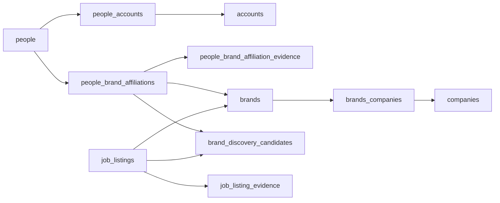

# Database schema reference

The repository and permanent local test database are at `0173_rg6_scope_rare_hit_memberships` on the RG6 branch. Staging and production remain deployed through `0168_rg5_remove_superseded_storage` at `3d4d341daa52ed3d184184d5b35f27717813d381` as checked on 2026-10-25. The RG6 additions described here are local only. Runtime and retained-history proof for deployed changes is recorded in the [global schema plan](../plans/2026-10-09-063417-feat-g3-round2-chart-engine-plan.md).

Local branch scope: **218 physical core application tables**, **2493 physical columns**, **218 managed core models**, nine compatibility views, three native read-only benchmark views and one native materialized view. Unmanaged source projections describe restricted columns on existing tables and add no tables. The deployed 0168 scope is 215 tables and 2476 columns.

Canonical geography references use `geolocations.id`. Necessary source wording and existing payloads remain in restricted evidence columns on their existing owners. Ordinary models, webpages and APIs use canonical locations; unresolved claims return NULL without a raw-source fallback. Database guards re-resolve changed wording and preserve explicit canonical corrections when the wording is unchanged.

Use this guide to find where information lives and how records connect. Start
with a subject below, or use the [alphabetical table inventory](#table-inventory)
to jump directly to any table. Every inventory entry has a full column reference.

The schema is defined by [core/models.py](../../core/models.py) and the
[ordered Django migrations](../../core/migrations/). This snapshot describes
the local repository schema, checked against Django models, migration state and the permanent shared local test database. Production migration-ledger verification is scoped above; other deployments require their own migration verification. Django’s own
authentication, session, content-type, and migration-ledger tables are outside
this **application-table** count. `DiscoveryRunBase` is an abstract model, not
another table; its columns are included under both discovery-run tables.
The retired SQLite database and Graphviz image are not current schema sources.

## Find information by subject

| Subject | Tables | Start here when you need… |
| --- | ---: | --- |
| [Shared catalogues and performer identities](#shared-catalogues) | 10 | Canonical timezone, language-tag and unit values; internal performers; immutable definition, provider, model and workflow-stage identities. |
| [People and job history](#people) | 18 | A person, their optional X identity, roles, employment dates, and evidence. |
| [Companies, brands, and organization discovery](#organizations) | 12 | Company/brand identity, ownership, associated accounts, and unresolved organizations. |
| [Accounts, profiles, and lists](#accounts) | 13 | Shared source accounts, X detail profiles, observed history, list membership and post appearances. |
| [Shared geography](#geography) | 4 | Country/region names and interpretation of account geography. |
| [Posts and classification](#posts) | 14 | Source posts, brand attribution, classification, and supporting judgments. |
| [Homepage counts](#homepage-counts) | 1 + native view | Historical count summaries and their publication validity. |
| [Classification vocabularies and translated labels](#vocabularies) | 23 | Allowed classification concepts and their translated display labels. |
| [Products, model releases, and Hugging Face catalog](#products) | 16 | Exact products, release claims, and catalog observations. |
| [Job listings and official career-site collection](#jobs) | 19 | Advertised roles, their sources, and career-site synchronization status. |
| [Events and opportunities](#events) | 5 | Attendable occurrences and action-for-benefit offers. |
| [Event dossiers and evidence](#event-dossiers) | 8 | Source-backed event identity, claims, review history and typed projections. |
| [Post translation and commentary](#translation) | 9 | Literal post translations, generated commentary, retries, and budgets. |
| [Authored content and trend publication](#headlines) | 13 | Prepared headline text, publication pointers, provider batches, work requests, and provider costs. |
| [Compatible editorial input storage and pictures](#editorial) | 7 | Story identities, accepted editions, quarter-hour decisions, spend and optional assets. |
| [Collection, extraction, and processing records](#processing) | 26 | Search cursors, coverage gaps, extraction attempts, and rare-type search accounting. |
| [Measurement subjects, metrics and observations](#measurements) | 13 | Sourced measurements and their collection state. |
| [Official-company collection](#official-companies) | 7 | Official-company account collection, attempts and spending. |

For staff records, begin with **[People and job history](#people)**. A person can
exist without an X account. Their employer/brand relationships and supporting
sources have their own tables. **[Job listings](#jobs)** describe advertised
positions; they are not a person’s employment history.



An affiliation or job listing is owned by exactly one known brand **or** one
organization awaiting review. The two arrows in the diagram are alternatives,
not two simultaneous owners. A company is reached through `brands_companies`;
there is no direct company column on the affiliation.

## Reading the table details

- A **primary key (PK)** uniquely identifies a row. Some tables use a natural
  identifier such as a provider ID or brand slug; others use a UUID or a
  generated integer. A **composite primary key** uses several existing columns
  together. Django’s `pk` attribute for those models is not a physical column.
- A **foreign key (FK)** links to another table. Column tables use actual SQL
  column names; a different Django attribute is shown as `model: …`. For example,
  `people_accounts.author_id` is the SQL column for the model’s `account` field.
- **NULL allowed** describes database nullability. It is separate from Django
  form validation (`blank=True`) and from an empty string. A non-null column may
  still accept `''` if its constraints allow it.
- **Default** means a Django/application default unless explicitly marked as a
  database identity. `uuid.uuid4`, `auto_now_add`, and `auto_now` are application
  behavior, not PostgreSQL defaults. Direct SQL writes must supply required
  values themselves. `auto_now` applies to normal model saves, not every bulk
  update or arbitrary SQL statement.
- PostgreSQL types are shown directly: `varchar(n)` is bounded text, `text` is
  unbounded text, `jsonb` is structured JSON, and `timestamp with time zone` is
  a timezone-aware timestamp. Positive integer Django fields also receive
  nonnegative database checks. Field choices are application validation;
  only listed database checks enforce their allowed values in SQL.
- `case_insensitive` is the ICU collation created in the initial migration
  (`und-u-ks-level2`, nondeterministic). Only fields explicitly marked with that
  collation use it; not every identifier does.
- FK deletion labels describe Django behavior: `CASCADE` deletes dependent
  records, `PROTECT` prevents deletion while referenced, and `SET_NULL` clears
  an optional link. These are not a claim that every SQL FK has that same
  `ON DELETE` clause. The migration-specific exceptions are documented below.
- Every table lists its named model indexes and constraints. PKs and unique
  fields provide uniqueness indexes; ordinary FK fields also receive indexes
  unless the field details say otherwise. These automatic indexes are not
  repeated as manually named indexes. Exact check expressions use SQL notation;
  the important meaning is explained in each subject’s introduction.

## Dates, evidence, and languages

Source facts and collection times answer different questions. `observed_at`,
`first_seen_at`, and `last_seen_at` say when PushinWeight saw a claim;
`created_at`/`updated_at` usually track the stored row. A source’s employment,
birth, release, event, or opportunity date stays in its dedicated value field.
For `posts`, `accounts`, and `products`, `created_at` is a source creation time;
the table notes identify those exceptions.

Reduced-precision dates pair a string value with a precision: `YYYY`/`year`,
`YYYY-MM`/`month`, `YYYY-MM-DD`/`day`, or NULL/`unknown`. Models that allow
`datetime` require a timezone-bearing ISO-style timestamp. Named checks express the expected string shapes and precision pairings;
application validation must also handle missing values and valid calendar dates.
As with PostgreSQL checks generally, an expression evaluating to SQL NULL does
not fail a check, so a nullable value plus a precision label is not by itself
proof of a complete or valid date. Comparable start/end values have additional ordering checks where
listed. Never substitute the date a page was crawled for an unknown joining date.

Evidence tables keep observations separate from interpreted facts. A stored
claim, confidence score, or record with `review_status='pending'` is not proof
of a confirmed identity. Do not count evidence rows as distinct people/jobs.
Several observations can support one record, and different claims can still
need reconciliation.

People select localized names from `people_names` through `person_name_selections`; the former fixed-language person name columns have been removed. `people_name_evidence` stores the sources.
Original professional prose and EN/JA translations live in `people_texts` and
`people_text_translations`. Media bytes and person/source attribution have their
own tables. Affiliation title/location originals and supporting evidence remain
in the existing job-history records; no company-headquarters location is inferred
for staff. Job listings retain their own source text and language fields.

<a id="table-inventory"></a>

## Alphabetical table inventory

Each of the 218 local physical core application tables appears once in this inventory and once in
the detailed sections. All 218 have managed models; unmanaged source projections add no tables. The native view is
listed separately: [home_brand_time_counts](#view-home_brand_time_counts). The three [benchmark serving views](#benchmark-serving-views) are also outside the physical-table count.

| Table | Subject | What one row represents |
| --- | --- | --- |
| [_applied_config_snapshot](#table-_applied_config_snapshot) | [Collection, extraction, and processing records](#processing) | One configuration artifact’s last applied content hash. |
| [account_based_in_mappings](#table-account_based_in_mappings) | [Shared geography](#geography) | One reviewed mapping from an X “based in” string to a country or region. |
| [account_post_appearances](#table-account_post_appearances) | [Accounts, profiles, and lists](#accounts) | One account’s appearance in one collected post, with collection context. |
| [account_query_memberships](#table-account_query_memberships) | [Accounts, profiles, and lists](#accounts) | One search query associated with an account, optionally at a saved post appearance. |
| [account_profile_snapshots](#table-account_profile_snapshots) | [Accounts, profiles, and lists](#accounts) | One consecutive observation period during which an account’s saved profile hash is unchanged. |
| [account_profile_text_translations](#table-account_profile_text_translations) | [Accounts, profiles, and lists](#accounts) | One localized translation of profile text, tied to account and source-text role. |
| [account_verification_types](#table-account_verification_types) | [Accounts, profiles, and lists](#accounts) | One exact provider verification code. Current X details, observed profile snapshots and post-author observations share it. An explicit empty provider code is distinct from a missing reference. |
| [accounts](#table-accounts) | [Accounts, profiles, and lists](#accounts) | One source account with a UUID identity, source/native key and current saved profile. |
| [actors](#table-actors) | [Shared catalogues and performer identities](#shared-catalogues) | One stable internal human, agent or system performer identity. |
| [affiliation_types](#table-affiliation_types) | [People and job history](#people) | One allowed kind of relationship between a person and an organization; shared by affiliations and dossier personnel details. |
| [audience_topic_concepts](#table-audience_topic_concepts) | [Classification vocabularies and translated labels](#vocabularies) | One stable topic identity within an audience-topic scheme. |
| [audience_topic_labels](#table-audience_topic_labels) | [Classification vocabularies and translated labels](#vocabularies) | One translated topic label for a particular revision. |
| [audience_topic_schemes](#table-audience_topic_schemes) | [Classification vocabularies and translated labels](#vocabularies) | One versioned audience-topic scheme and its manifest identity. |
| [brand_discovery_candidate_token_evidence](#table-brand_discovery_candidate_token_evidence) | [Companies, brands, and organization discovery](#organizations) | One source observation supporting an organization token. |
| [brand_discovery_candidate_tokens](#table-brand_discovery_candidate_tokens) | [Companies, brands, and organization discovery](#organizations) | One exact observed spelling or handle for an unresolved organization. |
| [brand_discovery_candidates](#table-brand_discovery_candidates) | [Companies, brands, and organization discovery](#organizations) | One unresolved organization identity awaiting review against known brands. |
| [brand_hashtags](#table-brand_hashtags) | [Companies, brands, and organization discovery](#organizations) | One hashtag associated with a brand. |
| [brand_keywords](#table-brand_keywords) | [Companies, brands, and organization discovery](#organizations) | One literal or regular-expression matching pattern for a brand. |
| [brand_search_terms](#table-brand_search_terms) | [Companies, brands, and organization discovery](#organizations) | One search term associated with a brand. |
| [brands](#table-brands) | [Companies, brands, and organization discovery](#organizations) | One brand identity and its display metadata. |
| [brands_accounts](#table-brands_accounts) | [Companies, brands, and organization discovery](#organizations) | One account’s role for a brand, such as official or researcher. |
| [brands_companies](#table-brands_companies) | [Companies, brands, and organization discovery](#organizations) | One ownership relationship between a brand and a company. |
| [call_state](#table-call_state) | [Collection, extraction, and processing records](#processing) | One harvest cursor for a brand, call, bucket, and query combination. |
| [collection_attempts](#table-collection_attempts) | [Collection, extraction, and processing records](#processing) | One separately admitted execution attempt in a logical run. |
| [collection_campaigns](#table-collection_campaigns) | [Collection, extraction, and processing records](#processing) | One bounded campaign spanning related collection jobs. |
| [collection_corrections](#table-collection_corrections) | [Collection, extraction, and processing records](#processing) | One immutable correction to an observation or attribution. |
| [collection_evidence_archives](#table-collection_evidence_archives) | [Collection, extraction, and processing records](#processing) | One immutable content-addressed captured response body. |
| [collection_job_targets](#table-collection_job_targets) | [Collection, extraction, and processing records](#processing) | One frozen target or query attached to a collection job. |
| [collection_jobs](#table-collection_jobs) | [Measurement subjects, metrics and observations](#measurements) | One immutable instruction with mutable coordination pointers. |
| [collection_metric_gaps](#table-collection_metric_gaps) | [Collection, extraction, and processing records](#processing) | One selected counter missing from an observation, with a reason. |
| [collection_observation_inputs](#table-collection_observation_inputs) | [Collection, extraction, and processing records](#processing) | One provenance link from an observation to its request or prior observation. |
| [collection_observations](#table-collection_observations) | [Measurement subjects, metrics and observations](#measurements) | One sourced, dated observation in a collection run. |
| [collection_requests](#table-collection_requests) | [Collection, extraction, and processing records](#processing) | One transport request and its outcome. |
| [collection_resource_snapshots](#table-collection_resource_snapshots) | [Collection, extraction, and processing records](#processing) | One nonnumeric historical snapshot of a collected resource. |
| [collection_runs](#table-collection_runs) | [Measurement subjects, metrics and observations](#measurements) | One source collection run, for numeric measurements or catalog discovery. |
| [collection_scope_rare_hits](#table-collection_scope_rare_hits) | [Collection, extraction, and processing records](#processing) | One saved association between a collection scope and a rare-type search hit. |
| [collection_scope_runs](#table-collection_scope_runs) | [Measurement subjects, metrics and observations](#measurements) | One source scope’s pagination and ownership progress within a collection run. |
| [companies](#table-companies) | [Companies, brands, and organization discovery](#organizations) | One company identity, including its recorded headquarters country. |
| [companies_accounts](#table-companies_accounts) | [Companies, brands, and organization discovery](#organizations) | One account’s role and ownership-review state for a company. |
| [company_labels](#table-company_labels) | [Companies, brands, and organization discovery](#organizations) | One current company label for a registered locale. |
| [content_pictures](#table-content_pictures) | [Compatible editorial input storage and pictures](#editorial) | One optional source/derivative assignment for a content revision. |
| [currencies](#table-currencies) | [Shared catalogues and performer identities](#shared-catalogues) | One registered current or historical ISO 4217 currency code; it does not imply exchange-rate conversion. |
| [data_sources](#table-data_sources) | [Accounts, profiles, and lists](#accounts) | One stable collection-source identity, distinct from original authored content. |
| [definition_versions](#table-definition_versions) | [Shared catalogues and performer identities](#shared-catalogues) | One immutable identity and provenance record for a versioned software or policy definition. |
| [discourse_keys](#table-discourse_keys) | [Classification vocabularies and translated labels](#vocabularies) | One legacy pragmatic-register vocabulary key. |
| [discourse_labels](#table-discourse_labels) | [Classification vocabularies and translated labels](#vocabularies) | One translated legacy pragmatic-register label. |
| [editorial_assessments](#table-editorial_assessments) | [Compatible editorial input storage and pictures](#editorial) | One fenced quarter-hour editorial or content-picture assessment, with frozen evidence and outcome. |
| [editorial_budgets](#table-editorial_budgets) | [Compatible editorial input storage and pictures](#editorial) | One UTC day of conservative spend reservations and text/media call counts. |
| [editorial_calls](#table-editorial_calls) | [Compatible editorial input storage and pictures](#editorial) | One reserved provider stage and its saved response or uncertain-send outcome. |
| [editorial_editions](#table-editorial_editions) | [Compatible editorial input storage and pictures](#editorial) | One immutable accepted story edition for a track, locale and revision. |
| [editorial_heroes](#table-editorial_heroes) | [Compatible editorial input storage and pictures](#editorial) | One current hero pointer, or the shared provider-lock row. |
| [editorial_stories](#table-editorial_stories) | [Compatible editorial input storage and pictures](#editorial) | One permanent development identity with original-post anchors. |
| [employment_types](#table-employment_types) | [Job listings and official career-site collection](#jobs) | One reusable employment-arrangement classification. |
| [event_claim_kinds](#table-event_claim_kinds) | [Event dossiers and evidence](#event-dossiers) | One allowed evidence-claim kind shared by dossier claims and scoped artifact, endpoint and host records. |
| [event_dossier_claims](#table-event_dossier_claims) | [Event dossiers and evidence](#event-dossiers) | One extracted assertion with evidence, scope and typed time precision. |
| [event_dossier_review_claims](#table-event_dossier_review_claims) | [Event dossiers and evidence](#event-dossiers) | One claim disposition included in a review revision. |
| [event_dossier_reviews](#table-event_dossier_reviews) | [Event dossiers and evidence](#event-dossiers) | One immutable dossier decision revision and evidence cutoff. |
| [event_dossier_sources](#table-event_dossier_sources) | [Event dossiers and evidence](#event-dossiers) | One captured source attached to one dossier. |
| [event_dossiers](#table-event_dossiers) | [Event dossiers and evidence](#event-dossiers) | One versioned event identity and its current review pointer. |
| [event_evidence](#table-event_evidence) | [Events and opportunities](#events) | One source observation supporting an event occurrence. |
| [event_kinds](#table-event_kinds) | [Events and opportunities](#events) | One allowed kind of event, referenced by the event rather than repeated as its canonical string. |
| [events](#table-events) | [Events and opportunities](#events) | One attendance-bearing occurrence, such as a conference or meetup. |
| [geolocation_alternate_names](#table-geolocation_alternate_names) | [Shared geography](#geography) | One attested wording in one locale for one place; includes localized preferred names and vetted aliases. |
| [geolocation_policies](#table-geolocation_policies) | [Shared geography](#geography) | One immutable local geography policy decision; the place selects its current decision while the supersedes chain preserves history. |
| [geolocations](#table-geolocations) | [Shared geography](#geography) | One shared geographic place with a local primary key, optional external GeoNames identity and provider-supported ancestry. |
| [geopolitical_mode_keys](#table-geopolitical_mode_keys) | [Classification vocabularies and translated labels](#vocabularies) | One geopolitical-mode vocabulary key. |
| [geopolitical_mode_labels](#table-geopolitical_mode_labels) | [Classification vocabularies and translated labels](#vocabularies) | One translated geopolitical-mode label. |
| [harvest_backlog_windows](#table-harvest_backlog_windows) | [Collection, extraction, and processing records](#processing) | One bounded time window still owed collection coverage. |
| [inference_models](#table-inference_models) | [Shared catalogues and performer identities](#shared-catalogues) | One provider-qualified native model identifier requested from an inference service. |
| [job_discovery_runs](#table-job_discovery_runs) | [Job listings and official career-site collection](#jobs) | One job-search query/window run, including coverage, cost, and extracted listing count. |
| [job_employment_type_assignments](#table-job_employment_type_assignments) | [Job listings and official career-site collection](#jobs) | One current, source-supported employment-type assignment on a listing. |
| [job_function_assignments](#table-job_function_assignments) | [Job listings and official career-site collection](#jobs) | One current, source-supported job-function assignment on a listing. |
| [job_functions](#table-job_functions) | [Job listings and official career-site collection](#jobs) | One reusable job-function classification. |
| [job_listing_evidence](#table-job_listing_evidence) | [Job listings and official career-site collection](#jobs) | One source observation supporting a job listing. |
| [job_listing_locations](#table-job_listing_locations) | [Job listings and official career-site collection](#jobs) | One ordered location occurrence in a job source observation, with preserved evidence and a nullable resolved shared place. |
| [job_listings](#table-job_listings) | [Job listings and official career-site collection](#jobs) | One advertised position/requisition, including its source identity and current saved details. |
| [job_organization_ai_relationship_assignments](#table-job_organization_ai_relationship_assignments) | [Job listings and official career-site collection](#jobs) | One current, source-supported organization-to-AI classification on a listing. |
| [job_role_ai_relationship_assignments](#table-job_role_ai_relationship_assignments) | [Job listings and official career-site collection](#jobs) | One current, source-supported role-to-AI classification on a listing. |
| [job_seniority_assignments](#table-job_seniority_assignments) | [Job listings and official career-site collection](#jobs) | One current, source-supported seniority assignment on a listing. |
| [job_source_states](#table-job_source_states) | [Job listings and official career-site collection](#jobs) | One career-site source’s active lease and last successful synchronization state. |
| [job_source_sync_runs](#table-job_source_sync_runs) | [Job listings and official career-site collection](#jobs) | One attempt to synchronize an official career-site source. |
| [job_workplace_type_assignments](#table-job_workplace_type_assignments) | [Job listings and official career-site collection](#jobs) | One current, source-supported workplace-type assignment on a listing. |
| [languages](#table-languages) | [Shared catalogues](#shared-catalogues) | One registered primary-language code. |
| [locales](#table-locales) | [Shared catalogues](#shared-catalogues) | One full language tag and its registered base language. |
| [materialization_state](#table-materialization_state) | [Homepage counts](#homepage-counts) | Current publication, coverage and source-change state for one versioned derived dataset in this environment. |
| [measurement_subjects](#table-measurement_subjects) | [Measurement subjects, metrics and observations](#measurements) | One identity that measurements describe, optionally linked to a product, group, brand or company. |
| [measurement_units](#table-measurement_units) | [Shared catalogues](#shared-catalogues) | One immutable measurement/window unit identity. |
| [metric_collection_contracts](#table-metric_collection_contracts) | [Measurement subjects, metrics and observations](#measurements) | One versioned collection contract for a data source. |
| [metric_types](#table-metric_types) | [Measurement subjects, metrics and observations](#measurements) | One allowed family of measurements and its interpretation. |
| [metric_values](#table-metric_values) | [Measurement subjects, metrics and observations](#measurements) | One value for a metric in an observation. |
| [metrics](#table-metrics) | [Measurement subjects, metrics and observations](#measurements) | One metric definition with units, scale and methodology. |
| [model_gating_states](#table-model_gating_states) | [Products, model releases, and Hugging Face catalog](#products) | One shared model-access gating state, used by products and resource snapshots. This is a business meaning rather than a provider-specific identity. |
| [model_release_details](#table-model_release_details) | [Event dossiers and evidence](#event-dossiers) | One typed model-release projection owned by a dossier review. |
| [model_release_evidence](#table-model_release_evidence) | [Products, model releases, and Hugging Face catalog](#products) | One observed source claim supporting a model release. |
| [model_releases](#table-model_releases) | [Products, model releases, and Hugging Face catalog](#products) | One source-backed model-release occurrence and its stated date precision. |
| [model_tasks](#table-model_tasks) | [Products, model releases, and Hugging Face catalog](#products) | One exact source-qualified model-task code shared by current products and resource snapshots. Code spelling and case are preserved. |
| [national_stance_keys](#table-national_stance_keys) | [Classification vocabularies and translated labels](#vocabularies) | One China/US national-stance direction vocabulary key. |
| [national_stance_labels](#table-national_stance_labels) | [Classification vocabularies and translated labels](#vocabularies) | One translated national-stance label. |
| [nationalism_keys](#table-nationalism_keys) | [Classification vocabularies and translated labels](#vocabularies) | One legacy nationalism-scale vocabulary key shared by the China and US axes. |
| [nationalism_labels](#table-nationalism_labels) | [Classification vocabularies and translated labels](#vocabularies) | One translated legacy nationalism-scale label. |
| [official_company_account_states](#table-official_company_account_states) | [Official-company collection](#official-companies) | One official-company account collection state and cursor. |
| [official_company_attempts](#table-official_company_attempts) | [Official-company collection](#official-companies) | One official-company provider attempt with its budget charge and state. |
| [official_company_budgets](#table-official_company_budgets) | [Official-company collection](#official-companies) | One period of reserved official-company collection spend. |
| [official_company_list_intents](#table-official_company_list_intents) | [Official-company collection](#official-companies) | One desired official-company list membership action. |
| [official_company_owner_credentials](#table-official_company_owner_credentials) | [Official-company collection](#official-companies) | One owner-scoped credential reference; secret material is not documented here. |
| [official_company_provider_states](#table-official_company_provider_states) | [Official-company collection](#official-companies) | One provider lifecycle/control record for official-company collection. |
| [official_company_scans](#table-official_company_scans) | [Official-company collection](#official-companies) | One official-company account scan and its outcome. |
| [opportunities](#table-opportunities) | [Events and opportunities](#events) | One bounded offer in which an action can provide a benefit, optionally linked to an event. |
| [opportunity_types](#table-opportunity_types) | [Events and opportunities](#events) | One allowed kind of opportunity; action and benefit wording remain separate deferred fields. |
| [organization_ai_relationship_types](#table-organization_ai_relationship_types) | [Job listings and official career-site collection](#jobs) | One reusable classification of an organization's relationship to AI. |
| [original_content](#table-original_content) | [Authored content and trend publication](#headlines) | One prepared brand headline outcome within a run. |
| [original_content_calls](#table-original_content_calls) | [Authored content and trend publication](#headlines) | One physical model attempt owned by an authored run or provider batch. |
| [original_content_runs](#table-original_content_runs) | [Authored content and trend publication](#headlines) | One common evidence cutoff for an all-brand headline run and time window. |
| [original_content_selections](#table-original_content_selections) | [Authored content and trend publication](#headlines) | One currently visible run for a supported time window. |
| [original_content_sources](#table-original_content_sources) | [Authored content and trend publication](#headlines) | One distinct cited post supporting one saved locale/version, with immutable ordered URL/author/hash snapshots. |
| [original_content_subject_labels](#table-original_content_subject_labels) | [Authored content and trend publication](#headlines) | One immutable localized subject-label snapshot for saved content. |
| [original_content_texts](#table-original_content_texts) | [Authored content and trend publication](#headlines) | One locale’s headline and byline for a brand narrative. |
| [people](#table-people) | [People and job history](#people) | One person, whether or not they have an X account. |
| [people_accounts](#table-people_accounts) | [People and job history](#people) | One proposed or reviewed link between a person and an X account. |
| [people_brand_affiliation_evidence](#table-people_brand_affiliation_evidence) | [People and job history](#people) | One source observation supporting an affiliation claim. |
| [people_brand_affiliations](#table-people_brand_affiliations) | [People and job history](#people) | One claim about a person’s role or relationship with an organization. |
| [people_identity_corrections](#table-people_identity_corrections) | [People and job history](#people) | One append-only reviewed account confirmation, identity merge or selective split. |
| [people_media](#table-people_media) | [People and job history](#people) | One person-specific attribution of an image or video reference to a source. |
| [people_name_evidence](#table-people_name_evidence) | [People and job history](#people) | One observation supporting a name or explicitly supported name components. |
| [people_names](#table-people_names) | [People and job history](#people) | One sourced spelling of a person’s full name, with optional evidenced components. |
| [people_text_translations](#table-people_text_translations) | [People and job history](#people) | One cached translation of a specific original prose version and provider configuration. |
| [people_texts](#table-people_texts) | [People and job history](#people) | One immutable version of original biography, role, location or job-description prose. |
| [person_citizenship_evidence](#table-person_citizenship_evidence) | [People and job history](#people) | One link from a citizenship to an existing source-origin PersonText observation from the same person. |
| [person_citizenships](#table-person_citizenships) | [People and job history](#people) | One explicitly supported country or area citizenship for a person; multiple citizenships are allowed, with at most one primary. |
| [person_name_selections](#table-person_name_selections) | [People and job history](#people) | One selected person-name spelling for a display locale. |
| [personnel_change_details](#table-personnel_change_details) | [Event dossiers and evidence](#event-dossiers) | One typed personnel-change projection owned by a dossier review. |
| [personnel_change_types](#table-personnel_change_types) | [People and job history](#people) | One allowed kind of personnel change recorded in a dossier detail. |
| [personnel_discovery_runs](#table-personnel_discovery_runs) | [People and job history](#people) | One personnel-search query/window run, including coverage, cost, and extraction counts. |
| [post_enrichment_states](#table-post_enrichment_states) | [Post translation and commentary](#translation) | One post’s replayable translation/classification progress and diagnostics. |
| [post_subject_attributions](#table-post_subject_attributions) | [Measurement subjects, metrics and observations](#measurements) | One sourced post linked to a measurement subject. |
| [post_synthesis_artifacts](#table-post_synthesis_artifacts) | [Post translation and commentary](#translation) | One versioned commentary artifact for a post and its context. |
| [post_synthesis_daily_budgets](#table-post_synthesis_daily_budgets) | [Post translation and commentary](#translation) | One day’s commentary request/token budget accounting. |
| [post_synthesis_demands](#table-post_synthesis_demands) | [Post translation and commentary](#translation) | One coalesced request for post commentary, including its worker claim and retry state. |
| [post_synthesis_rate_limit_buckets](#table-post_synthesis_rate_limit_buckets) | [Post translation and commentary](#translation) | One request-throttle bucket keyed without storing a user ID or IP address. |
| [post_synthesis_texts](#table-post_synthesis_texts) | [Post translation and commentary](#translation) | One locale’s commentary text within a synthesis artifact. |
| [post_translation_artifacts](#table-post_translation_artifacts) | [Post translation and commentary](#translation) | One versioned literal-translation attempt/state for a post body. |
| [post_translation_chunks](#table-post_translation_chunks) | [Post translation and commentary](#translation) | One validated locale chunk retained for resuming a long post translation. |
| [post_translation_texts](#table-post_translation_texts) | [Post translation and commentary](#translation) | One locale’s validated literal text within a translation artifact. |
| [post_unsanctioned_flag_assignments](#table-post_unsanctioned_flag_assignments) | [Posts and classification](#posts) | One known unsanctioned flag assigned to a post-level assessment. |
| [post_type_keys](#table-post_type_keys) | [Classification vocabularies and translated labels](#vocabularies) | One post-type vocabulary key, such as release or review. |
| [post_type_labels](#table-post_type_labels) | [Classification vocabularies and translated labels](#vocabularies) | One translated post-type label. |
| [posts](#table-posts) | [Posts and classification](#posts) | One collected X post, its source text, metrics, and author snapshot. |
| [posts_brands](#table-posts_brands) | [Posts and classification](#posts) | One post-to-brand attribution and its relevance weight. |
| [posts_brands_audience_topics](#table-posts_brands_audience_topics) | [Posts and classification](#posts) | One audience-topic assignment for a post/brand pair. |
| [posts_brands_classification_judgments](#table-posts_brands_classification_judgments) | [Posts and classification](#posts) | One recorded stage of a classifier judgment, including inputs and validation. |
| [posts_brands_classification_states](#table-posts_brands_classification_states) | [Posts and classification](#posts) | One current versioned classification state for a post/brand pair. |
| [posts_brands_discourse](#table-posts_brands_discourse) | [Posts and classification](#posts) | One legacy pragmatic speech-act assignment for a post/brand pair. |
| [posts_brands_geopolitical_modes](#table-posts_brands_geopolitical_modes) | [Posts and classification](#posts) | One geopolitical-mode assignment for a post/brand pair. |
| [posts_brands_mentions](#table-posts_brands_mentions) | [Posts and classification](#posts) | One matching source that connected a post to a brand. |
| [posts_brands_product_labels](#table-posts_brands_product_labels) | [Posts and classification](#posts) | One independent product-feedback label for a post/brand pair. |
| [posts_brands_products](#table-posts_brands_products) | [Products, model releases, and Hugging Face catalog](#products) | One source-backed claim that a post names an exact product for a brand. |
| [posts_brands_signals](#table-posts_brands_signals) | [Posts and classification](#posts) | One post type and sentiment assignment for a post/brand pair. |
| [posts_unsanctioned_flags](#table-posts_unsanctioned_flags) | [Posts and classification](#posts) | One post’s legacy unsanctioned-flag assignment. |
| [posts_untracked_brand_promotions](#table-posts_untracked_brand_promotions) | [Posts and classification](#posts) | One current post-level judgment about promotion of an untracked brand. |
| [product_group_memberships](#table-product_group_memberships) | [Products, model releases, and Hugging Face catalog](#products) | One product belonging to a versioned group. |
| [product_groups](#table-product_groups) | [Products, model releases, and Hugging Face catalog](#products) | One stable grouping identity for related products. |
| [product_label_keys](#table-product_label_keys) | [Classification vocabularies and translated labels](#vocabularies) | One independent product-feedback vocabulary key. |
| [product_label_labels](#table-product_label_labels) | [Classification vocabularies and translated labels](#vocabularies) | One translated product-feedback label. |
| [product_relationship_types](#table-product_relationship_types) | [Products, model releases, and Hugging Face catalog](#products) | One shared meaning of a directed relationship between two products. Taxonomy-version relationships refer to this catalogue; the snapshot remains immutable. |
| [product_relationships](#table-product_relationships) | [Products, model releases, and Hugging Face catalog](#products) | One typed relationship between two products. |
| [product_types](#table-product_types) | [Products, model releases, and Hugging Face catalog](#products) | One shared product category. A product selects one category; categories may have one protected parent. Database guards reject cycles and changes to identity codes. |
| [product_verification_proposals](#table-product_verification_proposals) | [Products, model releases, and Hugging Face catalog](#products) | One reviewable proposal to resolve an observed product name to a product. |
| [products](#table-products) | [Products, model releases, and Hugging Face catalog](#products) | One model/product identity, with optional Hugging Face repository metadata. |
| [profile_movement_candidates](#table-profile_movement_candidates) | [People and job history](#people) | One observed profile change queued for personnel-movement interpretation. |
| [provider_batches](#table-provider_batches) | [Authored content and trend publication](#headlines) | One resumable provider group for a source collection job, with control and import progress. |
| [provider_label_display_types](#table-provider_label_display_types) | [Accounts, profiles, and lists](#accounts) | One exact provider label-display code shared by observed profile labels and current affiliate or identity labels. |
| [provider_label_types](#table-provider_label_types) | [Accounts, profiles, and lists](#accounts) | One exact provider label-kind code shared by observed profile labels and current affiliate or identity labels. |
| [provider_link_types](#table-provider_link_types) | [Accounts, profiles, and lists](#accounts) | One exact provider link-kind code shared by current affiliate and identity-profile labels. |
| [rare_type_category_assignments](#table-rare_type_category_assignments) | [Collection, extraction, and processing records](#processing) | One source-backed rare-category assignment for a post and organization. |
| [rare_type_decision_attempts](#table-rare_type_decision_attempts) | [Collection, extraction, and processing records](#processing) | One funded provider attempt for a relevance decision, with one settlement record. |
| [rare_type_decision_processing_cycles](#table-rare_type_decision_processing_cycles) | [Collection, extraction, and processing records](#processing) | One processing time slot that funds relevance-decision attempts. |
| [rare_type_decisions](#table-rare_type_decisions) | [Collection, extraction, and processing records](#processing) | One reusable, versioned relevance interpretation of a provider result. |
| [rare_type_search_daily_budgets](#table-rare_type_search_daily_budgets) | [Collection, extraction, and processing records](#processing) | One search lane’s budget accounting for a UTC day. |
| [rare_type_search_hits](#table-rare_type_search_hits) | [Collection, extraction, and processing records](#processing) | One durable inbox result from an already-paid rare-type search. |
| [rare_type_search_runs](#table-rare_type_search_runs) | [Collection, extraction, and processing records](#processing) | One paid rare-type search time slot and its coverage/cost record. |
| [release_access_channels](#table-release_access_channels) | [Products, model releases, and Hugging Face catalog](#products) | One access channel used by a dossier release endpoint; distinct from release maturity and availability. |
| [release_availability_states](#table-release_availability_states) | [Products, model releases, and Hugging Face catalog](#products) | One availability state for a dossier release detail; distinct from disclosure evidence. |
| [release_maturities](#table-release_maturities) | [Products, model releases, and Hugging Face catalog](#products) | One release maturity value shared by extracted releases and dossier release details. |
| [role_ai_relationship_types](#table-role_ai_relationship_types) | [Job listings and official career-site collection](#jobs) | One reusable classification of a job role's relationship to AI; no prose explanation is automatically promoted to a category. |
| [role_labels](#table-role_labels) | [Classification vocabularies and translated labels](#vocabularies) | One translated account-role label. |
| [roles](#table-roles) | [Classification vocabularies and translated labels](#vocabularies) | One account-role vocabulary key. |
| [salary_periods](#table-salary_periods) | [Job listings and official career-site collection](#jobs) | One canonical compensation period; amounts are not annualized or converted. |
| [search_queries](#table-search_queries) | [Collection, extraction, and processing records](#processing) | One saved collection/discovery query identity and associated brand/keywords. |
| [seniority_levels](#table-seniority_levels) | [Job listings and official career-site collection](#jobs) | One reusable job-seniority classification. |
| [sentiment_keys](#table-sentiment_keys) | [Classification vocabularies and translated labels](#vocabularies) | One sentiment vocabulary key. |
| [sentiment_labels](#table-sentiment_labels) | [Classification vocabularies and translated labels](#vocabularies) | One translated sentiment label. |
| [service_providers](#table-service_providers) | [Shared catalogues and performer identities](#shared-catalogues) | One identity for a service that receives a model request. |
| [software_libraries](#table-software_libraries) | [Products, model releases, and Hugging Face catalog](#products) | One exact source-qualified software-library code shared by current products and resource snapshots. Code spelling and case are preserved. |
| [source_identifier_namespaces](#table-source_identifier_namespaces) | [Measurement subjects, metrics and observations](#measurements) | One source-and-resource-kind-qualified identifier namespace shared by source-subject mappings and collection job targets. The empty code is an explicit unscoped namespace; targets inherit source ownership from pinned mapping or evidence. |
| [source_subject_mappings](#table-source_subject_mappings) | [Measurement subjects, metrics and observations](#measurements) | One external source identifier mapped to a measurement subject. |
| [staff_collection_work](#table-staff_collection_work) | [Collection, extraction, and processing records](#processing) | One person/source-fingerprint/policy unit of resumable collection work. |
| [staff_intakes](#table-staff_intakes) | [Collection, extraction, and processing records](#processing) | One versioned staff-source observation, including eligibility and its input payload. |
| [staff_media_objects](#table-staff_media_objects) | [People and job history](#people) | One validated image file, addressed by its SHA-256 content hash. |
| [staff_provider_requests](#table-staff_provider_requests) | [Collection, extraction, and processing records](#processing) | One reserved provider request, its outcome and safe response evidence. |
| [subject_relationships](#table-subject_relationships) | [Measurement subjects, metrics and observations](#measurements) | One typed relationship between measurement subjects. |
| [targeted_extraction_attempts](#table-targeted_extraction_attempts) | [Collection, extraction, and processing records](#processing) | One recorded attempt to extract a role-specific fact from a post. |
| [targeted_extraction_states](#table-targeted_extraction_states) | [Collection, extraction, and processing records](#processing) | One post/role extraction state, used to avoid repeating the same work. |
| [taxonomy_versions](#table-taxonomy_versions) | [Classification vocabularies and translated labels](#vocabularies) | One versioned taxonomy identity and its manifest. |
| [time_zones](#table-time_zones) | [Shared catalogues](#shared-catalogues) | One accepted IANA timezone or Link identifier. |
| [trend_narrative_demands](#table-trend_narrative_demands) | [Authored content and trend publication](#headlines) | One coalesced brand/window headline request and its scheduling state. |
| [trend_narrative_subject_labels](#table-trend_narrative_subject_labels) | [Authored content and trend publication](#headlines) | One immutable localized name snapshot for a reported subject. |
| [trend_narrative_subjects](#table-trend_narrative_subjects) | [Authored content and trend publication](#headlines) | One reported subject attached to a headline publication. |
| [trend_narrative_work_slots](#table-trend_narrative_work_slots) | [Authored content and trend publication](#headlines) | One window’s active work claim and optional newer queued cutoff. |
| [trend_narratives](#table-trend_narratives) | [Authored content and trend publication](#headlines) | One durable attempt/version of a shared time-window headline. |
| [twitter_list_memberships](#table-twitter_list_memberships) | [Accounts, profiles, and lists](#accounts) | One account’s membership state in one X list. |
| [twitter_list_sync_state](#table-twitter_list_sync_state) | [Accounts, profiles, and lists](#accounts) | One X list’s last completed membership synchronization. |
| [unsanctioned_flag_keys](#table-unsanctioned_flag_keys) | [Classification vocabularies and translated labels](#vocabularies) | One legacy unsanctioned-flag vocabulary key; there is no paired label table. |
| [untracked_brand_promotion_evidence](#table-untracked_brand_promotion_evidence) | [Posts and classification](#posts) | One visible promoted subject supporting an untracked-brand judgment. |
| [untracked_brand_promotion_keys](#table-untracked_brand_promotion_keys) | [Classification vocabularies and translated labels](#vocabularies) | One current untracked-brand-promotion vocabulary key. |
| [untracked_brand_promotion_labels](#table-untracked_brand_promotion_labels) | [Classification vocabularies and translated labels](#vocabularies) | One translated untracked-brand-promotion label. |
| [workflow_stages](#table-workflow_stages) | [Shared catalogues and performer identities](#shared-catalogues) | One stable stage identity within a versioned workflow or contract. |
| [workplace_types](#table-workplace_types) | [Job listings and official career-site collection](#jobs) | One reusable on-site, remote or hybrid work-arrangement classification. |
| [x_account_details](#table-x_account_details) | [Accounts, profiles, and lists](#accounts) | One optional current X profile extension for one shared account. |

<a id="shared-catalogues"></a>

## Shared catalogues and performer identities

The timezone, language, locale and measurement-unit catalogues own shared values;
the provider, requested-model, definition-version and workflow-stage registries
own distinct identities. Existing request records and owning domain rows link to
these identities where implemented. There is no automatic locale URL change,
timezone fallback, unit conversion or measurement rewrite. The controlled seed
command validates every input hash before inserting missing catalogue rows and
rolls back on canonical identity conflicts. It never contacts a provider, prunes
additional valid catalogue rows or activates collection.

The actor registry identifies internal performers independently of authentication
accounts and the researched people/platform accounts elsewhere in the schema.
An actor record does not establish approval, login access or authorization.

`definition_versions` records exact version identity and available source/archive
provenance; `service_providers` identifies the service receiving a request;
`inference_models` stores the native model key qualified by that provider; and
`workflow_stages` gives a stable stage identity scoped to a workflow or contract
definition. These registries do not infer a served checkpoint or store packed
configuration bodies. Definition and stage identities are immutable in the
database. Model identity cannot be reassigned to another provider or native key.

The offline [manifest](../../data/shared_vocabulary_manifest.json) pins
IANA tzdata2026e and the language registry dated2026-09-17. The four CSV seeds
contain597timezone identifiers,8163language codes,8172locale tags and24units.
Language rows exclude deprecated aliases with preferred replacements and private
use ranges. Locale rows include each seeded base language plus reviewed script
and region variants. `und` is explicit undetermined language, not a fallback.
`Factory` is not a resolved timezone and is excluded from the seed.

`resolve_locale(reported, context="source")` resolves case/underscore aliases
against the catalogue while preserving a genuine `zh-CN` tag. The explicit
`app_edition` context maps the app's `zh-cn`/`zh_CN` edition alias to `zh-Hans`.
Bare `zh` remains `zh`. Timezone lookup preserves exact IANA Link identifiers;
unknown `CST` stays unresolved. Callers retain the original reported value.
A new reviewed locale is added as a row/seed entry, without a language-specific
column or a changed existing historical packet.

The command supports one additive migration boundary at a time:

```bash
python manage.py seed_shared_vocabulary --catalogue time_zones --dry-run
python manage.py seed_shared_vocabulary --catalogue time_zones
python manage.py seed_shared_vocabulary --catalogue languages --catalogue locales
python manage.py seed_shared_vocabulary --catalogue measurement_units
```

These examples require the corresponding tables in the explicitly selected
database. Running the command or these documentation changes grants no live
migration/seed authority. The [seed builder](../../scripts/build_shared_vocabulary_seeds.py)
reproduces the CSVs from archived, hash-checked registry bytes without network use.

<a id="table-actors"></a>

### `actors` — Actor

One stable identity for an internal human, agent or system performer. Model:
[Actor](../../core/models.py#L46). The registry has no login-account relationship.
Authenticated-user linkage is not part of this schema.

| SQL column | PostgreSQL type | NULL allowed | Meaning, relationships, and defaults |
| --- | --- | --- | --- |
| `id` | `uuid` | No | Primary key; Django supplies a UUID for explicit registrations. |
| `actor_kind` | `character varying(16)` | No | Checked choices: `human`, `agent`, `system`. |
| `actor_key` | `character varying(128)` | No | Registry-owned opaque identity within its kind; no blank or surrounding whitespace. |

`actors_pkey` protects the primary key, `uq_actor_kind_key` enforces unique
`(actor_kind, actor_key)`, `ck_actor_kind` checks the kind and `ck_actor_key`
rejects empty or surrounding-whitespace keys. The `guard_actor_identity` trigger
rejects changes to any of these three fields even through bulk/raw SQL. Referenced
actors cannot be deleted through their correction FK; Django uses `PROTECT`.

Migration0115 registers system `benchmark_metric_timing_repair` using a stable
UUID. The actual timing-repair path explicitly reuses/registers that known system;
arbitrary legacy text never creates a registry entry. Current correction rows
refer to the registered actor directly; the duplicated legacy actor-label column
has been removed. Actors are copied during staging refresh without carrying login
credentials or links into the excluded authentication graph.

[Back to table inventory](#table-inventory)

<a id="table-definition_versions"></a>

### `definition_versions` — DefinitionVersion

One immutable version identity for a workflow, policy, prompt, taxonomy,
normalizer or other named definition, with optional pinned-source or archived
content provenance. A row identifies a definition; it does not store an
unstructured configuration body.

Model: [DefinitionVersion](../../core/models.py#L429).

**Primary key:** `id`.

| SQL column | PostgreSQL type | NULL allowed | Meaning, relationships, and defaults |
| --- | --- | --- | --- |
| `id` | `uuid` | No | PK; Django generates a UUID. |
| `definition_domain` | `varchar(64)` | No | Choice: adapter, normalizer, policy, workflow, contract, prompt, extraction, query_pack, query_family, provider_boundary, tool_boundary, taxonomy, selector, ranking_method, evidence_method, geography_scheme, membership_method, threshold or time_policy. |
| `definition_key` | `varchar(128)` | No | Stable owned name within its domain; nonempty and without surrounding whitespace. |
| `reported_version_token` | `varchar(256)` | No | Exact non-whitespace version token reported by the owner. |
| `identity_sha256` | `varchar(64)` | No | Unique lowercase SHA-256 identity for the definition version. |
| `content_sha256` | `varchar(64)` | Yes | Optional lowercase SHA-256 of available pinned definition content. |
| `source_git_commit` | `varchar(64)` | Yes | Optional 40- or 64-character lowercase Git commit. |
| `source_path` | `varchar(512)` | Yes | Optional relative repository path; absolute, blank, parent-traversal and newline paths are rejected. |
| `provenance_state` | `varchar(24)` | No | Choice: `identity_only`, `source_pinned` or `archive_pinned`; check enforces the required provenance shape. |
| `evidence_archive_id` | `uuid` | Yes | FK → [`collection_evidence_archives`](#table-collection_evidence_archives) (`id`); Django deletion: `PROTECT`; PostgreSQL FK is deferred NO ACTION. Model field: `evidence_archive`. |

**Named indexes:** `definition_versions_pkey` on `id`; `definition_versions_identity_sha256_key` unique on `identity_sha256`; `definition_versions_identity_sha256_2f2c84c1_like` pattern index on `identity_sha256`; `definition_versions_evidence_archive_id_92e943f7` on `evidence_archive_id`.

**Named constraints:** `ck_definition_domain` limits domains to the choices above; `ck_definition_identity_tokens` rejects blank/edge-whitespace keys and whitespace-only version tokens; `ck_definition_hashes` validates the identity hash and any content hash; `ck_definition_source_commit` validates commit shape; `ck_definition_source_path` rejects unsafe paths; `ck_definition_provenance_shape` enforces the field combination appropriate to each provenance state; `definition_versions_evidence_archive_id_92e943f7_fk_collectio` is the deferred archive FK.

`guard_definition_version_identity` rejects updates and deletes, preserving the registered identity and its provenance record.

[Back to table inventory](#table-inventory)

<a id="table-inference_models"></a>

### `inference_models` — InferenceModel

One native model key requested from one service provider. The provider-qualified
key records request identity; it does not prove which checkpoint the service
actually served.

Model: [InferenceModel](../../core/models.py#L378).

**Primary key:** `id`.

| SQL column | PostgreSQL type | NULL allowed | Meaning, relationships, and defaults |
| --- | --- | --- | --- |
| `id` | `uuid` | No | PK; Django generates a UUID. |
| `service_provider_id` | `varchar(64)` | No | FK → [`service_providers`](#table-service_providers) (`code`); Django deletion: `PROTECT`; PostgreSQL FK is deferred NO ACTION. Model field: `service_provider`. |
| `native_model_key` | `varchar(512)` | No | Exact native API model key; must be nonempty and have no surrounding whitespace. |

**Named indexes:** `inference_models_pkey` on `id`; `uq_inference_model_service_key` unique on `(service_provider_id, native_model_key)`; `inference_models_service_provider_id_35e2269f` and its pattern index on `service_provider_id`.

**Named constraints:** `ck_inference_model_native_key` rejects blank or edge-whitespace keys; `inference_models_service_provider_id_35e2269f_fk_service_p` is the deferred provider FK.

`guard_inference_model_identity` prevents updates to the ID, provider or native key after registration.

[Back to table inventory](#table-inventory)

<a id="table-service_providers"></a>

### `service_providers` — ServiceProvider

One service identity used to qualify the native model key sent with an
inference request. It is distinct from a source that supplies collected facts.

Model: [ServiceProvider](../../core/models.py#L363).

**Primary key:** `code`.

| SQL column | PostgreSQL type | NULL allowed | Meaning, relationships, and defaults |
| --- | --- | --- | --- |
| `code` | `varchar(64)` | No | PK; lowercase provider code beginning with a letter and containing only lowercase letters, digits, underscore, dot or hyphen. |

**Named indexes:** `service_providers_pkey` on `code`; `service_providers_code_8cf5f9bd_like` pattern index on `code`.

**Named constraints:** `ck_service_provider_code` enforces the code grammar.

`guard_service_provider_identity` rejects updates after a provider code is registered.

[Back to table inventory](#table-inventory)

<a id="table-workflow_stages"></a>

### `workflow_stages` — WorkflowStage

One stable stage key belonging to a workflow or contract definition version.
The referenced definition must have the `workflow` or `contract` domain.

Model: [WorkflowStage](../../core/models.py#L505).

**Primary key:** `id`.

| SQL column | PostgreSQL type | NULL allowed | Meaning, relationships, and defaults |
| --- | --- | --- | --- |
| `id` | `uuid` | No | PK; Django generates a UUID. |
| `workflow_version_id` | `uuid` | No | FK → [`definition_versions`](#table-definition_versions) (`id`); Django deletion: `PROTECT`; PostgreSQL FK is deferred NO ACTION. Model field: `workflow_version`. |
| `stage_key` | `varchar(200)` | No | Stable nonempty key within the referenced workflow/contract version; no surrounding whitespace. |

**Named indexes:** `workflow_stages_pkey` on `id`; `workflow_stages_workflow_version_id_af5e4d2e` on `workflow_version_id`; `uq_workflow_version_stage` unique on `(workflow_version_id, stage_key)`.

**Named constraints:** `ck_workflow_stage_key` rejects blank or edge-whitespace keys; `workflow_stages_workflow_version_id_af5e4d2e_fk_definitio` is the deferred FK.

`guard_workflow_stage_definition` rejects a reference to a definition outside the workflow/contract domains. `guard_workflow_stage_identity` rejects updates and deletes after registration.

[Back to table inventory](#table-inventory)

<a id="table-languages"></a>

### `languages` — Language

One registered canonical primary-language subtag. `und`, `mul` and `zxx` keep their
registered meanings; unknown reported strings do not become invented rows.

| Column | PostgreSQL type | NULL allowed | Default | Meaning |
| --- | --- | --- | --- | --- |
| `code` | varchar(8) | No | None | Primary key; canonical lowercase registry identifier. |

Constraint `ck_language_code_grammar` requires two to eight lowercase ASCII letters.
Locale's language reference is protected from deletion. Registry membership is
curated at the controlled seed-write boundary; the grammar check alone does not
establish that a manually supplied code is registered.

**Physical constraints:**

- `languages_pkey`: `PRIMARY KEY (code)`.

**Physical indexes:**

- `languages_code_cb780636_like`: `CREATE INDEX languages_code_cb780636_like ON public.languages USING btree (code varchar_pattern_ops)`.
- `languages_pkey`: `CREATE UNIQUE INDEX languages_pkey ON public.languages USING btree (code)`.

[Back to table inventory](#table-inventory)

| SQL column | PostgreSQL type | NULL allowed | Meaning, relationships, and defaults |
| --- | --- | --- | --- |
| `code` | `character varying(8)` | No | Primary key. |

<a id="table-locales"></a>

### `locales` — Locale

One full tag such as `ja`, `zh-Hans` or source `zh-CN`. These rows supply the script
or region distinction that a primary-language row alone cannot express.

| Column | PostgreSQL type | NULL allowed | Default | Meaning |
| --- | --- | --- | --- | --- |
| `code` | varchar(255) | No | None | Primary key; full reviewed language tag. |
| `language_id` | varchar(8) | No | None | FK to `languages.code`; Django PROTECT. |

`uq_locale_code_casefold` rejects tag duplicates differing only by case.
`ck_locale_code_grammar` checks the supported tag grammar;
`ck_locale_primary_language` requires the lowercased first subtag to equal the
parent language. These checks and the FK cover bulk/direct writes, not just model
forms. Django adds the ordinary FK index. The seed boundary verifies registry
membership and canonical spelling; raw unknown tags remain reported evidence.

**Physical constraints:**

- `locales_language_id_351fdb75_fk_languages_code`: `FOREIGN KEY (language_id) REFERENCES languages(code) DEFERRABLE INITIALLY DEFERRED`.
- `locales_pkey`: `PRIMARY KEY (code)`.

**Physical indexes:**

- `locales_code_8383aa7d_like`: `CREATE INDEX locales_code_8383aa7d_like ON public.locales USING btree (code varchar_pattern_ops)`.
- `locales_language_id_351fdb75`: `CREATE INDEX locales_language_id_351fdb75 ON public.locales USING btree (language_id)`.
- `locales_language_id_351fdb75_like`: `CREATE INDEX locales_language_id_351fdb75_like ON public.locales USING btree (language_id varchar_pattern_ops)`.
- `locales_pkey`: `CREATE UNIQUE INDEX locales_pkey ON public.locales USING btree (code)`.

[Back to table inventory](#table-inventory)

| SQL column | PostgreSQL type | NULL allowed | Meaning, relationships, and defaults |
| --- | --- | --- | --- |
| `code` | `character varying(255)` | No | Primary key. |
| `language_id` | `character varying(8)` | No | FK → [languages.code](#table-languages); Django deletion: `PROTECT`. PostgreSQL action is recorded in the constraint list below. Model field: `language`. |

<a id="table-measurement_units"></a>

### `measurement_units` — MeasurementUnit

One immutable unit identity. `arena_points` and `hf_trending_points` remain
separate; a shared `day` unit does not equate a calendar day to86400elapsed seconds.
The existing metric definition retains its duration basis, window and scale.

| Column | PostgreSQL type | NULL allowed | Default | Meaning |
| --- | --- | --- | --- | --- |
| `code` | varchar(64) | No | None | Primary key; owned unit identifier. |

`ck_measurement_unit_code_grammar` allows lowercase letters, digits and underscores,
starting with a letter. Seeds derive from the pinned source-metric definitions
plus `day`/`second`; no conversion factor or universal count unit is inferred.

**Physical constraints:**

- `measurement_units_pkey`: `PRIMARY KEY (code)`.

**Physical indexes:**

- `measurement_units_code_62324d37_like`: `CREATE INDEX measurement_units_code_62324d37_like ON public.measurement_units USING btree (code varchar_pattern_ops)`.
- `measurement_units_pkey`: `CREATE UNIQUE INDEX measurement_units_pkey ON public.measurement_units USING btree (code)`.

[Back to table inventory](#table-inventory)

| SQL column | PostgreSQL type | NULL allowed | Meaning, relationships, and defaults |
| --- | --- | --- | --- |
| `code` | `character varying(64)` | No | Primary key. |

<a id="table-currencies"></a>

### `currencies` — Currency

One registered current or historical ISO 4217 currency code; it does not imply exchange-rate conversion.

Model: [Currency](../../core/models.py#L155).

**Primary key:** `code`.

| SQL column | PostgreSQL type | NULL allowed | Meaning, relationships, and defaults |
| --- | --- | --- | --- |
| `code` | `varchar(3)` | No | Primary key. Registered canonical identity; database trigger prevents renaming. |

**Indexes and constraints:**

Primary, unique and ordinary FK indexes accompany the fields above. No additional named nonconstraint index is declared.

- `ck_currency_code`: `CHECK (((code)::text ~ '^[A-Z]{3}$'::text))`.
- `ck_currency_registry`: `CHECK (((code)::text = ANY ('{ADP,AED,AFA,AFN,ALK,ALL,AMD,ANG,AOA,AOK,AON,AOR,ARA,ARP,ARS,ARY,ATS,AUD,AWG,AYM,AZM,AZN,BAD,BAM,BBD,BDT,BEC,BEF,BEL,BGJ,BGK,BGL,BGN,BHD,BIF,BMD,BND,BOB,BOP,BOV,BRB,BRC,BRE,BRL,BRN,BRR,BSD,BTN,BUK,BWP,BYB,BYN,BYR,BZD,CAD,CDF,CHC,CHE,CHF,CHW,CLF,CLP,CNY,COP,COU,CRC,CSD,CSJ,CSK,CUC,CUP,CVE,CYP,CZK,DDM,DEM,DJF,DKK,DOP,DZD,ECS,ECV,EEK,EGP,ERN,ESA,ESB,ESP,ETB,EUR,FIM,FJD,FKP,FRF,GBP,GEK,GEL,GHC,GHP,GHS,GIP,GMD,GNE,GNF,GNS,GQE,GRD,GTQ,GWE,GWP,GYD,HKD,HNL,HRD,HRK,HTG,HUF,IDR,IEP,ILP,ILR,ILS,INR,IQD,IRR,ISJ,ISK,ITL,JMD,JOD,JPY,KES,KGS,KHR,KMF,KPW,KRW,KWD,KYD,KZT,LAJ,LAK,LBP,LKR,LRD,LSL,LSM,LTL,LTT,LUC,LUF,LUL,LVL,LVR,LYD,MAD,MDL,MGA,MGF,MKD,MLF,MMK,MNT,MOP,MRO,MRU,MTL,MTP,MUR,MVQ,MVR,MWK,MXN,MXP,MXV,MYR,MZE,MZM,MZN,NAD,NGN,NIC,NIO,NLG,NOK,NPR,NZD,OMR,PAB,PEH,PEI,PEN,PES,PGK,PHP,PKR,PLN,PLZ,PTE,PYG,QAR,RHD,ROK,ROL,RON,RSD,RUB,RUR,RWF,SAR,SBD,SCR,SDD,SDG,SDP,SEK,SGD,SHP,SIT,SKK,SLE,SLL,SOS,SRD,SRG,SSP,STD,STN,SUR,SVC,SYP,SZL,THB,TJR,TJS,TMM,TMT,TND,TOP,TPE,TRL,TRY,TTD,TWD,TZS,UAH,UAK,UGS,UGW,UGX,USD,USN,USS,UYI,UYN,UYP,UYU,UYW,UZS,VEB,VED,VEF,VES,VNC,VND,VUV,WST,XAD,XAF,XAG,XAU,XBA,XBB,XBC,XBD,XCD,XCG,XDR,XEU,XFO,XFU,XOF,XPD,XPF,XPT,XRE,XSU,XTS,XUA,XXX,YDD,YER,YUD,YUM,YUN,ZAL,ZAR,ZMK,ZMW,ZRN,ZRZ,ZWC,ZWD,ZWG,ZWL,ZWN,ZWR}'::text[])))`.
- `currencies_pkey`: `PRIMARY KEY (code)`.

Catalogue codes are immutable. The controlled seed command verifies input digests; request writers resolve registered rows and never create a category from arbitrary source wording.

The database also checks membership in the pinned current/historical ISO registry. Source and input hashes are recorded in `data/shared_vocabulary_manifest.json`; registry source: [SIX ISO 4217 maintenance agency](https://www.six-group.com/en/products-services/financial-information/market-reference-data/data-standards.html).

[Back to table inventory](#table-inventory)

<a id="table-time_zones"></a>

### `time_zones` — TimeZone

One accepted IANA identifier, including named Link aliases such as `US/Eastern`.
No current offset, guessed geographic equivalent or generic unknown row is seeded.

| Column | PostgreSQL type | NULL allowed | Default | Meaning |
| --- | --- | --- | --- | --- |
| `code` | varchar(64) | No | None | Primary key; exact registered timezone/Link identifier. |

`ck_time_zone_code_grammar` rejects empty or malformed identifier syntax. Membership
comes from the pinned registry seed; syntax alone is insufficient to register a
zone. Existing date precision and exact source spelling remain the owning fact's
responsibility. Metrics, events and opportunities have protected optional
`source_timezone_id` references to this catalogue. Event and opportunity reported
wording remains in their owned `raw_payload` evidence. Exact registered matches
resolve; unknown wording remains evidence with a NULL reference. Metric definitions
use the reference and frozen definition snapshots; no separate timezone string
column exists on `metrics`.

**Physical constraints:**

- `time_zones_pkey`: `PRIMARY KEY (code)`.

**Physical indexes:**

- `time_zones_code_4a255d1e_like`: `CREATE INDEX time_zones_code_4a255d1e_like ON public.time_zones USING btree (code varchar_pattern_ops)`.
- `time_zones_pkey`: `CREATE UNIQUE INDEX time_zones_pkey ON public.time_zones USING btree (code)`.

[Back to table inventory](#table-inventory)

| SQL column | PostgreSQL type | NULL allowed | Meaning, relationships, and defaults |
| --- | --- | --- | --- |
| `code` | `character varying(64)` | No | Primary key. |

<a id="people"></a>

## People and job history

`people` holds identity. `people_accounts` supplies optional social-account
links, while `people_brand_affiliations` holds the career relationships. One
person can have several affiliations, including separate roles at the same
organization and relationships such as founder, advisor, or board member.
`people_brand_affiliation_evidence` holds the source text/URL/post/profile that
supports each claim. These are core person records, not an implementation-phase
appendix.

The uniqueness of `claim_identity` prevents the same claim identity from being
inserted twice; it does not by itself merge every duplicate person or resolve
conflicting career claims. Confirmed account links have stricter constraints:
an account has at most one confirmed person, and a person has at most one
confirmed primary account. Pending links can coexist during review.

`profile_movement_candidates` is a processing queue built from profile changes,
not a confirmed job-history record. `personnel_discovery_runs` measures searches,
not employment. The current [person reader](../../core/intelligence_readers.py)
returns all affiliations, but its `employment_history` subset includes only
`affiliation_type='employment'`.

Current person identity has 12 columns, including `sex` and two selected name
links. Full names and optional given/family components belong to `people_names`.
Primary selects a sourced professional/original representation; English selects
an established English representation. Both must belong to this person and be
confirmed. Readers use the explicit locale selection and fall back to the `und` selection when appropriate; an unreviewed legacy selection does not establish source verification. Its version-2 read
contract exposes `sex`. See [the extraction path](../../core/targeted_extraction.py)
and [profile observations](../../core/profile_snapshots.py) for identity creation.


<a id="table-people"></a>

### `people` — Person

One person, whether or not they have an X account.

Model: [Person](../../core/models.py#L5340).

**Primary key:** `id`.

| SQL column | PostgreSQL type | NULL allowed | Meaning, relationships, and defaults |
| --- | --- | --- | --- |
| `id` | `uuid` | No | PK component. Django default: `uuid4` (not an assumed SQL default). |
| `date_of_birth` | `character varying(10)` | Yes | Source-supported date at the paired precision; not necessarily a full date. |
| `date_of_birth_precision` | `character varying(16)` | No | Django default: `'unknown'` (not an assumed SQL default). Choices: `day`, `month`, `year`, `unknown`. |
| `sex` | `text` | Yes | Source-supported sex value. |
| `ethnicity` | `text` | Yes | Stored value. |
| `primary_language` | `text` | Yes | Stored value. |
| `created_at` | `timestamp with time zone` | No | Set by Django on creation. Set by Django on creation. |
| `updated_at` | `timestamp with time zone` | No | Set by Django on model save. Set by Django on model save. |
| `english_name_id` | `bigint` | Yes | FK → [`people_names`](#table-people_names) (`id`). Django deletion: `SET_NULL`; PostgreSQL FK uses NO ACTION, normally deferred to transaction end. Model field: `english_name`. |
| `primary_name_id` | `bigint` | Yes | FK → [`people_names`](#table-people_names) (`id`). Django deletion: `SET_NULL`; PostgreSQL FK uses NO ACTION, normally deferred to transaction end. Model field: `primary_name`. |
| `merged_into_id` | `uuid` | Yes | Retired identity redirects to [people](#table-people); Django PROTECT. Original ID remains addressable. FK → [`people`](#table-people) (`id`). Django deletion: `PROTECT`; PostgreSQL FK uses NO ACTION, normally deferred to transaction end. Model field: `merged_into`. |

**Named indexes:**

None declared beyond field/FK/constraint indexes.

**Named constraints:**

- `ck_person_merge_not_self`: `CHECK ((NOT ((merged_into_id = id) AND (merged_into_id IS NOT NULL))))`.
- `ck_people_dob_precision`: `CHECK ((((date_of_birth IS NULL) AND ((date_of_birth_precision)::text = 'unknown'::text)) OR (((date_of_birth)::text ~ '^[0-9]{4}-[0-9]{2}-[0-9]{2}$'::text) AND ((date_of_birth_precision)::text = 'day'::text)) OR (((date_of_birth)::text ~ '^[0-9]{4}-[0-9]{2}$'::text) AND ((date_of_birth_precision)::text = 'month'::text)) OR (((date_of_birth)::text ~ '^[0-9]{4}$'::text) AND ((date_of_birth_precision)::text = 'year'::text))))`.

**Physical constraints:**

- `people_english_name_id_b52fcd9d_fk_people_names_id`: `FOREIGN KEY (english_name_id) REFERENCES people_names(id) DEFERRABLE INITIALLY DEFERRED`.
- `people_merged_into_id_74aa37ea_fk_people_id`: `FOREIGN KEY (merged_into_id) REFERENCES people(id) DEFERRABLE INITIALLY DEFERRED`.
- `people_pkey`: `PRIMARY KEY (id)`.
- `people_primary_name_id_88af08fb_fk_people_names_id`: `FOREIGN KEY (primary_name_id) REFERENCES people_names(id) DEFERRABLE INITIALLY DEFERRED`.

**Physical indexes:**

- `people_english_name_id_b52fcd9d`: `CREATE INDEX people_english_name_id_b52fcd9d ON public.people USING btree (english_name_id)`.
- `people_merged_into_id_74aa37ea`: `CREATE INDEX people_merged_into_id_74aa37ea ON public.people USING btree (merged_into_id)`.
- `people_pkey`: `CREATE UNIQUE INDEX people_pkey ON public.people USING btree (id)`.
- `people_primary_name_id_88af08fb`: `CREATE INDEX people_primary_name_id_88af08fb ON public.people USING btree (primary_name_id)`.

**Physical triggers:**

- `g1_person_name_selection`: `CREATE TRIGGER g1_person_name_selection BEFORE INSERT OR UPDATE OF primary_name_id, english_name_id ON public.people FOR EACH ROW EXECUTE FUNCTION g1_check_person_name_selection()`.

[Back to table inventory](#table-inventory)

<a id="table-people_accounts"></a>

### `people_accounts` — PersonAccount

One proposed or reviewed link between a person and an X account.

Model: [PersonAccount](../../core/models.py#L5814).

**Primary key:** `person, account`.

| SQL column | PostgreSQL type | NULL allowed | Meaning, relationships, and defaults |
| --- | --- | --- | --- |
| `person_id` | `uuid` | No | FK → [`people`](#table-people) (`id`). Django deletion: `CASCADE`; PostgreSQL FK uses NO ACTION, normally deferred to transaction end. Model field: `person`. |
| `author_id` | `text` | Yes | Model field: `native_account_id`. |
| `account_key` | `uuid` | No | FK → [`accounts`](#table-accounts) (`account_key`). Django deletion: `CASCADE`; PostgreSQL FK uses NO ACTION, normally deferred to transaction end. Model field: `account`. |
| `is_primary` | `boolean` | No | Django default: `False` (not an assumed SQL default). |
| `first_observed_at` | `timestamp with time zone` | No | Stored value. |
| `last_observed_at` | `timestamp with time zone` | No | Stored value. |
| `confidence` | `double precision` | Yes | Stored value. |
| `resolution_status` | `varchar(16)` | No | Django default: `'pending'` (not an assumed SQL default). Choices: `pending`, `confirmed`, `rejected`, `needs_review`. |
| `review_note` | `text` | No | Django default: `''` (not an assumed SQL default). |
| `reviewed_at` | `timestamp with time zone` | Yes | Stored value. |

**Named indexes:**

None declared beyond field/FK/constraint indexes.

**Named constraints:**

- `ck_people_accounts_resolution`: `CONSTRAINT "ck_people_accounts_resolution" CHECK ("resolution_status" IN ('pending', 'confirmed', 'rejected', 'needs_review'))`.
- `ck_people_accounts_window`: `CONSTRAINT "ck_people_accounts_window" CHECK ("last_observed_at" >= ("first_observed_at"))`.
- `ck_people_accounts_conf`: `CONSTRAINT "ck_people_accounts_conf" CHECK (("confidence" IS NULL OR ("confidence" >= 0.0 AND "confidence" <= 1.0)))`.
- `uq_people_accounts_confirmed`: `None`.
- `uq_people_accounts_primary`: `None`.

[Back to table inventory](#table-inventory)

<a id="table-people_brand_affiliations"></a>

### `people_brand_affiliations` — PersonBrandAffiliation

One claim about a person’s role or relationship with an organization.

Model: [PersonBrandAffiliation](../../core/models.py#L6079).

**Primary key:** `id`.

| SQL column | PostgreSQL type | NULL allowed | Meaning, relationships, and defaults |
| --- | --- | --- | --- |
| `id` | `bigint` | No | PK; database-generated identity. |
| `observed_organization_name` | `text` | No | Organization name as observed in the source. |
| `observed_organization_handle` | `character varying(64)` | Yes | Organization handle as observed in the source. |
| `title_raw` | `text` | Yes | Title wording retained from the source. |
| `title_normalized` | `text` | Yes | Standardized title; not a dedicated English-translation field. |
| `department` | `text` | Yes | Stored value. |
| `team` | `text` | Yes | Stored value. |
| `job_function` | `text` | Yes | Stored value. |
| `seniority` | `text` | Yes | Stored value. |
| `employment_type` | `text` | Yes | Stored value. |
| `status` | `character varying(16)` | No | Django default: `'unknown'` (not an assumed SQL default). Choices: `current`, `former`, `future`, `unknown`. |
| `start_date` | `character varying(10)` | Yes | Source-supported relationship start, paired with precision. |
| `start_date_precision` | `character varying(16)` | No | Django default: `'unknown'` (not an assumed SQL default). Choices: `day`, `month`, `year`, `unknown`. |
| `end_date` | `character varying(10)` | Yes | Source-supported relationship end, paired with precision. |
| `end_date_precision` | `character varying(16)` | No | Django default: `'unknown'` (not an assumed SQL default). Choices: `day`, `month`, `year`, `unknown`. |
| `workplace_type` | `text` | Yes | Stored value. |
| `description` | `text` | Yes | Relationship description; no language-specific sibling columns. |
| `confidence` | `double precision` | Yes | Stored value. |
| `review_status` | `character varying(16)` | No | Django default: `'pending'` (not an assumed SQL default). Choices: `pending`, `confirmed`, `rejected`, `needs_review`. |
| `review_note` | `text` | No | Django default: `''` (not an assumed SQL default). |
| `reviewed_at` | `timestamp with time zone` | Yes | Stored value. |
| `source_system` | `character varying(64)` | Yes | Stored value. |
| `external_id` | `text` | Yes | Stored value. |
| `claim_identity` | `character varying(64)` | No | Unique. Stable identity for this claim; uniqueness is not a person-matching algorithm. Field-level unique. |
| `created_at` | `timestamp with time zone` | No | Set by Django on creation. Set by Django on creation. |
| `updated_at` | `timestamp with time zone` | No | Set by Django on model save. Set by Django on model save. |
| `brand_id` | `character varying(64)` | Yes | FK → [`brands`](#table-brands) (`nickname`). Django deletion: `PROTECT`; PostgreSQL FK uses NO ACTION, normally deferred to transaction end. Model field: `brand`. |
| `person_id` | `uuid` | No | FK → [`people`](#table-people) (`id`). Django deletion: `CASCADE`; PostgreSQL FK uses NO ACTION, normally deferred to transaction end. Model field: `person`. |
| `brand_discovery_candidate_id` | `bigint` | Yes | FK → [`brand_discovery_candidates`](#table-brand_discovery_candidates) (`id`). Django deletion: `PROTECT`; PostgreSQL FK uses NO ACTION, normally deferred to transaction end. Model field: `brand_discovery_candidate`. |
| `superseded_at` | `timestamp with time zone` | Yes | When the replacement decision was recorded. |
| `superseded_by_id` | `bigint` | Yes | Reviewed replacement claim in this table; Django PROTECT. Distinct from current/former job status. FK → [`people_brand_affiliations`](#table-people_brand_affiliations) (`id`). Django deletion: `PROTECT`; PostgreSQL FK uses NO ACTION, normally deferred to transaction end. Model field: `superseded_by`. |
| `superseded_by_reviewer` | `text` | No | Reviewer; default empty before replacement. Django default: `''` (not an assumed SQL default). |
| `supersession_reason` | `text` | No | Decision reason; default empty before replacement. Django default: `''` (not an assumed SQL default). |
| `affiliation_type_id` | `bigint` | No | FK → [affiliation_types.id](#table-affiliation_types); Django deletion: `PROTECT`. PostgreSQL action is recorded in the constraint list below. Model field: `affiliation_type_reference`. |
| `geolocation_id` | `bigint` | Yes | FK → [geolocations.id](#table-geolocations); Django deletion: `PROTECT`. PostgreSQL action is recorded in the constraint list below. Model field: `geolocation`. |
| `reported_location` | `text` | Yes | Permanent source evidence, available only through the explicit unmanaged source projection; excluded from canonical ORM reads and serving privileges. |

**Named indexes:**

- `idx_pba_brand_type_status`: `CREATE INDEX idx_pba_brand_type_status ON public.people_brand_affiliations USING btree (brand_id, affiliation_type_id, status)`.
- `idx_pba_person_type`: `CREATE INDEX idx_pba_person_type ON public.people_brand_affiliations USING btree (person_id, affiliation_type_id)`.

**Named constraints:**

- `ck_pba_one_organization`: `CHECK ((((brand_id IS NOT NULL) AND (brand_discovery_candidate_id IS NULL)) OR ((brand_id IS NULL) AND (brand_discovery_candidate_id IS NOT NULL))))`.
- `ck_pba_affiliation_type`: `CONSTRAINT "ck_pba_affiliation_type" CHECK ("affiliation_type" IN ('employment', 'founder', 'advisor', 'board_member', 'contractor', 'ambassador', 'creator_partner', 'affiliate', 'investor', 'community', 'other'))`.
- `ck_pba_status`: `CHECK (((status)::text = ANY ((ARRAY['current'::character varying, 'former'::character varying, 'future'::character varying, 'unknown'::character varying])::text[])))`.
- `ck_pba_review_status`: `CHECK (((review_status)::text = ANY ((ARRAY['pending'::character varying, 'confirmed'::character varying, 'rejected'::character varying, 'needs_review'::character varying])::text[])))`.
- `ck_pba_confidence`: `CHECK (((confidence IS NULL) OR ((confidence >= (0.0)::double precision) AND (confidence <= (1.0)::double precision))))`.
- `ck_pba_start_precision`: `CHECK ((((start_date IS NULL) AND ((start_date_precision)::text = 'unknown'::text)) OR (((start_date)::text ~ '^[0-9]{4}-[0-9]{2}-[0-9]{2}$'::text) AND ((start_date_precision)::text = 'day'::text)) OR (((start_date)::text ~ '^[0-9]{4}-[0-9]{2}$'::text) AND ((start_date_precision)::text = 'month'::text)) OR (((start_date)::text ~ '^[0-9]{4}$'::text) AND ((start_date_precision)::text = 'year'::text))))`.
- `ck_pba_end_precision`: `CHECK ((((end_date IS NULL) AND ((end_date_precision)::text = 'unknown'::text)) OR (((end_date)::text ~ '^[0-9]{4}-[0-9]{2}-[0-9]{2}$'::text) AND ((end_date_precision)::text = 'day'::text)) OR (((end_date)::text ~ '^[0-9]{4}-[0-9]{2}$'::text) AND ((end_date_precision)::text = 'month'::text)) OR (((end_date)::text ~ '^[0-9]{4}$'::text) AND ((end_date_precision)::text = 'year'::text))))`.
- `ck_pba_comparable_dates`: `CHECK (((start_date IS NULL) OR (end_date IS NULL) OR (NOT ((start_date_precision)::text = (end_date_precision)::text)) OR ((start_date)::text <= (end_date)::text)))`.

Migration 0063 enforces same-person/organization replacement, complete review metadata and acyclic chains. Recorded replacement decisions cannot be rewritten. Readers use `active_claims`; latest observation time alone never settles competing claims.

**Physical constraints:**

- `g1_affiliation_replacement`: `TRIGGER DEFERRABLE INITIALLY DEFERRED`.
- `g1_affiliation_text_owner`: `TRIGGER DEFERRABLE INITIALLY DEFERRED`.
- `people_brand_affilia_affiliation_type_id_61a04b3f_fk_affiliati`: `FOREIGN KEY (affiliation_type_id) REFERENCES affiliation_types(id) DEFERRABLE INITIALLY DEFERRED`.
- `people_brand_affilia_brand_discovery_cand_617a9f6f_fk_brand_dis`: `FOREIGN KEY (brand_discovery_candidate_id) REFERENCES brand_discovery_candidates(id) DEFERRABLE INITIALLY DEFERRED`.
- `people_brand_affilia_geolocation_id_d95a3746_fk_geolocati`: `FOREIGN KEY (geolocation_id) REFERENCES geolocations(id) DEFERRABLE INITIALLY DEFERRED`.
- `people_brand_affilia_superseded_by_id_c4eb0713_fk_people_br`: `FOREIGN KEY (superseded_by_id) REFERENCES people_brand_affiliations(id) DEFERRABLE INITIALLY DEFERRED`.
- `people_brand_affiliations_brand_id_8bd8e4b0_fk_brands_nickname`: `FOREIGN KEY (brand_id) REFERENCES brands(nickname) DEFERRABLE INITIALLY DEFERRED`.
- `people_brand_affiliations_claim_identity_key`: `UNIQUE (claim_identity)`.
- `people_brand_affiliations_person_id_5b5b388d_fk_people_id`: `FOREIGN KEY (person_id) REFERENCES people(id) DEFERRABLE INITIALLY DEFERRED`.
- `people_brand_affiliations_pkey`: `PRIMARY KEY (id)`.

**Physical indexes:**

- `people_brand_affiliations_affiliation_type_id_61a04b3f`: `CREATE INDEX people_brand_affiliations_affiliation_type_id_61a04b3f ON public.people_brand_affiliations USING btree (affiliation_type_id)`.
- `people_brand_affiliations_brand_discovery_candidate_id_617a9f6f`: `CREATE INDEX people_brand_affiliations_brand_discovery_candidate_id_617a9f6f ON public.people_brand_affiliations USING btree (brand_discovery_candidate_id)`.
- `people_brand_affiliations_brand_id_8bd8e4b0`: `CREATE INDEX people_brand_affiliations_brand_id_8bd8e4b0 ON public.people_brand_affiliations USING btree (brand_id)`.
- `people_brand_affiliations_claim_identity_50b4c22e_like`: `CREATE INDEX people_brand_affiliations_claim_identity_50b4c22e_like ON public.people_brand_affiliations USING btree (claim_identity varchar_pattern_ops)`.
- `people_brand_affiliations_claim_identity_key`: `CREATE UNIQUE INDEX people_brand_affiliations_claim_identity_key ON public.people_brand_affiliations USING btree (claim_identity)`.
- `people_brand_affiliations_geolocation_id_d95a3746`: `CREATE INDEX people_brand_affiliations_geolocation_id_d95a3746 ON public.people_brand_affiliations USING btree (geolocation_id)`.
- `people_brand_affiliations_person_id_5b5b388d`: `CREATE INDEX people_brand_affiliations_person_id_5b5b388d ON public.people_brand_affiliations USING btree (person_id)`.
- `people_brand_affiliations_pkey`: `CREATE UNIQUE INDEX people_brand_affiliations_pkey ON public.people_brand_affiliations USING btree (id)`.
- `people_brand_affiliations_superseded_by_id_c4eb0713`: `CREATE INDEX people_brand_affiliations_superseded_by_id_c4eb0713 ON public.people_brand_affiliations USING btree (superseded_by_id)`.

**Physical triggers:**

- `g1_affiliation_replacement`: `CREATE CONSTRAINT TRIGGER g1_affiliation_replacement AFTER INSERT OR UPDATE ON public.people_brand_affiliations DEFERRABLE INITIALLY DEFERRED FOR EACH ROW EXECUTE FUNCTION g1_check_affiliation_replacement()`.
- `g1_affiliation_text_owner`: `CREATE CONSTRAINT TRIGGER g1_affiliation_text_owner AFTER UPDATE ON public.people_brand_affiliations DEFERRABLE INITIALLY DEFERRED FOR EACH ROW EXECUTE FUNCTION g1_check_affiliation_text_owner()`.
- `g1_preserve_affiliation_review`: `CREATE TRIGGER g1_preserve_affiliation_review BEFORE UPDATE ON public.people_brand_affiliations FOR EACH ROW EXECUTE FUNCTION g1_preserve_affiliation_review()`.

- `pw_geo_reported_source`: `CREATE TRIGGER pw_geo_reported_source BEFORE INSERT OR UPDATE OF reported_location ON public.people_brand_affiliations FOR EACH ROW EXECUTE FUNCTION pw_geo_reported_source()`.

[Back to table inventory](#table-inventory)

<a id="table-people_brand_affiliation_evidence"></a>

### `people_brand_affiliation_evidence` — PersonBrandAffiliationEvidence

One source observation supporting an affiliation claim.

Model: [PersonBrandAffiliationEvidence](../../core/models.py#L6244).

**Primary key:** `id`.

| SQL column | PostgreSQL type | NULL allowed | Meaning, relationships, and defaults |
| --- | --- | --- | --- |
| `id` | `bigint` | No | PK; database-generated identity. |
| `source_url` | `character varying(2048)` | Yes | Stored value. |
| `evidence_text` | `text` | No | Django default: `''` (not an assumed SQL default). |
| `observed_at` | `timestamp with time zone` | No | When this evidence was observed, not the employment effective date. |
| `extracted_claim_data` | `jsonb` | No | Django default: `dict` (not an assumed SQL default). Permanent source evidence; excluded from ordinary ORM queries and the serving login. SQL default: `'{}'::jsonb`. |
| `extraction_method` | `character varying(64)` | No | Stored value. |
| `extraction_model` | `text` | Yes | Stored value. |
| `extraction_prompt_version` | `text` | Yes | Stored value. |
| `confidence` | `double precision` | Yes | Stored value. |
| `review_status` | `character varying(16)` | No | Django default: `'pending'` (not an assumed SQL default). Choices: `pending`, `confirmed`, `rejected`, `needs_review`. |
| `reviewer` | `text` | Yes | Stored value. |
| `review_note` | `text` | No | Django default: `''` (not an assumed SQL default). |
| `reviewed_at` | `timestamp with time zone` | Yes | Stored value. |
| `evidence_hash` | `character varying(64)` | No | Deduplication identity within an affiliation. |
| `created_at` | `timestamp with time zone` | No | Set by Django on creation. Set by Django on creation. |
| `affiliation_id` | `bigint` | No | FK → [`people_brand_affiliations`](#table-people_brand_affiliations) (`id`). Django deletion: `CASCADE`; PostgreSQL FK uses NO ACTION, normally deferred to transaction end. Model field: `affiliation`. |
| `source_post_id` | `text` | Yes | FK → [`posts`](#table-posts) (`tweet_id`). Django deletion: `SET_NULL`; PostgreSQL FK uses NO ACTION, normally deferred to transaction end. Model field: `source_post`. |
| `source_profile_snapshot_id` | `bigint` | Yes | FK → [`account_profile_snapshots`](#table-account_profile_snapshots) (`id`). Django deletion: `SET_NULL`; PostgreSQL FK uses NO ACTION, normally deferred to transaction end. Model field: `source_profile_snapshot`. |

**Named indexes:**

None declared beyond field/FK/constraint indexes.

**Named constraints:**

- `ck_pbae_review_status`: `CHECK (((review_status)::text = ANY ((ARRAY['pending'::character varying, 'confirmed'::character varying, 'rejected'::character varying, 'needs_review'::character varying])::text[])))`.
- `ck_pbae_has_source`: `CHECK (((source_post_id IS NOT NULL) OR (source_profile_snapshot_id IS NOT NULL) OR ((source_url IS NOT NULL) AND (NOT (((source_url)::text = ''::text) AND (source_url IS NOT NULL))))))`.
- `ck_pbae_confidence`: `CHECK (((confidence IS NULL) OR ((confidence >= (0.0)::double precision) AND (confidence <= (1.0)::double precision))))`.
- `uq_pbae_affiliation_hash`: `CREATE UNIQUE INDEX uq_pbae_affiliation_hash ON public.people_brand_affiliation_evidence USING btree (affiliation_id, evidence_hash)`.

**Physical constraints:**

- `people_brand_affilia_affiliation_id_3849fbf7_fk_people_br`: `FOREIGN KEY (affiliation_id) REFERENCES people_brand_affiliations(id) DEFERRABLE INITIALLY DEFERRED`.
- `people_brand_affilia_source_post_id_453ab403_fk_posts_twe`: `FOREIGN KEY (source_post_id) REFERENCES posts(tweet_id) DEFERRABLE INITIALLY DEFERRED`.
- `people_brand_affilia_source_profile_snaps_d78b1bea_fk_account_p`: `FOREIGN KEY (source_profile_snapshot_id) REFERENCES account_profile_snapshots(id) DEFERRABLE INITIALLY DEFERRED`.
- `people_brand_affiliation_evidence_pkey`: `PRIMARY KEY (id)`.

**Physical indexes:**

- `people_brand_affiliation_e_source_profile_snapshot_id_d78b1bea`: `CREATE INDEX people_brand_affiliation_e_source_profile_snapshot_id_d78b1bea ON public.people_brand_affiliation_evidence USING btree (source_profile_snapshot_id)`.
- `people_brand_affiliation_evidence_affiliation_id_3849fbf7`: `CREATE INDEX people_brand_affiliation_evidence_affiliation_id_3849fbf7 ON public.people_brand_affiliation_evidence USING btree (affiliation_id)`.
- `people_brand_affiliation_evidence_pkey`: `CREATE UNIQUE INDEX people_brand_affiliation_evidence_pkey ON public.people_brand_affiliation_evidence USING btree (id)`.
- `people_brand_affiliation_evidence_source_post_id_453ab403`: `CREATE INDEX people_brand_affiliation_evidence_source_post_id_453ab403 ON public.people_brand_affiliation_evidence USING btree (source_post_id)`.
- `people_brand_affiliation_evidence_source_post_id_453ab403_like`: `CREATE INDEX people_brand_affiliation_evidence_source_post_id_453ab403_like ON public.people_brand_affiliation_evidence USING btree (source_post_id text_pattern_ops)`.

[Back to table inventory](#table-inventory)

<a id="table-profile_movement_candidates"></a>

### `profile_movement_candidates` — ProfileMovementCandidate

One observed profile change queued for personnel-movement interpretation.

Model: [ProfileMovementCandidate](../../core/models.py#L6025).

**Primary key:** `id`.

| SQL column | PostgreSQL type | NULL allowed | Meaning, relationships, and defaults |
| --- | --- | --- | --- |
| `id` | `bigint` | No | PK; database-generated identity. |
| `author_id` | `text` | Yes | Model field: `native_account_id`. |
| `account_key` | `uuid` | No | FK → [`accounts`](#table-accounts) (`account_key`). Django deletion: `CASCADE`; PostgreSQL FK uses NO ACTION, normally deferred to transaction end. Model field: `account`. |
| `prior_snapshot_id` | `bigint` | No | FK → [`account_profile_snapshots`](#table-account_profile_snapshots) (`id`). Django deletion: `PROTECT`; PostgreSQL FK uses NO ACTION, normally deferred to transaction end. Model field: `prior_snapshot`. |
| `new_snapshot_id` | `bigint` | No | FK → [`account_profile_snapshots`](#table-account_profile_snapshots) (`id`). Django deletion: `PROTECT`; PostgreSQL FK uses NO ACTION, normally deferred to transaction end. Model field: `new_snapshot`. |
| `source_post_id` | `text` | No | FK → [`posts`](#table-posts) (`tweet_id`). Django deletion: `PROTECT`; PostgreSQL FK uses NO ACTION, normally deferred to transaction end. Model field: `source_post`. |
| `prior_description` | `text` | No | Stored value. |
| `new_description` | `text` | No | Stored value. |
| `observed_at` | `timestamp with time zone` | No | When the changed profile was observed. |
| `effective_date` | `varchar(10)` | Yes | Source-supported movement date, if known. |
| `effective_date_precision` | `varchar(16)` | No | Django default: `'unknown'` (not an assumed SQL default). Choices: `day`, `month`, `year`, `unknown`. |
| `movement_identity` | `varchar(64)` | No | Unique. Field-level unique. |
| `status` | `varchar(16)` | No | Django default: `'pending'` (not an assumed SQL default). Choices: `pending`, `succeeded`, `failed`. |
| `attempts` | `smallint` | No | Django default: `0` (not an assumed SQL default). |
| `last_error_code` | `varchar(128)` | No | Django default: `''` (not an assumed SQL default). |
| `created_at` | `timestamp with time zone` | No | Set by Django on creation. Set by Django on creation. |
| `updated_at` | `timestamp with time zone` | No | Set by Django on model save. Set by Django on model save. |

**Named indexes:**

None declared beyond field/FK/constraint indexes.

**Named constraints:**

- `uq_profile_movement_transition`: `CONSTRAINT "uq_profile_movement_transition" UNIQUE ("account_key", "prior_snapshot_id", "new_snapshot_id")`.
- `ck_profile_movement_status`: `CONSTRAINT "ck_profile_movement_status" CHECK ("status" IN ('pending', 'succeeded', 'failed'))`.
- `ck_profile_movement_date_precision`: `CONSTRAINT "ck_profile_movement_date_precision" CHECK ((("effective_date" IS NULL AND "effective_date_precision" = 'unknown') OR ("effective_date"::text ~ '^[0-9]{4}-[0-9]{2}-[0-9]{2}$' AND "effective_date_precision" = 'day') OR ("effective_date"::text ~ '^[0-9]{4}-[0-9]{2}$' AND "effective_date_precision" = 'month') OR ("effective_date"::text ~ '^[0-9]{4}$' AND "effective_date_precision" = 'year')))`.

[Back to table inventory](#table-inventory)

<a id="table-personnel_discovery_runs"></a>

### `personnel_discovery_runs` — PersonnelDiscoveryRun

One personnel-search query/window run, including coverage, cost, and extraction counts.

Model: [PersonnelDiscoveryRun](../../core/models.py#L7096).

**Primary key:** `id`.

| SQL column | PostgreSQL type | NULL allowed | Meaning, relationships, and defaults |
| --- | --- | --- | --- |
| `id` | `bigint` | No | PK; database-generated identity. |
| `run_identity` | `varchar(64)` | No | Unique. Field-level unique. |
| `run_id` | `text` | No | Stored value. |
| `cycle_id` | `text` | Yes | Stored value. |
| `query_id` | `bigint` | No | FK → [`search_queries`](#table-search_queries) (`id`). Django deletion: `PROTECT`; PostgreSQL FK uses NO ACTION, normally deferred to transaction end. Model field: `query`. |
| `query_text` | `text` | No | Stored value. |
| `query_hash` | `varchar(64)` | No | Stored value. |
| `query_pack_version` | `text` | No | Stored value. |
| `provider_boundary` | `text` | No | Stored value. |
| `tool_boundary` | `text` | Yes | Stored value. |
| `language` | `varchar(16)` | No | Stored value. |
| `query_family` | `varchar(32)` | No | Stored value. |
| `window_start` | `timestamp with time zone` | No | Stored value. |
| `window_end` | `timestamp with time zone` | No | Stored value. |
| `input_cursor` | `text` | Yes | Stored value. |
| `output_cursor` | `text` | Yes | Stored value. |
| `reviewed_post_count` | `integer` | No | Django default: `0` (not an assumed SQL default). |
| `accepted_post_count` | `integer` | No | Django default: `0` (not an assumed SQL default). |
| `excluded_count` | `integer` | No | Django default: `0` (not an assumed SQL default). |
| `exclusion_reasons` | `jsonb` | No | Django default: `dict` (not an assumed SQL default). |
| `discovered_organization_count` | `integer` | No | Django default: `0` (not an assumed SQL default). |
| `provider_capabilities` | `jsonb` | No | Django default: `dict` (not an assumed SQL default). |
| `provider_call_count` | `integer` | No | Django default: `0` (not an assumed SQL default). |
| `provider_credit_count` | `integer` | No | Django default: `0` (not an assumed SQL default). |
| `telemetry` | `jsonb` | No | Django default: `dict` (not an assumed SQL default). |
| `limitations` | `jsonb` | No | Django default: `list` (not an assumed SQL default). |
| `status` | `varchar(16)` | No | Django default: `'planned'` (not an assumed SQL default). Choices: `planned`, `running`, `completed`, `failed`, `truncated`, `blocked`. |
| `started_at` | `timestamp with time zone` | Yes | Stored value. |
| `completed_at` | `timestamp with time zone` | Yes | Stored value. |
| `completion_reason` | `text` | Yes | Stored value. |
| `created_at` | `timestamp with time zone` | No | Set by Django on creation. Set by Django on creation. |
| `updated_at` | `timestamp with time zone` | No | Set by Django on model save. Set by Django on model save. |
| `extracted_affiliation_count` | `integer` | No | Django default: `0` (not an assumed SQL default). |
| `extracted_evidence_count` | `integer` | No | Django default: `0` (not an assumed SQL default). |

**Named indexes:**

None declared beyond field/FK/constraint indexes.

**Named constraints:**

- `ck_personnel_runs_status`: `CONSTRAINT "ck_personnel_runs_status" CHECK ("status" IN ('planned', 'running', 'completed', 'failed', 'truncated', 'blocked'))`.
- `ck_personnel_runs_window`: `CONSTRAINT "ck_personnel_runs_window" CHECK ("window_end" > ("window_start"))`.

[Back to table inventory](#table-inventory)

<a id="table-people_names"></a>

### `people_names` — PersonName

One sourced spelling of a person’s full name, with optional evidenced components.

Model: [PersonName](../../core/models.py#L5416).

**Primary key:** `id`.

| SQL column | PostgreSQL type | NULL allowed | Meaning, relationships, and defaults |
| --- | --- | --- | --- |
| `id` | `bigint` | No | PK. PK; database-generated identity. |
| `full_name` | `text` | No | Stored value. |
| `given_name` | `text` | Yes | Stored value. |
| `family_name` | `text` | Yes | Stored value. |
| `name_type` | `character varying(32)` | No | Django default: `'professional'` (not an assumed SQL default). |
| `name_order` | `character varying(24)` | No | Django default: `'unknown'` (not an assumed SQL default). |
| `origin` | `character varying(24)` | No | Django default: `'source'` (not an assumed SQL default). |
| `review_status` | `character varying(16)` | No | Django default: `'pending'` (not an assumed SQL default). Choices: `pending`, `confirmed`, `rejected`. |
| `review_history` | `jsonb` | No | Django default: `list` (not an assumed SQL default). |
| `fingerprint` | `character varying(64)` | No | Stored value. |
| `created_at` | `timestamp with time zone` | No | Set by Django on creation. Set by Django on creation. |
| `updated_at` | `timestamp with time zone` | No | Set by Django on model save. Set by Django on model save. |
| `derived_from_id` | `bigint` | Yes | FK → [`people_names`](#table-people_names) (`id`). Django deletion: `PROTECT`; PostgreSQL FK uses NO ACTION, normally deferred to transaction end. Model field: `derived_from`. |
| `person_id` | `uuid` | No | FK → [`people`](#table-people) (`id`). Django deletion: `CASCADE`; PostgreSQL FK uses NO ACTION, normally deferred to transaction end. Model field: `person`. |
| `locale_id` | `character varying(255)` | No | FK → [`locales`](#table-locales) (`code`). Django deletion: `PROTECT`; registered language/script tag for this spelling. Model field: `locale`. |

**Named indexes:**

None declared beyond field/FK/constraint indexes.

**Named constraints:**

- `uq_person_name_fingerprint`: `CREATE UNIQUE INDEX uq_person_name_fingerprint ON public.people_names USING btree (person_id, fingerprint)`.
- `ck_person_name_nonempty`: `CHECK ((NOT (full_name = ''::text)))`.
- `ck_person_name_review`: `CHECK (((review_status)::text = ANY ((ARRAY['pending'::character varying, 'confirmed'::character varying, 'rejected'::character varying])::text[])))`.
- `ck_person_name_origin`: `CHECK (((origin)::text = ANY ((ARRAY['source'::character varying, 'owner'::character varying, 'converted'::character varying, 'generated'::character varying, 'legacy'::character varying])::text[])))`.
- `ck_person_name_not_self`: `CHECK ((NOT ((derived_from_id = id) AND (derived_from_id IS NOT NULL))))`.

Original names stay authoritative. Language/script and origin are independent of the selected display locale. Generated or converted origins remain unchanged after corroboration. Names never identify or merge people. PostgreSQL triggers reject cross-person derivations and edits that would erase an original representation.

Migration 0060 installs `g1_person_name_guard` on this table and `g1_person_name_selection` on `people`. These PostgreSQL triggers enforce same-person derivation/selection, confirmed selections, immutable original representations, and clearing selections before rejecting a name.

**Physical constraints:**

- `ck_person_name_type`: `CHECK (((name_type)::text = ANY ((ARRAY['professional'::character varying, 'romanized'::character varying])::text[])))`.
- `people_names_derived_from_id_315929ce_fk_people_names_id`: `FOREIGN KEY (derived_from_id) REFERENCES people_names(id) DEFERRABLE INITIALLY DEFERRED`.
- `people_names_locale_id_2f878162_fk_locales_code`: `FOREIGN KEY (locale_id) REFERENCES locales(code) DEFERRABLE INITIALLY DEFERRED`.
- `people_names_person_id_3a3d5484_fk_people_id`: `FOREIGN KEY (person_id) REFERENCES people(id) DEFERRABLE INITIALLY DEFERRED`.
- `people_names_pkey`: `PRIMARY KEY (id)`.

**Physical indexes:**

- `people_names_derived_from_id_315929ce`: `CREATE INDEX people_names_derived_from_id_315929ce ON public.people_names USING btree (derived_from_id)`.
- `people_names_locale_id_2f878162`: `CREATE INDEX people_names_locale_id_2f878162 ON public.people_names USING btree (locale_id)`.
- `people_names_locale_id_2f878162_like`: `CREATE INDEX people_names_locale_id_2f878162_like ON public.people_names USING btree (locale_id varchar_pattern_ops)`.
- `people_names_person_id_3a3d5484`: `CREATE INDEX people_names_person_id_3a3d5484 ON public.people_names USING btree (person_id)`.
- `people_names_pkey`: `CREATE UNIQUE INDEX people_names_pkey ON public.people_names USING btree (id)`.

**Physical triggers:**

- `pw_person_name_type_immutable`: `CREATE TRIGGER pw_person_name_type_immutable BEFORE UPDATE ON public.people_names FOR EACH ROW EXECUTE FUNCTION pw_person_name_type_immutable()`.

[Back to table inventory](#table-inventory)

<a id="table-person_name_selections"></a>

### `person_name_selections` — PersonNameSelection

One selected name spelling for one person and display locale.

Model: [PersonNameSelection](../../core/models.py#L5482).

| SQL column | PostgreSQL type | NULL allowed | Meaning, relationships, and defaults |
| --- | --- | --- | --- |
| `id` | `bigint` | No | PK; database-generated identity. |
| `display_locale_id` | `character varying(255)` | No | FK → [`locales`](#table-locales) (`code`); PROTECT. |
| `name_id` | `bigint` | No | FK → [`people_names`](#table-people_names) (`id`); PROTECT. |
| `person_id` | `uuid` | No | FK → [`people`](#table-people) (`id`); CASCADE. |

**Named constraints:** `uq_person_name_selection_locale` (one selected name per person and display locale). A database trigger verifies the selected name belongs to that person.

**Physical constraints:**

- `person_name_selectio_display_locale_id_de82eeba_fk_locales_c`: `FOREIGN KEY (display_locale_id) REFERENCES locales(code) DEFERRABLE INITIALLY DEFERRED`.
- `person_name_selections_name_id_5db2f4e8_fk_people_names_id`: `FOREIGN KEY (name_id) REFERENCES people_names(id) DEFERRABLE INITIALLY DEFERRED`.
- `person_name_selections_person_id_4ec6b979_fk_people_id`: `FOREIGN KEY (person_id) REFERENCES people(id) DEFERRABLE INITIALLY DEFERRED`.
- `person_name_selections_pkey`: `PRIMARY KEY (id)`.

**Physical indexes:**

- `person_name_selections_display_locale_id_de82eeba`: `CREATE INDEX person_name_selections_display_locale_id_de82eeba ON public.person_name_selections USING btree (display_locale_id)`.
- `person_name_selections_display_locale_id_de82eeba_like`: `CREATE INDEX person_name_selections_display_locale_id_de82eeba_like ON public.person_name_selections USING btree (display_locale_id varchar_pattern_ops)`.
- `person_name_selections_name_id_5db2f4e8`: `CREATE INDEX person_name_selections_name_id_5db2f4e8 ON public.person_name_selections USING btree (name_id)`.
- `person_name_selections_person_id_4ec6b979`: `CREATE INDEX person_name_selections_person_id_4ec6b979 ON public.person_name_selections USING btree (person_id)`.
- `person_name_selections_pkey`: `CREATE UNIQUE INDEX person_name_selections_pkey ON public.person_name_selections USING btree (id)`.

**Physical triggers:**

- `pw_person_name_selection_owner`: `CREATE TRIGGER pw_person_name_selection_owner BEFORE INSERT OR UPDATE ON public.person_name_selections FOR EACH ROW EXECUTE FUNCTION pw_check_person_name_selection_owner()`.

[Back to table inventory](#table-inventory)

<a id="table-people_name_evidence"></a>

### `people_name_evidence` — PersonNameEvidence

One observation supporting a name or explicitly supported name components.

Model: [PersonNameEvidence](../../core/models.py#L5505).

**Primary key:** `id`.

| SQL column | PostgreSQL type | NULL allowed | Meaning, relationships, and defaults |
| --- | --- | --- | --- |
| `id` | `bigint` | No | PK. PK; database-generated identity. |
| `name_id` | `bigint` | No | FK → [`people_names`](#table-people_names) (`id`). Django deletion: `CASCADE`; PostgreSQL FK uses NO ACTION, normally deferred to transaction end. Model field: `name`. |
| `source_kind` | `varchar(40)` | No | Stored value. |
| `source_reference` | `text` | No | Stored value. |
| `source_text` | `text` | No | Django default: `''` (not an assumed SQL default). |
| `supports_fields` | `jsonb` | No | Django default: `list` (not an assumed SQL default). |
| `observed_at` | `timestamp with time zone` | No | Stored value. |
| `collection_method` | `varchar(64)` | No | Stored value. |
| `review_reason` | `text` | No | Django default: `''` (not an assumed SQL default). |
| `evidence_hash` | `varchar(64)` | No | Stored value. |
| `created_at` | `timestamp with time zone` | No | Set by Django on creation. Set by Django on creation. |

**Named indexes:**

None declared beyond field/FK/constraint indexes.

**Named constraints:**

- `uq_person_name_evidence`: `CONSTRAINT "uq_person_name_evidence" UNIQUE ("name_id", "evidence_hash")`.
- `ck_person_name_source`: `CONSTRAINT "ck_person_name_source" CHECK (NOT ("source_reference" = ''))`.

Several observations can corroborate the same representation. Source excerpts, observation time, collection method and review reason remain separate from the name’s review status. Legacy backfills explicitly record unknown provenance.

[Back to table inventory](#table-inventory)

<a id="table-people_texts"></a>

### `people_texts` — PersonText

One immutable source version of biography, role, title, location or job-description prose, with separately reviewed attribution.

Model: [PersonText](../../core/models.py#L5711).

**Primary key:** `id`.

| SQL column | PostgreSQL type | NULL allowed | Meaning, relationships, and defaults |
| --- | --- | --- | --- |
| `id` | `bigint` | No | PK. PK; database-generated identity. |
| `person_id` | `uuid` | No | FK → [`people`](#table-people) (`id`). Django deletion: `CASCADE`; PostgreSQL FK uses NO ACTION, normally deferred to transaction end. Model field: `person`. |
| `affiliation_id` | `bigint` | Yes | [Job claim](#table-people_brand_affiliations); required for titles. Django PROTECT. FK → [`people_brand_affiliations`](#table-people_brand_affiliations) (`id`). Django deletion: `PROTECT`; PostgreSQL FK uses NO ACTION, normally deferred to transaction end. Model field: `affiliation`. |
| `origin` | `varchar(24)` | No | Default source; source, translation, summary or unknown. Django default: `'source'` (not an assumed SQL default). |
| `derived_from_id` | `bigint` | Yes | Exact parent text in this table; Django PROTECT. FK → [`people_texts`](#table-people_texts) (`id`). Django deletion: `PROTECT`; PostgreSQL FK uses NO ACTION, normally deferred to transaction end. Model field: `derived_from`. |
| `review_status` | `varchar(16)` | No | Default pending; pending, confirmed or rejected. Django default: `'pending'` (not an assumed SQL default). Choices: `pending`, `confirmed`, `rejected`. |
| `review_note` | `text` | No | Source audit or review explanation; default empty. Django default: `''` (not an assumed SQL default). |
| `kind` | `varchar(32)` | No | Stored value. |
| `language` | `varchar(35)` | No | Stored value. |
| `text` | `text` | No | Stored value. |
| `source_reference` | `text` | No | Stored value. |
| `version_hash` | `varchar(64)` | No | Stored value. |
| `observed_at` | `timestamp with time zone` | No | Stored value. |
| `created_at` | `timestamp with time zone` | No | Set by Django on creation. Set by Django on creation. |

**Named indexes:**

None declared beyond field/FK/constraint indexes.

**Named constraints:**

- `uq_person_text_version`: `None`.
- `ck_person_text_origin`: `CONSTRAINT "ck_person_text_origin" CHECK ("origin" IN ('source', 'translation', 'summary', 'unknown'))`.
- `ck_person_text_review`: `CONSTRAINT "ck_person_text_review" CHECK ("review_status" IN ('pending', 'confirmed', 'rejected'))`.
- `ck_person_title_affiliation`: `CONSTRAINT "ck_person_title_affiliation" CHECK ((NOT ("kind" = 'title') OR "affiliation_id" IS NOT NULL))`.

The version hash covers language and exact text, plus origin/derivation for translated or other derived representations. New source wording creates a new version; prior originals and translations remain available. Person names use the name tables instead.

Migration 0064 prevents changing captured wording, language, source, version, origin, derivation or affiliation. New wording creates a new row. Deferred database guards enforce the same person for text and job, matching person/affiliation for derived text and acyclic derivation. Identity corrections can move complete dependencies together.

[Back to table inventory](#table-inventory)

<a id="table-people_text_translations"></a>

### `people_text_translations` — PersonTextTranslation

One cached translation of a specific original prose version and provider configuration.

Model: [PersonTextTranslation](../../core/models.py#L5748).

**Primary key:** `id`.

| SQL column | PostgreSQL type | NULL allowed | Meaning, relationships, and defaults |
| --- | --- | --- | --- |
| `id` | `bigint` | No | PK. PK; database-generated identity. |
| `original_id` | `bigint` | No | FK → [`people_texts`](#table-people_texts) (`id`). Django deletion: `CASCADE`; PostgreSQL FK uses NO ACTION, normally deferred to transaction end. Model field: `original`. |
| `language` | `varchar(35)` | No | Stored value. |
| `text` | `text` | No | Stored value. |
| `provider` | `varchar(64)` | No | Stored value. |
| `model` | `varchar(128)` | No | Stored value. |
| `prompt_version` | `varchar(64)` | No | Stored value. |
| `created_at` | `timestamp with time zone` | No | Set by Django on creation. Set by Django on creation. |

**Named indexes:**

None declared beyond field/FK/constraint indexes.

**Named constraints:**

- `uq_person_text_translation`: `CONSTRAINT "uq_person_text_translation" UNIQUE ("original_id", "language", "provider", "model", "prompt_version")`.

English/Japanese display text stays linked to the exact original. Missing or failed translation does not replace the source or prevent staff intake. Translation runs explicitly outside source transactions.

[Back to table inventory](#table-inventory)

<a id="table-people_identity_corrections"></a>

### `people_identity_corrections` — PersonIdentityCorrection

One operator's reviewed account confirmation, merge or selective split. This is

Model: [PersonIdentityCorrection](../../core/models.py#L5389).

**Primary key:** `id`.

| SQL column | PostgreSQL type | NULL allowed | Meaning, relationships, and defaults |
| --- | --- | --- | --- |
| `id` | `bigint` | No | Database-generated identity. PK; database-generated identity. |
| `request_key` | `varchar(128)` | No | Unique operator request; reuse requires exactly the same request. Field-level unique. |
| `kind` | `varchar(24)` | No | merge, split or confirm_account. |
| `source_id` | `uuid` | No | Original [person](#table-people); Django PROTECT. FK → [`people`](#table-people) (`id`). Django deletion: `PROTECT`; PostgreSQL FK uses NO ACTION, normally deferred to transaction end. Model field: `source`. |
| `target_id` | `uuid` | No | Destination [person](#table-people); Django PROTECT. FK → [`people`](#table-people) (`id`). Django deletion: `PROTECT`; PostgreSQL FK uses NO ACTION, normally deferred to transaction end. Model field: `target`. |
| `reviewer` | `text` | No | Operator identity. |
| `reason` | `text` | No | Explanation of the reviewed correction. |
| `request` | `jsonb` | No | Exact requested operation and selected row IDs; default dict. Django default: `dict` (not an assumed SQL default). |
| `changes` | `jsonb` | No | Source snapshots, mappings and resulting identity/account state; default dict. Django default: `dict` (not an assumed SQL default). |
| `created_at` | `timestamp with time zone` | No | Django creation timestamp. Set by Django on creation. |

**Named indexes:**

None declared beyond field/FK/constraint indexes.

**Named constraints:**

- `ck_identity_correction_kind`: `CONSTRAINT "ck_identity_correction_kind" CHECK ("kind" IN ('merge', 'split', 'confirm_account'))`.
- `ck_identity_correction_review`: `CONSTRAINT "ck_identity_correction_review" CHECK ((NOT ("reviewer" = '') AND NOT ("reason" = '') AND NOT ("request_key" = '')))`.

[Back to table inventory](#table-inventory)

<a id="table-people_media"></a>

### `people_media` — PersonMedia

One person-specific attribution of an image or video reference to a source.

Model: [PersonMedia](../../core/models.py#L5660).

**Primary key:** `id`.

| SQL column | PostgreSQL type | NULL allowed | Meaning, relationships, and defaults |
| --- | --- | --- | --- |
| `id` | `bigint` | No | PK. PK; database-generated identity. |
| `person_id` | `uuid` | No | FK → [`people`](#table-people) (`id`). Django deletion: `CASCADE`; PostgreSQL FK uses NO ACTION, normally deferred to transaction end. Model field: `person`. |
| `media_id` | `varchar(64)` | Yes | FK → [`staff_media_objects`](#table-staff_media_objects) (`sha256`). Django deletion: `PROTECT`; PostgreSQL FK uses NO ACTION, normally deferred to transaction end. Model field: `media`. |
| `fingerprint` | `varchar(64)` | No | Stored value. |
| `source_url` | `varchar(4096)` | No | Stored value. |
| `original_url` | `varchar(4096)` | No | Django default: `''` (not an assumed SQL default). |
| `source_kind` | `varchar(40)` | No | Stored value. |
| `discovery_provider` | `varchar(64)` | No | Django default: `''` (not an assumed SQL default). |
| `kind` | `varchar(24)` | No | Django default: `'image'` (not an assumed SQL default). |
| `availability` | `varchar(24)` | No | Django default: `'unfetched'` (not an assumed SQL default). |
| `source_verified` | `boolean` | No | Django default: `False` (not an assumed SQL default). |
| `individual_portrait` | `boolean` | No | Django default: `False` (not an assumed SQL default). |
| `suitability` | `varchar(24)` | No | Django default: `'pending'` (not an assumed SQL default). |
| `reuse_status` | `varchar(24)` | No | Django default: `'unknown'` (not an assumed SQL default). |
| `verification_reason` | `text` | No | Django default: `''` (not an assumed SQL default). |
| `evidence` | `jsonb` | No | Django default: `dict` (not an assumed SQL default). |
| `review_history` | `jsonb` | No | Django default: `list` (not an assumed SQL default). |
| `observed_at` | `timestamp with time zone` | No | Stored value. |
| `created_at` | `timestamp with time zone` | No | Set by Django on creation. Set by Django on creation. |

**Named indexes:**

None declared beyond field/FK/constraint indexes.

**Named constraints:**

- `uq_person_media_attribution`: `CONSTRAINT "uq_person_media_attribution" UNIQUE ("person_id", "fingerprint")`.
- `ck_media_verification_reason`: `CONSTRAINT "ck_media_verification_reason" CHECK ((NOT "source_verified" OR NOT ("verification_reason" = '')))`.
- `ck_media_suitability`: `CONSTRAINT "ck_media_suitability" CHECK ("suitability" IN ('pending', 'approved', 'rejected'))`.
- `ck_media_reuse`: `CONSTRAINT "ck_media_reuse" CHECK ("reuse_status" IN ('unknown', 'permitted', 'restricted'))`.

Multiple publisher attributions may point to identical media bytes. Source verification, individual-portrait suitability, availability and permission for reuse remain separate. An X avatar may be a logo; downloading it does not make it a verified portrait. Video-page references can exist without downloadable video bytes.

[Back to table inventory](#table-inventory)

<a id="table-staff_media_objects"></a>

### `staff_media_objects` — StaffMediaObject

One validated image file, addressed by its SHA-256 content hash.

Model: [StaffMediaObject](../../core/models.py#L5647).

**Primary key:** `sha256`.

| SQL column | PostgreSQL type | NULL allowed | Meaning, relationships, and defaults |
| --- | --- | --- | --- |
| `sha256` | `varchar(64)` | No | PK. PK component. |
| `storage_name` | `text` | No | Stored value. |
| `media_type` | `varchar(64)` | No | Stored value. |
| `byte_size` | `bigint` | No | Stored value. |
| `width` | `integer` | Yes | Stored value. |
| `height` | `integer` | Yes | Stored value. |
| `created_at` | `timestamp with time zone` | No | Set by Django on creation. Set by Django on creation. |

**Named indexes:**

None declared beyond field/FK/constraint indexes.

**Named constraints:**

None declared beyond primary keys, field uniqueness and foreign keys.

Bytes live in the configured staff_media Django storage, outside PostgreSQL and Git. Records retain dimensions, type and byte size. File decoding and bounded public-network checks run before publication in a dossier.

None beyond field-level database rules.

[Back to table inventory](#table-inventory)

<a id="table-affiliation_types"></a>

### `affiliation_types` — AffiliationType

One allowed kind of relationship between a person and an organization; shared by affiliations and dossier personnel details.

Model: [AffiliationType](../../core/models.py#L220).

| SQL column | PostgreSQL type | NULL allowed | Meaning, relationships, and defaults |
| --- | --- | --- | --- |
| `id` | `bigint` | No | Primary key. Database-generated identity. |
| `code` | `character varying(128)` | No | Unique field. |


**Physical constraints:**

- `affiliation_types_code_key`: `UNIQUE (code)`.
- `affiliation_types_pkey`: `PRIMARY KEY (id)`.
- `ck_affiliationtype_code`: `CHECK (((code)::text ~ '^[a-z][a-z0-9_]*$'::text))`.

**Physical indexes:**

- `affiliation_types_code_686ba6d6_like`: `CREATE INDEX affiliation_types_code_686ba6d6_like ON public.affiliation_types USING btree (code varchar_pattern_ops)`.
- `affiliation_types_code_key`: `CREATE UNIQUE INDEX affiliation_types_code_key ON public.affiliation_types USING btree (code)`.
- `affiliation_types_pkey`: `CREATE UNIQUE INDEX affiliation_types_pkey ON public.affiliation_types USING btree (id)`.

**Physical triggers:**

- `pw_rg4_catalogue_identity`: `CREATE TRIGGER pw_rg4_catalogue_identity BEFORE UPDATE ON public.affiliation_types FOR EACH ROW EXECUTE FUNCTION pw_rg4_catalogue_identity()`.

[Back to table inventory](#table-inventory)


<a id="table-personnel_change_types"></a>

### `personnel_change_types` — PersonnelChangeType

One allowed kind of personnel change recorded in a dossier detail.

Model: [PersonnelChangeType](../../core/models.py#L255).

| SQL column | PostgreSQL type | NULL allowed | Meaning, relationships, and defaults |
| --- | --- | --- | --- |
| `id` | `bigint` | No | Primary key. Database-generated identity. |
| `code` | `character varying(128)` | No | Unique field. |


**Physical constraints:**

- `ck_personnelchangetype_code`: `CHECK (((code)::text ~ '^[a-z][a-z0-9_]*$'::text))`.
- `personnel_change_types_code_key`: `UNIQUE (code)`.
- `personnel_change_types_pkey`: `PRIMARY KEY (id)`.

**Physical indexes:**

- `personnel_change_types_code_6c57ce1e_like`: `CREATE INDEX personnel_change_types_code_6c57ce1e_like ON public.personnel_change_types USING btree (code varchar_pattern_ops)`.
- `personnel_change_types_code_key`: `CREATE UNIQUE INDEX personnel_change_types_code_key ON public.personnel_change_types USING btree (code)`.
- `personnel_change_types_pkey`: `CREATE UNIQUE INDEX personnel_change_types_pkey ON public.personnel_change_types USING btree (id)`.

**Physical triggers:**

- `pw_rg4_catalogue_identity`: `CREATE TRIGGER pw_rg4_catalogue_identity BEFORE UPDATE ON public.personnel_change_types FOR EACH ROW EXECUTE FUNCTION pw_rg4_catalogue_identity()`.

[Back to table inventory](#table-inventory)


<a id="table-person_citizenships"></a>

### `person_citizenships` — PersonCitizenship

One explicitly supported country or area citizenship for a person; multiple citizenships are allowed, with at most one primary.

Model: [PersonCitizenship](../../core/models.py#L5769).

Legacy nationality prose is retained as PersonText evidence with unknown origin and is not automatically interpreted as citizenship. Explicit citizenship assignments require source-origin text. A selected geolocation must be a country/area. The person/place pair and one-primary-per-person constraints protect independent citizenship claims; evidence must point to source text owned by that same person. The canonical person and a non-null place cannot be silently changed.

| SQL column | PostgreSQL type | NULL allowed | Meaning, relationships, and defaults |
| --- | --- | --- | --- |
| `id` | `uuid` | No | Primary key. Django default: `uuid.uuid4()`. |
| `is_primary` | `boolean` | No | Django default: `False`. |
| `person_id` | `uuid` | No | FK → [people.id](#table-people); Django deletion: `CASCADE`. PostgreSQL action is recorded in the constraint list below. Model field: `person`. |
| `geolocation_id` | `bigint` | Yes | FK → [geolocations.id](#table-geolocations); Django deletion: `PROTECT`. PostgreSQL action is recorded in the constraint list below. Model field: `geolocation`. |


**Physical constraints:**

- `person_citizenships_geolocation_id_b1e2187b_fk_geolocations_id`: `FOREIGN KEY (geolocation_id) REFERENCES geolocations(id) DEFERRABLE INITIALLY DEFERRED`.
- `person_citizenships_person_id_bf30c54b_fk_people_id`: `FOREIGN KEY (person_id) REFERENCES people(id) DEFERRABLE INITIALLY DEFERRED`.
- `person_citizenships_pkey`: `PRIMARY KEY (id)`.
- `pw_rg4_citizenship_supported`: `TRIGGER DEFERRABLE INITIALLY DEFERRED`.
- `uq_person_citizenship_geolocation`: `UNIQUE (person_id, geolocation_id)`.

**Physical indexes:**

- `person_citizenships_geolocation_id_b1e2187b`: `CREATE INDEX person_citizenships_geolocation_id_b1e2187b ON public.person_citizenships USING btree (geolocation_id)`.
- `person_citizenships_person_id_bf30c54b`: `CREATE INDEX person_citizenships_person_id_bf30c54b ON public.person_citizenships USING btree (person_id)`.
- `person_citizenships_pkey`: `CREATE UNIQUE INDEX person_citizenships_pkey ON public.person_citizenships USING btree (id)`.
- `uq_person_citizenship_geolocation`: `CREATE UNIQUE INDEX uq_person_citizenship_geolocation ON public.person_citizenships USING btree (person_id, geolocation_id)`.
- `uq_person_primary_citizenship`: `CREATE UNIQUE INDEX uq_person_primary_citizenship ON public.person_citizenships USING btree (person_id) WHERE is_primary`.

**Physical triggers:**

- `pw_citizenship_geolocation_kind`: `CREATE TRIGGER pw_citizenship_geolocation_kind BEFORE INSERT OR UPDATE OF geolocation_id ON public.person_citizenships FOR EACH ROW EXECUTE FUNCTION pw_citizenship_geolocation_kind()`.
- `pw_citizenship_geolocation_owner`: `CREATE TRIGGER pw_citizenship_geolocation_owner BEFORE UPDATE OF person_id, geolocation_id ON public.person_citizenships FOR EACH ROW EXECUTE FUNCTION pw_citizenship_geolocation_owner()`.
- `pw_rg4_citizenship_supported`: `CREATE CONSTRAINT TRIGGER pw_rg4_citizenship_supported AFTER INSERT ON public.person_citizenships DEFERRABLE INITIALLY DEFERRED FOR EACH ROW EXECUTE FUNCTION pw_rg4_citizenship_supported()`.

[Back to table inventory](#table-inventory)


<a id="table-person_citizenship_evidence"></a>

### `person_citizenship_evidence` — PersonCitizenshipEvidence

One link from a citizenship to an existing source-origin PersonText observation from the same person.

Model: [PersonCitizenshipEvidence](../../core/models.py#L5795).

This link reuses versioned PersonText rather than copying nationality wording. A deferred database guard requires each citizenship to have supporting source-origin text from its own person; the relationship can be assembled in one transaction. Removing or mutating the last support cannot leave an unsupported citizenship.

| SQL column | PostgreSQL type | NULL allowed | Meaning, relationships, and defaults |
| --- | --- | --- | --- |
| `id` | `bigint` | No | Primary key. Database-generated identity. |
| `citizenship_id` | `uuid` | No | FK → [person_citizenships.id](#table-person_citizenships); Django deletion: `CASCADE`. PostgreSQL action is recorded in the constraint list below. Model field: `citizenship`. |
| `person_text_id` | `bigint` | No | FK → [people_texts.id](#table-people_texts); Django deletion: `PROTECT`. PostgreSQL action is recorded in the constraint list below. Model field: `person_text`. |


**Physical constraints:**

- `person_citizenship_e_citizenship_id_2454a592_fk_person_ci`: `FOREIGN KEY (citizenship_id) REFERENCES person_citizenships(id) DEFERRABLE INITIALLY DEFERRED`.
- `person_citizenship_e_person_text_id_c242bb6a_fk_people_te`: `FOREIGN KEY (person_text_id) REFERENCES people_texts(id) DEFERRABLE INITIALLY DEFERRED`.
- `person_citizenship_evidence_pkey`: `PRIMARY KEY (id)`.
- `pw_rg4_citizenship_evidence_retained`: `TRIGGER DEFERRABLE INITIALLY DEFERRED`.
- `uq_person_citizenship_evidence`: `UNIQUE (citizenship_id, person_text_id)`.

**Physical indexes:**

- `person_citizenship_evidence_citizenship_id_2454a592`: `CREATE INDEX person_citizenship_evidence_citizenship_id_2454a592 ON public.person_citizenship_evidence USING btree (citizenship_id)`.
- `person_citizenship_evidence_person_text_id_c242bb6a`: `CREATE INDEX person_citizenship_evidence_person_text_id_c242bb6a ON public.person_citizenship_evidence USING btree (person_text_id)`.
- `person_citizenship_evidence_pkey`: `CREATE UNIQUE INDEX person_citizenship_evidence_pkey ON public.person_citizenship_evidence USING btree (id)`.
- `uq_person_citizenship_evidence`: `CREATE UNIQUE INDEX uq_person_citizenship_evidence ON public.person_citizenship_evidence USING btree (citizenship_id, person_text_id)`.

**Physical triggers:**

- `pw_rg4_citizenship_evidence_owner`: `CREATE TRIGGER pw_rg4_citizenship_evidence_owner BEFORE INSERT OR UPDATE ON public.person_citizenship_evidence FOR EACH ROW EXECUTE FUNCTION pw_rg4_citizenship_link_guard()`.
- `pw_rg4_citizenship_evidence_retained`: `CREATE CONSTRAINT TRIGGER pw_rg4_citizenship_evidence_retained AFTER DELETE ON public.person_citizenship_evidence DEFERRABLE INITIALLY DEFERRED FOR EACH ROW EXECUTE FUNCTION pw_rg4_citizenship_supported()`.
- `pw_rg4_citizenship_source_evidence`: `CREATE TRIGGER pw_rg4_citizenship_source_evidence BEFORE INSERT OR UPDATE ON public.person_citizenship_evidence FOR EACH ROW EXECUTE FUNCTION pw_rg4_citizenship_source_guard()`.

[Back to table inventory](#table-inventory)


<a id="organizations"></a>

## Companies, brands, and organization discovery

A company and a brand are separate identities: a company can own brands,
and ownership is recorded in `brands_companies`. Account-role links describe an
account’s association with a company/brand; they do not replace a person’s dated
affiliation history. `roles` labels those account relationships.

Organization candidates hold unresolved names instead of forcing them into a
known brand. Exact candidate tokens and their source evidence are separate,
reviewable records. Review can point the candidate at a known brand. Keywords,
search terms, and hashtags support matching/collection and do not establish
ownership or employment. See [organization extraction](../../core/targeted_extraction.py)
and the [lookup guide](lookup-tables.md).


<a id="table-companies"></a>

### `companies` — Company

One company identity, including its recorded headquarters country.

Model: [Company](../../core/models.py#L988).

**Primary key:** `nickname`.

| SQL column | PostgreSQL type | NULL allowed | Meaning, relationships, and defaults |
| --- | --- | --- | --- |
| `nickname` | `character varying(64)` | No | PK. Collation: `case_insensitive`. PK component. |
| `accent_color` | `text` | Yes | Stored value. |
| `description` | `text` | Yes | Stored value. |
| `created_at` | `timestamp with time zone` | No | Set by Django on creation. Set by Django on creation. |
| `hq_geolocation_id` | `bigint` | Yes | FK → [geolocations.id](#table-geolocations); Django deletion: `PROTECT`. PostgreSQL action is recorded in the constraint list below. Model field: `hq_geolocation`. |

**Named indexes:**

None declared beyond field/FK/constraint indexes.

**Named constraints:**

None declared beyond primary keys, field uniqueness and foreign keys.

None beyond the column-level keys, uniqueness, nullability, and type checks described above.

Headquarters is a nullable single Country reference; a company cannot store several HQ countries in this field. Country spelling/labels remain owned by the geography catalogue.

**Physical constraints:**

- `companies_hq_geolocation_id_106d96ea_fk_geolocations_id`: `FOREIGN KEY (hq_geolocation_id) REFERENCES geolocations(id) DEFERRABLE INITIALLY DEFERRED`.
- `companies_pkey`: `PRIMARY KEY (nickname)`.

**Physical indexes:**

- `companies_hq_geolocation_id_106d96ea`: `CREATE INDEX companies_hq_geolocation_id_106d96ea ON public.companies USING btree (hq_geolocation_id)`.
- `companies_pkey`: `CREATE UNIQUE INDEX companies_pkey ON public.companies USING btree (nickname)`.

**Physical triggers:**


[Back to table inventory](#table-inventory)

<a id="table-company_labels"></a>

### `company_labels` — CompanyLabel

One current company label for one registered locale.

Model: [CompanyLabel](../../core/models.py#L1016).

| SQL column | PostgreSQL type | NULL allowed | Meaning, relationships, and defaults |
| --- | --- | --- | --- |
| `id` | `bigint` | No | PK; database-generated identity. |
| `label` | `text` | No | Current display label; cannot be empty. |
| `company_id` | `character varying(64)` | No | FK → [`companies`](#table-companies) (`nickname`); CASCADE. |
| `locale_id` | `character varying(255)` | No | FK → [`locales`](#table-locales) (`code`); PROTECT. |

**Named constraints:** `uq_company_label_locale` (one label per company and locale); `ck_company_label_nonempty`.

**Physical constraints:**

- `company_labels_company_id_e40e7579_fk_companies_nickname`: `FOREIGN KEY (company_id) REFERENCES companies(nickname) DEFERRABLE INITIALLY DEFERRED`.
- `company_labels_locale_id_8c321832_fk_locales_code`: `FOREIGN KEY (locale_id) REFERENCES locales(code) DEFERRABLE INITIALLY DEFERRED`.
- `company_labels_pkey`: `PRIMARY KEY (id)`.

**Physical indexes:**

- `company_labels_company_id_e40e7579`: `CREATE INDEX company_labels_company_id_e40e7579 ON public.company_labels USING btree (company_id)`.
- `company_labels_locale_id_8c321832`: `CREATE INDEX company_labels_locale_id_8c321832 ON public.company_labels USING btree (locale_id)`.
- `company_labels_locale_id_8c321832_like`: `CREATE INDEX company_labels_locale_id_8c321832_like ON public.company_labels USING btree (locale_id varchar_pattern_ops)`.
- `company_labels_pkey`: `CREATE UNIQUE INDEX company_labels_pkey ON public.company_labels USING btree (id)`.

[Back to table inventory](#table-inventory)

<a id="table-brands"></a>

### `brands` — Brand

One brand identity and its display metadata.

Model: [Brand](../../core/models.py#L909).

**Primary key:** `nickname`.

| SQL column | PostgreSQL type | NULL allowed | Meaning, relationships, and defaults |
| --- | --- | --- | --- |
| `nickname` | `varchar(64)` | No | PK. Collation: `case_insensitive`. PK component. |
| `display_name` | `text` | Yes | Brand display label. |
| `accent_color` | `text` | Yes | Stored value. |
| `is_sentinel` | `boolean` | No | Django default: `False` (not an assumed SQL default). |
| `created_at` | `timestamp with time zone` | No | Set by Django on creation. Set by Django on creation. |
| `display_name_en` | `text` | Yes | English brand display label. |
| `display_name_zh_cn` | `text` | Yes | Simplified Chinese brand display label. |

**Named indexes:**

None declared beyond field/FK/constraint indexes.

**Named constraints:**

None declared beyond primary keys, field uniqueness and foreign keys.

None beyond the column-level keys, uniqueness, nullability, and type checks described above.

[Back to table inventory](#table-inventory)

<a id="table-brands_companies"></a>

### `brands_companies` — BrandCompany

One ownership relationship between a brand and a company.

Model: [BrandCompany](../../core/models.py#L2584).

**Primary key:** `brand, company`.

| SQL column | PostgreSQL type | NULL allowed | Meaning, relationships, and defaults |
| --- | --- | --- | --- |
| `brand_id` | `varchar(64)` | No | FK → [`brands`](#table-brands) (`nickname`). Django deletion: `CASCADE`; PostgreSQL FK uses NO ACTION, normally deferred to transaction end. Model field: `brand`. |
| `company_id` | `varchar(64)` | No | FK → [`companies`](#table-companies) (`nickname`). Django deletion: `CASCADE`; PostgreSQL FK uses NO ACTION, normally deferred to transaction end. Model field: `company`. |
| `ownership_pct` | `double precision` | No | Django default: `1.0` (not an assumed SQL default). |

**Named indexes:**

None declared beyond field/FK/constraint indexes.

**Named constraints:**

None declared beyond primary keys, field uniqueness and foreign keys.

None beyond the column-level keys, uniqueness, nullability, and type checks described above.

[Back to table inventory](#table-inventory)

<a id="table-brands_accounts"></a>

### `brands_accounts` — BrandAccount

One account’s role for a brand, such as official or researcher.

Model: [BrandAccount](../../core/models.py#L2606).

**Primary key:** `brand, account`.

| SQL column | PostgreSQL type | NULL allowed | Meaning, relationships, and defaults |
| --- | --- | --- | --- |
| `brand_id` | `varchar(64)` | No | FK → [`brands`](#table-brands) (`nickname`). Django deletion: `CASCADE`; PostgreSQL FK uses NO ACTION, normally deferred to transaction end. Model field: `brand`. |
| `accounts_id` | `text` | Yes | Model field: `native_account_id`. |
| `account_key` | `uuid` | No | FK → [`accounts`](#table-accounts) (`account_key`). Django deletion: `CASCADE`; PostgreSQL FK uses NO ACTION, normally deferred to transaction end. Model field: `account`. |
| `role_id` | `varchar(64)` | No | FK → [`roles`](#table-roles) (`key`). Django deletion: `PROTECT`; PostgreSQL FK uses NO ACTION, normally deferred to transaction end. Model field: `role`. |
| `added_at` | `timestamp with time zone` | No | Set by Django on creation. Set by Django on creation. |

**Named indexes:**

- `idx_brands_accounts_role_id`: `CREATE INDEX "idx_brands_accounts_role_id" ON "brands_accounts" ("role_id")`.

**Named constraints:**

None declared beyond primary keys, field uniqueness and foreign keys.

None beyond the column-level keys, uniqueness, nullability, and type checks described above.

[Back to table inventory](#table-inventory)

<a id="table-companies_accounts"></a>

### `companies_accounts` — CompanyAccount

One account’s role and ownership-review state for a company.

Model: [CompanyAccount](../../core/models.py#L2639).

**Primary key:** `company, account`.

| SQL column | PostgreSQL type | NULL allowed | Meaning, relationships, and defaults |
| --- | --- | --- | --- |
| `company_id` | `varchar(64)` | No | FK → [`companies`](#table-companies) (`nickname`). Django deletion: `CASCADE`; PostgreSQL FK uses NO ACTION, normally deferred to transaction end. Model field: `company`. |
| `author_id` | `text` | Yes | Model field: `native_account_id`. |
| `account_key` | `uuid` | No | FK → [`accounts`](#table-accounts) (`account_key`). Django deletion: `CASCADE`; PostgreSQL FK uses NO ACTION, normally deferred to transaction end. Model field: `account`. |
| `role_id` | `varchar(64)` | No | FK → [`roles`](#table-roles) (`key`). Django deletion: `PROTECT`; PostgreSQL FK uses NO ACTION, normally deferred to transaction end. Model field: `role`. |
| `ownership_confirmed` | `boolean` | Yes | NULL: unknown review state; false: explicitly unconfirmed; true: confirmed. Django default None. Independent of provider badge verification and role. |
| `added_at` | `timestamp with time zone` | No | Set by Django on creation. Set by Django on creation. |

**Named indexes:**

- `idx_companies_accounts_role_id`: `CREATE INDEX "idx_companies_accounts_role_id" ON "companies_accounts" ("role_id")`.

**Named constraints:**

None declared beyond primary keys, field uniqueness and foreign keys.

None beyond the column-level keys, uniqueness, nullability, and type checks described above.

Publisher lookup/registration uses source-qualified accounts through
[shared publisher helpers](../../core/publisher_accounts.py). Ownership
confirmation is required for trusted HF catalog/metric/history admission.
Original namespace discovery dates and source provenance remain in the account's
provider_metadata; added_at describes the company-account relationship. Source
account creation dates remain unknown unless observed independently.

[Back to table inventory](#table-inventory)

<a id="table-brand_discovery_candidates"></a>

### `brand_discovery_candidates` — BrandDiscoveryCandidate

One unresolved organization identity awaiting review against known brands.

Model: [BrandDiscoveryCandidate](../../core/models.py#L6315).

**Primary key:** `id`.

| SQL column | PostgreSQL type | NULL allowed | Meaning, relationships, and defaults |
| --- | --- | --- | --- |
| `id` | `bigint` | No | PK; database-generated identity. |
| `observed_name` | `text` | No | Stored value. |
| `aliases` | `jsonb` | No | Django default: `list` (not an assumed SQL default). |
| `candidate_handles` | `jsonb` | No | Django default: `list` (not an assumed SQL default). |
| `organization_ai_relationship` | `text` | Yes | Stored value. |
| `source_post_id` | `text` | Yes | FK → [`posts`](#table-posts) (`tweet_id`). Django deletion: `SET_NULL`; PostgreSQL FK uses NO ACTION, normally deferred to transaction end. Model field: `source_post`. |
| `source_query_id` | `bigint` | Yes | FK → [`search_queries`](#table-search_queries) (`id`). Django deletion: `SET_NULL`; PostgreSQL FK uses NO ACTION, normally deferred to transaction end. Model field: `source_query`. |
| `source_identities` | `jsonb` | No | Django default: `list` (not an assumed SQL default). |
| `confidence` | `double precision` | Yes | Stored value. |
| `verification_status` | `varchar(16)` | No | Django default: `'pending'` (not an assumed SQL default). Choices: `pending`, `confirmed`, `rejected`, `needs_review`. |
| `reviewer` | `text` | Yes | Stored value. |
| `review_note` | `text` | No | Django default: `''` (not an assumed SQL default). |
| `reviewed_at` | `timestamp with time zone` | Yes | Stored value. |
| `reviewed_brand_id` | `varchar(64)` | Yes | FK → [`brands`](#table-brands) (`nickname`). Django deletion: `PROTECT`; PostgreSQL FK uses NO ACTION, normally deferred to transaction end. Model field: `reviewed_brand`. |
| `candidate_identity` | `varchar(64)` | No | Unique. Field-level unique. |
| `first_observed_at` | `timestamp with time zone` | No | Stored value. |
| `last_observed_at` | `timestamp with time zone` | No | Stored value. |
| `created_at` | `timestamp with time zone` | No | Set by Django on creation. Set by Django on creation. |
| `updated_at` | `timestamp with time zone` | No | Set by Django on model save. Set by Django on model save. |

**Named indexes:**

None declared beyond field/FK/constraint indexes.

**Named constraints:**

- `ck_brand_candidate_review`: `CONSTRAINT "ck_brand_candidate_review" CHECK ("verification_status" IN ('pending', 'confirmed', 'rejected', 'needs_review'))`.
- `ck_brand_candidate_window`: `CONSTRAINT "ck_brand_candidate_window" CHECK ("last_observed_at" >= ("first_observed_at"))`.
- `ck_brand_candidate_conf`: `CONSTRAINT "ck_brand_candidate_conf" CHECK (("confidence" IS NULL OR ("confidence" >= 0.0 AND "confidence" <= 1.0)))`.

[Back to table inventory](#table-inventory)

<a id="table-brand_discovery_candidate_tokens"></a>

### `brand_discovery_candidate_tokens` — BrandDiscoveryCandidateToken

One exact observed spelling or handle for an unresolved organization.

Model: [BrandDiscoveryCandidateToken](../../core/models.py#L6385).

**Primary key:** `id`.

| SQL column | PostgreSQL type | NULL allowed | Meaning, relationships, and defaults |
| --- | --- | --- | --- |
| `id` | `bigint` | No | PK; database-generated identity. |
| `candidate_id` | `bigint` | No | FK → [`brand_discovery_candidates`](#table-brand_discovery_candidates) (`id`). Django deletion: `CASCADE`; PostgreSQL FK uses NO ACTION, normally deferred to transaction end. Model field: `candidate`. |
| `form` | `text` | No | Stored value. |
| `kind` | `varchar(16)` | No | Choices: `spelling`, `handle`, `nickname`. |
| `script` | `varchar(16)` | No | Stored value. |
| `first_observed_at` | `timestamp with time zone` | No | Stored value. |
| `last_observed_at` | `timestamp with time zone` | No | Stored value. |
| `created_at` | `timestamp with time zone` | No | Set by Django on creation. Set by Django on creation. |
| `updated_at` | `timestamp with time zone` | No | Set by Django on model save. Set by Django on model save. |

**Named indexes:**

None declared beyond field/FK/constraint indexes.

**Named constraints:**

- `uq_brand_candidate_token_exact`: `CONSTRAINT "uq_brand_candidate_token_exact" UNIQUE ("candidate_id", "form", "kind")`.
- `ck_brand_candidate_token_form`: `CONSTRAINT "ck_brand_candidate_token_form" CHECK (NOT ("form" = ''))`.
- `ck_brand_candidate_token_kind`: `CONSTRAINT "ck_brand_candidate_token_kind" CHECK ("kind" IN ('spelling', 'handle', 'nickname'))`.
- `ck_brand_candidate_token_window`: `CONSTRAINT "ck_brand_candidate_token_window" CHECK ("last_observed_at" >= ("first_observed_at"))`.

[Back to table inventory](#table-inventory)

<a id="table-brand_discovery_candidate_token_evidence"></a>

### `brand_discovery_candidate_token_evidence` — BrandDiscoveryCandidateTokenEvidence

One source observation supporting an organization token.

Model: [BrandDiscoveryCandidateTokenEvidence](../../core/models.py#L6430).

**Primary key:** `id`.

| SQL column | PostgreSQL type | NULL allowed | Meaning, relationships, and defaults |
| --- | --- | --- | --- |
| `id` | `bigint` | No | PK; database-generated identity. |
| `token_id` | `bigint` | No | FK → [`brand_discovery_candidate_tokens`](#table-brand_discovery_candidate_tokens) (`id`). Django deletion: `CASCADE`; PostgreSQL FK uses NO ACTION, normally deferred to transaction end. Model field: `token`. |
| `source_hit_id` | `bigint` | Yes | FK → [`rare_type_search_hits`](#table-rare_type_search_hits) (`id`). Django deletion: `PROTECT`; PostgreSQL FK uses NO ACTION, normally deferred to transaction end. Model field: `source_hit`. |
| `source_profile_movement_id` | `bigint` | Yes | FK → [`profile_movement_candidates`](#table-profile_movement_candidates) (`id`). Django deletion: `PROTECT`; PostgreSQL FK uses NO ACTION, normally deferred to transaction end. Model field: `source_profile_movement`. |
| `source_post_id` | `text` | No | FK → [`posts`](#table-posts) (`tweet_id`). Django deletion: `PROTECT`; PostgreSQL FK uses NO ACTION, normally deferred to transaction end. Model field: `source_post`. |
| `rare_type` | `varchar(32)` | No | Choices: `personnel_changes`, `job_listings`, `events`, `opportunities`, `model_releases`. |
| `observed_at` | `timestamp with time zone` | No | Stored value. |
| `created_at` | `timestamp with time zone` | No | Set by Django on creation. Set by Django on creation. |

**Named indexes:**

None declared beyond field/FK/constraint indexes.

**Named constraints:**

- `uq_candidate_token_hit_evidence`: `None`.
- `uq_candidate_token_movement_evidence`: `None`.
- `ck_candidate_token_one_source`: `CONSTRAINT "ck_candidate_token_one_source" CHECK ((("source_hit_id" IS NOT NULL AND "source_profile_movement_id" IS NULL) OR ("source_hit_id" IS NULL AND "source_profile_movement_id" IS NOT NULL)))`.
- `ck_brand_candidate_token_rare_type`: `CONSTRAINT "ck_brand_candidate_token_rare_type" CHECK ("rare_type" IN ('personnel_changes', 'job_listings', 'events', 'opportunities', 'model_releases'))`.

[Back to table inventory](#table-inventory)

<a id="table-brand_keywords"></a>

### `brand_keywords` — BrandKeyword

One literal or regular-expression matching pattern for a brand.

Model: [BrandKeyword](../../core/models.py#L3625).

**Primary key:** `brand, pattern`.

| SQL column | PostgreSQL type | NULL allowed | Meaning, relationships, and defaults |
| --- | --- | --- | --- |
| `brand_id` | `varchar(64)` | No | FK → [`brands`](#table-brands) (`nickname`). Django deletion: `CASCADE`; PostgreSQL FK uses NO ACTION, normally deferred to transaction end. Model field: `brand`. |
| `pattern` | `text` | No | PK component. |
| `is_regex` | `boolean` | No | Django default: `False` (not an assumed SQL default). |
| `added_at` | `timestamp with time zone` | No | Set by Django on creation. Set by Django on creation. |
| `is_primary` | `boolean` | No | Django default: `False` (not an assumed SQL default). |

**Named indexes:**

- `idx_brand_keywords_brand_id`: `CREATE INDEX "idx_brand_keywords_brand_id" ON "brand_keywords" ("brand_id")`.

**Named constraints:**

None declared beyond primary keys, field uniqueness and foreign keys.

None beyond the column-level keys, uniqueness, nullability, and type checks described above.

[Back to table inventory](#table-inventory)

<a id="table-brand_search_terms"></a>

### `brand_search_terms` — BrandSearchTerm

One search term associated with a brand.

Model: [BrandSearchTerm](../../core/models.py#L3609).

**Primary key:** `brand, term`.

| SQL column | PostgreSQL type | NULL allowed | Meaning, relationships, and defaults |
| --- | --- | --- | --- |
| `brand_id` | `varchar(64)` | No | FK → [`brands`](#table-brands) (`nickname`). Django deletion: `CASCADE`; PostgreSQL FK uses NO ACTION, normally deferred to transaction end. Model field: `brand`. |
| `term` | `text` | No | PK component. |
| `added_at` | `timestamp with time zone` | No | Set by Django on creation. Set by Django on creation. |

**Named indexes:**

None declared beyond field/FK/constraint indexes.

**Named constraints:**

None declared beyond primary keys, field uniqueness and foreign keys.

None beyond the column-level keys, uniqueness, nullability, and type checks described above.

[Back to table inventory](#table-inventory)

<a id="table-brand_hashtags"></a>

### `brand_hashtags` — BrandHashtag

One hashtag associated with a brand.

Model: [BrandHashtag](../../core/models.py#L3648).

**Primary key:** `brand, hashtag`.

| SQL column | PostgreSQL type | NULL allowed | Meaning, relationships, and defaults |
| --- | --- | --- | --- |
| `brand_id` | `varchar(64)` | No | FK → [`brands`](#table-brands) (`nickname`). Django deletion: `CASCADE`; PostgreSQL FK uses NO ACTION, normally deferred to transaction end. Model field: `brand`. |
| `tag` | `text` | No | Model: `hashtag`. PK component. Tag string without the leading #. Model field: `hashtag`. |
| `added_at` | `timestamp with time zone` | No | Set by Django on creation. Set by Django on creation. |

**Named indexes:**

- `idx_brand_hashtags_brand_id`: `CREATE INDEX "idx_brand_hashtags_brand_id" ON "brand_hashtags" ("brand_id")`.

**Named constraints:**

None declared beyond primary keys, field uniqueness and foreign keys.

None beyond the column-level keys, uniqueness, nullability, and type checks described above.

[Back to table inventory](#table-inventory)

<a id="accounts"></a>


## Accounts, profiles, and lists

An account is a provider-qualified identity keyed by `account_key`, linked to
its data source and native identifier. It can represent a person, organization
or channel. `handle` can be absent or change. People without a known platform
account belong in `people`, rather than receiving fabricated provider IDs.

`accounts` contains shared current profile fields; `x_account_details` contains
X-specific current fields. `account_profile_snapshots`
preserves consecutive profile observations: another observation of the same
hash extends a period instead of creating an identical snapshot row. A profile
that later returns to an earlier value can begin a new observation period.
The author fields inside `posts` are per-post snapshots, a different record
from either account table. Missing profile values remain NULL; NULL does not
mean the account explicitly denied a fact.

List membership and list-sync completion are separate so a successfully
fetched empty list can still have a completion marker. See [profile handling](../../core/profile_snapshots.py)
and [collection behavior](twitterapi-io-calls.md).


<a id="table-accounts"></a>

### `accounts` — Account

One source account with a UUID identity, source/native key and current saved profile.

Model: [Account](../../core/models.py#L1548).

**Primary key:** `account_key`.

| SQL column | PostgreSQL type | NULL allowed | Meaning, relationships, and defaults |
| --- | --- | --- | --- |
| `author_id` | `text` | Yes | Legacy X native-ID alias, unique when supplied; NULL on non-X accounts. Shared identity is account_key. |
| `handle` | `text` | Yes | Collation: `C`. Provider username/alias; native identifier remains the source identity. Source-qualified normalized_handle enforces case-insensitive uniqueness when present. |
| `display_name` | `text` | Yes | Current source account display name. |
| `bio` | `text` | Yes | Saved biography text. |
| `bio_fetched_at` | `timestamp with time zone` | Yes | Stored value. |
| `verified` | `boolean` | No | Django default: `False` (not an assumed SQL default). |
| `bio_contains_brand` | `boolean` | Yes | Stored value. |
| `first_seen_at` | `timestamp with time zone` | No | Set by Django on creation. Set by Django on creation. |
| `last_seen_at` | `timestamp with time zone` | No | Set by Django on model save. Set by Django on model save. |
| `source_query_ids` | `text` | Yes | Stored value. |
| `notes` | `text` | Yes | Stored value. |
| `followers_count` | `integer` | Yes | Stored value. |
| `following_count` | `integer` | Yes | Stored value. |
| `profile_picture` | `text` | Yes | Saved profile-image URL; the image need not depict the account holder. |
| `description` | `text` | Yes | Provider author.description text. |
| `profile_bio_text` | `text` | Yes | Provider profile_bio.description text. |
| `followers_fetched_at` | `timestamp with time zone` | Yes | Observation/write timestamp for saved engagement/profile metadata. |
| `created_at` | `timestamp with time zone` | Yes | Source account-creation time. |
| `unavailable` | `boolean` | Yes | Stored value. |
| `unavailable_reason` | `text` | Yes | Stored value. |
| `account_key` | `uuid` | No | PK component. Django default: `uuid4` (not an assumed SQL default). SQL default: `gen_random_uuid()`. |
| `data_source_id` | `character varying(32)` | No | FK → [`data_sources`](#table-data_sources) (`id`). Django deletion: `PROTECT`; PostgreSQL FK uses NO ACTION, normally deferred to transaction end. Model field: `data_source`. |
| `external_identifier` | `text` | No | Django default: `''` (not an assumed SQL default). |
| `normalized_identifier` | `text` | No | Django default: `''` (not an assumed SQL default). |
| `identifier_kind` | `character varying(32)` | No | Django default: `'provider_id'` (not an assumed SQL default). |
| `normalized_handle` | `text` | Yes | Stored value. |
| `account_kind` | `character varying(24)` | No | Django default: `'unknown'` (not an assumed SQL default). SQL default: `'unknown'::character varying`. |
| `provider_metadata` | `jsonb` | No | Django default: `dict` (not an assumed SQL default). SQL default: `'{}'::jsonb`. |
| `based_in_location_id` | `bigint` | Yes | FK → [geolocations.id](#table-geolocations); Django deletion: `PROTECT`. PostgreSQL action is recorded in the constraint list below. Model field: `based_in_location`. |
| `profile_location_id` | `bigint` | Yes | FK → [geolocations.id](#table-geolocations); Django deletion: `PROTECT`. PostgreSQL action is recorded in the constraint list below. Model field: `profile_location`. |
| `reported_profile_location` | `text` | Yes | Permanent source evidence, available only through the explicit unmanaged source projection; excluded from canonical ORM reads and serving privileges. |

**Named indexes:**

- `idx_accounts_handle`: `CREATE INDEX idx_accounts_handle ON public.accounts USING btree (handle)`.
- `idx_accounts_last_seen_at`: `CREATE INDEX idx_accounts_last_seen_at ON public.accounts USING btree (last_seen_at)`.

**Named constraints:**

- `uq_account_source_identifier`: `CREATE UNIQUE INDEX uq_account_source_identifier ON public.accounts USING btree (data_source_id, normalized_identifier)`.
- `uq_account_source_handle`: `CREATE UNIQUE INDEX uq_account_source_handle ON public.accounts USING btree (data_source_id, normalized_handle) WHERE (normalized_handle IS NOT NULL)`.
- `ck_account_identity_nonempty`: `CHECK (((external_identifier <> ''::text) AND (normalized_identifier <> ''::text)))`.
- `ck_account_identifier_kind`: `CHECK (((identifier_kind)::text = ANY ((ARRAY['provider_id'::character varying, 'namespace'::character varying])::text[])))`.
- `ck_account_kind`: `CHECK (((account_kind)::text = ANY ((ARRAY['organization'::character varying, 'individual'::character varying, 'channel'::character varying, 'unknown'::character varying])::text[])))`.
- `ck_account_native_x_id`: `CHECK (((((data_source_id)::text = 'x'::text) AND (author_id IS NOT NULL) AND (author_id = external_identifier)) OR (((data_source_id)::text <> 'x'::text) AND (author_id IS NULL))))`.

The X current fields are optional [x_account_details](#table-x_account_details).
Python payload/profile access retains its established field names through
properties. ORM queries join `x_details`; these properties are not SQL columns.
Parent and explicitly supplied detail values save together in one transaction.
A database trigger prevents changing the source of an account with X details.
The source-qualified unique indexes are defined by
[migration0066](../../core/migrations/0066_account_source_identity.py).

Profile and provider based-in claims independently reference `geolocations.id`. Changing reported source wording re-resolves its reference, including clearing it for NULL or an unresolved value. A canonical correction survives saving the same wording again.

**Physical constraints:**

- `accounts_author_id_key`: `UNIQUE (author_id)`.
- `accounts_based_in_location_id_4044dc6a_fk_geolocations_id`: `FOREIGN KEY (based_in_location_id) REFERENCES geolocations(id) DEFERRABLE INITIALLY DEFERRED`.
- `accounts_data_source_fk`: `FOREIGN KEY (data_source_id) REFERENCES data_sources(id) DEFERRABLE INITIALLY DEFERRED`.
- `accounts_pkey`: `PRIMARY KEY (account_key)`.
- `accounts_profile_location_id_c7efa9ab_fk_geolocations_id`: `FOREIGN KEY (profile_location_id) REFERENCES geolocations(id) DEFERRABLE INITIALLY DEFERRED`.

**Physical indexes:**

- `accounts_author_id_c4807c00_like`: `CREATE INDEX accounts_author_id_c4807c00_like ON public.accounts USING btree (author_id text_pattern_ops)`.
- `accounts_author_id_key`: `CREATE UNIQUE INDEX accounts_author_id_key ON public.accounts USING btree (author_id)`.
- `accounts_based_in_location_id_4044dc6a`: `CREATE INDEX accounts_based_in_location_id_4044dc6a ON public.accounts USING btree (based_in_location_id)`.
- `accounts_data_source_idx`: `CREATE INDEX accounts_data_source_idx ON public.accounts USING btree (data_source_id)`.
- `accounts_pkey`: `CREATE UNIQUE INDEX accounts_pkey ON public.accounts USING btree (account_key)`.
- `accounts_profile_location_id_c7efa9ab`: `CREATE INDEX accounts_profile_location_id_c7efa9ab ON public.accounts USING btree (profile_location_id)`.

**Physical triggers:**

- `benchmark_account_identity_defaults`: `CREATE TRIGGER benchmark_account_identity_defaults BEFORE INSERT OR UPDATE ON public.accounts FOR EACH ROW EXECUTE FUNCTION benchmark_account_identity_defaults()`.
- `x_detail_parent_guard`: `CREATE TRIGGER x_detail_parent_guard BEFORE UPDATE OF data_source_id ON public.accounts FOR EACH ROW EXECUTE FUNCTION pw_x_detail_parent_guard()`.

- `pw_geo_reported_source`: `CREATE TRIGGER pw_geo_reported_source BEFORE INSERT OR UPDATE OF reported_profile_location ON public.accounts FOR EACH ROW EXECUTE FUNCTION pw_geo_reported_source()`.


**Physical constraints, indexes and triggers:**

- `pw_rg5_reference_parent_guard`: `CREATE TRIGGER pw_rg5_reference_parent_guard BEFORE UPDATE OF data_source_id ON public.accounts FOR EACH ROW EXECUTE FUNCTION pw_rg5_reference_parent_guard()`.

[Back to table inventory](#table-inventory)


<a id="table-x_account_details"></a>

### `x_account_details` — XAccountDetail

One optional current X profile extension for one shared account. The account
link is also its primary key: a parent can have at most one detail row.
Badge/affiliation labels, X native counts, username-change evidence and raw
“based in” observations belong here; the canonical based-in place remains
on the account. Historical profiles remain in account_profile_snapshots.

Model: [XAccountDetail](../../core/models.py#L1466).

**Primary key:** `account_key`.

| SQL column | PostgreSQL type | NULL allowed | Meaning, relationships, and defaults |
| --- | --- | --- | --- |
| `account_key` | `uuid` | No | PK and one-to-one FK → [`accounts`](#table-accounts) (`account_key`). Django deletion: `CASCADE`; PostgreSQL FK fk_x_details_account uses ON DELETE CASCADE, deferred to transaction end. Model field: `account`. |
| `favourites_count` | `integer` | Yes | Stored value. |
| `statuses_count` | `integer` | Yes | Stored value. |
| `media_count` | `integer` | Yes | Stored value. |
| `fast_followers_count` | `integer` | Yes | Stored value. |
| `is_blue_verified` | `boolean` | Yes | Stored value. |
| `protected` | `boolean` | Yes | Stored value. |
| `affiliate_label_badge_url` | `character varying(2048)` | Yes | Stored value. |
| `affiliate_label_description` | `text` | Yes | Stored value. |
| `affiliate_label_url` | `character varying(2048)` | Yes | Stored value. |
| `location_accurate` | `boolean` | Yes | Stored value. |
| `learn_more_url` | `character varying(2048)` | Yes | Stored value. |
| `affiliate_username` | `character varying(64)` | Yes | Stored value. |
| `source` | `character varying(128)` | Yes | Stored value. |
| `username_changes_count` | `integer` | Yes | Nonnegative. |
| `username_changes_last_changed_at_msec` | `bigint` | Yes | Nonnegative. |
| `created_country_accurate` | `boolean` | Yes | Stored value. |
| `verification_info_id` | `character varying(128)` | Yes | Stored value. |
| `verification_info_is_identity_verified` | `boolean` | Yes | Stored value. |
| `verification_info_reason_verified_since_msec` | `bigint` | Yes | Nonnegative. |
| `verification_info_reason_override_verified_year` | `smallint` | Yes | Nonnegative. |
| `identity_profile_label_badge_url` | `character varying(2048)` | Yes | Stored value. |
| `identity_profile_label_description` | `text` | Yes | Stored value. |
| `identity_profile_label_long_description` | `text` | Yes | Stored value. |
| `identity_profile_label_url` | `character varying(2048)` | Yes | Stored value. |
| `account_based_in_fetched_at` | `timestamp with time zone` | Yes | Freshness timestamp for the X geography observation. |
| `reported_based_in` | `text` | Yes | Permanent source evidence, available only through the explicit unmanaged source projection; excluded from canonical ORM reads and serving privileges. |
| `verified_type_id` | `bigint` | Yes | FK → [account_verification_types.id](#table-account_verification_types); Django deletion: `PROTECT`. PostgreSQL action appears in the constraints below. Model field: `verified_type`. |
| `affiliate_label_url_type_id` | `bigint` | Yes | FK → [provider_link_types.id](#table-provider_link_types); Django deletion: `PROTECT`. PostgreSQL action appears in the constraints below. Model field: `affiliate_label_url_type`. |
| `affiliate_label_user_label_display_type_id` | `bigint` | Yes | FK → [provider_label_display_types.id](#table-provider_label_display_types); Django deletion: `PROTECT`. PostgreSQL action appears in the constraints below. Model field: `affiliate_label_user_label_display_type`. |
| `affiliate_label_user_label_type_id` | `bigint` | Yes | FK → [provider_label_types.id](#table-provider_label_types); Django deletion: `PROTECT`. PostgreSQL action appears in the constraints below. Model field: `affiliate_label_user_label_type`. |
| `identity_profile_label_url_type_id` | `bigint` | Yes | FK → [provider_link_types.id](#table-provider_link_types); Django deletion: `PROTECT`. PostgreSQL action appears in the constraints below. Model field: `identity_profile_label_url_type`. |
| `identity_profile_label_user_label_display_type_id` | `bigint` | Yes | FK → [provider_label_display_types.id](#table-provider_label_display_types); Django deletion: `PROTECT`. PostgreSQL action appears in the constraints below. Model field: `identity_profile_label_user_label_display_type`. |
| `identity_profile_label_user_label_type_id` | `bigint` | Yes | FK → [provider_label_types.id](#table-provider_label_types); Django deletion: `PROTECT`. PostgreSQL action appears in the constraints below. Model field: `identity_profile_label_user_label_type`. |


**Named indexes:** the primary key enforces uniqueness; no extra lookup index.

**Constraints and source guards:**

- The primary key/foreign key enforce one-to-one identity and parent existence.
  fk_x_details_account cascades current details when the parent is deleted,
  matching the lifecycle of inline current fields for SQL and ORM writers.
  Existing historical snapshot deletion rules remain independent.
- Positive integer fields retain PostgreSQL nonnegative checks. NULL means
  unknown; zero and false are observed values, not missingness.
- `x_detail_source_guard` runs before insert/update, locks the parent and rejects
  any parent whose source is not `x` with SQLSTATE23514.
- `x_detail_parent_guard` runs before an account source change and rejects
  changing an account with details to another source. Both guards are defined in
  [migration0083](../../core/migrations/0083_account_extensions.py).
- Complete affiliate/identity label groups, valid dates/URLs/counts, absent-field
  handling and freshness remain governed by Account.apply_observation. These
  application rules supplement database integrity; they are not new evidence.

**Physical constraints:**

- `fk_x_details_account`: `FOREIGN KEY (account_key) REFERENCES accounts(account_key) ON DELETE CASCADE DEFERRABLE INITIALLY DEFERRED`.
- `x_account_details_pkey`: `PRIMARY KEY (account_key)`.
- `x_account_details_username_changes_count_check`: `CHECK ((username_changes_count >= 0))`.
- `x_account_details_username_changes_last_changed_at_msec_check`: `CHECK ((username_changes_last_changed_at_msec >= 0))`.
- `x_account_details_verification_info_reason_override_verif_check`: `CHECK ((verification_info_reason_override_verified_year >= 0))`.
- `x_account_details_verification_info_reason_verified_since_check`: `CHECK ((verification_info_reason_verified_since_msec >= 0))`.

**Physical indexes:**

- `x_account_details_pkey`: `CREATE UNIQUE INDEX x_account_details_pkey ON public.x_account_details USING btree (account_key)`.

**Physical triggers:**

- `pw_geo_based_in_reference`: `CREATE TRIGGER pw_geo_based_in_reference AFTER INSERT OR UPDATE ON public.x_account_details FOR EACH ROW EXECUTE FUNCTION pw_geo_based_in_reference()`.


**Physical constraints, indexes and triggers:**

- `pw_rg5_ref_15451488b415_idx`: `CREATE INDEX pw_rg5_ref_15451488b415_idx ON public.x_account_details USING btree (affiliate_label_url_type_id)`.
- `pw_rg5_ref_1ab3b40e71dc_idx`: `CREATE INDEX pw_rg5_ref_1ab3b40e71dc_idx ON public.x_account_details USING btree (identity_profile_label_user_label_display_type_id)`.
- `pw_rg5_ref_2473215a0ece_idx`: `CREATE INDEX pw_rg5_ref_2473215a0ece_idx ON public.x_account_details USING btree (verified_type_id)`.
- `pw_rg5_ref_65ccfa0042c6_idx`: `CREATE INDEX pw_rg5_ref_65ccfa0042c6_idx ON public.x_account_details USING btree (affiliate_label_user_label_type_id)`.
- `pw_rg5_ref_d344dc018fb4_idx`: `CREATE INDEX pw_rg5_ref_d344dc018fb4_idx ON public.x_account_details USING btree (identity_profile_label_user_label_type_id)`.
- `pw_rg5_ref_d7c5931441a4_idx`: `CREATE INDEX pw_rg5_ref_d7c5931441a4_idx ON public.x_account_details USING btree (identity_profile_label_url_type_id)`.
- `pw_rg5_ref_f525b57a2f5e_idx`: `CREATE INDEX pw_rg5_ref_f525b57a2f5e_idx ON public.x_account_details USING btree (affiliate_label_user_label_display_type_id)`.
- `pw_rg5_ref_15451488b415_fk`: `FOREIGN KEY (affiliate_label_url_type_id) REFERENCES provider_link_types(id) DEFERRABLE INITIALLY DEFERRED`.
- `pw_rg5_ref_1ab3b40e71dc_fk`: `FOREIGN KEY (identity_profile_label_user_label_display_type_id) REFERENCES provider_label_display_types(id) DEFERRABLE INITIALLY DEFERRED`.
- `pw_rg5_ref_2473215a0ece_fk`: `FOREIGN KEY (verified_type_id) REFERENCES account_verification_types(id) DEFERRABLE INITIALLY DEFERRED`.
- `pw_rg5_ref_65ccfa0042c6_fk`: `FOREIGN KEY (affiliate_label_user_label_type_id) REFERENCES provider_label_types(id) DEFERRABLE INITIALLY DEFERRED`.
- `pw_rg5_ref_d344dc018fb4_fk`: `FOREIGN KEY (identity_profile_label_user_label_type_id) REFERENCES provider_label_types(id) DEFERRABLE INITIALLY DEFERRED`.
- `pw_rg5_ref_d7c5931441a4_fk`: `FOREIGN KEY (identity_profile_label_url_type_id) REFERENCES provider_link_types(id) DEFERRABLE INITIALLY DEFERRED`.
- `pw_rg5_ref_f525b57a2f5e_fk`: `FOREIGN KEY (affiliate_label_user_label_display_type_id) REFERENCES provider_label_display_types(id) DEFERRABLE INITIALLY DEFERRED`.
- `pw_rg5_source_x_account_details`: `CREATE TRIGGER pw_rg5_source_x_account_details BEFORE INSERT OR UPDATE ON public.x_account_details FOR EACH ROW EXECUTE FUNCTION pw_rg5_source_x_account_details()`.

[Back to table inventory](#table-inventory)

<a id="table-account_profile_snapshots"></a>

### `account_profile_snapshots` — AccountProfileSnapshot

One consecutive observation period during which an account’s saved profile hash is unchanged.

Model: [AccountProfileSnapshot](../../core/models.py#L5880).

**Primary key:** `id`.

| SQL column | PostgreSQL type | NULL allowed | Meaning, relationships, and defaults |
| --- | --- | --- | --- |
| `id` | `bigint` | No | PK; database-generated identity. |
| `profile_hash` | `character varying(64)` | No | Hash of the observed profile content used for consecutive compression. |
| `first_observed_at` | `timestamp with time zone` | No | Start of this consecutive observation period. |
| `last_observed_at` | `timestamp with time zone` | No | Latest observation of this same consecutive profile value. |
| `observation_count` | `integer` | No | Django default: `1` (not an assumed SQL default). |
| `first_source_kind` | `character varying(32)` | No | Stored value. |
| `first_source_run` | `text` | Yes | Stored value. |
| `handle` | `character varying(64)` | Yes | Stored value. |
| `display_name` | `text` | Yes | Source account display name observed during this profile period. |
| `description` | `text` | Yes | Stored value. |
| `profile_bio_text` | `text` | Yes | Stored value. |
| `profile_image_url` | `character varying(2048)` | Yes | Stored value. |
| `verified` | `boolean` | Yes | Stored value. |
| `is_blue_verified` | `boolean` | Yes | Stored value. |
| `affiliate_target_username` | `character varying(64)` | Yes | Stored value. |
| `affiliate_target_url` | `character varying(2048)` | Yes | Stored value. |
| `affiliate_label_description` | `text` | Yes | Stored value. |
| `affiliate_badge_image_url` | `character varying(2048)` | Yes | Stored value. |
| `present_fields` | `jsonb` | No | Django default: `list` (not an assumed SQL default). |
| `profile_data` | `jsonb` | No | Django default: `dict` (not an assumed SQL default). Permanent source evidence; excluded from ordinary ORM queries and the serving login. SQL default: `'{}'::jsonb`. |
| `raw_profile_payload` | `jsonb` | Yes | Stored value. Permanent source evidence; excluded from ordinary ORM queries and the serving login. |
| `recorded_at` | `timestamp with time zone` | No | Set by Django on creation. Set by Django on creation. |
| `author_id` | `text` | Yes | Model field: `native_account_id`. |
| `first_source_post_id` | `text` | Yes | FK → [`posts`](#table-posts) (`tweet_id`). Django deletion: `SET_NULL`; PostgreSQL FK uses NO ACTION, normally deferred to transaction end. Model field: `first_source_post`. |
| `account_key` | `uuid` | No | FK → [`accounts`](#table-accounts) (`account_key`). Django deletion: `CASCADE`; PostgreSQL FK uses NO ACTION, normally deferred to transaction end. Model field: `account`. |
| `geolocation_id` | `bigint` | Yes | FK → [geolocations.id](#table-geolocations); Django deletion: `PROTECT`. PostgreSQL action is recorded in the constraint list below. Model field: `geolocation`. |
| `reported_location` | `text` | Yes | Permanent source evidence, available only through the explicit unmanaged source projection; excluded from canonical ORM reads and serving privileges. |
| `verified_type_id` | `bigint` | Yes | FK → [account_verification_types.id](#table-account_verification_types); Django deletion: `PROTECT`. PostgreSQL action appears in the constraints below. Model field: `verified_type`. |
| `affiliate_label_type_id` | `bigint` | Yes | FK → [provider_label_types.id](#table-provider_label_types); Django deletion: `PROTECT`. PostgreSQL action appears in the constraints below. Model field: `affiliate_label_type`. |
| `affiliate_display_type_id` | `bigint` | Yes | FK → [provider_label_display_types.id](#table-provider_label_display_types); Django deletion: `PROTECT`. PostgreSQL action appears in the constraints below. Model field: `affiliate_display_type`. |


**Named indexes:**

- `idx_profile_snap_account_last`: `CREATE INDEX idx_profile_snap_account_last ON public.account_profile_snapshots USING btree (account_key, last_observed_at DESC)`.
- `idx_profile_snap_hash`: `CREATE INDEX idx_profile_snap_hash ON public.account_profile_snapshots USING btree (profile_hash)`.

**Named constraints:**

- `ck_profile_snap_window`: `CHECK ((last_observed_at >= first_observed_at))`.
- `ck_profile_snap_count`: `CHECK ((observation_count >= 1))`.
- `uq_profile_snap_identity`: `CREATE UNIQUE INDEX uq_profile_snap_identity ON public.account_profile_snapshots USING btree (account_key, profile_hash, first_observed_at)`.

**Physical constraints:**

- `account_profile_snap_author_id_a54a6e02_fk_accounts_`: `FOREIGN KEY (author_id) REFERENCES accounts(author_id) DEFERRABLE INITIALLY DEFERRED`.
- `account_profile_snap_first_source_post_id_5d676deb_fk_posts_twe`: `FOREIGN KEY (first_source_post_id) REFERENCES posts(tweet_id) DEFERRABLE INITIALLY DEFERRED`.
- `account_profile_snap_geolocation_id_f038326c_fk_geolocati`: `FOREIGN KEY (geolocation_id) REFERENCES geolocations(id) DEFERRABLE INITIALLY DEFERRED`.
- `account_profile_snapshots_generic_account_fk`: `FOREIGN KEY (account_key) REFERENCES accounts(account_key) DEFERRABLE INITIALLY DEFERRED`.
- `account_profile_snapshots_observation_count_check`: `CHECK ((observation_count >= 0))`.
- `account_profile_snapshots_pkey`: `PRIMARY KEY (id)`.
- `compat_uq_profile_snap_identity`: `UNIQUE (author_id, profile_hash, first_observed_at)`.

**Physical indexes:**

- `account_profile_snapshots_author_id_a54a6e02`: `CREATE INDEX account_profile_snapshots_author_id_a54a6e02 ON public.account_profile_snapshots USING btree (account_key)`.
- `account_profile_snapshots_author_id_a54a6e02_like`: `CREATE INDEX account_profile_snapshots_author_id_a54a6e02_like ON public.account_profile_snapshots USING btree (author_id text_pattern_ops)`.
- `account_profile_snapshots_first_source_post_id_5d676deb`: `CREATE INDEX account_profile_snapshots_first_source_post_id_5d676deb ON public.account_profile_snapshots USING btree (first_source_post_id)`.
- `account_profile_snapshots_first_source_post_id_5d676deb_like`: `CREATE INDEX account_profile_snapshots_first_source_post_id_5d676deb_like ON public.account_profile_snapshots USING btree (first_source_post_id text_pattern_ops)`.
- `account_profile_snapshots_generic_account_idx`: `CREATE INDEX account_profile_snapshots_generic_account_idx ON public.account_profile_snapshots USING btree (account_key)`.
- `account_profile_snapshots_geolocation_id_f038326c`: `CREATE INDEX account_profile_snapshots_geolocation_id_f038326c ON public.account_profile_snapshots USING btree (geolocation_id)`.
- `account_profile_snapshots_pkey`: `CREATE UNIQUE INDEX account_profile_snapshots_pkey ON public.account_profile_snapshots USING btree (id)`.
- `compat_uq_profile_snap_identity`: `CREATE UNIQUE INDEX compat_uq_profile_snap_identity ON public.account_profile_snapshots USING btree (author_id, profile_hash, first_observed_at)`.

**Physical triggers:**

- `benchmark_account_link`: `CREATE TRIGGER benchmark_account_link BEFORE INSERT OR UPDATE OF author_id, account_key ON public.account_profile_snapshots FOR EACH ROW EXECUTE FUNCTION benchmark_account_link_compatibility('author_id', 'account_key', 'any')`.

- `pw_geo_reported_source`: `CREATE TRIGGER pw_geo_reported_source BEFORE INSERT OR UPDATE OF reported_location ON public.account_profile_snapshots FOR EACH ROW EXECUTE FUNCTION pw_geo_reported_source()`.


**Physical constraints, indexes and triggers:**

- `pw_rg5_ref_3fc71ddccf89_idx`: `CREATE INDEX pw_rg5_ref_3fc71ddccf89_idx ON public.account_profile_snapshots USING btree (affiliate_label_type_id)`.
- `pw_rg5_ref_8385eab7f239_idx`: `CREATE INDEX pw_rg5_ref_8385eab7f239_idx ON public.account_profile_snapshots USING btree (affiliate_display_type_id)`.
- `pw_rg5_ref_c1c2084fb9e1_idx`: `CREATE INDEX pw_rg5_ref_c1c2084fb9e1_idx ON public.account_profile_snapshots USING btree (verified_type_id)`.
- `pw_rg5_ref_3fc71ddccf89_fk`: `FOREIGN KEY (affiliate_label_type_id) REFERENCES provider_label_types(id) DEFERRABLE INITIALLY DEFERRED`.
- `pw_rg5_ref_8385eab7f239_fk`: `FOREIGN KEY (affiliate_display_type_id) REFERENCES provider_label_display_types(id) DEFERRABLE INITIALLY DEFERRED`.
- `pw_rg5_ref_c1c2084fb9e1_fk`: `FOREIGN KEY (verified_type_id) REFERENCES account_verification_types(id) DEFERRABLE INITIALLY DEFERRED`.
- `pw_rg5_source_account_profile_snapshots`: `CREATE TRIGGER pw_rg5_source_account_profile_snapshots BEFORE INSERT OR UPDATE ON public.account_profile_snapshots FOR EACH ROW EXECUTE FUNCTION pw_rg5_source_account_profile_snapshots()`.

[Back to table inventory](#table-inventory)

<a id="table-account_profile_text_translations"></a>

### `account_profile_text_translations` — AccountProfileTextTranslation

One localized account-profile text value, retaining its account, source role, locale and optional source snapshot/version.

Model: [AccountProfileTextTranslation](../../core/models.py#L5950).

| SQL column | PostgreSQL type | NULL allowed | Meaning, relationships, and defaults |
| --- | --- | --- | --- |
| `id` | `bigint` | No | PK; database-generated identity. |
| `source_text_role` | `character varying(24)` | No | Choices: `description`, `profile_bio_text`, `legacy_unknown`. |
| `source_text_sha256` | `character varying(64)` | Yes | Source text digest when known. |
| `text` | `text` | No | Nonempty localized text. |
| `created_at` | `timestamp with time zone` | No | Set by Django on creation. |
| `account_key` | `uuid` | No | FK → [`accounts`](#table-accounts) (`account_key`); CASCADE. |
| `definition_version_id` | `uuid` | Yes | FK → [`definition_versions`](#table-definition_versions) (`id`); PROTECT. |
| `locale_id` | `character varying(255)` | No | FK → [`locales`](#table-locales) (`code`); PROTECT. |
| `profile_snapshot_id` | `bigint` | Yes | FK → [`account_profile_snapshots`](#table-account_profile_snapshots) (`id`); PROTECT. |

**Named constraints:** one row per account/source role/source hash/locale/version; role, hash and nonempty-text checks. A database trigger ensures a linked snapshot belongs to the same account.

**Physical constraints:**

- `account_profile_text_account_key_913ac809_fk_accounts_`: `FOREIGN KEY (account_key) REFERENCES accounts(account_key) DEFERRABLE INITIALLY DEFERRED`.
- `account_profile_text_definition_version_i_54842f35_fk_definitio`: `FOREIGN KEY (definition_version_id) REFERENCES definition_versions(id) DEFERRABLE INITIALLY DEFERRED`.
- `account_profile_text_locale_id_dfa6bcd2_fk_locales_c`: `FOREIGN KEY (locale_id) REFERENCES locales(code) DEFERRABLE INITIALLY DEFERRED`.
- `account_profile_text_profile_snapshot_id_cc7a3bc3_fk_account_p`: `FOREIGN KEY (profile_snapshot_id) REFERENCES account_profile_snapshots(id) DEFERRABLE INITIALLY DEFERRED`.
- `account_profile_text_translations_pkey`: `PRIMARY KEY (id)`.
- `ck_account_profile_translation_nonempty`: `CHECK ((NOT (text = ''::text)))`.
- `ck_account_profile_translation_role`: `CHECK (((source_text_role)::text = ANY ((ARRAY['description'::character varying, 'profile_bio_text'::character varying, 'legacy_unknown'::character varying])::text[])))`.
- `ck_account_profile_translation_source_hash`: `CHECK (((source_text_sha256 IS NULL) OR ((source_text_sha256)::text ~ '^[0-9a-f]{64}$'::text)))`.
- `uq_account_profile_text_translation`: `UNIQUE NULLS NOT DISTINCT (account_key, profile_snapshot_id, source_text_role, source_text_sha256, locale_id, definition_version_id)`.

**Physical indexes:**

- `account_profile_text_trans_definition_version_id_54842f35`: `CREATE INDEX account_profile_text_trans_definition_version_id_54842f35 ON public.account_profile_text_translations USING btree (definition_version_id)`.
- `account_profile_text_translations_account_key_913ac809`: `CREATE INDEX account_profile_text_translations_account_key_913ac809 ON public.account_profile_text_translations USING btree (account_key)`.
- `account_profile_text_translations_locale_id_dfa6bcd2`: `CREATE INDEX account_profile_text_translations_locale_id_dfa6bcd2 ON public.account_profile_text_translations USING btree (locale_id)`.
- `account_profile_text_translations_locale_id_dfa6bcd2_like`: `CREATE INDEX account_profile_text_translations_locale_id_dfa6bcd2_like ON public.account_profile_text_translations USING btree (locale_id varchar_pattern_ops)`.
- `account_profile_text_translations_pkey`: `CREATE UNIQUE INDEX account_profile_text_translations_pkey ON public.account_profile_text_translations USING btree (id)`.
- `account_profile_text_translations_profile_snapshot_id_cc7a3bc3`: `CREATE INDEX account_profile_text_translations_profile_snapshot_id_cc7a3bc3 ON public.account_profile_text_translations USING btree (profile_snapshot_id)`.
- `uq_account_profile_text_translation`: `CREATE UNIQUE INDEX uq_account_profile_text_translation ON public.account_profile_text_translations USING btree (account_key, profile_snapshot_id, source_text_role, source_text_sha256, locale_id, definition_version_id) NULLS NOT DISTINCT`.

**Physical triggers:**

- `pw_account_profile_translation_owner`: `CREATE TRIGGER pw_account_profile_translation_owner BEFORE INSERT OR UPDATE ON public.account_profile_text_translations FOR EACH ROW EXECUTE FUNCTION pw_check_account_profile_translation_owner()`.

[Back to table inventory](#table-inventory)

<a id="table-twitter_list_memberships"></a>

### `twitter_list_memberships` — TwitterListMembership

One account’s membership state in one X list.

Model: [TwitterListMembership](../../core/models.py#L1891).

**Primary key:** `id`.

| SQL column | PostgreSQL type | NULL allowed | Meaning, relationships, and defaults |
| --- | --- | --- | --- |
| `id` | `bigint` | No | PK; database-generated identity. |
| `list_id` | `bigint` | No | Stored value. |
| `author_id` | `text` | Yes | Model field: `native_account_id`. |
| `account_key` | `uuid` | No | FK → [`accounts`](#table-accounts) (`account_key`). Django deletion: `CASCADE`; PostgreSQL FK uses NO ACTION, normally deferred to transaction end. Model field: `account`. |
| `active` | `boolean` | No | Django default: `True` (not an assumed SQL default). |
| `first_seen_at` | `timestamp with time zone` | No | Django default: `now` (not an assumed SQL default). |
| `last_seen_at` | `timestamp with time zone` | No | Django default: `now` (not an assumed SQL default). |
| `last_complete_reconciliation_at` | `timestamp with time zone` | Yes | Stored value. |
| `source` | `varchar(32)` | No | Stored value. |
| `source_run_id` | `varchar(128)` | No | Django default: `''` (not an assumed SQL default). |

**Named indexes:**

- `idx_tlm_list_active`: `CREATE INDEX "idx_tlm_list_active" ON "twitter_list_memberships" ("list_id", "active")`.

**Named constraints:**

- `uq_twitter_list_membership`: `CONSTRAINT "uq_twitter_list_membership" UNIQUE ("list_id", "account_key")`.
- `ck_tlm_seen_order`: `CONSTRAINT "ck_tlm_seen_order" CHECK ("last_seen_at" >= ("first_seen_at"))`.
- `ck_tlm_reconciled_order`: `CONSTRAINT "ck_tlm_reconciled_order" CHECK (("last_complete_reconciliation_at" IS NULL OR "last_complete_reconciliation_at" >= ("first_seen_at")))`.

[Back to table inventory](#table-inventory)

<a id="table-twitter_list_sync_state"></a>

### `twitter_list_sync_state` — TwitterListSyncState

One X list’s last completed membership synchronization.

Model: [TwitterListSyncState](../../core/models.py#L1940).

**Primary key:** `list_id`.

| SQL column | PostgreSQL type | NULL allowed | Meaning, relationships, and defaults |
| --- | --- | --- | --- |
| `list_id` | `bigint` | No | PK. PK component. |
| `snapshot_id` | `varchar(128)` | No | Stored value. |
| `last_complete_at` | `timestamp with time zone` | No | Stored value. |

**Named indexes:**

None declared beyond field/FK/constraint indexes.

**Named constraints:**

None declared beyond primary keys, field uniqueness and foreign keys.

None beyond the column-level keys, uniqueness, nullability, and type checks described above.

[Back to table inventory](#table-inventory)

<a id="table-account_post_appearances"></a>

### `account_post_appearances` — AccountPostAppearance

One account’s appearance in one collected post, with collection context.

Model: [AccountPostAppearance](../../core/models.py#L3318).

**Primary key:** `account, post`.

| SQL column | PostgreSQL type | NULL allowed | Meaning, relationships, and defaults |
| --- | --- | --- | --- |
| `author_id` | `text` | Yes | Model field: `native_account_id`. |
| `account_key` | `uuid` | No | FK → [`accounts`](#table-accounts) (`account_key`). Django deletion: `CASCADE`; PostgreSQL FK uses NO ACTION, normally deferred to transaction end. Model field: `account`. |
| `tweet_id` | `text` | No | FK → [`posts`](#table-posts) (`tweet_id`). Django deletion: `CASCADE`; PostgreSQL FK uses NO ACTION, normally deferred to transaction end. Model field: `post`. |
| `role_at_time` | `text` | Yes | Stored value. |
| `source_query_ids` | `text` | Yes | Stored value. |

**Named indexes:**

- `idx_acct_post_app_post_id`: `CREATE INDEX "idx_acct_post_app_post_id" ON "account_post_appearances" ("tweet_id")`.

**Named constraints:**

None declared beyond primary keys, field uniqueness and foreign keys.

None beyond the column-level keys, uniqueness, nullability, and type checks described above.

[Back to table inventory](#table-inventory)

<a id="table-account_query_memberships"></a>

### `account_query_memberships` — AccountQueryMembership

One query associated with an account, optionally tied to the post appearance and saved collection observation that established that association. A query without a post is an account-level association. This is the local RG6 structure; current harvest readers and writers have not yet cut over from legacy `source_query_ids`.

Model: [AccountQueryMembership](../../core/models.py#L3725).

**Primary key:** `id`.

| SQL column | PostgreSQL type | NULL allowed | Meaning, relationships, and defaults |
| --- | --- | --- | --- |
| `id` | `bigint` | No | PK; database-generated identity. |
| `account_key` | `uuid` | No | FK → [`accounts`](#table-accounts) (`account_key`); Django `CASCADE`, PostgreSQL deferred NO ACTION. Model field: `account`. |
| `search_query_id` | `bigint` | No | FK → [`search_queries`](#table-search_queries) (`id`); Django `PROTECT`, PostgreSQL deferred NO ACTION. Model field: `search_query`. |
| `post_id` | `text` | Yes | FK → [`posts`](#table-posts) (`tweet_id`); Django `CASCADE`, PostgreSQL deferred NO ACTION. With `account_key`, must match one [`account_post_appearances`](#table-account_post_appearances) row. Model field: `post`. |
| `observation_id` | `bigint` | Yes | FK → [`collection_observations`](#table-collection_observations) (`id`); Django `PROTECT`, PostgreSQL deferred NO ACTION. If present, its `post_id` must equal this row’s `post_id`. Model field: `observation`. |
| `imported_at` | `timestamp with time zone` | Yes | Time a historical association was imported, when known. |

**Named indexes:** `account_query_memberships_account_key_062acbe3`, `account_query_memberships_search_query_id_e95ec86c`, `account_query_memberships_post_id_93d1d493` (plus its pattern-operator index), `account_query_memberships_observation_id_35cfe157`, and `uq_account_query_membership` support the FKs and unique association.

**Named constraints:** `account_query_memberships_pkey`; `uq_account_query_membership` enforces one row per `(account_key, search_query_id, post_id)` including a NULL `post_id`; `ck_account_query_observation_post` requires a post when an observation is set; `fk_account_query_appearance` binds the account/post pair to the appearance table. A trigger named `account_query_membership_observation_guard` rejects an observation for a different post. Ordinary Django FKs retain their deferred PostgreSQL NO ACTION behavior.

[Back to table inventory](#table-inventory)

<a id="table-data_sources"></a>

### `data_sources` — DataSource

One stable collection-source identity, distinct from original authored content.

Model: [DataSource](../../core/models.py#L8330).

**Primary key:** `id`.

| SQL column | PostgreSQL type | NULL allowed | Meaning, relationships, and defaults |
| --- | --- | --- | --- |
| `id` | `character varying(32)` | No | PK component. |
| `name` | `character varying(128)` | No | Stored value. |
| `source_type` | `character varying(32)` | No | Stored value. |
| `enabled` | `boolean` | No | Django default: `False` (not an assumed SQL default). |
| `metadata` | `jsonb` | No | Django default: `dict` (not an assumed SQL default). |
| `adapter_key` | `character varying(64)` | Yes | Stored value. |
| `created_at` | `timestamp with time zone` | No | Django default: `now` (not an assumed SQL default). |
| `identifier_normalizer` | `character varying(32)` | No | Django default: `'exact-v1'` (not an assumed SQL default). |
| `website_url` | `character varying(2048)` | No | Django default: `''` (not an assumed SQL default). |
| `dispatch_max_bytes` | `bigint` | No | Django default: `8388608` (not an assumed SQL default). |
| `dispatch_max_requests` | `integer` | No | Django default: `100` (not an assumed SQL default). |
| `dispatch_max_seconds` | `integer` | No | Django default: `300` (not an assumed SQL default). |

**Named indexes:**

- `idx_source_type`: `CREATE INDEX "idx_source_type" ON "data_sources" ("source_type")`.

**Named constraints:**

- `ck_source_type`: `CONSTRAINT "ck_source_type" CHECK ("source_type" IN ('benchmark', 'model_adoption', 'social'))`.
- `ck_source_enabled_adapter`: `CONSTRAINT "ck_source_enabled_adapter" CHECK ((NOT "enabled" OR ("adapter_key" IS NOT NULL AND NOT ("adapter_key" = '' AND "adapter_key" IS NOT NULL))))`.


**Additional named indexes in the candidate schema at boundary `0114`:**

- `data_sources_id_67cb0f7d_like`: `CREATE INDEX data_sources_id_67cb0f7d_like ON public.data_sources USING btree (id varchar_pattern_ops)`.

**Additional named constraints in the candidate schema at boundary `0114`:**

- `ck_source_dispatch_limits`: `CHECK (((dispatch_max_bytes >= 1) AND (dispatch_max_bytes <= 33554432) AND (dispatch_max_requests >= 1) AND (dispatch_max_requests <= 10000) AND (dispatch_max_seconds >= 1) AND (dispatch_max_seconds <= 3600)))`.
- `data_sources_dispatch_max_bytes_check`: `CHECK ((dispatch_max_bytes >= 0))`.
- `data_sources_dispatch_max_requests_check`: `CHECK ((dispatch_max_requests >= 0))`.
- `data_sources_dispatch_max_seconds_check`: `CHECK ((dispatch_max_seconds >= 0))`.
- `data_sources_pkey`: `PRIMARY KEY (id)`.

**Additional migration-level triggers in the candidate schema at boundary `0114`:**

- `collection_previous_dispatch_bridge`: `CREATE TRIGGER collection_previous_dispatch_bridge BEFORE UPDATE ON public.data_sources FOR EACH ROW EXECUTE FUNCTION collection_previous_dispatch_bridge()`.
[Back to table inventory](#table-inventory)

<a id="table-account_verification_types"></a>

### `account_verification_types` — AccountVerificationType

One exact provider verification code. Current X details, observed profile snapshots and post-author observations share it. An explicit empty provider code is distinct from a missing reference.

Model: [AccountVerificationType](../../core/models.py#L314).

| SQL column | PostgreSQL type | NULL allowed | Meaning, relationships, and defaults |
| --- | --- | --- | --- |
| `id` | `bigint` | No | Primary key; database-generated identity. |
| `code` | `character varying(256)` | No | Stored code value. |
| `data_source_id` | `character varying(32)` | No | FK → [data_sources.id](#table-data_sources); Django deletion: `PROTECT`. PostgreSQL action appears in the constraints below. Model field: `data_source`. |

**Physical constraints, indexes and triggers:**

- `account_verification_types_data_source_id_44214846`: `CREATE INDEX account_verification_types_data_source_id_44214846 ON public.account_verification_types USING btree (data_source_id)`.
- `account_verification_types_data_source_id_44214846_like`: `CREATE INDEX account_verification_types_data_source_id_44214846_like ON public.account_verification_types USING btree (data_source_id varchar_pattern_ops)`.
- `account_verification_types_pkey`: `PRIMARY KEY (id)`.
- `uq_accountverificationtype_source_code`: `UNIQUE (data_source_id, code)`.
- `account_verification_data_source_id_44214846_fk_data_sour`: `FOREIGN KEY (data_source_id) REFERENCES data_sources(id) DEFERRABLE INITIALLY DEFERRED`.
- `ck_accountverificationtype_code`: `CHECK ((NOT ((code)::text ~ '^[[:space:]]|[[:space:]]$|[[:cntrl:]]'::text)))`.
- `pw_rg5_catalogue_identity`: `CREATE TRIGGER pw_rg5_catalogue_identity BEFORE UPDATE ON public.account_verification_types FOR EACH ROW EXECUTE FUNCTION pw_rg5_catalogue_identity()`.

[Back to table inventory](#table-inventory)

Identity is the exact code within its source (and resource kind for namespaces). Database guards prevent cross-source assignments and changes to a referenced parent's source ownership.


<a id="table-provider_label_types"></a>

### `provider_label_types` — ProviderLabelType

One exact provider label-kind code shared by observed profile labels and current affiliate or identity labels.

Model: [ProviderLabelType](../../core/models.py#L326).

| SQL column | PostgreSQL type | NULL allowed | Meaning, relationships, and defaults |
| --- | --- | --- | --- |
| `id` | `bigint` | No | Primary key; database-generated identity. |
| `code` | `character varying(256)` | No | Stored code value. |
| `data_source_id` | `character varying(32)` | No | FK → [data_sources.id](#table-data_sources); Django deletion: `PROTECT`. PostgreSQL action appears in the constraints below. Model field: `data_source`. |

**Physical constraints, indexes and triggers:**

- `provider_label_types_data_source_id_88ad1da8`: `CREATE INDEX provider_label_types_data_source_id_88ad1da8 ON public.provider_label_types USING btree (data_source_id)`.
- `provider_label_types_data_source_id_88ad1da8_like`: `CREATE INDEX provider_label_types_data_source_id_88ad1da8_like ON public.provider_label_types USING btree (data_source_id varchar_pattern_ops)`.
- `provider_label_types_pkey`: `PRIMARY KEY (id)`.
- `uq_providerlabeltype_source_code`: `UNIQUE (data_source_id, code)`.
- `ck_providerlabeltype_code`: `CHECK ((NOT ((code)::text ~ '^[[:space:]]|[[:space:]]$|[[:cntrl:]]|^$'::text)))`.
- `provider_label_types_data_source_id_88ad1da8_fk_data_sources_id`: `FOREIGN KEY (data_source_id) REFERENCES data_sources(id) DEFERRABLE INITIALLY DEFERRED`.
- `pw_rg5_catalogue_identity`: `CREATE TRIGGER pw_rg5_catalogue_identity BEFORE UPDATE ON public.provider_label_types FOR EACH ROW EXECUTE FUNCTION pw_rg5_catalogue_identity()`.

[Back to table inventory](#table-inventory)

Identity is the exact code within its source (and resource kind for namespaces). Database guards prevent cross-source assignments and changes to a referenced parent's source ownership.


<a id="table-provider_label_display_types"></a>

### `provider_label_display_types` — ProviderLabelDisplayType

One exact provider label-display code shared by observed profile labels and current affiliate or identity labels.

Model: [ProviderLabelDisplayType](../../core/models.py#L331).

| SQL column | PostgreSQL type | NULL allowed | Meaning, relationships, and defaults |
| --- | --- | --- | --- |
| `id` | `bigint` | No | Primary key; database-generated identity. |
| `code` | `character varying(256)` | No | Stored code value. |
| `data_source_id` | `character varying(32)` | No | FK → [data_sources.id](#table-data_sources); Django deletion: `PROTECT`. PostgreSQL action appears in the constraints below. Model field: `data_source`. |

**Physical constraints, indexes and triggers:**

- `provider_label_display_types_data_source_id_6a4a75c9`: `CREATE INDEX provider_label_display_types_data_source_id_6a4a75c9 ON public.provider_label_display_types USING btree (data_source_id)`.
- `provider_label_display_types_data_source_id_6a4a75c9_like`: `CREATE INDEX provider_label_display_types_data_source_id_6a4a75c9_like ON public.provider_label_display_types USING btree (data_source_id varchar_pattern_ops)`.
- `provider_label_display_types_pkey`: `PRIMARY KEY (id)`.
- `uq_providerlabeldisplaytype_source_code`: `UNIQUE (data_source_id, code)`.
- `ck_providerlabeldisplaytype_code`: `CHECK ((NOT ((code)::text ~ '^[[:space:]]|[[:space:]]$|[[:cntrl:]]|^$'::text)))`.
- `provider_label_displ_data_source_id_6a4a75c9_fk_data_sour`: `FOREIGN KEY (data_source_id) REFERENCES data_sources(id) DEFERRABLE INITIALLY DEFERRED`.
- `pw_rg5_catalogue_identity`: `CREATE TRIGGER pw_rg5_catalogue_identity BEFORE UPDATE ON public.provider_label_display_types FOR EACH ROW EXECUTE FUNCTION pw_rg5_catalogue_identity()`.

[Back to table inventory](#table-inventory)

Identity is the exact code within its source (and resource kind for namespaces). Database guards prevent cross-source assignments and changes to a referenced parent's source ownership.


<a id="table-provider_link_types"></a>

### `provider_link_types` — ProviderLinkType

One exact provider link-kind code shared by current affiliate and identity-profile labels.

Model: [ProviderLinkType](../../core/models.py#L336).

| SQL column | PostgreSQL type | NULL allowed | Meaning, relationships, and defaults |
| --- | --- | --- | --- |
| `id` | `bigint` | No | Primary key; database-generated identity. |
| `code` | `character varying(256)` | No | Stored code value. |
| `data_source_id` | `character varying(32)` | No | FK → [data_sources.id](#table-data_sources); Django deletion: `PROTECT`. PostgreSQL action appears in the constraints below. Model field: `data_source`. |

**Physical constraints, indexes and triggers:**

- `provider_link_types_data_source_id_1c772d53`: `CREATE INDEX provider_link_types_data_source_id_1c772d53 ON public.provider_link_types USING btree (data_source_id)`.
- `provider_link_types_data_source_id_1c772d53_like`: `CREATE INDEX provider_link_types_data_source_id_1c772d53_like ON public.provider_link_types USING btree (data_source_id varchar_pattern_ops)`.
- `provider_link_types_pkey`: `PRIMARY KEY (id)`.
- `uq_providerlinktype_source_code`: `UNIQUE (data_source_id, code)`.
- `ck_providerlinktype_code`: `CHECK ((NOT ((code)::text ~ '^[[:space:]]|[[:space:]]$|[[:cntrl:]]|^$'::text)))`.
- `provider_link_types_data_source_id_1c772d53_fk_data_sources_id`: `FOREIGN KEY (data_source_id) REFERENCES data_sources(id) DEFERRABLE INITIALLY DEFERRED`.
- `pw_rg5_catalogue_identity`: `CREATE TRIGGER pw_rg5_catalogue_identity BEFORE UPDATE ON public.provider_link_types FOR EACH ROW EXECUTE FUNCTION pw_rg5_catalogue_identity()`.

[Back to table inventory](#table-inventory)

Identity is the exact code within its source (and resource kind for namespaces). Database guards prevent cross-source assignments and changes to a referenced parent's source ownership.


<a id="geography"></a>

## Shared geography

Shared places, localized names and local policy have separate owners. Accounts
use `profile_location_id` for their reported profile and `based_in_location_id`
for the provider's based-in claim. Both reference `geolocations.id`; neither
stores a GeoNames ID or joins through a country code. Jobs can reference several
places through ordered `job_listing_locations` evidence occurrences. Country-only
claims retain country precision. Ambiguous claims stay NULL, including when
changed wording invalidates an earlier match. Whole-value Korea and Congo use
the explicitly selected South Korea and Democratic Republic of the Congo defaults.

The bounded, pinned GeoNames import supplies the places currently used, relevant
ancestors and selected names; it does not import the entire gazetteer. Names can
use English, Japanese, Simplified Chinese and faithfully tagged existing Chinese
or unknown-language wording. New arbitrary user wording never creates an alias.
The importer and strict resolver are in [core/geolocations.py](../../core/geolocations.py)
and [core/geolocation_resolution.py](../../core/geolocation_resolution.py).

Administrative and geographical parent links express provider-supported ancestry;
the old country-to-statistical-region graph is not copied. Unknown or conflicting
ancestry stays absent. `iso2_country_code` is optional flag/integration metadata,
with partial uniqueness that cannot serve as a PostgreSQL FK target. Django's
`core.E041` also rejects geography relationships targeting non-primary fields.
Timezone references reuse the existing `time_zones` catalogue.

Local display/dispute/attribution decisions remain distinct from provider facts.
Taiwan keeps its own place identity and localized label; the first policy selects
the existing China flag/display context without silently assigning China's
country identity. Policy rows are immutable, same-place succession is enforced,
and provider refresh preserves the current local decision. A policy can explicitly
withhold country attribution or override it with another local place.

Necessary raw source columns are available through [explicit evidence projections](../../core/geolocation_evidence.py).
The dedicated web login cannot read those columns, archive bodies or equivalent
source payloads; normal model queries exclude the restricted columns. Ingestion
writes canonical references and source evidence in one owner transaction. Raw
source text never fills an unresolved location on a webpage or API. Source-only
updates avoid unrelated identity and homepage-count triggers. Country codes are
provider metadata on the selected place; they are not internal relationship keys.


<a id="table-account_based_in_mappings"></a>

### `account_based_in_mappings` — AccountBasedInMapping

One reviewed mapping from an X “based in” string to a canonical place. An
unresolved mapping has no geolocation reference.

Model: [AccountBasedInMapping](../../core/models.py#L1444).

**Primary key:** `value`.

| SQL column | PostgreSQL type | NULL allowed | Meaning, relationships, and defaults |
| --- | --- | --- | --- |
| `value` | `text` | No | PK. PK component. |
| `review_note` | `text` | No | Stored value. |
| `geolocation_id` | `bigint` | Yes | FK → [geolocations.id](#table-geolocations); Django deletion: `PROTECT`. PostgreSQL action is recorded in the constraint list below. Model field: `geolocation`. |

**Named indexes:**

None declared beyond field/FK/constraint indexes.

**Named constraints:**

The geolocation foreign key is the single optional target.

**Physical constraints:**

- `account_based_in_map_geolocation_id_9877ac03_fk_geolocati`: `FOREIGN KEY (geolocation_id) REFERENCES geolocations(id) DEFERRABLE INITIALLY DEFERRED`.
- `account_based_in_mappings_pkey`: `PRIMARY KEY (value)`.

**Physical indexes:**

- `account_based_in_mappings_geolocation_id_9877ac03`: `CREATE INDEX account_based_in_mappings_geolocation_id_9877ac03 ON public.account_based_in_mappings USING btree (geolocation_id)`.
- `account_based_in_mappings_pkey`: `CREATE UNIQUE INDEX account_based_in_mappings_pkey ON public.account_based_in_mappings USING btree (value)`.
- `account_based_in_mappings_value_ab652650_like`: `CREATE INDEX account_based_in_mappings_value_ab652650_like ON public.account_based_in_mappings USING btree (value text_pattern_ops)`.

**Physical triggers:**


[Back to table inventory](#table-inventory)

<a id="table-geolocations"></a>

### `geolocations` — Geolocation

One shared geographic place with a local primary key, optional external GeoNames identity and provider-supported ancestry.

Model: [Geolocation](../../core/models.py#L1271).

The external GeoNames ID identifies the provider feature; the local `id` is the only application relationship key. Coordinates are a nullable pair, within latitude/longitude bounds. `refreshed_at` is the import clock, not an observation about an account or job. `source_archive_id` retains the captured provider document; `current_policy_id` must belong to this same place. The provider country and each parent reference must have appropriate kind, and ancestry cycles are rejected.

| SQL column | PostgreSQL type | NULL allowed | Meaning, relationships, and defaults |
| --- | --- | --- | --- |
| `id` | `bigint` | No | Primary key. Database-generated identity. |
| `geonames_id` | `bigint` | Yes | Unique field. |
| `place_kind` | `smallint` | No | Choices: `1` (World), `2` (Continent), `3` (Geographic region), `4` (Country or area), `5` (Administrative subdivision), `6` (Populated place), `7` (Other geographic feature). |
| `iso2_country_code` | `character varying(2)` | Yes | Stored iso2 country code value. |
| `latitude` | `numeric(9,6)` | Yes | Stored latitude value. |
| `longitude` | `numeric(9,6)` | Yes | Stored longitude value. |
| `refreshed_at` | `timestamp with time zone` | No | Django default: `django.utils.timezone.now()`. |
| `administrative_parent_id` | `bigint` | Yes | FK → [geolocations.id](#table-geolocations); Django deletion: `PROTECT`. PostgreSQL action is recorded in the constraint list below. Model field: `administrative_parent`. |
| `country_id` | `bigint` | Yes | FK → [geolocations.id](#table-geolocations); Django deletion: `PROTECT`. PostgreSQL action is recorded in the constraint list below. Model field: `country`. |
| `geographical_parent_id` | `bigint` | Yes | FK → [geolocations.id](#table-geolocations); Django deletion: `PROTECT`. PostgreSQL action is recorded in the constraint list below. Model field: `geographical_parent`. |
| `source_archive_id` | `uuid` | No | FK → [collection_evidence_archives.id](#table-collection_evidence_archives); Django deletion: `PROTECT`. PostgreSQL action is recorded in the constraint list below. Model field: `source_archive`. |
| `time_zone_id` | `character varying(64)` | Yes | FK → [time_zones.code](#table-time_zones); Django deletion: `PROTECT`. PostgreSQL action is recorded in the constraint list below. Model field: `time_zone`. |
| `current_policy_id` | `bigint` | Yes | FK → [geolocation_policies.id](#table-geolocation_policies); Django deletion: `PROTECT`. PostgreSQL action is recorded in the constraint list below. Model field: `current_policy`. |


**Physical constraints:**

- `ck_geolocation_admin_self`: `CHECK (((administrative_parent_id IS NULL) OR (NOT ((administrative_parent_id = id) AND (administrative_parent_id IS NOT NULL)))))`.
- `ck_geolocation_coordinates`: `CHECK ((((latitude IS NULL) AND (longitude IS NULL)) OR ((latitude IS NOT NULL) AND ((latitude >= ('-90'::integer)::numeric) AND (latitude <= (90)::numeric)) AND (longitude IS NOT NULL) AND ((longitude >= ('-180'::integer)::numeric) AND (longitude <= (180)::numeric)))))`.
- `ck_geolocation_country_self`: `CHECK (((country_id IS NULL) OR (NOT ((country_id = id) AND (country_id IS NOT NULL)))))`.
- `ck_geolocation_external_id`: `CHECK (((geonames_id IS NULL) OR (geonames_id > 0)))`.
- `ck_geolocation_geo_self`: `CHECK (((geographical_parent_id IS NULL) OR (NOT ((geographical_parent_id = id) AND (geographical_parent_id IS NOT NULL)))))`.
- `ck_geolocation_iso_metadata`: `CHECK (((iso2_country_code IS NULL) OR (((iso2_country_code)::text ~ '^[A-Z]{2}$'::text) AND (place_kind = 4))))`.
- `ck_geolocation_kind`: `CHECK ((place_kind = ANY (ARRAY[1, 2, 3, 4, 5, 6, 7])))`.
- `geolocations_administrative_paren_9cdb110b_fk_geolocati`: `FOREIGN KEY (administrative_parent_id) REFERENCES geolocations(id) DEFERRABLE INITIALLY DEFERRED`.
- `geolocations_country_id_cfe41240_fk_geolocations_id`: `FOREIGN KEY (country_id) REFERENCES geolocations(id) DEFERRABLE INITIALLY DEFERRED`.
- `geolocations_current_policy_id_1065d58c_fk_geolocati`: `FOREIGN KEY (current_policy_id) REFERENCES geolocation_policies(id) DEFERRABLE INITIALLY DEFERRED`.
- `geolocations_geographical_parent_id_1dd6e0e7_fk_geolocations_id`: `FOREIGN KEY (geographical_parent_id) REFERENCES geolocations(id) DEFERRABLE INITIALLY DEFERRED`.
- `geolocations_geonames_id_check`: `CHECK ((geonames_id >= 0))`.
- `geolocations_geonames_id_key`: `UNIQUE (geonames_id)`.
- `geolocations_pkey`: `PRIMARY KEY (id)`.
- `geolocations_place_kind_check`: `CHECK ((place_kind >= 0))`.
- `geolocations_source_archive_id_6b3cb6a6_fk_collectio`: `FOREIGN KEY (source_archive_id) REFERENCES collection_evidence_archives(id) DEFERRABLE INITIALLY DEFERRED`.
- `geolocations_time_zone_id_31d65b1f_fk_time_zones_code`: `FOREIGN KEY (time_zone_id) REFERENCES time_zones(code) DEFERRABLE INITIALLY DEFERRED`.

**Physical indexes:**

- `geolocations_administrative_parent_id_9cdb110b`: `CREATE INDEX geolocations_administrative_parent_id_9cdb110b ON public.geolocations USING btree (administrative_parent_id)`.
- `geolocations_country_id_cfe41240`: `CREATE INDEX geolocations_country_id_cfe41240 ON public.geolocations USING btree (country_id)`.
- `geolocations_current_policy_id_1065d58c`: `CREATE INDEX geolocations_current_policy_id_1065d58c ON public.geolocations USING btree (current_policy_id)`.
- `geolocations_geographical_parent_id_1dd6e0e7`: `CREATE INDEX geolocations_geographical_parent_id_1dd6e0e7 ON public.geolocations USING btree (geographical_parent_id)`.
- `geolocations_geonames_id_key`: `CREATE UNIQUE INDEX geolocations_geonames_id_key ON public.geolocations USING btree (geonames_id)`.
- `geolocations_pkey`: `CREATE UNIQUE INDEX geolocations_pkey ON public.geolocations USING btree (id)`.
- `geolocations_source_archive_id_6b3cb6a6`: `CREATE INDEX geolocations_source_archive_id_6b3cb6a6 ON public.geolocations USING btree (source_archive_id)`.
- `geolocations_time_zone_id_31d65b1f`: `CREATE INDEX geolocations_time_zone_id_31d65b1f ON public.geolocations USING btree (time_zone_id)`.
- `geolocations_time_zone_id_31d65b1f_like`: `CREATE INDEX geolocations_time_zone_id_31d65b1f_like ON public.geolocations USING btree (time_zone_id varchar_pattern_ops)`.
- `uq_geolocation_iso_metadata`: `CREATE UNIQUE INDEX uq_geolocation_iso_metadata ON public.geolocations USING btree (iso2_country_code) WHERE (iso2_country_code IS NOT NULL)`.

**Physical triggers:**

- `pw_citizenship_geolocation_target`: `CREATE TRIGGER pw_citizenship_geolocation_target BEFORE UPDATE OF place_kind ON public.geolocations FOR EACH ROW EXECUTE FUNCTION pw_citizenship_geolocation_kind()`.
- `pw_geolocation_guard`: `CREATE TRIGGER pw_geolocation_guard BEFORE INSERT OR UPDATE ON public.geolocations FOR EACH ROW EXECUTE FUNCTION pw_geolocation_guard()`.

[Back to table inventory](#table-inventory)


<a id="table-geolocation_alternate_names"></a>

### `geolocation_alternate_names` — GeolocationAlternateName

One attested wording in one locale for one place; includes localized preferred names and vetted aliases.

Model: [GeolocationAlternateName](../../core/models.py#L1340).

The Unicode `name` is actual wording, with a shared locale FK. Several names and languages may describe one place, while the same wording can legitimately describe different places. Preferred, short and historical flags describe the attested name. Provider alternate-name IDs are optional external metadata. Source provenance is required; importing a user profile does not create an alternate-name row.

| SQL column | PostgreSQL type | NULL allowed | Meaning, relationships, and defaults |
| --- | --- | --- | --- |
| `id` | `bigint` | No | Primary key. Database-generated identity. |
| `name` | `text` | No | Stored name value. |
| `geonames_alternate_name_id` | `bigint` | Yes | Unique field. |
| `is_preferred` | `boolean` | No | Django default: `False`. |
| `is_short` | `boolean` | No | Django default: `False`. |
| `is_historical` | `boolean` | No | Django default: `False`. |
| `geolocation_id` | `bigint` | No | FK → [geolocations.id](#table-geolocations); Django deletion: `PROTECT`. PostgreSQL action is recorded in the constraint list below. Model field: `geolocation`. |
| `locale_id` | `character varying(255)` | No | FK → [locales.code](#table-locales); Django deletion: `PROTECT`. PostgreSQL action is recorded in the constraint list below. Model field: `locale`. |
| `source_archive_id` | `uuid` | No | FK → [collection_evidence_archives.id](#table-collection_evidence_archives); Django deletion: `PROTECT`. PostgreSQL action is recorded in the constraint list below. Model field: `source_archive`. |


**Physical constraints:**

- `ck_geolocation_name_external_id`: `CHECK (((geonames_alternate_name_id IS NULL) OR (geonames_alternate_name_id > 0)))`.
- `ck_geolocation_name_wording`: `CHECK ((NOT (name ~ '^\s*$'::text)))`.
- `geolocation_alternat_geolocation_id_095b290d_fk_geolocati`: `FOREIGN KEY (geolocation_id) REFERENCES geolocations(id) DEFERRABLE INITIALLY DEFERRED`.
- `geolocation_alternat_source_archive_id_37bf44e3_fk_collectio`: `FOREIGN KEY (source_archive_id) REFERENCES collection_evidence_archives(id) DEFERRABLE INITIALLY DEFERRED`.
- `geolocation_alternate_names_geonames_alternate_name_id_check`: `CHECK ((geonames_alternate_name_id >= 0))`.
- `geolocation_alternate_names_geonames_alternate_name_id_key`: `UNIQUE (geonames_alternate_name_id)`.
- `geolocation_alternate_names_locale_id_66dd5fd8_fk_locales_code`: `FOREIGN KEY (locale_id) REFERENCES locales(code) DEFERRABLE INITIALLY DEFERRED`.
- `geolocation_alternate_names_pkey`: `PRIMARY KEY (id)`.
- `uq_geolocation_name_locale`: `UNIQUE (geolocation_id, locale_id, name)`.

**Physical indexes:**

- `geolocation_alternate_names_geolocation_id_095b290d`: `CREATE INDEX geolocation_alternate_names_geolocation_id_095b290d ON public.geolocation_alternate_names USING btree (geolocation_id)`.
- `geolocation_alternate_names_geonames_alternate_name_id_key`: `CREATE UNIQUE INDEX geolocation_alternate_names_geonames_alternate_name_id_key ON public.geolocation_alternate_names USING btree (geonames_alternate_name_id)`.
- `geolocation_alternate_names_locale_id_66dd5fd8`: `CREATE INDEX geolocation_alternate_names_locale_id_66dd5fd8 ON public.geolocation_alternate_names USING btree (locale_id)`.
- `geolocation_alternate_names_locale_id_66dd5fd8_like`: `CREATE INDEX geolocation_alternate_names_locale_id_66dd5fd8_like ON public.geolocation_alternate_names USING btree (locale_id varchar_pattern_ops)`.
- `geolocation_alternate_names_pkey`: `CREATE UNIQUE INDEX geolocation_alternate_names_pkey ON public.geolocation_alternate_names USING btree (id)`.
- `geolocation_alternate_names_source_archive_id_37bf44e3`: `CREATE INDEX geolocation_alternate_names_source_archive_id_37bf44e3 ON public.geolocation_alternate_names USING btree (source_archive_id)`.
- `uq_geolocation_name_locale`: `CREATE UNIQUE INDEX uq_geolocation_name_locale ON public.geolocation_alternate_names USING btree (geolocation_id, locale_id, name)`.

[Back to table inventory](#table-inventory)


<a id="table-geolocation_policies"></a>

### `geolocation_policies` — GeolocationPolicy

One immutable local geography policy decision; the place selects its current decision while the supersedes chain preserves history.

Model: [GeolocationPolicy](../../core/models.py#L1364).

`decided_at` records the actual local decision time. `actor_id` reuses the shared performer registry; `source_archive_id` preserves the decision input. `supersedes_id` builds one same-place history with a single root and no rewriting of recorded decisions. Country attribution, display parent, flag and label behavior are separate decisions; an override requires its country reference, and a display relationship requires its display parent.

| SQL column | PostgreSQL type | NULL allowed | Meaning, relationships, and defaults |
| --- | --- | --- | --- |
| `id` | `bigint` | No | Primary key. Database-generated identity. |
| `decided_at` | `timestamp with time zone` | No | Stored decided at value. |
| `dispute_state` | `smallint` | No | Django default: `0`. Choices: `0` (Not assessed), `1` (Disputed), `2` (Not disputed). |
| `country_attribution` | `smallint` | No | Django default: `0`. Choices: `0` (Use provider attribution), `1` (Use explicit local country or area), `2` (Withhold country attribution). |
| `display_relationship` | `smallint` | No | Django default: `0`. Choices: `0` (No display parent), `1` (Special administrative region), `2` (Owner-selected display context), `3` (US insular area), `4` (French overseas arrangement), `5` (British Overseas Territory), `6` (Crown Dependency), `7` (Kingdom constituent country), `8` (Netherlands public body). |
| `flag_mode` | `smallint` | No | Django default: `0`. Choices: `0` (Place flag), `1` (Display parent flag), `2` (No flag). |
| `label_mode` | `smallint` | No | Django default: `0`. Choices: `0` (Localized name), `1` (Area code and localized name). |
| `actor_id` | `uuid` | No | FK → [actors.id](#table-actors); Django deletion: `PROTECT`. PostgreSQL action is recorded in the constraint list below. Model field: `actor`. |
| `country_id` | `bigint` | Yes | FK → [geolocations.id](#table-geolocations); Django deletion: `PROTECT`. PostgreSQL action is recorded in the constraint list below. Model field: `country`. |
| `display_parent_id` | `bigint` | Yes | FK → [geolocations.id](#table-geolocations); Django deletion: `PROTECT`. PostgreSQL action is recorded in the constraint list below. Model field: `display_parent`. |
| `geolocation_id` | `bigint` | No | FK → [geolocations.id](#table-geolocations); Django deletion: `PROTECT`. PostgreSQL action is recorded in the constraint list below. Model field: `geolocation`. |
| `source_archive_id` | `uuid` | No | FK → [collection_evidence_archives.id](#table-collection_evidence_archives); Django deletion: `PROTECT`. PostgreSQL action is recorded in the constraint list below. Model field: `source_archive`. |
| `supersedes_id` | `bigint` | Yes | FK → [geolocation_policies.id](#table-geolocation_policies); Django deletion: `PROTECT`. PostgreSQL action is recorded in the constraint list below. Model field: `supersedes`. Unique field. |


**Physical constraints:**

- `ck_geolocation_attribution`: `CHECK ((country_attribution = ANY (ARRAY[0, 1, 2])))`.
- `ck_geolocation_display_relation`: `CHECK ((display_relationship = ANY (ARRAY[0, 1, 2, 3, 4, 5, 6, 7, 8])))`.
- `ck_geolocation_dispute_state`: `CHECK ((dispute_state = ANY (ARRAY[0, 1, 2])))`.
- `ck_geolocation_flag_mode`: `CHECK ((flag_mode = ANY (ARRAY[0, 1, 2])))`.
- `ck_geolocation_label_mode`: `CHECK ((label_mode = ANY (ARRAY[0, 1])))`.
- `ck_geolocation_parent_flag`: `CHECK (((NOT (flag_mode = 1)) OR (display_parent_id IS NOT NULL)))`.
- `ck_geolocation_policy_country`: `CHECK ((((country_id IS NOT NULL) AND (country_attribution = 1)) OR ((country_id IS NULL) AND (country_attribution = ANY (ARRAY[0, 2])))))`.
- `ck_geolocation_policy_parent`: `CHECK ((((display_parent_id IS NULL) AND (display_relationship = 0)) OR ((display_parent_id IS NOT NULL) AND (display_relationship > 0))))`.
- `ck_geolocation_policy_self`: `CHECK (((display_parent_id IS NULL) OR (NOT ((display_parent_id = geolocation_id) AND (display_parent_id IS NOT NULL)))))`.
- `geolocation_policies_actor_id_29d937e5_fk_actors_id`: `FOREIGN KEY (actor_id) REFERENCES actors(id) DEFERRABLE INITIALLY DEFERRED`.
- `geolocation_policies_country_attribution_check`: `CHECK ((country_attribution >= 0))`.
- `geolocation_policies_country_id_891eb989_fk_geolocations_id`: `FOREIGN KEY (country_id) REFERENCES geolocations(id) DEFERRABLE INITIALLY DEFERRED`.
- `geolocation_policies_display_parent_id_53c6c4d7_fk_geolocati`: `FOREIGN KEY (display_parent_id) REFERENCES geolocations(id) DEFERRABLE INITIALLY DEFERRED`.
- `geolocation_policies_display_relationship_check`: `CHECK ((display_relationship >= 0))`.
- `geolocation_policies_dispute_state_check`: `CHECK ((dispute_state >= 0))`.
- `geolocation_policies_flag_mode_check`: `CHECK ((flag_mode >= 0))`.
- `geolocation_policies_geolocation_id_b46321db_fk_geolocations_id`: `FOREIGN KEY (geolocation_id) REFERENCES geolocations(id) DEFERRABLE INITIALLY DEFERRED`.
- `geolocation_policies_label_mode_check`: `CHECK ((label_mode >= 0))`.
- `geolocation_policies_pkey`: `PRIMARY KEY (id)`.
- `geolocation_policies_source_archive_id_b264a9eb_fk_collectio`: `FOREIGN KEY (source_archive_id) REFERENCES collection_evidence_archives(id) DEFERRABLE INITIALLY DEFERRED`.
- `geolocation_policies_supersedes_id_23a3497f_fk_geolocati`: `FOREIGN KEY (supersedes_id) REFERENCES geolocation_policies(id) DEFERRABLE INITIALLY DEFERRED`.
- `geolocation_policies_supersedes_id_key`: `UNIQUE (supersedes_id)`.

**Physical indexes:**

- `geolocation_policies_actor_id_29d937e5`: `CREATE INDEX geolocation_policies_actor_id_29d937e5 ON public.geolocation_policies USING btree (actor_id)`.
- `geolocation_policies_country_id_891eb989`: `CREATE INDEX geolocation_policies_country_id_891eb989 ON public.geolocation_policies USING btree (country_id)`.
- `geolocation_policies_display_parent_id_53c6c4d7`: `CREATE INDEX geolocation_policies_display_parent_id_53c6c4d7 ON public.geolocation_policies USING btree (display_parent_id)`.
- `geolocation_policies_geolocation_id_b46321db`: `CREATE INDEX geolocation_policies_geolocation_id_b46321db ON public.geolocation_policies USING btree (geolocation_id)`.
- `geolocation_policies_pkey`: `CREATE UNIQUE INDEX geolocation_policies_pkey ON public.geolocation_policies USING btree (id)`.
- `geolocation_policies_source_archive_id_b264a9eb`: `CREATE INDEX geolocation_policies_source_archive_id_b264a9eb ON public.geolocation_policies USING btree (source_archive_id)`.
- `geolocation_policies_supersedes_id_key`: `CREATE UNIQUE INDEX geolocation_policies_supersedes_id_key ON public.geolocation_policies USING btree (supersedes_id)`.
- `uq_geolocation_policy_root`: `CREATE UNIQUE INDEX uq_geolocation_policy_root ON public.geolocation_policies USING btree (geolocation_id) WHERE (supersedes_id IS NULL)`.

**Physical triggers:**

- `pw_geolocation_policy_guard`: `CREATE TRIGGER pw_geolocation_policy_guard BEFORE INSERT OR DELETE OR UPDATE ON public.geolocation_policies FOR EACH ROW EXECUTE FUNCTION pw_geolocation_policy_guard()`.

[Back to table inventory](#table-inventory)


<a id="posts"></a>

## Posts and classification

`posts` stores source content and snapshots. The related tables answer
different questions: which brand the post concerns, which tokens matched,
which type/sentiment/topic was assigned, and what evidence/versions produced
the judgment. A post may concern several brands, so counting brand edges is
not the same as counting unique posts.

Current classification uses versioned state, Audience Topics, geopolitical
modes, national stance, and untracked-brand promotion records. Legacy discourse,
nationalism, and unsanctioned-flag tables remain queryable for compatibility;
their presence does not make them the current classifier’s output contract.
China/US national stance is separate from geopolitical mode and is meaningful
with the nationalism mode under the [classification contract](classifier-prompts.md).
The judgment ledger records provider/input/output lineage; it does not by itself
imply an additional runtime model call.

The post’s `created_at` is the source posting time, `created_at_raw` preserves
the provider’s timestamp string, and `fetched_at` is collection time. The
quoted-post link is NULL if its target is not stored; no placeholder post is
required. The top-level provider fields and `author_*` snapshots can be sparse,
especially for sources that did not supply those fields. `accounts` is the
current saved profile, not an automatic reconstruction from every post snapshot.


<a id="table-posts"></a>

### `posts` — Post

One collected X post, its source text, metrics, and author snapshot.

Model: [Post](../../core/models.py#L1956).

**Primary key:** `tweet_id`.

| SQL column | PostgreSQL type | NULL allowed | Meaning, relationships, and defaults |
| --- | --- | --- | --- |
| `tweet_id` | `text` | No | PK. X status/post ID as text. PK component. |
| `author_handle` | `character varying(64)` | Yes | Collation: `case_insensitive`. Saved author handle for direct display. |
| `text` | `text` | Yes | Original source post text. |
| `lang` | `text` | Yes | Provider-declared language. |
| `created_at` | `timestamp with time zone` | Yes | Parsed source posting time. |
| `fetched_at` | `timestamp with time zone` | No | Set by Django on creation. Set by Django on creation. |
| `like_count` | `integer` | Yes | Stored value. |
| `retweet_count` | `integer` | Yes | Stored value. |
| `reply_count` | `integer` | Yes | Stored value. |
| `quote_count` | `integer` | Yes | Stored value. |
| `in_reply_to_user_id` | `text` | Yes | Stored value. |
| `quoted_status_id` | `text` | Yes | FK → [`posts`](#table-posts) (`tweet_id`). Django deletion: `SET_NULL`; PostgreSQL FK uses NO ACTION, normally deferred to transaction end. |
| `conversation_id` | `text` | Yes | Stored value. |
| `entities` | `jsonb` | Yes | Provider entity payload. |
| `source_query_id` | `text` | Yes | Stored value. |
| `headline` | `text` | Yes | Saved extracted headline text. |
| `headline_source` | `text` | Yes | Stored value. |
| `text_en` | `text` | Yes | English translation compatibility field. |
| `text_zh_cn` | `text` | Yes | Chinese translation compatibility field. |
| `lang_detected` | `text` | Yes | Detected source language. |
| `quoted_text` | `text` | Yes | Stored value. |
| `last_quote_count_seen` | `integer` | Yes | Stored value. |
| `last_quote_fetched_at` | `timestamp with time zone` | Yes | Stored value. |
| `created_at_epoch` | `bigint` | Yes | Posting time as epoch seconds for range queries. |
| `author_id` | `text` | Yes | Model field: `native_author_id`. |
| `article` | `jsonb` | Yes | X Article/long-form post object. |
| `author_affiliates_highlighted_label` | `jsonb` | Yes | Stored value. |
| `author_automated_by` | `text` | Yes | Stored value. |
| `author_can_dm` | `boolean` | Yes | Stored value. |
| `author_can_media_tag` | `boolean` | Yes | Stored value. |
| `author_cover_picture` | `text` | Yes | Stored value. |
| `author_created_at_raw` | `text` | Yes | Stored value. |
| `author_description` | `text` | Yes | Stored value. |
| `author_entities` | `jsonb` | Yes | Stored value. |
| `author_fast_followers_count` | `integer` | Yes | Stored value. |
| `author_favourites_count` | `integer` | Yes | Stored value. |
| `author_followers_count` | `integer` | Yes | Stored value. |
| `author_following_count` | `integer` | Yes | Stored value. |
| `author_has_custom_timelines` | `boolean` | Yes | Stored value. |
| `author_is_automated` | `boolean` | Yes | Stored value. |
| `author_is_blue_verified` | `boolean` | Yes | Stored value. |
| `author_is_translator` | `boolean` | Yes | Stored value. |
| `author_media_count` | `integer` | Yes | Stored value. |
| `author_name` | `text` | Yes | Stored value. |
| `author_pinned_tweet_ids` | `jsonb` | Yes | List of pinned post IDs in the author snapshot. |
| `author_possibly_sensitive` | `boolean` | Yes | Stored value. |
| `author_profile_bio` | `jsonb` | Yes | Full profile_bio object in this post’s author snapshot. |
| `author_profile_picture` | `text` | Yes | Profile-image URL in this post’s author snapshot. |
| `author_status` | `text` | Yes | Stored value. |
| `author_statuses_count` | `integer` | Yes | Stored value. |
| `author_twitter_url` | `text` | Yes | Stored value. |
| `author_type` | `text` | Yes | Provider account type, e.g. user or bot. |
| `author_url` | `text` | Yes | Author’s external URL from the snapshot. |
| `author_verified` | `boolean` | Yes | Stored value. |
| `author_withheld_in_countries` | `jsonb` | Yes | Country-code list in the author snapshot. |
| `bookmark_count` | `integer` | Yes | Stored value. |
| `card` | `jsonb` | Yes | Provider card object. |
| `client_source` | `text` | Yes | Source client application. |
| `community_info` | `jsonb` | Yes | Stored value. |
| `created_at_raw` | `text` | Yes | Provider’s unparsed posting timestamp. |
| `display_text_range` | `jsonb` | Yes | Display-text start/end indices. |
| `extended_entities` | `jsonb` | Yes | Full media/entity payload. |
| `in_reply_to_id` | `text` | Yes | Replied-to post/status ID; distinct from in_reply_to_user_id. |
| `in_reply_to_username` | `text` | Yes | Stored value. |
| `is_limited_reply` | `boolean` | Yes | Stored value. |
| `is_quote` | `boolean` | Yes | Stored value. |
| `is_reply` | `boolean` | Yes | Stored value. |
| `is_retweet` | `boolean` | Yes | Stored value. |
| `place` | `jsonb` | Yes | Provider geo-place object. |
| `quoted_author_handle` | `text` | Yes | Saved handle of the quoted post’s author. |
| `tweet_twitter_url` | `text` | Yes | Stored value. |
| `tweet_type` | `text` | Yes | Stored value. |
| `tweet_url` | `text` | Yes | Stored value. |
| `view_count` | `integer` | Yes | Stored value. |
| `metrics_refreshed_at` | `timestamp with time zone` | Yes | Completion timestamp for metrics refresh. |
| `commentary_en` | `text` | Yes | English commentary compatibility field. |
| `commentary_zh_cn` | `text` | Yes | Chinese commentary compatibility field. |
| `author_account_key` | `uuid` | Yes | FK → [`accounts`](#table-accounts) (`account_key`). Django deletion: `SET_NULL`; PostgreSQL FK uses NO ACTION, normally deferred to transaction end. Model field: `author`. |
| `author_geolocation_id` | `bigint` | Yes | FK → [geolocations.id](#table-geolocations); Django deletion: `PROTECT`. PostgreSQL action is recorded in the constraint list below. Model field: `author_geolocation`. |
| `reported_author_location` | `text` | Yes | Permanent source evidence, available only through the explicit unmanaged source projection; excluded from canonical ORM reads and serving privileges. |
| `author_verified_type_id` | `bigint` | Yes | FK → [account_verification_types.id](#table-account_verification_types); Django deletion: `PROTECT`. PostgreSQL action appears in the constraints below. Model field: `author_verified_type`. |


**Named indexes:**

- `idx_posts_editorial_context`: `CREATE INDEX idx_posts_editorial_context ON public.posts USING gin (upper(text) gin_trgm_ops, upper(quoted_text) gin_trgm_ops)`.
- `idx_posts_author_id`: `CREATE INDEX idx_posts_author_id ON public.posts USING btree (author_account_key)`.
- `idx_posts_created_at`: `CREATE INDEX idx_posts_created_at ON public.posts USING btree (created_at)`.
- `idx_posts_created_cover`: `CREATE INDEX idx_posts_created_cover ON public.posts USING btree (created_at) INCLUDE (tweet_id, author_account_key)`.
- `idx_posts_lang`: `CREATE INDEX idx_posts_lang ON public.posts USING btree (lang)`.
- `idx_posts_lang_detected`: `CREATE INDEX idx_posts_lang_detected ON public.posts USING btree (lang_detected)`.
- `idx_posts_source_query_id`: `CREATE INDEX idx_posts_source_query_id ON public.posts USING btree (source_query_id)`.
- `idx_posts_created_at_epoch`: `CREATE INDEX idx_posts_created_at_epoch ON public.posts USING btree (created_at_epoch)`.

**Named constraints:**

None declared beyond primary keys, field uniqueness and foreign keys.

None beyond the column-level keys, uniqueness, nullability, and type checks described above.

[Migration 0005](../../core/migrations/0005_fix_posts_fks_on_delete_set_null.py)
explicitly gives the SQL `author_id` and `quoted_status_id` foreign keys
`ON DELETE SET NULL`, `DEFERRABLE INITIALLY DEFERRED`. Do not generalize those
SQL clauses to every Django `on_delete=SET_NULL` field.

**Physical constraints:**

- `posts_author_geolocation_id_e90f9750_fk_geolocations_id`: `FOREIGN KEY (author_geolocation_id) REFERENCES geolocations(id) DEFERRABLE INITIALLY DEFERRED`.
- `posts_author_id_099b8aca_fk_accounts_author_id`: `FOREIGN KEY (author_id) REFERENCES accounts(author_id) ON DELETE SET NULL DEFERRABLE INITIALLY DEFERRED`.
- `posts_generic_account_fk`: `FOREIGN KEY (author_account_key) REFERENCES accounts(account_key) DEFERRABLE INITIALLY DEFERRED`.
- `posts_pkey`: `PRIMARY KEY (tweet_id)`.
- `posts_quoted_status_id_eccff4ad_fk_posts_tweet_id`: `FOREIGN KEY (quoted_status_id) REFERENCES posts(tweet_id) ON DELETE SET NULL DEFERRABLE INITIALLY DEFERRED`.

**Physical indexes:**

- `posts_author_geolocation_id_e90f9750`: `CREATE INDEX posts_author_geolocation_id_e90f9750 ON public.posts USING btree (author_geolocation_id)`.
- `posts_author_id_099b8aca`: `CREATE INDEX posts_author_id_099b8aca ON public.posts USING btree (author_account_key)`.
- `posts_author_id_099b8aca_like`: `CREATE INDEX posts_author_id_099b8aca_like ON public.posts USING btree (author_id text_pattern_ops)`.
- `posts_generic_account_idx`: `CREATE INDEX posts_generic_account_idx ON public.posts USING btree (author_account_key)`.
- `posts_pkey`: `CREATE UNIQUE INDEX posts_pkey ON public.posts USING btree (tweet_id)`.
- `posts_quoted_status_id_eccff4ad`: `CREATE INDEX posts_quoted_status_id_eccff4ad ON public.posts USING btree (quoted_status_id)`.
- `posts_quoted_status_id_eccff4ad_like`: `CREATE INDEX posts_quoted_status_id_eccff4ad_like ON public.posts USING btree (quoted_status_id text_pattern_ops)`.
- `posts_tweet_id_2d4eb885_like`: `CREATE INDEX posts_tweet_id_2d4eb885_like ON public.posts USING btree (tweet_id text_pattern_ops)`.

**Physical triggers:**

- `benchmark_account_link`: `CREATE TRIGGER benchmark_account_link BEFORE INSERT OR UPDATE OF author_id, author_account_key ON public.posts FOR EACH ROW EXECUTE FUNCTION benchmark_account_link_compatibility('author_id', 'author_account_key', 'x')`.
- `home_counts_delete`: `CREATE TRIGGER home_counts_delete AFTER DELETE ON public.posts REFERENCING OLD TABLE AS old_rows FOR EACH STATEMENT EXECUTE FUNCTION home_counts_invalidate()`.
- `home_counts_truncate`: `CREATE TRIGGER home_counts_truncate AFTER TRUNCATE ON public.posts FOR EACH STATEMENT EXECUTE FUNCTION home_counts_invalidate()`.
- `home_counts_update`: `CREATE TRIGGER home_counts_update AFTER UPDATE ON public.posts REFERENCING OLD TABLE AS old_rows NEW TABLE AS new_rows FOR EACH STATEMENT EXECUTE FUNCTION home_counts_invalidate()`.

- `pw_geo_reported_source`: `CREATE TRIGGER pw_geo_reported_source BEFORE INSERT OR UPDATE OF reported_author_location ON public.posts FOR EACH ROW EXECUTE FUNCTION pw_geo_reported_source()`.


**Physical constraints, indexes and triggers:**

- `pw_rg5_ref_06dbafbfa5b9_idx`: `CREATE INDEX pw_rg5_ref_06dbafbfa5b9_idx ON public.posts USING btree (author_verified_type_id)`.
- `pw_rg5_ref_06dbafbfa5b9_fk`: `FOREIGN KEY (author_verified_type_id) REFERENCES account_verification_types(id) DEFERRABLE INITIALLY DEFERRED`.
- `pw_rg5_source_posts`: `CREATE TRIGGER pw_rg5_source_posts BEFORE INSERT OR UPDATE ON public.posts FOR EACH ROW EXECUTE FUNCTION pw_rg5_source_posts()`.

[Back to table inventory](#table-inventory)

<a id="table-posts_brands"></a>

### `posts_brands` — PostBrand

One post-to-brand attribution and its relevance weight.

Model: [PostBrand](../../core/models.py#L2673).

**Primary key:** `post, brand`.

| SQL column | PostgreSQL type | NULL allowed | Meaning, relationships, and defaults |
| --- | --- | --- | --- |
| `post_id` | `text` | No | FK → [`posts`](#table-posts) (`tweet_id`). Django deletion: `CASCADE`; PostgreSQL FK uses NO ACTION, normally deferred to transaction end. Model field: `post`. |
| `brand_id` | `varchar(64)` | No | FK → [`brands`](#table-brands) (`nickname`). Django deletion: `CASCADE`; PostgreSQL FK uses NO ACTION, normally deferred to transaction end. Model field: `brand`. |
| `weight` | `double precision` | No | Django default: `1.0` (not an assumed SQL default). |

**Named indexes:**

- `idx_posts_brands_brand_id`: `CREATE INDEX "idx_posts_brands_brand_id" ON "posts_brands" ("brand_id")`.

**Named constraints:**

None declared beyond primary keys, field uniqueness and foreign keys.

None beyond the column-level keys, uniqueness, nullability, and type checks described above.

[Back to table inventory](#table-inventory)

<a id="table-posts_brands_mentions"></a>

### `posts_brands_mentions` — PostBrandMention

One matching source that connected a post to a brand.

Model: [PostBrandMention](../../core/models.py#L2698).

**Primary key:** `post, brand, source`.

| SQL column | PostgreSQL type | NULL allowed | Meaning, relationships, and defaults |
| --- | --- | --- | --- |
| `post_id` | `text` | No | FK → [`posts`](#table-posts) (`tweet_id`). Django deletion: `CASCADE`; PostgreSQL FK uses NO ACTION, normally deferred to transaction end. Model field: `post`. |
| `brand_id` | `varchar(64)` | No | FK → [`brands`](#table-brands) (`nickname`). Django deletion: `PROTECT`; PostgreSQL FK uses NO ACTION, normally deferred to transaction end. Model field: `brand`. |
| `source` | `text` | No | PK component. Match origin, e.g. keyword, hashtag, or handle. |
| `raw_token` | `text` | Yes | Exact token that matched. |
| `mentioned_at` | `timestamp with time zone` | No | Set by Django on creation. Set by Django on creation. |

**Named indexes:**

- `idx_post_brand_mention_brand`: `CREATE INDEX "idx_post_brand_mention_brand" ON "posts_brands_mentions" ("brand_id")`.

**Named constraints:**

None declared beyond primary keys, field uniqueness and foreign keys.

None beyond the column-level keys, uniqueness, nullability, and type checks described above.

[Back to table inventory](#table-inventory)

<a id="table-posts_brands_signals"></a>

### `posts_brands_signals` — PostBrandSignal

One post type and sentiment assignment for a post/brand pair.

Model: [PostBrandSignal](../../core/models.py#L2727).

**Primary key:** `post, brand, post_type`.

| SQL column | PostgreSQL type | NULL allowed | Meaning, relationships, and defaults |
| --- | --- | --- | --- |
| `post_id` | `text` | No | FK → [`posts`](#table-posts) (`tweet_id`). Django deletion: `CASCADE`; PostgreSQL FK uses NO ACTION, normally deferred to transaction end. Model field: `post`. |
| `brand_id` | `varchar(64)` | No | FK → [`brands`](#table-brands) (`nickname`). Django deletion: `PROTECT`; PostgreSQL FK uses NO ACTION, normally deferred to transaction end. Model field: `brand`. |
| `post_type_key` | `varchar(64)` | No | FK → [`post_type_keys`](#table-post_type_keys) (`key`). Django deletion: `PROTECT`; PostgreSQL FK uses NO ACTION, normally deferred to transaction end. Model field: `post_type`. |
| `sentiment` | `varchar(64)` | No | FK → [`sentiment_keys`](#table-sentiment_keys) (`key`). Django deletion: `PROTECT`; PostgreSQL FK uses NO ACTION, normally deferred to transaction end. |

**Named indexes:**

- `idx_pb_sig_b_p_type`: `CREATE INDEX "idx_pb_sig_b_p_type" ON "posts_brands_signals" ("brand_id", "post_type_key")`.
- `idx_pb_sig_b_sent`: `CREATE INDEX "idx_pb_sig_b_sent" ON "posts_brands_signals" ("brand_id", "sentiment")`.

**Named constraints:**

None declared beyond primary keys, field uniqueness and foreign keys.

None beyond the column-level keys, uniqueness, nullability, and type checks described above.

[Back to table inventory](#table-inventory)

<a id="table-posts_brands_classification_states"></a>

### `posts_brands_classification_states` — PostBrandClassificationState

One current versioned classification state for a post/brand pair.

Model: [PostBrandClassificationState](../../core/models.py#L2772).

**Primary key:** `post, brand`.

| SQL column | PostgreSQL type | NULL allowed | Meaning, relationships, and defaults |
| --- | --- | --- | --- |
| `post_id` | `text` | No | FK → [`posts`](#table-posts) (`tweet_id`). Django deletion: `CASCADE`; PostgreSQL FK uses NO ACTION, normally deferred to transaction end. Model field: `post`. |
| `brand_id` | `varchar(64)` | No | FK → [`brands`](#table-brands) (`nickname`). Django deletion: `PROTECT`; PostgreSQL FK uses NO ACTION, normally deferred to transaction end. Model field: `brand`. |
| `contract_version` | `varchar(64)` | No | Stored value. |
| `taxonomy_version` | `varchar(64)` | No | Stored value. |
| `prompt_version` | `varchar(64)` | No | Stored value. |
| `model` | `varchar(256)` | No | Stored value. |
| `source_language` | `varchar(64)` | No | Django default: `''` (not an assumed SQL default). |
| `input_context_fingerprint` | `varchar(64)` | No | Stored value. |
| `outcome` | `varchar(32)` | No | Choices: `classified`, `context_missing`. |
| `sentiment` | `varchar(64)` | Yes | FK → [`sentiment_keys`](#table-sentiment_keys) (`key`). Django deletion: `PROTECT`; PostgreSQL FK uses NO ACTION, normally deferred to transaction end. |
| `china_nationalism` | `varchar(64)` | Yes | FK → [`nationalism_keys`](#table-nationalism_keys) (`key`). Django deletion: `PROTECT`; PostgreSQL FK uses NO ACTION, normally deferred to transaction end. |
| `us_nationalism` | `varchar(64)` | Yes | FK → [`nationalism_keys`](#table-nationalism_keys) (`key`). Django deletion: `PROTECT`; PostgreSQL FK uses NO ACTION, normally deferred to transaction end. |
| `china_national_stance` | `varchar(64)` | Yes | FK → [`national_stance_keys`](#table-national_stance_keys) (`key`). Django deletion: `PROTECT`; PostgreSQL FK uses NO ACTION, normally deferred to transaction end. |
| `us_national_stance` | `varchar(64)` | Yes | FK → [`national_stance_keys`](#table-national_stance_keys) (`key`). Django deletion: `PROTECT`; PostgreSQL FK uses NO ACTION, normally deferred to transaction end. |
| `selected_final_judgment_id` | `bigint` | Yes | FK → [`posts_brands_classification_judgments`](#table-posts_brands_classification_judgments) (`id`). Django deletion: `SET_NULL`; PostgreSQL FK uses NO ACTION, normally deferred to transaction end. Model field: `selected_final_judgment`. |
| `classified_at` | `timestamp with time zone` | No | Set by Django on model save. Set by Django on model save. |

**Named indexes:**

- `idx_pb_cls_state_brand_outcome`: `CREATE INDEX "idx_pb_cls_state_brand_outcome" ON "posts_brands_classification_states" ("brand_id", "outcome")`.
- `idx_pb_cls_state_contract`: `CREATE INDEX "idx_pb_cls_state_contract" ON "posts_brands_classification_states" ("contract_version")`.

**Named constraints:**

None declared beyond primary keys, field uniqueness and foreign keys.

None beyond the column-level keys, uniqueness, nullability, and type checks described above.

[Back to table inventory](#table-inventory)

<a id="table-posts_brands_classification_judgments"></a>

### `posts_brands_classification_judgments` — PostBrandClassificationJudgment

One recorded stage of a classifier judgment, including inputs and validation.

Model: [PostBrandClassificationJudgment](../../core/models.py#L2957).

**Primary key:** `id`.

| SQL column | PostgreSQL type | NULL allowed | Meaning, relationships, and defaults |
| --- | --- | --- | --- |
| `id` | `bigint` | No | PK; database-generated identity. |
| `post_id` | `text` | No | FK → [`posts`](#table-posts) (`tweet_id`). Django deletion: `CASCADE`; PostgreSQL FK uses NO ACTION, normally deferred to transaction end. Model field: `post`. |
| `brand_id` | `varchar(64)` | No | FK → [`brands`](#table-brands) (`nickname`). Django deletion: `PROTECT`; PostgreSQL FK uses NO ACTION, normally deferred to transaction end. Model field: `brand`. |
| `revision_id` | `varchar(64)` | No | Stored value. |
| `stage` | `varchar(32)` | No | Choices: `primary`, `review`, `content`, `brand_interpretation`, `final`. |
| `canonical_judgment` | `jsonb` | No | Stored value. |
| `contract_version` | `varchar(64)` | No | Stored value. |
| `taxonomy_version` | `varchar(64)` | No | Stored value. |
| `prompt_version` | `varchar(64)` | No | Stored value. |
| `model` | `varchar(256)` | No | Stored value. |
| `provider_role` | `varchar(64)` | No | Stored value. |
| `input_context_fingerprint` | `varchar(64)` | No | Stored value. |
| `selector_version` | `varchar(64)` | No | Stored value. |
| `validation_state` | `varchar(32)` | No | Stored value. |
| `changes_json` | `jsonb` | No | Django default: `dict` (not an assumed SQL default). Database default: `{}`. |
| `parent_judgment_id` | `bigint` | Yes | FK → [`posts_brands_classification_judgments`](#table-posts_brands_classification_judgments) (`id`). Django deletion: `CASCADE`; PostgreSQL FK uses NO ACTION, normally deferred to transaction end. Model field: `parent_judgment`. |
| `content_judgment_id` | `bigint` | Yes | FK → [`posts_brands_classification_judgments`](#table-posts_brands_classification_judgments) (`id`). Django deletion: `CASCADE`; PostgreSQL FK uses NO ACTION, normally deferred to transaction end. Model field: `content_judgment`. |
| `brand_interpretation_judgment_id` | `bigint` | Yes | FK → [`posts_brands_classification_judgments`](#table-posts_brands_classification_judgments) (`id`). Django deletion: `CASCADE`; PostgreSQL FK uses NO ACTION, normally deferred to transaction end. Model field: `brand_interpretation_judgment`. |
| `created_at` | `timestamp with time zone` | No | Set by Django on creation. Set by Django on creation. |
| `updated_at` | `timestamp with time zone` | No | Set by Django on model save. Set by Django on model save. |

**Named indexes:**

- `idx_pb_cls_judgment_history`: `CREATE INDEX "idx_pb_cls_judgment_history" ON "posts_brands_classification_judgments" ("post_id", "brand_id", "created_at" DESC)`.
- `idx_pb_cls_judgment_revision`: `CREATE INDEX "idx_pb_cls_judgment_revision" ON "posts_brands_classification_judgments" ("revision_id", "stage")`.

**Named constraints:**

- `uq_pb_cls_judgment_revision_stage`: `CONSTRAINT "uq_pb_cls_judgment_revision_stage" UNIQUE ("post_id", "brand_id", "revision_id", "stage")`.
- `ck_pb_cls_judgment_parent`: `CONSTRAINT "ck_pb_cls_judgment_parent" CHECK ((("brand_interpretation_judgment_id" IS NULL AND "content_judgment_id" IS NULL AND "parent_judgment_id" IS NULL AND "stage" = 'primary') OR ("brand_interpretation_judgment_id" IS NULL AND "content_judgment_id" IS NULL AND "parent_judgment_id" IS NOT NULL AND "stage" = 'review') OR ("brand_interpretation_judgment_id" IS NULL AND "content_judgment_id" IS NULL AND "parent_judgment_id" IS NULL AND "stage" IN ('content', 'brand_interpretation')) OR ("brand_interpretation_judgment_id" IS NULL AND "content_judgment_id" IS NULL AND "parent_judgment_id" IS NOT NULL AND "stage" = 'final') OR ("brand_interpretation_judgment_id" IS NOT NULL AND "content_judgment_id" IS NOT NULL AND "parent_judgment_id" IS NULL AND "stage" = 'final')))`.

[Back to table inventory](#table-inventory)

<a id="table-posts_brands_audience_topics"></a>

### `posts_brands_audience_topics` — PostBrandAudienceTopic

One audience-topic assignment for a post/brand pair.

Model: [PostBrandAudienceTopic](../../core/models.py#L2845).

**Primary key:** `post, brand, concept`.

| SQL column | PostgreSQL type | NULL allowed | Meaning, relationships, and defaults |
| --- | --- | --- | --- |
| `post_id` | `text` | No | FK → [`posts`](#table-posts) (`tweet_id`). Django deletion: `CASCADE`; PostgreSQL FK uses NO ACTION, normally deferred to transaction end. Model field: `post`. |
| `brand_id` | `varchar(64)` | No | FK → [`brands`](#table-brands) (`nickname`). Django deletion: `PROTECT`; PostgreSQL FK uses NO ACTION, normally deferred to transaction end. Model field: `brand`. |
| `concept_id` | `bigint` | No | FK → [`audience_topic_concepts`](#table-audience_topic_concepts) (`id`). Django deletion: `PROTECT`; PostgreSQL FK uses NO ACTION, normally deferred to transaction end. Model field: `concept`. |
| `scheme_key` | `varchar(128)` | No | FK → [`audience_topic_schemes`](#table-audience_topic_schemes) (`key`). Django deletion: `PROTECT`; PostgreSQL FK uses NO ACTION, normally deferred to transaction end. Model field: `scheme`. |
| `scheme_revision` | `smallint` | No | Nonnegative. |
| `evidence` | `jsonb` | No | Django default: `dict` (not an assumed SQL default). |
| `prompt_version` | `varchar(64)` | No | Stored value. |
| `model` | `varchar(256)` | No | Stored value. |
| `provider_role` | `varchar(64)` | No | Stored value. |
| `final_judgment_id` | `bigint` | Yes | FK → [`posts_brands_classification_judgments`](#table-posts_brands_classification_judgments) (`id`). Django deletion: `SET_NULL`; PostgreSQL FK uses NO ACTION, normally deferred to transaction end. Model field: `final_judgment`. |
| `assigned_at` | `timestamp with time zone` | No | Set by Django on model save. Set by Django on model save. |

**Named indexes:**

- `idx_pb_aud_topic_brand_concept`: `CREATE INDEX "idx_pb_aud_topic_brand_concept" ON "posts_brands_audience_topics" ("brand_id", "concept_id")`.
- `idx_pb_aud_topic_scheme_rev`: `CREATE INDEX "idx_pb_aud_topic_scheme_rev" ON "posts_brands_audience_topics" ("scheme_key", "scheme_revision")`.

**Named constraints:**

None declared beyond primary keys, field uniqueness and foreign keys.

None beyond the column-level keys, uniqueness, nullability, and type checks described above.

[Back to table inventory](#table-inventory)

<a id="table-posts_brands_geopolitical_modes"></a>

### `posts_brands_geopolitical_modes` — PostBrandGeopoliticalMode

One geopolitical-mode assignment for a post/brand pair.

Model: [PostBrandGeopoliticalMode](../../core/models.py#L2904).

**Primary key:** `post, brand, geopolitical_mode`.

| SQL column | PostgreSQL type | NULL allowed | Meaning, relationships, and defaults |
| --- | --- | --- | --- |
| `post_id` | `text` | No | FK → [`posts`](#table-posts) (`tweet_id`). Django deletion: `CASCADE`; PostgreSQL FK uses NO ACTION, normally deferred to transaction end. Model field: `post`. |
| `brand_id` | `varchar(64)` | No | FK → [`brands`](#table-brands) (`nickname`). Django deletion: `PROTECT`; PostgreSQL FK uses NO ACTION, normally deferred to transaction end. Model field: `brand`. |
| `geopolitical_mode_key` | `varchar(64)` | No | FK → [`geopolitical_mode_keys`](#table-geopolitical_mode_keys) (`key`). Django deletion: `PROTECT`; PostgreSQL FK uses NO ACTION, normally deferred to transaction end. Model field: `geopolitical_mode`. |
| `taxonomy_version` | `varchar(64)` | No | Stored value. |
| `evidence` | `jsonb` | No | Django default: `dict` (not an assumed SQL default). |
| `prompt_version` | `varchar(64)` | No | Stored value. |
| `model` | `varchar(256)` | No | Stored value. |
| `provider_role` | `varchar(64)` | No | Stored value. |
| `final_judgment_id` | `bigint` | Yes | FK → [`posts_brands_classification_judgments`](#table-posts_brands_classification_judgments) (`id`). Django deletion: `SET_NULL`; PostgreSQL FK uses NO ACTION, normally deferred to transaction end. Model field: `final_judgment`. |
| `assigned_at` | `timestamp with time zone` | No | Set by Django on model save. Set by Django on model save. |

**Named indexes:**

- `idx_pb_geo_mode_brand_mode`: `CREATE INDEX "idx_pb_geo_mode_brand_mode" ON "posts_brands_geopolitical_modes" ("brand_id", "geopolitical_mode_key")`.
- `idx_pb_geo_mode_taxonomy`: `CREATE INDEX "idx_pb_geo_mode_taxonomy" ON "posts_brands_geopolitical_modes" ("taxonomy_version")`.

**Named constraints:**

None declared beyond primary keys, field uniqueness and foreign keys.

None beyond the column-level keys, uniqueness, nullability, and type checks described above.

[Back to table inventory](#table-inventory)

<a id="table-posts_brands_product_labels"></a>

### `posts_brands_product_labels` — PostBrandProductLabel

One independent product-feedback label for a post/brand pair.

Model: [PostBrandProductLabel](../../core/models.py#L3076).

**Primary key:** `post, brand, product_label`.

| SQL column | PostgreSQL type | NULL allowed | Meaning, relationships, and defaults |
| --- | --- | --- | --- |
| `post_id` | `text` | No | FK → [`posts`](#table-posts) (`tweet_id`). Django deletion: `CASCADE`; PostgreSQL FK uses NO ACTION, normally deferred to transaction end. Model field: `post`. |
| `brand_id` | `varchar(64)` | No | FK → [`brands`](#table-brands) (`nickname`). Django deletion: `PROTECT`; PostgreSQL FK uses NO ACTION, normally deferred to transaction end. Model field: `brand`. |
| `product_label_key` | `varchar(64)` | No | FK → [`product_label_keys`](#table-product_label_keys) (`key`). Django deletion: `PROTECT`; PostgreSQL FK uses NO ACTION, normally deferred to transaction end. Model field: `product_label`. |

**Named indexes:**

- `idx_pb_product_brand_label`: `CREATE INDEX "idx_pb_product_brand_label" ON "posts_brands_product_labels" ("brand_id", "product_label_key")`.

**Named constraints:**

None declared beyond primary keys, field uniqueness and foreign keys.

None beyond the column-level keys, uniqueness, nullability, and type checks described above.

[Back to table inventory](#table-inventory)

<a id="table-posts_brands_discourse"></a>

### `posts_brands_discourse` — PostBrandDiscourse

One legacy pragmatic speech-act assignment for a post/brand pair.

Model: [PostBrandDiscourse](../../core/models.py#L3103).

**Primary key:** `post, brand, discourse, act_id`.

| SQL column | PostgreSQL type | NULL allowed | Meaning, relationships, and defaults |
| --- | --- | --- | --- |
| `post_id` | `text` | No | FK → [`posts`](#table-posts) (`tweet_id`). Django deletion: `CASCADE`; PostgreSQL FK uses NO ACTION, normally deferred to transaction end. Model field: `post`. |
| `brand_id` | `varchar(64)` | No | FK → [`brands`](#table-brands) (`nickname`). Django deletion: `PROTECT`; PostgreSQL FK uses NO ACTION, normally deferred to transaction end. Model field: `brand`. |
| `discourse_key` | `varchar(64)` | No | FK → [`discourse_keys`](#table-discourse_keys) (`key`). Django deletion: `PROTECT`; PostgreSQL FK uses NO ACTION, normally deferred to transaction end. Model field: `discourse`. |
| `act_id` | `smallint` | No | PK component. Nonnegative. Distinguishes separate speech acts for a post/brand pair. |
| `china_nationalism` | `varchar(64)` | Yes | FK → [`nationalism_keys`](#table-nationalism_keys) (`key`). Django deletion: `PROTECT`; PostgreSQL FK uses NO ACTION, normally deferred to transaction end. |
| `us_nationalism` | `varchar(64)` | Yes | FK → [`nationalism_keys`](#table-nationalism_keys) (`key`). Django deletion: `PROTECT`; PostgreSQL FK uses NO ACTION, normally deferred to transaction end. |

**Named indexes:**

- `idx_post_brand_dis_b_dr`: `CREATE INDEX "idx_post_brand_dis_b_dr" ON "posts_brands_discourse" ("brand_id", "discourse_key")`.
- `idx_post_brand_dis_b_cn_nat`: `CREATE INDEX "idx_post_brand_dis_b_cn_nat" ON "posts_brands_discourse" ("brand_id", "china_nationalism")`.
- `idx_post_brand_dis_b_us_nat`: `CREATE INDEX "idx_post_brand_dis_b_us_nat" ON "posts_brands_discourse" ("brand_id", "us_nationalism")`.

**Named constraints:**

None declared beyond primary keys, field uniqueness and foreign keys.

None beyond the column-level keys, uniqueness, nullability, and type checks described above.

[Back to table inventory](#table-inventory)

<a id="table-posts_untracked_brand_promotions"></a>

### `posts_untracked_brand_promotions` — PostUntrackedBrandPromotion

One current post-level judgment about promotion of an untracked brand.

Model: [PostUntrackedBrandPromotion](../../core/models.py#L3201).

**Primary key:** `post_id`.

| SQL column | PostgreSQL type | NULL allowed | Meaning, relationships, and defaults |
| --- | --- | --- | --- |
| `post_id` | `text` | No | PK component. FK → [`posts`](#table-posts) (`tweet_id`). Django deletion: `CASCADE`; PostgreSQL FK uses NO ACTION, normally deferred to transaction end. Model field: `post`. |
| `promotion_keys` | `jsonb` | No | Django default: `list` (not an assumed SQL default). |
| `evidence` | `jsonb` | No | Django default: `dict` (not an assumed SQL default). |
| `contract_version` | `varchar(64)` | No | Stored value. |
| `taxonomy_version` | `varchar(64)` | No | Stored value. |
| `prompt_version` | `varchar(64)` | No | Stored value. |
| `model` | `varchar(256)` | No | Stored value. |
| `provider_role` | `varchar(64)` | No | Stored value. |
| `final_judgment_id` | `bigint` | Yes | FK → [`posts_brands_classification_judgments`](#table-posts_brands_classification_judgments) (`id`). Django deletion: `SET_NULL`; PostgreSQL FK uses NO ACTION, normally deferred to transaction end. Model field: `final_judgment`. |
| `decided_at` | `timestamp with time zone` | No | Set by Django on model save. Set by Django on model save. |

**Named indexes:**

- `idx_post_untracked_promo_keys`: `CREATE INDEX "idx_post_untracked_promo_keys" ON "posts_untracked_brand_promotions" ("promotion_keys")`.

**Named constraints:**

None declared beyond primary keys, field uniqueness and foreign keys.

None beyond the column-level keys, uniqueness, nullability, and type checks described above.

[Back to table inventory](#table-inventory)

<a id="table-untracked_brand_promotion_evidence"></a>

### `untracked_brand_promotion_evidence` — UntrackedBrandPromotionEvidence

One visible promoted subject supporting an untracked-brand judgment.

Model: [UntrackedBrandPromotionEvidence](../../core/models.py#L3238).

**Primary key:** `id`.

| SQL column | PostgreSQL type | NULL allowed | Meaning, relationships, and defaults |
| --- | --- | --- | --- |
| `id` | `bigint` | No | PK; database-generated identity. |
| `promotion_post_id` | `text` | No | FK → [`posts_untracked_brand_promotions`](#table-posts_untracked_brand_promotions) (`post_id`). Django deletion: `CASCADE`; PostgreSQL FK uses NO ACTION, normally deferred to transaction end. Model field: `promotion`. |
| `brand_discovery_candidate_id` | `bigint` | No | FK → [`brand_discovery_candidates`](#table-brand_discovery_candidates) (`id`). Django deletion: `PROTECT`; PostgreSQL FK uses NO ACTION, normally deferred to transaction end. Model field: `brand_discovery_candidate`. |
| `source_post_id` | `text` | No | FK → [`posts`](#table-posts) (`tweet_id`). Django deletion: `PROTECT`; PostgreSQL FK uses NO ACTION, normally deferred to transaction end. Model field: `source_post`. |
| `exact_matched_account_id` | `text` | Yes | Model field: `native_account_id`. |
| `matched_account_key` | `uuid` | Yes | FK → [`accounts`](#table-accounts) (`account_key`). Django deletion: `SET_NULL`; PostgreSQL FK uses NO ACTION, normally deferred to transaction end. Model field: `exact_matched_account`. |
| `observed_name` | `text` | No | Stored value. |
| `aliases` | `jsonb` | No | Django default: `list` (not an assumed SQL default). |
| `handles` | `jsonb` | No | Django default: `list` (not an assumed SQL default). |
| `domains` | `jsonb` | No | Django default: `list` (not an assumed SQL default). |
| `products` | `jsonb` | No | Django default: `list` (not an assumed SQL default). |
| `hashtags` | `jsonb` | No | Django default: `list` (not an assumed SQL default). |
| `evidence_spans` | `jsonb` | No | Django default: `list` (not an assumed SQL default). |
| `subject_identity` | `varchar(64)` | No | Stored value. |
| `first_seen_at` | `timestamp with time zone` | No | Stored value. |
| `last_seen_at` | `timestamp with time zone` | No | Stored value. |
| `recurrence_count` | `integer` | No | Django default: `1` (not an assumed SQL default). |
| `created_at` | `timestamp with time zone` | No | Set by Django on creation. Set by Django on creation. |
| `updated_at` | `timestamp with time zone` | No | Set by Django on model save. Set by Django on model save. |

**Named indexes:**

- `idx_untracked_promo_cand_last`: `CREATE INDEX "idx_untracked_promo_cand_last" ON "untracked_brand_promotion_evidence" ("brand_discovery_candidate_id", "last_seen_at" DESC)`.
- `idx_untracked_promo_acct_last`: `CREATE INDEX "idx_untracked_promo_acct_last" ON "untracked_brand_promotion_evidence" ("matched_account_key", "last_seen_at" DESC)`.

**Named constraints:**

- `uq_untracked_promo_subject_identity`: `CONSTRAINT "uq_untracked_promo_subject_identity" UNIQUE ("promotion_post_id", "subject_identity")`.
- `ck_untracked_promo_evidence_window`: `CONSTRAINT "ck_untracked_promo_evidence_window" CHECK ("last_seen_at" >= ("first_seen_at"))`.
- `ck_untracked_promo_evidence_recurrence`: `CONSTRAINT "ck_untracked_promo_evidence_recurrence" CHECK ("recurrence_count" >= 1)`.
- `ck_untracked_promo_evidence_source_post`: `CONSTRAINT "ck_untracked_promo_evidence_source_post" CHECK ("source_post_id" = ("promotion_post_id"))`.

[Back to table inventory](#table-inventory)

<a id="table-post_unsanctioned_flag_assignments"></a>

### `post_unsanctioned_flag_assignments` — PostUnsanctionedFlagAssignment

One allowed flag key assigned to an existing post-level flag assessment. Several rows may belong to one assessment; the same key appears only once per assessment. The local RG6 migration copies existing known keys, while current legacy parent fields remain until caller cutover and deletion.

Model: [PostUnsanctionedFlagAssignment](../../core/models.py#L3201).

**Primary key:** `id`.

| SQL column | PostgreSQL type | NULL allowed | Meaning, relationships, and defaults |
| --- | --- | --- | --- |
| `id` | `bigint` | No | PK; database-generated identity. |
| `post_id` | `text` | No | FK → [`posts_unsanctioned_flags`](#table-posts_unsanctioned_flags) (`post_id`); Django `CASCADE`, PostgreSQL deferred NO ACTION. Model field: `post_flag`. |
| `flag_key` | `character varying(64)` | No | FK → [`unsanctioned_flag_keys`](#table-unsanctioned_flag_keys) (`key`); Django `PROTECT`, PostgreSQL deferred NO ACTION. Model field: `flag`. |

**Named indexes:** `post_unsanctioned_flag_assignments_post_id_97daa4e6` (plus its pattern-operator index), `post_unsanctioned_flag_assignments_flag_key_8b1bcda8`, and the unique index `uq_post_unsanctioned_flag_assignment`.

**Named constraints:** `post_unsanctioned_flag_assignments_pkey`, `uq_post_unsanctioned_flag_assignment` on `(post_id, flag_key)`, and the two deferred foreign keys.

[Back to table inventory](#table-inventory)

<a id="table-posts_unsanctioned_flags"></a>

### `posts_unsanctioned_flags` — PostUnsanctionedFlag

One post’s legacy unsanctioned-flag assignment.

Model: [PostUnsanctionedFlag](../../core/models.py#L3171).

**Primary key:** `post_id`.

| SQL column | PostgreSQL type | NULL allowed | Meaning, relationships, and defaults |
| --- | --- | --- | --- |
| `post_id` | `text` | No | PK component. FK → [`posts`](#table-posts) (`tweet_id`). Django deletion: `CASCADE`; PostgreSQL FK uses NO ACTION, normally deferred to transaction end. Model field: `post`. |
| `flags` | `text` | No | Legacy JSON array serialized as text. |
| `flag_set` | `jsonb` | Yes | Structured flag-key set; nullable, including older/unbackfilled rows. |
| `evidence` | `text` | Yes | Stored value. |
| `decided_at` | `timestamp with time zone` | No | Set by Django on creation. Set by Django on creation. |

**Named indexes:**

- `idx_unsanctioned_flag_set`: `CREATE INDEX "idx_unsanctioned_flag_set" ON "posts_unsanctioned_flags" ("flag_set")`.

**Named constraints:**

None declared beyond primary keys, field uniqueness and foreign keys.

None beyond the column-level keys, uniqueness, nullability, and type checks described above.

[Back to table inventory](#table-inventory)

<a id="homepage-counts"></a>

## Homepage counts

The homepage reuses source posts and brand links. Its derived counts summarize
closed UTC days, while requests count the live day directly. These records are
rebuildable and contain no new source facts, collection credentials or author
rankings. Publication state belongs to one database, so staging copies exclude
and scrub it. See [count maintenance](../deploy/render.md#homepage-count-maintenance)
for refresh commands, the UTC schedule, fallback and rollback.

<a id="table-materialization_state"></a>

### `materialization_state` — MaterializationState

One row records which source generation a versioned derived dataset represents.
The homepage uses key `home.brand_time_counts.v1`; other code-defined datasets
use independent rows, locks, dependency invalidation and coverage policies.
This validity state cannot live in a post/brand row or collection execution:
source changes arrive through multiple writers, and publication must describe
one atomic view refresh. The table has no foreign keys or source identity role.

Model: [MaterializationState](../../core/models.py#L929). Lifecycle implementation:
[core/materializations.py](../../core/materializations.py). Native migrations:
[0093_homepage_count_materialization](../../core/migrations/0093_homepage_count_materialization.py)
and [0094_shared_materialization_state](../../core/migrations/0094_shared_materialization_state.py).

**Primary key:** `dataset_key`, a versioned code-definition identity under binary collation.

| SQL column | PostgreSQL type | NULL allowed | Meaning, relationships, and defaults |
| --- | --- | --- | --- |
| `dataset_key` | `varchar(160)` | No | Versioned code-owned dataset identity and PK, with `C` collation. No default or foreign key; it does not identify an article, provider measurement or mutable shared catalogue. |
| `source_generation` | `bigint` | No | Nonnegative source-change counter for this dataset. Django default: `0`; no database default. Homepage statement triggers advance only its own key once per count-relevant statement. |
| `published_generation` | `bigint` | Yes | Source generation captured by the last committed refresh. NULL before publication. |
| `dirty_since` | `timestamp with time zone` | Yes | Earliest affected source-post timestamp since publication, not the write observation time. NULL after publication. A conservative year-0001 sentinel handles cascades/TRUNCATE when source timing cannot be recovered. |
| `cutoff` | `timestamp with time zone` | Yes | Exclusive coverage boundary represented by the dataset, published with its generation and refresh time. The homepage definition uses UTC midnight; other definitions own their clock. |
| `refreshed_at` | `timestamp with time zone` | Yes | Database clock time of the publication update, committed with the refreshed view; not a source event time. |

**Named indexes:** none beyond the primary-key index.

**Named constraints:**

- `ck_materialization_key`: key matches `^[a-z][a-z0-9_.-]*\.v[1-9][0-9]*$`; ordinary names without a definition version are rejected.
- `ck_materialization_generation`: published generation is NULL or no greater than the source generation.
- `ck_materialization_publication`: cutoff, published generation and refresh time are all NULL or all non-NULL.
- Positive-integer fields also have database nonnegative checks.

Count-relevant triggers cover post timestamps/deletes, post-brand relationships,
legacy/promotion eligibility presence and canonical brand spelling. Current-day
writes advance the generation while preserving valid closed history when
`dirty_since >= cutoff`. Historical changes mark the affected suffix dirty. The homepage reader reuses
only the prefix before the earliest dirty15minute bucket and counts that entire
bucket onward from exact sources. It supplies a concrete boundary for date-index
planning, then rechecks that boundary in the count statement; an earlier concurrent
correction forces full source fallback. Unknown or global invalidation also uses
full source queries. Refresh and conditional publication commit together; failed
or overlapping refreshes retain the previous committed publication. Both count
sources and the validity check share one SQL snapshot.

[Back to table inventory](#table-inventory)

<a id="view-home_brand_time_counts"></a>

### Native materialized view: `home_brand_time_counts`

One row counts post-brand relationships in one UTC 15-minute interval for one
canonical brand and two eligibility-presence booleans. It includes all available
closed source history, permitting both adjacent 365-day comparison periods and
fixed historical request clocks. Refresh rebuilds this derived result from
`posts`, `posts_brands`, `brands`, `posts_unsanctioned_flags` and
`posts_untracked_brand_promotions`; it does not collect data.

Model: [HomeBrandTimeCount](../../core/models.py#L824), `managed = False`. Migration
SQL creates the native view with no data; maintenance performs its first refresh.
Django maps a composite key, but the view has no SQL PK or FK constraints.

| SQL column | PostgreSQL type | NULL allowed | Meaning |
| --- | --- | --- | --- |
| `brand_id` | `varchar(64)` | Yes physically; definition produces non-NULL | Canonical `brands.nickname`, with `case_insensitive` collation. Query relationship only, without an FK constraint. |
| `bucket_start` | `timestamp with time zone` | Yes physically; definition produces non-NULL | UTC 15-minute start, using `2000-01-01 00:00 UTC` as the `date_bin` origin. |
| `legacy_flag` | `boolean` | Yes physically; definition produces non-NULL | Whether the source post has a legacy unsanctioned-flag record. |
| `promotion_flag` | `boolean` | Yes physically; definition produces non-NULL | Whether the source post has an untracked-brand-promotion record. |
| `post_count` | `bigint` | Yes physically; definition produces non-NULL | Number of source post-brand relationships, without weight or engagement scoring. |

**Named index:** `home_brand_time_counts_key`, unique on
`(brand_id, bucket_start, legacy_flag, promotion_flag)` over all rows. It supports
concurrent refresh after initial population. No additional named constraints or
column defaults apply. The native view is separate from the application-table
inventory and the compatibility views below.

<a id="vocabularies"></a>


## Classification vocabularies and translated labels

Vocabulary tables store stable keys; their paired label tables store
language-specific display text. Labels do not change the underlying identity.
Audience Topics add a scheme and revision, so a label revision can change
without inventing a new concept. The primary keys prevent duplicate labels
for the same identity/locale (and revision where applicable).

`roles` describes account relationships such as official, researcher, executive,
or investor. A person’s actual job title is free/source text in an affiliation,
not a `roles` key. The legacy discourse vocabulary includes genuine hype,
sarcasm, and dunk registers; legacy nationalism keys cover the shared China/US
scale. Current runtime vocabulary and seed details are in [Lookup tables](lookup-tables.md).


<a id="table-roles"></a>

### `roles` — Role

One account-role vocabulary key.

Model: [Role](../../core/models.py#L853).

**Primary key:** `key`.

| SQL column | PostgreSQL type | NULL allowed | Meaning, relationships, and defaults |
| --- | --- | --- | --- |
| `key` | `varchar(64)` | No | PK. Collation: `case_insensitive`. PK component. |
| `created_at` | `timestamp with time zone` | No | Set by Django on creation. Set by Django on creation. |

**Named indexes:**

None declared beyond field/FK/constraint indexes.

**Named constraints:**

None declared beyond primary keys, field uniqueness and foreign keys.

None beyond the column-level keys, uniqueness, nullability, and type checks described above.

[Back to table inventory](#table-inventory)

<a id="table-role_labels"></a>

### `role_labels` — RoleLabel

One translated account-role label.

Model: [RoleLabel](../../core/models.py#L871).

**Primary key:** `role, lang`.

| SQL column | PostgreSQL type | NULL allowed | Meaning, relationships, and defaults |
| --- | --- | --- | --- |
| `key` | `varchar(64)` | No | FK → [`roles`](#table-roles) (`key`). Django deletion: `CASCADE`; PostgreSQL FK uses NO ACTION, normally deferred to transaction end. Model field: `role`. |
| `lang` | `text` | No | PK component. |
| `label` | `text` | No | Stored value. |

**Named indexes:**

None declared beyond field/FK/constraint indexes.

**Named constraints:**

None declared beyond primary keys, field uniqueness and foreign keys.

None beyond the column-level keys, uniqueness, nullability, and type checks described above.

[Back to table inventory](#table-inventory)

<a id="table-post_type_keys"></a>

### `post_type_keys` — PostTypeKey

One post-type vocabulary key, such as release or review.

Model: [PostTypeKey](../../core/models.py#L530).

**Primary key:** `key`.

| SQL column | PostgreSQL type | NULL allowed | Meaning, relationships, and defaults |
| --- | --- | --- | --- |
| `key` | `varchar(64)` | No | PK. Collation: `case_insensitive`. PK component. |
| `created_at` | `timestamp with time zone` | No | Set by Django on creation. Set by Django on creation. |

**Named indexes:**

None declared beyond field/FK/constraint indexes.

**Named constraints:**

None declared beyond primary keys, field uniqueness and foreign keys.

None beyond the column-level keys, uniqueness, nullability, and type checks described above.

[Back to table inventory](#table-inventory)

<a id="table-post_type_labels"></a>

### `post_type_labels` — PostTypeLabel

One translated post-type label.

Model: [PostTypeLabel](../../core/models.py#L548).

**Primary key:** `post_type, lang`.

| SQL column | PostgreSQL type | NULL allowed | Meaning, relationships, and defaults |
| --- | --- | --- | --- |
| `key` | `varchar(64)` | No | FK → [`post_type_keys`](#table-post_type_keys) (`key`). Django deletion: `CASCADE`; PostgreSQL FK uses NO ACTION, normally deferred to transaction end. Model field: `post_type`. |
| `lang` | `text` | No | PK component. |
| `label` | `text` | No | Stored value. |

**Named indexes:**

None declared beyond field/FK/constraint indexes.

**Named constraints:**

None declared beyond primary keys, field uniqueness and foreign keys.

None beyond the column-level keys, uniqueness, nullability, and type checks described above.

[Back to table inventory](#table-inventory)

<a id="table-sentiment_keys"></a>

### `sentiment_keys` — SentimentKey

One sentiment vocabulary key.

Model: [SentimentKey](../../core/models.py#L748).

**Primary key:** `key`.

| SQL column | PostgreSQL type | NULL allowed | Meaning, relationships, and defaults |
| --- | --- | --- | --- |
| `key` | `varchar(64)` | No | PK. Collation: `case_insensitive`. PK component. |
| `created_at` | `timestamp with time zone` | No | Set by Django on creation. Set by Django on creation. |

**Named indexes:**

None declared beyond field/FK/constraint indexes.

**Named constraints:**

None declared beyond primary keys, field uniqueness and foreign keys.

None beyond the column-level keys, uniqueness, nullability, and type checks described above.

[Back to table inventory](#table-inventory)

<a id="table-sentiment_labels"></a>

### `sentiment_labels` — SentimentLabel

One translated sentiment label.

Model: [SentimentLabel](../../core/models.py#L766).

**Primary key:** `sentiment, lang`.

| SQL column | PostgreSQL type | NULL allowed | Meaning, relationships, and defaults |
| --- | --- | --- | --- |
| `key` | `varchar(64)` | No | FK → [`sentiment_keys`](#table-sentiment_keys) (`key`). Django deletion: `CASCADE`; PostgreSQL FK uses NO ACTION, normally deferred to transaction end. Model field: `sentiment`. |
| `lang` | `text` | No | PK component. |
| `label` | `text` | No | Stored value. |

**Named indexes:**

None declared beyond field/FK/constraint indexes.

**Named constraints:**

None declared beyond primary keys, field uniqueness and foreign keys.

None beyond the column-level keys, uniqueness, nullability, and type checks described above.

[Back to table inventory](#table-inventory)

<a id="table-product_label_keys"></a>

### `product_label_keys` — ProductLabelKey

One independent product-feedback vocabulary key.

Model: [ProductLabelKey](../../core/models.py#L564).

**Primary key:** `key`.

| SQL column | PostgreSQL type | NULL allowed | Meaning, relationships, and defaults |
| --- | --- | --- | --- |
| `key` | `varchar(64)` | No | PK. Collation: `case_insensitive`. PK component. |
| `created_at` | `timestamp with time zone` | No | Set by Django on creation. Set by Django on creation. |

**Named indexes:**

None declared beyond field/FK/constraint indexes.

**Named constraints:**

None declared beyond primary keys, field uniqueness and foreign keys.

None beyond the column-level keys, uniqueness, nullability, and type checks described above.

[Back to table inventory](#table-inventory)

<a id="table-product_label_labels"></a>

### `product_label_labels` — ProductLabelLabel

One translated product-feedback label.

Model: [ProductLabelLabel](../../core/models.py#L579).

**Primary key:** `product_label, lang`.

| SQL column | PostgreSQL type | NULL allowed | Meaning, relationships, and defaults |
| --- | --- | --- | --- |
| `key` | `varchar(64)` | No | FK → [`product_label_keys`](#table-product_label_keys) (`key`). Django deletion: `CASCADE`; PostgreSQL FK uses NO ACTION, normally deferred to transaction end. Model field: `product_label`. |
| `lang` | `text` | No | PK component. |
| `label` | `text` | No | Stored value. |

**Named indexes:**

None declared beyond field/FK/constraint indexes.

**Named constraints:**

None declared beyond primary keys, field uniqueness and foreign keys.

None beyond the column-level keys, uniqueness, nullability, and type checks described above.

[Back to table inventory](#table-inventory)

<a id="table-audience_topic_schemes"></a>

### `audience_topic_schemes` — AudienceTopicScheme

One versioned audience-topic scheme and its manifest identity.

Model: [AudienceTopicScheme](../../core/models.py#L595).

**Primary key:** `key`.

| SQL column | PostgreSQL type | NULL allowed | Meaning, relationships, and defaults |
| --- | --- | --- | --- |
| `key` | `varchar(128)` | No | PK. Collation: `case_insensitive`. PK component. |
| `revision` | `smallint` | No | Django default: `1` (not an assumed SQL default). |
| `manifest_hash` | `varchar(64)` | No | Stored value. |
| `created_at` | `timestamp with time zone` | No | Set by Django on creation. Set by Django on creation. |

**Named indexes:**

None declared beyond field/FK/constraint indexes.

**Named constraints:**

None declared beyond primary keys, field uniqueness and foreign keys.

None beyond the column-level keys, uniqueness, nullability, and type checks described above.

[Back to table inventory](#table-inventory)

<a id="table-audience_topic_concepts"></a>

### `audience_topic_concepts` — AudienceTopicConcept

One stable topic identity within an audience-topic scheme.

Model: [AudienceTopicConcept](../../core/models.py#L612).

**Primary key:** `id`.

| SQL column | PostgreSQL type | NULL allowed | Meaning, relationships, and defaults |
| --- | --- | --- | --- |
| `id` | `bigint` | No | PK; database-generated identity. |
| `scheme_key` | `varchar(128)` | No | FK → [`audience_topic_schemes`](#table-audience_topic_schemes) (`key`). Django deletion: `PROTECT`; PostgreSQL FK uses NO ACTION, normally deferred to transaction end. Model field: `scheme`. |
| `key` | `varchar(64)` | No | Collation: `case_insensitive`. |
| `created_at` | `timestamp with time zone` | No | Set by Django on creation. Set by Django on creation. |

**Named indexes:**

None declared beyond field/FK/constraint indexes.

**Named constraints:**

- `uq_audience_topic_scheme_key`: `CONSTRAINT "uq_audience_topic_scheme_key" UNIQUE ("scheme_key", "key")`.

[Back to table inventory](#table-inventory)

<a id="table-audience_topic_labels"></a>

### `audience_topic_labels` — AudienceTopicLabel

One translated topic label for a particular revision.

Model: [AudienceTopicLabel](../../core/models.py#L637).

**Primary key:** `concept, revision, lang`.

| SQL column | PostgreSQL type | NULL allowed | Meaning, relationships, and defaults |
| --- | --- | --- | --- |
| `concept_id` | `bigint` | No | FK → [`audience_topic_concepts`](#table-audience_topic_concepts) (`id`). Django deletion: `CASCADE`; PostgreSQL FK uses NO ACTION, normally deferred to transaction end. Model field: `concept`. |
| `revision` | `smallint` | No | Django default: `1` (not an assumed SQL default). |
| `lang` | `varchar(16)` | No | PK component. |
| `label` | `text` | No | Stored value. |

**Named indexes:**

None declared beyond field/FK/constraint indexes.

**Named constraints:**

None declared beyond primary keys, field uniqueness and foreign keys.

None beyond the column-level keys, uniqueness, nullability, and type checks described above.

[Back to table inventory](#table-inventory)

<a id="table-geopolitical_mode_keys"></a>

### `geopolitical_mode_keys` — GeopoliticalModeKey

One geopolitical-mode vocabulary key.

Model: [GeopoliticalModeKey](../../core/models.py#L655).

**Primary key:** `key`.

| SQL column | PostgreSQL type | NULL allowed | Meaning, relationships, and defaults |
| --- | --- | --- | --- |
| `key` | `varchar(64)` | No | PK. Collation: `case_insensitive`. PK component. |
| `created_at` | `timestamp with time zone` | No | Set by Django on creation. Set by Django on creation. |

**Named indexes:**

None declared beyond field/FK/constraint indexes.

**Named constraints:**

None declared beyond primary keys, field uniqueness and foreign keys.

None beyond the column-level keys, uniqueness, nullability, and type checks described above.

[Back to table inventory](#table-inventory)

<a id="table-geopolitical_mode_labels"></a>

### `geopolitical_mode_labels` — GeopoliticalModeLabel

One translated geopolitical-mode label.

Model: [GeopoliticalModeLabel](../../core/models.py#L670).

**Primary key:** `geopolitical_mode, lang`.

| SQL column | PostgreSQL type | NULL allowed | Meaning, relationships, and defaults |
| --- | --- | --- | --- |
| `key` | `varchar(64)` | No | FK → [`geopolitical_mode_keys`](#table-geopolitical_mode_keys) (`key`). Django deletion: `CASCADE`; PostgreSQL FK uses NO ACTION, normally deferred to transaction end. Model field: `geopolitical_mode`. |
| `lang` | `varchar(16)` | No | PK component. |
| `label` | `text` | No | Stored value. |

**Named indexes:**

None declared beyond field/FK/constraint indexes.

**Named constraints:**

None declared beyond primary keys, field uniqueness and foreign keys.

None beyond the column-level keys, uniqueness, nullability, and type checks described above.

[Back to table inventory](#table-inventory)

<a id="table-national_stance_keys"></a>

### `national_stance_keys` — NationalStanceKey

One China/US national-stance direction vocabulary key.

Model: [NationalStanceKey](../../core/models.py#L686).

**Primary key:** `key`.

| SQL column | PostgreSQL type | NULL allowed | Meaning, relationships, and defaults |
| --- | --- | --- | --- |
| `key` | `varchar(64)` | No | PK. Collation: `case_insensitive`. PK component. |
| `created_at` | `timestamp with time zone` | No | Set by Django on creation. Set by Django on creation. |

**Named indexes:**

None declared beyond field/FK/constraint indexes.

**Named constraints:**

None declared beyond primary keys, field uniqueness and foreign keys.

None beyond the column-level keys, uniqueness, nullability, and type checks described above.

[Back to table inventory](#table-inventory)

<a id="table-national_stance_labels"></a>

### `national_stance_labels` — NationalStanceLabel

One translated national-stance label.

Model: [NationalStanceLabel](../../core/models.py#L701).

**Primary key:** `national_stance, lang`.

| SQL column | PostgreSQL type | NULL allowed | Meaning, relationships, and defaults |
| --- | --- | --- | --- |
| `key` | `varchar(64)` | No | FK → [`national_stance_keys`](#table-national_stance_keys) (`key`). Django deletion: `CASCADE`; PostgreSQL FK uses NO ACTION, normally deferred to transaction end. Model field: `national_stance`. |
| `lang` | `varchar(16)` | No | PK component. |
| `label` | `text` | No | Stored value. |

**Named indexes:**

None declared beyond field/FK/constraint indexes.

**Named constraints:**

None declared beyond primary keys, field uniqueness and foreign keys.

None beyond the column-level keys, uniqueness, nullability, and type checks described above.

[Back to table inventory](#table-inventory)

<a id="table-untracked_brand_promotion_keys"></a>

### `untracked_brand_promotion_keys` — UntrackedBrandPromotionKey

One current untracked-brand-promotion vocabulary key.

Model: [UntrackedBrandPromotionKey](../../core/models.py#L717).

**Primary key:** `key`.

| SQL column | PostgreSQL type | NULL allowed | Meaning, relationships, and defaults |
| --- | --- | --- | --- |
| `key` | `varchar(64)` | No | PK. Collation: `case_insensitive`. PK component. |
| `created_at` | `timestamp with time zone` | No | Set by Django on creation. Set by Django on creation. |

**Named indexes:**

None declared beyond field/FK/constraint indexes.

**Named constraints:**

None declared beyond primary keys, field uniqueness and foreign keys.

None beyond the column-level keys, uniqueness, nullability, and type checks described above.

[Back to table inventory](#table-inventory)

<a id="table-untracked_brand_promotion_labels"></a>

### `untracked_brand_promotion_labels` — UntrackedBrandPromotionLabel

One translated untracked-brand-promotion label.

Model: [UntrackedBrandPromotionLabel](../../core/models.py#L732).

**Primary key:** `untracked_brand_promotion, lang`.

| SQL column | PostgreSQL type | NULL allowed | Meaning, relationships, and defaults |
| --- | --- | --- | --- |
| `key` | `varchar(64)` | No | FK → [`untracked_brand_promotion_keys`](#table-untracked_brand_promotion_keys) (`key`). Django deletion: `CASCADE`; PostgreSQL FK uses NO ACTION, normally deferred to transaction end. Model field: `untracked_brand_promotion`. |
| `lang` | `varchar(16)` | No | PK component. |
| `label` | `text` | No | Stored value. |

**Named indexes:**

None declared beyond field/FK/constraint indexes.

**Named constraints:**

None declared beyond primary keys, field uniqueness and foreign keys.

None beyond the column-level keys, uniqueness, nullability, and type checks described above.

[Back to table inventory](#table-inventory)

<a id="table-discourse_keys"></a>

### `discourse_keys` — DiscourseKey

One legacy pragmatic-register vocabulary key.

Model: [DiscourseKey](../../core/models.py#L782).

**Primary key:** `key`.

| SQL column | PostgreSQL type | NULL allowed | Meaning, relationships, and defaults |
| --- | --- | --- | --- |
| `key` | `varchar(64)` | No | PK. Collation: `case_insensitive`. PK component. |
| `created_at` | `timestamp with time zone` | No | Set by Django on creation. Set by Django on creation. |

**Named indexes:**

None declared beyond field/FK/constraint indexes.

**Named constraints:**

None declared beyond primary keys, field uniqueness and foreign keys.

None beyond the column-level keys, uniqueness, nullability, and type checks described above.

[Back to table inventory](#table-inventory)

<a id="table-discourse_labels"></a>

### `discourse_labels` — DiscourseLabel

One translated legacy pragmatic-register label.

Model: [DiscourseLabel](../../core/models.py#L800).

**Primary key:** `discourse, lang`.

| SQL column | PostgreSQL type | NULL allowed | Meaning, relationships, and defaults |
| --- | --- | --- | --- |
| `key` | `varchar(64)` | No | FK → [`discourse_keys`](#table-discourse_keys) (`key`). Django deletion: `CASCADE`; PostgreSQL FK uses NO ACTION, normally deferred to transaction end. Model field: `discourse`. |
| `lang` | `text` | No | PK component. |
| `label` | `text` | No | Stored value. |

**Named indexes:**

None declared beyond field/FK/constraint indexes.

**Named constraints:**

None declared beyond primary keys, field uniqueness and foreign keys.

None beyond the column-level keys, uniqueness, nullability, and type checks described above.

[Back to table inventory](#table-inventory)

<a id="table-nationalism_keys"></a>

### `nationalism_keys` — NationalismKey

One legacy nationalism-scale vocabulary key shared by the China and US axes.

Model: [NationalismKey](../../core/models.py#L816).

**Primary key:** `key`.

| SQL column | PostgreSQL type | NULL allowed | Meaning, relationships, and defaults |
| --- | --- | --- | --- |
| `key` | `varchar(64)` | No | PK. Collation: `case_insensitive`. PK component. |
| `created_at` | `timestamp with time zone` | No | Set by Django on creation. Set by Django on creation. |

**Named indexes:**

None declared beyond field/FK/constraint indexes.

**Named constraints:**

None declared beyond primary keys, field uniqueness and foreign keys.

None beyond the column-level keys, uniqueness, nullability, and type checks described above.

[Back to table inventory](#table-inventory)

<a id="table-nationalism_labels"></a>

### `nationalism_labels` — NationalismLabel

One translated legacy nationalism-scale label.

Model: [NationalismLabel](../../core/models.py#L837).

**Primary key:** `nationalism, lang`.

| SQL column | PostgreSQL type | NULL allowed | Meaning, relationships, and defaults |
| --- | --- | --- | --- |
| `key` | `varchar(64)` | No | FK → [`nationalism_keys`](#table-nationalism_keys) (`key`). Django deletion: `CASCADE`; PostgreSQL FK uses NO ACTION, normally deferred to transaction end. Model field: `nationalism`. |
| `lang` | `text` | No | PK component. |
| `label` | `text` | No | Stored value. |

**Named indexes:**

None declared beyond field/FK/constraint indexes.

**Named constraints:**

None declared beyond primary keys, field uniqueness and foreign keys.

None beyond the column-level keys, uniqueness, nullability, and type checks described above.

[Back to table inventory](#table-inventory)

<a id="table-unsanctioned_flag_keys"></a>

### `unsanctioned_flag_keys` — UnsanctionedFlagKey

One legacy unsanctioned-flag vocabulary key; there is no paired label table.

Model: [UnsanctionedFlagKey](../../core/models.py#L887).

**Primary key:** `key`.

| SQL column | PostgreSQL type | NULL allowed | Meaning, relationships, and defaults |
| --- | --- | --- | --- |
| `key` | `varchar(64)` | No | PK. Collation: `case_insensitive`. PK component. |

**Named indexes:**

None declared beyond field/FK/constraint indexes.

**Named constraints:**

None declared beyond primary keys, field uniqueness and foreign keys.

None beyond the column-level keys, uniqueness, nullability, and type checks described above.

[Back to table inventory](#table-inventory)

<a id="table-taxonomy_versions"></a>

### `taxonomy_versions` — TaxonomyVersion

One versioned taxonomy identity and its manifest.

Model: [TaxonomyVersion](../../core/models.py#L8361).

**Primary key:** `id`.

| SQL column | PostgreSQL type | NULL allowed | Meaning, relationships, and defaults |
| --- | --- | --- | --- |
| `id` | `uuid` | No | PK component. Django default: `uuid4` (not an assumed SQL default). |
| `version_hash` | `varchar(64)` | No | Field-level unique. |
| `snapshot` | `jsonb` | No | Stored value. |
| `reviewed_by` | `text` | No | Stored value. |
| `created_at` | `timestamp with time zone` | No | Django default: `now` (not an assumed SQL default). |
| `reviewed_at` | `timestamp with time zone` | No | Django default: `now` (not an assumed SQL default). |

**Named indexes:**

None declared beyond field/FK/constraint indexes.

**Named constraints:**

- `ck_taxonomy_hash`: `CONSTRAINT "ck_taxonomy_hash" CHECK ("version_hash"::text ~ '^[0-9a-f]{64}$')`.

[Back to table inventory](#table-inventory)

<a id="products"></a>


## Products, model releases, and Hugging Face catalog

A product has its own stable `product_key`; a Hugging Face `repo_id` is
optional. This lets a product exist without a Hugging Face repository. The
publisher_account link resolves a shared source account; companies_accounts
records its company and ownership review. The product’s brand link identifies its
tracked brand. Product verification proposals preserve an observed name and
the evidence used to resolve it. `posts_brands_products` records a specific,
source-backed product mention.

`model_releases` describes a release claim/occurrence; it is not the catalog
row itself. The release’s evidence may remain pending review. Catalog run,
namespace-run, and observation tables separate overall execution, pagination
coverage, and individual repository observations. Repository `created_at` and
`last_modified` are source dates; `collected_at` and `updated_at` track local
collection. Raw JSON columns remain separate from selected searchable fields.


<a id="table-products"></a>

### `products` — Product

One model/product identity, with optional Hugging Face repository metadata.

Model: [Product](../../core/models.py#L3350).

**Primary key:** `id`.

| SQL column | PostgreSQL type | NULL allowed | Meaning, relationships, and defaults |
| --- | --- | --- | --- |
| `id` | `bigint` | No | PK; database-generated identity. |
| `repo_id` | `character varying(256)` | Yes | Unique. Collation: `case_insensitive`. Optional Hugging Face repository slug; unique when supplied. Field-level unique. |
| `hf_type` | `text` | No | Django default: `'model'` (not an assumed SQL default). |
| `display_name` | `text` | Yes | Product display name. |
| `author` | `text` | Yes | Stored value. |
| `sha` | `text` | Yes | Stored value. |
| `private` | `boolean` | Yes | Stored value. |
| `disabled` | `boolean` | Yes | Stored value. |
| `downloads` | `bigint` | Yes | Recent source download count. |
| `downloads_all_time` | `bigint` | Yes | Source all-time download count when supplied. |
| `download_velocity` | `double precision` | Yes | Stored value. |
| `likes` | `bigint` | Yes | Stored value. |
| `trending_score` | `double precision` | Yes | Stored value. |
| `paperswithcode_id` | `text` | Yes | Stored value. |
| `created_at` | `timestamp with time zone` | Yes | Source repository/product creation time. |
| `last_modified` | `timestamp with time zone` | Yes | Source repository last-modified time. |
| `tags_json` | `jsonb` | Yes | Model: `tags`. Repository tags. Model field: `tags`. |
| `siblings_json` | `jsonb` | Yes | Model: `siblings`. Repository file listing. Model field: `siblings`. |
| `card_data_json` | `jsonb` | Yes | Model: `card_data`. Model-card metadata. Model field: `card_data`. |
| `config_json` | `jsonb` | Yes | Model: `config`. Repository configuration metadata. Model field: `config`. |
| `spaces_json` | `jsonb` | Yes | Model: `spaces`. Associated Spaces metadata. Model field: `spaces`. |
| `raw_json` | `jsonb` | Yes | Model: `raw`. Saved raw source metadata. Model field: `raw`. |
| `collected_at` | `timestamp with time zone` | No | Set by Django on creation. Set by Django on creation. |
| `updated_at` | `timestamp with time zone` | No | Set by Django on model save. Set by Django on model save. |
| `brand_id` | `character varying(64)` | Yes | FK → [`brands`](#table-brands) (`nickname`). Django deletion: `SET_NULL`; PostgreSQL FK uses NO ACTION, normally deferred to transaction end. Model field: `brand`. |
| `product_key` | `uuid` | No | Field-level unique. Django default: `uuid4` (not an assumed SQL default). |
| `hf_metadata` | `jsonb` | No | Django default: `dict` (not an assumed SQL default). |
| `publisher_account_key` | `uuid` | Yes | FK → [`accounts`](#table-accounts) (`account_key`). Django deletion: `PROTECT`; PostgreSQL FK uses NO ACTION, normally deferred to transaction end. Model field: `publisher_account`. Publisher trust is reviewed through companies_accounts. |
| `product_type_id` | `bigint` | Yes | FK → [product_types.id](#table-product_types); Django deletion: `PROTECT`. PostgreSQL action appears in the constraints below. Model field: `product_type`. |
| `gating_state_id` | `bigint` | Yes | FK → [model_gating_states.id](#table-model_gating_states); Django deletion: `PROTECT`. PostgreSQL action appears in the constraints below. Model field: `gating_state`. |
| `library_name_id` | `bigint` | Yes | FK → [software_libraries.id](#table-software_libraries); Django deletion: `PROTECT`. PostgreSQL action appears in the constraints below. Model field: `library_name`. |
| `pipeline_tag_id` | `bigint` | Yes | FK → [model_tasks.id](#table-model_tasks); Django deletion: `PROTECT`. PostgreSQL action appears in the constraints below. Model field: `pipeline_tag`. |


**Named indexes:**

- `idx_products_brand`: `CREATE INDEX "idx_products_brand" ON "products" ("brand_id")`.
- `idx_products_publisher_account`: `CREATE INDEX "idx_products_publisher_account" ON "products" ("publisher_account_key")`.
- `idx_products_collected_at`: `CREATE INDEX "idx_products_collected_at" ON "products" ("collected_at")`.

**Named constraints:**


**Physical constraints, indexes and triggers:**

- `pw_rg5_ref_6ea9022d2000_idx`: `CREATE INDEX pw_rg5_ref_6ea9022d2000_idx ON public.products USING btree (product_type_id)`.
- `pw_rg5_ref_6f173ed01e3a_idx`: `CREATE INDEX pw_rg5_ref_6f173ed01e3a_idx ON public.products USING btree (gating_state_id)`.
- `pw_rg5_ref_869799c05cff_idx`: `CREATE INDEX pw_rg5_ref_869799c05cff_idx ON public.products USING btree (library_name_id)`.
- `pw_rg5_ref_d1c305819077_idx`: `CREATE INDEX pw_rg5_ref_d1c305819077_idx ON public.products USING btree (pipeline_tag_id)`.
- `pw_rg5_ref_6ea9022d2000_fk`: `FOREIGN KEY (product_type_id) REFERENCES product_types(id) DEFERRABLE INITIALLY DEFERRED`.
- `pw_rg5_ref_6f173ed01e3a_fk`: `FOREIGN KEY (gating_state_id) REFERENCES model_gating_states(id) DEFERRABLE INITIALLY DEFERRED`.
- `pw_rg5_ref_869799c05cff_fk`: `FOREIGN KEY (library_name_id) REFERENCES software_libraries(id) DEFERRABLE INITIALLY DEFERRED`.
- `pw_rg5_ref_d1c305819077_fk`: `FOREIGN KEY (pipeline_tag_id) REFERENCES model_tasks(id) DEFERRABLE INITIALLY DEFERRED`.
- `pw_rg5_source_products`: `CREATE TRIGGER pw_rg5_source_products BEFORE INSERT OR UPDATE ON public.products FOR EACH ROW EXECUTE FUNCTION pw_rg5_source_products()`.

[Back to table inventory](#table-inventory)

<a id="table-posts_brands_products"></a>

### `posts_brands_products` — PostBrandProduct

One source-backed claim that a post names an exact product for a brand.

Model: [PostBrandProduct](../../core/models.py#L3441).

**Primary key:** `post, brand, product`.

| SQL column | PostgreSQL type | NULL allowed | Meaning, relationships, and defaults |
| --- | --- | --- | --- |
| `post_id` | `text` | No | FK → [`posts`](#table-posts) (`tweet_id`). Django deletion: `CASCADE`; PostgreSQL FK uses NO ACTION, normally deferred to transaction end. Model field: `post`. |
| `brand_id` | `varchar(64)` | No | FK → [`brands`](#table-brands) (`nickname`). Django deletion: `PROTECT`; PostgreSQL FK uses NO ACTION, normally deferred to transaction end. Model field: `brand`. |
| `product_id` | `bigint` | No | FK → [`products`](#table-products) (`id`). Django deletion: `PROTECT`; PostgreSQL FK uses NO ACTION, normally deferred to transaction end. Model field: `product`. |
| `observed_name` | `text` | No | Stored value. |
| `source_evidence` | `jsonb` | No | Django default: `dict` (not an assumed SQL default). |
| `verification_policy_version` | `varchar(128)` | No | Stored value. |
| `created_at` | `timestamp with time zone` | No | Set by Django on creation. Set by Django on creation. |

**Named indexes:**

- `idx_pbp_product_post`: `CREATE INDEX "idx_pbp_product_post" ON "posts_brands_products" ("product_id", "post_id")`.

**Named constraints:**

None declared beyond primary keys, field uniqueness and foreign keys.

None beyond the column-level keys, uniqueness, nullability, and type checks described above.

[Back to table inventory](#table-inventory)

<a id="table-product_verification_proposals"></a>

### `product_verification_proposals` — ProductVerificationProposal

One reviewable proposal to resolve an observed product name to a product.

Model: [ProductVerificationProposal](../../core/models.py#L3476).

**Primary key:** `id`.

| SQL column | PostgreSQL type | NULL allowed | Meaning, relationships, and defaults |
| --- | --- | --- | --- |
| `id` | `bigint` | No | PK; database-generated identity. |
| `proposal_key` | `varchar(64)` | No | Unique. Field-level unique. |
| `source_post_id` | `text` | No | FK → [`posts`](#table-posts) (`tweet_id`). Django deletion: `PROTECT`; PostgreSQL FK uses NO ACTION, normally deferred to transaction end. Model field: `source_post`. |
| `source_release_id` | `bigint` | Yes | FK → [`model_releases`](#table-model_releases) (`id`). Django deletion: `SET_NULL`; PostgreSQL FK uses NO ACTION, normally deferred to transaction end. Model field: `source_release`. |
| `proposed_brand_id` | `varchar(64)` | Yes | FK → [`brands`](#table-brands) (`nickname`). Django deletion: `PROTECT`; PostgreSQL FK uses NO ACTION, normally deferred to transaction end. Model field: `proposed_brand`. |
| `proposed_candidate_id` | `bigint` | Yes | FK → [`brand_discovery_candidates`](#table-brand_discovery_candidates) (`id`). Django deletion: `PROTECT`; PostgreSQL FK uses NO ACTION, normally deferred to transaction end. Model field: `proposed_candidate`. |
| `author_id` | `text` | Yes | Model field: `native_account_id`. |
| `account_key` | `uuid` | No | FK → [`accounts`](#table-accounts) (`account_key`). Django deletion: `PROTECT`; PostgreSQL FK uses NO ACTION, normally deferred to transaction end. Model field: `account`. |
| `account_handle_snapshot` | `varchar(64)` | No | Django default: `''` (not an assumed SQL default). |
| `observed_name` | `text` | No | Stored value. |
| `candidate_repo_id` | `varchar(256)` | No | Django default: `''` (not an assumed SQL default). |
| `account_evidence` | `jsonb` | No | Django default: `dict` (not an assumed SQL default). |
| `hf_evidence` | `jsonb` | No | Django default: `dict` (not an assumed SQL default). |
| `hf_outcome` | `varchar(16)` | No | Django default: `ProductVerificationProposal.HFOutcome.PENDING` (not an assumed SQL default). Choices: `pending`, `matched`, `missing`, `private`, `timeout`, `throttled`, `error`, `malformed`, `deferred`. |
| `policy_version` | `varchar(128)` | No | Stored value. |
| `rule_trace` | `jsonb` | No | Django default: `list` (not an assumed SQL default). |
| `review_status` | `varchar(16)` | No | Django default: `'pending'` (not an assumed SQL default). Choices: `pending`, `approved`, `rejected`. |
| `resolved_product_id` | `bigint` | Yes | FK → [`products`](#table-products) (`id`). Django deletion: `PROTECT`; PostgreSQL FK uses NO ACTION, normally deferred to transaction end. Model field: `resolved_product`. |
| `attempted_at` | `timestamp with time zone` | Yes | Stored value. |
| `next_attempt_at` | `timestamp with time zone` | Yes | Stored value. |
| `verification_claim_token` | `uuid` | Yes | Stored value. |
| `verification_claim_expires_at` | `timestamp with time zone` | Yes | Stored value. |
| `reviewer` | `text` | Yes | Stored value. |
| `review_reason` | `text` | No | Django default: `''` (not an assumed SQL default). |
| `reviewed_at` | `timestamp with time zone` | Yes | Stored value. |
| `created_at` | `timestamp with time zone` | No | Set by Django on creation. Set by Django on creation. |
| `updated_at` | `timestamp with time zone` | No | Set by Django on model save. Set by Django on model save. |

**Named indexes:**

- `idx_product_proposal_due`: `CREATE INDEX "idx_product_proposal_due" ON "product_verification_proposals" ("hf_outcome", "next_attempt_at")`.

**Named constraints:**

- `ck_product_proposal_one_owner`: `CONSTRAINT "ck_product_proposal_one_owner" CHECK ((("proposed_brand_id" IS NOT NULL AND "proposed_candidate_id" IS NULL) OR ("proposed_brand_id" IS NULL AND "proposed_candidate_id" IS NOT NULL)))`.

[Back to table inventory](#table-inventory)

<a id="table-model_releases"></a>

### `model_releases` — ModelRelease

One source-backed model-release occurrence and its stated date precision.

Model: [ModelRelease](../../core/models.py#L7526).

**Primary key:** `id`.

| SQL column | PostgreSQL type | NULL allowed | Meaning, relationships, and defaults |
| --- | --- | --- | --- |
| `id` | `bigint` | No | PK; database-generated identity. |
| `observed_model_name` | `text` | No | Stored value. |
| `version` | `text` | No | Django default: `''` (not an assumed SQL default). |
| `release_value` | `character varying(64)` | Yes | Stored value. |
| `release_precision` | `character varying(16)` | No | Django default: `'unknown'` (not an assumed SQL default). Choices: `day`, `month`, `year`, `unknown`. |
| `release_identity` | `character varying(64)` | No | Unique. Field-level unique. |
| `first_seen_at` | `timestamp with time zone` | No | Stored value. |
| `last_seen_at` | `timestamp with time zone` | No | Stored value. |
| `extraction_version` | `text` | No | Stored value. |
| `review_status` | `character varying(16)` | No | Django default: `'pending'` (not an assumed SQL default). Choices: `pending`, `confirmed`, `rejected`, `needs_review`. |
| `created_at` | `timestamp with time zone` | No | Set by Django on creation. Set by Django on creation. |
| `updated_at` | `timestamp with time zone` | No | Set by Django on model save. Set by Django on model save. |
| `brand_id` | `character varying(64)` | Yes | FK → [`brands`](#table-brands) (`nickname`). Django deletion: `PROTECT`; PostgreSQL FK uses NO ACTION, normally deferred to transaction end. Model field: `brand`. |
| `brand_discovery_candidate_id` | `bigint` | Yes | FK → [`brand_discovery_candidates`](#table-brand_discovery_candidates) (`id`). Django deletion: `PROTECT`; PostgreSQL FK uses NO ACTION, normally deferred to transaction end. Model field: `brand_discovery_candidate`. |
| `release_maturity_id` | `bigint` | No | FK → [release_maturities.id](#table-release_maturities); Django deletion: `PROTECT`. PostgreSQL action is recorded in the constraint list below. Model field: `release_maturity_reference`. |

**Named indexes:**

None declared beyond field/FK/constraint indexes.

**Named constraints:**

- `ck_model_release_one_owner`: `CHECK ((((brand_id IS NOT NULL) AND (brand_discovery_candidate_id IS NULL)) OR ((brand_id IS NULL) AND (brand_discovery_candidate_id IS NOT NULL))))`.
- `ck_model_release_seen_window`: `CHECK ((last_seen_at >= first_seen_at))`.
- `ck_model_release_precision`: `CHECK (((((release_precision)::text = 'unknown'::text) AND (release_value IS NULL)) OR (((release_precision)::text = 'day'::text) AND ((release_value)::text ~ '^[0-9]{4}-[0-9]{2}-[0-9]{2}$'::text)) OR (((release_precision)::text = 'month'::text) AND ((release_value)::text ~ '^[0-9]{4}-[0-9]{2}$'::text)) OR (((release_precision)::text = 'year'::text) AND ((release_value)::text ~ '^[0-9]{4}$'::text))))`.

**Physical constraints:**

- `model_releases_brand_discovery_cand_da5ee731_fk_brand_dis`: `FOREIGN KEY (brand_discovery_candidate_id) REFERENCES brand_discovery_candidates(id) DEFERRABLE INITIALLY DEFERRED`.
- `model_releases_brand_id_d1262894_fk_brands_nickname`: `FOREIGN KEY (brand_id) REFERENCES brands(nickname) DEFERRABLE INITIALLY DEFERRED`.
- `model_releases_pkey`: `PRIMARY KEY (id)`.
- `model_releases_release_identity_key`: `UNIQUE (release_identity)`.
- `model_releases_release_maturity_id_7a423aeb_fk_release_m`: `FOREIGN KEY (release_maturity_id) REFERENCES release_maturities(id) DEFERRABLE INITIALLY DEFERRED`.

**Physical indexes:**

- `model_releases_brand_discovery_candidate_id_da5ee731`: `CREATE INDEX model_releases_brand_discovery_candidate_id_da5ee731 ON public.model_releases USING btree (brand_discovery_candidate_id)`.
- `model_releases_brand_id_d1262894`: `CREATE INDEX model_releases_brand_id_d1262894 ON public.model_releases USING btree (brand_id)`.
- `model_releases_pkey`: `CREATE UNIQUE INDEX model_releases_pkey ON public.model_releases USING btree (id)`.
- `model_releases_release_identity_1090f5a0_like`: `CREATE INDEX model_releases_release_identity_1090f5a0_like ON public.model_releases USING btree (release_identity varchar_pattern_ops)`.
- `model_releases_release_identity_key`: `CREATE UNIQUE INDEX model_releases_release_identity_key ON public.model_releases USING btree (release_identity)`.
- `model_releases_release_maturity_id_7a423aeb`: `CREATE INDEX model_releases_release_maturity_id_7a423aeb ON public.model_releases USING btree (release_maturity_id)`.

**Physical triggers:**


[Back to table inventory](#table-inventory)

<a id="table-model_release_evidence"></a>

### `model_release_evidence` — ModelReleaseEvidence

One observed source claim supporting a model release.

Model: [ModelReleaseEvidence](../../core/models.py#L7585).

**Primary key:** `id`.

| SQL column | PostgreSQL type | NULL allowed | Meaning, relationships, and defaults |
| --- | --- | --- | --- |
| `id` | `bigint` | No | PK; database-generated identity. |
| `release_id` | `bigint` | No | FK → [`model_releases`](#table-model_releases) (`id`). Django deletion: `CASCADE`; PostgreSQL FK uses NO ACTION, normally deferred to transaction end. Model field: `release`. |
| `source_post_id` | `text` | No | FK → [`posts`](#table-posts) (`tweet_id`). Django deletion: `PROTECT`; PostgreSQL FK uses NO ACTION, normally deferred to transaction end. Model field: `source_post`. |
| `source_url` | `varchar(2048)` | Yes | Stored value. |
| `observed_at` | `timestamp with time zone` | No | Stored value. |
| `observed_claim` | `jsonb` | No | Django default: `dict` (not an assumed SQL default). |
| `evidence_hash` | `varchar(64)` | No | Stored value. |
| `extraction_version` | `text` | No | Stored value. |
| `created_at` | `timestamp with time zone` | No | Set by Django on creation. Set by Django on creation. |

**Named indexes:**

None declared beyond field/FK/constraint indexes.

**Named constraints:**

- `uq_model_release_evidence`: `CONSTRAINT "uq_model_release_evidence" UNIQUE ("release_id", "source_post_id", "evidence_hash")`.

[Back to table inventory](#table-inventory)

<a id="table-product_groups"></a>

### `product_groups` — ProductGroup

One stable grouping identity for related products.

Model: [ProductGroup](../../core/models.py#L8374).

**Primary key:** `id`.

| SQL column | PostgreSQL type | NULL allowed | Meaning, relationships, and defaults |
| --- | --- | --- | --- |
| `id` | `uuid` | No | PK component. Django default: `uuid4` (not an assumed SQL default). |
| `group_key` | `varchar(128)` | No | Field-level unique. |
| `name` | `text` | No | Stored value. |
| `description` | `text` | No | Django default: `''` (not an assumed SQL default). |
| `group_kind` | `varchar(32)` | No | Django default: `'series'` (not an assumed SQL default). |
| `rule_kind` | `varchar(32)` | No | Django default: `'manual'` (not an assumed SQL default). |
| `root_product_key` | `uuid` | Yes | FK → [`products`](#table-products) (`product_key`). Django deletion: `PROTECT`; PostgreSQL FK uses NO ACTION, normally deferred to transaction end. Model field: `root_product`. |
| `rule_version` | `smallint` | No | Django default: `1` (not an assumed SQL default). |
| `rule_configuration` | `jsonb` | No | Django default: `dict` (not an assumed SQL default). |
| `rule_taxonomy_version_id` | `uuid` | No | FK → [`taxonomy_versions`](#table-taxonomy_versions) (`id`). Django deletion: `PROTECT`; PostgreSQL FK uses NO ACTION, normally deferred to transaction end. Model field: `rule_taxonomy_version`. |
| `created_at` | `timestamp with time zone` | No | Django default: `now` (not an assumed SQL default). |
| `updated_at` | `timestamp with time zone` | No | Set by Django on model save. |

**Named indexes:**

None declared beyond field/FK/constraint indexes.

**Named constraints:**

- `ck_product_group_kind`: `CONSTRAINT "ck_product_group_kind" CHECK ("group_kind" IN ('series', 'family', 'collection'))`.
- `ck_product_group_rule_version`: `CONSTRAINT "ck_product_group_rule_version" CHECK ("rule_version" > 0)`.
- `ck_product_group_rule_root`: `CONSTRAINT "ck_product_group_rule_root" CHECK ((("root_product_key" IS NULL AND "rule_kind" = 'manual') OR ("root_product_key" IS NOT NULL AND "rule_kind" = 'new_version_chain')))`.

[Back to table inventory](#table-inventory)

<a id="table-product_group_memberships"></a>

### `product_group_memberships` — ProductGroupMembership

One product belonging to a versioned group.

Model: [ProductGroupMembership](../../core/models.py#L8420).

**Primary key:** `id`.

| SQL column | PostgreSQL type | NULL allowed | Meaning, relationships, and defaults |
| --- | --- | --- | --- |
| `id` | `uuid` | No | PK component. Django default: `uuid4` (not an assumed SQL default). |
| `taxonomy_version_id` | `uuid` | No | FK → [`taxonomy_versions`](#table-taxonomy_versions) (`id`). Django deletion: `PROTECT`; PostgreSQL FK uses NO ACTION, normally deferred to transaction end. Model field: `taxonomy_version`. |
| `group_id` | `uuid` | No | FK → [`product_groups`](#table-product_groups) (`id`). Django deletion: `PROTECT`; PostgreSQL FK uses NO ACTION, normally deferred to transaction end. Model field: `group`. |
| `product_key` | `uuid` | No | FK → [`products`](#table-products) (`product_key`). Django deletion: `PROTECT`; PostgreSQL FK uses NO ACTION, normally deferred to transaction end. Model field: `product`. |
| `membership_status` | `varchar(16)` | No | Stored value. |
| `membership_method` | `varchar(24)` | No | Stored value. |
| `rule_version` | `smallint` | Yes | Stored value. |
| `evidence` | `jsonb` | No | Django default: `dict` (not an assumed SQL default). |
| `created_at` | `timestamp with time zone` | No | Django default: `now` (not an assumed SQL default). |

**Named indexes:**

- `product_gro_taxonom_67bbbc_idx`: `CREATE INDEX "product_gro_taxonom_67bbbc_idx" ON "product_group_memberships" ("taxonomy_version_id", "group_id", "membership_status")`.

**Named constraints:**

- `uq_product_group_membership`: `CONSTRAINT "uq_product_group_membership" UNIQUE ("taxonomy_version_id", "group_id", "product_key")`.
- `ck_product_group_membership`: `CONSTRAINT "ck_product_group_membership" CHECK ((("membership_method" = 'manual_include' AND "membership_status" = 'included' AND "rule_version" IS NULL) OR ("membership_method" = 'manual_exclude' AND "membership_status" = 'excluded' AND "rule_version" IS NULL) OR ("membership_method" = 'rule_generated' AND "membership_status" = 'included' AND "rule_version" > 0)))`.

[Back to table inventory](#table-inventory)

<a id="table-product_relationships"></a>

### `product_relationships` — ProductRelationship

One typed relationship between two products.

Model: [ProductRelationship](../../core/models.py#L8397).

**Primary key:** `id`.

| SQL column | PostgreSQL type | NULL allowed | Meaning, relationships, and defaults |
| --- | --- | --- | --- |
| `id` | `uuid` | No | PK component. Django default: `uuid4` (not an assumed SQL default). |
| `evidence_method` | `character varying(32)` | No | Django default: `'source_reported'` (not an assumed SQL default). |
| `evidence` | `jsonb` | No | Stored value. |
| `observed_at` | `timestamp with time zone` | No | Django default: `now` (not an assumed SQL default). |
| `reviewed_by` | `text` | No | Stored value. |
| `reviewed_at` | `timestamp with time zone` | No | Django default: `now` (not an assumed SQL default). |
| `child_product_key` | `uuid` | No | FK → [`products`](#table-products) (`product_key`). Django deletion: `PROTECT`; PostgreSQL FK uses NO ACTION, normally deferred to transaction end. Model field: `child_product`. |
| `parent_product_key` | `uuid` | No | FK → [`products`](#table-products) (`product_key`). Django deletion: `PROTECT`; PostgreSQL FK uses NO ACTION, normally deferred to transaction end. Model field: `parent_product`. |
| `source_id` | `character varying(32)` | Yes | FK → [`data_sources`](#table-data_sources) (`id`). Django deletion: `PROTECT`; PostgreSQL FK uses NO ACTION, normally deferred to transaction end. Model field: `source`. |
| `taxonomy_version_id` | `uuid` | No | FK → [`taxonomy_versions`](#table-taxonomy_versions) (`id`). Django deletion: `PROTECT`; PostgreSQL FK uses NO ACTION, normally deferred to transaction end. Model field: `taxonomy_version`. |
| `product_relationship_type_id` | `bigint` | No | FK → [product_relationship_types.id](#table-product_relationship_types); Django deletion: `PROTECT`. PostgreSQL action appears in the constraints below. Model field: `product_relationship_type`. |


**Named indexes:**


**Named constraints:**

- `uq_product_relationship`: `UNIQUE (taxonomy_version_id, parent_product_key, child_product_key, product_relationship_type_id)`.
- `ck_product_relationship_self`: `CONSTRAINT "ck_product_relationship_self" CHECK (NOT ("parent_product_key" = ("child_product_key")))`.
- `ck_product_relationship_method`: `CONSTRAINT "ck_product_relationship_method" CHECK ("evidence_method" IN ('source_reported', 'publisher_declared', 'provider_inferred', 'artifact_verified', 'our_inference'))`.


**Physical constraints, indexes and triggers:**

- `product_rel_taxonom_4b2890_idx`: `CREATE INDEX product_rel_taxonom_4b2890_idx ON public.product_relationships USING btree (taxonomy_version_id, parent_product_key, product_relationship_type_id)`.
- `product_rel_taxonom_cca085_idx`: `CREATE INDEX product_rel_taxonom_cca085_idx ON public.product_relationships USING btree (taxonomy_version_id, child_product_key, product_relationship_type_id)`.
- `pw_rg5_ref_2681859b40eb_idx`: `CREATE INDEX pw_rg5_ref_2681859b40eb_idx ON public.product_relationships USING btree (product_relationship_type_id)`.
- `pw_rg5_ref_2681859b40eb_fk`: `FOREIGN KEY (product_relationship_type_id) REFERENCES product_relationship_types(id) DEFERRABLE INITIALLY DEFERRED`.

[Back to table inventory](#table-inventory)


<a id="table-release_maturities"></a>

### `release_maturities` — ReleaseMaturity

One release maturity value shared by extracted releases and dossier release details.

Model: [ReleaseMaturity](../../core/models.py#L240).

| SQL column | PostgreSQL type | NULL allowed | Meaning, relationships, and defaults |
| --- | --- | --- | --- |
| `id` | `bigint` | No | Primary key. Database-generated identity. |
| `code` | `character varying(128)` | No | Unique field. |


**Physical constraints:**

- `ck_releasematurity_code`: `CHECK (((code)::text ~ '^[a-z][a-z0-9_]*$'::text))`.
- `release_maturities_code_key`: `UNIQUE (code)`.
- `release_maturities_pkey`: `PRIMARY KEY (id)`.

**Physical indexes:**

- `release_maturities_code_76ab9771_like`: `CREATE INDEX release_maturities_code_76ab9771_like ON public.release_maturities USING btree (code varchar_pattern_ops)`.
- `release_maturities_code_key`: `CREATE UNIQUE INDEX release_maturities_code_key ON public.release_maturities USING btree (code)`.
- `release_maturities_pkey`: `CREATE UNIQUE INDEX release_maturities_pkey ON public.release_maturities USING btree (id)`.

**Physical triggers:**

- `pw_rg4_catalogue_identity`: `CREATE TRIGGER pw_rg4_catalogue_identity BEFORE UPDATE ON public.release_maturities FOR EACH ROW EXECUTE FUNCTION pw_rg4_catalogue_identity()`.

[Back to table inventory](#table-inventory)


<a id="table-release_access_channels"></a>

### `release_access_channels` — ReleaseAccessChannel

One access channel used by a dossier release endpoint; distinct from release maturity and availability.

Model: [ReleaseAccessChannel](../../core/models.py#L245).

| SQL column | PostgreSQL type | NULL allowed | Meaning, relationships, and defaults |
| --- | --- | --- | --- |
| `id` | `bigint` | No | Primary key. Database-generated identity. |
| `code` | `character varying(128)` | No | Unique field. |


**Physical constraints:**

- `ck_releaseaccesschannel_code`: `CHECK (((code)::text ~ '^[a-z][a-z0-9_]*$'::text))`.
- `release_access_channels_code_key`: `UNIQUE (code)`.
- `release_access_channels_pkey`: `PRIMARY KEY (id)`.

**Physical indexes:**

- `release_access_channels_code_78808d42_like`: `CREATE INDEX release_access_channels_code_78808d42_like ON public.release_access_channels USING btree (code varchar_pattern_ops)`.
- `release_access_channels_code_key`: `CREATE UNIQUE INDEX release_access_channels_code_key ON public.release_access_channels USING btree (code)`.
- `release_access_channels_pkey`: `CREATE UNIQUE INDEX release_access_channels_pkey ON public.release_access_channels USING btree (id)`.

**Physical triggers:**

- `pw_rg4_catalogue_identity`: `CREATE TRIGGER pw_rg4_catalogue_identity BEFORE UPDATE ON public.release_access_channels FOR EACH ROW EXECUTE FUNCTION pw_rg4_catalogue_identity()`.

[Back to table inventory](#table-inventory)


<a id="table-release_availability_states"></a>

### `release_availability_states` — ReleaseAvailabilityState

One availability state for a dossier release detail; distinct from disclosure evidence.

Model: [ReleaseAvailabilityState](../../core/models.py#L250).

| SQL column | PostgreSQL type | NULL allowed | Meaning, relationships, and defaults |
| --- | --- | --- | --- |
| `id` | `bigint` | No | Primary key. Database-generated identity. |
| `code` | `character varying(128)` | No | Unique field. |


**Physical constraints:**

- `ck_releaseavailabilitystate_code`: `CHECK (((code)::text ~ '^[a-z][a-z0-9_]*$'::text))`.
- `release_availability_states_code_key`: `UNIQUE (code)`.
- `release_availability_states_pkey`: `PRIMARY KEY (id)`.

**Physical indexes:**

- `release_availability_states_code_d3355fa1_like`: `CREATE INDEX release_availability_states_code_d3355fa1_like ON public.release_availability_states USING btree (code varchar_pattern_ops)`.
- `release_availability_states_code_key`: `CREATE UNIQUE INDEX release_availability_states_code_key ON public.release_availability_states USING btree (code)`.
- `release_availability_states_pkey`: `CREATE UNIQUE INDEX release_availability_states_pkey ON public.release_availability_states USING btree (id)`.

**Physical triggers:**

- `pw_rg4_catalogue_identity`: `CREATE TRIGGER pw_rg4_catalogue_identity BEFORE UPDATE ON public.release_availability_states FOR EACH ROW EXECUTE FUNCTION pw_rg4_catalogue_identity()`.

[Back to table inventory](#table-inventory)


<a id="table-product_types"></a>

### `product_types` — ProductType

One shared product category. A product selects one category; categories may have one protected parent. Database guards reject cycles and changes to identity codes.

Model: [ProductType](../../core/models.py#L260).

| SQL column | PostgreSQL type | NULL allowed | Meaning, relationships, and defaults |
| --- | --- | --- | --- |
| `id` | `bigint` | No | Primary key; database-generated identity. |
| `code` | `character varying(128)` | No | Unique field. |
| `parent_id` | `bigint` | Yes | FK → [product_types.id](#table-product_types); Django deletion: `PROTECT`. PostgreSQL action appears in the constraints below. Model field: `parent`. |

**Physical constraints, indexes and triggers:**

- `product_types_code_5576b476_like`: `CREATE INDEX product_types_code_5576b476_like ON public.product_types USING btree (code varchar_pattern_ops)`.
- `product_types_code_key`: `UNIQUE (code)`.
- `product_types_parent_id_4be0bc5d`: `CREATE INDEX product_types_parent_id_4be0bc5d ON public.product_types USING btree (parent_id)`.
- `product_types_pkey`: `PRIMARY KEY (id)`.
- `ck_producttype_code`: `CHECK (((code)::text ~ '^[a-z][a-z0-9_-]*$'::text))`.
- `ck_producttype_parent_not_self`: `CHECK ((NOT ((parent_id = id) AND (parent_id IS NOT NULL))))`.
- `product_types_parent_id_4be0bc5d_fk_product_types_id`: `FOREIGN KEY (parent_id) REFERENCES product_types(id) DEFERRABLE INITIALLY DEFERRED`.
- `pw_rg5_catalogue_identity`: `CREATE TRIGGER pw_rg5_catalogue_identity BEFORE UPDATE ON public.product_types FOR EACH ROW EXECUTE FUNCTION pw_rg5_catalogue_identity()`.
- `pw_rg5_product_type_ancestry`: `CREATE TRIGGER pw_rg5_product_type_ancestry BEFORE INSERT OR UPDATE ON public.product_types FOR EACH ROW EXECUTE FUNCTION pw_rg5_product_type_ancestry()`.
- `pw_rg5_product_type_lock`: `CREATE TRIGGER pw_rg5_product_type_lock BEFORE INSERT OR UPDATE ON public.product_types FOR EACH STATEMENT EXECUTE FUNCTION pw_rg5_product_type_lock()`.

[Back to table inventory](#table-inventory)


<a id="table-product_relationship_types"></a>

### `product_relationship_types` — ProductRelationshipType

One shared meaning of a directed relationship between two products. Taxonomy-version relationships refer to this catalogue; the snapshot remains immutable.

Model: [ProductRelationshipType](../../core/models.py#L276).

| SQL column | PostgreSQL type | NULL allowed | Meaning, relationships, and defaults |
| --- | --- | --- | --- |
| `id` | `bigint` | No | Primary key; database-generated identity. |
| `code` | `character varying(128)` | No | Unique field. |

**Physical constraints, indexes and triggers:**

- `product_relationship_types_code_0468faf4_like`: `CREATE INDEX product_relationship_types_code_0468faf4_like ON public.product_relationship_types USING btree (code varchar_pattern_ops)`.
- `product_relationship_types_code_key`: `UNIQUE (code)`.
- `product_relationship_types_pkey`: `PRIMARY KEY (id)`.
- `ck_productrelationshiptype_code`: `CHECK (((code)::text ~ '^[a-z][a-z0-9_]*$'::text))`.
- `pw_rg5_catalogue_identity`: `CREATE TRIGGER pw_rg5_catalogue_identity BEFORE UPDATE ON public.product_relationship_types FOR EACH ROW EXECUTE FUNCTION pw_rg5_catalogue_identity()`.

[Back to table inventory](#table-inventory)


<a id="table-model_gating_states"></a>

### `model_gating_states` — ModelGatingState

One shared model-access gating state, used by products and resource snapshots. This is a business meaning rather than a provider-specific identity.

Model: [ModelGatingState](../../core/models.py#L281).

| SQL column | PostgreSQL type | NULL allowed | Meaning, relationships, and defaults |
| --- | --- | --- | --- |
| `id` | `bigint` | No | Primary key; database-generated identity. |
| `code` | `character varying(128)` | No | Unique field. |

**Physical constraints, indexes and triggers:**

- `model_gating_states_code_f6f8b824_like`: `CREATE INDEX model_gating_states_code_f6f8b824_like ON public.model_gating_states USING btree (code varchar_pattern_ops)`.
- `model_gating_states_code_key`: `UNIQUE (code)`.
- `model_gating_states_pkey`: `PRIMARY KEY (id)`.
- `ck_modelgatingstate_code`: `CHECK (((code)::text ~ '^[a-z][a-z0-9_]*$'::text))`.
- `pw_rg5_catalogue_identity`: `CREATE TRIGGER pw_rg5_catalogue_identity BEFORE UPDATE ON public.model_gating_states FOR EACH ROW EXECUTE FUNCTION pw_rg5_catalogue_identity()`.

[Back to table inventory](#table-inventory)


<a id="table-software_libraries"></a>

### `software_libraries` — SoftwareLibrary

One exact source-qualified software-library code shared by current products and resource snapshots. Code spelling and case are preserved.

Model: [SoftwareLibrary](../../core/models.py#L304).

| SQL column | PostgreSQL type | NULL allowed | Meaning, relationships, and defaults |
| --- | --- | --- | --- |
| `id` | `bigint` | No | Primary key; database-generated identity. |
| `code` | `character varying(256)` | No | Stored code value. |
| `data_source_id` | `character varying(32)` | No | FK → [data_sources.id](#table-data_sources); Django deletion: `PROTECT`. PostgreSQL action appears in the constraints below. Model field: `data_source`. |

**Physical constraints, indexes and triggers:**

- `software_libraries_data_source_id_67c2864e`: `CREATE INDEX software_libraries_data_source_id_67c2864e ON public.software_libraries USING btree (data_source_id)`.
- `software_libraries_data_source_id_67c2864e_like`: `CREATE INDEX software_libraries_data_source_id_67c2864e_like ON public.software_libraries USING btree (data_source_id varchar_pattern_ops)`.
- `software_libraries_pkey`: `PRIMARY KEY (id)`.
- `uq_softwarelibrary_source_code`: `UNIQUE (data_source_id, code)`.
- `ck_softwarelibrary_code`: `CHECK ((NOT ((code)::text ~ '^[[:space:]]|[[:space:]]$|[[:cntrl:]]|^$'::text)))`.
- `software_libraries_data_source_id_67c2864e_fk_data_sources_id`: `FOREIGN KEY (data_source_id) REFERENCES data_sources(id) DEFERRABLE INITIALLY DEFERRED`.
- `pw_rg5_catalogue_identity`: `CREATE TRIGGER pw_rg5_catalogue_identity BEFORE UPDATE ON public.software_libraries FOR EACH ROW EXECUTE FUNCTION pw_rg5_catalogue_identity()`.

[Back to table inventory](#table-inventory)

Identity is the exact code within its source (and resource kind for namespaces). Database guards prevent cross-source assignments and changes to a referenced parent's source ownership.


<a id="table-model_tasks"></a>

### `model_tasks` — ModelTask

One exact source-qualified model-task code shared by current products and resource snapshots. Code spelling and case are preserved.

Model: [ModelTask](../../core/models.py#L309).

| SQL column | PostgreSQL type | NULL allowed | Meaning, relationships, and defaults |
| --- | --- | --- | --- |
| `id` | `bigint` | No | Primary key; database-generated identity. |
| `code` | `character varying(256)` | No | Stored code value. |
| `data_source_id` | `character varying(32)` | No | FK → [data_sources.id](#table-data_sources); Django deletion: `PROTECT`. PostgreSQL action appears in the constraints below. Model field: `data_source`. |

**Physical constraints, indexes and triggers:**

- `model_tasks_data_source_id_6434e9e1`: `CREATE INDEX model_tasks_data_source_id_6434e9e1 ON public.model_tasks USING btree (data_source_id)`.
- `model_tasks_data_source_id_6434e9e1_like`: `CREATE INDEX model_tasks_data_source_id_6434e9e1_like ON public.model_tasks USING btree (data_source_id varchar_pattern_ops)`.
- `model_tasks_pkey`: `PRIMARY KEY (id)`.
- `uq_modeltask_source_code`: `UNIQUE (data_source_id, code)`.
- `ck_modeltask_code`: `CHECK ((NOT ((code)::text ~ '^[[:space:]]|[[:space:]]$|[[:cntrl:]]|^$'::text)))`.
- `model_tasks_data_source_id_6434e9e1_fk_data_sources_id`: `FOREIGN KEY (data_source_id) REFERENCES data_sources(id) DEFERRABLE INITIALLY DEFERRED`.
- `pw_rg5_catalogue_identity`: `CREATE TRIGGER pw_rg5_catalogue_identity BEFORE UPDATE ON public.model_tasks FOR EACH ROW EXECUTE FUNCTION pw_rg5_catalogue_identity()`.

[Back to table inventory](#table-inventory)

Identity is the exact code within its source (and resource kind for namespaces). Database guards prevent cross-source assignments and changes to a referenced parent's source ownership.


<a id="jobs"></a>

## Job listings and official career-site collection

`job_listings` represents advertised positions, not people currently doing
those jobs. A listing belongs to a known brand or an unresolved organization,
and evidence can come from posts, web pages, or media observations. Source
identity, application route, salary, workplace, eligibility, and observation
dates are separate fields. A listing’s first collection date does not establish
when it was originally posted.

The official career-site adapters use `job_source_sync_runs` and
`job_source_states` for bounded runs, leases, counts, and complete-snapshot
tracking. `job_discovery_runs` instead records query/window searches. These are
different collection paths. A failed/incomplete source snapshot is not evidence
that every missing job has closed; closure behavior belongs to the sync logic.

The current [official-source sync](../../core/job_sources/sync.py) saves source
title, description, and raw payload and assigns `source_language='zh-CN'` for
its five registered sources. That is an adapter assignment, not automatic
language detection. The current schema has no saved EN/JA job translations.
Current official-source evidence is updated in place by the sync path, so it
is not an immutable archive of every page revision. See the [source registry](../../core/job_sources/registry.py)
and [official jobs runbook](../deploy/render.md#official-ai-lab-jobs-sync).


<a id="table-salary_periods"></a>

### `salary_periods` — SalaryPeriod

One canonical compensation period; amounts are not annualized or converted.

Model: [SalaryPeriod](../../core/models.py#L185).

**Primary key:** `id`.

| SQL column | PostgreSQL type | NULL allowed | Meaning, relationships, and defaults |
| --- | --- | --- | --- |
| `id` | `bigint` | No | Primary key; database-generated identity. |
| `code` | `varchar(128)` | No | Unique canonical code. Registered canonical identity; database trigger prevents renaming. |

**Indexes and constraints:**

Primary, unique and ordinary FK indexes accompany the fields above. No additional named nonconstraint index is declared.

- `ck_salaryperiod_code`: `CHECK (((code)::text ~ '^[a-z][a-z0-9_]*$'::text))`.
- `salary_periods_code_key`: `UNIQUE (code)`.
- `salary_periods_pkey`: `PRIMARY KEY (id)`.

Catalogue codes are immutable. The controlled seed command verifies input digests; request writers resolve registered rows and never create a category from arbitrary source wording.

[Back to table inventory](#table-inventory)

<a id="table-job_functions"></a>

### `job_functions` — JobFunction

One reusable job-function classification.

Model: [JobFunction](../../core/models.py#L190).

**Primary key:** `id`.

| SQL column | PostgreSQL type | NULL allowed | Meaning, relationships, and defaults |
| --- | --- | --- | --- |
| `id` | `bigint` | No | Primary key; database-generated identity. |
| `code` | `varchar(128)` | No | Unique canonical code. Registered canonical identity; database trigger prevents renaming. |

**Indexes and constraints:**

Primary, unique and ordinary FK indexes accompany the fields above. No additional named nonconstraint index is declared.

- `ck_jobfunction_code`: `CHECK (((code)::text ~ '^[a-z][a-z0-9_]*$'::text))`.
- `job_functions_code_key`: `UNIQUE (code)`.
- `job_functions_pkey`: `PRIMARY KEY (id)`.

Catalogue codes are immutable. The controlled seed command verifies input digests; request writers resolve registered rows and never create a category from arbitrary source wording.

[Back to table inventory](#table-inventory)

<a id="table-seniority_levels"></a>

### `seniority_levels` — SeniorityLevel

One reusable job-seniority classification.

Model: [SeniorityLevel](../../core/models.py#L195).

**Primary key:** `id`.

| SQL column | PostgreSQL type | NULL allowed | Meaning, relationships, and defaults |
| --- | --- | --- | --- |
| `id` | `bigint` | No | Primary key; database-generated identity. |
| `code` | `varchar(128)` | No | Unique canonical code. Registered canonical identity; database trigger prevents renaming. |

**Indexes and constraints:**

Primary, unique and ordinary FK indexes accompany the fields above. No additional named nonconstraint index is declared.

- `ck_senioritylevel_code`: `CHECK (((code)::text ~ '^[a-z][a-z0-9_]*$'::text))`.
- `seniority_levels_code_key`: `UNIQUE (code)`.
- `seniority_levels_pkey`: `PRIMARY KEY (id)`.

Catalogue codes are immutable. The controlled seed command verifies input digests; request writers resolve registered rows and never create a category from arbitrary source wording.

[Back to table inventory](#table-inventory)

<a id="table-employment_types"></a>

### `employment_types` — EmploymentType

One reusable employment-arrangement classification.

Model: [EmploymentType](../../core/models.py#L200).

**Primary key:** `id`.

| SQL column | PostgreSQL type | NULL allowed | Meaning, relationships, and defaults |
| --- | --- | --- | --- |
| `id` | `bigint` | No | Primary key; database-generated identity. |
| `code` | `varchar(128)` | No | Unique canonical code. Registered canonical identity; database trigger prevents renaming. |

**Indexes and constraints:**

Primary, unique and ordinary FK indexes accompany the fields above. No additional named nonconstraint index is declared.

- `ck_employmenttype_code`: `CHECK (((code)::text ~ '^[a-z][a-z0-9_]*$'::text))`.
- `employment_types_code_key`: `UNIQUE (code)`.
- `employment_types_pkey`: `PRIMARY KEY (id)`.

Catalogue codes are immutable. The controlled seed command verifies input digests; request writers resolve registered rows and never create a category from arbitrary source wording.

[Back to table inventory](#table-inventory)

<a id="table-workplace_types"></a>

### `workplace_types` — WorkplaceType

One reusable on-site, remote or hybrid work-arrangement classification.

Model: [WorkplaceType](../../core/models.py#L205).

**Primary key:** `id`.

| SQL column | PostgreSQL type | NULL allowed | Meaning, relationships, and defaults |
| --- | --- | --- | --- |
| `id` | `bigint` | No | Primary key; database-generated identity. |
| `code` | `varchar(128)` | No | Unique canonical code. Registered canonical identity; database trigger prevents renaming. |

**Indexes and constraints:**

Primary, unique and ordinary FK indexes accompany the fields above. No additional named nonconstraint index is declared.

- `ck_workplacetype_code`: `CHECK (((code)::text ~ '^[a-z][a-z0-9_]*$'::text))`.
- `workplace_types_code_key`: `UNIQUE (code)`.
- `workplace_types_pkey`: `PRIMARY KEY (id)`.

Catalogue codes are immutable. The controlled seed command verifies input digests; request writers resolve registered rows and never create a category from arbitrary source wording.

[Back to table inventory](#table-inventory)

<a id="table-organization_ai_relationship_types"></a>

### `organization_ai_relationship_types` — OrganizationAIRelationshipType

One reusable classification of an organization's relationship to AI.

Model: [OrganizationAIRelationshipType](../../core/models.py#L210).

**Primary key:** `id`.

| SQL column | PostgreSQL type | NULL allowed | Meaning, relationships, and defaults |
| --- | --- | --- | --- |
| `id` | `bigint` | No | Primary key; database-generated identity. |
| `code` | `varchar(128)` | No | Unique canonical code. Registered canonical identity; database trigger prevents renaming. |

**Indexes and constraints:**

Primary, unique and ordinary FK indexes accompany the fields above. No additional named nonconstraint index is declared.

- `ck_organizationairelationshiptype_code`: `CHECK (((code)::text ~ '^[a-z][a-z0-9_]*$'::text))`.
- `organization_ai_relationship_types_code_key`: `UNIQUE (code)`.
- `organization_ai_relationship_types_pkey`: `PRIMARY KEY (id)`.

Catalogue codes are immutable. The controlled seed command verifies input digests; request writers resolve registered rows and never create a category from arbitrary source wording.

[Back to table inventory](#table-inventory)

<a id="table-role_ai_relationship_types"></a>

### `role_ai_relationship_types` — RoleAIRelationshipType

One reusable classification of a job role's relationship to AI; no prose explanation is automatically promoted to a category.

Model: [RoleAIRelationshipType](../../core/models.py#L215).

**Primary key:** `id`.

| SQL column | PostgreSQL type | NULL allowed | Meaning, relationships, and defaults |
| --- | --- | --- | --- |
| `id` | `bigint` | No | Primary key; database-generated identity. |
| `code` | `varchar(128)` | No | Unique canonical code. Registered canonical identity; database trigger prevents renaming. |

**Indexes and constraints:**

Primary, unique and ordinary FK indexes accompany the fields above. No additional named nonconstraint index is declared.

- `ck_roleairelationshiptype_code`: `CHECK (((code)::text ~ '^[a-z][a-z0-9_]*$'::text))`.
- `role_ai_relationship_types_code_key`: `UNIQUE (code)`.
- `role_ai_relationship_types_pkey`: `PRIMARY KEY (id)`.

Catalogue codes are immutable. The controlled seed command verifies input digests; request writers resolve registered rows and never create a category from arbitrary source wording.

[Back to table inventory](#table-inventory)

<a id="table-job_function_assignments"></a>

### `job_function_assignments` — JobFunctionAssignment

One current, source-supported job-function assignment on a listing.

Model: [JobFunctionAssignment](../../core/models.py#L6976).

**Primary key:** `id`.

| SQL column | PostgreSQL type | NULL allowed | Meaning, relationships, and defaults |
| --- | --- | --- | --- |
| `id` | `bigint` | No | Primary key; database-generated identity. |
| `evidence_id` | `bigint` | Yes | FK → [`job_listing_evidence`](#table-job_listing_evidence) (`id`). Django deletion: `RESTRICT`. Model field: `evidence`. The SQL composite FK also includes job_listing_id, so evidence must belong to this listing; DEFERRABLE, initially immediate, NO ACTION. |
| `reported_value` | `text` | Yes | Exact source wording for this assignment; required and nonblank while unresolved. |
| `source_value_sha256` | `varchar(64)` | No | SHA-256 of the UTF-8 reported value; checked by a database trigger when wording is present. |
| `normalizer_version_id` | `uuid` | Yes | FK → [`definition_versions`](#table-definition_versions) (`id`). Django deletion: `PROTECT`. Model field: `normalizer_version`. PostgreSQL uses NO ACTION, normally deferred to transaction end. Must reference the normalizer domain; NULL records missing legacy method provenance. |
| `resolution_state` | `varchar(16)` | No | Checked states: resolved, unresolved. No human-review workflow is implied. |
| `job_listing_id` | `bigint` | No | FK → [`job_listings`](#table-job_listings) (`id`). Django deletion: `CASCADE`. Model field: `job_listing`. PostgreSQL uses NO ACTION, normally deferred to transaction end. |
| `category_id` | `bigint` | Yes | FK → [`job_functions`](#table-job_functions) (`id`). Django deletion: `PROTECT`. Model field: `category`. PostgreSQL uses NO ACTION, normally deferred to transaction end. This dimension's canonical category; present exactly when resolved. |

**Indexes and constraints:**

Primary, unique and ordinary FK indexes accompany the fields above. No additional named nonconstraint index is declared.

- `ck_jobfunctionassignment_hash`: `CHECK (((source_value_sha256)::text ~ '^[0-9a-f]{64}$'::text))`.
- `ck_jobfunctionassignment_resolution`: `CHECK ((((category_id IS NOT NULL) AND ((resolution_state)::text = 'resolved'::text)) OR ((category_id IS NULL) AND (reported_value IS NOT NULL) AND ((resolution_state)::text = 'unresolved'::text) AND (NOT ((reported_value ~ '^[[:space:]]*$'::text) AND (reported_value IS NOT NULL))))))`.
- `fk_job_function_assignments_evidence_owner`: `FOREIGN KEY (evidence_id, job_listing_id) REFERENCES job_listing_evidence(id, listing_id) DEFERRABLE`.
- `job_function_assignm_category_id_4f1664b5_fk_job_funct`: `FOREIGN KEY (category_id) REFERENCES job_functions(id) DEFERRABLE INITIALLY DEFERRED`.
- `job_function_assignm_job_listing_id_248f8fcf_fk_job_listi`: `FOREIGN KEY (job_listing_id) REFERENCES job_listings(id) DEFERRABLE INITIALLY DEFERRED`.
- `job_function_assignm_normalizer_version_i_cd561d2b_fk_definitio`: `FOREIGN KEY (normalizer_version_id) REFERENCES definition_versions(id) DEFERRABLE INITIALLY DEFERRED`.
- `job_function_assignments_pkey`: `PRIMARY KEY (id)`.
- `uq_jobfunctionassignment_source`: `UNIQUE NULLS NOT DISTINCT (job_listing_id, evidence_id, source_value_sha256, normalizer_version_id)`.

The same-listing evidence FK, source hash guard and normalizer-domain guard apply to direct SQL and bulk writers. Unresolved wording remains available without inventing a category. Count distinct listings when joining multiple assignments. The official-source writer replaces its current dimension set; extracted observations fill absent dimensions. Existing source evidence and listing identity remain on their owners.

[Back to table inventory](#table-inventory)

<a id="table-job_seniority_assignments"></a>

### `job_seniority_assignments` — JobSeniorityAssignment

One current, source-supported seniority assignment on a listing.

Model: [JobSeniorityAssignment](../../core/models.py#L6984).

**Primary key:** `id`.

| SQL column | PostgreSQL type | NULL allowed | Meaning, relationships, and defaults |
| --- | --- | --- | --- |
| `id` | `bigint` | No | Primary key; database-generated identity. |
| `evidence_id` | `bigint` | Yes | FK → [`job_listing_evidence`](#table-job_listing_evidence) (`id`). Django deletion: `RESTRICT`. Model field: `evidence`. The SQL composite FK also includes job_listing_id, so evidence must belong to this listing; DEFERRABLE, initially immediate, NO ACTION. |
| `reported_value` | `text` | Yes | Exact source wording for this assignment; required and nonblank while unresolved. |
| `source_value_sha256` | `varchar(64)` | No | SHA-256 of the UTF-8 reported value; checked by a database trigger when wording is present. |
| `normalizer_version_id` | `uuid` | Yes | FK → [`definition_versions`](#table-definition_versions) (`id`). Django deletion: `PROTECT`. Model field: `normalizer_version`. PostgreSQL uses NO ACTION, normally deferred to transaction end. Must reference the normalizer domain; NULL records missing legacy method provenance. |
| `resolution_state` | `varchar(16)` | No | Checked states: resolved, unresolved. No human-review workflow is implied. |
| `job_listing_id` | `bigint` | No | FK → [`job_listings`](#table-job_listings) (`id`). Django deletion: `CASCADE`. Model field: `job_listing`. PostgreSQL uses NO ACTION, normally deferred to transaction end. |
| `category_id` | `bigint` | Yes | FK → [`seniority_levels`](#table-seniority_levels) (`id`). Django deletion: `PROTECT`. Model field: `category`. PostgreSQL uses NO ACTION, normally deferred to transaction end. This dimension's canonical category; present exactly when resolved. |

**Indexes and constraints:**

Primary, unique and ordinary FK indexes accompany the fields above. No additional named nonconstraint index is declared.

- `ck_jobseniorityassignment_hash`: `CHECK (((source_value_sha256)::text ~ '^[0-9a-f]{64}$'::text))`.
- `ck_jobseniorityassignment_resolution`: `CHECK ((((category_id IS NOT NULL) AND ((resolution_state)::text = 'resolved'::text)) OR ((category_id IS NULL) AND (reported_value IS NOT NULL) AND ((resolution_state)::text = 'unresolved'::text) AND (NOT ((reported_value ~ '^[[:space:]]*$'::text) AND (reported_value IS NOT NULL))))))`.
- `fk_job_seniority_assignments_evidence_owner`: `FOREIGN KEY (evidence_id, job_listing_id) REFERENCES job_listing_evidence(id, listing_id) DEFERRABLE`.
- `job_seniority_assign_category_id_2fcb16d7_fk_seniority`: `FOREIGN KEY (category_id) REFERENCES seniority_levels(id) DEFERRABLE INITIALLY DEFERRED`.
- `job_seniority_assign_job_listing_id_61304169_fk_job_listi`: `FOREIGN KEY (job_listing_id) REFERENCES job_listings(id) DEFERRABLE INITIALLY DEFERRED`.
- `job_seniority_assign_normalizer_version_i_94d3c76a_fk_definitio`: `FOREIGN KEY (normalizer_version_id) REFERENCES definition_versions(id) DEFERRABLE INITIALLY DEFERRED`.
- `job_seniority_assignments_pkey`: `PRIMARY KEY (id)`.
- `uq_jobseniorityassignment_source`: `UNIQUE NULLS NOT DISTINCT (job_listing_id, evidence_id, source_value_sha256, normalizer_version_id)`.

The same-listing evidence FK, source hash guard and normalizer-domain guard apply to direct SQL and bulk writers. Unresolved wording remains available without inventing a category. Count distinct listings when joining multiple assignments. The official-source writer replaces its current dimension set; extracted observations fill absent dimensions. Existing source evidence and listing identity remain on their owners.

[Back to table inventory](#table-inventory)

<a id="table-job_employment_type_assignments"></a>

### `job_employment_type_assignments` — JobEmploymentTypeAssignment

One current, source-supported employment-type assignment on a listing.

Model: [JobEmploymentTypeAssignment](../../core/models.py#L6992).

**Primary key:** `id`.

| SQL column | PostgreSQL type | NULL allowed | Meaning, relationships, and defaults |
| --- | --- | --- | --- |
| `id` | `bigint` | No | Primary key; database-generated identity. |
| `evidence_id` | `bigint` | Yes | FK → [`job_listing_evidence`](#table-job_listing_evidence) (`id`). Django deletion: `RESTRICT`. Model field: `evidence`. The SQL composite FK also includes job_listing_id, so evidence must belong to this listing; DEFERRABLE, initially immediate, NO ACTION. |
| `reported_value` | `text` | Yes | Exact source wording for this assignment; required and nonblank while unresolved. |
| `source_value_sha256` | `varchar(64)` | No | SHA-256 of the UTF-8 reported value; checked by a database trigger when wording is present. |
| `normalizer_version_id` | `uuid` | Yes | FK → [`definition_versions`](#table-definition_versions) (`id`). Django deletion: `PROTECT`. Model field: `normalizer_version`. PostgreSQL uses NO ACTION, normally deferred to transaction end. Must reference the normalizer domain; NULL records missing legacy method provenance. |
| `resolution_state` | `varchar(16)` | No | Checked states: resolved, unresolved. No human-review workflow is implied. |
| `job_listing_id` | `bigint` | No | FK → [`job_listings`](#table-job_listings) (`id`). Django deletion: `CASCADE`. Model field: `job_listing`. PostgreSQL uses NO ACTION, normally deferred to transaction end. |
| `category_id` | `bigint` | Yes | FK → [`employment_types`](#table-employment_types) (`id`). Django deletion: `PROTECT`. Model field: `category`. PostgreSQL uses NO ACTION, normally deferred to transaction end. This dimension's canonical category; present exactly when resolved. |

**Indexes and constraints:**

Primary, unique and ordinary FK indexes accompany the fields above. No additional named nonconstraint index is declared.

- `ck_jobemploymenttypeassignment_hash`: `CHECK (((source_value_sha256)::text ~ '^[0-9a-f]{64}$'::text))`.
- `ck_jobemploymenttypeassignment_resolution`: `CHECK ((((category_id IS NOT NULL) AND ((resolution_state)::text = 'resolved'::text)) OR ((category_id IS NULL) AND (reported_value IS NOT NULL) AND ((resolution_state)::text = 'unresolved'::text) AND (NOT ((reported_value ~ '^[[:space:]]*$'::text) AND (reported_value IS NOT NULL))))))`.
- `fk_job_employment_type_assignments_evidence_owner`: `FOREIGN KEY (evidence_id, job_listing_id) REFERENCES job_listing_evidence(id, listing_id) DEFERRABLE`.
- `job_employment_type__category_id_0b9c6b84_fk_employmen`: `FOREIGN KEY (category_id) REFERENCES employment_types(id) DEFERRABLE INITIALLY DEFERRED`.
- `job_employment_type__job_listing_id_1c8fde4a_fk_job_listi`: `FOREIGN KEY (job_listing_id) REFERENCES job_listings(id) DEFERRABLE INITIALLY DEFERRED`.
- `job_employment_type__normalizer_version_i_a5110496_fk_definitio`: `FOREIGN KEY (normalizer_version_id) REFERENCES definition_versions(id) DEFERRABLE INITIALLY DEFERRED`.
- `job_employment_type_assignments_pkey`: `PRIMARY KEY (id)`.
- `uq_jobemploymenttypeassignment_source`: `UNIQUE NULLS NOT DISTINCT (job_listing_id, evidence_id, source_value_sha256, normalizer_version_id)`.

The same-listing evidence FK, source hash guard and normalizer-domain guard apply to direct SQL and bulk writers. Unresolved wording remains available without inventing a category. Count distinct listings when joining multiple assignments. The official-source writer replaces its current dimension set; extracted observations fill absent dimensions. Existing source evidence and listing identity remain on their owners.

[Back to table inventory](#table-inventory)

<a id="table-job_workplace_type_assignments"></a>

### `job_workplace_type_assignments` — JobWorkplaceTypeAssignment

One current, source-supported workplace-type assignment on a listing.

Model: [JobWorkplaceTypeAssignment](../../core/models.py#L7000).

**Primary key:** `id`.

| SQL column | PostgreSQL type | NULL allowed | Meaning, relationships, and defaults |
| --- | --- | --- | --- |
| `id` | `bigint` | No | Primary key; database-generated identity. |
| `evidence_id` | `bigint` | Yes | FK → [`job_listing_evidence`](#table-job_listing_evidence) (`id`). Django deletion: `RESTRICT`. Model field: `evidence`. The SQL composite FK also includes job_listing_id, so evidence must belong to this listing; DEFERRABLE, initially immediate, NO ACTION. |
| `reported_value` | `text` | Yes | Exact source wording for this assignment; required and nonblank while unresolved. |
| `source_value_sha256` | `varchar(64)` | No | SHA-256 of the UTF-8 reported value; checked by a database trigger when wording is present. |
| `normalizer_version_id` | `uuid` | Yes | FK → [`definition_versions`](#table-definition_versions) (`id`). Django deletion: `PROTECT`. Model field: `normalizer_version`. PostgreSQL uses NO ACTION, normally deferred to transaction end. Must reference the normalizer domain; NULL records missing legacy method provenance. |
| `resolution_state` | `varchar(16)` | No | Checked states: resolved, unresolved. No human-review workflow is implied. |
| `job_listing_id` | `bigint` | No | FK → [`job_listings`](#table-job_listings) (`id`). Django deletion: `CASCADE`. Model field: `job_listing`. PostgreSQL uses NO ACTION, normally deferred to transaction end. |
| `category_id` | `bigint` | Yes | FK → [`workplace_types`](#table-workplace_types) (`id`). Django deletion: `PROTECT`. Model field: `category`. PostgreSQL uses NO ACTION, normally deferred to transaction end. This dimension's canonical category; present exactly when resolved. |

**Indexes and constraints:**

Primary, unique and ordinary FK indexes accompany the fields above. No additional named nonconstraint index is declared.

- `ck_jobworkplacetypeassignment_hash`: `CHECK (((source_value_sha256)::text ~ '^[0-9a-f]{64}$'::text))`.
- `ck_jobworkplacetypeassignment_resolution`: `CHECK ((((category_id IS NOT NULL) AND ((resolution_state)::text = 'resolved'::text)) OR ((category_id IS NULL) AND (reported_value IS NOT NULL) AND ((resolution_state)::text = 'unresolved'::text) AND (NOT ((reported_value ~ '^[[:space:]]*$'::text) AND (reported_value IS NOT NULL))))))`.
- `fk_job_workplace_type_assignments_evidence_owner`: `FOREIGN KEY (evidence_id, job_listing_id) REFERENCES job_listing_evidence(id, listing_id) DEFERRABLE`.
- `job_workplace_type_a_category_id_5976f08a_fk_workplace`: `FOREIGN KEY (category_id) REFERENCES workplace_types(id) DEFERRABLE INITIALLY DEFERRED`.
- `job_workplace_type_a_job_listing_id_49249082_fk_job_listi`: `FOREIGN KEY (job_listing_id) REFERENCES job_listings(id) DEFERRABLE INITIALLY DEFERRED`.
- `job_workplace_type_a_normalizer_version_i_c1766105_fk_definitio`: `FOREIGN KEY (normalizer_version_id) REFERENCES definition_versions(id) DEFERRABLE INITIALLY DEFERRED`.
- `job_workplace_type_assignments_pkey`: `PRIMARY KEY (id)`.
- `uq_jobworkplacetypeassignment_source`: `UNIQUE NULLS NOT DISTINCT (job_listing_id, evidence_id, source_value_sha256, normalizer_version_id)`.

The same-listing evidence FK, source hash guard and normalizer-domain guard apply to direct SQL and bulk writers. Unresolved wording remains available without inventing a category. Count distinct listings when joining multiple assignments. The official-source writer replaces its current dimension set; extracted observations fill absent dimensions. Existing source evidence and listing identity remain on their owners.

[Back to table inventory](#table-inventory)

<a id="table-job_organization_ai_relationship_assignments"></a>

### `job_organization_ai_relationship_assignments` — JobOrganizationAIRelationshipAssignment

One current, source-supported organization-to-AI classification on a listing.

Model: [JobOrganizationAIRelationshipAssignment](../../core/models.py#L7008).

**Primary key:** `id`.

| SQL column | PostgreSQL type | NULL allowed | Meaning, relationships, and defaults |
| --- | --- | --- | --- |
| `id` | `bigint` | No | Primary key; database-generated identity. |
| `evidence_id` | `bigint` | Yes | FK → [`job_listing_evidence`](#table-job_listing_evidence) (`id`). Django deletion: `RESTRICT`. Model field: `evidence`. The SQL composite FK also includes job_listing_id, so evidence must belong to this listing; DEFERRABLE, initially immediate, NO ACTION. |
| `reported_value` | `text` | Yes | Exact source wording for this assignment; required and nonblank while unresolved. |
| `source_value_sha256` | `varchar(64)` | No | SHA-256 of the UTF-8 reported value; checked by a database trigger when wording is present. |
| `normalizer_version_id` | `uuid` | Yes | FK → [`definition_versions`](#table-definition_versions) (`id`). Django deletion: `PROTECT`. Model field: `normalizer_version`. PostgreSQL uses NO ACTION, normally deferred to transaction end. Must reference the normalizer domain; NULL records missing legacy method provenance. |
| `resolution_state` | `varchar(16)` | No | Checked states: resolved, unresolved. No human-review workflow is implied. |
| `job_listing_id` | `bigint` | No | FK → [`job_listings`](#table-job_listings) (`id`). Django deletion: `CASCADE`. Model field: `job_listing`. PostgreSQL uses NO ACTION, normally deferred to transaction end. |
| `category_id` | `bigint` | Yes | FK → [`organization_ai_relationship_types`](#table-organization_ai_relationship_types) (`id`). Django deletion: `PROTECT`. Model field: `category`. PostgreSQL uses NO ACTION, normally deferred to transaction end. This dimension's canonical category; present exactly when resolved. |

**Indexes and constraints:**

Primary, unique and ordinary FK indexes accompany the fields above. No additional named nonconstraint index is declared.

- `ck_joborganizationairelationshipassignment_hash`: `CHECK (((source_value_sha256)::text ~ '^[0-9a-f]{64}$'::text))`.
- `ck_joborganizationairelationshipassignment_resolution`: `CHECK ((((category_id IS NOT NULL) AND ((resolution_state)::text = 'resolved'::text)) OR ((category_id IS NULL) AND (reported_value IS NOT NULL) AND ((resolution_state)::text = 'unresolved'::text) AND (NOT ((reported_value ~ '^[[:space:]]*$'::text) AND (reported_value IS NOT NULL))))))`.
- `fk_job_organization_ai_relationship_assignments_evidence_owner`: `FOREIGN KEY (evidence_id, job_listing_id) REFERENCES job_listing_evidence(id, listing_id) DEFERRABLE`.
- `job_organization_ai__category_id_88ec18c3_fk_organizat`: `FOREIGN KEY (category_id) REFERENCES organization_ai_relationship_types(id) DEFERRABLE INITIALLY DEFERRED`.
- `job_organization_ai__job_listing_id_98261993_fk_job_listi`: `FOREIGN KEY (job_listing_id) REFERENCES job_listings(id) DEFERRABLE INITIALLY DEFERRED`.
- `job_organization_ai__normalizer_version_i_9a53f6c7_fk_definitio`: `FOREIGN KEY (normalizer_version_id) REFERENCES definition_versions(id) DEFERRABLE INITIALLY DEFERRED`.
- `job_organization_ai_relationship_assignments_pkey`: `PRIMARY KEY (id)`.
- `uq_joborganizationairelationshipassignment_source`: `UNIQUE NULLS NOT DISTINCT (job_listing_id, evidence_id, source_value_sha256, normalizer_version_id)`.

The same-listing evidence FK, source hash guard and normalizer-domain guard apply to direct SQL and bulk writers. Unresolved wording remains available without inventing a category. Count distinct listings when joining multiple assignments. The official-source writer replaces its current dimension set; extracted observations fill absent dimensions. Existing source evidence and listing identity remain on their owners.

[Back to table inventory](#table-inventory)

<a id="table-job_role_ai_relationship_assignments"></a>

### `job_role_ai_relationship_assignments` — JobRoleAIRelationshipAssignment

One current, source-supported role-to-AI classification on a listing.

Model: [JobRoleAIRelationshipAssignment](../../core/models.py#L7016).

**Primary key:** `id`.

| SQL column | PostgreSQL type | NULL allowed | Meaning, relationships, and defaults |
| --- | --- | --- | --- |
| `id` | `bigint` | No | Primary key; database-generated identity. |
| `evidence_id` | `bigint` | Yes | FK → [`job_listing_evidence`](#table-job_listing_evidence) (`id`). Django deletion: `RESTRICT`. Model field: `evidence`. The SQL composite FK also includes job_listing_id, so evidence must belong to this listing; DEFERRABLE, initially immediate, NO ACTION. |
| `reported_value` | `text` | Yes | Exact source wording for this assignment; required and nonblank while unresolved. |
| `source_value_sha256` | `varchar(64)` | No | SHA-256 of the UTF-8 reported value; checked by a database trigger when wording is present. |
| `normalizer_version_id` | `uuid` | Yes | FK → [`definition_versions`](#table-definition_versions) (`id`). Django deletion: `PROTECT`. Model field: `normalizer_version`. PostgreSQL uses NO ACTION, normally deferred to transaction end. Must reference the normalizer domain; NULL records missing legacy method provenance. |
| `resolution_state` | `varchar(16)` | No | Checked states: resolved, unresolved. No human-review workflow is implied. |
| `job_listing_id` | `bigint` | No | FK → [`job_listings`](#table-job_listings) (`id`). Django deletion: `CASCADE`. Model field: `job_listing`. PostgreSQL uses NO ACTION, normally deferred to transaction end. |
| `category_id` | `bigint` | Yes | FK → [`role_ai_relationship_types`](#table-role_ai_relationship_types) (`id`). Django deletion: `PROTECT`. Model field: `category`. PostgreSQL uses NO ACTION, normally deferred to transaction end. This dimension's canonical category; present exactly when resolved. |

**Indexes and constraints:**

Primary, unique and ordinary FK indexes accompany the fields above. No additional named nonconstraint index is declared.

- `ck_jobroleairelationshipassignment_hash`: `CHECK (((source_value_sha256)::text ~ '^[0-9a-f]{64}$'::text))`.
- `ck_jobroleairelationshipassignment_resolution`: `CHECK ((((category_id IS NOT NULL) AND ((resolution_state)::text = 'resolved'::text)) OR ((category_id IS NULL) AND (reported_value IS NOT NULL) AND ((resolution_state)::text = 'unresolved'::text) AND (NOT ((reported_value ~ '^[[:space:]]*$'::text) AND (reported_value IS NOT NULL))))))`.
- `fk_job_role_ai_relationship_assignments_evidence_owner`: `FOREIGN KEY (evidence_id, job_listing_id) REFERENCES job_listing_evidence(id, listing_id) DEFERRABLE`.
- `job_role_ai_relation_category_id_9247bc5f_fk_role_ai_r`: `FOREIGN KEY (category_id) REFERENCES role_ai_relationship_types(id) DEFERRABLE INITIALLY DEFERRED`.
- `job_role_ai_relation_job_listing_id_e4b79822_fk_job_listi`: `FOREIGN KEY (job_listing_id) REFERENCES job_listings(id) DEFERRABLE INITIALLY DEFERRED`.
- `job_role_ai_relation_normalizer_version_i_56469f66_fk_definitio`: `FOREIGN KEY (normalizer_version_id) REFERENCES definition_versions(id) DEFERRABLE INITIALLY DEFERRED`.
- `job_role_ai_relationship_assignments_pkey`: `PRIMARY KEY (id)`.
- `uq_jobroleairelationshipassignment_source`: `UNIQUE NULLS NOT DISTINCT (job_listing_id, evidence_id, source_value_sha256, normalizer_version_id)`.

The same-listing evidence FK, source hash guard and normalizer-domain guard apply to direct SQL and bulk writers. Unresolved wording remains available without inventing a category. Count distinct listings when joining multiple assignments. The official-source writer replaces its current dimension set; extracted observations fill absent dimensions. Existing source evidence and listing identity remain on their owners.

[Back to table inventory](#table-inventory)

<a id="table-job_listings"></a>

### `job_listings` — JobListing

One advertised position/requisition, including its source identity and current saved details.

Model: [JobListing](../../core/models.py#L6508).

**Primary key:** `id`.

| SQL column | PostgreSQL type | NULL allowed | Meaning, relationships, and defaults |
| --- | --- | --- | --- |
| `id` | `bigint` | No | PK; database-generated identity. |
| `hiring_organization` | `text` | No | Stored value. |
| `source_name` | `text` | Yes | Stored value. |
| `source_listing_id` | `text` | Yes | Stored value. |
| `canonical_url` | `character varying(2048)` | Yes | Stored value. |
| `application_url` | `character varying(2048)` | Yes | Stored value. |
| `application_route_kind` | `character varying(32)` | No | Django default: `'unresolved'` (not an assumed SQL default). Choices: `direct_url`, `careers_page`, `email`, `qr`, `direct_message`, `other`, `unresolved`. |
| `application_contact` | `text` | Yes | Stored value. |
| `application_resolution_status` | `character varying(32)` | Yes | Stored value. |
| `title` | `text` | No | Saved source job title. |
| `description_html` | `text` | Yes | Saved source description HTML. |
| `description_text` | `text` | Yes | Saved source description text. |
| `department` | `text` | Yes | Stored value. |
| `team` | `text` | Yes | Stored value. |
| `remote_applicant_restrictions` | `text` | Yes | Stored value. |
| `salary_text` | `text` | Yes | Stored value. |
| `salary_min` | `numeric(18,2)` | Yes | Stored value. |
| `salary_max` | `numeric(18,2)` | Yes | Stored value. |
| `posted_at` | `timestamp with time zone` | Yes | Source posting time, when supplied. |
| `updated_source_at` | `timestamp with time zone` | Yes | Source-side last update, when supplied. |
| `first_seen_at` | `timestamp with time zone` | No | First observation of this listing. |
| `last_seen_at` | `timestamp with time zone` | No | Latest observation of this listing. |
| `expires_at` | `timestamp with time zone` | Yes | Stored value. |
| `closed_at` | `timestamp with time zone` | Yes | Stored value. |
| `status` | `character varying(16)` | No | Django default: `'unknown'` (not an assumed SQL default). Choices: `open`, `closed`, `future`, `unknown`. |
| `campaign_openings` | `integer` | Yes | Nonnegative. |
| `role_openings` | `integer` | Yes | Nonnegative. |
| `skills` | `jsonb` | No | Django default: `list` (not an assumed SQL default). |
| `responsibilities` | `jsonb` | No | Django default: `list` (not an assumed SQL default). |
| `qualifications` | `jsonb` | No | Django default: `list` (not an assumed SQL default). |
| `education_requirements` | `text` | Yes | Stored value. |
| `experience_requirements` | `text` | Yes | Stored value. |
| `benefits` | `jsonb` | No | Django default: `list` (not an assumed SQL default). |
| `eligibility` | `text` | Yes | Stored value. |
| `source_language` | `character varying(32)` | Yes | Source language tag; official-source sync currently assigns zh-CN. |
| `listing_identity` | `character varying(64)` | No | Unique. Stable listing/requisition deduplication identity. Field-level unique. |
| `content_hash` | `character varying(64)` | Yes | Stored value. |
| `extraction_version` | `text` | Yes | Stored value. |
| `extraction_confidence` | `double precision` | Yes | Stored value. |
| `raw_payload` | `jsonb` | Yes | Saved structured source payload; no dedicated translation bundle. Permanent source evidence; excluded from ordinary ORM queries and the serving login. |
| `created_at` | `timestamp with time zone` | No | Set by Django on creation. Set by Django on creation. |
| `updated_at` | `timestamp with time zone` | No | Set by Django on model save. Set by Django on model save. |
| `brand_id` | `character varying(64)` | Yes | FK → [`brands`](#table-brands) (`nickname`). Django deletion: `PROTECT`; PostgreSQL FK uses NO ACTION, normally deferred to transaction end. Model field: `brand`. |
| `brand_discovery_candidate_id` | `bigint` | Yes | FK → [`brand_discovery_candidates`](#table-brand_discovery_candidates) (`id`). Django deletion: `PROTECT`; PostgreSQL FK uses NO ACTION, normally deferred to transaction end. Model field: `brand_discovery_candidate`. |
| `consecutive_missing_snapshots` | `smallint` | No | Django default: `0` (not an assumed SQL default). |
| `last_complete_source_sync_at` | `timestamp with time zone` | Yes | Last complete career-site snapshot that observed this listing. |
| `source_key` | `character varying(64)` | Yes | Field index. |
| `salary_currency_id` | `character varying(3)` | Yes | FK → [`currencies`](#table-currencies) (`code`). Django deletion: `PROTECT`. Model field: `salary_currency_reference`. PostgreSQL uses NO ACTION, normally deferred to transaction end. |
| `salary_period_id` | `bigint` | Yes | FK → [`salary_periods`](#table-salary_periods) (`id`). Django deletion: `PROTECT`. Model field: `salary_period_reference`. PostgreSQL uses NO ACTION, normally deferred to transaction end. |
| `geolocation_source_archive_id` | `uuid` | Yes | FK → [collection_evidence_archives.id](#table-collection_evidence_archives); Django deletion: `PROTECT`. PostgreSQL action is recorded in the constraint list below. Model field: `geolocation_source_archive`. |

**Named indexes:**

- `idx_jobs_brand_status`: `CREATE INDEX idx_jobs_brand_status ON public.job_listings USING btree (brand_id, status)`.
- `idx_jobs_source_status`: `CREATE INDEX idx_jobs_source_status ON public.job_listings USING btree (source_key, status)`.
- `idx_jobs_status_expiry`: `CREATE INDEX idx_jobs_status_expiry ON public.job_listings USING btree (status, expires_at)`.

**Named constraints:**

- `ck_jobs_one_organization`: `CHECK ((((brand_id IS NOT NULL) AND (brand_discovery_candidate_id IS NULL)) OR ((brand_id IS NULL) AND (brand_discovery_candidate_id IS NOT NULL))))`.
- `ck_jobs_application_route`: `CHECK (((application_route_kind)::text = ANY ((ARRAY['direct_url'::character varying, 'careers_page'::character varying, 'email'::character varying, 'qr'::character varying, 'direct_message'::character varying, 'other'::character varying, 'unresolved'::character varying])::text[])))`.
- `ck_jobs_status`: `CHECK (((status)::text = ANY ((ARRAY['open'::character varying, 'closed'::character varying, 'future'::character varying, 'unknown'::character varying])::text[])))`.
- `ck_jobs_seen_window`: `CHECK ((last_seen_at >= first_seen_at))`.
- `ck_jobs_salary_range`: `CHECK (((salary_min IS NULL) OR (salary_max IS NULL) OR (salary_max >= salary_min)))`.
- `ck_jobs_salary_nonnegative`: `CHECK ((((salary_min IS NULL) OR (salary_min >= (0)::numeric)) AND ((salary_max IS NULL) OR (salary_max >= (0)::numeric))))`.
- `ck_jobs_campaign_openings`: `CHECK (((campaign_openings IS NULL) OR (campaign_openings >= 1)))`.
- `ck_jobs_role_openings`: `CHECK (((role_openings IS NULL) OR (role_openings >= 1)))`.
- `ck_jobs_extraction_conf`: `CHECK (((extraction_confidence IS NULL) OR ((extraction_confidence >= (0.0)::double precision) AND (extraction_confidence <= (1.0)::double precision))))`.

Six typed assignment owners store plural classifications and unresolved source wording. Compensation references canonical currency/period rows; captured source payloads/evidence retain unresolved values. Listing IDs, source links, content hashes and location wording remain on their existing owners.

**Physical constraints:**

- `job_listings_brand_discovery_cand_c4db876d_fk_brand_dis`: `FOREIGN KEY (brand_discovery_candidate_id) REFERENCES brand_discovery_candidates(id) DEFERRABLE INITIALLY DEFERRED`.
- `job_listings_brand_id_46ce89b5_fk_brands_nickname`: `FOREIGN KEY (brand_id) REFERENCES brands(nickname) DEFERRABLE INITIALLY DEFERRED`.
- `job_listings_campaign_openings_check`: `CHECK ((campaign_openings >= 0))`.
- `job_listings_consecutive_missing_snapshots_check`: `CHECK ((consecutive_missing_snapshots >= 0))`.
- `job_listings_geolocation_source_a_1524c939_fk_collectio`: `FOREIGN KEY (geolocation_source_archive_id) REFERENCES collection_evidence_archives(id) DEFERRABLE INITIALLY DEFERRED`.
- `job_listings_listing_identity_key`: `UNIQUE (listing_identity)`.
- `job_listings_pkey`: `PRIMARY KEY (id)`.
- `job_listings_role_openings_check`: `CHECK ((role_openings >= 0))`.
- `job_listings_salary_currency_id_7fb0b3ce_fk_currencies_code`: `FOREIGN KEY (salary_currency_id) REFERENCES currencies(code) DEFERRABLE INITIALLY DEFERRED`.
- `job_listings_salary_period_id_4abaaa61_fk_salary_periods_id`: `FOREIGN KEY (salary_period_id) REFERENCES salary_periods(id) DEFERRABLE INITIALLY DEFERRED`.
- `pw_job_location_source_selection`: `TRIGGER DEFERRABLE INITIALLY DEFERRED`.

**Physical indexes:**

- `job_listings_brand_discovery_candidate_id_c4db876d`: `CREATE INDEX job_listings_brand_discovery_candidate_id_c4db876d ON public.job_listings USING btree (brand_discovery_candidate_id)`.
- `job_listings_brand_id_46ce89b5`: `CREATE INDEX job_listings_brand_id_46ce89b5 ON public.job_listings USING btree (brand_id)`.
- `job_listings_geolocation_source_archive_id_1524c939`: `CREATE INDEX job_listings_geolocation_source_archive_id_1524c939 ON public.job_listings USING btree (geolocation_source_archive_id)`.
- `job_listings_listing_identity_0d6b2b8e_like`: `CREATE INDEX job_listings_listing_identity_0d6b2b8e_like ON public.job_listings USING btree (listing_identity varchar_pattern_ops)`.
- `job_listings_listing_identity_key`: `CREATE UNIQUE INDEX job_listings_listing_identity_key ON public.job_listings USING btree (listing_identity)`.
- `job_listings_pkey`: `CREATE UNIQUE INDEX job_listings_pkey ON public.job_listings USING btree (id)`.
- `job_listings_salary_currency_id_7fb0b3ce`: `CREATE INDEX job_listings_salary_currency_id_7fb0b3ce ON public.job_listings USING btree (salary_currency_id)`.
- `job_listings_salary_currency_id_7fb0b3ce_like`: `CREATE INDEX job_listings_salary_currency_id_7fb0b3ce_like ON public.job_listings USING btree (salary_currency_id varchar_pattern_ops)`.
- `job_listings_salary_period_id_4abaaa61`: `CREATE INDEX job_listings_salary_period_id_4abaaa61 ON public.job_listings USING btree (salary_period_id)`.
- `job_listings_source_key_fa3e2024`: `CREATE INDEX job_listings_source_key_fa3e2024 ON public.job_listings USING btree (source_key)`.
- `job_listings_source_key_fa3e2024_like`: `CREATE INDEX job_listings_source_key_fa3e2024_like ON public.job_listings USING btree (source_key varchar_pattern_ops)`.

**Physical triggers:**

- `pw_job_location_source_selection`: `CREATE CONSTRAINT TRIGGER pw_job_location_source_selection AFTER INSERT OR UPDATE ON public.job_listings DEFERRABLE INITIALLY DEFERRED FOR EACH ROW EXECUTE FUNCTION pw_job_location_current_source()`.

[Back to table inventory](#table-inventory)

<a id="table-job_listing_evidence"></a>

### `job_listing_evidence` — JobListingEvidence

One source observation supporting a job listing.

Model: [JobListingEvidence](../../core/models.py#L6837).

**Primary key:** `id`.

| SQL column | PostgreSQL type | NULL allowed | Meaning, relationships, and defaults |
| --- | --- | --- | --- |
| `id` | `bigint` | No | PK; database-generated identity. |
| `source_url` | `character varying(2048)` | Yes | Stored value. |
| `observed_author_handle` | `character varying(64)` | Yes | Stored value. |
| `observed_author_display_name` | `text` | Yes | Stored value. |
| `source_relationship` | `character varying(16)` | No | Choices: `official`, `staff`, `third_party`. |
| `evidence_text` | `text` | No | Django default: `''` (not an assumed SQL default). |
| `linked_urls` | `jsonb` | No | Django default: `list` (not an assumed SQL default). |
| `observed_at` | `timestamp with time zone` | No | Stored value. |
| `media_url` | `character varying(2048)` | Yes | Stored value. |
| `media_hash` | `character varying(64)` | Yes | Stored value. |
| `extraction_method` | `character varying(32)` | No | Choices: `structured_text`, `ocr`, `vision`, `manual`. |
| `image_derived_fields` | `jsonb` | No | Django default: `list` (not an assumed SQL default). |
| `confidence` | `double precision` | Yes | Stored value. |
| `raw_evidence` | `jsonb` | Yes | Stored value. Permanent source evidence; excluded from ordinary ORM queries and the serving login. |
| `extraction_identity` | `character varying(64)` | No | Stored value. |
| `evidence_hash` | `character varying(64)` | No | Stored value. |
| `created_at` | `timestamp with time zone` | No | Set by Django on creation. Set by Django on creation. |
| `listing_id` | `bigint` | No | FK → [`job_listings`](#table-job_listings) (`id`). Django deletion: `CASCADE`; PostgreSQL FK uses NO ACTION, normally deferred to transaction end. Model field: `listing`. |
| `source_post_id` | `text` | Yes | FK → [`posts`](#table-posts) (`tweet_id`). Django deletion: `SET_NULL`; PostgreSQL FK uses NO ACTION, normally deferred to transaction end. Model field: `source_post`. |

**Named indexes:**

None declared beyond field/FK/constraint indexes.

**Named constraints:**

- `ck_job_evidence_relationship`: `CHECK (((source_relationship)::text = ANY ((ARRAY['official'::character varying, 'staff'::character varying, 'third_party'::character varying])::text[])))`.
- `ck_job_evidence_method`: `CHECK (((extraction_method)::text = ANY ((ARRAY['structured_text'::character varying, 'ocr'::character varying, 'vision'::character varying, 'manual'::character varying])::text[])))`.
- `ck_job_evidence_has_source`: `CHECK (((source_post_id IS NOT NULL) OR ((source_url IS NOT NULL) AND (NOT (((source_url)::text = ''::text) AND (source_url IS NOT NULL)))) OR ((media_url IS NOT NULL) AND (NOT (((media_url)::text = ''::text) AND (media_url IS NOT NULL))))))`.
- `ck_job_evidence_conf`: `CHECK (((confidence IS NULL) OR ((confidence >= (0.0)::double precision) AND (confidence <= (1.0)::double precision))))`.
- `uq_job_evidence_hash`: `CREATE UNIQUE INDEX uq_job_evidence_hash ON public.job_listing_evidence USING btree (listing_id, evidence_hash)`.

`uq_job_evidence_owner` uniquely identifies `(id, listing_id)` as the target of the six assignment owners' same-listing composite foreign keys. Reassigning referenced evidence to a different listing is rejected.

**Physical constraints:**

- `job_listing_evidence_listing_id_0145017f_fk_job_listings_id`: `FOREIGN KEY (listing_id) REFERENCES job_listings(id) DEFERRABLE INITIALLY DEFERRED`.
- `job_listing_evidence_pkey`: `PRIMARY KEY (id)`.
- `job_listing_evidence_source_post_id_c17146df_fk_posts_tweet_id`: `FOREIGN KEY (source_post_id) REFERENCES posts(tweet_id) DEFERRABLE INITIALLY DEFERRED`.

**Physical indexes:**

- `job_listing_evidence_listing_id_0145017f`: `CREATE INDEX job_listing_evidence_listing_id_0145017f ON public.job_listing_evidence USING btree (listing_id)`.
- `job_listing_evidence_pkey`: `CREATE UNIQUE INDEX job_listing_evidence_pkey ON public.job_listing_evidence USING btree (id)`.
- `job_listing_evidence_source_post_id_c17146df`: `CREATE INDEX job_listing_evidence_source_post_id_c17146df ON public.job_listing_evidence USING btree (source_post_id)`.
- `job_listing_evidence_source_post_id_c17146df_like`: `CREATE INDEX job_listing_evidence_source_post_id_c17146df_like ON public.job_listing_evidence USING btree (source_post_id text_pattern_ops)`.

[Back to table inventory](#table-inventory)

<a id="table-job_source_sync_runs"></a>

### `job_source_sync_runs` — JobSourceSyncRun

One attempt to synchronize an official career-site source.

Model: [JobSourceSyncRun](../../core/models.py#L6754).

**Primary key:** `id`.

| SQL column | PostgreSQL type | NULL allowed | Meaning, relationships, and defaults |
| --- | --- | --- | --- |
| `id` | `bigint` | No | PK; database-generated identity. |
| `source_key` | `varchar(64)` | No | Stored value. |
| `status` | `varchar(16)` | No | Django default: `'running'` (not an assumed SQL default). Choices: `running`, `succeeded`, `partial`, `failed`, `skipped`. |
| `started_at` | `timestamp with time zone` | No | Django default: `now` (not an assumed SQL default). |
| `finished_at` | `timestamp with time zone` | Yes | Stored value. |
| `snapshot_complete` | `boolean` | No | Django default: `False` (not an assumed SQL default). |
| `declared_total` | `integer` | Yes | Nonnegative. |
| `observed_total` | `integer` | Yes | Nonnegative. |
| `created_count` | `integer` | No | Django default: `0` (not an assumed SQL default). |
| `updated_count` | `integer` | No | Django default: `0` (not an assumed SQL default). |
| `unchanged_count` | `integer` | No | Django default: `0` (not an assumed SQL default). |
| `reopened_count` | `integer` | No | Django default: `0` (not an assumed SQL default). |
| `closed_count` | `integer` | No | Django default: `0` (not an assumed SQL default). |
| `error_summary` | `text` | No | Django default: `''` (not an assumed SQL default). |
| `metadata` | `jsonb` | No | Django default: `dict` (not an assumed SQL default). |

**Named indexes:**

- `idx_job_sync_source_started`: `CREATE INDEX "idx_job_sync_source_started" ON "job_source_sync_runs" ("source_key", "started_at")`.

**Named constraints:**

- `ck_job_sync_run_status`: `CONSTRAINT "ck_job_sync_run_status" CHECK ("status" IN ('running', 'succeeded', 'partial', 'failed', 'skipped'))`.

[Back to table inventory](#table-inventory)

<a id="table-job_source_states"></a>

### `job_source_states` — JobSourceState

One career-site source’s active lease and last successful synchronization state.

Model: [JobSourceState](../../core/models.py#L6798).

**Primary key:** `source_key`.

| SQL column | PostgreSQL type | NULL allowed | Meaning, relationships, and defaults |
| --- | --- | --- | --- |
| `source_key` | `varchar(64)` | No | PK. PK component. |
| `lease_token` | `varchar(64)` | Yes | Stored value. |
| `lease_expires_at` | `timestamp with time zone` | Yes | Stored value. |
| `active_run_id` | `bigint` | Yes | FK → [`job_source_sync_runs`](#table-job_source_sync_runs) (`id`). Django deletion: `SET_NULL`; PostgreSQL FK uses NO ACTION, normally deferred to transaction end. Model field: `active_run`. |
| `last_successful_at` | `timestamp with time zone` | Yes | Stored value. |
| `last_snapshot_count` | `integer` | Yes | Nonnegative. |
| `last_error` | `text` | No | Django default: `''` (not an assumed SQL default). |
| `updated_at` | `timestamp with time zone` | No | Set by Django on model save. Set by Django on model save. |

**Named indexes:**

None declared beyond field/FK/constraint indexes.

**Named constraints:**

- `ck_job_source_lease_complete`: `CONSTRAINT "ck_job_source_lease_complete" CHECK ((("lease_expires_at" IS NULL AND "lease_token" IS NULL) OR ("lease_expires_at" IS NOT NULL AND "lease_token" IS NOT NULL)))`.

[Back to table inventory](#table-inventory)

<a id="table-job_discovery_runs"></a>

### `job_discovery_runs` — JobDiscoveryRun

One job-search query/window run, including coverage, cost, and extracted listing count.

Model: [JobDiscoveryRun](../../core/models.py#L7074).

**Primary key:** `id`.

| SQL column | PostgreSQL type | NULL allowed | Meaning, relationships, and defaults |
| --- | --- | --- | --- |
| `id` | `bigint` | No | PK; database-generated identity. |
| `run_identity` | `varchar(64)` | No | Unique. Field-level unique. |
| `run_id` | `text` | No | Stored value. |
| `cycle_id` | `text` | Yes | Stored value. |
| `query_id` | `bigint` | No | FK → [`search_queries`](#table-search_queries) (`id`). Django deletion: `PROTECT`; PostgreSQL FK uses NO ACTION, normally deferred to transaction end. Model field: `query`. |
| `query_text` | `text` | No | Stored value. |
| `query_hash` | `varchar(64)` | No | Stored value. |
| `query_pack_version` | `text` | No | Stored value. |
| `provider_boundary` | `text` | No | Stored value. |
| `tool_boundary` | `text` | Yes | Stored value. |
| `language` | `varchar(16)` | No | Stored value. |
| `query_family` | `varchar(32)` | No | Stored value. |
| `window_start` | `timestamp with time zone` | No | Stored value. |
| `window_end` | `timestamp with time zone` | No | Stored value. |
| `input_cursor` | `text` | Yes | Stored value. |
| `output_cursor` | `text` | Yes | Stored value. |
| `reviewed_post_count` | `integer` | No | Django default: `0` (not an assumed SQL default). |
| `accepted_post_count` | `integer` | No | Django default: `0` (not an assumed SQL default). |
| `excluded_count` | `integer` | No | Django default: `0` (not an assumed SQL default). |
| `exclusion_reasons` | `jsonb` | No | Django default: `dict` (not an assumed SQL default). |
| `discovered_organization_count` | `integer` | No | Django default: `0` (not an assumed SQL default). |
| `provider_capabilities` | `jsonb` | No | Django default: `dict` (not an assumed SQL default). |
| `provider_call_count` | `integer` | No | Django default: `0` (not an assumed SQL default). |
| `provider_credit_count` | `integer` | No | Django default: `0` (not an assumed SQL default). |
| `telemetry` | `jsonb` | No | Django default: `dict` (not an assumed SQL default). |
| `limitations` | `jsonb` | No | Django default: `list` (not an assumed SQL default). |
| `status` | `varchar(16)` | No | Django default: `'planned'` (not an assumed SQL default). Choices: `planned`, `running`, `completed`, `failed`, `truncated`, `blocked`. |
| `started_at` | `timestamp with time zone` | Yes | Stored value. |
| `completed_at` | `timestamp with time zone` | Yes | Stored value. |
| `completion_reason` | `text` | Yes | Stored value. |
| `created_at` | `timestamp with time zone` | No | Set by Django on creation. Set by Django on creation. |
| `updated_at` | `timestamp with time zone` | No | Set by Django on model save. Set by Django on model save. |
| `extracted_listing_count` | `integer` | No | Django default: `0` (not an assumed SQL default). |

**Named indexes:**

None declared beyond field/FK/constraint indexes.

**Named constraints:**

- `ck_job_runs_status`: `CONSTRAINT "ck_job_runs_status" CHECK ("status" IN ('planned', 'running', 'completed', 'failed', 'truncated', 'blocked'))`.
- `ck_job_runs_window`: `CONSTRAINT "ck_job_runs_window" CHECK ("window_end" > ("window_start"))`.

[Back to table inventory](#table-inventory)

<a id="table-job_listing_locations"></a>

### `job_listing_locations` — JobListingLocation

One ordered location occurrence in a job source observation, with preserved evidence and a nullable resolved shared place.

Model: [JobListingLocation](../../core/models.py#L6707).

`ordinal` is the zero-based position in the captured source array. `observed_at` is the source observation clock and remains NULL when unknown; `recorded_at` is the actual insertion clock. `superseded_at` closes a current occurrence without deleting it. Source archive, listing, ordinal, source wording and clocks are immutable. Evidence must belong to the same listing. One current row per listing/ordinal is allowed, and all current rows must match the listing selected source archive. Known-time replay uses observed time; unknown-time A→B→A creates a new occurrence using recorded time. Readers deduplicate resolved places while preserving all original occurrences.

| SQL column | PostgreSQL type | NULL allowed | Meaning, relationships, and defaults |
| --- | --- | --- | --- |
| `id` | `bigint` | No | Primary key. Database-generated identity. |
| `ordinal` | `integer` | No | Stored ordinal value. |
| `observed_at` | `timestamp with time zone` | Yes | Stored observed at value. |
| `recorded_at` | `timestamp with time zone` | No | Django default: `django.utils.timezone.now()`. |
| `superseded_at` | `timestamp with time zone` | Yes | Stored superseded at value. |
| `reported_value` | `text` | Yes | Permanent source evidence, available only through the explicit unmanaged source projection; excluded from canonical ORM reads and serving privileges. |
| `evidence_id` | `bigint` | Yes | FK → [job_listing_evidence.id](#table-job_listing_evidence); Django deletion: `PROTECT`. PostgreSQL action is recorded in the constraint list below. Model field: `evidence`. |
| `geolocation_id` | `bigint` | Yes | FK → [geolocations.id](#table-geolocations); Django deletion: `PROTECT`. PostgreSQL action is recorded in the constraint list below. Model field: `geolocation`. |
| `listing_id` | `bigint` | No | FK → [job_listings.id](#table-job_listings); Django deletion: `PROTECT`. PostgreSQL action is recorded in the constraint list below. Model field: `listing`. |
| `source_archive_id` | `uuid` | No | FK → [collection_evidence_archives.id](#table-collection_evidence_archives); Django deletion: `PROTECT`. PostgreSQL action is recorded in the constraint list below. Model field: `source_archive`. |


**Physical constraints:**

- `ck_job_location_recorded_window`: `CHECK (((superseded_at IS NULL) OR (superseded_at >= recorded_at)))`.
- `fk_job_location_evidence_owner`: `FOREIGN KEY (evidence_id, listing_id) REFERENCES job_listing_evidence(id, listing_id)`.
- `job_listing_location_evidence_id_1330ae09_fk_job_listi`: `FOREIGN KEY (evidence_id) REFERENCES job_listing_evidence(id) DEFERRABLE INITIALLY DEFERRED`.
- `job_listing_location_geolocation_id_3aaba11f_fk_geolocati`: `FOREIGN KEY (geolocation_id) REFERENCES geolocations(id) DEFERRABLE INITIALLY DEFERRED`.
- `job_listing_location_source_archive_id_3b95aab4_fk_collectio`: `FOREIGN KEY (source_archive_id) REFERENCES collection_evidence_archives(id) DEFERRABLE INITIALLY DEFERRED`.
- `job_listing_locations_listing_id_f0e10016_fk_job_listings_id`: `FOREIGN KEY (listing_id) REFERENCES job_listings(id) DEFERRABLE INITIALLY DEFERRED`.
- `job_listing_locations_ordinal_check`: `CHECK ((ordinal >= 0))`.
- `job_listing_locations_pkey`: `PRIMARY KEY (id)`.
- `pw_job_location_current_source`: `TRIGGER DEFERRABLE INITIALLY DEFERRED`.

**Physical indexes:**

- `job_listing_locations_evidence_id_1330ae09`: `CREATE INDEX job_listing_locations_evidence_id_1330ae09 ON public.job_listing_locations USING btree (evidence_id)`.
- `job_listing_locations_geolocation_id_3aaba11f`: `CREATE INDEX job_listing_locations_geolocation_id_3aaba11f ON public.job_listing_locations USING btree (geolocation_id)`.
- `job_listing_locations_listing_id_f0e10016`: `CREATE INDEX job_listing_locations_listing_id_f0e10016 ON public.job_listing_locations USING btree (listing_id)`.
- `job_listing_locations_pkey`: `CREATE UNIQUE INDEX job_listing_locations_pkey ON public.job_listing_locations USING btree (id)`.
- `job_listing_locations_source_archive_id_3b95aab4`: `CREATE INDEX job_listing_locations_source_archive_id_3b95aab4 ON public.job_listing_locations USING btree (source_archive_id)`.
- `uq_job_location_current_ordinal`: `CREATE UNIQUE INDEX uq_job_location_current_ordinal ON public.job_listing_locations USING btree (listing_id, ordinal) WHERE (superseded_at IS NULL)`.
- `uq_job_location_recorded_occurrence`: `CREATE UNIQUE INDEX uq_job_location_recorded_occurrence ON public.job_listing_locations USING btree (listing_id, source_archive_id, ordinal, recorded_at) WHERE (observed_at IS NULL)`.
- `uq_job_location_source_occurrence`: `CREATE UNIQUE INDEX uq_job_location_source_occurrence ON public.job_listing_locations USING btree (listing_id, source_archive_id, ordinal, observed_at) WHERE (observed_at IS NOT NULL)`.

**Physical triggers:**

- `pw_job_location_current_source`: `CREATE CONSTRAINT TRIGGER pw_job_location_current_source AFTER INSERT OR UPDATE ON public.job_listing_locations DEFERRABLE INITIALLY DEFERRED FOR EACH ROW EXECUTE FUNCTION pw_job_location_current_source()`.
- `pw_job_location_source_guard`: `CREATE TRIGGER pw_job_location_source_guard BEFORE INSERT OR DELETE OR UPDATE ON public.job_listing_locations FOR EACH ROW EXECUTE FUNCTION pw_job_location_source_guard()`.

[Back to table inventory](#table-inventory)


<a id="events"></a>

## Events and opportunities

An event is an occurrence people can attend. An opportunity is an offer
with an action and a benefit, such as a program or giveaway; it may reference
an event but is not interchangeable with it. Neither table is a generic
identity for every news story or headline topic.

Keep the source’s schedule/availability wording, timezone, precision, and
status alongside normalized values. `event_evidence` preserves multiple source
observations about one occurrence. Opportunities currently store their source
post/URL and raw payload on the main row; there is no separate
`opportunity_evidence` table. Organization ownership, source presence, review
state, nonnegative benefit values, and comparable date order are constrained
where shown. See [rare-type readers and extraction](rare-types.md).


Known event/opportunity timezone codes also reference the shared catalogue.
Preserve source wording beside those optional relationships; date-only or partial
dates do not become instants. After explicit catalogue seeding, operators can
preview or apply bounded exact mapping for one owner:

```bash
python manage.py map_intelligence_time_zones --owner events --batch-size 500 --max-batches 1
python manage.py map_intelligence_time_zones --owner opportunities --batch-size 500 --max-batches 1 --apply
```

The command defaults to preview and accepts an explicit database and `--after-id`
resume cursor. It reports examined/updated rows, remaining exact matches,
nonempty unmatched values and NULL/empty absent values separately. Concurrent
raw changes are rechecked before updating only the reference; invalid limits,
unknown owners and conflicting apply/preview controls fail before writing.


<a id="table-opportunity_types"></a>

### `opportunity_types` — OpportunityType

One allowed kind of opportunity; action and benefit wording remain separate deferred fields.

Model: [OpportunityType](../../core/models.py#L225).

| SQL column | PostgreSQL type | NULL allowed | Meaning, relationships, and defaults |
| --- | --- | --- | --- |
| `id` | `bigint` | No | Primary key. Database-generated identity. |
| `code` | `character varying(128)` | No | Unique field. |


**Physical constraints:**

- `ck_opportunitytype_code`: `CHECK (((code)::text ~ '^[a-z][a-z0-9_]*$'::text))`.
- `opportunity_types_code_key`: `UNIQUE (code)`.
- `opportunity_types_pkey`: `PRIMARY KEY (id)`.

**Physical indexes:**

- `opportunity_types_code_c944cc82_like`: `CREATE INDEX opportunity_types_code_c944cc82_like ON public.opportunity_types USING btree (code varchar_pattern_ops)`.
- `opportunity_types_code_key`: `CREATE UNIQUE INDEX opportunity_types_code_key ON public.opportunity_types USING btree (code)`.
- `opportunity_types_pkey`: `CREATE UNIQUE INDEX opportunity_types_pkey ON public.opportunity_types USING btree (id)`.

**Physical triggers:**

- `pw_rg4_catalogue_identity`: `CREATE TRIGGER pw_rg4_catalogue_identity BEFORE UPDATE ON public.opportunity_types FOR EACH ROW EXECUTE FUNCTION pw_rg4_catalogue_identity()`.

[Back to table inventory](#table-inventory)


<a id="table-event_kinds"></a>

### `event_kinds` — EventKind

One allowed kind of event, referenced by the event rather than repeated as its canonical string.

Model: [EventKind](../../core/models.py#L230).

| SQL column | PostgreSQL type | NULL allowed | Meaning, relationships, and defaults |
| --- | --- | --- | --- |
| `id` | `bigint` | No | Primary key. Database-generated identity. |
| `code` | `character varying(128)` | No | Unique field. |


**Physical constraints:**

- `ck_eventkind_code`: `CHECK (((code)::text ~ '^[a-z][a-z0-9_]*$'::text))`.
- `event_kinds_code_key`: `UNIQUE (code)`.
- `event_kinds_pkey`: `PRIMARY KEY (id)`.

**Physical indexes:**

- `event_kinds_code_ededa2ba_like`: `CREATE INDEX event_kinds_code_ededa2ba_like ON public.event_kinds USING btree (code varchar_pattern_ops)`.
- `event_kinds_code_key`: `CREATE UNIQUE INDEX event_kinds_code_key ON public.event_kinds USING btree (code)`.
- `event_kinds_pkey`: `CREATE UNIQUE INDEX event_kinds_pkey ON public.event_kinds USING btree (id)`.

**Physical triggers:**

- `pw_rg4_catalogue_identity`: `CREATE TRIGGER pw_rg4_catalogue_identity BEFORE UPDATE ON public.event_kinds FOR EACH ROW EXECUTE FUNCTION pw_rg4_catalogue_identity()`.

[Back to table inventory](#table-inventory)


<a id="event-dossiers"></a>

## Event dossiers and evidence

An EventDossier owns one source-backed event or change identity. Sources, claims and successive reviews have separate rows so evidence remains fixed while interpretation changes. Reviews can own typed model-release or personnel-change detail. A source may retain a link to a collection observation without becoming a Post. One chart belongs to one dossier; comparisons relate that atomic chart to other dossiers.

<a id="table-events"></a>

### `events` — Event

One attendance-bearing occurrence, such as a conference or meetup.

Model: [Event](../../core/models.py#L7119).

**Primary key:** `id`.

| SQL column | PostgreSQL type | NULL allowed | Meaning, relationships, and defaults |
| --- | --- | --- | --- |
| `id` | `bigint` | No | PK; database-generated identity. |
| `brand_id` | `varchar(64)` | Yes | FK → [`brands`](#table-brands) (`nickname`). Django deletion: `PROTECT`; PostgreSQL FK uses NO ACTION, normally deferred to transaction end. Model field: `brand`. |
| `brand_discovery_candidate_id` | `bigint` | Yes | FK → [`brand_discovery_candidates`](#table-brand_discovery_candidates) (`id`). Django deletion: `PROTECT`; PostgreSQL FK uses NO ACTION, normally deferred to transaction end. Model field: `brand_discovery_candidate`. |
| `source_post_id` | `text` | Yes | FK → [`posts`](#table-posts) (`tweet_id`). Django deletion: `PROTECT`; PostgreSQL FK uses NO ACTION, normally deferred to transaction end. Model field: `source_post`. |
| `source_url` | `varchar(2048)` | Yes | Stored value. |
| `canonical_url` | `varchar(2048)` | Yes | Stored value. |
| `external_event_source` | `text` | Yes | Stored value. |
| `external_event_id` | `text` | Yes | Stored value. |
| `normalized_title` | `text` | Yes | Stored value. |
| `title` | `text` | No | Stored value. |
| `organizer_name` | `text` | No | Stored value. |
| `organizer_handle` | `varchar(64)` | Yes | Stored value. |
| `attendance_mode` | `varchar(16)` | No | Django default: `'unknown'` (not an assumed SQL default). Choices: `in_person`, `online_live`, `hybrid`, `unknown`. |
| `physical_location` | `text` | Yes | Stored value. |
| `virtual_location` | `text` | Yes | Stored value. |
| `attendance_url` | `varchar(2048)` | Yes | Stored value. |
| `start_value` | `varchar(64)` | Yes | Stored value. |
| `start_precision` | `varchar(16)` | No | Django default: `'unknown'` (not an assumed SQL default). Choices: `datetime`, `day`, `month`, `year`, `unknown`. |
| `end_value` | `varchar(64)` | Yes | Stored value. |
| `end_precision` | `varchar(16)` | No | Django default: `'unknown'` (not an assumed SQL default). Choices: `datetime`, `day`, `month`, `year`, `unknown`. |
| `source_timezone_id` | `varchar(64)` | Yes | FK → [`time_zones`](#table-time_zones) (`code`); Django deletion: `PROTECT`, PostgreSQL NO ACTION/deferred. Model field: `source_timezone_reference`. Exact registered code or unresolved NULL. |
| `source_schedule_text` | `text` | Yes | Stored value. |
| `source_status` | `varchar(16)` | No | Django default: `'unknown'` (not an assumed SQL default). Choices: `scheduled`, `live`, `completed`, `cancelled`, `postponed`, `unknown`. |
| `first_seen_at` | `timestamp with time zone` | No | Stored value. |
| `last_seen_at` | `timestamp with time zone` | No | Stored value. |
| `event_identity` | `varchar(64)` | No | Unique. Field-level unique. |
| `content_hash` | `varchar(64)` | Yes | Stored value. |
| `extraction_version` | `text` | Yes | Stored value. |
| `extraction_confidence` | `double precision` | Yes | Stored value. |
| `review_status` | `varchar(16)` | No | Django default: `'pending'` (not an assumed SQL default). Choices: `pending`, `confirmed`, `rejected`, `needs_review`. |
| `raw_payload` | `jsonb` | Yes | Stored value. |
| `created_at` | `timestamp with time zone` | No | Set by Django on creation. Set by Django on creation. |
| `updated_at` | `timestamp with time zone` | No | Set by Django on model save. Set by Django on model save. |

**Named indexes:**

- `events_source_timezone_id_e372622e`: index on `source_timezone_id`.
- `events_source_timezone_id_e372622e_like`: varchar-pattern index on `source_timezone_id`.

**Named constraints:**

- `events_source_timezone_id_e372622e_fk_time_zones_code`: deferred FK from `source_timezone_id` to `time_zones(code)`.

- `ck_events_one_organization`: `CONSTRAINT "ck_events_one_organization" CHECK ((("brand_id" IS NOT NULL AND "brand_discovery_candidate_id" IS NULL) OR ("brand_id" IS NULL AND "brand_discovery_candidate_id" IS NOT NULL)))`.
- `ck_events_attendance_mode`: `CONSTRAINT "ck_events_attendance_mode" CHECK ("attendance_mode" IN ('in_person', 'online_live', 'hybrid', 'unknown'))`.
- `ck_events_source_status`: `CONSTRAINT "ck_events_source_status" CHECK ("source_status" IN ('scheduled', 'live', 'completed', 'cancelled', 'postponed', 'unknown'))`.
- `ck_events_review_status`: `CONSTRAINT "ck_events_review_status" CHECK ("review_status" IN ('pending', 'confirmed', 'rejected', 'needs_review'))`.
- `ck_events_has_source`: `CONSTRAINT "ck_events_has_source" CHECK (("source_post_id" IS NOT NULL OR ("source_url" IS NOT NULL AND NOT ("source_url" = '' AND "source_url" IS NOT NULL))))`.
- `ck_events_seen_window`: `CONSTRAINT "ck_events_seen_window" CHECK ("last_seen_at" >= ("first_seen_at"))`.
- `ck_events_start_precision`: `CONSTRAINT "ck_events_start_precision" CHECK ((("start_precision" = 'unknown' AND "start_value" IS NULL) OR ("start_precision" = 'day' AND "start_value"::text ~ '^[0-9]{4}-[0-9]{2}-[0-9]{2}$') OR ("start_precision" = 'month' AND "start_value"::text ~ '^[0-9]{4}-[0-9]{2}$') OR ("start_precision" = 'year' AND "start_value"::text ~ '^[0-9]{4}$') OR ("start_precision" = 'datetime' AND "start_value"::text ~  E'^[0-9]{4}-[0-9]{2}-[0-9]{2}T[0-9]{2}:[0-9]{2}(:[0-9]{2}(\\.[0-9]+)?)?(Z\|[+-][0-9]{2}:[0-9]{2})$')))`.
- `ck_events_end_precision`: `CONSTRAINT "ck_events_end_precision" CHECK ((("end_precision" = 'unknown' AND "end_value" IS NULL) OR ("end_precision" = 'day' AND "end_value"::text ~ '^[0-9]{4}-[0-9]{2}-[0-9]{2}$') OR ("end_precision" = 'month' AND "end_value"::text ~ '^[0-9]{4}-[0-9]{2}$') OR ("end_precision" = 'year' AND "end_value"::text ~ '^[0-9]{4}$') OR ("end_precision" = 'datetime' AND "end_value"::text ~  E'^[0-9]{4}-[0-9]{2}-[0-9]{2}T[0-9]{2}:[0-9]{2}(:[0-9]{2}(\\.[0-9]+)?)?(Z\|[+-][0-9]{2}:[0-9]{2})$')))`.
- `ck_events_extraction_conf`: `CONSTRAINT "ck_events_extraction_conf" CHECK (("extraction_confidence" IS NULL OR ("extraction_confidence" >= 0.0 AND "extraction_confidence" <= 1.0)))`.

Application writers resolve exact registered timezone codes to the protected
reference. Original reported wording remains in `raw_payload`; readers preserve
explicit null evidence and unmatched wording, falling back to the reference only
when the evidence has no timezone key. No timezone synchronization trigger or
legacy string column is present. Date precision, source evidence, content hashes
and observation timestamps keep their existing meaning.

[Back to table inventory](#table-inventory)

<a id="table-event_evidence"></a>

### `event_evidence` — EventEvidence

One source observation supporting an event occurrence.

Model: [EventEvidence](../../core/models.py#L7287).

**Primary key:** `id`.

| SQL column | PostgreSQL type | NULL allowed | Meaning, relationships, and defaults |
| --- | --- | --- | --- |
| `id` | `bigint` | No | PK; database-generated identity. |
| `event_id` | `bigint` | No | FK → [`events`](#table-events) (`id`). Django deletion: `CASCADE`; PostgreSQL FK uses NO ACTION, normally deferred to transaction end. Model field: `event`. |
| `source_post_id` | `text` | Yes | FK → [`posts`](#table-posts) (`tweet_id`). Django deletion: `PROTECT`; PostgreSQL FK uses NO ACTION, normally deferred to transaction end. Model field: `source_post`. |
| `source_url` | `varchar(2048)` | Yes | Stored value. |
| `observed_title` | `text` | No | Stored value. |
| `observed_organizer_name` | `text` | No | Django default: `''` (not an assumed SQL default). |
| `observed_start_value` | `varchar(64)` | Yes | Stored value. |
| `observed_start_precision` | `varchar(16)` | No | Django default: `'unknown'` (not an assumed SQL default). Choices: `datetime`, `day`, `month`, `year`, `unknown`. |
| `observed_end_value` | `varchar(64)` | Yes | Stored value. |
| `observed_end_precision` | `varchar(16)` | No | Django default: `'unknown'` (not an assumed SQL default). Choices: `datetime`, `day`, `month`, `year`, `unknown`. |
| `observed_at` | `timestamp with time zone` | No | Stored value. |
| `extraction_version` | `text` | Yes | Stored value. |
| `extraction_confidence` | `double precision` | Yes | Stored value. |
| `raw_payload` | `jsonb` | Yes | Stored value. |
| `evidence_hash` | `varchar(64)` | No | Stored value. |
| `created_at` | `timestamp with time zone` | No | Set by Django on creation. Set by Django on creation. |

**Named indexes:**

None declared beyond field/FK/constraint indexes.

**Named constraints:**

- `uq_event_evidence_observation`: `CONSTRAINT "uq_event_evidence_observation" UNIQUE ("event_id", "source_post_id", "evidence_hash")`.
- `ck_event_evidence_has_source`: `CONSTRAINT "ck_event_evidence_has_source" CHECK (("source_post_id" IS NOT NULL OR ("source_url" IS NOT NULL AND NOT ("source_url" = '' AND "source_url" IS NOT NULL))))`.
- `ck_event_evidence_start_precision`: `CONSTRAINT "ck_event_evidence_start_precision" CHECK ((("observed_start_precision" = 'unknown' AND "observed_start_value" IS NULL) OR ("observed_start_precision" = 'day' AND "observed_start_value"::text ~ '^[0-9]{4}-[0-9]{2}-[0-9]{2}$') OR ("observed_start_precision" = 'month' AND "observed_start_value"::text ~ '^[0-9]{4}-[0-9]{2}$') OR ("observed_start_precision" = 'year' AND "observed_start_value"::text ~ '^[0-9]{4}$') OR ("observed_start_precision" = 'datetime' AND "observed_start_value"::text ~  E'^[0-9]{4}-[0-9]{2}-[0-9]{2}T[0-9]{2}:[0-9]{2}(:[0-9]{2}(\\.[0-9]+)?)?(Z\|[+-][0-9]{2}:[0-9]{2})$')))`.
- `ck_event_evidence_end_precision`: `CONSTRAINT "ck_event_evidence_end_precision" CHECK ((("observed_end_precision" = 'unknown' AND "observed_end_value" IS NULL) OR ("observed_end_precision" = 'day' AND "observed_end_value"::text ~ '^[0-9]{4}-[0-9]{2}-[0-9]{2}$') OR ("observed_end_precision" = 'month' AND "observed_end_value"::text ~ '^[0-9]{4}-[0-9]{2}$') OR ("observed_end_precision" = 'year' AND "observed_end_value"::text ~ '^[0-9]{4}$') OR ("observed_end_precision" = 'datetime' AND "observed_end_value"::text ~  E'^[0-9]{4}-[0-9]{2}-[0-9]{2}T[0-9]{2}:[0-9]{2}(:[0-9]{2}(\\.[0-9]+)?)?(Z\|[+-][0-9]{2}:[0-9]{2})$')))`.

[Back to table inventory](#table-inventory)

<a id="table-opportunities"></a>

### `opportunities` — Opportunity

One bounded offer in which an action can provide a benefit, optionally linked to an event.

Model: [Opportunity](../../core/models.py#L7355).

**Primary key:** `id`.

| SQL column | PostgreSQL type | NULL allowed | Meaning, relationships, and defaults |
| --- | --- | --- | --- |
| `id` | `bigint` | No | PK; database-generated identity. |
| `source_url` | `character varying(2048)` | Yes | Stored value. |
| `sponsor_name` | `text` | No | Stored value. |
| `sponsor_handle` | `character varying(64)` | Yes | Stored value. |
| `action_type` | `text` | No | Stored value. |
| `action_url` | `character varying(2048)` | Yes | Stored value. |
| `benefit_type` | `text` | No | Stored value. |
| `benefit_value` | `numeric(18,2)` | Yes | Stored value. |
| `benefit_currency` | `character varying(8)` | Yes | Stored value. |
| `benefit_text` | `text` | Yes | Stored value. |
| `eligibility` | `text` | Yes | Stored value. |
| `geographic_restrictions` | `text` | Yes | Stored value. |
| `open_value` | `character varying(64)` | Yes | Stored value. |
| `open_precision` | `character varying(16)` | No | Django default: `'unknown'` (not an assumed SQL default). Choices: `datetime`, `day`, `month`, `year`, `unknown`. |
| `close_value` | `character varying(64)` | Yes | Stored value. |
| `close_precision` | `character varying(16)` | No | Django default: `'unknown'` (not an assumed SQL default). Choices: `datetime`, `day`, `month`, `year`, `unknown`. |
| `source_availability_text` | `text` | Yes | Stored value. |
| `source_status` | `character varying(16)` | No | Django default: `'unknown'` (not an assumed SQL default). Choices: `upcoming`, `open`, `closed`, `cancelled`, `unknown`. |
| `first_seen_at` | `timestamp with time zone` | No | Stored value. |
| `last_seen_at` | `timestamp with time zone` | No | Stored value. |
| `opportunity_identity` | `character varying(64)` | No | Unique. Field-level unique. |
| `content_hash` | `character varying(64)` | Yes | Stored value. |
| `extraction_version` | `text` | Yes | Stored value. |
| `extraction_confidence` | `double precision` | Yes | Stored value. |
| `review_status` | `character varying(16)` | No | Django default: `'pending'` (not an assumed SQL default). Choices: `pending`, `confirmed`, `rejected`, `needs_review`. |
| `raw_payload` | `jsonb` | Yes | Stored value. |
| `created_at` | `timestamp with time zone` | No | Set by Django on creation. Set by Django on creation. |
| `updated_at` | `timestamp with time zone` | No | Set by Django on model save. Set by Django on model save. |
| `brand_id` | `character varying(64)` | Yes | FK → [`brands`](#table-brands) (`nickname`). Django deletion: `PROTECT`; PostgreSQL FK uses NO ACTION, normally deferred to transaction end. Model field: `brand`. |
| `related_event_id` | `bigint` | Yes | FK → [`events`](#table-events) (`id`). Django deletion: `SET_NULL`; PostgreSQL FK uses NO ACTION, normally deferred to transaction end. Model field: `related_event`. |
| `source_post_id` | `text` | Yes | FK → [`posts`](#table-posts) (`tweet_id`). Django deletion: `SET_NULL`; PostgreSQL FK uses NO ACTION, normally deferred to transaction end. Model field: `source_post`. |
| `brand_discovery_candidate_id` | `bigint` | Yes | FK → [`brand_discovery_candidates`](#table-brand_discovery_candidates) (`id`). Django deletion: `PROTECT`; PostgreSQL FK uses NO ACTION, normally deferred to transaction end. Model field: `brand_discovery_candidate`. |
| `source_timezone_id` | `character varying(64)` | Yes | FK → [`time_zones`](#table-time_zones) (`code`); Django deletion: `PROTECT`, PostgreSQL NO ACTION/deferred. Model field: `source_timezone_reference`. Exact registered code or unresolved NULL. |
| `opportunity_type_id` | `bigint` | No | FK → [opportunity_types.id](#table-opportunity_types); Django deletion: `PROTECT`. PostgreSQL action is recorded in the constraint list below. Model field: `opportunity_type_reference`. |

**Named indexes:**

- `opportunities_source_timezone_id_1eaf0cd8`: `CREATE INDEX opportunities_source_timezone_id_1eaf0cd8 ON public.opportunities USING btree (source_timezone_id)`.
- `opportunities_source_timezone_id_1eaf0cd8_like`: `CREATE INDEX opportunities_source_timezone_id_1eaf0cd8_like ON public.opportunities USING btree (source_timezone_id varchar_pattern_ops)`.

**Named constraints:**

- `opportunities_source_timezone_id_1eaf0cd8_fk_time_zones_code`: `FOREIGN KEY (source_timezone_id) REFERENCES time_zones(code) DEFERRABLE INITIALLY DEFERRED`.

- `ck_opportunities_one_organization`: `CHECK ((((brand_id IS NOT NULL) AND (brand_discovery_candidate_id IS NULL)) OR ((brand_id IS NULL) AND (brand_discovery_candidate_id IS NOT NULL))))`.
- `ck_opportunities_type`: `CONSTRAINT "ck_opportunities_type" CHECK ("opportunity_type" IN ('giveaway', 'discount', 'free_credits', 'beta_access', 'grant', 'bounty', 'contest', 'referral', 'collaboration', 'other'))`.
- `ck_opportunities_source_status`: `CHECK (((source_status)::text = ANY ((ARRAY['upcoming'::character varying, 'open'::character varying, 'closed'::character varying, 'cancelled'::character varying, 'unknown'::character varying])::text[])))`.
- `ck_opportunities_review_status`: `CHECK (((review_status)::text = ANY ((ARRAY['pending'::character varying, 'confirmed'::character varying, 'rejected'::character varying, 'needs_review'::character varying])::text[])))`.
- `ck_opportunities_has_source`: `CHECK (((source_post_id IS NOT NULL) OR ((source_url IS NOT NULL) AND (NOT (((source_url)::text = ''::text) AND (source_url IS NOT NULL))))))`.
- `ck_opportunities_seen_window`: `CHECK ((last_seen_at >= first_seen_at))`.
- `ck_opportunities_open_precision`: `CHECK (((((open_precision)::text = 'unknown'::text) AND (open_value IS NULL)) OR (((open_precision)::text = 'day'::text) AND ((open_value)::text ~ '^[0-9]{4}-[0-9]{2}-[0-9]{2}$'::text)) OR (((open_precision)::text = 'month'::text) AND ((open_value)::text ~ '^[0-9]{4}-[0-9]{2}$'::text)) OR (((open_precision)::text = 'year'::text) AND ((open_value)::text ~ '^[0-9]{4}$'::text)) OR (((open_precision)::text = 'datetime'::text) AND ((open_value)::text ~ '^[0-9]{4}-[0-9]{2}-[0-9]{2}T[0-9]{2}:[0-9]{2}(:[0-9]{2}(\.[0-9]+)?)?(Z\|[+-][0-9]{2}:[0-9]{2})$'::text))))`.
- `ck_opportunities_close_precision`: `CHECK (((((close_precision)::text = 'unknown'::text) AND (close_value IS NULL)) OR (((close_precision)::text = 'day'::text) AND ((close_value)::text ~ '^[0-9]{4}-[0-9]{2}-[0-9]{2}$'::text)) OR (((close_precision)::text = 'month'::text) AND ((close_value)::text ~ '^[0-9]{4}-[0-9]{2}$'::text)) OR (((close_precision)::text = 'year'::text) AND ((close_value)::text ~ '^[0-9]{4}$'::text)) OR (((close_precision)::text = 'datetime'::text) AND ((close_value)::text ~ '^[0-9]{4}-[0-9]{2}-[0-9]{2}T[0-9]{2}:[0-9]{2}(:[0-9]{2}(\.[0-9]+)?)?(Z\|[+-][0-9]{2}:[0-9]{2})$'::text))))`.
- `ck_opportunities_extraction_conf`: `CHECK (((extraction_confidence IS NULL) OR ((extraction_confidence >= (0.0)::double precision) AND (extraction_confidence <= (1.0)::double precision))))`.

Application writers resolve exact registered timezone codes to the protected
reference. Original reported wording remains in `raw_payload`; readers preserve
explicit null evidence and unmatched wording, falling back to the reference only
when the evidence has no timezone key. No timezone synchronization trigger or
legacy string column is present. Date precision, source evidence, content hashes
and observation timestamps keep their existing meaning.

**Physical constraints:**

- `opportunities_brand_discovery_cand_714ffc54_fk_brand_dis`: `FOREIGN KEY (brand_discovery_candidate_id) REFERENCES brand_discovery_candidates(id) DEFERRABLE INITIALLY DEFERRED`.
- `opportunities_brand_id_a0045d91_fk_brands_nickname`: `FOREIGN KEY (brand_id) REFERENCES brands(nickname) DEFERRABLE INITIALLY DEFERRED`.
- `opportunities_opportunity_identity_key`: `UNIQUE (opportunity_identity)`.
- `opportunities_opportunity_type_id_94cb48ea_fk_opportuni`: `FOREIGN KEY (opportunity_type_id) REFERENCES opportunity_types(id) DEFERRABLE INITIALLY DEFERRED`.
- `opportunities_pkey`: `PRIMARY KEY (id)`.
- `opportunities_related_event_id_4d67a399_fk_events_id`: `FOREIGN KEY (related_event_id) REFERENCES events(id) DEFERRABLE INITIALLY DEFERRED`.
- `opportunities_source_post_id_5bc14489_fk_posts_tweet_id`: `FOREIGN KEY (source_post_id) REFERENCES posts(tweet_id) DEFERRABLE INITIALLY DEFERRED`.

**Physical indexes:**

- `opportunities_brand_discovery_candidate_id_714ffc54`: `CREATE INDEX opportunities_brand_discovery_candidate_id_714ffc54 ON public.opportunities USING btree (brand_discovery_candidate_id)`.
- `opportunities_brand_id_a0045d91`: `CREATE INDEX opportunities_brand_id_a0045d91 ON public.opportunities USING btree (brand_id)`.
- `opportunities_opportunity_identity_e65c0182_like`: `CREATE INDEX opportunities_opportunity_identity_e65c0182_like ON public.opportunities USING btree (opportunity_identity varchar_pattern_ops)`.
- `opportunities_opportunity_identity_key`: `CREATE UNIQUE INDEX opportunities_opportunity_identity_key ON public.opportunities USING btree (opportunity_identity)`.
- `opportunities_opportunity_type_id_94cb48ea`: `CREATE INDEX opportunities_opportunity_type_id_94cb48ea ON public.opportunities USING btree (opportunity_type_id)`.
- `opportunities_pkey`: `CREATE UNIQUE INDEX opportunities_pkey ON public.opportunities USING btree (id)`.
- `opportunities_related_event_id_4d67a399`: `CREATE INDEX opportunities_related_event_id_4d67a399 ON public.opportunities USING btree (related_event_id)`.
- `opportunities_source_post_id_5bc14489`: `CREATE INDEX opportunities_source_post_id_5bc14489 ON public.opportunities USING btree (source_post_id)`.
- `opportunities_source_post_id_5bc14489_like`: `CREATE INDEX opportunities_source_post_id_5bc14489_like ON public.opportunities USING btree (source_post_id text_pattern_ops)`.

**Physical triggers:**


[Back to table inventory](#table-inventory)

<a id="table-event_dossier_claims"></a>

### `event_dossier_claims` — EventDossierClaim

One extracted assertion from an attached source, with its scope, excerpt, method version and date precision.

Model: [EventDossierClaim](../../core/models.py#L10025).

**Primary key:** `id`.

| SQL column | PostgreSQL type | NULL allowed | Meaning, relationships, and defaults |
| --- | --- | --- | --- |
| `id` | `uuid` | No | Primary key. |
| `not_before` | `timestamp with time zone` | Yes | Not before. |
| `not_after` | `timestamp with time zone` | Yes | Not after. |
| `scope_key` | `text` | No | Scope key. |
| `claim_hash` | `character varying(64)` | No | Unique. |
| `extraction_version` | `text` | No | Extraction version. |
| `recorded_at` | `timestamp with time zone` | No | Recorded at. |
| `assertion_text` | `text` | No | Assertion text. |
| `source_excerpt` | `text` | No | Source excerpt. |
| `source_locator` | `text` | Yes | Source locator. |
| `source_hash` | `character varying(64)` | No | Source hash. |
| `effective_at` | `timestamp with time zone` | Yes | Effective at. |
| `effective_date` | `date` | Yes | Effective date. |
| `effective_year` | `smallint` | Yes | Effective year. |
| `effective_month` | `smallint` | Yes | Effective month. |
| `effective_precision` | `character varying(16)` | No | Django default: `unknown` (not an assumed SQL default). |
| `event_dossier_source_id` | `bigint` | No | FK → [`event_dossier_sources`](#table-event_dossier_sources) (`id`); Django deletion: `PROTECT`. Model field: `event_dossier_source`. |
| `claim_kind_id` | `bigint` | No | FK → [event_claim_kinds.id](#table-event_claim_kinds); Django deletion: `PROTECT`. PostgreSQL action is recorded in the constraint list below. Model field: `claim_kind_reference`. |
| `event_timezone_id` | `character varying(64)` | Yes | FK → [time_zones.code](#table-time_zones); Django deletion: `PROTECT`. PostgreSQL action is recorded in the constraint list below. Model field: `event_timezone_reference`. |
| `access_channel_id` | `bigint` | Yes | FK → [release_access_channels.id](#table-release_access_channels); Django deletion: `PROTECT`. PostgreSQL action is recorded in the constraint list below. Model field: `release_access_channel_reference`. |

**Named indexes:**

- `event_dossier_claims_claim_hash_974506f2_like`: `CREATE INDEX event_dossier_claims_claim_hash_974506f2_like ON public.event_dossier_claims USING btree (claim_hash varchar_pattern_ops)`.
- `event_dossier_claims_event_dossier_source_id_bbd7477c`: `CREATE INDEX event_dossier_claims_event_dossier_source_id_bbd7477c ON public.event_dossier_claims USING btree (event_dossier_source_id)`.

**Named constraints:**

- `ck_ed_claim_hashes`: `CHECK ((((claim_hash)::text ~ '^[0-9a-f]{64}$'::text) AND ((source_hash)::text ~ '^[0-9a-f]{64}$'::text)))`.
- `ck_ed_claim_month`: `CHECK (((effective_month IS NULL) OR ((effective_month >= 1) AND (effective_month <= 12))))`.
- `ck_ed_claim_range`: `CHECK (((not_before IS NULL) OR (not_after IS NULL) OR (not_after >= not_before)))`.
- `ck_ed_claim_text`: `CHECK (((NOT (scope_key = ''::text)) AND (NOT (extraction_version = ''::text)) AND (NOT (assertion_text = ''::text)) AND (NOT (source_excerpt = ''::text))))`.
- `ck_ed_claim_time_shape`: `CHECK ((((effective_at IS NOT NULL) AND (effective_date IS NULL) AND (effective_month IS NULL) AND ((effective_precision)::text = 'datetime'::text) AND (effective_year IS NULL) AND (not_after IS NULL) AND (not_before IS NULL)) OR ((effective_at IS NULL) AND (effective_date IS NOT NULL) AND (effective_month IS NULL) AND ((effective_precision)::text = 'day'::text) AND (effective_year IS NULL) AND (not_after IS NULL) AND (not_before IS NULL)) OR ((effective_at IS NULL) AND (effective_date IS NULL) AND (effective_month IS NOT NULL) AND ((effective_precision)::text = 'month'::text) AND (effective_year IS NOT NULL) AND (not_after IS NULL) AND (not_before IS NULL)) OR ((effective_at IS NULL) AND (effective_date IS NULL) AND (effective_month IS NULL) AND ((effective_precision)::text = 'year'::text) AND (effective_year IS NOT NULL) AND (not_after IS NULL) AND (not_before IS NULL)) OR ((effective_at IS NULL) AND (effective_date IS NULL) AND (effective_month IS NULL) AND ((effective_precision)::text = 'unknown'::text) AND (effective_year IS NULL) AND (not_after IS NULL) AND (not_before IS NULL)) OR ((effective_at IS NULL) AND (effective_date IS NULL) AND (effective_month IS NULL) AND ((effective_precision)::text = 'range'::text) AND (effective_year IS NULL) AND ((not_before IS NOT NULL) OR (not_after IS NOT NULL)))))`.
- `ck_ed_claim_year`: `CHECK (((effective_year IS NULL) OR ((effective_year >= 1) AND (effective_year <= 9999))))`.
- `event_dossier_claims_claim_hash_key`: `CREATE UNIQUE INDEX event_dossier_claims_claim_hash_key ON public.event_dossier_claims USING btree (claim_hash)`.
- `event_dossier_claims_effective_month_check`: `CHECK ((effective_month >= 0))`.
- `event_dossier_claims_effective_year_check`: `CHECK ((effective_year >= 0))`.
- `event_dossier_claims_event_dossier_source_bbd7477c_fk_event_dos`: `FOREIGN KEY (event_dossier_source_id) REFERENCES event_dossier_sources(id) DEFERRABLE INITIALLY DEFERRED`.
- `event_dossier_claims_pkey`: `CREATE UNIQUE INDEX event_dossier_claims_pkey ON public.event_dossier_claims USING btree (id)`.

**Migration-level triggers:**

- `ed_frozen`: `CREATE TRIGGER ed_frozen BEFORE DELETE OR UPDATE ON public.event_dossier_claims FOR EACH ROW EXECUTE FUNCTION ed_frozen_v1()`.

**Physical constraints:**

- `event_dossier_claims_access_channel_id_de8e3f9b_fk_release_a`: `FOREIGN KEY (access_channel_id) REFERENCES release_access_channels(id) DEFERRABLE INITIALLY DEFERRED`.
- `event_dossier_claims_claim_kind_id_198af767_fk_event_cla`: `FOREIGN KEY (claim_kind_id) REFERENCES event_claim_kinds(id) DEFERRABLE INITIALLY DEFERRED`.
- `event_dossier_claims_event_timezone_id_47bbea4d_fk_time_zone`: `FOREIGN KEY (event_timezone_id) REFERENCES time_zones(code) DEFERRABLE INITIALLY DEFERRED`.

**Physical indexes:**

- `event_dossier_claims_access_channel_id_de8e3f9b`: `CREATE INDEX event_dossier_claims_access_channel_id_de8e3f9b ON public.event_dossier_claims USING btree (access_channel_id)`.
- `event_dossier_claims_claim_kind_id_198af767`: `CREATE INDEX event_dossier_claims_claim_kind_id_198af767 ON public.event_dossier_claims USING btree (claim_kind_id)`.
- `event_dossier_claims_event_timezone_id_47bbea4d`: `CREATE INDEX event_dossier_claims_event_timezone_id_47bbea4d ON public.event_dossier_claims USING btree (event_timezone_id)`.
- `event_dossier_claims_event_timezone_id_47bbea4d_like`: `CREATE INDEX event_dossier_claims_event_timezone_id_47bbea4d_like ON public.event_dossier_claims USING btree (event_timezone_id varchar_pattern_ops)`.

**Physical triggers:**


[Back to table inventory](#table-inventory)

<a id="table-event_dossier_review_claims"></a>

### `event_dossier_review_claims` — EventDossierReviewClaim

One claim and its disposition within a review revision.

Model: [EventDossierReviewClaim](../../core/models.py#L10200).

**Primary key:** `id`.

| SQL column | PostgreSQL type | NULL allowed | Meaning, relationships, and defaults |
| --- | --- | --- | --- |
| `id` | `bigint` | No | Primary key. |
| `disposition` | `character varying(16)` | No | Disposition. |
| `reason` | `text` | No | Reason. |
| `claim_id` | `uuid` | No | FK → [`event_dossier_claims`](#table-event_dossier_claims) (`id`); Django deletion: `PROTECT`. Model field: `claim`. |
| `review_id` | `uuid` | No | FK → [`event_dossier_reviews`](#table-event_dossier_reviews) (`id`); Django deletion: `PROTECT`. Model field: `review`. |

**Named indexes:**

- `event_dossier_review_claims_claim_id_18066bdf`: `CREATE INDEX event_dossier_review_claims_claim_id_18066bdf ON public.event_dossier_review_claims USING btree (claim_id)`.
- `event_dossier_review_claims_review_id_ec39bbe5`: `CREATE INDEX event_dossier_review_claims_review_id_ec39bbe5 ON public.event_dossier_review_claims USING btree (review_id)`.

**Named constraints:**

- `ck_ed_claim_disposition`: `CHECK (((disposition)::text = ANY ((ARRAY['accepted'::character varying, 'rejected'::character varying, 'uncertain'::character varying])::text[])))`.
- `ck_ed_disposition_reason`: `CHECK ((NOT (reason = ''::text)))`.
- `event_dossier_review_claim_id_18066bdf_fk_event_dos`: `FOREIGN KEY (claim_id) REFERENCES event_dossier_claims(id) DEFERRABLE INITIALLY DEFERRED`.
- `event_dossier_review_claims_pkey`: `PRIMARY KEY (id)`.
- `event_dossier_review_review_id_ec39bbe5_fk_event_dos`: `FOREIGN KEY (review_id) REFERENCES event_dossier_reviews(id) DEFERRABLE INITIALLY DEFERRED`.
- `uq_ed_review_claim`: `UNIQUE (review_id, claim_id)`.

**Migration-level triggers:**

- `ed_child`: `CREATE TRIGGER ed_child BEFORE INSERT ON public.event_dossier_review_claims FOR EACH ROW EXECUTE FUNCTION ed_child_v1()`.
- `ed_frozen`: `CREATE TRIGGER ed_frozen BEFORE DELETE OR UPDATE ON public.event_dossier_review_claims FOR EACH ROW EXECUTE FUNCTION ed_frozen_v1()`.

[Back to table inventory](#table-inventory)

<a id="table-event_dossier_reviews"></a>

### `event_dossier_reviews` — EventDossierReview

One immutable revision that records a decision about the dossier at a stated evidence cutoff.

Model: [EventDossierReview](../../core/models.py#L10107).

**Primary key:** `id`.

| SQL column | PostgreSQL type | NULL allowed | Meaning, relationships, and defaults |
| --- | --- | --- | --- |
| `id` | `uuid` | No | Primary key. |
| `revision` | `integer` | No | Revision. |
| `reviewed_at` | `timestamp with time zone` | No | Reviewed at. |
| `recorded_at` | `timestamp with time zone` | No | Recorded at. |
| `evidence_cutoff_at` | `timestamp with time zone` | No | Evidence cutoff at. |
| `method_version` | `text` | No | Method version. |
| `actor` | `text` | No | Actor. |
| `reason` | `text` | No | Reason. |
| `input_hash` | `character varying(64)` | No | Input hash. |
| `display_title` | `text` | No | Display title. |
| `review_state` | `character varying(16)` | No | Review state. |
| `significance_score` | `numeric(8,4)` | Yes | Significance score. |
| `ranking_method` | `text` | No | Django default: `` (not an assumed SQL default). |
| `event_dossier_id` | `uuid` | No | FK → [`event_dossiers`](#table-event_dossiers) (`id`); Django deletion: `PROTECT`. Model field: `event_dossier`. |
| `run_id` | `bigint` | Yes | FK → [`original_content_runs`](#table-original_content_runs) (`id`); Django deletion: `PROTECT`. Model field: `run`. |
| `supersedes_id` | `uuid` | Yes | FK → [`event_dossier_reviews`](#table-event_dossier_reviews) (`id`); Django deletion: `PROTECT`. Model field: `supersedes`. |

**Named indexes:**

- `event_dossier_reviews_event_dossier_id_4378325d`: `CREATE INDEX event_dossier_reviews_event_dossier_id_4378325d ON public.event_dossier_reviews USING btree (event_dossier_id)`.
- `event_dossier_reviews_run_id_a6411d15`: `CREATE INDEX event_dossier_reviews_run_id_a6411d15 ON public.event_dossier_reviews USING btree (run_id)`.

**Named constraints:**

- `ck_ed_review_clocks`: `CHECK (((evidence_cutoff_at <= reviewed_at) AND (reviewed_at <= recorded_at)))`.
- `ck_ed_review_hash`: `CHECK (((input_hash)::text ~ '^[0-9a-f]{64}$'::text))`.
- `ck_ed_review_prior`: `CHECK ((((revision = 1) AND (supersedes_id IS NULL)) OR ((revision > 1) AND (supersedes_id IS NOT NULL))))`.
- `ck_ed_review_ranking`: `CHECK ((((ranking_method = ''::text) AND (significance_score IS NULL)) OR (((significance_score >= '-9999.9999'::numeric) AND (significance_score <= 9999.9999)) AND (NOT (ranking_method = ''::text)))))`.
- `ck_ed_review_revision`: `CHECK ((revision >= 1))`.
- `ck_ed_review_state`: `CHECK (((review_state)::text = ANY ((ARRAY['provisional'::character varying, 'confirmed'::character varying, 'unresolved'::character varying, 'retired'::character varying])::text[])))`.
- `ck_ed_review_text`: `CHECK (((NOT (method_version = ''::text)) AND (NOT (actor = ''::text)) AND (NOT (reason = ''::text)) AND (NOT (display_title = ''::text))))`.
- `event_dossier_review_event_dossier_id_4378325d_fk_event_dos`: `FOREIGN KEY (event_dossier_id) REFERENCES event_dossiers(id) DEFERRABLE INITIALLY DEFERRED`.
- `event_dossier_review_run_id_a6411d15_fk_original_`: `FOREIGN KEY (run_id) REFERENCES original_content_runs(id) DEFERRABLE INITIALLY DEFERRED`.
- `event_dossier_review_supersedes_id_40158ad9_fk_event_dos`: `FOREIGN KEY (supersedes_id) REFERENCES event_dossier_reviews(id) DEFERRABLE INITIALLY DEFERRED`.
- `event_dossier_reviews_pkey`: `PRIMARY KEY (id)`.
- `event_dossier_reviews_revision_check`: `CHECK ((revision >= 0))`.
- `event_dossier_reviews_supersedes_id_key`: `UNIQUE (supersedes_id)`.
- `uq_ed_review_replay`: `UNIQUE (event_dossier_id, input_hash)`.
- `uq_ed_review_revision`: `UNIQUE (event_dossier_id, revision)`.

**Migration-level triggers:**

- `ed_frozen`: `CREATE TRIGGER ed_frozen BEFORE DELETE OR UPDATE ON public.event_dossier_reviews FOR EACH ROW EXECUTE FUNCTION ed_frozen_v1()`.
- `ed_review_complete`: `CREATE CONSTRAINT TRIGGER ed_review_complete AFTER INSERT ON public.event_dossier_reviews DEFERRABLE INITIALLY DEFERRED FOR EACH ROW EXECUTE FUNCTION ed_complete_v1()`.

[Back to table inventory](#table-inventory)

<a id="table-event_dossier_sources"></a>

### `event_dossier_sources` — EventDossierSource

One source document attached to a dossier, preserving either a Post or collection observation as evidence.

Model: [EventDossierSource](../../core/models.py#L9955).

**Primary key:** `id`.

| SQL column | PostgreSQL type | NULL allowed | Meaning, relationships, and defaults |
| --- | --- | --- | --- |
| `id` | `bigint` | No | Primary key. |
| `linked_at` | `timestamp with time zone` | No | Linked at. |
| `collection_observation_id` | `bigint` | Yes | FK → [`collection_observations`](#table-collection_observations) (`id`); Django deletion: `PROTECT`. Model field: `collection_observation`. |
| `event_dossier_id` | `uuid` | No | FK → [`event_dossiers`](#table-event_dossiers) (`id`); Django deletion: `PROTECT`. Model field: `event_dossier`. |
| `post_id` | `text` | Yes | FK → [`posts`](#table-posts) (`tweet_id`); Django deletion: `PROTECT`. Model field: `post`. |

**Named indexes:**

- `event_dossier_sources_collection_observation_id_abbb8fe8`: `CREATE INDEX event_dossier_sources_collection_observation_id_abbb8fe8 ON public.event_dossier_sources USING btree (collection_observation_id)`.
- `event_dossier_sources_event_dossier_id_53b3b124`: `CREATE INDEX event_dossier_sources_event_dossier_id_53b3b124 ON public.event_dossier_sources USING btree (event_dossier_id)`.
- `event_dossier_sources_post_id_5fa717ac`: `CREATE INDEX event_dossier_sources_post_id_5fa717ac ON public.event_dossier_sources USING btree (post_id)`.
- `event_dossier_sources_post_id_5fa717ac_like`: `CREATE INDEX event_dossier_sources_post_id_5fa717ac_like ON public.event_dossier_sources USING btree (post_id text_pattern_ops)`.
- `uq_ed_source_observation`: `CREATE UNIQUE INDEX uq_ed_source_observation ON public.event_dossier_sources USING btree (event_dossier_id, collection_observation_id) WHERE (collection_observation_id IS NOT NULL)`.
- `uq_ed_source_post`: `CREATE UNIQUE INDEX uq_ed_source_post ON public.event_dossier_sources USING btree (event_dossier_id, post_id) WHERE (post_id IS NOT NULL)`.

**Named constraints:**

- `ck_ed_source_xor`: `CHECK ((((collection_observation_id IS NULL) AND (post_id IS NOT NULL)) OR ((collection_observation_id IS NOT NULL) AND (post_id IS NULL))))`.
- `event_dossier_source_collection_observati_abbb8fe8_fk_collectio`: `FOREIGN KEY (collection_observation_id) REFERENCES collection_observations(id) DEFERRABLE INITIALLY DEFERRED`.
- `event_dossier_source_event_dossier_id_53b3b124_fk_event_dos`: `FOREIGN KEY (event_dossier_id) REFERENCES event_dossiers(id) DEFERRABLE INITIALLY DEFERRED`.
- `event_dossier_sources_pkey`: `PRIMARY KEY (id)`.
- `event_dossier_sources_post_id_5fa717ac_fk_posts_tweet_id`: `FOREIGN KEY (post_id) REFERENCES posts(tweet_id) DEFERRABLE INITIALLY DEFERRED`.

**Migration-level triggers:**

- `ed_frozen`: `CREATE TRIGGER ed_frozen BEFORE DELETE OR UPDATE ON public.event_dossier_sources FOR EACH ROW EXECUTE FUNCTION ed_frozen_v1()`.
- `ed_source_canonical`: `CREATE TRIGGER ed_source_canonical BEFORE INSERT ON public.event_dossier_sources FOR EACH ROW EXECUTE FUNCTION ed_source_v1()`.

[Back to table inventory](#table-inventory)

<a id="table-event_dossiers"></a>

### `event_dossiers` — EventDossier

One stable identity for a source-backed event or personnel change, with first/last seen dates and a pointer to its current review.

Model: [EventDossier](../../core/models.py#L9908).

**Primary key:** `id`.

| SQL column | PostgreSQL type | NULL allowed | Meaning, relationships, and defaults |
| --- | --- | --- | --- |
| `id` | `uuid` | No | Primary key. |
| `identity_key` | `character varying(64)` | No | Unique. |
| `first_seen_at` | `timestamp with time zone` | No | First seen at. |
| `last_seen_at` | `timestamp with time zone` | No | Last seen at. |
| `next_review_at` | `timestamp with time zone` | Yes | Next review at. |
| `created_at` | `timestamp with time zone` | No | Created at. |
| `merged_into_id` | `uuid` | Yes | FK → [`event_dossiers`](#table-event_dossiers) (`id`); Django deletion: `PROTECT`. Model field: `merged_into`. |
| `current_review_id` | `uuid` | Yes | FK → [`event_dossier_reviews`](#table-event_dossier_reviews) (`id`); Django deletion: `PROTECT`. Model field: `current_review`. |
| `event_kind_id` | `bigint` | No | FK → [event_kinds.id](#table-event_kinds); Django deletion: `PROTECT`. PostgreSQL action is recorded in the constraint list below. Model field: `event_kind_reference`. |

**Named indexes:**

- `event_dossiers_current_review_id_de7fc66c`: `CREATE INDEX event_dossiers_current_review_id_de7fc66c ON public.event_dossiers USING btree (current_review_id)`.
- `event_dossiers_identity_key_faadbe87_like`: `CREATE INDEX event_dossiers_identity_key_faadbe87_like ON public.event_dossiers USING btree (identity_key varchar_pattern_ops)`.
- `event_dossiers_merged_into_id_fcf699f6`: `CREATE INDEX event_dossiers_merged_into_id_fcf699f6 ON public.event_dossiers USING btree (merged_into_id)`.
- `idx_ed_review_due`: `CREATE INDEX idx_ed_review_due ON public.event_dossiers USING btree (next_review_at)`.

**Named constraints:**

- `ck_ed_identity`: `CHECK (((identity_key)::text ~ '^[0-9a-f]{64}$'::text))`.
- `ck_ed_kind`: `CHECK (((event_kind)::text = ANY ((ARRAY['model_release'::character varying, 'personnel_change'::character varying])::text[])))`.
- `ck_ed_merge_not_self`: `CHECK ((NOT ((merged_into_id = id) AND (merged_into_id IS NOT NULL))))`.
- `ck_ed_seen_order`: `CHECK ((last_seen_at >= first_seen_at))`.
- `event_dossiers_current_review_id_de7fc66c_fk_event_dos`: `FOREIGN KEY (current_review_id) REFERENCES event_dossier_reviews(id) DEFERRABLE INITIALLY DEFERRED`.
- `event_dossiers_identity_key_key`: `CREATE UNIQUE INDEX event_dossiers_identity_key_key ON public.event_dossiers USING btree (identity_key)`.
- `event_dossiers_merged_into_id_fcf699f6_fk_event_dossiers_id`: `FOREIGN KEY (merged_into_id) REFERENCES event_dossiers(id) DEFERRABLE INITIALLY DEFERRED`.
- `event_dossiers_pkey`: `CREATE UNIQUE INDEX event_dossiers_pkey ON public.event_dossiers USING btree (id)`.

**Migration-level triggers:**

- `ed_dossier_complete`: `CREATE CONSTRAINT TRIGGER ed_dossier_complete AFTER INSERT OR UPDATE ON public.event_dossiers DEFERRABLE INITIALLY DEFERRED FOR EACH ROW EXECUTE FUNCTION ed_complete_v1()`.
- `ed_identity_frozen`: `CREATE TRIGGER ed_identity_frozen BEFORE UPDATE ON public.event_dossiers FOR EACH ROW EXECUTE FUNCTION ed_identity_v1()`.

**Physical constraints:**

- `event_dossiers_event_kind_id_51af7923_fk_event_kinds_id`: `FOREIGN KEY (event_kind_id) REFERENCES event_kinds(id) DEFERRABLE INITIALLY DEFERRED`.

**Physical indexes:**

- `event_dossiers_event_kind_id_51af7923`: `CREATE INDEX event_dossiers_event_kind_id_51af7923 ON public.event_dossiers USING btree (event_kind_id)`.

**Physical triggers:**

- `pw_rg4_dossier_kind_identity`: `CREATE TRIGGER pw_rg4_dossier_kind_identity BEFORE UPDATE ON public.event_dossiers FOR EACH ROW EXECUTE FUNCTION pw_rg4_dossier_kind_identity()`.

[Back to table inventory](#table-inventory)

<a id="table-model_release_details"></a>

### `model_release_details` — ModelReleaseDetail

One typed model release projection owned by a particular dossier review.

Model: [ModelReleaseDetail](../../core/models.py#L10228).

**Primary key:** `review_id`.

| SQL column | PostgreSQL type | NULL allowed | Meaning, relationships, and defaults |
| --- | --- | --- | --- |
| `review_id` | `uuid` | No | Primary key. |
| `observed_name` | `text` | No | Observed name. |
| `native_identifier` | `text` | No | Native identifier. |
| `version_label` | `text` | Yes | Version label. |
| `variant` | `text` | Yes | Variant. |
| `disclosure_state` | `character varying(16)` | No | Django default: `unknown` (not an assumed SQL default). |
| `product_key` | `uuid` | Yes | FK → [`products`](#table-products) (`product_key`); Django deletion: `PROTECT`. Model field: `product`. |
| `release_issuer_company_id` | `character varying(64)` | Yes | FK → [`companies`](#table-companies) (`nickname`); Django deletion: `PROTECT`. Model field: `release_issuer_company`. |
| `release_maturity_id` | `bigint` | No | FK → [release_maturities.id](#table-release_maturities); Django deletion: `PROTECT`. PostgreSQL action is recorded in the constraint list below. Model field: `release_maturity_reference`. |
| `availability_state_id` | `bigint` | No | FK → [release_availability_states.id](#table-release_availability_states); Django deletion: `PROTECT`. PostgreSQL action is recorded in the constraint list below. Model field: `release_availability_reference`. |

**Named indexes:**

- `model_release_details_product_key_985a0e29`: `CREATE INDEX model_release_details_product_key_985a0e29 ON public.model_release_details USING btree (product_key)`.
- `model_release_details_release_issuer_company_id_ccfc1783`: `CREATE INDEX model_release_details_release_issuer_company_id_ccfc1783 ON public.model_release_details USING btree (release_issuer_company_id)`.

**Named constraints:**

- `ck_ed_release_availability`: `CHECK (((availability_state)::text = ANY ((ARRAY['unknown'::character varying, 'announced'::character varying, 'public_test'::character varying, 'available'::character varying, 'withdrawn'::character varying])::text[])))`.
- `ck_ed_release_channel`: `CHECK (((release_channel)::text = ANY ((ARRAY['stable'::character varying, 'preview'::character varying, 'beta'::character varying, 'unknown'::character varying])::text[])))`.
- `ck_ed_release_disclosure`: `CHECK (((disclosure_state)::text = ANY ((ARRAY['unknown'::character varying, 'unannounced'::character varying, 'announced'::character varying])::text[])))`.
- `ck_ed_release_identity`: `CHECK (((NOT (observed_name = ''::text)) AND (NOT (native_identifier = ''::text))))`.
- `model_release_detail_product_key_985a0e29_fk_products_`: `FOREIGN KEY (product_key) REFERENCES products(product_key) DEFERRABLE INITIALLY DEFERRED`.
- `model_release_detail_release_issuer_compa_ccfc1783_fk_companies`: `FOREIGN KEY (release_issuer_company_id) REFERENCES companies(nickname) DEFERRABLE INITIALLY DEFERRED`.
- `model_release_detail_review_id_4b1ee480_fk_event_dos`: `FOREIGN KEY (review_id) REFERENCES event_dossier_reviews(id) DEFERRABLE INITIALLY DEFERRED`.
- `model_release_details_pkey`: `CREATE UNIQUE INDEX model_release_details_pkey ON public.model_release_details USING btree (review_id)`.

**Migration-level triggers:**

- `ed_child`: `CREATE TRIGGER ed_child BEFORE INSERT ON public.model_release_details FOR EACH ROW EXECUTE FUNCTION ed_child_v1()`.
- `ed_frozen`: `CREATE TRIGGER ed_frozen BEFORE DELETE OR UPDATE ON public.model_release_details FOR EACH ROW EXECUTE FUNCTION ed_frozen_v1()`.

**Physical constraints:**

- `model_release_detail_availability_state_i_c3f83b43_fk_release_a`: `FOREIGN KEY (availability_state_id) REFERENCES release_availability_states(id) DEFERRABLE INITIALLY DEFERRED`.
- `model_release_detail_release_maturity_id_2f9a616e_fk_release_m`: `FOREIGN KEY (release_maturity_id) REFERENCES release_maturities(id) DEFERRABLE INITIALLY DEFERRED`.

**Physical indexes:**

- `model_release_details_availability_state_id_c3f83b43`: `CREATE INDEX model_release_details_availability_state_id_c3f83b43 ON public.model_release_details USING btree (availability_state_id)`.
- `model_release_details_release_maturity_id_2f9a616e`: `CREATE INDEX model_release_details_release_maturity_id_2f9a616e ON public.model_release_details USING btree (release_maturity_id)`.

**Physical triggers:**


[Back to table inventory](#table-inventory)

<a id="table-personnel_change_details"></a>

### `personnel_change_details` — PersonnelChangeDetail

One typed personnel change projection owned by a particular dossier review.

Model: [PersonnelChangeDetail](../../core/models.py#L10286).

**Primary key:** `review_id`.

| SQL column | PostgreSQL type | NULL allowed | Meaning, relationships, and defaults |
| --- | --- | --- | --- |
| `review_id` | `uuid` | No | Primary key. |
| `observed_person_name` | `text` | No | Observed person name. |
| `from_organization_name` | `text` | Yes | From organization name. |
| `to_organization_name` | `text` | Yes | To organization name. |
| `from_title` | `text` | Yes | From title. |
| `to_title` | `text` | Yes | To title. |
| `from_affiliation_id` | `bigint` | Yes | FK → [`people_brand_affiliations`](#table-people_brand_affiliations) (`id`); Django deletion: `PROTECT`. Model field: `from_affiliation`. |
| `person_id` | `uuid` | Yes | FK → [`people`](#table-people) (`id`); Django deletion: `PROTECT`. Model field: `person`. |
| `to_affiliation_id` | `bigint` | Yes | FK → [`people_brand_affiliations`](#table-people_brand_affiliations) (`id`); Django deletion: `PROTECT`. Model field: `to_affiliation`. |
| `change_kind_id` | `bigint` | No | FK → [personnel_change_types.id](#table-personnel_change_types); Django deletion: `PROTECT`. PostgreSQL action is recorded in the constraint list below. Model field: `change_type_reference`. |

**Named indexes:**

- `personnel_change_details_from_affiliation_id_113dac1d`: `CREATE INDEX personnel_change_details_from_affiliation_id_113dac1d ON public.personnel_change_details USING btree (from_affiliation_id)`.
- `personnel_change_details_person_id_835848de`: `CREATE INDEX personnel_change_details_person_id_835848de ON public.personnel_change_details USING btree (person_id)`.
- `personnel_change_details_to_affiliation_id_93cf285e`: `CREATE INDEX personnel_change_details_to_affiliation_id_93cf285e ON public.personnel_change_details USING btree (to_affiliation_id)`.

**Named constraints:**

- `ck_ed_person_change`: `CHECK (((change_kind)::text = ANY ((ARRAY['join'::character varying, 'leave'::character varying, 'promotion'::character varying, 'move'::character varying, 'other'::character varying])::text[])))`.
- `ck_ed_person_name`: `CHECK ((NOT (observed_person_name = ''::text)))`.
- `ck_ed_person_role_owner`: `CHECK (((person_id IS NOT NULL) OR ((from_affiliation_id IS NULL) AND (to_affiliation_id IS NULL))))`.
- `personnel_change_det_from_affiliation_id_113dac1d_fk_people_br`: `FOREIGN KEY (from_affiliation_id) REFERENCES people_brand_affiliations(id) DEFERRABLE INITIALLY DEFERRED`.
- `personnel_change_det_review_id_4314be91_fk_event_dos`: `FOREIGN KEY (review_id) REFERENCES event_dossier_reviews(id) DEFERRABLE INITIALLY DEFERRED`.
- `personnel_change_det_to_affiliation_id_93cf285e_fk_people_br`: `FOREIGN KEY (to_affiliation_id) REFERENCES people_brand_affiliations(id) DEFERRABLE INITIALLY DEFERRED`.
- `personnel_change_details_person_id_835848de_fk_people_id`: `FOREIGN KEY (person_id) REFERENCES people(id) DEFERRABLE INITIALLY DEFERRED`.
- `personnel_change_details_pkey`: `CREATE UNIQUE INDEX personnel_change_details_pkey ON public.personnel_change_details USING btree (review_id)`.

**Migration-level triggers:**

- `ed_child`: `CREATE TRIGGER ed_child BEFORE INSERT ON public.personnel_change_details FOR EACH ROW EXECUTE FUNCTION ed_child_v1()`.
- `ed_frozen`: `CREATE TRIGGER ed_frozen BEFORE DELETE OR UPDATE ON public.personnel_change_details FOR EACH ROW EXECUTE FUNCTION ed_frozen_v1()`.

**Physical constraints:**

- `personnel_change_det_change_kind_id_a6f2228e_fk_personnel`: `FOREIGN KEY (change_kind_id) REFERENCES personnel_change_types(id) DEFERRABLE INITIALLY DEFERRED`.

**Physical indexes:**

- `personnel_change_details_change_kind_id_a6f2228e`: `CREATE INDEX personnel_change_details_change_kind_id_a6f2228e ON public.personnel_change_details USING btree (change_kind_id)`.

**Physical triggers:**


[Back to table inventory](#table-inventory)


<a id="table-event_claim_kinds"></a>

### `event_claim_kinds` — EventClaimKind

One allowed evidence-claim kind shared by dossier claims and scoped artifact, endpoint and host records.

Model: [EventClaimKind](../../core/models.py#L235).

| SQL column | PostgreSQL type | NULL allowed | Meaning, relationships, and defaults |
| --- | --- | --- | --- |
| `id` | `bigint` | No | Primary key. Database-generated identity. |
| `code` | `character varying(128)` | No | Unique field. |


**Physical constraints:**

- `ck_eventclaimkind_code`: `CHECK (((code)::text ~ '^[a-z][a-z0-9_]*$'::text))`.
- `event_claim_kinds_code_key`: `UNIQUE (code)`.
- `event_claim_kinds_pkey`: `PRIMARY KEY (id)`.

**Physical indexes:**

- `event_claim_kinds_code_69a48368_like`: `CREATE INDEX event_claim_kinds_code_69a48368_like ON public.event_claim_kinds USING btree (code varchar_pattern_ops)`.
- `event_claim_kinds_code_key`: `CREATE UNIQUE INDEX event_claim_kinds_code_key ON public.event_claim_kinds USING btree (code)`.
- `event_claim_kinds_pkey`: `CREATE UNIQUE INDEX event_claim_kinds_pkey ON public.event_claim_kinds USING btree (id)`.

**Physical triggers:**

- `pw_rg4_catalogue_identity`: `CREATE TRIGGER pw_rg4_catalogue_identity BEFORE UPDATE ON public.event_claim_kinds FOR EACH ROW EXECUTE FUNCTION pw_rg4_catalogue_identity()`.

[Back to table inventory](#table-inventory)


<a id="translation"></a>

## Post translation and commentary

Literal translation preserves what a post says; commentary interprets it.
Their artifacts and localized texts are stored separately. An artifact records
which source/version/provider work produced a set of texts; the text table holds
one locale per artifact. Translation chunks preserve validated partial work for
long posts. `post_enrichment_states` holds progress, retries, and diagnostics,
not a second copy of provider payloads.

Commentary demand rows combine repeated requests, claim work for one worker,
and track retry timing. Daily budgets account for requests/tokens, and throttle
buckets limit cross-process demand without storing user IDs or IP addresses.
These tables are explicitly linked to posts and do not currently provide
translations for people, affiliations, or job listings. Details: [literal
translation](translator-output.md) and [post commentary](commenter.md).


<a id="table-post_enrichment_states"></a>

### `post_enrichment_states` — PostEnrichmentState

One post’s replayable translation/classification progress and diagnostics.

Model: [PostEnrichmentState](../../core/models.py#L2097).

**Primary key:** `post_id`.

| SQL column | PostgreSQL type | NULL allowed | Meaning, relationships, and defaults |
| --- | --- | --- | --- |
| `post_id` | `text` | No | PK component. FK → [`posts`](#table-posts) (`tweet_id`). Django deletion: `CASCADE`; PostgreSQL FK uses NO ACTION, normally deferred to transaction end. Model field: `post`. |
| `source_collection_job_id` | `uuid` | Yes | Current historical enrichment owner → [`collection_jobs`](#table-collection_jobs) (`id`), validated against typed membership before use. Django deletion: `PROTECT`; PostgreSQL NO ACTION, deferred. NULL belongs to the ordinary queue. This pointer is not all collection history. |
| `translation_status` | `varchar(16)` | No | Django default: `PostEnrichmentState.Status.PENDING` (not an assumed SQL default). Choices: `pending`, `succeeded`, `failed`. |
| `translation_attempts` | `smallint` | No | Django default: `0` (not an assumed SQL default). |
| `translation_first_attempt_at` | `timestamp with time zone` | Yes | Stored value. |
| `translation_last_attempt_at` | `timestamp with time zone` | Yes | Stored value. |
| `translation_next_attempt_at` | `timestamp with time zone` | Yes | Stored value. |
| `translation_error_code` | `varchar(128)` | No | Django default: `''` (not an assumed SQL default). |
| `translation_diagnostics` | `jsonb` | No | Django default: `dict` (not an assumed SQL default). Database default: `{}`. |
| `classification_status` | `varchar(16)` | No | Django default: `PostEnrichmentState.Status.PENDING` (not an assumed SQL default). Choices: `pending`, `succeeded`, `failed`. |
| `classification_attempts` | `smallint` | No | Django default: `0` (not an assumed SQL default). |
| `classification_first_attempt_at` | `timestamp with time zone` | Yes | Stored value. |
| `classification_last_attempt_at` | `timestamp with time zone` | Yes | Stored value. |
| `classification_next_attempt_at` | `timestamp with time zone` | Yes | Stored value. |
| `classification_error_code` | `varchar(128)` | No | Django default: `''` (not an assumed SQL default). |
| `claim_owner` | `varchar(128)` | No | Django default: `''` (not an assumed SQL default). |
| `claim_run_id` | `varchar(128)` | No | Django default: `''` (not an assumed SQL default). |
| `claimed_at` | `timestamp with time zone` | Yes | Stored value. |
| `claim_expires_at` | `timestamp with time zone` | Yes | Stored value. |
| `created_at` | `timestamp with time zone` | No | Set by Django on creation. Set by Django on creation. |
| `updated_at` | `timestamp with time zone` | No | Set by Django on model save. Set by Django on model save. |

**Named indexes:**

- `idx_pes_translation_due`: `CREATE INDEX "idx_pes_translation_due" ON "post_enrichment_states" ("translation_status", "translation_next_attempt_at")`.
- `idx_pes_classify_due`: `CREATE INDEX "idx_pes_classify_due" ON "post_enrichment_states" ("classification_status", "classification_next_attempt_at")`.
- `idx_pes_claim_expiry`: `CREATE INDEX "idx_pes_claim_expiry" ON "post_enrichment_states" ("claim_expires_at")`.

**Named constraints:**

None declared beyond primary keys, field uniqueness and foreign keys.

None beyond the column-level keys, uniqueness, nullability, and type checks described above.

Historical ownership keeps this work out of the scheduled post-fetch queue.
Completeness is checked against persisted literal artifacts and each current
brand's final judgment; a succeeded flag alone is insufficient.

[Back to table inventory](#table-inventory)

<a id="table-post_translation_artifacts"></a>

### `post_translation_artifacts` — PostTranslationArtifact

One versioned literal-translation attempt/state for a post body.

Model: [PostTranslationArtifact](../../core/models.py#L2158).

**Primary key:** `id`.

| SQL column | PostgreSQL type | NULL allowed | Meaning, relationships, and defaults |
| --- | --- | --- | --- |
| `id` | `bigint` | No | PK; database-generated identity. |
| `post_id` | `text` | No | FK → [`posts`](#table-posts) (`tweet_id`). Django deletion: `CASCADE`; PostgreSQL FK uses NO ACTION, normally deferred to transaction end. Model field: `post`. |
| `source_content_fingerprint` | `varchar(64)` | No | Stored value. |
| `source_language` | `varchar(16)` | No | Stored value. |
| `prompt_version` | `varchar(64)` | No | Stored value. |
| `model` | `varchar(128)` | No | Stored value. |
| `provider_role` | `varchar(64)` | No | Stored value. |
| `state` | `varchar(16)` | No | Choices: `generating`, `succeeded`, `failed`. |
| `attempts` | `smallint` | No | Django default: `1` (not an assumed SQL default). |
| `input_tokens` | `integer` | No | Django default: `0` (not an assumed SQL default). |
| `output_tokens` | `integer` | No | Django default: `0` (not an assumed SQL default). |
| `latency_ms` | `integer` | Yes | Nonnegative. |
| `error_code` | `varchar(128)` | No | Django default: `''` (not an assumed SQL default). |
| `is_current` | `boolean` | No | Django default: `False` (not an assumed SQL default). |
| `started_at` | `timestamp with time zone` | No | Stored value. |
| `completed_at` | `timestamp with time zone` | Yes | Stored value. |
| `created_at` | `timestamp with time zone` | No | Set by Django on creation. Set by Django on creation. |
| `updated_at` | `timestamp with time zone` | No | Set by Django on model save. Set by Django on model save. |

**Named indexes:**

- `idx_post_translation_post`: `CREATE INDEX "idx_post_translation_post" ON "post_translation_artifacts" ("post_id", "created_at" DESC)`.
- `idx_post_translation_state`: `CREATE INDEX "idx_post_translation_state" ON "post_translation_artifacts" ("state", "updated_at")`.

**Named constraints:**

- `uq_post_translation_identity`: `CONSTRAINT "uq_post_translation_identity" UNIQUE ("post_id", "source_content_fingerprint", "source_language", "prompt_version", "model", "provider_role")`.
- `uq_post_translation_current`: `None`.
- `ck_post_translation_state`: `CONSTRAINT "ck_post_translation_state" CHECK ((("completed_at" IS NULL AND NOT "is_current" AND "state" = 'generating') OR ("completed_at" IS NOT NULL AND "error_code" = '' AND "state" = 'succeeded') OR ("completed_at" IS NOT NULL AND "error_code" > '' AND NOT "is_current" AND "state" = 'failed')))`.

[Back to table inventory](#table-inventory)

<a id="table-post_translation_texts"></a>

### `post_translation_texts` — PostTranslationText

One locale’s validated literal text within a translation artifact.

Model: [PostTranslationText](../../core/models.py#L2239).

**Primary key:** `id`.

| SQL column | PostgreSQL type | NULL allowed | Meaning, relationships, and defaults |
| --- | --- | --- | --- |
| `id` | `bigint` | No | PK; database-generated identity. |
| `artifact_id` | `bigint` | No | FK → [`post_translation_artifacts`](#table-post_translation_artifacts) (`id`). Django deletion: `CASCADE`; PostgreSQL FK uses NO ACTION, normally deferred to transaction end. Model field: `artifact`. |
| `locale` | `varchar(8)` | No | Stored value. |
| `text` | `text` | No | Stored value. |
| `is_source` | `boolean` | No | Django default: `False` (not an assumed SQL default). |
| `created_at` | `timestamp with time zone` | No | Set by Django on creation. Set by Django on creation. |

**Named indexes:**

None declared beyond field/FK/constraint indexes.

**Named constraints:**

- `uq_post_translation_locale`: `CONSTRAINT "uq_post_translation_locale" UNIQUE ("artifact_id", "locale")`.
- `ck_post_translation_locale`: `CONSTRAINT "ck_post_translation_locale" CHECK ("locale" IN ('en', 'zh-cn', 'ja'))`.
- `ck_post_translation_text`: `CONSTRAINT "ck_post_translation_text" CHECK (NOT ("text" = ''))`.

[Back to table inventory](#table-inventory)

<a id="table-post_translation_chunks"></a>

### `post_translation_chunks` — PostTranslationChunk

One validated locale chunk retained for resuming a long post translation.

Model: [PostTranslationChunk](../../core/models.py#L2266).

**Primary key:** `id`.

| SQL column | PostgreSQL type | NULL allowed | Meaning, relationships, and defaults |
| --- | --- | --- | --- |
| `id` | `bigint` | No | PK; database-generated identity. |
| `post_id` | `text` | No | FK → [`posts`](#table-posts) (`tweet_id`). Django deletion: `CASCADE`; PostgreSQL FK uses NO ACTION, normally deferred to transaction end. Model field: `post`. |
| `source_content_fingerprint` | `varchar(64)` | No | Stored value. |
| `source_chunk_fingerprint` | `varchar(64)` | No | Stored value. |
| `source_language` | `varchar(16)` | No | Stored value. |
| `prompt_version` | `varchar(64)` | No | Stored value. |
| `model` | `varchar(128)` | No | Stored value. |
| `target_language` | `varchar(8)` | No | Stored value. |
| `chunk_index` | `smallint` | No | Nonnegative. |
| `translated_text` | `text` | No | Stored value. |
| `input_tokens` | `integer` | No | Django default: `0` (not an assumed SQL default). |
| `output_tokens` | `integer` | No | Django default: `0` (not an assumed SQL default). |
| `created_at` | `timestamp with time zone` | No | Set by Django on creation. Set by Django on creation. |

**Named indexes:**

None declared beyond field/FK/constraint indexes.

**Named constraints:**

- `uq_post_translation_chunk_identity`: `CONSTRAINT "uq_post_translation_chunk_identity" UNIQUE ("post_id", "source_content_fingerprint", "source_language", "prompt_version", "model", "target_language", "chunk_index")`.
- `ck_post_translation_chunk_target`: `CONSTRAINT "ck_post_translation_chunk_target" CHECK ("target_language" IN ('en', 'zh-Hans', 'ja'))`.
- `ck_post_translation_chunk_text`: `CONSTRAINT "ck_post_translation_chunk_text" CHECK (NOT ("translated_text" = ''))`.

[Back to table inventory](#table-inventory)

<a id="table-post_synthesis_artifacts"></a>

### `post_synthesis_artifacts` — PostSynthesisArtifact

One versioned commentary artifact for a post and its context.

Model: [PostSynthesisArtifact](../../core/models.py#L2310).

**Primary key:** `id`.

| SQL column | PostgreSQL type | NULL allowed | Meaning, relationships, and defaults |
| --- | --- | --- | --- |
| `id` | `bigint` | No | PK; database-generated identity. |
| `post_id` | `text` | No | FK → [`posts`](#table-posts) (`tweet_id`). Django deletion: `CASCADE`; PostgreSQL FK uses NO ACTION, normally deferred to transaction end. Model field: `post`. |
| `input_context_fingerprint` | `varchar(64)` | No | Stored value. |
| `prompt_version` | `varchar(64)` | No | Stored value. |
| `model` | `varchar(128)` | No | Stored value. |
| `provider_role` | `varchar(64)` | No | Stored value. |
| `output_schema_version` | `smallint` | No | Django default: `1` (not an assumed SQL default). |
| `state` | `varchar(16)` | No | Choices: `generating`, `succeeded`, `failed`. |
| `attempts` | `smallint` | No | Django default: `1` (not an assumed SQL default). |
| `input_tokens` | `integer` | No | Django default: `0` (not an assumed SQL default). |
| `output_tokens` | `integer` | No | Django default: `0` (not an assumed SQL default). |
| `latency_ms` | `integer` | Yes | Nonnegative. |
| `error_code` | `varchar(128)` | No | Django default: `''` (not an assumed SQL default). |
| `evidence_provenance` | `jsonb` | No | Django default: `list` (not an assumed SQL default). Database default: `[]`. |
| `review_state` | `varchar(32)` | No | Django default: `''` (not an assumed SQL default). |
| `is_current` | `boolean` | No | Django default: `False` (not an assumed SQL default). |
| `started_at` | `timestamp with time zone` | No | Stored value. |
| `completed_at` | `timestamp with time zone` | Yes | Stored value. |
| `created_at` | `timestamp with time zone` | No | Set by Django on creation. Set by Django on creation. |
| `updated_at` | `timestamp with time zone` | No | Set by Django on model save. Set by Django on model save. |

**Named indexes:**

- `idx_post_synthesis_post`: `CREATE INDEX "idx_post_synthesis_post" ON "post_synthesis_artifacts" ("post_id", "created_at" DESC)`.
- `idx_post_synthesis_state`: `CREATE INDEX "idx_post_synthesis_state" ON "post_synthesis_artifacts" ("state", "updated_at")`.

**Named constraints:**

- `uq_post_synthesis_identity`: `CONSTRAINT "uq_post_synthesis_identity" UNIQUE ("post_id", "input_context_fingerprint", "prompt_version", "model", "provider_role", "output_schema_version")`.
- `uq_post_synthesis_current`: `None`.
- `ck_post_synthesis_state`: `CONSTRAINT "ck_post_synthesis_state" CHECK ((("completed_at" IS NULL AND NOT "is_current" AND "state" = 'generating') OR ("completed_at" IS NOT NULL AND "error_code" = '' AND "state" = 'succeeded') OR ("completed_at" IS NOT NULL AND "error_code" > '' AND NOT "is_current" AND "state" = 'failed')))`.

[Back to table inventory](#table-inventory)

<a id="table-post_synthesis_texts"></a>

### `post_synthesis_texts` — PostSynthesisText

One locale’s commentary text within a synthesis artifact.

Model: [PostSynthesisText](../../core/models.py#L2393).

**Primary key:** `id`.

| SQL column | PostgreSQL type | NULL allowed | Meaning, relationships, and defaults |
| --- | --- | --- | --- |
| `id` | `bigint` | No | PK; database-generated identity. |
| `artifact_id` | `bigint` | No | FK → [`post_synthesis_artifacts`](#table-post_synthesis_artifacts) (`id`). Django deletion: `CASCADE`; PostgreSQL FK uses NO ACTION, normally deferred to transaction end. Model field: `artifact`. |
| `locale` | `varchar(8)` | No | Stored value. |
| `text` | `text` | No | Stored value. |
| `created_at` | `timestamp with time zone` | No | Set by Django on creation. Set by Django on creation. |

**Named indexes:**

None declared beyond field/FK/constraint indexes.

**Named constraints:**

- `uq_post_synthesis_locale`: `CONSTRAINT "uq_post_synthesis_locale" UNIQUE ("artifact_id", "locale")`.
- `ck_post_synthesis_locale`: `CONSTRAINT "ck_post_synthesis_locale" CHECK ("locale" IN ('en', 'zh-cn', 'ja'))`.
- `ck_post_synthesis_text`: `CONSTRAINT "ck_post_synthesis_text" CHECK (NOT ("text" = ''))`.

[Back to table inventory](#table-inventory)

<a id="table-post_synthesis_demands"></a>

### `post_synthesis_demands` — PostSynthesisDemand

One coalesced request for post commentary, including its worker claim and retry state.

Model: [PostSynthesisDemand](../../core/models.py#L2419).

**Primary key:** `id`.

| SQL column | PostgreSQL type | NULL allowed | Meaning, relationships, and defaults |
| --- | --- | --- | --- |
| `id` | `bigint` | No | PK; database-generated identity. |
| `post_id` | `text` | No | FK → [`posts`](#table-posts) (`tweet_id`). Django deletion: `CASCADE`; PostgreSQL FK uses NO ACTION, normally deferred to transaction end. Model field: `post`. |
| `input_context_fingerprint` | `varchar(64)` | No | Stored value. |
| `prompt_version` | `varchar(64)` | No | Stored value. |
| `model` | `varchar(128)` | No | Stored value. |
| `output_schema_version` | `smallint` | No | Django default: `1` (not an assumed SQL default). |
| `reason` | `varchar(16)` | No | Choices: `prewarm`, `lookahead`, `visible`, `expanded`, `operator`. |
| `priority` | `smallint` | No | Nonnegative. |
| `request_count` | `integer` | No | Django default: `1` (not an assumed SQL default). |
| `first_requested_at` | `timestamp with time zone` | No | Stored value. |
| `last_requested_at` | `timestamp with time zone` | No | Stored value. |
| `not_before` | `timestamp with time zone` | No | Stored value. |
| `expires_at` | `timestamp with time zone` | Yes | Stored value. |
| `state` | `varchar(16)` | No | Django default: `PostSynthesisDemand.State.PENDING` (not an assumed SQL default). Choices: `pending`, `processing`, `succeeded`, `failed`, `cancelled`. |
| `lease_owner` | `varchar(128)` | No | Django default: `''` (not an assumed SQL default). |
| `lease_expires_at` | `timestamp with time zone` | Yes | Stored value. |
| `lease_fence` | `integer` | No | Django default: `0` (not an assumed SQL default). |
| `attempts` | `smallint` | No | Django default: `0` (not an assumed SQL default). |
| `last_error` | `varchar(128)` | No | Django default: `''` (not an assumed SQL default). |
| `artifact_id` | `bigint` | Yes | FK → [`post_synthesis_artifacts`](#table-post_synthesis_artifacts) (`id`). Django deletion: `SET_NULL`; PostgreSQL FK uses NO ACTION, normally deferred to transaction end. Model field: `artifact`. |
| `budget_id` | `bigint` | Yes | FK → [`post_synthesis_daily_budgets`](#table-post_synthesis_daily_budgets) (`id`). Django deletion: `PROTECT`; PostgreSQL FK uses NO ACTION, normally deferred to transaction end. Model field: `budget`. |
| `created_at` | `timestamp with time zone` | No | Set by Django on creation. Set by Django on creation. |
| `updated_at` | `timestamp with time zone` | No | Set by Django on model save. Set by Django on model save. |

**Named indexes:**

- `idx_post_synth_demand_due`: `CREATE INDEX "idx_post_synth_demand_due" ON "post_synthesis_demands" ("state", "not_before", "priority" DESC)`.
- `idx_post_synth_lease_expiry`: `CREATE INDEX "idx_post_synth_lease_expiry" ON "post_synthesis_demands" ("lease_expires_at")`.

**Named constraints:**

- `uq_post_synthesis_demand_identity`: `CONSTRAINT "uq_post_synthesis_demand_identity" UNIQUE ("post_id", "input_context_fingerprint", "prompt_version", "model", "output_schema_version")`.
- `ck_post_synth_demand_priority`: `CONSTRAINT "ck_post_synth_demand_priority" CHECK (("priority" >= 1 AND "priority" <= 100))`.
- `ck_post_synth_request_order`: `CONSTRAINT "ck_post_synth_request_order" CHECK ("last_requested_at" >= ("first_requested_at"))`.
- `ck_post_synth_demand_lease`: `CONSTRAINT "ck_post_synth_demand_lease" CHECK ((("lease_expires_at" IS NOT NULL AND "lease_fence" > 0 AND "lease_owner" > '' AND "state" = 'processing') OR (NOT ("state" = 'processing') AND "lease_expires_at" IS NULL AND "lease_owner" = '')))`.

[Back to table inventory](#table-inventory)

<a id="table-post_synthesis_daily_budgets"></a>

### `post_synthesis_daily_budgets` — PostSynthesisDailyBudget

One day’s commentary request/token budget accounting.

Model: [PostSynthesisDailyBudget](../../core/models.py#L2530).

**Primary key:** `id`.

| SQL column | PostgreSQL type | NULL allowed | Meaning, relationships, and defaults |
| --- | --- | --- | --- |
| `id` | `bigint` | No | PK; database-generated identity. |
| `usage_date` | `date` | No | Stored value. |
| `control_revision` | `varchar(64)` | No | Stored value. |
| `provider` | `varchar(32)` | No | Stored value. |
| `model` | `varchar(128)` | No | Stored value. |
| `reserved_requests` | `integer` | No | Django default: `0` (not an assumed SQL default). |
| `reserved_input_tokens` | `bigint` | No | Django default: `0` (not an assumed SQL default). |
| `reserved_output_tokens` | `bigint` | No | Django default: `0` (not an assumed SQL default). |
| `observed_input_tokens` | `bigint` | No | Django default: `0` (not an assumed SQL default). |
| `observed_output_tokens` | `bigint` | No | Django default: `0` (not an assumed SQL default). |
| `created_at` | `timestamp with time zone` | No | Set by Django on creation. Set by Django on creation. |
| `updated_at` | `timestamp with time zone` | No | Set by Django on model save. Set by Django on model save. |

**Named indexes:**

None declared beyond field/FK/constraint indexes.

**Named constraints:**

- `uq_post_synth_daily_budget`: `CONSTRAINT "uq_post_synth_daily_budget" UNIQUE ("usage_date", "control_revision", "provider", "model")`.

[Back to table inventory](#table-inventory)

<a id="table-post_synthesis_rate_limit_buckets"></a>

### `post_synthesis_rate_limit_buckets` — PostSynthesisRateLimitBucket

One request-throttle bucket keyed without storing a user ID or IP address.

Model: [PostSynthesisRateLimitBucket](../../core/models.py#L2555).

**Primary key:** `id`.

| SQL column | PostgreSQL type | NULL allowed | Meaning, relationships, and defaults |
| --- | --- | --- | --- |
| `id` | `bigint` | No | PK; database-generated identity. |
| `bucket_start` | `timestamp with time zone` | No | Stored value. |
| `scope_hash` | `varchar(64)` | No | Stored value. |
| `count` | `integer` | No | Django default: `0` (not an assumed SQL default). |
| `created_at` | `timestamp with time zone` | No | Set by Django on creation. Set by Django on creation. |
| `updated_at` | `timestamp with time zone` | No | Set by Django on model save. Set by Django on model save. |

**Named indexes:**

- `idx_psynth_rate_time`: `CREATE INDEX "idx_psynth_rate_time" ON "post_synthesis_rate_limit_buckets" ("bucket_start")`.

**Named constraints:**

- `uq_post_synth_rate_bucket`: `CONSTRAINT "uq_post_synth_rate_bucket" UNIQUE ("bucket_start", "scope_hash")`.

[Back to table inventory](#table-inventory)

<a id="headlines"></a>


## Authored content and trend publication

Headline content, published selection, work ownership, and provider attempts
are different records. `original_content_runs` fixes a shared facts cutoff;
`original_content` and their locale text rows hold prepared brand outcomes.
`original_content_selections` points readers at the visible run for a window.
Work slots and demands coordinate preparation; provider-call rows record bounded
attempts and costs. Existence of a prepared row alone does not prove it is
currently visible.

`trend_narratives` and its subjects also represent the shared-window publication
path. Version/identity columns and constraints preserve the relationship between
evidence cutoff, generated text, and publication. JSON evidence and measurement
fields are not free-form replacements for their versioned contract. See [Trend
narrative contract](headline-trend-narratives.md) for exact serving and generation
behavior. The SQL view `trend_narrative_versions` is listed separately below.


<a id="table-trend_narratives"></a>

### `trend_narratives` — TrendNarrative

One durable attempt/version of a shared time-window headline.

Model: [TrendNarrative](../../core/models.py#L4043).

**Primary key:** `id`.

| SQL column | PostgreSQL type | NULL allowed | Meaning, relationships, and defaults |
| --- | --- | --- | --- |
| `id` | `bigint` | No | PK; database-generated identity. |
| `source_cycle_id` | `varchar(128)` | No | Stored value. |
| `window_days` | `smallint` | No | Nonnegative. |
| `status` | `varchar(16)` | No | Choices: `checked`, `suppressed`, `generating`, `abandoned`, `failed`, `published`, `superseded`. |
| `semantic_fingerprint` | `varchar(64)` | No | Django default: `''` (not an assumed SQL default). |
| `publication_epoch` | `integer` | No | Django default: `1` (not an assumed SQL default). |
| `is_current` | `boolean` | No | Django default: `False` (not an assumed SQL default). |
| `facts_as_of` | `timestamp with time zone` | No | Stored value. |
| `generation_facts` | `jsonb` | Yes | Stored value. |
| `output_schema_version` | `smallint` | No | Django default: `1` (not an assumed SQL default). Database default: `1`. |
| `observations_en` | `jsonb` | No | Django default: `list` (not an assumed SQL default). Database default: `[]`. |
| `observations_zh_cn` | `jsonb` | No | Django default: `list` (not an assumed SQL default). Database default: `[]`. |
| `selected_candidate_ids` | `jsonb` | No | Django default: `list` (not an assumed SQL default). Database default: `[]`. |
| `claims` | `jsonb` | No | Django default: `list` (not an assumed SQL default). Database default: `[]`. |
| `latest_checked_source_cycle_id` | `varchar(128)` | No | Django default: `''` (not an assumed SQL default). |
| `latest_checked_as_of` | `timestamp with time zone` | Yes | Stored value. |
| `latest_checked_at` | `timestamp with time zone` | Yes | Stored value. |
| `latest_checked_facts` | `jsonb` | Yes | Stored value. |
| `narrative_type` | `varchar(32)` | No | Django default: `''` (not an assumed SQL default). |
| `coverage_state` | `varchar(32)` | No | Django default: `''` (not an assumed SQL default). |
| `primary_brand_id` | `varchar(64)` | Yes | FK → [`brands`](#table-brands) (`nickname`). Django deletion: `SET_NULL`; PostgreSQL FK uses NO ACTION, normally deferred to transaction end. Model field: `primary_brand`. |
| `secondary_brand_id` | `varchar(64)` | Yes | FK → [`brands`](#table-brands) (`nickname`). Django deletion: `SET_NULL`; PostgreSQL FK uses NO ACTION, normally deferred to transaction end. Model field: `secondary_brand`. |
| `primary_brand_key` | `varchar(64)` | No | Django default: `''` (not an assumed SQL default). |
| `primary_brand_name_en` | `text` | No | Django default: `''` (not an assumed SQL default). |
| `primary_brand_name_zh_hans` | `text` | No | Django default: `''` (not an assumed SQL default). |
| `secondary_brand_key` | `varchar(64)` | No | Django default: `''` (not an assumed SQL default). |
| `secondary_brand_name_en` | `text` | No | Django default: `''` (not an assumed SQL default). |
| `secondary_brand_name_zh_hans` | `text` | No | Django default: `''` (not an assumed SQL default). |
| `body_en` | `text` | No | Django default: `''` (not an assumed SQL default). |
| `body_zh_hans` | `text` | No | Django default: `''` (not an assumed SQL default). |
| `body_zh_cn` | `text` | Yes | Stored value. |
| `output_hash` | `varchar(64)` | No | Django default: `''` (not an assumed SQL default). |
| `prompt_version` | `varchar(64)` | No | Django default: `''` (not an assumed SQL default). |
| `provider` | `varchar(32)` | No | Django default: `''` (not an assumed SQL default). |
| `provider_host` | `varchar(255)` | No | Django default: `''` (not an assumed SQL default). |
| `model_name` | `varchar(128)` | No | Django default: `''` (not an assumed SQL default). |
| `llm_model_name` | `varchar(128)` | Yes | Stored value. |
| `call_slot_consumed` | `boolean` | No | Django default: `False` (not an assumed SQL default). |
| `claim_owner` | `varchar(128)` | No | Django default: `''` (not an assumed SQL default). |
| `claim_fence` | `integer` | No | Django default: `0` (not an assumed SQL default). |
| `claimed_at` | `timestamp with time zone` | Yes | Stored value. |
| `claim_expires_at` | `timestamp with time zone` | Yes | Stored value. |
| `transport_started_at` | `timestamp with time zone` | Yes | Stored value. |
| `transport_completed_at` | `timestamp with time zone` | Yes | Stored value. |
| `generated_at` | `timestamp with time zone` | Yes | Stored value. |
| `published_at` | `timestamp with time zone` | Yes | Stored value. |
| `next_attempt_at` | `timestamp with time zone` | Yes | Stored value. |
| `consecutive_failures` | `integer` | No | Django default: `0` (not an assumed SQL default). Database default: `0`. |
| `error_code` | `varchar(64)` | No | Django default: `''` (not an assumed SQL default). |
| `input_tokens` | `integer` | No | Django default: `0` (not an assumed SQL default). |
| `output_tokens` | `integer` | No | Django default: `0` (not an assumed SQL default). |
| `latency_ms` | `integer` | Yes | Nonnegative. |
| `created_at` | `timestamp with time zone` | No | Set by Django on creation. Set by Django on creation. |
| `updated_at` | `timestamp with time zone` | No | Set by Django on model save. Set by Django on model save. |

**Named indexes:**

- `idx_tnv_window_fingerprint`: `CREATE INDEX "idx_tnv_window_fingerprint" ON "trend_narratives" ("window_days", "semantic_fingerprint")`.
- `idx_tnv_window_facts`: `CREATE INDEX "idx_tnv_window_facts" ON "trend_narratives" ("window_days", "facts_as_of")`.
- `idx_tnv_status_retry`: `CREATE INDEX "idx_tnv_status_retry" ON "trend_narratives" ("status", "next_attempt_at")`.
- `idx_tnv_window_created`: `CREATE INDEX "idx_tnv_window_created" ON "trend_narratives" ("window_days", "created_at" DESC)`.

**Named constraints:**

- `uq_tnv_source_window`: `CONSTRAINT "uq_tnv_source_window" UNIQUE ("source_cycle_id", "window_days")`.
- `uq_tnv_current_window`: `None`.
- `ck_tnv_window`: `CONSTRAINT "ck_tnv_window" CHECK ("window_days" IN (1, 7, 30, 365))`.
- `ck_tnv_status`: `CONSTRAINT "ck_tnv_status" CHECK ("status" IN ('checked', 'suppressed', 'generating', 'abandoned', 'failed', 'published', 'superseded'))`.
- `ck_tnv_current_published`: `CONSTRAINT "ck_tnv_current_published" CHECK ((NOT "is_current" OR "status" = 'published'))`.
- `ck_tnv_slot_status`: `CONSTRAINT "ck_tnv_slot_status" CHECK (((NOT "call_slot_consumed" AND "status" IN ('checked', 'suppressed')) OR ("call_slot_consumed" AND "status" IN ('generating', 'abandoned', 'failed', 'published', 'superseded'))))`.
- `ck_tnv_claim_shape`: `CONSTRAINT "ck_tnv_claim_shape" CHECK (((NOT "call_slot_consumed" AND "claim_expires_at" IS NULL AND "claim_fence" = 0 AND "claim_owner" = '' AND "claimed_at" IS NULL) OR ("call_slot_consumed" AND "claim_expires_at" IS NOT NULL AND "claim_fence" > 0 AND "claim_owner" > '' AND "claimed_at" IS NOT NULL)))`.
- `ck_tnv_claim_order`: `CONSTRAINT "ck_tnv_claim_order" CHECK (("claimed_at" IS NULL OR "claim_expires_at" > ("claimed_at")))`.
- `ck_tnv_terminal_error`: `CONSTRAINT "ck_tnv_terminal_error" CHECK ((NOT ("status" IN ('failed', 'abandoned')) OR "error_code" > ''))`.
- `ck_tnv_output_shape`: `CONSTRAINT "ck_tnv_output_shape" CHECK ((("body_en" > '' AND "body_zh_hans" > '' AND "generated_at" IS NOT NULL AND "output_hash" > '' AND "primary_brand_key" > '' AND "primary_brand_name_en" > '' AND "primary_brand_name_zh_hans" > '' AND "published_at" IS NOT NULL AND "status" IN ('published', 'superseded')) OR ("body_en" = '' AND "body_zh_hans" = '' AND "generated_at" IS NULL AND "output_hash" = '' AND "published_at" IS NULL AND "status" IN ('checked', 'suppressed', 'generating', 'abandoned', 'failed'))))`.
- `ck_tnv_transport_start`: `CONSTRAINT "ck_tnv_transport_start" CHECK (("transport_started_at" IS NULL OR ("call_slot_consumed" AND "transport_started_at" >= ("claimed_at"))))`.
- `ck_tnv_transport_finish`: `CONSTRAINT "ck_tnv_transport_finish" CHECK (("transport_completed_at" IS NULL OR ("transport_completed_at" >= ("transport_started_at") AND "transport_started_at" IS NOT NULL)))`.
- `ck_tnv_generated_order`: `CONSTRAINT "ck_tnv_generated_order" CHECK (("generated_at" IS NULL OR ("generated_at" >= ("transport_completed_at") AND "transport_completed_at" IS NOT NULL)))`.
- `ck_tnv_published_order`: `CONSTRAINT "ck_tnv_published_order" CHECK (("published_at" IS NULL OR "published_at" >= ("generated_at")))`.
- `ck_tnv_check_shape`: `CONSTRAINT "ck_tnv_check_shape" CHECK ((("latest_checked_as_of" IS NULL AND "latest_checked_at" IS NULL AND "latest_checked_facts" IS NULL AND "latest_checked_source_cycle_id" = '') OR ("latest_checked_as_of" IS NOT NULL AND "latest_checked_at" IS NOT NULL AND "latest_checked_facts" IS NOT NULL AND "latest_checked_source_cycle_id" > '')))`.

[Back to table inventory](#table-inventory)

<a id="table-trend_narrative_subjects"></a>

### `trend_narrative_subjects` — TrendNarrativeSubject

One reported subject attached to a headline publication.

Model: [TrendNarrativeSubject](../../core/models.py#L5075).

**Primary key:** `id`.

| SQL column | PostgreSQL type | NULL allowed | Meaning, relationships, and defaults |
| --- | --- | --- | --- |
| `id` | `bigint` | No | PK; database-generated identity. |
| `trend_narrative_id` | `bigint` | No | FK → [`trend_narratives`](#table-trend_narratives) (`id`). Django deletion: `CASCADE`; PostgreSQL FK uses NO ACTION, normally deferred to transaction end. Model field: `trend_narrative`. |
| `position` | `smallint` | No | Choices: `0`, `1`. |
| `support_type` | `varchar(32)` | No | Choices: `measured_candidate`, `evidence_only`. |
| `entity_type` | `varchar(16)` | No | Choices: `company`, `brand`, `product`, `model`, `organization`. |
| `identity_type` | `varchar(16)` | No | Choices: `brand`, `product`, `unresolved`. |
| `brand_id` | `varchar(64)` | Yes | FK → [`brands`](#table-brands) (`nickname`). Django deletion: `SET_NULL`; PostgreSQL FK uses NO ACTION, normally deferred to transaction end. Model field: `brand`. |
| `product_id` | `bigint` | Yes | FK → [`products`](#table-products) (`id`). Django deletion: `SET_NULL`; PostgreSQL FK uses NO ACTION, normally deferred to transaction end. Model field: `product`. |
| `observed_name` | `text` | No | Django default: `''` (not an assumed SQL default). |
| `canonical_key_snapshot` | `text` | No | Django default: `''` (not an assumed SQL default). |
| `candidate_id` | `varchar(192)` | No | Django default: `''` (not an assumed SQL default). |
| `evidence_ids` | `jsonb` | No | Django default: `list` (not an assumed SQL default). |
| `created_at` | `timestamp with time zone` | No | Set by Django on creation. Set by Django on creation. |

**Named indexes:**

None declared beyond field/FK/constraint indexes.

**Named constraints:**

- `uq_tns_narrative_position`: `CONSTRAINT "uq_tns_narrative_position" UNIQUE ("trend_narrative_id", "position")`.
- `ck_tns_position`: `CONSTRAINT "ck_tns_position" CHECK ("position" IN (0, 1))`.
- `ck_tns_entity_type`: `CONSTRAINT "ck_tns_entity_type" CHECK ("entity_type" IN ('company', 'brand', 'product', 'model', 'organization'))`.
- `ck_tns_identity_shape`: enforces a canonical key and matching brand/product ownership for resolved identities; unresolved identities retain an observed name and no product. Localized labels now live in `trend_narrative_subject_labels`.
- `ck_tns_support_shape`: `CONSTRAINT "ck_tns_support_shape" CHECK ((("candidate_id" > '' AND "evidence_ids" = '[]'::jsonb AND "support_type" = 'measured_candidate') OR ("candidate_id" = '' AND "support_type" = 'evidence_only' AND NOT ("evidence_ids" = '[]'::jsonb))))`.
- `ck_tns_evidence_pos`: `CONSTRAINT "ck_tns_evidence_pos" CHECK (("support_type" = 'measured_candidate' OR "position" = 1))`.

[Back to table inventory](#table-inventory)

<a id="table-trend_narrative_subject_labels"></a>

### `trend_narrative_subject_labels` — TrendNarrativeSubjectLabel

One immutable localized name snapshot for a reported subject.

Model: [TrendNarrativeSubjectLabel](../../core/models.py#L5209).

| SQL column | PostgreSQL type | NULL allowed | Meaning, relationships, and defaults |
| --- | --- | --- | --- |
| `id` | `bigint` | No | PK; database-generated identity. |
| `label_snapshot` | `text` | No | Immutable localized label snapshot; cannot be empty. |
| `locale_id` | `character varying(255)` | No | FK → [`locales`](#table-locales) (`code`); PROTECT. |
| `subject_id` | `bigint` | No | FK → [`trend_narrative_subjects`](#table-trend_narrative_subjects) (`id`); PROTECT. |

**Named constraints:** `uq_tns_label_locale` (one label per subject and locale); `ck_tns_label_nonempty`. A deferred database trigger requires English and Simplified Chinese labels for each subject.

**Physical constraints:**

- `pw_trend_subject_label_delete`: `TRIGGER DEFERRABLE INITIALLY DEFERRED`.
- `trend_narrative_subj_locale_id_65f8d9f8_fk_locales_c`: `FOREIGN KEY (locale_id) REFERENCES locales(code) DEFERRABLE INITIALLY DEFERRED`.
- `trend_narrative_subj_subject_id_436e5154_fk_trend_nar`: `FOREIGN KEY (subject_id) REFERENCES trend_narrative_subjects(id) DEFERRABLE INITIALLY DEFERRED`.
- `trend_narrative_subject_labels_pkey`: `PRIMARY KEY (id)`.

**Physical indexes:**

- `trend_narrative_subject_labels_locale_id_65f8d9f8`: `CREATE INDEX trend_narrative_subject_labels_locale_id_65f8d9f8 ON public.trend_narrative_subject_labels USING btree (locale_id)`.
- `trend_narrative_subject_labels_locale_id_65f8d9f8_like`: `CREATE INDEX trend_narrative_subject_labels_locale_id_65f8d9f8_like ON public.trend_narrative_subject_labels USING btree (locale_id varchar_pattern_ops)`.
- `trend_narrative_subject_labels_pkey`: `CREATE UNIQUE INDEX trend_narrative_subject_labels_pkey ON public.trend_narrative_subject_labels USING btree (id)`.
- `trend_narrative_subject_labels_subject_id_436e5154`: `CREATE INDEX trend_narrative_subject_labels_subject_id_436e5154 ON public.trend_narrative_subject_labels USING btree (subject_id)`.

**Physical triggers:**

- `pw_trend_subject_label_delete`: `CREATE CONSTRAINT TRIGGER pw_trend_subject_label_delete AFTER DELETE ON public.trend_narrative_subject_labels DEFERRABLE INITIALLY DEFERRED FOR EACH ROW EXECUTE FUNCTION pw_check_localized_snapshot_deletion()`.
- `pw_trend_subject_label_immutable`: `CREATE TRIGGER pw_trend_subject_label_immutable BEFORE UPDATE ON public.trend_narrative_subject_labels FOR EACH ROW EXECUTE FUNCTION pw_immutable_localized_snapshot()`.

[Back to table inventory](#table-inventory)

<a id="table-trend_narrative_runs"></a>
<a id="table-original_content_runs"></a>

### `original_content_runs` — OriginalContentRun

One evidence preparation/dispatch execution and its immutable cutoff/configuration snapshot.

Model: [OriginalContentRun](../../core/models.py#L4358).

**Primary key:** `id`.

| SQL column | PostgreSQL type | NULL allowed | Meaning, relationships, and defaults |
| --- | --- | --- | --- |
| `id` | `bigint` | No | PK; database-generated identity. |
| `source_cycle_id` | `varchar(128)` | No | Stored value. |
| `window_days` | `smallint` | Yes | Nonnegative. |
| `facts_as_of` | `timestamp with time zone` | No | Stored value. |
| `packet_schema_version` | `smallint` | No | Nonnegative. |
| `snapshot` | `jsonb` | No | Stored value. |
| `workflow_key` | `varchar(80)` | Yes | Stored value. |
| `workflow_version` | `varchar(64)` | No | Django default: `''` (not an assumed SQL default). |
| `scope_key` | `varchar(160)` | Yes | Stored value. |
| `interval` | `timestamp with time zone` | Yes | Stored value. |
| `config_snapshot` | `jsonb` | No | Django default: `dict` (not an assumed SQL default). |
| `decisions` | `jsonb` | No | Django default: `dict` (not an assumed SQL default). |
| `outcome` | `jsonb` | No | Django default: `dict` (not an assumed SQL default). |
| `execution_state` | `varchar(16)` | No | Django default: `'preparing'` (not an assumed SQL default). |
| `fence` | `integer` | No | Django default: `1` (not an assumed SQL default). |
| `claim_owner` | `varchar(128)` | No | Django default: `''` (not an assumed SQL default). |
| `lease_until` | `timestamp with time zone` | Yes | Stored value. |
| `brand_manifest` | `jsonb` | No | Django default: `list` (not an assumed SQL default). Database default: `[]`. |
| `batch_manifest` | `jsonb` | No | Django default: `list` (not an assumed SQL default). Database default: `[]`. |
| `internal_order` | `jsonb` | No | Django default: `list` (not an assumed SQL default). Database default: `[]`. |
| `status` | `varchar(16)` | No | Django default: `OriginalContentRun.Status.PREPARING` (not an assumed SQL default). Choices: `preparing`, `suspended`, `terminal`, `active`, `superseded`. |
| `suspension_reason` | `varchar(64)` | No | Django default: `''` (not an assumed SQL default). |
| `activated_at` | `timestamp with time zone` | Yes | Stored value. |
| `created_at` | `timestamp with time zone` | No | Set by Django on creation. Set by Django on creation. |
| `updated_at` | `timestamp with time zone` | No | Set by Django on model save. Set by Django on model save. |

**Named indexes:**

- `idx_tnr_window_facts`: `CREATE INDEX "idx_tnr_window_facts" ON "original_content_runs" ("window_days", "facts_as_of")`.
- `idx_tnr_status_created`: `CREATE INDEX "idx_tnr_status_created" ON "original_content_runs" ("status", "created_at")`.

**Named constraints:**

- `uq_tnr_source_window`: `CONSTRAINT "uq_tnr_source_window" UNIQUE ("source_cycle_id", "window_days")`.
- `uq_oc_run_cycle_scope`: `CONSTRAINT "uq_oc_run_cycle_scope" UNIQUE ("source_cycle_id", "scope_key", "workflow_key")`.
- `uq_oc_run_interval`: `None`.
- `uq_oc_carryforward`: `None`.
- `ck_tnr_window`: `CONSTRAINT "ck_tnr_window" CHECK ("window_days" IN (1, 7, 30, 365))`.
- `ck_tnr_status`: `CONSTRAINT "ck_tnr_status" CHECK ("status" IN ('preparing', 'suspended', 'terminal', 'active', 'superseded'))`.
- `ck_tnr_activation_shape`: `CONSTRAINT "ck_tnr_activation_shape" CHECK ((("activated_at" IS NOT NULL AND "status" IN ('active', 'superseded')) OR ("activated_at" IS NULL AND "status" IN ('preparing', 'suspended', 'terminal'))))`.
- `ck_tnr_suspension_reason`: `CONSTRAINT "ck_tnr_suspension_reason" CHECK ((("status" = 'suspended' AND "suspension_reason" > '') OR NOT ("status" = 'suspended')))`.

[Back to table inventory](#table-inventory)

<a id="table-brand_trend_narratives"></a>
<a id="table-original_content"></a>

### `original_content` — OriginalContent

One authored output version or held headline outcome, grouped by its producing workflow.

Model: [OriginalContent](../../core/models.py#L4844).

**Primary key:** `id`.

| SQL column | PostgreSQL type | NULL allowed | Meaning, relationships, and defaults |
| --- | --- | --- | --- |
| `id` | `bigint` | No | PK; database-generated identity. |
| `run_id` | `bigint` | No | FK → [`original_content_runs`](#table-original_content_runs) (`id`). Django deletion: `PROTECT`; PostgreSQL FK uses NO ACTION, normally deferred to transaction end. Model field: `run`. |
| `brand_id` | `varchar(64)` | Yes | FK → [`brands`](#table-brands) (`nickname`). Django deletion: `SET_NULL`; PostgreSQL FK uses NO ACTION, normally deferred to transaction end. Model field: `brand`. |
| `brand_key_snapshot` | `varchar(64)` | No | Stored value. |
| `workflow_key` | `varchar(80)` | Yes | Stored value. |
| `output_key` | `varchar(200)` | Yes | Stored value. |
| `subject_key` | `varchar(200)` | No | Django default: `''` (not an assumed SQL default). |
| `story_id` | `uuid` | Yes | Stored value. |
| `revision` | `integer` | No | Django default: `1` (not an assumed SQL default). |
| `occurred_at` | `timestamp with time zone` | Yes | Stored value. |
| `published_at` | `timestamp with time zone` | Yes | Stored value. |
| `importance` | `double precision` | Yes | Stored value. |
| `fingerprint` | `varchar(64)` | No | Django default: `''` (not an assumed SQL default). |
| `provenance` | `jsonb` | No | Django default: `dict` (not an assumed SQL default). |
| `selection` | `jsonb` | No | Django default: `dict` (not an assumed SQL default). |
| `status` | `varchar(32)` | No | Choices: `prepared`, `approved`, `held`, `unavailable`, `no_content`, `data_quality_unavailable`. |
| `headline_en` | `text` | No | Django default: `''` (not an assumed SQL default). |
| `headline_zh_cn` | `text` | No | Django default: `''` (not an assumed SQL default). |
| `secondary_en` | `text` | No | Django default: `''` (not an assumed SQL default). |
| `secondary_zh_cn` | `text` | No | Django default: `''` (not an assumed SQL default). |
| `critic_decision` | `varchar(16)` | No | Django default: `''` (not an assumed SQL default). Choices: `approve`, `repair`, `hold`. |
| `critic_review_state` | `varchar(16)` | No | Django default: `''` (not an assumed SQL default). |
| `critic_reason_codes` | `jsonb` | No | Django default: `list` (not an assumed SQL default). Database default: `[]`. |
| `critic_audit_eligible` | `boolean` | No | Django default: `False` (not an assumed SQL default). |
| `narrative_kind` | `varchar(32)` | No | Django default: `''` (not an assumed SQL default). Choices: `event_led`, `content_shift`, `mix_shift`, `quiet_context`. |
| `confidence` | `varchar(16)` | No | Django default: `''` (not an assumed SQL default). Choices: `high`, `medium`, `low`. |
| `propositions` | `jsonb` | No | Django default: `list` (not an assumed SQL default). Database default: `[]`. |
| `events` | `jsonb` | No | Django default: `list` (not an assumed SQL default). Database default: `[]`. |
| `cited_fact_ids` | `jsonb` | No | Django default: `list` (not an assumed SQL default). Database default: `[]`. |
| `cited_evidence_ids` | `jsonb` | No | Django default: `list` (not an assumed SQL default). Database default: `[]`. |
| `selected_evidence_packet` | `jsonb` | Yes | Stored value. |
| `final_critic_payload` | `jsonb` | Yes | Stored value. |
| `verified_at` | `timestamp with time zone` | Yes | Stored value. |
| `attempted_at` | `timestamp with time zone` | No | Stored value. |
| `error_code` | `varchar(64)` | No | Django default: `''` (not an assumed SQL default). |
| `last_good_id` | `bigint` | Yes | FK → [`original_content`](#table-original_content) (`id`). Django deletion: `PROTECT`; PostgreSQL FK uses NO ACTION, normally deferred to transaction end. Model field: `last_good`. |
| `created_at` | `timestamp with time zone` | No | Set by Django on creation. Set by Django on creation. |

**Named indexes:**

- `idx_btn_brand_attempt`: `CREATE INDEX "idx_btn_brand_attempt" ON "original_content" ("brand_key_snapshot", "attempted_at" DESC)`.
- `idx_btn_run_status`: `CREATE INDEX "idx_btn_run_status" ON "original_content" ("run_id", "status")`.
- `idx_oc_subject_history`: `CREATE INDEX "idx_oc_subject_history" ON "original_content" ("subject_key", "workflow_key", "published_at" DESC, "id")`.
- `idx_oc_workflow_feed`: `CREATE INDEX "idx_oc_workflow_feed" ON "original_content" ("workflow_key", "published_at" DESC)`.

**Named constraints:**

- `uq_oc_run_output`: `CONSTRAINT "uq_oc_run_output" UNIQUE ("run_id", "workflow_key", "output_key")`.
- `uq_oc_trend_brand`: `None`.
- `ck_oc_importance`: `CONSTRAINT "ck_oc_importance" CHECK (("importance" IS NULL OR ("importance" >= 0.0 AND "importance" <= 100.0)))`.
- `ck_btn_status`: `CONSTRAINT "ck_btn_status" CHECK ("status" IN ('prepared', 'approved', 'held', 'unavailable', 'no_content', 'data_quality_unavailable'))`.
- `ck_btn_output_shape`: `CONSTRAINT "ck_btn_output_shape" CHECK ((("status" = 'prepared' AND "verified_at" IS NULL) OR ("status" = 'approved' AND "verified_at" IS NOT NULL AND ((("workflow_key" IS NULL OR "workflow_key" = 'brand-window') AND "headline_en" > '' AND "headline_zh_cn" > '' AND "secondary_en" > '' AND "secondary_zh_cn" > '') OR ("workflow_key" > '' AND "workflow_key" IS NOT NULL AND NOT ("workflow_key" = 'brand-window' AND "workflow_key" IS NOT NULL)))) OR "status" IN ('held', 'unavailable', 'no_content', 'data_quality_unavailable')))`.
- `ck_btn_held_last_good`: `CONSTRAINT "ck_btn_held_last_good" CHECK ((("last_good_id" IS NOT NULL AND "status" = 'held') OR NOT ("status" = 'held')))`.
- `ck_btn_critic_decision`: `CONSTRAINT "ck_btn_critic_decision" CHECK ("critic_decision" IN ('', 'approve', 'repair', 'hold'))`.
- `ck_btn_critic_review_state`: `CONSTRAINT "ck_btn_critic_review_state" CHECK ("critic_review_state" IN ('', 'bypassed', 'reviewed'))`.
- `ck_btn_narrative_kind`: `CONSTRAINT "ck_btn_narrative_kind" CHECK ("narrative_kind" IN ('', 'event_led', 'content_shift', 'mix_shift', 'quiet_context'))`.
- `ck_btn_confidence`: `CONSTRAINT "ck_btn_confidence" CHECK ("confidence" IN ('', 'high', 'medium', 'low'))`.

[Back to table inventory](#table-inventory)

<a id="table-brand_trend_narrative_texts"></a>
<a id="table-original_content_subject_labels"></a>

### `original_content_subject_labels` — OriginalContentSubjectLabel

One immutable localized subject-label snapshot for saved authored content.

Model: [OriginalContentSubjectLabel](../../core/models.py#L5235).

| SQL column | PostgreSQL type | NULL allowed | Meaning, relationships, and defaults |
| --- | --- | --- | --- |
| `id` | `bigint` | No | PK; database-generated identity. |
| `label_snapshot` | `text` | No | Immutable localized label snapshot; cannot be empty. |
| `content_id` | `bigint` | No | FK → [`original_content`](#table-original_content) (`id`); PROTECT. |
| `locale_id` | `character varying(255)` | No | FK → [`locales`](#table-locales) (`code`); PROTECT. |

**Named constraints:** `uq_ocs_label_locale` (one label per content row and locale); `ck_ocs_label_nonempty`.

**Physical constraints:**

- `original_content_sub_content_id_25e4c0f6_fk_original_`: `FOREIGN KEY (content_id) REFERENCES original_content(id) DEFERRABLE INITIALLY DEFERRED`.
- `original_content_sub_locale_id_6ca65936_fk_locales_c`: `FOREIGN KEY (locale_id) REFERENCES locales(code) DEFERRABLE INITIALLY DEFERRED`.
- `original_content_subject_labels_pkey`: `PRIMARY KEY (id)`.
- `pw_original_content_subject_label_delete`: `TRIGGER DEFERRABLE INITIALLY DEFERRED`.

**Physical indexes:**

- `original_content_subject_labels_content_id_25e4c0f6`: `CREATE INDEX original_content_subject_labels_content_id_25e4c0f6 ON public.original_content_subject_labels USING btree (content_id)`.
- `original_content_subject_labels_locale_id_6ca65936`: `CREATE INDEX original_content_subject_labels_locale_id_6ca65936 ON public.original_content_subject_labels USING btree (locale_id)`.
- `original_content_subject_labels_locale_id_6ca65936_like`: `CREATE INDEX original_content_subject_labels_locale_id_6ca65936_like ON public.original_content_subject_labels USING btree (locale_id varchar_pattern_ops)`.
- `original_content_subject_labels_pkey`: `CREATE UNIQUE INDEX original_content_subject_labels_pkey ON public.original_content_subject_labels USING btree (id)`.

**Physical triggers:**

- `pw_original_content_subject_label_delete`: `CREATE CONSTRAINT TRIGGER pw_original_content_subject_label_delete AFTER DELETE ON public.original_content_subject_labels DEFERRABLE INITIALLY DEFERRED FOR EACH ROW EXECUTE FUNCTION pw_check_localized_snapshot_deletion()`.
- `pw_original_content_subject_label_immutable`: `CREATE TRIGGER pw_original_content_subject_label_immutable BEFORE UPDATE ON public.original_content_subject_labels FOR EACH ROW EXECUTE FUNCTION pw_immutable_localized_snapshot()`.

[Back to table inventory](#table-inventory)

<a id="table-original_content_texts"></a>

### `original_content_texts` — OriginalContentText

One saved language/version with exact copy, a public UUID and producing-call provenance.

Model: [OriginalContentText](../../core/models.py#L5005).

**Primary key:** `id`.

| SQL column | PostgreSQL type | NULL allowed | Meaning, relationships, and defaults |
| --- | --- | --- | --- |
| `id` | `bigint` | No | PK; database-generated identity. |
| `narrative_id` | `bigint` | No | FK → [`original_content`](#table-original_content) (`id`). Django deletion: `CASCADE`; PostgreSQL FK uses NO ACTION, normally deferred to transaction end. Model field: `narrative`. |
| `locale` | `varchar(8)` | No | Stored value. |
| `headline` | `text` | No | Stored value. |
| `secondary` | `text` | No | Stored value. |
| `body` | `text` | No | Django default: `''` (not an assumed SQL default). |
| `public_id` | `uuid` | Yes | Field-level unique. |
| `producing_call_id` | `bigint` | Yes | FK → [`original_content_calls`](#table-original_content_calls) (`id`). Django deletion: `PROTECT`; PostgreSQL FK uses NO ACTION, normally deferred to transaction end. Model field: `producing_call`. |
| `provenance` | `jsonb` | No | Django default: `dict` (not an assumed SQL default). |
| `created_at` | `timestamp with time zone` | No | Set by Django on creation. Set by Django on creation. |

**Named indexes:**

None declared beyond field/FK/constraint indexes.

**Named constraints:**

- `uq_brand_trend_narrative_locale`: `CONSTRAINT "uq_brand_trend_narrative_locale" UNIQUE ("narrative_id", "locale")`.
- `ck_brand_trend_narrative_locale`: `CONSTRAINT "ck_brand_trend_narrative_locale" CHECK ("locale" IN ('en', 'zh-cn', 'ja'))`.
- `ck_brand_trend_narrative_text`: `CONSTRAINT "ck_brand_trend_narrative_text" CHECK ((NOT ("headline" = '') AND NOT ("secondary" = '')))`.

[Back to table inventory](#table-inventory)

<a id="table-trend_narrative_visible_runs"></a>
<a id="table-original_content_selections"></a>

### `original_content_selections` — OriginalContentSelection

One selected all-brand window run or exact featured locale/version.

Model: [OriginalContentSelection](../../core/models.py#L4531).

**Primary key:** `id`.

| SQL column | PostgreSQL type | NULL allowed | Meaning, relationships, and defaults |
| --- | --- | --- | --- |
| `id` | `bigint` | No | PK; database-generated identity. |
| `window_days` | `smallint` | Yes | PK. Nonnegative. Field-level unique. |
| `scope_key` | `varchar(160)` | Yes | Field-level unique. |
| `run_id` | `bigint` | Yes | FK → [`original_content_runs`](#table-original_content_runs) (`id`). Django deletion: `PROTECT`; PostgreSQL FK uses NO ACTION, normally deferred to transaction end. Model field: `run`. |
| `text_id` | `bigint` | Yes | FK → [`original_content_texts`](#table-original_content_texts) (`id`). Django deletion: `PROTECT`; PostgreSQL FK uses NO ACTION, normally deferred to transaction end. Model field: `text`. |
| `facts_as_of` | `timestamp with time zone` | No | Stored value. |
| `activated_at` | `timestamp with time zone` | No | Stored value. |
| `updated_at` | `timestamp with time zone` | No | Set by Django on model save. Set by Django on model save. |

**Named indexes:**

None declared beyond field/FK/constraint indexes.

**Named constraints:**

- `ck_tnvr_window`: `CONSTRAINT "ck_tnvr_window" CHECK ("window_days" IN (1, 7, 30, 365))`.
- `ck_oc_selection_shape`: `CONSTRAINT "ck_oc_selection_shape" CHECK ((("run_id" IS NOT NULL AND "text_id" IS NULL AND "window_days" IS NOT NULL) OR ("run_id" IS NULL AND "text_id" IS NOT NULL AND "window_days" IS NULL)))`.

[Back to table inventory](#table-inventory)

<a id="table-trend_narrative_work_slots"></a>

### `trend_narrative_work_slots` — TrendNarrativeWorkSlot

One window’s active work claim and optional newer queued cutoff.

Model: [TrendNarrativeWorkSlot](../../core/models.py#L4451).

**Primary key:** `window_days`.

| SQL column | PostgreSQL type | NULL allowed | Meaning, relationships, and defaults |
| --- | --- | --- | --- |
| `window_days` | `smallint` | No | PK. Nonnegative. PK component. |
| `active_source_cycle_id` | `varchar(128)` | No | Django default: `''` (not an assumed SQL default). |
| `active_facts_as_of` | `timestamp with time zone` | Yes | Stored value. |
| `active_run_id` | `bigint` | Yes | FK → [`original_content_runs`](#table-original_content_runs) (`id`). Django deletion: `SET_NULL`; PostgreSQL FK uses NO ACTION, normally deferred to transaction end. Model field: `active_run`. |
| `snapshot_claim_owner` | `varchar(128)` | No | Django default: `''` (not an assumed SQL default). |
| `snapshot_claim_fence` | `integer` | No | Django default: `0` (not an assumed SQL default). |
| `snapshot_claimed_at` | `timestamp with time zone` | Yes | Stored value. |
| `snapshot_claim_expires_at` | `timestamp with time zone` | Yes | Stored value. |
| `queued_source_cycle_id` | `varchar(128)` | No | Django default: `''` (not an assumed SQL default). |
| `queued_facts_as_of` | `timestamp with time zone` | Yes | Stored value. |
| `updated_at` | `timestamp with time zone` | No | Set by Django on model save. Set by Django on model save. |

**Named indexes:**

None declared beyond field/FK/constraint indexes.

**Named constraints:**

- `ck_tnws_window`: `CONSTRAINT "ck_tnws_window" CHECK ("window_days" IN (1, 7, 30, 365))`.
- `ck_tnws_active_shape`: `CONSTRAINT "ck_tnws_active_shape" CHECK ((("active_facts_as_of" IS NULL AND "active_run_id" IS NULL AND "active_source_cycle_id" = '' AND "snapshot_claim_expires_at" IS NULL AND "snapshot_claim_fence" = 0 AND "snapshot_claim_owner" = '' AND "snapshot_claimed_at" IS NULL) OR ("active_facts_as_of" IS NOT NULL AND "active_source_cycle_id" > '')))`.
- `ck_tnws_snapshot_claim`: `CONSTRAINT "ck_tnws_snapshot_claim" CHECK ((("snapshot_claim_expires_at" IS NULL AND "snapshot_claim_fence" = 0 AND "snapshot_claim_owner" = '' AND "snapshot_claimed_at" IS NULL) OR ("snapshot_claim_expires_at" > ("snapshot_claimed_at") AND "snapshot_claim_fence" > 0 AND "snapshot_claim_owner" > '' AND "snapshot_claimed_at" IS NOT NULL)))`.
- `ck_tnws_queued_shape`: `CONSTRAINT "ck_tnws_queued_shape" CHECK ((("queued_facts_as_of" IS NULL AND "queued_source_cycle_id" = '') OR ("queued_facts_as_of" IS NOT NULL AND "queued_source_cycle_id" > '')))`.

[Back to table inventory](#table-inventory)

<a id="table-trend_narrative_demands"></a>

### `trend_narrative_demands` — TrendNarrativeDemand

One coalesced brand/window headline request and its scheduling state.

Model: [TrendNarrativeDemand](../../core/models.py#L4566).

**Primary key:** `id`.

| SQL column | PostgreSQL type | NULL allowed | Meaning, relationships, and defaults |
| --- | --- | --- | --- |
| `id` | `bigint` | No | PK; database-generated identity. |
| `brand_id` | `varchar(64)` | No | FK → [`brands`](#table-brands) (`nickname`). Django deletion: `CASCADE`; PostgreSQL FK uses NO ACTION, normally deferred to transaction end. Model field: `brand`. |
| `window_days` | `smallint` | No | Nonnegative. |
| `target_contract_version` | `varchar(64)` | No | Stored value. |
| `target_prompt_version` | `varchar(255)` | No | Stored value. |
| `target_model` | `varchar(128)` | No | Stored value. |
| `demand_reason` | `varchar(16)` | No | Choices: `visible`, `prewarm`, `operator`. |
| `priority` | `smallint` | No | Django default: `10` (not an assumed SQL default). |
| `request_count` | `integer` | No | Django default: `1` (not an assumed SQL default). |
| `last_enqueued_request_count` | `integer` | No | Django default: `0` (not an assumed SQL default). |
| `operator_request_count` | `integer` | No | Django default: `0` (not an assumed SQL default). |
| `last_enqueued_operator_request_count` | `integer` | No | Django default: `0` (not an assumed SQL default). |
| `first_requested_at` | `timestamp with time zone` | No | Stored value. |
| `last_requested_at` | `timestamp with time zone` | No | Stored value. |
| `hot_until` | `timestamp with time zone` | No | Stored value. |
| `is_pinned` | `boolean` | No | Django default: `False` (not an assumed SQL default). |
| `last_material_input_fingerprint` | `varchar(64)` | No | Django default: `''` (not an assumed SQL default). |
| `last_enqueued_at` | `timestamp with time zone` | Yes | Stored value. |
| `last_satisfied_at` | `timestamp with time zone` | Yes | Stored value. |
| `last_decision_reason` | `varchar(64)` | No | Django default: `''` (not an assumed SQL default). |
| `suppression_count` | `integer` | No | Django default: `0` (not an assumed SQL default). |
| `state` | `varchar(16)` | No | Django default: `TrendNarrativeDemand.State.PENDING` (not an assumed SQL default). Choices: `pending`, `scheduled`, `satisfied`, `suppressed`, `failed`. |
| `created_at` | `timestamp with time zone` | No | Set by Django on creation. Set by Django on creation. |
| `updated_at` | `timestamp with time zone` | No | Set by Django on model save. Set by Django on model save. |

**Named indexes:**

- `idx_tnd_window_due`: `CREATE INDEX "idx_tnd_window_due" ON "trend_narrative_demands" ("window_days", "state", "hot_until")`.
- `idx_tnd_state_priority`: `CREATE INDEX "idx_tnd_state_priority" ON "trend_narrative_demands" ("state", "priority" DESC)`.

**Named constraints:**

- `uq_tnd_brand_window`: `CONSTRAINT "uq_tnd_brand_window" UNIQUE ("brand_id", "window_days")`.
- `ck_tnd_window`: `CONSTRAINT "ck_tnd_window" CHECK ("window_days" IN (1, 7, 30, 365))`.
- `ck_tnd_priority`: `CONSTRAINT "ck_tnd_priority" CHECK (("priority" >= 1 AND "priority" <= 100))`.
- `ck_tnd_request_order`: `CONSTRAINT "ck_tnd_request_order" CHECK ("last_requested_at" >= ("first_requested_at"))`.
- `ck_tnd_hot_order`: `CONSTRAINT "ck_tnd_hot_order" CHECK ("hot_until" >= ("last_requested_at"))`.
- `ck_tnd_enqueued_count`: `CONSTRAINT "ck_tnd_enqueued_count" CHECK ("last_enqueued_request_count" <= ("request_count"))`.
- `ck_tnd_operator_count`: `CONSTRAINT "ck_tnd_operator_count" CHECK ("last_enqueued_operator_request_count" <= ("operator_request_count"))`.

[Back to table inventory](#table-inventory)

<a id="table-trend_narrative_provider_calls"></a>
<a id="table-original_content_calls"></a>

### `original_content_calls` — OriginalContentCall

One physical provider attempt with its actual request identity, pessimistic reservation and completion/uncertainty state. Its owner is exactly one authored-content run or provider batch.

Model: [OriginalContentCall](../../core/models.py#L4723).

**Primary key:** `id`.

| SQL column | PostgreSQL type | NULL allowed | Meaning, relationships, and defaults |
| --- | --- | --- | --- |
| `id` | `bigint` | No | PK; database-generated identity. |
| `stage` | `character varying(200)` | No | Stored value. |
| `batch_key` | `character varying(200)` | No | Django default: `''` (not an assumed SQL default). |
| `request_identity` | `character varying(128)` | No | Stored value. |
| `request_hash` | `character varying(64)` | Yes | Stored value. |
| `response_hash` | `character varying(64)` | No | Django default: `''` (not an assumed SQL default). |
| `request_packet` | `jsonb` | Yes | Stored value. |
| `response_payload` | `jsonb` | Yes | Stored value. |
| `state` | `character varying(16)` | No | Django default: `OriginalContentCall.State.RESERVED` (not an assumed SQL default). Choices: `reserved`, `sent`, `completed`, `ambiguous`, `failed`. |
| `claim_owner` | `character varying(128)` | No | Django default: `''` (not an assumed SQL default). |
| `claim_fence` | `integer` | No | Django default: `0` (not an assumed SQL default). |
| `claimed_at` | `timestamp with time zone` | Yes | Stored value. |
| `claim_expires_at` | `timestamp with time zone` | Yes | Stored value. |
| `reserved_at` | `timestamp with time zone` | No | Stored value. |
| `sent_at` | `timestamp with time zone` | Yes | Stored value. |
| `completed_at` | `timestamp with time zone` | Yes | Stored value. |
| `error_code` | `character varying(64)` | No | Django default: `''` (not an assumed SQL default). |
| `input_tokens` | `integer` | No | Django default: `0` (not an assumed SQL default). |
| `output_tokens` | `integer` | No | Django default: `0` (not an assumed SQL default). |
| `latency_ms` | `integer` | Yes | Nonnegative. |
| `created_at` | `timestamp with time zone` | No | Set by Django on creation. Set by Django on creation. |
| `updated_at` | `timestamp with time zone` | No | Set by Django on model save. Set by Django on model save. |
| `run_id` | `bigint` | Yes | Authored owner → [`original_content_runs`](#table-original_content_runs) (`id`). Exactly one owner must be set. Django deletion: `PROTECT`; PostgreSQL NO ACTION, deferred. Model field: `run`. |
| `actual_usd` | `numeric(12,6)` | Yes | Stored value. |
| `budget_day` | `date` | Yes | Stored value. |
| `budget_scope` | `character varying(80)` | No | Django default: `'headlines'` (not an assumed SQL default). |
| `kind` | `character varying(16)` | No | Django default: `'text'` (not an assumed SQL default). |
| `legacy_import` | `boolean` | No | Django default: `False` (not an assumed SQL default). |
| `model` | `character varying(160)` | No | Django default: `''` (not an assumed SQL default). |
| `provenance` | `jsonb` | No | Django default: `dict` (not an assumed SQL default). |
| `provider` | `character varying(80)` | No | Django default: `''` (not an assumed SQL default). |
| `reserved_usd` | `numeric(12,6)` | No | Django default: `0` (not an assumed SQL default). |
| `workflow_key` | `character varying(80)` | Yes | Stored value. |
| `workflow_version` | `character varying(64)` | No | Django default: `''` (not an assumed SQL default). |
| `import_evidence` | `jsonb` | No | Django and SQL default: `{}`. Bounded source snapshots, role lineage and validation/import evidence. |
| `import_state` | `character varying(24)` | No | Django and SQL default: `not_applicable`. Authored calls require that value; batch calls use `pending`, `applied`, `stale`, or `error`. Provider completion and validated application import are separate. |
| `member_post_ids` | `character varying(128)[]` | No | Exact bounded Post identifiers used by this model request, indexed for overlapping outstanding work. Django and SQL default: `[]`. Authored calls require empty; batch calls require 1–20 members. PostgreSQL's array size declaration alone does not enforce this bound; the check below does. |
| `provider_batch_id` | `uuid` | Yes | Batch owner → [`provider_batches`](#table-provider_batches) (`id`). Django deletion: `PROTECT`; PostgreSQL NO ACTION, deferred. Model field: `provider_batch`. |

**Named indexes:**

- `idx_tnpc_claim_due`: `CREATE INDEX "idx_tnpc_claim_due" ON "original_content_calls" ("state", "claim_expires_at")`.
- `idx_tnpc_run_stage`: `CREATE INDEX "idx_tnpc_run_stage" ON "original_content_calls" ("run_id", "stage")`.
- `idx_oc_call_budget`: `CREATE INDEX "idx_oc_call_budget" ON "original_content_calls" ("budget_scope", "budget_day")`.
- `idx_oc_call_post_members`: `CREATE INDEX "idx_oc_call_post_members" ON "original_content_calls" USING gin ("member_post_ids")`.

**Named constraints:**

- `uq_tnpc_run_stage_batch`: `CONSTRAINT "uq_tnpc_run_stage_batch" UNIQUE ("run_id", "stage", "batch_key")`.
- `ck_oc_call_owner`: exactly one of `run_id` and `provider_batch_id` is non-NULL.
- `ck_oc_call_members`: authored calls have zero members and `not_applicable` import state; batch calls have text kind, 1–20 members and one of the four batch import states above.
- `uq_oc_batch_stage_request`: unique `(provider_batch_id, stage, batch_key)` where the batch owner is non-NULL.
- `uq_tnpc_request_identity`: `CONSTRAINT "uq_tnpc_request_identity" UNIQUE ("request_identity")`.
- `ck_oc_call_stage`: `CONSTRAINT "ck_oc_call_stage" CHECK ("stage" > '')`.
- `ck_oc_reservation`: `CONSTRAINT "ck_oc_reservation" CHECK ("reserved_usd" >= 0)`.
- `ck_oc_call_kind`: `CONSTRAINT "ck_oc_call_kind" CHECK ("kind" IN ('text', 'media'))`.
- `uq_oc_media_stage`: `None`.
- `ck_oc_request_hash`: `CONSTRAINT "ck_oc_request_hash" CHECK (("legacy_import" OR ("request_hash" > '' AND "request_hash" IS NOT NULL)))`.
- `ck_tnpc_state`: `CONSTRAINT "ck_tnpc_state" CHECK ("state" IN ('reserved', 'sent', 'completed', 'ambiguous', 'failed'))`.
- `ck_tnpc_claim_shape`: `CONSTRAINT "ck_tnpc_claim_shape" CHECK ((("claim_expires_at" IS NULL AND "claim_fence" = 0 AND "claim_owner" = '' AND "claimed_at" IS NULL) OR ("claim_expires_at" > ("claimed_at") AND "claim_fence" > 0 AND "claim_owner" > '' AND "claimed_at" IS NOT NULL)))`.
- `ck_tnpc_sent_shape`: `CONSTRAINT "ck_tnpc_sent_shape" CHECK (("legacy_import" OR ("sent_at" IS NULL AND "state" = 'reserved') OR ("error_code"::text LIKE  E'pre\\_send:%' AND "sent_at" IS NULL AND "state" = 'failed') OR ("sent_at" IS NOT NULL AND "state" IN ('sent', 'completed', 'ambiguous', 'failed'))))`.
- `ck_tnpc_completed_shape`: `CONSTRAINT "ck_tnpc_completed_shape" CHECK (("legacy_import" OR ("completed_at" IS NULL AND "state" IN ('reserved', 'sent', 'ambiguous', 'failed')) OR ("completed_at" IS NOT NULL AND "response_hash" > '' AND "state" = 'completed')))`.

Model charges occur only on these child attempts. Batch control HTTP starts are
counted on their parent and never inserted as charged model calls. Unknown
actual cost remains NULL with its reservation retained. SQL defaults on the
three import/member fields allow older authored writers during additive rollout.


**Additional named indexes in the candidate schema at boundary `0114`:**

- `original_content_calls_provider_batch_id_e7638c84`: `CREATE INDEX original_content_calls_provider_batch_id_e7638c84 ON public.original_content_calls USING btree (provider_batch_id)`.
- `trend_narrative_provider_calls_run_id_2b76c94a`: `CREATE INDEX trend_narrative_provider_calls_run_id_2b76c94a ON public.original_content_calls USING btree (run_id)`.

**Additional named constraints in the candidate schema at boundary `0114`:**

- `original_content_cal_provider_batch_id_e7638c84_fk_provider_`: `FOREIGN KEY (provider_batch_id) REFERENCES provider_batches(id) DEFERRABLE INITIALLY DEFERRED`.
- `original_content_cal_run_id_a224ecf0_fk_original_`: `FOREIGN KEY (run_id) REFERENCES original_content_runs(id) DEFERRABLE INITIALLY DEFERRED`.
- `trend_narrative_provider_calls_claim_fence_check`: `CHECK ((claim_fence >= 0))`.
- `trend_narrative_provider_calls_input_tokens_check`: `CHECK ((input_tokens >= 0))`.
- `trend_narrative_provider_calls_latency_ms_check`: `CHECK ((latency_ms >= 0))`.
- `trend_narrative_provider_calls_output_tokens_check`: `CHECK ((output_tokens >= 0))`.
- `trend_narrative_provider_calls_pkey`: `PRIMARY KEY (id)`.
[Back to table inventory](#table-inventory)

<a id="table-provider_batches"></a>

### `provider_batches` — ProviderBatch

One resumable group of provider requests for a real source CollectionJob.
The group owns external file/submission/poll/import progress; child
OriginalContentCall rows own each physical model attempt and its cost.

Model: [ProviderBatch](../../core/models.py#L4665).
Migration: [0085_provider_batch_enrichment](../../core/migrations/0085_provider_batch_enrichment.py).

**Primary key:** `id` (UUID; no generated-ID sequence).

| SQL column | PostgreSQL type | NULL allowed | Meaning, relationships, and defaults |
| --- | --- | --- | --- |
| `id` | `uuid` | No | PK; Django-generated UUID4. |
| `source_collection_job_id` | `uuid` | No | Source instruction → [`collection_jobs`](#table-collection_jobs) (`id`). Django deletion: `PROTECT`; PostgreSQL NO ACTION, deferred. |
| `group_key` | `varchar(128)` | No | Stable group identity within the source job. |
| `transport` | `varchar(16)` | No | `batch` or `direct`; direct groups have no remote batch/file identifiers. |
| `stage` | `varchar(64)` | No | Processing stage; Django default: `enrichment`. |
| `source_definition_hash` | `varchar(64)` | No | SHA-256 of the pinned source collection definition. |
| `cohort_hash` | `varchar(64)` | No | SHA-256 of the exact selected Post cohort. |
| `manifest_hash` | `varchar(64)` | No | SHA-256 of the admitted request manifest. |
| `provider` | `varchar(80)` | No | Actual provider identity. |
| `model` | `varchar(160)` | No | Homogeneous model for the group. |
| `endpoint` | `varchar(128)` | No | Provider inference endpoint. |
| `request_profile` | `varchar(80)` | No | Pinned request/prompt profile. |
| `policy` | `jsonb` | No | Frozen models, prompts, cohort, database pins and finite campaign allowances. Django default: `{}`. |
| `state` | `varchar(24)` | No | Durable group lifecycle; Django default: `registered`. Allowed values are listed in `ck_batch_state`. |
| `input_file_id` | `varchar(256)` | No | Real uploaded provider file ID; Django default: empty string. |
| `output_file_id` | `varchar(256)` | No | Real provider result file ID; Django default: empty string. |
| `error_file_id` | `varchar(256)` | No | Real provider error file ID; Django default: empty string. |
| `provider_batch_id` | `varchar(256)` | No | Real accepted provider batch ID; Django default: empty string. |
| `provider_status` | `varchar(32)` | No | Last observed provider lifecycle status; Django default: empty string. |
| `control_requests` | `integer` | No | Nonnegative control HTTP starts, including unsuccessful attempts; Django default: `0`. |
| `control_evidence` | `jsonb` | No | Bounded recent control-call evidence; Django default: `[]`. |
| `request_count` | `integer` | No | Nonnegative admitted physical model request count; Django default: `0`. |
| `imported_count` | `integer` | No | Nonnegative count of reconciled model results; Django default: `0`. |
| `import_cursor` | `varchar(256)` | No | Import progress identity; Django default: empty string. |
| `error_code` | `varchar(64)` | No | Last bounded operational error; Django default: empty string. |
| `deadline_at` | `timestamp with time zone` | No | Campaign admission deadline, retained across restarts. |
| `next_poll_at` | `timestamp with time zone` | Yes | Earliest next provider check, honoring retry delay. |
| `claim_owner` | `varchar(128)` | No | Short execution lease owner; Django default: empty string. |
| `claim_fence` | `integer` | No | Nonnegative fencing counter rejecting stale writers; Django default: `0`. |
| `claimed_at` | `timestamp with time zone` | Yes | Last lease acquisition time. |
| `claim_expires_at` | `timestamp with time zone` | Yes | Short lease expiry; provider wait holds no Post or collection-run lease. |
| `completed_at` | `timestamp with time zone` | Yes | Terminal group completion time. |
| `created_at` | `timestamp with time zone` | No | Set by Django on creation. |
| `updated_at` | `timestamp with time zone` | No | Set by Django on save. |

Defaults above belong to Django, without permanent SQL defaults, unless explicitly
stated otherwise. Positive integer fields additionally have PostgreSQL checks
requiring values greater than or equal to zero. The source-job FK has its
automatic B-tree index.

**Named indexes:**

- `idx_batch_job_state`: B-tree on `(source_collection_job_id, state)`.
- `idx_batch_poll_due`: B-tree on `(state, next_poll_at)`.

**Named constraints:**

- `uq_batch_job_group`: unique `(source_collection_job_id, group_key)`.
- `uq_batch_active_job_model`: partial unique `(source_collection_job_id, model)` for batch transport in the seven active states below; prevents a second outstanding file for that model/campaign.
- `uq_batch_remote_identity`: partial unique `(provider, provider_batch_id)` when the remote ID is nonempty.
- `ck_batch_transport`: transport is `batch` or `direct`.
- `ck_batch_direct_ids`: direct transport requires empty input/output/error file IDs and provider batch ID.
- `ck_batch_state`: `registered`, `uploading`, `uploaded`, `submitting`, `waiting`, `ambiguous`, `importing`, `completed`, `failed`, or `cancelled`; the first seven are active.
- `ck_batch_hashes`: all three hash fields contain exactly 64 lowercase hexadecimal characters.
- `ck_batch_claim_shape`: either no lease (empty owner, zero fence, NULL timestamps) or a nonempty owner, positive fence and expiry later than acquisition. Released leases retain the fencing generation and satisfy the latter shape with an already expired interval.

Physical model requests are reserved before sending. Ambiguous acceptance is
reconciled using the real file and group identity before another submission;
expired local leases do not make outstanding remote work eligible again.
Result validation rechecks source snapshots before using the shared publishers.
This execution history never changes source CollectionRun success. Staging
refresh excludes and clears batches with the call ledger and enrichment queue.
Migration reversal refuses existing batch, typed Post or historical ownership
evidence rather than silently discarding it.

[Back to table inventory](#table-inventory)

<a id="table-original_content_sources"></a>

### `original_content_sources` — OriginalContentSource

One distinct cited post supporting one saved locale/version, with immutable ordered URL/author/hash snapshots.

Model: [OriginalContentSource](../../core/models.py#L5051).

**Primary key:** `id`.

| SQL column | PostgreSQL type | NULL allowed | Meaning, relationships, and defaults |
| --- | --- | --- | --- |
| `id` | `bigint` | No | PK; database-generated identity. |
| `text_id` | `bigint` | No | FK → [`original_content_texts`](#table-original_content_texts) (`id`). Django deletion: `CASCADE`; PostgreSQL FK uses NO ACTION, normally deferred to transaction end. Model field: `text`. |
| `post_id` | `text` | No | FK → [`posts`](#table-posts) (`tweet_id`). Django deletion: `PROTECT`; PostgreSQL FK uses NO ACTION, normally deferred to transaction end. Model field: `post`. |
| `position` | `smallint` | No | Stored value. |
| `url_snapshot` | `varchar(4096)` | No | Stored value. |
| `author_label_snapshot` | `text` | No | Django default: `''` (not an assumed SQL default). |
| `source_hash` | `varchar(64)` | Yes | Stored value. |
| `hash_basis` | `varchar(24)` | No | Stored value. |
| `created_at` | `timestamp with time zone` | No | Set by Django on creation. |

**Named indexes:**

None declared beyond field/FK/constraint indexes.

**Named constraints:**

- `uq_oc_source_post`: `CONSTRAINT "uq_oc_source_post" UNIQUE ("text_id", "post_id")`.
- `uq_oc_source_position`: `CONSTRAINT "uq_oc_source_position" UNIQUE ("text_id", "position")`.
- `ck_oc_source_url`: `CONSTRAINT "ck_oc_source_url" CHECK (NOT ("url_snapshot" = ''))`.
- `ck_oc_source_hash`: `CONSTRAINT "ck_oc_source_hash" CHECK ((("hash_basis" = 'legacy_unavailable' AND "source_hash" IS NULL) OR ("hash_basis" IN ('writing_packet', 'legacy_packet') AND "source_hash" > '' AND "source_hash" IS NOT NULL)))`.

[Back to table inventory](#table-inventory)

<a id="editorial"></a>

## Compatible editorial input storage and pictures

These seven tables preserve editorial decisions, shareable editions, spend and
optional picture assignments. They do not replace atomic source posts or the
existing brand/window headlines. See [editorial operation](editorial-stories.md).

Application services publish editions once and never edit their accepted copy.
This is a writer convention, not a database immutability trigger. Picture rows
can progress while a video task is collected.


<a id="table-editorial_assessments"></a>

### `editorial_assessments` — EditorialAssessment

One fenced quarter-hour editorial or content-picture assessment, with frozen evidence and outcome.

Model: [EditorialAssessment](../../core/models.py#L9482).

**Primary key:** `id`.

| SQL column | PostgreSQL type | NULL allowed | Meaning, relationships, and defaults |
| --- | --- | --- | --- |
| `id` | `bigint` | No | Primary key. Database-generated identity. PK; database-generated identity. |
| `interval` | `timestamp with time zone` | No | Stored value. |
| `scope` | `varchar(80)` | No | Django default: `'editorial'` (not an assumed SQL default). |
| `cutoff` | `timestamp with time zone` | No | Stored value. |
| `source_cycle_id` | `text` | No | Stored value. |
| `state` | `varchar(24)` | No | Django default: `'running'` (not an assumed SQL default). |
| `fence` | `integer` | No | Django default: `1` (not an assumed SQL default). |
| `lease_until` | `timestamp with time zone` | No | Stored value. |
| `packet` | `jsonb` | No | Django default: `dict` (not an assumed SQL default). |
| `decisions` | `jsonb` | No | Django default: `dict` (not an assumed SQL default). |
| `outcome` | `jsonb` | No | Django default: `dict` (not an assumed SQL default). |
| `created_at` | `timestamp with time zone` | No | Set by Django on creation. Set by Django on creation. |

**Named indexes:**

- `idx_editorial_assessment_state`: `CREATE INDEX "idx_editorial_assessment_state" ON "editorial_assessments" ("state", "interval")`.

**Named constraints:**

- `uq_editorial_scope_interval`: `CONSTRAINT "uq_editorial_scope_interval" UNIQUE ("scope", "interval")`.

[Back to table inventory](#table-inventory)

<a id="table-editorial_budgets"></a>

### `editorial_budgets` — EditorialBudget

One UTC day of conservative spend reservations and text/media call counts.

Model: [EditorialBudget](../../core/models.py#L9511).

**Primary key:** `day`.

| SQL column | PostgreSQL type | NULL allowed | Meaning, relationships, and defaults |
| --- | --- | --- | --- |
| `day` | `date` | No | Primary key. PK component. |
| `reserved_usd` | `numeric(12,6)` | No | Django default: `0` (not an assumed SQL default). |
| `calls` | `integer` | No | Django default: `0` (not an assumed SQL default). |
| `media_calls` | `integer` | No | Django default: `0` (not an assumed SQL default). |

**Named indexes:**

None declared beyond field/FK/constraint indexes.

**Named constraints:**

- `ck_editorial_budget_positive`: `CHECK ((reserved_usd >= (0)::numeric))`.

None beyond primary-key, unique-field and automatic FK indexes.

**Physical constraints:**

- `editorial_budgets_calls_check`: `CHECK ((calls >= 0))`.
- `editorial_budgets_media_calls_check`: `CHECK ((media_calls >= 0))`.
- `editorial_budgets_pkey`: `PRIMARY KEY (day)`.

**Physical indexes:**

- `editorial_budgets_pkey`: `CREATE UNIQUE INDEX editorial_budgets_pkey ON public.editorial_budgets USING btree (day)`.

[Back to table inventory](#table-inventory)

<a id="table-editorial_calls"></a>

### `editorial_calls` — EditorialCall

One reserved provider stage and its saved response or uncertain-send outcome.

Model: [EditorialCall](../../core/models.py#L9527).

**Primary key:** `id`.

| SQL column | PostgreSQL type | NULL allowed | Meaning, relationships, and defaults |
| --- | --- | --- | --- |
| `id` | `bigint` | No | Primary key. Database-generated identity. PK; database-generated identity. |
| `stage` | `character varying(200)` | No | Stored value. |
| `kind` | `character varying(16)` | No | Stored value. |
| `state` | `character varying(24)` | No | Django default: `'sent'` (not an assumed SQL default). |
| `reserved_usd` | `numeric(12,6)` | No | Stored value. |
| `budget_day` | `date` | No | Stored value. |
| `response` | `jsonb` | No | Django default: `dict` (not an assumed SQL default). |
| `error_code` | `character varying(80)` | No | Django default: `''` (not an assumed SQL default). |
| `created_at` | `timestamp with time zone` | No | Set by Django on creation. Set by Django on creation. |
| `assessment_id` | `bigint` | No | FK → [`editorial_assessments`](#table-editorial_assessments) (`id`). Django deletion: `PROTECT`; PostgreSQL FK uses NO ACTION, normally deferred to transaction end. Model field: `assessment`. |

**Named indexes:**

- `idx_editorial_call_state`: `CREATE INDEX idx_editorial_call_state ON public.editorial_calls USING btree (state, created_at)`.

**Named constraints:**

- `uq_editorial_call_stage`: `CREATE UNIQUE INDEX uq_editorial_call_stage ON public.editorial_calls USING btree (assessment_id, stage)`.
- `uq_editorial_media_stage`: `CREATE UNIQUE INDEX uq_editorial_media_stage ON public.editorial_calls USING btree (stage) WHERE ((kind)::text = 'media'::text)`.

**Physical constraints:**

- `editorial_calls_assessment_id_e6259232_fk_editorial`: `FOREIGN KEY (assessment_id) REFERENCES editorial_assessments(id) DEFERRABLE INITIALLY DEFERRED`.
- `editorial_calls_pkey`: `PRIMARY KEY (id)`.

**Physical indexes:**

- `editorial_calls_assessment_id_e6259232`: `CREATE INDEX editorial_calls_assessment_id_e6259232 ON public.editorial_calls USING btree (assessment_id)`.
- `editorial_calls_pkey`: `CREATE UNIQUE INDEX editorial_calls_pkey ON public.editorial_calls USING btree (id)`.

[Back to table inventory](#table-inventory)

<a id="table-editorial_stories"></a>

### `editorial_stories` — EditorialStory

One permanent development identity with original-post anchors.

Model: [EditorialStory](../../core/models.py#L9559).

**Primary key:** `id`.

| SQL column | PostgreSQL type | NULL allowed | Meaning, relationships, and defaults |
| --- | --- | --- | --- |
| `id` | `uuid` | No | PK component. Django default: `uuid4` (not an assumed SQL default). |
| `development_key` | `varchar(160)` | No | Unique. Field-level unique. |
| `anchor_ids` | `jsonb` | No | Django default: `list` (not an assumed SQL default). |
| `created_at` | `timestamp with time zone` | No | Set by Django on creation. Set by Django on creation. |

**Named indexes:**

- `idx_editorial_story_anchors`: `CREATE INDEX "idx_editorial_story_anchors" ON "editorial_stories" USING gin ("anchor_ids")`.

**Named constraints:**

None declared beyond primary keys, field uniqueness and foreign keys.

None beyond the keys and field checks described above.

[Back to table inventory](#table-inventory)

<a id="table-editorial_editions"></a>

### `editorial_editions` — EditorialEdition

One immutable accepted story edition for a track, locale and revision.

Model: [EditorialEdition](../../core/models.py#L9570).

**Primary key:** `id`.

| SQL column | PostgreSQL type | NULL allowed | Meaning, relationships, and defaults |
| --- | --- | --- | --- |
| `id` | `uuid` | No | PK component. Django default: `uuid4` (not an assumed SQL default). |
| `story_id` | `uuid` | No | FK → [`editorial_stories`](#table-editorial_stories) (`id`). Django deletion: `PROTECT`; PostgreSQL FK uses NO ACTION, normally deferred to transaction end. Model field: `story`. |
| `assessment_id` | `bigint` | No | FK → [`editorial_assessments`](#table-editorial_assessments) (`id`). Django deletion: `PROTECT`; PostgreSQL FK uses NO ACTION, normally deferred to transaction end. Model field: `assessment`. |
| `track` | `varchar(16)` | No | Stored value. |
| `locale` | `varchar(12)` | No | Stored value. |
| `revision` | `integer` | No | Stored value. |
| `headline` | `varchar(160)` | No | Stored value. |
| `byline` | `varchar(500)` | No | Stored value. |
| `article` | `text` | No | Stored value. |
| `importance` | `double precision` | No | Stored value. |
| `occurred_at` | `timestamp with time zone` | No | Stored value. |
| `fingerprint` | `varchar(64)` | No | Stored value. |
| `voice` | `jsonb` | No | Django default: `dict` (not an assumed SQL default). |
| `model` | `varchar(160)` | No | Stored value. |
| `evidence` | `jsonb` | No | Django default: `dict` (not an assumed SQL default). |
| `selection` | `jsonb` | No | Django default: `dict` (not an assumed SQL default). |
| `published_at` | `timestamp with time zone` | No | Set by Django on creation. Set by Django on creation. |

**Named indexes:**

- `idx_editorial_feed`: `CREATE INDEX "idx_editorial_feed" ON "editorial_editions" ("track", "locale", "published_at" DESC, "id" DESC)`.

**Named constraints:**

- `uq_editorial_edition_revision`: `CONSTRAINT "uq_editorial_edition_revision" UNIQUE ("story_id", "track", "locale", "revision")`.
- `uq_editorial_edition_evidence`: `CONSTRAINT "uq_editorial_edition_evidence" UNIQUE ("story_id", "track", "locale", "fingerprint")`.
- `uq_editorial_chatter_interval`: `None`.
- `ck_editorial_edition_track`: `CONSTRAINT "ck_editorial_edition_track" CHECK ("track" IN ('chatter', 'pulse'))`.
- `ck_editorial_importance`: `CONSTRAINT "ck_editorial_importance" CHECK (("importance" >= 0.0 AND "importance" <= 100.0))`.

[Back to table inventory](#table-inventory)

<a id="table-editorial_heroes"></a>

### `editorial_heroes` — EditorialHero

One current hero pointer, or the shared provider-lock row.

Model: [EditorialHero](../../core/models.py#L9626).

**Primary key:** `key`.

| SQL column | PostgreSQL type | NULL allowed | Meaning, relationships, and defaults |
| --- | --- | --- | --- |
| `key` | `varchar(40)` | No | Primary key. PK component. |
| `edition_id` | `uuid` | Yes | FK → [`editorial_editions`](#table-editorial_editions) (`id`). Django deletion: `PROTECT`; PostgreSQL FK uses NO ACTION, normally deferred to transaction end. Model field: `edition`. |

**Named indexes:**

None declared beyond field/FK/constraint indexes.

**Named constraints:**

None declared beyond primary keys, field uniqueness and foreign keys.

None beyond primary-key, unique-field and automatic FK indexes.

None beyond the keys and field checks described above.

[Back to table inventory](#table-inventory)

<a id="table-editorial_pictures"></a>
<a id="table-content_pictures"></a>

### `content_pictures` — ContentPicture

One optional generic source/derivative attachment, with protected optional shared text/run relationships.

Model: [ContentPicture](../../core/models.py#L9634).

**Primary key:** `id`.

| SQL column | PostgreSQL type | NULL allowed | Meaning, relationships, and defaults |
| --- | --- | --- | --- |
| `id` | `uuid` | No | PK component. Django default: `uuid4` (not an assumed SQL default). |
| `content_kind` | `varchar(24)` | No | Stored value. |
| `content_id` | `varchar(160)` | No | Stored value. |
| `source_platform` | `varchar(24)` | No | Django default: `'x'` (not an assumed SQL default). |
| `revision_hash` | `varchar(64)` | No | Stored value. |
| `text_id` | `bigint` | Yes | FK → [`original_content_texts`](#table-original_content_texts) (`id`). Django deletion: `PROTECT`; PostgreSQL FK uses NO ACTION, normally deferred to transaction end. Model field: `text`. |
| `run_id` | `bigint` | Yes | FK → [`original_content_runs`](#table-original_content_runs) (`id`). Django deletion: `PROTECT`; PostgreSQL FK uses NO ACTION, normally deferred to transaction end. Model field: `run`. |
| `assessment_id` | `bigint` | Yes | FK → [`editorial_assessments`](#table-editorial_assessments) (`id`). Django deletion: `PROTECT`; PostgreSQL FK uses NO ACTION, normally deferred to transaction end. Model field: `assessment`. |
| `person_media_id` | `bigint` | Yes | FK → [`people_media`](#table-people_media) (`id`). Django deletion: `PROTECT`; PostgreSQL FK uses NO ACTION, normally deferred to transaction end. Model field: `person_media`. |
| `source_media_id` | `varchar(64)` | Yes | FK → [`staff_media_objects`](#table-staff_media_objects) (`sha256`). Django deletion: `PROTECT`; PostgreSQL FK uses NO ACTION, normally deferred to transaction end. Model field: `source_media`. |
| `provenance` | `jsonb` | No | Django default: `dict` (not an assumed SQL default). |
| `treatment` | `text` | No | Django default: `''` (not an assumed SQL default). |
| `mode` | `varchar(16)` | No | Stored value. |
| `state` | `varchar(24)` | No | Django default: `'selected'` (not an assumed SQL default). |
| `provider_task_id` | `varchar(160)` | No | Django default: `''` (not an assumed SQL default). |
| `poll_count` | `integer` | No | Django default: `0` (not an assumed SQL default). |
| `next_poll_at` | `timestamp with time zone` | Yes | Stored value. |
| `poll_lease_until` | `timestamp with time zone` | Yes | Stored value. |
| `generated_storage_name` | `text` | No | Django default: `''` (not an assumed SQL default). |
| `generated_sha256` | `varchar(64)` | No | Django default: `''` (not an assumed SQL default). |
| `created_at` | `timestamp with time zone` | No | Set by Django on creation. Set by Django on creation. |

**Named indexes:**

- `idx_editorial_picture_poll`: `CREATE INDEX "idx_editorial_picture_poll" ON "content_pictures" ("state", "next_poll_at")`.

**Named constraints:**

- `uq_editorial_picture_revision`: `CONSTRAINT "uq_editorial_picture_revision" UNIQUE ("content_kind", "content_id", "revision_hash")`.

[Back to table inventory](#table-inventory)

<a id="processing"></a>

## Collection, extraction, and processing records

These tables describe collection instructions, execution attempts, physical requests, immutable evidence, resource observations and interpretation work. A query identity, a logical run, an individual attempt, a missing coverage window, a paid search result and an accepted domain fact are different units. `call_state` advances completed
collection progress; `harvest_backlog_windows` records bounded coverage still
owed without storing tweet/provider payloads. The cursor’s text `brand_id`
is not a foreign key and can use `'*'` for a combined query.

Targeted extraction state prevents repeating the same role-specific work;
attempts record sanitized outcomes and resource use. Rare-type search runs
record paid time slots and coverage; hits retain results for later decisions.
A decision can be reused for the same content and model/question/threshold
versions. Separate processing-cycle and attempt records reserve and settle
decision spending. Reserved, accounted, and confirmed costs are not synonyms.
See [Rare-type intelligence](rare-types.md) and [collection calls](twitterapi-io-calls.md).


<a id="table-search_queries"></a>

### `search_queries` — SearchQuery

One saved collection/discovery query identity and associated brand/keywords.

Model: [SearchQuery](../../core/models.py#L3674).

**Primary key:** `id`.

| SQL column | PostgreSQL type | NULL allowed | Meaning, relationships, and defaults |
| --- | --- | --- | --- |
| `id` | `bigint` | No | PK; database-generated identity. |
| `query_id` | `text` | No | Unique. Field-level unique. |
| `keywords_json` | `jsonb` | Yes | Model: `keywords`. Model field: `keywords`. |
| `plan_calls_run_id` | `text` | Yes | Stored value. |
| `created_at` | `timestamp with time zone` | No | Set by Django on creation. Set by Django on creation. |
| `brand_id` | `character varying(64)` | Yes | FK → [`brands`](#table-brands) (`nickname`). Django deletion: `SET_NULL`; PostgreSQL FK uses NO ACTION, normally deferred to transaction end. Model field: `brand`. |
| `query_text` | `text` | Yes | Query text. |

**Named indexes:**

- `idx_search_queries_brand_id`: `CREATE INDEX "idx_search_queries_brand_id" ON "search_queries" ("brand_id")`.

**Named constraints:**

None declared beyond primary keys, field uniqueness and foreign keys.

None beyond the column-level keys, uniqueness, nullability, and type checks described above.


**Additional named indexes in the candidate schema at boundary `0114`:**

- `search_queries_brand_id_f9525644`: `CREATE INDEX search_queries_brand_id_f9525644 ON public.search_queries USING btree (brand_id)`.
- `search_queries_query_id_f17f82e2_like`: `CREATE INDEX search_queries_query_id_f17f82e2_like ON public.search_queries USING btree (query_id text_pattern_ops)`.

**Additional named constraints in the candidate schema at boundary `0114`:**

- `search_queries_brand_id_f9525644_fk_brands_nickname`: `FOREIGN KEY (brand_id) REFERENCES brands(nickname) DEFERRABLE INITIALLY DEFERRED`.
- `search_queries_pkey`: `PRIMARY KEY (id)`.
- `search_queries_query_id_key`: `UNIQUE (query_id)`.

**Additional migration-level triggers in the candidate schema at boundary `0114`:**

- `collection_frozen_query_guard`: `CREATE TRIGGER collection_frozen_query_guard BEFORE UPDATE ON public.search_queries FOR EACH ROW EXECUTE FUNCTION collection_frozen_query_guard()`.
[Back to table inventory](#table-inventory)

<a id="table-call_state"></a>

### `call_state` — CallState

One harvest cursor for a brand, call, bucket, and query combination.

Model: [CallState](../../core/models.py#L3700).

**Primary key:** `brand_id, call_id, call_kind, bucket, query_id`.

| SQL column | PostgreSQL type | NULL allowed | Meaning, relationships, and defaults |
| --- | --- | --- | --- |
| `brand_id` | `text` | No | Stored value. |
| `call_id` | `text` | No | PK component. |
| `call_kind` | `text` | No | PK component. |
| `bucket` | `text` | No | Django default: `''` (not an assumed SQL default). |
| `query_id` | `text` | No | PK component. |
| `last_completed_at` | `timestamp with time zone` | Yes | Completed collection cursor; query planning applies its configured overlap. |
| `updated_at` | `timestamp with time zone` | No | Set by Django on model save. Set by Django on model save. |

**Named indexes:**

- `idx_call_state_completed_at`: `CREATE INDEX "idx_call_state_completed_at" ON "call_state" ("last_completed_at")`.

**Named constraints:**

None declared beyond primary keys, field uniqueness and foreign keys.

None beyond the column-level keys, uniqueness, nullability, and type checks described above.

[Back to table inventory](#table-inventory)

<a id="table-harvest_backlog_windows"></a>

### `harvest_backlog_windows` — HarvestBacklogWindow

One bounded time window still owed collection coverage.

Model: [HarvestBacklogWindow](../../core/models.py#L3949).

**Primary key:** `id`.

| SQL column | PostgreSQL type | NULL allowed | Meaning, relationships, and defaults |
| --- | --- | --- | --- |
| `id` | `bigint` | No | PK; database-generated identity. |
| `brand_id` | `text` | No | Stored value. |
| `call_id` | `text` | No | Stored value. |
| `call_kind` | `text` | No | Stored value. |
| `bucket` | `text` | No | Django default: `''` (not an assumed SQL default). |
| `query_id` | `text` | No | Stored value. |
| `original_since` | `timestamp with time zone` | No | Stored value. |
| `original_until` | `timestamp with time zone` | No | Stored value. |
| `remaining_since` | `timestamp with time zone` | No | Stored value. |
| `remaining_until` | `timestamp with time zone` | No | Stored value. |
| `state` | `varchar(16)` | No | Django default: `HarvestBacklogWindow.State.PENDING` (not an assumed SQL default). Choices: `pending`, `claimed`, `quarantined`, `waived`. |
| `reason_code` | `varchar(64)` | No | Stored value. |
| `attempts` | `smallint` | No | Django default: `0` (not an assumed SQL default). |
| `first_seen_at` | `timestamp with time zone` | No | Set by Django on creation. Set by Django on creation. |
| `last_seen_at` | `timestamp with time zone` | No | Set by Django on model save. Set by Django on model save. |
| `next_attempt_at` | `timestamp with time zone` | Yes | Stored value. |
| `claim_owner` | `varchar(128)` | No | Django default: `''` (not an assumed SQL default). |
| `claim_run_id` | `varchar(128)` | No | Django default: `''` (not an assumed SQL default). |
| `claimed_at` | `timestamp with time zone` | Yes | Stored value. |
| `claim_expires_at` | `timestamp with time zone` | Yes | Stored value. |
| `quarantine_reason` | `varchar(128)` | No | Django default: `''` (not an assumed SQL default). |
| `quarantined_at` | `timestamp with time zone` | Yes | Stored value. |
| `waiver_reason` | `varchar(128)` | No | Django default: `''` (not an assumed SQL default). |
| `waived_at` | `timestamp with time zone` | Yes | Stored value. |

**Named indexes:**

- `idx_hbw_call_state_since`: `CREATE INDEX "idx_hbw_call_state_since" ON "harvest_backlog_windows" ("brand_id", "call_id", "call_kind", "bucket", "query_id", "state", "remaining_since")`.
- `idx_hbw_state_due`: `CREATE INDEX "idx_hbw_state_due" ON "harvest_backlog_windows" ("state", "next_attempt_at")`.
- `idx_hbw_claim_expiry`: `CREATE INDEX "idx_hbw_claim_expiry" ON "harvest_backlog_windows" ("claim_expires_at")`.

**Named constraints:**

- `ck_hbw_original_interval`: `CONSTRAINT "ck_hbw_original_interval" CHECK ("original_since" < ("original_until"))`.
- `ck_hbw_remaining_interval`: `CONSTRAINT "ck_hbw_remaining_interval" CHECK ("remaining_since" < ("remaining_until"))`.
- `ck_hbw_remaining_start`: `CONSTRAINT "ck_hbw_remaining_start" CHECK ("remaining_since" >= ("original_since"))`.
- `ck_hbw_remaining_end`: `CONSTRAINT "ck_hbw_remaining_end" CHECK ("remaining_until" <= ("original_until"))`.
- `uq_hbw_call_remaining`: `CONSTRAINT "uq_hbw_call_remaining" UNIQUE ("brand_id", "call_id", "call_kind", "bucket", "query_id", "remaining_since", "remaining_until")`.

[Back to table inventory](#table-inventory)

<a id="table-_applied_config_snapshot"></a>

### `_applied_config_snapshot` — AppliedConfigSnapshot

One configuration artifact’s last applied content hash.

Model: [AppliedConfigSnapshot](../../core/models.py#L5263).

**Primary key:** `artifact`.

| SQL column | PostgreSQL type | NULL allowed | Meaning, relationships, and defaults |
| --- | --- | --- | --- |
| `artifact` | `text` | No | PK. PK component. |
| `content_hash` | `text` | No | Stored value. |
| `written_at` | `timestamp with time zone` | No | Set by Django on creation. Set by Django on creation. |

**Named indexes:**

None declared beyond field/FK/constraint indexes.

**Named constraints:**

None declared beyond primary keys, field uniqueness and foreign keys.

None beyond the column-level keys, uniqueness, nullability, and type checks described above.

[Back to table inventory](#table-inventory)

<a id="table-targeted_extraction_states"></a>

### `targeted_extraction_states` — TargetedExtractionState

One post/role extraction state, used to avoid repeating the same work.

Model: [TargetedExtractionState](../../core/models.py#L7650).

**Primary key:** `id`.

| SQL column | PostgreSQL type | NULL allowed | Meaning, relationships, and defaults |
| --- | --- | --- | --- |
| `id` | `bigint` | No | PK; database-generated identity. |
| `post_id` | `text` | No | FK → [`posts`](#table-posts) (`tweet_id`). Django deletion: `CASCADE`; PostgreSQL FK uses NO ACTION, normally deferred to transaction end. Model field: `post`. |
| `role` | `varchar(64)` | No | Stored value. |
| `status` | `varchar(16)` | No | Django default: `'pending'` (not an assumed SQL default). Choices: `pending`, `succeeded`, `failed`. |
| `content_identity` | `varchar(64)` | No | Stored value. |
| `model` | `text` | No | Stored value. |
| `prompt_version` | `varchar(64)` | No | Stored value. |
| `attempts` | `integer` | No | Django default: `0` (not an assumed SQL default). |
| `result_hash` | `varchar(64)` | Yes | Stored value. |
| `last_error_code` | `varchar(128)` | No | Django default: `''` (not an assumed SQL default). |
| `last_attempted_at` | `timestamp with time zone` | Yes | Stored value. |
| `completed_at` | `timestamp with time zone` | Yes | Stored value. |
| `created_at` | `timestamp with time zone` | No | Set by Django on creation. Set by Django on creation. |
| `updated_at` | `timestamp with time zone` | No | Set by Django on model save. Set by Django on model save. |

**Named indexes:**

- `idx_target_extract_due`: `CREATE INDEX "idx_target_extract_due" ON "targeted_extraction_states" ("status", "role")`.

**Named constraints:**

- `ck_target_extract_status`: `CONSTRAINT "ck_target_extract_status" CHECK ("status" IN ('pending', 'succeeded', 'failed'))`.
- `ck_target_extract_role`: `CONSTRAINT "ck_target_extract_role" CHECK ("role" IN ('event_extraction', 'opportunity_extraction', 'job_listing_extraction', 'personnel_change_extraction', 'profile_affiliation_extraction', 'model_release_extraction'))`.
- `uq_target_extract_post_role`: `CONSTRAINT "uq_target_extract_post_role" UNIQUE ("post_id", "role")`.

[Back to table inventory](#table-inventory)

<a id="table-targeted_extraction_attempts"></a>

### `targeted_extraction_attempts` — TargetedExtractionAttempt

One recorded attempt to extract a role-specific fact from a post.

Model: [TargetedExtractionAttempt](../../core/models.py#L7707).

**Primary key:** `id`.

| SQL column | PostgreSQL type | NULL allowed | Meaning, relationships, and defaults |
| --- | --- | --- | --- |
| `id` | `bigint` | No | PK; database-generated identity. |
| `state_id` | `bigint` | No | FK → [`targeted_extraction_states`](#table-targeted_extraction_states) (`id`). Django deletion: `CASCADE`; PostgreSQL FK uses NO ACTION, normally deferred to transaction end. Model field: `state`. |
| `attempt_identity` | `varchar(64)` | No | Unique. Field-level unique. |
| `attempted_at` | `timestamp with time zone` | No | Stored value. |
| `outcome` | `varchar(16)` | No | Choices: `succeeded`, `failed`. |
| `model` | `text` | No | Stored value. |
| `prompt_version` | `varchar(64)` | No | Stored value. |
| `input_tokens` | `integer` | No | Django default: `0` (not an assumed SQL default). |
| `output_tokens` | `integer` | No | Django default: `0` (not an assumed SQL default). |
| `latency_ms` | `integer` | No | Django default: `0` (not an assumed SQL default). |
| `error_code` | `varchar(128)` | No | Django default: `''` (not an assumed SQL default). |

**Named indexes:**

None declared beyond field/FK/constraint indexes.

**Named constraints:**

- `ck_target_attempt_outcome`: `CONSTRAINT "ck_target_attempt_outcome" CHECK ("outcome" IN ('succeeded', 'failed'))`.

[Back to table inventory](#table-inventory)

<a id="table-rare_type_category_assignments"></a>

### `rare_type_category_assignments` — RareTypeCategoryAssignment

One source-backed rare-category assignment for a post and organization.

Model: [RareTypeCategoryAssignment](../../core/models.py#L7607).

**Primary key:** `id`.

| SQL column | PostgreSQL type | NULL allowed | Meaning, relationships, and defaults |
| --- | --- | --- | --- |
| `id` | `bigint` | No | PK; database-generated identity. |
| `post_id` | `text` | No | FK → [`posts`](#table-posts) (`tweet_id`). Django deletion: `CASCADE`; PostgreSQL FK uses NO ACTION, normally deferred to transaction end. Model field: `post`. |
| `brand_id` | `varchar(64)` | Yes | FK → [`brands`](#table-brands) (`nickname`). Django deletion: `PROTECT`; PostgreSQL FK uses NO ACTION, normally deferred to transaction end. Model field: `brand`. |
| `brand_discovery_candidate_id` | `bigint` | Yes | FK → [`brand_discovery_candidates`](#table-brand_discovery_candidates) (`id`). Django deletion: `PROTECT`; PostgreSQL FK uses NO ACTION, normally deferred to transaction end. Model field: `brand_discovery_candidate`. |
| `category` | `varchar(32)` | No | Choices: `llm-model`, `other-ai-model`, `agent-harness`. |
| `source_evidence` | `jsonb` | No | Django default: `dict` (not an assumed SQL default). |
| `classification_version` | `text` | No | Stored value. |
| `created_at` | `timestamp with time zone` | No | Set by Django on creation. Set by Django on creation. |

**Named indexes:**

None declared beyond field/FK/constraint indexes.

**Named constraints:**

- `ck_rare_category_one_owner`: `CONSTRAINT "ck_rare_category_one_owner" CHECK ((("brand_id" IS NOT NULL AND "brand_discovery_candidate_id" IS NULL) OR ("brand_id" IS NULL AND "brand_discovery_candidate_id" IS NOT NULL)))`.
- `uq_rare_category_post_brand`: `None`.
- `uq_rare_category_post_candidate`: `None`.

[Back to table inventory](#table-inventory)

<a id="table-rare_type_search_daily_budgets"></a>

### `rare_type_search_daily_budgets` — RareTypeSearchDailyBudget

One search lane’s budget accounting for a UTC day.

Model: [RareTypeSearchDailyBudget](../../core/models.py#L7745).

**Primary key:** `id`.

| SQL column | PostgreSQL type | NULL allowed | Meaning, relationships, and defaults |
| --- | --- | --- | --- |
| `id` | `bigint` | No | PK; database-generated identity. |
| `usage_date` | `date` | No | Stored value. |
| `lane` | `character varying(64)` | No | Stored value. |
| `search_credits_reserved` | `integer` | No | Django default: `0` (not an assumed SQL default). |
| `search_credits_accounted` | `integer` | No | Django default: `0` (not an assumed SQL default). |
| `decision_usd_reserved` | `numeric(16,9)` | No | Django default: `0` (not an assumed SQL default). |
| `decision_usd_accounted` | `numeric(16,9)` | No | Django default: `0` (not an assumed SQL default). |
| `decision_usd_confirmed` | `numeric(16,9)` | No | Django default: `0` (not an assumed SQL default). |
| `created_at` | `timestamp with time zone` | No | Set by Django on creation. Set by Django on creation. |
| `updated_at` | `timestamp with time zone` | No | Set by Django on model save. Set by Django on model save. |

**Named indexes:**

None declared beyond field/FK/constraint indexes.

**Named constraints:**

- `uq_rare_budget_day_lane`: `CREATE UNIQUE INDEX uq_rare_budget_day_lane ON public.rare_type_search_daily_budgets USING btree (usage_date, lane)`.
- `ck_rare_budget_dec_reserved`: `CHECK ((decision_usd_reserved >= (0)::numeric))`.
- `ck_rare_budget_dec_accounted`: `CHECK ((decision_usd_accounted >= (0)::numeric))`.
- `ck_rare_budget_dec_confirmed`: `CHECK ((decision_usd_confirmed >= (0)::numeric))`.

**Physical constraints:**

- `rare_type_search_daily_budgets_pkey`: `PRIMARY KEY (id)`.
- `rare_type_search_daily_budgets_search_credits_accounted_check`: `CHECK ((search_credits_accounted >= 0))`.
- `rare_type_search_daily_budgets_search_credits_reserved_check`: `CHECK ((search_credits_reserved >= 0))`.

**Physical indexes:**

- `rare_type_search_daily_budgets_pkey`: `CREATE UNIQUE INDEX rare_type_search_daily_budgets_pkey ON public.rare_type_search_daily_budgets USING btree (id)`.

[Back to table inventory](#table-inventory)

<a id="table-rare_type_search_runs"></a>

### `rare_type_search_runs` — RareTypeSearchRun

One paid rare-type search time slot and its coverage/cost record.

Model: [RareTypeSearchRun](../../core/models.py#L7785).

**Primary key:** `id`.

| SQL column | PostgreSQL type | NULL allowed | Meaning, relationships, and defaults |
| --- | --- | --- | --- |
| `id` | `bigint` | No | PK; database-generated identity. |
| `lane` | `character varying(64)` | No | Stored value. |
| `slot_start` | `timestamp with time zone` | No | Stored value. |
| `query_string` | `text` | No | Stored value. |
| `query_hash` | `character varying(64)` | No | Stored value. |
| `query_version` | `character varying(128)` | No | Stored value. |
| `window_start` | `timestamp with time zone` | No | Stored value. |
| `window_end` | `timestamp with time zone` | No | Stored value. |
| `attempted_start` | `timestamp with time zone` | No | Stored value. |
| `attempted_end` | `timestamp with time zone` | No | Stored value. |
| `complete_start` | `timestamp with time zone` | Yes | Stored value. |
| `complete_end` | `timestamp with time zone` | Yes | Stored value. |
| `status` | `character varying(16)` | No | Django default: `RareTypeSearchRun.Status.RESERVED` (not an assumed SQL default). Choices: `reserved`, `dispatched`, `returned`, `empty`, `failed`, `usage_unknown`. |
| `request_count` | `smallint` | No | Django default: `0` (not an assumed SQL default). |
| `raw_result_count` | `integer` | Yes | Nonnegative. |
| `normalized_result_count` | `integer` | Yes | Nonnegative. |
| `reserved_credits` | `integer` | No | Django default: `300` (not an assumed SQL default). |
| `estimated_credits` | `integer` | Yes | Nonnegative. |
| `confirmed_credits` | `integer` | Yes | Nonnegative. |
| `decision_usd_reserved` | `numeric(16,9)` | No | Django default: `0` (not an assumed SQL default). |
| `decision_usd_accounted` | `numeric(16,9)` | No | Django default: `0` (not an assumed SQL default). |
| `decision_usd_confirmed` | `numeric(16,9)` | No | Django default: `0` (not an assumed SQL default). |
| `has_coverage_gap` | `boolean` | No | Django default: `False` (not an assumed SQL default). |
| `gap_start` | `timestamp with time zone` | Yes | Stored value. |
| `gap_end` | `timestamp with time zone` | Yes | Stored value. |
| `gap_reason` | `character varying(128)` | No | Django default: `''` (not an assumed SQL default). |
| `truncated` | `boolean` | No | Django default: `False` (not an assumed SQL default). |
| `error_code` | `character varying(128)` | No | Django default: `''` (not an assumed SQL default). |
| `error_detail` | `text` | No | Django default: `''` (not an assumed SQL default). |
| `environment` | `character varying(64)` | No | Stored value. |
| `release_sha` | `character varying(64)` | No | Stored value. |
| `reserved_at` | `timestamp with time zone` | No | Stored value. |
| `dispatched_at` | `timestamp with time zone` | Yes | Stored value. |
| `returned_at` | `timestamp with time zone` | Yes | Stored value. |
| `finished_at` | `timestamp with time zone` | Yes | Stored value. |
| `created_at` | `timestamp with time zone` | No | Set by Django on creation. Set by Django on creation. |
| `updated_at` | `timestamp with time zone` | No | Set by Django on model save. Set by Django on model save. |
| `daily_budget_id` | `bigint` | No | FK → [`rare_type_search_daily_budgets`](#table-rare_type_search_daily_budgets) (`id`). Django deletion: `PROTECT`; PostgreSQL FK uses NO ACTION, normally deferred to transaction end. Model field: `daily_budget`. |
| `source_query_id` | `bigint` | No | FK → [`search_queries`](#table-search_queries) (`id`). Django deletion: `PROTECT`; PostgreSQL FK uses NO ACTION, normally deferred to transaction end. Model field: `source_query`. |

**Named indexes:**

- `idx_rare_run_attempted`: `CREATE INDEX idx_rare_run_attempted ON public.rare_type_search_runs USING btree (lane, attempted_end DESC)`.
- `idx_rare_run_status_slot`: `CREATE INDEX idx_rare_run_status_slot ON public.rare_type_search_runs USING btree (status, slot_start)`.

**Named constraints:**

- `uq_rare_run_lane_slot`: `CREATE UNIQUE INDEX uq_rare_run_lane_slot ON public.rare_type_search_runs USING btree (lane, slot_start)`.
- `ck_rare_run_status`: `CHECK (((status)::text = ANY ((ARRAY['reserved'::character varying, 'dispatched'::character varying, 'returned'::character varying, 'empty'::character varying, 'failed'::character varying, 'usage_unknown'::character varying])::text[])))`.
- `ck_rare_run_window`: `CHECK ((window_end > window_start))`.
- `ck_rare_run_attempted_window`: `CHECK ((attempted_end > attempted_start))`.
- `ck_rare_run_complete_window`: `CHECK ((((complete_end IS NULL) AND (complete_start IS NULL)) OR ((complete_end > complete_start) AND (complete_end IS NOT NULL) AND (complete_start IS NOT NULL))))`.
- `ck_rare_run_gap_shape`: `CHECK ((((gap_end IS NULL) AND ((gap_reason)::text = ''::text) AND (gap_start IS NULL) AND (NOT has_coverage_gap)) OR ((gap_end > gap_start) AND (gap_end IS NOT NULL) AND ((gap_reason)::text > ''::text) AND (gap_start IS NOT NULL) AND has_coverage_gap)))`.
- `ck_rare_run_dispatch_shape`: `CHECK ((((dispatched_at IS NULL) AND (request_count = 0) AND ((status)::text = 'reserved'::text)) OR ((dispatched_at IS NOT NULL) AND (request_count = 1) AND ((status)::text = ANY ((ARRAY['dispatched'::character varying, 'returned'::character varying, 'empty'::character varying, 'usage_unknown'::character varying])::text[]))) OR ((request_count = ANY (ARRAY[0, 1])) AND ((status)::text = 'failed'::text))))`.
- `ck_rare_run_result_shape`: `CHECK ((((confirmed_credits IS NULL) AND (estimated_credits IS NULL) AND (normalized_result_count IS NULL) AND (raw_result_count IS NULL) AND (returned_at IS NULL) AND ((status)::text = ANY ((ARRAY['reserved'::character varying, 'dispatched'::character varying])::text[]))) OR ((estimated_credits IS NOT NULL) AND (normalized_result_count IS NOT NULL) AND (normalized_result_count <= raw_result_count) AND (raw_result_count > 0) AND (raw_result_count IS NOT NULL) AND (returned_at IS NOT NULL) AND ((status)::text = 'returned'::text)) OR ((estimated_credits IS NOT NULL) AND (normalized_result_count = 0) AND (normalized_result_count IS NOT NULL) AND (raw_result_count = 0) AND (raw_result_count IS NOT NULL) AND (returned_at IS NOT NULL) AND ((status)::text = 'empty'::text)) OR ((status)::text = ANY ((ARRAY['failed'::character varying, 'usage_unknown'::character varying])::text[]))))`.
- `ck_rare_run_dec_reserved`: `CHECK ((decision_usd_reserved >= (0)::numeric))`.
- `ck_rare_run_dec_accounted`: `CHECK ((decision_usd_accounted >= (0)::numeric))`.
- `ck_rare_run_dec_confirmed`: `CHECK ((decision_usd_confirmed >= (0)::numeric))`.

**Physical constraints:**

- `rare_type_search_run_daily_budget_id_48619df1_fk_rare_type`: `FOREIGN KEY (daily_budget_id) REFERENCES rare_type_search_daily_budgets(id) DEFERRABLE INITIALLY DEFERRED`.
- `rare_type_search_run_source_query_id_9e5c72ef_fk_search_qu`: `FOREIGN KEY (source_query_id) REFERENCES search_queries(id) DEFERRABLE INITIALLY DEFERRED`.
- `rare_type_search_runs_confirmed_credits_check`: `CHECK ((confirmed_credits >= 0))`.
- `rare_type_search_runs_estimated_credits_check`: `CHECK ((estimated_credits >= 0))`.
- `rare_type_search_runs_normalized_result_count_check`: `CHECK ((normalized_result_count >= 0))`.
- `rare_type_search_runs_pkey`: `PRIMARY KEY (id)`.
- `rare_type_search_runs_raw_result_count_check`: `CHECK ((raw_result_count >= 0))`.
- `rare_type_search_runs_request_count_check`: `CHECK ((request_count >= 0))`.
- `rare_type_search_runs_reserved_credits_check`: `CHECK ((reserved_credits >= 0))`.

**Physical indexes:**

- `rare_type_search_runs_daily_budget_id_48619df1`: `CREATE INDEX rare_type_search_runs_daily_budget_id_48619df1 ON public.rare_type_search_runs USING btree (daily_budget_id)`.
- `rare_type_search_runs_pkey`: `CREATE UNIQUE INDEX rare_type_search_runs_pkey ON public.rare_type_search_runs USING btree (id)`.
- `rare_type_search_runs_source_query_id_9e5c72ef`: `CREATE INDEX rare_type_search_runs_source_query_id_9e5c72ef ON public.rare_type_search_runs USING btree (source_query_id)`.

[Back to table inventory](#table-inventory)

<a id="table-collection_scope_rare_hits"></a>

### `collection_scope_rare_hits` — CollectionScopeRareHit

One saved association between an X collection scope and a rare-type search hit. A hit can appear in more than one scope when saved evidence is reused or a collection continues, so neither owner can hold a single foreign key to the other. The source scope and hit remain separate records. The local RG6 writer records this link alongside the compatibility receipt; historical links are copied from saved scope evidence before that receipt is retired.

Model: [CollectionScopeRareHit](../../core/models.py#L8390).

**Primary key:** (`scope_run_id`, `rare_hit_id`).

| SQL column | PostgreSQL type | NULL allowed | Meaning, relationships, and defaults |
| --- | --- | --- | --- |
| `scope_run_id` | `bigint` | No | PK component. FK → [`collection_scope_runs`](#table-collection_scope_runs) (`id`). Django deletion: `PROTECT`; PostgreSQL FK uses NO ACTION, normally deferred to transaction end. Model field: `scope_run`. |
| `rare_hit_id` | `bigint` | No | PK component. FK → [`rare_type_search_hits`](#table-rare_type_search_hits) (`id`). Django deletion: `PROTECT`; PostgreSQL FK uses NO ACTION, normally deferred to transaction end. Model field: `rare_hit`. |

**Physical indexes:**

- `collection_scope_rare_hits_pkey`: `CREATE UNIQUE INDEX collection_scope_rare_hits_pkey ON public.collection_scope_rare_hits USING btree (scope_run_id, rare_hit_id)`.
- `collection_scope_rare_hits_scope_run_id_ee38e33d`: `CREATE INDEX collection_scope_rare_hits_scope_run_id_ee38e33d ON public.collection_scope_rare_hits USING btree (scope_run_id)`.
- `collection_scope_rare_hits_rare_hit_id_a19d53aa`: `CREATE INDEX collection_scope_rare_hits_rare_hit_id_a19d53aa ON public.collection_scope_rare_hits USING btree (rare_hit_id)`.

**Named constraints:**

None beyond the composite primary key, non-null columns and foreign keys described above.

[Back to table inventory](#table-inventory)

<a id="table-rare_type_search_hits"></a>

### `rare_type_search_hits` — RareTypeSearchHit

One durable inbox result from an already-paid rare-type search.

Model: [RareTypeSearchHit](../../core/models.py#L8239).

**Primary key:** `id`.

| SQL column | PostgreSQL type | NULL allowed | Meaning, relationships, and defaults |
| --- | --- | --- | --- |
| `id` | `bigint` | No | PK; database-generated identity. |
| `run_id` | `bigint` | No | FK → [`rare_type_search_runs`](#table-rare_type_search_runs) (`id`). Django deletion: `PROTECT`; PostgreSQL FK uses NO ACTION, normally deferred to transaction end. Model field: `run`. |
| `provider_post_id` | `text` | No | Provider post ID retained before/without a posts row. |
| `content_hash` | `varchar(64)` | No | Stored value. |
| `original_text` | `text` | No | Django default: `''` (not an assumed SQL default). |
| `public_payload` | `jsonb` | No | Django default: `dict` (not an assumed SQL default). |
| `payload_expires_at` | `timestamp with time zone` | No | Stored value. |
| `payload_expired_at` | `timestamp with time zone` | Yes | Stored value. |
| `source_query_hash` | `varchar(64)` | No | Stored value. |
| `source_query_version` | `varchar(128)` | No | Stored value. |
| `source_window_start` | `timestamp with time zone` | No | Stored value. |
| `source_window_end` | `timestamp with time zone` | No | Stored value. |
| `gate_state` | `varchar(24)` | No | Django default: `RareTypeSearchHit.GateState.DECISION_PENDING` (not an assumed SQL default). Choices: `decision_pending`, `kept`, `junk`, `review_needed`, `provider_failed`, `expired_unprocessed`. |
| `decision_id` | `bigint` | Yes | FK → [`rare_type_decisions`](#table-rare_type_decisions) (`id`). Django deletion: `SET_NULL`; PostgreSQL FK uses NO ACTION, normally deferred to transaction end. Model field: `decision`. |
| `post_id` | `text` | Yes | FK → [`posts`](#table-posts) (`tweet_id`). Django deletion: `SET_NULL`; PostgreSQL FK uses NO ACTION, normally deferred to transaction end. Model field: `post`. |
| `fetched_at` | `timestamp with time zone` | No | Stored value. |
| `gate_completed_at` | `timestamp with time zone` | Yes | Stored value. |
| `post_persisted_at` | `timestamp with time zone` | Yes | Stored value. |
| `classified_at` | `timestamp with time zone` | Yes | Stored value. |
| `extracted_at` | `timestamp with time zone` | Yes | Stored value. |
| `first_visible_at` | `timestamp with time zone` | Yes | Stored value. |
| `last_error_code` | `varchar(128)` | No | Django default: `''` (not an assumed SQL default). |
| `created_at` | `timestamp with time zone` | No | Set by Django on creation. Set by Django on creation. |
| `updated_at` | `timestamp with time zone` | No | Set by Django on model save. Set by Django on model save. |

**Named indexes:**

- `idx_rare_hit_gate_due`: `CREATE INDEX "idx_rare_hit_gate_due" ON "rare_type_search_hits" ("gate_state", "fetched_at")`.
- `idx_rare_hit_post`: `CREATE INDEX "idx_rare_hit_post" ON "rare_type_search_hits" ("provider_post_id")`.
- `idx_rare_hit_expiry`: `CREATE INDEX "idx_rare_hit_expiry" ON "rare_type_search_hits" ("payload_expires_at")`.

**Named constraints:**

- `uq_rare_hit_run_post`: `CONSTRAINT "uq_rare_hit_run_post" UNIQUE ("run_id", "provider_post_id")`.
- `ck_rare_hit_gate_state`: `CONSTRAINT "ck_rare_hit_gate_state" CHECK ("gate_state" IN ('decision_pending', 'kept', 'junk', 'review_needed', 'provider_failed', 'expired_unprocessed'))`.
- `ck_rare_hit_source_window`: `CONSTRAINT "ck_rare_hit_source_window" CHECK ("source_window_end" > ("source_window_start"))`.
- `ck_rare_hit_payload_expiry`: `CONSTRAINT "ck_rare_hit_payload_expiry" CHECK ("payload_expires_at" > ("fetched_at"))`.

[Back to table inventory](#table-inventory)

<a id="table-rare_type_decisions"></a>

### `rare_type_decisions` — RareTypeDecision

One reusable, versioned relevance interpretation of a provider result.

Model: [RareTypeDecision](../../core/models.py#L8035).

**Primary key:** `id`.

| SQL column | PostgreSQL type | NULL allowed | Meaning, relationships, and defaults |
| --- | --- | --- | --- |
| `id` | `bigint` | No | PK; database-generated identity. |
| `provider_post_id` | `text` | No | Stored value. |
| `content_hash` | `character varying(64)` | No | Stored value. |
| `model` | `character varying(255)` | No | Stored value. |
| `question_version` | `character varying(128)` | No | Stored value. |
| `threshold_version` | `character varying(128)` | No | Stored value. |
| `status` | `character varying(16)` | No | Django default: `RareTypeDecision.Status.PENDING` (not an assumed SQL default). Choices: `pending`, `claimed`, `completed`, `review_needed`, `failed`. |
| `response_id` | `character varying(255)` | No | Django default: `''` (not an assumed SQL default). |
| `probabilities` | `jsonb` | No | Django default: `dict` (not an assumed SQL default). |
| `derived_types` | `jsonb` | No | Django default: `list` (not an assumed SQL default). |
| `input_tokens` | `integer` | No | Django default: `0` (not an assumed SQL default). |
| `output_tokens` | `integer` | No | Django default: `0` (not an assumed SQL default). |
| `cost_usd` | `numeric(16,9)` | No | Django default: `0` (not an assumed SQL default). |
| `latency_ms` | `integer` | Yes | Nonnegative. |
| `attempts` | `smallint` | No | Django default: `0` (not an assumed SQL default). |
| `next_attempt_at` | `timestamp with time zone` | Yes | Stored value. |
| `last_error_code` | `character varying(128)` | No | Django default: `''` (not an assumed SQL default). |
| `claim_owner` | `character varying(128)` | No | Django default: `''` (not an assumed SQL default). |
| `claim_fence` | `integer` | No | Django default: `0` (not an assumed SQL default). |
| `claimed_at` | `timestamp with time zone` | Yes | Stored value. |
| `claim_expires_at` | `timestamp with time zone` | Yes | Stored value. |
| `completed_at` | `timestamp with time zone` | Yes | Stored value. |
| `created_at` | `timestamp with time zone` | No | Set by Django on creation. Set by Django on creation. |
| `updated_at` | `timestamp with time zone` | No | Set by Django on model save. Set by Django on model save. |
| `gate_outcome` | `character varying(16)` | No | Django default: `''` (not an assumed SQL default). Choices: `kept`, `junk`, `review_needed`. |

**Named indexes:**

- `idx_rare_decision_due`: `CREATE INDEX idx_rare_decision_due ON public.rare_type_decisions USING btree (status, next_attempt_at)`.
- `idx_rare_decision_post`: `CREATE INDEX idx_rare_decision_post ON public.rare_type_decisions USING btree (provider_post_id)`.

**Named constraints:**

- `uq_rare_decision_identity`: `CREATE UNIQUE INDEX uq_rare_decision_identity ON public.rare_type_decisions USING btree (provider_post_id, content_hash, model, question_version, threshold_version)`.
- `ck_rare_decision_status`: `CHECK (((status)::text = ANY ((ARRAY['pending'::character varying, 'claimed'::character varying, 'completed'::character varying, 'review_needed'::character varying, 'failed'::character varying])::text[])))`.
- `ck_rare_decision_attempts`: `CHECK ((attempts <= 2))`.
- `ck_rare_decision_claim_shape`: `CHECK ((((claim_expires_at > claimed_at) AND (claim_expires_at IS NOT NULL) AND (claim_fence > 0) AND ((claim_owner)::text > ''::text) AND (claimed_at IS NOT NULL) AND ((status)::text = 'claimed'::text)) OR ((NOT ((status)::text = 'claimed'::text)) AND (claim_expires_at IS NULL) AND ((claim_owner)::text = ''::text) AND (claimed_at IS NULL))))`.
- `ck_rare_decision_complete_shape`: `CHECK ((((completed_at IS NOT NULL) AND ((status)::text = 'completed'::text)) OR ((NOT ((status)::text = 'completed'::text)) AND (completed_at IS NULL))))`.
- `ck_rare_decision_cost`: `CHECK ((cost_usd >= (0)::numeric))`.

**Physical constraints:**

- `rare_type_decisions_attempts_check`: `CHECK ((attempts >= 0))`.
- `rare_type_decisions_claim_fence_check`: `CHECK ((claim_fence >= 0))`.
- `rare_type_decisions_input_tokens_check`: `CHECK ((input_tokens >= 0))`.
- `rare_type_decisions_latency_ms_check`: `CHECK ((latency_ms >= 0))`.
- `rare_type_decisions_output_tokens_check`: `CHECK ((output_tokens >= 0))`.
- `rare_type_decisions_pkey`: `PRIMARY KEY (id)`.

**Physical indexes:**

- `rare_type_decisions_pkey`: `CREATE UNIQUE INDEX rare_type_decisions_pkey ON public.rare_type_decisions USING btree (id)`.

[Back to table inventory](#table-inventory)

<a id="table-rare_type_decision_processing_cycles"></a>

### `rare_type_decision_processing_cycles` — RareTypeDecisionProcessingCycle

One processing time slot that funds relevance-decision attempts.

Model: [RareTypeDecisionProcessingCycle](../../core/models.py#L7970).

**Primary key:** `id`.

| SQL column | PostgreSQL type | NULL allowed | Meaning, relationships, and defaults |
| --- | --- | --- | --- |
| `id` | `bigint` | No | PK; database-generated identity. |
| `lane` | `character varying(64)` | No | Stored value. |
| `environment` | `character varying(16)` | No | Stored value. |
| `slot_start` | `timestamp with time zone` | No | Stored value. |
| `usage_date` | `date` | No | Stored value. |
| `attempts_reserved` | `smallint` | No | Django default: `0` (not an assumed SQL default). |
| `attempts_accounted` | `smallint` | No | Django default: `0` (not an assumed SQL default). |
| `attempts_in_flight` | `smallint` | No | Django default: `0` (not an assumed SQL default). |
| `decision_usd_reserved` | `numeric(16,9)` | No | Django default: `0` (not an assumed SQL default). |
| `decision_usd_accounted` | `numeric(16,9)` | No | Django default: `0` (not an assumed SQL default). |
| `decision_usd_confirmed` | `numeric(16,9)` | No | Django default: `0` (not an assumed SQL default). |
| `allocation_started_at` | `timestamp with time zone` | No | Stored value. |
| `allocation_deadline` | `timestamp with time zone` | No | Stored value. |
| `created_at` | `timestamp with time zone` | No | Set by Django on creation. Set by Django on creation. |
| `updated_at` | `timestamp with time zone` | No | Set by Django on model save. Set by Django on model save. |
| `daily_budget_id` | `bigint` | No | FK → [`rare_type_search_daily_budgets`](#table-rare_type_search_daily_budgets) (`id`). Django deletion: `PROTECT`; PostgreSQL FK uses NO ACTION, normally deferred to transaction end. Model field: `daily_budget`. |

**Named indexes:**

None declared beyond field/FK/constraint indexes.

**Named constraints:**

- `uq_rare_dec_cycle_slot`: `CREATE UNIQUE INDEX uq_rare_dec_cycle_slot ON public.rare_type_decision_processing_cycles USING btree (lane, environment, slot_start)`.
- `ck_rare_dec_cycle_environment`: `CHECK (((environment)::text = ANY ((ARRAY['normal'::character varying, 'staging'::character varying])::text[])))`.
- `ck_rare_dec_cycle_reserved`: `CHECK ((decision_usd_reserved >= (0)::numeric))`.
- `ck_rare_dec_cycle_accounted`: `CHECK ((decision_usd_accounted >= (0)::numeric))`.
- `ck_rare_dec_cycle_confirmed`: `CHECK ((decision_usd_confirmed >= (0)::numeric))`.
- `ck_rare_dec_cycle_inflight`: `CHECK ((attempts_in_flight <= 2))`.
- `ck_rare_dec_cycle_allocation`: `CHECK ((allocation_deadline > allocation_started_at))`.

**Physical constraints:**

- `rare_type_decision_p_daily_budget_id_68423638_fk_rare_type`: `FOREIGN KEY (daily_budget_id) REFERENCES rare_type_search_daily_budgets(id) DEFERRABLE INITIALLY DEFERRED`.
- `rare_type_decision_processing_cycles_attempts_accounted_check`: `CHECK ((attempts_accounted >= 0))`.
- `rare_type_decision_processing_cycles_attempts_in_flight_check`: `CHECK ((attempts_in_flight >= 0))`.
- `rare_type_decision_processing_cycles_attempts_reserved_check`: `CHECK ((attempts_reserved >= 0))`.
- `rare_type_decision_processing_cycles_pkey`: `PRIMARY KEY (id)`.

**Physical indexes:**

- `rare_type_decision_processing_cycles_daily_budget_id_68423638`: `CREATE INDEX rare_type_decision_processing_cycles_daily_budget_id_68423638 ON public.rare_type_decision_processing_cycles USING btree (daily_budget_id)`.
- `rare_type_decision_processing_cycles_pkey`: `CREATE UNIQUE INDEX rare_type_decision_processing_cycles_pkey ON public.rare_type_decision_processing_cycles USING btree (id)`.

[Back to table inventory](#table-inventory)

<a id="table-rare_type_decision_attempts"></a>

### `rare_type_decision_attempts` — RareTypeDecisionAttempt

One funded provider attempt for a relevance decision, with one settlement record.

Model: [RareTypeDecisionAttempt](../../core/models.py#L8154).

**Primary key:** `id`.

| SQL column | PostgreSQL type | NULL allowed | Meaning, relationships, and defaults |
| --- | --- | --- | --- |
| `id` | `bigint` | No | PK; database-generated identity. |
| `fence` | `integer` | No | Nonnegative. |
| `state` | `character varying(16)` | No | Django default: `RareTypeDecisionAttempt.State.RESERVED` (not an assumed SQL default). Choices: `reserved`, `sent`, `settled`, `retained`. |
| `reserved_usd` | `numeric(16,9)` | No | Stored value. |
| `accounted_usd` | `numeric(16,9)` | No | Django default: `0` (not an assumed SQL default). |
| `confirmed_usd` | `numeric(16,9)` | Yes | Stored value. |
| `error_code` | `character varying(128)` | No | Django default: `''` (not an assumed SQL default). |
| `response_id` | `character varying(255)` | No | Django default: `''` (not an assumed SQL default). |
| `input_tokens` | `integer` | No | Django default: `0` (not an assumed SQL default). |
| `output_tokens` | `integer` | No | Django default: `0` (not an assumed SQL default). |
| `reserved_at` | `timestamp with time zone` | No | Stored value. |
| `sent_at` | `timestamp with time zone` | Yes | Stored value. |
| `settled_at` | `timestamp with time zone` | Yes | Stored value. |
| `created_at` | `timestamp with time zone` | No | Set by Django on creation. Set by Django on creation. |
| `updated_at` | `timestamp with time zone` | No | Set by Django on model save. Set by Django on model save. |
| `decision_id` | `bigint` | No | FK → [`rare_type_decisions`](#table-rare_type_decisions) (`id`). Django deletion: `PROTECT`; PostgreSQL FK uses NO ACTION, normally deferred to transaction end. Model field: `decision`. |
| `processing_cycle_id` | `bigint` | No | FK → [`rare_type_decision_processing_cycles`](#table-rare_type_decision_processing_cycles) (`id`). Django deletion: `PROTECT`; PostgreSQL FK uses NO ACTION, normally deferred to transaction end. Model field: `processing_cycle`. |

**Named indexes:**

None declared beyond field/FK/constraint indexes.

**Named constraints:**

- `uq_rare_dec_attempt_fence`: `CREATE UNIQUE INDEX uq_rare_dec_attempt_fence ON public.rare_type_decision_attempts USING btree (decision_id, fence)`.
- `ck_rare_dec_attempt_state`: `CHECK (((state)::text = ANY ((ARRAY['reserved'::character varying, 'sent'::character varying, 'settled'::character varying, 'retained'::character varying])::text[])))`.
- `ck_rare_dec_attempt_reserved`: `CHECK ((reserved_usd > (0)::numeric))`.
- `ck_rare_dec_attempt_accounted`: `CHECK ((accounted_usd >= (0)::numeric))`.
- `ck_rare_dec_attempt_confirmed`: `CHECK (((confirmed_usd IS NULL) OR (confirmed_usd >= (0)::numeric)))`.
- `ck_rare_dec_attempt_send_shape`: `CHECK ((((sent_at IS NULL) AND ((state)::text = 'reserved'::text)) OR ((sent_at IS NOT NULL) AND ((state)::text = ANY ((ARRAY['sent'::character varying, 'settled'::character varying, 'retained'::character varying])::text[])))))`.
- `ck_rare_dec_attempt_settle_shape`: `CHECK ((((settled_at IS NOT NULL) AND ((state)::text = 'settled'::text)) OR ((NOT ((state)::text = 'settled'::text)) AND (settled_at IS NULL))))`.

**Physical constraints:**

- `rare_type_decision_a_decision_id_32887020_fk_rare_type`: `FOREIGN KEY (decision_id) REFERENCES rare_type_decisions(id) DEFERRABLE INITIALLY DEFERRED`.
- `rare_type_decision_a_processing_cycle_id_b8e400ba_fk_rare_type`: `FOREIGN KEY (processing_cycle_id) REFERENCES rare_type_decision_processing_cycles(id) DEFERRABLE INITIALLY DEFERRED`.
- `rare_type_decision_attempts_fence_check`: `CHECK ((fence >= 0))`.
- `rare_type_decision_attempts_input_tokens_check`: `CHECK ((input_tokens >= 0))`.
- `rare_type_decision_attempts_output_tokens_check`: `CHECK ((output_tokens >= 0))`.
- `rare_type_decision_attempts_pkey`: `PRIMARY KEY (id)`.

**Physical indexes:**

- `rare_type_decision_attempts_decision_id_32887020`: `CREATE INDEX rare_type_decision_attempts_decision_id_32887020 ON public.rare_type_decision_attempts USING btree (decision_id)`.
- `rare_type_decision_attempts_pkey`: `CREATE UNIQUE INDEX rare_type_decision_attempts_pkey ON public.rare_type_decision_attempts USING btree (id)`.
- `rare_type_decision_attempts_processing_cycle_id_b8e400ba`: `CREATE INDEX rare_type_decision_attempts_processing_cycle_id_b8e400ba ON public.rare_type_decision_attempts USING btree (processing_cycle_id)`.

[Back to table inventory](#table-inventory)

<a id="table-staff_intakes"></a>

### `staff_intakes` — StaffIntake

One versioned staff-source observation, including eligibility and its input payload.

Model: [StaffIntake](../../core/models.py#L5531).

**Primary key:** `id`.

| SQL column | PostgreSQL type | NULL allowed | Meaning, relationships, and defaults |
| --- | --- | --- | --- |
| `id` | `bigint` | No | PK. PK; database-generated identity. |
| `source_key` | `varchar(512)` | No | Stored value. |
| `fingerprint` | `varchar(64)` | No | Stored value. |
| `person_id` | `uuid` | Yes | FK → [`people`](#table-people) (`id`). Django deletion: `PROTECT`; PostgreSQL FK uses NO ACTION, normally deferred to transaction end. Model field: `person`. |
| `eligibility` | `varchar(32)` | No | Stored value. |
| `payload` | `jsonb` | No | Django default: `dict` (not an assumed SQL default). |
| `observed_at` | `timestamp with time zone` | No | Stored value. |
| `created_at` | `timestamp with time zone` | No | Set by Django on creation. Set by Django on creation. |

**Named indexes:**

None declared beyond field/FK/constraint indexes.

**Named constraints:**

- `uq_staff_intake_version`: `CONSTRAINT "uq_staff_intake_version" UNIQUE ("source_key", "fingerprint")`.

Stable source keys and existing person/account IDs support repeat imports. Excluded contributor-only observations have no person. Names alone never authorize a merge. Payloads retain the original dossier or source evidence; these are private operator records.

Migration 0064 prevents updates to the source key, fingerprint, payload and capture timestamps. Reviewed eligibility and person association can change. `needs_review` retains unresolved identity observations without creating collection work.

[Back to table inventory](#table-inventory)

<a id="table-staff_collection_work"></a>

### `staff_collection_work` — StaffCollectionWork

One person/source-fingerprint/policy unit of resumable collection work.

Model: [StaffCollectionWork](../../core/models.py#L5557).

**Primary key:** `id`.

| SQL column | PostgreSQL type | NULL allowed | Meaning, relationships, and defaults |
| --- | --- | --- | --- |
| `id` | `bigint` | No | PK. PK; database-generated identity. |
| `person_id` | `uuid` | No | FK → [`people`](#table-people) (`id`). Django deletion: `CASCADE`; PostgreSQL FK uses NO ACTION, normally deferred to transaction end. Model field: `person`. |
| `fingerprint` | `varchar(64)` | No | Stored value. |
| `policy_version` | `varchar(32)` | No | Django default: `'staff-v1'` (not an assumed SQL default). |
| `state` | `varchar(24)` | No | Django default: `'queued'` (not an assumed SQL default). |
| `context` | `jsonb` | No | Django default: `dict` (not an assumed SQL default). |
| `attempts` | `integer` | No | Django default: `0` (not an assumed SQL default). |
| `next_attempt_at` | `timestamp with time zone` | No | Django default: `now` (not an assumed SQL default). |
| `lease_token` | `uuid` | Yes | Stored value. |
| `lease_expires_at` | `timestamp with time zone` | Yes | Stored value. |
| `error_category` | `varchar(64)` | No | Django default: `''` (not an assumed SQL default). |
| `result` | `jsonb` | No | Django default: `dict` (not an assumed SQL default). |
| `created_at` | `timestamp with time zone` | No | Set by Django on creation. Set by Django on creation. |
| `updated_at` | `timestamp with time zone` | No | Set by Django on model save. Set by Django on model save. |

**Named indexes:**

- `idx_staff_work_due`: `CREATE INDEX "idx_staff_work_due" ON "staff_collection_work" ("state", "next_attempt_at")`.

**Named constraints:**

- `uq_staff_work_identity`: `CONSTRAINT "uq_staff_work_identity" UNIQUE ("person_id", "fingerprint", "policy_version")`.
- `ck_staff_work_state`: `CONSTRAINT "ck_staff_work_state" CHECK ("state" IN ('queued', 'running', 'retry_due', 'complete', 'needs_review', 'needs_evidence'))`.
- `ck_staff_work_lease`: `CONSTRAINT "ck_staff_work_lease" CHECK ((("lease_expires_at" IS NOT NULL AND "lease_token" IS NOT NULL AND "state" = 'running') OR (NOT ("state" = 'running') AND "lease_expires_at" IS NULL AND "lease_token" IS NULL)))`.

Source writers register work after commit; periodic catch-up covers bulk writes. A shared PostgreSQL advisory lock enforces one active worker lease. Expired leases can resume; interrupted paid requests require review. Stale workers cannot publish collection outcomes.

[Back to table inventory](#table-inventory)

<a id="table-staff_provider_requests"></a>

### `staff_provider_requests` — StaffProviderRequest

One reserved provider request, its outcome and safe response evidence.

Model: [StaffProviderRequest](../../core/models.py#L5616).

**Primary key:** `id`.

| SQL column | PostgreSQL type | NULL allowed | Meaning, relationships, and defaults |
| --- | --- | --- | --- |
| `id` | `bigint` | No | PK. PK; database-generated identity. |
| `person_id` | `uuid` | No | FK → [`people`](#table-people) (`id`). Django deletion: `CASCADE`; PostgreSQL FK uses NO ACTION, normally deferred to transaction end. Model field: `person`. |
| `work_id` | `bigint` | Yes | FK → [`staff_collection_work`](#table-staff_collection_work) (`id`). Django deletion: `SET_NULL`; PostgreSQL FK uses NO ACTION, normally deferred to transaction end. Model field: `work`. |
| `provider` | `varchar(32)` | No | Stored value. |
| `fingerprint` | `varchar(64)` | No | Stored value. |
| `run_id` | `uuid` | No | Stored value. |
| `parameters` | `jsonb` | No | Django default: `dict` (not an assumed SQL default). |
| `state` | `varchar(24)` | No | Django default: `'reserved'` (not an assumed SQL default). |
| `response` | `jsonb` | No | Django default: `dict` (not an assumed SQL default). |
| `error_category` | `varchar(64)` | No | Django default: `''` (not an assumed SQL default). |
| `created_at` | `timestamp with time zone` | No | Set by Django on creation. Set by Django on creation. |
| `completed_at` | `timestamp with time zone` | Yes | Stored value. |

**Named indexes:**

None declared beyond field/FK/constraint indexes.

**Named constraints:**

- `uq_staff_request_identity`: `CONSTRAINT "uq_staff_request_identity" UNIQUE ("person_id", "provider", "fingerprint")`.
- `ck_staff_request_state`: `CONSTRAINT "ck_staff_request_state" CHECK ("state" IN ('reserved', 'complete', 'needs_review'))`.

Reservations commit before HTTP. They count toward lifetime per-person, per-run and UTC-day caps, including failures. Completed identical queries are reused; uncertain requests are held for review. Explicit operator retry authorization retains the original reservation and records a new query identity.

[Back to table inventory](#table-inventory)

<a id="table-collection_attempts"></a>

### `collection_attempts` — CollectionAttempt

One separately admitted execution of a logical collection run, including its limits and outcome.

Model: [CollectionAttempt](../../core/models.py#L9234).

**Primary key:** `id`.

| SQL column | PostgreSQL type | NULL allowed | Meaning, relationships, and defaults |
| --- | --- | --- | --- |
| `id` | `uuid` | No | Primary key. |
| `attempt_key` | `character varying(64)` | No | Unique. |
| `ordinal` | `integer` | No | Ordinal. |
| `lease_token` | `uuid` | Yes | Lease token. |
| `lease_expires_at` | `timestamp with time zone` | Yes | Lease expires at. |
| `started_at` | `timestamp with time zone` | Yes | Started at. |
| `finished_at` | `timestamp with time zone` | Yes | Finished at. |
| `outcome` | `character varying(24)` | No | Django default: `pending` (not an assumed SQL default). |
| `stop_reason` | `character varying(64)` | Yes | Stop reason. |
| `credential_purpose` | `character varying(32)` | Yes | Credential purpose. |
| `reserved_requests` | `integer` | Yes | Reserved requests. |
| `reserved_bytes` | `bigint` | Yes | Reserved bytes. |
| `effective_seconds` | `integer` | Yes | Effective seconds. |
| `effective_items` | `integer` | Yes | Effective items. |
| `actual_requests` | `integer` | No | Django default: `0` (not an assumed SQL default). |
| `actual_response_bytes` | `bigint` | No | Django default: `0` (not an assumed SQL default). |
| `actual_items` | `integer` | No | Django default: `0` (not an assumed SQL default). |
| `unknown_sent_requests` | `integer` | No | Django default: `0` (not an assumed SQL default). |
| `accounting_complete` | `boolean` | No | Django default: `False` (not an assumed SQL default). |
| `imported_at` | `timestamp with time zone` | Yes | Imported at. |
| `run_id` | `uuid` | No | FK → [`collection_runs`](#table-collection_runs) (`id`); Django deletion: `PROTECT`. Model field: `run`. |

**Named indexes:**

- `collection_attempts_attempt_key_6b24c3a3_like`: `CREATE INDEX collection_attempts_attempt_key_6b24c3a3_like ON public.collection_attempts USING btree (attempt_key varchar_pattern_ops)`.
- `collection_attempts_run_id_33cbfaa7`: `CREATE INDEX collection_attempts_run_id_33cbfaa7 ON public.collection_attempts USING btree (run_id)`.
- `uq_collection_live_attempt`: `CREATE UNIQUE INDEX uq_collection_live_attempt ON public.collection_attempts USING btree (run_id) WHERE ((outcome)::text = 'running'::text)`.

**Named constraints:**

- `ck_collection_attempt_clocks`: `CHECK (((started_at IS NULL) OR (finished_at IS NULL) OR (finished_at >= started_at)))`.
- `ck_collection_attempt_ordinal`: `CHECK ((ordinal > 0))`.
- `collection_attempts_actual_items_check`: `CHECK ((actual_items >= 0))`.
- `collection_attempts_actual_requests_check`: `CHECK ((actual_requests >= 0))`.
- `collection_attempts_actual_response_bytes_check`: `CHECK ((actual_response_bytes >= 0))`.
- `collection_attempts_attempt_key_key`: `UNIQUE (attempt_key)`.
- `collection_attempts_effective_items_check`: `CHECK ((effective_items >= 0))`.
- `collection_attempts_effective_seconds_check`: `CHECK ((effective_seconds >= 0))`.
- `collection_attempts_ordinal_check`: `CHECK ((ordinal >= 0))`.
- `collection_attempts_pkey`: `PRIMARY KEY (id)`.
- `collection_attempts_reserved_bytes_check`: `CHECK ((reserved_bytes >= 0))`.
- `collection_attempts_reserved_requests_check`: `CHECK ((reserved_requests >= 0))`.
- `collection_attempts_run_id_33cbfaa7_fk_collection_runs_id`: `FOREIGN KEY (run_id) REFERENCES collection_runs(id) DEFERRABLE INITIALLY DEFERRED`.
- `collection_attempts_unknown_sent_requests_check`: `CHECK ((unknown_sent_requests >= 0))`.
- `uq_collection_attempt_ordinal`: `UNIQUE (run_id, ordinal)`.

[Back to table inventory](#table-inventory)

<a id="table-collection_campaigns"></a>

### `collection_campaigns` — CollectionCampaign

One bounded collection campaign that coordinates related jobs and records.

Model: [CollectionCampaign](../../core/models.py#L9173).

**Primary key:** `id`.

| SQL column | PostgreSQL type | NULL allowed | Meaning, relationships, and defaults |
| --- | --- | --- | --- |
| `id` | `uuid` | No | Primary key. |
| `campaign_key` | `character varying(128)` | No | Unique. |
| `cohort_hash` | `character varying(64)` | No | Cohort hash. |
| `policy_version` | `character varying(64)` | No | Policy version. |
| `max_attempts` | `integer` | No | Max attempts. |
| `max_requests` | `integer` | No | Max requests. |
| `created_at` | `timestamp with time zone` | No | Set by Django on creation. |

**Named indexes:**

- `collection_campaigns_campaign_key_d6a22475_like`: `CREATE INDEX collection_campaigns_campaign_key_d6a22475_like ON public.collection_campaigns USING btree (campaign_key varchar_pattern_ops)`.

**Named constraints:**

- `ck_campaign_cohort_hash`: `CHECK (((cohort_hash)::text ~ '^[0-9a-f]{64}$'::text))`.
- `ck_campaign_positive_limits`: `CHECK (((max_attempts > 0) AND (max_requests > 0)))`.
- `collection_campaigns_campaign_key_key`: `UNIQUE (campaign_key)`.
- `collection_campaigns_max_attempts_check`: `CHECK ((max_attempts >= 0))`.
- `collection_campaigns_max_requests_check`: `CHECK ((max_requests >= 0))`.
- `collection_campaigns_pkey`: `PRIMARY KEY (id)`.

**Migration-level triggers:**

- `collection_campaign_seal_guard`: `CREATE TRIGGER collection_campaign_seal_guard BEFORE DELETE OR UPDATE ON public.collection_campaigns FOR EACH ROW EXECUTE FUNCTION collection_campaign_seal_guard()`.

[Back to table inventory](#table-inventory)

<a id="table-collection_corrections"></a>

### `collection_corrections` — CollectionCorrection

One immutable before/after correction to measurement attribution or timing.

Model: [CollectionCorrection](../../core/models.py#L9415).

**Primary key:** `id`.

| SQL column | PostgreSQL type | NULL allowed | Meaning, relationships, and defaults |
| --- | --- | --- | --- |
| `id` | `uuid` | No | Primary key. |
| `correction_kind` | `character varying(24)` | No | Correction kind. |
| `policy_version` | `character varying(64)` | No | Policy version. |
| `reason_code` | `character varying(64)` | No | Reason code. |
| `recorded_at` | `timestamp with time zone` | Yes | Recorded at. |
| `recorded_at_precision` | `character varying(16)` | No | Django default: `unknown` (not an assumed SQL default). |
| `imported_at` | `timestamp with time zone` | Yes | Imported at. |
| `before_temporal_status` | `character varying(16)` | Yes | Before temporal status. |
| `after_temporal_status` | `character varying(16)` | Yes | After temporal status. |
| `before_as_of_at` | `timestamp with time zone` | Yes | Before as of at. |
| `after_as_of_at` | `timestamp with time zone` | Yes | After as of at. |
| `before_as_of_date` | `date` | Yes | Before as of date. |
| `after_as_of_date` | `date` | Yes | After as of date. |
| `before_window_start_at` | `timestamp with time zone` | Yes | Before window start at. |
| `after_window_start_at` | `timestamp with time zone` | Yes | After window start at. |
| `before_window_end_at` | `timestamp with time zone` | Yes | Before window end at. |
| `after_window_end_at` | `timestamp with time zone` | Yes | After window end at. |
| `before_period_label_date` | `date` | Yes | Before period label date. |
| `after_period_label_date` | `date` | Yes | After period label date. |
| `before_as_of_basis` | `character varying(128)` | Yes | Before as of basis. |
| `after_as_of_basis` | `character varying(128)` | Yes | After as of basis. |
| `before_window_start_basis` | `character varying(128)` | Yes | Before window start basis. |
| `after_window_start_basis` | `character varying(128)` | Yes | After window start basis. |
| `before_window_end_basis` | `character varying(128)` | Yes | Before window end basis. |
| `after_window_end_basis` | `character varying(128)` | Yes | After window end basis. |
| `before_as_of_unknown_reason` | `character varying(128)` | Yes | Before as of unknown reason. |
| `after_as_of_unknown_reason` | `character varying(128)` | Yes | After as of unknown reason. |
| `before_window_start_unknown_reason` | `character varying(128)` | Yes | Before window start unknown reason. |
| `after_window_start_unknown_reason` | `character varying(128)` | Yes | After window start unknown reason. |
| `before_window_end_unknown_reason` | `character varying(128)` | Yes | Before window end unknown reason. |
| `after_window_end_unknown_reason` | `character varying(128)` | Yes | After window end unknown reason. |
| `before_reported_time_policy` | `character varying(64)` | Yes | Before reported time policy. |
| `after_reported_time_policy` | `character varying(64)` | Yes | After reported time policy. |
| `before_provenance_precision` | `character varying(32)` | Yes | Before provenance precision. |
| `after_provenance_precision` | `character varying(32)` | Yes | After provenance precision. |
| `after_mapping_id` | `uuid` | Yes | FK → [`source_subject_mappings`](#table-source_subject_mappings) (`id`); Django deletion: `PROTECT`. Model field: `after_mapping`. |
| `after_product_id` | `bigint` | Yes | FK → [`products`](#table-products) (`id`); Django deletion: `PROTECT`. Model field: `after_product`. |
| `before_mapping_id` | `uuid` | Yes | FK → [`source_subject_mappings`](#table-source_subject_mappings) (`id`); Django deletion: `PROTECT`. Model field: `before_mapping`. |
| `before_product_id` | `bigint` | Yes | FK → [`products`](#table-products) (`id`); Django deletion: `PROTECT`. Model field: `before_product`. |
| `metric_value_id` | `bigint` | Yes | FK → [`metric_values`](#table-metric_values) (`id`); Django deletion: `PROTECT`. Model field: `metric_value`. |
| `observation_id` | `bigint` | No | FK → [`collection_observations`](#table-collection_observations) (`id`); Django deletion: `PROTECT`. Model field: `observation`. |
| `predecessor_id` | `uuid` | Yes | FK → [`collection_corrections`](#table-collection_corrections) (`id`); Django deletion: `PROTECT`. Model field: `predecessor`. |
| `actor_id` | `uuid` | No | Required FK → [`actors`](#table-actors) (`id`); Django deletion: `PROTECT`; PostgreSQL FK is deferred NO ACTION. Model field: `actor`. |
| `before_source_timezone_id` | `character varying(64)` | Yes | FK → [time_zones.code](#table-time_zones); Django deletion: `PROTECT`. PostgreSQL action appears in the constraints below. Model field: `before_source_timezone_reference`. |
| `after_source_timezone_id` | `character varying(64)` | Yes | FK → [time_zones.code](#table-time_zones); Django deletion: `PROTECT`. PostgreSQL action appears in the constraints below. Model field: `after_source_timezone_reference`. |


**Named indexes:**

- `collection_corrections_after_mapping_id_9891f1b9`: `CREATE INDEX collection_corrections_after_mapping_id_9891f1b9 ON public.collection_corrections USING btree (after_mapping_id)`.
- `collection_corrections_actor_id_eb29b69e`: `CREATE INDEX collection_corrections_actor_id_eb29b69e ON public.collection_corrections USING btree (actor_id)`.
- `collection_corrections_after_product_id_3be27113`: `CREATE INDEX collection_corrections_after_product_id_3be27113 ON public.collection_corrections USING btree (after_product_id)`.
- `collection_corrections_before_mapping_id_398c0767`: `CREATE INDEX collection_corrections_before_mapping_id_398c0767 ON public.collection_corrections USING btree (before_mapping_id)`.
- `collection_corrections_before_product_id_35a56d68`: `CREATE INDEX collection_corrections_before_product_id_35a56d68 ON public.collection_corrections USING btree (before_product_id)`.
- `collection_corrections_metric_value_id_ca2dd06b`: `CREATE INDEX collection_corrections_metric_value_id_ca2dd06b ON public.collection_corrections USING btree (metric_value_id)`.
- `collection_corrections_observation_id_f5ef2b3a`: `CREATE INDEX collection_corrections_observation_id_f5ef2b3a ON public.collection_corrections USING btree (observation_id)`.
- `collection_corrections_predecessor_id_76f7f257`: `CREATE INDEX collection_corrections_predecessor_id_76f7f257 ON public.collection_corrections USING btree (predecessor_id)`.
- `idx_collection_correction_time`: `CREATE INDEX idx_collection_correction_time ON public.collection_corrections USING btree (observation_id, recorded_at)`.
- `uq_collection_attribution_root`: `CREATE UNIQUE INDEX uq_collection_attribution_root ON public.collection_corrections USING btree (observation_id) WHERE (((correction_kind)::text = 'attribution'::text) AND (predecessor_id IS NULL))`.
- `uq_collection_correction_child`: `CREATE UNIQUE INDEX uq_collection_correction_child ON public.collection_corrections USING btree (predecessor_id) WHERE (predecessor_id IS NOT NULL)`.
- `uq_collection_timing_root`: `CREATE UNIQUE INDEX uq_collection_timing_root ON public.collection_corrections USING btree (metric_value_id) WHERE (((correction_kind)::text = 'timing'::text) AND (predecessor_id IS NULL))`.

**Named constraints:**

- `ck_collection_correction_clock`: `CHECK ((((recorded_at IS NULL) AND ((recorded_at_precision)::text = 'unknown'::text)) OR ((recorded_at IS NOT NULL) AND ((recorded_at_precision)::text = 'instant'::text))))`.
- `ck_collection_correction_kind`: `CHECK (((((correction_kind)::text = 'timing'::text) AND (metric_value_id IS NOT NULL)) OR (((correction_kind)::text = 'attribution'::text) AND (metric_value_id IS NULL))))`.
- `collection_correctio_after_mapping_id_9891f1b9_fk_source_su`: `FOREIGN KEY (after_mapping_id) REFERENCES source_subject_mappings(id) DEFERRABLE INITIALLY DEFERRED`.
- `collection_correctio_before_mapping_id_398c0767_fk_source_su`: `FOREIGN KEY (before_mapping_id) REFERENCES source_subject_mappings(id) DEFERRABLE INITIALLY DEFERRED`.
- `collection_correctio_before_product_id_35a56d68_fk_products_`: `FOREIGN KEY (before_product_id) REFERENCES products(id) DEFERRABLE INITIALLY DEFERRED`.
- `collection_correctio_metric_value_id_ca2dd06b_fk_metric_va`: `FOREIGN KEY (metric_value_id) REFERENCES metric_values(id) DEFERRABLE INITIALLY DEFERRED`.
- `collection_correctio_observation_id_f5ef2b3a_fk_collectio`: `FOREIGN KEY (observation_id) REFERENCES collection_observations(id) DEFERRABLE INITIALLY DEFERRED`.
- `collection_correctio_predecessor_id_76f7f257_fk_collectio`: `FOREIGN KEY (predecessor_id) REFERENCES collection_corrections(id) DEFERRABLE INITIALLY DEFERRED`.
- `collection_corrections_after_product_id_3be27113_fk_products_id`: `FOREIGN KEY (after_product_id) REFERENCES products(id) DEFERRABLE INITIALLY DEFERRED`.
- `collection_corrections_pkey`: `PRIMARY KEY (id)`.
- `collection_corrections_actor_id_eb29b69e_fk_actors_id`: `FOREIGN KEY (actor_id) REFERENCES actors(id) DEFERRABLE INITIALLY DEFERRED`.

**Migration-level triggers:**

- `collection_correction_guard`: `CREATE TRIGGER collection_correction_guard BEFORE INSERT OR DELETE OR UPDATE ON public.collection_corrections FOR EACH ROW EXECUTE FUNCTION collection_correction_guard()`.


**Physical constraints, indexes and triggers:**

- `fk_rg5_collection_corrections_after_source_timezone_id`: `FOREIGN KEY (after_source_timezone_id) REFERENCES time_zones(code) DEFERRABLE INITIALLY DEFERRED`.
- `fk_rg5_collection_corrections_before_source_timezone_id`: `FOREIGN KEY (before_source_timezone_id) REFERENCES time_zones(code) DEFERRABLE INITIALLY DEFERRED`.

[Back to table inventory](#table-inventory)

<a id="table-collection_evidence_archives"></a>

### `collection_evidence_archives` — CollectionEvidenceArchive

One immutable, content-addressed response body stored as opaque bytes.

Model: [CollectionEvidenceArchive](../../core/models.py#L9269).

**Primary key:** `id`.

| SQL column | PostgreSQL type | NULL allowed | Meaning, relationships, and defaults |
| --- | --- | --- | --- |
| `id` | `uuid` | No | Primary key. |
| `content_sha256` | `character varying(64)` | No | Content sha256. |
| `encoding` | `character varying(32)` | No | Encoding. |
| `media_type` | `character varying(128)` | No | Media type. |
| `byte_count` | `bigint` | No | Byte count. |
| `body` | `bytea` | No | Body. |
| `capture_kind` | `character varying(32)` | No | Capture kind. |
| `created_at` | `timestamp with time zone` | No | Set by Django on creation. |

**Named indexes:**

None declared beyond primary/unique constraints.

**Named constraints:**

- `ck_collection_archive_hash`: `CHECK (((content_sha256)::text ~ '^[0-9a-f]{64}$'::text))`.
- `collection_evidence_archives_byte_count_check`: `CHECK ((byte_count >= 0))`.
- `collection_evidence_archives_pkey`: `PRIMARY KEY (id)`.
- `uq_collection_archive_content`: `UNIQUE (content_sha256, encoding)`.

**Migration-level triggers:**

- `collection_archive_guard`: `CREATE TRIGGER collection_archive_guard BEFORE INSERT OR DELETE OR UPDATE ON public.collection_evidence_archives FOR EACH ROW EXECUTE FUNCTION collection_archive_guard()`.

[Back to table inventory](#table-inventory)

<a id="table-collection_job_targets"></a>

### `collection_job_targets` — CollectionJobTarget

One frozen target or query that a collection job intends to process.

Model: [CollectionJobTarget](../../core/models.py#L9192).

**Primary key:** `id`.

| SQL column | PostgreSQL type | NULL allowed | Meaning, relationships, and defaults |
| --- | --- | --- | --- |
| `id` | `bigint` | No | Primary key. |
| `target_key` | `character varying(256)` | No | Target key. |
| `ordinal` | `integer` | No | Ordinal. |
| `native_identifier` | `text` | Yes | Native identifier. |
| `target_kind` | `character varying(32)` | No | Target kind. |
| `target_role` | `character varying(32)` | No | Target role. |
| `resolution_state` | `character varying(16)` | No | Resolution state. |
| `gap_reason` | `character varying(64)` | No | Django default: `` (not an assumed SQL default). |
| `created_at` | `timestamp with time zone` | No | Set by Django on creation. |
| `evidence_observation_id` | `bigint` | Yes | FK → [`collection_observations`](#table-collection_observations) (`id`); Django deletion: `PROTECT`. Model field: `evidence_observation`. |
| `job_id` | `uuid` | No | FK → [`collection_jobs`](#table-collection_jobs) (`id`); Django deletion: `PROTECT`. Model field: `job`. |
| `mapping_id` | `uuid` | Yes | FK → [`source_subject_mappings`](#table-source_subject_mappings) (`id`); Django deletion: `PROTECT`. Model field: `mapping`. |
| `subject_id` | `uuid` | Yes | FK → [`measurement_subjects`](#table-measurement_subjects) (`id`); Django deletion: `PROTECT`. Model field: `subject`. |
| `last_reconciled_at` | `timestamp with time zone` | Yes | Last reconciled at. |
| `membership_run_reference` | `text` | Yes | Membership run reference. |
| `membership_source` | `character varying(64)` | Yes | Membership source. |
| `parent_target_id` | `bigint` | Yes | FK → [`collection_job_targets`](#table-collection_job_targets) (`id`); Django deletion: `PROTECT`. Model field: `parent_target`. |
| `requested_end_at` | `timestamp with time zone` | Yes | Requested end at. |
| `requested_start_at` | `timestamp with time zone` | Yes | Requested start at. |
| `search_query_id` | `bigint` | Yes | FK → [`search_queries`](#table-search_queries) (`id`); Django deletion: `PROTECT`. Model field: `search_query`. |
| `selection_basis` | `character varying(64)` | Yes | Selection basis. |
| `selection_sha256` | `character varying(64)` | Yes | Selection sha256. |
| `review_confirmed` | `boolean` | No | Django default: `False` (not an assumed SQL default). |
| `source_row_index` | `integer` | Yes | Source row index. |
| `identifier_scope_id` | `bigint` | Yes | FK → [source_identifier_namespaces.id](#table-source_identifier_namespaces); Django deletion: `PROTECT`. PostgreSQL action appears in the constraints below. Model field: `identifier_scope`. |


**Named indexes:**

- `collection_job_targets_evidence_observation_id_1b0030bd`: `CREATE INDEX collection_job_targets_evidence_observation_id_1b0030bd ON public.collection_job_targets USING btree (evidence_observation_id)`.
- `collection_job_targets_job_id_4f234a89`: `CREATE INDEX collection_job_targets_job_id_4f234a89 ON public.collection_job_targets USING btree (job_id)`.
- `collection_job_targets_mapping_id_2b476910`: `CREATE INDEX collection_job_targets_mapping_id_2b476910 ON public.collection_job_targets USING btree (mapping_id)`.
- `collection_job_targets_parent_target_id_81c53a12`: `CREATE INDEX collection_job_targets_parent_target_id_81c53a12 ON public.collection_job_targets USING btree (parent_target_id)`.
- `collection_job_targets_search_query_id_4e8ef175`: `CREATE INDEX collection_job_targets_search_query_id_4e8ef175 ON public.collection_job_targets USING btree (search_query_id)`.
- `collection_job_targets_subject_id_4a8e8962`: `CREATE INDEX collection_job_targets_subject_id_4a8e8962 ON public.collection_job_targets USING btree (subject_id)`.

**Named constraints:**

- `ck_collection_target_bounds`: `CHECK (((requested_start_at IS NULL) OR (requested_end_at IS NULL) OR (requested_end_at > requested_start_at)))`.
- `ck_collection_target_resolution`: `CHECK (((((gap_reason)::text = ''::text) AND ((resolution_state)::text = 'resolved'::text) AND (search_query_id IS NULL) AND (subject_id IS NOT NULL)) OR (((gap_reason)::text = ''::text) AND ((resolution_state)::text = 'resolved'::text) AND (search_query_id IS NOT NULL) AND (subject_id IS NULL) AND ((target_kind)::text = 'query'::text)) OR ((mapping_id IS NULL) AND ((resolution_state)::text = 'unresolved'::text) AND (search_query_id IS NULL) AND (subject_id IS NULL) AND (NOT ((gap_reason)::text = ''::text)))))`.
- `collection_job_targe_evidence_observation_1b0030bd_fk_collectio`: `FOREIGN KEY (evidence_observation_id) REFERENCES collection_observations(id) DEFERRABLE INITIALLY DEFERRED`.
- `collection_job_targe_mapping_id_2b476910_fk_source_su`: `FOREIGN KEY (mapping_id) REFERENCES source_subject_mappings(id) DEFERRABLE INITIALLY DEFERRED`.
- `collection_job_targe_parent_target_id_81c53a12_fk_collectio`: `FOREIGN KEY (parent_target_id) REFERENCES collection_job_targets(id) DEFERRABLE INITIALLY DEFERRED`.
- `collection_job_targe_search_query_id_4e8ef175_fk_search_qu`: `FOREIGN KEY (search_query_id) REFERENCES search_queries(id) DEFERRABLE INITIALLY DEFERRED`.
- `collection_job_targe_subject_id_4a8e8962_fk_measureme`: `FOREIGN KEY (subject_id) REFERENCES measurement_subjects(id) DEFERRABLE INITIALLY DEFERRED`.
- `collection_job_targets_job_id_4f234a89_fk_collection_jobs_id`: `FOREIGN KEY (job_id) REFERENCES collection_jobs(id) DEFERRABLE INITIALLY DEFERRED`.
- `collection_job_targets_ordinal_check`: `CHECK ((ordinal >= 0))`.
- `collection_job_targets_pkey`: `PRIMARY KEY (id)`.
- `collection_job_targets_source_row_index_check`: `CHECK ((source_row_index >= 0))`.
- `uq_collection_target_key`: `UNIQUE (job_id, target_key)`.
- `uq_collection_target_ordinal`: `UNIQUE (job_id, ordinal)`.

**Migration-level triggers:**

- `collection_target_parent_guard`: `CREATE TRIGGER collection_target_parent_guard BEFORE INSERT OR UPDATE ON public.collection_job_targets FOR EACH ROW EXECUTE FUNCTION collection_target_parent_guard()`.
- `collection_target_seal_guard`: `CREATE TRIGGER collection_target_seal_guard BEFORE INSERT OR DELETE OR UPDATE ON public.collection_job_targets FOR EACH ROW EXECUTE FUNCTION collection_target_seal_guard()`.


**Physical constraints, indexes and triggers:**

- `pw_rg5_ref_22b98ca21253_idx`: `CREATE INDEX pw_rg5_ref_22b98ca21253_idx ON public.collection_job_targets USING btree (identifier_scope_id)`.
- `pw_rg5_ref_22b98ca21253_fk`: `FOREIGN KEY (identifier_scope_id) REFERENCES source_identifier_namespaces(id) DEFERRABLE INITIALLY DEFERRED`.
- `pw_rg5_source_collection_job_targets`: `CREATE TRIGGER pw_rg5_source_collection_job_targets BEFORE INSERT OR UPDATE ON public.collection_job_targets FOR EACH ROW EXECUTE FUNCTION pw_rg5_source_collection_job_targets()`.

[Back to table inventory](#table-inventory)

<a id="table-collection_metric_gaps"></a>

### `collection_metric_gaps` — CollectionMetricGap

One selected metric that was absent from an observation, with reason and recoverability.

Model: [CollectionMetricGap](../../core/models.py#L9396).

**Primary key:** `id`.

| SQL column | PostgreSQL type | NULL allowed | Meaning, relationships, and defaults |
| --- | --- | --- | --- |
| `id` | `bigint` | No | Primary key. |
| `reason_code` | `character varying(64)` | No | Reason code. |
| `recoverable` | `boolean` | No | Recoverable. |
| `first_confirmed_at` | `timestamp with time zone` | Yes | First confirmed at. |
| `last_confirmed_at` | `timestamp with time zone` | Yes | Last confirmed at. |
| `observation_id` | `bigint` | No | FK → [`collection_observations`](#table-collection_observations) (`id`); Django deletion: `PROTECT`. Model field: `observation`. |
| `source_metric_id` | `bigint` | No | FK → [`metrics`](#table-metrics) (`id`); Django deletion: `PROTECT`. Model field: `source_metric`. |
| `evidence_request_id` | `uuid` | Yes | FK → [`collection_requests`](#table-collection_requests) (`id`); Django deletion: `PROTECT`. Model field: `evidence_request`. |

**Named indexes:**

- `collection_metric_gaps_evidence_request_id_ffc5e6b2`: `CREATE INDEX collection_metric_gaps_evidence_request_id_ffc5e6b2 ON public.collection_metric_gaps USING btree (evidence_request_id)`.
- `collection_metric_gaps_observation_id_a90e4d75`: `CREATE INDEX collection_metric_gaps_observation_id_a90e4d75 ON public.collection_metric_gaps USING btree (observation_id)`.
- `collection_metric_gaps_source_metric_id_e99c9988`: `CREATE INDEX collection_metric_gaps_source_metric_id_e99c9988 ON public.collection_metric_gaps USING btree (source_metric_id)`.

**Named constraints:**

- `ck_collection_gap_reason`: `CHECK ((NOT ((reason_code)::text = ''::text)))`.
- `collection_metric_ga_evidence_request_id_ffc5e6b2_fk_collectio`: `FOREIGN KEY (evidence_request_id) REFERENCES collection_requests(id) DEFERRABLE INITIALLY DEFERRED`.
- `collection_metric_ga_observation_id_a90e4d75_fk_collectio`: `FOREIGN KEY (observation_id) REFERENCES collection_observations(id) DEFERRABLE INITIALLY DEFERRED`.
- `collection_metric_gaps_pkey`: `PRIMARY KEY (id)`.
- `collection_metric_gaps_source_metric_id_e99c9988_fk_metrics_id`: `FOREIGN KEY (source_metric_id) REFERENCES metrics(id) DEFERRABLE INITIALLY DEFERRED`.
- `uq_collection_metric_gap`: `UNIQUE (observation_id, source_metric_id)`.

[Back to table inventory](#table-inventory)

<a id="table-collection_observation_inputs"></a>

### `collection_observation_inputs` — CollectionObservationInput

One link from an observation to the request or preceding observation that supports it.

Model: [CollectionObservationInput](../../core/models.py#L9336).

**Primary key:** `id`.

| SQL column | PostgreSQL type | NULL allowed | Meaning, relationships, and defaults |
| --- | --- | --- | --- |
| `id` | `bigint` | No | Primary key. |
| `input_role` | `character varying(32)` | No | Input role. |
| `row_locator` | `text` | Yes | Row locator. |
| `input_sha256` | `character varying(64)` | Yes | Input sha256. |
| `input_observation_id` | `bigint` | Yes | FK → [`collection_observations`](#table-collection_observations) (`id`); Django deletion: `PROTECT`. Model field: `input_observation`. |
| `observation_id` | `bigint` | No | FK → [`collection_observations`](#table-collection_observations) (`id`); Django deletion: `PROTECT`. Model field: `observation`. |
| `input_request_id` | `uuid` | Yes | FK → [`collection_requests`](#table-collection_requests) (`id`); Django deletion: `PROTECT`. Model field: `input_request`. |

**Named indexes:**

- `collection_observation_inputs_input_observation_id_204649b6`: `CREATE INDEX collection_observation_inputs_input_observation_id_204649b6 ON public.collection_observation_inputs USING btree (input_observation_id)`.
- `collection_observation_inputs_input_request_id_cc08db0c`: `CREATE INDEX collection_observation_inputs_input_request_id_cc08db0c ON public.collection_observation_inputs USING btree (input_request_id)`.
- `collection_observation_inputs_observation_id_70a3b9f1`: `CREATE INDEX collection_observation_inputs_observation_id_70a3b9f1 ON public.collection_observation_inputs USING btree (observation_id)`.
- `uq_collection_input_observation`: `CREATE UNIQUE INDEX uq_collection_input_observation ON public.collection_observation_inputs USING btree (observation_id, input_observation_id, input_role) WHERE (input_observation_id IS NOT NULL)`.
- `uq_collection_input_request`: `CREATE UNIQUE INDEX uq_collection_input_request ON public.collection_observation_inputs USING btree (observation_id, input_request_id, input_role) WHERE (input_request_id IS NOT NULL)`.

**Named constraints:**

- `ck_collection_input_not_self`: `CHECK ((NOT ((observation_id = input_observation_id) AND (input_observation_id IS NOT NULL))))`.
- `ck_collection_input_one_owner`: `CHECK ((((input_observation_id IS NULL) AND (input_request_id IS NOT NULL)) OR ((input_observation_id IS NOT NULL) AND (input_request_id IS NULL))))`.
- `collection_observati_input_observation_id_204649b6_fk_collectio`: `FOREIGN KEY (input_observation_id) REFERENCES collection_observations(id) DEFERRABLE INITIALLY DEFERRED`.
- `collection_observati_input_request_id_cc08db0c_fk_collectio`: `FOREIGN KEY (input_request_id) REFERENCES collection_requests(id) DEFERRABLE INITIALLY DEFERRED`.
- `collection_observati_observation_id_70a3b9f1_fk_collectio`: `FOREIGN KEY (observation_id) REFERENCES collection_observations(id) DEFERRABLE INITIALLY DEFERRED`.
- `collection_observation_inputs_pkey`: `PRIMARY KEY (id)`.

**Migration-level triggers:**

- `collection_input_membership`: `CREATE TRIGGER collection_input_membership BEFORE INSERT OR UPDATE ON public.collection_observation_inputs FOR EACH ROW EXECUTE FUNCTION collection_input_membership()`.

[Back to table inventory](#table-inventory)

<a id="table-collection_requests"></a>

### `collection_requests` — CollectionRequest

One physical transport request, its outcome and any retained response evidence.

Model: [CollectionRequest](../../core/models.py#L9293).

**Primary key:** `id`.

| SQL column | PostgreSQL type | NULL allowed | Meaning, relationships, and defaults |
| --- | --- | --- | --- |
| `id` | `uuid` | No | Primary key. |
| `ordinal` | `integer` | No | Ordinal. |
| `receipt_kind` | `character varying(24)` | No | Django default: `physical` (not an assumed SQL default). |
| `http_method` | `character varying(8)` | Yes | Choices: GET, HEAD, POST, PUT, PATCH, DELETE, OPTIONS. |
| `endpoint_url` | `text` | Yes | Endpoint url. |
| `requested_start_at` | `timestamp with time zone` | Yes | Requested start at. |
| `requested_end_at` | `timestamp with time zone` | Yes | Requested end at. |
| `requested_start_date` | `date` | Yes | Requested start date. |
| `requested_end_date` | `date` | Yes | Requested end date. |
| `request_revision` | `text` | Yes | Request revision. |
| `request_group` | `character varying(64)` | Yes | Request group. |
| `request_config` | `character varying(128)` | Yes | Request config. |
| `request_category` | `character varying(128)` | Yes | Request category. |
| `cursor_before` | `text` | Yes | Cursor before. |
| `cursor_after` | `text` | Yes | Cursor after. |
| `started_at` | `timestamp with time zone` | Yes | Started at. |
| `received_at` | `timestamp with time zone` | Yes | Received at. |
| `transport_outcome` | `character varying(32)` | No | Django default: `pending` (not an assumed SQL default). |
| `http_status` | `smallint` | Yes | Http status. |
| `error_code` | `character varying(64)` | Yes | Error code. |
| `retry_after_at` | `timestamp with time zone` | Yes | Retry after at. |
| `response_bytes` | `bigint` | Yes | Response bytes. |
| `etag` | `text` | Yes | Etag. |
| `accounting_complete` | `boolean` | No | Django default: `False` (not an assumed SQL default). |
| `archive_id` | `uuid` | Yes | FK → [`collection_evidence_archives`](#table-collection_evidence_archives) (`id`); Django deletion: `PROTECT`. Model field: `archive`. |
| `attempt_id` | `uuid` | No | FK → [`collection_attempts`](#table-collection_attempts) (`id`); Django deletion: `PROTECT`. Model field: `attempt`. |
| `scope_run_id` | `bigint` | No | FK → [`collection_scope_runs`](#table-collection_scope_runs) (`id`); Django deletion: `PROTECT`. Model field: `scope_run`. |
| `response_etag` | `text` | Yes | Response etag. |

**Named indexes:**

- `collection_requests_archive_id_aa2d3e71`: `CREATE INDEX collection_requests_archive_id_aa2d3e71 ON public.collection_requests USING btree (archive_id)`.
- `collection_requests_attempt_id_1685a500`: `CREATE INDEX collection_requests_attempt_id_1685a500 ON public.collection_requests USING btree (attempt_id)`.
- `collection_requests_scope_run_id_839916de`: `CREATE INDEX collection_requests_scope_run_id_839916de ON public.collection_requests USING btree (scope_run_id)`.

**Named constraints:**

- `ck_collection_request_http_method`: `CHECK (((http_method IS NULL) OR ((http_method)::text = ANY ((ARRAY['GET'::character varying, 'HEAD'::character varying, 'POST'::character varying, 'PUT'::character varying, 'PATCH'::character varying, 'DELETE'::character varying, 'OPTIONS'::character varying])::text[]))))`.
- `ck_collection_request_kind`: `CHECK (((receipt_kind)::text = ANY ((ARRAY['physical'::character varying, 'legacy_receipt'::character varying])::text[])))`.
- `ck_collection_request_ordinal`: `CHECK ((ordinal > 0))`.
- `ck_collection_request_status`: `CHECK (((http_status IS NULL) OR ((http_status >= 100) AND (http_status <= 599))))`.
- `collection_requests_archive_id_aa2d3e71_fk_collectio`: `FOREIGN KEY (archive_id) REFERENCES collection_evidence_archives(id) DEFERRABLE INITIALLY DEFERRED`.
- `collection_requests_attempt_id_1685a500_fk_collectio`: `FOREIGN KEY (attempt_id) REFERENCES collection_attempts(id) DEFERRABLE INITIALLY DEFERRED`.
- `collection_requests_http_status_check`: `CHECK ((http_status >= 0))`.
- `collection_requests_ordinal_check`: `CHECK ((ordinal >= 0))`.
- `collection_requests_pkey`: `PRIMARY KEY (id)`.
- `collection_requests_response_bytes_check`: `CHECK ((response_bytes >= 0))`.
- `collection_requests_scope_run_id_839916de_fk_collectio`: `FOREIGN KEY (scope_run_id) REFERENCES collection_scope_runs(id) DEFERRABLE INITIALLY DEFERRED`.
- `uq_collection_request_ordinal`: `UNIQUE (attempt_id, ordinal)`.

**Migration-level triggers:**

- `collection_request_archive_guard`: `CREATE TRIGGER collection_request_archive_guard BEFORE UPDATE ON public.collection_requests FOR EACH ROW EXECUTE FUNCTION collection_request_archive_guard()`.
- `collection_request_membership`: `CREATE TRIGGER collection_request_membership BEFORE INSERT OR UPDATE ON public.collection_requests FOR EACH ROW EXECUTE FUNCTION collection_request_membership()`.

[Back to table inventory](#table-inventory)

<a id="table-collection_resource_snapshots"></a>

### `collection_resource_snapshots` — CollectionResourceSnapshot

One captured set of nonnumeric facts about a collected resource at an observation.

Model: [CollectionResourceSnapshot](../../core/models.py#L9356).

**Primary key:** `observation_id`.

| SQL column | PostgreSQL type | NULL allowed | Meaning, relationships, and defaults |
| --- | --- | --- | --- |
| `observation_id` | `bigint` | No | Primary key. |
| `resource_kind` | `character varying(32)` | No | Resource kind. |
| `native_identifier` | `text` | No | Native identifier. |
| `native_stable_id` | `text` | Yes | Native stable id. |
| `display_name` | `text` | Yes | Display name. |
| `provider_created_at` | `timestamp with time zone` | Yes | Provider created at. |
| `provider_created_date` | `date` | Yes | Provider created date. |
| `provider_created_precision` | `character varying(16)` | No | Django default: `unknown` (not an assumed SQL default). |
| `provider_modified_at` | `timestamp with time zone` | Yes | Provider modified at. |
| `provider_modified_date` | `date` | Yes | Provider modified date. |
| `provider_modified_precision` | `character varying(16)` | No | Django default: `unknown` (not an assumed SQL default). |
| `authored_at` | `timestamp with time zone` | Yes | Authored at. |
| `committed_at` | `timestamp with time zone` | Yes | Committed at. |
| `revision` | `text` | Yes | Revision. |
| `tree_revision` | `text` | Yes | Tree revision. |
| `content_hash` | `text` | Yes | Content hash. |
| `hash_algorithm` | `character varying(16)` | Yes | Hash algorithm. |
| `is_private` | `boolean` | Yes | Is private. |
| `is_disabled` | `boolean` | Yes | Is disabled. |
| `file_change_kind` | `character varying(32)` | Yes | File change kind. |
| `file_comparison_basis` | `character varying(64)` | Yes | File comparison basis. |
| `prior_snapshot_id` | `bigint` | Yes | FK → [`collection_resource_snapshots`](#table-collection_resource_snapshots) (`observation_id`); Django deletion: `PROTECT`. Model field: `prior_snapshot`. |
| `publisher_account_id` | `uuid` | Yes | FK → [`accounts`](#table-accounts) (`account_key`); Django deletion: `PROTECT`. Model field: `publisher_account`. |
| `provider_created_unknown_reason` | `character varying(64)` | Yes | Provider created unknown reason. |
| `provider_modified_unknown_reason` | `character varying(64)` | Yes | Provider modified unknown reason. |
| `gating_state_id` | `bigint` | Yes | FK → [model_gating_states.id](#table-model_gating_states); Django deletion: `PROTECT`. PostgreSQL action appears in the constraints below. Model field: `gating_state`. |
| `library_name_id` | `bigint` | Yes | FK → [software_libraries.id](#table-software_libraries); Django deletion: `PROTECT`. PostgreSQL action appears in the constraints below. Model field: `library_name`. |
| `pipeline_tag_id` | `bigint` | Yes | FK → [model_tasks.id](#table-model_tasks); Django deletion: `PROTECT`. PostgreSQL action appears in the constraints below. Model field: `pipeline_tag`. |


**Named indexes:**

- `collection_resource_snapshots_prior_snapshot_id_27fecbf9`: `CREATE INDEX collection_resource_snapshots_prior_snapshot_id_27fecbf9 ON public.collection_resource_snapshots USING btree (prior_snapshot_id)`.
- `collection_resource_snapshots_publisher_account_id_1167dac2`: `CREATE INDEX collection_resource_snapshots_publisher_account_id_1167dac2 ON public.collection_resource_snapshots USING btree (publisher_account_id)`.

**Named constraints:**

- `ck_resource_created_precision`: `CHECK ((((provider_created_at IS NULL) AND (provider_created_date IS NULL) AND ((provider_created_precision)::text = 'unknown'::text)) OR ((provider_created_at IS NOT NULL) AND (provider_created_date IS NULL) AND ((provider_created_precision)::text = 'instant'::text)) OR ((provider_created_at IS NULL) AND (provider_created_date IS NOT NULL) AND ((provider_created_precision)::text = 'date'::text))))`.
- `ck_resource_modified_precision`: `CHECK ((((provider_modified_at IS NULL) AND (provider_modified_date IS NULL) AND ((provider_modified_precision)::text = 'unknown'::text)) OR ((provider_modified_at IS NOT NULL) AND (provider_modified_date IS NULL) AND ((provider_modified_precision)::text = 'instant'::text)) OR ((provider_modified_at IS NULL) AND (provider_modified_date IS NOT NULL) AND ((provider_modified_precision)::text = 'date'::text))))`.
- `collection_resource__observation_id_8383e149_fk_collectio`: `FOREIGN KEY (observation_id) REFERENCES collection_observations(id) DEFERRABLE INITIALLY DEFERRED`.
- `collection_resource__prior_snapshot_id_27fecbf9_fk_collectio`: `FOREIGN KEY (prior_snapshot_id) REFERENCES collection_resource_snapshots(observation_id) DEFERRABLE INITIALLY DEFERRED`.
- `collection_resource__publisher_account_id_1167dac2_fk_accounts_`: `FOREIGN KEY (publisher_account_id) REFERENCES accounts(account_key) DEFERRABLE INITIALLY DEFERRED`.
- `collection_resource_snapshots_pkey`: `PRIMARY KEY (observation_id)`.


**Physical constraints, indexes and triggers:**

- `pw_rg5_ref_4dc83730eb8f_idx`: `CREATE INDEX pw_rg5_ref_4dc83730eb8f_idx ON public.collection_resource_snapshots USING btree (pipeline_tag_id)`.
- `pw_rg5_ref_987d64228913_idx`: `CREATE INDEX pw_rg5_ref_987d64228913_idx ON public.collection_resource_snapshots USING btree (gating_state_id)`.
- `pw_rg5_ref_c2379f87841f_idx`: `CREATE INDEX pw_rg5_ref_c2379f87841f_idx ON public.collection_resource_snapshots USING btree (library_name_id)`.
- `pw_rg5_ref_4dc83730eb8f_fk`: `FOREIGN KEY (pipeline_tag_id) REFERENCES model_tasks(id) DEFERRABLE INITIALLY DEFERRED`.
- `pw_rg5_ref_987d64228913_fk`: `FOREIGN KEY (gating_state_id) REFERENCES model_gating_states(id) DEFERRABLE INITIALLY DEFERRED`.
- `pw_rg5_ref_c2379f87841f_fk`: `FOREIGN KEY (library_name_id) REFERENCES software_libraries(id) DEFERRABLE INITIALLY DEFERRED`.
- `pw_rg5_source_collection_resource_snapshots`: `CREATE TRIGGER pw_rg5_source_collection_resource_snapshots BEFORE INSERT OR UPDATE ON public.collection_resource_snapshots FOR EACH ROW EXECUTE FUNCTION pw_rg5_source_collection_resource_snapshots()`.

[Back to table inventory](#table-inventory)


<a id="benchmark-serving-views"></a>

## Benchmark serving views

These three read-only views expose typed chart provenance from existing collection
records. They store no copied rows and expose no JSON columns. The web database
login receives SELECT only, after the application verifies the exact view definition
and its security barrier. Raw source documents remain restricted. The frozen SQL
definitions are in [_benchmark_serving_v1.py](../../core/migrations/_benchmark_serving_v1.py);
[benchmark_serving.py](../../core/benchmark_serving.py) owns current chart reads.

| View | One row represents | Columns exposed |
| --- | --- | --- |
| `benchmark_observation_provenance` | One observation belonging to a metric-purpose job. | `id` (observation bigint), `reconstructed`, `secondary_source`, `publication_complete`, `partial`, `direct` (nullable booleans), `archive_snapshot_date`, `reconstruction_date` (nullable dates). |
| `benchmark_publication_dates` | One reported publication-date entry from a successful or partial Arena metric run. | `run_id` (bigint), `publication_date` (nullable date). Repeated source entries remain repeated rows. |
| `benchmark_endpoint_revisions` | One date/reference entry from a successful OpenCode endpoint check, joined to a source-subject mapping in the same contract. | `run_id` (bigint), `mapping_id` (uuid), `external_identifier` (character varying(256)), `period_date` (nullable date), `observation_id` (nullable bigint), `updated_at` (nullable timestamp with time zone), `body_sha256` (nullable text), `conflicting_revision` (nullable boolean). |

Invalid dates, identifiers, timestamps or SHA-256 values become NULL in these
projections; the original document stays unchanged. An exposed observation identifier
is a parsed source reference, not a new foreign-key constraint. The chart reader
checks its selected mapping, source, run and contract before using it.

Observation provenance is read through a correlated lookup after selecting the
requested contract/source/mappings. Arena publication-date evidence may include
other models in the same source and contract so a missing model is not mistaken
for a missing publication. Historical restore inputs may predate all three views;
the current migrated destination requires all three.

<a id="compatibility-views"></a>

## Compatibility views and schema boundary

`trend_narrative_versions` is a PostgreSQL **view**, outside the application-table count, with no Django model. [Migration 0014](../../core/migrations/0014_expand_trend_narrative.py)
creates it with `SELECT * FROM trend_narratives`. PostgreSQL fixes that view’s
column list at creation; do not assume later table columns automatically appear
in the existing view. Inspect the deployed view definition before relying on
its exact column set.

[Migration 0079](../../core/migrations/0079_original_content_physical_names.py)
adds six temporary writable views after atomically renaming their base tables:

| Old-name view | Canonical base table |
| --- | --- |
| `brand_trend_narratives` | `original_content` |
| `brand_trend_narrative_texts` | `original_content_texts` |
| `trend_narrative_runs` | `original_content_runs` |
| `trend_narrative_provider_calls` | `original_content_calls` |
| `trend_narrative_visible_runs` | `original_content_selections` |
| `editorial_pictures` | `content_pictures` |

`metric_collection_runs` and `metric_observations` are writable views restricted to numeric-purpose records. The run view exposes its existing 25-column interface: source, purpose, contract and scope are read-only expressions derived from its job; execution columns remain writable. It does not expose `job_id` or `lease_token`, so a new run must be created through the canonical table with its required job. The observation view remains a writable single-table view filtered by its run's job purpose. Both views enforce their metric-purpose selection on writes.

These views contain no copied rows. The six original-content aliases select unchanged columns. Runtime
models target canonical base tables. Table, FK, index, constraint and sequence
identities are preserved, including existing sequence names. Lock waits are
bounded to five seconds in both migration directions. Alias removal is separately
scoped after verification of all consumers; there is no calendar waiting period.

The table inventory and every physical table column were checked against all
215 managed `core` models and the permanent shared local PostgreSQL schema through migration 0168. The
native count view is documented separately. Raw SQL
migrations additionally supply the account-handle expression index, the X detail source guards, the canonical geolocation FKs and source-identity guards, the two explicit SQL delete actions on posts, the ICU
collation, the person-name selection/immutability triggers, the homepage count
view/index/invalidation triggers, and these compatibility views. Application-level validators and
reader/writer behavior still matter; a database check does not prove that a
real-world identity or source claim is true.

Useful related references: [Lookup tables](lookup-tables.md), [Rare-type
intelligence](rare-types.md), [Classifier prompts](classifier-prompts.md),
[Post translation](translator-output.md), [Post commentary](commenter.md),
[Trend narratives](headline-trend-narratives.md), and [maintaining these
references](updating-reference-docs.md).

<a id="measurements"></a>

## Measurement subjects, metrics and observations

Collection instructions, execution attempts, scoped progress, source observations
and numeric values are described in [Collection jobs](collection-jobs.md).

<a id="table-collection_jobs"></a>

### `collection_jobs` — CollectionJob

One immutable source collection instruction with mutable state and run pointers.
The definition contains frozen selections, schedules and budgets; it is hashed
with source, purpose, operation, mode and contract. Registration creates paused
instructions and does not activate a source or scheduler.

Model: [CollectionJob](../../core/models.py#L8739). **Primary key:** `id`.

| SQL column | PostgreSQL type | NULL allowed | Meaning, relationships, and defaults |
| --- | --- | --- | --- |
| `id` | `uuid` | No | PK; Django default `uuid4`, no SQL default. |
| `job_key` | `character varying(128)` | No | Unique immutable operator/campaign key. |
| `purpose` | `character varying(16)` | No | `metric`, `catalog` or `content`. |
| `operation` | `character varying(64)` | No | Validated adapter operation. |
| `mode` | `character varying(16)` | No | `manual`, `historical` or `recurring`. |
| `definition` | `jsonb` | No | Immutable versioned instruction; contains no credentials. |
| `definition_sha256` | `character varying(64)` | No | SHA-256 of instruction identity. |
| `state` | `character varying(16)` | No | `paused`, `ready`, `completed`, `cancelled`; Django default `paused`, no SQL default. |
| `next_due_at` | `timestamp with time zone` | Yes | Next recurring dispatch opportunity. |
| `next_retry_at` | `timestamp with time zone` | Yes | Failed/yielded attempt cooldown, separate from success. |
| `created_at` | `timestamp with time zone` | No | Django `auto_now_add`; instruction registration time. |
| `updated_at` | `timestamp with time zone` | No | Django `auto_now`; coordination update time. |
| `active_run_id` | `uuid` | Yes | FK → [`collection_runs`](#table-collection_runs); active claim. Django `SET_NULL`, PostgreSQL deferred NO ACTION. |
| `contract_id` | `uuid` | Yes | FK → [`metric_collection_contracts`](#table-metric_collection_contracts); required only for metric purpose. Django `PROTECT`, PostgreSQL deferred NO ACTION. |
| `last_attempt_id` | `uuid` | Yes | Compatibility pointer to the most recent logical run. Django `SET_NULL`, PostgreSQL deferred NO ACTION. |
| `last_success_id` | `uuid` | Yes | FK → [`collection_runs`](#table-collection_runs); latest successful attempt. Django `SET_NULL`, PostgreSQL deferred NO ACTION. |
| `source_id` | `character varying(32)` | No | FK → [`data_sources`](#table-data_sources); Django `PROTECT`, PostgreSQL deferred NO ACTION. |
| `authority_enabled` | `boolean` | No | Django default: `False` (not an assumed SQL default). |
| `campaign_id` | `uuid` | Yes | FK → [`collection_campaigns`](#table-collection_campaigns) (`id`); Django deletion: `PROTECT`. Model field: `campaign`. |
| `campaign_phase` | `character varying(24)` | Yes | Campaign phase. |
| `campaign_role` | `character varying(24)` | Yes | Campaign role. |
| `daily_utc_hour` | `smallint` | Yes | Daily utc hour. |
| `instruction_version` | `smallint` | No | Django default: `1` (not an assumed SQL default). |
| `instructions_sealed_at` | `timestamp with time zone` | Yes | Instructions sealed at. |
| `interval_seconds` | `integer` | Yes | Interval seconds. |
| `legacy_archive_id` | `uuid` | Yes | FK → [`collection_evidence_archives`](#table-collection_evidence_archives) (`id`); Django deletion: `PROTECT`. Model field: `legacy_archive`. |
| `max_bytes` | `bigint` | Yes | Max bytes. |
| `max_items` | `integer` | Yes | Max items. |
| `max_requests` | `integer` | Yes | Max requests. |
| `max_seconds` | `integer` | Yes | Max seconds. |
| `numeric_contract_id` | `uuid` | Yes | FK → [`metric_collection_contracts`](#table-metric_collection_contracts) (`id`); Django deletion: `PROTECT`. Model field: `numeric_contract`. |
| `origin_job_id` | `uuid` | Yes | FK → [`collection_jobs`](#table-collection_jobs) (`id`); Django deletion: `PROTECT`. Model field: `origin_job`. |
| `owner_account_id` | `uuid` | Yes | FK → [`accounts`](#table-accounts) (`account_key`); Django deletion: `PROTECT`. Model field: `owner_account`. |
| `owner_kind` | `character varying(24)` | No | Django default: `legacy_unresolved` (not an assumed SQL default). |
| `relational_sha256` | `character varying(64)` | Yes | Relational sha256. |
| `routine_role` | `character varying(64)` | Yes | Routine role. |
| `schedule_driver` | `character varying(32)` | Yes | Schedule driver. |
| `schedule_kind` | `character varying(24)` | Yes | Schedule kind. |
| `last_attempt_attempt_id` | `uuid` | Yes | FK → [`collection_attempts`](#table-collection_attempts) (`id`); Django deletion: `SET_NULL`. Model field: `last_attempt_attempt`. |

**Named indexes and constraints:** `idx_collection_job_due` indexes `(state,
next_due_at)`. Field-level uniqueness on `job_key` uses
`collection_jobs_job_key_key`. Foreign-key indexes are generated by Django.
`ck_collection_job_contract` enforces metric/nonmetric contract separation;
`ck_collection_job_mode` and `ck_collection_job_state` enforce the listed choices;
`ck_collection_job_idle_dates` requires null due/retry dates outside ready state;
`ck_collection_job_hash` requires 64 lowercase hexadecimal characters;
`ck_collection_job_key` forbids an empty key. The `collection_job_immutable_instructions` trigger rejects updates to identity, source, purpose, contract, operation, mode, job key, definition or definition hash; state, dates and run pointers remain mutable. Application services validate definition hashes, allowed operations and matching instructions on all pointed-to runs. Archival and legacy-direct receipt jobs are completed, with no active run or future dispatch dates; shared scheduling never executes them. The job-backed instruction migration is forward-only; rolling application code back requires a compatible revision.


**Additional named indexes in the candidate schema at boundary `0114`:**

- `collection_jobs_active_run_id_130d6af5`: `CREATE INDEX collection_jobs_active_run_id_130d6af5 ON public.collection_jobs USING btree (active_run_id)`.
- `collection_jobs_campaign_id_85ab85d1`: `CREATE INDEX collection_jobs_campaign_id_85ab85d1 ON public.collection_jobs USING btree (campaign_id)`.
- `collection_jobs_contract_id_2e5e8eea`: `CREATE INDEX collection_jobs_contract_id_2e5e8eea ON public.collection_jobs USING btree (contract_id)`.
- `collection_jobs_job_key_76b562ca_like`: `CREATE INDEX collection_jobs_job_key_76b562ca_like ON public.collection_jobs USING btree (job_key varchar_pattern_ops)`.
- `collection_jobs_last_attempt_attempt_id_27c832ff`: `CREATE INDEX collection_jobs_last_attempt_attempt_id_27c832ff ON public.collection_jobs USING btree (last_attempt_attempt_id)`.
- `collection_jobs_last_attempt_id_6fbf87bb`: `CREATE INDEX collection_jobs_last_attempt_id_6fbf87bb ON public.collection_jobs USING btree (last_attempt_id)`.
- `collection_jobs_last_success_id_fa60d012`: `CREATE INDEX collection_jobs_last_success_id_fa60d012 ON public.collection_jobs USING btree (last_success_id)`.
- `collection_jobs_legacy_archive_id_a7772f9e`: `CREATE INDEX collection_jobs_legacy_archive_id_a7772f9e ON public.collection_jobs USING btree (legacy_archive_id)`.
- `collection_jobs_numeric_contract_id_bad77aeb`: `CREATE INDEX collection_jobs_numeric_contract_id_bad77aeb ON public.collection_jobs USING btree (numeric_contract_id)`.
- `collection_jobs_origin_job_id_45082f49`: `CREATE INDEX collection_jobs_origin_job_id_45082f49 ON public.collection_jobs USING btree (origin_job_id)`.
- `collection_jobs_owner_account_id_922c4ae0`: `CREATE INDEX collection_jobs_owner_account_id_922c4ae0 ON public.collection_jobs USING btree (owner_account_id)`.
- `collection_jobs_source_id_2b90e790`: `CREATE INDEX collection_jobs_source_id_2b90e790 ON public.collection_jobs USING btree (source_id)`.
- `collection_jobs_source_id_2b90e790_like`: `CREATE INDEX collection_jobs_source_id_2b90e790_like ON public.collection_jobs USING btree (source_id varchar_pattern_ops)`.
- `uq_collection_metric_authority`: `CREATE UNIQUE INDEX uq_collection_metric_authority ON public.collection_jobs USING btree (source_id, contract_id) WHERE (authority_enabled AND ((purpose)::text = 'metric'::text))`.
- `uq_collection_role_authority`: `CREATE UNIQUE INDEX uq_collection_role_authority ON public.collection_jobs USING btree (source_id, routine_role, owner_account_id) NULLS NOT DISTINCT WHERE (authority_enabled AND ((purpose)::text = 'catalog'::text))`.

**Additional named constraints in the candidate schema at boundary `0114`:**

- `collection_jobs_active_run_id_130d6af5_fk_collection_runs_id`: `FOREIGN KEY (active_run_id) REFERENCES collection_runs(id) DEFERRABLE INITIALLY DEFERRED`.
- `collection_jobs_campaign_id_85ab85d1_fk_collection_campaigns_id`: `FOREIGN KEY (campaign_id) REFERENCES collection_campaigns(id) DEFERRABLE INITIALLY DEFERRED`.
- `collection_jobs_contract_id_2e5e8eea_fk_metric_co`: `FOREIGN KEY (contract_id) REFERENCES metric_collection_contracts(id) DEFERRABLE INITIALLY DEFERRED`.
- `collection_jobs_daily_utc_hour_check`: `CHECK ((daily_utc_hour >= 0))`.
- `collection_jobs_instruction_version_check`: `CHECK ((instruction_version >= 0))`.
- `collection_jobs_interval_seconds_check`: `CHECK ((interval_seconds >= 0))`.
- `collection_jobs_last_attempt_attempt_27c832ff_fk_collectio`: `FOREIGN KEY (last_attempt_attempt_id) REFERENCES collection_attempts(id) DEFERRABLE INITIALLY DEFERRED`.
- `collection_jobs_last_attempt_id_6fbf87bb_fk_collection_runs_id`: `FOREIGN KEY (last_attempt_id) REFERENCES collection_runs(id) DEFERRABLE INITIALLY DEFERRED`.
- `collection_jobs_last_success_id_fa60d012_fk_collection_runs_id`: `FOREIGN KEY (last_success_id) REFERENCES collection_runs(id) DEFERRABLE INITIALLY DEFERRED`.
- `collection_jobs_legacy_archive_id_a7772f9e_fk_collectio`: `FOREIGN KEY (legacy_archive_id) REFERENCES collection_evidence_archives(id) DEFERRABLE INITIALLY DEFERRED`.
- `collection_jobs_max_bytes_check`: `CHECK ((max_bytes >= 0))`.
- `collection_jobs_max_items_check`: `CHECK ((max_items >= 0))`.
- `collection_jobs_max_requests_check`: `CHECK ((max_requests >= 0))`.
- `collection_jobs_max_seconds_check`: `CHECK ((max_seconds >= 0))`.
- `collection_jobs_numeric_contract_id_bad77aeb_fk_metric_co`: `FOREIGN KEY (numeric_contract_id) REFERENCES metric_collection_contracts(id) DEFERRABLE INITIALLY DEFERRED`.
- `collection_jobs_origin_job_id_45082f49_fk_collection_jobs_id`: `FOREIGN KEY (origin_job_id) REFERENCES collection_jobs(id) DEFERRABLE INITIALLY DEFERRED`.
- `collection_jobs_owner_account_id_922c4ae0_fk_accounts_`: `FOREIGN KEY (owner_account_id) REFERENCES accounts(account_key) DEFERRABLE INITIALLY DEFERRED`.
- `collection_jobs_pkey`: `PRIMARY KEY (id)`.
- `collection_jobs_source_id_2b90e790_fk_data_sources_id`: `FOREIGN KEY (source_id) REFERENCES data_sources(id) DEFERRABLE INITIALLY DEFERRED`.

**Additional migration-level triggers in the candidate schema at boundary `0114`:**

- `collection_typed_instruction_guard`: `CREATE TRIGGER collection_typed_instruction_guard BEFORE INSERT OR UPDATE ON public.collection_jobs FOR EACH ROW EXECUTE FUNCTION collection_typed_instruction_guard()`.
- `trg_sync_collection_job_attempt_pointer`: `CREATE TRIGGER trg_sync_collection_job_attempt_pointer BEFORE INSERT OR UPDATE OF last_attempt_id, last_attempt_attempt_id ON public.collection_jobs FOR EACH ROW EXECUTE FUNCTION sync_collection_job_attempt_pointer()`.
[Back to table inventory](#table-inventory)

<a id="table-hf_model_catalog_namespace_runs"></a>

<a id="table-collection_scope_runs"></a>

### `collection_scope_runs` — CollectionScopeRun

One source scope’s pagination, ownership and request progress within a collection run.

Model: [CollectionScopeRun](../../core/models.py#L3560).

**Primary key:** `id`.

| SQL column | PostgreSQL type | NULL allowed | Meaning, relationships, and defaults |
| --- | --- | --- | --- |
| `id` | `bigint` | No | PK; database-generated identity. |
| `scope_key` | `character varying(256)` | No | Native source scope identity, such as an HF namespace. |
| `ownership` | `jsonb` | No | Frozen verified ownership evidence. |
| `cursor` | `text` | Yes | Saved next-page continuation. |
| `cursor_history` | `jsonb` | No | Continuation values used to detect repeated cursors. Django default: `list`. |
| `enumeration_complete` | `boolean` | No | Whether the scope listing was exhausted. Django default: `False`. |
| `outcome` | `character varying(64)` | No | Django default: `'pending'`. |
| `envelopes` | `jsonb` | No | Preserved request/response attempts and native revision evidence. Django default: `list`. |
| `raw_count` | `bigint` | No | Raw returned records, including duplicates; not the distinct repository count. Django default: `0`. |
| `run_id` | `uuid` | No | FK → [`collection_runs`](#table-collection_runs) (`id`). Django deletion: `CASCADE`; PostgreSQL FK uses NO ACTION, normally deferred to transaction end. Model field: `run`. |
| `scope_kind` | `character varying(32)` | No | Scope interpretation; HF uses `namespace`. Django default: `'namespace'`. |
| `coverage_state` | `character varying(16)` | No | Django default: `pending` (not an assumed SQL default). |
| `error_code` | `character varying(64)` | Yes | Error code. |
| `execution_state` | `character varying(16)` | No | Django default: `pending` (not an assumed SQL default). |
| `job_target_id` | `bigint` | Yes | FK → [`collection_job_targets`](#table-collection_job_targets) (`id`); Django deletion: `PROTECT`. Model field: `job_target`. |
| `legacy_archive_id` | `uuid` | Yes | FK → [`collection_evidence_archives`](#table-collection_evidence_archives) (`id`); Django deletion: `PROTECT`. Model field: `legacy_archive`. |
| `parent_scope_id` | `bigint` | Yes | FK → [`collection_scope_runs`](#table-collection_scope_runs) (`id`); Django deletion: `PROTECT`. Model field: `parent_scope`. |
| `phase` | `character varying(32)` | Yes | Phase. |
| `prerequisite_scope_id` | `bigint` | Yes | FK → [`collection_scope_runs`](#table-collection_scope_runs) (`id`); Django deletion: `PROTECT`. Model field: `prerequisite_scope`. |
| `requested_end_at` | `timestamp with time zone` | Yes | Requested end at. |
| `requested_end_date` | `date` | Yes | Requested end date. |
| `requested_revision` | `text` | Yes | Requested revision. |
| `requested_start_at` | `timestamp with time zone` | Yes | Requested start at. |
| `requested_start_date` | `date` | Yes | Requested start date. |
| `retry_at` | `timestamp with time zone` | Yes | Retry at. |
| `admission_outcome` | `character varying(32)` | Yes | Admission outcome. |
| `confidence_pct` | `smallint` | Yes | Confidence pct. |
| `resource_observation_id` | `bigint` | Yes | FK → [`collection_observations`](#table-collection_observations) (`id`); Django deletion: `PROTECT`. Model field: `resource_observation`. |
| `resource_path` | `text` | Yes | Resource path. |
| `reviewed_at` | `timestamp with time zone` | Yes | Reviewed at. |
| `reviewed_by` | `text` | Yes | Reviewed by. |

**Named indexes:**

None beyond field/FK/constraint indexes.

**Named constraints:**

- `uq_collection_run_scope`: `ALTER TABLE "collection_scope_runs" ADD CONSTRAINT "uq_collection_run_scope" UNIQUE ("run_id", "scope_kind", "scope_key")`.


**Additional named indexes in the candidate schema at boundary `0114`:**

- `collection_scope_runs_job_target_id_b8390640`: `CREATE INDEX collection_scope_runs_job_target_id_b8390640 ON public.collection_scope_runs USING btree (job_target_id)`.
- `collection_scope_runs_legacy_archive_id_514458e3`: `CREATE INDEX collection_scope_runs_legacy_archive_id_514458e3 ON public.collection_scope_runs USING btree (legacy_archive_id)`.
- `collection_scope_runs_parent_scope_id_59e36b8f`: `CREATE INDEX collection_scope_runs_parent_scope_id_59e36b8f ON public.collection_scope_runs USING btree (parent_scope_id)`.
- `collection_scope_runs_prerequisite_scope_id_e1ba7b4c`: `CREATE INDEX collection_scope_runs_prerequisite_scope_id_e1ba7b4c ON public.collection_scope_runs USING btree (prerequisite_scope_id)`.
- `collection_scope_runs_resource_observation_id_59a616ca`: `CREATE INDEX collection_scope_runs_resource_observation_id_59a616ca ON public.collection_scope_runs USING btree (resource_observation_id)`.
- `hf_model_catalog_namespace_runs_run_id_6dbc05b8`: `CREATE INDEX hf_model_catalog_namespace_runs_run_id_6dbc05b8 ON public.collection_scope_runs USING btree (run_id)`.

**Additional named constraints in the candidate schema at boundary `0114`:**

- `collection_scope_run_job_target_id_b8390640_fk_collectio`: `FOREIGN KEY (job_target_id) REFERENCES collection_job_targets(id) DEFERRABLE INITIALLY DEFERRED`.
- `collection_scope_run_legacy_archive_id_514458e3_fk_collectio`: `FOREIGN KEY (legacy_archive_id) REFERENCES collection_evidence_archives(id) DEFERRABLE INITIALLY DEFERRED`.
- `collection_scope_run_parent_scope_id_59e36b8f_fk_collectio`: `FOREIGN KEY (parent_scope_id) REFERENCES collection_scope_runs(id) DEFERRABLE INITIALLY DEFERRED`.
- `collection_scope_run_prerequisite_scope_i_e1ba7b4c_fk_collectio`: `FOREIGN KEY (prerequisite_scope_id) REFERENCES collection_scope_runs(id) DEFERRABLE INITIALLY DEFERRED`.
- `collection_scope_run_resource_observation_59a616ca_fk_collectio`: `FOREIGN KEY (resource_observation_id) REFERENCES collection_observations(id) DEFERRABLE INITIALLY DEFERRED`.
- `collection_scope_runs_confidence_pct_check`: `CHECK ((confidence_pct >= 0))`.
- `hf_model_catalog_nam_run_id_6dbc05b8_fk_metric_co`: `FOREIGN KEY (run_id) REFERENCES collection_runs(id) DEFERRABLE INITIALLY DEFERRED`.
- `hf_model_catalog_namespace_runs_pkey`: `PRIMARY KEY (id)`.
[Back to table inventory](#table-inventory)

<a id="table-measurement_subjects"></a>

### `measurement_subjects` — MeasurementSubject

One identity that measurements describe, optionally linked to a product, group, brand or company.

Model: [MeasurementSubject](../../core/models.py#L8440).

**Primary key:** `id`.

| SQL column | PostgreSQL type | NULL allowed | Meaning, relationships, and defaults |
| --- | --- | --- | --- |
| `id` | `uuid` | No | PK component. Django default: `uuid4` (not an assumed SQL default). |
| `subject_kind` | `varchar(16)` | No | Stored value. |
| `company_id` | `varchar(64)` | Yes | FK → [`companies`](#table-companies) (`nickname`). Django deletion: `PROTECT`; PostgreSQL FK uses NO ACTION, normally deferred to transaction end. Field-level unique. Model field: `company`. |
| `brand_id` | `varchar(64)` | Yes | FK → [`brands`](#table-brands) (`nickname`). Django deletion: `PROTECT`; PostgreSQL FK uses NO ACTION, normally deferred to transaction end. Field-level unique. Model field: `brand`. |
| `product_group_id` | `uuid` | Yes | FK → [`product_groups`](#table-product_groups) (`id`). Django deletion: `PROTECT`; PostgreSQL FK uses NO ACTION, normally deferred to transaction end. Field-level unique. Model field: `product_group`. |
| `product_key` | `uuid` | Yes | FK → [`products`](#table-products) (`product_key`). Django deletion: `PROTECT`; PostgreSQL FK uses NO ACTION, normally deferred to transaction end. Field-level unique. Model field: `product`. |
| `account_id` | `uuid` | Yes | FK → [`accounts`](#table-accounts) (`account_key`). Django deletion: `PROTECT`; PostgreSQL FK uses NO ACTION, normally deferred to transaction end. Field-level unique. Model field: `account`. |
| `created_at` | `timestamp with time zone` | No | Django default: `now` (not an assumed SQL default). |

**Named indexes:**

None declared beyond field/FK/constraint indexes.

**Named constraints:**

- `ck_measurement_subject_target`: `CONSTRAINT "ck_measurement_subject_target" CHECK ((("account_id" IS NULL AND "brand_id" IS NULL AND "company_id" IS NOT NULL AND "product_key" IS NULL AND "product_group_id" IS NULL AND "subject_kind" = 'company') OR ("account_id" IS NULL AND "brand_id" IS NOT NULL AND "company_id" IS NULL AND "product_key" IS NULL AND "product_group_id" IS NULL AND "subject_kind" = 'brand') OR ("account_id" IS NULL AND "brand_id" IS NULL AND "company_id" IS NULL AND "product_key" IS NULL AND "product_group_id" IS NOT NULL AND "subject_kind" = 'product_group') OR ("account_id" IS NULL AND "brand_id" IS NULL AND "company_id" IS NULL AND "product_key" IS NOT NULL AND "product_group_id" IS NULL AND "subject_kind" = 'product') OR ("account_id" IS NOT NULL AND "brand_id" IS NULL AND "company_id" IS NULL AND "product_key" IS NULL AND "product_group_id" IS NULL AND "subject_kind" = 'account')))`.

[Back to table inventory](#table-inventory)

<a id="table-metric_collection_contracts"></a>

### `metric_collection_contracts` — MetricCollectionContract

One versioned collection contract for a data source.

Model: [MetricCollectionContract](../../core/models.py#L8623).

**Primary key:** `id`.

| SQL column | PostgreSQL type | NULL allowed | Meaning, relationships, and defaults |
| --- | --- | --- | --- |
| `id` | `uuid` | No | PK component. Django default: `uuid4` (not an assumed SQL default). |
| `taxonomy_version_id` | `uuid` | No | FK → [`taxonomy_versions`](#table-taxonomy_versions) (`id`). Django deletion: `PROTECT`; PostgreSQL FK uses NO ACTION, normally deferred to transaction end. Model field: `taxonomy_version`. |
| `contract_hash` | `varchar(64)` | No | Field-level unique. |
| `catalog_hash` | `varchar(64)` | No | Stored value. |
| `mapping_hash` | `varchar(64)` | No | Stored value. |
| `methodology_hash` | `varchar(64)` | No | Stored value. |
| `schema_version` | `smallint` | No | Django default: `1` (not an assumed SQL default). |
| `catalog_snapshot` | `jsonb` | No | Stored value. |
| `source_configuration` | `jsonb` | No | Stored value. |
| `methodology` | `jsonb` | No | Stored value. |
| `reviewed_by` | `text` | No | Stored value. |
| `reviewed_at` | `timestamp with time zone` | No | Django default: `now` (not an assumed SQL default). |
| `created_at` | `timestamp with time zone` | No | Django default: `now` (not an assumed SQL default). |

**Named indexes:**

None declared beyond field/FK/constraint indexes.

**Named constraints:**

- `ck_contract_schema_version`: `CONSTRAINT "ck_contract_schema_version" CHECK ("schema_version" > 0)`.
- `ck_contract_contract_hash`: `CONSTRAINT "ck_contract_contract_hash" CHECK ("contract_hash"::text ~ '^[0-9a-f]{64}$')`.
- `ck_contract_catalog_hash`: `CONSTRAINT "ck_contract_catalog_hash" CHECK ("catalog_hash"::text ~ '^[0-9a-f]{64}$')`.
- `ck_contract_mapping_hash`: `CONSTRAINT "ck_contract_mapping_hash" CHECK ("mapping_hash"::text ~ '^[0-9a-f]{64}$')`.
- `ck_contract_methodology_hash`: `CONSTRAINT "ck_contract_methodology_hash" CHECK ("methodology_hash"::text ~ '^[0-9a-f]{64}$')`.

[Back to table inventory](#table-inventory)

<a id="table-metric_collection_runs"></a>

<a id="table-hf_model_catalog_runs"></a>

<a id="table-collection_runs"></a>

### `collection_runs` — CollectionRun

One execution record for numeric measurements, catalog discovery or content invocation accounting. Every run references the job owning its source, purpose, contract and frozen scope. Catalog partial runs resume; content attempts remain separate terminal receipts. Instance properties expose job-owned instructions for existing Python callers; ORM queries use `job__source`, `job__purpose` and other job relations.

Model: [CollectionRun](../../core/models.py#L8845).

**Primary key:** `id`.

| SQL column | PostgreSQL type | NULL allowed | Meaning, relationships, and defaults |
| --- | --- | --- | --- |
| `id` | `uuid` | No | PK. Django default: `uuid4`. |
| `batch_id` | `uuid` | No | Django default: `uuid4`. |
| `ingestion_key` | `character varying(64)` | No | Field-level unique. |
| `status` | `character varying(16)` | No | Django default: `'running'`. |
| `started_at` | `timestamp with time zone` | No | Django default: `now`. |
| `lease_expires_at` | `timestamp with time zone` | Yes | Stored value. |
| `observed_at` | `timestamp with time zone` | Yes | Stored value. |
| `completed_at` | `timestamp with time zone` | Yes | Stored value. |
| `source_as_of` | `timestamp with time zone` | Yes | Stored value. |
| `source_url` | `text` | No | Django default: `''`. |
| `request_params` | `jsonb` | No | Django default: `dict`. |
| `source_metadata` | `jsonb` | No | Django default: `dict`. |
| `request_count` | `integer` | No | Django default: `0`. |
| `selected_count` | `integer` | No | Django default: `0`. |
| `success_count` | `integer` | No | Django default: `0`. |
| `payload_sha256` | `character varying(64)` | Yes | Stored value. |
| `raw_payload` | `jsonb` | Yes | Stored value. |
| `error_code` | `character varying(64)` | Yes | Stored value. |
| `invocations` | `jsonb` | No | Append-preserved invocation budgets, counters and results. Django default: `list`. SQL default: `[]`. |
| `report` | `jsonb` | No | Latest collection summary. Django default: `dict`. SQL default: `{}`. |
| `updated_at` | `timestamp with time zone` | Yes | Set by Django on save; original migrated timestamp preserved, unknown prior numeric timestamps stay NULL. |
| `lease_token` | `uuid` | Yes | Rotating execution token; late responses cannot use a replaced claim. |
| `job_id` | `uuid` | No | Required instruction owner → [`collection_jobs`](#table-collection_jobs); Django `PROTECT`, PostgreSQL deferred NO ACTION. |
| `continuation_of_id` | `uuid` | Yes | FK → [`collection_runs`](#table-collection_runs) (`id`); Django deletion: `PROTECT`. Model field: `continuation_of`. |
| `coverage_state` | `character varying(16)` | No | Django default: `pending` (not an assumed SQL default). |
| `execution_state` | `character varying(16)` | No | Django default: `pending` (not an assumed SQL default). |
| `legacy_archive_id` | `uuid` | Yes | FK → [`collection_evidence_archives`](#table-collection_evidence_archives) (`id`); Django deletion: `PROTECT`. Model field: `legacy_archive`. |
| `scheduled_slot_at` | `timestamp with time zone` | Yes | Scheduled slot at. |
| `direct_ingestion` | `boolean` | Yes | Whether the run directly ingested source observations; NULL means the historical evidence does not establish this. |

**Named indexes:**

- `idx_metric_run_outcome`: `CREATE INDEX "idx_metric_run_outcome" ON "collection_runs" ("job_id", "status", "completed_at")`.
- `idx_metric_run_batch`: `CREATE INDEX "idx_metric_run_batch" ON "collection_runs" ("batch_id")`.

**Named constraints:**

- `ck_metric_ingestion_key`: `ALTER TABLE "collection_runs" ADD CONSTRAINT "ck_metric_ingestion_key" CHECK ("ingestion_key"::text ~ '^[0-9a-f]{64}$')`.
- `ck_run_payload_hash`: `ALTER TABLE "collection_runs" ADD CONSTRAINT "ck_run_payload_hash" CHECK (("payload_sha256" IS NULL OR "payload_sha256"::text ~ '^[0-9a-f]{64}$'))`.
- `ck_collection_run_job_lease`: `CHECK (((job_id IS NULL) OR (NOT ((status)::text = 'running'::text)) OR ((lease_expires_at IS NOT NULL) AND (lease_token IS NOT NULL))))`.
- `ck_run_success_count`: `ALTER TABLE "collection_runs" ADD CONSTRAINT "ck_run_success_count" CHECK ("success_count" <= ("selected_count"))`.

The `collection_run_job_instructions` trigger validates lifecycle against the linked job on every insert/update. Numeric runs require a contract and lease expiry; running means no completion timestamp, while success/partial/failed/aborted requires one. Catalog jobs have no numeric contract: pending/running/partial/interrupted has no completion timestamp; success/failed/aborted requires one. Content jobs have no numeric contract: running has no completion timestamp, while success/partial/failed/aborted requires one. The run has no physical source, purpose, contract or scope copies. The linked job supplies those instructions to readers and lifecycle validation. Imported legacy identities remain in `source_metadata.legacy_catalog`.


**Additional named indexes in the candidate schema at boundary `0114`:**

- `collection_runs_continuation_of_id_2c019f58`: `CREATE INDEX collection_runs_continuation_of_id_2c019f58 ON public.collection_runs USING btree (continuation_of_id)`.
- `collection_runs_job_id_fce2e7f0`: `CREATE INDEX collection_runs_job_id_fce2e7f0 ON public.collection_runs USING btree (job_id)`.
- `collection_runs_legacy_archive_id_d9282e96`: `CREATE INDEX collection_runs_legacy_archive_id_d9282e96 ON public.collection_runs USING btree (legacy_archive_id)`.
- `metric_collection_runs_ingestion_key_c9c9ce0c_like`: `CREATE INDEX metric_collection_runs_ingestion_key_c9c9ce0c_like ON public.collection_runs USING btree (ingestion_key varchar_pattern_ops)`.

**Additional named constraints in the candidate schema at boundary `0114`:**

- `collection_runs_continuation_of_id_2c019f58_fk_collectio`: `FOREIGN KEY (continuation_of_id) REFERENCES collection_runs(id) DEFERRABLE INITIALLY DEFERRED`.
- `collection_runs_job_id_fce2e7f0_fk_collection_jobs_id`: `FOREIGN KEY (job_id) REFERENCES collection_jobs(id) DEFERRABLE INITIALLY DEFERRED`.
- `collection_runs_legacy_archive_id_d9282e96_fk_collectio`: `FOREIGN KEY (legacy_archive_id) REFERENCES collection_evidence_archives(id) DEFERRABLE INITIALLY DEFERRED`.
- `metric_collection_runs_ingestion_key_key`: `UNIQUE (ingestion_key)`.
- `metric_collection_runs_pkey`: `PRIMARY KEY (id)`.
- `metric_collection_runs_request_count_check`: `CHECK ((request_count >= 0))`.
- `metric_collection_runs_selected_count_check`: `CHECK ((selected_count >= 0))`.
- `metric_collection_runs_success_count_check`: `CHECK ((success_count >= 0))`.

**Physical constraints, indexes and triggers:**

- `pw_rg5_reference_parent_guard`: `CREATE TRIGGER pw_rg5_reference_parent_guard BEFORE UPDATE OF job_id ON public.collection_runs FOR EACH ROW EXECUTE FUNCTION pw_rg5_reference_parent_guard()`.

[Back to table inventory](#table-inventory)

<a id="table-metric_observations"></a>

<a id="table-hf_model_catalog_observations"></a>

<a id="table-collection_observations"></a>

### `collection_observations` — CollectionObservation

One sourced evidence record: numeric rows are immutable evidence, catalog rows retain repository enrichment progress, typed Post rows prove collection membership, and an Arena `aggregate` row with `observation_kind='publication_marker'` records a publication date even when no selected model has a metric row. The marker uses `published_date`, date precision and `publication_complete`; it does not invent a model measurement. An OpenCode `endpoint_check` observation records a provider update instant, endpoint body hash and conflict result, with `collection_observation_inputs` linking its dated rows. A later check can reference an observation from an earlier run without copying its metric values.

Model: [CollectionObservation](../../core/models.py#L8929).

**Primary key:** `id`.

| SQL column | PostgreSQL type | NULL allowed | Meaning, relationships, and defaults |
| --- | --- | --- | --- |
| `id` | `bigint` | No | PK; database-generated identity. |
| `source_identifier` | `character varying(256)` | No | Stored value. |
| `source_subject_kind` | `character varying(32)` | No | Stored value. |
| `observed_at` | `timestamp with time zone` | No | Django default: `now`. |
| `dimensions` | `jsonb` | No | Django default: `dict`. |
| `source_metadata` | `jsonb` | No | Django default: `dict`. |
| `observation_key` | `character varying(64)` | No | Stored value. |
| `status` | `character varying(16)` | No | Django default: `'ok'`. |
| `published_at` | `timestamp with time zone` | Yes | Stored value. |
| `published_date` | `date` | Yes | Stored value. |
| `publication_precision` | `character varying(16)` | No | Django default: `'unknown'`. |
| `error_code` | `character varying(64)` | Yes | Stored value. |
| `run_id` | `uuid` | No | FK → [`collection_runs`](#table-collection_runs) (`id`). Django deletion: `PROTECT`; PostgreSQL FK uses NO ACTION, normally deferred to transaction end. Model field: `run`. |
| `mapping_id` | `uuid` | Yes | FK → [`source_subject_mappings`](#table-source_subject_mappings) (`id`). Django deletion: `PROTECT`; PostgreSQL FK uses NO ACTION, normally deferred to transaction end. Model field: `mapping`. |
| `scope_run_id` | `bigint` | Yes | FK → [`collection_scope_runs`](#table-collection_scope_runs) (`id`). Django deletion: `PROTECT`; PostgreSQL FK uses NO ACTION, normally deferred to transaction end. Model field: `scope_run`. |
| `resource_key` | `character varying(256)` | Yes | Normalized catalog resource identity within its scope. |
| `product_id` | `bigint` | Yes | FK → [`products`](#table-products) (`id`). Django deletion: `SET_NULL`; PostgreSQL FK uses NO ACTION, normally deferred to transaction end. Model field: `product`. |
| `created_product` | `boolean` | No | Whether this run created the linked Product. Django default: `False`. SQL default: `False`. |
| `listing` | `jsonb` | No | Native source listing payload. Django default: `dict`. SQL default: `{}`. |
| `envelopes` | `jsonb` | No | Preserved request/response attempts and native revision evidence. Django default: `list`. SQL default: `[]`. |
| `groups` | `jsonb` | No | Per-group collection and projection outcomes. Django default: `dict`. SQL default: `{}`. |
| `processing_outcome` | `character varying(64)` | Yes | Catalog enrichment outcome; independent of evidence `status`. |
| `updated_at` | `timestamp with time zone` | Yes | Set by Django on save; original migrated timestamp preserved, unknown prior numeric timestamps stay NULL. |
| `post_id` | `text` | Yes | Typed Post membership → [`posts`](#table-posts) (`tweet_id`). Django deletion: `PROTECT`; PostgreSQL NO ACTION, deferred. Required exactly when subject kind is `post`; identifier must match. |
| `archive_snapshot_date` | `date` | Yes | Archive snapshot date. |
| `category_key` | `character varying(128)` | Yes | Category key. |
| `config_key` | `character varying(128)` | Yes | Config key. |
| `coordinate_key` | `text` | Yes | Coordinate key. |
| `definition_sha256` | `character varying(64)` | Yes | Definition sha256. |
| `historical_visibility_proven` | `boolean` | Yes | Historical visibility proven. |
| `input_set_sha256` | `character varying(64)` | Yes | Input set sha256. |
| `legacy_archive_id` | `uuid` | Yes | FK → [`collection_evidence_archives`](#table-collection_evidence_archives) (`id`); Django deletion: `PROTECT`. Model field: `legacy_archive`. |
| `mapping_sha256` | `character varying(64)` | Yes | Mapping sha256. |
| `observation_kind` | `character varying(32)` | Yes | Observation kind. |
| `original_retrieved_at` | `timestamp with time zone` | Yes | Original retrieved at. |
| `payload_sha256` | `character varying(64)` | Yes | Payload sha256. |
| `period_status` | `character varying(16)` | Yes | Period status. |
| `projection_kind` | `character varying(64)` | Yes | Projection kind. |
| `provider_revision` | `text` | Yes | Provider revision. |
| `revision_conflict` | `boolean` | Yes | Whether an endpoint check observed a different body at the same provider update instant; NULL means not assessed. |
| `source_record_date` | `date` | Yes | Source record date. |
| `supersedes_observation_id` | `bigint` | Yes | FK → [`collection_observations`](#table-collection_observations) (`id`); Django deletion: `PROTECT`. Model field: `supersedes_observation`. |
| `source_record_at` | `timestamp with time zone` | Yes | Source record at. |
| `reconstruction_date` | `date` | Yes | Date of a historical reconstruction, when source evidence gives one. |
| `history_reconstructed` | `boolean` | Yes | Whether the observation represents reconstructed history; NULL means unknown. |
| `secondary_source` | `boolean` | Yes | Whether the observation came through a secondary source; NULL means unknown. |
| `publication_complete` | `boolean` | Yes | Whether publication evidence indicates a complete series; NULL means unknown. |

**Named indexes:**

- `idx_observation_mapping_time`: `CREATE INDEX "idx_observation_mapping_time" ON "collection_observations" ("mapping_id", "observed_at")`.
- `idx_observation_publication`: `CREATE INDEX "idx_observation_publication" ON "collection_observations" ("run_id", "published_date")`.
- `idx_observation_run_post`: `CREATE INDEX "idx_observation_run_post" ON "collection_observations" ("run_id", "post_id")`.

**Named constraints:**

- `uq_collection_scope_resource`: `ALTER TABLE "collection_observations" ADD CONSTRAINT "uq_collection_scope_resource" UNIQUE ("scope_run_id", "resource_key")`.
- `uq_metric_observation`: `ALTER TABLE "collection_observations" ADD CONSTRAINT "uq_metric_observation" UNIQUE ("run_id", "observation_key")`.
- `uq_source_statistics_snapshot`: a unique index on `observation_key` restricted to `source_metadata.projection_kind = "source-statistics-v1"`. It prevents the same contract-pinned numeric snapshot being copied across different jobs/runs; unrelated legacy/catalog/content observations retain their existing keys and constraints. Migration0087 builds the index concurrently. Reused numeric observations keep their original owning run and observation clock; the later attempt records references and reuse counts.
- `ck_observation_key`: `ALTER TABLE "collection_observations" ADD CONSTRAINT "ck_observation_key" CHECK ("observation_key"::text ~ '^[0-9a-f]{64}$')`.
- `ck_observation_kind`: `ALTER TABLE "collection_observations" ADD CONSTRAINT "ck_observation_kind" CHECK ("source_subject_kind" IN ('model', 'repository', 'lab', 'account', 'aggregate', 'post'))`.
- `ck_observation_post_subject`: Post kind requires a real matching `post_id`, no metric mapping/product and `created_product = false`; every other kind requires NULL `post_id`.
- `ck_observation_aggregate`: `ALTER TABLE "collection_observations" ADD CONSTRAINT "ck_observation_aggregate" CHECK (("source_subject_kind" IN ('model', 'repository', 'lab', 'account') OR "mapping_id" IS NULL))`.
- `ck_observation_status`: `ALTER TABLE "collection_observations" ADD CONSTRAINT "ck_observation_status" CHECK ((("error_code" IS NULL AND "status" = 'ok') OR ("error_code" IS NOT NULL AND "status" = 'error' AND NOT ("error_code" = '' AND "error_code" IS NOT NULL))))`.
- `ck_observation_publication`: `ALTER TABLE "collection_observations" ADD CONSTRAINT "ck_observation_publication" CHECK ((("publication_precision" = 'instant' AND "published_at" IS NOT NULL AND "published_date" IS NULL) OR ("publication_precision" = 'date' AND "published_at" IS NULL AND "published_date" IS NOT NULL) OR ("publication_precision" = 'unknown' AND "published_at" IS NULL AND "published_date" IS NULL)))`.

Imported HF IDs are allocated above existing numeric IDs. Product evidence pointers are rewritten in the same transaction, retaining original identities in `source_metadata.legacy_catalog`. Numeric `MetricValue` references keep their original IDs. Catalog projection validates matching source, purpose and scope before mutation.

Historical X writers save Post membership in the same fenced transaction as
the fetched page. They reuse the real content collection run/scope and preserve
numeric and catalog constraints. Post membership and current enrichment ownership
have different meanings; neither replaces source Post storage or cursor/backlog rules.
New X collection reports certify complete membership across the job's real
attempts with `post_membership = {version: 1, distinct_posts: N}` after matching
the typed rows to stored-page evidence. Enrichment reads this scalar and checks
the distinct database count without loading the compatibility Post-ID array.
Older reports retain bounded, exact page-receipt reconciliation.


**Additional named indexes in the candidate schema at boundary `0114`:**

- `collection_observations_legacy_archive_id_87137d1d`: `CREATE INDEX collection_observations_legacy_archive_id_87137d1d ON public.collection_observations USING btree (legacy_archive_id)`.
- `collection_observations_post_id_d32e2403`: `CREATE INDEX collection_observations_post_id_d32e2403 ON public.collection_observations USING btree (post_id)`.
- `collection_observations_post_id_d32e2403_like`: `CREATE INDEX collection_observations_post_id_d32e2403_like ON public.collection_observations USING btree (post_id text_pattern_ops)`.
- `collection_observations_product_id_4a42cde8`: `CREATE INDEX collection_observations_product_id_4a42cde8 ON public.collection_observations USING btree (product_id)`.
- `collection_observations_scope_run_id_542c1ea1`: `CREATE INDEX collection_observations_scope_run_id_542c1ea1 ON public.collection_observations USING btree (scope_run_id)`.
- `collection_observations_supersedes_observation_id_af13ca31`: `CREATE INDEX collection_observations_supersedes_observation_id_af13ca31 ON public.collection_observations USING btree (supersedes_observation_id)`.
- `metric_observations_mapping_id_9e09bcc6`: `CREATE INDEX metric_observations_mapping_id_9e09bcc6 ON public.collection_observations USING btree (mapping_id)`.
- `metric_observations_run_id_16f0ee4f`: `CREATE INDEX metric_observations_run_id_16f0ee4f ON public.collection_observations USING btree (run_id)`.

**Additional named constraints in the candidate schema at boundary `0114`:**

- `collection_observati_legacy_archive_id_87137d1d_fk_collectio`: `FOREIGN KEY (legacy_archive_id) REFERENCES collection_evidence_archives(id) DEFERRABLE INITIALLY DEFERRED`.
- `collection_observati_supersedes_observati_af13ca31_fk_collectio`: `FOREIGN KEY (supersedes_observation_id) REFERENCES collection_observations(id) DEFERRABLE INITIALLY DEFERRED`.
- `collection_observations_post_id_d32e2403_fk_posts_tweet_id`: `FOREIGN KEY (post_id) REFERENCES posts(tweet_id) DEFERRABLE INITIALLY DEFERRED`.
- `metric_observations_mapping_id_9e09bcc6_fk_source_su`: `FOREIGN KEY (mapping_id) REFERENCES source_subject_mappings(id) DEFERRABLE INITIALLY DEFERRED`.
- `metric_observations_pkey`: `PRIMARY KEY (id)`.
- `metric_observations_product_id_9f64a685_fk_products_id`: `FOREIGN KEY (product_id) REFERENCES products(id) DEFERRABLE INITIALLY DEFERRED`.
- `metric_observations_run_id_16f0ee4f_fk_metric_co`: `FOREIGN KEY (run_id) REFERENCES collection_runs(id) DEFERRABLE INITIALLY DEFERRED`.
- `metric_observations_scope_run_id_e571155a_fk_hf_model_`: `FOREIGN KEY (scope_run_id) REFERENCES collection_scope_runs(id) DEFERRABLE INITIALLY DEFERRED`.

**Physical constraints, indexes and triggers:**

- `pw_rg5_reference_parent_guard`: `CREATE TRIGGER pw_rg5_reference_parent_guard BEFORE UPDATE OF run_id, source_subject_kind ON public.collection_observations FOR EACH ROW EXECUTE FUNCTION pw_rg5_reference_parent_guard()`.

[Back to table inventory](#table-inventory)

<a id="table-metric_types"></a>

### `metric_types` — MetricType

One allowed family of measurements and its interpretation.

Model: [MetricType](../../core/models.py#L8504).

**Primary key:** `id`.

| SQL column | PostgreSQL type | NULL allowed | Meaning, relationships, and defaults |
| --- | --- | --- | --- |
| `id` | `varchar(32)` | No | PK component. |
| `name` | `varchar(128)` | No | Stored value. |
| `description` | `text` | No | Django default: `''` (not an assumed SQL default). |

**Named indexes:**

None declared beyond field/FK/constraint indexes.

**Named constraints:**

None declared beyond primary keys, field uniqueness and foreign keys.

[Back to table inventory](#table-inventory)

<a id="table-metric_values"></a>

### `metric_values` — MetricValue

One value for a metric in an observation.

Model: [MetricValue](../../core/models.py#L9067).

**Primary key:** `id`.

| SQL column | PostgreSQL type | NULL allowed | Meaning, relationships, and defaults |
| --- | --- | --- | --- |
| `id` | `bigint` | No | PK; database-generated identity. |
| `integer_value` | `numeric(30,0)` | Yes | Stored value. |
| `float_value` | `double precision` | Yes | Stored value. |
| `temporal_status` | `character varying(16)` | No | Django default: `'unknown'` (not an assumed SQL default). |
| `as_of_at` | `timestamp with time zone` | Yes | Stored value. |
| `as_of_date` | `date` | Yes | Stored value. |
| `window_start_at` | `timestamp with time zone` | Yes | Inclusive measurement-window start. NULL means unknown, never infinity. |
| `window_end_at` | `timestamp with time zone` | Yes | Exclusive measurement-window end. NULL means unknown, never infinity. |
| `period_label_date` | `date` | Yes | Stored value. |
| `observation_id` | `bigint` | No | FK → [`collection_observations`](#table-collection_observations) (`id`). Django deletion: `PROTECT`; PostgreSQL FK uses NO ACTION, normally deferred to transaction end. Model field: `observation`. |
| `source_metric_id` | `bigint` | No | FK → [`metrics`](#table-metrics) (`id`). Django deletion: `PROTECT`; PostgreSQL FK uses NO ACTION, normally deferred to transaction end. Model field: `source_metric`. |
| `window_range` | `tstzrange` | Yes | Database-generated stored finite `[start,end)` interval. Entire range is SQL NULL if either endpoint is unknown; the separately known endpoint remains stored. SQL default: `measurement_window_v1(window_start_at, window_end_at)`. |
| `as_of_basis` | `character varying(128)` | Yes | As of basis. |
| `as_of_unknown_reason` | `character varying(128)` | Yes | As of unknown reason. |
| `provenance_precision` | `character varying(32)` | Yes | Provenance precision. |
| `reported_time_policy` | `character varying(64)` | Yes | Reported time policy. |
| `window_end_basis` | `character varying(128)` | Yes | Window end basis. |
| `window_end_unknown_reason` | `character varying(128)` | Yes | Window end unknown reason. |
| `window_start_basis` | `character varying(128)` | Yes | Window start basis. |
| `window_start_unknown_reason` | `character varying(128)` | Yes | Window start unknown reason. |
| `source_timezone_id` | `character varying(64)` | Yes | FK → [time_zones.code](#table-time_zones); Django deletion: `PROTECT`. PostgreSQL action appears in the constraints below. Model field: `source_timezone_reference`. |


**Named indexes:**

- `idx_value_definition_obs`: `CREATE INDEX "idx_value_definition_obs" ON "metric_values" ("source_metric_id", "observation_id")`.
- `idx_value_window_end`: `CREATE INDEX "idx_value_window_end" ON "metric_values" ("window_end_at")`.
- `idx_value_window_range`: partial GiST index on `window_range WHERE window_range IS NOT NULL`, created concurrently by migration 0092.
- `idx_value_as_of_date`: `CREATE INDEX "idx_value_as_of_date" ON "metric_values" ("as_of_date")`.

**Named constraints:**

- `uq_metric_value`: `CONSTRAINT "uq_metric_value" UNIQUE ("observation_id", "source_metric_id")`.
- `ck_value_one_number`: `CONSTRAINT "ck_value_one_number" CHECK ((("float_value" IS NULL AND "integer_value" IS NOT NULL) OR ("float_value" IS NOT NULL AND "integer_value" IS NULL)))`.
- `ck_value_integer_finite`: `CONSTRAINT "ck_value_integer_finite" CHECK (("integer_value" IS NULL OR ("integer_value" >  -1000000000000000000000000000000 AND "integer_value" < 1000000000000000000000000000000)))`.
- `ck_value_float_finite`: `CONSTRAINT "ck_value_float_finite" CHECK (("float_value" IS NULL OR ("float_value" > '-Infinity'::float8 AND "float_value" < 'Infinity'::float8)))`.
- `ck_value_temporal_status`: `CONSTRAINT "ck_value_temporal_status" CHECK ("temporal_status" IN ('exact', 'date_only', 'unknown'))`.
- `ck_value_state_precision`: `CONSTRAINT "ck_value_state_precision" CHECK (("as_of_at" IS NULL OR "as_of_date" IS NULL))`.
- `ck_value_window_order`: `CONSTRAINT "ck_value_window_order" CHECK (("window_start_at" IS NULL OR "window_end_at" IS NULL OR "window_end_at" > ("window_start_at")))`.
- `ck_value_finite_as_of_at`: `CONSTRAINT "ck_value_finite_as_of_at" CHECK (("as_of_at" IS NULL OR isfinite("as_of_at")))`.
- `ck_value_finite_as_of_date`: `CONSTRAINT "ck_value_finite_as_of_date" CHECK (("as_of_date" IS NULL OR isfinite("as_of_date")))`.
- `ck_value_finite_window_start_at`: `CONSTRAINT "ck_value_finite_window_start_at" CHECK (("window_start_at" IS NULL OR isfinite("window_start_at")))`.
- `ck_value_finite_window_end_at`: `CONSTRAINT "ck_value_finite_window_end_at" CHECK (("window_end_at" IS NULL OR isfinite("window_end_at")))`.
- `ck_value_finite_period_label_date`: `CONSTRAINT "ck_value_finite_period_label_date" CHECK (("period_label_date" IS NULL OR isfinite("period_label_date")))`.

**Generated interval contract (repository candidate through 0092; deployment must be verified separately):**

Migration [0091](../../core/migrations/0091_measurement_window.py) installs immutable PostgreSQL function `measurement_window_v1(timestamptz,timestamptz)` and the stored expression `measurement_window_v1(window_start_at,window_end_at)`. It rejects any infinite supplied endpoint, including when the other is NULL, and rejects nonpositive complete intervals. It returns SQL NULL for incomplete intervals and constructs complete ranges with inclusive start/exclusive end. SQL cannot independently override the generated column. Column/function comments expose this rule to database clients. Function versions preserve their meaning; changed semantics require a new version and migration. Future metric tables use the [shared generated-field factory](../../core/measurement_time.py) rather than constructing ranges from nullable endpoints themselves.

Native interval queries apply to complete flow windows. Unknown ranges do not match these operators. State/date-only and incomplete measurements still need their existing instant/date/nullable evidence fields; `observed_at` is never a substitute for effective bounds.

```sql
-- Contains this instant, including the lower but excluding the upper bound.
SELECT id FROM metric_values
WHERE window_range @> TIMESTAMPTZ '2026-10-05 00:00:00+00';

-- Overlaps a complete UTC day; touching only its ending boundary does not match.
SELECT id FROM metric_values
WHERE window_range && tstzrange(
  TIMESTAMPTZ '2026-10-05 00:00:00+00',
  TIMESTAMPTZ '2026-10-06 00:00:00+00', '[)');

-- Inspect unknown windows without pretending they cover infinite time.
SELECT v.id, window_start_at, window_end_at, temporal_status, period_label_date
FROM metric_values v JOIN metrics m ON m.id = v.source_metric_id
WHERE m.measurement_kind = 'flow' AND window_range IS NULL;
```


**Additional named indexes in the candidate schema at boundary `0114`:**

- `metric_values_observation_id_6c2d643f`: `CREATE INDEX metric_values_observation_id_6c2d643f ON public.metric_values USING btree (observation_id)`.
- `metric_values_source_metric_id_08070755`: `CREATE INDEX metric_values_source_metric_id_08070755 ON public.metric_values USING btree (source_metric_id)`.

**Additional named constraints in the candidate schema at boundary `0114`:**

- `metric_values_observation_id_6c2d643f_fk_metric_observations_id`: `FOREIGN KEY (observation_id) REFERENCES collection_observations(id) DEFERRABLE INITIALLY DEFERRED`.
- `metric_values_pkey`: `PRIMARY KEY (id)`.
- `metric_values_source_metric_id_08070755_fk_source_metrics_id`: `FOREIGN KEY (source_metric_id) REFERENCES metrics(id) DEFERRABLE INITIALLY DEFERRED`.

**Physical constraints, indexes and triggers:**

- `fk_rg5_metric_values_source_timezone_id`: `FOREIGN KEY (source_timezone_id) REFERENCES time_zones(code) DEFERRABLE INITIALLY DEFERRED`.

[Back to table inventory](#table-inventory)

<a id="table-metrics"></a>

### `metrics` — SourceMetric

One metric definition with units, scale and methodology.

Model: [SourceMetric](../../core/models.py#L8513).

**Primary key:** `id`.

| SQL column | PostgreSQL type | NULL allowed | Meaning, relationships, and defaults |
| --- | --- | --- | --- |
| `id` | `bigint` | No | PK; database-generated identity. |
| `metric_key` | `character varying(64)` | No | Stored value. |
| `version` | `smallint` | No | Stored value. |
| `name` | `character varying(128)` | No | Stored value. |
| `value_kind` | `character varying(16)` | No | Stored value. |
| `quantity_form` | `character varying(16)` | No | Stored value. |
| `value_role` | `character varying(32)` | No | Django default: `'value'` (not an assumed SQL default). |
| `measurement_kind` | `character varying(24)` | No | Stored value. |
| `window_mode` | `character varying(16)` | No | Django default: `'none'` (not an assumed SQL default). |
| `window_amount` | `numeric(12,3)` | Yes | Stored value. |
| `window_duration_basis` | `character varying(16)` | No | Django default: `'none'` (not an assumed SQL default). |
| `window_alignment` | `character varying(32)` | Yes | Stored value. |
| `required` | `boolean` | No | Django default: `True` (not an assumed SQL default). |
| `definition_metadata` | `jsonb` | No | Django default: `dict` (not an assumed SQL default). |
| `created_at` | `timestamp with time zone` | No | Django default: `now` (not an assumed SQL default). |
| `metric_type_id` | `character varying(32)` | No | FK → [`metric_types`](#table-metric_types) (`id`). Django deletion: `PROTECT`; PostgreSQL FK uses NO ACTION, normally deferred to transaction end. Model field: `metric_type`. |
| `source_id` | `character varying(32)` | No | FK → [`data_sources`](#table-data_sources) (`id`). Django deletion: `PROTECT`; PostgreSQL FK uses NO ACTION, normally deferred to transaction end. Model field: `source`. |
| `source_timezone_id` | `character varying(64)` | Yes | FK → [`time_zones`](#table-time_zones) (`code`); Django deletion: `PROTECT`, PostgreSQL NO ACTION/deferred. Model field: `source_timezone_reference`. Exact registered code or unresolved NULL. |
| `unit_id` | `character varying(64)` | No | Required FK → [`measurement_units`](#table-measurement_units) (`code`); Django deletion: `PROTECT`; PostgreSQL FK is deferred NO ACTION. Model field: `unit_reference`. Exact registered unit code. |
| `window_unit_id` | `character varying(64)` | Yes | FK → [`measurement_units`](#table-measurement_units) (`code`); Django deletion: `PROTECT`, PostgreSQL NO ACTION/deferred. Model field: `window_unit_reference`. Same catalogue, distinct duration role. NULL when no window unit or no exact registered code. |

**Named indexes:**

- `idx_metric_type_source`: `CREATE INDEX idx_metric_type_source ON public.metrics USING btree (metric_type_id, source_id)`.
- `metrics_source_timezone_id_183a4919`: `CREATE INDEX metrics_source_timezone_id_183a4919 ON public.metrics USING btree (source_timezone_id)`.
- `metrics_source_timezone_id_183a4919_like`: `CREATE INDEX metrics_source_timezone_id_183a4919_like ON public.metrics USING btree (source_timezone_id varchar_pattern_ops)`.
- `metrics_unit_id_6337e316`: `CREATE INDEX metrics_unit_id_6337e316 ON public.metrics USING btree (unit_id)`.
- `metrics_unit_id_6337e316_like`: `CREATE INDEX metrics_unit_id_6337e316_like ON public.metrics USING btree (unit_id varchar_pattern_ops)`.
- `metrics_window_unit_id_2fe033ff`: `CREATE INDEX metrics_window_unit_id_2fe033ff ON public.metrics USING btree (window_unit_id)`.
- `metrics_window_unit_id_2fe033ff_like`: `CREATE INDEX metrics_window_unit_id_2fe033ff_like ON public.metrics USING btree (window_unit_id varchar_pattern_ops)`.
- `source_metrics_pkey`: `CREATE UNIQUE INDEX source_metrics_pkey ON public.metrics USING btree (id)`.
- `source_metrics_source_id_d7b688a7` and `source_metrics_source_id_d7b688a7_like`: indexes on `source_id`.
- `source_metrics_metric_type_id_a11a87f9` and `source_metrics_metric_type_id_a11a87f9_like`: indexes on `metric_type_id`.

**Named constraints:**

- `uq_source_metric_version`: `CREATE UNIQUE INDEX uq_source_metric_version ON public.metrics USING btree (source_id, metric_key, version)`.
- `ck_metric_version`: `CHECK ((version > 0))`.
- `source_metrics_version_check`: `CHECK ((version >= 0))`.
- `source_metrics_source_id_d7b688a7_fk_data_sources_id`: `FOREIGN KEY (source_id) REFERENCES data_sources(id) DEFERRABLE INITIALLY DEFERRED`.
- `source_metrics_metric_type_id_a11a87f9_fk_metric_types_id`: `FOREIGN KEY (metric_type_id) REFERENCES metric_types(id) DEFERRABLE INITIALLY DEFERRED`.
- `metrics_source_timezone_id_183a4919_fk_time_zones_code`: `FOREIGN KEY (source_timezone_id) REFERENCES time_zones(code) DEFERRABLE INITIALLY DEFERRED`.
- `metrics_unit_id_6337e316_fk_measurement_units_code`: `FOREIGN KEY (unit_id) REFERENCES measurement_units(code) DEFERRABLE INITIALLY DEFERRED`.
- `metrics_window_unit_id_2fe033ff_fk_measurement_units_code`: `FOREIGN KEY (window_unit_id) REFERENCES measurement_units(code) DEFERRABLE INITIALLY DEFERRED`.
- `ck_metric_value_kind`: `CHECK (((value_kind)::text = ANY ((ARRAY['integer'::character varying, 'float'::character varying])::text[])))`.
- `ck_metric_quantity`: `CHECK (((quantity_form)::text = ANY ((ARRAY['count'::character varying, 'score'::character varying, 'rank'::character varying, 'variance'::character varying, 'ratio'::character varying])::text[])))`.
- `ck_metric_value_role`: `CHECK (((value_role)::text = ANY ((ARRAY['value'::character varying, 'lower_bound'::character varying, 'upper_bound'::character varying])::text[])))`.
- `ck_metric_kind_window`: `CHECK (((((measurement_kind)::text = 'state'::text) AND (window_alignment IS NULL) AND (window_amount IS NULL) AND ((window_duration_basis)::text = 'none'::text) AND ((window_mode)::text = 'none'::text) AND (window_unit_id IS NULL)) OR (((measurement_kind)::text = 'flow'::text) AND (window_alignment IS NULL) AND (window_amount IS NULL) AND ((window_duration_basis)::text = 'none'::text) AND ((window_mode)::text = 'since_origin'::text) AND (window_unit_id IS NULL)) OR (((measurement_kind)::text = 'flow'::text) AND (window_amount > (0)::numeric) AND (window_amount IS NOT NULL) AND (window_amount < (1000000000)::numeric) AND ((window_duration_basis)::text = ANY ((ARRAY['calendar'::character varying, 'fixed'::character varying, 'unknown'::character varying])::text[])) AND ((window_mode)::text = ANY ((ARRAY['rolling'::character varying, 'calendar'::character varying, 'fixed'::character varying])::text[])) AND ((window_unit_id)::text = ANY ((ARRAY['day'::character varying, 'second'::character varying])::text[])) AND (window_unit_id IS NOT NULL) AND ((((window_alignment)::text = ANY ((ARRAY['source_local_midnight'::character varying, 'provider_defined'::character varying])::text[])) AND (window_alignment IS NOT NULL) AND ((window_mode)::text = 'calendar'::text)) OR ((window_alignment IS NULL) AND (NOT ((window_mode)::text = 'calendar'::text)))))))`.

Application writers store the required unit FK directly. Window units use the
same catalogue in a separate role and are required only for bounded flow windows;
the database check accepts only `day` or `second` there. Membership in the shared
catalogue does not convert measurements, imply averaging eligibility or equate a
calendar day to 86,400 elapsed seconds. The old `unit` and `window_unit` columns,
their synchronization trigger, and the redundant-reference checks have been
removed. The optional source-timezone FK remains separate from unit identity.

Collection-contract schema1 snapshots retain their explicit nineteen-field shape;
the relational reference is not added to old packets or hashes. Numeric values,
calendar/elapsed duration distinctions and source timezone wording are unchanged.
`map_metric_units` is now a read-only audit of registered references; normal
application writes use those FKs directly. Frozen schema1 collection-contract
snapshots retain their nineteen-field shape and hashes.

[Back to table inventory](#table-inventory)

<a id="table-post_subject_attributions"></a>

### `post_subject_attributions` — PostSubjectAttribution

One sourced post linked to a measurement subject.

Model: [PostSubjectAttribution](../../core/models.py#L8483).

**Primary key:** `id`.

| SQL column | PostgreSQL type | NULL allowed | Meaning, relationships, and defaults |
| --- | --- | --- | --- |
| `id` | `uuid` | No | PK component. Django default: `uuid4` (not an assumed SQL default). |
| `post_id` | `text` | No | FK → [`posts`](#table-posts) (`tweet_id`). Django deletion: `PROTECT`; PostgreSQL FK uses NO ACTION, normally deferred to transaction end. Model field: `post`. |
| `subject_id` | `uuid` | No | FK → [`measurement_subjects`](#table-measurement_subjects) (`id`). Django deletion: `PROTECT`; PostgreSQL FK uses NO ACTION, normally deferred to transaction end. Model field: `subject`. |
| `taxonomy_version_id` | `uuid` | No | FK → [`taxonomy_versions`](#table-taxonomy_versions) (`id`). Django deletion: `PROTECT`; PostgreSQL FK uses NO ACTION, normally deferred to transaction end. Model field: `taxonomy_version`. |
| `assertion_key` | `varchar(64)` | No | Stored value. |
| `attribution_kind` | `varchar(24)` | No | Stored value. |
| `observed_name` | `text` | No | Stored value. |
| `policy_version` | `varchar(128)` | No | Stored value. |
| `evidence` | `jsonb` | No | Stored value. |
| `created_at` | `timestamp with time zone` | No | Django default: `now` (not an assumed SQL default). |

**Named indexes:**

- `post_subjec_subject_7a4dac_idx`: `CREATE INDEX "post_subjec_subject_7a4dac_idx" ON "post_subject_attributions" ("subject_id", "taxonomy_version_id", "post_id")`.

**Named constraints:**

- `uq_post_subject_assertion`: `CONSTRAINT "uq_post_subject_assertion" UNIQUE ("post_id", "subject_id", "taxonomy_version_id", "policy_version", "assertion_key")`.
- `ck_post_subject_kind`: `CONSTRAINT "ck_post_subject_kind" CHECK ("attribution_kind" IN ('direct_mention', 'legacy_brand'))`.
- `ck_post_subject_assertion_hash`: `CONSTRAINT "ck_post_subject_assertion_hash" CHECK ("assertion_key"::text ~ '^[0-9a-f]{64}$')`.

[Back to table inventory](#table-inventory)

<a id="table-source_subject_mappings"></a>

### `source_subject_mappings` — SourceSubjectMapping

One reviewed external source identifier mapped to a measurement subject. Catalog
relations can represent a family repository shared by multiple models; they do
not automatically admit numeric measurements under a metric contract.

Model: [SourceSubjectMapping](../../core/models.py#L8660).

**Primary key:** `id`.

| SQL column | PostgreSQL type | NULL allowed | Meaning, relationships, and defaults |
| --- | --- | --- | --- |
| `id` | `uuid` | No | PK component. Django default: `uuid4` (not an assumed SQL default). |
| `source_subject_kind` | `character varying(32)` | No | Stored value. |
| `external_identifier` | `character varying(256)` | No | Stored value. |
| `normalized_identifier` | `character varying(256)` | No | Stored value. |
| `mapping_hash` | `character varying(64)` | No | Stored value. |
| `evidence_url` | `character varying(2048)` | No | Stored value. |
| `identity_snapshot` | `jsonb` | No | Django default: `dict` (not an assumed SQL default). |
| `identifier_metadata` | `jsonb` | No | Django default: `dict` (not an assumed SQL default). |
| `reviewed_by` | `text` | No | Stored value. |
| `reviewed_at` | `timestamp with time zone` | No | Django default: `now` (not an assumed SQL default). |
| `contract_id` | `uuid` | Yes | FK → [`metric_collection_contracts`](#table-metric_collection_contracts) (`id`); required for metric, null for catalog purpose. Django deletion: `PROTECT`; PostgreSQL FK uses NO ACTION, normally deferred to transaction end. Model field: `contract`. |
| `publisher_account_key` | `uuid` | Yes | FK → [`accounts`](#table-accounts) (`account_key`). Django deletion: `PROTECT`; PostgreSQL FK uses NO ACTION, normally deferred to transaction end. Model field: `publisher_account`. |
| `source_id` | `character varying(32)` | No | FK → [`data_sources`](#table-data_sources) (`id`). Django deletion: `PROTECT`; PostgreSQL FK uses NO ACTION, normally deferred to transaction end. Model field: `source`. |
| `subject_id` | `uuid` | No | FK → [`measurement_subjects`](#table-measurement_subjects) (`id`). Django deletion: `PROTECT`; PostgreSQL FK uses NO ACTION, normally deferred to transaction end. Model field: `subject`. |
| `purpose` | `character varying(16)` | No | `metric` or `catalog`; Django and SQL default `metric`. SQL default: `'metric'::character varying`. |
| `identifier_scope_id` | `bigint` | No | FK → [source_identifier_namespaces.id](#table-source_identifier_namespaces); Django deletion: `PROTECT`. PostgreSQL action appears in the constraints below. Model field: `identifier_scope`. |


**Named indexes:**

- `idx_mapping_contract_subject`: `CREATE INDEX "idx_mapping_contract_subject" ON "source_subject_mappings" ("contract_id", "subject_id")`.
- `idx_mapping_source_identifier`: `CREATE INDEX "idx_mapping_source_identifier" ON "source_subject_mappings" ("source_id", "normalized_identifier")`.

**Named constraints:**

- `uq_source_subject_mapping`: conditional unique index on `(contract_id, source_id, source_subject_kind, identifier_scope, normalized_identifier)` for `purpose=metric`.
- `uq_catalog_subject_mapping`: conditional unique index on `(source_id, source_subject_kind, identifier_scope, normalized_identifier, subject_id)` for `purpose=catalog`.
- `ck_mapping_purpose_contract`: metric requires a contract; catalog requires none.
- `ck_catalog_mapping_review`: catalog requires a nonempty reviewer and evidence URL.
- `ck_mapping_subject_kind`: `CONSTRAINT "ck_mapping_subject_kind" CHECK ("source_subject_kind" IN ('repository', 'model', 'lab', 'account'))`.
- `ck_mapping_identifier`: `CONSTRAINT "ck_mapping_identifier" CHECK ((NOT ("external_identifier" = '') AND NOT ("normalized_identifier" = '')))`.
- `ck_mapping_hash`: `CONSTRAINT "ck_mapping_hash" CHECK ("mapping_hash"::text ~ '^[0-9a-f]{64}$')`.


**Physical constraints, indexes and triggers:**

- `pw_rg5_ref_bda853a8a417_idx`: `CREATE INDEX pw_rg5_ref_bda853a8a417_idx ON public.source_subject_mappings USING btree (identifier_scope_id)`.
- `pw_rg5_ref_bda853a8a417_fk`: `FOREIGN KEY (identifier_scope_id) REFERENCES source_identifier_namespaces(id) DEFERRABLE INITIALLY DEFERRED`.
- `pw_rg5_reference_parent_guard`: `CREATE TRIGGER pw_rg5_reference_parent_guard BEFORE UPDATE OF source_id, source_subject_kind ON public.source_subject_mappings FOR EACH ROW EXECUTE FUNCTION pw_rg5_reference_parent_guard()`.
- `pw_rg5_source_source_subject_mappings`: `CREATE TRIGGER pw_rg5_source_source_subject_mappings BEFORE INSERT OR UPDATE ON public.source_subject_mappings FOR EACH ROW EXECUTE FUNCTION pw_rg5_source_source_subject_mappings()`.

[Back to table inventory](#table-inventory)

<a id="table-subject_relationships"></a>

### `subject_relationships` — SubjectRelationship

One typed relationship between measurement subjects.

Model: [SubjectRelationship](../../core/models.py#L8461).

**Primary key:** `id`.

| SQL column | PostgreSQL type | NULL allowed | Meaning, relationships, and defaults |
| --- | --- | --- | --- |
| `id` | `uuid` | No | PK component. Django default: `uuid4` (not an assumed SQL default). |
| `taxonomy_version_id` | `uuid` | No | FK → [`taxonomy_versions`](#table-taxonomy_versions) (`id`). Django deletion: `PROTECT`; PostgreSQL FK uses NO ACTION, normally deferred to transaction end. Model field: `taxonomy_version`. |
| `parent_subject_id` | `uuid` | No | FK → [`measurement_subjects`](#table-measurement_subjects) (`id`). Django deletion: `PROTECT`; PostgreSQL FK uses NO ACTION, normally deferred to transaction end. Model field: `parent_subject`. |
| `child_subject_id` | `uuid` | No | FK → [`measurement_subjects`](#table-measurement_subjects) (`id`). Django deletion: `PROTECT`; PostgreSQL FK uses NO ACTION, normally deferred to transaction end. Model field: `child_subject`. |
| `relation_kind` | `varchar(32)` | No | Stored value. |
| `effective_from_date` | `date` | Yes | Stored value. |
| `effective_to_date` | `date` | Yes | Stored value. |
| `effective_date_precision` | `varchar(16)` | No | Django default: `'unknown'` (not an assumed SQL default). |
| `evidence` | `jsonb` | No | Stored value. |

**Named indexes:**

None declared beyond field/FK/constraint indexes.

**Named constraints:**

- `uq_subject_relationship`: `CONSTRAINT "uq_subject_relationship" UNIQUE ("taxonomy_version_id", "parent_subject_id", "child_subject_id", "relation_kind")`.
- `ck_subject_relationship_self`: `CONSTRAINT "ck_subject_relationship_self" CHECK (NOT ("parent_subject_id" = ("child_subject_id")))`.
- `ck_subject_relationship_kind`: `CONSTRAINT "ck_subject_relationship_kind" CHECK ("relation_kind" IN ('owns', 'offers'))`.
- `ck_subject_date_precision`: `CONSTRAINT "ck_subject_date_precision" CHECK ("effective_date_precision" IN ('day', 'unknown'))`.
- `ck_subject_date_order`: `CONSTRAINT "ck_subject_date_order" CHECK (("effective_from_date" IS NULL OR "effective_to_date" IS NULL OR "effective_to_date" > ("effective_from_date")))`.

[Back to table inventory](#table-inventory)


<a id="table-source_identifier_namespaces"></a>

### `source_identifier_namespaces` — SourceIdentifierNamespace

One source-and-resource-kind-qualified identifier namespace shared by source-subject mappings and collection job targets. The empty code is an explicit unscoped namespace; targets inherit source ownership from pinned mapping or evidence.

Model: [SourceIdentifierNamespace](../../core/models.py#L341).

| SQL column | PostgreSQL type | NULL allowed | Meaning, relationships, and defaults |
| --- | --- | --- | --- |
| `id` | `bigint` | No | Primary key; database-generated identity. |
| `subject_kind` | `character varying(32)` | No | Stored subject kind value. |
| `code` | `character varying(128)` | No | Stored code value. |
| `data_source_id` | `character varying(32)` | No | FK → [data_sources.id](#table-data_sources); Django deletion: `PROTECT`. PostgreSQL action appears in the constraints below. Model field: `data_source`. |

**Physical constraints, indexes and triggers:**

- `source_identifier_namespaces_data_source_id_4a81db4e`: `CREATE INDEX source_identifier_namespaces_data_source_id_4a81db4e ON public.source_identifier_namespaces USING btree (data_source_id)`.
- `source_identifier_namespaces_data_source_id_4a81db4e_like`: `CREATE INDEX source_identifier_namespaces_data_source_id_4a81db4e_like ON public.source_identifier_namespaces USING btree (data_source_id varchar_pattern_ops)`.
- `source_identifier_namespaces_pkey`: `PRIMARY KEY (id)`.
- `uq_identifier_namespace_source_kind_code`: `UNIQUE (data_source_id, subject_kind, code)`.
- `ck_identifier_namespace_code`: `CHECK ((NOT ((code)::text ~ '^[[:space:]]|[[:space:]]$|[[:cntrl:]]'::text)))`.
- `ck_identifier_namespace_subject_kind`: `CHECK (((subject_kind)::text = ANY ((ARRAY['repository'::character varying, 'model'::character varying, 'lab'::character varying, 'account'::character varying])::text[])))`.
- `source_identifier_na_data_source_id_4a81db4e_fk_data_sour`: `FOREIGN KEY (data_source_id) REFERENCES data_sources(id) DEFERRABLE INITIALLY DEFERRED`.
- `pw_rg5_catalogue_identity`: `CREATE TRIGGER pw_rg5_catalogue_identity BEFORE UPDATE ON public.source_identifier_namespaces FOR EACH ROW EXECUTE FUNCTION pw_rg5_catalogue_identity()`.

[Back to table inventory](#table-inventory)

Identity is the exact code within its source (and resource kind for namespaces). Database guards prevent cross-source assignments and changes to a referenced parent's source ownership.


<a id="official-companies"></a>

## Official-company collection

<a id="table-official_company_account_states"></a>

### `official_company_account_states` — OfficialCompanyAccountState

One official-company account collection state and cursor.

Model: [OfficialCompanyAccountState](../../core/models.py#L9696).

**Primary key:** `id`.

| SQL column | PostgreSQL type | NULL allowed | Meaning, relationships, and defaults |
| --- | --- | --- | --- |
| `id` | `bigint` | No | PK; database-generated identity. |
| `account_id` | `text` | Yes | Model field: `native_account_id`. |
| `account_key` | `uuid` | No | FK → [`accounts`](#table-accounts) (`account_key`). Django deletion: `PROTECT`; PostgreSQL FK uses NO ACTION, normally deferred to transaction end. Field-level unique. Model field: `account`. |
| `evidence_hash` | `varchar(64)` | No | Stored value. |
| `evidence` | `jsonb` | No | Django default: `dict` (not an assumed SQL default). |
| `status` | `varchar(24)` | No | Django default: `'pending'` (not an assumed SQL default). |
| `decision` | `jsonb` | No | Django default: `dict` (not an assumed SQL default). |
| `model` | `varchar(128)` | No | Django default: `''` (not an assumed SQL default). |
| `policy_version` | `varchar(96)` | No | Django default: `''` (not an assumed SQL default). |
| `candidate_priority` | `smallint` | Yes | Stored value. |
| `candidate_policy_version` | `varchar(96)` | No | Django default: `''` (not an assumed SQL default). |
| `attempts` | `integer` | No | Django default: `0` (not an assumed SQL default). |
| `next_attempt_at` | `timestamp with time zone` | Yes | Stored value. |
| `claim_token` | `varchar(64)` | No | Django default: `''` (not an assumed SQL default). |
| `claim_expires_at` | `timestamp with time zone` | Yes | Stored value. |
| `initial_scan_id` | `varchar(64)` | Yes | FK → [`official_company_scans`](#table-official_company_scans) (`key`). Django deletion: `PROTECT`; PostgreSQL FK uses NO ACTION, normally deferred to transaction end. Model field: `initial_scan`. |
| `registered_brand_id` | `varchar(64)` | Yes | FK → [`brands`](#table-brands) (`nickname`). Django deletion: `PROTECT`; PostgreSQL FK uses NO ACTION, normally deferred to transaction end. Model field: `registered_brand`. |
| `registered_company_id` | `varchar(64)` | Yes | FK → [`companies`](#table-companies) (`nickname`). Django deletion: `PROTECT`; PostgreSQL FK uses NO ACTION, normally deferred to transaction end. Model field: `registered_company`. |
| `last_error` | `varchar(128)` | No | Django default: `''` (not an assumed SQL default). |
| `created_at` | `timestamp with time zone` | No | Set by Django on creation. |
| `updated_at` | `timestamp with time zone` | No | Set by Django on model save. |

**Named indexes:**

- `idx_official_co_due`: `CREATE INDEX "idx_official_co_due" ON "official_company_account_states" ("status", "next_attempt_at")`.
- `idx_official_co_priority`: `CREATE INDEX "idx_official_co_priority" ON "official_company_account_states" ("status", "candidate_priority")`.

**Named constraints:**

- `ck_official_co_status`: `CONSTRAINT "ck_official_co_status" CHECK ("status" IN ('pending', 'claimed', 'accepted', 'rejected', 'review_needed', 'retry_due', 'registered', 'no_evidence', 'deferred', 'suppressed'))`.

[Back to table inventory](#table-inventory)

<a id="table-official_company_attempts"></a>

### `official_company_attempts` — OfficialCompanyAttempt

One official-company provider attempt with its budget charge and state.

Model: [OfficialCompanyAttempt](../../core/models.py#L9778).

**Primary key:** `id`.

| SQL column | PostgreSQL type | NULL allowed | Meaning, relationships, and defaults |
| --- | --- | --- | --- |
| `id` | `bigint` | No | PK; database-generated identity. |
| `evidence_hash` | `character varying(64)` | No | Stored value. |
| `evidence` | `jsonb` | No | Django default: `dict` (not an assumed SQL default). |
| `claim_token` | `character varying(64)` | No | Field-level unique. |
| `model` | `character varying(128)` | No | Stored value. |
| `policy_version` | `character varying(96)` | No | Stored value. |
| `status` | `character varying(24)` | No | Django default: `'reserved'` (not an assumed SQL default). |
| `decision` | `jsonb` | No | Django default: `dict` (not an assumed SQL default). |
| `reserved_usd` | `numeric(16,10)` | No | Stored value. |
| `actual_usd` | `numeric(16,10)` | Yes | Stored value. |
| `budget_keys` | `jsonb` | No | Django default: `list` (not an assumed SQL default). |
| `input_tokens` | `integer` | No | Django default: `0` (not an assumed SQL default). |
| `output_tokens` | `integer` | No | Django default: `0` (not an assumed SQL default). |
| `error_code` | `character varying(128)` | No | Django default: `''` (not an assumed SQL default). |
| `created_at` | `timestamp with time zone` | No | Set by Django on creation. |
| `completed_at` | `timestamp with time zone` | Yes | Stored value. |
| `state_id` | `bigint` | No | FK → [`official_company_account_states`](#table-official_company_account_states) (`id`). Django deletion: `PROTECT`; PostgreSQL FK uses NO ACTION, normally deferred to transaction end. Model field: `state`. |

**Named indexes:**

None declared beyond field/FK/constraint indexes.

**Named constraints:**

- `ck_official_co_attempt_cost`: `CHECK (((reserved_usd >= (0)::numeric) AND ((actual_usd IS NULL) OR (actual_usd >= (0)::numeric))))`.

**Physical constraints:**

- `official_company_att_state_id_ac82cce3_fk_official_`: `FOREIGN KEY (state_id) REFERENCES official_company_account_states(id) DEFERRABLE INITIALLY DEFERRED`.
- `official_company_attempts_claim_token_key`: `UNIQUE (claim_token)`.
- `official_company_attempts_input_tokens_check`: `CHECK ((input_tokens >= 0))`.
- `official_company_attempts_output_tokens_check`: `CHECK ((output_tokens >= 0))`.
- `official_company_attempts_pkey`: `PRIMARY KEY (id)`.

**Physical indexes:**

- `official_company_attempts_claim_token_8340daf5_like`: `CREATE INDEX official_company_attempts_claim_token_8340daf5_like ON public.official_company_attempts USING btree (claim_token varchar_pattern_ops)`.
- `official_company_attempts_claim_token_key`: `CREATE UNIQUE INDEX official_company_attempts_claim_token_key ON public.official_company_attempts USING btree (claim_token)`.
- `official_company_attempts_pkey`: `CREATE UNIQUE INDEX official_company_attempts_pkey ON public.official_company_attempts USING btree (id)`.
- `official_company_attempts_state_id_ac82cce3`: `CREATE INDEX official_company_attempts_state_id_ac82cce3 ON public.official_company_attempts USING btree (state_id)`.

[Back to table inventory](#table-inventory)

<a id="table-official_company_budgets"></a>

### `official_company_budgets` — OfficialCompanyBudget

One period of reserved official-company collection spend.

Model: [OfficialCompanyBudget](../../core/models.py#L9763).

**Primary key:** `key`.

| SQL column | PostgreSQL type | NULL allowed | Meaning, relationships, and defaults |
| --- | --- | --- | --- |
| `key` | `character varying(96)` | No | PK component. |
| `reserved_usd` | `numeric(16,10)` | No | Django default: `0` (not an assumed SQL default). |
| `spent_usd` | `numeric(16,10)` | No | Django default: `0` (not an assumed SQL default). |

**Named indexes:**

None declared beyond field/FK/constraint indexes.

**Named constraints:**

- `ck_official_co_funding`: `CHECK (((reserved_usd >= (0)::numeric) AND (spent_usd >= (0)::numeric)))`.

**Physical constraints:**

- `official_company_budgets_pkey`: `PRIMARY KEY (key)`.

**Physical indexes:**

- `official_company_budgets_key_c5351702_like`: `CREATE INDEX official_company_budgets_key_c5351702_like ON public.official_company_budgets USING btree (key varchar_pattern_ops)`.
- `official_company_budgets_pkey`: `CREATE UNIQUE INDEX official_company_budgets_pkey ON public.official_company_budgets USING btree (key)`.

[Back to table inventory](#table-inventory)

<a id="table-official_company_list_intents"></a>

### `official_company_list_intents` — OfficialCompanyListIntent

One desired official-company list membership action.

Model: [OfficialCompanyListIntent](../../core/models.py#L9811).

**Primary key:** `id`.

| SQL column | PostgreSQL type | NULL allowed | Meaning, relationships, and defaults |
| --- | --- | --- | --- |
| `id` | `bigint` | No | PK; database-generated identity. |
| `account_id` | `text` | Yes | Model field: `native_account_id`. |
| `account_key` | `uuid` | No | FK → [`accounts`](#table-accounts) (`account_key`). Django deletion: `PROTECT`; PostgreSQL FK uses NO ACTION, normally deferred to transaction end. Model field: `account`. |
| `state_id` | `bigint` | No | FK → [`official_company_account_states`](#table-official_company_account_states) (`id`). Django deletion: `PROTECT`; PostgreSQL FK uses NO ACTION, normally deferred to transaction end. Model field: `state`. |
| `evidence_hash` | `varchar(64)` | No | Stored value. |
| `list_id` | `bigint` | No | Stored value. |
| `status` | `varchar(24)` | No | Django default: `'pending'` (not an assumed SQL default). |
| `claim_token` | `varchar(64)` | No | Django default: `''` (not an assumed SQL default). |
| `claim_expires_at` | `timestamp with time zone` | Yes | Stored value. |
| `next_attempt_at` | `timestamp with time zone` | Yes | Stored value. |
| `attempts` | `integer` | No | Django default: `0` (not an assumed SQL default). |
| `last_error` | `varchar(128)` | No | Django default: `''` (not an assumed SQL default). |
| `confirmed_at` | `timestamp with time zone` | Yes | Stored value. |
| `add_requested_at` | `timestamp with time zone` | Yes | Stored value. |
| `add_acknowledged_at` | `timestamp with time zone` | Yes | Stored value. |
| `created_at` | `timestamp with time zone` | No | Set by Django on creation. |
| `updated_at` | `timestamp with time zone` | No | Set by Django on model save. |

**Named indexes:**

- `idx_official_co_list_due`: `CREATE INDEX "idx_official_co_list_due" ON "official_company_list_intents" ("status", "next_attempt_at")`.

**Named constraints:**

- `uq_official_co_list_intent`: `CONSTRAINT "uq_official_co_list_intent" UNIQUE ("list_id", "account_key")`.
- `ck_official_co_list_status`: `CONSTRAINT "ck_official_co_list_status" CHECK ("status" IN ('pending', 'claimed', 'retry_due', 'verify_needed', 'blocked_auth', 'confirmed', 'review_needed', 'suppressed'))`.

[Back to table inventory](#table-inventory)

<a id="table-official_company_owner_credentials"></a>

### `official_company_owner_credentials` — OfficialCompanyOwnerCredential

One owner-scoped credential reference; secret material is not documented here.

Model: [OfficialCompanyOwnerCredential](../../core/models.py#L9872).

**Primary key:** `key`.

| SQL column | PostgreSQL type | NULL allowed | Meaning, relationships, and defaults |
| --- | --- | --- | --- |
| `key` | `varchar(64)` | No | PK component. |
| `encrypted_tokens` | `bytea` | No | Stored value. |
| `status` | `varchar(24)` | No | Django default: `'ready'` (not an assumed SQL default). |
| `revision` | `integer` | No | Django default: `1` (not an assumed SQL default). |
| `updated_at` | `timestamp with time zone` | No | Set by Django on model save. |

**Named indexes:**

None declared beyond field/FK/constraint indexes.

**Named constraints:**

- `ck_official_co_credential`: `CONSTRAINT "ck_official_co_credential" CHECK ("status" IN ('ready', 'refreshing', 'blocked'))`.

[Back to table inventory](#table-inventory)

<a id="table-official_company_provider_states"></a>

### `official_company_provider_states` — OfficialCompanyProviderState

One provider lifecycle/control record for official-company collection.

Model: [OfficialCompanyProviderState](../../core/models.py#L9891).

**Primary key:** `key`.

| SQL column | PostgreSQL type | NULL allowed | Meaning, relationships, and defaults |
| --- | --- | --- | --- |
| `key` | `varchar(64)` | No | PK component. |
| `credential_revision` | `varchar(64)` | No | Stored value. |
| `blocked_reason` | `varchar(96)` | No | Django default: `''` (not an assumed SQL default). |
| `updated_at` | `timestamp with time zone` | No | Set by Django on model save. |

**Named indexes:**

None declared beyond field/FK/constraint indexes.

**Named constraints:**

None declared beyond primary keys, field uniqueness and foreign keys.

[Back to table inventory](#table-inventory)

<a id="table-official_company_scans"></a>

### `official_company_scans` — OfficialCompanyScan

One official-company account scan and its outcome.

Model: [OfficialCompanyScan](../../core/models.py#L9683).

**Primary key:** `key`.

| SQL column | PostgreSQL type | NULL allowed | Meaning, relationships, and defaults |
| --- | --- | --- | --- |
| `key` | `varchar(64)` | No | PK component. |
| `started_at` | `timestamp with time zone` | No | Django default: `now` (not an assumed SQL default). |
| `cursor` | `text` | No | Django default: `''` (not an assumed SQL default). |
| `population` | `integer` | No | Django default: `0` (not an assumed SQL default). |
| `enumerated` | `integer` | No | Django default: `0` (not an assumed SQL default). |
| `complete` | `boolean` | No | Django default: `False` (not an assumed SQL default). |
| `updated_at` | `timestamp with time zone` | No | Set by Django on model save. |

**Named indexes:**

None declared beyond field/FK/constraint indexes.

**Named constraints:**

None declared beyond primary keys, field uniqueness and foreign keys.

[Back to table inventory](#table-inventory)
